<!-- markdownlint-disable MD001 -->
<!-- markdownlint-disable MD024 -->
<!-- markdownlint-disable MD025 -->
<!-- markdownlint-disable MD026 -->
<!-- markdownlint-disable MD029 -->
<!-- markdownlint-disable MD033 -->
<!-- markdownlint-disable MD040 -->
<!-- markdownlint-disable MD056 -->
<!-- markdownlint-disable MD060 -->

# 01 — Processes, Threads and Coroutines

---

## Table of contents

01. [The one-paragraph model](#1-the-one-paragraph-model)
02. [Linux has only tasks: `task_struct`](#2-linux-has-only-tasks-task_struct)
03. [`clone()` and the sharing spectrum](#3-clone-and-the-sharing-spectrum)
04. [Inside `kernel_clone()`](#4-inside-kernel_clone)
05. [Processes: cost anatomy](#5-processes-cost-anatomy)
06. [Threads (NPTL 1:1): cost anatomy](#6-threads-nptl-11-cost-anatomy)
07. [Stacks in detail](#7-stacks-in-detail)
08. [User-space concurrency: fibers and coroutines](#8-user-space-concurrency-fibers-and-coroutines)
09. [Threading models: 1:1, N:1, M:N](#9-threading-models-11-n1-mn)
10. [Go: goroutines and the GMP scheduler](#10-go-goroutines-and-the-gmp-scheduler)
11. [Java: virtual threads (Project Loom)](#11-java-virtual-threads-project-loom)
12. [Rust: async/await and Tokio](#12-rust-asyncawait-and-tokio)
13. [Measured numbers](#13-measured-numbers)
14. [The blocking problem](#14-the-blocking-problem)
15. [Failure modes and limits](#15-failure-modes-and-limits)
16. [Decision guide](#16-decision-guide)
17. [Observation cheat sheet](#17-observation-cheat-sheet)

---

## 1. The one-paragraph model

A **process** is an isolation boundary: its own virtual address space, file-descriptor table, credentials, signal handlers.  
A **thread** is a schedulable flow of control that the kernel can put on a CPU; on Linux both are the same kernel object (`task_struct`) differing only in what they share.  
A **coroutine / fiber / green thread / virtual thread / task** is a flow of control the *kernel never sees*: a user-space runtime multiplexes many of them onto a small number of kernel threads,  
switching between them at well-defined suspension points.  
Moving down that list, each unit gets cheaper to create (ms → µs → sub-µs), smaller (MiB → tens of KiB → hundreds of bytes),  
and cheaper to switch (µs → hundreds of ns → tens of ns), at the cost of weaker isolation and a runtime that must cooperate with every blocking operation.

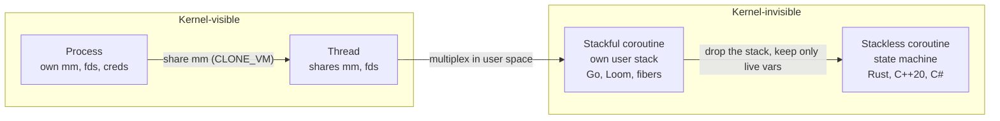

| Property              | Process                         | Thread (1:1)                | Stackful coroutine           | Stackless coroutine         |
| --------------------- | ------------------------------- | --------------------------- | ---------------------------- | --------------------------- |
| Kernel object         | `task_struct` + `mm_struct`     | `task_struct` (shares `mm`) | none                         | none                        |
| Scheduled by          | kernel (CFS/EEVDF)              | kernel                      | runtime                      | executor                    |
| Preemption            | timer interrupt                 | timer interrupt             | cooperative / runtime-signal | cooperative only (`.await`) |
| Isolation             | address space, creds            | none (shared memory)        | none                         | none                        |
| Memory per unit (min) | ~100s KiB private + page tables | ~36 KiB (kernel+user)       | ~1–3 KiB                     | size of future (bytes–KiB)  |
| Create (order of)     | 50 µs – 100 ms (scales w/ RSS)  | 10–50 µs                    | 0.3–2 µs                     | 0.1–1 µs                    |
| Switch (order of)     | 1–5 µs + TLB/cache refill       | 1–3 µs                      | 50–300 ns                    | 5–100 ns                    |
| Max practical count   | 10^3–10^4                       | 10^4–10^5                   | 10^6–10^7                    | 10^6–10^8                   |

Numbers are orders of magnitude; §13 has measured values and caveats.

---

## 2. Linux has only tasks: `task_struct`

Linux does not have separate process and thread objects. Every schedulable entity, including kernel threads, is a `struct task_struct` (`include/linux/sched.h`).  
"Process" and "thread" are user-space conventions layered on top of *which sub-structures a task shares with others*.

### 2.1 Key fields

```c
struct task_struct {
    struct thread_info      thread_info;   /* in-task since 4.9 (CONFIG_THREAD_INFO_IN_TASK) */
    unsigned int            __state;       /* TASK_RUNNING, TASK_INTERRUPTIBLE, ... */
    void                   *stack;         /* kernel stack (THREAD_SIZE) */
    int                     prio, static_prio, normal_prio;
    struct sched_entity     se;            /* fair-class runqueue node, vruntime */
    struct sched_rt_entity  rt;
    struct sched_dl_entity  dl;
    const struct sched_class *sched_class;
    cpumask_t               cpus_mask;     /* affinity */

    struct mm_struct       *mm;            /* user address space; NULL for kthreads */
    struct mm_struct       *active_mm;     /* borrowed mm for lazy-TLB kthreads */

    pid_t                   pid;           /* kernel "pid" == user-space TID */
    pid_t                   tgid;          /* thread-group id == user-space PID */
    struct task_struct     *group_leader;
    struct list_head        thread_node;   /* siblings in the thread group */

    const struct cred __rcu *cred;         /* uid/gid/caps */
    struct fs_struct       *fs;            /* cwd, root, umask */
    struct files_struct    *files;         /* fd table */
    struct nsproxy         *nsproxy;       /* namespaces (topic 13) */
    struct signal_struct   *signal;        /* shared per thread group */
    struct sighand_struct  *sighand;       /* handler table */
    sigset_t                blocked;       /* per-thread signal mask */
    struct css_set __rcu   *cgroups;
    struct thread_struct    thread;        /* arch regs: sp, fsbase, FPU state... */
    /* ... several hundred more lines ... */
};
```

Naming trap: the kernel's `pid` is what `gettid()` returns; the kernel's `tgid` is what `getpid()` returns.  
`/proc/<pid>/task/<tid>/` lists the tasks in a thread group.

### 2.2 What is pointed to vs embedded

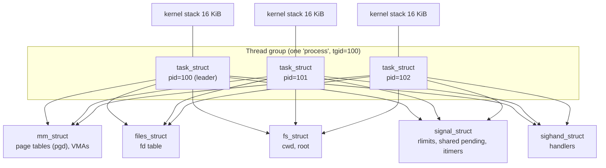

Each task always owns: its `task_struct`, its kernel stack, its register save area (`thread_struct` + FPU/AVX state), its signal mask, its scheduler entity.  
Everything else is refcounted and may be shared.

### 2.3 Sizes

| Object        | Size                                                                                                                                                | Where to read it                                                  |
| ------------- | --------------------------------------------------------------------------------------------------------------------------------------------------- | ----------------------------------------------------------------- |
| `task_struct` | config-dependent; 5888 B on the 6.18 test kernel used in §13, commonly 6–10 KiB on distro kernels (FPU/XSAVE area is sized at boot for AVX-512/AMX) | `grep task_struct /proc/slabinfo` (objsize column)                |
| Kernel stack  | 16 KiB on x86_64 since 3.15 (was 8 KiB); 32 KiB with KASAN; 16 KiB on arm64                                                                         | `KernelStack:` in `/proc/meminfo`                                 |
| `mm_struct`   | ~1–2 KiB (1600 B on the test kernel), plus per-CPU cpumask                                                                                          | `/proc/slabinfo`                                                  |
| Page tables   | 4 KiB per page-table page; at minimum one PGD + a few lower levels per process                                                                      | `PageTables:` in `/proc/meminfo`, `VmPTE` in `/proc/<pid>/status` |

Since 4.9, x86_64 kernel stacks are allocated with `vmalloc` (`CONFIG_VMAP_STACK`), giving them guard pages: a kernel stack overflow faults deterministically instead of silently corrupting the adjacent slab.  
Kernel stacks of dead tasks are cached per CPU to avoid repeated vmalloc cost.

### 2.4 Kernel threads

`kthreadd` (pid 2) spawns kernel threads (`kworker/*`, `ksoftirqd/*`, `kswapd0`, …). They have `mm == NULL`;  
when scheduled they borrow the previous task's `active_mm` (lazy TLB) so switching *into* a kernel thread does not reload CR3.  
When this document says "kernel thread" in the user-space sense (a 1:1 pthread), it means a user task that the kernel schedules, not a `kthread`.

---

## 3. `clone()` and the sharing spectrum

`fork()`, `vfork()`, `pthread_create()` and container runtimes all funnel into one syscall family: `clone()` (and `clone3()` since 5.3).  
Flags choose what the child shares.

### 3.1 The flags that matter

| Flag                                             | Effect if set                                                 | Process    | Thread |
| ------------------------------------------------ | ------------------------------------------------------------- | ---------- | ------ |
| `CLONE_VM`                                       | share `mm_struct` (address space)                             | —          | ✓      |
| `CLONE_FS`                                       | share cwd/root/umask                                          | —          | ✓      |
| `CLONE_FILES`                                    | share fd table                                                | —          | ✓      |
| `CLONE_SIGHAND`                                  | share signal handlers (requires `CLONE_VM`)                   | —          | ✓      |
| `CLONE_THREAD`                                   | same thread group (same tgid; requires `CLONE_SIGHAND`)       | —          | ✓      |
| `CLONE_SYSVSEM`                                  | share SysV semaphore undo list                                | —          | ✓      |
| `CLONE_SETTLS`                                   | set TLS register (x86_64: FS base) for child                  | —          | ✓      |
| `CLONE_PARENT_SETTID`                            | write child TID into parent memory                            | —          | ✓      |
| `CLONE_CHILD_CLEARTID`                           | zero TID word + futex-wake on exit (how `pthread_join` works) | —          | ✓      |
| `CLONE_VFORK`                                    | suspend parent until child execs or exits                     | vfork      | —      |
| `CLONE_PIDFD`                                    | return a pidfd (5.2+)                                         | optional   | —      |
| `CLONE_INTO_CGROUP`                              | spawn directly into a cgroup (clone3, 5.7+)                   | optional   | —      |
| `CLONE_NEW{PID,NS,NET,UTS,IPC,USER,CGROUP,TIME}` | new namespaces (topic 13)                                     | containers | —      |

Canonical flag sets:

```c
/* fork() — glibc */
clone(SIGCHLD /* exit signal */, 0 /* new stack: none, COW of parent's */);

/* vfork() */
clone(CLONE_VM | CLONE_VFORK | SIGCHLD, 0);

/* pthread_create() — glibc NPTL (uses clone3 since glibc 2.34) */
CLONE_VM | CLONE_FS | CLONE_FILES | CLONE_SIGHAND | CLONE_THREAD |
CLONE_SYSVSEM | CLONE_SETTLS | CLONE_PARENT_SETTID | CLONE_CHILD_CLEARTID
```

Verify on any box:

```bash
strace -f -e trace=clone,clone3 -- sh -c 'true & wait'           # fork path
strace -f -e trace=clone3 -- python3 -c 'import threading as t; t.Thread(target=lambda:0).start()'
```

### 3.2 The spectrum

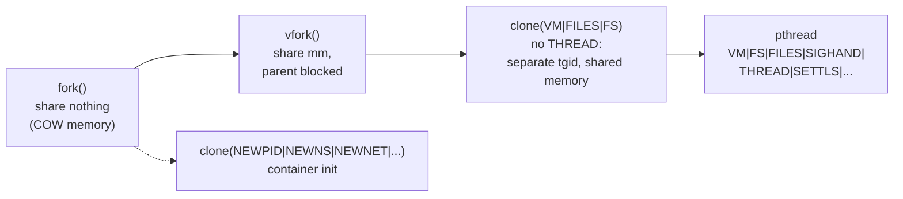

The middle cases are legal and occasionally useful: a `CLONE_VM` child without `CLONE_THREAD` is a separate process (own PID, own signal disposition, reaped via `wait`) that shares memory.  
Old LinuxThreads (pre-2003) built pthreads exactly this way, which is why each "thread" used to show up as its own PID with broken `getpid()` semantics.

### 3.3 What `CLONE_THREAD` changes beyond sharing

- `getpid()` returns the leader's tgid for every member.
- Process-directed signals (`kill(tgid, …)`) are delivered to any thread that does not block them; thread-directed ones use `tgkill()`.
- `exit_group()` (what libc `exit()` calls) kills all threads; plain `exit()` syscall ends one task.
- `execve()` from any thread destroys all other threads and the caller takes over the leader's PID.
- Rlimits, itimers, CPU accounting (`signal_struct`) become shared.
- No `SIGCHLD` to the parent on thread exit; threads are reaped automatically (or via `CLONE_CHILD_CLEARTID` futex for join).

---

## 4. Inside `kernel_clone()`

`fork`, `vfork`, `clone`, `clone3` and in-kernel `kernel_thread()` all call `kernel_clone()` (`kernel/fork.c`; named `_do_fork()` before 5.10).

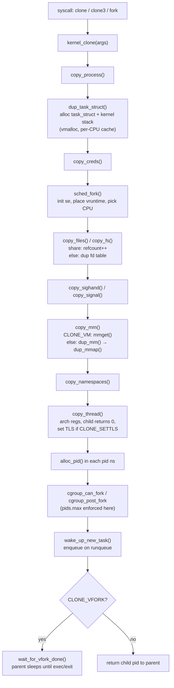

Where the time goes:

- **`dup_task_struct`**: slab alloc + kernel stack; cheap when the per-CPU stack cache is warm (µs).
- **`copy_mm` → `dup_mmap`**: the only step whose cost scales with the parent.  
  It walks every VMA, copies VMA structs, and for each private writable mapping copies page-table entries and write-protects both sides (COW).  
  For anonymous memory this is O(number of mapped pages); shared file mappings without anon pages can skip PTE copying and be refilled lazily on fault.
- **`copy_files`**: O(open fds) when not shared.
- **cgroup hooks**: `pids` controller check; occasionally contended on the `cgroup_threadgroup_rwsem` with heavy fork concurrency.

After return, a forked child also pays **deferred costs**: every first write to a COW page triggers a page fault, a 4 KiB copy and a TLB shootdown on the parent's CPUs.  
A forking Redis/PostgreSQL parent that keeps writing during a snapshot pays this repeatedly; transparent huge pages make each COW fault copy 2 MiB.

---

## 5. Processes: cost anatomy

### 5.1 Memory

A minimal dynamically linked C process:

| Component                                    | Typical size                                                 | Shared?          |
| -------------------------------------------- | ------------------------------------------------------------ | ---------------- |
| `task_struct` + kernel stack                 | ~6–10 KiB + 16 KiB                                           | no               |
| `mm_struct`, VMAs (~20–30)                   | ~2 KiB + ~200 B/VMA                                          | no               |
| Page tables                                  | 16–40 KiB for a small process (≥ 4 levels, several branches) | no               |
| libc text, ld.so, vDSO                       | ~2 MiB mapped                                                | yes (page cache) |
| Private dirty (data, heap, stack, GOT/relro) | 100–300 KiB                                                  | no               |

`VmRSS` will show ~1 MiB for `sleep 1000`, but most of it is shared libc pages; `Pss`/`Private_*` in `/proc/<pid>/smaps_rollup` show the true marginal cost.

### 5.2 Creation: `fork` vs `vfork` vs `posix_spawn`

`fork()` is O(page-table size of parent). `vfork()`/`CLONE_VM|CLONE_VFORK` copies nothing and is O(1), but the child runs on the parent's memory, so it may only `exec` or `_exit`.  
glibc's `posix_spawn` (since 2.24) uses `clone(CLONE_VM|CLONE_VFORK)` with a separate small stack, so it is safe *and* O(1) in parent size.  
Measured on the test VM (§13):

| Parent RSS | fork+_exit+wait | vfork+_exit+wait | posix_spawn(`/bin/true`) | fork+exec(`/bin/true`) |
| ---------- | --------------- | ---------------- | ------------------------ | ---------------------- |
| ~0         | 263 µs          | 59 µs            | 1.25 ms                  | 1.36 ms                |
| 1 GiB      | 19.2 ms         | 47 µs            | 1.19 ms                  | 19.9 ms                |
| 4 GiB      | 78.9 ms         | 44 µs            | 1.11 ms                  | 80.6 ms                |

Read this table as:

1. Fork cost is linear in touched anonymous memory: ~19 ms/GiB here (a VM with nested paging; bare-metal hosts are typically several times faster,  
  Redis' docs cite ~10–20 ms per GiB on common hardware and far worse on old Xen).  
  With 4 KiB pages, 1 GiB = 262,144 PTEs = 2 MiB of page tables to copy and write-protect.
2. `posix_spawn` is flat; its ~1.1 ms is `execve` + dynamic loading + process teardown, not the clone.
3. Calling `fork()+exec()` from a large JVM / Python / Node process is the classic accidental latency spike.  
  Use `posix_spawn` (Java's `ProcessBuilder` uses it by default on Linux since JDK 13 via `jspawnhelper`;  
  CPython's `subprocess` uses `vfork` when safe since 3.10).

### 5.3 Switch cost

Switching between two tasks of *different* `mm` writes CR3.  
Without PCID that flushes the non-global TLB; with PCID (Linux uses it since 4.14, required for cheap KPTI) entries are tagged and survive,  
but the new process still runs cold on L1/L2/TLB.  

Direct cost of a switch is ~1–2 µs including the syscall that blocks; the indirect cost (cache and TLB refill) can be larger and is workload-dependent.  
Topic 02 covers this fully.

### 5.4 When processes are the right unit

- Fault isolation: a crash, memory corruption or leak dies with the process (browsers' site isolation, PostgreSQL backends, nginx workers, pre-fork servers).
- Security boundaries: different uid, seccomp filter, namespaces, cgroups.
- Avoiding shared-heap contention / GC pauses: N independent heaps scale linearly.
- Language runtimes with a global lock (CPython GIL before free-threaded 3.13t): `multiprocessing` is the parallelism mechanism.

---

## 6. Threads (NPTL 1:1): cost anatomy

### 6.1 History in one table

| Era           | Implementation         | Model                                  | Problem                                                                                   |
| ------------- | ---------------------- | -------------------------------------- | ----------------------------------------------------------------------------------------- |
| ≤ 2.4 kernels | LinuxThreads           | 1:1 via `clone` without `CLONE_THREAD` | each thread had its own PID, manager thread, broken signals                               |
| 2002          | NGPT (IBM)             | M:N                                    | complex, lost                                                                             |
| 2003, 2.6     | NPTL (Drepper, Molnar) | 1:1 with `CLONE_THREAD`, futexes, TLS  | became standard; paper reported starting 100k threads in ~2 s vs ~15 min for LinuxThreads |

NPTL won because the kernel was made cheap enough (O(1) scheduler, futexes, `CLONE_SETTLS`, `CLONE_CHILD_CLEARTID`) that a user-space M:N layer cost more in complexity than it saved.  
That argument holds for *thousands* of threads; it breaks down at *hundreds of thousands*, which is why M:N came back inside language runtimes (§9).

### 6.2 What `pthread_create` does

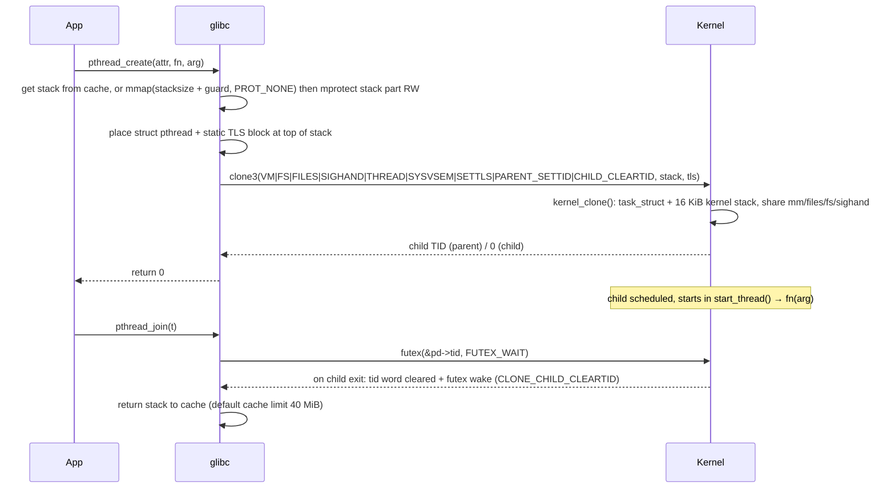

Key details:

- **Stack size default** = `RLIMIT_STACK` soft limit if set (typically 8 MiB), else 2 MiB (x86_64).  
  musl defaults to 128 KiB. Go's runtime threads (`M`s) use 8 MiB system stacks for cgo-capable builds; the JVM uses `-Xss` (1 MiB on Linux/x86_64).
- **Guard page**: one page (`PROT_NONE`) below the stack (`pthread_attr_setguardsize`).  
  Stack overflow → SIGSEGV instead of silent heap corruption. Each thread stack is therefore 2 VMAs.
- **TLS**: `struct pthread` and the static TLS block live at the high end of the thread's stack mapping;  
  the FS base register (`CLONE_SETTLS`) points at the TCB, so `__thread` variables are `%fs:offset` loads.
- **Stack cache**: glibc keeps freed stacks (default up to 40 MiB) to make create/join cycles avoid `mmap`/`munmap`.

### 6.3 Memory per thread (measured)

10,000 threads parked in `pause()`, measured via `/proc/self/status` and `/proc/meminfo` deltas (§13, Appendix A):

| Component                               | Per thread                                | Notes                                                                                                                           |
| --------------------------------------- | ----------------------------------------- | ------------------------------------------------------------------------------------------------------------------------------- |
| User stack RSS                          | 8.3 KiB                                   | 2 pages: top of stack (`struct pthread`, TLS, first frames). Same with 8 MiB or 64 KiB stacks: unused stack is never faulted in |
| User stack VSZ                          | 8196 KiB (default) / 68 KiB (64 KiB attr) | virtual only; matters for `vm.overcommit_memory=2` and 32-bit                                                                   |
| Kernel stack                            | 16.0 KiB                                  | non-swappable, always resident                                                                                                  |
| Slab (task_struct, pid, signal bits, …) | 6–7.6 KiB                                 | `SUnreclaim` delta                                                                                                              |
| Page tables                             | ~4 KiB with 8 MiB stacks                  | each stack is far enough apart to need its own last-level PT page; packing small stacks amortises this                          |
| **Total resident**                      | **~36 KiB**                               | plus whatever the thread actually uses on its stack                                                                             |

10,000 idle threads therefore cost 36 KiB × 10,000 = 360,000 KiB ≈ **352 MiB** resident, of which **~156 MiB is kernel stack** (non-swappable, non-reclaimable).  
The often-quoted "a thread costs 8 MiB" is virtual memory, not resident; "a thread costs ~16–40 KiB minimum resident" is the correct number,  
and it grows with real stack depth (a Java thread running a framework stack commonly touches 100–500 KiB).

### 6.4 Creation cost

`pthread_create`+`pthread_join` round trip: 41–43 µs on the test VM (bare-metal x86 typically 10–20 µs).  
Constant in process size: `CLONE_VM` means no page-table copy.  
Java `Thread.ofPlatform().start()` measured 235 µs: JVM thread setup (TLAB, JNI handles, stack banging / guard zones with `mprotect`, safepoint registration) dwarfs the clone.

### 6.5 Limits that bite before RAM does

| Limit                                   | Default                                                             | Notes                                      |
| --------------------------------------- | ------------------------------------------------------------------- | ------------------------------------------ |
| `kernel.pid_max`                        | 32768 (scaled with CPUs; systemd ≥ 243 raises to 4194304 on 64-bit) | **TIDs consume PIDs**                      |
| `kernel.threads-max`                    | computed from RAM (~RAM / (8 × THREAD_SIZE))                        | 128,556 on the 4 vCPU test VM              |
| `vm.max_map_count`                      | 65530 (some distros now ship 1048576)                               | **2 VMAs per thread stack** → ~32k threads |
| `RLIMIT_NPROC` (`ulimit -u`)            | per-uid task count                                                  | counts threads, not processes              |
| cgroup `pids.max` / systemd `TasksMax=` | often 15% of pid_max or 4915 for user slices                        | `EAGAIN` from `clone`                      |
| `vm.overcommit_memory=2`                | strict                                                              | 8 MiB × N virtual stacks fails early       |

The test run of 40,000 threads failed at **32,457** with `EAGAIN`, at the intersection of `pid_max` = 32768 (minus PIDs already in use) and `max_map_count` (64,940 map lines used of 65,530).  
Neither memory nor `threads-max` was the binding constraint.  
Production symptom: `java.lang.OutOfMemoryError: unable to create native thread` with plenty of heap free.

### 6.6 Switch cost

Two threads ping-ponging one byte through pipes (round trip = 2 switches + 4 syscalls):

| Placement              | Round trip                                                              |
| ---------------------- | ----------------------------------------------------------------------- |
| Pinned to the same CPU | 3.0 µs → ~1.5 µs per switch incl. syscalls                              |
| Free to migrate        | 25.5 µs (cross-CPU wakeup: IPI, idle-exit; extremely expensive in a VM) |

Same-`mm` switches skip the CR3 write, so thread switches are somewhat cheaper than process switches,  
but both pay the kernel entry/exit, scheduler pick, register + FPU state save/restore, and, under Spectre/Meltdown mitigations (KPTI, IBPB, retpolines, RSB fill), noticeable extra cost.  
Cross-CPU wakeups are dominated by idle-state exit latency (C-states) and IPIs, not by the switch itself.

---

## 7. Stacks in detail

### 7.1 Main thread vs other threads

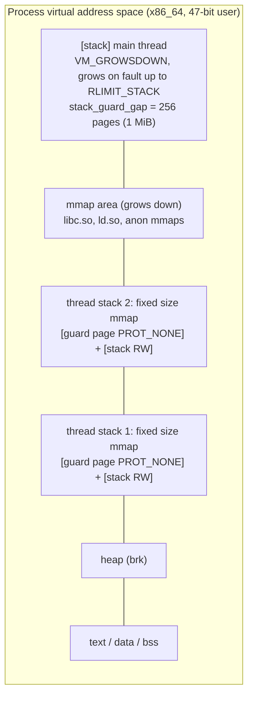

- The **main thread** stack is a `VM_GROWSDOWN` VMA that the kernel extends on page fault up to `RLIMIT_STACK`; a 1 MiB `stack_guard_gap` (post Stack Clash, 2017) separates it from other mappings.
- **Other threads** get fixed-size stacks from `mmap`. They never grow; overflowing hits the guard page → SIGSEGV.
- Pages are faulted in on first touch, so RSS = deepest stack depth ever reached, rounded to pages.  
  RSS does **not** shrink when the stack unwinds (glibc does not `madvise` live thread stacks).

### 7.2 Why stack size dominates the coroutine design space

A stack must be big enough for the deepest call chain a unit will ever run.  
For an OS thread that bound is unknown, so the stack is reserved generously (8 MiB virtual) and relies on demand paging, which has 4 KiB granularity: the minimum resident cost is one or two pages.  
To go below that, a runtime has three choices:

| Strategy                                      | Used by                                                              | Per-unit min               | Trade-off                                                                                |
| --------------------------------------------- | -------------------------------------------------------------------- | -------------------------- | ---------------------------------------------------------------------------------------- |
| Small fixed stacks                            | boost.context fixedsize, many C fiber libs, early Rust green threads | 4–64 KiB                   | overflow risk; must guess the size                                                       |
| Segmented stacks (linked chunks)              | Go ≤ 1.2, early Rust, GCC `-fsplit-stack`                            | ~4–8 KiB                   | "hot split" thrashing when a call at the boundary is in a loop                           |
| Growable contiguous stacks (copy on overflow) | Go ≥ 1.3                                                             | 2 KiB                      | must be able to find and rewrite all pointers into the stack (needs precise GC metadata) |
| Heap-allocated frames, copied on yield        | Java Loom                                                            | ~hundreds of B when parked | copy cost on park/unpark proportional to live frames (mitigated lazily)                  |
| No stack: state machine                       | Rust, C++20, C#, JS, Python, Kotlin                                  | size of live state         | function colouring; no deep recursion across suspension                                  |

---

## 8. User-space concurrency: fibers and coroutines

### 8.1 Vocabulary

| Term                 | Meaning                                                                                                                                                                                                    |
| -------------------- | ---------------------------------------------------------------------------------------------------------------------------------------------------------------------------------------------------------- |
| Coroutine            | function that can suspend and resume, keeping its state                                                                                                                                                    |
| Stackful             | each coroutine owns a call stack; can suspend from any depth (Go, Loom, Lua, boost.context, Windows Fibers)                                                                                                |
| Stackless            | compiler transforms the function into a state machine; can suspend only at explicit points in the coroutine body itself (Rust `async`, C++20 `co_await`, C# `async`, Kotlin `suspend`, Python `async def`) |
| Fiber                | stackful coroutine, usually with a scheduler; OS-agnostic term                                                                                                                                             |
| Green thread         | historical name for runtime-scheduled stackful threads (Java 1.1 on Solaris)                                                                                                                               |
| Virtual thread       | Java's name for M:N stackful threads                                                                                                                                                                       |
| Task                 | unit submitted to an executor (Tokio, .NET), usually wrapping a stackless future                                                                                                                           |
| Executor / scheduler | user-space loop that picks which ready coroutine to run on which carrier thread                                                                                                                            |
| Carrier / worker     | OS thread on which coroutines run                                                                                                                                                                          |

### 8.2 How a stackful switch works

A stackful switch is just saving callee-saved registers and swapping the stack pointer.  
On x86_64 SysV that is `rbx, rbp, r12–r15, rsp` plus `rip` (and optionally MXCSR/x87 control word):

```asm
; switch(from_ctx*, to_ctx*)  — rdi = from, rsi = to
switch_ctx:
    push rbp
    push rbx
    push r12
    push r13
    push r14
    push r15
    mov  [rdi], rsp        ; save current sp
    mov  rsp, [rsi]        ; load target sp
    pop  r15
    pop  r14
    pop  r13
    pop  r12
    pop  rbx
    pop  rbp
    ret                    ; return into target's saved rip
```

~20 instructions, ~5–20 ns, no kernel entry.  
Contrast with POSIX `swapcontext()`: it also saves/restores the **signal mask**, which costs an `rt_sigprocmask` syscall each way.  
Measured: **~475–520 ns per round trip** for `swapcontext` on the test VM, an order of magnitude slower than a register-only switch.  
This is why serious fiber libraries (boost.context `fcontext`, Go's `gogo`, Loom's continuation yield) never use `ucontext`.

### 8.3 How a stackless coroutine works

The compiler rewrites the function into an enum of states; each state holds exactly the variables live across that suspension point.  
Rust example:

```rust
async fn handle(sock: TcpStream) -> io::Result<()> {
    let mut buf = [0u8; 1024];
    let n = sock.read(&mut buf).await?;   // suspension point 1
    sock.write_all(&buf[..n]).await?;     // suspension point 2
    Ok(())
}
```

Conceptually becomes:

```rust
enum HandleFuture {
    Start   { sock: TcpStream },
    Reading { sock: TcpStream, buf: [u8; 1024], fut: ReadFut },
    Writing { sock: TcpStream, buf: [u8; 1024], n: usize, fut: WriteAllFut },
    Done,
}
impl Future for HandleFuture {
    type Output = io::Result<()>;
    fn poll(self: Pin<&mut Self>, cx: &mut Context<'_>) -> Poll<Self::Output> {
        loop { match *self { /* advance state; on Pending return Poll::Pending */ } }
    }
}
```

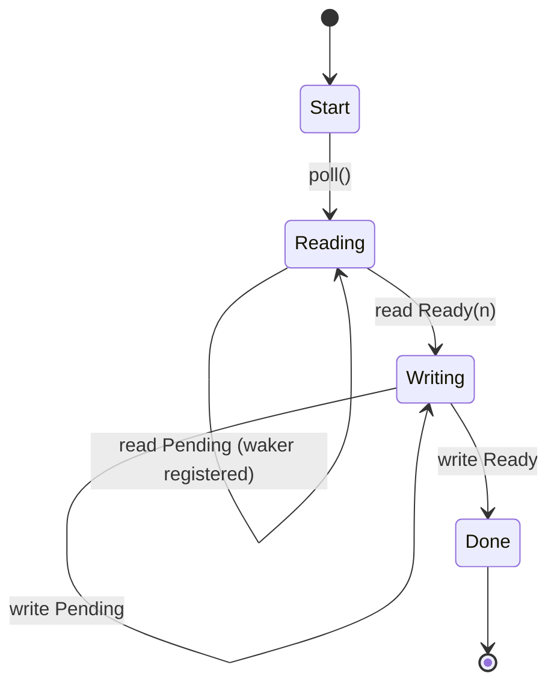

Consequences:

- **Size is known at compile time** = max over states of live data (an enum/union), here ~1 KiB + socket + sub-futures. `size_of_val(&fut)` reports it; the measured trivial future in §13 is 160 B.
- **Switch = return from `poll()`**, resume = call `poll()` again: function call cost, no stack swap.
- Nested `async` calls are **inlined into the parent's state** rather than pushed on a stack; recursion requires boxing (`Box::pin`).
- Large stack arrays held across `.await` bloat every instance of the future (a common Rust perf bug; `clippy::large_futures`).
- **Function colouring**: only async code can `.await`; calling blocking code from async stalls the carrier thread (§14).

### 8.4 Stackful vs stackless trade-off

| Axis                               | Stackful                                               | Stackless                                                           |
| ---------------------------------- | ------------------------------------------------------ | ------------------------------------------------------------------- |
| Suspend from nested ordinary calls | yes                                                    | no, every frame must be async                                       |
| Existing blocking-style code       | works unchanged (if runtime intercepts blocking calls) | must be rewritten (async colouring)                                 |
| Memory per unit                    | ≥ one stack (KiB)                                      | exact live state (bytes)                                            |
| Switch cost                        | register swap (ns)                                     | `poll` return/call (ns), but deep futures re-poll from the root     |
| Compiler/runtime support           | needs runtime that can grow/move stacks                | needs compiler transform, no runtime magic                          |
| FFI / native frames                | problematic (stacks may move; native frames pin)       | trivial                                                             |
| Debuggability                      | real stack traces                                      | async stack traces need tooling (`tokio-console`, async backtraces) |

---

## 9. Threading models: 1:1, N:1, M:N

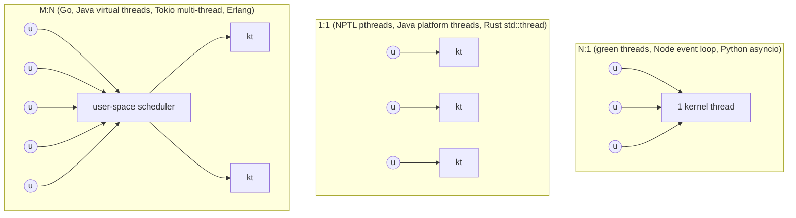

| Model | Parallelism       | Blocking syscall                                 | Scheduler knowledge                                  | Examples                                          |
| ----- | ----------------- | ------------------------------------------------ | ---------------------------------------------------- | ------------------------------------------------- |
| 1:1   | yes               | blocks only that thread                          | kernel sees everything, can preempt                  | NPTL, Windows threads                             |
| N:1   | **no** (one core) | **blocks all** unless every call is non-blocking | runtime only                                         | Node.js, asyncio, Java 1.1 green threads, GNU Pth |
| M:N   | yes               | runtime must detect and compensate               | split: runtime picks coroutine, kernel picks carrier | Go, Loom, Tokio, Erlang BEAM, Haskell GHC         |

Why M:N failed in the 2000s and succeeded in the 2010s:

- 2000s: implemented *in libc* under an unchanged C API.  
  The library could not intercept every blocking path, could not see into user code to do safe stack switching,  
  fought the kernel scheduler (priority inversion, two-level scheduling), and had to emulate POSIX signal semantics.  
  Solaris dropped M:N in Solaris 9; NGPT lost to NPTL.
- 2010s: implemented *in a language runtime* that owns the whole stack: compiler-inserted preemption checks or safepoints, precise stack maps (stacks can be grown/moved),  
  its own I/O layer built on epoll/kqueue/io_uring, its own sync primitives.  
  The runtime knows every blocking point because every blocking point is its own library function.

---

## 10. Go: goroutines and the GMP scheduler

### 10.1 Entities

- **G** (`runtime.g`): goroutine. Holds stack bounds, saved `sp/pc` (`gobuf`), status, ~400 B struct.
- **M** (`runtime.m`): OS thread. Created via `clone` with pthread-like flags (or via `pthread_create` when cgo is enabled). Each M has a `g0` (system stack) used for scheduling and a `gsignal` stack.
- **P** (`runtime.p`): processor/context, `GOMAXPROCS` of them. Owns a local run queue (256-slot ring + a `runnext` slot), an mcache (allocator cache), timers. An M must hold a P to run Go code.

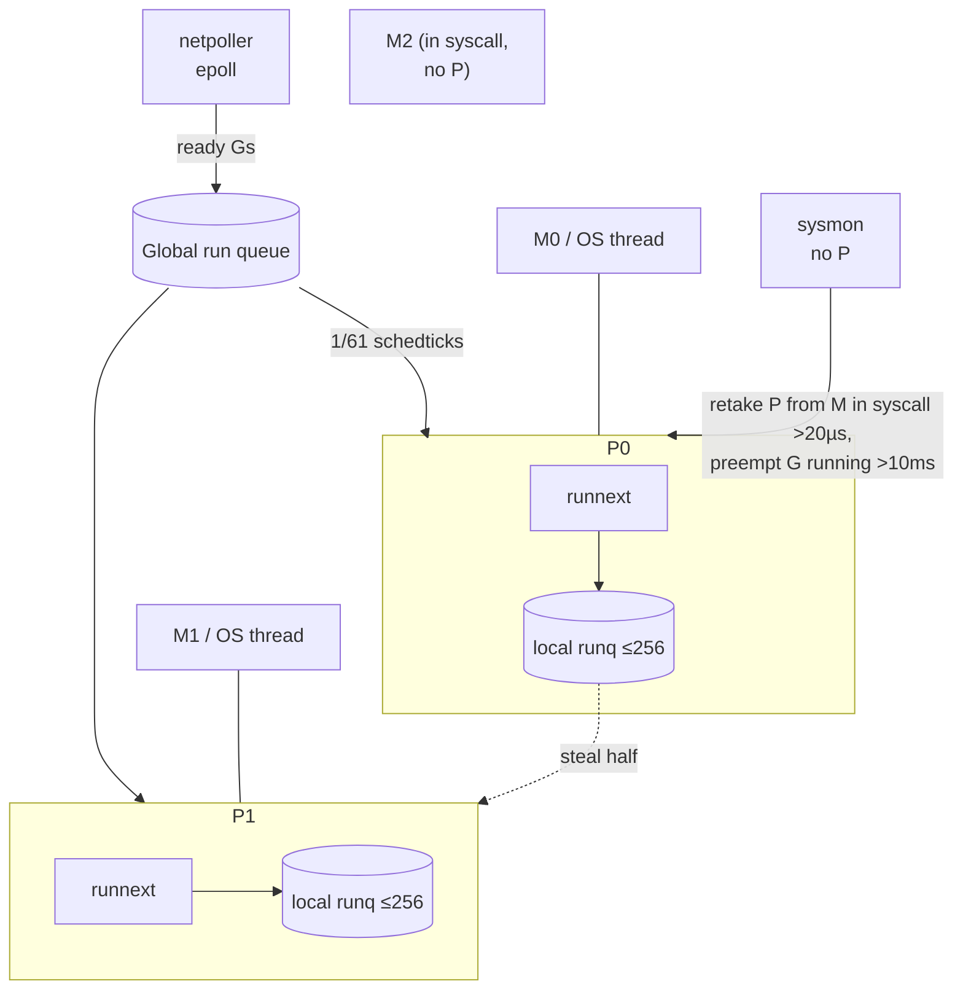

### 10.2 Scheduling loop (`runtime.schedule` → `findRunnable`)

1. Every 61st tick, check the global queue first (fairness).
2. `runnext` (the G just readied by the current G, e.g. channel receiver) → local queue.
3. Global queue (grab a batch).
4. Non-blocking netpoll.
5. Steal half of another P's local queue (random victim order), also its `runnext`.
6. Otherwise drop P, block in netpoll or park the M on a futex.

`go f()` places the new G in `runnext` of the current P; the displaced G goes to the tail of the local queue; overflow spills half to the global queue.

### 10.3 Stacks

- Initial size **2 KiB** (since 1.4; was 8 KiB). Since 1.19 the runtime may start goroutines with the *average* observed stack size to reduce early growth.
- Every non-leaf function prologue compares `sp` against `g.stackguard0`; on overflow it calls `runtime.morestack`, which allocates a stack 2× larger,  
  **copies** the old one and adjusts every pointer into it (possible because the compiler emits precise stack maps).  
  Max 1 GB on 64-bit (`debug.SetMaxStack`).
- GC shrinks stacks to half when less than ¼ is used.
- Contiguous copying replaced segmented stacks in 1.3 to fix the hot-split problem.
- Consequence: pointers to stack variables can never be passed to C (cgo pointer rules) because the stack can move; cgo calls switch to the M's system stack (`g0`),  
  which is one reason cgo calls cost ~tens of ns more than Go calls.

### 10.4 Preemption

- Cooperative at function prologues (setting `stackguard0 = stackPreempt` forces the next prologue to enter the scheduler).
- **Asynchronous preemption since Go 1.14**: `sysmon` sends `SIGURG` to an M whose G has run > 10 ms; the handler checks for an async-safe point and injects a call to `asyncPreempt`.  
  Fixed the old problem of tight loops without calls starving the GC and other goroutines.

### 10.5 Syscalls and blocking

- **Network I/O**: sockets are non-blocking; `read` returning `EAGAIN` parks the G in the netpoller (epoll); the M runs other Gs. No thread blocked.
- **Blocking syscalls** (file I/O, `getaddrinfo` via cgo, etc.): `entersyscall` marks the P as `_Psyscall`. If the call is still running when `sysmon` checks (20 µs to 10 ms back-off),  
  the P is handed to another (possibly new) M (`handoffp`). Returning goroutines try to reacquire a P or go to the global queue.  
  Hence a Go program doing lots of slow disk I/O grows OS threads; the default limit is 10,000 (`debug.SetMaxThreads`), exceeding it crashes the program.
- **`runtime.LockOSThread`** pins a G to its M (needed for thread-local OS state: namespaces via `setns`, OpenGL, some C libs).

### 10.6 GOMAXPROCS and containers

Default `GOMAXPROCS` = number of CPUs visible in the affinity mask.  
Before Go 1.25 this ignored cgroup CPU quotas, so a pod limited to 2 CPUs on a 64-core node ran 64 Ps and got throttled by CFS bandwidth control (the `uber-go/automaxprocs` fix).  
Go 1.25 made the default cgroup-quota-aware and updates it when limits change.

### 10.7 Measured (Go 1.24, test VM)

| Metric                                                             | Value                                                                                                                                                    |
| ------------------------------------------------------------------ | -------------------------------------------------------------------------------------------------------------------------------------------------------- |
| Stack in use per parked goroutine                                  | **2048 B** (exactly one minimum stack)                                                                                                                   |
| `MemStats.Sys` growth per goroutine (stack + g + sudog + overhead) | **~2.65 KiB**                                                                                                                                            |
| 1,000,000 parked goroutines                                        | 2.65 KiB × 10^6 ≈ **2.53 GiB** (vs ~34 GiB for 10^6 pthreads at ~36 KiB, which `pid_max`/`max_map_count` forbid anyway)                                  |
| OS threads for 1M goroutines                                       | 5–6                                                                                                                                                      |
| Spawn (`go f()` + first run, cold memory)                          | 2.5–11 µs/op (dominated by first-touch page faults of fresh stack spans in the VM; with warm, reused stacks bare-metal figures of ~0.3–1 µs are typical) |
| Unbuffered channel ping-pong, `GOMAXPROCS=1`                       | **461–476 ns per round trip** (2 goroutine switches + 2 channel ops)                                                                                     |

---

## 11. Java: virtual threads (Project Loom)

GA in JDK 21 (JEP 444).  
A virtual thread is a `java.lang.Thread` whose execution state is a **`Continuation`**; it runs ("mounts") on a **carrier** platform thread taken from a dedicated `ForkJoinPool`.

### 11.1 Mount / unmount

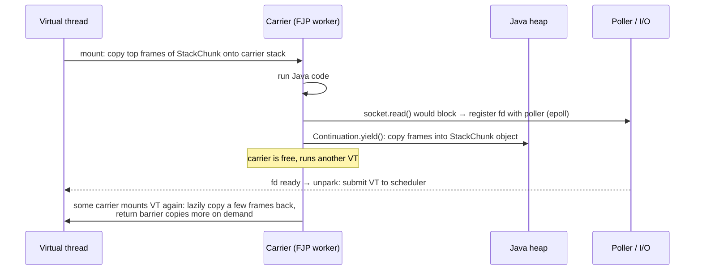

- **Frames live on the heap** in `StackChunk` objects, GC-managed. A parked virtual thread with a shallow stack costs a few hundred bytes to ~1 KiB; a deep one costs its live frames.
- **Lazy copy**: on mount only the top frames are thawed; a "return barrier" thaws more when execution returns past them.  
  Yield/park cost is therefore proportional to *recently touched* frames, not total depth.
- **Scheduler**: `ForkJoinPool` in FIFO mode; `parallelism` = available processors (`-Djdk.virtualThreadScheduler.parallelism`), `maxPoolSize` default 256 (temporary compensation threads).

### 11.2 Pinning

A virtual thread is **pinned** (cannot unmount; blocking blocks the carrier) when:

| Cause                                                    | Status                                                                                                       |
| -------------------------------------------------------- | ------------------------------------------------------------------------------------------------------------ |
| Blocking inside `synchronized` block/method              | **fixed in JDK 24 (JEP 491)**; on JDK 21–23 use `ReentrantLock`                                              |
| Native frame on the stack (JNI, foreign function upcall) | permanent: native frames cannot be relocated                                                                 |
| Blocking in class initializer (`<clinit>`)               | pinned                                                                                                       |
| File I/O                                                 | not pinned per se, but the syscall blocks the carrier; the JDK *compensates* by temporarily adding a carrier |

Diagnose with `-Djdk.tracePinnedThreads=full` (JDK 21–23) or the JFR event `jdk.VirtualThreadPinned`.

### 11.3 Guidance specific to Loom

- Do **not pool** virtual threads; create one per task. Pooling reintroduces the scarcity they were designed to remove.
- Use semaphores to limit concurrency against downstream resources (DB connections), not thread-pool size.
- `ThreadLocal` works but each of 1M virtual threads gets its own copy: heavy thread-locals (caches, buffers) multiply memory. `ScopedValue` is the intended replacement.
- CPU-bound work gains nothing; virtual threads are about **waiting** cheaply.

### 11.4 Measured (OpenJDK 21.0.12, test VM)

| Metric                                        | Virtual                  | Platform                                                                      |
| --------------------------------------------- | ------------------------ | ----------------------------------------------------------------------------- |
| Start, per thread                             | **1.19 µs** (1M threads) | **235 µs** (10k threads)                                                      |
| Heap per parked thread                        | **~780 B**               | ~330 B heap + native stack (RSS ~29 KiB each user-side) + 16 KiB kernel stack |
| OS threads for 1M parked                      | 22–25                    | 10,021 for 10k                                                                |
| Process RSS                                   | ~0.9–1.0 GiB for 1M      | ~290 MiB for 10k                                                              |
| `SynchronousQueue` ping-pong, `parallelism=1` | **812 ns** / round trip  | —                                                                             |
| Same, default parallelism (4)                 | 15.6 µs / round trip     | —                                                                             |

The last two rows are the key M:N lesson: when both coroutines share one carrier, a handoff is a user-space continuation switch.  
When they land on different carriers, every handoff becomes a cross-thread wakeup (`LockSupport.unpark` → futex → idle carrier wakes), paying the full OS cost (§6.6) plus scheduler overhead.  
**M:N makes switches cheap only when the wakeup does not cross carriers.**

---

## 12. Rust: async/await and Tokio

Rust's standard library provides only the `Future` trait and `async`/`.await` syntax; scheduling is a library concern. Tokio is the dominant runtime.

### 12.1 The `Future` contract

```rust
pub trait Future {
    type Output;
    fn poll(self: Pin<&mut Self>, cx: &mut Context<'_>) -> Poll<Self::Output>;
}
```

- `poll` must not block; returns `Pending` after arranging for `cx.waker()` to be called when progress is possible.
- `Pin` guarantees the future will not move after first poll, enabling self-referential state (a borrow of `buf` held across `.await` points into the future itself).
- Futures are **lazy**: nothing runs until polled. Dropping a future cancels it at its current suspension point (cancellation safety concerns follow from this).

### 12.2 Tokio multi-thread scheduler

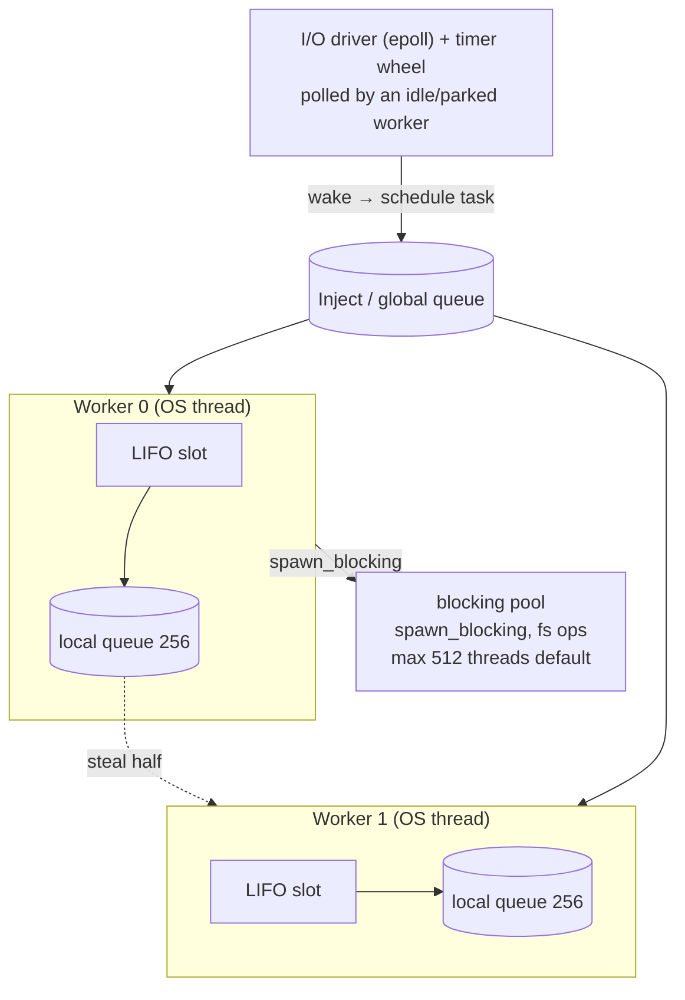

- Workers = cores by default. Each has a 256-slot local queue plus a **LIFO slot**: a task woken by the running task runs next (cache-hot message passing), similar to Go's `runnext`.
- **Cooperative budget**: each task gets 128 resource operations per poll; when exhausted, Tokio resources return `Pending` to force a yield, preventing a busy task from starving the worker.
- **Task allocation**: `tokio::spawn` makes one heap allocation holding header (state, vtable, queue links, refcount), the future, and later the output (`Cell<T, S>`).
- `tokio::fs` is implemented on the blocking pool (Linux file I/O is not epoll-pollable); `tokio-uring`/`monoio`/`glommio` use io_uring instead (topic 09).
- `current_thread` runtime = N:1; no work stealing, no `Send` requirement for `spawn_local`.

### 12.3 Measured (Tokio 1.54, rustc release, test VM)

| Metric                                                                  | Value                                            |
| ----------------------------------------------------------------------- | ------------------------------------------------ |
| `size_of_val` of a minimal parked future                                | **160 B**                                        |
| RSS per spawned parked task (1M tasks, incl. 8 B `JoinHandle` in a Vec) | **~520 B**                                       |
| `tokio::spawn` cost                                                     | **752 ns/op** (includes allocation, cold memory) |
| mpsc ping-pong, `current_thread`                                        | **448 ns** / round trip                          |
| mpsc ping-pong, `multi_thread` with driver on `block_on` thread         | **40 µs** / round trip                           |

Same lesson as Loom: the 40 µs case is the main task (on the `block_on` thread, outside the worker pool) and the echo task (on a worker) waking each other across OS threads via futex.  
Keep chatty task pairs on one thread (`current_thread`, `LocalSet`, or thread-per-core runtimes like Glommio/Monoio) or batch messages.

---

## 13. Measured numbers

### 13.1 Test bed and caveats

- 4 vCPU Firecracker microVM, Linux 6.18, glibc, gcc -O2, Go 1.24.7, OpenJDK 21.0.12, Rust stable + Tokio 1.54.1.
- Virtualised: page faults, IPIs and cross-CPU wakeups are significantly more expensive than on bare metal. Absolute numbers are pessimistic; **ratios** between rows are the useful output.
- Memory figures are deltas of `/proc/self/status` (`VmRSS`), `/proc/meminfo` (`KernelStack`, `SUnreclaim`, `PageTables`), or runtime stats (`runtime.MemStats`, Java heap used after GC).
- Sources in Appendix A; rerun them on target hardware before using numbers in a capacity plan.

### 13.2 Memory per idle unit

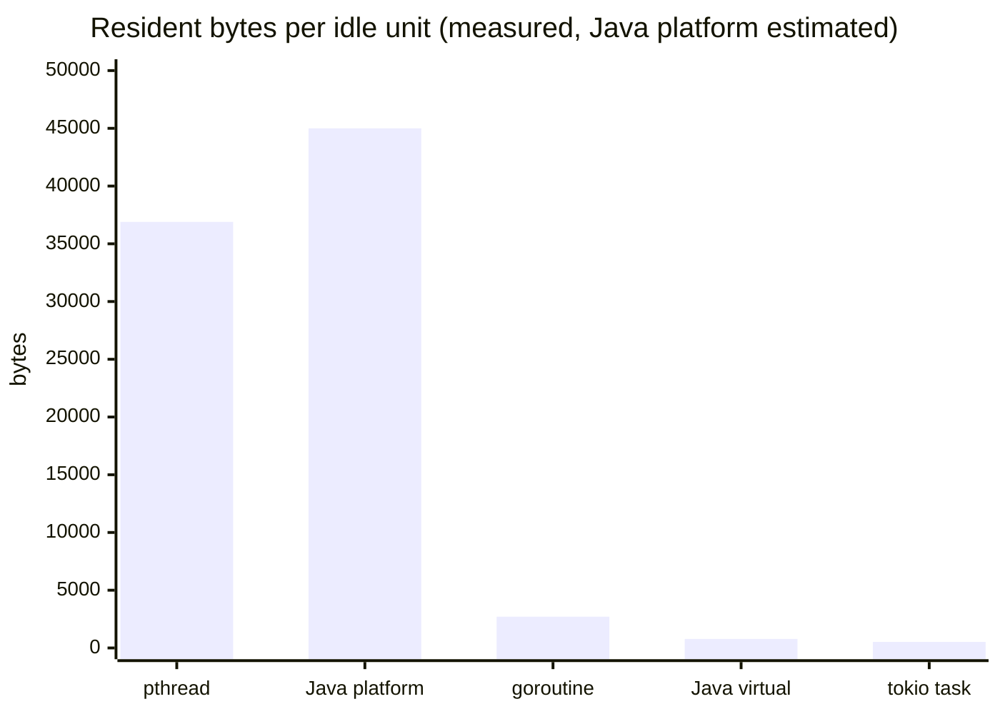

| Unit                              | Resident per idle unit            | Of which kernel (unswappable)          | 1M units would need                       |
| --------------------------------- | --------------------------------- | -------------------------------------- | ----------------------------------------- |
| Process (minimal C, private only) | ~150–300 KiB                      | ~40 KiB (task, stack, PTs)             | not feasible (pid_max, RAM)               |
| pthread (glibc default attrs)     | **~36 KiB**                       | 16 KiB stack + ~7 KiB slab + ~4 KiB PT | ~34 GiB; hits pid_max/max_map_count first |
| Java platform thread              | ~45 KiB (29 KiB user + kernel)    | ~23 KiB                                | not feasible                              |
| Goroutine                         | **~2.6 KiB**                      | 0                                      | ~2.5 GiB                                  |
| Java virtual thread               | **~0.8 KiB** heap (shallow stack) | 0                                      | ~0.8 GiB heap                             |
| Tokio task                        | **~0.5 KiB**                      | 0                                      | ~0.5 GiB                                  |

The Java platform figure is approximate: RSS delta / 10k includes JVM per-thread structures. The Java platform bar in the chart uses that estimate.

### 13.3 Creation cost

| Operation                             | Measured (test VM) | Notes                          |
| ------------------------------------- | ------------------ | ------------------------------ |
| `fork`+`_exit`+`waitpid`, tiny parent | 263 µs             | bare metal typically 30–100 µs |
| `fork`, 1 GiB parent                  | 19.2 ms            | linear in mapped anon memory   |
| `fork`, 4 GiB parent                  | 78.9 ms            |                                |
| `vfork`+`_exit`+`waitpid`             | 44–59 µs           | flat                           |
| `posix_spawn("/bin/true")` + wait     | 1.1–1.25 ms        | exec + ld.so dominate          |
| `pthread_create`+`join`               | 41–43 µs           | flat in parent size            |
| Java platform thread start            | 235 µs             | JVM thread setup               |
| Goroutine (cold)                      | 2.5–11 µs          | page-fault dominated in VM     |
| Java virtual thread start             | 1.19 µs            |                                |
| `tokio::spawn`                        | 0.75 µs            |                                |

### 13.4 Switch / handoff cost (round trip = 2 switches)

| Mechanism                                                   | Round trip                                          |
| ----------------------------------------------------------- | --------------------------------------------------- |
| OS threads via pipes, same CPU                              | 3.0 µs                                              |
| OS threads via pipes, cross CPU                             | 25.5 µs                                             |
| `ucontext` `swapcontext` (syscall for sigmask)              | 0.48–0.52 µs                                        |
| Go unbuffered channel, 1 P                                  | 0.46–0.48 µs (includes channel locking + scheduler) |
| Tokio mpsc, `current_thread`                                | 0.45 µs (includes channel + waker + queue)          |
| Java `SynchronousQueue`, 1 carrier                          | 0.81 µs                                             |
| Java `SynchronousQueue`, 4 carriers                         | 15.6 µs                                             |
| Tokio mpsc across worker/`block_on` threads                 | 40 µs                                               |
| Hand-written register switch (boost.context fcontext class) | ~10–40 ns (literature; not measured here)           |

Pure context-switch cost for user-space coroutines is tens of ns; the measured hundreds of ns are mostly the channel/queue protocol around the switch.  
The decisive variable is **whether the handoff crosses an OS thread**.

---

## 14. The blocking problem

Any M:N or N:1 system is only as good as its coverage of blocking operations.  
If a coroutine makes a blocking syscall the runtime does not know about, the *carrier thread* blocks and every coroutine queued on it waits.

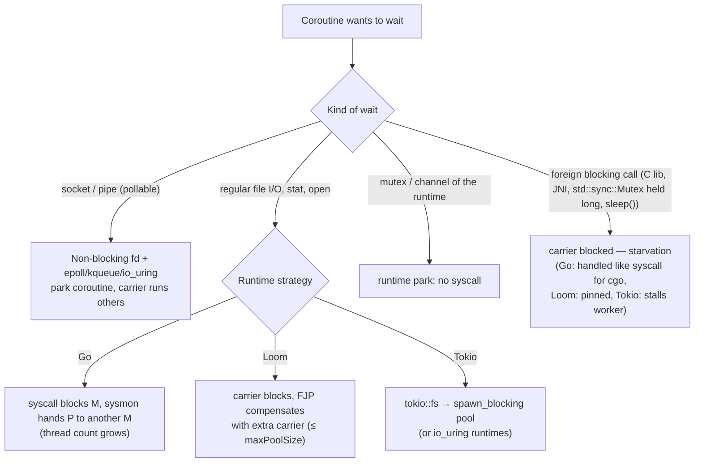

Rules of thumb:

- **Go**: almost everything is covered; watch thread count under heavy disk I/O or slow cgo.
- **Java**: JDK 21 `synchronized` + blocking → pinning (upgrade to 24+ or switch to `ReentrantLock`); JNI → pinning.
- **Rust/Tokio**: anything not `.await`-ed that takes > ~100 µs (CPU loops, `std::fs`, `std::thread::sleep`,  
  blocking DB drivers, holding `std::sync::Mutex` across contention) must go to `spawn_blocking` or a dedicated thread pool (rayon for CPU).  
  `tokio-console` and `tokio::runtime::RuntimeMetrics` expose long polls.
- **Node/asyncio (N:1)**: any blocking call stalls *the whole process*; libuv sends file I/O and DNS to a 4-thread pool (`UV_THREADPOOL_SIZE`).

---

## 15. Failure modes and limits

| Failure                                                  | Unit         | Symptom                                               | Cause / fix                                                                                |
| -------------------------------------------------------- | ------------ | ----------------------------------------------------- | ------------------------------------------------------------------------------------------ |
| Fork latency spikes                                      | process      | p99 latency jumps during snapshot / subprocess launch | large-RSS `fork`; use `posix_spawn`, smaller parents, or a spawn-helper process            |
| COW amplification                                        | process      | RSS doubles during BGSAVE                             | writes to shared pages after fork; disable THP, reduce write rate                          |
| `EAGAIN` from `clone` / "unable to create native thread" | thread       | thread creation fails with free RAM                   | `pid_max`, `max_map_count`, `RLIMIT_NPROC`, cgroup `pids.max`                              |
| Stack overflow                                           | thread       | SIGSEGV at guard page                                 | deep recursion, large stack arrays; raise stack size or move to heap                       |
| Thread explosion                                         | thread       | thousands of threads, scheduler overhead, memory      | thread-per-request with slow backends; bound pools or move to M:N                          |
| Lock convoy / context-switch storm                       | thread       | high `cs` in `vmstat`, low throughput                 | too many runnable threads contending; fewer threads, sharding                              |
| Goroutine leak                                           | goroutine    | memory grows linearly, `runtime.NumGoroutine()` rises | blocked forever on channel/ctx never cancelled; use `goleak`, pprof goroutine profile      |
| Thread limit crash                                       | Go           | `runtime: program exceeds 10000-thread limit`         | blocking syscalls/cgo in many goroutines; bound concurrency                                |
| Carrier starvation                                       | Loom / Tokio | all requests stall although CPU idle                  | pinning (JNI/synchronized≤23) or blocking in async; see §14                                |
| Cross-carrier ping-pong                                  | M:N          | latency 10–100× higher than expected                  | chatty pairs on different carriers; co-locate or batch                                     |
| Future bloat                                             | Rust         | high memory per task, memcpy in profiles              | large locals held across `.await`; box them                                                |
| ThreadLocal multiplication                               | Loom         | heap blow-up                                          | per-thread caches × 1M virtual threads; use `ScopedValue`                                  |
| Fairness loss                                            | cooperative  | one task monopolises a worker                         | CPU loop without yield points; Go 1.14+ preempts, Tokio budget only covers Tokio resources |

---

## 16. Decision guide

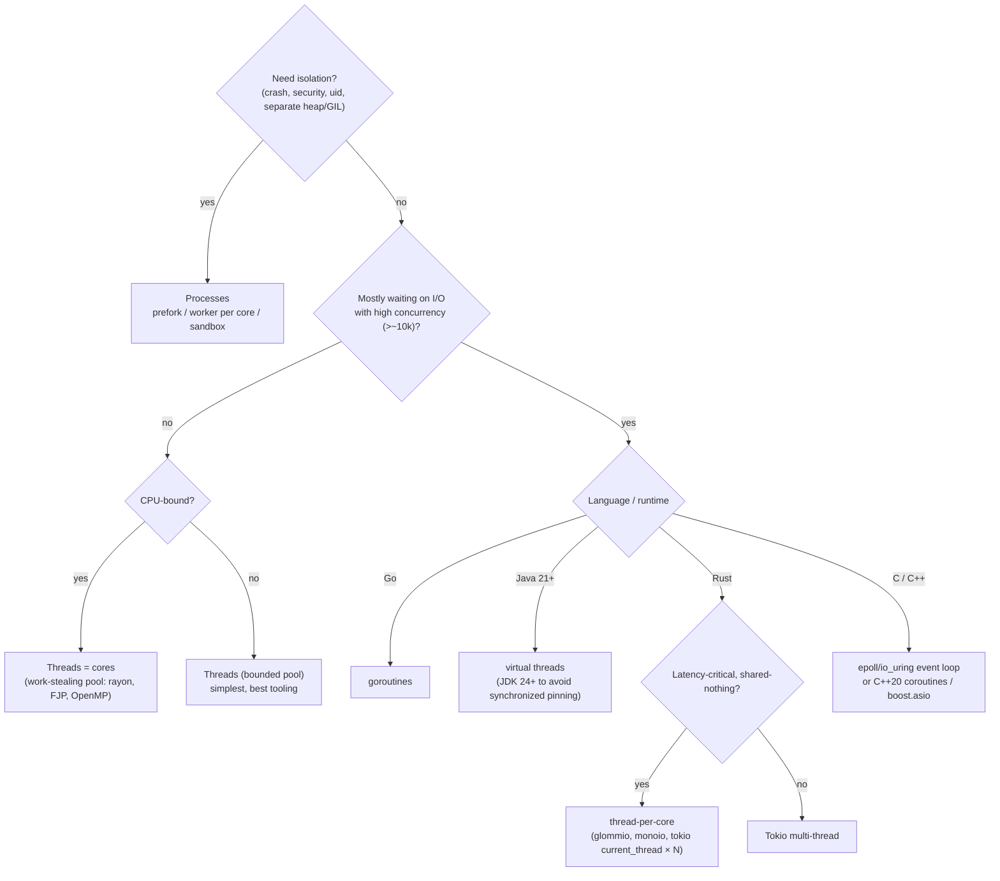

Heuristics:

- **< 1k concurrent waits**: threads are fine and easiest to debug. The memory saved by coroutines is irrelevant at this scale.
- **10k–1M concurrent waits**: thread kernel memory (16 KiB unswappable each), pid/map limits and scheduler overhead make 1:1 impractical; use M:N.
- **CPU-bound**: concurrency units beyond core count only add switching; coroutines do not make computation faster.
- **Mixed**: separate pools. Async executor for I/O, a bounded thread pool for CPU and blocking calls.
- **Latency SLOs in µs**: prefer thread-per-core with no cross-thread handoffs; every cross-thread wakeup costs microseconds (§13.4).

---

## 17. Observation cheat sheet

```bash
# Threads of a process and their states
ps -eLo pid,tid,psr,stat,comm | awk '$1==PID'
ls /proc/$PID/task | wc -l
grep -E 'Threads|VmRSS|VmStk|VmPTE|voluntary_ctxt' /proc/$PID/status

# Kernel-side memory cost of tasks
grep -E 'KernelStack|PageTables|SUnreclaim' /proc/meminfo
sudo grep -E '^(task_struct|mm_struct|vm_area_struct|signal_cache|files_cache) ' /proc/slabinfo

# True private memory of a process
cat /proc/$PID/smaps_rollup

# Limits
cat /proc/sys/kernel/{pid_max,threads-max} /proc/sys/vm/max_map_count
ulimit -u; ulimit -s
cat /sys/fs/cgroup/$(cut -d: -f3 /proc/$PID/cgroup)/pids.{current,max}

# Which clone flags a program uses
strace -f -e trace=clone,clone3,vfork,fork -p $PID

# Context switches
pidstat -w -t -p $PID 1          # cswch/s (voluntary), nvcswch/s (involuntary)
perf stat -e context-switches,cpu-migrations,task-clock -p $PID sleep 5
perf sched record -- sleep 5 && perf sched latency

# fork latency
sudo bpftrace -e 'kprobe:kernel_clone { @s[tid]=nsecs } kretprobe:kernel_clone /@s[tid]/ { @us=hist((nsecs-@s[tid])/1000); delete(@s[tid]) }'

# Go
GODEBUG=schedtrace=1000,scheddetail=1 ./app
curl localhost:6060/debug/pprof/goroutine?debug=2     # with net/http/pprof
go tool trace trace.out

# Java
jcmd $PID Thread.dump_to_file -format=json threads.json   # includes virtual threads
java -Djdk.tracePinnedThreads=full ...                    # JDK 21–23
jfr print --events jdk.VirtualThreadPinned rec.jfr

# Rust / Tokio
RUSTFLAGS="--cfg tokio_unstable" + console-subscriber → tokio-console
```

---
