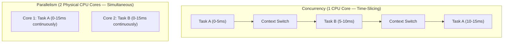
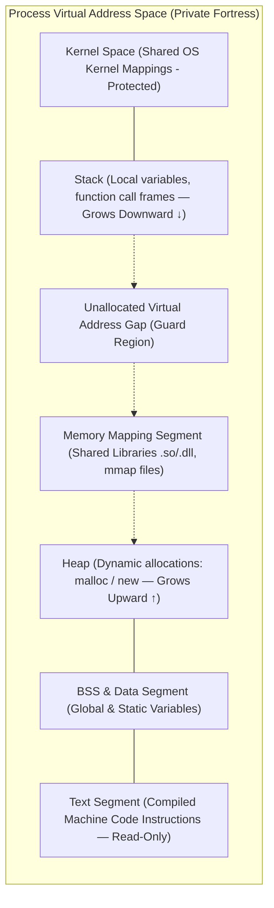
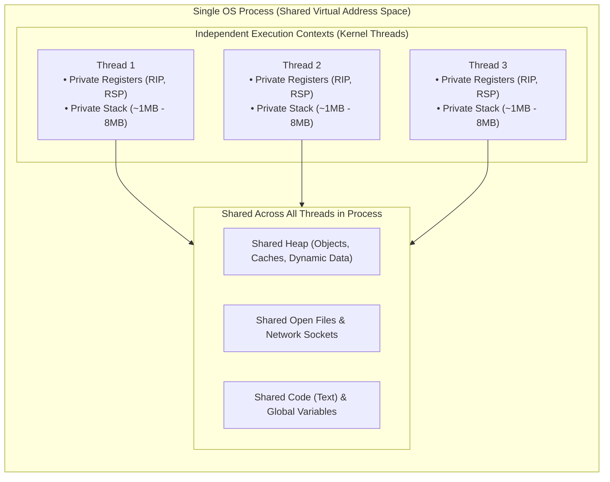
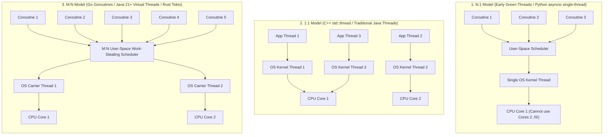
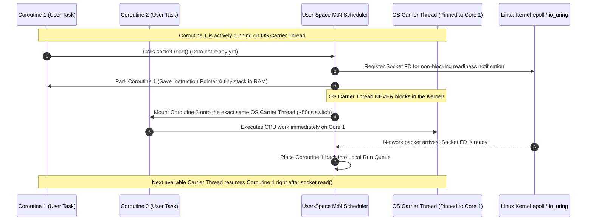
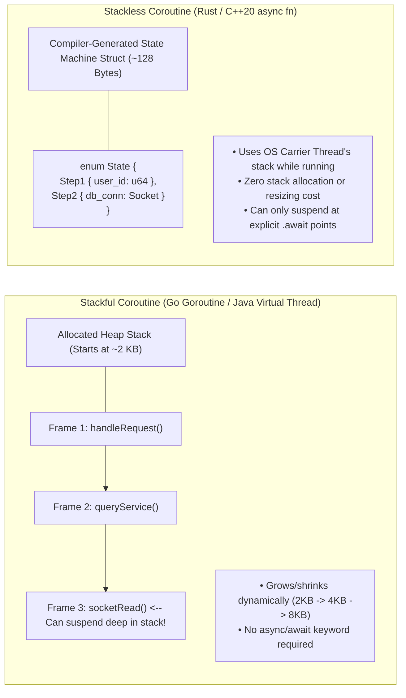

<!-- markdownlint-disable MD001 -->
<!-- markdownlint-disable MD024 -->
<!-- markdownlint-disable MD025 -->
<!-- markdownlint-disable MD026 -->
<!-- markdownlint-disable MD029 -->
<!-- markdownlint-disable MD033 -->
<!-- markdownlint-disable MD040 -->
<!-- markdownlint-disable MD056 -->
<!-- markdownlint-disable MD060 -->

# 01 — Processes, Kernel Threads, and User-Space Coroutines

## 1. First Principles: How a Computer Actually Runs Code

Before comparing processes, threads, and coroutines, we need a clear mental model of what happens physically inside a computer when you run software.  

### 1.1 Program vs. Process (The Recipe vs. The Active Kitchen)

* **A Program** is a passive file sitting on your SSD (for example, `/usr/bin/python` or your compiled `app.jar`).  
  It is just a static sequence of machine instructions and data bytes—like a printed recipe book sitting on a shelf.  
  By itself, it consumes disk space, not CPU or RAM.

* **A Process** is what happens when the Operating System (OS) loads that program into RAM and starts executing it.  
  If a **program** is a recipe, a **process** is a chef actively cooking that recipe in a locked kitchen with their own ingredients (memory), utensils (open files/network sockets), and bookmark showing which step they are currently on.

* If you open three terminal windows and run `python` three times, you have **one program** on disk, but **three completely separate processes** running in RAM.

### 1.2 What a CPU Core Actually Needs to Execute Code

A single physical CPU core is surprisingly simple: it can only execute **one stream of instructions at a single instant** (or two with hardware Hyper-Threading).  
To run any stream of code, the CPU relies on three critical hardware components:

1. **Program Counter (PC) / Instruction Pointer (`RIP` on x86-64):**  
  A tiny, ultra-fast hardware slot inside the CPU that holds the **memory address of the very next instruction** to execute.

2. **General-Purpose Registers (`RAX`, `RBX`, `RCX`, etc.):**  
  The CPU's scratchpad.  
  Because fetching data from RAM takes around 100 nanoseconds (an eternity for a 3 GHz CPU), the CPU pulls variables currently being added, compared, or looped over directly into 16 hardware registers inside the core.

3. **Stack Pointer (`RSP`):**  
  A register pointing to a special region of RAM called the **Call Stack**.  
  Every time Function A calls Function B, the CPU pushes Function A's local variables and its return address onto this stack so that when Function B finishes, the CPU knows exactly where to resume Function A.

> **The Fundamental Rule of Execution:**  
> Any independent unit of execution—whether it is an OS Process, a Kernel Thread, or a User-Space Coroutine—is fundamentally just **a saved snapshot of `{Program Counter + CPU Registers + Call Stack}**`.  
> If you swap those three things out and load a different snapshot in, the CPU immediately starts running a completely different task without even realizing it.

### 1.3 Concurrency vs. Parallelism (The Time-Slicing Illusion)

How could an older laptop with **1 CPU core** run Spotify, a web browser, and a code editor "at the same time"?

* **Concurrency (dealing with many things at once):**  
  The OS sets a hardware timer that fires every few milliseconds (a **timer interrupt**).  
  When the timer fires, the OS pauses Task A, saves its registers to RAM, loads Task B's registers onto the CPU, and lets Task B run for a few milliseconds.  
  Because this switch happens hundreds of times per second, a human perceives them as running simultaneously.  

* **Parallelism (doing many things at once):**  
  On a modern 8-core machine, 8 tasks physically execute at the exact same nanosecond on 8 separate silicon cores.

---

## 2. The OS Process: The Heavyweight Fortress

When you start an application, the Operating System creates a **Process**.  
The defining characteristic of a process is **complete isolation**.

### 2.1 Why Isolation Matters

Imagine your web browser crashes because of a bad pointer in a JavaScript tab.  
You do not want that crash to corrupt the memory of your database server or your operating system kernel.  
To guarantee this safety, the OS gives every single process a private illusion: **Virtual Memory**.

Every 64-bit process believes it owns the entire RAM of the machine cleanly laid out from address `0x0000000000000000` to `0x7FFFFFFFFFFF`.

### 2.2 How the Fortress Walls Work (Page Tables & TLB)

When Process A writes to virtual address `0x4000`, and Process B *also* writes to virtual address `0x4000`, they do not overwrite each other. Why?

1. Each process has its own private lookup table managed by the OS kernel called a **Page Table**.
2. A hardware chip inside the CPU called the **MMU (Memory Management Unit)** intercepts every memory access and translates Process A's virtual `0x4000` to physical RAM frame `0x991000`,  
  while translating Process B's virtual `0x4000` to physical RAM frame `0x228000`.
3. Because looking up the Page Table in RAM on every instruction is slow, the CPU caches recent translations in a special hardware cache called the **TLB (Translation Lookaside Buffer)**.

### 2.3 What the OS Tracks for Each Process (The PCB / `task_struct`)

Inside the Linux kernel, every execution context is represented by a C struct called `task_struct` (historically called the **Process Control Block** or PCB). It contains:

* **Process ID (`PID`)** and Parent PID (`PPID`).
* **Memory Descriptor (`mm_struct`):** Pointer to the process's private Page Tables and Virtual Memory Areas (Heap, Data, Code).
* **Open File Table (`files_struct`):** Array of file descriptors (`0 = stdin`, `1 = stdout`, `2 = stderr`, network sockets, open disk files).
* **CPU Register State (`thread_struct`):** Where the CPU registers (`RIP`, `RSP`, etc.) are saved when the process is paused.
* **Signal Handlers & Security Credentials:** User ID (`UID`), Group ID (`GID`), capabilities, and permissions.

### 2.4 Why Processes Are "Heavyweight"

Processes provide gold-standard fault isolation, but they carry two steep performance penalties:

1. **Expensive Creation (`fork()`):**  
  Creating a new process requires cloning the parent's `task_struct`, duplicating the file descriptor table, and setting up a brand-new set of Page Tables (`mm_struct`).  
  Even though modern Linux uses **Copy-on-Write (CoW)** (sharing physical RAM pages read-only until one process modifies a page), setting up those kernel structures takes **50 to 500 microseconds**.

2. **Expensive Context Switching & IPC:**  
  
    * When the CPU switches from **Process A** to **Process B**, the old address mappings in the CPU's **TLB cache become invalid** because `0x4000` now means something completely different.  
      Switching the active Page Table base register (`CR3` on x86) flushes or invalidates TLB entries (unless mitigated by PCIDs), causing a storm of slow memory lookups right after the switch.
    * Because Process A and Process B cannot see each other's RAM, sharing data requires **Inter-Process Communication (IPC)**—such as pipes,  
      Unix domain sockets, or explicitly mapped shared memory (`shm_open`)—which involves system calls and copying bytes through the kernel.

---

## 3. Kernel Threads (OS Threads): Sharing the Fortress

### 3.1 The Motivation: Why Do We Need Threads?

Suppose you build a web server.  
If you spawn a brand-new **Process** for every incoming user request:

* Creating 10,000 processes consumes gigabytes of duplicated page tables and metadata.
* If request #1 wants to update an in-memory cache so request #2 can read it, they cannot simply read the same variable in RAM—they have to serialize data over an IPC pipe or external store.

Engineers asked: *"What if multiple execution streams could live inside the **exact same Process fortress**, sharing the same Heap, Global Data, Open Files, and Page Tables, while each having only its own private Call Stack and CPU Registers?"*

That is a **Kernel Thread** (also called an **OS Thread** or **Native Thread**, such as a POSIX `pthread` or a traditional Java `java.lang.Thread`).

### 3.2 Why Each Thread MUST Have Its Own Private Stack

Beginners often ask: *"If threads share the Heap, why can't they share the Stack too?"*  
Because each thread is executing a different chain of functions at any moment!  

* Thread 1 might be inside `handleLogin() -> validatePassword() -> hashSHA256()`.
* Thread 2 might be inside `processCheckout() -> chargeCard()`.

If they shared a single stack, Thread 2 returning from `chargeCard()` would pop Thread 1's stack frame and corrupt the entire program.  
Therefore, **every thread gets its own private Call Stack**.

### 3.3 The Linux Secret: Threads Are Just Processes That Share (`clone()`)

Here is a Staff-level Linux kernel fact that surprises many engineers: **The Linux kernel does not have a separate internal data structure for a "thread" vs. a "process."**

To the Linux kernel scheduler, everything is a **Task** represented by `struct task_struct`.  
Both `fork()` (create process) and `pthread_create()` (create thread) invoke the exact same underlying Linux system call: **`clone()`**.  
The only difference is which sharing flags you pass to `clone()`:

| System Call / API       | Underlying Linux `clone()` Flags                                       | What Gets Duplicated vs. Shared                                                                                                                                                               |
| :---------------------- | :--------------------------------------------------------------------- | :-------------------------------------------------------------------------------------------------------------------------------------------------------------------------------------------- |
| **`fork()`** (Process)  | No sharing flags (`SIGCHLD` only)                                      | Creates a new `task_struct` with **copied** (CoW) Virtual Memory (`mm_struct`), **copied** File Descriptor Table, and **copied** Signal Handlers.                                             |
| **`pthread_create()`**  | `CLONE_VM \| CLONE_FS \| CLONE_FILES \| CLONE_SIGHAND \| CLONE_THREAD` | Creates a new `task_struct` that **points to the exact same** `mm_struct` (Virtual Memory), **same** File Table, and **same** Signal Handlers. Only allocates a new Stack and register state. |

### 3.4 The Four Hidden Bottlenecks of Kernel Threads

Kernel threads are much lighter than full processes, and switching between two threads of the *same* process does **not** flush the TLB because they share the same Page Table (`mm_struct`).  

So why can't we just spawn **100,000 Kernel Threads** for 100,000 concurrent users?

1. **Massive Fixed Stack Memory Reservation (1 MB to 8 MB per thread):**  

    * Because the OS kernel does not know in advance how deeply a thread will recurse or how many local variables it will put on its stack, it reserves a large contiguous chunk of virtual address space upfront (default **8 MB** on Linux `ulimit -s`, **1 MB** on 64-bit JVM).
    * Even though physical RAM pages are faulted in lazily (4 KB at a time as the stack touches them), once a thread's stack temporarily spikes during a deep call, that physical RAM is committed and rarely returned while the thread lives. Plus, the kernel places an unmapped **Guard Page** at the bottom of every stack to catch stack overflows.
    * **Math check:** $50,000 \text{ threads} \times 2\text{ MB stack} = 100\text{ GB of RAM}$ consumed purely by thread stacks!

2. **Kernel-Mode Context Switch Overhead (~1 to 5 microseconds):**

    * Because the OS Kernel schedules Kernel Threads preemptively, switching from Thread A to Thread B requires:
        1. Triggering a hardware interrupt or system call, trapping the CPU from **User Mode (Ring 3)** into **Kernel Mode (Ring 0)**.
        2. Saving all general-purpose, floating-point, and SIMD registers of Thread A into kernel memory.
        3. Running the Linux Completely Fair Scheduler (CFS) red-black tree algorithm to pick Thread B.
        4. Restoring Thread B's registers and transitioning back from **Ring 0** to **Ring 3**.
        5. **Indirect CPU Cache Pollution:** Thread B uses a completely different stack and different heap objects, evicting Thread A's hot data from the CPU's L1 and L2 caches.

3. **Creation Latency (~10 to 30 microseconds):**

    * Every `pthread_create()` requires a system call into the kernel, kernel slab allocation for `task_struct` and the kernel stack (8 KB–16 KB per thread in kernel space), and `mmap` calls for the user stack.

---

## 4. User-Space Fibers & Coroutines: Ultralight Execution

### 4.1 The Core Architectural Insight

Look at what happens in a typical modern microservice (like an API server or database proxy):

1. A request arrives over the network.
2. The code parses JSON (takes **5 microseconds** of CPU).
3. The code sends a query to PostgreSQL or an HTTP call to another service and **waits 20 milliseconds (20,000 microseconds)** for the network reply.
4. When the reply arrives, it formats the response (takes **5 microseconds** of CPU).

If you assign one **Kernel Thread** per request, that thread spends **99.95% of its life sleeping**, holding onto megabytes of stack memory and forcing the OS kernel to context-switch across thousands of threads whenever packets arrive.

**The Breakthrough Idea:**
What if the **OS Kernel only ever sees a tiny number of Kernel Threads**—say, **8 Kernel Threads** on an 8-core machine (one pinned to each CPU core)?
And inside our application (in **User Space**, without ever crossing into the OS Kernel), our language runtime manages **1,000,000 tiny lightweight tasks** (called **Coroutines**, **Fibers**, **Goroutines**, or **Virtual Threads**) and multiplexes them onto those 8 Kernel Threads?

### 4.2 Preemptive (Kernel) vs. Cooperative (User-Space) Switching

* **Preemptive Scheduling (OS Processes & Kernel Threads):** The OS kernel does not trust your code. It uses a hardware timer interrupt to forcibly yank the CPU away from a thread even in the middle of a `for` loop.
* **Cooperative Scheduling (Coroutines & Fibers):** Coroutines live inside the same application and cooperate. When Coroutine #1 needs to wait for a network socket or a timer, it voluntarily says to the User-Space Runtime Scheduler: *"I am waiting on Socket 42; pause me at this exact line of code and run Coroutine #2 on this CPU core instead!"*
* Because this switch happens **100% in User Space (Ring 3)** without a system call, without trapping into the OS kernel, and only saving a handful of callee-saved registers (~3 to 6 pointers), a coroutine context switch takes **20 to 100 nanoseconds**—roughly **20x to 50x faster** than an OS thread switch!

### 4.3 The Three Threading Models: N:1, 1:1, and M:N

| Threading Model | How It Works                                                                                                  | Fatal Flaw / Trade-Off                                                                                                                          | Real-World Examples                                                                                    |
| :-------------- | :------------------------------------------------------------------------------------------------------------ | :---------------------------------------------------------------------------------------------------------------------------------------------- | :----------------------------------------------------------------------------------------------------- |
| **N:1 Model**   | $N$ user-space coroutines mapped onto **1 single** OS Kernel Thread.                                          | **1.** Cannot use multiple CPU cores.  **2.** If *any* coroutine makes a blocking OS syscall, the entire app freezes.                   | Early Java 1.1 "Green Threads", Node.js single event loop, Python `asyncio`                            |
| **1:1 Model**   | Every application thread maps directly to **1 dedicated** OS Kernel Thread.                                   | Can use all CPU cores, **but** high memory footprint (1–8 MB stack) and slow kernel context switches limit scale to ~thousands.                 | POSIX `pthreads`, C/C++ `std::thread`, Java Platform Threads                                           |
| **M:N Model**   | $M$ user-space coroutines (millions) multiplexed across $N$ OS Kernel Threads ($N \approx \text{CPU cores}$). | Combines multi-core parallelism with nanosecond user-space switching and kilobyte memory footprint. Requires a sophisticated runtime scheduler. | Go Goroutines (`GMP`), Java 21+ Virtual Threads (`Project Loom`), Rust `Tokio`, Erlang BEAM processes  |

### 4.4 Inside a Production M:N Scheduler (Work-Stealing & Non-Blocking I/O)

How does an M:N runtime (like Go's runtime or Java's Virtual Thread scheduler) prevent one coroutine waiting on network I/O from blocking the underlying OS Kernel Thread (often called the **Carrier Thread**)?

It combines two mechanisms:

1. **Work-Stealing Run Queues:**  
    Each OS Carrier Thread has its own **Local Run Queue** of runnable coroutines (so it can pop the next coroutine without contending on a global mutex lock).  
    If Carrier Thread 1 finishes all its local work, it randomly **steals half the coroutines** from Carrier Thread 2's queue so all CPU cores stay 100% busy.

2. **Asynchronous I/O Integration (`epoll` / `kqueue` / `io_uring` Netpoller):**  
    Under the hood, when your coroutine calls what *looks* like a synchronous blocking read (`socket.read()`), the runtime intercepts it:

    * It registers the socket with the OS's non-blocking event notifier (`epoll` on Linux).
    * It **unmounts (parks)** Coroutine A from the OS Carrier Thread (saving its tiny stack/state on the heap).
    * The OS Carrier Thread immediately grabs Coroutine B from its local queue and keeps executing on the CPU core—**zero kernel thread blocking!**
    * When the network packet finally arrives 20 ms later, the runtime's background Netpoller wakes up Coroutine A and pushes it back onto a runnable queue.

### 4.5 Stackful vs. Stackless Coroutines (Why Go/Java Differ from Rust/C++)

Not all coroutines manage memory the same way.  
In interviews and systems design, you must distinguish between the two coroutine families:

#### A. Stackful Coroutines (Fibers — Go Goroutines, Java Virtual Threads)

* **How they work:**  
  Every coroutine has its own actual call stack in memory, just like an OS thread—except instead of reserving a massive **8 MB** stack upfront,  
  the runtime allocates a tiny stack on the heap (e.g., **2 KB in Go**, or dynamically sized stack chunks on the heap in **Java Virtual Threads**).

* **Dynamic Growth:**  
  If a Go goroutine calls deeper functions and exceeds 2 KB, the Go runtime allocates a 4 KB block, copies the 2 KB stack over, updates pointers, and frees the old block.  
  When the call returns, the stack can shrink back down.

* **Superpower:**  
  Because it has a full call stack, a stackful coroutine can pause/yield **from anywhere deep inside nested helper functions** (`A() -> B() -> C() -> yield()`).  
  Your code looks like normal synchronous code—no special `async` / `await` keywords pollute your function signatures.

#### B. Stackless Coroutines (Rust `async/await`, C++20 Coroutines, C# / JS `async`)

* **How they work:**  
  They do **not** allocate a separate call stack at all! Instead, when you write an `async fn` in Rust or C++, the **compiler rewrites your function into a tiny State Machine `struct**`.

* Every local variable that needs to survive across an `.await` point becomes a field inside that `struct`.  
  When the coroutine is running, it temporarily borrows the **OS Carrier Thread's normal stack**. When it hits `.await`, it simply returns control to the caller, storing its current state number (`State::WaitingOnDB`) inside that compact struct.

* **Superpower:** **Zero dynamic stack resizing overhead** and the smallest possible memory footprint (often just **64 to 256 bytes** per coroutine!).

* **Trade-off ("Function Coloring"):**  
  A stackless coroutine can *only* suspend at explicit `.await` points inside an `async` function. Regular synchronous functions cannot `.await` without becoming `async` themselves.

---

## 5. Exhaustive Architect's Comparison Matrix

Use this table as your quick mental lookup during High-Level Design (HLD) and Low-Level Design (LLD) interviews:

| Dimension                    | OS Process                                        | Kernel Thread (OS / Platform Thread)           | Stackful Coroutine (Go Goroutine / Java VT)         | Stackless Coroutine (Rust / C++20 `async`)       |
| :--------------------------- | :------------------------------------------------ | :--------------------------------------------- | :-------------------------------------------------- | :----------------------------------------------- |
| **Managed & Scheduled By**   | OS Kernel (Preemptive)                            | OS Kernel (Preemptive)                         | Language Runtime in User Space (M:N)                | Language Compiler + User-Space Executor (M:N)    |
| **Scheduling Model**         | 1:1 (Kernel `task_struct`)                        | 1:1 (Kernel `task_struct`)                     | M:N Multiplexed (Cooperative + Async Preempt)       | M:N or N:1 Cooperative (Yields at `.await`)      |
| **Virtual Address Space**    | Private (Isolated `mm_struct` & Page Tables)      | Shared with parent process                     | Shared with parent process                          | Shared with parent process                       |
| **Default Memory Footprint** | **~4 MB – 20+ MB** (Page tables + binary + heap)  | **~1 MB – 8 MB** (Fixed Virtual Stack + Guard) | **~2 KB – 4 KB** (Resizable heap stack)             | **~64 Bytes – 512 Bytes** (State machine struct) |
| **Stack Growth Mechanism**   | Fixed limit (`ulimit -s`), segfaults on overflow  | Fixed limit (`-Xss`), `StackOverflowError`     | Dynamic resizing / chunk copying on heap            | No private stack (Sizes known at compile time)   |
| **Creation Latency**         | **~50 µs – 500 µs** (`fork()` + CoW setup)        | **~10 µs – 30 µs** (`clone()` syscall)         | **~0.2 µs – 0.5 µs** (200–500 ns heap alloc)        | **~0.02 µs – 0.1 µs** (20–100 ns struct init)    |
| **Context Switch Latency**   | **~3 µs – 10+ µs** (Syscall + TLB Flush)          | **~1 µs – 3 µs** (Ring 3 -> Ring 0 -> Ring 3)  | **~50 ns – 150 ns** (User-space pointer swap)       | **~10 ns – 50 ns** (Function return + branch)    |
| **CPU Cache & TLB Impact**   | **Severe** (TLB invalidated + L1/L2 cache cold)   | **Moderate** (TLB preserved, L1/L2 polluted)   | **Low** (Runs on same core/carrier thread)          | **Minimal** (Reuses warm carrier thread stack)   |
| **Fault Isolation**          | **High** (One crash does not kill sibling procs)  | **None** (Segfault/OOM kills entire process)   | **None** (Unhandled panic kills entire proc)        | **None** (Unhandled panic kills entire proc)     |
| **Communication Mechanism**  | IPC (Pipes, Sockets, Shared Memory, Signals)      | Shared Heap Memory (Mutex, Atomics, Queues)    | Channels or Shared Memory (`sync`, `BlockingQueue`) | Async Channels, Futures, Shared Memory           |
| **Practical Max per Server** | **~1,000 – 10,000**                               | **~2,000 – 20,000**                            | **~1,000,000 – 10,000,000+**                        | **~10,000,000+** (Limited only by system RAM)    |

---

## 6. Architectural Decision Framework & Production Pitfalls

In a Staff/Architect interview, knowing the definitions is only half the battle—you must justify **when** to pick each model and **how** they fail in production.

### 6.1 When to Choose Each Model

1. **Choose Multi-Process Architecture When:**

    * **Fault and Security Isolation are non-negotiable:**  
    Google Chrome runs each browser tab (or site) in a separate OS Process so a malicious tab or C++ crash cannot steal passwords from another tab or crash the browser UI.
    * **Bypassing Language Runtime Locks:**  
    In standard CPython, the Global Interpreter Lock (GIL) prevents multiple threads in the same process from executing Python bytecodes in parallel.  
    Spawning multiple worker processes (`gunicorn` workers or `multiprocessing`) gives each process its own GIL and utilizes all CPU cores.
    * **Zero GC Pause Blast Radius:**  
    Running 8 smaller worker processes (e.g., NGINX or PostgreSQL backends) avoids a single massive heap where garbage collection or memory corruption brings down all traffic simultaneously.

2. **Choose Kernel Threads (1:1 Thread Pool) When:**

    * **Workloads are 100% CPU-Bound:**  
      If you are doing matrix multiplication, video transcoding, cryptographic hashing, or image compression on an 8-core machine, 1,000,000 coroutines will **not** make your CPU compute any faster.  
      In fact, having more than 8 active compute threads only adds context-switching overhead.  
      A fixed pool of $N = \text{CPU\_Cores}$ Kernel Threads pinned to cores is optimal.

3. **Choose M:N Coroutines / Virtual Threads When:**

    * **High-Concurrency I/O-Bound Systems (The C10K / C10M Problem):**  
      API Gateways, WebSockets chat servers, payment orchestrators, and microservices that fan out to 10 downstream RPCs/databases.  
      Here, tasks spend 99% of their time waiting on network I/O, and coroutines let you handle 500,000 concurrent connections on a modest 4-core VM.

### 6.2 Three Classic Production Pitfalls in M:N Runtimes

* **Pitfall 1: Carrier Thread Pinning (Java Virtual Threads & Go CGO)**

  * What happens if a coroutine executes a legacy C library via JNI/FFI (or in Java 21, blocks inside a `synchronized` block)? Because the native C call or monitor lock is tied to the underlying **OS Carrier Thread's stack**, the user-space scheduler **cannot unmount the coroutine**!
  * *Consequence:* The OS Carrier Thread itself becomes blocked. If all 8 of your Carrier Threads get pinned simultaneously by a slow database driver or lock, your entire 1,000,000-coroutine server grinds to a halt even though CPU usage is 0%.
  * *Fix:* Replace `synchronized` with `ReentrantLock` in Java Virtual Threads (or upgrade to JDK 24+ where JEP 491 resolves `synchronized` pinning), and isolate blocking FFI/CGO calls into dedicated bounded OS thread pools.

* **Pitfall 2: CPU Starvation of the Event Loop / Carrier Threads**

  * Because coroutines rely on cooperative yielding (or infrequent async preemption checks, like Go's ~10ms preemption signal), if a coroutine runs a tight CPU-intensive loop (e.g., parsing a 500 MB JSON blob or infinite regex backtracking), it monopolizes its OS Carrier Thread.
  * *Consequence:* Other coroutines waiting in that Carrier Thread's local run queue suffer massive **tail-latency spikes (p99/p999)** before work-stealing rescues them.
  * *Fix:* Offload heavy CPU tasks to a separate compute thread pool or insert explicit yield points.

* **Pitfall 3: Thread-Local Storage (`ThreadLocal`) Memory Explosions**

  * In traditional Java, engineers often cache heavy objects (like `SimpleDateFormat` or 1 MB byte buffers) in `ThreadLocal` because they assume there are only 200 pooled threads.
  * *Consequence:* If you migrate to Virtual Threads and spawn 1,000,000 Virtual Threads that each populate a 1 MB `ThreadLocal`, you instantly trigger an `OutOfMemoryError`.
  * *Fix:* Use **Scoped Values** (immutable, bounded-lifetime context sharing) instead of mutable `ThreadLocal` variables.

---
