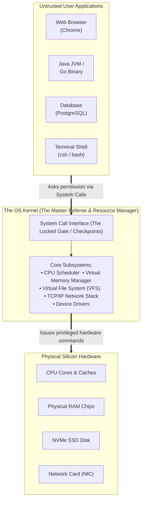
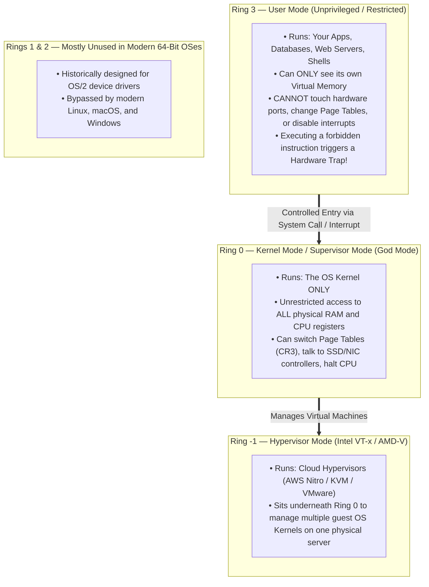
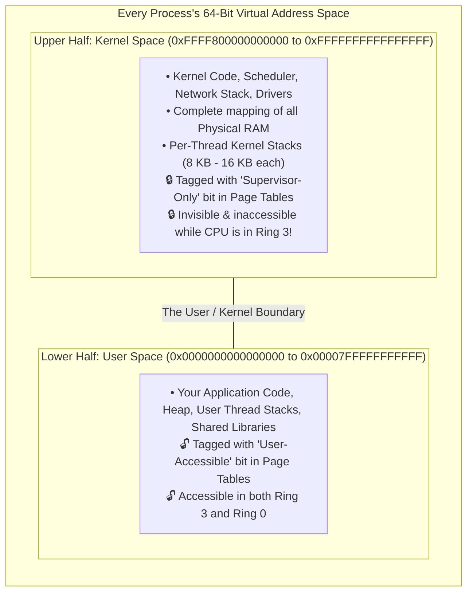
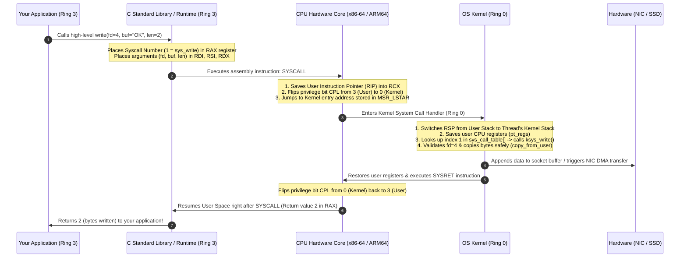
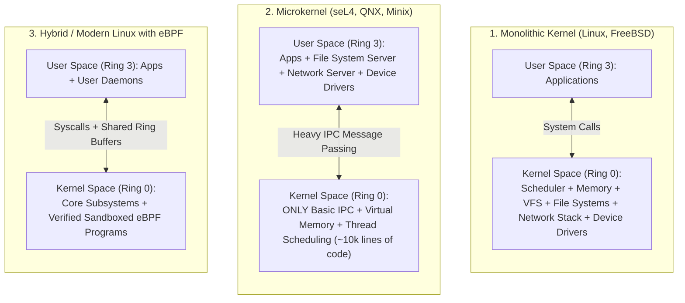

<!-- markdownlint-disable MD001 -->
<!-- markdownlint-disable MD024 -->
<!-- markdownlint-disable MD025 -->
<!-- markdownlint-disable MD026 -->
<!-- markdownlint-disable MD029 -->
<!-- markdownlint-disable MD033 -->
<!-- markdownlint-disable MD040 -->
<!-- markdownlint-disable MD056 -->
<!-- markdownlint-disable MD060 -->

# OS Kernel

## 1. First Principles: A World Without a Kernel

Imagine you build a computer from scratch with a CPU, 16 GB of RAM, an SSD, and a network card.  
Now suppose you allow any program you download — a web browser, a calculator, and a database — to run directly on the hardware with zero restrictions:

1. **Memory Anarchy:**  
  Your calculator app has a bug in a pointer and accidentally writes zeros across the exact physical RAM addresses where your database stores customer records.  
  Nothing stops it.

2. **Hardware Monopoly:**  
  Your web browser wants to read a file, while your database wants to write a file at the same microsecond.  
  Both send raw electrical commands directly to the SSD controller simultaneously, corrupting the disk filesystem.

3. **The Infinite Loop Freeze:**  
  A poorly written script enters an infinite `while(true)` loop.  
  Because it controls the CPU directly and never yields, your mouse freezes, your keyboard stops responding, and the only fix is to physically pull the power plug.

In the early days of computing (and even today on tiny microcontrollers like an Arduino), this is actually how code ran: **one program owned the entire machine**.

To run multiple programs safely on modern hardware, engineers introduced a strict rule: **No application is ever allowed to touch the hardware directly.**  

Instead, a single, ultra-trusted master program boots up first when you press the power button, claims total control over the CPU, RAM, disk, and network card,  
and stays resident in memory until you shut the machine down.

That master program is **the Kernel**.

### 1.1 "Operating System" vs. "Kernel" — What Is the Difference?

People use the terms "Operating System" and "Kernel" interchangeably in casual conversation, but in systems engineering they are distinct:

* **The Kernel** is the core binary file loaded into memory at boot time (called `vmlinuz` on Linux, `XNU` on macOS, and `ntoskrnl.exe` on Windows).  
  It has no graphical desktop, no command-line shell, no text editor, and no compiler.  
  It only manages hardware and schedules processes.

* **The Operating System (OS)** is the **Kernel + User-Space Ecosystem** packaged around it: the system libraries (`glibc`, `libSystem`), command-line shells (`zsh`, `bash`), background daemons (`systemd`, `launchd`), package managers, and window managers.

* *Real-world example:* Ubuntu, RedHat, Alpine Linux, and Android look completely different on the surface, yet all four run the **exact same Linux Kernel** underneath!

---

## 2. How Hardware Enforces the Kernel's Authority (CPU Privilege Rings)

Here is the first question every curious engineer should ask:

> *"Wait a second."*  
> The Kernel is just software — compiled C and Assembly instructions sitting in RAM.  
> My Java or C++ app is ALSO compiled machine instructions sitting in RAM.  
> What physically stops my app from executing the exact same assembly instructions the Kernel uses to wipe the disk or read another app's memory?

The answer is **CPU Hardware Privilege Rings**.  

The silicon designers at Intel, AMD, and ARM baked a physical security mechanism directly into the CPU core called **Privilege Levels** (or **Protection Rings** on x86-64, and **Exception Levels `EL0–EL3**` on ARM / Apple Silicon).

### How the CPU Polices Every Single Instruction

Inside the CPU core, there is a special hardware status register containing a 2-bit flag called the **CPL (Current Privilege Level)**:

* When your application code is running, the CPU sets **`CPL = 3` (Ring 3 / User Mode)**.
* When the Kernel is running, the CPU sets **`CPL = 0` (Ring 0 / Kernel Mode)**.

Whenever your application is running (`CPL = 3`), the CPU hardware checks every single instruction before executing it:

1. If your code executes normal math (`ADD`, `SUB`), loops (`JMP`), or reads its own variables, the CPU executes it at full speed.
2. If your code tries to execute a **Privileged Instruction**—such as `HLT` (halt the CPU), `MOV CR3` (switch to someone else's memory page table), `CLI` (disable hardware interrupts so the OS can never preempt you), or `OUT` (send raw bytes to a hardware port)—the CPU silicon **immediately aborts the instruction**!
3. Instead of running the instruction, the CPU triggers a hardware exception (**General Protection Fault**), automatically flips `CPL` from `3` to `0`, and jumps straight into the Kernel's fault handler. The Kernel sees that your process tried to do something illegal and instantly kills your process with `SIGSEGV` (**Segmentation Fault**).

---

## 3. User Space vs. Kernel Space (The Split Memory Architecture)

Because the CPU runs in two modes (**User Mode** vs. **Kernel Mode**), the computer's Virtual Memory is also divided into two halves: **User Space** and **Kernel Space**.

Here is a fascinating architectural detail about how Linux, macOS, and Windows lay out memory for every 64-bit process:

### Why Is Kernel Space Mapped Inside *Every* Process's Address Space?

Look closely at the diagram above. Every process has its own private **User Space** (Lower Half), so Process A cannot see Process B's Heap.

However, the **Upper Half (Kernel Space)** is mapped into the page tables of **every single process on the machine**, pointing to the exact same physical RAM where the Kernel lives!

Why do OS designers do this? **For sheer speed:**

1. While your process runs in **Ring 3**, every page in the Upper Half (Kernel Space) is marked with a hardware **Supervisor-Only (`U/S = 0`) bit**.  
  If your code tries to read a Kernel address, the CPU blocks it.
2. The moment your process makes a System Call (or a network packet interrupt arrives), the CPU flips from **Ring 3 to Ring 0**.
3. Because Kernel Space is *already* mapped into the top half of your process's page table, the CPU **can immediately start executing Kernel code and reading your process's buffer without doing an expensive Page Table switch (`CR3` reload) or flushing the TLB!**  
  (Note: Following the 2018 *Meltdown* CPU vulnerability, OSes introduced **KPTI — Kernel Page Table Isolation**, which keeps only a minimal trampoline mapped when in Ring 3 on vulnerable CPUs, though newer CPUs fix this in silicon).

---

## 4. The Five Core Subsystems Inside the Kernel

If you open up the source code of the Linux Kernel, almost all of its ~30 million lines of code (mostly device drivers) serve **five fundamental responsibilities**:

| Kernel Subsystem                  | Core Responsibility                                                                      | Key Internal Data Structures & Mechanisms                                         | What Happens Without It?                                                  |
| :-------------------------------- | :--------------------------------------------------------------------------------------- | :-------------------------------------------------------------------------------- | :------------------------------------------------------------------------ |
| **1. Process & CPU Scheduler**    | Decides which runnable thread (`task_struct`) gets which CPU core and for how long.      | Completely Fair Scheduler (CFS) / EEVDF, Runqueues, Context Switcher (`switch_to`)| One greedy thread monopolizes the CPU forever; other apps starve.         |
| **2. Memory Manager (MM)**        | Allocates physical RAM pages, manages Virtual Memory Page Tables, Page Cache, Swap.      | `mm_struct`, Buddy Allocator (4KB pages), Slab/SLUB Allocator (kernel objects)    | Apps overwrite each other's RAM; system crashes when RAM fills up.        |
| **3. Virtual File System (VFS)**  | Provides a single unified file API (`open`, `read`, `write`) across all storage types.   | `inode`, `dentry` (directory cache), `file` struct, Page Cache, `io_uring`        | Every app would have to write raw NAND flash commands to read a file.     |
| **4. Networking Stack**           | Implements TCP/IP, UDP, routing, packet filtering, and socket buffers.                   | `sk_buff` (Socket Buffer), `epoll`, `netfilter`/`iptables`, eBPF XDP              | Apps would have to manually construct Ethernet frames and handle TCP ACKs.|
| **5. Device Drivers & Interrupts**| Translates generic kernel requests into hardware-specific commands for SSDs, NICs, GPUs. | Interrupt Descriptor Table (IDT), Top-Half (Hard IRQ) vs. Bottom-Half (`softirq`) | The kernel could not communicate with specific vendor hardware chips.     |

---

## 5. How Your Code Talks to the Kernel: System Calls & Interrupts

Since your application is locked inside **Ring 3 (User Space)** and cannot touch the disk, network card, or create threads on its own, how does it actually get anything done?

There are **only two legal ways** for the CPU to transition from **User Mode (Ring 3)** into **Kernel Mode (Ring 0)**:

1. **Synchronous Entry — A System Call (`syscall`):** Your application intentionally asks the Kernel to perform a privileged service on its behalf (e.g., `read()`, `write()`, `mmap()`, `clone()`, `epoll_wait()`).
2. **Asynchronous Entry — A Hardware Interrupt or Fault:** External hardware needs immediate attention (e.g., the network card receives a packet and raises an electrical IRQ signal, the hardware timer ticks for preemption, or your code touches a virtual memory page not yet loaded into RAM, triggering a **Page Fault**).

### Step-by-Step Anatomy of a System Call (`write()`)

Suppose your Java or Go server executes `System.out.println("OK")` or writes `"OK"` to a client's TCP socket.  
Here is what physically happens nanosecond by nanosecond:

### Why System Calls Are Not Just Normal Function Calls

A normal function call inside your application (`calculateTax()`) stays completely inside **Ring 3** and takes **~1 to 2 nanoseconds** (just pushing a return address onto the stack and jumping).

A **System Call** (`read()`, `write()`) crosses the hardware security boundary from **Ring 3 to Ring 0 and back**. Even when the Kernel does almost nothing (like `getpid()`, which just returns an integer), a system call takes **~50 to 300 nanoseconds** because the CPU must:

* Flush parts of its internal instruction pipeline and transition privilege rings.
* Switch from your User Stack to the protected **Kernel Stack** (every OS thread actually has *two* stacks: a large 1–8 MB User Stack for Ring 3, and a small 8–16 KB Kernel Stack used only when that thread is executing inside Ring 0!).
* Save and restore registers and perform security validation on every pointer you pass in (`copy_from_user`) so a malicious app cannot trick the Kernel into overwriting Kernel memory.

> **Architect's Pro-Tip (`vDSO` — How Linux Avoids Slow System Calls for Time):**  
> What if your trading app or logging library calls `clock_gettime()` 10 million times per second to timestamp events? Paying 200 ns for a Ring 0 system call every time would burn 100% of your CPU!  
> To solve this, the Linux Kernel uses a clever trick called **`vDSO` (Virtual Dynamic Shared Object)**;  
> the Kernel maps a tiny page of Kernel memory containing the constantly updated system clock **as Read-Only directly into every process's User Space**.  
> When you call `clock_gettime()`, `glibc` simply reads that memory address directly in **Ring 3** in ~5 nanoseconds—**zero system call, zero Ring 0 transition!**

---

## 6. Kernel Architectures: Monolithic vs. Microkernel vs. Hybrid

Over the last 50 years, operating system architects have fought a famous war (most famously the 1992 **Tanenbaum–Torvalds debate**) over **how much code should live inside Ring 0**.

| Dimension                   | Monolithic Kernel                                                                                                                       | Microkernel                                                                                                                                | Hybrid Kernel                                                                                                                    |
| :-------------------------- | :-------------------------------------------------------------------------------------------------------------------------------------- | :----------------------------------------------------------------------------------------------------------------------------------------- | :------------------------------------------------------------------------------------------------------------------------------- |
| **Core Philosophy**         | Put **everything** (scheduler, memory, filesystems, networking, device drivers) inside Ring 0 for maximum speed.                        | Keep Ring 0 tiny (~10,000 lines of code). Run filesystems, networking, and drivers as isolated **Ring 3 User-Space Processes**.            | Structure code cleanly like a microkernel, but run performance-critical services inside Ring 0.                                  |
| **Internal Communication**  | Direct C function calls inside the same Ring 0 address space (**~nanoseconds**).                                                        | Inter-Process Communication (IPC) messages requiring repeated Ring 3 $\leftrightarrow$ Ring 0 context switches.                            | Direct calls inside Ring 0 for core I/O; user-space servers for non-critical services.                                           |
| **Performance**             | **Highest raw throughput & lowest I/O latency.**                                                                                        | **Lower throughput** (IPC message-passing tax of 10–30%).                                                                                  | **High** (Close to monolithic performance).                                                                                      |
| **Fault Isolation**         | **Low:** A single null-pointer bug in a third-party audio or GPU driver in Ring 0 crashes the entire machine (**Kernel Panic / BSOD**). | **Extreme:** If the audio driver crashes, it is just a Ring 3 process—the microkernel restarts it in milliseconds without crashing the OS! | **Moderate:** Core drivers in Ring 0 can still crash the OS, though modern versions push more drivers to User Space (DriverKit). |
| **Real-World Examples**     | **Linux**, FreeBSD, OpenBSD, Solaris                                                                                                    | **QNX** (BlackBerry/Automotive braking systems), **seL4** (Military/Aerospace), **MINIX** (inside every Intel CPU's Management Engine!).   | **macOS / iOS (`XNU` = Mach + BSD)**, **Windows NT (`ntoskrnl.exe`)**                                                            |

---

## 7. Why Software Architects Care About the Kernel Today

When you are designing high-throughput systems (or sitting in a Staff/Architect interview), understanding the Kernel explains **why modern high-performance infrastructure is built the way it is**:

1. **Batching & Zero-Copy Exists to Minimize Ring 3 $\leftrightarrow$ Ring 0 Transitions:**  

    * Why does Kafka use **`sendfile()` (Zero-Copy)**?  
      Because normally, reading a file from disk and sending it over a socket requires copying bytes from `Kernel Page Cache -> User Space Buffer (Ring 3)` and then immediately copying the exact same bytes back from `User Space Buffer (Ring 3) -> Kernel Socket Buffer (Ring 0)`— two system calls and two pointless memory copies across the User/Kernel boundary.  
      `sendfile()` tells the Kernel: *"Move the bytes directly from your disk cache to the network card inside Ring 0 without ever copying them to User Space!"*

2. **Why `io_uring` Replaces Traditional System Calls:**  

    * Even non-blocking `epoll` requires system calls to read and write every socket.  
    Linux's modern **`io_uring`** sets up two shared memory Ring Buffers between **User Space (Ring 3)** and **Kernel Space (Ring 0)**.  
    Your app drops I/O requests into the Submission Ring in User Space, and the Kernel polls and completes them in the background—achieving massive disk and network I/O with **almost zero system call overhead**.

3. **Why `eBPF` Is Revolutionizing Cloud Infrastructure (Kubernetes, Observability, Security):**

    * Historically, if you wanted to change how Linux routes packets or traces system calls, you had to write a dangerous C Kernel Module (`.ko`) that could crash the server.
    * **`eBPF` (Extended Berkeley Packet Filter)** embeds a verified, sandboxed Virtual Machine inside the Linux Kernel (Ring 0).  
      Tools like **Cilium** (Kubernetes networking) and **Datadog/Pixie** attach small, mathematically verified eBPF programs directly to kernel hooks—inspecting or routing millions of packets per second inside Ring 0 without ever waking up a User-Space proxy!

---
