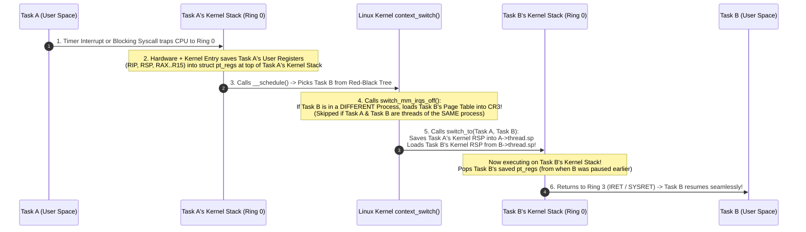
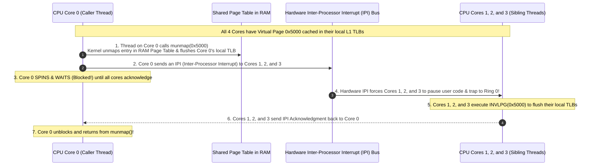
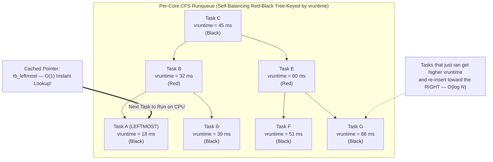
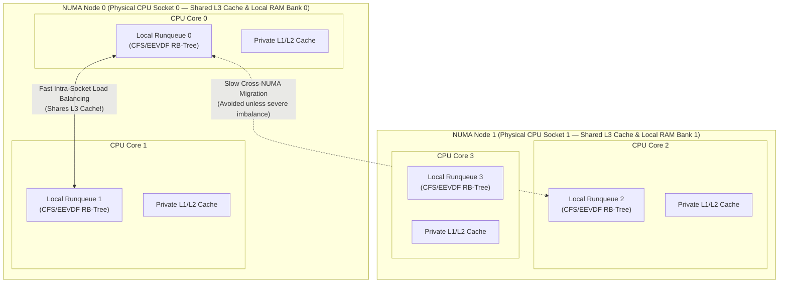

<!-- markdownlint-disable MD001 -->
<!-- markdownlint-disable MD024 -->
<!-- markdownlint-disable MD025 -->
<!-- markdownlint-disable MD026 -->
<!-- markdownlint-disable MD029 -->
<!-- markdownlint-disable MD033 -->
<!-- markdownlint-disable MD040 -->
<!-- markdownlint-disable MD056 -->
<!-- markdownlint-disable MD060 -->

# 02 — Context Switching and CPU Scheduling

## 1. First Principles: What Is a Context Switch?

### 1.1 The "Single Workbench" Analogy

Imagine a master carpenter working at a single physical workbench (a **CPU Core**).  
The carpenter is building two projects at the same time: a **Wooden Chair (Task A)** and a **Jewelry Box (Task B)**.  

Because there is only one workbench, the carpenter cannot saw wood for the chair and carve hinges for the jewelry box at the exact same instant.  
To make progress on both:

1. The carpenter works on the **Chair (Task A)** for 10 minutes.
2. A timer rings.  
  Before clearing the workbench, the carpenter takes a Polaroid photo and writes down the exact measurements, which screw was half-tightened, and which step of the blueprint they were on.  
  This saved snapshot is **Task A's Context**.
3. The carpenter sweeps all of Task A's tools and wood pieces off the workbench into Storage Bin A (RAM), pulls Task B's tools and blueprint out of Storage Bin B,  
  arranges them on the workbench according to Task B's saved notes, and resumes working on the **Jewelry Box (Task B)**.

In an operating system:

* **The "Context"** is the minimum set of hardware state required to pause a running task at any instruction and resume it later as if nothing happened;
  Its **CPU Registers** (including the Instruction Pointer `RIP` and Stack Pointer `RSP`), its **Floating-Point/SIMD registers**, and its **Virtual Memory Page Table pointer (`CR3`)**.

* **A Context Switch** is the physical procedure performed by the OS Kernel to stop running Task A on a CPU core, save Task A's hardware context into Kernel RAM,  
  load Task B's saved hardware context into the CPU core, and jump to Task B's instruction pointer.

### 1.2 Clearing Up the #1 Interview Misconception: Mode Switch vs. Context Switch

Many engineers confuse a **Mode Switch** (User Mode $\leftrightarrow$ Kernel Mode) with a **Context Switch** (Task A $\leftrightarrow$ Task B).  
In a Staff/Architect interview, keeping these distinct is critical:

* **A Mode Switch (Privilege Ring Transition: Ring 3 $\leftrightarrow$ Ring 0):**

  * Happens whenever your application makes a system call (like `getpid()` or reading data already sitting in the OS Page Cache) or when a fast hardware interrupt fires.
  * The CPU flips its privilege bit from **Ring 3 (User)** to **Ring 0 (Kernel)** and switches from Task A's User Stack to Task A's Kernel Stack.

* **Crucial point:** **Task A is still the active task!**  
  The Kernel does quick work on behalf of Task A and returns right back to Task A in Ring 3.  
  No other process or thread was scheduled. Cost: **~50 to 200 nanoseconds**.

* **A Context Switch (Task Switch: Task A $\rightarrow$ Task B):**

  * Can **only happen inside Ring 0** (so every Context Switch begins with a Mode Switch into the Kernel).
  * Once inside Ring 0, the Kernel decides Task A cannot continue (either because Task A blocked waiting for disk/network I/O, or because Task A's time slice expired).
  * The Kernel invokes the **Scheduler**, picks a completely different runnable task (**Task B**), swaps out the CPU state and memory mappings, and returns to Ring 3 running **Task B**.  
    Cost: **~1,000 to 10,000+ nanoseconds** (when accounting for CPU cache and TLB warmup).

```mermaid
flowchart TB
    subgraph ModeSwitch ["1. Mode Switch ONLY (Fast: ~100 ns — Task A Keeps the CPU)"]
        direction LR
        M1["Task A (Ring 3)<br/>Calls read()"] ==>|"SYSCALL Trap"| M2["Kernel (Ring 0)<br/>Data already in RAM Page Cache!"]
        M2 ==>|"SYSRET Return"| M3["Task A (Ring 3)<br/>Continues immediately"]
    end

    subgraph ContextSwitch ["2. Mode Switch + Context Switch (Slow: ~2,000+ ns — CPU Switches to Task B)"]
        direction LR
        C1["Task A (Ring 3)<br/>Calls read()"] ==>|"SYSCALL Trap"| C2["Kernel (Ring 0)<br/>Data NOT in RAM (Must wait on SSD)"]
        C2 ==>|"Marks Task A Sleeping<br/>Calls schedule()"| C3["Kernel Context Switcher<br/>Saves Task A State -> Loads Task B State"]
        C3 ==>|"SYSRET Return"| C4["Task B (Ring 3)<br/>Runs on CPU Core!"]
    end
```

### 1.3 Voluntary vs. Involuntary Context Switches

Linux tracks two categories of context switches for every thread (visible in `/proc/<pid>/status` and `pidstat -w`):

| Switch Type                    | Linux Metric Name             | Trigger Mechanism                                                                                                                                                                 | What High Numbers Mean in Production                                                                                   |
| :----------------------------- | :---------------------------- | :-------------------------------------------------------------------------------------------------------------------------------------------------------------------------------- | :--------------------------------------------------------------------------------------------------------------------- |
| **Voluntary Context Switch**   | `voluntary_ctxt_switches`     | The task **willingly yields** the CPU because it cannot proceed—e.g., waiting for a network socket (`read`), disk I/O, `sleep()`, or waiting on a contended `mutex` lock.         | Your application is **I/O-bound** or suffering from **heavy lock contention** (threads constantly parking on mutexes). |
| **Involuntary Context Switch** | `nonvoluntary_ctxt_switches`  | The task still wanted to run CPU instructions, but the OS Kernel **forcibly preempted** it because its time slice expired or a higher-priority thread woke up.                    | Your server is **CPU-oversubscribed**—too many active runnable threads fighting over too few physical CPU cores.       |

---

## 2. Step-by-Step Anatomy of a Context Switch in Linux

What actually happens inside the CPU silicon and the Linux kernel (`kernel/sched/core.c`) when the OS switches from **Task A** to **Task B**?

Remember from Topic 01 that every OS thread actually has **two stacks**:

1. **A User Stack (1–8 MB in User Space, Ring 3):** Used while running your application code.
2. **A Kernel Stack (8 KB or 16 KB in Kernel Space, Ring 0):** Used whenever that specific thread enters the Kernel via a syscall or interrupt.

Here is the exact 6-step sequence of a context switch:

### Deep Dive into Step 4 & Step 5 (`context_switch()`)

Inside the Linux kernel, the function `context_switch(rq, prev, next)` performs two critical hardware operations:

1. **Switching the Virtual Address Space (`switch_mm_irqs_off`):**

* The CPU has a privileged control register called **`CR3`** (on x86-64) or **`TTBR0`** (on ARM64) that holds the physical RAM address of the currently active Page Table.
* **Case 1 (Process A $\rightarrow$ Process B):** Because Process B has a completely different Virtual Address Space (`mm_struct`), the kernel overwrites `CR3` with Process B's Page Table address.
* **Case 2 (Thread A1 $\rightarrow$ Thread A2 in the same Process):** Because both threads share the exact same `mm_struct`, the kernel **skips reloading `CR3` completely**.
* **Case 3 (User Thread $\rightarrow$ Kernel Background Thread like `kworker`):** Kernel threads only touch Kernel Space (which is identically mapped in the upper half of every process's page table!). Linux uses a clever optimization called **Lazy TLB Mode**: the kernel thread simply "borrows" the previous user process's `CR3` without reloading it at all!

2. **Switching the Execution Thread & Registers (`switch_to`):**

* First, the kernel saves any hardware state belonging to Task A that wasn't already pushed onto its stack: Thread-Local Storage (TLS) segment registers (`FS` / `GS` base registers) and Floating-Point / AVX-512 SIMD vector registers (`fpu` state).
* Finally, in a tiny block of inline assembly (`__switch_to_asm`), the CPU executes the ultimate magic trick:
* It saves the current CPU Stack Pointer (`RSP`, which points to Task A's Kernel Stack) into `prev->thread.sp`.
* It overwrites the CPU's `RSP` register with `next->thread.sp` (which points to Task B's Kernel Stack).
* The instant `RSP` changes, **the CPU is now operating inside Task B's universe**.  
  When the function returns (`RET`), it pops the return instruction address off *Task B's* stack—resuming Task B right where Task B called `schedule()` milliseconds ago!

---

## 3. Direct vs. Indirect Costs: TLB Flushes, PCID, and TLB Shootdowns

If a raw register swap (`switch_to`) only takes ~100 to 300 nanoseconds, why do systems architects fear context switch storms?

Because the **Direct Cost** of a context switch is tiny compared to the **Indirect Cost (Cache & TLB Pollution)**.

| Cost Category     | Component Affected                            | Latency Penalty          | Why It Happens                                                                                                                                                                                       |
| :---------------- | :-------------------------------------------- | :----------------------- | :--------------------------------------------------------------------------------------------------------------------------------------------------------------------------------------------------- |
| **Direct Cost**   | Ring 0 Trap + Register Save/Restore + CFS     | **~200 ns – 800 ns**     | Saving general-purpose registers, FPU/AVX state, running the scheduler algorithm, and updating kernel bookkeeping.                                                                                   |
| **Indirect Cost** | **L1 / L2 / L3 CPU Data & Instruction Caches**| **~1,000 ns – 10,000 ns**| Task A had filled the ultra-fast L1 cache (1 ns access) with its hot variables. Task B touches completely different memory, evicting Task A's cache lines and stalling on slow 100 ns RAM fetches.   |
| **Indirect Cost** | **TLB (Translation Lookaside Buffer)**        | **~500 ns – 5,000 ns**   | If `CR3` changed without PCID (or entries were evicted), virtual-to-physical address translations miss in the TLB, forcing slow 4-level Page Table walks in RAM.                                     |

### 3.1 How PCID (Process-Context Identifiers) Saved Modern CPUs

Historically, every time the CPU wrote a new Page Table address into the `CR3` register (switching from Process A to Process B), the CPU hardware **flushed the entire TLB cache** on that core. Why? Because virtual address `0x4000` in Process A points to a different physical RAM frame than `0x4000` in Process B; without flushing, Process B would read Process A's memory!

To fix this bottleneck, Intel (Westmere+) and ARM introduced **PCID (Process-Context Identifiers)** (called **ASID** on ARM):

* The CPU adds a small **12-bit tag (Process ID tag)** to every entry cached inside the TLB hardware.
* Instead of `[Virtual Address 0x4000 -> Physical Frame 0x991000]`, the TLB entry now stores **`[PCID: 7 | Virtual Address 0x4000 -> Physical Frame 0x991000]`**.
* When the Linux Kernel switches from Process A (`PCID 7`) to Process B (`PCID 12`), it sets a bit in `CR3` telling the CPU: *"Do NOT flush the TLB! Just only match TLB entries tagged with PCID 12."*  
  If Process A gets scheduled back onto that core a millisecond later, its `PCID 7` translations are still warm inside the TLB!

### 3.2 TLB Shootdowns: The Silent Multi-Core Killer

Even with PCID, there is a notorious multi-core bottleneck that comes up in Staff/Architect interviews: **The TLB Shootdown**.

#### Why Do TLB Shootdowns Happen?

Remember that inside a single multi-threaded process (like a Java JVM, Go service, or PostgreSQL), **all threads share the exact same Virtual Address Space (`mm_struct`)**.  
Suppose your Java application is running 4 threads simultaneously across **4 physical CPU cores (Core 0, Core 1, Core 2, Core 3)**.  

1. All 4 cores have cached the virtual-to-physical translation for Virtual Page `0x5000` inside their private, per-core hardware **L1 TLB caches**.
2. Suddenly, the thread running on **Core 0** frees that memory back to the OS (`munmap()`), changes its permissions (`mprotect()`), or the JVM Garbage Collector uncommits a heap region.
3. **Core 0** updates the shared Page Table in RAM and flushes its *own* local TLB using the `INVLPG` instruction.
4. **The Danger:** **Cores 1, 2, and 3 STILL have the old, stale translation for `0x5000` cached inside their hardware TLBs!**  
  Their hardware MMUs do not automatically snoop changes to RAM page tables. If Core 1 writes to `0x5000` right now, it will corrupt freed physical memory!

#### How the Kernel Executes a TLB Shootdown

To prevent memory corruption, **Core 0** must forcibly interrupt Cores 1, 2, and 3 before `munmap()` is allowed to return:

> **Why Architects Care About TLB Shootdowns:**  
> Notice the devastating impact: a single `munmap()` or `mprotect()` on **Core 0** forces **every other core running threads of that process** to stop running user code,  
trap into Ring 0, flush their TLB, and acknowledge—while Core 0 spins doing nothing!
> On a 64-core or 128-core server, calling standard `malloc`/`free` (which calls `mmap`/`munmap` for large blocks) at high frequency can burn **30%+ of total CPU time** purely in kernel TLB shootdown IPI storms (`smp_call_function_many` in `perf top`).
> **Architectural Fix:** This is why high-performance allocators like **`jemalloc`** and **`tcmalloc`** (and custom database buffer pools) retain freed memory in user-space arenas or use deferred batched reclamation (`MADV_FREE`) rather than returning pages to the OS kernel on every `free()`.

---

## 4. CPU Scheduling: From First Principles to Linux CFS & EEVDF

Now that we know *how* the kernel switches tasks, we must answer the brain of the operation:  
**When there are 50 runnable threads waiting for an 8-core CPU, how does the Kernel decide WHICH thread runs next, and for HOW LONG?**

### 4.1 The Fundamental Scheduler Dilemma: Throughput vs. Latency

Every OS scheduler is trapped in a tug-of-war between two conflicting goals:

1. **Maximize Throughput (Batch Processing Goal):** Since every context switch wastes CPU cycles and ruins L1/L2 caches, if you want to finish a massive video encoding job as fast as possible, you should give each task a **huge time slice (e.g., 100 ms)** so it rarely context-switches.
2. **Minimize Response Latency (Interactive Goal):** If a user clicks their mouse, or a high-priority network packet arrives for your API server, waiting 100 ms behind a video encoder feels broken.  
  Interactive tasks want **tiny time slices (e.g., 1 ms)** and immediate preemption so every task gets a turn rapidly.

### 4.2 Brief Evolution of Linux Schedulers

To appreciate why Linux works the way it does today, look at how its scheduler evolved:

| Era & Scheduler Name                                   | Core Data Structure & Algorithm                                                                                              | Why It Was Replaced                                                                                                                     |
| :----------------------------------------------------- | :--------------------------------------------------------------------------------------------------------------------------- | :-------------------------------------------------------------------------------------------------------------------------------------- |
| **Linux 2.4: $O(N)$ Scheduler**                        | Single global linked list of all tasks. Iterated over all $N$ tasks to score the best one.                                   | Took $O(N)$ time and held a global lock. With 10,000 threads, the kernel spent more time scheduling than running!                       |
| **Linux 2.6.0: $O(1)$ Scheduler**                      | Two priority arrays (`active` & `expired`) of 140 queues with bitmaps. Picked next task in $O(1)$.                           | Used complex fragile heuristics to guess if a thread was "interactive" vs. "batch," leading to unfair starvation bugs.                  |
| **Linux 2.6.23 – 6.5: CFS (Completely Fair Scheduler)**| Per-CPU **Red-Black Tree** ordered by **Virtual Runtime (`vruntime`)**. Pick next in $O(1)$, insert in $O(\log N)$.          | Eliminated brittle heuristics using pure proportional-share fairness math. The industry standard for 16+ years.                         |
| **Linux 6.6+: EEVDF Scheduler**                        | Retains CFS's **Red-Black Tree** & **`vruntime`**, adding **Virtual Deadlines** (Earliest Eligible Virtual Deadline First).  | Solves a subtle flaw in CFS: latency-sensitive tasks with small CPU needs no longer have to wait behind bulky tasks of equal `vruntime`.|

### 4.3 Deep Dive: How the Linux Completely Fair Scheduler (CFS) Works

Designed by Ingo Molnar, **CFS** threw away traditional fixed time-slice queues and started from a simple mathematical ideal: **The "Ideal Multi-Tasking CPU."**

#### 1. The Concept of an "Ideal Multi-Tasking CPU"

On a theoretical, physically impossible "Ideal CPU," if you have **4 runnable tasks** on 1 core, the CPU would run all 4 tasks simultaneously at **exact $\frac{1}{4}$ (25%) speed**.  
In a 20 ms window, every single task would receive exactly **5 ms** of CPU time simultaneously.

On a real physical CPU core, only 1 task can run at a time.  
So while Task A runs for 5 ms, Tasks B, C, and D receive **0 ms**—meaning Tasks B, C, and D are temporarily being treated **unfairly**.

**CFS's Core Rule:** Track the exact nanosecond amount of CPU time every task has received so far (called its **Virtual Runtime**, or **`vruntime`**).  
Whenever it is time to pick the next task to run, **always pick the task with the smallest `vruntime**` (the task that has been most "deprived" of CPU time)!

#### 2. How Priorities (`nice` values) Work Without Priority Queues

In Linux, every process has a **`nice` value** ranging from **`-20` (highest priority — "least nice" to others)** to **`+19` (lowest priority — "nicest" to others)**, with **`0` as the default**.

How does CFS support priorities if it always just picks the task with the lowest `vruntime`?
By making **`vruntime` tick at different speeds** depending on the task's priority weight!

$$\Delta \text{vruntime} = \Delta \text{actual\_runtime} \times \frac{\text{WEIGHT\_NICE\_0 } (1024)}{\text{Task Weight}}$$

* Every step of `1` in `nice` value changes a task's CPU share by roughly **10%** ( translating to a multiplier factor of $1.25\times$ per nice level).
* Look at what happens when two tasks each run for **10 milliseconds of real physical wall-clock time**:
* **Default Task (`nice = 0`, Weight = `1024`):** Its `vruntime` increases by $10\text{ ms} \times \frac{1024}{1024} = \mathbf{10\text{ ms}}$.
* **High-Priority Task (`nice = -5`, Weight = `3121`):** Its `vruntime` increases by $10\text{ ms} \times \frac{1024}{3121} = \mathbf{3.28\text{ ms}}$! Because its virtual clock ticks **3x slower**, the scheduler thinks it has barely used the CPU and keeps picking it **3x more often**!
* **Low-Priority Task (`nice = +5`, Weight = `335`):** Its `vruntime` increases by $10\text{ ms} \times \frac{1024}{335} = \mathbf{30.5\text{ ms}}$! Its virtual clock ticks **3x faster**, so it quickly moves to the right side of the tree and yields to others.

#### 3. The CFS Red-Black Tree (`rb_root_cached`)

Inside every CPU core's runqueue, CFS stores all currently **Runnable** tasks inside a self-balancing **Red-Black Tree** ordered by `vruntime`:

* **Picking the next task is $O(1)$:** Even though finding the minimum node in a binary search tree normally takes $O(\log N)$ steps down the left branch, Linux caches a direct pointer to the leftmost node (`rb_leftmost`).  
  The scheduler grabs the next task in **$O(1)$ constant time**!
* **Updating a task is $O(\log N)$:** While the chosen task runs on the CPU, its `vruntime` increases. When its time slice expires (or it yields), it is reinserted further to the **right** of the Red-Black Tree in $O(\log N)$ time, and the new leftmost node takes over the CPU.
* **What happens when a sleeping I/O task wakes up?** Suppose a web server thread slept for 10 seconds waiting on a request, while CPU-bound threads advanced the tree's minimum `min_vruntime` to `10,000,000 ns`.  
  If the waking thread kept its old `vruntime = 500 ns`, it would monopolize the CPU for the next 10 seconds to "catch up"!  
  To prevent this, CFS sets a waking task's `vruntime` to **`max(task.vruntime, min_vruntime - sleeper_bonus)`**—giving it a slight head start so interactive I/O tasks run immediately, without letting it starve everyone else.

#### 4. How CFS Calculates Dynamic Time Slices (`sched_latency` vs. `sched_min_granularity`)

Unlike old schedulers with a hardcoded 10 ms time slice, CFS calculates time slices dynamically based on load using two kernel parameters:

1. **`sched_latency` (Default: ~6 ms to 24 ms):** The target window of time in which **every runnable task on the core should get to run at least once**.

* If there are **3 runnable tasks** of equal priority and `sched_latency = 18 ms`, each task gets a **6 ms** time slice ($18\text{ ms} / 3$).

2. **`sched_min_granularity` (Default: ~0.75 ms to 3 ms):** What if a spike hits and there are **1,000 runnable tasks** on 1 core? Dividing $18\text{ ms} / 1,000$ would give each task an **18-microsecond** time slice—the CPU would spend almost 100% of its time context-switching and thrashing caches!

* To prevent this, CFS enforces a strict floor (`sched_min_granularity`): **no task will ever be preempted before running for at least `sched_min_granularity` (e.g., 0.75 ms)**, even if that stretches the total scheduling period beyond `sched_latency`.

### 4.4 The Linux 6.6+ Upgrade: EEVDF (Earliest Eligible Virtual Deadline First)

In Linux Kernel 6.6 (late 2023–2026 production kernels), CFS was upgraded to **EEVDF**.

* **What stayed the same:** It still uses `vruntime`, `nice` weights, and a Red-Black Tree!
* **What EEVDF fixed:** In classic CFS, a latency-sensitive audio or RPC thread that only needed **0.2 ms** of CPU time had the same priority as a background compiler thread that wanted **20 ms** of CPU time.  
  If the compiler thread's `vruntime` was slightly lower, the latency-sensitive thread had to wait the full time slice.  
  EEVDF lets tasks request a shorter **Virtual Slice/Deadline**: tasks whose `vruntime` is *eligible* (caught up to the average) and who ask for a **smaller slice** get an **earlier virtual deadline** and jump to the front immediately, slashing tail latency (`p99`) without starving batch workloads.

---

## 5. Multi-Core Scheduling, CPU Affinity & NUMA Topology

On a modern server with 32 or 64 CPU cores, there is **not** one single global Red-Black Tree (which would cause all 64 cores to contend on a single spinlock!).  
Instead, **every CPU core has its own private Runqueue (`struct rq`) and its own private Red-Black Tree**.

### 5.1 Soft Affinity vs. Hard CPU Affinity (CPU Pinning)

If Task A ran on **CPU Core 0** just before going to sleep for 1 millisecond, its data and instructions are still warm inside **Core 0's L1 and L2 hardware caches**. If the scheduler wakes Task A up on **Core 3** (especially on a different NUMA socket), Task A suffers a wave of cache misses and cross-socket RAM fetches.

* **Soft Affinity (Default Scheduler Behavior):** The Linux scheduler defines **Scheduling Domains** matching your hardware cache hierarchy (Hyper-Thread siblings $\rightarrow$ L2 Cache group $\rightarrow$ L3 Socket / NUMA Node $\rightarrow$ Cross-Socket). It strongly prefers keeping a thread on the exact same CPU core (or at least the same L3 cache socket) unless another core is completely idle and load balancing pulls it over.
* **Hard CPU Affinity (`sched_setaffinity` / `taskset`):** Every `task_struct` in Linux contains a bitmask called **`cpus_allowed`**. You can explicitly forbid the OS scheduler from ever moving specific threads off designated cores:
* **CLI Command:** `taskset -c 0,1 ./my_trading_engine` (restricts the process strictly to Cores 0 and 1).
* **Kernel Boot Isolation (`isolcpus` / `nohz_full`):** In ultra-low-latency systems (High-Frequency Trading, telecom packet processing with DPDK, or dedicated ScyllaDB shards), engineers pass `isolcpus=2-15 nohz_full=2-15` to the Linux kernel boot parameters. This kicks **all normal OS processes AND even the periodic kernel timer tick** off Cores 2–15, allowing pinned worker threads to run with **zero involuntary context switches**!

---

## 6. Staff/Architect Production Playbook: Diagnosing Scheduling Bottlenecks

When a microservice exhibits mysterious `p99` latency spikes in production, use these three architectural patterns and diagnostic commands:

### 6.1 How to Measure Context Switches in Production

1. **System-Wide Context Switch Rate (`vmstat 1`):**
Look at the `cs` (context switches per second) and `r` (runnable threads waiting for CPU) columns. If `r` is consistently greater than your physical CPU core count and `cs` exceeds $50,000\text{–}100,000/\text{sec}$, your machine is thrashing on scheduling overhead.
2. **Per-Process Voluntary vs. Involuntary Breakdown (`pidstat -w -p <PID> 1`):**

* **`cswch/s` (Voluntary switches/sec):** High values mean the thread is constantly blocking on I/O or mutex locks.
* **`nvcswch/s` (Involuntary switches/sec):** High values mean too many runnable threads are competing for CPU cores.

### 6.2 The Kubernetes CFS Quota Trap (CPU Throttling Despite Low Average CPU!)

One of the most famous production incidents across cloud-native companies involves how **Kubernetes CPU Limits** interact with the **Linux CFS Scheduler**:

* When you set `resources.limits.cpu: "1000m"` (1 CPU core) in Kubernetes, the container runtime configures Linux `cgroups` with:
* `cpu.cfs_period_us = 100,000` (100 ms accounting window)
* `cpu.cfs_quota_us = 100,000` (100 ms total CPU time allowed per 100 ms window)

* **The Trap:** Suppose your Java or Go container runs on a **16-core Kubernetes node** and spawns **16 worker threads**.
* An incoming request bursts across all 16 threads simultaneously. In just **6.25 milliseconds** of wall-clock time, those 16 threads running in parallel consume $16 \times 6.25\text{ ms} = \mathbf{100\text{ ms}}$ of CPU quota!
* **The Consequence:** Even though only 6.25 ms of the 100 ms window has elapsed, your container has exhausted 100% of its `cfs_quota_us`. The Linux CFS Bandwidth Controller **forcibly throttles (freezes) all threads in your pod for the remaining 93.75 milliseconds** until the next 100 ms period starts!
* Your Grafana dashboard shows average CPU utilization at only 30%, yet your `p99` API latency jumps from 5 ms to **100+ ms**!
* **The Fix:** Monitor `container_cpu_cfs_throttled_periods_total` in Prometheus. Either remove hard CPU `limits` (relying on CPU `requests` for proportional CFS weight guarantees) or size thread pools (`GOMAXPROCS` / `-XX:ActiveProcessorCount`) to match your container's CPU quota rather than the host node's 64 cores.

---
