<!-- markdownlint-disable MD001 -->
<!-- markdownlint-disable MD024 -->
<!-- markdownlint-disable MD025 -->
<!-- markdownlint-disable MD026 -->
<!-- markdownlint-disable MD029 -->
<!-- markdownlint-disable MD033 -->
<!-- markdownlint-disable MD040 -->
<!-- markdownlint-disable MD056 -->
<!-- markdownlint-disable MD060 -->

# 02 — Context Switching and CPU Scheduling

---

## Table of contents

01. [Mental model](#1-mental-model)
02. [Task states and why a task leaves the CPU](#2-task-states-and-why-a-task-leaves-the-cpu)
03. [The switch path: `__schedule()` → `switch_to`](#3-the-switch-path-__schedule--switch_to)
04. [What a switch costs](#4-what-a-switch-costs)
05. [Preemption: when the kernel is allowed to switch](#5-preemption-when-the-kernel-is-allowed-to-switch)
06. [Scheduling classes](#6-scheduling-classes)
07. [The fair class: from CFS to EEVDF](#7-the-fair-class-from-cfs-to-eevdf)
08. [Weights, nice and autogroup](#8-weights-nice-and-autogroup)
09. [PELT: load and utilisation tracking](#9-pelt-load-and-utilisation-tracking)
10. [Multi-CPU: runqueues, wakeup placement, load balancing](#10-multi-cpu-runqueues-wakeup-placement-load-balancing)
11. [Real-time and deadline scheduling](#11-real-time-and-deadline-scheduling)
12. [cgroups: weights, quotas and throttling](#12-cgroups-weights-quotas-and-throttling)
13. [Idle, ticks and CPU isolation](#13-idle-ticks-and-cpu-isolation)
14. [sched_ext: BPF schedulers](#14-sched_ext-bpf-schedulers)
15. [Measured numbers](#15-measured-numbers)
16. [Tuning playbook](#16-tuning-playbook)
17. [Observation cheat sheet](#17-observation-cheat-sheet)

---

## 1. Mental model

Each CPU owns a **runqueue** (`struct rq`).  
A task is either running on exactly one CPU, queued on exactly one runqueue, or sleeping on some wait queue.  
The scheduler is not a thread; it is a function, `__schedule()`, that runs *in the context of the task giving up the CPU* whenever that task blocks, is preempted, or yields.  
It asks each **scheduling class** in priority order for a task to run, then performs the **context switch**: swap address space (if different),  
swap kernel stack and registers, and return into the other task.

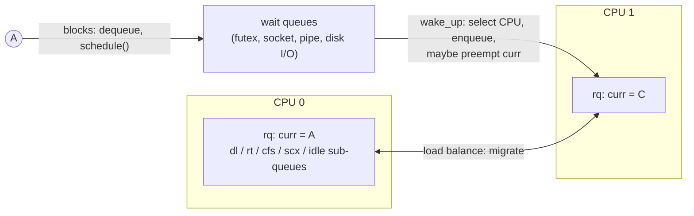

Three separate questions, three separate costs:

| Question                         | Mechanism                                                         | Cost domain                |
| -------------------------------- | ----------------------------------------------------------------- | -------------------------- |
| *When* does a switch happen?     | blocking, tick, wakeup preemption, yield, preemption model        | latency                    |
| *Which* task runs next?          | class order, EEVDF eligibility/deadline, RT priority, DL deadline | fairness, latency          |
| *Where* does it run?             | wakeup CPU selection, load balancing, affinity, cgroups/cpusets   | cache locality, throughput |
| *How much* does the switch cost? | register/stack/mm swap, mitigations, cache/TLB refill             | throughput                 |

---

## 2. Task states and why a task leaves the CPU

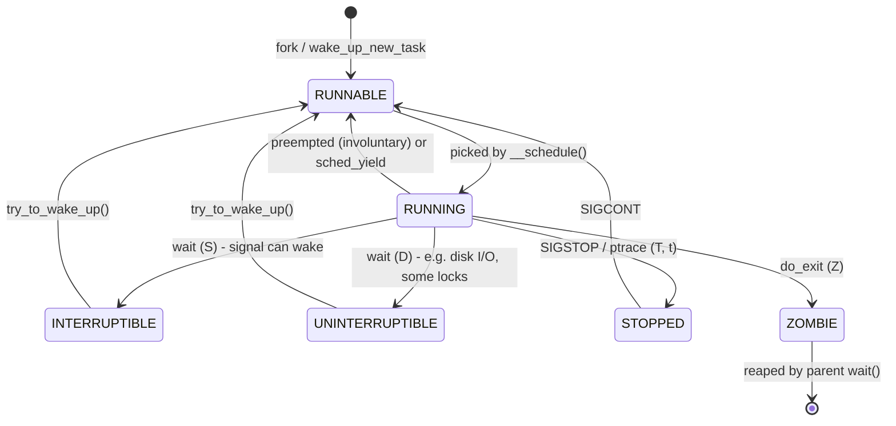

`ps` STAT letters: `R` (running *or* runnable, the kernel does not distinguish in `ps`), `S` (`TASK_INTERRUPTIBLE`), `D` (`TASK_UNINTERRUPTIBLE`;  
counts toward load average on Linux), `I` (idle kernel thread, `TASK_IDLE` = D without load contribution), `T`/`t`, `Z`.

### 2.1 Voluntary vs involuntary switches

| Kind            | Cause                                                                                                                                        | Counter                                                                      |
| --------------- | -------------------------------------------------------------------------------------------------------------------------------------------- | ---------------------------------------------------------------------------- |
| **Voluntary**   | task sleeps: `futex_wait`, `read` on empty socket, `nanosleep`, page fault needing I/O, mutex contention, `epoll_wait`                       | `voluntary_ctxt_switches` in `/proc/<pid>/status`, `cswch/s` in `pidstat -w` |
| **Involuntary** | task still runnable but taken off CPU: slice exhausted at tick, wakeup preemption by a better task, migration, higher class becomes runnable | `nonvoluntary_ctxt_switches`, `nvcswch/s`                                    |

Interpretation:

- High **voluntary** rate: the workload blocks a lot (lock contention, small I/O, chatty threads). Fix the blocking pattern, batch, or use fewer handoffs.
- High **involuntary** rate: CPU oversubscription. More runnable tasks than CPUs (check `r` in `vmstat`, PSI `cpu some`). Fix by fewer threads, more CPUs, or priorities.

`sched_yield()` counts as voluntary in the kernel's own accounting.  
A yield with nobody else runnable is just a syscall plus a pass through `__schedule()` returning to the same task (measured 276 ns vs 139 ns for a trivial syscall, §15).

---

## 3. The switch path: `__schedule()` → `switch_to`

### 3.1 Entry points

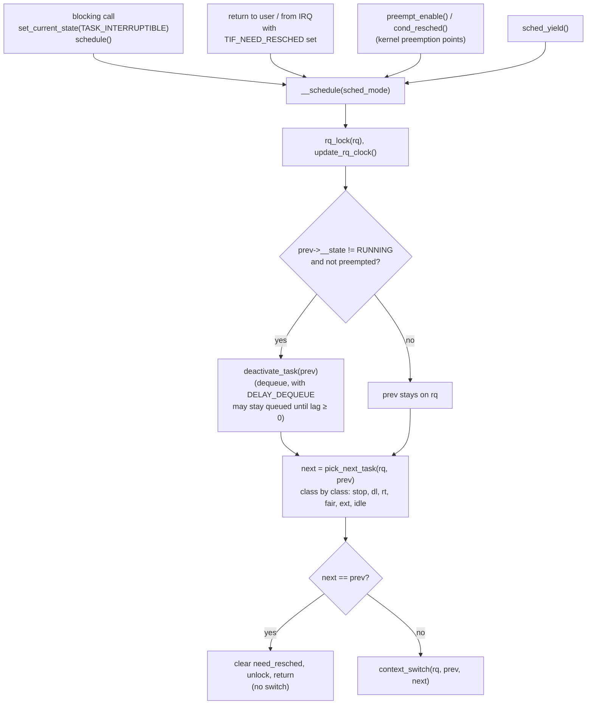

`TIF_NEED_RESCHED` is a flag; setting it (e.g. in `wakeup_preempt()` or the tick) does not switch anything.  
The switch happens at the next **preemption point** that checks the flag: return to user mode, return from interrupt (if kernel preemption is enabled),  
or an explicit `cond_resched()`/`preempt_enable()`.

### 3.2 `context_switch()` internals (x86_64)

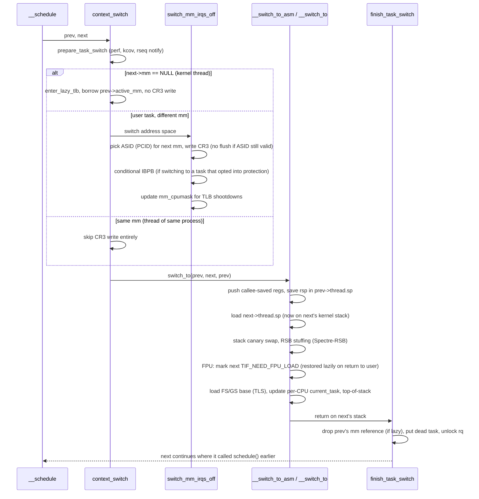

Key points:

- **Every task resumes inside `__schedule()`**: the task that is switched *in* returns from its own earlier call to `switch_to`, so from the C code's point of view `switch_to(prev, next, prev)` returns "in another task". The third argument fixes up `prev` so the resumed task knows who ran before it.
- **Thread switch vs process switch**: same `mm` ⇒ no CR3 write, no IBPB, TLB entries remain valid. This is the main direct-cost difference between switching threads of one process and switching processes.
- **PCID/ASID**: x86 has 12-bit PCIDs; Linux uses a small per-CPU set of dynamic ASIDs (6 by default) and tags TLB entries with them. Switching back to a recently run `mm` on that CPU keeps its TLB entries. With KPTI each mm uses two PCIDs (user and kernel page tables).
- **FPU state**: AVX-512/AMX state can be several KiB. Since 5.2 the FPU is saved eagerly on switch-out (XSAVES with init/modified optimisations) but *restored lazily* on return to user space, so a task that switches in, runs only in kernel mode and blocks again never pays the restore.
- **`rseq`**: the switch marks the task's restartable sequence for abort, enabling per-CPU user-space data structures (glibc uses rseq for `sched_getcpu()` without a syscall).

### 3.3 Kernel stacks make it simple

Each task has its own kernel stack (16 KiB).  
All register state of a sleeping task lives on its kernel stack plus `thread_struct`; switching is "save `rsp`, load other `rsp`".  
The user-mode registers were already saved on the kernel stack at syscall/interrupt entry (`pt_regs`), so `switch_to` only deals with callee-saved kernel registers.

---

## 4. What a switch costs

### 4.1 Direct cost

The direct cost is the CPU time between the old task's last instruction and the new task's first useful instruction:

| Component                                                                | Order of magnitude                               |
| ------------------------------------------------------------------------ | ------------------------------------------------ |
| Syscall entry/exit that triggered the block (with mitigations)           | 50–150 ns each                                   |
| `__schedule()` bookkeeping: rq lock, clock update, dequeue/enqueue, pick | 100–300 ns                                       |
| `switch_mm` (CR3 write, PCID management, optional IBPB)                  | 50–200 ns, IBPB alone can be ~1 µs+ on some CPUs |
| Register/stack swap, FS base, FPU save                                   | 20–100 ns (FPU size dependent)                   |
| Wakeup side: `try_to_wake_up`, select CPU, enqueue, maybe IPI            | 100–500 ns same CPU; **µs** cross CPU            |

Measured on the test VM (§15): futex ping-pong between two threads pinned to **one** CPU = **3.2 µs per round trip ≈ 1.6 µs per switch** including all syscalls and wakeups.  
On modern bare metal the same test typically lands at ~1–2 µs per round trip.

### 4.2 Cross-CPU wakeups

When the wakee runs on a different CPU, the waker must place it on a remote runqueue and, if that CPU is idle, send an **IPI** (or rely on the remote CPU polling in `TIF_POLLING_NRFLAG` idle).  
The remote CPU then has to exit its idle state:

| Idle state            | Typical exit latency |
| --------------------- | -------------------- |
| C1 / polling          | < 1–2 µs             |
| C1E                   | a few µs             |
| C6 (core power-gated) | 50–150 µs            |

Measured: same ping-pong across CPUs = **24.7 µs per round trip** in the VM, 7.7× the same-CPU figure (virtual IPIs exit to the hypervisor).  
This is the mechanism behind the "cross-carrier handoff is 20–90× slower" observation in topic 01 for Java virtual threads and Tokio.

### 4.3 Indirect cost: cache and TLB pollution

After a switch the new task finds L1/L2 (and possibly L3/TLB) filled with the previous task's data.  
The cost depends on the working sets of *both* tasks relative to cache sizes.  
Measured with two tasks pinned to one CPU, each touching a working set `WS` between switches (CPU: Xeon @ 2.1 GHz, 48 KiB L1d, 2 MiB L2 per core):

| WS per task | Round trip | Pure touch cost (no switch) | Switch overhead per switch |
| ----------- | ---------- | --------------------------- | -------------------------- |
| 16 KiB      | 4.0 µs     | 0.6 µs                      | **1.7 µs**                 |
| 64 KiB      | 6.1 µs     | 3.1 µs                      | **1.5 µs**                 |
| 256 KiB     | 15.1 µs    | 12.1 µs                     | **1.5 µs**                 |
| 1 MiB       | 63.0 µs    | 47.4 µs                     | **7.8 µs**                 |
| 4 MiB       | 349 µs     | 338 µs                      | **5.6 µs**                 |
| 16 MiB      | 1388 µs    | 1370 µs                     | **8.9 µs**                 |

Read: while both working sets fit in L2 together (2 × 256 KiB < 2 MiB), the switch costs only its direct ~1.5 µs.  
Once the combined working set exceeds L2 (2 × 1 MiB = L2 size), each switch also forces ~5–7 µs of refills from L3.  
The **indirect cost exceeded the direct cost by 4–5×**.  
On workloads with large hot data (databases, JVM heaps) indirect cost dominates; this is the empirical case for: fewer runnable threads than cores,  
CPU affinity for hot threads, longer slices for batch work, and thread-per-core designs.

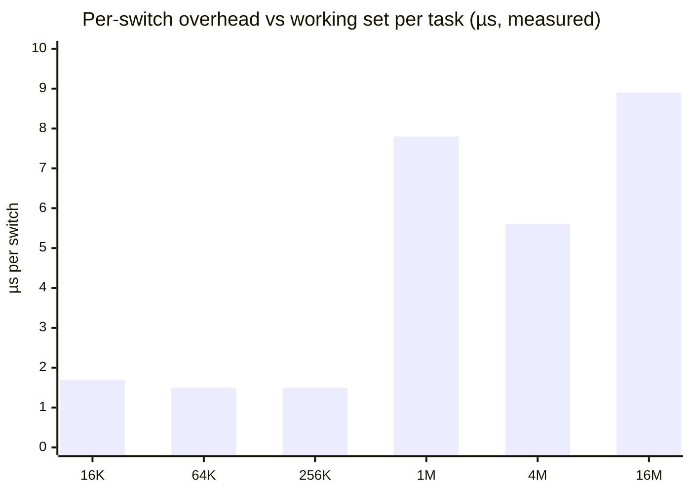

### 4.4 Mitigation tax

Since 2018, transient-execution mitigations sit on the switch and syscall paths:

| Mitigation             | Where                                 | Effect                                                                                                                           |
| ---------------------- | ------------------------------------- | -------------------------------------------------------------------------------------------------------------------------------- |
| KPTI (Meltdown)        | every kernel entry/exit               | CR3 swap per syscall; cheap with PCID, very expensive without. Not needed on CPUs reporting "Not affected" (as on the test host) |
| Retpoline / eIBRS      | indirect branches                     | slower indirect calls in the scheduler (class `pick_next_task` calls)                                                            |
| IBPB                   | `switch_mm` between distrustful tasks | flushes branch predictors; "conditional" (default) only for tasks opting in via prctl/seccomp                                    |
| RSB stuffing           | `__switch_to_asm`                     | ~tens of cycles                                                                                                                  |
| L1D flush / MDS `VERW` | return to user / VM entry             | can be large; mostly for VMs and SMT                                                                                             |

`/sys/devices/system/cpu/vulnerabilities/*` shows what is active.  
Benchmark numbers from before 2018 or from `mitigations=off` boots are not comparable with current production numbers.

---

## 5. Preemption: when the kernel is allowed to switch

### 5.1 Preemption in user mode

User-mode code is always preemptible: the timer tick or a wakeup sets `TIF_NEED_RESCHED`,  
and the switch happens on the next return to user space (from the timer interrupt itself, or from the IPI sent to that CPU). A tight user-space loop cannot starve the scheduler.

### 5.2 Preemption in kernel mode: the models

The question is what happens if `TIF_NEED_RESCHED` is set while the CPU is executing *kernel* code (a long syscall, a driver).

| Model (`CONFIG_PREEMPT_*` / `preempt=` with `PREEMPT_DYNAMIC`) | Kernel code preempted at                                                                                      | Latency                                            | Throughput  | Typical use                                       |
| -------------------------------------------------------------- | ------------------------------------------------------------------------------------------------------------- | -------------------------------------------------- | ----------- | ------------------------------------------------- |
| `none`                                                         | only when it blocks or returns to user                                                                        | worst (ms possible)                                | best        | servers (traditional)                             |
| `voluntary`                                                    | plus explicit `cond_resched()`/`might_sleep()` points                                                         | better                                             | ~same       | distro desktops (traditional)                     |
| `full`                                                         | any point where `preempt_count == 0` (not holding spinlocks, not in IRQ)                                      | good                                               | slight cost | desktops, low-latency                             |
| `lazy` (6.13+)                                                 | fair-class reschedules wait until tick or return to user (`TIF_NEED_RESCHED_LAZY`); RT/DL preempt immediately | close to full for RT, close to none for throughput |             | intended long-term replacement for none/voluntary |
| `PREEMPT_RT` (mainline since 6.12)                             | almost everywhere: spinlocks become sleeping rt_mutexes, threaded IRQs                                        | deterministic, tens of µs                          | lower       | industrial, audio, trading                        |

`PREEMPT_DYNAMIC` kernels choose at boot (`preempt=none|voluntary|full|lazy`) and expose the current mode in `/sys/kernel/debug/sched/preempt`.  
The test kernel is `PREEMPT_DYNAMIC` with `CONFIG_PREEMPT_NONE=y` as default.

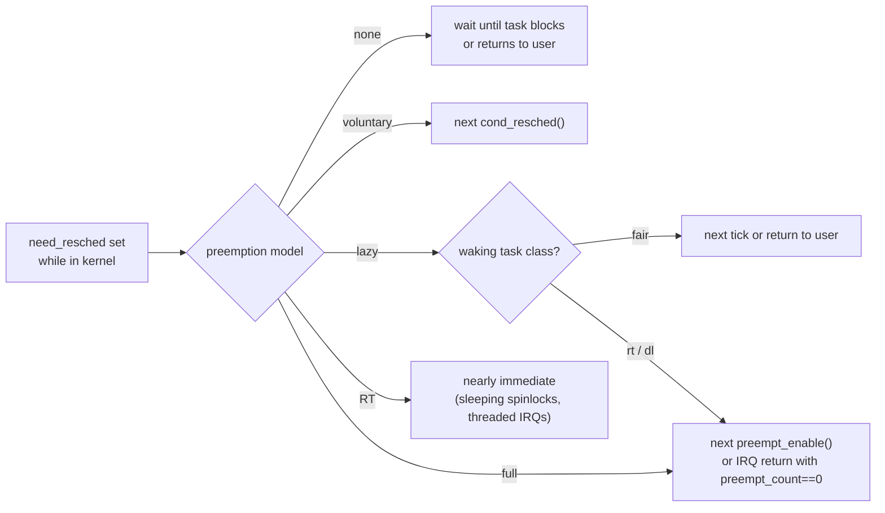

### 5.3 What cannot be preempted

`preempt_count` (per-CPU) is non-zero while holding a spinlock, inside hard/soft IRQ, or with preemption explicitly disabled.  
RCU read-side sections are preemptible under `PREEMPT_RCU`.  
Long non-preemptible sections show up as scheduling latency for RT tasks; `PREEMPT_RT` exists to remove them.

### 5.4 The tick

`CONFIG_HZ` (250 on the test kernel; 100/250/300/1000 common) sets the periodic tick.  
On each tick `sched_tick()` (formerly `scheduler_tick()`) updates the current task's runtime, PELT averages, checks slice expiry (sets need_resched), and triggers periodic load balancing.  
With `HZ=250`, a CPU-bound fair task can overrun its slice by up to 4 ms before the tick notices;  
high-resolution timers (`HRTICK` feature, off by default) can enforce slices precisely at extra cost.

---

## 6. Scheduling classes

`pick_next_task()` walks the classes in fixed order; the first class that has a runnable task wins.  
A lower class only runs when all higher classes are empty on that CPU.

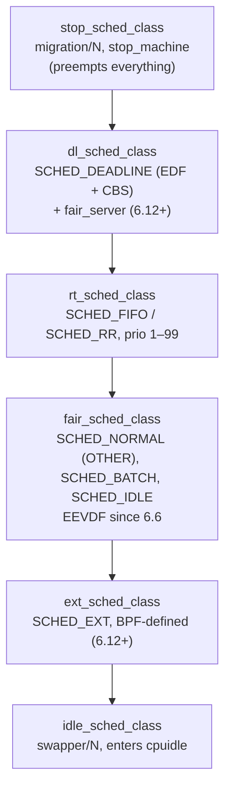

| Policy                         | Class | Priority input                | Notes                                                                       |
| ------------------------------ | ----- | ----------------------------- | --------------------------------------------------------------------------- |
| `SCHED_OTHER` (`SCHED_NORMAL`) | fair  | nice −20…19 → weight          | default                                                                     |
| `SCHED_BATCH`                  | fair  | nice                          | never wakeup-preempts others; good for throughput jobs                      |
| `SCHED_IDLE`                   | fair  | weight 3 (below nice 19's 15) | runs only when nothing else wants the CPU (within its group)                |
| `SCHED_FIFO`                   | rt    | 1–99                          | runs until it blocks, yields or a higher RT prio arrives                    |
| `SCHED_RR`                     | rt    | 1–99                          | FIFO + round-robin slice among equal prio (`sched_rr_timeslice_ms`, 100 ms) |
| `SCHED_DEADLINE`               | dl    | (runtime, deadline, period)   | admission-controlled; highest user-visible class                            |
| `SCHED_EXT`                    | ext   | BPF scheduler                 | falls back to fair if the BPF scheduler exits/errs                          |

Kernel-internal priority numbering (`prio` in `/proc/<pid>/sched`): 0–99 RT (inverted: `prio = 99 − rt_priority`), 100–139 fair (`120 + nice`), −1 for deadline.

---

## 7. The fair class: from CFS to EEVDF

### 7.1 CFS (2.6.23 – 6.5) in one paragraph

CFS kept each runnable task in a red-black tree keyed by **vruntime**, the task's CPU time scaled inversely by its weight (`delta_vruntime = delta_exec × 1024 / weight`).  
It always ran the leftmost (smallest vruntime) task.  
The slice was derived from `sched_latency` (6 ms × (1 + log2 ncpus)) divided among runnable tasks, bounded below by `min_granularity`.  
Waking tasks were placed near `min_vruntime` minus a sleeper credit and could preempt the current task if their vruntime was smaller by more than `wakeup_granularity`.  
The result was fair over time but **latency was a side effect of heuristics**: there was no way to say "this task needs short latency but not more CPU", and the many knobs interacted badly.

### 7.2 EEVDF (6.6+)

EEVDF, *Earliest Eligible Virtual Deadline First* (Stoica & Abdel-Wahab, 1995; implemented by Peter Zijlstra), keeps the weighted-fair-share idea but makes the pick rule principled:

- **Virtual time `V`**: the weighted average vruntime of all runnable entities (`avg_vruntime()`), i.e. where an ideal fluid scheduler would be.
- **Lag** of task *i*: `lag_i = w_i × (V − v_i)`, service owed minus service received. Positive lag = the task is owed CPU.
- **Eligible** iff `lag_i ≥ 0` (equivalently `v_i ≤ V`): only tasks that have not received more than their share may run.
- **Virtual deadline**: `vd_i = v_i + slice_i × (1024 / w_i)`. A shorter requested slice gives an earlier deadline.
- **Pick**: among eligible tasks, the one with the **earliest virtual deadline**.  
  Implemented with an augmented rbtree ordered by deadline and annotated with min vruntime per subtree, so the pick is O(log n).

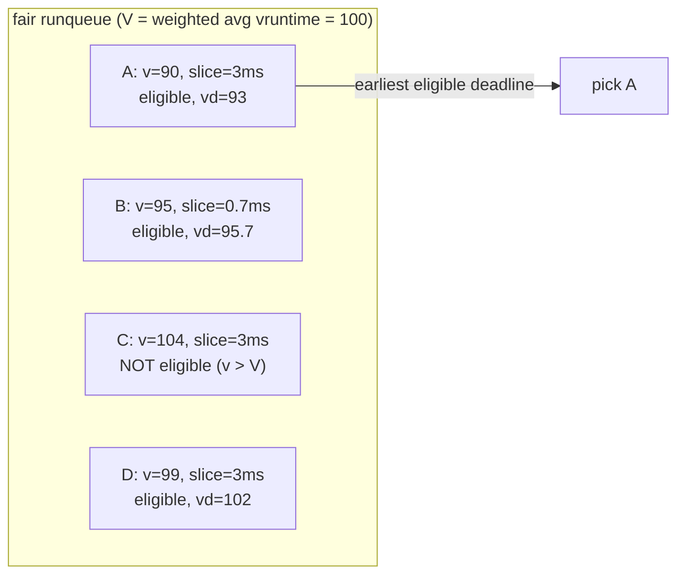

Consequences:

- **Latency is a per-task request**, not a global knob: the slice. Since 6.12 a fair task can request a custom slice via `sched_setattr(.sched_runtime = slice_ns)` (0.1–100 ms). Short slice ⇒ earlier deadlines ⇒ runs sooner after waking, but *not more CPU overall* (eligibility still enforces share).
- **Default slice** = `base_slice` × (1 + ilog2(min(ncpus, 8))). The base is 0.7 ms on recent kernels (0.75 ms originally). The test VM (4 CPUs) shows `se.slice : 2100000` ns = 0.7 × 3 in `/proc/self/sched`.
- **Lag is preserved across sleep** (`PLACE_LAG`): a task that sleeps is re-placed with its prior lag (decayed), instead of CFS's sleeper bonus. Tasks cannot game the scheduler by sleeping briefly.
- **Delayed dequeue** (6.12, `DELAY_DEQUEUE`): a task with negative lag that blocks stays on the runqueue ("sched_delayed") until its lag decays to zero, so it cannot shed its debt by sleeping.
- **`RUN_TO_PARITY`**: the current task keeps running until it reaches its deadline, avoiding excessive preemption among equal tasks.
- **Wakeup preemption**: a waking task preempts current if it is eligible and its deadline is earlier. This is how the sleeper in the latency test (§15) gets a p50 wakeup overshoot of ~70–90 µs even with 4 hogs on its CPU.

### 7.3 Slices vs tick in practice

The slice is enforced at tick granularity unless `HRTICK` is enabled.  
With HZ=250 and a 2.1 ms slice, a hog runs 4 ms per turn.  
Measured: a 1 ms sleeper sharing CPU 0 with 4 hogs saw p99 overshoot of **3.0 ms**, max **9.8 ms**: when it was not eligible at wakeup it waited for running hogs' slices to expire at tick boundaries.

---

## 8. Weights, nice and autogroup

### 8.1 The weight table

`sched_prio_to_weight[]` maps nice to weight; each nice step is ~1.25× (≈10% CPU difference between two competing tasks):

| nice | weight |     | nice         | weight   |
| ---- | ------ | --- | ------------ | -------- |
| −20  | 88761  |     | 0            | **1024** |
| −10  | 9548   |     | 5            | 335      |
| −5   | 3121   |     | 10           | 110      |
| −1   | 1277   |     | 19           | 15       |
|      |        |     | `SCHED_IDLE` | 3        |

Share of task *i* on a contended CPU = `w_i / Σw`. Measured (hogs pinned to one CPU, 5 s, §15):

| Mix               | Expected                | Measured                  |
| ----------------- | ----------------------- | ------------------------- |
| nice 0 vs nice 5  | 1024/(1024+335) = 75.3% | **75.3% / 24.7%**         |
| nice 0 vs nice 19 | 1024/1039 = 98.6%       | **98.5% / 1.5%**          |
| nice −5 vs 0 vs 0 | 3121/5169 = 60.4%       | **60.4% / 19.8% / 19.8%** |

Weights are exact in steady state.  
Nice is a **share**, not a priority: a nice 19 task still runs when it is the only runnable task, and a nice −20 task cannot starve a nice 0 task completely (1.1% left).

### 8.2 Hierarchical (group) scheduling

With `CONFIG_FAIR_GROUP_SCHED`, each cgroup has its own fair runqueue per CPU and appears as a single **group entity** in its parent.  
Weights apply at each level: a cgroup with weight 100 containing 1000 threads gets the same share as a sibling cgroup with weight 100 containing 1 thread.  
Nice only arbitrates among siblings in the same group.

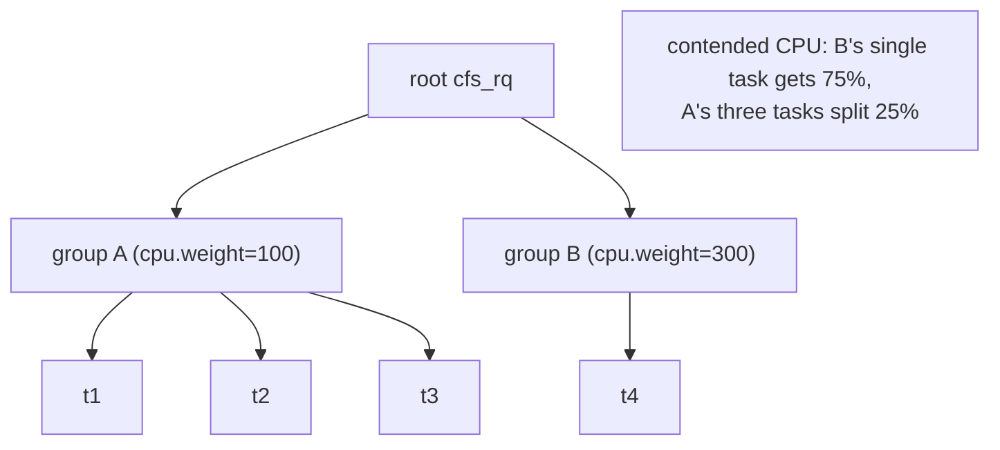

### 8.3 Autogroup

`kernel.sched_autogroup_enabled=1` (enabled on the test VM and on most desktop distros) puts each session (`setsid`) into its own hidden task group.  
Consequence: **`nice` between processes in different sessions has almost no effect**; only `/proc/<pid>/autogroup`'s nice value does.  
Servers managed by systemd already get cgroup groups, which take precedence over autogroups.

---

## 9. PELT: load and utilisation tracking

Per-Entity Load Tracking keeps exponentially decayed averages per task, cfs_rq and CPU, in 1024 µs periods with decay `y` where `y^32 = 0.5` (**32 ms half-life**):

| Signal         | Meaning                                                          | Used by                                                                             |
| -------------- | ---------------------------------------------------------------- | ----------------------------------------------------------------------------------- |
| `load_avg`     | runnable fraction × weight                                       | load balancing (which CPU is busiest)                                               |
| `runnable_avg` | fraction of time runnable (running + waiting)                    | detecting overload                                                                  |
| `util_avg`     | fraction of time actually running, 0–1024 scaled to CPU capacity | `schedutil` cpufreq governor, energy-aware scheduling, task placement on big.LITTLE |
| `util_est`     | max of recent per-activation utilisation                         | faster ramp-up for periodic bursty tasks                                            |

Visible in `/proc/<pid>/sched` (`se.avg.util_avg` etc.). Implication: the kernel's view of "how busy a task is" lags reality by tens of ms.  
A task that becomes busy after idling needs ~100 ms for `util_avg` to approach 1024, which delays both CPU frequency ramp-up (schedutil) and migration to a big core.  
`util_clamp` (`cpu.uclamp.min/max`, `sched_setattr`) lets userspace override this for latency-sensitive tasks.

---

## 10. Multi-CPU: runqueues, wakeup placement, load balancing

### 10.1 Scheduling domains

The topology is a hierarchy of **sched domains**, each with groups of CPUs:

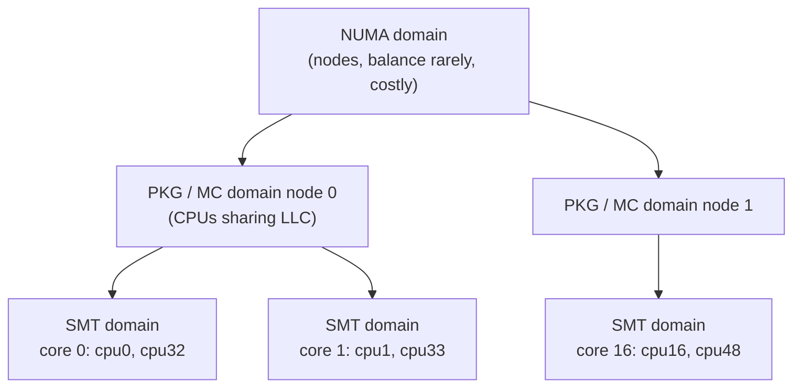

Lower domains balance more often and more aggressively (cheap: shared caches);  
higher domains balance less often (migrating across LLC or NUMA nodes costs cache warmth and memory locality).  
`cat /proc/schedstat` and `/sys/kernel/debug/sched/domains/` expose the layout.

### 10.2 Wakeup placement (`select_task_rq_fair`)

Most migrations happen at **wakeup**, not via periodic balancing:

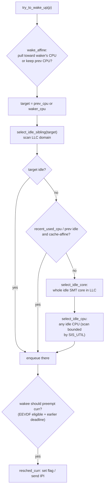

Search is limited to the **last-level-cache domain** for cost reasons; work spreading across LLCs/NUMA nodes is left to periodic balancing.  
The scan is bounded by `SIS_UTIL` (shorter scans when the LLC is busy).

### 10.3 Periodic, idle and NUMA balancing

- **Periodic balance** (`sched_balance_domains` from `SCHED_SOFTIRQ`): at each domain level, find the busiest group by load/utilisation/runnable count,  
  pull tasks to the local CPU if the imbalance justifies it.  
  Tasks that ran recently (< `sysctl_sched_migration_cost`, 0.5 ms) are considered cache-hot and skipped where possible.
- **Newidle balance**: a CPU about to go idle tries to pull work first (`sched_balance_newidle`). Cheap and important for throughput; bounded by expected idle duration vs cost.
- **Active balance**: pushes a *running* task via the stopper (`migration/N` thread) when it is the only way to fix imbalance (e.g. misfit task on a little core).
- **NUMA balancing** (`kernel.numa_balancing=1`): periodically unmaps ranges of a task's memory to take hinting faults, learns which node the task touches most,  
  then migrates pages or the task toward each other. Visible as `numa_*` fields in `/proc/<pid>/sched`.

### 10.4 Affinity and cpusets

`sched_setaffinity` / `taskset` / `cpuset.cpus` restrict where a task may run.  
Restriction disables balancing for that task and can create **imbalances the balancer cannot fix**: pinning 4 hogs to one CPU leaves 3 CPUs idle, as in the measurement setup.  
In containers, cpuset pinning gives cache locality and protects against noisy neighbours; CFS quotas (§12) do not.

---

## 11. Real-time and deadline scheduling

### 11.1 SCHED_FIFO / SCHED_RR

- Fixed priorities 1–99; always above fair tasks.  
  Each CPU runs the highest-priority runnable RT task; **push/pull** logic migrates RT tasks so that the N highest-priority tasks run on N CPUs (global fixed-priority scheduling, best effort).
- FIFO: no slice. RR: 100 ms slice among same priority.
- Measured effect: a 1 ms sleeper with 4 fair hogs on its CPU: fair p99 overshoot **3.0 ms**; same sleeper as `SCHED_FIFO 50`: p99 **70 µs**, p50 **25 µs** (VM timer/hypervisor noise dominates the remainder).
- **Priority inversion**: a high-prio task blocked on a lock held by a low-prio task that cannot run. Use `PTHREAD_PRIO_INHERIT` mutexes (backed by PI futexes / rt_mutex).

### 11.2 Starvation protection

A runaway FIFO task would starve everything else on its CPU.  
Historically **RT throttling** (`sched_rt_runtime_us=950000` of `sched_rt_period_us=1000000`) capped RT at 95% per period.  
Since 6.12 this is implemented by a per-CPU **deadline "fair server"**: a SCHED_DEADLINE entity that reserves runtime (default 50 ms per 1 s)  
for fair tasks when RT hogs the CPU, and does nothing when there is no contention.  
Setting `sched_rt_runtime_us=-1` disables legacy throttling; know what you are doing.

### 11.3 SCHED_DEADLINE

Task declares `(runtime, deadline, period)`, e.g. 2 ms every 10 ms, due within 5 ms:

```c
struct sched_attr a = {
    .size = sizeof a, .sched_policy = SCHED_DEADLINE,
    .sched_runtime  =  2 * 1000 * 1000,
    .sched_deadline =  5 * 1000 * 1000,
    .sched_period   = 10 * 1000 * 1000,
};
syscall(SYS_sched_setattr, 0, &a, 0);
```

- Scheduled by **EDF** (earliest absolute deadline first), globally across the root domain.
- **CBS** (Constant Bandwidth Server) enforces the runtime budget: a task that overruns is throttled until its next period, so it cannot hurt others.
- **Admission control**: `Σ runtime/period ≤ (sched_rt_runtime_us / sched_rt_period_us) × ncpus`; `sched_setattr` fails with `EBUSY` otherwise.
- Cannot `fork` (by default) and requires `CAP_SYS_NICE`. Good for periodic control loops, audio, video pipelines.

---

## 12. cgroups: weights, quotas and throttling

### 12.1 Controls

| cgroup v2 file                                        | v1 equivalent                           | Semantics                                                                                      |
| ----------------------------------------------------- | --------------------------------------- | ---------------------------------------------------------------------------------------------- |
| `cpu.weight` (1–10000, default 100)                   | `cpu.shares` (default 1024)             | proportional share **under contention only**; work-conserving                                  |
| `cpu.weight.nice`                                     | —                                       | same, expressed as nice                                                                        |
| `cpu.max` = `"$QUOTA $PERIOD"` (default `max 100000`) | `cpu.cfs_quota_us`, `cpu.cfs_period_us` | hard ceiling: at most QUOTA µs of CPU per PERIOD **summed over all CPUs**; not work-conserving |
| `cpu.max.burst`                                       | `cpu.cfs_burst_us`                      | allow accumulating unused quota up to burst                                                    |
| `cpu.idle`                                            | `cpu.idle`                              | group behaves like `SCHED_IDLE` relative to siblings                                           |
| `cpu.uclamp.min/max`                                  | —                                       | utilisation clamps (frequency, placement)                                                      |
| `cpuset.cpus`                                         | `cpuset.cpus`                           | which CPUs                                                                                     |
| `cpu.stat`                                            | `cpu.stat`                              | `nr_periods`, `nr_throttled`, `throttled_usec`                                                 |

Kubernetes maps `requests.cpu` → `cpu.weight` and `limits.cpu` → `cpu.max`.

### 12.2 How bandwidth throttling works

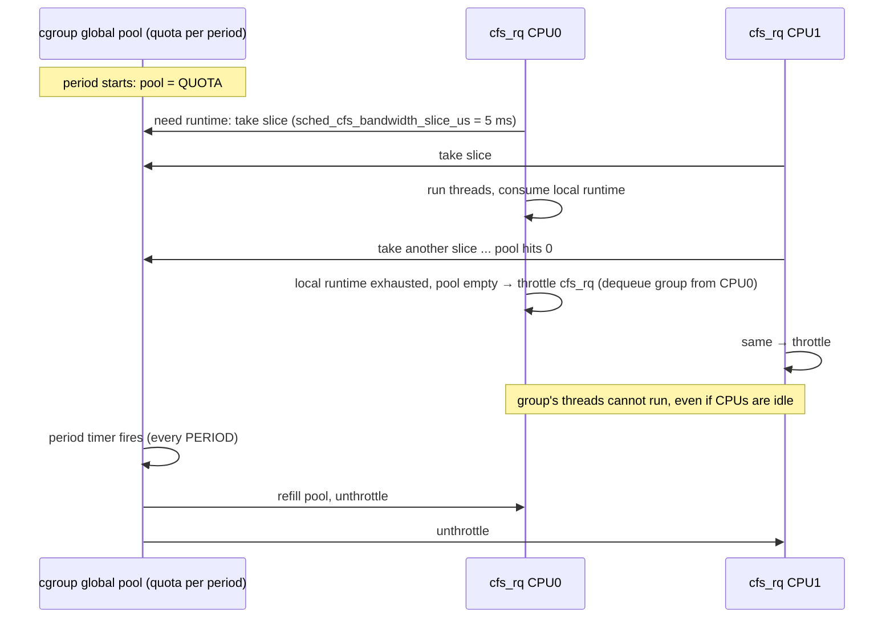

The quota is a **CPU-time** budget across all CPUs. A process with N busy threads burns quota N× faster in wall-clock time.  
With `cpu.max = 100000 100000` (1 CPU) and 4 busy threads on a 4-CPU machine, the group burns its 100 ms budget in ~25 ms of wall time and is then frozen for ~75 ms.

### 12.3 Measured: throttling latency

A request needing **10 ms of CPU**, issued every 20 ms, in a process with 0 or 3 additional busy threads, with and without a 1-CPU quota (`100000/100000`):

| Setup                   | p50         | p90  | p99  | max  |
| ----------------------- | ----------- | ---- | ---- | ---- |
| no cgroup limit, 0 hogs | 10.0 ms     | 10.1 | 11.7 | 12.2 |
| no cgroup limit, 3 hogs | 10.0 ms     | 11.2 | 15.0 | 23.8 |
| quota 1 CPU, 0 hogs     | 10.0 ms     | 10.7 | 13.0 | 15.0 |
| **quota 1 CPU, 3 hogs** | **79.9 ms** | 80.6 | 84.5 | 85.2 |

`cpu.stat` after the run: 100 of 133 periods throttled, 27.1 s total throttled time.  
Average CPU usage of the group was within its 1-CPU limit the whole time, yet request latency was **8×** worse.  
This is the textbook reason latency-sensitive services should:

- Prefer `cpu.weight` (requests) over `cpu.max` (limits), or set limits well above typical usage.
- Size thread pools / `GOMAXPROCS` / JVM `ActiveProcessorCount` to the quota, not the host's core count (Go ≥ 1.25, JDK ≥ 10 container support, .NET do this automatically).
- Use `cpu.max.burst` to absorb short spikes.
- Monitor `nr_throttled`/`throttled_usec` (cAdvisor: `container_cpu_cfs_throttled_periods_total`), not just CPU usage.
- Consider a shorter period (e.g. 10–20 ms) to cap the worst-case freeze, at more timer overhead.

---

## 13. Idle, ticks and CPU isolation

### 13.1 Idle

When every class is empty, the idle task (`swapper/N`, pid 0) runs `do_idle()` → cpuidle **governor** (`menu`, `teo`, `haltpoll` in VMs) picks a C-state from the predicted idle duration vs each state's exit latency and target residency.  
Deeper states save power but add wakeup latency (§4.2).  
Latency-critical systems cap them with `/dev/cpu_dma_latency` (PM QoS), `intel_idle.max_cstate`, `processor.max_cstate`, or `cpupower idle-set`.

### 13.2 Ticks

| Config                              | Tick behaviour                                                                                     |
| ----------------------------------- | -------------------------------------------------------------------------------------------------- |
| `NO_HZ_IDLE` (default, test kernel) | tick stopped on idle CPUs; running CPUs tick at HZ                                                 |
| `NO_HZ_FULL` + `nohz_full=` CPUs    | tick stopped on CPUs running a **single** task (residual 1 Hz); for HPC/low-latency isolated cores |
| periodic                            | tick always; legacy                                                                                |

### 13.3 Isolating CPUs for latency-critical threads

| Mechanism                                                           | Effect                                                                          |
| ------------------------------------------------------------------- | ------------------------------------------------------------------------------- |
| `isolcpus=domain,managed_irq,<cpus>` (boot)                         | remove CPUs from load-balancing domains; only explicitly pinned tasks run there |
| cpuset partitions (`cpuset.cpus.partition = isolated`, v2)          | runtime equivalent of isolcpus                                                  |
| `nohz_full=<cpus>`                                                  | stop the tick when one task runs                                                |
| `rcu_nocbs=<cpus>`                                                  | offload RCU callbacks                                                           |
| IRQ affinity (`/proc/irq/*/smp_affinity`, `irqbalance` banned CPUs) | keep device interrupts away                                                     |
| `kthread_cpus`/housekeeping                                         | keep kernel threads on housekeeping CPUs                                        |

Typical low-latency layout: CPUs 0–1 housekeeping (kernel threads, IRQs, OS), CPUs 2–N isolated, each running one pinned busy-polling thread (DPDK, trading engines, Seastar/thread-per-core).

---

## 14. sched_ext: BPF schedulers

Merged in 6.12. A BPF program implements callbacks (`select_cpu`, `enqueue`, `dispatch`, `running`, `stopping`, …) using **dispatch queues** (DSQs) and kfuncs;  
tasks with `SCHED_EXT` (or all fair tasks in "switch all" mode) are scheduled by it.

- Safety: the BPF verifier ensures memory safety; a watchdog kicks the scheduler out (tasks revert to fair) if a runnable task is not scheduled within a timeout, or on any error.  
  Bad policy degrades performance but cannot crash the kernel.
- Use cases: workload-specific policies (Meta's `scx_layered`, gaming-oriented `scx_lavd`, `scx_rusty` with user-space load balancing), fast experimentation without rebooting.
- Tools: `scx` repository schedulers, `scxtop`; check active scheduler via `/sys/kernel/sched_ext/state` and `root/ops`.

---

## 15. Measured numbers

### 15.1 Test bed

4 vCPU Firecracker microVM on Intel Xeon @ 2.1 GHz (48 KiB L1d and 2 MiB L2 per core, shared L3), Linux 6.18, `PREEMPT_DYNAMIC` (default none), HZ=250, cgroup v1 hierarchy for `cpu`.  
Mitigations: eIBRS, conditional IBPB, Meltdown not affected (no KPTI). gcc -O2. Virtualisation inflates syscall, IPI and timer costs; compare **ratios**, not absolutes.

### 15.2 Summary

| Measurement                                                         | Value                                        |
| ------------------------------------------------------------------- | -------------------------------------------- |
| Trivial syscall (`getppid`)                                         | 139 ns                                       |
| `sched_yield()` with nothing else runnable                          | 276 ns                                       |
| futex ping-pong, both threads pinned to one CPU                     | **3.2 µs** / round trip (~1.6 µs per switch) |
| futex ping-pong across CPUs                                         | **24.7 µs** / round trip                     |
| Switch overhead, working set ≤ 256 KiB per task                     | ~1.5 µs per switch                           |
| Switch overhead, working set ≥ 1 MiB per task (exceeds L2 combined) | **5.6–8.9 µs** per switch                    |
| Wakeup overshoot of a 1 ms `nanosleep`, idle CPU                    | p50 92 µs, p99 203 µs                        |
| Same, 4 fair hogs on the CPU                                        | p50 76 µs, **p99 3.0 ms**, max 9.8 ms        |
| Same, sleeper nice −10                                              | p50 72 µs, p99 530 µs                        |
| Same, sleeper `SCHED_FIFO 50`                                       | **p50 25 µs, p99 70 µs**                     |
| CPU split nice 0 / nice 5                                           | 75.3% / 24.7% (theory 75.3%)                 |
| CPU split nice 0 / nice 19                                          | 98.5% / 1.5% (theory 98.6%)                  |
| 10 ms request under 1-CPU quota with 3 busy sibling threads         | **p50 79.9 ms** (vs 10.0 ms without quota)   |
| Default fair slice on 4 CPUs (`se.slice`)                           | 2.1 ms                                       |

### 15.3 What the numbers teach

1. The direct switch is ~1–2 µs; it only matters at > ~100k switches/s per core (that would be 10–20% of a core).
2. Cache refill can be several times the direct cost; the cheapest switch is the one that keeps hot data in L2.
3. Cross-CPU wakeups cost ~an order of magnitude more than same-CPU handoffs.
4. Under contention, fair-class tail latency is set by slice length and tick granularity (ms), not by switch cost (µs). Use RT policy, shorter EEVDF slices, or remove contention.
5. Weights are precise; cgroup quotas are a blunt instrument that converts parallelism into multi-tens-of-ms stalls.

---

## 16. Tuning playbook

| Symptom                                                    | Check                                               | Likely fix                                                                                                                             |
| ---------------------------------------------------------- | --------------------------------------------------- | -------------------------------------------------------------------------------------------------------------------------------------- |
| High `cs` in `vmstat`, low throughput                      | `pidstat -wt`: voluntary or involuntary?            | voluntary: lock contention / tiny I/O → batch, fewer handoffs; involuntary: too many runnable threads → shrink pools                   |
| `r` column ≫ CPU count, PSI `cpu some` high                | `runqlat`, `/proc/pressure/cpu`                     | oversubscription: add CPUs, reduce threads, prioritise via weights                                                                     |
| p99 latency spikes at ~multiples of 100 ms in containers   | `cpu.stat nr_throttled`                             | raise/remove `cpu.max`, `cpu.max.burst`, size `GOMAXPROCS`/pools to quota                                                              |
| Latency-critical thread delayed by batch work on same CPUs | `perf sched latency`, `runqlat -p`                  | `SCHED_BATCH`/`SCHED_IDLE`/nice for batch; `cpu.idle` for batch cgroups; shorter slice via `sched_setattr`; RT for the critical thread |
| Throughput drops after migration to bigger box             | `perf stat -e cpu-migrations`, NUMA stats           | pin to a node (`numactl --cpunodebind --membind`), cpusets per service                                                                 |
| Periodic µs jitter on isolated core                        | `trace-cmd`/`osnoise` tracer, `/proc/interrupts`    | `isolcpus`/partition + `nohz_full` + `rcu_nocbs` + IRQ affinity + C-state limit                                                        |
| RT task starves system                                     | `chrt -p`, fair server / RT throttling state        | lower priority, block/yield, keep starvation protection enabled                                                                        |
| `nice` has no visible effect                               | `cat /proc/<pid>/autogroup`                         | autogroup; set autogroup nice or use cgroups                                                                                           |
| Slow frequency ramp for bursty service                     | `util_avg` in `/proc/<pid>/sched`, cpufreq governor | `uclamp.min`, `performance` governor                                                                                                   |

---

## 17. Observation cheat sheet

```bash
# Per-task scheduler stats: policy, prio, slice, vruntime, migrations, PELT
cat /proc/$PID/sched
grep ctxt /proc/$PID/status                     # voluntary / nonvoluntary
cat /proc/$PID/schedstat                        # run time ns, wait time ns, timeslices

# System-wide
vmstat 1                                        # r (runnable), cs (switches/s)
pidstat -w -t 1                                 # per-thread cswch/s nvcswch/s
cat /proc/pressure/cpu                          # PSI: % time tasks waited for CPU
mpstat -P ALL 1

# Scheduler tracing
perf sched record -- sleep 10
perf sched latency --sort max                   # per-task max wait
perf sched timehist -Mw                         # per-switch timeline with wait/run/delay
perf stat -e context-switches,cpu-migrations,cs -a sleep 5
trace-cmd record -e sched_switch -e sched_wakeup -- sleep 5

# BPF tools (bcc / bpftrace)
runqlat -m 5 1      # run-queue latency histogram
runqlen 5 1         # run-queue length
cpudist             # on-CPU time per scheduling
offcputime -p $PID  # why threads block (stacks)
bpftrace -e 'tracepoint:sched:sched_switch { @[args->prev_state] = count(); }'

# Policies and priorities
chrt -p $PID                     # show policy
chrt -f -p 50 $PID               # SCHED_FIFO 50
chrt -b 0 cmd                    # SCHED_BATCH
chrt -i 0 cmd                    # SCHED_IDLE
taskset -cp 2-3 $PID             # affinity
renice -n 5 -p $PID
cat /proc/$PID/autogroup

# cgroups
cat /sys/fs/cgroup/<grp>/cpu.max /sys/fs/cgroup/<grp>/cpu.weight
cat /sys/fs/cgroup/<grp>/cpu.stat               # nr_throttled, throttled_usec
cat /sys/fs/cgroup/<grp>/cpu.pressure

# Kernel knobs (debugfs)
ls /sys/kernel/debug/sched/                     # base_slice_ns, preempt, features, domains/
cat /sys/kernel/debug/sched/features            # PLACE_LAG RUN_TO_PARITY DELAY_DEQUEUE ...
sysctl kernel.sched_rt_runtime_us kernel.sched_rt_period_us kernel.sched_autogroup_enabled
cat /sys/devices/system/cpu/vulnerabilities/*
cat /sys/devices/system/cpu/cpu0/cpuidle/state*/{name,latency}
```

---
