<!-- markdownlint-disable MD001 -->
<!-- markdownlint-disable MD024 -->
<!-- markdownlint-disable MD025 -->
<!-- markdownlint-disable MD026 -->
<!-- markdownlint-disable MD029 -->
<!-- markdownlint-disable MD033 -->
<!-- markdownlint-disable MD040 -->
<!-- markdownlint-disable MD056 -->
<!-- markdownlint-disable MD060 -->

# 03 — Process Lifecycle and Signals

---

## Table of contents

01. [Lifecycle at a glance](#1-lifecycle-at-a-glance)
02. [Creation recap and process relationships](#2-creation-recap-and-process-relationships)
03. [`execve()`: replacing the program](#3-execve-replacing-the-program)
04. [From `execve` to `main()`: the dynamic loader](#4-from-execve-to-main-the-dynamic-loader)
05. [What survives exec](#5-what-survives-exec)
06. [Termination: `exit_group` and `do_exit`](#6-termination-exit_group-and-do_exit)
07. [Zombies, orphans, reapers](#7-zombies-orphans-reapers)
08. [Waiting: `wait4`, `waitid`, pidfds](#8-waiting-wait4-waitid-pidfds)
09. [Signals: the model](#9-signals-the-model)
10. [Signal generation](#10-signal-generation)
11. [Signal delivery and the signal frame](#11-signal-delivery-and-the-signal-frame)
12. [Interrupted system calls and restart](#12-interrupted-system-calls-and-restart)
13. [Signals and threads](#13-signals-and-threads)
14. [Writing correct handlers](#14-writing-correct-handlers)
15. [Sessions, process groups and job control](#15-sessions-process-groups-and-job-control)
16. [Core dumps](#16-core-dumps)
17. [PID 1, containers and graceful shutdown](#17-pid-1-containers-and-graceful-shutdown)
18. [Measured numbers](#18-measured-numbers)
19. [Failure modes](#19-failure-modes)
20. [Observation cheat sheet](#20-observation-cheat-sheet)

---

## 1. Lifecycle at a glance

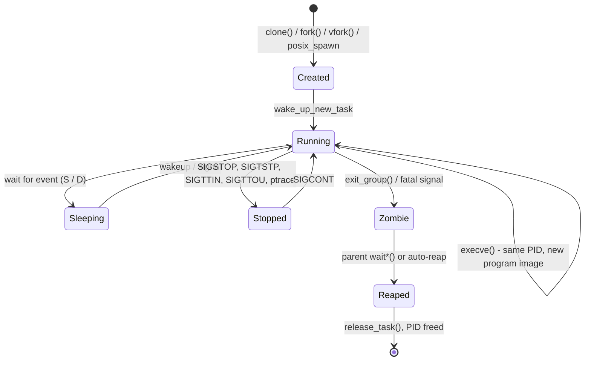

Four syscalls define the classic Unix model: **`fork`** (duplicate), **`exec`** (replace image), **`exit`** (terminate), **`wait`** (collect status).  
Linux adds `clone`/`clone3` (generalised fork), `posix_spawn` (fork+exec without copying, glibc `CLONE_VM|CLONE_VFORK`), `waitid`, and the **pidfd** family (race-free handles to processes).

---

## 2. Creation recap and process relationships

Topic 01 covered `clone` flags, `kernel_clone()`, and the cost of `fork` (linear in mapped anonymous memory; 19 ms/GiB measured).  
What matters here is the **relationship state** created at fork:

| Attribute                                   | Child gets                                                                  |
| ------------------------------------------- | --------------------------------------------------------------------------- |
| PID                                         | new                                                                         |
| PPID                                        | creator (or creator's parent with `CLONE_PARENT`)                           |
| Process group (PGID), session (SID)         | inherited                                                                   |
| Controlling terminal                        | inherited                                                                   |
| Signal handlers                             | **inherited** (same addresses: same program image)                          |
| Signal mask                                 | inherited                                                                   |
| Pending signals                             | **cleared**                                                                 |
| fds                                         | duplicated (shared open file descriptions: offsets and status flags shared) |
| Timers (`alarm`, `setitimer`, POSIX timers) | not inherited                                                               |
| `prctl(PR_SET_PDEATHSIG)`                   | cleared                                                                     |
| Threads                                     | only the calling thread exists in the child                                 |

The last row is why `fork()` in a multithreaded program is dangerous: locks held by other threads at fork time (malloc arenas, stdio, logging) remain locked forever in the child.  
Between `fork` and `exec` in such programs, call only async-signal-safe functions, or use `posix_spawn`.

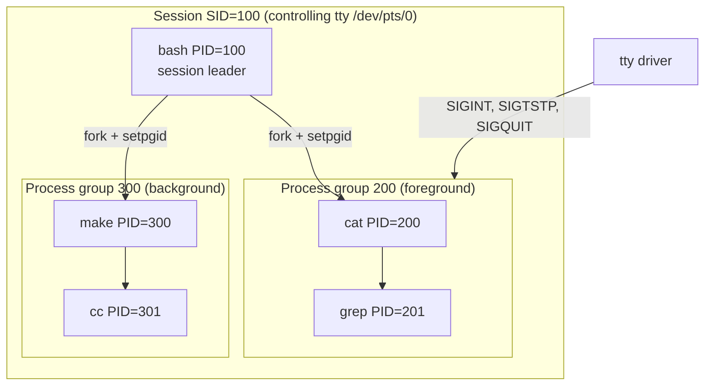

Sessions and process groups are covered in §15; PIDs/PPIDs determine who reaps whom (§7).

---

## 3. `execve()`: replacing the program

`execve(path, argv, envp)` keeps the **process** (PID, most kernel state) but discards the **program**: the address space, threads and signal handlers are replaced by a freshly loaded image.  
On success it does not return.

### 3.1 Kernel path

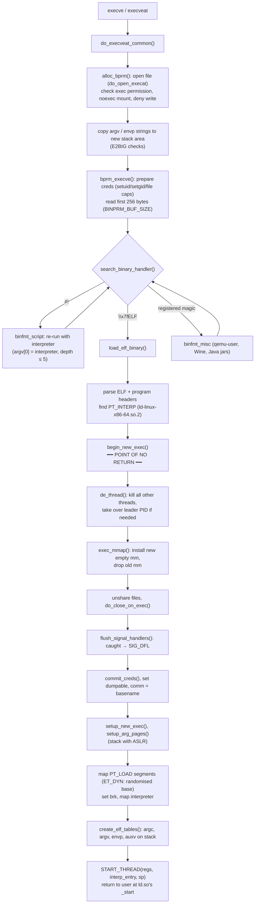

Before `begin_new_exec`, any failure returns an error (`ENOENT`, `EACCES`, `ENOEXEC`, `E2BIG`, `ETXTBSY`, `ENOMEM`) to the still-intact caller.  
After it, the old image is gone: a failure kills the process with `SIGSEGV`/`SIGKILL`.

### 3.2 Initial user stack layout

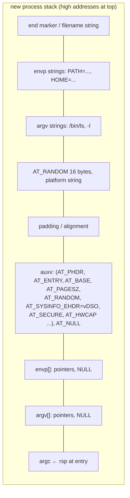

- **auxv** is the kernel→userspace channel: where the program headers are (`AT_PHDR`), the real entry point (`AT_ENTRY`), the loader base (`AT_BASE`), the vDSO (`AT_SYSINFO_EHDR`),  
  16 random bytes for stack canaries/pointer guard (`AT_RANDOM`), and `AT_SECURE` (set for setuid/setgid/capability-gaining exec, makes ld.so ignore `LD_PRELOAD`/`LD_LIBRARY_PATH`).  
  Inspect with `LD_SHOW_AUXV=1 /bin/true`.
- Limits: total argv+envp ≤ ¼ of `RLIMIT_STACK` (2 MiB with the default 8 MiB; `getconf ARG_MAX`), each string ≤ `MAX_ARG_STRLEN` = 128 KiB.  
  Exceeding gives `E2BIG` ("Argument list too long").

### 3.3 The exec family

| Call                                      | Path lookup                                         | argv form    | env                                                                  |
| ----------------------------------------- | --------------------------------------------------- | ------------ | -------------------------------------------------------------------- |
| `execve`                                  | no                                                  | array        | explicit (the only real syscall)                                     |
| `execveat(dirfd, path, …, AT_EMPTY_PATH)` | relative to dirfd / fd itself                       | array        | explicit (`fexecve` is built on it)                                  |
| `execl`, `execv`                          | no                                                  | list / array | inherited `environ`                                                  |
| `execlp`, `execvp`, `execvpe`             | `$PATH` search; on `ENOEXEC` retries with `/bin/sh` | list / array | inherited / explicit                                                 |
| `posix_spawn[p]`                          | optional                                            | array        | explicit; file actions + attrs (pgroup, sigmask, sigdefault, setsid) |

---

## 4. From `execve` to `main()`: the dynamic loader

For a dynamically linked binary the kernel jumps to the **interpreter** named in `PT_INTERP`, not to the program:

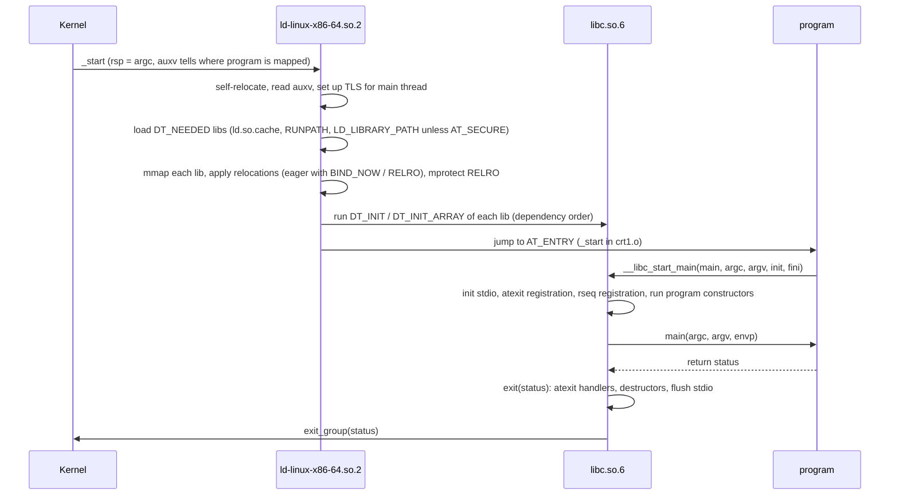

Costs to know:

- Static binaries skip the loader entirely.  
  On the test VM the difference for a trivial program was small (posix_spawn+wait **1.43 ms static vs 1.55 ms dynamic**): process creation, the exec itself and teardown dominate for tiny programs.  
  With many large shared libraries (hundreds of DT_NEEDED, millions of relocations: typical C++ GUI apps, Python extension stacks), loading can take tens of ms;  
  `LD_DEBUG=statistics` prints relocation time.
- Interpreted runtimes add their own startup: `python3 -c pass` measured **20.8 ms**;  
  JVM hello-world is typically 40–100 ms (CDS/AppCDS, CRaC and GraalVM native-image exist to cut this).
- `vfork`/`posix_spawn` + exec avoids paying `fork`'s page-table copy (topic 01 §5.2).

---

## 5. What survives exec

| Preserved across `execve`                                        | Reset / discarded                                                              |
| ---------------------------------------------------------------- | ------------------------------------------------------------------------------ |
| PID, PPID, PGID, SID, controlling tty                            | address space (all mappings, heap, stack, shared memory attachments, `mlock`s) |
| real UID/GID (effective may change via setuid bit / file caps)   | all threads except the caller (`de_thread`)                                    |
| cwd, root, umask                                                 | **caught** signal handlers → `SIG_DFL`                                         |
| fds **without** `FD_CLOEXEC`                                     | fds with `FD_CLOEXEC` (closed)                                                 |
| **ignored** signals stay `SIG_IGN` (except `SIGCHLD` subtleties) | alternate signal stack                                                         |
| signal mask, pending signals                                     | POSIX timers (`timer_create`), robust futex list                               |
| rlimits, nice, scheduling policy, CPU affinity                   | `PR_SET_PDEATHSIG` (for setuid exec), dumpable flag recomputed                 |
| `alarm`/`setitimer` timers                                       | `atexit` handlers, all user-space state                                        |
| cgroup membership, namespaces                                    |                                                                                |
| seccomp filters, `PR_SET_NO_NEW_PRIVS`                           |                                                                                |

Practical consequences:

- **fd leaks into children** are the most common exec bug: a socket or lock file inherited by a long-lived child keeps the resource alive (port stays bound, file lock held, pipe never sees EOF).  
  Open everything with `O_CLOEXEC` / `SOCK_CLOEXEC` / `EPOLL_CLOEXEC` / `accept4(..., SOCK_CLOEXEC)`, or call `close_range(3, ~0U, CLOSE_RANGE_CLOEXEC)` before exec.  
  Most modern runtimes (Go, Rust std, Python ≥ 3.4, Java) set CLOEXEC by default.
- **Ignored signals are inherited**: a parent that ignores `SIGPIPE` (e.g. a Python or Go process, a shell under `nohup` for `SIGHUP`) launches children that also ignore it, and they then see `EPIPE` instead of dying.  
  Reset dispositions in the child (`posix_spawnattr_setsigdefault`).
- **Blocked signals are inherited**: a child exec'd from a thread that blocked `SIGTERM` (common in programs using a sigwait thread) will ignore `SIGTERM` until it unblocks.  
  Reset with `posix_spawnattr_setsigmask`.

---

## 6. Termination: `exit_group` and `do_exit`

### 6.1 Ways to die

| Path                                    | Code                                                        |
| --------------------------------------- | ----------------------------------------------------------- |
| `return` from `main` / `exit(n)`        | libc cleanup, then `exit_group(n)`                          |
| `_exit(n)` / `_Exit(n)`                 | `exit_group(n)` directly, no atexit/stdio flush             |
| `syscall(SYS_exit, n)`                  | ends only the calling **thread** (what `pthread_exit` uses) |
| fatal signal (default action term/core) | kernel calls `do_group_exit(signr)` from `get_signal()`     |
| `execve` from another thread            | `de_thread` kills the other threads                         |

### 6.2 Kernel path

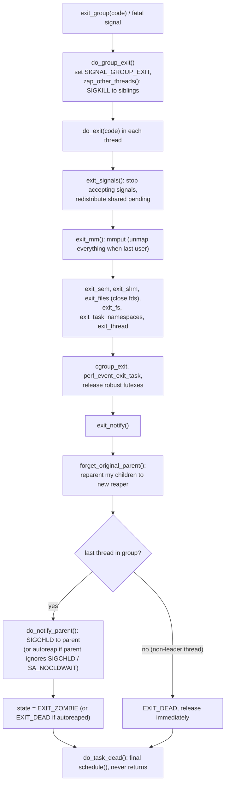

Order matters for debugging:

- **fds are closed in `exit_files`**, so peers see EOF / RST at exit even before the parent reaps.
- **Memory is released before the zombie state**: a zombie holds no address space, only `task_struct`, its PID, exit status and rusage (a few KiB).
- **Kernel-level cleanup can block**: a process stuck in `D` state (uninterruptible, e.g. hung NFS, failing disk) cannot finish `do_exit` until the I/O returns.  
  `kill -9` sets the signal, but the task only acts on it when the sleep ends (or immediately if it sleeps in `TASK_KILLABLE`). This is the "unkillable process" in `ps` showing `D`.

### 6.3 Exit status encoding

`wait` returns a 16-bit status (`int` in practice):

| Event            | Encoding                          | Macros                                 |
| ---------------- | --------------------------------- | -------------------------------------- |
| normal exit      | `(code & 0xff) << 8`              | `WIFEXITED`, `WEXITSTATUS` (0–255)     |
| killed by signal | `signo` (+ `0x80` if core dumped) | `WIFSIGNALED`, `WTERMSIG`, `WCOREDUMP` |
| stopped          | `(signo << 8) \| 0x7f`            | `WIFSTOPPED`, `WSTOPSIG`               |
| continued        | `0xffff`                          | `WIFCONTINUED`                         |

Shells report a death by signal N as exit code **128 + N** (`SIGKILL` → 137, `SIGTERM` → 143, `SIGSEGV` → 139).  
Exit codes > 255 wrap modulo 256 (`exit(256)` reports 0).

---

## 7. Zombies, orphans, reapers

### 7.1 Zombies

A zombie (`Z`, "defunct") is a terminated process whose parent has not yet called `wait`.  
The kernel keeps it so the parent can collect the status.  
Zombies cost almost no memory but **each holds a PID**; a parent that never reaps will eventually exhaust `pid_max` or the cgroup's `pids.max`, and `fork` fails with `EAGAIN`.  
You cannot kill a zombie (it is already dead); you fix or kill its parent.

Measured demo: a child that `_exit(7)`s shows up as `Z` until `waitpid`, which then reports `WIFEXITED=1, status=7`.

### 7.2 Orphans and reparenting

When a parent exits before its children, `forget_original_parent()` picks a new parent (`find_new_reaper()`):

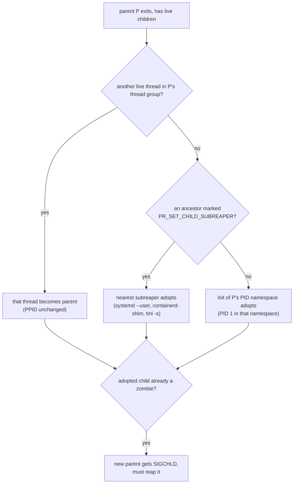

- **Subreapers** (`prctl(PR_SET_CHILD_SUBREAPER, 1)`, Linux 3.4) let service managers keep track of daemonised descendants: systemd user instances, container shims, `tini -s`, build systems.
- **`PR_SET_PDEATHSIG`**: a child can ask for a signal (e.g. `SIGKILL`) when its parent **thread** dies, a common way to avoid orphaned workers.  
  Gotcha: it fires when the creating *thread* exits, not the process, and it is cleared on setuid exec.
- **Autoreap**: if the parent sets `SIGCHLD` to `SIG_IGN` or uses `SA_NOCLDWAIT`, children are reaped by the kernel immediately (no zombies, but no status either;  
  `wait` then blocks until all children exit and fails with `ECHILD`).

### 7.3 Double fork (classic daemonisation)

```text
parent ── fork ─▶ child ── setsid() ── fork ─▶ grandchild (daemon)
                    │                              │
                    └─ _exit(0) ◀── parent waits   └─ reparented to init / subreaper,
                                                     not a session leader → cannot acquire a tty
```

Under systemd, do not daemonise: run in the foreground (`Type=simple`/`exec`/`notify`), and let the service manager track the cgroup.

---

## 8. Waiting: `wait4`, `waitid`, pidfds

### 8.1 The calls

| Call                                 | Selects                                                | Extras                                                                                                              |
| ------------------------------------ | ------------------------------------------------------ | ------------------------------------------------------------------------------------------------------------------- |
| `wait(&st)`                          | any child                                              | —                                                                                                                   |
| `waitpid(pid, &st, opts)`            | `pid>0` one child, `0` same pgrp, `-1` any, `<-1` pgrp | `WNOHANG`, `WUNTRACED`, `WCONTINUED`                                                                                |
| `wait4(pid, &st, opts, &rusage)`     | as waitpid                                             | resource usage of the child (CPU, max RSS, faults)                                                                  |
| `waitid(idtype, id, &siginfo, opts)` | `P_PID`, `P_PGID`, `P_ALL`, **`P_PIDFD`** (5.4)        | `WEXITED`/`WSTOPPED`/`WCONTINUED` chosen independently, **`WNOWAIT`** (peek without reaping), status in `siginfo_t` |

`__WALL`/`__WCLONE` select children created with a non-`SIGCHLD` exit signal (raw `clone` users).

### 8.2 The PID-reuse race and pidfds

PIDs are recycled (cyclic allocation up to `pid_max`).  
Between reading a PID (from a pidfile, `ps`, an event) and calling `kill(pid, …)`, the process can die and the PID be reused by an unrelated process.  
Only the **parent**, before it reaps, has a stable reference. Pidfds fix this by giving any process a file descriptor that refers to one specific process:

| Syscall / flag                           | Since       | Purpose                                                                                     |
| ---------------------------------------- | ----------- | ------------------------------------------------------------------------------------------- |
| `pidfd_send_signal(pidfd, sig, info, 0)` | 5.1         | race-free kill                                                                              |
| `CLONE_PIDFD`                            | 5.2         | get pidfd atomically at creation                                                            |
| `pidfd_open(pid, 0)`                     | 5.3         | pidfd for existing PID (race-free if done by parent before reaping, or verified after open) |
| `poll`/`epoll` on pidfd                  | 5.3         | readable when the process exits (event-loop friendly child supervision)                     |
| `waitid(P_PIDFD, …)`                     | 5.4         | reap via pidfd                                                                              |
| `pidfd_getfd(pidfd, targetfd, 0)`        | 5.6         | duplicate another process's fd (with ptrace permission)                                     |
| `process_madvise`, `process_mrelease`    | 5.10 / 5.15 | act on a process's memory (Android LMKD, OOM daemons)                                       |

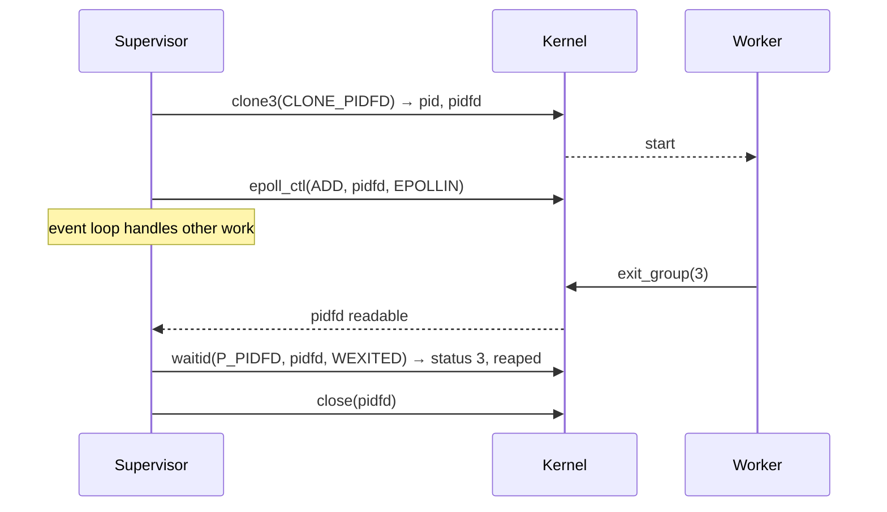

systemd, Android's LMKD, Go (`os.Process` uses pidfds since 1.23 on Linux), Rust std (`pidfd` on `Command`, unstable), and Python (`os.pidfd_open`) use this.

---

## 9. Signals: the model

A signal is an asynchronous notification with a small integer number. Two families:

|                        | Standard (1–31)                                                       | Real-time (`SIGRTMIN`..`SIGRTMAX`, 34–64 in glibc)    |
| ---------------------- | --------------------------------------------------------------------- | ----------------------------------------------------- |
| Pending representation | **bit** in a mask: multiple sends while pending **coalesce into one** | **queued** `sigqueue` entries, one per send           |
| Payload                | `siginfo_t` of the first send                                         | each carries its own `siginfo_t` (`sigqueue()` value) |
| Order                  | unspecified (lowest number first in practice)                         | lowest number first, FIFO within a number             |
| Limit                  | n/a                                                                   | `RLIMIT_SIGPENDING` (per user)                        |

Measured: 1000 `kill(self, SIGUSR1)` + 1000 `kill(self, SIGRTMIN)` while both are blocked → **1** `SIGUSR1` and **1000** `SIGRTMIN` delivered.  
Standard signals are not a counter; never use them to count events.

glibc reserves signals 32 and 33 internally (`SIGCANCEL` for `pthread_cancel`, `SIGSETXID` for synchronising `setuid` across threads), hence `SIGRTMIN` = 34.

### 9.1 Default actions

| Action                      | Signals                                                                                                                                         |
| --------------------------- | ----------------------------------------------------------------------------------------------------------------------------------------------- |
| **Term**                    | `SIGHUP`, `SIGINT`, `SIGPIPE`, `SIGALRM`, `SIGTERM`, `SIGUSR1`, `SIGUSR2`, `SIGPOLL`, `SIGVTALRM`, `SIGPROF`, `SIGSTKFLT`, `SIGPWR`, RT signals |
| **Core** (term + core dump) | `SIGQUIT`, `SIGILL`, `SIGTRAP`, `SIGABRT`, `SIGBUS`, `SIGFPE`, `SIGSEGV`, `SIGSYS`, `SIGXCPU`, `SIGXFSZ`                                        |
| **Ign**                     | `SIGCHLD`, `SIGURG`, `SIGWINCH`                                                                                                                 |
| **Stop**                    | `SIGSTOP`, `SIGTSTP`, `SIGTTIN`, `SIGTTOU`                                                                                                      |
| **Cont**                    | `SIGCONT`                                                                                                                                       |

`SIGKILL` and `SIGSTOP` cannot be caught, blocked or ignored.

### 9.2 Per-task and per-process state

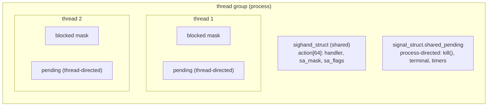

- **Dispositions** (handlers) are per process.
- **Masks** are per thread (`pthread_sigmask`; `sigprocmask` is the single-threaded alias).
- **Pending** is per thread (for `tgkill`, `pthread_kill`, synchronous faults) plus a shared per-process set (for `kill`, `sigqueue`, terminal signals, `SIGCHLD`, `alarm`).

---

## 10. Signal generation

Sources:

| Source                                                                                                                                                                                                                                            | Directed at                                                                |
| ------------------------------------------------------------------------------------------------------------------------------------------------------------------------------------------------------------------------------------------------- | -------------------------------------------------------------------------- |
| `kill(pid, sig)` / `pidfd_send_signal`                                                                                                                                                                                                            | process (shared pending); `pid=0` own pgrp, `-1` all permitted, `<-1` pgrp |
| `tgkill(tgid, tid, sig)` / `pthread_kill` / `raise`                                                                                                                                                                                               | specific thread                                                            |
| `sigqueue(pid, sig, value)`                                                                                                                                                                                                                       | process, with payload                                                      |
| CPU exception (`#PF` bad address → `SIGSEGV`/`SIGBUS`, `#DE` → `SIGFPE`, `#UD` → `SIGILL`, `int3` → `SIGTRAP`)                                                                                                                                    | **faulting thread**, synchronous                                           |
| Kernel events: write to broken pipe (`SIGPIPE`), child state change (`SIGCHLD`), `RLIMIT_CPU`/`RLIMIT_FSIZE`, OOM killer (`SIGKILL`), seccomp `SECCOMP_RET_TRAP` (`SIGSYS`), `F_SETOWN` async I/O (`SIGIO`), `SIGURG` (OOB data; Go's preemption) | varies                                                                     |
| tty driver: `^C` `SIGINT`, `^\` `SIGQUIT`, `^Z` `SIGTSTP`, hangup `SIGHUP`, resize `SIGWINCH`                                                                                                                                                     | foreground process group                                                   |
| Timers: `alarm`, `setitimer`, `timer_create(SIGEV_SIGNAL)`                                                                                                                                                                                        | process or thread (`SIGEV_THREAD_ID`)                                      |

Permission: sender's real or effective UID must match target's real or saved UID, or sender has `CAP_KILL`. `SIGCONT` is allowed within a session.  
Signal 0 performs only the existence/permission check (`kill(pid, 0)`).

### 10.1 Kernel path

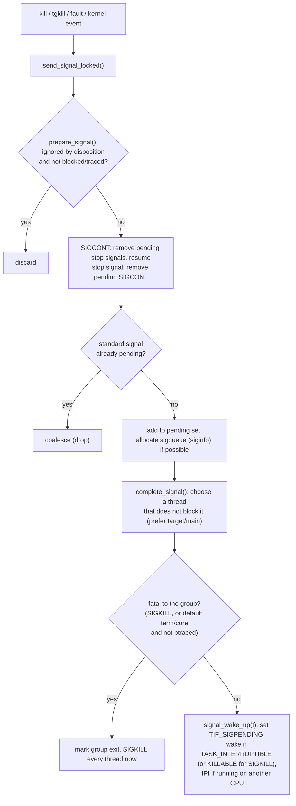

Important: generation only marks the signal pending and kicks a thread. Nothing user-visible happens until **delivery**.

---

## 11. Signal delivery and the signal frame

### 11.1 When

Signals are delivered on the **return path to user mode** (after a syscall, interrupt or exception) when `TIF_SIGPENDING` is set: `exit_to_user_mode_loop()` → `arch_do_signal_or_restart()` → `get_signal()`.  
A thread that never enters the kernel still gets interrupted by the timer tick or the IPI from `signal_wake_up`,  
so delivery latency is bounded by the next kernel entry (µs), not by the program's behaviour.

### 11.2 `get_signal()` decisions

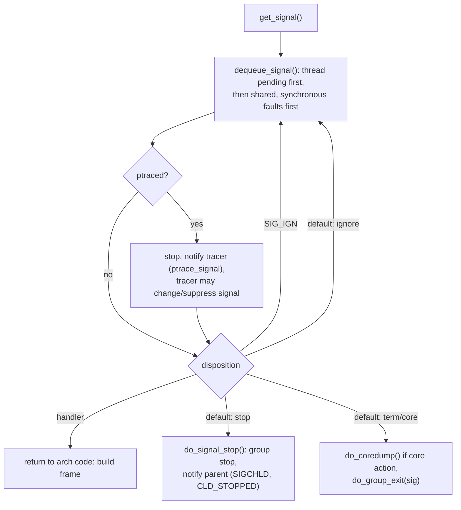

### 11.3 Running a handler: the signal frame (x86_64)

The kernel cannot call a user function directly.  
It fakes one: it pushes a frame on the user stack (or the `sigaltstack`) and rewrites the saved registers so that "returning to user mode" lands in the handler.

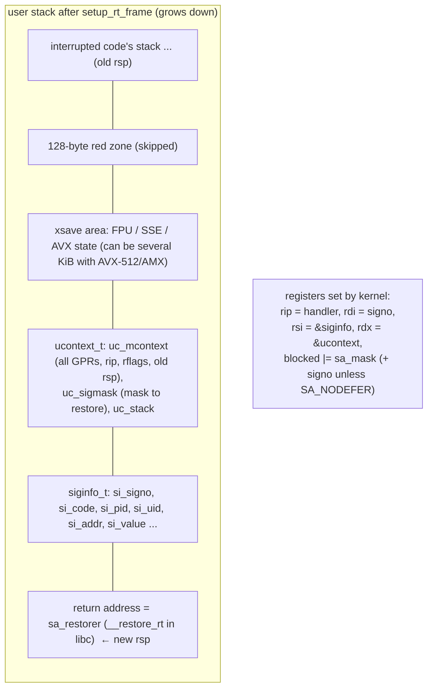

Then:

1. Handler runs in user mode with the extended mask.
2. Handler returns to `__restore_rt`, which executes `mov $15, %rax; syscall` = **`rt_sigreturn`**.
3. Kernel reads `ucontext` back from the user stack, restores all registers, FPU state, and the signal mask, and resumes the interrupted code (or restarts the interrupted syscall, §12).

Costs: two kernel entries (the original return path plus `rt_sigreturn`), a frame of ~1–4 KiB (dominated by XSAVE state), and pipeline disruption. Measured: `tgkill(self)` + handler + `rt_sigreturn` = **1.55 µs**, vs 163 ns for a trivial syscall.  
glibc `raise()` adds ~0.7 µs because it blocks all signals around the `tgkill` to make it atomic (2.27 µs total).

Consequences of the frame being on the user stack:

- **Stack overflow handling needs `sigaltstack`**: a `SIGSEGV` caused by stack overflow cannot push a frame on the overflowed stack; without an alternate stack the kernel kills the process.  
  Runtimes that convert overflows into exceptions (JVM, Go, Rust's "thread has overflowed its stack" message) install an alternate stack per thread.
- The handler can **inspect and modify** the interrupted context (`ucontext->uc_mcontext.gregs[REG_RIP]`): used by JITs, GC safepoints,  
  Go's async preemption (since Go 1.14 the `SIGURG` handler injects a call), sanitisers, and userfault-style tricks.
- **SROP** (sigreturn-oriented programming) abuses `rt_sigreturn` to set all registers from attacker-controlled stack data;  
  mitigated by CET shadow stacks and stack canaries in the frame on newer kernels.

### 11.4 `sigaction` flags

| Flag           | Effect                                                                  |
| -------------- | ----------------------------------------------------------------------- |
| `SA_SIGINFO`   | handler gets `(int, siginfo_t*, void*ucontext)`                         |
| `SA_RESTART`   | restart interruptible syscalls instead of `EINTR` (§12)                 |
| `SA_NODEFER`   | do not block the signal itself during the handler                       |
| `SA_RESETHAND` | reset to `SIG_DFL` after first delivery (System V `signal()` semantics) |
| `SA_ONSTACK`   | run on `sigaltstack` if one is set                                      |
| `SA_NOCLDSTOP` | no `SIGCHLD` when children stop/continue                                |
| `SA_NOCLDWAIT` | auto-reap children                                                      |
| `SA_RESTORER`  | (libc-internal) restorer trampoline supplied                            |

Use `sigaction`, never `signal()`: `signal()`'s semantics vary (glibc gives BSD semantics: `SA_RESTART`, no reset; other libcs historically differ).

---

## 12. Interrupted system calls and restart

If a signal with a handler arrives while a thread is blocked in an interruptible syscall, the syscall is aborted with an internal error code and the outcome depends on the code and `SA_RESTART`:

| Internal return                                                                                           | No handler / SIG_IGN                                | Handler without `SA_RESTART` | Handler with `SA_RESTART` |
| --------------------------------------------------------------------------------------------------------- | --------------------------------------------------- | ---------------------------- | ------------------------- |
| `-ERESTARTSYS` (most blocking calls: `read`, `write`, `wait`, `accept`, `connect`, `futex` wait, `flock`) | restart                                             | **`EINTR`**                  | restart                   |
| `-ERESTARTNOINTR` (e.g. `fork` interrupted)                                                               | restart                                             | restart                      | restart                   |
| `-ERESTARTNOHAND` (`pause`, `sigsuspend`, `poll`, `select`, `epoll_wait`)                                 | restart                                             | `EINTR`                      | **`EINTR`**               |
| `-ERESTART_RESTARTBLOCK` (`nanosleep`, `clock_nanosleep`)                                                 | restart with remaining time (via `restart_syscall`) | `EINTR` (+ remaining time)   | `EINTR`                   |

Restart is implemented by rewinding the user `rip` by 2 bytes (back onto the `syscall` instruction) and restoring `rax` to the syscall number,  
so the call is simply re-executed after the handler (or immediately if no handler ran).

Measured:

| Setup                                                                         | Result                                           |
| ----------------------------------------------------------------------------- | ------------------------------------------------ |
| `read()` on empty pipe, `SIGALRM` after 1 s, handler **without** `SA_RESTART` | returns `-1`, `errno = EINTR`                    |
| same **with** `SA_RESTART`, data written after 2 s                            | returns `1` after 2.0 s: restart was transparent |

Rules:

- Any code that installs handlers without `SA_RESTART` must loop on `EINTR` for every blocking call (`TEMP_FAILURE_RETRY` in glibc).
- `poll`/`select`/`epoll_wait`/`sleep` return `EINTR` even with `SA_RESTART`; event loops must treat it as a spurious wakeup.
- Socket calls with `SO_RCVTIMEO`/`SO_SNDTIMEO` return `EINTR` rather than restart.
- Partial transfers are not errors: an interrupted `read` that already copied data returns the short count.

---

## 13. Signals and threads

Rules (POSIX + Linux):

1. **Process-directed** signals go to *one* thread that does not block them (kernel's choice; if all block it, it stays pending at process level).
2. **Thread-directed** signals (`pthread_kill`, synchronous faults) go to that thread only.
3. **Dispositions are global**: `sigaction` in one thread changes the handler for all.
4. **Fatal actions kill the whole process**: a default-action `SIGTERM` delivered to any thread terminates all threads.
5. New threads **inherit the creator's mask**; pending set starts empty.
6. A synchronous fault signal that is blocked or ignored at generation time is forced: the kernel unblocks it / resets to default and kills the process (`force_sig_fault`).

Recommended pattern for multithreaded programs:

```c
/* main(), before creating any threads */
sigset_t set;
sigemptyset(&set);
sigaddset(&set, SIGTERM);
sigaddset(&set, SIGINT);
sigaddset(&set, SIGHUP);
pthread_sigmask(SIG_BLOCK, &set, NULL);   /* inherited by every thread created later */

/* option A: dedicated thread */
for (;;) {
    int sig;
    sigwait(&set, &sig);                  /* synchronous: no handler, no async-safety rules */
    if (sig == SIGHUP) reload_config(); else begin_shutdown();
}

/* option B: event loop */
int sfd = signalfd(-1, &set, SFD_CLOEXEC | SFD_NONBLOCK);
/* add sfd to epoll; read struct signalfd_siginfo when readable */
```

Caveat: blocked signals are inherited across `fork` and `exec`.  
Unblock them in children before exec (`posix_spawnattr_setsigmask`), or children will silently ignore `SIGTERM`/`SIGINT`.

Language runtimes:

| Runtime | Model                                                                                                                                                                     |
| ------- | ------------------------------------------------------------------------------------------------------------------------------------------------------------------------- |
| Go      | runtime installs handlers for all signals on an alternate stack; `os/signal.Notify` forwards to a channel; `SIGURG` used for preemption; synchronous faults become panics |
| JVM     | uses `SIGSEGV` for implicit null checks and safepoint polling, `SIGQUIT` for thread dumps; `-Xrs` reduces signal use; `jsig` library for chaining with native code        |
| Rust    | std installs only `SIGSEGV`/`SIGBUS` handlers for stack overflow and ignores `SIGPIPE`; use `signal-hook` or `tokio::signal` (self-pipe)                                  |
| Python  | C-level handler sets a flag; Python-level handlers run **between bytecodes in the main thread only**                                                                      |
| Node.js | libuv converts signals to events via a self-pipe on the loop                                                                                                              |

---

## 14. Writing correct handlers

A handler interrupts arbitrary code, possibly in the middle of `malloc`, `printf` or while holding a lock.  
It may call only **async-signal-safe** functions (`signal-safety(7)`): `write`, `read`, `_exit`, `kill`, `sigprocmask`, `open`, `close`, `waitpid`, `clock_gettime`, `sem_post`, …  
Not safe: `malloc`/`free`, `printf`, `syslog`, `pthread_mutex_lock`, most of C++/stdio, anything that may allocate or lock.

```c
static volatile sig_atomic_t stop_requested;
static int wake_fd;                         /* eventfd or pipe write end, O_NONBLOCK */

static void on_term(int sig) {
    int saved = errno;                      /* handlers must preserve errno */
    stop_requested = 1;
    uint64_t one = 1;
    (void)write(wake_fd, &one, sizeof one); /* wake the event loop (self-pipe trick) */
    errno = saved;
}
```

Checklist:

- Only set `volatile sig_atomic_t` (or lock-free `_Atomic`) flags and write to a pipe/eventfd; do the real work in normal context.
- Save and restore `errno`.
- Install with `sigaction` + `SA_RESTART` (unless you want `EINTR` to break a blocking call) and a full `sa_mask` if the handler touches shared state.
- Prefer `signalfd` / `sigwaitinfo` / runtime-provided signal channels, which make signal handling synchronous and remove the problem entirely.
- `SIGPIPE`: ignore it process-wide in servers (`signal(SIGPIPE, SIG_IGN)`) or use `MSG_NOSIGNAL` / `SO_NOSIGPIPE`, and handle `EPIPE`.
- `SIGCHLD` with handlers: loop `while (waitpid(-1, &st, WNOHANG) > 0)` because multiple child exits coalesce into one `SIGCHLD`.

---

## 15. Sessions, process groups and job control

| Concept                      | Created by                                                              | Purpose                                                             |
| ---------------------------- | ----------------------------------------------------------------------- | ------------------------------------------------------------------- |
| **Process group** (PGID)     | `setpgid(pid, pgid)`; shells put each pipeline in its own group         | unit for job control signals (`kill(-pgid, sig)`)                   |
| **Session** (SID)            | `setsid()` (caller must not be a group leader)                          | collection of process groups sharing a controlling terminal         |
| **Controlling terminal**     | first tty opened by a session leader without `O_NOCTTY`, or `TIOCSCTTY` | source of keyboard signals and hangup                               |
| **Foreground process group** | `tcsetpgrp(fd, pgid)`                                                   | the only group allowed to read from the tty and receiving `^C`/`^Z` |

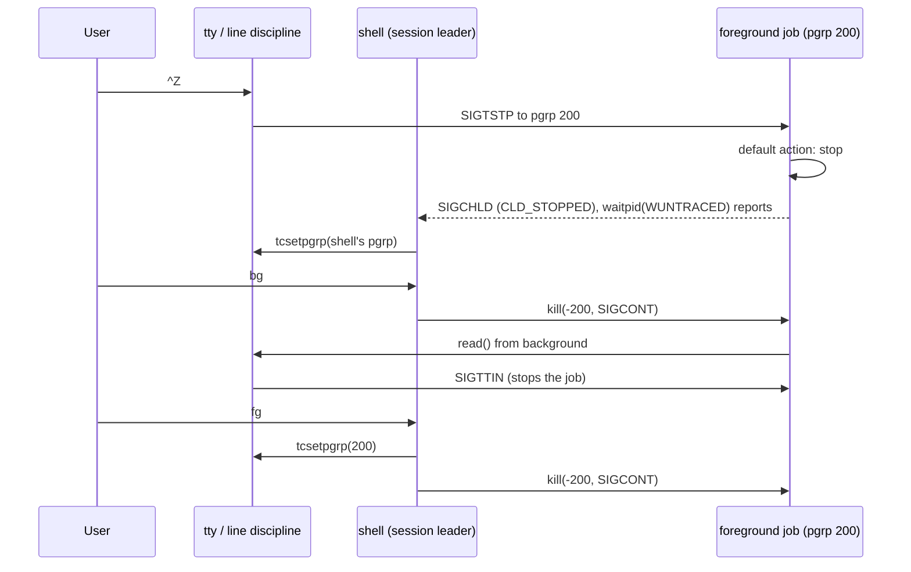

Hangup rules:

- When the terminal hangs up (SSH disconnect, terminal window closed), the kernel sends `SIGHUP` (+ `SIGCONT`) to the **session leader** (`tty_vhangup`/`disassociate_ctty`);  
  shells forward `SIGHUP` to their jobs (bash: unless `disown`ed or `shopt -u huponexit` semantics).
- When a session leader exits, the foreground group gets `SIGHUP`.
- When a process group becomes **orphaned** (no member has a parent in a different group of the same session) and contains stopped members, every member gets `SIGHUP` then `SIGCONT`,  
  so stopped jobs do not stay stopped forever.
- `nohup` sets `SIGHUP` to ignored (inherited across exec) and redirects output; `setsid cmd` detaches from the terminal entirely; `systemd-run --user` / `tmux` are the modern answers.

---

## 16. Core dumps

Triggered by default actions of "Core" signals when allowed:

| Control                                       | Meaning                                                                                                                                                                  |
| --------------------------------------------- | ------------------------------------------------------------------------------------------------------------------------------------------------------------------------ |
| `RLIMIT_CORE` (`ulimit -c`)                   | max size; 0 disables (0 on the test VM)                                                                                                                                  |
| `/proc/sys/kernel/core_pattern`               | filename template (`core.%e.%p`) or `\|/path/to/handler %P %s ...` pipe; systemd sets `\|/usr/lib/systemd/systemd-coredump ...`, Ubuntu `\|/usr/share/apport/apport ...` |
| `/proc/<pid>/coredump_filter`                 | which mapping types are dumped (anon private, shared, huge pages, ELF headers)                                                                                           |
| `prctl(PR_SET_DUMPABLE)` / `fs.suid_dumpable` | setuid / credential-changed processes not dumpable by default                                                                                                            |
| `MADV_DONTDUMP`                               | exclude sensitive or huge regions                                                                                                                                        |

In containers, `core_pattern` is global (not namespaced): a pipe handler runs in the **host's** namespaces. Tools: `coredumpctl list/gdb`, `gdb prog core`, `eu-stack --core`.

---

## 17. PID 1, containers and graceful shutdown

### 17.1 PID 1 is special

The first process in a PID namespace (real init, or the container entrypoint) differs from every other process:

1. **Signals with default disposition are ignored** when sent from within the namespace. Only signals for which PID 1 installed a handler are delivered.  
  From an **ancestor** namespace (host, `docker kill`), `SIGKILL` and `SIGSTOP` are forced through; other default-disposition signals are still ignored.
2. It **adopts orphans** of its namespace and must reap them.
3. When it exits, the kernel **SIGKILLs every other process** in the namespace.

Measured with `unshare --pid --fork`:

| Experiment                                                        | Result                                                       |
| ----------------------------------------------------------------- | ------------------------------------------------------------ |
| PID 1 = `sleep` (no handlers); `kill -TERM` from the host         | process still running (`S`): SIGTERM ignored                 |
| same; `kill -KILL` from the host                                  | process killed                                               |
| PID 1 = `sleep` (via `exec`), three orphaned `sleep 0.3` children | after they exit: three `Z` zombies under PID 1, never reaped |

### 17.2 What goes wrong in containers

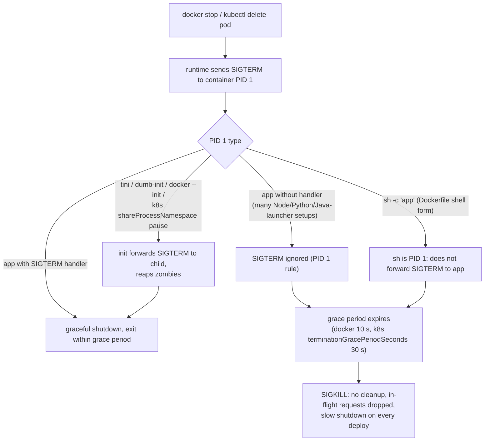

Fixes, in order of preference:

1. Use **exec form** in Dockerfiles: `ENTRYPOINT ["/app/server"]`, not `ENTRYPOINT /app/server` (which wraps in `/bin/sh -c`).  
  In wrapper scripts, end with `exec "$@"`.
2. Make the application handle `SIGTERM` (and usually `SIGINT`) explicitly.
3. Run a minimal init as PID 1 if the app spawns children or cannot handle signals: `docker run --init` (tini), `tini -g --` (forward to the whole group), `dumb-init`.  
  They forward signals and reap zombies.

### 17.3 Graceful shutdown protocol

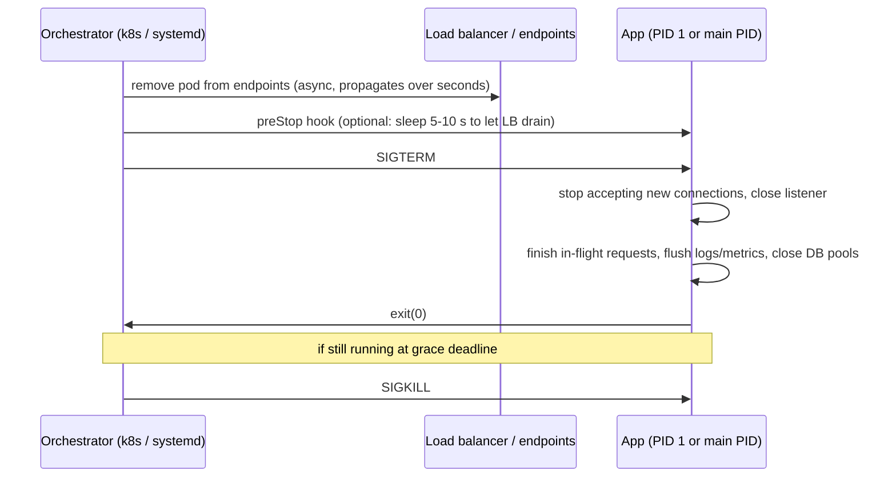

| Platform         | Stop signal                                                                  | Grace default                                          | Then                      |
| ---------------- | ---------------------------------------------------------------------------- | ------------------------------------------------------ | ------------------------- |
| `docker stop`    | `STOPSIGNAL` (default `SIGTERM`)                                             | 10 s (`--time`)                                        | `SIGKILL`                 |
| Kubernetes       | `SIGTERM` (image `STOPSIGNAL`, or `lifecycle.stopSignal` on recent versions) | `terminationGracePeriodSeconds: 30` (includes preStop) | `SIGKILL`                 |
| systemd          | `KillSignal=SIGTERM` to processes per `KillMode=control-group`               | `TimeoutStopSec=90s`                                   | `FinalKillSignal=SIGKILL` |
| shutdown of host | systemd stops units, then `SIGTERM` all, then `SIGKILL` all                  |                                                        |                           |

Application checklist:

- Handle `SIGTERM` once; a second `SIGTERM`/`SIGINT` may force immediate exit.
- Shutdown work must finish well within the grace period; measure it.
- Readiness should turn false immediately on `SIGTERM`; keep serving in-flight work.
- Exit code: 0 for graceful, non-zero for failures; 137 in Kubernetes means it was `SIGKILL`ed (grace exceeded or OOM, check `OOMKilled` reason).

---

## 18. Measured numbers

Test bed: 4 vCPU Firecracker microVM, Intel Xeon @ 2.1 GHz, Linux 6.18, glibc, gcc -O2.  
Virtualisation inflates syscalls, cross-CPU wakeups and process creation; compare ratios.

| Measurement                                                 | Value                         |
| ----------------------------------------------------------- | ----------------------------- |
| Trivial syscall (`getpid`)                                  | 163 ns                        |
| `tgkill(self)` + handler + `rt_sigreturn`                   | **1.55 µs**                   |
| glibc `raise()` + handler (extra sigprocmask pair)          | 2.27 µs                       |
| `raise()` + `sigwait()` with signal blocked (no frame)      | 1.20 µs                       |
| Signal ping-pong between two processes (`kill` + `sigwait`) | 37.0 µs / round trip          |
| Same via `signalfd`                                         | 38.3 µs / round trip          |
| Pipe ping-pong between two processes (comparison)           | 36.7 µs / round trip          |
| 1000 × `SIGUSR1` and 1000 × `SIGRTMIN` sent while blocked   | delivered **1** vs **1000**   |
| `fork` + `_exit` + `waitpid` (small parent)                 | 372 µs                        |
| `posix_spawn` + wait, static trivial binary (785 KiB)       | 1.43 ms                       |
| `posix_spawn` + wait, dynamic trivial binary (15 KiB)       | 1.55 ms                       |
| `posix_spawn` + wait, `/bin/true`                           | 1.53 ms                       |
| `python3 -c pass` (subprocess.run)                          | 20.8 ms                       |
| `read()` interrupted, no `SA_RESTART`                       | `EINTR`                       |
| `read()` interrupted, `SA_RESTART`                          | transparently restarted       |
| PID 1 in PID namespace, `SIGTERM` from host                 | ignored                       |
| PID 1 that does not `wait`                                  | orphans accumulate as zombies |

Takeaways:

1. As IPC, signals cost the same as a pipe round trip (both dominated by wakeup + switch), carry almost no data, and coalesce. Use them for control, not data.
2. Handler delivery is ~10× a plain syscall because of the frame build and `rt_sigreturn`; fine for rare events, wrong for hot paths (profilers sampling at 1–10 kHz are fine; 100 kHz is not).
3. Process creation + exec of even a trivial binary costs ~1–1.5 ms here (sub-ms on bare metal); interpreter startup is 10–100× that. Long-lived worker processes beat spawn-per-request.

---

## 19. Failure modes

| Symptom                                                                          | Cause                                                  | Fix                                                                   |
| -------------------------------------------------------------------------------- | ------------------------------------------------------ | --------------------------------------------------------------------- |
| `fork: Resource temporarily unavailable`, `ps` shows many `Z`                    | parent never reaps                                     | `waitpid` loop on `SIGCHLD`, `SA_NOCLDWAIT`, or init (tini) as PID 1  |
| Container takes exactly 10 s / 30 s to stop, exit 137                            | PID 1 ignores `SIGTERM` or shell form doesn't forward  | exec form, handle SIGTERM, `--init`                                   |
| Child ignores `SIGTERM`/`SIGINT`                                                 | inherited blocked mask or `SIG_IGN`                    | reset in child (`posix_spawnattr_setsigmask/setsigdefault`)           |
| Child process holds port / pipe never EOF                                        | fd inherited without CLOEXEC                           | `O_CLOEXEC` everywhere, `close_range`                                 |
| Random `EINTR` failures after adding a signal handler (e.g. profiler, `SIGCHLD`) | handler without `SA_RESTART`, code not retrying        | `SA_RESTART`, retry loops                                             |
| Deadlock in child after `fork` in multithreaded program                          | lock held by a thread that does not exist in child     | `posix_spawn`, only async-signal-safe calls before exec               |
| Deadlock / crash in signal handler                                               | non-async-signal-safe call (`malloc`, `printf`, locks) | flag + self-pipe, `signalfd`                                          |
| Lost events                                                                      | standard signals coalesce                              | RT signals, or use signals only as "something changed" hints          |
| Killed the wrong process                                                         | PID reuse between lookup and `kill`                    | pidfds                                                                |
| Unkillable process (`D`)                                                         | uninterruptible kernel wait (NFS, disk, FUSE)          | fix the I/O; `TASK_KILLABLE` paths; reboot as last resort             |
| Workers survive supervisor crash                                                 | no parent-death handling                               | `PR_SET_PDEATHSIG`, pidfd/pipe EOF watch, cgroup kill (`cgroup.kill`) |
| Stack overflow kills process without message                                     | no alternate stack for `SIGSEGV`                       | `sigaltstack` + `SA_ONSTACK`                                          |
| Background job freezes when it prints / reads                                    | `SIGTTOU` / `SIGTTIN`                                  | redirect I/O, `stty -tostop`, run detached                            |
| SSH disconnect kills long job                                                    | `SIGHUP`                                               | `tmux`/`screen`, `nohup`, `setsid`, `systemd-run`                     |

---

## 20. Observation cheat sheet

```bash
# Process tree, states, sessions/groups
ps -eo pid,ppid,pgid,sid,tty,stat,wchan:20,cmd --forest
ps -eo stat,ppid | awk '$1 ~ /^Z/ {print $2}' | sort | uniq -c   # who owns zombies

# Signal state of a process (hex bitmasks, bit N-1 = signal N)
grep -E 'Sig(Q|Pnd|Blk|Ign|Cgt)|ShdPnd' /proc/$PID/status
#   SigPnd: thread pending, ShdPnd: process pending, SigBlk: mask, SigIgn: ignored, SigCgt: caught
#   decode: printf '%d\n' 0x...  or  python3 -c 'import signal;...'

# Who sends signals / trace delivery
strace -f -e trace=signal,kill,tgkill,rt_sigaction,rt_sigprocmask -e signal=all -p $PID
bpftrace -e 'tracepoint:signal:signal_generate { printf("%s(%d) -> %d sig %d\n", comm, pid, args->pid, args->sig); }'
bpftrace -e 'tracepoint:signal:signal_deliver { @[comm, args->sig] = count(); }'
perf trace -e 'signal:*'

# Exec / exit events system-wide
bpftrace -e 'tracepoint:sched:sched_process_exec { printf("%d %s\n", pid, str(args->filename)); }'
bpftrace -e 'tracepoint:sched:sched_process_exit { printf("%d %s exit\n", pid, comm); }'
execsnoop; exitsnoop             # bcc tools (exitsnoop shows exit code / signal / age)

# Loader
LD_SHOW_AUXV=1 /bin/true
LD_DEBUG=libs,statistics /bin/ls >/dev/null
ldd /bin/ls ; readelf -lW /bin/ls | grep -A1 INTERP

# Limits and knobs
getconf ARG_MAX; ulimit -c; ulimit -i       # core size, pending signals
cat /proc/sys/kernel/core_pattern /proc/sys/kernel/pid_max
coredumpctl list; coredumpctl gdb <pid>

# fd inheritance
ls -l /proc/$PID/fd ; grep -l . /proc/$PID/fdinfo/* | xargs grep flags   # flags 02000000 = O_CLOEXEC

# Containers
docker inspect -f '{{.Config.Entrypoint}} {{.Config.Cmd}}' $C      # shell vs exec form
docker exec $C cat /proc/1/status | grep -E 'Name|SigCgt'           # does PID 1 catch SIGTERM (bit 15)?
```

---
