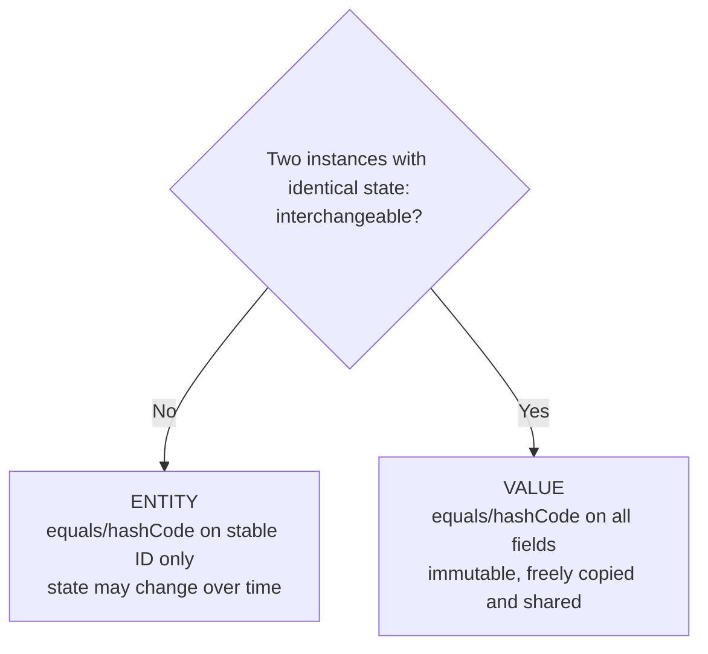
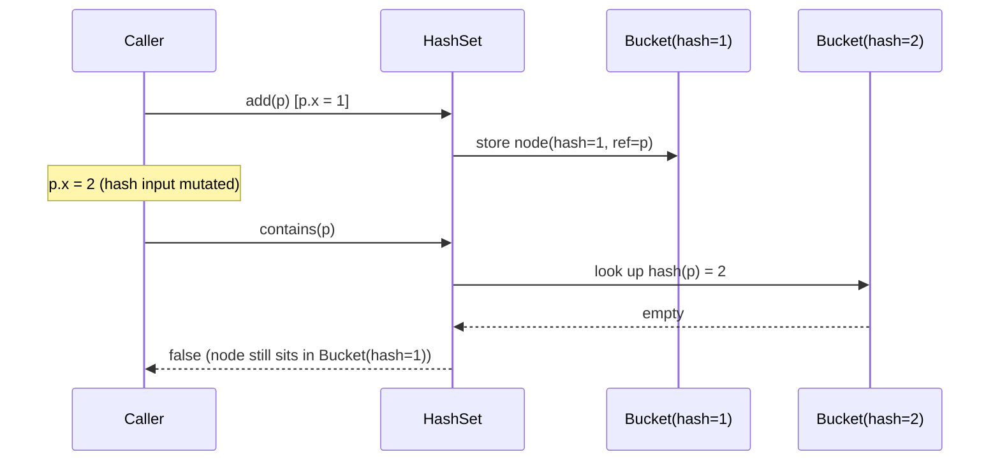
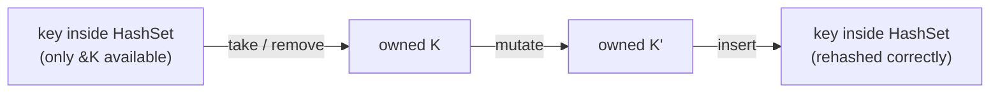

<!-- markdownlint-disable MD001 -->
<!-- markdownlint-disable MD024 -->
<!-- markdownlint-disable MD025 -->
<!-- markdownlint-disable MD026 -->
<!-- markdownlint-disable MD029 -->
<!-- markdownlint-disable MD033 -->
<!-- markdownlint-disable MD040 -->
<!-- markdownlint-disable MD056 -->
<!-- markdownlint-disable MD060 -->

# Identity vs Equality

## Contents

01. [Core idea](#01-core-idea)
02. [Entity vs value: the design decision](#02-entity-vs-value-the-design-decision)
03. [Deep dive: why a mutated element vanishes from a HashSet](#03-deep-dive-why-a-mutated-element-vanishes-from-a-hashset)
04. [Fixes, in order of preference](#04-fixes-in-order-of-preference)
05. [The same topic in Rust](#05-the-same-topic-in-rust)
06. [Java vs Rust summary](#06-java-vs-rust-summary)
07. [Interview angle](#07-interview-angle)
08. [Exercise with answer](#08-exercise-with-answer)
09. [Rules to carry forward](#09-rules-to-carry-forward)

---

## 01. Core idea

Every object has three things:

| Aspect       | Meaning                          | Example (`Account`)        |
| ------------ | -------------------------------- | -------------------------- |
| **Identity** | Which one it is                  | Account #A-1029            |
| **State**    | Its data right now               | Balance ₹5,000             |
| **Behavior** | What it can do                   | `withdraw`, `deposit`      |

Most design mistakes at this level come from not deciding, **for each type**, whether identity matters.

In Java:

- **Identity**: `a == b`. Two references point to the same object in memory.
- **Equality**: `a.equals(b)`. Two objects *mean* the same thing, and the type defines what "same" means.

The real design question:

> **If two instances have identical state, are they interchangeable?**
>
> - No: it is an **entity**. Identity matters.
> - Yes: it is a **value**. Only state matters.

<br>

---

## 02. Entity vs value: the design decision

```java
// Identity matters: two accounts with the same balance are still different accounts.
class Account {
    private final AccountId id;
    private Money balance;
    // equals/hashCode use id only, never balance
}

// Identity does not matter: any ₹100 is the same as any other ₹100.
record Money(BigDecimal amount, Currency currency) {}
// equals/hashCode use all fields (records generate this for you)
```



That one decision drives everything downstream:

| Concern                   | Entity                                   | Value                                        |
| ------------------------- | ---------------------------------------- | -------------------------------------------- |
| `equals` / `hashCode`     | ID only                                  | All fields                                   |
| Mutability                | State changes, identity stays            | Immutable                                    |
| Safe as a hash key        | Yes, if hashed on an immutable ID        | Yes (it is immutable)                        |
| Persistence and caching   | Needs a stable ID                        | Can be copied, cached, shared freely         |
| Java form                 | Class with `final` ID field              | `record`, or class with `final` fields       |
| Examples                  | `Account`, `Order`, `ParkingSpot`        | `Money`, `Location(floor, row)`, `DateRange` |

**Collections consequence:** put a mutable object in a `HashSet`, then change a field that `hashCode` uses, and the object is still in the set but can no longer be found.  
That is a real production bug, not a puzzle. Section 3 explains it.

---

## 03. Deep dive: why a mutated element vanishes from a HashSet

### 3.1 Mechanics

`HashSet` is backed by a `HashMap`.

**On `add`**, the map computes `hashCode()`, derives a bucket index from it, and stores a node that **caches that hash** together with a reference to the object.

**On `contains` and `remove`**, it:

1. Computes `hashCode()` of the argument **now**.
2. Jumps to the bucket for that hash.
3. In that bucket, checks `node.hash == hash && (node.key == k || k.equals(node.key))`.

The node was placed by the hash **at insertion time**. Mutate a field that feeds `hashCode()` and the object's current hash no longer matches its bucket or the cached hash.  
The set never rehashes existing elements on its own, so the entry stays where it was filed.



### 3.2 Reproduction

```java
class Point {
    int x;
    Point(int x) { this.x = x; }

    @Override public boolean equals(Object o) { return o instanceof Point p && p.x == x; }
    @Override public int hashCode()           { return Integer.hashCode(x); }
}

Set<Point> set = new HashSet<>();
Point p = new Point(1);
set.add(p);

p.x = 2;

set.contains(p);          // false  (looks in the bucket for hash 2, node is filed under hash 1)
set.remove(p);            // false  (cannot remove it)
set.size();               // 1      (it is still in there)
for (Point q : set) {}    // iteration still yields it (walks all buckets, no hash lookup)
set.add(p);               // true   (looks "new")
set.size();               // 2      (the same object is now in the set twice)
```

### 3.3 Four failures from one mutation

| Failure                 | Symptom                                                                        |
| ----------------------- | ------------------------------------------------------------------------------ |
| **Ghost entry**         | Present for iteration and `size()`, absent for lookup                          |
| **Leak**                | Cannot be removed through the API; lives until the set is cleared or collected |
| **Broken uniqueness**   | The set's "no duplicates" guarantee is gone                                    |
| **Inconsistent views**  | `size()` and iteration disagree with `contains()`                              |

The same applies to:

- `HashMap` and `ConcurrentHashMap` keys.
- `TreeSet` / `TreeMap` when fields used by the comparator change. The tree is ordered by the old values, so binary search goes the wrong way.

### 3.4 Where it shows up in production

- **Session / subscriber registries.** `Map<Session, X>` or `Set<Subscriber>` whose key class has mutable fields in `equals`/`hashCode`. Entries stop being removed on logout or unsubscribe; memory grows slowly.
- **Caches keyed by request objects** that something downstream mutates (for example a normalizer rewriting a field). Hit rate drops with no error anywhere.
- **JPA entities hashed on a generated ID.** The ID is `null` before `persist` and set after, so an entity added to a `HashSet` before saving cannot be found after saving.
- **Dedup logic** (`Set<Event>`) silently letting duplicates through.

### 3.5 The contract behind it

`hashCode` must be **consistent**: it must return the same value for as long as the fields used in `equals` are unchanged.  
That sentence quietly assumes those fields do not change while the object sits in a hash structure.  
The language does not enforce this, so you enforce it with design.

**Related edge:** `equals` and `hashCode` must be overridden **together**.  
If two equal objects return different hashes, you get the same lookup failure with no mutation at all, because equal objects land in different buckets.

---

## 04. Fixes, in order of preference

| # | Fix                                       | How                                                                                      | Trade-off                                              |
| - | ----------------------------------------- | ---------------------------------------------------------------------------------------- | ------------------------------------------------------ |
| 1 | **Make the key type immutable**           | `record`, or class with `final` fields                                                   | None for values; the problem cannot occur              |
| 2 | **Hash only on immutable identity**       | Entity hashes on its ID or a business key assigned at construction (UUID / snowflake)    | ID must exist before the object enters any collection  |
| 3 | **Remove, mutate, re-add**                | `set.remove(p); p.x = 2; set.add(p);`                                                    | Fragile: every code path must remember it              |
| 4 | **Do not key by the mutable object**      | `Map<AccountId, Account>` instead of `Set<Account>`                                      | Extra indirection, but robust                          |

Fix 2 also removes the JPA bug: assign the ID in the constructor, not at persist time.

Fix 3 is the right tool in **one case only**: a mutable key that has no stable identity field to hash on.

---

## 05. The same topic in Rust

### 5.1 Equality is the default meaning of `==`

`==` is always **value equality**, through the `PartialEq` trait.  
There is no Java-style `==` that compares references. Identity is explicit and rare:

```rust
std::ptr::eq(&a, &b)      // same address?
Rc::ptr_eq(&x, &y)        // same shared allocation?
```

Values are moved or cloned, not aliased by default, so "which object is it" matters much less than in Java.  
**Identity in Rust is mostly an ID field, not an address.**

### 5.2 Value vs entity through derives

```rust
use std::hash::{Hash, Hasher};

#[derive(Debug, Clone, PartialEq, Eq, Hash)]
struct Money { amount: i64, currency: Currency }   // value: all fields

struct Account { id: AccountId, balance: Money }   // entity: id only

impl PartialEq for Account {
    fn eq(&self, o: &Self) -> bool { self.id == o.id }
}
impl Eq for Account {}
impl Hash for Account {
    fn hash<H: Hasher>(&self, s: &mut H) { self.id.hash(s) }
}
```

The contract is identical to Java's: `a == b` must imply equal hashes.  
Two Rust-specific details:

- `f64` is only `PartialEq` (`NaN != NaN`), so a struct containing one cannot derive `Eq` and cannot be a `HashMap` key. Money as `i64` minor units avoids this.
- `Clone` produces a new, equal value. There is no "same object" to preserve.

### 5.3 The HashSet mutation bug mostly cannot happen

`HashSet` and `HashMap` **own** their keys and hand out only `&K`. There is no `iter_mut` on a set and no `keys_mut` on a map.  
To change a key you must take it out first (`remove` / `take`), which hands you ownership, then mutate, then `insert` again.

**Fix 3 from section 4 is the only path the compiler lets you take.**



**Escape hatch:** interior mutability. A key containing `Cell` / `RefCell` can change its hash while inside the set.  
The standard library documents this as a **logic error**: wrong results, but not memory-unsafe.

> Rule: never put interior mutability into anything that feeds `Hash` / `Eq`.

---

## 06. Java vs Rust summary

| Aspect                  | Java                                                  | Rust                                                        |
| ----------------------- | ----------------------------------------------------- | ----------------------------------------------------------- |
| `==` means              | Reference identity                                    | Value equality (`PartialEq`)                                |
| Identity check          | `==`                                                  | `std::ptr::eq`, `Rc::ptr_eq` (rare)                         |
| Value type              | `record`                                              | `#[derive(Clone, PartialEq, Eq, Hash)]` struct              |
| Entity equality         | Override `equals`/`hashCode` on ID                    | Manual `PartialEq` / `Eq` / `Hash` on ID                    |
| Mutable-key bug         | Possible; prevented only by discipline                | Prevented by ownership; only interior mutability reopens it |
| Float in key            | Allowed (`Double.equals` quirks)                      | Rejected: `f64` is not `Eq`                                 |

<br>

---

## 07. Interview angle

- In a parking-lot round, `ParkingSpot` is an **entity** (spot 42 stays spot 42 when occupancy changes) and `Location(floor, row)` is a **value**.  
  Saying this out loud shows deliberate modeling.
- "What happens if you modify a HashMap key?" A complete answer covers:
  1. Bucket mechanics (hash cached at insert).
  2. Ghost-entry symptoms (lookup fails, iteration and size still see it, duplicates possible).
  3. The fix: immutability or stable identity.
- It is the cleanest justification for "keys should be value objects".
- Value objects vs entities return in depth in **A9**.

---

## 08. Exercise with answer

### Question

A `Set<Order>` where `Order.equals` compares `orderId` **and** `status`, and `hashCode` uses the same two fields.  
An order moves from `PLACED` to `SHIPPED` while it is in the set.

1. List what breaks.
2. Give the smallest change that fixes it.

### Common first answer (incomplete)

> "The set becomes inconsistent. Remove the order, mutate the status, put it back."

The diagnosis is right. The fix works but is **fragile**, and it is **not** the smallest change.

### What breaks

- `contains(order)` and `remove(order)` return `false` after `PLACED` → `SHIPPED`.
- The order stays as a **ghost entry**: visible to iteration and `size()`, invisible to lookup.
- `add(order)` succeeds again, so the same object is in the set **twice**.
- **Modeling error, separate from the mutation bug:** two states of one order compare unequal, so `PLACED#42` and `SHIPPED#42` can coexist as "different" orders.

### Why remove, mutate, re-add is weak

| Problem                     | Detail                                                                                 |
| --------------------------- | -------------------------------------------------------------------------------------- |
| Unknown membership          | `Order.ship()` cannot know which collections hold it (two sets and a map, say)         |
| Every path must remember    | One missed call site silently reintroduces the bug                                     |
| Not concurrency-safe        | Between `remove` and `add`, other threads see the order missing                        |
| Breaks encapsulation        | Pushes a collection concern into domain code (undoes A2)                               |

### Smallest correct fix

Remove `status` from `equals` / `hashCode`:

```java
@Override public boolean equals(Object o) {
    return o instanceof Order other && orderId.equals(other.orderId);
}

@Override public int hashCode() { return orderId.hashCode(); }
```

`Order` is an **entity**: its identity is `orderId`, and `status` is state that changes over time.  
Identity must not depend on state that is allowed to change. With this change, `status` mutates freely, no collection is ever inconsistent, and no caller needs any ritual.

To compare two orders by state, write an explicit method such as `sameStateAs(other)`, not `equals`.

### Rust note

The same `Order` in Rust would implement `PartialEq` / `Hash` on `order_id` only.  
Even with the wrong derive, the bug cannot occur through safe code: a `HashSet<Order>` gives out only `&Order`, so `status` cannot be changed in place.

---

## 09. Rules to carry forward

1. Decide **entity or value** for every type before writing `equals`.
2. Hash and equality fields must be a **subset of fields that never change after construction**.
3. If a field can change, it does not belong in `equals`.
4. Override `equals` and `hashCode` **together**, always with `@Override`.
5. Assign entity IDs at **construction**, not at persistence.
6. Prefer keying collections by an **immutable ID** over keying by the object.

---
