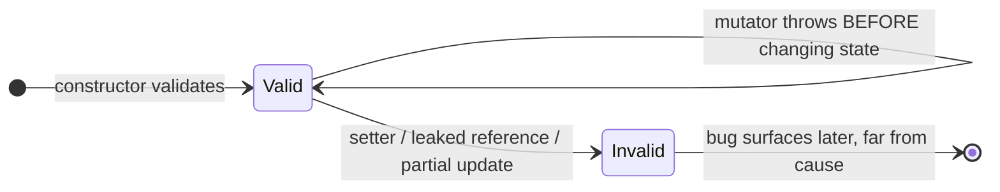
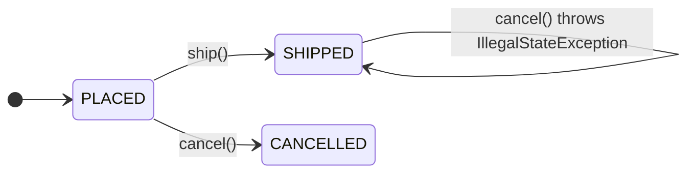
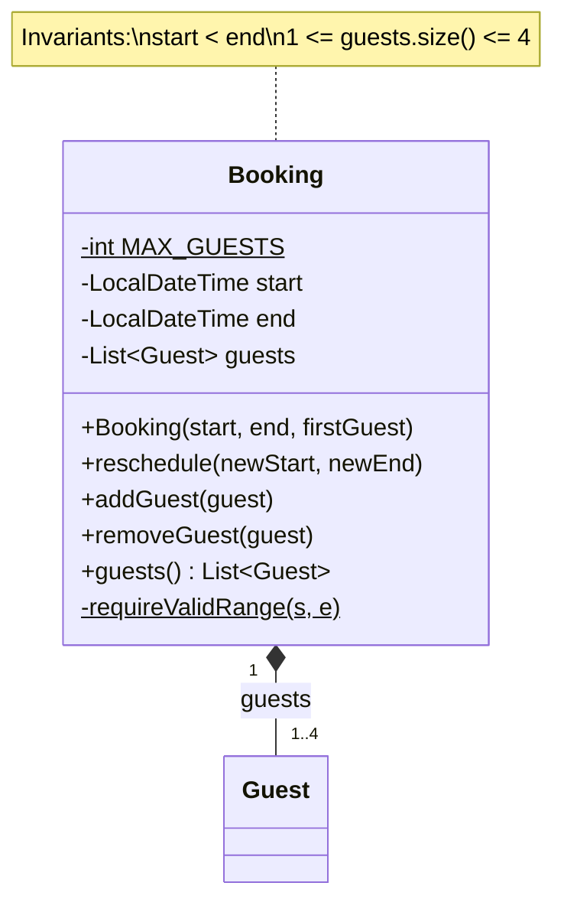

<!-- markdownlint-disable MD001 -->
<!-- markdownlint-disable MD024 -->
<!-- markdownlint-disable MD025 -->
<!-- markdownlint-disable MD026 -->
<!-- markdownlint-disable MD029 -->
<!-- markdownlint-disable MD033 -->
<!-- markdownlint-disable MD040 -->
<!-- markdownlint-disable MD056 -->
<!-- markdownlint-disable MD060 -->

# Encapsulation and Invariants

## Contents

01. [Core idea](#01-core-idea)
02. [Encapsulation vs information hiding](#02-encapsulation-vs-information-hiding)
03. [Invariants are the unit of design](#03-invariants-are-the-unit-of-design)
04. [Tell, don't ask](#04-tell-dont-ask)
05. [The leak catalogue](#05-the-leak-catalogue)
06. [Getters and setters as a smell, precisely](#06-getters-and-setters-as-a-smell-precisely)
07. [The same topic in Rust](#07-the-same-topic-in-rust)
08. [Java vs Rust summary](#08-java-vs-rust-summary)
09. [Architect and interview angle](#09-architect-and-interview-angle)
10. [Exercise 1 with answer: `Order`](#10-exercise-1-with-answer-order)
11. [Exercise 2 with answer: `Booking`](#11-exercise-2-with-answer-booking)

---

## 01. Core idea

The common definition is "make fields private".  
The useful definition is:

> **An object protects its invariants, and no outside code can put it into an invalid state.**

Private fields are only the mechanism.

### Violation: the anemic model

```java
class Account {
    private BigDecimal balance;
    public BigDecimal getBalance()      { return balance; }
    public void setBalance(BigDecimal b) { this.balance = b; }
}

// The rule lives in a service, and every caller has to remember it.
if (acc.getBalance().compareTo(amt) >= 0) {
    acc.setBalance(acc.getBalance().subtract(amt));
}
```

The fields are private, yet nothing is encapsulated:

- The rule "balance never goes negative" is copied into every caller, and any one of them can skip it.
- The check-then-act sequence is a **race condition** under concurrency.

### Fix: tell, don't ask

```java
class Account {
    private BigDecimal balance;

    public void withdraw(BigDecimal amt) {
        if (amt.signum() <= 0)            throw new IllegalArgumentException("non-positive");
        if (balance.compareTo(amt) < 0)   throw new InsufficientFundsException();
        balance = balance.subtract(amt);
    }
}
```

- The invariant lives in **exactly one place**.
- Callers say what they want; the object decides.
- `withdraw` describes the **domain**; `setBalance` describes **storage**.

---

## 02. Encapsulation vs information hiding

| Term                                | Meaning                                                                                             |
| ----------------------------------- | --------------------------------------------------------------------------------------------------- |
| **Encapsulation**                   | Bundling data with the operations on it, so the object is the only thing that changes its own state |
| **Information hiding** (Parnas)     | Hiding the design decisions most likely to change behind a stable interface                         |

Private fields give you **neither** automatically. A getter and setter for every field is a public field with extra syntax.

The hiding that matters is of **decisions**: how the balance is stored, which collection holds the lines, what the status transitions are.  
If callers can see and depend on those, you can no longer change them.

---

## 03. Invariants are the unit of design

An **invariant** is a condition that must hold whenever no method of the object is mid-execution.

Examples: balance is never negative; an order has at least one line; `start <= end`.

### Three enforcement rules

1. **Establish it in the constructor.** An object that can exist in an invalid state is a bug waiting for its first caller.
2. **Every mutating method preserves it**, or throws before changing anything (**failure atomicity**: no half-updated state).
3. **No outside path bypasses it.** That includes setters, leaked collections, and leaked mutable references.



### Why setters make multi-field invariants impossible

```java
class DateRange {
    private final LocalDate start, end;

    DateRange(LocalDate start, LocalDate end) {
        if (start.isAfter(end)) throw new IllegalArgumentException();
        this.start = start;
        this.end = end;
    }
}
```

With two setters (`setStart`, `setEnd`), the invariant `start <= end` **cannot** be preserved: moving the range forward requires a temporarily invalid state (new start after old end).

> **A setter makes multi-field invariants impossible.** Replace setters with one operation such as `shiftTo(newStart, newEnd)`, or return a new immutable object.

---

## 04. Tell, don't ask

| Style    | Shape                                                    | Consequence                                     |
| -------- | -------------------------------------------------------- | ----------------------------------------------- |
| **Ask**  | Get state, decide outside, push result back              | Logic duplicated at every call site; racy       |
| **Tell** | Say what you want; the object decides                    | Single source of truth; can be made atomic      |

```java
// Ask: logic outside, duplicated at every call site, racy
if (account.getBalance().compareTo(amt) >= 0) account.setBalance(...);

// Tell: logic inside, single source of truth, can be made atomic
account.withdraw(amt);
```

**Concurrency payoff:** a check-then-act split across two calls cannot be made atomic by the object. One method can (`synchronized`, a lock, or CAS inside).

### Limits of the principle

- **Queries are fine.** `order.status()` for display or reporting is not a violation. The smell is reading state *in order to make a decision the object could have made*.
- **Boundaries need data.** DTOs, serialization, and view models legitimately expose fields. Keep them out of the domain model.
- **It is a heuristic for where behavior lives**, not a ban on getters. Ask: *who owns the rule?*

---

## 05. The leak catalogue

Private fields with any of these leaks are still not encapsulated.

| Leak                                         | Example                                     | Fix                                                           |
| -------------------------------------------- | ------------------------------------------- | ------------------------------------------------------------- |
| Returning internal mutable collection        | `return lines;`                             | `List.copyOf(lines)` or `Collections.unmodifiableList(lines)` |
| Storing a caller's mutable argument          | `this.lines = lines;` in the constructor    | `this.lines = new ArrayList<>(lines);`                        |
| Returning a mutable internal object          | `return this.date;` where `Date` is mutable | Return an immutable type (`LocalDate`) or a copy              |
| Setter per field                             | `setStatus`, `setBalance`                   | Domain operation (`cancel`, `withdraw`)                       |
| Exposing representation in the type          | `ArrayList<Line> getLines()`                | Return `List<Line>` or `Iterable`, never the concrete type    |

### View vs snapshot

| Method                              | Kind         | Caller can mutate? | Sees later internal changes? |
| ----------------------------------- | ------------ | ------------------ | ---------------------------- |
| `Collections.unmodifiableList(xs)`  | **View**     | No (throws)        | Yes                          |
| `List.copyOf(xs)`                   | **Snapshot** | No (throws)        | No                           |

Choose by whether the caller should see live changes.

---

## 06. Getters and setters as a smell, precisely

- **Setter:** nearly always a smell on domain objects. It means *any value is valid at any time*, so the invariant is not enforced.
- **Getter:** a smell only when the caller uses it to make a decision that belongs inside. A getter feeding a log line, a UI, or a mapper is fine.
- **Anemic domain model** is the system-level version: objects hold data, services hold all the rules.  
  It is the most cited reason a machine-coding solution reads as "procedural code written with classes".

---

## 07. The same topic in Rust

### 7.1 The privacy boundary is the module, not the type

Fields are private by default, but "private" means visible anywhere in the **same module and its child modules**.

Consequence: put a type with invariants in **its own module**. Code beside it in the same module can still touch its fields.

| Visibility     | Visible to                         |
| -------------- | ---------------------------------- |
| (private)      | Same module and its children       |
| `pub(super)`   | Parent module                      |
| `pub(crate)`   | Whole crate                        |
| `pub`          | Everyone                           |

### 7.2 Construction is the invariant gate

Rust has no constructors. With **any** private field, code outside the module cannot use struct-literal syntax, so your `new` is the only way in.  
Errors are values (`Result`), not exceptions.

(The full `Booking` example is in [Exercise 2](#11-exercise-2-with-answer-booking).)

### 7.3 What Rust changes

1. **`Result` cannot be silently ignored.**  
  The compiler warns on an unused `Result`; callers must `match` or propagate with `?`. Java's unchecked exceptions can be skipped with no signal.

2. **`&self` vs `&mut self` is part of the signature.**  
  A "getter" taking `&self` provably cannot mutate (outside interior mutability).  
  Query vs command is **enforced**, not conventional.

3. **Leaks are cheaper to avoid.**  
  Returning `&[Guest]` gives a borrowed, read-only slice tied to the owner's lifetime, at zero copy cost. Java needs `List.copyOf` or a wrapper.  
  The leak to avoid is returning `&mut Vec<Guest>`.

4. **Check-then-act data races are compile errors across threads.**  
  Shared mutation needs `Mutex` / `RwLock` / atomics, and `&mut self` is exclusive by construction.  
  Tell-don't-ask still decides *where the rule lives*; the data-race half is enforced by the compiler.

5. **Plain data structs may have `pub` fields.**  
  If a struct has no invariant (a config bag, a DTO), public fields are idiomatic.  
  Getters and setters for their own sake are not Rust style. Add privacy exactly where an invariant exists.

When the invariant is about **one value** (a valid range, a non-empty list), wrap it in a **newtype** with a private field and a validating constructor, so the type itself proves validity.

---

## 08. Java vs Rust summary

| Aspect                 | Java                                       | Rust                                           |
| ---------------------- | ------------------------------------------ | ---------------------------------------------- |
| Encapsulation unit     | Class (plus package, plus module)          | Module                                         |
| Invariant gate         | Constructor                                | `new` (only path when any field is private)    |
| Failure signalling     | Exceptions (unchecked can be ignored)      | `Result` (unused `Result` warns)               |
| Read vs mutate         | Convention                                 | `&self` vs `&mut self`, compiler-enforced      |
| Read-only collection   | `List.copyOf` / unmodifiable view          | `&[T]` borrowed slice, zero copy               |
| Check-then-act race    | Possible; fix with locks                   | Data race is a compile error                   |
| Public fields          | Avoid on domain objects                    | Idiomatic for invariant-free data              |

---

## 09. Architect and interview angle

### Why it matters at architect level

- **Module and service boundaries are encapsulation at larger scale.**  
  A shared database table is a public field with no invariants.  
  An API exposing internal entities is a getter returning internal representation.  
  The same reasoning picks service boundaries.

- **Encapsulation sets the cost of change.**  
  One class touching the representation means a storage change is one edit.  
  Forty callers reading the field means a migration.

- **Java enforcement tools.**  
  Package - private by default, `private` fields, `final`, records for pure data, and `module-info.java` (`exports` only what is meant to be public).  
  Public is a commitment; make it deliberately.

### Machine-coding signal

Graders look for behavior inside domain objects (`spot.park(vehicle)`, `order.cancel()`) rather than a `ParkingService` calling setters on dumb data holders.

### Interview checklist

1. Name the invariant before writing the class ("an order always has at least one line").
2. Validate in the constructor, not in a service.
3. No setters unless you can justify them against the invariant.
4. Operations are domain verbs (`park`, `cancel`, `withdraw`), never `setX`.
5. Defensive copies on the way in and out, or immutable types.

---

## 10. Exercise 1 with answer: `Order`

### Question

`Order` has `getItems()` and `setStatus()`.  
Callers compute the total by looping over the items, and cancel an order with `setStatus(CANCELLED)` after checking it has not shipped.  
Two encapsulation fixes are needed.

### Answer

```java
// Before
order.getItems()            // callers loop and sum
order.setStatus(CANCELLED)  // callers check "not shipped" first
```

| Fix | Change                                                                                                |
| --- | ----------------------------------------------------------------------------------------------------- |
| 1   | The total belongs to the order: `order.total()` replaces every external loop                          |
| 2   | `setStatus` becomes `order.cancel()`, which owns the "not shipped" rule; items are returned as a copy |

```java
class Order {
    private final List<OrderLine> lines = new ArrayList<>();
    private Status status = Status.PLACED;

    Money total() {
        return lines.stream().map(OrderLine::subtotal).reduce(Money.ZERO, Money::plus);
    }

    void cancel() {
        if (status == Status.SHIPPED) throw new IllegalStateException("already shipped");
        status = Status.CANCELLED;
    }

    List<OrderLine> lines() { return List.copyOf(lines); }
}
```



<br>

---

## 11. Exercise 2 with answer: `Booking`

### Question

A `Booking` has `LocalDateTime start`, `LocalDateTime end`, and `List<Guest> guests`.

Rules:

1. `start < end`
2. At least one guest
3. At most 4 guests

Write the class so **no caller** can violate any rule. Include `addGuest` and a way to reschedule.

### A first attempt (as submitted)

```java
class Booking {
    LocalDateTime start;
    LocalDateTime end;
    List<Guest> guests;

    Booking(LocalDateTime start, LocalDateTime end) {
        if (start > end) {
            throw new Exception("Timeslot Mismatch");
        }
        this.start = start;
        this.end = end;
    }

    void addGuest(Guest guest) {
        if (this.guests.size() > 4) {
            throw new Exception("Guest Capcity Exceeded");
        }
        this.guests.add(guest);
    }
}
```

The structure is right (validation in the constructor, a domain verb, no setters). Seven defects remain.

### Defects, ranked by severity

| # | Defect                                  | Why it matters                                                                                            |
| - | --------------------------------------- | --------------------------------------------------------------------------------------------------------- |
| 1 | Fields not `private`                    | `booking.start = later;` and `booking.guests.add(x)` bypass every check                                   |
| 2 | Rule 2 not enforced                     | `new Booking(s, e)` has zero guests; invariant false from birth. Constructor must take the first guest    |
| 3 | Off-by-one on capacity                  | `size() > 4` passes at size 4, so a 5th guest is accepted. Must be `>= 4`                                 |
| 4 | `guests` never initialized              | First `addGuest` throws `NullPointerException`                                                            |
| 5 | Wrong comparison                        | `start > end` accepts `start == end`; `>` does not compile on `LocalDateTime`. Use `!start.isBefore(end)` |
| 6 | `throw new Exception(...)`              | Checked: forces `throws Exception`; callers cannot tell failures apart.                                   |
| 7 | No `reschedule`, no `removeGuest`       | `removeGuest` must refuse to drop the last guest, or rule 2 breaks later                                  |

**Pattern in the attempt:**  
It protected the invariants in view (range, capacity) and missed the ones that are properties of the object's **whole lifetime** (minimum guests from construction, private state).  
Check each invariant against **every entry point**: constructor, every mutator, every getter.

### Corrected version (Java)

```java
final class Booking {
    private static final int MAX_GUESTS = 4;

    private LocalDateTime start;
    private LocalDateTime end;
    private final List<Guest> guests = new ArrayList<>();

    Booking(LocalDateTime start, LocalDateTime end, Guest firstGuest) {
        requireValidRange(start, end);
        this.start = start;
        this.end = end;
        this.guests.add(Objects.requireNonNull(firstGuest));
    }

    void reschedule(LocalDateTime newStart, LocalDateTime newEnd) {
        requireValidRange(newStart, newEnd);   // validate both before touching either
        this.start = newStart;
        this.end = newEnd;
    }

    void addGuest(Guest guest) {
        Objects.requireNonNull(guest);
        if (guests.size() >= MAX_GUESTS) throw new IllegalStateException("guest capacity exceeded");
        guests.add(guest);
    }

    void removeGuest(Guest guest) {
        if (guests.size() == 1 && guests.contains(guest))
            throw new IllegalStateException("booking must keep at least one guest");
        guests.remove(guest);
    }

    List<Guest> guests() { return List.copyOf(guests); }

    private static void requireValidRange(LocalDateTime s, LocalDateTime e) {
        Objects.requireNonNull(s);
        Objects.requireNonNull(e);
        if (!s.isBefore(e)) throw new IllegalArgumentException("start must be before end");
    }
}
```



### Design points

- **One validation method**, called from both constructor and `reschedule`. Two paths enforcing the same rule drift apart.
- **`reschedule(start, end)` is one operation.** Two setters cannot move a range forward without passing through an invalid state.  
  Validating both before assigning either gives **failure atomicity**.
- **`guests()` returns a snapshot.** The constructor takes a single `Guest`, so there is no caller-owned list to copy on the way in.
- **Next refinement (A9):** extract `DateRange` as an immutable value object owning `start < end`. `Booking` holds one `DateRange`; `reschedule(DateRange r)` cannot receive an invalid range;  
  the rule exists once for every class that uses a range.
- **Concurrency:** not thread-safe.  
  `addGuest` is check-then-act on `size()`.  
  Making it atomic (`synchronized` or a lock) is a separate decision, normally made at the aggregate boundary.

### Same exercise in Rust

```rust
mod booking {                                  // own module: the privacy boundary
    use chrono::NaiveDateTime;

    #[derive(Debug, PartialEq)]
    pub struct Guest { pub name: String }

    #[derive(Debug)]
    pub enum BookingError { InvalidRange, Full, LastGuest }

    pub struct Booking {                       // fields private
        start: NaiveDateTime,
        end: NaiveDateTime,
        guests: Vec<Guest>,
    }

    impl Booking {
        const MAX_GUESTS: usize = 4;

        pub fn new(start: NaiveDateTime, end: NaiveDateTime, first: Guest)
            -> Result<Self, BookingError>
        {
            if start >= end { return Err(BookingError::InvalidRange); }
            Ok(Self { start, end, guests: vec![first] })
        }

        pub fn reschedule(&mut self, start: NaiveDateTime, end: NaiveDateTime)
            -> Result<(), BookingError>
        {
            if start >= end { return Err(BookingError::InvalidRange); }
            self.start = start;                // both validated before either is written
            self.end = end;
            Ok(())
        }

        pub fn add_guest(&mut self, g: Guest) -> Result<(), BookingError> {
            if self.guests.len() >= Self::MAX_GUESTS { return Err(BookingError::Full); }
            self.guests.push(g);
            Ok(())
        }

        pub fn remove_guest(&mut self, g: &Guest) -> Result<(), BookingError> {
            if let Some(i) = self.guests.iter().position(|x| x == g) {
                if self.guests.len() == 1 { return Err(BookingError::LastGuest); }
                self.guests.remove(i);
            }
            Ok(())
        }

        pub fn guests(&self) -> &[Guest] { &self.guests }   // read-only view, no copy
    }
}
```

| Concern                  | Java version                         | Rust version                                    |
| ------------------------ | ------------------------------------ | ----------------------------------------------- |
| Bypass via field access  | Prevented by `private`               | Prevented by private fields + own module        |
| Invalid construction     | Constructor throws                   | `new` returns `Err`                             |
| Read-only guests         | `List.copyOf` (allocates)            | `&[Guest]` (zero copy, cannot mutate)           |
| Ignored failure          | Unchecked exception may go unhandled | Unused `Result` triggers a warning              |
| Concurrent `add_guest`   | Needs explicit locking               | `&mut self` is exclusive; sharing needs `Mutex` |

---
