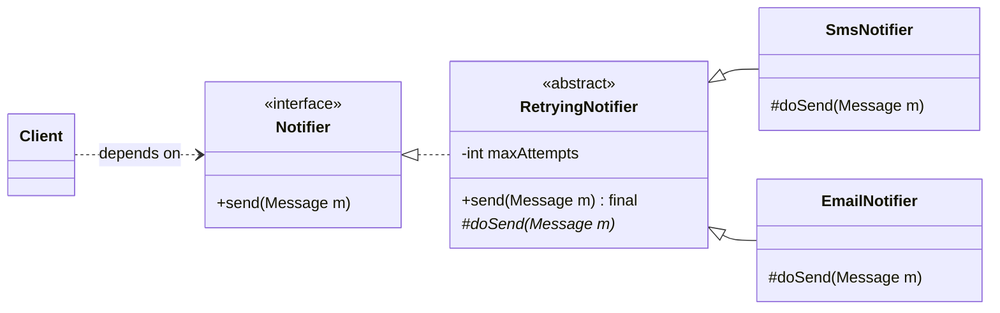
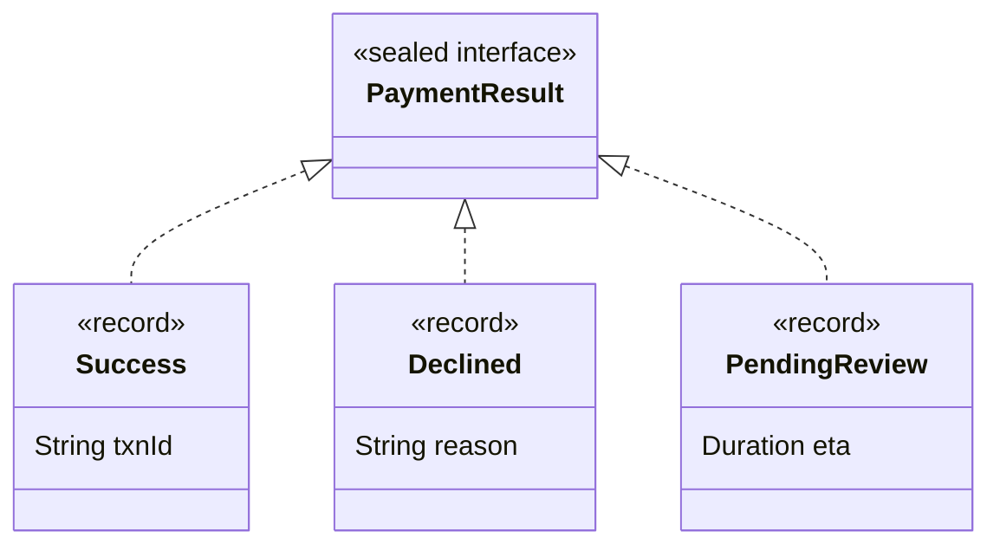
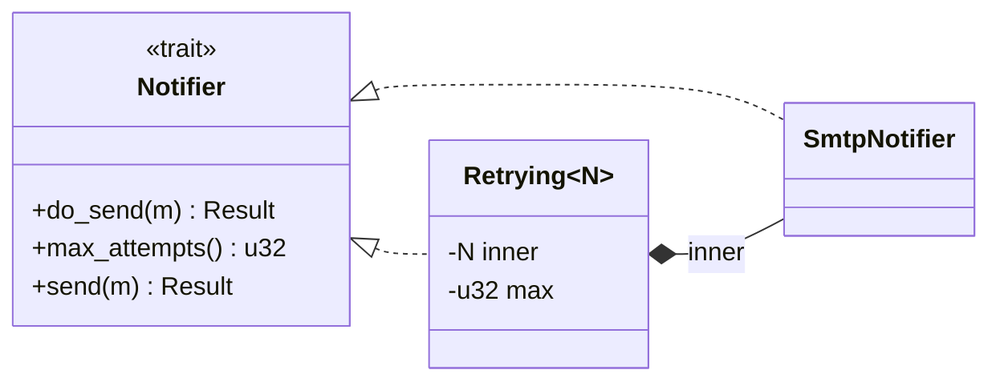
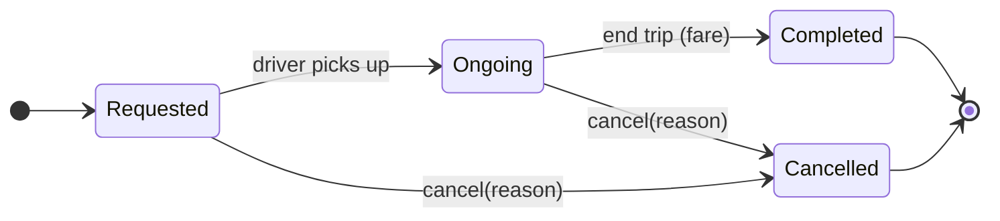

<!-- markdownlint-disable MD001 -->
<!-- markdownlint-disable MD024 -->
<!-- markdownlint-disable MD025 -->
<!-- markdownlint-disable MD026 -->
<!-- markdownlint-disable MD029 -->
<!-- markdownlint-disable MD033 -->
<!-- markdownlint-disable MD040 -->
<!-- markdownlint-disable MD056 -->
<!-- markdownlint-disable MD060 -->

# Abstraction: Interface vs Abstract Class vs Sealed

## Contents

01. [Core idea](#01-core-idea)
02. [Interface vs abstract class](#02-interface-vs-abstract-class)
03. [Default methods](#03-default-methods)
04. [Sealed hierarchies](#04-sealed-hierarchies)
05. [Open vs closed: the expression problem](#05-open-vs-closed-the-expression-problem)
06. [Enum vs sealed type](#06-enum-vs-sealed-type)
07. [The same topic in Rust](#07-the-same-topic-in-rust)
08. [Java vs Rust summary](#08-java-vs-rust-summary)
09. [Architect and interview angle](#09-architect-and-interview-angle)
10. [Exercise with answer: ride-hailing](#10-exercise-with-answer-ride-hailing)

<br>

---

## 01. Core idea

> **An abstraction is a contract that exposes what a client needs and hides everything else.**

Its quality is measured by how much the implementation can change without the client noticing.  

An interface that leaks implementation details (`getHibernateSession()`, `ArrayList<T> items()`) is an abstraction in name only.

Java gives three tools, each answering a different question:

| Tool                | Question it answers                                         |
| ------------------- | ----------------------------------------------------------- |
| **Interface**       | What can this do? (a capability or role, open set)          |
| **Abstract class**  | What shared state or algorithm do variants reuse?           |
| **Sealed type**     | What is the complete, fixed set of variants?                |

---

## 02. Interface vs abstract class

|                              | Interface                                              | Abstract class                                                    |
| ---------------------------- | ------------------------------------------------------ | ----------------------------------------------------------------- |
| Expresses                    | A capability or role: "can be paid", "can be sorted"   | A partial implementation: "is a kind of X, here is the shared part" |
| Instance state               | None (constants only)                                  | Yes                                                               |
| Constructors                 | No                                                     | Yes, so it can enforce invariants for subclasses                  |
| How many per class           | Many                                                   | One only                                                          |
| Member access modifiers      | Public API (plus `private` helpers since Java 9)       | Any, including `protected`                                        |
| Evolution                    | Add `default` methods without breaking implementors    | Add concrete methods without breaking subclasses                  |

**Default rule:** start with an interface.  
Use an abstract class only when subclasses share **state or a fixed algorithm skeleton** that you do not want duplicated.

### The interface + skeletal implementation pair

```java
interface Notifier { void send(Message m); }          // the contract

abstract class RetryingNotifier implements Notifier { // the shared skeleton
    private final int maxAttempts;

    protected RetryingNotifier(int maxAttempts) { this.maxAttempts = maxAttempts; }

    @Override public final void send(Message m) {     // template method: final, fixed order
        for (int i = 1; ; i++) {
            try { doSend(m); return; }
            catch (TransientException e) { if (i == maxAttempts) throw e; }
        }
    }

    protected abstract void doSend(Message m);        // the only hook subclasses fill in
}
```



- The **interface is what clients depend on**. The abstract class is an implementation convenience behind it. Clients never mention `RetryingNotifier`.
- The JDK does the same: `List` is the contract, `AbstractList` the skeletal implementation (Effective Java, "skeletal implementation" pattern).
- If you can't tell which to pick, you want **this pair**.

**Why not the abstract class as the contract?**  
A class has only one superclass, so every implementor would be forced onto your hierarchy. An interface leaves their one inheritance slot free.

---

## 03. Default methods

Added in Java 8 for **interface evolution**: `Collection.stream()` and `List.sort()` were added without breaking every implementation in the world.

```java
interface Shape {
    double area();
    default boolean isLargerThan(Shape o) { return area() > o.area(); }  // built from abstract ones
}
```

### Rules and pitfalls

- A default can only use the interface's own abstract methods (no state). That keeps defaults honest.
- **Diamond conflict:** if a class inherits the same default from two interfaces, it must override and pick explicitly: `A.super.hello()`.
- A default cannot override `equals`, `hashCode`, or `toString`.
- Not a back door to multiple implementation inheritance. Real logic in a default usually wants a separate class (composition, A6).
- Adding an **abstract** method to a published interface breaks all implementors. Adding a **default** method does not. That difference is the reason defaults exist.

```java
interface A { default String hello() { return "A"; } }
interface B { default String hello() { return "B"; } }

class C implements A, B {
    @Override public String hello() { return A.super.hello(); }   // must resolve explicitly
}
```

---

## 04. Sealed hierarchies

Interfaces and abstract classes are **open**: anyone can implement or extend them later.  
That suits extension points (plugins, strategies).  
It is the wrong tool when the variant set is **fixed and known**, such as payment outcomes or order states.

```java
sealed interface PaymentResult permits Success, Declined, PendingReview {}

record Success(String txnId)       implements PaymentResult {}
record Declined(String reason)     implements PaymentResult {}
record PendingReview(Duration eta) implements PaymentResult {}

String message(PaymentResult r) {
    return switch (r) {                       // no default branch
        case Success s       -> "paid " + s.txnId();
        case Declined d      -> "declined: " + d.reason();
        case PendingReview p -> "review in " + p.eta();
    };
}
```



The compiler knows the complete set, so the `switch` is **exhaustive**.  
Add a fourth variant and every `switch` that does not handle it **fails to compile**.  
With an open interface, the same mistake is a runtime surprise.

Sealed + records is Java's **algebraic data type**.

---

## 05. Open vs closed: the expression problem

| Hierarchy                                    | Add a new **type**                         | Add a new **operation**                |
| -------------------------------------------- | ------------------------------------------ | -------------------------------------- |
| **Open** (interface + virtual methods)       | Easy: one new class                        | Hard: edit every class                 |
| **Sealed** (variants + `switch`)             | Deliberate, compiler-checked change        | Easy: one new `switch`                 |

**Choose by what is more likely to change.**

- Plugins, strategies, pricing rules: **open**.
- Closed domain outcomes and states: **sealed**.

---

## 06. Enum vs sealed type

An enum constant is a **single shared instance with a fixed shape**.  
It cannot carry per-instance data.

```java
enum TripStatus { REQUESTED, ONGOING, COMPLETED, CANCELLED }

class Trip {
    TripStatus status;
    Money fare;        // meaningful only when COMPLETED
    String reason;     // meaningful only when CANCELLED
}
```

This compiles, but `fare` and `reason` exist in every state, so these illegal combinations are expressible:

- `REQUESTED` with a fare
- `COMPLETED` with `fare == null`
- `CANCELLED` with a fare and no reason

Every consumer must remember which field is valid in which state. That is the A2 problem one level up.

### Choosing

| Situation                                                                               | Use                              |
| --------------------------------------------------------------------------------------- | -------------------------------- |
| States are pure labels, or each constant has fixed data/behavior (display name, rate)   | `enum`                           |
| States carry different data per instance, or variants carry different fields            | `sealed interface` + records     |
| Persist or serialize cheaply (DB column, JSON string)                                   | `enum` is simpler                |
| Need `EnumSet` / `EnumMap`                                                              | `enum`                           |

Both give exhaustive `switch` without `default`, so that does not separate them.

> **Deciding question:** does any state need its own per-instance data? **Yes: sealed. No: enum.**

**Practical hybrid:** a sealed `TripState` in the domain model for the rules, plus an enum `TripStatus` used only for the DB column and filtering ("all ONGOING trips").  
Map one to the other at the persistence boundary.

Enums are more powerful than labels: they hold fields, implement interfaces, and carry per-constant behavior (enum-based State / Strategy, A12).

---

## 07. The same topic in Rust

### 7.1 No implementation inheritance

No abstract classes, no `extends`. Rust offers **traits** (interface role, with default methods) and **composition**.  
Shared state lives in a struct you embed or wrap.

### 7.2 Trait as contract, with defaults

```rust
trait Notifier {
    fn do_send(&self, m: &Message) -> Result<(), SendError>;   // required
    fn max_attempts(&self) -> u32 { 3 }                        // overridable default

    fn send(&self, m: &Message) -> Result<(), SendError> {     // template-method shape
        let mut i = 1;
        loop {
            match self.do_send(m) {
                Err(e) if e.is_transient() && i < self.max_attempts() => i += 1,
                other => return other,
            }
        }
    }
}
```

Two differences from the Java abstract class:

- **No state in traits**, so `max_attempts` is a method standing in for the field.
- **No `final`** on trait methods: an implementor may override `send` and break the fixed sequence.

### 7.3 Guaranteed skeleton: the decorator

For a guaranteed algorithm with state, wrap instead of inherit.  
This is the idiomatic Rust answer to "abstract class with shared skeleton".

```rust
struct Retrying<N: Notifier> { inner: N, max: u32 }

impl<N: Notifier> Notifier for Retrying<N> {
    fn max_attempts(&self) -> u32 { 1 }        // retry lives here; stop the default send() retrying again

    fn do_send(&self, m: &Message) -> Result<(), SendError> {
        let mut i = 1;
        loop {
            match self.inner.do_send(m) {
                Err(e) if e.is_transient() && i < self.max => i += 1,
                other => return other,
            }
        }
    }
}
```



### 7.4 Traits work retroactively

You can implement your trait for types you did not write (`impl Notifier for ExternalClient`, even `impl MyTrait for i32`).  
Java interfaces cannot be attached to existing classes.

**Orphan rule:** you must own either the trait or the type.

### 7.5 Default-method conflicts

Not resolved by inheritance rules. The call is ambiguous until you name the trait:

```rust
<T as A>::hello(&x)
```

### 7.6 Open vs closed in Rust

| Java                                       | Rust      |
| ------------------------------------------ | --------- |
| Interface (open set, extension point)      | `trait`   |
| Sealed interface + records (closed set)    | `enum`    |

Rust enums carry per-variant data natively, so the enum-vs-sealed debate from section 6 **does not exist** in Rust: the answer is always `enum`.

```rust
enum TripState {
    Requested,
    Ongoing,
    Completed { fare: Money },
    Cancelled { reason: String },
}
```

`match` is exhaustive by default, with no `sealed` keyword and no opt-in.  
For a public library enum where you want the opposite (callers must keep a wildcard arm so you can add variants later), mark it `#[non_exhaustive]`.

Holding trait implementors as `Box<dyn Trait>` (runtime dispatch) or `T: Trait` (compile-time dispatch) is the A5 choice.

---

## 08. Java vs Rust summary

| Concept                         | Java                                     | Rust                                           |
| ------------------------------- | ---------------------------------------- | ---------------------------------------------- |
| Contract                        | `interface`                              | `trait`                                        |
| Default behavior                | `default` methods                        | Default trait methods                          |
| Shared state + skeleton         | `abstract class` with `final` template   | Wrapper struct (decorator) via composition     |
| Locking the algorithm           | `final` method                           | Not possible in a trait; use a wrapper         |
| Attach contract to foreign type | Not possible                             | `impl Trait for Foreign` (orphan rule)         |
| Default conflict                | `A.super.m()`                            | `<T as A>::m(&x)`                              |
| Closed variant set              | `sealed` + records                       | `enum`                                         |
| Exhaustiveness                  | Opt-in via `sealed`                      | Default; opt out with `#[non_exhaustive]`      |

---

## 09. Architect and interview angle

- **Interface per class is a smell.** One implementation with no second in sight is ceremony.  
  Introduce an interface at a real boundary: a point of variation, a module edge, a test seam, or an owned dependency (B5).
- **The consumer owns the abstraction.** `Notifier` is shaped by the code that sends, not by `SmtpClient` exposing its own API.  
  That is the seed of Dependency Inversion.
- **Fat abstractions fail.** A 15-method interface forces implementors to stub what they don't need.  
  Leads into Interface Segregation.
- **Interview signal:** when introducing a type, say whether it is an **extension point** (open, interface) or a **closed set** (sealed) and why.  
  "I'm sealing this because the outcomes are fixed and I want the compiler to flag missed cases" separates you from candidates who default to an interface for everything.

---

## 10. Exercise with answer: ride-hailing

### Question

A ride-hailing app has two separate things to model.

**Thing 1: fare calculators.** Three ways to compute a fare (standard, surge, flat-rate).  
  They differ only in the pricing rule. New pricing rules will keep arriving.

**Thing 2: trip lifecycle.** A trip is always in exactly one of four states:

- `REQUESTED`
- `ONGOING`
- `COMPLETED`, carrying the final fare
- `CANCELLED`, carrying a reason

These four are fixed.

Tasks:

1. For Thing 1, pick interface, abstract class, or sealed type, with a one-line reason.
2. Same for Thing 2.
3. Write the Java type for Thing 2.
4. Write `String message(TripState s)` with a `switch` returning customer-facing text.

**What it tests:** telling an **open** set from a **closed** set, and using exhaustive `switch`.

### Answer

| Thing              | Choice           | Reason                                                                                 |
| ------------------ | ---------------- | -------------------------------------------------------------------------------------- |
| Fare calculators   | **Interface**    | Open set (new rules keep arriving), behavior-only variants, no shared state            |
| Trip lifecycle     | **Sealed type**  | Closed set of four; two variants carry different data; compiler checks every `switch`  |

```java
// Thing 1: open set, extension point
interface FareCalculator {
    Money fare(Trip trip);
}

class StandardFare implements FareCalculator {
    public Money fare(Trip t) { return RATE_PER_KM.times(t.distanceKm()); }
}

class SurgeFare implements FareCalculator {
    private final double multiplier;
    SurgeFare(double multiplier) { this.multiplier = multiplier; }
    public Money fare(Trip t) { return RATE_PER_KM.times(t.distanceKm()).times(multiplier); }
}

class FlatFare implements FareCalculator {
    private final Money amount;
    FlatFare(Money amount) { this.amount = amount; }
    public Money fare(Trip t) { return amount; }
}
```

```java
// Thing 2: closed set, data per variant
sealed interface TripState permits Requested, Ongoing, Completed, Cancelled {}

record Requested()               implements TripState {}
record Ongoing()                 implements TripState {}
record Completed(Money fare)     implements TripState {}
record Cancelled(String reason)  implements TripState {}

String message(TripState s) {
    return switch (s) {
        case Requested r -> "Looking for a driver";
        case Ongoing o   -> "Your trip is in progress";
        case Completed c -> "Trip complete. Fare: " + c.fare();
        case Cancelled x -> "Trip cancelled: " + x.reason();
    };
}
```



### Why it is built this way

- **No `default` in the `switch`.** Add a `Paused` state later and `message` stops compiling until it handles it.  
  With an open interface, or an enum plus `default`, the omission would pass silently.
- **Data lives only where it is meaningful.** `fare` only on `Completed`, `reason` only on `Cancelled`.  
  Illegal states are **unrepresentable**.
- **Calculators stay interface-only on purpose.** No shared state means an abstract class would be an empty hierarchy.  
  It becomes right only if all three must, say, apply the same rounding and tax after a base amount: then a `final` template method fixes the sequence and subclasses supply only the base.
- **Reversing the choices gives the wrong failures.** A sealed `FareCalculator` forces core edits for every pricing change; an open `TripState` loses compile-time help with missed cases.

### Follow-up: "Should `TripState` not be an `enum`?"

Not in Java, because two states carry **per-instance** data (see section 6).  
An enum constant `COMPLETED` cannot hold forty different fares.

In **Rust, yes**: the enum carries data per variant.

```rust
// Thing 1
trait FareCalculator { fn fare(&self, trip: &Trip) -> Money; }

struct StandardFare;
struct SurgeFare { multiplier: f64 }
struct FlatFare  { amount: Money }
// each: impl FareCalculator for ...

// Thing 2
enum TripState {
    Requested,
    Ongoing,
    Completed { fare: Money },
    Cancelled { reason: String },
}

fn message(s: &TripState) -> String {
    match s {
        TripState::Requested            => "Looking for a driver".into(),
        TripState::Ongoing              => "Your trip is in progress".into(),
        TripState::Completed { fare }   => format!("Trip complete. Fare: {fare}"),
        TripState::Cancelled { reason } => format!("Trip cancelled: {reason}"),
    }
}
```

> **Rule to keep:** open interface (trait) for behavior that varies and will grow; sealed type (enum in Rust) for a fixed set of outcomes or states.

---
