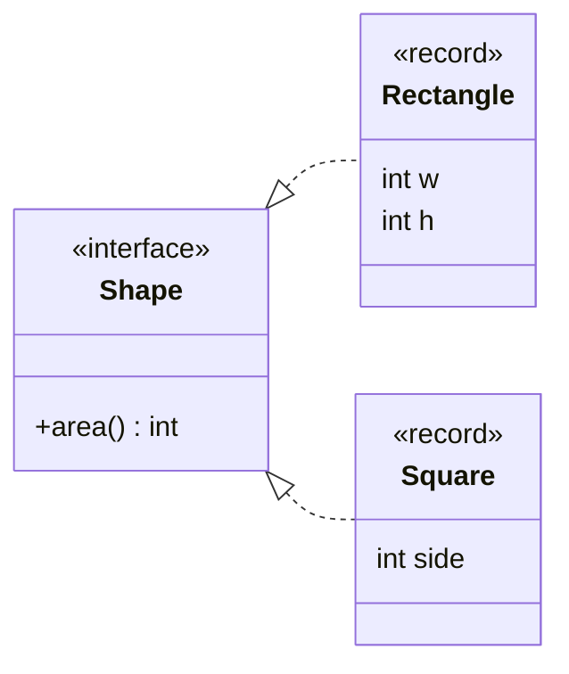
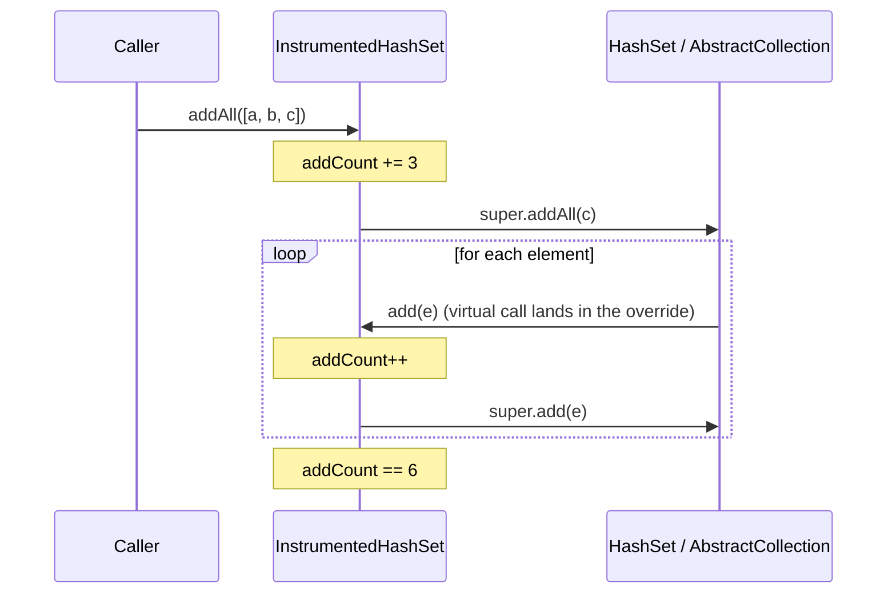
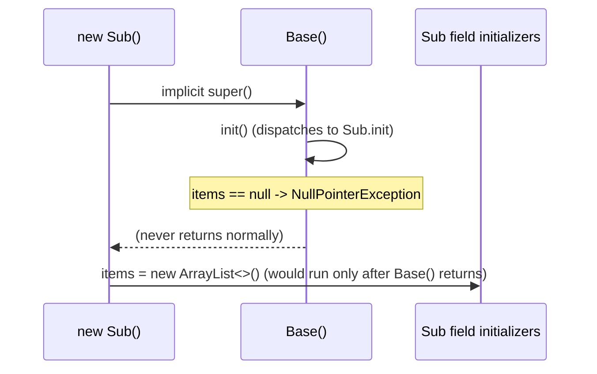
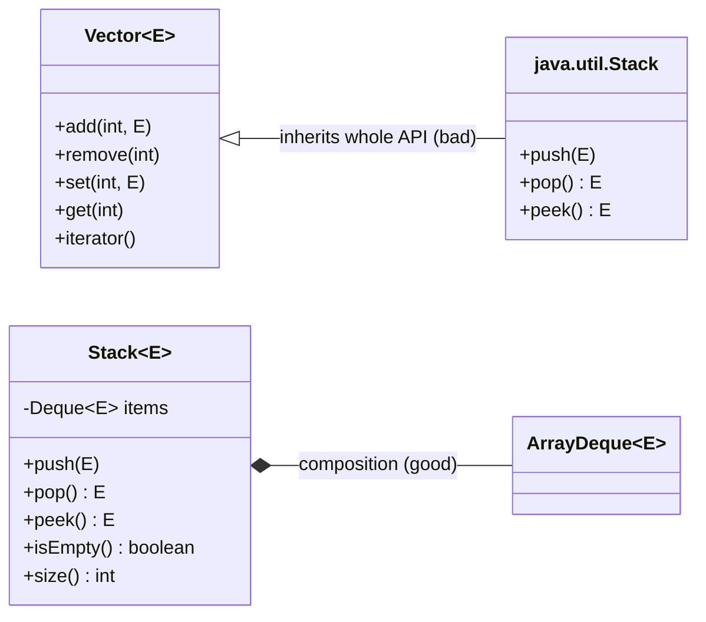

<!-- markdownlint-disable MD001 -->
<!-- markdownlint-disable MD024 -->
<!-- markdownlint-disable MD025 -->
<!-- markdownlint-disable MD026 -->
<!-- markdownlint-disable MD029 -->
<!-- markdownlint-disable MD033 -->
<!-- markdownlint-disable MD040 -->
<!-- markdownlint-disable MD056 -->
<!-- markdownlint-disable MD060 -->

# Inheritance

## Contents

01. [Core idea: two things in one keyword](#01-core-idea-two-things-in-one-keyword)
02. ["Is-a" is a behavioral test](#02-is-a-is-a-behavioral-test)
03. [Fragile base class problem](#03-fragile-base-class-problem)
04. [Overridable calls from constructors](#04-overridable-calls-from-constructors)
05. [Liskov pitfalls](#05-liskov-pitfalls)
06. [Final by default, sealed when you mean it](#06-final-by-default-sealed-when-you-mean-it)
07. [When inheritance is the right tool](#07-when-inheritance-is-the-right-tool)
08. [The same topic in Rust](#08-the-same-topic-in-rust)
09. [Java vs Rust summary](#09-java-vs-rust-summary)
10. [Architect and interview angle](#10-architect-and-interview-angle)
11. [Exercise with answer: `Stack extends Vector`](#11-exercise-with-answer-stack-extends-vector)

---

## 01. Core idea: two things in one keyword

`extends` bundles two separate things:

| Part                       | Meaning                                                    | Risk                                           |
| -------------------------- | ---------------------------------------------------------- | ---------------------------------------------- |
| **Subtyping**              | A `Square` can be used wherever a `Shape` is expected      | Low: safe and useful through interfaces (A3)   |
| **Implementation reuse**   | Subclass gets the parent's code and state for free         | High: tight, hidden coupling between classes   |

Nearly every inheritance problem comes from the **second** part.

> Inheritance couples the subclass to the parent's **implementation**, not only its interface.

---

## 02. "Is-a" is a behavioral test

"A square is a rectangle" is true in geometry and false in code.

```java
class Rectangle {
    protected int w, h;
    void setWidth(int w)  { this.w = w; }
    void setHeight(int h) { this.h = h; }
    int area() { return w * h; }
}

class Square extends Rectangle {
    @Override void setWidth(int w)  { this.w = w; this.h = w; }   // keeps it square
    @Override void setHeight(int h) { this.w = h; this.h = h; }
}

void resize(Rectangle r) {
    r.setWidth(5);
    r.setHeight(4);
    assert r.area() == 20;      // true for Rectangle, false (16) for Square
}
```

Code written against `Rectangle` assumes width and height change **independently**.  
`Square` breaks that promise, so it is not a valid substitute.

> **The real test:** does every promise the base type makes still hold for the subtype?

That is the **Liskov Substitution Principle** (B3 develops it).

### Fix

Don't relate them through a mutable parent. Make both implement `Shape { int area(); }` and make them **immutable**.  
With nothing mutable, the conflict disappears.



```java
interface Shape { int area(); }
record Rectangle(int w, int h) implements Shape { public int area() { return w * h; } }
record Square(int side)        implements Shape { public int area() { return side * side; } }
```

---

## 03. Fragile base class problem

A superclass method that calls another **overridable** method has an undocumented contract: "this method is implemented in terms of that one".  
A subclass overriding either can break, and a later change to the parent can break existing subclasses **with no compile error**.

```java
class InstrumentedHashSet<E> extends HashSet<E> {
    private int addCount = 0;

    @Override public boolean add(E e) {
        addCount++;
        return super.add(e);
    }

    @Override public boolean addAll(Collection<? extends E> c) {
        addCount += c.size();
        return super.addAll(c);
    }

    int addCount() { return addCount; }
}

var s = new InstrumentedHashSet<String>();
s.addAll(List.of("a", "b", "c"));
s.addCount();   // 6, not 3
```



`HashSet.addAll` (inherited from `AbstractCollection`) calls `add` once per element, so each element is counted twice.  

Deleting the `addAll` override "works" today, but silently depends on a JDK implementation detail that could change.

### Fix by composition (preview of A6 / A7)

Hold the set, forward to it, never inherit its internals.

```java
class InstrumentedSet<E> extends ForwardingSet<E> {      // Guava; delegates every call to `delegate`
    private int addCount = 0;

    InstrumentedSet(Set<E> delegate) { super(delegate); }

    @Override public boolean add(E e) {
        addCount++;
        return super.add(e);
    }

    @Override public boolean addAll(Collection<? extends E> c) {
        addCount += c.size();
        return super.addAll(c);          // forwards to delegate.addAll, which does not call our add
    }
}
```

| Property                                  | `extends HashSet`              | Forwarding wrapper                 |
| ----------------------------------------- | ------------------------------ | ---------------------------------- |
| Depends on                                | Parent's **implementation**    | Delegate's **public contract**     |
| Breaks if parent's self-use changes       | Yes, silently                  | No                                 |
| Works with                                | `HashSet` only                 | Any `Set`                          |

`ForwardingSet` itself extends a class, but one **designed** for it: its every method forwards to `delegate()`, so there is no hidden self-use.

---

## 04. Overridable calls from constructors

```java
class Base {
    Base() { init(); }                 // runs before Sub's fields are initialized
    void init() {}
}

class Sub extends Base {
    private final List<String> items = new ArrayList<>();
    @Override void init() { items.add("x"); }   // NullPointerException: items is still null
}
```



Field initializers of `Sub` run **after** `Base()` returns, so `init()` sees a half-built object.  
This also breaks the rule that a constructor establishes invariants before anything can observe the object.

<br>

---

## 05. Liskov pitfalls

A subclass may **not**:

| Forbidden move                                   | Example                                                       |
| ------------------------------------------------ | ------------------------------------------------------------- |
| Strengthen preconditions                         | Base accepts any positive amount; subclass rejects > 1000     |
| Weaken postconditions                            | Base promises a sorted result; subclass returns unsorted      |
| Throw unexpected exceptions                      | `add` throwing `UnsupportedOperationException`                |
| Break base invariants                            | Mutable subclass of a type clients assume immutable           |
| Change documented behavior                       | Losing sort stability or thread safety                        |

**JDK's own violation:**  

`Collections.unmodifiableList(...)` returns a `List` whose `add` throws `UnsupportedOperationException`.  
Code written against `List` that calls `add` fails at runtime.  
"Optional operations" in Java collections are the symptom of a hierarchy that made an is-a claim it could not honor.

---

## 06. Final by default, sealed when you mean it

Effective Java, Item 19: *design and document for inheritance or else prohibit it.*

1. **Make classes `final` by default.** Open one for extension deliberately.
2. If you allow subclassing, **document self-use** (which overridable methods call which). Javadoc has `@implSpec` for this.
3. Keep the overridable surface small: few `protected` hooks, all documented.
4. **Never call an overridable method from a constructor.**
5. Prefer **`sealed`** over open when the subclasses are a known, closed set. You control every subclass, so the fragile-base risk is bounded.

```java
public sealed abstract class Account permits Savings, Current {}   // closed, all in your control
```

<br>

---

## 07. When inheritance is the right tool

- **Skeletal implementations** designed for it (`AbstractList`), where the base documents exactly which methods to override.
- **Framework extension points** explicitly built for subclassing.
- **A true, stable subtype with shared state**, kept shallow (two levels comfortable, four a warning).
- **Exception hierarchies.**

Default to composition plus interfaces. Reach for `extends` only when you can say why delegation would be worse.

---

## 08. The same topic in Rust

The fragile base class problem **does not exist**, because Rust has no implementation inheritance.  
You cannot extend a struct.

| Need                              | Rust tool                                                    |
| --------------------------------- | ------------------------------------------------------------ |
| Subtyping / shared behavior       | Traits (A3)                                                  |
| Interface-level "is-a"            | Supertraits: `trait Pet: Animal {}`                          |
| Code reuse                        | Composition + delegation: embed a struct, forward calls      |
| Closed variant set                | `enum`                                                       |

### Supertraits

```rust
trait Animal { fn name(&self) -> String; }
trait Pet: Animal { fn owner(&self) -> String; }   // any Pet must also implement Animal

struct Dog { name: String, owner: String }

impl Animal for Dog { fn name(&self) -> String { self.name.clone() } }
impl Pet for Dog    { fn owner(&self) -> String { self.owner.clone() } }
```

This is a **requirement on contracts**, not inherited code. `Dog` writes both impls itself.

### Composition and delegation

```rust
struct Counter { count: usize }

struct InstrumentedSet<T> {
    inner: std::collections::HashSet<T>,
    adds: Counter,
}

impl<T: std::hash::Hash + Eq> InstrumentedSet<T> {
    pub fn insert(&mut self, v: T) -> bool {
        self.adds.count += 1;
        self.inner.insert(v)                    // forward; no hidden self-use to break
    }
    pub fn extend<I: IntoIterator<Item = T>>(&mut self, it: I) {
        for v in it { self.insert(v); }         // one counting path, by design
    }
    pub fn add_count(&self) -> usize { self.adds.count }
}
```

### Anti-pattern: `Deref` as fake inheritance

Implementing `Deref` on a wrapper so it "inherits" methods from the inner type looks like inheritance but breaks method-resolution expectations and is widely discouraged. **Forward the methods you actually want exposed.**

### Liskov still exists

Obligations live in the trait's documented contract.  
A trait saying "`len()` must match the number of items yielded by `iter()`" relies on implementors to behave.  
When the promise is safety-critical, Rust marks the trait `unsafe trait`: the implementor vouches for it.

---

## 09. Java vs Rust summary

| Concept                         | Java                                     | Rust                                          |
| ------------------------------- | ---------------------------------------- | --------------------------------------------- |
| Implementation inheritance      | `extends`                                | None                                          |
| Fragile base class              | Real risk                                | Cannot occur                                  |
| Interface "is-a"                | `interface B extends A`                  | Supertrait `trait B: A`                       |
| Reuse                           | `extends` or composition                 | Composition only                              |
| Closing a hierarchy             | `final`, `sealed`                        | Structs are always closed; `enum` for variants |
| Fake-inheritance trap           | Deep hierarchies, `protected` fields     | `Deref` on wrappers                           |
| Contract the compiler can't check | Javadoc / `@implSpec`                  | Trait docs; `unsafe trait` when critical      |

---

## 10. Architect and interview angle

- **Say the cost, not just the rule.** "Inheritance couples the subclass to the parent's implementation, not only its interface" is the sentence that shows you understand why composition is preferred.
- **One question per proposed subclass:** can it be used anywhere the parent is used, without the caller noticing a change in behavior? If you have to explain exceptions, the relationship is wrong.
- **Warning signs:**
  - A subclass overriding methods to throw or do nothing.
  - A hierarchy deeper than three.
  - A parent needing `instanceof` checks on its subclasses.
  - A `protected` field touched across the hierarchy.
- **Standard interview examples:**

| Example                   | Illustrates                     | Fix                                                    |
| ------------------------- | ------------------------------- | ------------------------------------------------------ |
| Rectangle / Square        | LSP violation                   | Common immutable `Shape` interface                     |
| `InstrumentedHashSet`     | Fragile base class              | Forwarding wrapper (composition)                       |
| Bird / Penguin `fly()`    | "Is-a but cannot do" trap       | Split capability interfaces (`Flyer`); don't override to throw |
| `Stack extends Vector`    | Inherited API breaks invariants | Wrap a `Deque` (see exercise)                          |

---

## 11. Exercise with answer: `Stack extends Vector`

### Question

`java.util.Stack<E> extends Vector<E>` is in the JDK.

1. Name two invariants of a stack that a caller can violate because of this inheritance.
2. Describe how you'd build `Stack` without extending anything.

### Answer

`extends Vector` makes **every** `Vector` method part of `Stack`'s public API.

**Invariant 1: LIFO-only access.** Elements enter and leave only at the top. Inherited methods bypass that:

```java
Stack<Integer> s = new Stack<>();
s.push(1); s.push(2); s.push(3);

s.add(0, 99);        // inserts at the bottom
s.remove(0);         // removes from the bottom
s.set(1, 42);        // overwrites a middle element
s.get(1);            // reads a middle element
```

**Invariant 2: only the top is observable.** `get(i)`, `elementAt(i)`, `insertElementAt(...)`, `removeElementAt(i)` expose arbitrary positions.

Even iteration contradicts the abstraction: iterating a `Stack` yields **bottom-to-top**, the opposite of pop order, so `new ArrayList<>(stack)` gives the reverse of what popping would.

Both failures come from the A4 rule: `extends` copies the parent's whole public contract into yours. `Stack` is not a `Vector` behaviorally; it merely **uses** one.



### Building it without inheritance (Java)

```java
final class Stack<E> {
    private final Deque<E> items = new ArrayDeque<>();   // hidden representation

    void push(E e)    { items.addFirst(Objects.requireNonNull(e)); }
    E pop()           { if (items.isEmpty()) throw new NoSuchElementException(); return items.removeFirst(); }
    E peek()          { return items.peekFirst(); }
    boolean isEmpty() { return items.isEmpty(); }
    int size()        { return items.size(); }
}
```

Only five operations exist, so no caller can violate the invariant.

In real code, use `Deque<E> stack = new ArrayDeque<>()` directly, which the JDK documentation recommends over `Stack`.

### Building it in Rust

```rust
pub struct Stack<T> { items: Vec<T> }          // private field

impl<T> Stack<T> {
    pub fn new() -> Self              { Self { items: Vec::new() } }
    pub fn push(&mut self, v: T)      { self.items.push(v); }
    pub fn pop(&mut self) -> Option<T>{ self.items.pop() }
    pub fn peek(&self) -> Option<&T>  { self.items.last() }
    pub fn is_empty(&self) -> bool    { self.items.is_empty() }
    pub fn len(&self) -> usize        { self.items.len() }
}
```

No `extends` exists, so the only way to leak `Vec`'s methods is implementing `Deref<Target = Vec<T>>` on the wrapper: the anti-pattern from section 8.

---
