<!-- markdownlint-disable MD001 -->
<!-- markdownlint-disable MD024 -->
<!-- markdownlint-disable MD025 -->
<!-- markdownlint-disable MD026 -->
<!-- markdownlint-disable MD029 -->
<!-- markdownlint-disable MD033 -->
<!-- markdownlint-disable MD036 -->
<!-- markdownlint-disable MD040 -->
<!-- markdownlint-disable MD056 -->
<!-- markdownlint-disable MD060 -->

# Config Server — HLD and LLD

---

## Table of Contents

01. [Purpose and Scope](#1-purpose-and-scope)
02. [Requirements](#2-requirements)
03. [Design Principles](#3-design-principles)
04. [High-Level Architecture](#4-high-level-architecture)
05. [Data Model](#5-data-model)
06. [Write Path](#6-write-path)
07. [Read Path](#7-read-path)
08. [Change Propagation](#8-change-propagation)
09. [Lifecycle Operations](#9-lifecycle-operations)
10. [API Design](#10-api-design)
11. [LLD — Rust and Actix](#11-lld--rust-and-actix)
12. [Validation Rules](#12-validation-rules)
13. [Security and Access Control](#13-security-and-access-control)
14. [Client SDK](#14-client-sdk)
15. [Failure Modes](#15-failure-modes)
16. [Observability](#16-observability)
17. [Scaling Path](#17-scaling-path)
18. [Trade-offs and Decisions](#18-trade-offs-and-decisions)
19. [Open Items](#19-open-items)

---

## 1. Purpose and Scope

A central service that stores typed configuration values (boolean flags and strings), scopes them by application and environment, allows them to change at runtime,  
and keeps a complete, immutable history of every change.

**Identity of a config:** `(namespace, environment, key)`

| Term        | Meaning                                                        |
|-------------|----------------------------------------------------------------|
| Namespace   | The owning application or logical grouping                     |
| Environment | Deployment stage: `dev`, `qa`, `preprod`, `prod`               |
| Key         | The flag or setting name                                       |
| Value       | The current typed value (`bool` or `string`)                   |
| Version     | A per-key, monotonically increasing change number              |
| Revision    | A global, monotonically increasing counter bumped on any write |

**In scope:** CRUD on configs, history, rollback, promotion across environments, prod approval, runtime propagation, client SDK.

**Out of scope (Draft 1):** per-user or per-segment targeting, percentage rollouts, multi-region replication. See [Open Items](#19-open-items).

---

## 2. Requirements

### 2.1 Functional

| ID   | Requirement                                                                     |
|------|---------------------------------------------------------------------------------|
| F-01 | Create, read, update, and soft-delete configs identified by namespace, env, key |
| F-02 | Support value types `bool` and `string`; the type is fixed at creation          |
| F-03 | `config_keys` always holds the current value                                    |
| F-04 | Every modification is recorded in `config_versions`; history is append-only     |
| F-05 | Every modification carries a mandatory reason and an actor                      |
| F-06 | Roll back a key to any earlier version                                          |
| F-07 | Promote a value from a lower environment to a higher one                        |
| F-08 | Changes in approval-gated environments (prod) require a second person           |
| F-09 | Clients observe changes without redeploying                                     |
| F-10 | Query full history of a key, filterable by time range and actor                 |

### 2.2 Non-Functional

| ID    | Requirement        | Target                                                   |
|-------|--------------------|----------------------------------------------------------|
| NF-01 | Read latency       | p99 < 5 ms server-side (served from memory)              |
| NF-02 | Read availability  | Reads continue during a database outage                  |
| NF-03 | Propagation delay  | p99 < 2 s from commit to all server nodes                |
| NF-04 | Write consistency  | No lost updates; concurrent writers are detected         |
| NF-05 | Auditability       | No history row is ever updated or deleted                |
| NF-06 | Read:write ratio   | Designed for > 10,000 : 1                                |
| NF-07 | Data volume        | Up to ~100k keys per deployment; snapshot fits in memory |

---

## 3. Design Principles

Each principle below is applied deliberately; the "Where" column points to the section that implements it.

| Principle                          | How it is applied                                                                                | Where           |
|------------------------------------|--------------------------------------------------------------------------------------------------|-----------------|
| Separation of read and write paths | Writes go through the database transactionally; reads are served from an in-memory snapshot      | §4, §6, §7      |
| Single source of truth             | `config_versions` is authoritative; `config_keys.current_value` is a transactional projection    | §5, §6          |
| Append-only history                | No UPDATE or DELETE on `config_versions`; rollback and delete are new versions                   | §5.4, §9        |
| Immutability                       | Snapshots are immutable and swapped atomically; readers never see a partial state                | §7, §11.5       |
| Fail static                        | On any failure, the last known good value is served; defaults are the last resort                | §14, §15        |
| Optimistic concurrency             | Writers send the version they read; a mismatch returns 409 instead of overwriting                | §6.2            |
| Idempotency                        | Every mutating request carries an idempotency key; retries never create duplicate versions       | §6.3            |
| Least privilege                    | Permissions are scoped per namespace and environment; SDK keys are read-only                     | §13             |
| Four-eyes control                  | Approval-gated environments require approval by someone other than the requester                 | §9.4            |
| Explicit typing                    | Value type is declared and immutable; values are validated before persistence                    | §12             |
| Dependency inversion               | Domain defines repository traits; Postgres is an adapter behind them                             | §11.2           |
| Single responsibility              | Each crate owns one concern: HTTP, use cases, domain rules, storage, caching, propagation        | §11.1           |
| Pure core, effects at the edges    | Domain logic has no I/O and is fully unit-testable                                               | §11.3           |
| Observability by default           | Every request has a request id, structured logs, and metrics                                     | §11.6, §16      |

---

## 4. High-Level Architecture

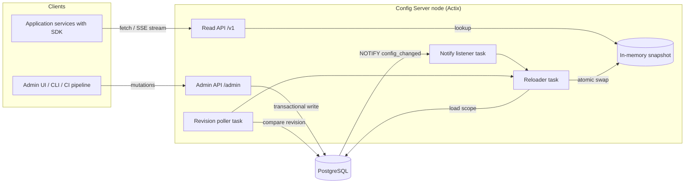

### 4.1 Components

| Component        | Responsibility                                                         | Consistency               | Traffic |
|------------------|------------------------------------------------------------------------|---------------------------|---------|
| Admin API        | Create, update, rollback, promote, delete, approve, history            | Strong (DB transaction)   | Low     |
| Read API         | Serve current values; SSE stream of changes                            | Eventual (seconds)        | High    |
| PostgreSQL       | Source of truth for keys, versions, permissions                        | Strong                    | Low     |
| Snapshot         | Immutable map of all current values, per namespace and environment     | Atomic swap               | High    |
| Notify listener  | Receives `config_changed` notifications from Postgres                  | Best effort               | Low     |
| Revision poller  | Safety net; detects missed notifications by comparing global revision  | Periodic                  | Low     |
| Reloader         | Rebuilds affected snapshot scopes and swaps them in                    | Serialized per node       | Low     |
| Client SDK       | Local cache, refresh loop, fallback chain                              | Eventual                  | —       |

### 4.2 Deployment

| Stage   | Topology                                                                      |
|---------|-------------------------------------------------------------------------------|
| Initial | N identical stateless nodes behind a load balancer; both APIs in one binary   |
| Growth  | Separate admin and read deployments from the same binary via a run-mode flag  |
| Large   | Read nodes load snapshots from a Postgres read replica                        |

---

## 5. Data Model

### 5.1 Entity Relationships

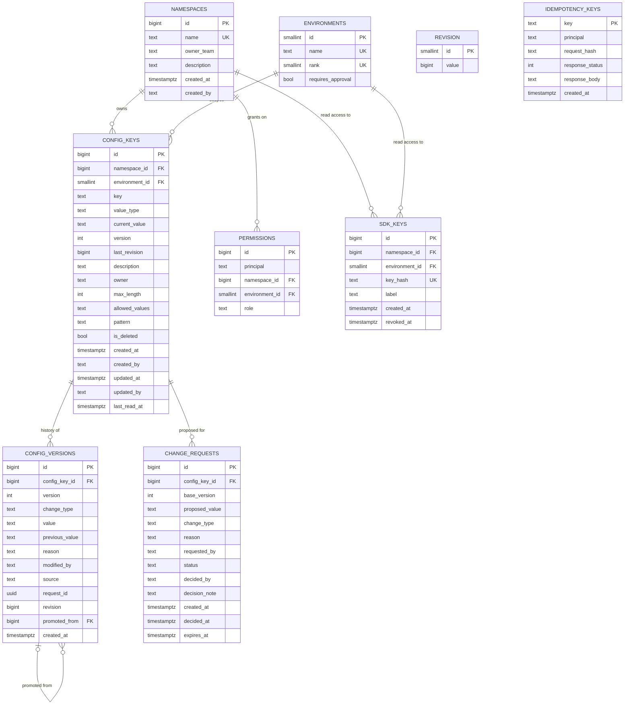

### 5.2 Table Classification

| Table              | Category   | Mutability                              | Purpose                                   |
|--------------------|------------|-----------------------------------------|-------------------------------------------|
| `namespaces`       | Reference  | Rarely updated                          | Application ownership                     |
| `environments`     | Reference  | Seeded; effectively static              | Stages, promotion order, approval gating  |
| `config_keys`      | Core       | Updated on every change (projection)    | Identity plus current value               |
| `config_versions`  | Core       | Append-only                             | Full audit history                        |
| `revision`         | Core       | Single row, incremented                 | Global change detection                   |
| `change_requests`  | Workflow   | Status transitions only                 | Approval flow for gated environments      |
| `idempotency_keys` | Operational| Insert once; expired by TTL job         | Safe retries                              |
| `permissions`      | Security   | Admin-managed                           | Write authorization                       |
| `sdk_keys`         | Security   | Insert; revoke by timestamp             | Read authorization for SDKs               |

### 5.3 `config_keys`

| Column           | Type          | Null | Constraint / Default                          | Notes                                         |
|------------------|---------------|------|-----------------------------------------------|-----------------------------------------------|
| `id`             | `bigint`      | No   | PK, identity                                  | Surrogate key                                 |
| `namespace_id`   | `bigint`      | No   | FK → `namespaces.id`                          | Prevents typo namespaces                      |
| `environment_id` | `smallint`    | No   | FK → `environments.id`                        | No free-text environments                     |
| `key`            | `text`        | No   | Pattern check (§12)                           | Flag or setting name                          |
| `value_type`     | `text`        | No   | `IN ('bool','string')`                        | Immutable after creation                      |
| `current_value`  | `text`        | No   | Type-consistent check                         | Always equals the latest version's value      |
| `version`        | `int`         | No   | `>= 1`                                        | Used for optimistic locking                   |
| `last_revision`  | `bigint`      | No   |                                               | Global revision at last change; feeds ETags   |
| `description`    | `text`        | No   | Non-empty                                     | What the flag controls                        |
| `owner`          | `text`        | No   |                                               | Accountable team or person                    |
| `max_length`     | `int`         | Yes  | Strings only                                  | Upper bound on value length                   |
| `allowed_values` | `text[]`      | Yes  | Strings only                                  | Enumerated allowed values                     |
| `pattern`        | `text`        | Yes  | Strings only                                  | Regex the value must match                    |
| `is_deleted`     | `bool`        | No   | Default `false`                               | Soft delete                                   |
| `created_at`     | `timestamptz` | No   | Default `now()`                               |                                               |
| `created_by`     | `text`        | No   |                                               |                                               |
| `updated_at`     | `timestamptz` | No   |                                               |                                               |
| `updated_by`     | `text`        | No   |                                               |                                               |
| `last_read_at`   | `timestamptz` | Yes  |                                               | Batched by nodes; stale-flag detection        |

**Constraints and indexes**

| Name                           | Definition                                               | Purpose             |
| :----------------------------- | :------------------------------------------------------- | :------------------ |
| `uq_config_keys_identity`      | UNIQUE (`namespace_id`, `environment_id`, `key`)         | Enforces identity   |
| `ix_config_keys_scope`         | (`namespace_id`, `environment_id`) WHERE NOT `is_deleted`| Snapshot loading    |
| `ix_config_keys_last_revision` | (`last_revision`)                                        | Incremental reloads |

### 5.4 `config_versions`

| Column           | Type          | Null | Constraint / Default                                             | Notes                                   |
| :--------------- | :------------ | :--- | :--------------------------------------------------------------- | :-------------------------------------- |
| `id`             | `bigint`      | No   | PK, identity                                                     |                                         |
| `config_key_id`  | `bigint`      | No   | FK → `config_keys.id`                                            |                                         |
| `version`        | `int`         | No   | `>= 1`                                                           | Matches `config_keys.version` at write  |
| `change_type`    | `text`        | No   | `IN ('create','update','rollback','promote','delete','restore')` |                                         |
| `value`          | `text`        | No   |                                                                  | Value after this change                 |
| `previous_value` | `text`        | Yes  | Null only for `create`                                           | Makes each row self-describing          |
| `reason`         | `text`        | No   | Length ≥ 10                                                      | Mandatory, including on create          |
| `modified_by`    | `text`        | No   |                                                                  | Authenticated principal                 |
| `source`         | `text`        | No   | `IN ('ui','api','ci','rollback','promotion','approval')`         | Origin of the change                    |
| `request_id`     | `uuid`        | No   |                                                                  | Correlates with logs and traces         |
| `revision`       | `bigint`      | No   |                                                                  | Global revision assigned to this change |
| `promoted_from`  | `bigint`      | Yes  | FK → `config_versions.id`                                        | Set only for `promote`                  |
| `created_at`     | `timestamptz` | No   | Default `now()`                                                  |                                         |

**Constraints and indexes**

| Name                              | Definition                                     | Purpose                         |
|-----------------------------------|------------------------------------------------|---------------------------------|
| `uq_config_versions_key_version`  | UNIQUE (`config_key_id`, `version`)            | One row per version             |
| `ix_config_versions_history`      | (`config_key_id`, `version` DESC)              | History pagination              |
| `ix_config_versions_actor_time`   | (`modified_by`, `created_at`)                  | "What did this person change"   |
| Append-only enforcement           | Application role has INSERT and SELECT only    | DB-level guarantee for NF-05    |

### 5.5 `environments` (seed data)

| `id` | `name`    | `rank` | `requires_approval` |
|------|-----------|--------|---------------------|
| 1    | `dev`     | 10     | `false`             |
| 2    | `qa`      | 20     | `false`             |
| 3    | `preprod` | 30     | `false`             |
| 4    | `prod`    | 40     | `true`              |

`rank` defines promotion order: a value may only be promoted to an environment with a higher rank.

### 5.6 Invariants

| ID   | Invariant                                                                                          |
|------|----------------------------------------------------------------------------------------------------|
| I-01 | For every key, `config_keys.current_value` equals `value` of the row with the highest `version`    |
| I-02 | For every key, `config_keys.version` equals the highest `version` in `config_versions`             |
| I-03 | Versions per key are contiguous: 1, 2, 3, …                                                        |
| I-04 | `revision` values across `config_versions` are unique and increasing in commit order               |
| I-05 | `value_type` never changes after the `create` version                                              |
| I-06 | A deleted key's latest version has `change_type = 'delete'`                                        |

A nightly reconciliation job verifies I-01 to I-03 and alerts on any drift; it never auto-repairs.

---

## 6. Write Path

### 6.1 Update Sequence

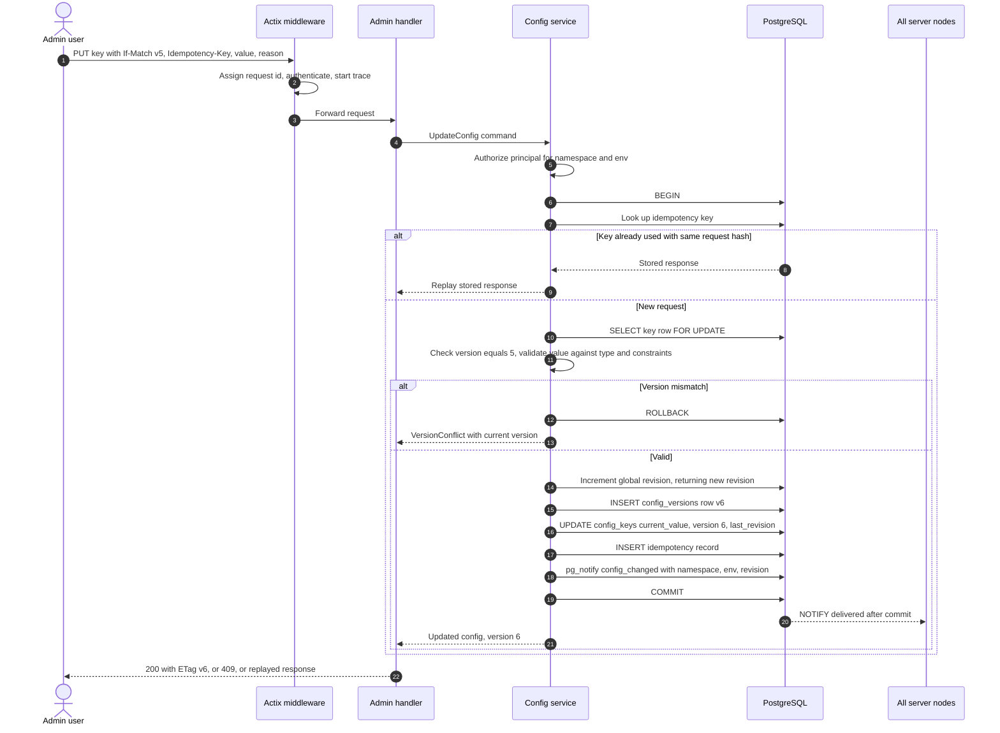

### 6.2 Optimistic Concurrency

| Step | Behaviour                                                                              |
|------|----------------------------------------------------------------------------------------|
| 1    | Client reads the key and receives `ETag: "<version>"`                                  |
| 2    | Client sends the change with `If-Match: "<version>"`                                   |
| 3    | Server locks the row and compares versions inside the transaction                      |
| 4    | Match → write proceeds; mismatch → `409 Conflict` with the current version and value   |
| 5    | Missing `If-Match` on an update → `428 Precondition Required`                          |

The row lock (`FOR UPDATE`) covers the short window between check and write; the version check prevents lost updates across longer user think-time.

### 6.3 Idempotency

| Case                                         | Outcome                                   |
|----------------------------------------------|-------------------------------------------|
| New idempotency key                          | Request executes; response stored         |
| Same key, same principal, same request hash  | Stored response replayed; no new version  |
| Same key, different request hash            | `422 Unprocessable Entity`                |
| Key older than TTL (24 h)                    | Purged by a background job; treated as new|

### 6.4 Transaction Properties

| Property        | Choice                                    | Reason                                                         |
| :-------------- | :---------------------------------------- | :------------------------------------------------------------- |
| Isolation level | `READ COMMITTED` plus row lock            | Sufficient with explicit locking; avoids serialization retries |
| Revision bump   | Single-row `UPDATE … RETURNING`           | Gives a total order of writes; acceptable at low write volume  |
| Notification    | `pg_notify` inside the transaction        | Delivered only on commit; never for rolled-back writes         |
| Lock scope      | One `config_keys` row plus `revision` row | Short critical section                                         |

---

## 7. Read Path

### 7.1 Sequence

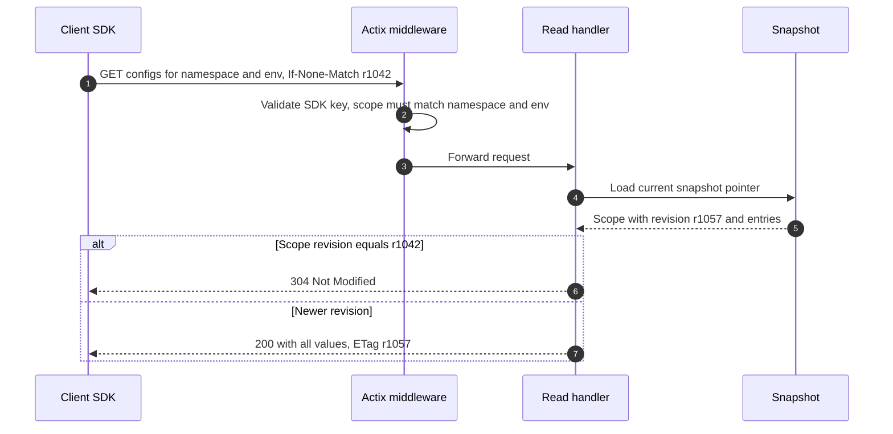

### 7.2 Snapshot Structure

| Level | Content                                                      | Notes                                         |
|-------|--------------------------------------------------------------|-----------------------------------------------|
| Root  | Map from `(namespace, environment)` to scope snapshot        | Held behind an atomic pointer                 |
| Scope | Scope revision, load timestamp, map from key to entry        | Scope revision = max `last_revision` in scope |
| Entry | Typed value, version, last_revision                          | Deleted keys are excluded                     |

Readers clone a reference-counted pointer to the root and never take a lock.  
A reload builds a new scope, copies the root map with that scope replaced, and swaps the root pointer.

### 7.3 Read Endpoints Behaviour

| Endpoint type     | Response                                    | Caching                     |
|-------------------|---------------------------------------------|-----------------------------|
| Full scope fetch  | All keys and values for a namespace and env | ETag = scope revision       |
| Single key fetch  | One value with its version                  | ETag = key version          |
| SSE stream        | Initial full scope, then change events      | Resume via `Last-Event-ID`  |

The database is never touched on the read path.

---

## 8. Change Propagation

### 8.1 Server-Side Propagation

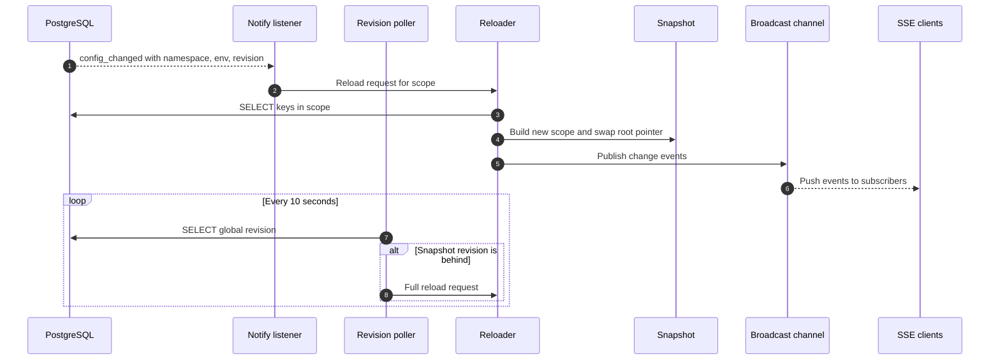

### 8.2 Mechanisms

| Mechanism                  | Role       | Latency      | Covers                                           |
| :------------------------- | :--------- | :----------- | :----------------------------------------------- |
| `LISTEN/NOTIFY`            | Primary    | < 1 s        | Normal operation                                 |
| Revision poll              | Safety net | ≤ 10 s       | Dropped listener connection, missed notification |
| Full reload on start       | Bootstrap  | Startup      | New or restarted nodes                           |
| Reconnect with full reload | Recovery   | On reconnect | Gap while the listener connection was down       |

### 8.3 Reloader Rules

| Rule                                                                                       |
|--------------------------------------------------------------------------------------------|
| A single reloader task per node processes requests sequentially from a channel             |
| Consecutive requests for the same scope are coalesced                                      |
| A scope reload never moves a scope's revision backwards                                    |
| If a reload fails, the existing snapshot stays in place and the poller retries             |
| The node reports not-ready until the first full snapshot has loaded                        |

---

## 9. Lifecycle Operations

### 9.1 Key Lifecycle

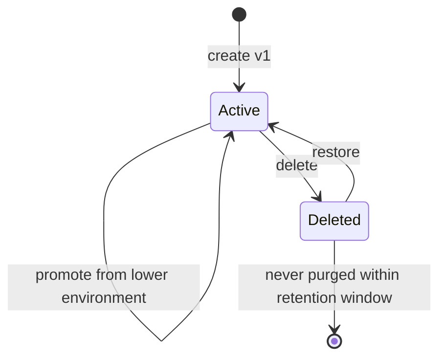

Every arrow is a new row in `config_versions`. No arrow rewrites history.

### 9.2 Operation Semantics

| Operation | Precondition                               | New version `change_type` | Value written                          | Reason example                         |
|-----------|--------------------------------------------|---------------------------|----------------------------------------|----------------------------------------|
| Create    | Identity does not exist                    | `create`                  | Initial value                          | "Introduce checkout v2 toggle"         |
| Update    | Key active; `If-Match` matches             | `update`                  | New value                              | "Enable for Q4 launch"                 |
| Rollback  | Key active; target version exists          | `rollback`                | Value of target version                | "Rollback to v3: error spike"          |
| Promote   | Source rank < target rank; same type       | `promote`                 | Current value of source env            | "Promote from preprod v7"              |
| Delete    | Key active                                 | `delete`                  | Last value retained                    | "Feature fully launched; flag retired" |
| Restore   | Key deleted                                | `restore`                 | Last value before delete               | "Deleted by mistake"                   |

### 9.3 Promotion

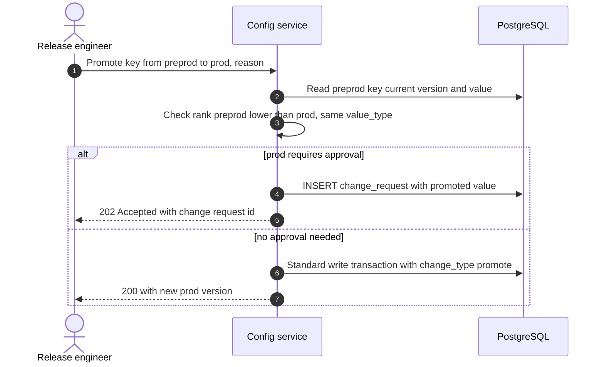

`promoted_from` on the new version references the exact source version, giving a traceable chain from dev to prod.

### 9.4 Approval Flow

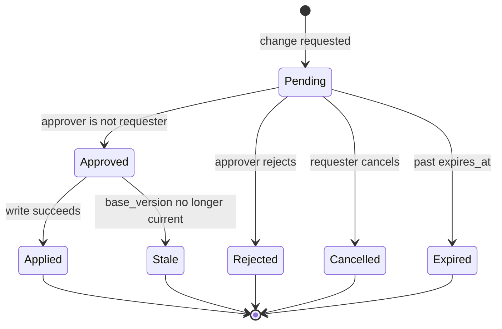

| Rule                                                                                                    |
| :------------------------------------------------------------------------------------------------------ |
| Applies to every mutation in environments where `requires_approval = true`                              |
| Approver must hold the `approver` role for that namespace and environment and differ from the requester |
| Applying runs the standard write path with `source = 'approval'` and the requester as `modified_by`     |
| The approver's identity and note are stored on the change request                                       |
| If the key changed after the request was created (`base_version` mismatch), the request becomes `Stale` |
| Pending requests expire after 72 hours                                                                  |

---

## 10. API Design

### 10.1 Admin API (`/admin/v1`)

| Method   | Path                                                         | Purpose                         | Headers                           | Success      |
|----------|--------------------------------------------------------------|---------------------------------|-----------------------------------|--------------|
| `POST`   | `/namespaces`                                                | Create namespace                | `Idempotency-Key`                 | `201`        |
| `GET`    | `/namespaces`                                                | List namespaces                 | —                                 | `200`        |
| `POST`   | `/configs/{ns}/{env}`                                        | Create key                      | `Idempotency-Key`                 | `201`        |
| `GET`    | `/configs/{ns}/{env}`                                        | List keys in scope              | —                                 | `200`        |
| `GET`    | `/configs/{ns}/{env}/{key}`                                  | Get key with metadata           | —                                 | `200` + ETag |
| `PUT`    | `/configs/{ns}/{env}/{key}`                                  | Update value                    | `If-Match`, `Idempotency-Key`     | `200` / `202`|
| `POST`   | `/configs/{ns}/{env}/{key}/rollback`                         | Roll back to a version          | `If-Match`, `Idempotency-Key`     | `200` / `202`|
| `DELETE` | `/configs/{ns}/{env}/{key}`                                  | Soft delete                     | `If-Match`, `Idempotency-Key`     | `200` / `202`|
| `POST`   | `/configs/{ns}/{env}/{key}/restore`                          | Restore deleted key             | `If-Match`, `Idempotency-Key`     | `200` / `202`|
| `GET`    | `/configs/{ns}/{env}/{key}/history`                          | Paginated version history       | —                                 | `200`        |
| `POST`   | `/promotions`                                                | Promote key between envs        | `Idempotency-Key`                 | `200` / `202`|
| `GET`    | `/change-requests`                                           | List requests by status         | —                                 | `200`        |
| `POST`   | `/change-requests/{id}/approve`                              | Approve and apply               | `Idempotency-Key`                 | `200`        |
| `POST`   | `/change-requests/{id}/reject`                               | Reject                          | `Idempotency-Key`                 | `200`        |
| `POST`   | `/change-requests/{id}/cancel`                               | Cancel own request              | `Idempotency-Key`                 | `200`        |

`202 Accepted` is returned when the target environment requires approval; the body contains the change request id.

### 10.2 Read API (`/v1`)

| Method | Path                               | Purpose                     | Headers           | Success        |
|--------|------------------------------------|-----------------------------|-------------------|----------------|
| `GET`  | `/configs/{ns}/{env}`              | All current values in scope | `If-None-Match`   | `200` / `304`  |
| `GET`  | `/configs/{ns}/{env}/{key}`        | One current value           | `If-None-Match`   | `200` / `304`  |
| `GET`  | `/configs/{ns}/{env}/stream`       | SSE change stream           | `Last-Event-ID`   | `200` stream   |

### 10.3 Operational Endpoints

| Path       | Purpose                                         |
|------------|-------------------------------------------------|
| `/healthz` | Liveness: process is running                    |
| `/readyz`  | Readiness: snapshot loaded and listener healthy |
| `/metrics` | Prometheus scrape endpoint                      |

### 10.4 Request Body Fields (Update)

| Field    | Type             | Required | Rule                                         |
|----------|------------------|----------|----------------------------------------------|
| `value`  | bool or string   | Yes      | Must match `value_type` and constraints      |
| `reason` | string           | Yes      | 10 to 500 characters                         |
| `source` | string           | No       | Defaults to `api`; `ci` for pipeline callers |

### 10.5 Error Model

All errors return a uniform body: `code`, `message`, `request_id`, and an optional `details` object.

| Domain error           | HTTP  | `code`                   | `details`                          |
|------------------------|-------|--------------------------|------------------------------------|
| Unauthenticated        | `401` | `unauthenticated`        | —                                  |
| Forbidden              | `403` | `forbidden`              | Required role                      |
| Not found              | `404` | `not_found`              | Identity                           |
| Already exists         | `409` | `already_exists`         | Identity                           |
| Version conflict       | `409` | `version_conflict`       | Current version and value          |
| Change request stale   | `409` | `change_request_stale`   | Current version                    |
| Precondition missing   | `428` | `precondition_required`  | Missing header                     |
| Validation failed      | `422` | `validation_failed`      | Field-level violations             |
| Type mismatch          | `422` | `type_mismatch`          | Expected and received type         |
| Idempotency mismatch   | `422` | `idempotency_mismatch`   | —                                  |
| Self-approval          | `403` | `self_approval`          | —                                  |
| Store unavailable      | `503` | `store_unavailable`      | Retry-After header                 |

---

## 11. LLD — Rust and Actix

### 11.1 Workspace Layout

```text
config-server/
├── Cargo.toml                  workspace manifest
├── migrations/                 versioned SQL migrations
├── crates/
│   ├── domain/                 types, rules, resolution; no I/O
│   ├── service/                use cases; orchestrates domain and ports
│   ├── store-pg/               Postgres adapter implementing repository ports
│   ├── snapshot/               immutable snapshot, builder, atomic holder
│   ├── propagation/            notify listener, revision poller, reloader
│   ├── api/                    Actix handlers, DTOs, middleware, error mapping
│   ├── server/                 binary: configuration, wiring, startup, shutdown
│   └── sdk/                    client library for consuming services
└── tests/                      integration tests against a real Postgres
```

### 11.2 Layering and Dependency Direction

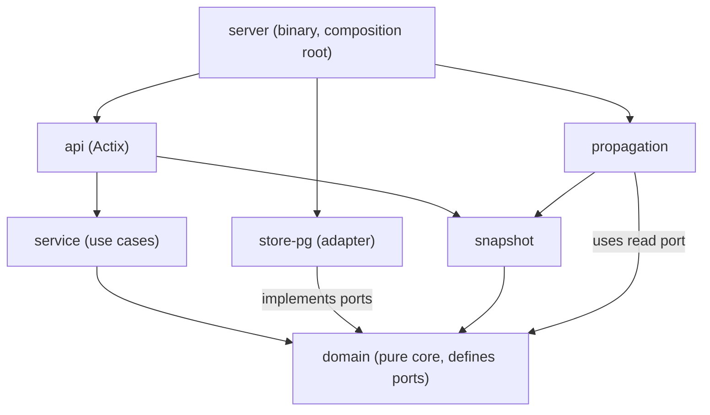

| Rule                                                                                          |
|-----------------------------------------------------------------------------------------------|
| `domain` depends on nothing internal; it defines repository and clock ports as traits         |
| `service` depends only on `domain` ports, never on `store-pg`                                 |
| `api` never touches the database directly                                                     |
| `server` is the only crate that knows every concrete type; it wires them together             |
| Integration with Actix is confined to `api` and `server`                                      |

### 11.3 Domain Types

| Type               | Kind              | Responsibility                                                  |
| :----------------- | :---------------- | :-------------------------------------------------------------- |
| `NamespaceName`    | Validated newtype | Enforces naming rules on construction                           |
| `Environment`      | Enum              | `Dev`, `Qa`, `Preprod`, `Prod`, with rank and approval flag     |
| `KeyName`          | Validated newtype | Enforces key pattern                                            |
| `ConfigIdentity`   | Struct            | Namespace, environment, key                                     |
| `ValueType`        | Enum              | `Bool`, `String`                                                |
| `ConfigValue`      | Enum              | `Bool(bool)` or `Str(String)`; cannot exist in an invalid shape |
| `ValueConstraints` | Struct            | Max length, allowed values, pattern; validates a `ConfigValue`  |
| `Version`          | Newtype           | Positive integer; only increments                               |
| `Revision`         | Newtype           | Global ordering number                                          |
| `Reason`           | Validated newtype | Length 10 to 500                                                |
| `Principal`        | Struct            | Authenticated actor id and roles                                |
| `ChangeType`       | Enum              | Create, Update, Rollback, Promote, Delete, Restore              |
| `ConfigKey`        | Aggregate         | Identity, type, current value, version; enforces transitions    |
| `ConfigVersion`    | Entity            | One immutable history record                                    |
| `ChangeRequest`    | Aggregate         | Approval state machine (§9.4)                                   |
| `DomainError`      | Enum              | Every failure the domain can express; mapped to HTTP in `api`   |

Validated newtypes make invalid states unrepresentable: once a `KeyName` exists, it is known to be valid.

### 11.4 Ports (Traits Defined in `domain`)

| Port                      | Operations                                                  | Implemented by              |
| :------------------------ | :---------------------------------------------------------- | :-------------------------- |
| `ConfigRepository`        | Find by identity; list scope; apply change atomically; history page | `store-pg`          |
| `ChangeRequestRepository` | Create; find; transition status                             | `store-pg`                  |
| `IdempotencyStore`        | Look up; record response                                    | `store-pg`                  |
| `PermissionRepository`    | Roles for a principal on a namespace and environment        | `store-pg`                  |
| `SnapshotSource`          | Load full snapshot; load one scope; read global revision    | `store-pg`                  |
| `Clock`                   | Current time                                                | System clock; fake in tests |

"Apply change atomically" is one port method that takes the full change (new version, expected version, notify payload) so the transaction boundary lives entirely inside the adapter.

### 11.5 Concurrency Model

| Concern           | Mechanism                                       | Crate                        |
| :---------------- | :---------------------------------------------- | :--------------------------- |
| HTTP workers      | Actix worker threads, one per core              | `actix-web`                  |
| Shared state      | `web::Data` holding `Arc`-wrapped services      | `actix-web`                  |
| Snapshot reads    | Lock-free atomic pointer load                   | `arc-swap`                   |
| Snapshot writes   | Single reloader task; atomic pointer store      | `arc-swap`, `tokio`          |
| Reload requests   | Bounded MPSC channel into the reloader          | `tokio::sync::mpsc`          |
| SSE fan-out       | Broadcast channel per node                      | `tokio::sync::broadcast`     |
| DB access         | Async connection pool                           | `sqlx::PgPool`               |
| Notifications     | Dedicated listener connection                   | `sqlx::postgres::PgListener` |
| Background tasks  | Spawned on the Tokio runtime at startup         | `tokio`                      |
| Graceful shutdown | Cancellation token shared by all tasks          | `tokio-util`                 |

### 11.6 Actix Request Pipeline

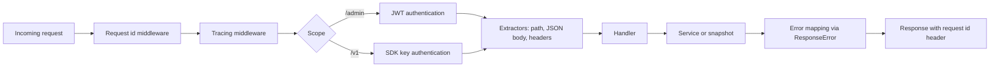

| Actix element           | Use                                                                                       |
|-------------------------|-------------------------------------------------------------------------------------------|
| `App` and `web::scope`  | Separate `/admin/v1`, `/v1`, and operational routes with their own middleware             |
| Middleware              | Request id, tracing, authentication per scope, request size limit                         |
| `web::Data`             | Holds services, snapshot holder, broadcast sender, configuration                          |
| Custom extractors       | `AuthenticatedPrincipal`, `SdkScope`, `IfMatch`, `IdempotencyKey`                         |
| `web::Json` config      | Body size limit and custom error handler returning the uniform error body                 |
| `ResponseError`         | Implemented for the API error type; single place mapping `DomainError` to HTTP (§10.5)    |
| Streaming response      | SSE built from a stream over the broadcast receiver                                       |
| `HttpServer` settings   | Worker count, keep-alive, shutdown timeout aligned with load balancer drain               |

### 11.7 Service Use Cases

| Use case              | Steps                                                                                              |
| :-------------------- | :------------------------------------------------------------------------------------------------- |
| `CreateConfig`        | Authorize → validate identity, type, value, reason → apply `create` change                         |
| `UpdateConfig`        | Authorize → load key → check approval gate → validate value → apply `update` with expected version |
| `RollbackConfig`      | Authorize → load target version → check gate → apply `rollback` with target value                  |
| `PromoteConfig`       | Authorize on target → load source → check rank and type → check gate → apply `promote`             |
| `DeleteConfig`        | Authorize → check gate → apply `delete`                                                            |
| `RestoreConfig`       | Authorize → check gate → apply `restore` with last value before delete                             |
| `DecideChangeRequest` | Authorize approver → reject self-approval → transition → on approve, apply via standard path       |
| `GetHistory`          | Authorize viewer → page through versions                                                           |

Each mutating use case is wrapped by the idempotency check before execution.

### 11.8 Startup and Shutdown

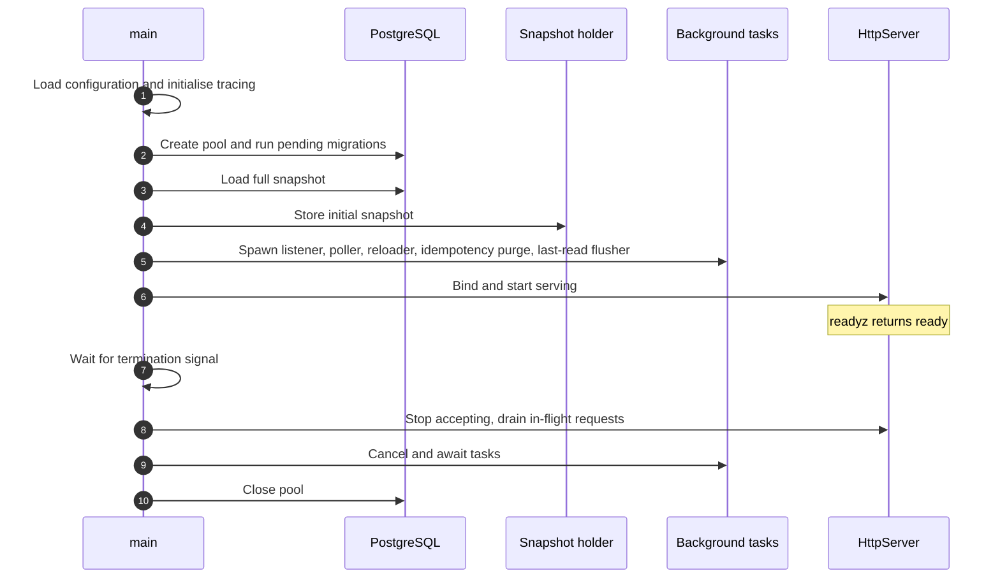

### 11.9 Crate Selection

| Need                   | Crate                                   | Notes                                                    |
|------------------------|-----------------------------------------|----------------------------------------------------------|
| HTTP server            | `actix-web`                             | Required stack                                           |
| Async runtime          | `tokio`                                 | Used by Actix and background tasks                       |
| Database               | `sqlx` (postgres, tokio, migrate)       | Async, compile-time checked queries,built-in `PgListener`|
| Atomic snapshot        | `arc-swap`                              | Lock-free reads                                          |
| Serialization          | `serde`, `serde_json`                   | DTOs                                                     |
| Errors                 | `thiserror`                             | Typed errors in library crates                           |
| Tracing                | `tracing`, `tracing-actix-web`          | Structured logs with request ids                         |
| Metrics                | `metrics`, `metrics-exporter-prometheus`| `/metrics` endpoint                                      |
| Auth                   | `jsonwebtoken`                          | Admin JWT validation                                     |
| Hashing SDK keys       | `sha2`                                  | Keys stored only as hashes                               |
| Configuration          | `config` or `figment`                   | Layered file and environment settings                    |
| Ids and time           | `uuid`, `time`                          | Request ids, timestamps                                  |
| Regex constraints      | `regex`                                 | Compiled once per key during snapshot build              |
| Shutdown coordination  | `tokio-util`                            | Cancellation token                                       |
| Testing                | `testcontainers`                        | Real Postgres in integration tests                       |

### 11.10 Testing Strategy

| Layer        | Test type                  | Focus                                                                   |
|--------------|----------------------------|-------------------------------------------------------------------------|
| `domain`     | Unit, property-based       | Validation, state transitions, invariants I-01 to I-06                  |
| `service`    | Unit with fake ports       | Authorization, approval gating, idempotency, conflict handling          |
| `store-pg`   | Integration (Postgres)     | Transaction atomicity, concurrent writers, append-only grants           |
| `api`        | Actix test server          | Status codes, headers, error bodies, ETag behaviour                     |
| `propagation`| Integration                | Missed notify recovery, coalescing, revision monotonicity               |
| End to end   | Multi-node                 | Write on one node is visible on all nodes within NF-03                  |

---

## 12. Validation Rules

| Field             | Rule                                                                                 |
| :---------------- | :----------------------------------------------------------------------------------- |
| Namespace name    | Lowercase; letters, digits, hyphens; 2 to 64 characters; starts with a letter        |
| Key name          | Lowercase; letters, digits, `.`, `_`, `-`; 2 to 128 characters; starts with a letter |
| Bool value        | JSON boolean only; strings such as `"true"` are rejected                             |
| String value      | UTF-8; default max 4 KB; per-key `max_length` may lower it                           |
| `allowed_values`  | If set, value must be one of them                                                    |
| `pattern`         | If set, value must fully match                                                       |
| Reason            | 10 to 500 characters; trimmed                                                        |
| Description       | Required at creation; 10 to 1000 characters                                          |
| Type change       | Rejected; create a new key instead                                                   |
| Constraint change | Allowed only if the current value still satisfies the new constraints                |

---

## 13. Security and Access Control

### 13.1 Authentication

| Caller             | Mechanism                                  | Scope                                   |
|--------------------|--------------------------------------------|-----------------------------------------|
| Humans and CI      | JWT from the organisation identity provider| Admin API                               |
| Application SDKs   | SDK key, stored hashed in `sdk_keys`       | Read API, one namespace and environment |

### 13.2 Roles

| Role       | Read values | View history | Create / update / delete | Approve | Manage permissions |
| :--------- | :---------- | :----------- | :----------------------- | :------ | :----------------- |
| `viewer`   | ✅          | ✅           | ❌                       | ❌      | ❌                 |
| `editor`   | ✅          | ✅           | ✅                       | ❌      | ❌                 |
| `approver` | ✅          | ✅           | ✅                       | ✅      | ❌                 |
| `admin`    | ✅          | ✅           | ✅                       | ✅      | ✅                 |

Roles are granted per `(principal, namespace, environment)`.  
A null environment grants the role across all environments of that namespace, except `prod`, which always requires an explicit grant.

### 13.3 Hardening

| Measure                                                                                  |
|------------------------------------------------------------------------------------------|
| Database role used by the service has no UPDATE or DELETE on `config_versions`           |
| SDK keys are shown once at creation and stored only as SHA-256 hashes                    |
| Request body size limit on all endpoints                                                 |
| Rate limiting on admin endpoints per principal                                           |
| TLS terminated at the load balancer; internal traffic on a private network               |
| Values are not logged; only identity, version, and actor are logged                      |

---

## 14. Client SDK

### 14.1 Refresh and Fallback

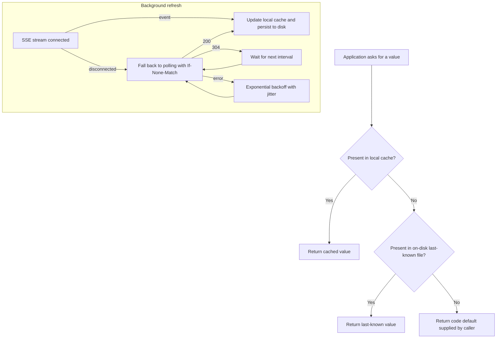

### 14.2 SDK Behaviour

| Concern            | Behaviour                                                                 |
|--------------------|---------------------------------------------------------------------------|
| Startup            | Load on-disk last-known file, then fetch; never block startup indefinitely|
| Typed getters      | Separate bool and string getters; type mismatch returns the default       |
| Defaults           | Mandatory at every call site                                              |
| Refresh            | SSE first; polling every 30 s as fallback                                 |
| Server outage      | Keep serving the cached values; no exceptions surface to callers          |
| Change listeners   | Optional callbacks for applications that react to changes                 |
| Metrics            | Cache age, refresh failures, fallback usage                               |

---

## 15. Failure Modes

| Failure                                   | Impact on reads                     | Impact on writes        | Detection                     | Recovery                                        |
|-------------------------------------------|-------------------------------------|-------------------------|-------------------------------|-------------------------------------------------|
| Postgres down                             | None; served from snapshot          | `503`                   | Pool errors, readiness checks | Writes resume when DB returns; poller reloads   |
| Listener connection dropped               | Staleness up to poll interval       | None                    | Listener error metric         | Reconnect, then full reload                     |
| Notification lost                         | Staleness up to poll interval       | None                    | Revision gap                  | Poller triggers reload                          |
| Reload query fails                        | Previous snapshot kept              | None                    | Reload failure metric         | Poller retries                                  |
| Node restart                              | Node not ready until snapshot loads | None                    | Readiness probe               | Load balancer routes to other nodes             |
| All server nodes down                     | SDKs serve cached / last-known      | Unavailable             | SDK fallback metrics          | Restore service                                 |
| Concurrent conflicting writes             | None                                | One wins; other `409`   | Conflict metric               | Client re-reads and retries                     |
| Client retries after timeout              | None                                | Replayed response       | Idempotency hit metric        | None needed                                     |
| `config_keys` and versions drift          | Possible wrong value                | None                    | Nightly reconciliation        | Manual investigation; alert                     |
| Bad value pushed to prod                  | Applications receive bad value      | None                    | Application alerts            | Rollback endpoint                               |

---

## 16. Observability

### 16.1 Metrics

| Metric                                  | Type      | Labels                       | Purpose                              |
|-----------------------------------------|-----------|------------------------------|--------------------------------------|
| `http_request_duration_seconds`         | Histogram | route, method, status        | Latency SLOs                         |
| `config_writes_total`                   | Counter   | namespace, env, change_type  | Write volume and mix                 |
| `config_version_conflicts_total`        | Counter   | namespace, env               | Contention signal                    |
| `snapshot_revision`                     | Gauge     | node                         | Detect lagging nodes                 |
| `snapshot_age_seconds`                  | Gauge     | node                         | Time since last successful reload    |
| `snapshot_reload_duration_seconds`      | Histogram | kind (scope, full)           | Reload cost                          |
| `propagation_lag_seconds`               | Histogram | node                         | Commit to snapshot swap (NF-03)      |
| `notify_listener_connected`             | Gauge     | node                         | Listener health                      |
| `sse_connections`                       | Gauge     | namespace, env               | Fan-out load                         |
| `idempotency_replays_total`             | Counter   | route                        | Retry behaviour                      |
| `change_requests_pending`               | Gauge     | namespace, env               | Approval backlog                     |
| `db_pool_connections`                   | Gauge     | state                        | Pool saturation                      |

### 16.2 Alerts

| Alert                                       | Condition                                       |
|---------------------------------------------|-------------------------------------------------|
| Node snapshot lagging                       | Node revision behind max revision for > 30 s    |
| Listener disconnected                       | `notify_listener_connected = 0` for > 1 min     |
| Elevated write failures                     | 5xx rate on admin API > 1% for 5 min            |
| Reconciliation drift                        | Any invariant violation reported                |

### 16.3 Logging

Structured JSON logs with `request_id`, `principal`, `namespace`, `environment`, `key`, `version`, `revision`, and `change_type`. Values are excluded.

---

## 17. Scaling Path

| Stage | Trigger                                   | Change                                                          |
|-------|-------------------------------------------|-----------------------------------------------------------------|
| 1     | Initial                                   | Stateless nodes behind a load balancer, one Postgres primary    |
| 2     | Admin and read load interfere             | Split admin and read deployments                                |
| 3     | Snapshot loads pressure the primary       | Read nodes load from a replica; poll primary for revision only  |
| 4     | SSE connections exceed node capacity      | Dedicated stream tier subscribed to the same propagation        |
| 5     | Snapshot exceeds comfortable memory size  | Nodes load only the namespaces assigned to them                 |
| 6     | `config_versions` grows very large        | Partition by `created_at` month; archive cold partitions        |

---

## 18. Trade-offs and Decisions

| Decision               | Chosen                                | Alternative                | Rationale                                                             |
| :--------------------- | :------------------------------------ | :------------------------- | :-------------------------------------------------------------------- |
| Current value location | Denormalized in `config_keys`         | Derive from latest version | No join on reads and loads; consistency kept by one transaction       |
| Value storage          | `text` plus `value_type`              | `jsonb`                    | Two simple types; text is enough and indexes simply                   |
| Global ordering        | Single `revision` row                 | Per-scope counters         | Total order is simple; write volume is low enough                     |
| Propagation            | `LISTEN/NOTIFY` plus polling          | Kafka or CDC stream        | No extra infrastructure; poller covers notify's at-most-once delivery |
| Read serving           | Full in-memory snapshot               | Read-through cache         | Predictable latency; reads survive DB outage                          |
| Concurrency control    | Optimistic (`If-Match`) plus row lock | Pessimistic edit locks     | No lock leasing; conflicts are rare                                   |
| Database library       | `sqlx`                                | `diesel` with `diesel-async` | Native async, built-in listener support, compile-checked SQL        |
| Delete semantics       | Soft delete as a version              | Hard delete                | Preserves audit trail; restorable                                     |
| Approval scope         | Per environment flag                  | Per key                    | Simple, predictable policy; extendable later                          |

---

## 19. Open Items

| ID   | Item                                                                                          |
|------|-----------------------------------------------------------------------------------------------|
| O-01 | Per-user and per-segment overrides: scope becomes part of identity, with its own history      |
| O-02 | Percentage rollouts for boolean flags                                                         |
| O-03 | Scheduled changes applied at a future time                                                    |
| O-04 | Bulk updates across many keys in one atomic change set                                        |
| O-05 | Retention period for `config_versions` and archival format                                    |
| O-06 | Multi-region deployment and cross-region propagation                                          |
| O-07 | Stale flag reporting based on `last_read_at`                                                  |
| O-08 | Admin UI scope and diff view for history                                                      |

---
