<!-- markdownlint-disable MD001 -->
<!-- markdownlint-disable MD024 -->
<!-- markdownlint-disable MD025 -->
<!-- markdownlint-disable MD026 -->
<!-- markdownlint-disable MD029 -->
<!-- markdownlint-disable MD033 -->
<!-- markdownlint-disable MD036 -->
<!-- markdownlint-disable MD040 -->
<!-- markdownlint-disable MD056 -->
<!-- markdownlint-disable MD060 -->

# Cryptography 101 — From Primitives to TLS

> A first-principles guide to how modern cryptography actually works: what each primitive guarantees, what it does **not** guarantee, why each layer exists, and how the layers compose into protocols like TLS.

---

## How to Read This Document

This document is structured as a **progression of problems and solutions**. Every part answers a question the previous part left open.

| Part | Question it answers                                                                  |
| :--- | :----------------------------------------------------------------------------------- |
| I    | Why do we need cryptography, and what are we defending against?                      |
| II   | How do I know data was not changed — and changed by whom?                            |
| III  | How do I keep data secret, and how do I manage the keys?                             |
| IV   | How do I know *who* I am talking to, at Internet scale?                              |
| V    | How do all of these compose into a secure channel (TLS)?                             |
| VI   | How do I use these tools correctly in practice (OpenSSL, code, JWT, SSH, mTLS, PQC)? |
| VII  | Which primitive should I pick, and what mistakes must I avoid?                       |
| VIII | Can I explain all of it under interview                                              |

Conventions used throughout:

- **✔ / ✘** in tables mean "provides / does not provide" a security property.
- `‖` means concatenation of byte strings.
- `⊕` means bitwise XOR.
- `H(x)` is a hash function, `E_k(x)` is encryption under key `k`, `D_k(x)` is decryption.
- "Alice" and "Bob" are honest parties; "Eve" is a passive eavesdropper; "Mallory" is an active attacker.

---

## Table of Contents

- [Part I — Foundations of Cryptography](#part-i--foundations-of-cryptography)
- [Part II — Integrity and Authentication: Hashing, MACs, and KDFs](#part-ii--integrity-and-authentication-hashing-macs-and-kdfs)
- [Part III — Confidentiality: Encryption, AEAD, and Key Management](#part-iii--confidentiality-encryption-aead-and-key-management)
- [Part IV — Identity and Trust: Asymmetric Cryptography, Signatures, and PKI](#part-iv--identity-and-trust-asymmetric-cryptography-signatures-and-pki)
- [Part V — TLS: Secure Communication in Practice](#part-v--tls-secure-communication-in-practice)
- [Part VI — Applied Cryptography: Tools, Code, and Protocols](#part-vi--applied-cryptography-tools-code-and-protocols)
- [Part VII — Decision Guide, Anti-Patterns, and Glossary](#part-vii--decision-guide-anti-patterns-and-glossary)
- [Part VIII — Q and A](#part-viii--q-and-a)
- [Appendix — Errata Against the Original Draft](#appendix--errata-against-the-original-draft)

---

## Part I — Foundations of Cryptography

### 1.1 Why Cryptography Exists

Cryptography exists to enable **secure communication and data handling in environments that cannot be trusted**.

The modern Internet is hostile by default:

- **Networks can be observed.** Wi-Fi is broadcast radio; ISPs, routers, proxies, and middleboxes all see traffic.
- **Messages can be intercepted.** BGP hijacks, DNS spoofing, ARP poisoning, and rogue access points redirect traffic.
- **Data can be modified.** Any hop can alter, drop, reorder, or inject bytes.
- **Identities can be impersonated.** Nothing in IP, TCP, or DNS proves who sent a packet.

Any security system that assumes a "safe network" is already broken.  
Cryptography is the discipline that allows us to operate **safely despite these assumptions**, and it does so by reducing security to a much smaller problem: **protecting keys**.

> The central trick of cryptography: convert the impossible problem of "protect every byte on every wire" into the tractable problem of "protect a few hundred bits of key material".

### 1.2 Threat Models: Who Is the Attacker?

Every cryptographic design starts with a **threat model** — an explicit statement of what the attacker can and cannot do.  
A primitive that is "secure" under one threat model can be trivially broken under another.

#### 1.2.1 Passive vs Active Attackers

- **Passive attacker (Eve)**
  - Can read everything on the wire.
  - Cannot modify, inject, or drop messages.
  - Defeated by **confidentiality** (encryption).

- **Active attacker (Mallory)**
  - Can read, modify, inject, replay, reorder, and drop messages.
  - Can impersonate endpoints and sit in the middle (MITM).
  - Defeated only by **confidentiality + integrity + authentication** together.

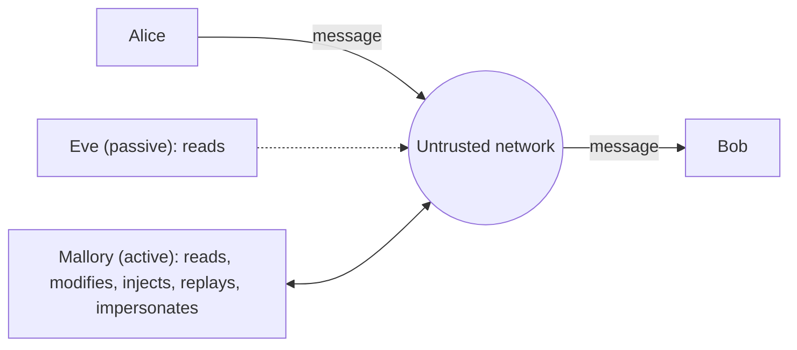

#### 1.2.2 The Dolev–Yao Model

Protocol designers usually assume the **Dolev–Yao attacker**:

- The attacker **is the network**. Every message passes through them.
- The attacker can do anything with messages **except break the cryptographic primitives themselves**.
- In other words: the math is assumed perfect; the protocol must still be secure.

This model is why protocol bugs (not algorithm breaks) dominate real-world failures.  
A protocol that leaks which padding was wrong, or accepts an old message twice, is broken in Dolev–Yao terms even if AES itself is unbroken.

#### 1.2.3 Attacker Capabilities Against Ciphers

Encryption schemes are classified by the strongest attack they withstand:

| Attack model            | Attacker can…                                        | Real-world analogue                                            |
| :---------------------- | :--------------------------------------------------- | :------------------------------------------------------------- |
| Ciphertext-only (COA)   | See ciphertexts                                      | Passive sniffing                                               |
| Known-plaintext (KPA)   | See some plaintext/ciphertext pairs                  | Predictable headers like `HTTP/1.1`                            |
| Chosen-plaintext (CPA)  | Get arbitrary plaintexts encrypted                   | Attacker-controlled JavaScript sending requests (BEAST, CRIME) |
| Chosen-ciphertext (CCA) | Get arbitrary ciphertexts decrypted, observe results | Padding oracles, error messages, timing                        |

Modern encryption must be **IND-CCA2** secure: even an attacker who can submit chosen ciphertexts for decryption learns nothing about other ciphertexts.  
This is precisely why **authenticated encryption (AEAD)** is mandatory — unauthenticated modes like CBC are not CCA-secure.

#### 1.2.4 Beyond the Wire: Other Attack Surfaces

Real attackers rarely attack the math. They attack:

- **Endpoints** — malware reading plaintext before encryption or after decryption.
- **Key storage** — keys in source code, logs, environment variables, backups.
- **Side channels** — timing, power consumption, cache behavior, error messages.
- **Humans** — phishing, social engineering, mis-issued certificates.
- **Implementations** — buffer over-reads (Heartbleed), bad random number generators.

> Cryptography secures data **in transit** and **at rest**. It does not secure data **in use** on a compromised endpoint.

### 1.3 The Core Security Goals

#### 1.3.1 The CIA Triad (Correctly Stated)

In information security, **CIA** stands for:

- **Confidentiality** — unauthorized parties cannot read the data.
- **Integrity** — data cannot be modified without detection.
- **Availability** — systems and data remain accessible to authorized users.

Cryptography directly provides **confidentiality** and **integrity**.  
It does **not** provide availability — in fact, cryptographic failures (expired certificates, lost keys) are a common cause of *outages*.  
Availability is handled by redundancy, rate limiting, and DDoS protection.

#### 1.3.2 The Goals Cryptography Actually Provides

| Goal                         | Question answered                           | Primary mechanisms                            |
| :--------------------------- | :------------------------------------------ | :-------------------------------------------- |
| Confidentiality              | Can anyone else read this?                  | Symmetric encryption, AEAD                    |
| Integrity                    | Was this changed?                           | Hashes, MACs, AEAD, signatures                |
| Authentication (data origin) | Did this come from someone holding the key? | MACs, AEAD, signatures                        |
| Authentication (entity)      | Am I talking to the party I think I am?     | Signatures + certificates, challenge-response |
| Non-repudiation              | Can the author later deny it?               | Digital signatures only                       |
| Forward secrecy              | Does a future key leak expose past traffic? | Ephemeral key exchange (ECDHE)                |
| Replay protection            | Can an old valid message be re-sent?        | Nonces, sequence numbers, timestamps          |

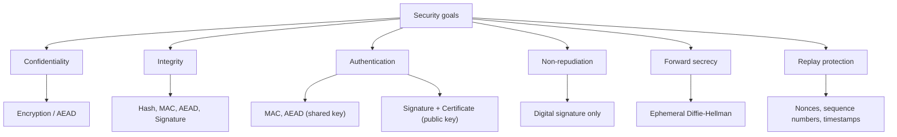

Modern systems are designed to satisfy **all** of these, not just the CIA triad.

### 1.4 Kerckhoffs's Principle

Stated in 1883 and still the bedrock of modern design:

> A cryptosystem should be secure even if everything about the system, except the key, is public knowledge.

Consequences:

- **Algorithms are public.** AES, SHA-256, Ed25519, TLS — all published, all scrutinized.
- **Security through obscurity fails.** A secret algorithm will eventually be reverse-engineered; once it is, every deployment breaks at once.
- **Only keys are secret.** Keys can be rotated cheaply; algorithms cannot.

Claude Shannon restated it as **"the enemy knows the system."**  
Any design whose security depends on the attacker not knowing the design is not a cryptographic design.

### 1.5 Security Levels: How Strong Is "Strong"?

Security is measured in **bits**: a scheme with *n*-bit security requires roughly 2ⁿ operations to break.

- 2⁸⁰ — within reach of nation-states today; deprecated.
- 2¹¹² — acceptable minimum for legacy systems.
- 2¹²⁸ — the modern standard. Brute-forcing it would take vastly longer than the age of the universe with all of Earth's computing power.
- 2²⁵⁶ — chosen for long-term or post-quantum margins.

Equivalent strengths across primitive families (per NIST SP 800-57):

| Security bits | Symmetric | RSA / finite-field DH | Elliptic curve      | Hash (collision resistance) |
| :------------ | :-------- | :-------------------- | :------------------ | :-------------------------- |
| 80 (broken)   | 2TDEA     | 1024                  | 160                 | SHA-1 (practically broken)  |
| 112           | 3TDEA     | 2048                  | 224                 | SHA-224                     |
| 128           | AES-128   | 3072                  | 256 (P-256, X25519) | SHA-256                     |
| 192           | AES-192   | 7680                  | 384 (P-384)         | SHA-384                     |
| 256           | AES-256   | 15360                 | 512+ (P-521)        | SHA-512                     |

Two observations fall out of this table:

1. **RSA scales badly.** Doubling security requires roughly quintupling the key size. This is the main reason elliptic curves replaced RSA.
2. **Hash output must be twice the security level**, because of the birthday paradox (see Part II).

### 1.6 Computational vs Information-Theoretic Security

- **Information-theoretic (perfect) security**: secure even against an attacker with infinite computing power.
  - The only practical example is the **One-Time Pad (OTP)**: XOR the message with a truly random key of equal length, used exactly once.
  - Impractical: the key is as long as the message and must be pre-shared. Reusing it even once is catastrophic (`C1 ⊕ C2 = P1 ⊕ P2`).

- **Computational security**: secure against attackers with bounded (realistic) computing power.
  - Every practical primitive — AES, SHA-256, RSA, ECC — is computationally secure.
  - Security rests on **hardness assumptions** (factoring is hard, discrete log is hard, AES behaves like a random permutation).
  - These are *assumptions*, not proofs.  
    Mathematics cannot prove AES is unbreakable; it can only show that breaking a protocol is at least as hard as breaking the underlying assumption (a *security reduction*).

### 1.7 Randomness: The Silent Foundation

Almost every cryptographic operation needs random bits: keys, nonces, IVs, salts, ephemeral DH secrets, signature nonces.

#### 1.7.1 Requirements

Cryptographic randomness must be:

- **Unpredictable** — an attacker who sees all previous outputs cannot predict the next.
- **Uniform** — every value is equally likely.
- **Backtracking-resistant** — compromising the generator's state now does not reveal past outputs.

#### 1.7.2 CSPRNG vs PRNG

| Generator | Example                                                                                                              | Use for crypto?                                      |
| :-------- | :------------------------------------------------------------------------------------------------------------------- | :--------------------------------------------------- |
| PRNG      | `Math.random()`, `random.random()`, `java.util.Random`, Mersenne Twister                                             | **Never** — output is predictable from a few samples |
| CSPRNG    | `/dev/urandom`, `getrandom()`, `secrets` (Python), `crypto.getRandomValues()`, `SecureRandom` (Java), `OsRng` (Rust) | **Yes**                                              |

#### 1.7.3 Real-World Randomness Failures

- **Debian OpenSSL (2008)**: a code cleanup removed entropy mixing; only 32,767 possible keys existed for SSH and TLS on affected systems.
- **Sony PlayStation 3 (2010)**: ECDSA signing reused the same nonce; the master private key was recovered algebraically.
- **Android Bitcoin wallets (2013)**: a flawed `SecureRandom` produced repeated ECDSA nonces; funds were stolen.
- **Weak RSA keys on embedded devices (2012)**: devices generated keys at boot with little entropy; many shared prime factors, so `gcd(n1, n2)` factored them instantly.

> If the randomness is bad, nothing else matters. Every guarantee in this document assumes a properly seeded CSPRNG.

### 1.8 Encoding vs Hashing vs Encryption vs Signing

A frequent source of confusion is treating these four as interchangeable.

| Operation  | Reversible?      | Needs a key?                          | Purpose                          | Example                   |
| :--------- | :--------------- | :------------------------------------ | :------------------------------- | :------------------------ |
| Encoding   | Yes, by anyone   | No                                    | Represent data in another format | Base64, hex, URL encoding |
| Hashing    | No               | No                                    | Fingerprint for integrity        | SHA-256                   |
| Encryption | Yes, with key    | Yes                                   | Confidentiality                  | AES-GCM                   |
| Signing    | N/A (verifiable) | Private key to sign, public to verify | Authenticity and identity        | Ed25519                   |

> **Base64 is not encryption.** A JWT payload is Base64URL-encoded, which means anyone can read it. "It looks unreadable" is not a security property.

### 1.9 Cryptographic Building Blocks (Bird's-Eye View)

Cryptographic systems are not built from a single algorithm. They are built by **composing primitives**, each with a narrow responsibility.

#### 1.9.1 Hashing

- One-way transformation of arbitrary data into a fixed-size digest.
- Used to detect changes and to build other primitives.
- **Primary purpose:** integrity (in non-adversarial or anchored settings).
- Examples: SHA-256, SHA-3, BLAKE2/BLAKE3.

#### 1.9.2 MAC / HMAC

- A keyed checksum: hash (or cipher) combined with a shared secret.
- Verifies integrity and authenticity between parties who share a key.
- **Primary purpose:** authenticated integrity (shared-secret model).
- Examples: HMAC-SHA256, Poly1305, CMAC.

#### 1.9.3 Key Derivation Functions (KDFs)

- Turn one secret into many keys, or turn a weak secret (password) into a key.
- **Primary purpose:** key hygiene and password protection.
- Examples: HKDF, Argon2id, scrypt, bcrypt, PBKDF2.

#### 1.9.4 Symmetric Encryption

- Same key used for encryption and decryption.
- Extremely fast; hardware-accelerated.
- **Primary purpose:** confidentiality of bulk data.
- Examples: AES, ChaCha20.

#### 1.9.5 AEAD

- Encryption and authentication fused into one operation.
- **Primary purpose:** confidentiality + integrity + authenticity, safely.
- Examples: AES-GCM, ChaCha20-Poly1305.

#### 1.9.6 Key Exchange

- Two parties derive a shared secret over a public channel without ever sending it.
- **Primary purpose:** solving key distribution; forward secrecy when ephemeral.
- Examples: ECDHE (X25519, P-256), ML-KEM (post-quantum).

#### 1.9.7 Asymmetric Cryptography

- Public/private key pairs.
- **Primary purpose:** key establishment and identity.
- Examples: RSA, ECC.

#### 1.9.8 Digital Signatures

- Asymmetric cryptography applied to data authenticity.
- Publicly verifiable proof of origin.
- **Primary purpose:** integrity, authentication, identity, non-repudiation.
- Examples: Ed25519, ECDSA, RSA-PSS, ML-DSA.

#### 1.9.9 Certificates and PKI

- Signed bindings between an identity and a public key.
- **Primary purpose:** trust at Internet scale.
- Examples: X.509 certificates, Certificate Authorities, Certificate Transparency.

#### 1.9.10 Protocols vs Primitives

A crucial distinction:

- **Primitives**: hashes, ciphers, MACs, key exchange, signatures.
- **Protocols**: TLS, HTTPS, SSH, Signal, WireGuard, JWT/JOSE, OAuth, Kerberos.

Primitives provide **capabilities**.  
Protocols provide **safety through correct composition**: they decide which keys are used for what, in which order, bound to which context, with which failure behavior.

Most security failures occur not because primitives are weak, but because protocols are misused, misimplemented, or misunderstood.

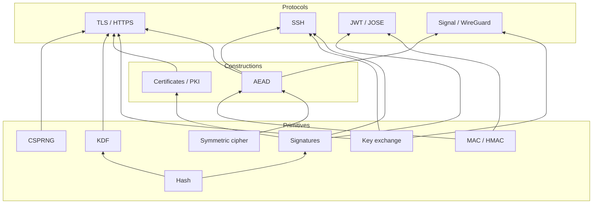

### 1.10 Cryptography Is Not Just Mathematics — It Is Trust

A critical insight that underpins everything that follows:

> Cryptography is not only about algorithms; it is about **trust models**.

Mathematics (plus hardness assumptions) can establish:

- That a signature was produced by the holder of a given private key.
- That a digest matches a given input.
- That breaking a scheme is at least as hard as some well-studied problem.

Mathematics **cannot** establish:

- Which keys you should trust.
- Whether the person holding a key is who they claim to be.
- Whether an identity claim ("this is your bank") is meaningful.
- Whether the key holder is behaving honestly.

Those decisions are **social, organizational, legal, and political**.  
Cryptography merely **enforces** decisions that were made elsewhere. This is why:

- Certificate Authorities exist, and are audited.
- Browsers and operating systems ship curated **trust stores**.
- Certificate Transparency logs exist to catch CAs misbehaving.
- "Valid cryptography" can still produce an insecure system (a perfectly valid certificate for a phishing domain).

### 1.11 Common Misconceptions (And Why They Are Wrong)

#### 1.11.1 "Encryption equals security"

Incorrect. Encryption provides **confidentiality** only. Unauthenticated encrypted data can still be:

- **Modified** — bit-flipping in CTR or CBC mode changes plaintext predictably.
- **Replayed** — an old valid ciphertext re-sent ("transfer $100") is still valid.
- **Injected** — ciphertexts from another context spliced in.
- **Used as an oracle** — decryption error behavior leaks plaintext (padding oracle).

#### 1.11.2 "Hashing signs data"

Incorrect. Hashing summarizes data.  
It does not assert who created it, who approved it, or who should be trusted.  
Anyone can recompute a hash.  
Signing always involves **a private key** and, through certificates, **an identity**.

#### 1.11.3 "Public keys identify people or servers"

Incorrect. A public key is just a number. Anyone can generate a key pair and claim it belongs to `bank.com`.  
Without a trusted binding between identity and key, a public key proves only that *someone* holds the matching private key.  
Certificates exist because of this exact limitation.

#### 1.11.4 "Choosing a strong algorithm is enough"

Incorrect. Security depends on:

- Correct **usage** (unique nonces, constant-time comparison).
- Correct **composition** (encrypt-then-MAC, AEAD, context binding).
- Correct **key management** (generation, storage, rotation, revocation).
- Correct **trust decisions** (which CAs, which keys, which identities).

A system using AES-256 incorrectly is weaker than a system using AES-128 correctly.

#### 1.11.5 "Bigger keys are always better"

Partly incorrect. Beyond 128-bit security, the weakest link is almost never key length.  
RSA-8192 is slow and buys nothing if the private key sits in a Git repository.  
AES-256 is useful primarily as a post-quantum margin, not as a classical upgrade.

#### 1.11.6 "HTTPS means the site is safe"

Incorrect.  
HTTPS means the **connection** is confidential and authenticated **to the domain name in the address bar**.  
It says nothing about whether the domain is legitimate. Phishing sites routinely have valid certificates.

#### 1.11.7 "Encrypted at rest means attackers can't read it"

Incorrect.  
If the application that holds the decryption key is compromised, the attacker reads through the application.  
Encryption at rest protects against **stolen disks, backups, and snapshots** — not against compromised services with key access.

### 1.12 The Composition Principle

The most important conceptual takeaway from Part I:

> Secure systems are built by **layering cryptographic guarantees**, not by relying on a single mechanism.

The progression looks like this:

1. **Integrity** → Hashing
2. **Authenticated integrity** → MAC / HMAC
3. **Confidentiality** → Encryption
4. **Confidentiality + integrity, safely** → AEAD
5. **Key distribution between strangers** → Key exchange (DH)
6. **Identity** → Asymmetric cryptography and signatures
7. **Trust at scale** → Certificates and PKI
8. **Secure communication** → TLS


Each layer exists because the previous one was insufficient.  
Skipping a layer creates a vulnerability that the skipped layer was invented to close.

### 1.13 Mental Model Summary

- Cryptography exists because the network is hostile and endpoints cannot see each other.
- Design against an **active** attacker who controls the network (Dolev–Yao).
- Algorithms are public; only keys are secret (Kerckhoffs).
- 128-bit security is the modern baseline; hash outputs must be twice that.
- Bad randomness silently destroys every other guarantee.
- No single cryptographic tool is sufficient; guarantees are **composed**.
- Trust must be established **before** secrecy is meaningful.
- Keys represent **authority**, not just secrets.
- Protocols matter more than individual algorithms.

Everything in later parts is an **inevitable consequence** of these principles, not an arbitrary design choice.

[Go to the Top](#table-of-contents)

---

## Part II — Integrity and Authentication: Hashing, MACs, and KDFs

### 2.1 Cryptographic Hash Functions

Hashing is the most fundamental cryptographic primitive and the foundation of integrity, signatures, key derivation, and password storage.

#### 2.1.1 What a Hash Function Is

A **cryptographic hash function** `H` maps an input of arbitrary length to a fixed-length output called a **digest**.

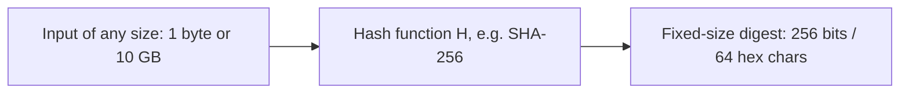

Example (SHA-256):

```text
SHA-256("hello")  = 2cf24dba5fb0a30e26e83b2ac5b9e29e1b161e5c1fa7425e73043362938b9824
SHA-256("hello.") = 1589999b0ca6ef8814283026a9f166d51c70a910671c3d44049755f07f2eb910
```

One added character produces an unrelated digest (avalanche effect).

#### 2.1.2 Functional Properties

- **Deterministic** — the same input always yields the same output.
- **Fixed-length output** — regardless of input size.
- **Efficient** — fast to compute (for general-purpose hashes; password hashes are deliberately slow).
- **Avalanche effect** — flipping one input bit flips about half of the output bits, unpredictably.

#### 2.1.3 Security Properties (The Ones That Matter)

| Property                          | Informal definition                                  | Attack cost for an n-bit hash |
| :-------------------------------- | :--------------------------------------------------- | :---------------------------- |
| **Preimage resistance** (one-way) | Given `h`, hard to find any `x` with `H(x) = h`      | ~2ⁿ                           |
| **Second-preimage resistance**    | Given `x`, hard to find `x' ≠ x` with `H(x') = H(x)` | ~2ⁿ                           |
| **Collision resistance**          | Hard to find *any* pair `x ≠ x'` with `H(x) = H(x')` | ~2ⁿᐟ² (birthday bound)        |

- Preimage resistance protects **stored digests** (e.g., you cannot invert a fingerprint).
- Second-preimage resistance protects **a specific document** from being swapped.
- Collision resistance protects **signatures and certificates**, where an attacker who controls both documents can prepare a benign one and a malicious one with the same digest.

#### 2.1.4 The Birthday Paradox

In a room of only 23 people, there is a >50% chance two share a birthday. The reason: the number of *pairs* grows quadratically.

Applied to hashes: with an *n*-bit output, an attacker who computes about 2ⁿᐟ² random hashes is likely to find a collision.

- 128-bit hash (MD5) → collisions at ~2⁶⁴ work (and MD5 is far weaker than that in practice).
- 160-bit hash (SHA-1) → ~2⁸⁰ generic; practical attacks are much cheaper.
- 256-bit hash (SHA-256) → ~2¹²⁸ → considered secure.

> This is why a hash needs **twice** the target security level in output bits.

#### 2.1.5 Hash Function Families

| Function                  | Output    | Construction      | Status                                                                                                          |
| :------------------------ | :-------- | :---------------- | :-------------------------------------------------------------------------------------------------------------- |
| MD5                       | 128       | Merkle–Damgård    | **Broken.** Collisions in seconds (2004+). Used in the Flame malware's forged Microsoft certificate (2012).     |
| SHA-1                     | 160       | Merkle–Damgård    | **Broken.** First public collision "SHAttered" (2017); chosen-prefix collisions (2020). Banned in certificates. |
| SHA-256 / SHA-512 (SHA-2) | 256 / 512 | Merkle–Damgård    | Secure. The default everywhere. Vulnerable to length extension.                                                 |
| SHA-512/256, SHA-384      | 256 / 384 | Truncated SHA-512 | Secure; truncation blocks length extension.                                                                     |
| SHA-3 (Keccak)            | 224–512   | Sponge            | Secure. Different design family; immune to length extension.                                                    |
| BLAKE2 / BLAKE3           | variable  | HAIFA / tree      | Secure, very fast. Used in Argon2, WireGuard (BLAKE2s), many modern tools.                                      |

#### 2.1.6 Inside SHA-2: The Merkle–Damgård Construction

SHA-2 pads the input and processes it block by block through a **compression function** `f`, chaining an internal state:

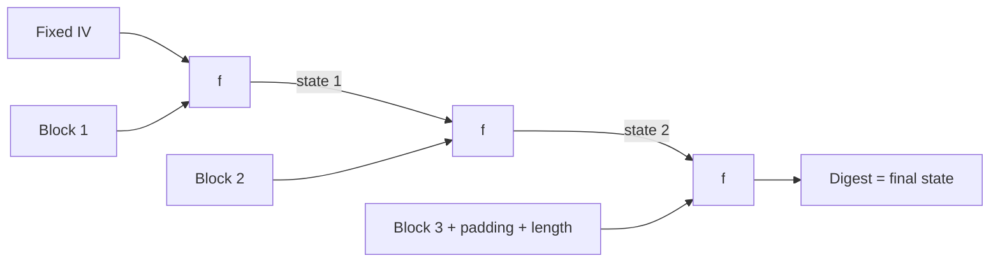

The final digest **is** the final internal state. That design choice causes a famous weakness.

#### 2.1.7 The Length-Extension Attack

Because the digest equals the internal state, anyone who knows `H(secret ‖ message)` and the length of `secret ‖ message` can **continue hashing** from that state:

```text
Known:   H(secret ‖ message)                 (the "MAC")
Attacker computes, without knowing secret:
         H(secret ‖ message ‖ padding ‖ attacker_data)
```

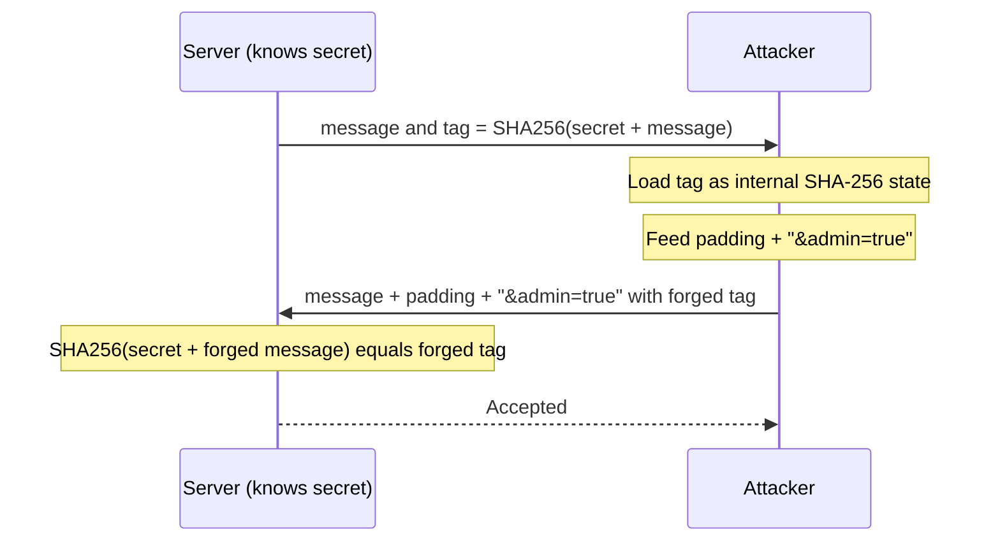

Consequences:

- `SHA-256(secret ‖ message)` is **not** a secure MAC. This broke Flickr's API signing in 2009.
- Affected: MD5, SHA-1, SHA-256, SHA-512.
- Not affected: SHA-3, BLAKE2/3, truncated SHA-2 (SHA-384, SHA-512/256), and **HMAC** with any hash.

> Never invent your own keyed hash. Use HMAC.

#### 2.1.8 What Hashing Guarantees — and What It Does Not

Hashing provides exactly one property: **integrity**, answering:

> "Is this data identical to the data the digest was computed over?"

Hashing does **not** provide:

- **Confidentiality** — the data is still readable; and low-entropy data (phone numbers, emails) can be brute-forced from its hash.
- **Authentication** — no proof of who computed the digest.
- **Identity** — no binding to a person or system.

#### 2.1.9 The Core Failure of Hashing Alone

1. A file is published along with its SHA-256 digest on the same server.
2. An attacker compromises the server and modifies the file.
3. The attacker recomputes the digest and replaces it.

The verifier sees a match.  
**Hashing cannot distinguish authorized from unauthorized changes** when the attacker controls the digest too.

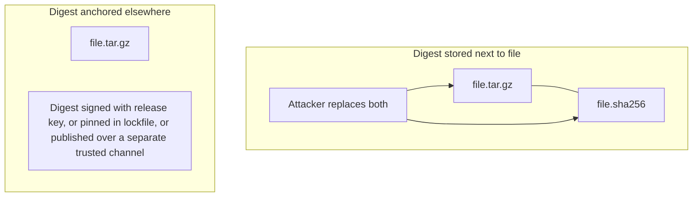

A hash is only as trustworthy as **the channel that delivered the digest**. This is why:

- Package managers pin digests in lockfiles (`package-lock.json`, `Cargo.lock`, `go.sum`).
- Linux distributions **sign** their checksum files.
- Git commit IDs are trustworthy only because you obtained them from a source you trust.

> Integrity without authentication is insufficient in adversarial settings.

#### 2.1.10 Practical Uses of Hashing

- **Integrity of anchored data** — lockfiles, Subresource Integrity (`integrity="sha384-..."` on `<script>` tags).
- **Content addressing** — Git objects, Docker image layers (`sha256:...`), IPFS.
- **Merkle trees** — Certificate Transparency logs, Git, blockchains, database anti-entropy (Cassandra, DynamoDB).
- **Deduplication** — storage systems identify identical chunks by digest.
- **Building blocks** — inside HMAC, HKDF, signatures, and password hashing.
- **Commitments** — publish `H(value ‖ random)` now, reveal later.

#### 2.1.11 Merkle Trees

A **Merkle tree** hashes data in a binary tree so that one root digest commits to many items, and membership of any item can be proven with only `log₂(n)` hashes.

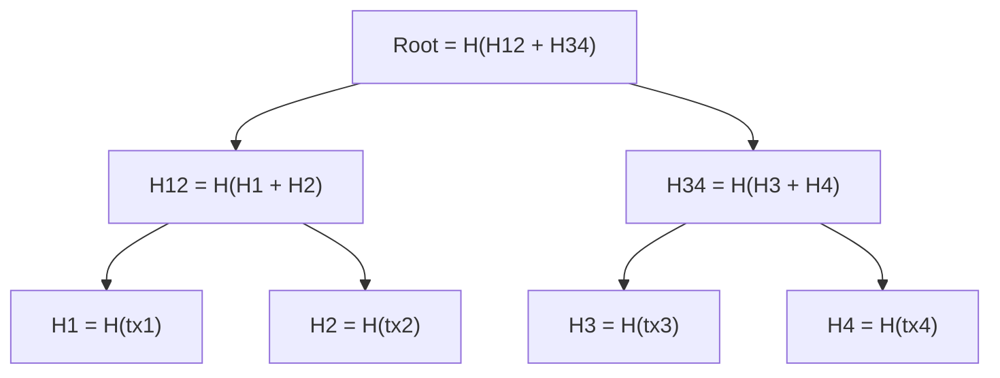

To prove `tx3` is included, provide `H4` and `H12`. The verifier recomputes `H3 → H34 → Root` and compares to the trusted root.  
Certificate Transparency (Part IV) relies on exactly this.

> Real Merkle trees use **domain separation** (e.g., prefix `0x00` for leaves and `0x01` for internal nodes) so a leaf can never be confused with an internal node — RFC 6962 does this.

### 2.2 Message Authentication Codes (MACs)

Hashing answers *"Was the data modified?"*. A **MAC** answers:

> "Was the data produced, unmodified, by someone who knows the shared secret?"

#### 2.2.1 What a MAC Is

A MAC is a pair of algorithms:

- `tag = MAC(key, message)`
- `Verify(key, message, tag) → true / false`

Security requirement (**EUF-CMA**, existential unforgeability under chosen-message attack): even after seeing valid tags for any messages of their choice, an attacker cannot produce a valid tag for any *new* message.

A MAC provides:

- **Integrity**
- **Data-origin authentication** (shared-secret based)

A MAC does **not** encrypt anything.

#### 2.2.2 MAC Is a Concept, Not an Algorithm

| Construction | Built from              | Typical use                              |
| :----------- | :---------------------- | :--------------------------------------- |
| HMAC         | Hash function           | APIs, webhooks, JWT HS256, TLS 1.2, HKDF |
| CMAC         | Block cipher (AES)      | Banking/EMV, embedded systems            |
| GMAC         | GHASH (inside AES-GCM)  | Authentication part of GCM               |
| Poly1305     | One-time polynomial MAC | ChaCha20-Poly1305                        |
| KMAC         | SHA-3 / Keccak          | Modern NIST alternative                  |

When people say "MAC", they usually mean **HMAC**.

### 2.3 HMAC (Hash-Based Message Authentication Code)

#### 2.3.1 The Construction

Defined in RFC 2104 and FIPS 198-1:

```text
HMAC(K, m) = H( (K' ⊕ opad) ‖ H( (K' ⊕ ipad) ‖ m ) )

K'   = K padded with zeros to the hash block size (64 bytes for SHA-256),
       or H(K) padded, if K is longer than the block size
ipad = 0x36 repeated to block size
opad = 0x5C repeated to block size
```

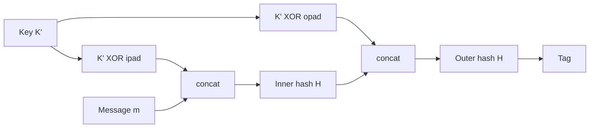

Why two nested hashes?

- The **outer** hash seals the inner digest under a second key-derived prefix, so an attacker cannot extend the inner state (length extension is defeated).
- The design has a security proof: HMAC is a secure MAC (a PRF) as long as the compression function is a PRF — it does **not** even require full collision resistance.  
  This is why HMAC-SHA1 remained secure as a MAC after SHA-1 collisions appeared (though it should still be retired).

#### 2.3.2 What HMAC Guarantees

- **Integrity** — the message has not been modified.
- **Authentication** — the message was produced by a holder of the shared key.

#### 2.3.3 What HMAC Does *Not* Guarantee

- **Confidentiality** — the message is readable.
- **Identity** — every key holder can produce valid tags; the verifier cannot tell which one did.
- **Non-repudiation** — the sender can always claim "the receiver forged it; they have the key too."
- **Replay protection** — a captured `(message, tag)` remains valid forever unless the message contains a timestamp, nonce, or sequence number.

#### 2.3.4 Verifying Tags: Constant-Time Comparison

A naive comparison (`tag == expected`) returns as soon as the first byte differs.  
By measuring response times, an attacker can guess the tag **one byte at a time** — 256 × 32 attempts instead of 2²⁵⁶.

```python
import hmac, hashlib

expected = hmac.new(key, body, hashlib.sha256).digest()

# WRONG: early-exit comparison leaks timing
if expected == received_tag: ...

# RIGHT: constant-time comparison
if hmac.compare_digest(expected, received_tag): ...
```

Equivalent constant-time functions: `crypto.timingSafeEqual` (Node.js), `MessageDigest.isEqual` (Java), `subtle::ConstantTimeEq` (Rust), `hmac.Equal` (Go).

#### 2.3.5 Truncation and Key Size

- Keys should be at least as long as the hash output (32 random bytes for HMAC-SHA256). Longer adds nothing; shorter weakens it.
- Tags may be truncated (e.g., to 128 bits), but never below ~80 bits for online use.

### 2.4 Real-World HMAC: Webhooks and API Signing

#### 2.4.1 Webhook Verification

Services like GitHub and Stripe sign every webhook with a shared secret:

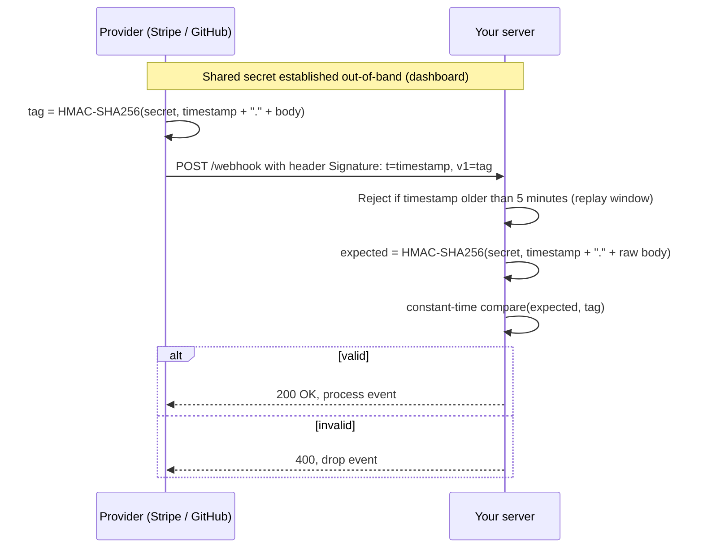

Critical implementation details:

- MAC the **raw bytes** of the body. Parsing JSON and re-serializing changes whitespace and key order, breaking verification.
- Include a **timestamp** in the MACed data and enforce a window, otherwise captured webhooks can be replayed.
- Use **constant-time** comparison.
- Rotate secrets; support two valid secrets during rotation.

#### 2.4.2 Canonical Request Signing (AWS SigV4 Pattern)

AWS Signature Version 4 shows a mature HMAC design:

1. Build a **canonical request**: method, path, sorted query string, selected headers, payload hash.
2. Build a **string to sign** including the date, region, service, and the canonical request's hash.
3. Derive a **scoped signing key** by chaining HMACs:

```text
kDate    = HMAC("AWS4" + secretKey, date)
kRegion  = HMAC(kDate, region)
kService = HMAC(kRegion, service)
kSigning = HMAC(kService, "aws4_request")
signature = HMAC(kSigning, stringToSign)
```

Lessons:

- **Canonicalization** prevents ambiguity attacks (two different requests serializing to the same bytes).
- **Scoped keys** limit damage: a leaked `kSigning` works for one day, region, and service only.
- **Timestamps** limit replay.

#### 2.4.3 Where HMAC Is Used

- API request signing (AWS SigV4, many payment gateways).
- Webhooks (Stripe, GitHub, Slack, Shopify).
- Signed/secure cookies and session tokens.
- JWT with `HS256` / `HS384` / `HS512`.
- TOTP/HOTP one-time passwords (HMAC-SHA1 over a counter).
- TLS 1.2 record MACs and PRF; TLS 1.3 Finished messages.
- HKDF (Section 2.6).

HMAC excels in **closed or controlled trust domains** where both parties legitimately share a secret.

### 2.5 Hash vs HMAC vs Digital Signature

| Property                   | Hash                          | HMAC                          | Digital Signature                         |
| :------------------------- | :---------------------------- | :---------------------------- | :---------------------------------------- |
| Integrity                  | ✔ (only if digest is trusted) | ✔                             | ✔                                         |
| Data-origin authentication | ✘                             | ✔ (any key holder)            | ✔ (private key holder)                    |
| Identity                   | ✘                             | ✘                             | ✔ (with certificate)                      |
| Public verification        | ✔ (anyone can recompute)      | ✘ (verifier needs the secret) | ✔ (anyone with public key)                |
| Non-repudiation            | ✘                             | ✘                             | ✔                                         |
| Key model                  | None                          | Shared symmetric              | Public/private pair                       |
| Speed                      | Fastest                       | Very fast                     | Slower (asymmetric math)                  |
| Typical output             | 32 bytes                      | 32 bytes                      | 64 bytes (Ed25519) – 512 bytes (RSA-4096) |

No single mechanism replaces the others.  
Each answers a different question.

### 2.6 Key Derivation Functions (KDFs)

KDFs sit inside every modern protocol, even though they are rarely discussed.

#### 2.6.1 Why KDFs Exist

Raw secrets are often unsuitable as keys:

- A Diffie–Hellman shared secret is a group element, **not uniformly random bytes**.
- A protocol needs **many independent keys** (client write key, server write key, IVs) from one secret.
- Using the same key for two purposes (e.g., encryption and MAC) can create cross-protocol attacks.

A KDF solves this: **one good secret in, many independent good keys out.**

#### 2.6.2 HKDF: Extract-then-Expand (RFC 5869)

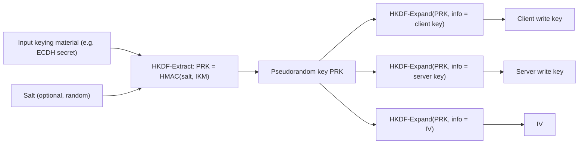

- **Extract** concentrates possibly non-uniform entropy into a fixed-length pseudorandom key.
- **Expand** stretches that key into as many output bytes as needed, with an `info` label for **domain separation**: different labels → independent keys.

TLS 1.3's entire key schedule (Part V) is built from HKDF.

#### 2.6.3 Domain Separation

> Never use one key for two purposes. Derive separate keys with distinct labels.

Examples of labels in real protocols: `"c hs traffic"`, `"s ap traffic"`, `"key"`, `"iv"` (TLS 1.3); `"aws4_request"` (AWS).

### 2.7 Password Hashing

Passwords are the one input where a **fast** hash is a **vulnerability**.

#### 2.7.1 Why SHA-256 Is Wrong for Passwords

- Human passwords have low entropy (often < 40 bits).
- A single modern GPU computes **billions** of SHA-256 hashes per second.
- A leaked table of `SHA-256(password)` can be cracked in bulk with dictionaries, rules, and precomputed **rainbow tables**.

#### 2.7.2 Salt, Pepper, and Work Factor

| Defense             | What it is                                                          | What it stops                                                                              |
| :------------------ | :------------------------------------------------------------------ | :----------------------------------------------------------------------------------------- |
| **Salt**            | Unique random value per user (16+ bytes), stored alongside the hash | Rainbow tables; identical passwords producing identical hashes; cracking all users at once |
| **Work factor**     | Deliberate slowness (iterations / cost)                             | Cheap brute force                                                                          |
| **Memory hardness** | Requires large RAM per guess                                        | GPU/ASIC parallelism                                                                       |
| **Pepper**          | Secret key stored outside the DB (HSM/KMS), applied via HMAC        | DB-only leaks; useless guesses without the pepper                                          |

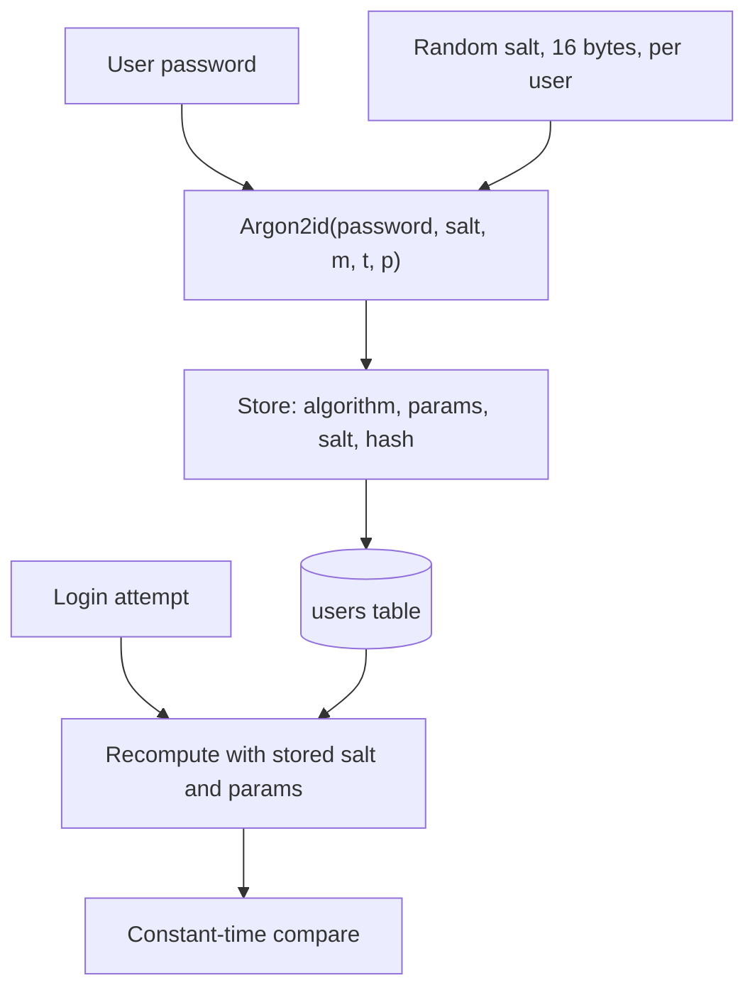

#### 2.7.3 Password Hashing Algorithms

| Algorithm              | Memory-hard | Notes                                                            | Recommended parameters (OWASP guidance) |
| :--------------------- | :---------- | :--------------------------------------------------------------- | :-------------------------------------- |
| **Argon2id**           | ✔           | Winner of the Password Hashing Competition (2015). First choice. | m = 19 MiB, t = 2, p = 1 (minimum)      |
| **scrypt**             | ✔           | Good second choice.                                              | N = 2¹⁷, r = 8, p = 1                   |
| **bcrypt**             | Partially   | Mature; truncates input at 72 bytes.                             | cost ≥ 10                               |
| **PBKDF2-HMAC-SHA256** | ✘           | Use only when FIPS compliance requires it.                       | ≥ 600,000 iterations                    |

Stored output is self-describing, for example:

```text
$argon2id$v=19$m=19456,t=2,p=1$<base64 salt>$<base64 hash>
```

This lets you **raise parameters over time**: on successful login, if stored parameters are below the current policy, rehash with the new ones.

#### 2.7.4 Password Storage Rules

- Never store plaintext or reversibly encrypted passwords.
- Never use a fast hash (MD5, SHA-1, SHA-256) directly.
- Always use a unique random salt per password (libraries do this automatically).
- Compare in constant time.
- Rate-limit and lock out online guessing; hashing protects only against **offline** attacks.

### 2.8 Design Implications

- Never rely on hashing alone when an attacker can replace the digest.
- Never build MACs as `H(key ‖ message)`; use HMAC (or KMAC / Poly1305 inside AEAD).
- Compare tags in **constant time**.
- Include **timestamps or nonces** in MACed data to stop replay.
- Derive keys with **HKDF**; separate domains with labels.
- Hash passwords with **Argon2id** (or scrypt/bcrypt), never with SHA-*.
- Use HMAC when both parties share a secret and public verifiability is not required.
- Do **not** use HMAC when third parties must verify, or non-repudiation matters — that requires signatures (Part IV).

### Summary of Part II

- Hashes provide integrity, but only when the digest itself is trusted.
- Collision resistance costs only 2ⁿᐟ² because of the birthday paradox; MD5 and SHA-1 are broken.
- Merkle–Damgård hashes (SHA-256) allow length extension; never use `H(secret ‖ m)` as a MAC.
- MACs add a shared key, yielding authenticated integrity; HMAC is the standard construction.
- HMAC gives no identity, no non-repudiation, and no replay protection by itself.
- KDFs (HKDF) turn one secret into many independent keys.
- Password hashing must be slow and memory-hard (Argon2id) with per-user salts.
- The limitations of shared secrets naturally motivate key exchange and asymmetric cryptography.

[Go to the Top](#table-of-contents)

---

## Part III — Confidentiality: Encryption, AEAD, and Key Management

### 3.1 Encryption Fundamentals

Encryption is the mechanism that provides **confidentiality** — preventing unauthorized parties from reading data.

#### 3.1.1 What Encryption Is

Encryption is a **reversible, keyed transformation**:

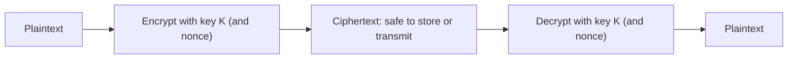

- Requires a secret key.
- Reversible by design (unlike hashing).
- A good cipher's output is indistinguishable from random to anyone without the key.

#### 3.1.2 Semantic Security and Why Encryption Must Be Randomized

A secure scheme must be **IND-CPA** secure: an attacker who chooses two messages and receives the encryption of one cannot tell which one, better than a coin flip.

A direct consequence:

> **Encrypting the same plaintext twice must produce different ciphertexts.**

Otherwise an attacker learns when messages repeat ("YES" vs "NO" votes, repeated database values).  
This is why every modern mode requires a **nonce or IV**.

#### 3.1.3 What Encryption Guarantees

Exactly one property: **confidentiality** — "Can an unauthorized party read this?"

#### 3.1.4 What Encryption Does *Not* Guarantee

- **Integrity** — ciphertext can be modified, often with predictable effects on plaintext.
- **Authentication** — anyone with the key (or, in CTR mode, anyone at all by bit-flipping) can produce ciphertext that decrypts.
- **Identity** — no binding to a sender.
- **Freshness** — old ciphertexts can be replayed.
- **Length hiding** — ciphertext length reveals plaintext length (a root cause of the CRIME and BREACH compression attacks).

> Encryption protects secrecy, not correctness or trust.

### 3.2 Symmetric Encryption

#### 3.2.1 Core Philosophy

**Symmetric encryption** uses the same secret key for encryption and decryption. It exists because it is:

- Extremely fast (gigabytes per second per core with AES-NI).
- Compact (16- or 32-byte keys, small overhead per message).
- Suitable for streaming and bulk data.

Symmetric encryption is the **workhorse** of cryptography: TLS records, disk encryption (LUKS, BitLocker, FileVault), database and object-store encryption, VPNs, backups.

#### 3.2.2 Block Ciphers vs Stream Ciphers

| Type              | How it works                                                                                              | Examples                     |
| :---------------- | :-------------------------------------------------------------------------------------------------------- | :--------------------------- |
| **Block cipher**  | Keyed permutation on fixed-size blocks (128 bits for AES). Needs a **mode of operation** for longer data. | AES, (legacy) 3DES, Blowfish |
| **Stream cipher** | Generates a pseudorandom **keystream** XORed with plaintext.                                              | ChaCha20, (broken) RC4       |

A block cipher in CTR mode *becomes* a stream cipher, which is how AES-GCM works.

#### 3.2.3 The Fundamental Assumption — and the Key Distribution Problem

Symmetric encryption assumes:

> "Both parties already share a secret key, securely."

Between strangers on the Internet this is false:

- Sending the key in the clear exposes it.
- Encrypting the key requires another shared key.
- This regresses infinitely.

For *n* parties to communicate pairwise, `n(n−1)/2` keys are needed — about 500 billion for one million users.

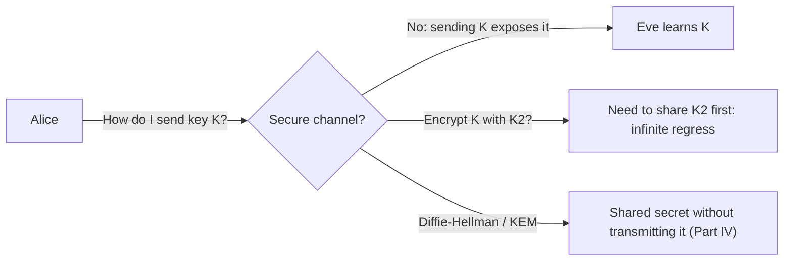

Symmetric encryption is indispensable, but it must be **preceded by key establishment and authentication**.  
It is almost never used alone between strangers.

### 3.3 AES and Modes of Operation

#### 3.3.1 AES Overview

**AES (Advanced Encryption Standard)**, originally Rijndael, was standardized by NIST in 2001 after an open competition.

| Property          | Value                                                  |
| :---------------- | :----------------------------------------------------- |
| Block size        | 128 bits                                               |
| Key sizes         | 128, 192, 256 bits                                     |
| Rounds            | 10, 12, 14 respectively                                |
| Round operations  | SubBytes, ShiftRows, MixColumns, AddRoundKey           |
| Hardware support  | AES-NI (x86), ARMv8 Crypto Extensions                  |
| Best known attack | Marginally better than brute force; no practical break |

AES itself encrypts exactly **one 16-byte block**. Everything else depends on the **mode of operation**.

#### 3.3.2 ECB (Electronic Codebook) — Never Use

Each block is encrypted independently with the same key:

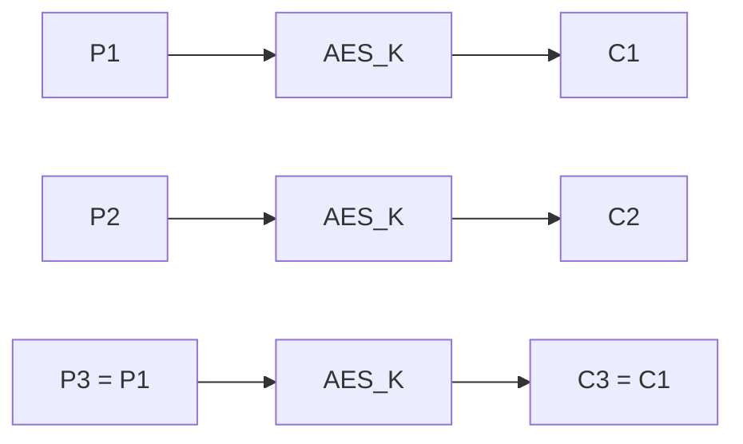

- **Identical plaintext blocks → identical ciphertext blocks.**
- The classic demonstration: an ECB-encrypted bitmap of the Linux penguin is still clearly a penguin.
- Blocks can be cut, reordered, and pasted between messages.
- ECB is often the silent default in old APIs (e.g., `Cipher.getInstance("AES")` in Java defaults to `AES/ECB/PKCS5Padding`).

#### 3.3.3 CBC (Cipher Block Chaining)

Each plaintext block is XORed with the previous ciphertext block before encryption:

```text
C₀ = IV
Cᵢ = AES_K(Pᵢ ⊕ Cᵢ₋₁)
Pᵢ = AES⁻¹_K(Cᵢ) ⊕ Cᵢ₋₁
```

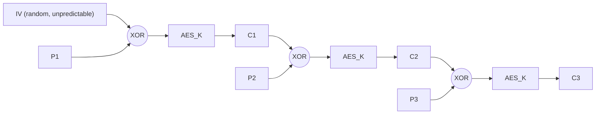

**Provides:** confidentiality (if the IV is random and unpredictable).

**Does not provide:** integrity or authentication.

**Requires:** padding (PKCS#7) because input must be a multiple of 16 bytes.

**Known failure modes:**

- **Predictable IVs** → chosen-plaintext attacks (BEAST against TLS 1.0, 2011).
- **Bit-flipping** → flipping bit *j* in `Cᵢ₋₁` flips bit *j* in `Pᵢ` (and garbles `Pᵢ₋₁`). An attacker can change `role=user` to `role=admin` if they know the plaintext layout.
- **Padding oracles** → if the receiver reveals whether padding was valid (via an error code, or timing), an attacker decrypts any ciphertext byte by byte without the key (Vaudenay 2002; POODLE 2014; Lucky Thirteen 2013).
- **Not parallelizable** for encryption.

CBC is **legacy**. If you must use it, wrap it with encrypt-then-MAC and never reveal padding errors.

#### 3.3.4 CTR (Counter Mode)

CTR turns AES into a stream cipher:

```text
Keystreamᵢ = AES_K(nonce ‖ counterᵢ)
Cᵢ = Pᵢ ⊕ Keystreamᵢ
```

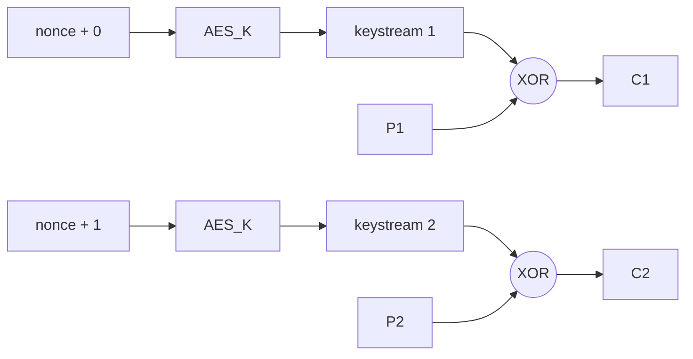

- No padding needed; parallelizable; random access.
- **Trivially malleable**: XOR the ciphertext with `Δ`, and the plaintext changes by exactly `Δ`.
- **Nonce reuse is catastrophic**: two messages under the same key and nonce share a keystream, so `C1 ⊕ C2 = P1 ⊕ P2` — the classic "two-time pad".

CTR is never used alone; it is the encryption half of **GCM**.

#### 3.3.5 GCM (Galois/Counter Mode)

AES-GCM = **CTR mode encryption** + **GHASH authentication** (polynomial MAC over GF(2¹²⁸)).

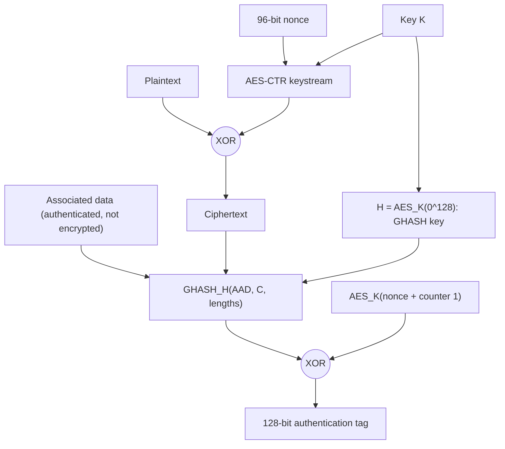

**Provides:** confidentiality, integrity, and authenticity in one operation — it is an **AEAD**.

**Properties:**

- 96-bit nonce, 128-bit tag (do not truncate below 96 bits).
- Fast and parallelizable; hardware-accelerated (PCLMULQDQ).
- **Fails closed**: if the tag does not verify, no plaintext is released.

**Limits:**

- **Nonce must never repeat under the same key.** Reuse reveals `P1 ⊕ P2` *and* allows recovery of the GHASH key `H`, enabling **universal forgery** of tags (the "forbidden attack").
- With **random** 96-bit nonces, NIST limits a key to about 2³² messages to keep collision probability negligible.
- Messages up to ~64 GiB per nonce.

AES-GCM is the modern default for TLS, IPsec, SSH, cloud KMS envelope encryption, and most libraries.

#### 3.3.6 ChaCha20-Poly1305

Designed by Daniel J. Bernstein; standardized in RFC 8439.

- **ChaCha20**: an ARX (add-rotate-XOR) stream cipher; fast in software, constant-time by construction (no lookup tables → no cache-timing leaks).
- **Poly1305**: a one-time polynomial MAC keyed per message from the ChaCha20 keystream.
- 256-bit key, 96-bit nonce (IETF variant), 128-bit tag.
- Preferred on devices **without AES hardware** (older phones, IoT); used in TLS 1.3, WireGuard, SSH.
- **XChaCha20-Poly1305** extends the nonce to 192 bits, making **random nonces safe** for practically unlimited messages.

#### 3.3.7 Nonce-Misuse-Resistant AEAD

When guaranteeing unique nonces is hard (distributed writers, VM snapshot restores), use a **misuse-resistant** scheme:

- **AES-GCM-SIV** (RFC 8452): nonce reuse leaks only whether two identical messages were encrypted — nothing more.
- **Deterministic AEAD (AES-SIV)**: used intentionally for key wrapping or searchable encryption.

#### 3.3.8 Mode Comparison

| Mode               | Confidentiality       | Integrity | Padding | Parallel     | Nonce reuse impact     | Status                        |
| :----------------- | :-------------------- | :-------- | :------ | :----------- | :--------------------- | :---------------------------- |
| ECB                | Weak (leaks patterns) | ✘         | Yes     | ✔            | N/A                    | **Never use**                 |
| CBC                | ✔                     | ✘         | Yes     | Decrypt only | Leaks prefix equality  | Legacy                        |
| CTR                | ✔                     | ✘         | No      | ✔            | Catastrophic           | Building block only           |
| GCM                | ✔                     | ✔         | No      | ✔            | Catastrophic + forgery | **Default**                   |
| ChaCha20-Poly1305  | ✔                     | ✔         | No      | ✔            | Catastrophic           | **Default** (software)        |
| XChaCha20-Poly1305 | ✔                     | ✔         | No      | ✔            | Random nonces safe     | Recommended for random nonces |
| AES-GCM-SIV        | ✔                     | ✔         | No      | Partially    | Minimal leakage        | Misuse-resistant              |

### 3.4 Composing Encryption and MACs Manually

Before AEAD existed, protocols combined encryption and MACs by hand. Three orders are possible:

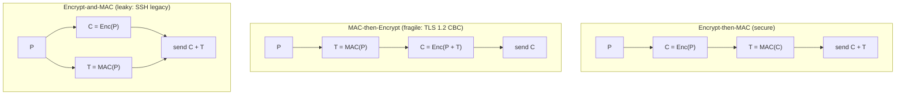

| Order                | Verdict              | Why                                                                                                                                   |
| :------------------- | :------------------- | :------------------------------------------------------------------------------------------------------------------------------------ |
| **Encrypt-then-MAC** | ✔ Generically secure | Receiver verifies the tag **before** decrypting; tampered ciphertext never reaches the decryptor, so no padding/format oracle exists. |
| MAC-then-Encrypt     | ✘ Fragile            | Receiver must decrypt (and unpad) first; differences in error handling or timing become oracles (Lucky Thirteen, POODLE).             |
| Encrypt-and-MAC      | ✘ Leaky              | MAC over plaintext may reveal plaintext equality; no generic security guarantee.                                                      |

Rules for encrypt-then-MAC:

- Use **independent keys** for encryption and MAC (derive both with HKDF).
- MAC **everything** the decryptor uses: IV/nonce, ciphertext, headers, algorithm identifiers.
- Verify in constant time; reject before decrypting.

> AEAD exists precisely so that you never have to make these choices yourself.

### 3.5 AEAD — Authenticated Encryption with Associated Data

#### 3.5.1 The Interface

```text
Seal(key, nonce, plaintext, associated_data) → ciphertext ‖ tag
Open(key, nonce, ciphertext ‖ tag, associated_data) → plaintext  OR  ⊥ (failure)
```

```mermaid
sequenceDiagram
    participant S as Sender
    participant R as Receiver
    S->>S: nonce = unique (counter or random)
    S->>S: ct, tag = Seal(K, nonce, plaintext, AAD)
    S->>R: nonce, AAD, ct, tag
    R->>R: Open(K, nonce, ct, tag, AAD)
    alt tag valid
        R->>R: release plaintext
    else tag invalid
        R->>R: return error, release nothing
    end
```

#### 3.5.2 What AEAD Requires

- **Unique nonces per key** (counters are safest; random only with large nonces or bounded message counts).
- **Full tag verification** before any plaintext is used.
- **Fail-closed behavior**: no partial plaintext, no distinguishable error types.
- **Key limits**: rotate keys before usage bounds (TLS 1.3 defines key updates for this).

#### 3.5.3 Associated Data (AD)

AEAD lets some data be **authenticated but not encrypted**. Typical associated data:

- Protocol headers that intermediaries must read (TLS record header, packet numbers in QUIC).
- Metadata: record ID, tenant ID, schema version, column name.
- Context binding: "this ciphertext belongs to user 42, field `ssn`".

Context binding prevents **ciphertext swapping**: without it, an attacker with database write access could copy user A's encrypted SSN into user B's row, and it would decrypt successfully.

```text
ciphertext = Seal(K, nonce, ssn, aad = "users:42:ssn:v1")
```

#### 3.5.4 Why AEAD Is Hard to Expose Safely

Correct AEAD use depends on **protocol-level** guarantees:

- Who generates nonces and how uniqueness is ensured across processes, restarts, and replicas.
- How tags are transported and verified.
- What happens on failure.

These are not decisions a command-line user can make reliably. Therefore:

- AEAD is best consumed through **protocols** (TLS) and **high-level libraries** (libsodium, Tink, `cryptography`'s `AESGCM`, RustCrypto `aes-gcm`).
- Low-level and CLI tools make misuse easy and silent.

### 3.6 Tooling Reality: Why `openssl enc` Is Limited

The `openssl enc` command:

- Is **algorithm-focused**, not protocol-aware.
- Predates AEAD; it **refuses AEAD ciphers** (e.g., `aes-256-gcm`) because it has no way to output and check the tag.
- Historically derived keys from passwords with a single MD5 iteration (`EVP_BytesToKey`); modern versions require `-pbkdf2 -iter N` to avoid this.
- Produces unauthenticated CBC/CTR output — tampering goes undetected.

```bash
# Acceptable only for learning or legacy interop: CBC + PBKDF2, still unauthenticated
openssl enc -aes-256-cbc -pbkdf2 -iter 600000 -salt -in secret.txt -out secret.enc
openssl enc -d -aes-256-cbc -pbkdf2 -iter 600000 -in secret.enc -out secret.txt
```

Safer file-encryption tools: **age** (X25519 + ChaCha20-Poly1305), **GPG** with modern settings, or cloud KMS-backed envelope encryption.

### 3.7 Key Management: The Real Problem

> Encryption converts a **data protection** problem into a **key protection** problem.

#### 3.7.1 Key Lifecycle

```mermaid
stateDiagram-v2
    [*] --> Generated: CSPRNG / HSM
    Generated --> Active: distributed securely
    Active --> Rotated: scheduled or usage limit
    Rotated --> DecryptOnly: old key kept to read old data
    DecryptOnly --> Destroyed: all data re-encrypted
    Active --> Compromised: leak detected
    Compromised --> Revoked
    Revoked --> Destroyed
    Destroyed --> [*]
```

Each stage has rules:

- **Generation** — CSPRNG or HSM only; never derived from timestamps, usernames, or predictable seeds.
- **Storage** — never in source code, container images, logs, or plaintext config. Use a KMS, HSM, or secrets manager.
- **Distribution** — over authenticated, encrypted channels; ideally the key never leaves the HSM at all.
- **Usage** — one purpose per key; least privilege on who may call decrypt.
- **Rotation** — on schedule and on usage limits; keep old keys for decryption until data is re-encrypted.
- **Revocation and destruction** — documented, audited, and irreversible (crypto-shredding).

#### 3.7.2 Envelope Encryption

Cloud KMS services (AWS KMS, Google Cloud KMS, Azure Key Vault) use a **two-level key hierarchy**:

- **KEK (Key Encryption Key)** — lives inside the KMS/HSM; never leaves it.
- **DEK (Data Encryption Key)** — generated per object/file/record; encrypts the data locally; stored **wrapped** (encrypted under the KEK) next to the ciphertext.

```mermaid
sequenceDiagram
    participant App
    participant KMS as KMS (holds KEK in HSM)
    participant Store as Object store / DB
    App->>KMS: GenerateDataKey(KEK id)
    KMS-->>App: plaintext DEK + wrapped DEK
    App->>App: ciphertext = AES-GCM(DEK, data)
    App->>App: wipe plaintext DEK from memory
    App->>Store: save ciphertext + wrapped DEK
    Note over App,Store: Later, to read
    App->>Store: fetch ciphertext + wrapped DEK
    App->>KMS: Decrypt(wrapped DEK)
    KMS-->>App: plaintext DEK (if IAM allows)
    App->>App: data = AES-GCM-Open(DEK, ciphertext)
```

Why this design:

- **Performance** — bulk data never travels to the KMS; only 32-byte keys do.
- **Rotation** — rotating the KEK requires re-wrapping DEKs, not re-encrypting terabytes.
- **Access control and audit** — every unwrap is an IAM-checked, logged KMS call.
- **Crypto-shredding** — destroy a KEK (or a DEK) and the data becomes permanently unreadable, which helps with deletion requirements.
- **Blast radius** — a leaked DEK exposes one object, not everything.

#### 3.7.3 HSMs and KMS

- **HSM (Hardware Security Module)** — tamper-resistant hardware that generates and uses keys internally; keys are non-exportable. Certified under FIPS 140-2/140-3.
- **KMS** — a managed service, typically HSM-backed, exposing encrypt/decrypt/sign APIs with IAM, quotas, and audit logs.
- **Secrets manager** (Vault, AWS Secrets Manager) — stores application secrets (DB passwords, API tokens), often encrypted by a KMS key.

#### 3.7.4 Data at Rest vs In Transit vs In Use

| State      | Threat                                                  | Mechanism                                                                         |
| :--------- | :------------------------------------------------------ | :-------------------------------------------------------------------------------- |
| In transit | Network attackers                                       | TLS, mTLS, IPsec, WireGuard, SSH                                                  |
| At rest    | Stolen disks, backups, snapshots, misconfigured buckets | Disk/volume encryption, database TDE, application-level envelope encryption       |
| In use     | Compromised host, malicious admin                       | Confidential computing (Intel TDX, AMD SEV-SNP), enclaves, careful access control |

Application-level (field-level) encryption is the only at-rest layer that also protects against a compromised **database** or over-privileged DBA, because the database never sees the key.

### 3.8 Design Implications

- Never rely on encryption alone; always authenticate (use AEAD).
- Never use ECB; treat CBC as legacy.
- Prefer AEAD over hand-built encrypt + MAC; if you must compose, use encrypt-then-MAC with separate keys.
- Treat **nonce management** as a first-class design concern; prefer counters, XChaCha20, or GCM-SIV when uniqueness is hard.
- Bind ciphertexts to context with associated data.
- Use envelope encryption with a KMS/HSM for data at rest.
- Rotate keys, track usage limits, and plan for revocation before you need it.
- Use protocols and vetted libraries instead of rolling your own cryptography.
- Separate key establishment (Part IV) from data protection (this part).

### Summary of Part III

- Encryption provides confidentiality only; it must be randomized (nonces/IVs).
- Symmetric encryption is fast but assumes a pre-shared key — the key distribution problem.
- AES is a block cipher; security depends entirely on the mode.
- ECB leaks patterns; CBC is malleable and oracle-prone; CTR is malleable and nonce-fragile.
- AES-GCM and ChaCha20-Poly1305 are AEADs: confidentiality + integrity, fail-closed.
- Nonce reuse in GCM breaks both secrecy and authenticity.
- Encrypt-then-MAC is the only safe manual composition.
- Key management (KMS, HSM, envelope encryption, rotation) is where most real-world encryption succeeds or fails.

[Go to the Top](#table-of-contents)

---

## Part IV — Identity and Trust: Asymmetric Cryptography, Signatures, and PKI

### 4.1 Why Identity and Trust Are Hard Problems

So far we can achieve:

- **Integrity** (hashing, HMAC)
- **Confidentiality** (encryption, AEAD)

But two problems remain unsolved:

1. **Key distribution** — how do strangers agree on a symmetric key over a public network?
2. **Identity** — how do you know *who* is on the other end?

On an open network anyone can send messages, claim any identity, and generate any public key.  
Without a way to bind **identity to cryptographic material**, an attacker simply sits in the middle and runs separate "secure" sessions with each side.

Asymmetric cryptography, digital signatures, and PKI exist to solve exactly these two problems.

### 4.2 Asymmetric (Public-Key) Cryptography

#### 4.2.1 Core Idea

Each party has a **key pair**:

- A **private key** — kept secret, never shared.
- A **public key** — shared freely.

The keys are mathematically linked, but deriving the private key from the public key is computationally infeasible (a **trapdoor** problem).

#### 4.2.2 The Three Asymmetric Operations

| Operation                 | Uses                                                                  | Provides                                 | Examples                        |
| :------------------------ | :-------------------------------------------------------------------- | :--------------------------------------- | :------------------------------ |
| **Key exchange / KEM**    | Both parties' key material                                            | A shared symmetric secret                | ECDH (X25519), ML-KEM           |
| **Public-key encryption** | Encrypt with recipient's **public** key; decrypt with **private** key | Confidentiality to the key holder        | RSA-OAEP, ECIES, HPKE           |
| **Digital signature**     | Sign with **private** key; verify with **public** key                 | Authenticity, integrity, non-repudiation | Ed25519, ECDSA, RSA-PSS, ML-DSA |

> "Encrypting with the private key" is **not** a correct description of signing.  
> It is a loose analogy that happens to resemble textbook RSA and is simply false for ECDSA, Ed25519, and ML-DSA.  
> Signing and encryption are separate algorithms with separate padding and security goals.

#### 4.2.3 Public vs Private Keys

- **Private key**
  - Represents **authority and identity**.
  - Must never leave its owner (ideally never leaves an HSM, TPM, or secure enclave).
  - Used to sign, to decrypt, and to perform its half of key exchange.

- **Public key**
  - Can be published anywhere.
  - Used to verify signatures, encrypt to the owner, or perform key exchange.
  - **Has no meaning without trusted context** — it proves only that *someone* holds the matching private key.

> A private key is not merely a secret — it is an **identity authority**. Whoever holds it *is* that identity, cryptographically.

#### 4.2.4 What Asymmetric Cryptography Solves — and What It Does Not

Solves:

- Key distribution between strangers (key exchange).
- Publicly verifiable authenticity (signatures).
- Identity, once combined with certificates.

Does not solve:

- **Bulk encryption** — asymmetric operations are 100×–10,000× slower and size-limited (RSA-2048 can encrypt at most ~190 bytes with OAEP).
- **Trust** — it does not tell you whose key you are looking at.

Therefore real systems use **hybrid encryption**: asymmetric crypto to establish a symmetric key, then AEAD for the data. TLS, SSH, PGP, age, HPKE, and Signal all follow this pattern.

```mermaid
flowchart LR
    A["Asymmetric: key exchange + authentication (slow, small)"] --> K["Shared symmetric key"]
    K --> S["Symmetric AEAD: bulk data (fast, unlimited)"]
```

### 4.3 Diffie–Hellman Key Exchange

Diffie–Hellman (1976) is the idea that made public-key cryptography practical, and it is the "ECDHE" in every modern TLS handshake.

#### 4.3.1 The Paint-Mixing Intuition

- Alice and Bob agree publicly on a common color (yellow).
- Each picks a **secret** color, mixes it with yellow, and sends the mixture publicly.
- Each adds their own secret color to the other's mixture.
- Both end up with the same final color; an eavesdropper sees only the two mixtures and cannot "unmix" them.

#### 4.3.2 The Mathematics

Public parameters: a large prime `p` and generator `g` (or an elliptic curve and base point `G`).

```mermaid
sequenceDiagram
    participant A as Alice
    participant E as Eve (sees everything)
    participant B as Bob
    Note over A,B: Public: p, g (or curve + G)
    A->>A: pick secret a
    B->>B: pick secret b
    A->>B: A = g^a mod p
    B->>A: B = g^b mod p
    Note over E: Eve sees g, p, A, B
    A->>A: s = B^a = g^(ab) mod p
    B->>B: s = A^b = g^(ab) mod p
    Note over A,B: Both share s without ever sending it
```

Security rests on the **Discrete Logarithm Problem** (given `g^a`, find `a`) and the related **Computational Diffie–Hellman** assumption.  
In elliptic-curve form (ECDH), public values are points `a·G` and `b·G`, and the shared secret is `ab·G`.

The raw shared secret `s` is fed through a **KDF** (HKDF) to produce symmetric keys — never used directly.

#### 4.3.3 Unauthenticated Diffie–Hellman Is Vulnerable to MITM

DH protects against **passive** attackers only. An active attacker performs two separate exchanges:

```mermaid
sequenceDiagram
    participant A as Alice
    participant M as Mallory
    participant B as Bob
    A->>M: g^a (meant for Bob)
    M->>B: g^m1 (pretending to be Alice)
    B->>M: g^b (meant for Alice)
    M->>A: g^m2 (pretending to be Bob)
    Note over A,M: Alice shares key K1 = g^(a*m2) with Mallory
    Note over M,B: Bob shares key K2 = g^(b*m1) with Mallory
    Note over M: Mallory decrypts, reads, re-encrypts everything
```

Both sides believe they have a secure channel.  
**Key exchange must be authenticated** — in TLS, the server signs the handshake transcript (including its DH share) with its certificate's private key.

#### 4.3.4 Static vs Ephemeral DH and Forward Secrecy

- **Static** key exchange (or RSA key transport): the long-term key decrypts every session. Steal it later → decrypt all recorded traffic.
- **Ephemeral** DH (DHE/ECDHE): fresh `a` and `b` per session, deleted afterwards. The long-term key is used only to **sign**, not to derive session keys.

> **Forward secrecy**: compromise of long-term keys does not compromise past session keys.  
> It comes **only** from ephemeral key exchange whose secrets are destroyed after use.

This is why TLS 1.3 removed RSA key transport entirely.

#### 4.3.5 Common Groups and Curves

| Name           | Type                            | Security                | Notes                                                                 |
| :------------- | :------------------------------ | :---------------------- | :-------------------------------------------------------------------- |
| X25519         | Montgomery curve (Curve25519)   | ~128-bit                | Default in TLS 1.3, SSH, WireGuard, Signal; fast and misuse-resistant |
| P-256 (secp256r1) | NIST prime curve             | ~128-bit                | Widely supported; FIPS-approved                                       |
| P-384          | NIST prime curve                | ~192-bit                | Government / high-assurance                                           |
| X448           | Montgomery curve                | ~224-bit                | Higher margin                                                         |
| ffdhe2048–8192 | Finite-field DH (RFC 7919)      | 103–192-bit             | Slower; legacy                                                        |
| X25519MLKEM768 | Hybrid classical + post-quantum | ~128-bit classical + PQ | Deployed by default in major browsers and CDNs (see Part VI)          |

### 4.4 RSA and ECC

#### 4.4.1 RSA in One Page

Key generation:

1. Pick two large random primes `p`, `q`.
2. `n = p·q` (the modulus; 2048–4096 bits).
3. `e = 65537` (public exponent).
4. `d = e⁻¹ mod λ(n)` (private exponent).
5. Public key `(n, e)`; private key `d` (plus `p`, `q` for speed).

Operations (textbook form): `c = mᵉ mod n`, `m = cᵈ mod n`.

Security rests on the difficulty of **factoring** `n`.

**Textbook RSA is insecure** — it is deterministic and malleable. Real RSA always uses padding:

| Use        | Secure padding | Broken / legacy padding                                                                |
| :--------- | :------------- | :------------------------------------------------------------------------------------- |
| Encryption | **RSA-OAEP**   | PKCS#1 v1.5 encryption (Bleichenbacher 1998, ROBOT 2017)                               |
| Signatures | **RSA-PSS**    | PKCS#1 v1.5 signatures (still widely used in certificates; acceptable but less robust) |

#### 4.4.2 Elliptic Curve Cryptography

ECC works in the group of points on an elliptic curve over a finite field. Security rests on the **Elliptic Curve Discrete Logarithm Problem**: given `Q = k·G`, find `k`.

Because no sub-exponential attack is known on good curves, ECC keys are dramatically smaller.

#### 4.4.3 RSA vs ECC

| Aspect                        | RSA                             | ECC                                        |
| :---------------------------- | :------------------------------ | :----------------------------------------- |
| Hardness assumption           | Integer factorization           | Elliptic-curve discrete log                |
| Key size for 128-bit security | 3072 bits                       | 256 bits                                   |
| Signature size                | 384 bytes (RSA-3072)            | 64 bytes (Ed25519)                         |
| Key generation                | Slow (prime search)             | Fast                                       |
| Signing                       | Slow                            | Fast                                       |
| Verification                  | Very fast (small `e`)           | Fast                                       |
| Implementation pitfalls       | Padding oracles, weak primes    | Nonce reuse (ECDSA), invalid-curve attacks |
| Status                        | Legacy-compatible, still common | **Modern default**                         |

The difference is **efficiency**, not purpose.  
Both are broken by a large quantum computer (Shor's algorithm), which motivates post-quantum cryptography (Part VI).

### 4.5 Digital Signatures

#### 4.5.1 What a Digital Signature Is

A digital signature is a value `σ = Sign(sk, m)` such that anyone with the public key can run `Verify(pk, m, σ) → true / false`, and **no one without `sk` can produce a valid σ for any new message**.

It provides:

- **Integrity** — any change to `m` invalidates σ.
- **Authentication** — σ came from the holder of `sk`.
- **Identity** — combined with a certificate, the holder is a named entity.
- **Non-repudiation** — the holder cannot plausibly deny signing (only they hold `sk`).

#### 4.5.2 How Signing and Verification Work (Conceptually)

```mermaid
flowchart LR
    subgraph Signer
        M1["Message"] --> H1["Hash"]
        H1 --> S["Sign with private key"]
        S --> SIG["Signature"]
    end
    subgraph Verifier
        M2["Received message"] --> H2["Hash"]
        SIG2["Received signature"] --> V["Verify with public key"]
        H2 --> V
        PK["Trusted public key (from certificate)"] --> V
        V --> R{"Valid?"}
        R -->|"yes"| OK["Accept: intact and from key holder"]
        R -->|"no"| NO["Reject"]
    end
    SIG --> SIG2
    M1 --> M2
```

The precise verification math depends on the scheme:

- **RSA-PSS**: verifier applies the public exponent to σ and checks the recovered encoded message matches the hash with correct PSS structure.
- **ECDSA / Ed25519**: verifier performs a point computation combining σ, the hash, and the public key, and checks an equation holds. Nothing is "decrypted".

The verifier does not trust the data; it trusts the **verification result** — and only as much as it trusts the **public key**.

#### 4.5.3 Signature Schemes

| Scheme                | Basis                 | Signature size | Deterministic       | Notes                                                                    |
| :-------------------- | :-------------------- | :------------- | :------------------ | :----------------------------------------------------------------------- |
| **Ed25519**           | Edwards curve (EdDSA) | 64 B           | ✔                   | Modern default: fast, no per-signature randomness needed, hard to misuse |
| **ECDSA P-256**       | NIST curve            | ~64–72 B       | ✘ (unless RFC 6979) | Ubiquitous in TLS certificates; nonce reuse leaks the private key        |
| **RSA-PSS**           | Factoring             | 256–512 B      | ✘ (randomized salt) | Required in TLS 1.3 for RSA handshake signatures                         |
| RSA PKCS#1 v1.5       | Factoring             | 256–512 B      | ✔                   | Still used in certificate signatures                                     |
| **ML-DSA** (FIPS 204) | Lattices              | ~2.4–4.6 KB    | Optional            | Post-quantum standard (2024)                                             |
| SLH-DSA (FIPS 205)    | Hash-based            | ~8–50 KB       | ✔                   | Conservative post-quantum; slow, large                                   |

#### 4.5.4 The ECDSA Nonce Catastrophe

ECDSA needs a fresh secret nonce `k` for every signature.  
If `k` is ever reused (or even partially predictable), two signatures reveal the private key with simple algebra:

```text
s₁ = k⁻¹(h₁ + r·d)    s₂ = k⁻¹(h₂ + r·d)    (same k → same r)
k  = (h₁ − h₂) / (s₁ − s₂)
d  = (s₁·k − h₁) / r          ← private key recovered
```

Real incidents: Sony PS3 code-signing key (2010), Android Bitcoin wallets (2013).  
Even a few biased bits of `k` across many signatures leak the key via lattice attacks (e.g., Minerva, TPM-Fail, 2019).

Mitigations: **Ed25519** (deterministic by design), or ECDSA with **RFC 6979** deterministic nonces.

#### 4.5.5 Signing vs Encrypting

|                       | Encrypt to public key       | Sign with private key                    |
| :-------------------- | :-------------------------- | :--------------------------------------- |
| Who can do it         | Anyone                      | Only the private-key holder              |
| Who can undo/check it | Only the private-key holder | Anyone                                   |
| Protects              | Secrecy                     | Authenticity, integrity, non-repudiation |
| Hides data            | ✔                           | ✘                                        |
| Proves sender         | ✘                           | ✔                                        |

Encryption protects *secrecy*. Signatures protect *trust*.  
A message that needs both is **signed and encrypted** (e.g., signed then sealed with HPKE, or authenticated via a signed key exchange as in TLS).

#### 4.5.6 HMAC vs Digital Signatures

| Aspect           | HMAC                                         | Digital Signature                                                             |
| :--------------- | :------------------------------------------- | :---------------------------------------------------------------------------- |
| Key model        | Shared secret                                | Public/private pair                                                           |
| Who can create   | Every key holder                             | Only private-key holder                                                       |
| Who can verify   | Only key holders                             | Anyone with the public key                                                    |
| Identity         | ✘                                            | ✔ (with certificate)                                                          |
| Non-repudiation  | ✘                                            | ✔                                                                             |
| Speed            | ~1 μs                                        | ~20–50 μs (Ed25519 sign/verify)                                               |
| Key distribution | Hard (secret must be shared)                 | Easy (public key is public)                                                   |
| Best fit         | Closed systems, service-to-service, webhooks | Open systems, software releases, certificates, JWTs consumed by third parties |

### 4.6 Certificates

#### 4.6.1 Why Public Keys Are Not Enough

Anyone can generate a key pair and announce:

> "This key belongs to `bank.com`."

Without validation, public keys are meaningless for identity, and the DH MITM attack (4.3.3) succeeds.

#### 4.6.2 What a Certificate Is

A **certificate** is a signed statement by an issuer:

> "I, the issuer, have verified that the public key below belongs to the subject named below, for these purposes, during this time window."

In one sentence: **a certificate binds an identity to a public key**, vouched for by a signature from someone you already trust.

#### 4.6.3 Anatomy of an X.509 v3 Certificate

```mermaid
flowchart TD
    C["X.509 Certificate"] --> TBS["To-Be-Signed data"]
    C --> SA["Signature algorithm (e.g. ecdsa-with-SHA256)"]
    C --> SV["Issuer's signature over TBS"]
    TBS --> V["Version: v3"]
    TBS --> SN["Serial number"]
    TBS --> IS["Issuer DN"]
    TBS --> VAL["Validity: notBefore / notAfter"]
    TBS --> SUB["Subject DN"]
    TBS --> SPKI["Subject public key info"]
    TBS --> EXT["Extensions"]
    EXT --> SAN["Subject Alternative Name: DNS names, IPs"]
    EXT --> BC["Basic Constraints: CA true/false, path length"]
    EXT --> KU["Key Usage: digitalSignature, keyCertSign"]
    EXT --> EKU["Extended Key Usage: serverAuth, clientAuth"]
    EXT --> AKI["Authority / Subject Key Identifiers"]
    EXT --> AIA["Authority Info Access: issuer URL, OCSP"]
    EXT --> CRLDP["CRL Distribution Points"]
    EXT --> SCT["Embedded SCTs (Certificate Transparency)"]
```

Key fields to understand:

- **Subject Alternative Name (SAN)** — the hostnames the certificate is valid for. Browsers **ignore** the Common Name (CN) and match only SAN.
- **Basic Constraints** — `CA:TRUE` allows the certificate to sign other certificates. A leaf must be `CA:FALSE`; failure to check this enabled historical MITM bugs.
- **Key Usage / Extended Key Usage** — restrict what the key may do (a server certificate should not be usable to sign code).
- **Validity** — certificates expire; expiry is a leading cause of outages.

Encodings: **DER** (binary ASN.1) and **PEM** (Base64 of DER between `-----BEGIN CERTIFICATE-----` lines).

#### 4.6.4 What Certificates Solve — and Do Not

Solve:

- Public-key authenticity.
- Identity verification of a **name** (domain, email, organization).
- MITM prevention in key exchange.

Do not:

- Encrypt anything.
- Prove the named entity is honest or legitimate.
- Remain trustworthy if the private key leaks (that requires revocation).

#### 4.6.5 Validation Levels

| Level                           | What the CA verifies                                    | Visible to users?                                               |
| :------------------------------ | :------------------------------------------------------ | :-------------------------------------------------------------- |
| **DV** (Domain Validated)       | Control of the domain (HTTP file, DNS record, or email) | No special UI                                                   |
| **OV** (Organization Validated) | Domain + organization's legal existence                 | Only in certificate details                                     |
| **EV** (Extended Validation)    | Rigorous legal/operational checks                       | Browsers removed the special UI (2019) because users ignored it |

Almost all of the web uses DV certificates, mostly issued automatically via **ACME**.

### 4.7 Public Key Infrastructure (PKI)

#### 4.7.1 What PKI Is

**PKI** is the full ecosystem that makes certificates trustworthy at scale:

- **Certificate Authorities (CAs)** — issue and sign certificates.
- **Registration Authorities** — verify identities on behalf of CAs.
- **Trust stores** — root certificates shipped by OS and browser vendors (Mozilla NSS, Apple, Microsoft, Chrome Root Store).
- **Policies** — CA/Browser Forum Baseline Requirements, root program rules, audits (WebTrust, ETSI).
- **Revocation** — CRLs, OCSP.
- **Transparency** — Certificate Transparency logs.

PKI exists because **pairwise trust does not scale**: you cannot personally verify the public key of every website.  
Instead, you trust ~150 root CAs, and they vouch for everyone else.

#### 4.7.2 Trust Anchors and Chains

```mermaid
flowchart TD
    ROOT["Root CA certificate: self-signed, offline, in trust store"] -->|"signs"| INT["Intermediate CA certificate"]
    INT -->|"signs"| LEAF["Leaf certificate: www.example.com"]
    LEAF -.->|"verifier walks up"| INT
    INT -.->|"verifier walks up"| ROOT
    TS[("OS / browser trust store")] --- ROOT
```

- **Root CA** — the ultimate trust anchor; self-signed; trusted **out of band** because it ships with your OS/browser. Its private key is kept **offline** in HSMs and used rarely.
- **Intermediate CA** — signed by the root; does day-to-day issuance. If compromised, it can be revoked without replacing the root in every device on Earth.
- **Leaf (end-entity) certificate** — used by servers, clients, or code signers.

**Trust flows downward. Verification flows upward.**

The server must send the leaf **and** intermediates; the client already has the root.  
A missing intermediate is one of the most common TLS misconfigurations ("works in Chrome, fails in curl" — because some browsers cache or fetch missing intermediates).

#### 4.7.3 Certificate Issuance: CSR Flow

```mermaid
sequenceDiagram
    participant S as Server operator
    participant CA as Certificate Authority
    S->>S: generate key pair (private key never leaves)
    S->>S: build CSR: subject, SANs, public key
    S->>S: sign CSR with private key (proof of possession)
    S->>CA: submit CSR
    CA->>CA: verify CSR self-signature
    CA->>S: domain-control challenge (HTTP-01 / DNS-01)
    S->>CA: challenge satisfied
    CA->>CA: log precertificate to CT logs, receive SCTs
    CA->>S: signed leaf certificate + intermediate chain
    S->>S: install cert + chain + private key on server
```

A **CSR (Certificate Signing Request, PKCS#10)** contains the public key and requested identity, signed by the private key.  
The self-signature proves possession of the private key without revealing it.

#### 4.7.4 Why Private Keys Never Leave Their Owners

> The entity that uses a private key must be the only entity that ever sees it.

If a CA generated server keys, the CA could impersonate any of its customers, and key material would traverse networks and storage it should never touch. Therefore:

- Keys are generated **where they are used** (server, HSM, TPM, smart card).
- CSRs exist so the CA receives only the public key.
- High-value keys live in HSMs/KMS where they are non-exportable.

If a private key leaks: identity is compromised, signatures lose meaning, and the certificate must be **revoked** and the key **replaced**.

#### 4.7.5 Chain Validation: What a Client Actually Checks

```mermaid
flowchart TD
    A["Receive leaf + intermediates"] --> B["Build path to a root in the trust store"]
    B --> C{"Each signature valid with issuer's public key?"}
    C -->|"no"| F["Reject"]
    C -->|"yes"| D{"All certs within validity period?"}
    D -->|"no"| F
    D -->|"yes"| E{"Intermediates have CA:TRUE and path length OK?"}
    E -->|"no"| F
    E -->|"yes"| G{"Hostname matches a SAN entry?"}
    G -->|"no"| F
    G -->|"yes"| H{"Key usage / EKU allow serverAuth?"}
    H -->|"no"| F
    H -->|"yes"| I{"Not revoked (CRL / OCSP / CRLite)?"}
    I -->|"no"| F
    I -->|"yes"| J{"CT requirements met (enough SCTs)?"}
    J -->|"no"| F
    J -->|"yes"| K["Trusted"]
```

Skipping **any** step is a vulnerability. Classic bugs:

- **Hostname verification disabled** (`verify=False`, `InsecureSkipVerify: true`, custom `TrustManager` that accepts all) — instantly MITM-able.
- **Basic Constraints not checked** — a leaf certificate used to sign another leaf (Internet Explorer in 2002, iOS in 2011).
- **"goto fail" (Apple, 2014)** — a duplicated line skipped signature verification in TLS.

#### 4.7.6 Revocation

Certificates can be revoked before expiry (key compromise, mis-issuance). Mechanisms:

| Mechanism                    | How it works                                                                 | Problems                                                             |
| :--------------------------- | :--------------------------------------------------------------------------- | :------------------------------------------------------------------- |
| **CRL**                      | CA publishes a signed list of revoked serials                                | Lists can be large; clients cache them                               |
| **OCSP**                     | Client asks CA's responder "is serial X valid?"                              | Privacy leak (CA sees browsing), latency, soft-fail when unreachable |
| **OCSP stapling**            | Server fetches a signed OCSP response and staples it into the handshake      | Requires server support; Must-Staple rarely used                     |
| **Browser-pushed lists**     | CRLSets (Chrome), CRLite (Firefox) aggregate revocations and push to clients | Coverage choices by vendor                                           |
| **Short-lived certificates** | Make certificates expire before revocation matters                           | Requires full automation                                             |

Industry direction: OCSP is being phased out (Let's Encrypt ended its OCSP service in 2025 in favor of CRLs), and maximum certificate lifetimes are shrinking.  
CA/Browser Forum Ballot SC-081 reduces maximum TLS certificate validity in steps — 200 days from March 2026, 100 days from March 2027, and 47 days from March 2029 — making automation (ACME) effectively mandatory.

#### 4.7.7 Certificate Transparency (CT)

**Problem:** any trusted CA can issue a certificate for any domain.  
A compromised or coerced CA (DigiNotar, 2011) can silently issue a valid certificate for `google.com`.

**Solution (RFC 6962):** every publicly trusted certificate must be recorded in public, append-only **Merkle-tree logs**.

```mermaid
sequenceDiagram
    participant CA
    participant Log as CT Log (Merkle tree)
    participant Browser
    participant Monitor as Domain owner / monitor
    CA->>Log: submit precertificate
    Log-->>CA: SCT (signed promise to include)
    CA->>Browser: certificate with embedded SCTs (via server)
    Browser->>Browser: require SCTs from enough independent logs
    Monitor->>Log: watch for certificates naming my domains
    Log-->>Monitor: alert on unexpected issuance
```

- Browsers (Chrome, Safari) reject certificates without valid SCTs.
- Domain owners monitor logs (e.g., via crt.sh) to detect mis-issuance.
- CT does not **prevent** mis-issuance; it makes it **detectable and accountable**.

#### 4.7.8 Other Trust Models

| Model                         | How trust is established                                   | Used by                                                            |
| :---------------------------- | :--------------------------------------------------------- | :----------------------------------------------------------------- |
| **Hierarchical PKI**          | Trusted CAs vouch for keys                                 | Web PKI, enterprise PKI                                            |
| **TOFU (Trust On First Use)** | Accept key the first time, alert if it changes             | SSH `known_hosts`                                                  |
| **Web of Trust**              | Users sign each other's keys                               | PGP (largely abandoned)                                            |
| **Pinning**                   | Application hard-codes expected key/CA                     | Mobile apps; HPKP for web was deprecated (too easy to brick sites) |
| **Safety numbers**            | Users compare fingerprints out of band                     | Signal, WhatsApp                                                   |
| **Private CA**                | Organization runs its own root, distributed to its devices | mTLS service meshes, internal services                             |

### 4.8 PKI Artifacts (Conceptual Mapping)

| Model                         | How trust is established                                   | Used by                                                            |
| :---------------------------- | :--------------------------------------------------------- | :----------------------------------------------------------------- |
| **Hierarchical PKI**          | Trusted CAs vouch for keys                                 | Web PKI, enterprise PKI                                            |
| **TOFU (Trust On First Use)** | Accept key the first time, alert if it changes             | SSH `known_hosts`                                                  |
| **Web of Trust**              | Users sign each other's keys                               | PGP (largely abandoned)                                            |
| **Pinning**                   | Application hard-codes expected key/CA                     | Mobile apps; HPKP for web was deprecated (too easy to brick sites) |
| **Safety numbers**            | Users compare fingerprints out of band                     | Signal, WhatsApp                                                   |
| **Private CA**                | Organization runs its own root, distributed to its devices | mTLS service meshes, internal services                             |

Each artifact exists to preserve **separation of responsibility**: the key holder controls the key, the CA controls the binding, the relying party controls whom to trust.

### Summary of Part IV

- Asymmetric cryptography solves key distribution and identity, not bulk encryption.
- Diffie–Hellman derives a shared secret over a public channel but must be authenticated to stop MITM.
- Ephemeral DH is the only source of forward secrecy.
- ECC replaced RSA for efficiency; RSA must always use OAEP or PSS padding.
- Signatures provide publicly verifiable integrity, authentication, and non-repudiation; ECDSA nonce reuse leaks keys, Ed25519 avoids it.
- Public keys mean nothing without a trusted binding; certificates provide it.
- PKI scales trust through CA hierarchies, trust stores, revocation, and Certificate Transparency.
- Chain validation must check signatures, validity, constraints, hostname, usage, revocation, and CT — every step.
- Trust is social first, cryptographic second.

[Go to the Top](#table-of-contents)

---

## Part V — TLS: Secure Communication in Practice

### 5.1 Why TLS Exists

TLS (Transport Layer Security) exists to create a **secure channel between parties that do not trust the network and have never met**.

The Internet provides connectivity, not safety:

- Networks are observable.
- Packets can be modified, dropped, and injected.
- Endpoints can be impersonated.

TLS turns an insecure byte stream (TCP, or UDP via QUIC) into a channel with confidentiality, integrity, and server authentication.  
It secures HTTPS, SMTP/IMAP (STARTTLS), database connections, gRPC, MQTT, LDAPS, and most service-to-service traffic.

#### 5.1.1 A Brief History

| Version | Year            | Status                                     |
| :------ | :-------------- | :----------------------------------------- |
| SSL 2.0 | 1995            | Broken; prohibited (RFC 6176)              |
| SSL 3.0 | 1996            | Broken by POODLE; prohibited (RFC 7568)    |
| TLS 1.0 | 1999            | Deprecated (RFC 8996, 2021)                |
| TLS 1.1 | 2006            | Deprecated (RFC 8996, 2021)                |
| TLS 1.2 | 2008 (RFC 5246) | Acceptable with modern AEAD + ECDHE suites |
| TLS 1.3 | 2018 (RFC 8446) | **Current standard**                       |

### 5.2 Where TLS Sits

```mermaid
flowchart TD
    APP["Application protocol: HTTP/1.1, HTTP/2, SMTP, gRPC, Postgres"] --> TLS["TLS: handshake + record protection"]
    TLS --> TCP["TCP"]
    TCP --> IP["IP"]
    H3["HTTP/3"] --> QUIC["QUIC (uses TLS 1.3 handshake internally)"]
    QUIC --> UDP["UDP"]
    UDP --> IP
```

TLS has two sub-protocols:

- **Handshake protocol** — negotiates parameters, authenticates the server (and optionally the client), and derives keys.
- **Record protocol** — splits application data into records (≤ 16 KiB), protects each with AEAD, and attaches sequence numbers.

### 5.3 Security Goals of TLS

1. **Confidentiality** — application data cannot be read by the network.
2. **Integrity** — data cannot be modified, reordered, truncated, or replayed within a connection without detection.
3. **Server authentication** — the client knows it is talking to the holder of a certificate for the requested hostname.
4. **Optional client authentication** — via client certificates (mTLS).
5. **Forward secrecy** — compromise of long-term keys does not expose past sessions.
6. **Downgrade resistance** — an attacker cannot force weaker versions or algorithms.

What TLS does **not** hide:

- Destination IP addresses and ports.
- The server name in **SNI**, unless **Encrypted Client Hello (ECH)** is used.
- Traffic volume, timing, and record sizes (traffic analysis).
- Anything at the endpoints themselves.

### 5.4 Why Neither Symmetric nor Asymmetric Crypto Alone Is Enough

| Approach                                             | Problem                                                                                         |
| :--------------------------------------------------- | :---------------------------------------------------------------------------------------------- |
| Symmetric only                                       | Strangers have no shared key; key distribution is unsolved                                      |
| Asymmetric only                                      | Too slow and size-limited for bulk data; no forward secrecy if a static key decrypts everything |
| Key exchange without certificates                    | Unauthenticated → MITM                                                                          |
| **TLS: authenticated ephemeral key exchange + AEAD** | Solves all of the above                                                                         |

### 5.5 The TLS 1.3 Handshake

#### 5.5.1 Full (1-RTT) Handshake

```mermaid
sequenceDiagram
    participant C as Client
    participant S as Server
    Note over C: generate ephemeral X25519 key pair
    C->>S: ClientHello: versions, cipher suites, key_share, signature_algorithms, SNI, ALPN, random
    Note over S: generate ephemeral key pair, compute ECDHE secret
    Note over S: derive handshake traffic keys
    S->>C: ServerHello: chosen suite, key_share, random
    Note over C,S: Everything below is encrypted with handshake keys
    S->>C: EncryptedExtensions: ALPN result, other params
    S->>C: Certificate: leaf + intermediates
    S->>C: CertificateVerify: signature over transcript hash
    S->>C: Finished: HMAC over transcript
    Note over C: compute ECDHE secret, derive handshake keys
    Note over C: validate chain, hostname, CertificateVerify, Finished
    C->>S: Finished: HMAC over transcript
    Note over C,S: derive application traffic keys
    C->>S: Application data (AEAD)
    S->>C: Application data (AEAD)
```

Compared to TLS 1.2, the client sends its key share **speculatively** in the first message, so the handshake completes in **one round trip**,  
and everything after `ServerHello` — including the server's certificate — is **encrypted**.

#### 5.5.2 ClientHello

Contains:

- `legacy_version = 0x0303` (pretends to be TLS 1.2 for middlebox compatibility) plus the real list in the `supported_versions` extension.
- **Client random** (32 bytes).
- **Cipher suites** it supports.
- **`supported_groups`** — key exchange groups (X25519, P-256, X25519MLKEM768…).
- **`key_share`** — ephemeral public key(s) for the groups it guesses the server will pick.
- **`signature_algorithms`** — which signature schemes it accepts (Ed25519, ECDSA-P256-SHA256, RSA-PSS…).
- **SNI** (`server_name`) — which hostname it wants; lets one IP host many sites.
- **ALPN** — application protocols (`h2`, `http/1.1`).
- Optional **`pre_shared_key`** and **`early_data`** for resumption/0-RTT.

**Purpose:** advertise capabilities and start the key exchange immediately.

#### 5.5.3 ServerHello

Contains:

- **Server random**.
- **Selected cipher suite**.
- **Selected key share** (server's ephemeral public key).
- `supported_versions` = TLS 1.3.

**Purpose:** fix the cryptographic parameters and complete the ECDHE exchange. Both sides can now compute the shared secret.

If the client guessed the wrong group, the server replies with a **HelloRetryRequest** naming the group it wants, costing one extra round trip.

#### 5.5.4 Ephemeral Key Exchange (ECDHE)

Both sides combine their private ephemeral key with the peer's public share:

```text
shared_secret = X25519(client_private, server_public) = X25519(server_private, client_public)
```

- Nothing secret is transmitted.
- The ephemeral private keys are destroyed after the handshake → **forward secrecy**.
- The shared secret feeds the **key schedule** (5.6).

#### 5.5.5 EncryptedExtensions

Server-side parameters that do not need to be in the clear (ALPN result, max fragment length, etc.).  
Its existence is one reason TLS 1.3 leaks less metadata than 1.2.

#### 5.5.6 Certificate

The server sends its **leaf certificate and intermediates** (and possibly a stapled OCSP response and SCTs).  
This message is **encrypted** in TLS 1.3, so passive observers cannot see which certificate was presented.

**Purpose:** claim an identity and present a verifiable public key.

#### 5.5.7 Certificate Verification (Client Side)

The client performs the chain validation from Part IV (4.7.5): signatures, validity, constraints, hostname vs SAN, key usage, revocation, CT.  
Any failure aborts the handshake with an alert.

#### 5.5.8 CertificateVerify

The server signs the **hash of the entire handshake transcript so far** with the certificate's private key:

```text
signed_content = 0x20 × 64 ‖ "TLS 1.3, server CertificateVerify" ‖ 0x00 ‖ Transcript-Hash(ClientHello … Certificate)
```

**Purpose:**

- Proves possession of the private key matching the certificate (a certificate alone is public and can be replayed by anyone).
- **Binds** the server's identity to *this* handshake, including both ECDHE shares — this is precisely what defeats the DH MITM attack from Part IV.
- The fixed prefix and context string provide **domain separation** so the signature cannot be reused in another protocol or as a client signature.

#### 5.5.9 Finished Messages

Each side sends:

```text
Finished = HMAC(finished_key, Transcript-Hash(all handshake messages so far))
```

where `finished_key` is derived from that side's handshake traffic secret.

**Purpose:**

- Confirms both sides derived the same keys.
- Authenticates the **entire** transcript: any tampering with any handshake message (e.g., stripping strong cipher suites) makes Finished fail.
- Provides **key confirmation**.

#### 5.5.10 Secure Application Data

After Finished:

- Both sides switch to **application traffic keys**.
- Every record is protected with AEAD (AES-128-GCM, AES-256-GCM, or ChaCha20-Poly1305).
- The per-record nonce is the static IV XORed with a 64-bit **sequence number**, so nonces never repeat and replayed/reordered records fail authentication.
- Asymmetric cryptography is no longer used for this connection.
- Either side can send **KeyUpdate** to ratchet to fresh traffic keys for long-lived connections.

### 5.6 The TLS 1.3 Key Schedule

This is where HKDF (Part II) and ECDHE (Part IV) meet.

```mermaid
flowchart TD
    Z0["0 or PSK"] --> ES["Early Secret = HKDF-Extract(0, PSK or 0)"]
    ES --> BEK["binder_key, client_early_traffic_secret (0-RTT)"]
    ES --> D1["Derive-Secret(., derived)"]
    D1 --> HS["Handshake Secret = HKDF-Extract(derived, ECDHE shared secret)"]
    ECDHE["ECDHE shared secret"] --> HS
    HS --> CHTS["client_handshake_traffic_secret"]
    HS --> SHTS["server_handshake_traffic_secret"]
    HS --> D2["Derive-Secret(., derived)"]
    D2 --> MS["Master Secret = HKDF-Extract(derived, 0)"]
    MS --> CATS["client_application_traffic_secret_0"]
    MS --> SATS["server_application_traffic_secret_0"]
    MS --> EMS["exporter_master_secret"]
    MS --> RMS["resumption_master_secret"]
```

- Each `*_traffic_secret` is expanded with HKDF into a **key** and an **IV** (`"key"` and `"iv"` labels).
- Each derivation includes the **transcript hash** up to that point, binding keys to the exact handshake.
- Handshake and application keys are separate: compromise of one stage does not trivially yield the other.
- `resumption_master_secret` produces **PSKs** for future session resumption.
- `exporter_master_secret` lets applications derive channel-bound keys (used by, e.g., token binding and some mTLS schemes).

### 5.7 Cipher Suites

#### 5.7.1 TLS 1.3 Cipher Suites

TLS 1.3 cipher suites specify **only** the AEAD and the hash for HKDF. Key exchange and signature algorithms are negotiated separately.

| Suite                          | AEAD                    | Hash                                                       |
| :----------------------------- | :---------------------- | :--------------------------------------------------------- |
| `TLS_AES_128_GCM_SHA256`       | AES-128-GCM             | SHA-256                                                    |
| `TLS_AES_256_GCM_SHA384`       | AES-256-GCM             | SHA-384                                                    |
| `TLS_CHACHA20_POLY1305_SHA256` | ChaCha20-Poly1305       | SHA-256                                                    |
| `TLS_AES_128_CCM_SHA256`       | AES-128-CCM             | SHA-256 (IoT)                                              |
| `TLS_AES_128_CCM_8_SHA256`     | AES-128-CCM, 8-byte tag | SHA-256 (constrained IoT; not recommended for general use) |

#### 5.7.2 Reading a TLS 1.2 Cipher Suite

```text
TLS_ECDHE_RSA_WITH_AES_128_GCM_SHA256
     │     │        │           │
     │     │        │           └─ PRF / HMAC hash
     │     │        └─ bulk cipher + mode (AEAD here)
     │     └─ authentication: server certificate key type (signs the DH params)
     └─ key exchange: ephemeral ECDH → forward secrecy
```

Suites to avoid in TLS 1.2: anything with `RSA` key exchange (no `ECDHE`/`DHE` → no forward secrecy), `CBC`, `RC4`, `3DES`, `NULL`, `EXPORT`, `anon`, `MD5`.

### 5.8 The TLS 1.2 Handshake (for Comparison)

```mermaid
sequenceDiagram
    participant C as Client
    participant S as Server
    C->>S: ClientHello: random, cipher suites
    S->>C: ServerHello: random, chosen suite
    S->>C: Certificate (in the clear)
    S->>C: ServerKeyExchange: ECDHE params signed by cert key
    S->>C: ServerHelloDone
    C->>S: ClientKeyExchange: client ECDHE public value
    C->>S: ChangeCipherSpec
    C->>S: Finished
    S->>C: ChangeCipherSpec
    S->>C: Finished
    Note over C,S: 2 round trips before application data
```

With the legacy **RSA key exchange**, the client encrypted a "premaster secret" to the server's RSA public key in `ClientKeyExchange`.  
Anyone who later obtained the server's private key could decrypt **every recorded session** — no forward secrecy.  
It was also the source of Bleichenbacher/ROBOT padding-oracle attacks.

### 5.9 Session Resumption and 0-RTT

#### 5.9.1 PSK Resumption

After a handshake, the server sends a **NewSessionTicket** containing an encrypted/identified PSK derived from `resumption_master_secret`.  
On reconnect, the client offers the PSK:

- Skips certificate transmission and verification (cheaper).
- Should still be combined with a fresh ECDHE (`psk_dhe_ke` mode) to keep forward secrecy.

#### 5.9.2 0-RTT Early Data

With a PSK, the client can send application data **in its first flight**, encrypted under the early traffic secret.

```mermaid
sequenceDiagram
    participant C as Client
    participant S as Server
    C->>S: ClientHello + pre_shared_key + early_data + key_share
    C->>S: 0-RTT application data (e.g. GET /)
    S->>C: ServerHello, EncryptedExtensions, Finished
    C->>S: EndOfEarlyData, Finished
    Note over C,S: continue with 1-RTT keys
```

Trade-offs:

- **Not replay-protected**: an attacker can capture and resend the first flight, and the server may process it twice.
- **Weaker forward secrecy** for the early data (keyed only by the PSK).
- **Rule:** only allow 0-RTT for **idempotent** requests (`GET` without side effects). Servers typically add anti-replay caches and reject 0-RTT for non-idempotent methods.

### 5.10 Downgrade Protection

Attackers historically forced clients to weaker versions (POODLE relied on fallback to SSL 3.0) or weaker ciphers (FREAK, Logjam forced "export-grade" crypto).

TLS 1.3 defenses:

- **Transcript authentication**: `CertificateVerify` and `Finished` cover the full ClientHello, so stripping options breaks the handshake.
- **Downgrade sentinel**: a TLS 1.3-capable server that negotiates TLS 1.2 or below sets the last 8 bytes of `ServerHello.random` to `44 4F 57 4E 47 52 44 01` ("DOWNGRD\x01") or `…00` for TLS 1.1 and below.  
  A TLS 1.3 client that sees this aborts — and since the random is signed, the attacker cannot remove it.
- Removal of all legacy algorithms that downgrades used to target.

### 5.11 Where Cryptographic Primitives Appear in TLS 1.3

| Primitive                          | Role in TLS                                                     |
| :--------------------------------- | :-------------------------------------------------------------- |
| CSPRNG                             | Client/server randoms, ephemeral keys                           |
| Hashing                            | Transcript hash; inside HKDF, HMAC, signatures                  |
| HMAC                               | Finished messages; HKDF                                         |
| HKDF                               | Entire key schedule                                             |
| ECDHE (X25519 / P-256 / hybrid PQ) | Ephemeral key exchange → forward secrecy                        |
| Digital signatures                 | CertificateVerify; certificate chain signatures                 |
| Certificates / PKI                 | Server (and client) identity                                    |
| AEAD (AES-GCM / ChaCha20-Poly1305) | Handshake encryption after ServerHello; all application records |
| Sequence numbers                   | Per-record nonces; replay/reorder detection                     |

```mermaid
flowchart LR
    subgraph Handshake
        KX["ECDHE"] --> KS["HKDF key schedule"]
        TH["Transcript hash"] --> KS
        CERT["Certificate chain"] --> AUTH["CertificateVerify signature"]
        TH --> AUTH
        KS --> FIN["Finished HMAC"]
    end
    subgraph Records
        KS --> AEAD["AEAD with seq-number nonces"]
    end
    AUTH --> TRUST["Authenticated channel"]
    FIN --> TRUST
    AEAD --> TRUST
```

TLS is a carefully composed system, not a single algorithm.

### 5.12 TLS 1.2 vs TLS 1.3

| Aspect                      | TLS 1.2                       | TLS 1.3                                               |
| :-------------------------- | :---------------------------- | :---------------------------------------------------- |
| Full handshake latency      | 2-RTT                         | 1-RTT (0-RTT with PSK)                                |
| Forward secrecy             | Optional (depends on suite)   | Mandatory (except pure-PSK mode)                      |
| Key exchange                | RSA, DHE, ECDHE               | ECDHE / DHE / PSK only                                |
| Bulk ciphers                | CBC, RC4, 3DES, GCM, ChaCha20 | AEAD only                                             |
| Certificate visibility      | Plaintext                     | Encrypted                                             |
| Cipher suite count          | Hundreds of combinations      | 5                                                     |
| Handshake signature         | Covers DH params only         | Covers whole transcript                               |
| Key derivation              | Custom PRF                    | HKDF with labeled stages                              |
| Renegotiation               | Supported (source of attacks) | Removed (replaced by KeyUpdate / post-handshake auth) |
| Compression                 | Supported (CRIME)             | Removed                                               |
| Static RSA / export ciphers | Present                       | Removed                                               |

TLS 1.3 reflects decades of attacks: almost every removal corresponds to a named attack.

### 5.13 A Short History of TLS Attacks

| Attack         | Year    | Root cause                                      | Lesson                                                        |
| :------------- | :------ | :---------------------------------------------- | :------------------------------------------------------------ |
| Bleichenbacher | 1998    | RSA PKCS#1 v1.5 padding oracle                  | Never expose decryption error details; drop RSA key transport |
| BEAST          | 2011    | Predictable CBC IVs in TLS 1.0                  | IVs must be unpredictable                                     |
| CRIME / BREACH | 2012–13 | Compression leaks length of secrets             | Do not compress secrets alongside attacker data               |
| Lucky Thirteen | 2013    | Timing in MAC-then-encrypt CBC                  | Use AEAD / encrypt-then-MAC; constant time                    |
| RC4 biases     | 2013–15 | Statistical keystream biases                    | Retire weak ciphers (RFC 7465)                                |
| Heartbleed     | 2014    | OpenSSL buffer over-read leaked memory and keys | Implementation bugs bypass all math                           |
| goto fail      | 2014    | Apple skipped signature check                   | Test negative paths                                           |
| POODLE         | 2014    | SSL 3.0 padding + version fallback              | Kill old versions; prevent downgrade                          |
| FREAK / Logjam | 2015    | Downgrade to export-grade RSA/DH                | Remove weak options entirely                                  |
| DROWN          | 2016    | SSLv2 on same key broke TLS                     | Never share keys across protocols                             |
| ROBOT          | 2017    | Bleichenbacher returns                          | Remove RSA key exchange                                       |
| Raccoon        | 2020    | Timing in DH secret handling (TLS 1.2)          | Constant-time everything                                      |

> Notice: only RC4 is an algorithm break. Everything else is protocol design, composition, or implementation.

### 5.14 Mutual TLS (mTLS)

In standard TLS only the server is authenticated. In **mTLS**, the server also requests a client certificate:

```mermaid
sequenceDiagram
    participant C as Client service
    participant S as Server service
    C->>S: ClientHello
    S->>C: ServerHello, EncryptedExtensions
    S->>C: CertificateRequest (acceptable CAs, sig algs)
    S->>C: Certificate, CertificateVerify, Finished
    C->>S: Certificate (client cert chain)
    C->>S: CertificateVerify (client signs transcript)
    C->>S: Finished
    Note over S: validate client chain against private CA, map identity to authorization
```

Used for:

- Service-to-service authentication in zero-trust networks and service meshes (Istio, Linkerd), typically with short-lived certificates issued automatically (SPIFFE/SPIRE identities like `spiffe://cluster/ns/payments/sa/api`).
- B2B APIs, payment networks, IoT device identity.

mTLS authenticates **who** is calling; the application still must decide **what** they may do (authorization).

### 5.15 TLS in Real Architectures

#### 5.15.1 TLS Termination

```mermaid
flowchart LR
    U["Browser"] -->|"TLS (public cert)"| LB["Load balancer / CDN: terminates TLS"]
    LB -->|"option A: plaintext (avoid)"| A1["App server"]
    LB -->|"option B: re-encrypt TLS / mTLS"| A2["App server"]
    LB -.->|"option C: TLS passthrough (L4)"| A3["App server terminates TLS itself"]
```

- **Termination at the edge** simplifies certificate management and enables HTTP routing, WAF, and caching — but the edge sees plaintext.
- **Re-encryption** (TLS or mTLS to backends) is the zero-trust default; never assume the internal network is safe.
- **Passthrough** keeps end-to-end TLS but loses L7 features.

#### 5.15.2 HSTS

**HTTP Strict Transport Security** (`Strict-Transport-Security: max-age=31536000; includeSubDomains; preload`) tells browsers to always use HTTPS for a domain,  
defeating **SSL stripping** (where an attacker keeps the victim on HTTP).  
The **preload list** protects even the first visit.

#### 5.15.3 Encrypted Client Hello (ECH)

SNI reveals the target hostname in plaintext. **ECH** encrypts the inner ClientHello (including SNI) to a public key the server publishes in DNS (HTTPS records),  
so observers see only an outer ClientHello naming a shared front (e.g., a CDN).  
It closes one of the last major metadata leaks of TLS 1.3.

#### 5.15.4 QUIC and HTTP/3

QUIC runs over UDP and embeds the TLS 1.3 handshake directly: transport and crypto handshakes are combined, packet headers are protected, and even most transport metadata is encrypted.  
The cryptographic core is the same TLS 1.3 key schedule and AEAD.

### 5.16 Observing TLS with OpenSSL

`openssl s_client` performs a real handshake and prints what was negotiated.

```bash
# Basic handshake with SNI, TLS 1.3 only
openssl s_client -connect example.com:443 -servername example.com -tls1_3 </dev/null

# Show the full certificate chain the server sends
openssl s_client -connect example.com:443 -servername example.com -showcerts </dev/null

# Test whether TLS 1.1 is (correctly) rejected
openssl s_client -connect example.com:443 -tls1_1 </dev/null

# Inspect the leaf certificate's details
openssl s_client -connect example.com:443 -servername example.com </dev/null 2>/dev/null \
  | openssl x509 -noout -subject -issuer -dates -ext subjectAltName

# Request a stapled OCSP response
openssl s_client -connect example.com:443 -servername example.com -status </dev/null
```

What to look for in the output:

| Output line                                                       | Meaning                                                  |
| :---------------------------------------------------------------- | :------------------------------------------------------- |
| `Protocol: TLSv1.3`                                               | Negotiated version                                       |
| `Cipher: TLS_AES_256_GCM_SHA384`                                  | Negotiated AEAD + hash                                   |
| `Server Temp Key: X25519, 253 bits`                               | Ephemeral key exchange group (forward secrecy)           |
| `Peer signature type: ECDSA` / `RSA-PSS`                          | CertificateVerify algorithm                              |
| `Certificate chain` / `depth=` lines                              | Chain sent by server                                     |
| `Verify return code: 0 (ok)`                                      | Chain validated against the local trust store            |
| `Verify return code: 20 (unable to get local issuer certificate)` | Missing intermediate or unknown root                     |
| `Verify return code: 10 (certificate has expired)`                | Expired certificate                                      |
| `Verify return code: 18 / 19`                                     | Self-signed leaf / self-signed root in chain not trusted |

> `s_client` does **not** check that the hostname matches unless you pass `-verify_hostname example.com`.  
> A "0 (ok)" without it proves only that the chain is valid — not that it belongs to the host you wanted.

Most TLS errors in practice are **trust failures** (expired certs, missing intermediates, wrong SAN, unknown private CA), not cryptographic failures.

### 5.17 Design Implications

- Establish **authenticated** keys before encrypting anything.
- Identity verification (chain + hostname) is mandatory; never disable it, even "temporarily".
- Forward secrecy requires ephemeral key exchange; disable static RSA key exchange.
- Use TLS 1.3 everywhere you can; restrict TLS 1.2 to ECDHE + AEAD suites.
- Treat 0-RTT data as replayable.
- Automate certificate issuance and renewal (lifetimes are shrinking).
- Re-encrypt behind load balancers; prefer mTLS for service-to-service.
- Protocol design and implementation quality matter more than individual algorithms.

### Summary of Part V

- TLS turns an untrusted transport into an authenticated, confidential, integrity-protected channel.
- TLS 1.3 completes in 1-RTT: ECDHE key shares in the first flight, everything after ServerHello encrypted.
- Certificates give identity; CertificateVerify proves key possession and binds identity to the handshake; Finished authenticates the transcript.
- HKDF-based key schedule separates early, handshake, and application keys, all bound to the transcript.
- AEAD with sequence-number nonces protects records; KeyUpdate refreshes keys.
- 0-RTT trades replay protection for latency.
- Nearly every TLS 1.3 removal corresponds to a historical attack.
- mTLS extends authentication to clients; HSTS and ECH close remaining gaps.

[Go to the Top](#table-of-contents)

---

## Part VI — Applied Cryptography: Tools, Code, and Protocols

This part turns the concepts into practice.  
Commands target OpenSSL 3.x; code uses Python's `cryptography`, `hmac`, `secrets`, and `argon2-cffi` packages, chosen for readability.  
The patterns translate directly to Java (JCA/Tink), Go (`crypto/*`), and Rust (RustCrypto, `ring`).

### 6.1 OpenSSL Cookbook

#### 6.1.1 Randomness

```bash
openssl rand -hex 32        # 32 random bytes as hex (e.g. an HMAC key)
openssl rand -base64 32     # same, Base64
```

#### 6.1.2 Hashing

```bash
openssl dgst -sha256 release.tar.gz
openssl dgst -sha3-256 release.tar.gz
sha256sum release.tar.gz                     # coreutils equivalent
echo -n "hello" | openssl dgst -sha256       # -n: no trailing newline (a classic gotcha)
```

#### 6.1.3 HMAC

```bash
# Classic form
openssl dgst -sha256 -hmac "my-shared-secret" payload.json

# OpenSSL 3 generic MAC interface, key given as hex
openssl mac -digest SHA256 -macopt hexkey:$(openssl rand -hex 32) -in payload.json HMAC
```

#### 6.1.4 Generating Key Pairs

```bash
# Ed25519 (modern default for signatures)
openssl genpkey -algorithm ed25519 -out ed25519.key

# ECDSA P-256
openssl genpkey -algorithm EC -pkeyopt ec_paramgen_curve:P-256 -out p256.key

# RSA-3072 (legacy compatibility)
openssl genpkey -algorithm RSA -pkeyopt rsa_keygen_bits:3072 -out rsa3072.key

# Extract public keys
openssl pkey -in ed25519.key -pubout -out ed25519.pub
openssl pkey -in p256.key   -pubout -out p256.pub

# Restrict permissions on private keys
chmod 600 *.key
```

#### 6.1.5 Signing and Verifying

```bash
# Ed25519 signs the raw message (it hashes internally), hence -rawin
openssl pkeyutl -sign   -inkey ed25519.key        -rawin -in message.txt -out message.sig
openssl pkeyutl -verify -pubin -inkey ed25519.pub -rawin -in message.txt -sigfile message.sig

# ECDSA / RSA via dgst (hash-then-sign)
openssl dgst -sha256 -sign   p256.key -out message.sig    message.txt
openssl dgst -sha256 -verify p256.pub -signature message.sig message.txt
# Output: "Verified OK" or "Verification failure"
```

Now modify one byte of `message.txt` and verify again — it fails.  
That single experiment demonstrates integrity, and the fact that only `p256.key` could have produced the signature demonstrates authenticity.

#### 6.1.6 Building a Private CA and Issuing a Server Certificate

```mermaid
flowchart LR
    RK["ca.key"] --> RC["ca.crt (self-signed root)"]
    SK["server.key"] --> CSR["server.csr"]
    CSR --> SIGN["CA signs CSR with ca.key"]
    RC --> SIGN
    SIGN --> SC["server.crt"]
    RC --> TS["Install ca.crt in client trust store"]
```

```bash
# 1. Root CA key and self-signed root certificate (10 years)
openssl genpkey -algorithm EC -pkeyopt ec_paramgen_curve:P-256 -out ca.key
openssl req -x509 -new -key ca.key -sha256 -days 3650 -out ca.crt \
  -subj "/CN=Demo Internal Root CA" \
  -addext "basicConstraints=critical,CA:TRUE" \
  -addext "keyUsage=critical,keyCertSign,cRLSign"

# 2. Server key and CSR (private key stays on the server)
openssl genpkey -algorithm EC -pkeyopt ec_paramgen_curve:P-256 -out server.key
openssl req -new -key server.key -out server.csr -subj "/CN=api.internal.test"

# 3. Extensions the CA will enforce on the leaf
cat > server.ext <<'EOF'
basicConstraints=critical,CA:FALSE
keyUsage=critical,digitalSignature
extendedKeyUsage=serverAuth
subjectAltName=DNS:api.internal.test,DNS:localhost,IP:127.0.0.1
EOF

# 4. CA signs the CSR (90-day leaf)
openssl x509 -req -in server.csr -CA ca.crt -CAkey ca.key -CAcreateserial \
  -out server.crt -days 90 -sha256 -extfile server.ext

# 5. Verify the chain and inspect
openssl verify -CAfile ca.crt server.crt
openssl x509 -in server.crt -noout -text
openssl req  -in server.csr -noout -verify      # checks the CSR self-signature
```

> In production, a root CA signs an **intermediate**, the root key goes offline, and only the intermediate issues leaves.  
> Tools like `step-ca`, HashiCorp Vault PKI, AWS Private CA, or cert-manager automate this.

#### 6.1.7 Does This Key Match This Certificate?

A frequent production question after a botched deployment:

```bash
openssl x509 -in server.crt -noout -pubkey | openssl dgst -sha256
openssl pkey -in server.key -pubout        | openssl dgst -sha256
# Identical digests → the key matches the certificate
```

#### 6.1.8 Running a Local TLS and mTLS Server

```bash
# TLS server
openssl s_server -accept 8443 -cert server.crt -key server.key -tls1_3

# Client that trusts the private CA and checks the hostname
openssl s_client -connect localhost:8443 -CAfile ca.crt -verify_hostname localhost </dev/null

# mTLS: server demands a client certificate signed by ca.crt
openssl s_server -accept 8443 -cert server.crt -key server.key -CAfile ca.crt -Verify 1
openssl s_client -connect localhost:8443 -CAfile ca.crt -cert client.crt -key client.key
```

(Issue `client.crt` like the server certificate, with `extendedKeyUsage=clientAuth`.)

#### 6.1.9 Format Conversions

```bash
openssl x509 -in cert.pem -outform der -out cert.der                                        # PEM → DER
openssl x509 -in cert.der -inform der -out cert.pem                                         # DER → PEM
openssl pkcs12 -export -in server.crt -inkey server.key -certfile ca.crt -out server.p12    # bundle for Java/Windows
openssl pkcs12 -in server.p12 -nodes -out bundle.pem                                        # unpack (exposes key!)
```

### 6.2 Code Patterns (Python)

#### 6.2.1 Secure Randomness

```python
import secrets

api_key   = secrets.token_urlsafe(32)   # URL-safe token
hmac_key  = secrets.token_bytes(32)     # raw key bytes
otp_code  = secrets.randbelow(10**6)    # uniform 0..999999

# Never: random.random(), random.randint() — predictable Mersenne Twister
```

#### 6.2.2 HMAC Signing and Verification

```python
import hmac, hashlib, time

def sign(secret: bytes, body: bytes) -> str:
    ts = str(int(time.time()))
    tag = hmac.new(secret, ts.encode() + b"." + body, hashlib.sha256).hexdigest()
    return f"t={ts},v1={tag}"

def verify(secret: bytes, body: bytes, header: str, tolerance: int = 300) -> bool:
    parts = dict(p.split("=", 1) for p in header.split(","))
    ts, tag = parts["t"], parts["v1"]
    if abs(time.time() - int(ts)) > tolerance:                 # replay window
        return False
    expected = hmac.new(secret, ts.encode() + b"." + body, hashlib.sha256).hexdigest()
    return hmac.compare_digest(expected, tag)                  # constant time
```

#### 6.2.3 AEAD with AES-GCM and Associated Data

```python
import os
from cryptography.hazmat.primitives.ciphers.aead import AESGCM

key = AESGCM.generate_key(bit_length=256)
aead = AESGCM(key)

def encrypt_field(plaintext: bytes, context: bytes) -> bytes:
    nonce = os.urandom(12)                         # 96-bit, unique per encryption
    return nonce + aead.encrypt(nonce, plaintext, context)

def decrypt_field(blob: bytes, context: bytes) -> bytes:
    nonce, ct = blob[:12], blob[12:]
    return aead.decrypt(nonce, ct, context)        # raises InvalidTag on any tampering

blob = encrypt_field(b"123-45-6789", b"users:42:ssn:v1")
decrypt_field(blob, b"users:42:ssn:v1")            # OK
decrypt_field(blob, b"users:43:ssn:v1")            # InvalidTag: ciphertext moved to another row
```

Random 96-bit nonces are fine up to roughly 2³² encryptions per key; beyond that, rotate keys or use `XChaCha20-Poly1305` (e.g., via PyNaCl/libsodium) or `AESGCMSIV`.

#### 6.2.4 Ed25519 Signatures

```python
from cryptography.hazmat.primitives.asymmetric.ed25519 import Ed25519PrivateKey
from cryptography.exceptions import InvalidSignature

sk = Ed25519PrivateKey.generate()
pk = sk.public_key()

msg = b"release v2.4.1 sha256=..."
sig = sk.sign(msg)                     # 64 bytes, deterministic

try:
    pk.verify(sig, msg)                # returns None on success
    print("valid")
except InvalidSignature:
    print("forged or modified")
```

#### 6.2.5 Ephemeral Key Exchange + HKDF + AEAD (Mini-TLS Core)

```python
import os
from cryptography.hazmat.primitives.asymmetric.x25519 import X25519PrivateKey
from cryptography.hazmat.primitives.kdf.hkdf import HKDF
from cryptography.hazmat.primitives import hashes
from cryptography.hazmat.primitives.ciphers.aead import ChaCha20Poly1305

# Each side generates an ephemeral key pair and exchanges public keys
alice_eph = X25519PrivateKey.generate()
bob_eph   = X25519PrivateKey.generate()

shared_a = alice_eph.exchange(bob_eph.public_key())
shared_b = bob_eph.exchange(alice_eph.public_key())
assert shared_a == shared_b

def derive(shared: bytes, label: bytes) -> bytes:
    return HKDF(algorithm=hashes.SHA256(), length=32, salt=None,
                info=b"demo-protocol v1 " + label).derive(shared)

a_to_b = derive(shared_a, b"alice->bob")      # separate key per direction
b_to_a = derive(shared_a, b"bob->alice")

nonce = (0).to_bytes(12, "big")               # counter-based nonce, sequence 0
ct = ChaCha20Poly1305(a_to_b).encrypt(nonce, b"hello bob", b"header")
```

> This is **unauthenticated** DH — vulnerable to MITM.  
> TLS adds exactly the missing piece: the server **signs the transcript** containing both public keys with a certificate-backed key.

#### 6.2.6 Password Hashing with Argon2id

```python
from argon2 import PasswordHasher
from argon2.exceptions import VerifyMismatchError

ph = PasswordHasher()                      # Argon2id with library-default parameters

stored = ph.hash("correct horse battery staple")
# '$argon2id$v=19$m=65536,t=3,p=4$...$...'

def login(stored: str, attempt: str) -> bool:
    try:
        ph.verify(stored, attempt)
    except VerifyMismatchError:
        return False
    if ph.check_needs_rehash(stored):     # parameters raised since this hash was made
        stored = ph.hash(attempt)          # persist the upgraded hash
    return True
```

### 6.3 JSON Web Tokens (JWT)

#### 6.3.1 Structure

```text
base64url(header) . base64url(payload) . base64url(signature)

header  = {"alg":"ES256","typ":"JWT","kid":"2026-10-key-1"}
payload = {"iss":"https://auth.example.com","sub":"user-42","aud":"orders-api",
           "exp":1793200000,"iat":1793196400,"scope":"orders:read"}
```

- The header and payload are **encoded, not encrypted** — anyone can read them. Never put secrets in a JWT payload. (JWE exists for encrypted tokens.)
- The signature covers `header.payload`.

#### 6.3.2 HS256 vs RS256 / ES256 / EdDSA

|                     | HS256 (HMAC)                                          | RS256 / ES256 / EdDSA (signature)              |
| :------------------ | :---------------------------------------------------- | :--------------------------------------------- |
| Key                 | One shared secret                                     | Private key signs, public key verifies         |
| Who can mint tokens | **Every verifier**                                    | Only the issuer                                |
| Distribution        | Secret must reach every service                       | Public keys via JWKS endpoint                  |
| Best for            | A single service issuing and verifying its own tokens | Identity providers, many independent consumers |

With HS256, every microservice that can verify tokens can also forge them.  
This is Part II's HMAC-vs-signature trade-off in a real system.

#### 6.3.3 Verification Flow

```mermaid
flowchart TD
    T["Incoming JWT"] --> P["Parse header (untrusted)"]
    P --> A{"alg in server allowlist?"}
    A -->|"no, or alg = none"| R["Reject"]
    A -->|"yes"| K["Select key by kid from trusted JWKS (pinned issuer)"]
    K --> S{"Signature valid?"}
    S -->|"no"| R
    S -->|"yes"| C{"exp, nbf, iat valid (with small clock skew)?"}
    C -->|"no"| R
    C -->|"yes"| I{"iss and aud match this service?"}
    I -->|"no"| R
    I -->|"yes"| Z["Authorize based on claims"]
```

#### 6.3.4 Classic JWT Vulnerabilities

- **`alg: none`** — some libraries accepted unsigned tokens when the header said so.
- **Algorithm confusion** — server expects RS256; attacker sends HS256 and signs with the server's **public key** as the HMAC secret.  
  A library that picks the algorithm from the header verifies it successfully.
- **`kid` injection** — `kid` used unsafely in file paths or SQL queries.
- **`jku`/`x5u` header abuse** — attacker points to their own key set.
- **Missing claim validation** — no `exp`, `aud`, or `iss` checks; a token for service A replayed at service B.
- **No revocation** — JWTs are valid until expiry; keep lifetimes short (minutes) and use refresh tokens.

> Rule: the **server** decides the algorithm and the key; the token's header is only a hint.

### 6.4 SSH

SSH is a second major protocol built from the same primitives, with a different trust model.

```mermaid
sequenceDiagram
    participant C as SSH client
    participant S as SSH server
    C->>S: version + KEXINIT (algorithms)
    S->>C: version + KEXINIT
    C->>S: ephemeral key share (e.g. mlkem768x25519 or curve25519)
    S->>C: ephemeral key share + host key + signature over exchange hash
    Note over C: check host key against known_hosts (TOFU)
    Note over C,S: derive session keys, switch to AEAD
    C->>S: user auth: sign session ID with user private key
    S->>S: check public key in authorized_keys
```

- **Host authentication** uses **TOFU**: the first connection shows a fingerprint; `known_hosts` stores it; a later mismatch triggers the famous `REMOTE HOST IDENTIFICATION HAS CHANGED` warning — a potential MITM.
- **User authentication** with keys signs the unique session identifier, so the signature cannot be replayed into another session.
- **SSH certificates** (`ssh-keygen -s`) replace TOFU and scattered `authorized_keys` with a CA model — the same idea as X.509, simpler format.
- Modern defaults: Ed25519 keys (`ssh-keygen -t ed25519`), ChaCha20-Poly1305 or AES-GCM, and hybrid post-quantum key exchange (`mlkem768x25519-sha256` is the default since OpenSSH 10.0).

### 6.5 End-to-End Encrypted Messaging (Brief)

TLS protects client ↔ server. In messaging, the **server itself** should not read messages. The Signal Protocol provides:

- **Asynchronous key agreement** (X3DH, upgraded to post-quantum PQXDH) using prekeys published to the server.
- **Double Ratchet** — every message advances a KDF chain (forward secrecy) and periodic new DH exchanges heal the session after a compromise (**post-compromise security**).
- **Safety numbers** — users compare key fingerprints out of band to detect a MITM server.

It is TLS's ideas — ephemeral DH, KDF chains, AEAD — applied per message instead of per connection.

### 6.6 One-Time Passwords (TOTP)

Authenticator apps use HMAC (RFC 6238):

```text
counter = floor(unix_time / 30)
code    = Truncate(HMAC-SHA1(shared_secret, counter)) mod 10^6
```

- The shared secret is exchanged once (the QR code).
- The server accepts a small window of adjacent counters for clock drift and must reject reuse of a code.
- TOTP is phishable (a fake site relays the code). **Passkeys / WebAuthn** fix this with origin-bound public-key signatures — the browser signs a challenge only for the real domain.

### 6.7 Post-Quantum Cryptography (PQC)

#### 6.7.1 The Threat

| Algorithm                     | Classical security | Quantum attack       | Effect                                               |
| :---------------------------- | :----------------- | :------------------- | :--------------------------------------------------- |
| RSA, DH, ECDH, ECDSA, Ed25519 | Secure             | **Shor's algorithm** | **Completely broken**                                |
| AES-128                       | 128-bit            | Grover's algorithm   | ~64-bit effective → use AES-256 for long-term margin |
| AES-256                       | 256-bit            | Grover               | ~128-bit → fine                                      |
| SHA-256 / SHA-3               | Secure             | Grover / BHT         | Minor reduction → fine                               |

No cryptographically relevant quantum computer exists today, but **"harvest now, decrypt later"** is a present threat: adversaries can record encrypted traffic now and decrypt it once one exists.  
Anything that must stay confidential for 10+ years is already exposed if its key exchange is classical.

#### 6.7.2 The NIST Standards (August 2024)

| Standard | Name                   | Type                      | Replaces                         |
| :------- | :--------------------- | :------------------------ | :------------------------------- |
| FIPS 203 | **ML-KEM** (Kyber)     | Lattice key encapsulation | ECDH / RSA key transport         |
| FIPS 204 | **ML-DSA** (Dilithium) | Lattice signatures        | ECDSA / Ed25519 / RSA signatures |
| FIPS 205 | **SLH-DSA** (SPHINCS+) | Hash-based signatures     | Conservative backup signatures   |

A **KEM** differs from DH in shape: the sender *encapsulates* a random secret to the recipient's public key, producing a ciphertext; the recipient *decapsulates* it. TLS uses it like a key share.

#### 6.7.3 Hybrid Key Exchange

Deployments combine classical and post-quantum algorithms so the result is secure if **either** holds:

```mermaid
flowchart LR
    X["X25519 shared secret"] --> CAT["concatenate"]
    M["ML-KEM-768 shared secret"] --> CAT
    CAT --> KDF["TLS 1.3 key schedule (HKDF)"]
    KDF --> KEYS["Traffic keys: secure unless BOTH are broken"]
```

- `X25519MLKEM768` is the default TLS key exchange in current Chrome, Firefox, and Edge, at Cloudflare and other CDNs, and in OpenSSL 3.5+.
- Cost: larger ClientHello (~1.2 KB key share) — which exposed middleboxes that mishandled multi-packet ClientHellos.
- Signatures (and therefore certificates) are migrating more slowly; ML-DSA certificates are much larger, and the immediate threat applies to **confidentiality** (harvest-now), not past authentication.

#### 6.7.4 Crypto Agility

The lasting lesson of PQC: systems must be able to **change algorithms** without redesign.

- Negotiate algorithms rather than hard-coding them.
- Version ciphertext and token formats (`v1`, `v2`), and include algorithm identifiers in authenticated data.
- Inventory where cryptography is used (a "cryptographic bill of materials").
- Keep key sizes and message size limits flexible.

[Go to the Top](#table-of-contents)

---

## Part VII — Decision Guide, Anti-Patterns, and Glossary

### 7.1 Which Primitive Do I Need?

```mermaid
flowchart TD
    Q["What do you need?"] --> Q1{"Detect accidental change only?"}
    Q1 -->|"yes"| H["Hash: SHA-256 / BLAKE3"]
    Q1 -->|"no"| Q2{"Store user passwords?"}
    Q2 -->|"yes"| PW["Argon2id (scrypt / bcrypt)"]
    Q2 -->|"no"| Q3{"Keep data secret?"}
    Q3 -->|"yes"| Q4{"Data in transit?"}
    Q4 -->|"yes"| TLS["TLS 1.3 / mTLS / SSH / WireGuard"]
    Q4 -->|"no, at rest"| ENV["AEAD + envelope encryption via KMS"]
    Q3 -->|"no"| Q5{"Prove authenticity?"}
    Q5 -->|"yes"| Q6{"Do all verifiers share a secret with the signer?"}
    Q6 -->|"yes, closed system"| HM["HMAC-SHA256"]
    Q6 -->|"no, public / third-party verification or non-repudiation"| SIG["Signature: Ed25519 / ECDSA P-256"]
    Q5 -->|"no"| Q7{"Derive keys from a secret?"}
    Q7 -->|"from a strong secret"| HK["HKDF"]
    Q7 -->|"from a password"| PW
```

### 7.2 Quick Recommendations (Late 2026)

| Need                  | Use                                                                                       | Avoid                                                     |
| :-------------------- | :---------------------------------------------------------------------------------------- | :-------------------------------------------------------- |
| Hash                  | SHA-256, SHA-384, SHA-3, BLAKE2/3                                                         | MD5, SHA-1                                                |
| MAC                   | HMAC-SHA256                                                                               | `H(key ‖ msg)`, CBC-MAC with variable lengths             |
| Password storage      | Argon2id; scrypt; bcrypt                                                                  | SHA-*, MD5, unsalted anything, reversible encryption      |
| Key derivation        | HKDF-SHA256                                                                               | Raw DH output as a key; reusing one key for many purposes |
| Symmetric encryption  | AES-256-GCM, ChaCha20-Poly1305, XChaCha20-Poly1305, AES-GCM-SIV                           | ECB, unauthenticated CBC/CTR, RC4, DES/3DES               |
| Key exchange          | X25519, P-256 ECDHE; hybrid X25519MLKEM768                                                | Static RSA key transport, DH < 2048, export groups        |
| Signatures            | Ed25519, ECDSA P-256 (RFC 6979), RSA-PSS ≥ 3072                                           | RSA < 2048, DSA, ECDSA with weak randomness               |
| Public-key encryption | HPKE (RFC 9180), age, RSA-OAEP                                                            | Textbook RSA, RSA PKCS#1 v1.5 encryption                  |
| Transport             | TLS 1.3 (TLS 1.2 with ECDHE + AEAD as fallback)                                           | SSL, TLS 1.0/1.1, CBC suites                              |
| Randomness            | OS CSPRNG (`getrandom`, `secrets`, `SecureRandom`)                                        | `Math.random`, `rand()`, time-seeded PRNGs                |
| Libraries             | libsodium, Tink, `cryptography`, BoringSSL/OpenSSL via high-level APIs, RustCrypto/`ring` | Hand-rolled primitives or protocols                       |

### 7.3 Anti-Patterns

| Anti-pattern                                | Why it is wrong                                  | Fix                                            |
| :------------------------------------------ | :----------------------------------------------- | :--------------------------------------------- |
| Rolling your own crypto or protocol         | Composition errors are invisible until exploited | Use TLS, libsodium/Tink, HPKE                  |
| Encryption without authentication           | Malleable; oracle attacks                        | AEAD                                           |
| Reusing nonces with GCM/CTR                 | Breaks confidentiality (and GCM integrity)       | Counters, XChaCha20, GCM-SIV, key rotation     |
| ECB mode                                    | Leaks patterns                                   | AEAD                                           |
| `SHA-256(secret ‖ message)` as a MAC        | Length extension                                 | HMAC                                           |
| `==` to compare MACs or tokens              | Timing leak                                      | Constant-time comparison                       |
| Fast hash for passwords                     | GPU cracking                                     | Argon2id + salt                                |
| Hard-coded keys / keys in Git               | Permanent compromise                             | KMS / secrets manager; rotate; scan repos      |
| Same key for multiple purposes              | Cross-protocol attacks                           | HKDF with labels                               |
| Disabling certificate verification          | Trivial MITM                                     | Fix the trust store; use a private CA properly |
| Trusting the JWT header's `alg`             | Algorithm confusion, `none`                      | Server-side allowlist                          |
| Base64 "encryption"                         | Encoding is not encryption                       | Real encryption                                |
| Detailed decryption errors                  | Oracle attacks                                   | One generic failure, constant time             |
| Long-lived certificates with manual renewal | Outages and slow revocation                      | ACME automation                                |
| Static RSA key exchange                     | No forward secrecy                               | ECDHE                                          |
| `Math.random()` for tokens                  | Predictable                                      | CSPRNG                                         |
| Logging secrets, tokens, or plaintext       | Leaks through log pipelines                      | Redaction, structured logging allowlists       |
| Hard-coding one algorithm everywhere        | No migration path (PQC)                          | Versioned formats, crypto agility              |

### 7.4 Production Checklist

- [ ] All external and internal traffic uses TLS 1.3 (or TLS 1.2 with ECDHE + AEAD only).
- [ ] Certificate issuance and renewal are automated; expiry is monitored and alerted well in advance.
- [ ] Servers send the full chain (leaf + intermediates); hostname verification is enabled in every client.
- [ ] HSTS is enabled (and preloaded for public sites).
- [ ] Service-to-service calls use mTLS or signed tokens with audience restrictions.
- [ ] Data at rest uses envelope encryption with keys in a KMS/HSM; DEKs are per object or per tenant.
- [ ] Sensitive fields use AEAD with associated data binding them to their context.
- [ ] Passwords use Argon2id with per-user salts and rehash-on-login.
- [ ] All tokens, keys, and nonces come from a CSPRNG.
- [ ] MAC and token comparisons are constant time.
- [ ] Webhooks and signed requests include timestamps and enforce a replay window.
- [ ] Keys have owners, rotation schedules, usage limits, and a documented compromise procedure.
- [ ] Secrets are absent from code, images, logs, and CI output (enforced by scanning).
- [ ] Domains are monitored in Certificate Transparency logs.
- [ ] An inventory of cryptographic algorithms exists, with a post-quantum migration plan (hybrid key exchange first).

### 7.5 Glossary

| Term                              | Definition                                                                                                                                    |
| :-------------------------------- | :-------------------------------------------------------------------------------------------------------------------------------------------- |
| **AEAD**                          | Authenticated Encryption with Associated Data; encryption that also guarantees integrity and authenticity, authenticates unencrypted context  |
| **ACME**                          | Automated Certificate Management Environment (RFC 8555); protocol used by Let's Encrypt and others to issue certificates automatically        |
| **AES**                           | Advanced Encryption Standard; 128-bit block cipher with 128/192/256-bit keys                                                                  |
| **ALPN**                          | Application-Layer Protocol Negotiation; TLS extension choosing `h2`, `http/1.1`, etc.                                                         |
| **Associated data (AD/AAD)**      | Data authenticated by an AEAD but not encrypted                                                                                               |
| **Birthday bound**                | ~2ⁿᐟ² operations to find a collision in an n-bit space                                                                                        |
| **CA**                            | Certificate Authority; issues and signs certificates                                                                                          |
| **CBC**                           | Cipher Block Chaining; legacy unauthenticated block cipher mode                                                                               |
| **Certificate**                   | Signed binding of an identity to a public key (X.509)                                                                                         |
| **Certificate Transparency (CT)** | Public append-only logs of issued certificates                                                                                                |
| **ChaCha20-Poly1305**             | AEAD built from the ChaCha20 stream cipher and Poly1305 MAC                                                                                   |
| **CRL**                           | Certificate Revocation List                                                                                                                   |
| **CSPRNG**                        | Cryptographically Secure Pseudorandom Number Generator                                                                                        |
| **CSR**                           | Certificate Signing Request (PKCS#10); public key + identity, self-signed                                                                     |
| **DEK / KEK**                     | Data Encryption Key / Key Encryption Key in envelope encryption                                                                               |
| **Diffie–Hellman (DH/ECDH)**      | Key agreement producing a shared secret over a public channel                                                                                 |
| **Digest**                        | Output of a hash function                                                                                                                     |
| **Domain separation**             | Using distinct labels/contexts so one key or signature cannot be reused in another role                                                       |
| **ECDHE**                         | Elliptic-Curve Diffie–Hellman Ephemeral; provides forward secrecy                                                                             |
| **ECDSA**                         | Elliptic Curve Digital Signature Algorithm; requires a unique secret nonce per signature                                                      |
| **ECH**                           | Encrypted Client Hello; hides SNI and other ClientHello fields                                                                                |
| **Ed25519**                       | EdDSA signatures on Curve25519; deterministic, fast, misuse-resistant                                                                         |
| **Envelope encryption**           | Encrypting data with a DEK and storing the DEK wrapped by a KEK                                                                               |
| **Forward secrecy**               | Past sessions stay secure even if long-term keys are later compromised                                                                        |
| **GCM**                           | Galois/Counter Mode; AES-based AEAD                                                                                                           |
| **HKDF**                          | HMAC-based Extract-and-Expand Key Derivation Function (RFC 5869)                                                                              |
| **HMAC**                          | Hash-based MAC (RFC 2104)                                                                                                                     |
| **HPKE**                          | Hybrid Public Key Encryption (RFC 9180); standard KEM + KDF + AEAD composition                                                                |
| **HSM**                           | Hardware Security Module; tamper-resistant key storage and operations                                                                         |
| **HSTS**                          | HTTP Strict Transport Security; forces HTTPS                                                                                                  |
| **IND-CPA / IND-CCA2**            | Formal confidentiality notions against chosen-plaintext / adaptive chosen-ciphertext attackers                                                |
| **IV**                            | Initialization Vector; per-message input that randomizes encryption (must be unpredictable for CBC)                                           |
| **KDF**                           | Key Derivation Function                                                                                                                       |
| **KEM**                           | Key Encapsulation Mechanism; public-key method to transport a random shared secret                                                            |
| **KMS**                           | Key Management Service                                                                                                                        |
| **MAC**                           | Message Authentication Code                                                                                                                   |
| **Merkle tree**                   | Tree of hashes whose root commits to all leaves                                                                                               |
| **ML-KEM / ML-DSA / SLH-DSA**     | NIST post-quantum KEM and signature standards (FIPS 203/204/205)                                                                              |
| **mTLS**                          | Mutual TLS; both client and server present certificates                                                                                       |
| **Nonce**                         | Number used once; must never repeat under the same key                                                                                        |
| **Non-repudiation**               | Signer cannot credibly deny having signed                                                                                                     |
| **OCSP**                          | Online Certificate Status Protocol                                                                                                            |
| **Padding oracle**                | Side channel revealing padding validity, enabling decryption                                                                                  |
| **PKI**                           | Public Key Infrastructure                                                                                                                     |
| **PSK**                           | Pre-Shared Key; in TLS 1.3, used for resumption and 0-RTT                                                                                     |
| **RSA-OAEP / RSA-PSS**            | Secure padding schemes for RSA encryption / signatures                                                                                        |
| **Salt**                          | Unique random value per password hash                                                                                                         |
| **SAN**                           | Subject Alternative Name; hostnames/IPs a certificate is valid for                                                                            |
| **SCT**                           | Signed Certificate Timestamp; proof of CT log submission                                                                                      |
| **SNI**                           | Server Name Indication; hostname sent in ClientHello                                                                                          |
| **TOFU**                          | Trust On First Use (SSH host keys)                                                                                                            |
| **Transcript hash**               | Running hash of all handshake messages; bound into signatures and keys                                                                        |
| **Trust store**                   | Set of root CA certificates a client trusts                                                                                                   |
| **X25519**                        | ECDH over Curve25519                                                                                                                          |
| **0-RTT**                         | TLS 1.3 early data sent before handshake completion; replayable                                                                               |

[Go to the Top](#table-of-contents)

---

## Part VIII — Q and A

Questions are grouped by topic and roughly ordered from fundamentals to design-level reasoning.  
Each answer is written to be spoken in an interview in under a minute.

### 8.1 Foundations

#### Q1. What are the core security goals cryptography provides?

Confidentiality, integrity, authentication (of data origin and of entities), non-repudiation, and forward secrecy, plus replay protection at the protocol level.  
Note that the classic CIA triad is Confidentiality, Integrity, **Availability** — and availability is not something cryptography provides; misused cryptography (expired certificates, lost keys) often harms it.

#### Q2. What is Kerckhoffs's principle and why does it matter?

A system must stay secure even if everything except the key is public.  
It means algorithms are published and scrutinized, security does not depend on obscurity, and compromise is fixed by rotating keys rather than redesigning algorithms.

#### Q3. What is the difference between a passive and an active attacker?

A passive attacker only observes traffic; encryption alone defeats them.  
An active attacker can modify, inject, replay, drop, and impersonate; defeating them requires encryption plus integrity plus authentication of the peer.  
Protocols are designed against the active (Dolev–Yao) attacker who effectively *is* the network.

#### Q4. What does "128-bit security" mean?

The best known attack needs about 2¹²⁸ operations. That is the modern baseline, matched by AES-128, X25519/P-256, RSA-3072, and SHA-256 collision resistance.

#### Q5. Why does a hash need 256 bits of output for 128-bit security?

Because of the birthday paradox, collisions in an *n*-bit hash are found after about 2ⁿᐟ² attempts. A 256-bit hash therefore gives 128-bit collision resistance.

#### Q6. What is the difference between encoding, hashing, encryption, and signing?

Encoding (Base64) changes representation and is reversible by anyone. Hashing is one-way and keyless, used for fingerprints.  
Encryption is reversible only with a key and provides confidentiality.  
Signing uses a private key to produce a value anyone can verify with the public key, providing authenticity.

#### Q7. Why is randomness so important in cryptography?

Keys, nonces, IVs, salts, and ephemeral secrets must be unpredictable.  
Weak randomness has produced guessable keys (Debian OpenSSL 2008), shared RSA primes across devices, and leaked ECDSA private keys (PS3, Bitcoin wallets). Always use the OS CSPRNG.

#### Q8. What is the difference between primitives and protocols?

Primitives (hashes, ciphers, MACs, signatures, key exchange) provide individual capabilities.  
Protocols (TLS, SSH, Signal) compose them: deciding which keys are used for what, in which order, bound to which context, and how failures behave.  
Most breaches come from protocol and implementation errors, not broken primitives.

#### Q9. Is information-theoretic security achievable in practice?

Only with a one-time pad: a truly random key as long as the message, never reused.  
It is impractical because the key distribution problem is as hard as the original problem.  
All practical cryptography is computationally secure, resting on hardness assumptions.

### 8.2 Hashing

#### Q10. What are the three security properties of a cryptographic hash?

Preimage resistance (cannot invert a digest), second-preimage resistance (cannot find another input matching a given input's digest), and collision resistance (cannot find any two inputs with the same digest).

#### Q11. Why is hashing alone insufficient for security?

Hashing gives integrity but not authenticity.  
If an attacker can replace both the data and the digest, verification still succeeds.  
A hash is only as trustworthy as the channel that delivered the digest — which is why digests are signed, pinned in lockfiles, or delivered over trusted channels.

#### Q12. Why are MD5 and SHA-1 considered broken?

Practical collisions exist: MD5 collisions take seconds and were used to forge a Microsoft code-signing certificate (Flame, 2012);  
SHA-1 had its first public collision in 2017 and chosen-prefix collisions in 2020.  
They must not be used for signatures, certificates, or any collision-sensitive purpose.

#### Q13. What is a length-extension attack?

In Merkle–Damgård hashes such as SHA-256, the digest equals the internal state, so given `H(secret ‖ m)` an attacker can compute `H(secret ‖ m ‖ padding ‖ extra)` without the secret.  
This breaks naive keyed hashes. HMAC, SHA-3, BLAKE2/3, and truncated SHA-2 variants are immune.

#### Q14. What is a Merkle tree and where is it used?

A tree of hashes whose root commits to every leaf, allowing membership proofs of size `log₂(n)`.  
Used in Certificate Transparency, Git, blockchains, and anti-entropy repair in distributed databases.

#### Q15. Why should you not use SHA-256 to hash passwords?

It is designed to be fast; GPUs compute billions per second, so low-entropy passwords fall quickly.  
Password hashing needs a deliberately slow, memory-hard function with a per-user salt: Argon2id, scrypt, or bcrypt.

#### Q16. What do salt and pepper do?

A salt is a unique random value stored with each hash; it defeats rainbow tables and prevents cracking all identical passwords at once.  
A pepper is a secret kept outside the database (often in an HSM) and mixed in via HMAC; a database-only leak is then useless for offline cracking.

### 8.3 MACs and HMAC

#### Q17. What is a MAC?

A keyed function producing a tag such that only holders of the shared key can produce valid tags.  
It provides integrity and data-origin authentication between parties sharing a secret.  
It does not encrypt.

#### Q18. Why does HMAC improve over hashing, and what are its limitations?

The secret key prevents an attacker from recomputing a valid tag after tampering, adding authentication to integrity.  
Limitations: it requires secure key sharing, provides no identity (any key holder could have produced the tag), no public verifiability, no non-repudiation, and no replay protection by itself.

#### Q19. How is HMAC constructed and why the double hash?

`HMAC(K, m) = H((K ⊕ opad) ‖ H((K ⊕ ipad) ‖ m))`.  
The outer hash seals the inner result under a second key-derived block, defeating length extension and giving a provable PRF construction that does not even require full collision resistance of the hash.

#### Q20. Why must MAC tags be compared in constant time?

An early-exit comparison leaks how many leading bytes matched through timing, letting an attacker forge a tag byte by byte.  
Use `hmac.compare_digest`, `crypto.timingSafeEqual`, `MessageDigest.isEqual`, or equivalent.

#### Q21. How do you prevent replay of HMAC-signed requests?

Include a timestamp and/or nonce inside the MACed data, reject requests outside a time window, and optionally track recently seen nonces.  
Without this, a captured request with a valid tag can be replayed indefinitely.

#### Q22. Why must webhook signatures be verified over the raw body?

Parsing and re-serializing JSON changes whitespace, key order, and number formatting, so the bytes differ and the MAC fails — or worse, a lenient implementation may verify a different representation than the one processed.

#### Q23. When would you choose HMAC over digital signatures?

In closed systems where both parties already share a secret and no third party needs to verify: internal service calls, webhooks, session cookies, a single service issuing and checking its own tokens.  
HMAC is faster and simpler there.

#### Q24. What is a KDF and why is HKDF used?

A key derivation function turns a secret into one or more cryptographic keys.  
HKDF extracts uniform randomness from possibly non-uniform input (like a DH shared secret) and expands it into many independent keys separated by labels.  
TLS 1.3's entire key schedule is HKDF.

### 8.4 Encryption and AEAD

#### Q25. Why must encryption be randomized?

Deterministic encryption reveals when the same plaintext is encrypted twice.  
Semantic security (IND-CPA) requires identical plaintexts to produce different ciphertexts, which is achieved with unique nonces or random IVs.

#### Q26. Why does symmetric encryption alone not work between strangers?

It assumes a pre-shared key.  
Sending the key exposes it; encrypting the key needs another key; this regresses infinitely.  
Key exchange (Diffie–Hellman or a KEM) solves this, and authentication is needed to stop MITM.

#### Q27. Why is ECB mode insecure?

Each block is encrypted independently with the same key, so identical plaintext blocks produce identical ciphertext blocks, leaking structure (the ECB penguin) and allowing blocks to be rearranged.

#### Q28. Why is AES-CBC considered unsafe by itself, while AES-GCM is preferred?

CBC provides only confidentiality: ciphertext is malleable (bit-flipping), predictable IVs enable chosen-plaintext attacks, and padding errors create oracles.  
GCM is an AEAD providing confidentiality, integrity, and authenticity in one operation and fails closed on tampering.

#### Q29. What is a padding oracle attack?

If a server reveals (by error message or timing) whether decrypted CBC padding was valid, an attacker can modify ciphertext blocks and use the responses to recover plaintext byte by byte without the key.  
It broke many web frameworks and SSL 3.0 (POODLE).

#### Q30. What is AEAD, and why is it important?

Authenticated Encryption with Associated Data combines encryption and authentication in one construction, verifying integrity before releasing plaintext.  
It removes error-prone manual composition and is the only encryption form TLS 1.3 allows.

#### Q31. What is associated data used for?

Data that must be authenticated but not encrypted: protocol headers, record IDs, tenant IDs, versions.  
It binds a ciphertext to its context so it cannot be moved to another record or protocol position.

#### Q32. Why is nonce reuse dangerous in AEAD schemes?

In GCM and ChaCha20-Poly1305, reusing a nonce with the same key reuses the keystream, so XORing two ciphertexts yields the XOR of the plaintexts.  
In GCM it additionally reveals the authentication subkey, letting the attacker forge tags for arbitrary messages.

#### Q33. How do you ensure nonce uniqueness in practice?

Use per-key counters (as TLS does with sequence numbers), random nonces only within safe bounds (about 2³² messages for 96-bit GCM nonces),  
extended-nonce schemes like XChaCha20-Poly1305 for random nonces, misuse-resistant AES-GCM-SIV, and rotate keys before limits.

#### Q34. Why is "encrypt-then-MAC" safer than "MAC-then-encrypt"?

Encrypt-then-MAC verifies the tag on the ciphertext before any decryption, so tampered input never reaches the decryptor and no padding or format oracle exists.  
MAC-then-encrypt forces decryption first, and differences in error handling or timing leak information (Lucky Thirteen, POODLE).

#### Q35. When would you pick ChaCha20-Poly1305 over AES-GCM?

On devices without AES hardware acceleration (older mobile or IoT), where ChaCha20 is faster and naturally constant-time.  
XChaCha20-Poly1305 is also preferred when random nonces are required. On servers with AES-NI, AES-GCM is usually fastest.

#### Q36. Why is `openssl enc` discouraged for modern encryption?

It produces unauthenticated output, does not support AEAD modes, historically used a weak password-based key derivation, and leaves nonce and key management to the user.  
Use age, libsodium, Tink, or KMS-backed envelope encryption instead.

#### Q37. Why is encryption useless without authentication?

An attacker can modify ciphertext to produce predictable plaintext changes, splice or replay messages, or use decryption error behavior as an oracle to recover plaintext.  
Confidentiality itself can fail under active attack without integrity.

### 8.5 Key Management

#### Q38. What is envelope encryption?

Data is encrypted locally with a per-object data encryption key (DEK).  
The DEK is encrypted ("wrapped") by a key encryption key (KEK) that never leaves a KMS/HSM, and the wrapped DEK is stored with the ciphertext.  
It gives fast bulk encryption, cheap rotation, IAM-controlled and audited access, and crypto-shredding.

#### Q39. How do you rotate an encryption key without downtime?

Introduce the new key for all new encryptions while keeping the old key available for decryption,  
tag ciphertexts with a key ID, re-encrypt (or re-wrap DEKs) in the background, then retire the old key once nothing references it.

#### Q40. What is the difference between an HSM and a KMS?

An HSM is tamper-resistant hardware that generates and uses keys without exporting them.  
A KMS is a managed service (usually HSM-backed) exposing encrypt, decrypt, and sign APIs with access control, quotas, and audit logs.

#### Q41. What does encryption at rest protect against, and what not?

It protects against stolen disks, backups, snapshots, and storage-layer leaks.  
It does not protect against a compromised application or user that legitimately holds decryption access; field-level encryption with tight key access narrows that gap.

#### Q42. What is crypto-shredding?

Deleting data by destroying the key that encrypts it. With per-tenant or per-user DEKs, destroying the key renders all copies (including backups) unreadable.

### 8.6 Asymmetric Cryptography and Key Exchange

#### Q43. What problems does asymmetric cryptography solve?

Key distribution between strangers (key exchange) and publicly verifiable authenticity (signatures), which together enable identity when combined with certificates.  
It does not replace symmetric encryption for bulk data.

#### Q44. How does Diffie–Hellman work?

Each party picks a secret exponent, publishes `g^secret`, and raises the other's public value to its own secret, obtaining `g^(ab)`.  
An eavesdropper sees only `g^a` and `g^b` and cannot compute `g^(ab)` without solving the discrete logarithm problem.

#### Q45. Why is unauthenticated Diffie–Hellman vulnerable?

An active attacker can run a separate exchange with each side and relay traffic, holding both keys.  
Authentication — such as the server signing the handshake transcript with a certificate key — is required.

#### Q46. Where does forward secrecy come from?

From ephemeral key exchange (DHE/ECDHE) whose private values are destroyed after each session.  
Long-term keys only sign the exchange, so stealing them later does not reveal past session keys.

#### Q47. Why did TLS 1.3 remove RSA key exchange?

It had no forward secrecy — one leaked server key decrypted all recorded traffic — and its PKCS#1 v1.5 padding was repeatedly attacked (Bleichenbacher, ROBOT).

#### Q48. RSA vs ECC: what is the practical difference?

Both provide key establishment and signatures, but ECC achieves equivalent security with much smaller keys and faster operations (256-bit curve ≈ RSA-3072).  
RSA remains for compatibility.  
Both are broken by quantum computers.

#### Q49. Why is textbook RSA insecure?

It is deterministic (same message, same ciphertext) and malleable (ciphertexts can be multiplied to produce related plaintexts).  
Real RSA requires OAEP padding for encryption and PSS for signatures.

#### Q50. Why is encrypting with the receiver's public key not sufficient to authenticate the sender?

Anyone can encrypt to a public key; it proves nothing about who wrote the message.  
To authenticate the sender, the message (or key exchange) must be signed with the sender's private key.

#### Q51. What is hybrid encryption?

Using asymmetric cryptography to establish or transport a symmetric key, then AEAD for the data.  
TLS, SSH, HPKE, PGP, and age all work this way, combining asymmetric trust establishment with symmetric speed.

### 8.7 Digital Signatures

#### Q52. What does verifying a digital signature actually prove?

That the message has not changed since signing and that it was signed by whoever holds the private key matching the public key used.  
Whether that key belongs to a particular identity depends on how you obtained and trust the public key.

#### Q53. What problem do digital signatures solve that encryption does not?

Encryption hides data but does not prove who produced it.  
Signatures provide integrity, authenticity, identity (with certificates), and non-repudiation, verifiable by anyone.

#### Q54. Is signing the same as "encrypting with the private key"?

No. That analogy loosely fits textbook RSA only.  
ECDSA, Ed25519, and ML-DSA have no decryption step at all, and real RSA signatures use PSS padding distinct from encryption padding.  
Signing and encryption are different algorithms with different goals.

#### Q55. Why is ECDSA nonce reuse catastrophic?

Two signatures with the same nonce let anyone solve two linear equations for the private key.  
Even slightly biased nonces leak the key over many signatures via lattice attacks.  
Ed25519 and RFC 6979 derive nonces deterministically to prevent this.

#### Q56. What is a MAC, and how is it different from a digital signature?

A MAC uses a shared secret, so any key holder can create and verify tags: integrity and authentication but no identity, public verification, or non-repudiation.  
A signature uses a private key to sign and a public key to verify, so only one party can sign and anyone can verify.

#### Q57. What is non-repudiation and why can't HMAC provide it?

The signer cannot credibly deny having produced a signature because only they hold the private key.  
With HMAC, the verifier holds the same key and could have produced the tag, so authorship cannot be proven to a third party.

### 8.8 Certificates and PKI

#### Q58. Why can't a server simply publish its public key and be trusted?

Anyone can publish any public key and claim any identity.  
Without a trusted party vouching for the binding between name and key, an attacker substitutes their own key and performs MITM.

#### Q59. Why do certificates exist at all?

To bind an identity (such as a domain name) to a public key through the signature of a trusted authority, enabling clients to verify keys of parties they have never met, at Internet scale.

#### Q60. What are the most important fields in an X.509 certificate?

Subject Alternative Name (valid hostnames), validity period, subject public key, issuer, Basic Constraints (whether it may act as a CA), Key Usage and Extended Key Usage, and the issuer's signature.  
Browsers match hostnames against SAN, not the Common Name.

#### Q61. What is a CSR and why does it exist?

A Certificate Signing Request contains the public key and requested identity, signed by the private key to prove possession.  
It lets the CA bind identity to the key without ever seeing the private key.

#### Q62. Why does a CA not generate private keys for servers?

The CA could then impersonate the server, and keys would travel through systems that should never hold them.  
Keys must be generated where they are used, ideally in hardware.

#### Q63. Why must private keys never leave their owner?

A private key *is* the identity. Anyone holding it can sign as, decrypt for, and impersonate the owner.  
Leakage requires revocation and replacement and invalidates trust in everything signed since the leak.

#### Q64. What is a trust chain?

A sequence of certificates from the leaf up through intermediates to a root in the client's trust store, each signed by the next.  
Trust flows down from the root; verification walks up to it.

#### Q65. Why use intermediate CAs instead of signing directly with the root?

The root key can stay offline in an HSM and be used rarely.  
If an intermediate is compromised, it can be revoked and replaced without updating trust stores on billions of devices.

#### Q66. What happens if a root CA private key is compromised?

The attacker can issue trusted certificates for any domain, enabling undetectable MITM against every client that trusts the root.  
Vendors must distrust the root through software updates — a catastrophic event (DigiNotar, 2011).

#### Q67. What does a client check during certificate validation?

That a chain to a trusted root exists, every signature is valid, every certificate is within its validity period, intermediates are allowed to act as CAs,  
the hostname matches a SAN, key usages permit server authentication, the certificate is not revoked, and Certificate Transparency requirements are met.

#### Q68. How does certificate revocation work and why is it weak?

CRLs list revoked serials; OCSP answers per-certificate queries; OCSP stapling has the server attach a signed response.  
Clients often soft-fail when revocation sources are unreachable, OCSP leaks browsing to the CA, and lists are large.  
The industry is moving to browser-pushed revocation lists and short-lived certificates.

#### Q69. What is Certificate Transparency?

A system of public, append-only Merkle-tree logs where every publicly trusted certificate must be recorded.  
Browsers require proof of logging (SCTs), and domain owners monitor the logs to detect certificates issued without their knowledge.

#### Q70. Why are certificate lifetimes getting shorter?

Revocation does not work reliably, so limiting validity limits the damage window of a compromised or mis-issued certificate and forces automation.  
CA/Browser Forum rules step the maximum down to 47 days by 2029.

#### Q71. What is TOFU and where is it used?

Trust On First Use: accept a key on first contact and alert if it changes later.  
SSH uses it for host keys via `known_hosts`. It is vulnerable only on the very first connection.

#### Q72. What is certificate pinning and why is it risky?

An application hard-codes the expected certificate or public key, rejecting even valid certificates from other CAs.  
It blocks rogue-CA MITM but can brick clients if keys rotate unexpectedly; HTTP Public Key Pinning was removed from browsers for that reason.  
Mobile apps that pin should pin multiple backup keys.

### 8.9 TLS

#### Q73. What is the primary purpose of the TLS handshake?

To negotiate parameters, perform authenticated ephemeral key exchange, verify the server's (and optionally client's) identity, and derive symmetric traffic keys bound to the exact handshake transcript.

#### Q74. Why does TLS use both asymmetric and symmetric cryptography?

Asymmetric cryptography solves key establishment and identity but is slow; symmetric AEAD is fast but needs a shared key.  
TLS uses asymmetric operations once in the handshake, then symmetric encryption for all data.

#### Q75. Walk through a TLS 1.3 handshake.

The client sends ClientHello with supported versions, cipher suites, signature algorithms, SNI, ALPN, and an ephemeral key share.  
The server replies with ServerHello and its key share; both derive handshake keys.  
Encrypted under those keys, the server sends EncryptedExtensions, its certificate chain, CertificateVerify (a signature over the transcript), and Finished (an HMAC over the transcript).  
The client validates everything, sends its Finished, and both switch to application traffic keys.

#### Q76. What is the purpose of CertificateVerify?

It proves the server holds the private key for its certificate and binds that identity to this specific handshake, including both key shares.  
Without it, an attacker could replay someone else's public certificate.

#### Q77. What is the purpose of the Finished message?

It is an HMAC over the entire handshake transcript using a key derived from the handshake secret.  
It confirms both sides derived the same keys and that no handshake message was altered, which blocks downgrade attacks.

#### Q78. Why does TLS use certificates only during the handshake?

Certificates authenticate the key exchange.  
Once traffic keys are derived from an authenticated exchange, the AEAD itself authenticates every record, so further asymmetric operations add cost without benefit.

#### Q79. How does TLS 1.3 achieve a 1-RTT handshake?

The client guesses the server's preferred group and sends its key share in ClientHello, so the server can complete key exchange in its first reply.  
If the guess is wrong, a HelloRetryRequest costs one extra round trip.

#### Q80. What is 0-RTT and what is its risk?

With a pre-shared key from a previous session, the client can send application data in its first flight.  
That early data can be replayed by an attacker and has weaker forward secrecy, so it must be limited to idempotent requests.

#### Q81. How does TLS 1.3 prevent downgrade attacks?

The handshake transcript, including the full ClientHello, is covered by CertificateVerify and Finished.  
In addition, a TLS 1.3 server negotiating an older version embeds a fixed sentinel in its signed random value, which a TLS 1.3 client detects and rejects.

#### Q82. Why does TLS 1.3 remove many legacy features?

Each removal maps to an attack class: static RSA (no forward secrecy, Bleichenbacher), CBC (padding oracles), RC4 (biases), compression (CRIME), renegotiation (injection attacks), export ciphers (FREAK, Logjam).  
Fewer options mean less attack surface and fewer downgrade targets.

#### Q83. How are TLS record nonces constructed and why?

Each record's nonce is the static IV XORed with a 64-bit sequence number.  
Nonces never repeat within a connection, and replayed, dropped, or reordered records fail authentication because the receiver's expected sequence number differs.

#### Q84. What does TLS not protect?

Endpoint compromise, destination IPs and ports, traffic size and timing, the SNI hostname unless ECH is used, and anything after decryption on the server.  
It also does not tell you whether a correctly authenticated domain is trustworthy.

#### Q85. What is mTLS and when would you use it?

Mutual TLS has the client present a certificate too, authenticating both sides.  
It is used for service-to-service authentication in zero-trust networks and service meshes, B2B APIs, and device identity.  
Authorization decisions still have to be made by the application.

#### Q86. What is SNI and why does ECH matter?

Server Name Indication tells the server which hostname the client wants, enabling many certificates on one IP — but it travels in plaintext.  
Encrypted Client Hello encrypts it using a key published in DNS, hiding the destination site from network observers.

#### Q87. What does HSTS protect against?

SSL stripping, where an attacker keeps the user on plain HTTP.  
HSTS instructs the browser to always use HTTPS for the domain; preloading protects even the first visit.

#### Q88. What does "Verify return code: 0 (ok)" mean in `openssl s_client`?

The server's chain validated against the local trust store.  
It does not confirm the hostname unless `-verify_hostname` was supplied, so it is not proof you reached the intended server.

#### Q89. Why is most TLS debugging about trust rather than encryption?

Cryptographic algorithms are rarely the failure; expired certificates, missing intermediates, hostname mismatches, unknown private CAs, and clock skew are.  
These are configuration and trust problems.

#### Q90. What does TLS fundamentally protect against?

Eavesdropping, tampering, impersonation of the server (and client with mTLS), and replay or reordering within a connection, over an untrusted network.  
With 0-RTT, early data is the exception to replay protection.

### 8.10 Applied Protocols

#### Q91. What is the difference between HS256 and RS256 for JWTs?

HS256 uses one shared HMAC secret; every verifier can also mint tokens.  
RS256 (and ES256/EdDSA) sign with a private key held only by the issuer and verify with public keys distributed via JWKS.  
Use asymmetric algorithms when multiple independent services consume tokens.

#### Q92. What is the JWT algorithm confusion attack?

A server expecting RS256 receives a token labeled HS256 signed using the server's public key as an HMAC secret.  
A library that trusts the header's `alg` verifies it with the public key as the HMAC key, and the forged token passes.  
The fix is a server-side algorithm allowlist tied to each key.

#### Q93. Are JWT payloads confidential?

No. They are Base64URL-encoded JSON, readable by anyone.  
Signed JWTs (JWS) provide integrity, not confidentiality; encrypted JWTs (JWE) exist but are rarely needed if tokens contain no secrets.

#### Q94. How does SSH authenticate the server and the user?

The server signs the key-exchange hash with its host key, which the client checks against `known_hosts` (TOFU) or an SSH CA.  
The user signs the session identifier with their private key, and the server checks the public key against `authorized_keys` or a user CA.

#### Q95. Why are passkeys more phishing-resistant than TOTP?

A TOTP code can be typed into a fake site and relayed.  
Passkeys sign a challenge bound to the real origin, and the browser refuses to use the credential on a different domain, so there is nothing reusable to phish.

### 8.11 Post-Quantum

#### Q96. What does a quantum computer break?

Shor's algorithm breaks RSA, finite-field DH, and elliptic-curve cryptography — all of today's public-key encryption, key exchange, and signatures.  
Grover's algorithm only halves symmetric security, so AES-256 and SHA-256/384 remain safe.

#### Q97. What is "harvest now, decrypt later"?

Adversaries record encrypted traffic today and store it until quantum computers can break the key exchange.  
Data with long confidentiality requirements is already at risk, which is why post-quantum key exchange is being deployed before quantum computers exist.

#### Q98. Why deploy hybrid key exchange instead of pure post-quantum?

Post-quantum algorithms are newer and less battle-tested.  
Combining X25519 with ML-KEM keeps the connection secure as long as either one remains unbroken, hedging against both quantum attacks and unforeseen weaknesses in the new schemes.

#### Q99. What is crypto agility?

The ability to change algorithms without redesigning systems: negotiated algorithms, versioned formats, algorithm identifiers bound into authenticated data, and an inventory of where cryptography is used.

### 8.12 Design and Scenario Questions

#### Q100. Why is rolling your own cryptography dangerous?

Secure composition is much harder than choosing strong algorithms.  
Nonce handling, error behavior, timing, key separation, and transcript binding are subtle, and mistakes are invisible until exploited. Use vetted protocols and high-level libraries.

#### Q101. Design secure storage for users' government ID numbers in a database.

Encrypt the field at the application layer with AEAD (AES-256-GCM) using per-tenant or per-record DEKs wrapped by a KMS key.  
Bind each ciphertext to its row and column via associated data.  
Restrict and audit KMS decrypt permissions.  
For lookups, store a separate keyed hash (HMAC with a dedicated key) rather than decrypting all rows. Rotate keys with key IDs, and keep plaintext out of logs.

#### Q102. Design authentication between 50 internal microservices.

Prefer mTLS with short-lived certificates issued automatically by an internal CA (SPIFFE-style identities), plus authorization policies per service identity.  
If tokens are used, issue asymmetric JWTs with audience restrictions and short lifetimes rather than a shared HMAC secret that every service could use to forge tokens.

#### Q103. A partner asks you to verify their webhooks. What do you implement?

HMAC-SHA256 over a timestamp plus the raw request body with a per-partner secret; reject requests outside a few-minute window;  
constant-time comparison; support two active secrets for rotation; idempotent event processing to tolerate legitimate retries.

#### Q104. How would you distribute software updates securely?

Sign release artifacts (or a manifest of their SHA-256 digests) with an offline or HSM-held signing key; clients verify the signature against a pinned public key before installing.  
Add version numbers and expiry to prevent rollback and freeze attacks (as in The Update Framework), and publish signatures to a transparency log.

#### Q105. Your TLS certificate expired in production. What should change?

Renew and deploy immediately, then remove the root cause: automate issuance and renewal (ACME or a managed certificate service), monitor expiry with alerts well ahead of time,  
inventory all certificates including internal and client certificates, and test renewal in staging.  
Shrinking certificate lifetimes make manual processes untenable.

#### Q106. Someone committed a private key to a public Git repository. What do you do?

Treat it as compromised: revoke the associated certificate or credential, generate a new key in a secure location, redeploy, and audit for misuse during the exposure window.  
Removing the commit is not enough — the key has been copied. Add secret scanning to prevent recurrence.

#### Q107. A system encrypts data with AES-CBC and a static IV. What is wrong and how do you fix it?

A static IV makes encryption deterministic for identical prefixes and enables chosen-plaintext attacks; CBC also lacks integrity and risks padding oracles.  
Migrate to AES-GCM or ChaCha20-Poly1305 with unique nonces, add associated data, version the ciphertext format, and re-encrypt existing data under the new scheme.

#### Q108. How would you explain the whole stack in one breath?

Hashes detect change; MACs make change detection keyed; encryption hides data; AEAD hides and authenticates together;  
key exchange lets strangers agree on keys; signatures prove who is speaking; certificates tell you whose key it is;  
PKI makes that scale; and TLS composes all of it into an authenticated, confidential, forward-secret channel.

[Go to the Top](#table-of-contents)

---

## Appendix — Errata Against the Original Draft

Corrections and clarifications applied in this rewrite:

| Original statement                                              | Issue                                              | Correction                                                                                                                                                                                                    |
| :-------------------------------------------------------------- | :------------------------------------------------- | :------------------------------------------------------------------------------------------------------------------------------------------------------------------------------------------------------------ |
| "CIA triad: Confidentiality, Integrity, **Authentication**"     | The triad's A is **Availability**                  | Authentication is a separate goal; cryptography does not provide availability (1.3.1)                                                                                                                         |
| "Mathematics can prove that encryption is strong"               | Security of practical ciphers is not proven        | It rests on hardness assumptions and security reductions (1.6, 1.10)                                                                                                                                          |
| Signature verification described as "compare the two hashes"    | True only for RSA-style schemes                    | ECDSA/Ed25519 verify an equation; nothing is decrypted or compared as hashes (4.5.2)                                                                                                                          |
| Hash table marks "Public verification ✔" without qualification  | Anyone can recompute a hash, including an attacker | Hash integrity is only as strong as the channel delivering the digest (2.1.9)                                                                                                                                 |
| Key exchange shown without authentication discussion            | DH alone is MITM-vulnerable                        | Authentication via CertificateVerify is what binds identity to the key exchange (4.3.3, 5.5.8)                                                                                                                |
| "TLS fundamentally protects against … replay attacks"           | TLS 1.3 0-RTT data is replayable                   | Replay protection holds within a connection; early data is the exception (5.9.2)                                                                                                                              |
| `openssl s_client` "Verify return code: 0 (ok)" means validated | It does not check the hostname by default          | Use `-verify_hostname` (5.16)                                                                                                                                                                                 |
| TLS 1.2 vs 1.3: "Forward secrecy optional / mandatory"          | TLS 1.3 pure-PSK resumption lacks forward secrecy  | Mandatory for full handshakes; use `psk_dhe_ke` for resumption (5.9.1)                                                                                                                                        |
| Missing topics                                                  | —                                                  | Threat models, randomness, KDFs, password hashing, length extension, CTR/ChaCha20, key management, Diffie–Hellman, RSA/ECDSA pitfalls, X.509 anatomy, revocation, CT, key schedule, 0-RTT, mTLS, JWT, SSH,PQC |

[Go to the Top](#table-of-contents)

---
