<!-- markdownlint-disable MD001 -->
<!-- markdownlint-disable MD024 -->
<!-- markdownlint-disable MD025 -->
<!-- markdownlint-disable MD026 -->
<!-- markdownlint-disable MD029 -->
<!-- markdownlint-disable MD033 -->
<!-- markdownlint-disable MD036 -->
<!-- markdownlint-disable MD040 -->
<!-- markdownlint-disable MD056 -->
<!-- markdownlint-disable MD060 -->

# The Internet Communication Stack

From raw packets to real-time chat: IP, UDP and TCP, HTTP/1.0 through HTTP/3, and WebSockets, traced through one multi-user scenario.

---

## Contents

01. The running scenario
02. Layers and encapsulation
03. IP: best-effort packets
04. UDP: datagrams with ports
05. TCP: reliable byte streams
06. TLS: the encryption tax
07. HTTP: request-response semantics
08. HTTP/1.0: one connection per request
09. HTTP/1.1: persistent, sequential connections
10. HTTP/2: multiplexed streams over one TCP connection
11. HTTP/3: QUIC over UDP
12. HTTP versions side by side
13. Server push before WebSockets: polling, long polling, SSE
14. WebSockets
15. End to end: one chat session through the whole stack
16. Observe it yourself
17. Reference: specifications

---

## 1. The running scenario

A chat service runs at `chat.example.com` (`203.0.113.10`). Four users connect to it:

| User  | Device and network           | Address the server sees | Characteristics                    |
| ----- | ---------------------------- | ----------------------- | ---------------------------------- |
| Alice | laptop, home Wi-Fi           | `198.51.100.7:51022`    | stable, ~50 ms RTT                 |
| Bob   | phone, 4G behind carrier NAT | `198.51.100.200:40117`  | switches Wi-Fi to 4G while walking |
| Carol | laptop, hotel Wi-Fi          | `192.0.2.44:33410`      | ~5% packet loss                    |
| Dave  | phone, same carrier as Bob   | `198.51.100.200:40118`  | shares Bob's public IP             |

Each user does two things:

1. Loads the web app: `index.html`, then `style.css`, `app.js`, `avatar.png`.
2. Opens a real-time chat channel and exchanges messages.

Every section below replays this scenario on one layer of the stack.

---

## 2. Layers and encapsulation

Each layer adds exactly one capability and relies on the layer beneath for everything else.

| Layer       | Unit               | Addressing              | Capability added                                       | Examples             |
| ----------- | ------------------ | ----------------------- | ------------------------------------------------------ | -------------------- |
| Application | message            | URL, path, message type | meaning: what the bytes say                            | HTTP, WebSocket, DNS |
| Security    | record             | none                    | confidentiality, integrity, server identity            | TLS 1.2, TLS 1.3     |
| Transport   | segment / datagram | port                    | delivery to a specific process; optionally reliability | TCP, UDP, QUIC       |
| Network     | packet             | IP address              | delivery to a host across networks                     | IPv4, IPv6           |
| Link        | frame              | MAC address             | delivery across one physical hop                       | Ethernet, Wi-Fi, 4G  |

Encapsulation: each layer wraps the layer above with its own header.

```text
[ Wi-Fi hdr | IP hdr | TCP hdr | TLS record hdr | HTTP bytes ............ | Wi-Fi trailer ]
              ^         ^         ^                ^
              host      process   encryption       meaning
```

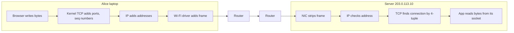

Routers in the middle look only at the IP header.  
They know nothing about TCP connections, HTTP requests, or chat messages.

---

## 3. IP: best-effort packets

IP moves a packet from one host to another host. It promises nothing else.

| What can happen to an IP packet | Example in the scenario                                             |
| ------------------------------- | ------------------------------------------------------------------- |
| Lost                            | Carol's hotel Wi-Fi drops 1 in 20 packets                           |
| Reordered                       | packets take different router paths and arrive out of order         |
| Duplicated                      | a link-layer retry delivers the same packet twice                   |
| Corrupted                       | a bad checksum causes it to be discarded, which is the same as lost |
| Fragmented or dropped for size  | a 9 KB write exceeds the ~1500-byte MTU and must be split           |

IP also has no notion of a process. A packet reaching `203.0.113.10` could be meant for the web server, the database, or SSH.  
Ports, added by the transport layer, solve that.

---

## 4. UDP: datagrams with ports

UDP adds two things to IP: ports, and a checksum. Nothing more.

### 4.1 Header (8 bytes)

| Field            | Bits | Purpose                          |
| ---------------- | ---- | -------------------------------- |
| Source port      | 16   | where replies go                 |
| Destination port | 16   | which process on the target host |
| Length           | 16   | header + payload size            |
| Checksum         | 16   | detects corruption               |

### 4.2 Properties

| Property                     | UDP behavior                                        |
| ---------------------------- | --------------------------------------------------- |
| Connection setup             | none: the first datagram carries data               |
| Server-side state per client | none                                                |
| Ordering                     | none                                                |
| Reliability                  | none: a lost datagram is gone                       |
| Message boundaries           | preserved: one `send` is one datagram is one `recv` |
| Head-of-line blocking        | impossible: datagrams are independent               |

### 4.3 Example: three users resolve the server name (DNS over UDP port 53)

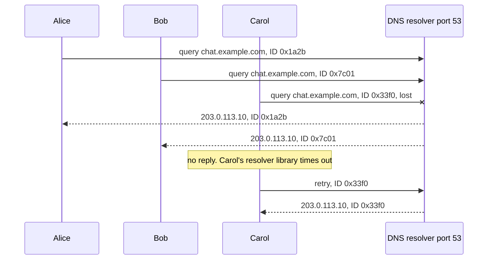

Observations:

- **The application handles loss.** UDP did not retransmit Carol's query; her DNS library did, after a timeout.
- **The application matches replies.** The query ID pairs each answer with its question.  
  This pattern (app-level IDs plus timeouts plus retries) reappears in QUIC and in WebSocket chat acks.
- **One server socket serves everyone.**

```text
fd 3 = socket(UDP); bind(fd 3, :53)
loop:
    (data, sender) = recvfrom(fd 3)      # sender = Alice, Bob or Carol IP:port
    reply = resolve(data)
    sendto(fd 3, reply, sender)
```

There is no per-client connection, no per-client fd, and no per-client kernel state.

### 4.4 When UDP is the right choice

| Use case              | Why UDP                                                             |
| --------------------- | ------------------------------------------------------------------- |
| DNS                   | one small question and answer; a handshake would double the latency |
| Voice and video calls | a late audio frame is useless; retransmitting it hurts              |
| Online games          | only the latest position matters                                    |
| QUIC (HTTP/3)         | builds its own, better reliability on top                           |
| Metrics (StatsD)      | losing a sample is acceptable; sender must never block              |

---

## 5. TCP: reliable byte streams

TCP turns unreliable packets into a reliable, ordered, full-duplex byte stream between two processes.

### 5.1 What a connection actually is

A TCP connection is **matching state held in two kernels**, one on each end. Nothing physical spans the network, and routers hold no state for it.  
If both kernels forgot the connection, it would simply cease to exist.

### 5.2 Identity: the 4-tuple

The kernel names every connection by `(source IP, source port, destination IP, destination port)`:

| Connection             | Client IP      | Client port | Server IP    | Server port |
| ---------------------- | -------------- | ----------- | ------------ | ----------- |
| Alice, connection 1    | 198.51.100.7   | 51022       | 203.0.113.10 | 443         |
| Alice, connection 2    | 198.51.100.7   | 51023       | 203.0.113.10 | 443         |
| Bob                    | 198.51.100.200 | 40117       | 203.0.113.10 | 443         |
| Dave (same NAT as Bob) | 198.51.100.200 | 40118       | 203.0.113.10 | 443         |
| Carol                  | 192.0.2.44     | 33410       | 203.0.113.10 | 443         |

Key facts from this table:

- **The server port is the same for every connection.** The server never allocates a port per client.
- **The client side varies.** Each client OS picks an ephemeral port per connection.
- **Bob and Dave share an IP** but differ in port, so their tuples differ. The carrier NAT ensures that.

### 5.3 Opening: the three-way handshake

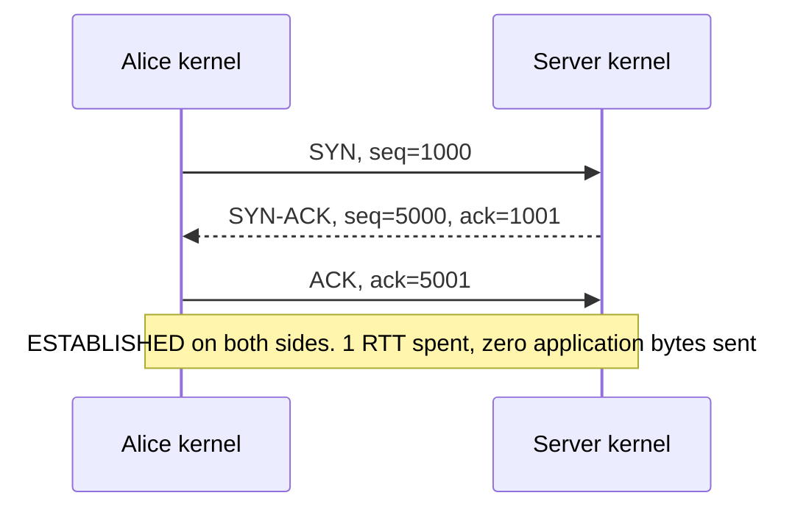

The handshake exchanges initial sequence numbers so that each side can number and track every byte it sends.

### 5.4 Per-connection state (the TCB)

| Field                   | Purpose                                            | Example for Alice                        |
| ----------------------- | -------------------------------------------------- | ---------------------------------------- |
| 4-tuple                 | which connection this is                           | `198.51.100.7:51022 to 203.0.113.10:443` |
| State                   | lifecycle position                                 | `ESTABLISHED`                            |
| Send sequence / unacked | bytes sent, bytes confirmed                        | sent up to 48 210, acked up to 46 810    |
| Send buffer             | written but unacked bytes, kept for retransmission | 1 400 bytes                              |
| Receive buffer          | arrived but not yet read by the app                | 0 bytes                                  |
| Windows                 | flow and congestion control limits                 | rwnd 64 KB, cwnd 14 KB                   |
| RTT estimate            | retransmission timer                               | ~50 ms                                   |

### 5.5 Reliability: sequence numbers, ACKs, retransmission

Alice sends five segments, and segment 2 is lost:

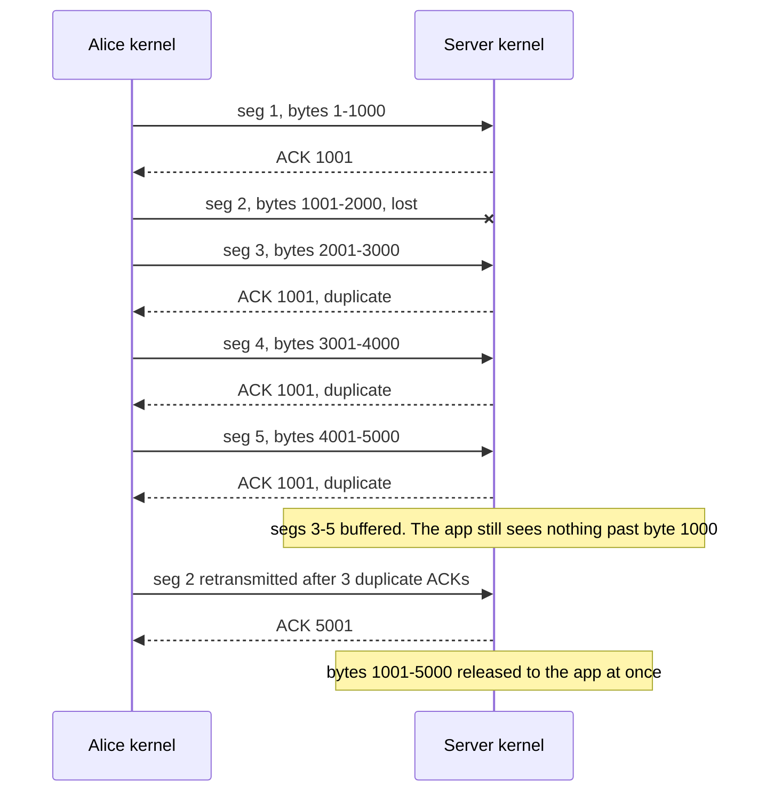

This is **TCP head-of-line blocking**: bytes 2001–5000 arrived intact but stay hidden from the application until the gap at 1001–2000 is filled.  
TCP's guarantee is "in order, no gaps", so it cannot release them early. This one property shapes HTTP/2 and motivates HTTP/3.

### 5.6 Flow control and congestion control

| Mechanism          | Protects                         | Signal                                 | Scenario example                                                                     |
| ------------------ | -------------------------------- | -------------------------------------- | ------------------------------------------------------------------------------------ |
| Flow control       | the receiver's buffer            | receive window advertised in every ACK | Bob's phone is busy, its window shrinks to 0, and the server pauses sending          |
| Congestion control | the network path                 | packet loss and rising delay           | Carol's losses make her sender cut its window, so throughput drops                   |
| Slow start         | the network, at connection start | ACK arrival rate                       | a new connection sends ~10 segments (~14 KB) in the first RTT, then doubles each RTT |

Slow start is why **new** connections are slow even on fast links.  
Reusing a warm connection avoids it.

### 5.7 Closing

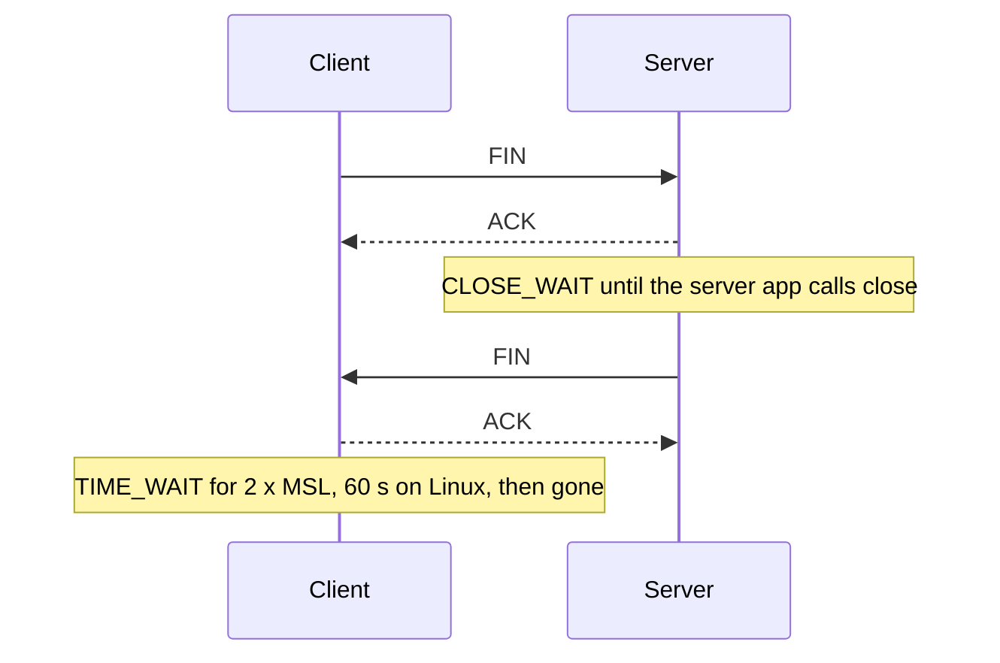

| State        | Who is in it               | Meaning                                         | Operational signal                                           |
| ------------ | -------------------------- | ----------------------------------------------- | ------------------------------------------------------------ |
| `TIME_WAIT`  | the side that closed first | absorbs stray late packets                      | many of these is normal under churn                          |
| `CLOSE_WAIT` | the side that received FIN | peer closed, local app has not called `close()` | many of these signals an fd leak in your code                |
| `RST`        | either                     | abrupt abort, no graceful close                 | process crash, or a connection the kernel does not recognize |

A peer that vanishes silently (battery dies, NAT forgets the mapping) sends nothing.  
The other side keeps a ghost connection until it next writes or a keepalive probe fails.  
This is why WebSockets add heartbeats.

### 5.8 Kernel view vs process view: sockets and file descriptors

There are two tables:

- **Kernel connection table (one per machine):** keyed by 4-tuple, holds the socket and TCB.
- **File descriptor table (one per process):** small integers, each pointing to one kernel object.

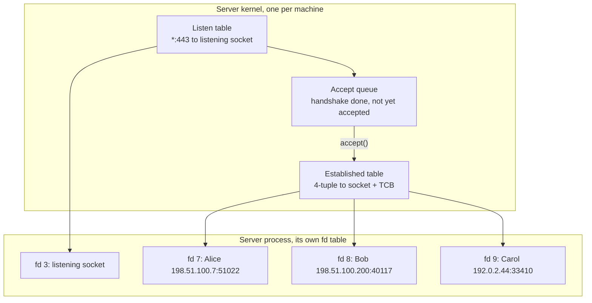

**A file descriptor is a coat-check ticket.**

| Coat check                             | Kernel and sockets                                                               |
| -------------------------------------- | -------------------------------------------------------------------------------- |
| Cloakroom                              | kernel                                                                           |
| Coat                                   | socket + TCB: buffers, sequence numbers, state                                   |
| Ticket number 7                        | file descriptor `7`                                                              |
| Ticket is only valid at this cloakroom | fd numbers are only valid inside this process                                    |
| Show ticket to use the coat            | `read(7)`, `write(7)`                                                            |
| Return ticket, coat discarded          | `close(7)`                                                                       |
| Ticket numbers reused                  | after `close(7)`, the next `accept()` may return `7` for an unrelated connection |

One TCP connection gets one fd. It is not per HTTP request and not per message.

| Call                  | Effect                                                                          |
| --------------------- | ------------------------------------------------------------------------------- |
| `socket()`            | create an unconnected socket, return an fd                                      |
| `bind()` + `listen()` | server: attach to `:443`, start accepting handshakes                            |
| `accept()`            | server: take one completed handshake, return a **new** fd; local port still 443 |
| `connect()`           | client: run the handshake from an ephemeral port                                |
| `read()` / `write()`  | move bytes between the app and kernel buffers                                   |
| `close()`             | start the FIN exchange, free the fd                                             |

### 5.9 How an incoming segment finds its connection

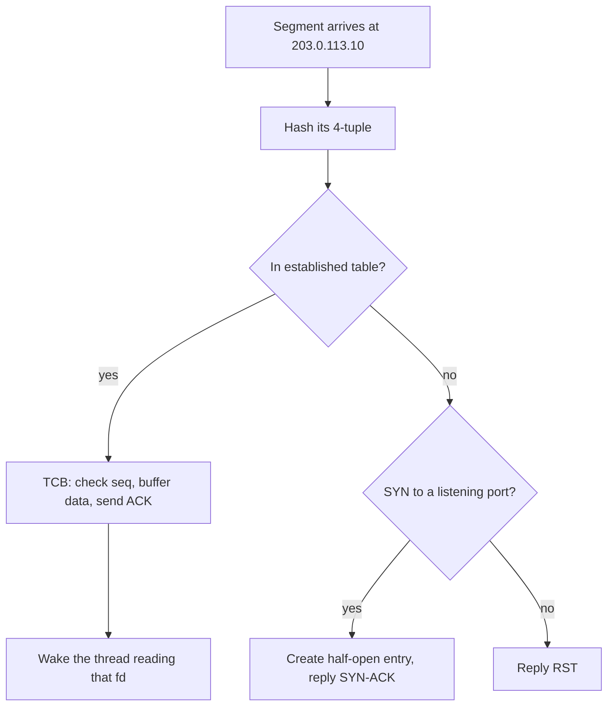

### 5.10 Serving many clients: threading models

| Model                               | How it works                                                         | Practical connection count                      | Fits                               |
| ----------------------------------- | -------------------------------------------------------------------- | ----------------------------------------------- | ---------------------------------- |
| Thread per connection, blocking I/O | each fd gets a thread blocked in `read()`                            | thousands: stacks and context switches dominate | short HTTP requests                |
| Event loop, non-blocking I/O        | a few threads; `epoll` or `kqueue` reports which fds are ready       | hundreds of thousands and up                    | long-lived connections, WebSockets |
| Virtual threads (Java 21+)          | blocking-style code; the JVM parks virtual threads on few OS threads | very high                                       | blocking code at event-loop scale  |

### 5.11 Limits you hit in production

| Limit                              | Where                                           | Symptom                        | Fix                                      |
| ---------------------------------- | ----------------------------------------------- | ------------------------------ | ---------------------------------------- |
| File descriptors                   | per process                                     | `EMFILE: Too many open files`  | raise `ulimit -n`, fix leaks             |
| Ephemeral ports                    | client side, including load balancer to backend | `EADDRNOTAVAIL`, connects fail | reuse connections, add source IPs        |
| NAT and load balancer idle timeout | middleboxes                                     | connection silently dead       | heartbeats shorter than the timeout      |
| `CLOSE_WAIT` build-up              | your app                                        | fd count climbs forever        | always `close()`, use try-with-resources |
| Memory                             | kernel buffers + app state                      | OOM, swapping                  | event-loop servers, bounded buffers      |

### 5.12 TCP vs UDP

| Property                    | TCP                                  | UDP                      |
| --------------------------- | ------------------------------------ | ------------------------ |
| Setup                       | 3-way handshake, 1 RTT               | none                     |
| Per-connection kernel state | yes (TCB)                            | none                     |
| Delivery                    | reliable, retransmits                | best effort              |
| Ordering                    | strict, whole stream                 | none                     |
| Boundaries                  | none: a byte stream                  | preserved: one datagram  |
| Head-of-line blocking       | yes                                  | no                       |
| Congestion control          | built in                             | the app's responsibility |
| Header size                 | 20–60 bytes                          | 8 bytes                  |
| Typical use                 | web, APIs, databases, SSH, WebSocket | DNS, media, games, QUIC  |

---

## 6. TLS: the encryption tax

Almost all modern HTTP runs inside TLS. TLS adds round trips before the first request byte can leave:

| Combination                       | RTTs before the first request byte | At 50 ms RTT |
| --------------------------------- | ---------------------------------- | ------------ |
| TCP + TLS 1.2                     | 3                                  | 150 ms       |
| TCP + TLS 1.3                     | 2                                  | 100 ms       |
| TCP + TLS 1.3, resumed with 0-RTT | 1                                  | 50 ms        |
| QUIC, TLS 1.3 built in            | 1                                  | 50 ms        |
| QUIC, resumed with 0-RTT          | 0                                  | 0 ms         |

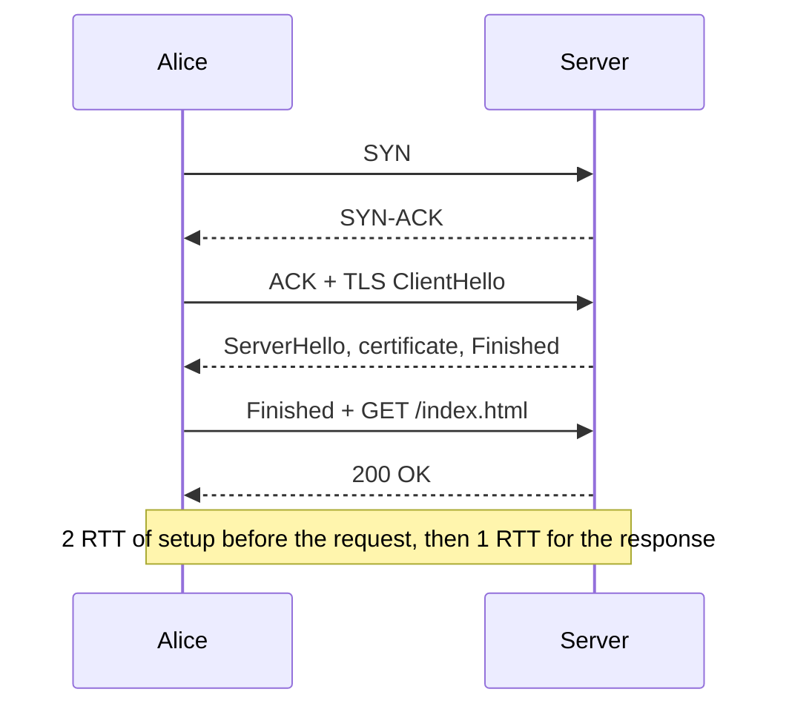

0-RTT data can be replayed by an attacker, so it is only safe for idempotent requests such as `GET`.

These setup costs are paid **per connection**. Every HTTP version below is largely an attempt to pay them less often.

---

## 7. HTTP: request-response semantics

HTTP defines meaning on top of a transport: methods, paths, headers, status codes.

```
GET /api/messages?since=4810 HTTP/1.1
Host: chat.example.com
Authorization: Bearer eyJhbGciOi...
Accept: application/json

HTTP/1.1 200 OK
Content-Type: application/json
Content-Length: 182

[{"seq":4811,"from":"bob","text":"hi"}, ...]
```

Three rules hold in **every** HTTP version:

| Rule                          | Consequence                                                                    |
| ----------------------------- | ------------------------------------------------------------------------------ |
| The client initiates          | the server cannot speak first, so it cannot push a new chat message unprompted |
| One request gets one response | real-time delivery must be emulated (section 13) or abandoned (section 14)     |
| Stateless                     | each request carries its own auth and context; any server can handle it        |

The versions differ only in **how requests map onto connections**.

---

## 8. HTTP/1.0: one connection per request

**Model:** open a TCP connection, send one request, receive one response, close.

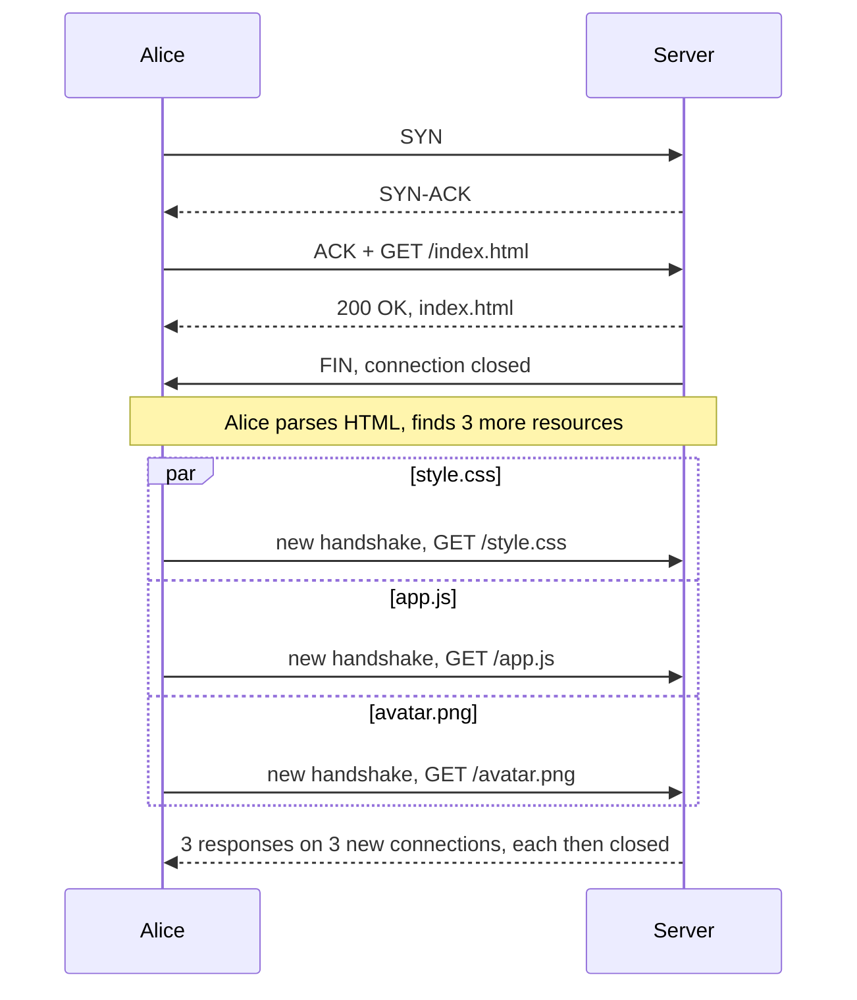

**Multi-user cost of one page load:**

| User        | TCP connections | Handshakes | fds created and destroyed on server |
| ----------- | --------------- | ---------- | ----------------------------------- |
| Alice       | 4               | 4          | 4                                   |
| Bob         | 4               | 4          | 4                                   |
| Carol       | 4               | 4          | 4                                   |
| **3 users** | **12**          | **12**     | **12, constant churn**              |

**Problems:**

- Every resource pays a handshake. With TLS, that is 2 extra RTTs per resource.
- Every connection restarts TCP slow start, so it never reaches full speed.
- The server constantly allocates and frees sockets and TCBs, and accumulates `TIME_WAIT` entries.

---

## 9. HTTP/1.1: persistent, sequential connections

**Model:** keep the connection open (keep-alive is the default) and send requests on it **one after another**.

Other additions:

| Feature                   | Purpose                                                   |
| ------------------------- | --------------------------------------------------------- |
| Persistent connections    | reuse one TCP + TLS setup for many requests               |
| Mandatory `Host` header   | many sites can share one IP (virtual hosting)             |
| Chunked transfer encoding | stream a response whose size is not known in advance      |
| Pipelining                | send several requests without waiting; failed in practice |

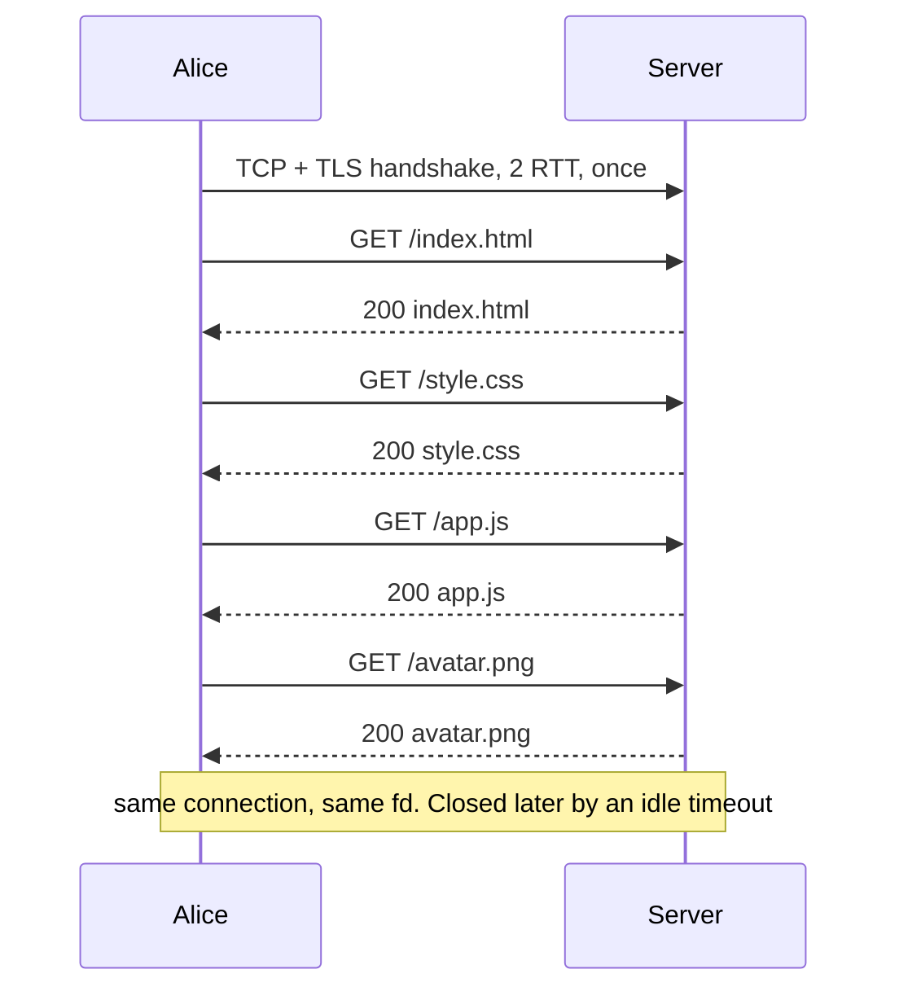

### 9.1 Why requests stay sequential

A response carries **no request identifier**.  
The client matches responses to requests purely by **order**.  
With pipelining, that forces the server to answer in FIFO order:

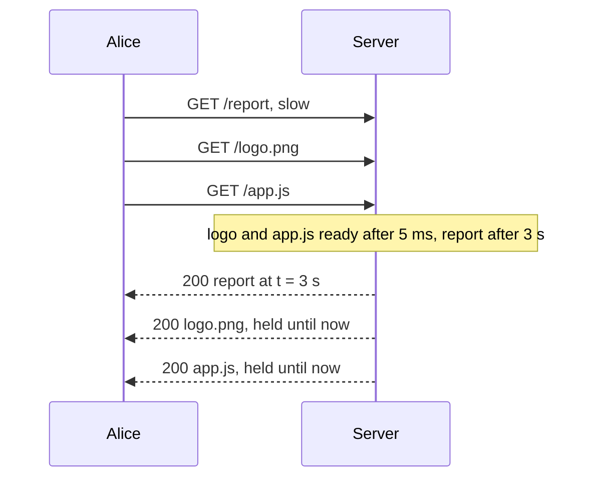

This is **HTTP-level head-of-line blocking**: a slow response blocks everything behind it.  
Pipelining also broke on buggy proxies, and after a dropped connection the client cannot tell which requests already executed, so retrying a `POST` is unsafe.  
Browsers disabled pipelining, and HTTP/1.1 became effectively one-request-at-a-time per connection.

### 9.2 The browser workaround: parallel connections

Browsers open **up to 6 connections per host** to get concurrency.  
Sites went further with *domain sharding* (`static1.example.com`, `static2...`), image sprites, and bundling files together, all to work around the protocol.

| Users             | Connections per user | Server fds   | TCP + TLS handshakes |
| ----------------- | -------------------- | ------------ | -------------------- |
| Alice, Bob, Carol | up to 6 each         | up to 18     | up to 18             |
| 10 000 users      | up to 6 each         | up to 60 000 | up to 60 000         |

Fewer handshakes per request than HTTP/1.0, but concurrency is still bought with extra connections.

---

## 10. HTTP/2: multiplexed streams over one TCP connection

**Model:** one TCP connection per origin.  
Requests and responses are cut into **binary frames**, each tagged with a **stream ID**, and interleaved freely.

### 10.1 Framing

Every frame starts with a 9-byte header:

| Field     | Bits | Purpose                                      |
| --------- | ---- | -------------------------------------------- |
| Length    | 24   | payload size                                 |
| Type      | 8    | `HEADERS`, `DATA`, `SETTINGS`, ...           |
| Flags     | 8    | e.g. `END_STREAM`, `END_HEADERS`             |
| Reserved  | 1    | unused                                       |
| Stream ID | 31   | which request/response this frame belongs to |

| Frame type      | Purpose                                                            |
| --------------- | ------------------------------------------------------------------ |
| `HEADERS`       | request or response headers (compressed)                           |
| `DATA`          | body bytes                                                         |
| `SETTINGS`      | connection parameters, e.g. max concurrent streams (commonly ~100) |
| `WINDOW_UPDATE` | per-stream and per-connection flow control                         |
| `RST_STREAM`    | cancel one stream without killing the connection                   |
| `PING`          | liveness and RTT measurement                                       |
| `GOAWAY`        | graceful connection shutdown                                       |

Client-initiated streams use odd IDs: 1, 3, 5, ...

### 10.2 Multiplexing in action

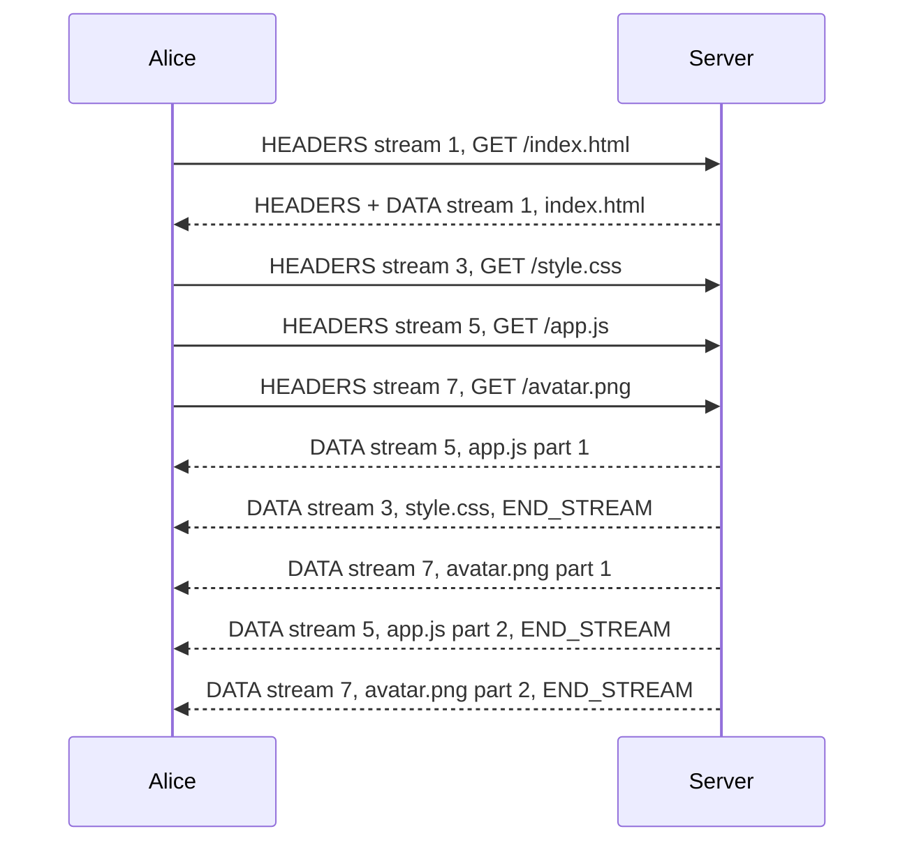

Responses arrive in any order, and the stream ID matches each frame to its request. This is the identifier HTTP/1.1 lacked.

The kernel sees only bytes on one fd. The HTTP/2 library in **user space** parses frames and splits them into streams.

### 10.3 Header compression (HPACK)

Repeated headers (cookies, user-agent, auth tokens) are sent once and then referenced by index from a table both sides maintain.  
A 600-byte cookie header on the first request becomes a 1–2 byte reference on every following request on that connection.

### 10.4 Multi-user view

```text
Server kernel established table           Process fd table     Streams (user space)
(198.51.100.7:51022   -> :443)  ->  fd 7  ->  Alice: 1, 3, 5, 7
(198.51.100.200:40117 -> :443)  ->  fd 8  ->  Bob:   1, 3, 5, 7
(192.0.2.44:33410     -> :443)  ->  fd 9  ->  Carol: 1, 3, 5, 7
```

| Users             | Connections per user | Server fds | Handshakes |
| ----------------- | -------------------- | ---------- | ---------- |
| Alice, Bob, Carol | 1                    | 3          | 3          |
| 10 000 users      | 1                    | 10 000     | 10 000     |

### 10.5 The remaining flaw: TCP head-of-line blocking

HTTP/2 removed blocking at the HTTP level but still runs on TCP, which knows nothing about streams. On Carol's lossy Wi-Fi:

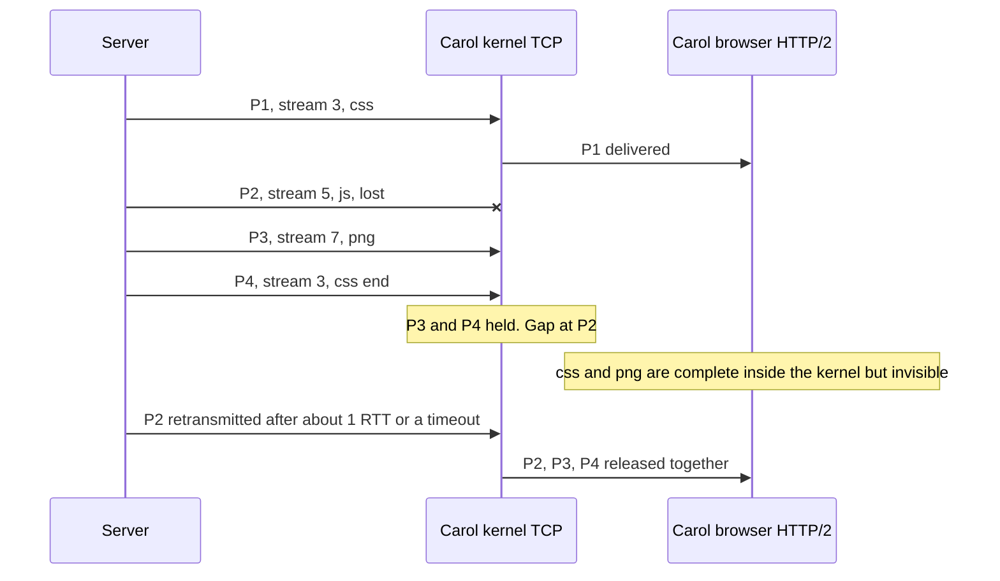

One lost packet for `app.js` stalls `style.css` and `avatar.png` as well.  
At high loss, HTTP/2's single connection can perform **worse** than HTTP/1.1's six independent connections, because a loss on one of the six stalls only that one.

Losses on Carol's connection never affect Alice or Bob.  
Head-of-line blocking is always **within** one connection; each user has a separate TCB, sequence space, and receive buffer.

### 10.6 Server push (deprecated)

HTTP/2 let servers send responses the client had not asked for yet (`PUSH_PROMISE`).  
It rarely helped in practice, and major browsers removed support.  
It was never a real-time mechanism anyway: pushed resources still had to be associated with a client request.

---

## 11. HTTP/3: QUIC over UDP

**Model:** keep HTTP/2's semantics and streams, but replace TCP with **QUIC**, a transport built on UDP that implements reliability **per stream**.

### 11.1 Why not fix TCP?

TCP lives in every OS kernel and is inspected and rewritten by routers, firewalls, and NAT boxes.  
Changing its behavior means upgrading billions of devices. This is called *ossification*.  
UDP passes through nearly everything and adds nothing, which makes it a blank slate.  
QUIC therefore runs in **user space** on top of UDP and is encrypted so middleboxes cannot interfere with it.

### 11.2 What QUIC adds on top of UDP

| Capability                  | How                                                            |
| --------------------------- | -------------------------------------------------------------- |
| Connections                 | identified by a **connection ID**, not the 4-tuple             |
| Reliability                 | packet numbers (never reused), ACK frames, retransmission      |
| Streams                     | many independent byte streams, each ordered on its own         |
| Security                    | TLS 1.3 built into the handshake; most of the header encrypted |
| Flow and congestion control | per stream and per connection                                  |
| Migration                   | the connection survives an IP or port change                   |

### 11.3 Packet anatomy

```text
[ UDP header: src port | dst port | length | checksum ]
[ QUIC header: connection ID | packet number ]               packet numbers only ever increase
[ encrypted payload, one or more frames:
    STREAM frame  stream 4, offset 0     "style.css bytes..."
    STREAM frame  stream 8, offset 1200  "app.js bytes..."
    ACK frame     received 1-40, 42-45                        ]
```

Each STREAM frame states its stream and byte offset, so each stream is reassembled independently.  
Client-initiated bidirectional streams use IDs 0, 4, 8, ...

### 11.4 Handshake: 1 RTT, or 0 on resume

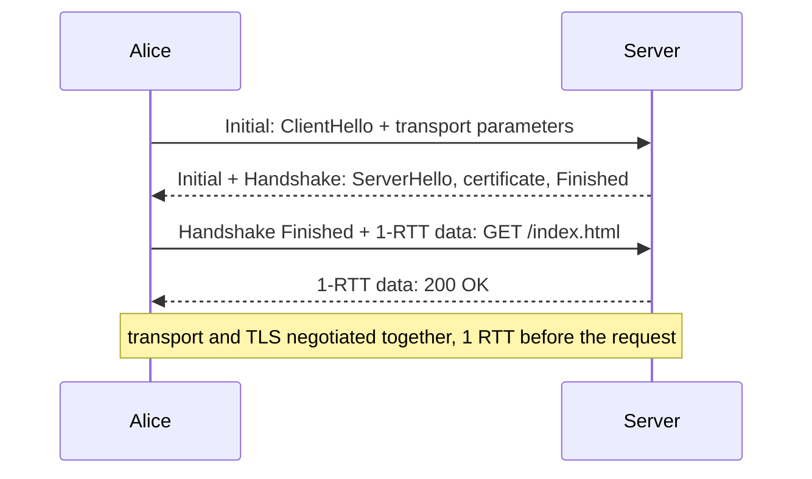

### 11.5 Loss affects only its own stream

Carol's page load again, now on HTTP/3:

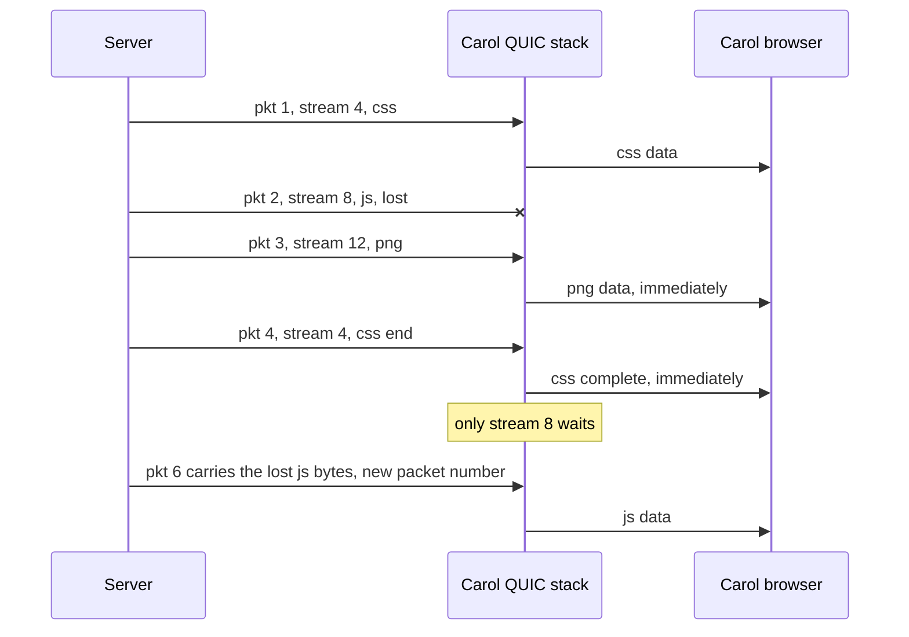

### 11.6 Connection migration

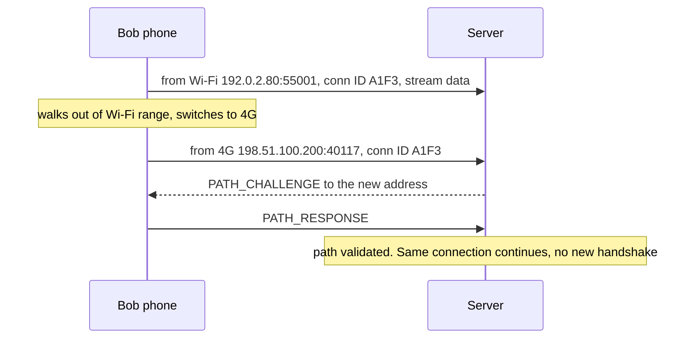

With TCP, the new IP produces a new 4-tuple.  
he old connection is dead, and Bob pays a full TCP + TLS setup again.

The path challenge stops an attacker from redirecting traffic by forging a connection ID from another address.  
Connection IDs are also rotated so observers cannot link Bob's Wi-Fi and 4G traffic together.

### 11.7 Server-side view

```
Kernel:   UDP socket :443 -> fd 7          kernel holds NO per-connection state
App:      recvfrom(fd 7) -> datagram + sender address
          QUIC library: read connection ID -> lookup table -> connection state -> stream buffers

          conn A7C2 -> Alice  streams 0, 4, 8, 12
          conn B19E -> Bob    streams 0, 4, 8, 12
          conn C55D -> Carol  streams 0, 4, 8, 12
```

Everything the kernel held per TCP connection (TCB, buffers, sequence numbers, timers) now lives in the application's memory.  
In practice servers use several UDP sockets (one per CPU core), but the count does not grow with users.  
Load balancers must route by connection ID, not 4-tuple, or a migrated connection lands on the wrong server.

### 11.8 Discovery and fallback

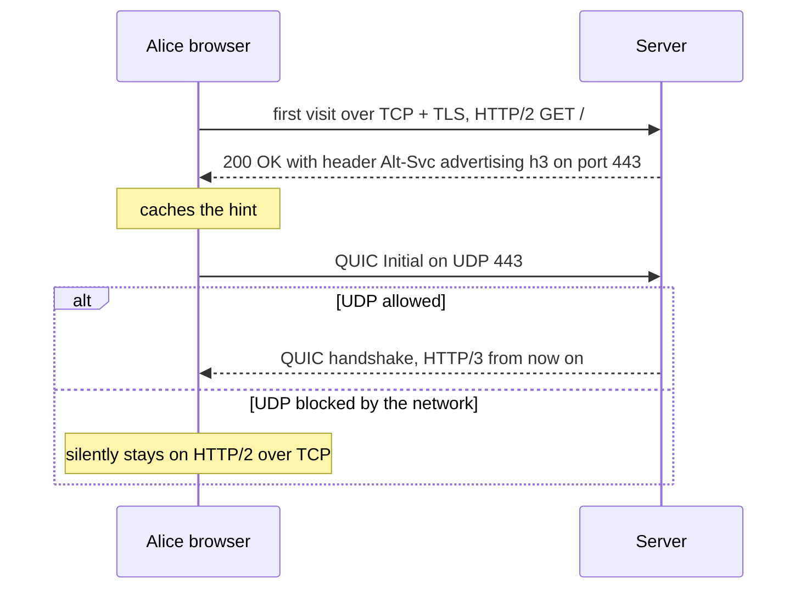

A DNS `HTTPS` record can advertise HTTP/3 up front and skip the first TCP visit.

### 11.9 Trade-offs

| Benefit                                               | Cost                                                                             |
| ----------------------------------------------------- | -------------------------------------------------------------------------------- |
| no cross-stream head-of-line blocking                 | more CPU: crypto and reliability run in user space, with fewer hardware offloads |
| 1-RTT setup, 0-RTT resume                             | some networks block or throttle UDP, so TCP fallback is mandatory                |
| survives network changes                              | load balancers must understand connection IDs                                    |
| encrypted transport, resistant to middlebox tampering | operators lose visibility for debugging                                          |

---

## 12. HTTP versions side by side

### 12.1 Feature comparison

| Aspect                             | HTTP/1.0              | HTTP/1.1             | HTTP/2               | HTTP/3                          |
| ---------------------------------- | --------------------- | -------------------- | -------------------- | ------------------------------- |
| Published                          | 1996                  | 1997                 | 2015                 | 2022                            |
| Transport                          | TCP                   | TCP                  | TCP, TLS in practice | QUIC over UDP, TLS 1.3 built in |
| Connections per user per host      | 1 per request         | up to ~6, persistent | 1                    | 1                               |
| Concurrent requests per connection | 1                     | 1, pipelining dead   | many streams         | many streams                    |
| Wire format                        | text                  | text                 | binary frames        | binary frames                   |
| Response matched to request by     | the connection itself | order (FIFO)         | stream ID            | stream ID                       |
| Header compression                 | none                  | none                 | HPACK                | QPACK                           |
| Head-of-line blocking              | n/a                   | HTTP level           | TCP level            | none across streams             |
| Survives IP change                 | no                    | no                   | no                   | yes                             |
| Server can speak first             | no                    | no                   | push, deprecated     | no, effectively                 |

### 12.2 One page load, measured in round trips

Assumptions: Alice, 50 ms RTT, TLS 1.3 everywhere, `index.html` must arrive before the 3 sub-resources are discovered, transfer time ignored.

| Version                | Handshakes | RTTs to finished page                        | Approx. time | Server fds for 10 000 such users                     |
| ---------------------- | ---------- | -------------------------------------------- | ------------ | ---------------------------------------------------- |
| HTTP/1.0               | 4          | 3 (index) + 3 (parallel new connections) = 6 | 300 ms       | up to 30 000, short-lived churn                      |
| HTTP/1.1, 1 connection | 1          | 2 + 1 + 3 sequential = 6                     | 300 ms       | 10 000 (up to 60 000 with 6 per user)                |
| HTTP/2                 | 1          | 2 + 1 + 1 = 4                                | 200 ms       | 10 000                                               |
| HTTP/3                 | 1          | 1 + 1 + 1 = 3                                | 150 ms       | a few UDP fds; 10 000 QUIC connections in app memory |
| HTTP/3, 0-RTT resume   | 0 full     | 1 + 1 = 2                                    | 100 ms       | same                                                 |

With only 3 sub-resources, HTTP/1.1's extra parallel connections cost about as much in handshakes as they save.  
The advantage of multiplexing grows with the number of resources: a page with 60 assets is where HTTP/2 and HTTP/3 pull far ahead.

### 12.3 What each version fixed and what it left

| Version   | Fixed                                             | Left unsolved                        |
| --------- | ------------------------------------------------- | ------------------------------------ |
| HTTP/1.0  | baseline                                          | a handshake for every request        |
| HTTP/1.1  | connection reuse                                  | one request at a time per connection |
| HTTP/2    | many concurrent requests on one connection        | TCP head-of-line blocking on loss    |
| HTTP/3    | per-stream loss recovery, faster setup, migration | still client-initiated only          |
| WebSocket | server-initiated, low-overhead two-way messages   | app must build IDs, acks, resume     |

The last row is the remaining gap.  
No HTTP version lets the server send Bob a chat message the moment Alice writes it.

---

## 13. Server push before WebSockets: polling, long polling, SSE

| Technique          | How it works                                                                      | Delivery latency | Overhead                                        | Direction             |
| ------------------ | --------------------------------------------------------------------------------- | ---------------- | ----------------------------------------------- | --------------------- |
| Short polling      | client sends `GET /new-messages` every N seconds                                  | up to N seconds  | one request per user per interval, mostly empty | client pulls          |
| Long polling       | server holds the request open until a message or timeout, then client re-requests | near real time   | a full request per delivered message            | server push, emulated |
| Server-Sent Events | one long-lived HTTP response streaming `text/event-stream` events                 | real time        | low                                             | server to client only |
| WebSocket          | upgraded connection, frames in both directions                                    | real time        | 2–14 bytes per message                          | both                  |

Scale check for short polling: 100 000 users polling every 5 s is 20 000 requests per second, nearly all returning "nothing new", each carrying full headers and auth.

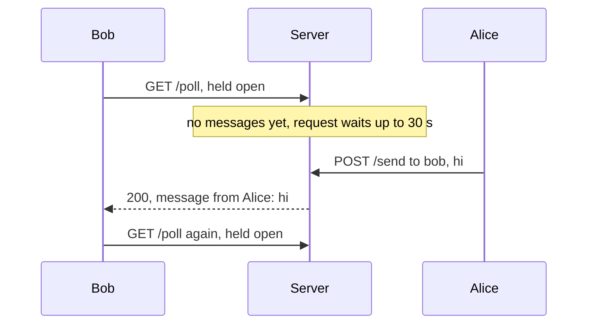

Long polling works, but every delivered message costs a request-response cycle, and Bob's reply to Alice needs a separate `POST`.  
SSE removes the re-request but stays one-directional.

---

## 14. WebSockets

A WebSocket (RFC 6455) is a TCP connection that **starts as an HTTP request and then switches to a thin, two-way message protocol**.  
After the switch, either side may send at any time.

### 14.1 Why start with HTTP?

| Reason                                  | Effect                                                                                  |
| --------------------------------------- | --------------------------------------------------------------------------------------- |
| Browsers forbid raw TCP from JavaScript | an HTTP request that the server explicitly agrees to upgrade is the only permitted door |
| Port 443 passes firewalls and proxies   | custom ports are often blocked                                                          |
| Reuses HTTP machinery                   | TLS, cookies, auth headers, and the `Origin` check apply to the handshake               |

### 14.2 The handshake

```
Client -> Server
GET /ws HTTP/1.1
Host: chat.example.com
Upgrade: websocket
Connection: Upgrade
Sec-WebSocket-Key: dGhlIHNhbXBsZSBub25jZQ==
Sec-WebSocket-Version: 13
Origin: https://chat.example.com
Sec-WebSocket-Protocol: chat.v1
Cookie: session=...

Server -> Client
HTTP/1.1 101 Switching Protocols
Upgrade: websocket
Connection: Upgrade
Sec-WebSocket-Accept: s3pPLMBiTxaQ9kYGzzhZRbK+xOo=
Sec-WebSocket-Protocol: chat.v1
```

`Sec-WebSocket-Accept` is `base64(SHA-1(key + "258EAFA5-E914-47DA-95CA-C5AB0DC85B11"))`.  
It proves the server actually speaks WebSocket and that the reply is not a cached HTTP response.  
It is not authentication.

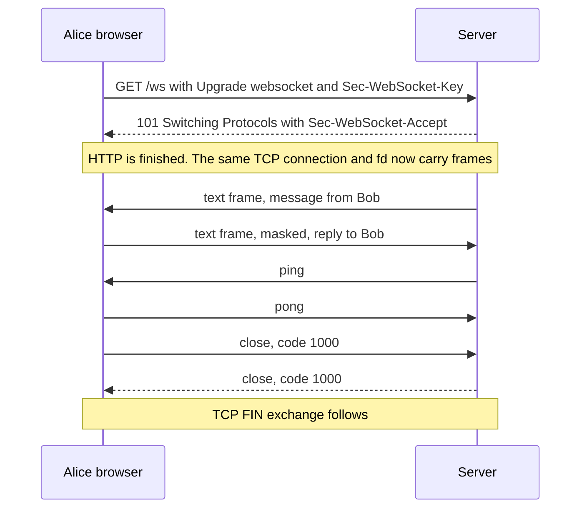

### 14.3 Frame anatomy

```text
 0               1               2               3
+-+-+-+-+-------+-+-------------+-------------------------------+
|F|R|R|R|opcode |M| payload len |  extended payload length      |
|I|S|S|S| 4 bit |A|   7 bit     |  16 bit if len = 126          |
|N|V|V|V|       |S|             |  64 bit if len = 127          |
| |1|2|3|       |K|             |                               |
+-+-+-+-+-------+-+-------------+-------------------------------+
|  masking key, 4 bytes, client to server only  |  payload ...  |
+-----------------------------------------------+---------------+
```

| Field       | Meaning                                                                              |
| ----------- | ------------------------------------------------------------------------------------ |
| FIN         | 1 = final fragment of this message                                                   |
| RSV1-3      | reserved for extensions, e.g. compression                                            |
| opcode      | frame type, see below                                                                |
| MASK        | 1 = payload XOR-masked; required client to server, forbidden server to client        |
| payload len | 0–125 directly; 126 means a 16-bit length follows; 127 means a 64-bit length follows |
| masking key | 4 random bytes per frame, client frames only                                         |

| Opcode | Type         | Use                                          |
| ------ | ------------ | -------------------------------------------- |
| `0x0`  | continuation | later fragment of a split message            |
| `0x1`  | text         | UTF-8 payload, e.g. JSON chat envelope       |
| `0x2`  | binary       | raw bytes, e.g. protobuf                     |
| `0x8`  | close        | begin close handshake, carries a status code |
| `0x9`  | ping         | liveness check                               |
| `0xA`  | pong         | reply to ping                                |

| Direction        | Header overhead per frame         |
| ---------------- | --------------------------------- |
| Server to client | 2–10 bytes                        |
| Client to server | 6–14 bytes (adds the 4-byte mask) |

Compare: an HTTP request typically carries several hundred bytes of headers.

### 14.4 Masking

Client frames are XOR-masked with a random key so that an attacker's script cannot place predictable bytes on the wire.  
Without masking, those bytes could be misread by old intermediary proxies as an HTTP request and used to poison their caches.  
Masking is not encryption; `wss://` (TLS) provides confidentiality.

### 14.5 Messages, fragments, control frames

- A **message** is what the application sends. A large message may be split into **fragments**: the first frame has `FIN = 0`, continuation frames follow, and the last has `FIN = 1`.
- Control frames (ping, pong, close) may be inserted between fragments, so a heartbeat is not stuck behind a large upload.
- There are **no stream IDs**. Data messages on one WebSocket are strictly sequential.

### 14.6 Close codes

| Code | Meaning                                                                        |
| ---- | ------------------------------------------------------------------------------ |
| 1000 | normal closure                                                                 |
| 1001 | going away: server shutdown or page navigation                                 |
| 1002 | protocol error                                                                 |
| 1003 | unsupported data type                                                          |
| 1006 | abnormal: connection dropped with no close frame; reported locally, never sent |
| 1008 | policy violation, e.g. auth expired                                            |
| 1009 | message too big                                                                |
| 1011 | internal server error                                                          |

### 14.7 Heartbeats

NAT tables and load balancers drop mappings for idle connections, often after 30 seconds to a few minutes.  
When that happens, neither end is told. Periodic ping/pong (commonly every 20–60 s) keeps the mappings alive and detects dead peers.

### 14.8 What WebSocket does not provide

| Missing                          | Built by the application as                         |
| -------------------------------- | --------------------------------------------------- |
| Message types and routing        | an envelope: `type`, `to`, `payload`                |
| Delivery confirmation            | client-generated message IDs plus server acks       |
| Ordering across reconnects       | per-conversation sequence numbers                   |
| Resume after a drop              | "send everything after seq N" on reconnect          |
| Auth refresh after the handshake | a re-auth message, or close with 1008 and reconnect |
| Backpressure                     | watching the send-buffer size and slowing producers |

TCP guarantees delivery only while the connection lives.  
A frame written just before a drop can vanish without either side knowing, which is why app-level acks exist.

Example envelopes:

```json
{ "type": "msg.send",  "id": "c-8812", "to": "bob", "text": "hi" }
{ "type": "msg.ack",   "ref": "c-8812", "seq": 4811, "status": "stored" }
{ "type": "msg.new",   "seq": 4811, "from": "alice", "text": "hi" }
{ "type": "resume",    "lastSeq": 4810 }
```

### 14.9 Multi-user chat: Alice to Bob, Carol offline

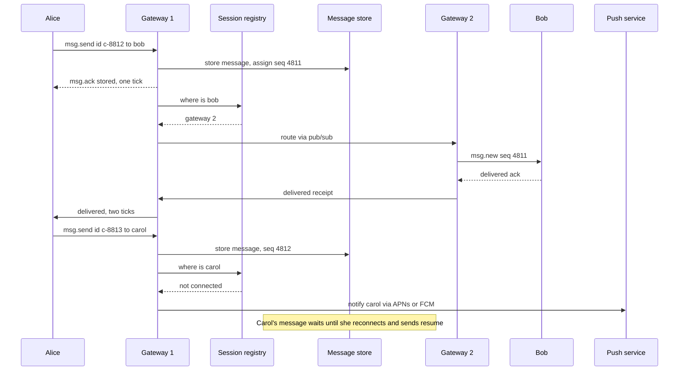

### 14.10 Multi-node architecture

```mermaid
flowchart LR
    A["Alice"] --> LB
    B["Bob"] --> LB
    C["Carol"] --> LB
    D["Dave"] --> LB
    LB["Load balancer :443<br/>long idle timeouts"] --> G1["Gateway 1<br/>holds Alice, Carol sockets"]
    LB --> G2["Gateway 2<br/>holds Bob, Dave sockets"]
    G1 <--> R[("Session registry<br/>user to gateway")]
    G2 <--> R
    G1 <--> PS["Pub/sub bus"]
    G2 <--> PS
    G1 --> DB[("Message store<br/>source of truth")]
    G2 --> DB
    G1 --> PN["Push service<br/>APNs / FCM"]
    G2 --> PN
```

| Component        | State type                      | If it fails                                                |
| ---------------- | ------------------------------- | ---------------------------------------------------------- |
| Message store    | durable, replicated             | the only state that must never be lost                     |
| Session registry | soft, rebuildable from gateways | delivery delays; messages wait in the store                |
| Pub/sub bus      | transient                       | cross-gateway delivery pauses; clients resync on reconnect |
| Gateway          | per-connection sockets          | its users reconnect to another gateway and send `resume`   |

### 14.11 Resource cost at scale

Order-of-magnitude figures for 1 million concurrently connected users:

| Resource                                   | Per connection                    | 1 million connections                            |
| ------------------------------------------ | --------------------------------- | ------------------------------------------------ |
| File descriptors                           | 1                                 | 1 million, e.g. 10 gateways x 100 000            |
| App memory (session object, buffers)       | ~10–50 KB on an event-loop server | ~10–50 GB across the fleet                       |
| Heartbeats at 30 s                         | 1 ping per 30 s                   | ~33 000 pings per second                         |
| Chat traffic                               | a few messages per minute         | far smaller than the connection count suggests   |
| Platform threads, if thread-per-connection | 1 thread, ~1 MB stack reserved    | infeasible: use an event loop or virtual threads |

The dominant cost is **holding** connections, not moving messages.

### 14.12 Head-of-line blocking inside a WebSocket

Alice sends a 20 MB video as one binary message, then a text message.  
At 2 MB/s upload, the text waits ~10 s behind the video, because one WebSocket has one ordered data channel.

| Fix                      | How                                                                                  |
| ------------------------ | ------------------------------------------------------------------------------------ |
| Upload media out of band | `POST` the file over HTTP to blob storage, then send only its URL over the WebSocket |
| Chunk at the app level   | send 64 KB pieces, interleaving text messages between them                           |
| Separate connection      | a second WebSocket dedicated to bulk transfer                                        |
| Multiple streams         | WebTransport over HTTP/3                                                             |

### 14.13 WebSocket on newer HTTP versions

| Option                          | Transport                              | Sockets per TCP connection             | Notes                           |
| ------------------------------- | -------------------------------------- | -------------------------------------- | ------------------------------- |
| WebSocket, RFC 6455             | own TCP connection                     | 1                                      | universal support               |
| WebSocket over HTTP/2, RFC 8441 | one stream inside an HTTP/2 connection | many share one TCP                     | still TCP head-of-line blocking |
| WebSocket over HTTP/3, RFC 9220 | one stream inside QUIC                 | many, independent loss recovery        | support still limited           |
| WebTransport                    | HTTP/3 session                         | many streams plus unreliable datagrams | newer; a different browser API  |

---

## 15. End to end: one chat session through the whole stack

```mermaid
sequenceDiagram
    participant A as Alice app
    participant D as DNS resolver
    participant W as chat.example.com web and API
    participant G as WebSocket gateway
    A->>D: UDP query for chat.example.com, A and HTTPS records
    D-->>A: 203.0.113.10, HTTPS record advertises h3
    A->>W: QUIC + TLS 1.3 handshake, 1 RTT
    A->>W: HTTP/3 GET index, app.js, style.css on streams 0, 4, 8
    W-->>A: page assets, loss on one stream never stalls the others
    A->>W: HTTP/3 GET /api/history since seq 4810
    W-->>A: missed messages
    A->>G: TCP + TLS 1.3, then GET /ws with Upgrade
    G-->>A: 101 Switching Protocols
    loop chat session
        G->>A: msg.new frames, pushed instantly
        A->>G: msg.send frames and acks
        G->>A: ping every 30 s
        A-->>G: pong
    end
```

| Layer used    | Why it was chosen for that step                                                      |
| ------------- | ------------------------------------------------------------------------------------ |
| UDP (DNS)     | one small question; a handshake would double the cost                                |
| QUIC / HTTP/3 | many parallel asset and API requests; fast setup; loss isolation                     |
| HTTP API      | history and profile fetches are naturally request-response, cacheable, and stateless |
| WebSocket     | the server must push messages the instant they exist, and both sides talk freely     |

### What each layer adds, in one table

| Layer         | Adds                                                   | Leaves to the layer above               |
| ------------- | ------------------------------------------------------ | --------------------------------------- |
| IP            | host-to-host delivery                                  | loss, order, which process              |
| UDP           | ports, checksum                                        | everything else                         |
| TCP           | connections, reliability, ordering, congestion control | message boundaries, encryption, meaning |
| TLS           | encryption, integrity, server identity                 | meaning                                 |
| HTTP/1.x      | request-response semantics                             | concurrency (1.1: one at a time)        |
| HTTP/2        | multiplexed streams                                    | TCP head-of-line blocking               |
| QUIC + HTTP/3 | per-stream reliability, 1-RTT setup, migration         | server-initiated messages               |
| WebSocket     | persistent two-way messages                            | IDs, acks, routing, resume              |

---

## 16. Observe it yourself

Resolve a name over UDP:

```text
dig chat.example.com
dig chat.example.com HTTPS
```

See 4-tuples: many clients sharing server port 443:

```text
ss -tn state established '( sport = :443 )'
```

Count a process's file descriptors and see its limit:

```text
ls /proc/<pid>/fd | wc -l
grep "open files" /proc/<pid>/limits
```

Find leaking connections:

```text
ss -tan state close-wait | wc -l
```

Watch handshakes and teardowns live:

```text
sudo tcpdump -ni any 'tcp port 443 and (tcp[tcpflags] & (tcp-syn|tcp-fin|tcp-rst) != 0)'
```

Compare HTTP versions on the same site (HTTP/3 needs a curl build with HTTP/3 support):

```text
curl -sv --http1.1 https://example.com -o /dev/null
curl -sv --http2   https://example.com -o /dev/null
curl -sv --http3   https://example.com -o /dev/null
```

Open a WebSocket from the terminal:

```text
websocat wss://echo.websocket.events
```

In the browser: DevTools, Network panel, enable the **Protocol** column (shows `http/1.1`, `h2`, `h3`).  
For a WebSocket, select the `101` request and open **Messages** to see every frame in each direction.

---

## 17. Reference: specifications

| Protocol              | Specification                             |
| --------------------- | ----------------------------------------- |
| UDP                   | RFC 768                                   |
| TCP                   | RFC 9293 (consolidates RFC 793)           |
| TLS 1.3               | RFC 8446                                  |
| HTTP semantics        | RFC 9110                                  |
| HTTP/1.0              | RFC 1945                                  |
| HTTP/1.1              | RFC 9112 (originally RFC 2068, then 2616) |
| HTTP/2                | RFC 9113 (originally RFC 7540)            |
| HPACK                 | RFC 7541                                  |
| QUIC                  | RFC 9000                                  |
| HTTP/3                | RFC 9114                                  |
| QPACK                 | RFC 9204                                  |
| WebSocket             | RFC 6455                                  |
| WebSocket over HTTP/2 | RFC 8441                                  |
| WebSocket over HTTP/3 | RFC 9220                                  |
| Server-Sent Events    | WHATWG HTML Living Standard               |

---
