<!-- markdownlint-disable MD001 -->
<!-- markdownlint-disable MD024 -->
<!-- markdownlint-disable MD025 -->
<!-- markdownlint-disable MD026 -->
<!-- markdownlint-disable MD029 -->
<!-- markdownlint-disable MD033 -->
<!-- markdownlint-disable MD036 -->
<!-- markdownlint-disable MD040 -->
<!-- markdownlint-disable MD056 -->
<!-- markdownlint-disable MD060 -->

# Typeahead Suggestion System

> Design document for a search autocomplete service that serves **1 million suggestion requests per second**, stays **highly available and fault tolerant**, and answers within **10 ms p99 (server side)**. It supports prefix, typo-tolerant and infix matching with per-locale language analysis.

| Field         | Value                                                                |
|---------------|----------------------------------------------------------------------|
| Document type | High-level and low-level design (HLD + LLD)                          |
| Serving stack | Rust: Tokio, axum/hyper, `fst`, `arc-swap`, `moka`                   |
| Data pipeline | Kafka, data lake (Iceberg/Parquet), Spark, Flink, Rust index builder |
| Status        | Draft v1                                                             |
| Last updated  | 2026-10-28                                                           |

---

## Table of Contents

1. [Problem Statement](#1-problem-statement)
2. [Requirements](#2-requirements)
3. [Assumptions](#3-assumptions)
4. [Capacity Estimation](#4-capacity-estimation)
5. [Core Design Principles](#5-core-design-principles)
6. [API Design](#6-api-design)
7. [High-Level Architecture](#7-high-level-architecture)
8. [Read Path: Deep Dive](#8-read-path-deep-dive)
9. [High Availability and Fault Tolerance](#9-high-availability-and-fault-tolerance)
10. [Write Path: Ranking and Freshness](#10-write-path-ranking-and-freshness)
11. [Data Model Reference](#11-data-model-reference)
12. [Observability and SLOs](#12-observability-and-slos)
13. [Security and Privacy](#13-security-and-privacy)
14. [Trade-offs and Alternatives](#14-trade-offs-and-alternatives)
15. [Future Extensions](#15-future-extensions)
16. [Summary](#16-summary)

---

## 1. Problem Statement

A user types into a search bar. After **every keystroke** the client calls the backend, which returns the **10 best completions** for the current input. Suggestions must tolerate typos, match words inside phrases, and follow the language rules of the user's locale. Popularity data is recomputed nightly; trending phrases must surface within minutes.

The whole system exists to serve one function:

```text
suggest(locale, input) -> [s1, s2, ..., s10]    ordered by rank
```

### 1.1 Observations that shape the design

| Observation                                                   | Design consequence                                             |
|---------------------------------------------------------------|----------------------------------------------------------------|
| Reads outnumber writes by several orders of magnitude         | Fully separate read path and write path                        |
| Ranking data changes once per day, plus small trending deltas | Serve immutable, versioned snapshots; compute rank offline     |
| The same input produces the same output for every user        | Responses are cacheable at the client and at the edge          |
| Short prefixes are few and extremely hot                      | Edge cache and a precomputed "hot map" absorb them             |
| Every keystroke is a network request                          | Connection reuse and caching dominate cost and latency         |
| Typo and infix matching cannot be fully precomputed           | Part of the matching runs at query time, so it must be bounded |

---

## 2. Requirements

### 2.1 Functional requirements

| ID    | Requirement                                                                                          | Example                                      |
|-------|------------------------------------------------------------------------------------------------------|----------------------------------------------|
| FR-1  | Return up to 10 suggestions on every keystroke, starting from the first character                    | `i` returns 10 suggestions                   |
| FR-2  | Update suggestions as the input changes, including deletions                                         | `iph` → `ip` refreshes the list              |
| FR-3  | Prefix matching                                                                                      | `iph` → `iphone 15`                          |
| FR-4  | Typo tolerance                                                                                       | `iphnoe` → `iphone`                          |
| FR-5  | Infix matching at word boundaries                                                                    | `15 pro` → `iphone 15 pro`                   |
| FR-6  | Language analysis: Unicode normalization, case and accent folding, per-locale tokenization           | `Café` matches `cafe`                        |
| FR-7  | Rank by popularity, recency and engagement; refreshed nightly                                        | Yesterday's searches influence today's order |
| FR-8  | Surface trending phrases within minutes                                                              | Breaking news appears in under 10 minutes    |
| FR-9  | Never show unsafe or personally identifying phrases; urgent removals take effect in under 60 seconds | Legal takedown                               |
| FR-10 | Independent suggestion sets per locale                                                               | `en-US`, `de-DE`, `ja-JP`                    |

### 2.2 Non-functional requirements

| Attribute       | Target                                                                 | Notes                                                      |
|-----------------|------------------------------------------------------------------------|------------------------------------------------------------|
| Throughput      | 1,000,000 requests per second at peak, globally                        | Measured at the edge, after client-side caching            |
| Latency         | p99 < 10 ms, p50 < 2 ms (server side)                                  | Load balancer ingress to egress; edge cache hits < 2 ms    |
| Availability    | 99.99% per month                                                       | About 4.3 minutes of allowed downtime per month            |
| Fault tolerance | Survive loss of a node, an AZ, a region, the CDN, or the data pipeline | No user-visible outage for any single failure              |
| Consistency     | Eventual                                                               | Replicas may serve different snapshot versions for minutes |
| Freshness       | Base data ≤ 36 h old; trending ≤ 10 min; removals ≤ 60 s               | Three freshness tiers (§10.10)                             |
| Reproducibility | Any snapshot can be rebuilt from raw events                            | Last 7 snapshot versions retained                          |
| Scalability     | Serving tier scales linearly by adding nodes                           | No shared bottleneck on the read path                      |

### 2.3 Out of scope

| Item                        | Reason                                                                     |
|-----------------------------|----------------------------------------------------------------------------|
| Full search results         | Separate search service                                                    |
| Server-side personalization | Breaks edge cacheability; client-side history merge is used instead (§8.2) |
| Sponsored suggestions       | Business feature, not core to this design                                  |
| Voice input                 | Different input pipeline                                                   |

---

## 3. Assumptions

| Assumption                                               | Value                                              |
|----------------------------------------------------------|----------------------------------------------------|
| Suggest requests per completed search                    | ~8                                                 |
| Distinct phrases kept for a large locale (after filters) | 50 million                                         |
| Average normalized phrase length                         | 20 bytes                                           |
| Average tokens (words) per phrase                        | 3                                                  |
| Maximum accepted input length                            | 64 characters                                      |
| Locales                                                  | ~20; the top 3 carry ~70% of traffic               |
| Regions                                                  | 3 (us, eu, apac) with a 40 / 30 / 30 traffic split |
| Peak-to-average traffic ratio                            | 2.5                                                |
| CDN hit ratio used for planning                          | 50%                                                |

---

## 4. Capacity Estimation

### 4.1 Traffic

| Quantity                         | Calculation      | Result        |
|----------------------------------|------------------|---------------|
| Peak suggest requests            | Given            | 1,000,000 / s |
| Average suggest requests         | 1,000,000 ÷ 2.5  | 400,000 / s   |
| Suggest requests per day         | 400,000 × 86,400 | ~34.6 billion |
| Searches per day                 | 34.6 B ÷ 8       | ~4.3 billion  |
| Peak searches                    | 1,000,000 ÷ 8    | 125,000 / s   |
| Peak origin requests (after CDN) | 1,000,000 × 50%  | 500,000 / s   |

### 4.2 Index size (largest locale)

| Structure                  | Calculation                                                                     | Size      |
|----------------------------|---------------------------------------------------------------------------------|-----------|
| Phrase FST                 | 50 M keys × 20 B = 1 GB raw; FST shares prefixes and suffixes (~2× compression) | ~0.5 GB   |
| Phrase table               | 50 M × (20 B display text + 8 B offset + 4 B weight)                            | ~1.6 GB   |
| Token FST + postings       | ~60 M distinct word-boundary suffix keys; FST ~1 GB, postings ~0.5 GB           | ~1.5 GB   |
| Hot maps                   | ≤ 1 M prefixes (bound below) × ~90 B                                            | ~0.1 GB   |
| **Total per large locale** |                                                                                 | **~4 GB** |
| All 20 locales             | Smaller locales are much smaller                                                | ~15 GB    |
| Worst case during a swap   | Two versions fully resident                                                     | ~30 GB    |

**Why the hot map is bounded.** Summing the number of completions over every prefix gives the total length of all phrases: 50 M × 20 = 1 billion. Therefore at most 1 B ÷ 1,000 = **1 million prefixes** can have more than 1,000 completions. Only those are stored in the hot map (§8.7).

### 4.3 Bandwidth

| Quantity              | Calculation                                  | Result              |
|-----------------------|----------------------------------------------|---------------------|
| Response size         | ~400 B JSON body + ~100 B compressed headers | ~500 B              |
| Edge egress at peak   | 1,000,000 × 500 B                            | ~500 MB/s (~4 Gbps) |
| Origin egress at peak | 500,000 × 500 B                              | ~250 MB/s (~2 Gbps) |

### 4.4 Event ingestion (write path)

| Event                   | Rate at peak                  | Size  | Throughput    |
|-------------------------|-------------------------------|-------|---------------|
| `search_submit`         | 125,000 / s                   | 300 B | 37.5 MB/s     |
| `suggestion_select`     | ~44,000 / s (35% of searches) | 250 B | 11 MB/s       |
| `suggestion_impression` | 100,000 / s (10% sampled)     | 400 B | 40 MB/s       |
| `search_outcome`        | 125,000 / s                   | 200 B | 25 MB/s       |
| **Total**               |                               |       | **~114 MB/s** |

At the average rate (÷ 2.5) this is ~3.9 TB/day raw, about 0.8 TB/day as compressed Parquet, and ~70 TB for a 90-day window.

### 4.5 Compute

| Item                                  | Value                                                   |
|---------------------------------------|---------------------------------------------------------|
| Node type                             | 32 vCPU, 64 GB RAM, 25 Gbps network                     |
| CPU per request, hot path             | ~5–20 µs lookup + ~10–15 µs HTTP handling               |
| CPU per request, fuzzy or infix tiers | 100–500 µs, on ~15% of requests                         |
| Planning capacity per node            | **80,000 RPS at ≤ 60% CPU** (validate with a load test) |

**Sizing rule.** Each region is provisioned so that, **with the CDN down and one AZ lost**, it still serves its full peak share. Caches are treated as an optimization, never as a dependency.

| Region    | Traffic share | Uncached peak | Nodes per AZ (3 AZs) | Total nodes | Capacity after losing 1 AZ |
|-----------|---------------|---------------|----------------------|-------------|----------------------------|
| us        | 40%           | 400,000 / s   | 3                    | 9           | 6 × 80K = 480,000 / s      |
| eu        | 30%           | 300,000 / s   | 2                    | 6           | 4 × 80K = 320,000 / s      |
| apac      | 30%           | 300,000 / s   | 2                    | 6           | 4 × 80K = 320,000 / s      |
| **Total** | 100%          | 1,000,000 / s |                      | **21**      |                            |

Failure scenarios for the largest region (us, capacity 720K RPS with all AZs up):

| Scenario                 | Load on us  | Capacity | Headroom |
|--------------------------|-------------|----------|----------|
| Normal, CDN up           | 200,000 / s | 720,000  | 72%      |
| CDN down                 | 400,000 / s | 720,000  | 44%      |
| CDN down and one AZ lost | 400,000 / s | 480,000  | 17%      |
| eu region lost, CDN up   | 275,000 / s | 720,000  | 62%      |
| eu region lost, CDN down | 550,000 / s | 720,000  | 24%      |

The tightest case in the fleet is **apac absorbing half of a lost eu region while the CDN is also down** (450K load on 480K capacity, 6% headroom). That is a double failure; load shedding (§8.13) covers it.

---

## 5. Core Design Principles

| #   | Principle                                  | What it means here                                                                |
|-----|--------------------------------------------|-----------------------------------------------------------------------------------|
| P1  | Precompute offline, look up online         | Ranking happens in the nightly pipeline; serving only finds and orders candidates |
| P2  | Immutable, versioned snapshots             | Nodes never mutate data in place; they swap whole versions atomically             |
| P3  | Full replication, no sharding              | The index fits in RAM, so every node holds everything and can answer any request  |
| P4  | Caches are optimizations, not dependencies | Origin capacity is sized for a full CDN outage                                    |
| P5  | Degrade, never fail                        | Prefer stale over partial, partial over empty, and empty over an error            |
| P6  | One normalizer everywhere                  | The same Rust crate normalizes text in the event gateway, builder and server      |
| P7  | Cheap path first                           | Tiered lookup runs expensive matching only when cheap matching is not enough      |
| P8  | Regional independence                      | No cross-region call on the read path; a region failure stays inside that region  |

---

## 6. API Design

### 6.1 Public endpoint

```http
GET /v1/suggest?q={input}&locale={bcp47}&limit={n}
```

| Parameter | Type    | Required | Constraints              | Description                                   |
|-----------|---------|----------|--------------------------|-----------------------------------------------|
| `q`       | string  | yes      | 0–64 characters          | Raw user input, URL-encoded                   |
| `locale`  | string  | yes      | BCP-47 tag, e.g. `en-US` | Selects the suggestion set and language rules |
| `limit`   | integer | no       | 1–10, default 10         | Number of suggestions to return               |

**Response**

```json
{
  "q": "iph",
  "locale": "en-US",
  "suggestions": [
    { "text": "iphone 15",          "kind": "base" },
    { "text": "iphone 17 launch",   "kind": "trending" },
    { "text": "iphone 15 pro max",  "kind": "base" }
  ],
  "version": "b20261027.d0412"
}
```

| Response header | Value                                                                               | Purpose                                                  |
|-----------------|-------------------------------------------------------------------------------------|----------------------------------------------------------|
| `Cache-Control` | `public, max-age=60, s-maxage=600, stale-while-revalidate=60, stale-if-error=86400` | Client and edge caching; serve stale if origin fails     |
| `ETag`          | `"b20261027.d0412"`                                                                 | Snapshot versions (base + delta)                         |
| `Surrogate-Key` | Stable hashes of the returned phrases                                               | Purge every cached response containing a phrase (§10.13) |
| `Content-Type`  | `application/json`                                                                  |                                                          |

| Status | Meaning                                     | Client behaviour                                      |
|--------|---------------------------------------------|-------------------------------------------------------|
| 200    | Success, including an empty suggestion list | Render                                                |
| 400    | Invalid input (too long, unknown locale)    | Show nothing                                          |
| 429    | Rate limited at the edge                    | Back off, show nothing                                |
| 503    | Node overloaded or not ready                | Load balancer retries elsewhere; client shows nothing |

**Design notes**

- **GET** keeps responses cacheable by the CDN and the browser.
- **Locale is in the query string, not a header.** The cache key stays explicit, and no `Vary` header fragments the cache.
- **No user identifier in the request.** Responses are identical for all users and safe to share at the edge.
- **Idempotent and side-effect free.** Retries and hedged requests are always safe.

### 6.2 Internal endpoints (suggestion nodes)

| Endpoint         | Used by            | Purpose                                                       |
|------------------|--------------------|---------------------------------------------------------------|
| `/live`          | Orchestrator       | Process is running                                            |
| `/ready`         | Load balancer      | Snapshot loaded, verified and warmed; safe to receive traffic |
| `/metrics`       | Prometheus         | Counters, histograms, snapshot versions                       |
| `/admin/version` | Rollout controller | Current and target snapshot versions                          |

---

## 7. High-Level Architecture

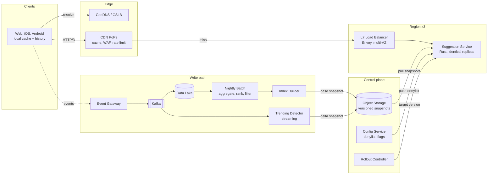

The **read path** (top) and the **write path** (bottom) share only object storage and the config service. A complete write-path outage leaves the read path serving yesterday's data, which is correct behaviour (P5).

### 7.1 Component catalogue

| Component          | Path   | Responsibility                                                 | Technology                        | Scales by               | If it fails                                 |
|--------------------|--------|----------------------------------------------------------------|-----------------------------------|-------------------------|---------------------------------------------|
| Client             | Read   | Issue requests, cache locally, order responses, merge history  | Web / mobile SDK                  | Per user                | Search box works without suggestions        |
| GeoDNS / GSLB      | Read   | Route users to the nearest healthy PoP and region              | Managed DNS, anycast              | Managed                 | Cached DNS answers keep working for the TTL |
| CDN / Edge         | Read   | Cache responses, absorb hot prefixes, WAF, rate limiting       | Commercial CDN + edge functions   | PoPs                    | Origin serves everything (sized for it)     |
| Load Balancer      | Read   | Terminate connections, pool HTTP/2, health-check, balance load | Envoy behind a network LB         | Instances per AZ        | Redundant instances per AZ                  |
| Suggestion Service | Read   | Normalize, match, rank, merge, filter, respond                 | Rust, Tokio, axum, `fst`          | Nodes                   | Load balancer routes around it              |
| Object Storage     | Shared | Hold immutable base and delta snapshots and manifests          | S3 / GCS, cross-region replicated | Managed                 | Nodes keep serving current snapshots        |
| Config Service     | Shared | Push denylist and feature flags in seconds                     | etcd / Consul / managed config    | Managed                 | Nodes keep the last known denylist          |
| Rollout Controller | Shared | Canary and progressive rollout of snapshot versions            | Small control service             | Single active + standby | Rollouts pause; serving unaffected          |
| Event Gateway      | Write  | Validate, normalize and enrich client events, write to Kafka   | Rust HTTP service                 | Nodes                   | Clients buffer and retry                    |
| Kafka              | Write  | Durable event log                                              | Kafka, RF 3                       | Partitions, brokers     | Bounded event loss; serving unaffected      |
| Data Lake          | Write  | Long-term event and aggregate storage                          | Iceberg tables on object storage  | Managed                 | Batch delayed                               |
| Nightly Batch      | Write  | Aggregate signals, compute scores, apply safety filters        | Spark                             | Executors               | Yesterday's snapshot keeps serving          |
| Index Builder      | Write  | Build FSTs, phrase tables, hot maps; validate; publish         | Rust, same crates as server       | Parallel per locale     | Yesterday's snapshot keeps serving          |
| Trending Detector  | Write  | Detect spikes in real time and publish small delta snapshots   | Flink                             | Task slots              | Trending entries expire; base unaffected    |

---

## 8. Read Path: Deep Dive

### 8.1 Request lifecycle

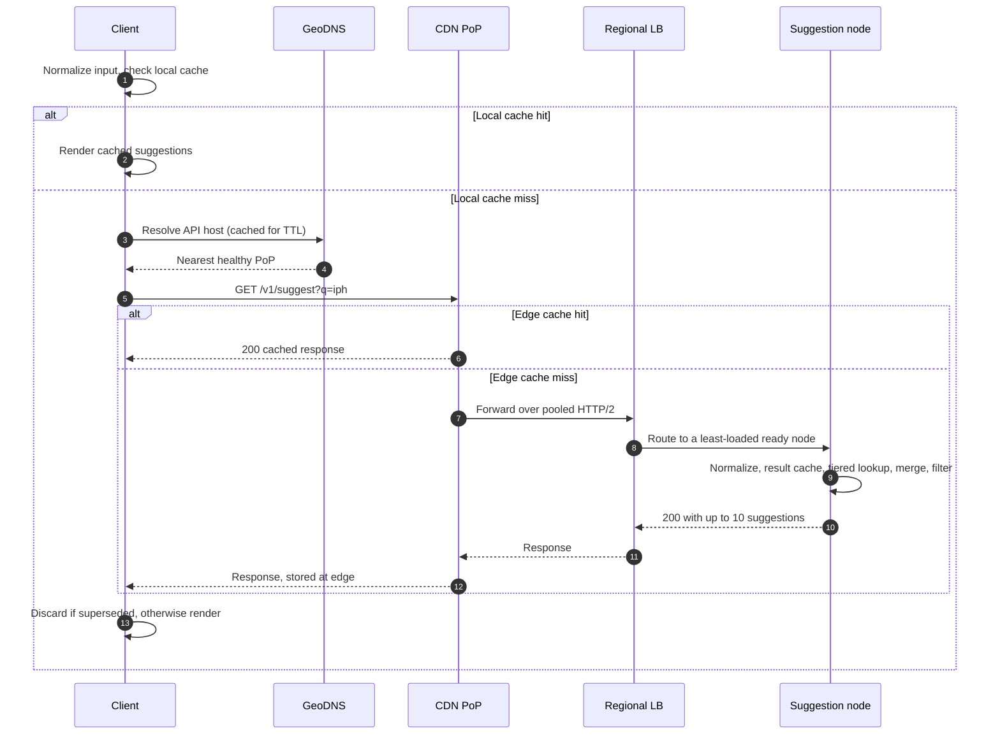

Most keystrokes end at step 2 or at the edge. Only cache misses reach a suggestion node, and the node answers from memory without any further network call.

### 8.2 Client

**Responsibility.** Send a request on every keystroke, avoid the network whenever an answer is already known, and never show stale results after newer ones.

| Behaviour               | Detail                                                                   | Why                                                       |
|-------------------------|--------------------------------------------------------------------------|-----------------------------------------------------------|
| Fire on every keystroke | Required by FR-1                                                         | Product requirement                                       |
| Optional debounce       | 30–80 ms; a product decision, not assumed by this design                 | Collapses keystrokes the user never sees rendered         |
| Light normalization     | Trim, lowercase, collapse spaces for the local cache key                 | Higher local hit ratio                                    |
| Local LRU cache         | ~200 entries, 10 min TTL, key = (locale, normalized input)               | Backspace and retyping never reach the network            |
| Response ordering       | Monotonic sequence number per search box; abort superseded requests      | A late response for `ip` must not overwrite `iph`         |
| Provisional display     | Filter the previous list by the new input while the request is in flight | Instant visual feedback; replaced when the response lands |
| Personal history merge  | Up to 3 of the user's own recent searches, matched locally, shown first  | Personalization without breaking edge caching             |
| Connection pre-warm     | Open the QUIC/TLS connection when the search box gains focus             | First keystroke skips the handshake                       |
| Transport               | One long-lived HTTP/3 connection; HTTP/2 fallback when UDP is blocked    | No handshake per keystroke; better on lossy mobile links  |
| Failure behaviour       | Timeout at 300 ms; keep the previous list or show nothing                | Typing is never blocked                                   |
| Telemetry               | Batch events every 5 s, 20 events, or on page hide                       | Feeds the write path (§10.3)                              |

**Why provisional filtering is not the final answer.** The top 10 for `iph` may contain phrases that were not in the top 10 for `ip`. Filtering the old list is a correct *subset* but not a correct *ranking*, so it is always replaced by the server response.

### 8.3 Global traffic management

**Responsibility.** Send each user to the nearest healthy entry point and move traffic away from failures.

| Mechanism                               | Scope                     | Reaction time     | Notes                                                         |
|-----------------------------------------|---------------------------|-------------------|---------------------------------------------------------------|
| Anycast to CDN PoPs                     | User → PoP                | Seconds (BGP)     | A failed PoP withdraws its routes; users land on the next one |
| CDN origin failover                     | PoP → region              | Seconds           | Each PoP has a primary and a secondary origin region          |
| Latency-based GeoDNS with health checks | Direct-to-origin fallback | 30–60 s (DNS TTL) | Used if the CDN itself is bypassed                            |

CDN-level origin failover is preferred over DNS failover because it reacts without waiting for DNS caches to expire.

### 8.4 CDN and edge

**Responsibility.** Answer as many requests as possible without touching origin, and protect origin from abuse.

| Feature                | Configuration                                                        | Effect                                                     |
|------------------------|----------------------------------------------------------------------|------------------------------------------------------------|
| Cache key              | Path + normalized `q` + `locale`; cookies and other headers excluded | Every user shares the same cache entry                     |
| Edge normalization     | Edge function: trim, lowercase, collapse whitespace on `q`           | `IPH`, `iph` and `iph` share one entry                    |
| TTL at edge            | `s-maxage=600`                                                       | Bounds staleness when trending data changes                |
| Stale while revalidate | 60 s                                                                 | Refresh in the background; users never wait for it         |
| Stale if error         | 86,400 s                                                             | **If origin is unreachable, serve up to a day-old answer** |
| Request collapsing     | Concurrent misses for one key become one origin request              | Protects origin from thundering herds                      |
| Origin shield          | A tier of regional cache between PoPs and origin                     | Raises the overall hit ratio; fewer origin requests        |
| Surrogate keys         | Each response tagged with stable hashes of its phrases               | Purge all responses containing a removed phrase (§10.13)   |
| WAF and rate limiting  | Per-IP burst limits, bot management, input length caps               | Stops scraping and floods before they reach origin         |

**What the edge absorbs.** The ~18,000 prefixes of length 1–3 in a locale receive a large share of requests and are nearly always cached. Popular longer prefixes add to that. The planning value is a **50% hit ratio**; real values are usually higher.

### 8.5 Regional load balancer

**Responsibility.** Accept traffic from the CDN, spread it evenly across healthy nodes, and hide individual node failures.

| Feature             | Setting                                                                  | Why                                                        |
|---------------------|--------------------------------------------------------------------------|------------------------------------------------------------|
| Topology            | Network LB (L4) in front of Envoy (L7) instances in every AZ             | No single LB instance is a point of failure                |
| Upstream protocol   | Pooled, long-lived HTTP/2 connections to nodes                           | No handshake per request; thousands of clients multiplexed |
| Algorithm           | Least-request with power-of-two choices                                  | Avoids hot nodes without global coordination               |
| Active health check | `/ready` every 2 s; 2 failures remove a node                             | Nodes without a loaded snapshot never receive traffic      |
| Outlier detection   | Eject a node after 5 consecutive 5xx or a p99 far above peers            | Handles slow ("gray") failures, not only crashes           |
| Slow start          | New nodes ramp up over 60 s                                              | Their result cache starts cold                             |
| Upstream timeout    | 8 ms                                                                     | Keeps the 10 ms budget                                     |
| Retries             | 1 retry on connect failure or 503, to a different node; retry budget 10% | Recovers from one bad node without retry storms            |
| Hedged requests     | Optional: duplicate to a second node after 3 ms; budget 2%               | Cuts tail latency from a single slow node                  |
| Connection draining | Finish in-flight requests on deploy or scale-in                          | No errors during rollouts                                  |
| Zone-aware routing  | Prefer same-AZ nodes, spill across AZs when needed                       | Lower latency and cross-AZ cost                            |

### 8.6 Suggestion Service

**Responsibility.** Turn a raw input into 10 ranked suggestions using only local memory.

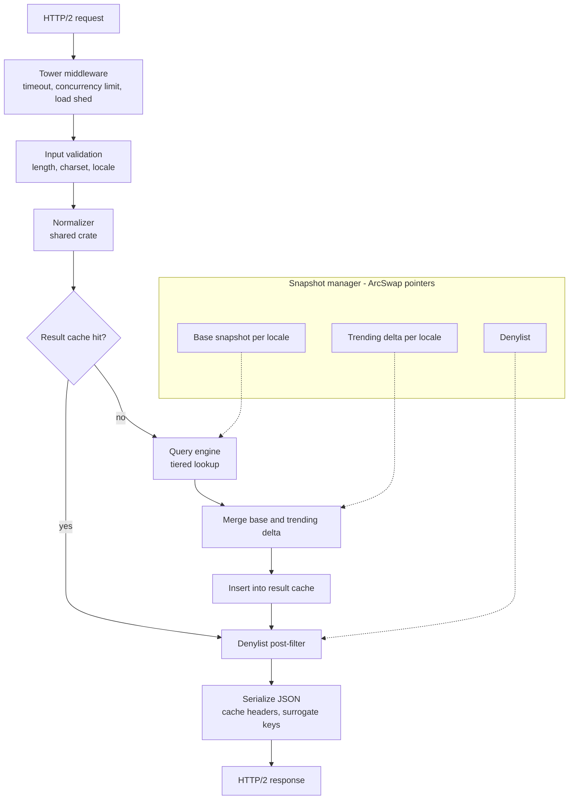

| Module           | Responsibility                                      | Implementation                                       | Notes                                                    |
|------------------|-----------------------------------------------------|------------------------------------------------------|----------------------------------------------------------|
| Runtime          | Schedule async tasks across cores                   | Tokio multi-threaded runtime, one worker per core    | No blocking calls anywhere on the request path           |
| HTTP layer       | Accept HTTP/2 from the LB                           | hyper via axum (h2c inside the VPC, or rustls)       | Persistent connections from Envoy                        |
| Middleware       | Protect the node under load                         | `tower` timeout (5 ms), concurrency limit, load shed | A timeout returns partial results, not an error          |
| Validation       | Reject bad input early                              | Length ≤ 64 chars, valid UTF-8, known locale         | Cheap and first                                          |
| Normalizer       | Produce the canonical form of the input             | Shared `normalizer` crate (§8.9)                     | Version must match the snapshot manifest                 |
| Result cache     | Skip lookups for repeated inputs                    | `moka` (TinyLFU), ~500K entries, ~150 MB             | Key includes snapshot versions, so a swap invalidates it |
| Query engine     | Find candidates and pick the best 10                | Tiered lookup over FSTs and hot maps (§8.8)          | Bounded work per tier                                    |
| Merge            | Combine base and trending candidates                | Weighted merge of ≤ 20 candidates (§10.12)           | < 1 µs                                                   |
| Denylist filter  | Remove phrases blocked since the snapshot was built | Hash set of phrase hashes, applied after the cache   | Removals apply to cached results too                     |
| Serializer       | Build the response                                  | `serde_json`, reused buffers                         | ~1 µs                                                    |
| Snapshot manager | Load, verify and atomically swap data               | `memmap2` + `fst` + `arc-swap`                       | Readers never block                                      |
| Telemetry        | Metrics and sampled traces                          | Prometheus exporter, `tracing`                       | Raw queries never logged; only hashes                    |

**Lock-free reads.** Every request calls `load()` on an `ArcSwap` pointer and reads the snapshot through it. A swap stores a new pointer; requests already running keep the old snapshot alive through its reference count until they finish. No request ever waits on a lock.

**Allocation discipline.** A fast allocator (mimalloc or jemalloc), small fixed-size candidate buffers on the stack, and reused serialization buffers keep per-request allocations near zero.

### 8.7 Index data structures

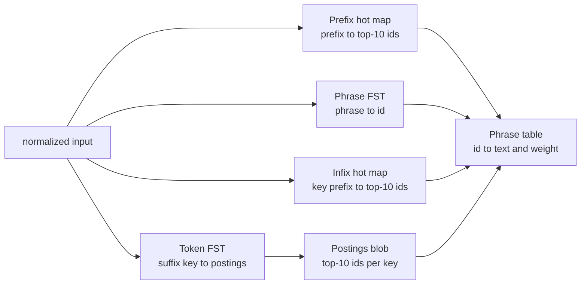

| Structure      | Key                                         | Value                        | Serves                      | Size (large locale) |
|----------------|---------------------------------------------|------------------------------|-----------------------------|---------------------|
| Phrase table   | Phrase id (u32)                             | Display text, weight (u32)   | Final rendering and merging | ~1.6 GB             |
| Phrase FST     | Normalized phrase                           | Phrase id                    | Prefix and fuzzy matching   | ~0.5 GB             |
| Token FST      | Word-boundary suffix of a phrase            | Offset into postings         | Infix matching              | ~1.0 GB             |
| Postings blob  | (via token FST)                             | Up to 10 ids per key, sorted | Infix matching              | ~0.5 GB             |
| Prefix hot map | Prefix with > 1,000 completions             | Top-10 ids                   | Short and popular prefixes  | ~0.1 GB             |
| Infix hot map  | Token-key prefix with > 1,000 matching keys | Top-10 ids                   | Short infix queries         | < 0.1 GB            |

**What an FST is.** A finite state transducer is a minimal automaton over sorted keys. It shares common prefixes *and* common suffixes, so a set of 50 M phrases takes roughly half the memory of the raw bytes, while still supporting lookups by prefix, by range, and by any automaton (for example, a Levenshtein automaton for typos). The `fst` crate builds it from sorted input and reads it directly from a memory-mapped file.

**ID equals rank.** The builder assigns ids in **descending weight order**: id 0 is the most popular phrase. Consequences:

- The top 10 of any candidate set are simply its **10 smallest ids**.
- A bounded max-heap of `u32` ids replaces score comparisons.
- Postings sorted by id are already sorted by rank.
- The weight is still stored, because merging with the trending delta (§10.12) and across matching tiers needs comparable scores.

**Token-suffix keys enable infix matching.** For `iphone 15 pro max`:

| Stored in  | Key                 |
|------------|---------------------|
| Phrase FST | `iphone 15 pro max` |
| Token FST  | `15 pro max`        |
| Token FST  | `pro max`           |
| Token FST  | `max`               |

An input like `15 pr` becomes a **prefix search** in the token FST. Each key keeps only its **10 best ids**. This is still exact: the overall top 10 among all matching keys is always contained in the union of each key's own top 10.

**Hot maps bound the worst case.** A prefix such as `a` matches millions of phrases. Scanning them all per request is unacceptable, so every prefix with more than M = 1,000 completions has its answer precomputed (§4.2 proves there are at most ~1 M such prefixes). Any prefix *not* in the hot map has at most 1,000 completions, so the scan is always small.

**Snapshot layout on disk**

```text
snapshots/
  b20261027/
    manifest.json            # versions, checksums, signature
    en-US/
      phrase_table.bin
      phrases.fst
      tokens.fst
      postings.bin
      hot_prefix.bin
      hot_infix.bin
    de-DE/
      ...
```

FSTs, postings and the phrase table are memory-mapped. Hot maps are loaded into an in-process hash map (FxHash) at load time.

### 8.8 Query algorithm: tiered lookup

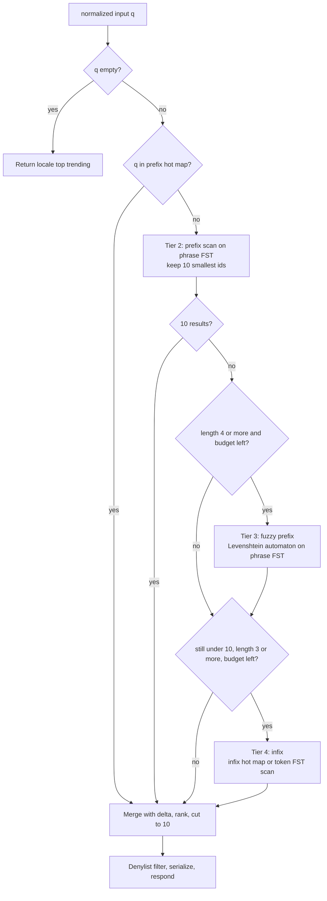

| Tier | Match type         | Data used                    | Runs when                      | Typical cost | Hard cap              |
|------|--------------------|------------------------------|--------------------------------|--------------|-----------------------|
| 1    | Exact prefix (hot) | Prefix hot map               | Prefix has > 1,000 completions | ~1 µs        | O(1)                  |
| 2    | Exact prefix       | Phrase FST                   | Not in hot map                 | 5–50 µs      | ≤ 1,000 keys scanned  |
| 3    | Fuzzy prefix       | Phrase FST + Levenshtein DFA | Fewer than 10 results so far   | 50–500 µs    | 20,000 states or 2 ms |
| 4    | Infix              | Infix hot map or token FST   | Still fewer than 10 results    | 10–200 µs    | ≤ 1,000 keys scanned  |

**Typo tolerance policy**

| Input length | Max edits | Extra rule                 | Reason                                                                 |
|--------------|-----------|----------------------------|------------------------------------------------------------------------|
| 1–3          | 0         |                            | Too short; any fuzzy match is noise                                    |
| 4–7          | 1         | First character must match | Most typos are not on the first character; huge search-space reduction |
| 8+           | 2         | First character must match | Longer words tolerate more errors                                      |

Transpositions (`iphnoe`) count as one edit when using a Damerau-Levenshtein automaton (for example the `levenshtein_automata` crate, used through `tantivy-fst`, which accepts its DFA as an automaton).

**Combining tiers.** Candidates from different tiers are ordered by an adjusted weight:

```text
adjusted_weight = weight × tier_factor
tier_factor:  exact = 1.0,  infix = 0.7,  fuzzy(1 edit) = 0.6,  fuzzy(2 edits) = 0.4
```

An exact match usually wins, but a weak exact match (a rare phrase that happens to start with a typo) can lose to a very popular fuzzy match.

**Core lookup sketch (Rust)**

```rust
use fst::{automaton::Str, Automaton, IntoStreamer, Map, Streamer};
use std::collections::BinaryHeap;

/// Keep the k smallest ids (= best ranks) among all keys accepted by `aut`.
/// `max_keys` bounds the work done per request.
fn top_k<A: Automaton>(map: &Map<memmap2::Mmap>, aut: A, k: usize, max_keys: usize) -> Vec<u32> {
    let mut heap: BinaryHeap<u32> = BinaryHeap::with_capacity(k + 1); // max-heap
    let mut stream = map.search(aut).into_stream();
    let mut scanned = 0;
    while let Some((_key, id)) = stream.next() {
        heap.push(id as u32);
        if heap.len() > k {
            heap.pop(); // drop the worst (largest id)
        }
        scanned += 1;
        if scanned >= max_keys {
            break; // budget exhausted: return what we have
        }
    }
    let mut ids = heap.into_vec();
    ids.sort_unstable();
    ids
}

// Tier 2: exact prefix
// let ids = top_k(&snap.phrases, Str::new(&q).starts_with(), 10, 1_000);
```

**Empty input.** When the box is focused with no text, the service returns the locale's top trending phrases. That response is identical for everyone and almost always served by the CDN.

### 8.9 Language analysis and normalization

| Step | Operation                  | Example                            | Notes                                                       |
|------|----------------------------|------------------------------------|-------------------------------------------------------------|
| 1    | Unicode NFKC normalization | `file` → `file`; full-width → ASCII | Canonical byte form                                         |
| 2    | Case folding               | `iPhone` → `iphone`                | Locale-aware (Turkish dotted and dotless i)                 |
| 3    | Accent folding             | `café` → `cafe`                    | Configured per locale                                       |
| 4    | Whitespace and punctuation | `iphone   15!` → `iphone 15`       | Protected tokens keep symbols: `c++`, `c#`, `at&t`          |
| 5    | Tokenization               | Words split on spaces              | CJK uses dictionary segmenters (`lindera`, `jieba-rs`)      |
| 6    | Stemming (optional)        | `running shoes` → `run shoe`       | Token FST keys only, never for the partial word being typed |

**Stemming is never applied to the prefix tier.** The last word is usually incomplete, and stemmers produce wrong results on partial words.

**One implementation.** The `normalizer` crate is used by the event gateway, the index builder and the suggestion service. Every snapshot manifest records the normalizer version it was built with, and a node **refuses a snapshot built with a different version**. This prevents the classic bug where keys were normalized one way at build time and queries another way at serve time.

### 8.10 Latency budget (origin path)

Measured from load balancer ingress to egress.

| Stage                             | Typical (ms) | p99 budget (ms) |
|-----------------------------------|--------------|-----------------|
| LB processing                     | 0.200        | 1.00            |
| LB to node network (same AZ)      | 0.100        | 0.50            |
| Tokio scheduling and HTTP parsing | 0.020        | 0.50            |
| Validation and normalization      | 0.002        | 0.02            |
| Result cache lookup               | 0.001        | 0.01            |
| Tiers 1–2                         | 0.005        | 0.10            |
| Tiers 3–4 (when used)             | skipped      | 2.00 (hard cap) |
| Merge, filter, serialize          | 0.003        | 0.05            |
| Node to LB to egress              | 0.300        | 1.50            |
| **Total**                         | **~0.63**    | **~5.68**       |

About 4 ms of headroom remains for queueing and noise. **Rust matters here** because there are no garbage-collection pauses: the p99 and p99.9 stay close to the typical path instead of being dominated by pause times.

### 8.11 Capacity plan and deployment topology

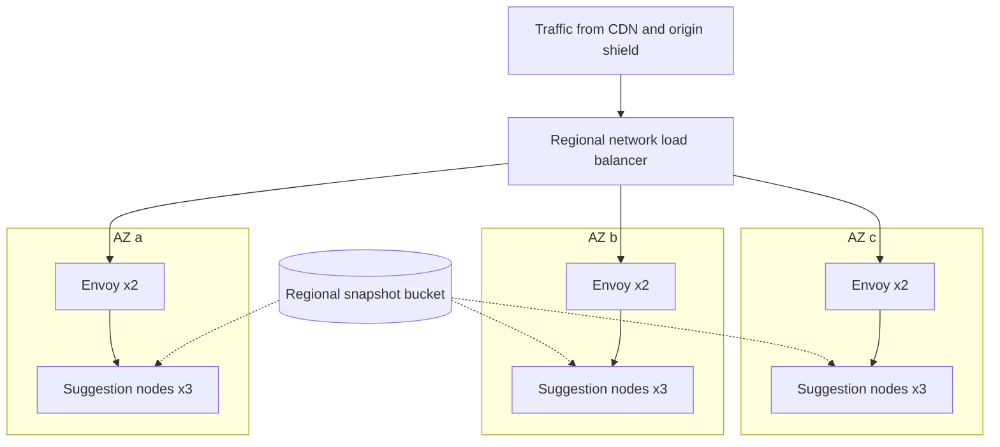

The diagram shows the us region (3 nodes per AZ). The eu and apac regions are identical with 2 nodes per AZ (§4.5).

| Aspect                | Decision                                                                      |
|-----------------------|-------------------------------------------------------------------------------|
| Node type             | 32 vCPU, 64 GB RAM, 25 Gbps; ~15 GB of index plus page cache and result cache |
| Minimum fleet         | 21 nodes across 3 regions (§4.5)                                              |
| Autoscaling           | Scale out on CPU > 60% or p99 > 6 ms; never below the minimum fleet           |
| Why autoscaling works | A node fetches and verifies ~15 GB in about a minute, then warms in seconds   |
| Placement             | Spread across AZs and racks (anti-affinity)                                   |
| Per-region data       | A regional replica of the snapshot bucket; nodes never fetch across regions   |

### 8.12 Snapshot distribution and hot swap

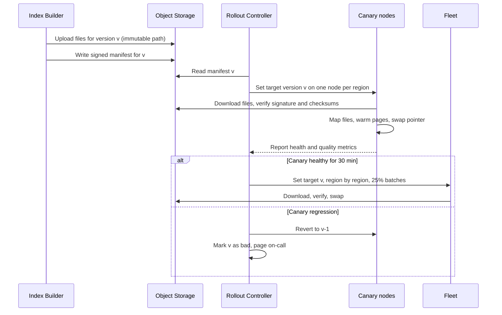

**Node lifecycle**

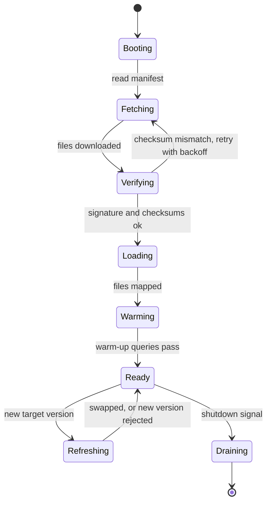

A node in `Refreshing` keeps serving traffic from its current snapshot. Only `Ready` and `Refreshing` report healthy on `/ready`.

**Hot swap steps**

1. Download the new version's files to local disk next to the current version.
2. Verify the manifest signature and every file's SHA-256.
3. Memory-map the files and build the hot maps.
4. **Warm:** pre-fault pages (`madvise(WILLNEED)`) and run the top 10,000 prefixes through the engine.
5. **Swap:** `ArcSwap::store` the new snapshot. New requests use it immediately.
6. The old snapshot is freed when its last in-flight request drops its reference.
7. Keep the previous version on disk for instant rollback.

Snapshots are memory-mapped, so a swap does not need two full copies in RAM: pages of the old version are released by the OS as they stop being touched.

### 8.13 Load management and graceful degradation

| Level | Trigger                   | Action                                          | User impact                         |
|-------|---------------------------|-------------------------------------------------|-------------------------------------|
| L0    | Normal                    | All tiers enabled                               | Full quality                        |
| L1    | CPU > 70% or p99 > 7 ms   | Disable tier 4 (infix)                          | Fewer infix matches                 |
| L2    | CPU > 80% or p99 > 8 ms   | Disable tier 3 (fuzzy); exact matching only     | No typo tolerance                   |
| L3    | Concurrency limit reached | Shed requests with 503; LB retries another node | Some keystrokes show no suggestions |
| Edge  | Origin errors or timeouts | CDN serves stale responses (`stale-if-error`)   | Slightly old suggestions            |

The order follows principle P5: **stale, then partial, then empty, then error**. Tiers 1–2 alone cost so little that a node at L2 handles several times its normal request rate.

---

## 9. High Availability and Fault Tolerance

### 9.1 Failure matrix

| Failure                                | Detection                         | Automatic response                                                            | User impact                         | Recovery            |
|----------------------------------------|-----------------------------------|-------------------------------------------------------------------------------|-------------------------------------|---------------------|
| Single node crash                      | `/ready` fails, connection errors | LB removes node; orchestrator replaces it                                     | None (retried on another node)      | ~2 min              |
| Slow node (gray failure)               | Outlier detection on latency      | Ejected from LB pool; hedged requests cover the gap                           | Rare slow keystroke                 | Seconds             |
| AZ outage                              | LB and orchestrator health checks | Traffic shifts to remaining AZs (sized for it)                                | None                                | Immediate           |
| Region outage                          | CDN origin health checks          | PoPs fail over to secondary origin regions                                    | Slightly higher latency             | Seconds             |
| CDN PoP outage                         | Anycast route withdrawal          | Users routed to the next PoP                                                  | Slightly higher latency             | Seconds             |
| Whole CDN provider outage              | Synthetic probes                  | DNS switches to a secondary CDN or direct to origin                           | Higher latency, origin at full load | Minutes             |
| LB instance failure                    | Network LB health checks          | Traffic goes to other Envoy instances                                         | None                                | Seconds             |
| Object storage unavailable             | Fetch errors                      | Nodes keep current snapshots; new nodes use the replica bucket                | None                                | Not needed          |
| Bad snapshot published                 | Validation gates, canary metrics  | Rejected before or during canary; rollback to v-1                             | None, or one canary node briefly    | Minutes             |
| Nightly pipeline fails                 | Snapshot age alert at 30 h        | Fleet keeps serving the previous snapshot                                     | Data a day older                    | Next successful run |
| Kafka outage                           | Producer errors                   | Clients and gateway buffer; serving unaffected                                | None                                | When Kafka returns  |
| Trending detector fails                | Delta age alert at 10 min         | Delta entries expire by TTL; base keeps serving                               | Trends appear late                  | Checkpoint restore  |
| Config service down                    | Push channel errors               | Nodes keep the last denylist and poll a copy in object storage                | None                                | Not needed          |
| Traffic spike or DDoS                  | Edge and LB metrics               | WAF, rate limits, autoscaling, degradation ladder (§8.13)                     | Possibly reduced quality            | Automatic           |
| Malformed input that crashes a handler | Panic counter                     | `CatchPanic` middleware returns 500 for that request only; input fuzzed in CI | One request fails                   | Immediate           |
| Memory pressure                        | RSS and page-fault metrics        | Mapped pages are reclaimable; node ejected and restarted if needed            | None                                | Minutes             |

### 9.2 Techniques used

| Technique             | Where            | What it prevents                              |
|-----------------------|------------------|-----------------------------------------------|
| Full replication      | Suggestion nodes | Data loss or unavailable shards               |
| N+1 at AZ level       | Every region     | Capacity loss when an AZ fails                |
| Regional independence | Read path        | Cascading failures across regions             |
| Stale-if-error        | CDN              | User-visible errors during origin incidents   |
| Retry budgets         | LB               | Retry storms amplifying an outage             |
| Load shedding         | Nodes            | Overload collapse (latency spiral)            |
| Immutable snapshots   | Data plane       | Partial updates and corrupted in-place writes |
| Validation and canary | Rollouts         | Bad data reaching the whole fleet             |
| Signed manifests      | Snapshot loading | Tampered or corrupted data being served       |

### 9.3 Deployment safety

- **Code and data are deployed separately**, never in the same rollout, so a regression is attributable to one change.
- **Both are canaried**: one node per region first, then 25% batches, region by region, each gated on error rate, p99 latency and empty-result rate.
- **Rollback is a pointer change** for data and a version change for code; the previous version is always kept locally.
- **Chaos drills**: regular node kills, AZ evacuations and CDN-bypass tests confirm that the sizing in §4.5 holds in practice.

---

## 10. Write Path: Ranking and Freshness

The write path decides **what** can be suggested and **in which order**. It never touches a serving node directly; its only output is versioned snapshots in object storage and denylist updates in the config service.

### 10.1 Goals

| Goal                    | Meaning                                                                       |
|-------------------------|-------------------------------------------------------------------------------|
| Relevance               | Rank what users are most likely to search for, given what they have typed     |
| Freshness               | Reflect yesterday's behaviour daily, breaking trends within minutes           |
| Safety and privacy      | Never suggest personal data, unsafe content, or legally removed phrases       |
| Manipulation resistance | Coordinated or automated traffic cannot push a phrase into suggestions        |
| Reproducibility         | Every snapshot can be rebuilt byte-for-byte from raw events and code versions |
| Isolation               | Any write-path failure leaves the read path serving the last good data        |

### 10.2 Architecture overview

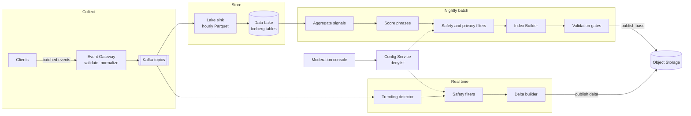

### 10.3 Event collection

**Event types**

| Event                   | Emitted when                  | Key fields                                                                  | Sampling | Used for                        |
|-------------------------|-------------------------------|-----------------------------------------------------------------------------|----------|---------------------------------|
| `suggestion_impression` | A suggestion list is rendered | input prefix, shown phrases with positions and kind, snapshot version       | 10%      | Engagement denominators (§10.6) |
| `suggestion_select`     | The user picks a suggestion   | input prefix, chosen phrase, position                                       | 100%     | Engagement numerators           |
| `search_submit`         | A search is executed          | query text, source: typed, suggestion or history                            | 100%     | Popularity                      |
| `search_outcome`        | After the results page        | query, result clicked, dwell bucket, zero results, reformulated within 30 s | 100%     | Search success                  |

**Common fields:** `event_id` (UUIDv7, for deduplication), client and server timestamps, `session_hash`, `user_hash` (salted, salt rotated every 90 days), `locale`, `platform`, `app_version`, `bot_score`.

**Event Gateway.** A stateless Rust HTTP service that:

1. Validates each event against its schema (Protobuf, with a schema registry).
2. Drops fields that must not be stored and hashes identifiers.
3. Adds `normalized_query` using the **shared normalizer crate**, so batch jobs never reimplement normalization.
4. Attaches a server timestamp and the edge-computed `bot_score`.
5. Writes to Kafka with an idempotent producer (`acks=all`).

**Kafka**

| Topic               | Partitions | Partition key  | Retention | Replication         |
|---------------------|------------|----------------|-----------|---------------------|
| `events.search.v1`  | 128        | `session_hash` | 7 days    | RF 3, min in-sync 2 |
| `events.suggest.v1` | 128        | `session_hash` | 7 days    | RF 3, min in-sync 2 |

Each region runs its own Kafka cluster. MirrorMaker 2 replicates topics to a central analytics region where the batch and streaming jobs run. Delivery is **at-least-once**; duplicates are removed by `event_id` downstream.

### 10.4 Data lake

| Table                  | Partitioning             | Retention            | Contents                                 | Access                |
|------------------------|--------------------------|----------------------|------------------------------------------|-----------------------|
| `raw_events`           | date, hour, locale       | 90 days              | All events as received                   | Restricted, encrypted |
| `daily_phrase_signals` | date, locale             | 2 years              | Per-phrase daily counts (§11.1)          | Pipeline              |
| `phrase_state`         | locale                   | Current + 7 versions | Rolling decayed signals (§11.2)          | Pipeline              |
| `builder_input`        | snapshot version, locale | 30 days              | Final phrases, display forms and weights | Pipeline, audit       |

Raw query text is the most sensitive data in the system: it can contain names, addresses and other personal details. Only phrases that pass the privacy filters (§10.7) ever leave the restricted zone.

### 10.5 Nightly aggregation pipeline

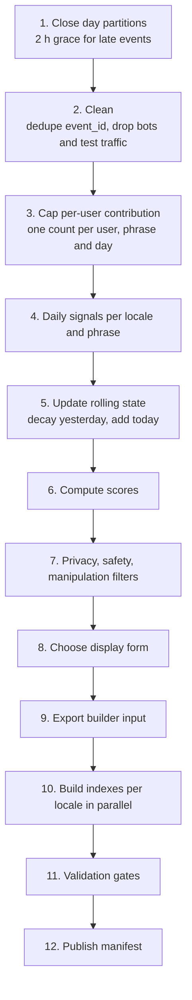

| Step  | What happens                                                                                     | Why                                                       |
|-------|--------------------------------------------------------------------------------------------------|-----------------------------------------------------------|
| 1     | Wait until the day's partitions are complete, allowing 2 hours for late events                   | Avoid undercounting the last hours of the day             |
| 2     | Remove duplicate `event_id`s, sessions with a high `bot_score`, internal and test traffic        | Counts reflect real users                                 |
| 3     | A user searching the same phrase 50 times in a day counts once                                   | One person cannot inflate a phrase                        |
| 4     | Count distinct users, typed and suggested submits, impressions, selections by position, outcomes | Raw material for scoring                                  |
| 5     | `state_today = state_yesterday × decay + signals_today`                                          | Only yesterday's state is read, never 90 days of raw data |
| 6     | Apply the scoring formula (§10.6)                                                                | One number per phrase                                     |
| 7     | Apply k-anonymity, PII detection, policy classifiers, denylist, manipulation checks (§10.7)      | Safety and privacy                                        |
| 8     | Pick the most frequent original spelling among variants with the same normalized form            | Display `iPhone 15`, not `iphone 15`                      |
| 9     | Write (locale, normalized phrase, display text, weight, stable phrase hash)                      | Contract between batch and builder                        |
| 10–12 | Build, validate and publish (§10.8, §10.9)                                                       | Produce the snapshot                                      |

**Incremental decay.** With a half-life of H days, the daily decay factor is `2^(-1/H)`. For H = 14 that is **0.9517**. Each night multiplies yesterday's decayed counts by 0.9517 and adds today's counts. The result is mathematically identical to summing every past day with its own decay weight, but costs one pass over the state table instead of 90 days of events.

### 10.6 Ranking model

#### Signals

| Signal                       | Definition                                                                                         | Why it matters                                                       |
|------------------------------|----------------------------------------------------------------------------------------------------|----------------------------------------------------------------------|
| Decayed popularity `F`       | Σ over days of `u_d × 2^(-age_d / H)`, where `u_d` = distinct users submitting the phrase on day d | Core demand signal, favouring recent activity                        |
| Feedback damping `γ`         | Submits that came *from* a suggestion count `γ = 0.5`; typed submits count 1                       | Breaks the loop "suggested, therefore searched, therefore suggested" |
| Suggestion engagement `COEC` | Clicks over expected clicks: selections ÷ Σ(impressions at position p × global CTR at p)           | How attractive the phrase is, corrected for position bias            |
| Search success `Succ`        | Share of searches ending in a result click with dwell ≥ 30 s and no reformulation within 30 s      | Rewards phrases that actually satisfy users                          |
| Zero-result rate `Z`         | Share of searches returning no results                                                             | Penalizes dead-end suggestions                                       |

#### Smoothing

Small counts are noisy. Both ratios are shrunk toward a neutral prior:

```text
COEC_s = (clicks + α) / (expected_clicks + α)        α = 50,  prior = 1.0
Succ_s = (successes + β × μ) / (outcomes + β)        β = 100, μ = locale mean success rate
```

A phrase with little data gets values close to the prior; a phrase with plenty of data gets its observed values. `COEC_s` is also capped at 3.

#### Score

```text
S = w_f × ln(1 + F)  +  w_c × ln(COEC_s)  +  w_s × Succ_s  −  w_z × Z
```

| Parameter | Default | Meaning                                 |
|-----------|---------|-----------------------------------------|
| `H`       | 14 days | Popularity half-life                    |
| `γ`       | 0.5     | Weight of suggestion-originated submits |
| `α`       | 50      | COEC smoothing strength                 |
| `β`       | 100     | Success smoothing strength              |
| `w_f`     | 1.0     | Popularity weight                       |
| `w_c`     | 0.5     | Engagement weight                       |
| `w_s`     | 0.8     | Success weight                          |
| `w_z`     | 1.5     | Zero-result penalty                     |

**Why logarithmic popularity.** Query popularity is heavy-tailed (Zipf-like). Using `ln(1 + F)` lets engagement and success reorder phrases of *similar* popularity without letting a rare phrase jump above one that is vastly more popular. With COEC capped at 3, the engagement and success terms together can move a score by at most `0.5 × ln 3 + 0.8 ≈ 1.35`, which compensates for a popularity gap of at most `e^1.35 ≈ 3.9×`.

**Decay weights for H = 14 days**

| Age of the search | Weight |
|-------------------|--------|
| Today             | 1.000  |
| 7 days            | 0.707  |
| 14 days           | 0.500  |
| 28 days           | 0.250  |
| 90 days           | 0.012  |

At a steady rate of `r` users per day, `F` converges to `r ÷ (1 − 0.9517) ≈ 20.7 × r`.

#### Worked example

| Phrase                   | F       | ln(1+F) | COEC_s | w_c·ln(COEC_s) | Succ_s | w_s·Succ_s | Z    | w_z·Z  | **Score**  |
|--------------------------|---------|---------|--------|----------------|--------|------------|------|--------|------------|
| `iphone 15`              | 120,000 | 11.695  | 1.10   | +0.048         | 0.72   | +0.576     | 0.01 | −0.015 | **12.304** |
| `iphone 15 case`         | 45,000  | 10.714  | 1.40   | +0.168         | 0.81   | +0.648     | 0.00 | 0.000  | **11.531** |
| `iphone 15 pro max leak` | 2,000   | 7.601   | 0.60   | −0.255         | 0.30   | +0.240     | 0.20 | −0.300 | **7.286**  |

`iphone 15 case` has better engagement and success than `iphone 15`, but not enough to close a 2.7× popularity gap. The third phrase has poor engagement and many dead ends, so it ranks far below.

#### From score to snapshot

1. Clamp scores at 0 and quantize to `u32` with fixed-point scaling (`S × 10^6`).
2. Sort by score descending; break ties by `F`, then by normalized text. Builds are **deterministic**.
3. Assign phrase ids in that order (id = rank, §8.7).

#### Feedback loops and position bias

| Problem                                                         | Mitigation                                                                 |
|-----------------------------------------------------------------|----------------------------------------------------------------------------|
| Suggested phrases get searched more because they are suggested  | Damp suggestion-originated submits with `γ = 0.5`                          |
| Higher positions get clicked more regardless of quality         | COEC divides by the expected clicks for each position                      |
| Phrases outside the top positions never collect engagement data | 1% of impressions randomly reorder positions 5–10 to collect unbiased data |
| Old favourites persist after interest fades                     | 14-day half-life decay                                                     |

#### Evaluation

| Type    | Metric                     | Definition                                                                  |
|---------|----------------------------|-----------------------------------------------------------------------------|
| Offline | Recall@10                  | Share of typed prefixes where the user's final query was in the top 10      |
| Offline | Mean reciprocal rank       | Average of 1 / position of the final query                                  |
| Offline | Keystrokes saved           | Characters the user did not have to type                                    |
| Online  | Suggestion acceptance rate | Searches started from a suggestion ÷ all searches                           |
| Online  | Search success rate        | As defined for `Succ`                                                       |
| Online  | Interleaving win rate      | Team-draft interleaving of two rankers in one list; more sensitive than A/B |

Offline metrics are computed on a held-out day before any weight change; online experiments then confirm the change. The parameter table above is the starting point for a learning-to-rank model (§15).

### 10.7 Safety, privacy and abuse filtering

| Filter                 | Rule                                                                                                                                        | Stage                         |
|------------------------|---------------------------------------------------------------------------------------------------------------------------------------------|-------------------------------|
| k-anonymity            | Keep a phrase only if ≥ 50 distinct users searched it within the 90-day window                                                              | Batch (stricter in real time) |
| PII detection          | Detect emails, phone numbers, card numbers (Luhn check), government ID formats, street addresses                                            | Batch and real time           |
| Policy classifier      | Per-locale classifier and curated term lists for hate, sexual content, violence and similar categories; borderline cases go to human review | Batch and real time           |
| Defamation patterns    | Suppress phrases pairing a person's name with accusations                                                                                   | Batch and real time           |
| Legal removals         | Court orders and right-to-be-forgotten requests, stored permanently in the denylist                                                         | All stages + serving          |
| Manipulation detection | Flag phrases whose growth comes from new accounts, few networks, or synchronized bursts; hold for review                                    | Batch and real time           |
| Denylist               | Moderator-managed list, applied at build time and again at serving time                                                                     | All stages + serving          |

**Ordering matters.** Privacy filters run **before** any data leaves the restricted zone of the lake. A phrase typed by only a handful of people (often personal data) never reaches the builder input, an index, or a log.

### 10.8 Index builder

A Rust batch program that shares the `fst`, `normalizer` and snapshot-format crates with the suggestion service, so the writer and reader of the format can never drift apart.

| Step | Operation                                                                                              | Notes                                                  |
|------|--------------------------------------------------------------------------------------------------------|--------------------------------------------------------|
| 1    | Read builder input for a locale; sort by score descending; assign ids                                  | id = rank                                              |
| 2    | Write the phrase table: weights (`u32`), offsets (`u64`), UTF-8 text blob                              | Fixed-width arrays, memory-mappable                    |
| 3    | Sort (normalized phrase, id) by bytes and insert into an FST map                                       | The `fst` builder requires keys in lexicographic order |
| 4    | Generate word-boundary suffix keys, external-sort them, group by key, keep the 10 smallest ids per key | ~100 M generated keys; external sort spills to disk    |
| 5    | Write postings and the token FST (key → postings offset and length)                                    |                                                        |
| 6    | Compute both hot maps in a single pass over the sorted keys (below)                                    | Only prefixes with > 1,000 completions                 |
| 7    | Write the manifest: versions, sizes, SHA-256 per file, normalizer version, parent version; sign it     | Signing key held in a KMS                              |

**Hot map in one pass.** Walking the sorted keys is equivalent to a depth-first walk of a trie. A stack holds, for each prefix length of the current key, a counter and a small heap of the 10 smallest ids:

```text
for each key in sorted order:
    l = length of common prefix with the previous key
    while stack depth > l:
        pop (prefix, count, top10)
        if count > 1000: emit prefix -> top10
        merge top10 into the new stack top
    push frames for prefix lengths l+1 .. len(key)
    add the key's id to the deepest frame
at the end, pop and emit everything remaining
```

Cost is proportional to the total bytes of all keys (~1 GB for a large locale) with an O(log 10) heap per frame. A large locale builds in under 20 minutes on one 32-core machine; locales build in parallel.

**Determinism.** Stable sorts and fixed tie-breaks make the output byte-identical for identical input. Two builds can be diffed, and any snapshot can be reproduced from the lake for debugging.

### 10.9 Validation and publishing

| Gate              | Check                                                                                   | Threshold                  | On failure          |
|-------------------|-----------------------------------------------------------------------------------------|----------------------------|---------------------|
| Structural        | All files present, checksums match, FSTs open, ids in range, normalizer version correct | Exact                      | Block publish       |
| Volume drift      | Phrase count and file sizes versus the previous version                                 | ±10% count, ±15% size      | Block, page on-call |
| Golden queries    | 5,000 curated prefixes with expected results in the top 3                               | ≥ 98% pass                 | Block               |
| Stability         | Average top-10 overlap with the previous version over the 100K busiest prefixes         | Between 0.70 and 0.99      | Block               |
| Safety audit      | No denylisted phrase is reachable; PII scanner over all keys                            | Zero hits                  | Block               |
| Performance smoke | Load the snapshot on a test node and replay 1M sampled queries                          | p99 within 10% of previous | Block               |

The stability gate has an **upper** bound too: 99%+ overlap with yesterday suggests the pipeline silently reused stale input.

**Publishing order**

1. Upload all files under an immutable path `snapshots/{version}/{locale}/...`.
2. Upload the signed manifest **last**. A manifest only exists once every file it references exists.
3. Notify the rollout controller, which runs the canary and progressive rollout (§8.12).
4. Keep the last 7 versions; older ones expire by lifecycle policy.

### 10.10 Freshness strategy

Different kinds of change need different speeds. Three tiers handle them independently.

| Tier           | Mechanism                                   | Time to take effect | Scope                               | Size per locale |
|----------------|---------------------------------------------|---------------------|-------------------------------------|-----------------|
| Base snapshot  | Nightly batch (§10.5–§10.9)                 | ≤ 24–36 h           | Everything                          | ~4 GB           |
| Trending delta | Streaming detector + delta builder (§10.11) | 2–10 min            | Spiking and newly appearing phrases | ≤ 10 MB         |
| Kill switch    | Denylist push + CDN purge (§10.13)          | < 60 s              | Removals only                       | KB              |

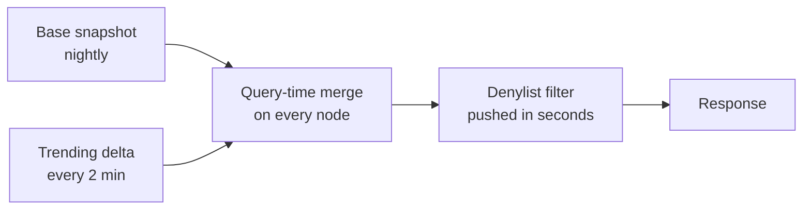

### 10.11 Trending pipeline

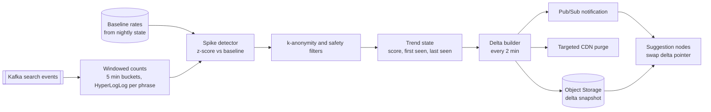

**Counting.** A Flink job keyed by (locale, normalized phrase) keeps HyperLogLog sketches of distinct users in 5-minute buckets. HyperLogLog counts distinct users in a few KB per phrase, without storing user ids.

**Baseline.** The expected number of distinct users per 5 minutes comes from the nightly state: `b = (F × (1 − 0.9517)) ÷ 288 × hour_of_day_factor`. A phrase never seen before gets `b = 0.5`.

**Spike test.** Over a 15-minute sliding window (3 buckets), with observed count `C` and expected count `B = 3b`:

```text
z = (C − B) / sqrt(B)          Poisson approximation
trending if  z ≥ 6  and  C ≥ 30 distinct users  and  passes safety filters
```

| Phrase             | Baseline b (per 5 min) | B (15 min) | Observed C | z     | Result       |
|--------------------|------------------------|------------|------------|-------|--------------|
| `weather`          | 347                    | 1,042      | 1,150      | 3.4   | Not trending |
| `iphone 17 launch` | 0.5 (new phrase)       | 1.5        | 3,000      | 2,448 | Trending     |

`weather` is popular but behaving normally. `iphone 17 launch` is a genuine spike.

**Trend score.** A trending phrase competes on projected popularity, with neutral engagement:

```text
F_trend = κ × C × 96                 projected daily distinct users; κ = 1 (trend boost)
S_trend = w_f × ln(1 + F_trend) + w_s × μ          COEC = 1 contributes 0;  μ = locale mean success
weight  = max(S_base, S_trend)
```

For `iphone 17 launch`: `F_trend = 3,000 × 96 = 288,000`, so `S_trend = 12.571 + 0.8 × 0.6 = 13.051`. It ranks above `iphone 15` (12.304) while the spike lasts.

**Lifecycle.** The trend score is recomputed every window from the current count, so it falls naturally as interest fades. An entry is removed when `z < 2` for 30 minutes, or after 48 hours, by which time the nightly base has absorbed it.

**Delta snapshot.** At most 100K phrases per locale, in the same formats as the base (phrase table with weights, phrase FST, token FST; no hot maps needed at this size). Delta ids are local to the delta; merging uses weights, not ids. The delta builder publishes every 2 minutes and notifies nodes through pub/sub. Nodes swap a separate `ArcSwap` pointer for the delta.

**Targeted CDN purge.** When a phrase enters the delta, the builder checks each of its prefixes (up to 8 characters) against the base snapshot's 10th-best weight for that prefix. Only prefixes where the new phrase actually enters the top 10 are purged, so the purge list stays tiny.

### 10.12 Query-time merge of base and delta

| Step | Operation                                                                   |
|------|-----------------------------------------------------------------------------|
| 1    | Run the tiered lookup on the base snapshot: ≤ 10 candidates with weights    |
| 2    | Run the same tiers on the delta (cheap, it is small): ≤ 10 candidates       |
| 3    | Union both lists; deduplicate by normalized text, keeping the higher weight |
| 4    | Sort by adjusted weight (§8.8); keep 10                                     |
| 5    | Mark entries that come from the delta as `"kind": "trending"`               |

At most 20 candidates are merged, which takes well under a microsecond. The result-cache key contains both the base and delta versions, so a delta swap invalidates cached results automatically.

### 10.13 Emergency removal (kill switch)

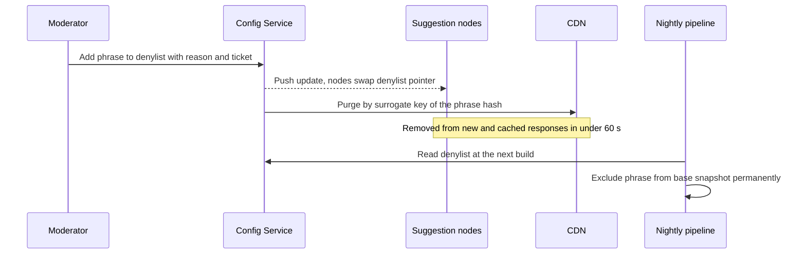

- The surrogate key is a **stable hash of (locale, normalized phrase)**, identical across snapshot versions. One purge removes every cached response containing the phrase, including fuzzy and infix responses that could not be enumerated by prefix.
- The denylist filter runs **after** the result cache inside the node, so cached results are filtered too.
- The trending detector and the nightly batch read the same denylist, so a removed phrase cannot re-enter through either path.
- Every entry carries a reason and a ticket reference for audit.

### 10.14 Nightly schedule

```mermaid
gantt
    title Nightly base snapshot pipeline (UTC)
    dateFormat HH:mm
    axisFormat %H:%M
    section Ingestion
    Late event grace window       :a1, 00:00, 2h
    section Batch
    Clean and dedupe              :a2, after a1, 40m
    Aggregate and update state    :a3, after a2, 50m
    Score and filter              :a4, after a3, 30m
    section Build
    Build indexes per locale      :a5, after a4, 25m
    Validation gates              :a6, after a5, 30m
    Publish manifest              :a7, after a6, 5m
    section Rollout
    Canary                        :a8, after a7, 30m
    Progressive rollout           :a9, after a8, 90m
```

The new base is live everywhere about 7 hours after midnight UTC. Rollout batches within each region are paced to that region's off-peak hours. If any stage fails, it is retried twice; after that the fleet simply keeps the previous version, and the freshness alert fires once the base is 30 hours old.

### 10.15 Write path failure modes

| Failure                        | Effect                                 | Mitigation                                                               |
|--------------------------------|----------------------------------------|--------------------------------------------------------------------------|
| Event gateway down             | Events delayed                         | Clients keep a bounded buffer and retry with backoff                     |
| Kafka broker loss              | None                                   | RF 3, min in-sync replicas 2, `acks=all`                                 |
| Late events                    | Undercounting of the last hours        | 2-hour grace; anything later is counted the next day                     |
| Batch job failure              | Base snapshot ages                     | Two automatic retries; serving keeps the previous version; alert at 30 h |
| Ranking bug                    | Bad order                              | Validation gates, canary, one-step rollback                              |
| Normalizer change              | Old keys incompatible with new queries | Version bump in the manifest; full reprocess of 90 days from raw events  |
| Trending detector crash        | Deltas stop updating                   | Restart from checkpoint; stale delta entries expire; base unaffected     |
| Poisoning attempt              | Attacker tries to push a phrase        | Per-user caps, k-anonymity, manipulation detection, human review         |
| Regional object storage outage | Cannot publish or fetch in that region | Cross-region replicated buckets; nodes fall back to the replica          |

---

## 11. Data Model Reference

### 11.1 `daily_phrase_signals`

| Column                | Type         | Description                          |
|-----------------------|--------------|--------------------------------------|
| `locale`              | string       | BCP-47 locale                        |
| `phrase_norm`         | string       | Normalized phrase                    |
| `phrase_hash`         | u64          | Stable hash of (locale, phrase_norm) |
| `day`                 | date         | UTC day                              |
| `distinct_users`      | u32          | After per-user caps and bot removal  |
| `typed_submits`       | u32          | Searches typed fully by the user     |
| `suggested_submits`   | u32          | Searches started from a suggestion   |
| `impressions_est`     | u64          | Sampled impressions ÷ sampling rate  |
| `selects_by_position` | array of u32 | Selections at positions 1–10         |
| `outcomes`            | u32          | Searches with an outcome event       |
| `successes`           | u32          | Outcomes counted as successful       |
| `zero_results`        | u32          | Searches with no results             |

### 11.2 `phrase_state` (rolling)

| Column               | Type   | Description                              |
|----------------------|--------|------------------------------------------|
| `locale`             | string |                                          |
| `phrase_norm`        | string |                                          |
| `phrase_hash`        | u64    |                                          |
| `f_decayed`          | f64    | Decayed popularity with feedback damping |
| `clicks_decayed`     | f64    | Decayed suggestion selections            |
| `expected_decayed`   | f64    | Decayed expected clicks                  |
| `success_decayed`    | f64    | Decayed successes                        |
| `outcome_decayed`    | f64    | Decayed outcomes                         |
| `zero_decayed`       | f64    | Decayed zero-result searches             |
| `distinct_users_90d` | u32    | For k-anonymity                          |
| `last_seen`          | date   | For pruning                              |

### 11.3 Snapshot manifest

```json
{
  "schema_version": 3,
  "normalizer_version": "2.4.0",
  "version": "b20261027",
  "parent": "b20261026",
  "created_at": "2026-10-28T03:55:12Z",
  "locales": {
    "en-US": {
      "phrase_count": 50000000,
      "files": {
        "phrase_table.bin": { "bytes": 1600000000, "sha256": "9f2c...e1" },
        "phrases.fst":      { "bytes": 512000000,  "sha256": "41ab...07" },
        "tokens.fst":       { "bytes": 1010000000, "sha256": "c3d9...5a" },
        "postings.bin":     { "bytes": 480000000,  "sha256": "77e0...b2" },
        "hot_prefix.bin":   { "bytes": 90000000,   "sha256": "0b6f...d4" },
        "hot_infix.bin":    { "bytes": 40000000,   "sha256": "e58a...19" }
      }
    }
  },
  "signature": "kms:projects/search/keys/snapshot-signer:MEUCIQ..."
}
```

---

## 12. Observability and SLOs

### 12.1 Service level objectives

| SLI                                          | Target                           | Window    |
|----------------------------------------------|----------------------------------|-----------|
| Availability (non-5xx responses at the edge) | ≥ 99.99%                         | 28 days   |
| Origin latency                               | p99 < 10 ms, p50 < 2 ms          | 28 days   |
| Edge cache-hit latency at the PoP            | p99 < 2 ms                       | 28 days   |
| Base snapshot age                            | < 36 h for 99.9% of the time     | 28 days   |
| Trending delta age                           | < 10 min for 99% of the time     | 28 days   |
| Removal propagation                          | < 60 s at p99                    | Per event |
| Empty-result rate (inputs ≥ 3 characters)    | Within 20% of the 7-day baseline | Daily     |

### 12.2 Key metrics by layer

| Layer         | Metrics                                                                                                                                |
|---------------|----------------------------------------------------------------------------------------------------------------------------------------|
| Client        | Time to first suggestion, error rate, local cache hit ratio, suggestion acceptance rate                                                |
| CDN           | Hit ratio by prefix length, stale responses served, origin error rate, purge latency                                                   |
| Load balancer | Requests per node, ejections, retries and retry-budget usage, hedged requests                                                          |
| Node          | Latency histogram per tier, tier hit distribution, result cache hit ratio, degradation level, CPU, RSS, page faults, snapshot versions |
| Write path    | Kafka lag, events per second, pipeline stage durations, validation results, delta publish interval, trend count                        |

### 12.3 Alerts

| Alert                                       | Severity | Action                                        |
|---------------------------------------------|----------|-----------------------------------------------|
| Edge availability burning error budget fast | Page     | Investigate origin and CDN                    |
| Origin p99 > 10 ms for 5 min                | Page     | Check degradation level, scale out            |
| Nodes on mixed versions for > 2 h           | Ticket   | Rollout stuck                                 |
| Base snapshot age > 30 h                    | Page     | Pipeline failure                              |
| Delta age > 10 min                          | Ticket   | Trending detector issue                       |
| Validation gate failure                     | Page     | Inspect build; previous version keeps serving |
| Empty-result rate jump                      | Page     | Possible bad snapshot or normalizer mismatch  |

Traces are sampled at 0.1%. Service logs never contain raw query text, only hashes.

---

## 13. Security and Privacy

| Area               | Control                                                                                    |
|--------------------|--------------------------------------------------------------------------------------------|
| Transport          | TLS 1.3 from client to edge; mTLS between internal services                                |
| Edge protection    | WAF, per-IP rate limits, bot management, request size limits                               |
| Input handling     | Length and charset validation; normalizer and handlers fuzz-tested with `cargo-fuzz` in CI |
| Snapshot integrity | Manifests signed with a KMS key; nodes verify signature and checksums before loading       |
| Least privilege    | Nodes have read-only access to snapshot paths; builders can write only to their own prefix |
| Raw query data     | Encrypted at rest, restricted access, 90-day retention, salted and rotated user hashes     |
| Suggestion privacy | k-anonymity, PII detection, legal removals (§10.7)                                         |
| Logging            | No raw queries or identifiers in service logs                                              |

---

## 14. Trade-offs and Alternatives

| Decision              | Chosen                           | Alternative                    | Why the choice                                                                           |
|-----------------------|----------------------------------|--------------------------------|------------------------------------------------------------------------------------------|
| Where the index lives | Embedded in each suggestion node | Redis or Memcached cluster     | No network hop per lookup; no extra tier to scale; data is immutable all day             |
| Matching engine       | Custom Rust on `fst`             | Embedded Lucene                | No GC pauses; full control of work per request; same capabilities (prefix, fuzzy, infix) |
| Matching engine       | Custom Rust on `fst`             | Tantivy                        | Tantivy targets document search; typeahead needs a narrower, tighter engine              |
| Matching engine       | Custom Rust on `fst`             | Elasticsearch or Solr cluster  | Extra hop and general-purpose overhead per keystroke; hard to hold p99 < 10 ms at 1M RPS |
| Data structure        | FST + hot maps                   | Hash map of every prefix       | Several times less memory; supports fuzzy and infix; hot maps keep short prefixes O(1)   |
| Data structure        | FST + hot maps                   | Pointer-based trie in the heap | Pointer tries waste memory and cache lines; FSTs are compact and memory-mappable         |
| Distribution          | Full replication                 | Sharding                       | Index fits in RAM; no routing, no fan-out, no hot shards                                 |
| Ranking               | Offline weights, id = rank       | Scoring at query time          | Constant cheap ordering; scoring complexity moved off the hot path                       |
| Freshness             | Nightly base + streaming delta   | Fully streaming index          | Immutable base is simple and safe; the small delta covers what must be fast              |
| Consistency           | Eventual                         | Strong                         | Stale suggestions are harmless; availability matters more                                |
| Serving language      | Rust                             | JVM                            | Predictable tail latency without GC tuning                                               |
| Edge protocol         | HTTP/3 with HTTP/2 fallback      | HTTP/2 only                    | Better on lossy mobile networks; connection migration across networks                    |
| Personalization       | Client-side history merge        | Server-side per-user ranking   | Keeps responses identical for all users, so they stay cacheable at the edge              |

---

## 15. Future Extensions

| Extension                   | Approach                                                                                  | Impact on this design                                              |
|-----------------------------|-------------------------------------------------------------------------------------------|--------------------------------------------------------------------|
| Server-side personalization | Separate endpoint and a small per-user store; merge personal and global candidates        | Those responses cannot be edge-cached; capacity planned separately |
| Learning-to-rank            | Train a LambdaMART-style model on the §10.6 features; still produce one weight per phrase | Write path only; serving unchanged                                 |
| Contextual suggestions      | Separate indexes or weights by country, device or time of day                             | More snapshots per locale; cache key gains a context field         |
| Rich suggestions            | Entities with images or categories attached to phrase ids                                 | Larger phrase table; larger responses                              |
| Sharding                    | Only if one locale's index outgrows a node; hash-partition by normalized prefix           | Adds a routing layer; tier 3 and 4 need fan-out                    |
| Multi-region write path     | Active-passive batch and streaming in a second region                                     | Removes the analytics region as a single point for freshness       |

---

## 16. Summary

| Concern             | How the design addresses it                                                                                             |
|---------------------|-------------------------------------------------------------------------------------------------------------------------|
| 1M RPS              | Client cache and CDN absorb a large share; 21 Rust nodes with full replicas serve the rest, sized for CDN loss          |
| < 10 ms p99         | All matching in local memory; bounded work per tier; no GC; persistent HTTP/2 and HTTP/3 connections                    |
| High availability   | Replicas across AZs and regions; stale-if-error at the edge; degradation ladder; no cross-region dependencies           |
| Fault tolerance     | Immutable signed snapshots, validation gates, canary rollouts, instant rollback; write path failures never stop serving |
| Prefix, typo, infix | FSTs with hot maps, a Levenshtein automaton, and word-boundary suffix keys in a tiered lookup                           |
| Ranking             | Decayed popularity, position-corrected engagement and search success, combined offline into one weight                  |
| Freshness           | Nightly base, 2-minute trending deltas, and a 60-second kill switch                                                     |
| Safety and privacy  | k-anonymity, PII detection, policy filters and a denylist enforced at every stage                                       |

---
