<!-- markdownlint-disable MD001 -->
<!-- markdownlint-disable MD024 -->
<!-- markdownlint-disable MD025 -->
<!-- markdownlint-disable MD026 -->
<!-- markdownlint-disable MD029 -->
<!-- markdownlint-disable MD033 -->
<!-- markdownlint-disable MD036 -->
<!-- markdownlint-disable MD040 -->
<!-- markdownlint-disable MD056 -->
<!-- markdownlint-disable MD060 -->

# Change Data Capture (CDC)

> Deriving an ordered, durable event stream from committed database changes, and using it to keep every secondary system consistent with the source of truth.

**Summary**

1. Writing to a database and then separately to a broker, cache or index creates permanent inconsistency on partial failure (the dual-write problem).
2. CDC removes the second write: the database's own transaction log becomes the source of events, so only committed changes propagate, in commit order.
3. CDC is a pattern, implemented by connectors, operated as infrastructure.  
  Its guarantees are strong (no loss, no phantoms, per-key order); its costs are asynchronous lag, at-least-once delivery, and operational load on the source.

---

## Table of Contents

- [0. Overview](#0-overview)
- [1. The Problem: Dual Writes](#1-the-problem-dual-writes)
- [2. What CDC Is](#2-what-cdc-is)
- [3. Capture Methods](#3-capture-methods)
- [4. Architecture and Components](#4-architecture-and-components)
- [5. Database Internals](#5-database-internals)
- [6. Correctness Guarantees](#6-correctness-guarantees)
- [7. Transactional Outbox](#7-transactional-outbox)
- [8. CDC Compared with Adjacent Approaches](#8-cdc-compared-with-adjacent-approaches)
- [9. Reliability at Enterprise Scale](#9-reliability-at-enterprise-scale)
- [10. Use Cases](#10-use-cases)
- [11. Case Study: Zero-Downtime Database Migration](#11-case-study-zero-downtime-database-migration)
- [12. Building a CDC Connector in Rust](#12-building-a-cdc-connector-in-rust)
- [13. Operations Runbook](#13-operations-runbook)
- [14. System Design Interview Angle](#14-system-design-interview-angle)
- [15. Glossary](#15-glossary)
- [16. References](#16-references)

---

## 0. Overview

A system of record almost never lives alone. Around the primary database sit search indexes, caches, analytical warehouses, and other services that need to know when data changes.  
Each of these is a **derived store**: its contents must follow the primary, and it must never invent state the primary does not have.

CDC is the standard mechanism for that following.  
The primary database stays the single source of truth;  
Every derived store becomes a consumer of an event stream that the database itself produces as a side effect of committing transactions.

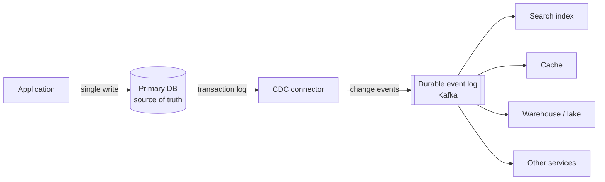

---

## 1. The Problem: Dual Writes

### 1.1 The naive design

The application commits to the database, then publishes an event (or updates a cache, or indexes a document).  
Two independent systems, two independent writes, no shared transaction.

### 1.2 Failure windows

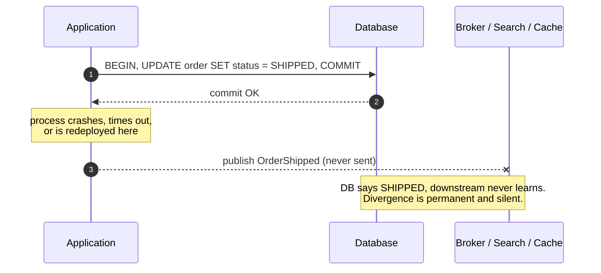

| Ordering of writes    | Failure between writes        | Result                                              |
| --------------------- | ----------------------------- | --------------------------------------------------- |
| DB first, then broker | Crash after DB commit         | Committed change, no event (lost update downstream) |
| Broker first, then DB | DB commit fails or rolls back | Event for a change that never happened (phantom)    |
| Both, in parallel     | Either fails independently    | Any mix of the above, plus reordering               |
| Both, with retries    | Retry after partial success   | Duplicates and out-of-order delivery                |

### 1.3 Why distributed transactions do not fix it

Two-phase commit (XA) across a database and a broker is theoretically correct and practically rejected:

- Most brokers, search engines and caches do not participate in XA at all.
- The coordinator is a blocking single point of failure; in-doubt transactions hold locks.
- Latency of every write becomes the latency of the slowest participant.
- Operational complexity (heuristic outcomes, recovery logs) exceeds the problem's value.

### 1.4 The CDC answer

Make the database the **only** write. Derive everything else from what the database actually committed.  
The event cannot be lost (the log is durable) and cannot be a phantom (rolled-back transactions never appear in the decoded stream).

---

## 2. What CDC Is

### 2.1 Definition

**Change Data Capture** is the practice of reading every committed insert, update and delete from a database and publishing those changes, in commit order, as an event stream that downstream systems consume.

### 2.2 Classification

| Question              | Answer                                                                                                   |
| --------------------- | -------------------------------------------------------------------------------------------------------- |
| Is it an algorithm?   | No. Implementations contain algorithms (log parsing, offset tracking, watermark-based snapshot merging). |
| Is it a tool?         | No. Tools implement it: Debezium, Flink CDC, AWS DMS, Maxwell, GoldenGate, Fivetran.                     |
| Is it an application? | No. A running deployment is infrastructure: connectors, a broker, sinks.                                 |
| What is it?           | A **data-integration pattern**, comparable to "replication" or "publish/subscribe".                      |

### 2.3 Mental model: the database turned inside out

Every serious database records changes in a log **before** applying them to tables, for crash recovery and replication.  
That log is the authoritative sequence of truth; the tables are a materialized view of it.  
CDC externalizes that internal log as a consumable stream.

Consequences:

- Any number of derived stores can be built (or rebuilt) by replaying the stream.
- Integration moves from "every writer remembers to notify every reader" to "every reader follows the log".
- Producers become ignorant of consumers; adding a sink requires no change to the writing application.

### 2.4 CDC is a capability spread across layers

CDC does not live inside one component. Remove any layer below and the guarantees collapse.

| Layer       | Responsibility                                                        | Typical provider                                                  |
| ----------- | --------------------------------------------------------------------- | ----------------------------------------------------------------- |
| Database    | Record changes durably; expose them through a logical interface       | PostgreSQL logical decoding, MySQL binlog, MongoDB change streams |
| Capture     | Read the interface, track position, convert to neutral change events  | Connector (Debezium, custom Rust daemon, DMS)                     |
| Transport   | Durable, ordered, replayable fan-out to many consumers                | Kafka, Kinesis, Pulsar                                            |
| Consumption | Apply idempotently, respect ordering scope, tolerate schema evolution | Sink connectors, services, stream processors                      |

---

## 3. Capture Methods

| Property              | Log-based                                | Trigger-based                               | Polling (query-based)                       |
| --------------------- | ---------------------------------------- | ------------------------------------------- | ------------------------------------------- |
| Mechanism             | Tail WAL / binlog / oplog                | Triggers copy each change to a shadow table | `SELECT ... WHERE updated_at > :last_seen`  |
| Source write overhead | Near zero (log is written anyway)        | High (extra write per row change)           | None on write; periodic read load           |
| Captures deletes      | Yes                                      | Yes                                         | No (hard deletes are invisible)             |
| Captures every change | Yes, including intermediate states       | Yes                                         | No (only latest state at poll time)         |
| Commit ordering       | Exact                                    | Approximate (trigger time, not commit time) | None                                        |
| Latency               | Milliseconds to seconds                  | Milliseconds to seconds                     | Poll interval                               |
| Schema changes needed | None                                     | Triggers and shadow tables                  | `updated_at` column and index               |
| Database support      | Requires log access and logical decoding | Any database with triggers                  | Any database                                |
| Verdict               | **Default choice**                       | Fallback when log access is unavailable     | Last resort; acceptable for low-stakes sync |

Log-based capture is the default because it is the only method that is simultaneously complete (deletes, intermediate states), ordered, and cheap for the source.

---

## 4. Architecture and Components

### 4.1 Pipeline anatomy

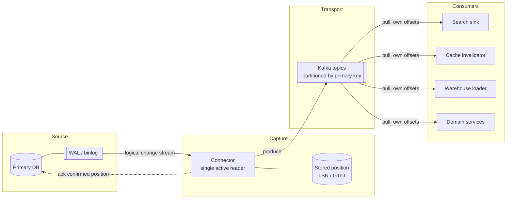

| Component | Role                                                    | Holds state?                              |
| --------- | ------------------------------------------------------- | ----------------------------------------- |
| Source DB | Truth; retains log until the reader acknowledges it     | Yes (data, log, replication slot)         |
| Connector | Reads, decodes, converts, produces, commits position    | Position and schema history, externalized |
| Event log | Buffers, fans out, retains for replay, decouples speeds | Yes (topics, consumer offsets)            |
| Consumers | Apply changes to their own stores                       | Own offsets and derived data              |

### 4.2 What a connector is

**Generic meaning:** the adapter between an external system and the event log.  
It speaks the source's native protocol, translates the source's representation into neutral events, and tracks its position so it can resume without loss.  
It contains no business logic.

**Precise meaning in Kafka Connect:**

| Term               | Physical form                                                                                    |
| ------------------ | ------------------------------------------------------------------------------------------------ |
| Connector plugin   | Code (a JAR) implementing `SourceConnector` / `SourceTask`, e.g. Debezium's PostgreSQL connector |
| Connector instance | A named, configured job: plugin + JSON config, registered through the Connect REST API           |
| Task               | Unit of execution (a thread). CDC connectors run one task per log stream                         |
| Worker             | A JVM process hosting tasks                                                                      |
| Connect cluster    | Workers that share task assignment, failover, and offset/config/status topics in Kafka           |

Minimal instance configuration:

```json
{
  "name": "orders-db-cdc",
  "config": {
    "connector.class": "io.debezium.connector.postgresql.PostgresConnector",
    "database.hostname": "orders-db.internal",
    "database.dbname": "orders",
    "plugin.name": "pgoutput",
    "slot.name": "debezium_orders",
    "publication.name": "dbz_publication",
    "table.include.list": "public.orders,public.outbox",
    "topic.prefix": "ordersdb"
  }
}
```

### 4.3 Kind of software: a daemon, not an API server

| Property         | API server                            | CDC connector                                        |
| ---------------- | ------------------------------------- | ---------------------------------------------------- |
| Who initiates    | Clients call it                       | It initiates everything (opens replication session)  |
| Lifetime of work | Per request                           | One unbounded loop                                   |
| Data path        | Request and response                  | Log in, events out; nobody calls it for data         |
| Scaling          | Horizontal replicas behind a balancer | One active reader per log stream; active-passive HA  |
| Closest analogy  | Web service                           | A database replica that forwards instead of applying |

The Kafka Connect worker exposes a REST API, but only for management (create, pause, restart, status). Data never flows through it.

### 4.4 The core loop

```text
on start:
    position = load_committed_position()          # durable storage
    if position is None:
        position = run_snapshot()                 # consistent initial state

    stream = db.open_replication(slot, from = position)

loop forever:
    changes = stream.read_batch()                 # blocks until changes arrive
    events  = [to_event(c) for c in changes]      # envelope, schema, topic, key
    log.produce(events)
    log.wait_for_ack()                            # durable on brokers
    save_committed_position(changes.last_pos)     # own progress
    stream.ack(changes.last_pos)                  # let the DB recycle log
```

Four responsibilities, not three: **fetch, transform, write to the durable log, commit position**. The fourth is what makes the first three correct.

### 4.5 Packaging options

| Runtime            | Shape                                                                                     | Who owns offsets and failover     | Typical fit                                  |
| ------------------ | ----------------------------------------------------------------------------------------- | --------------------------------- | -------------------------------------------- |
| Kafka Connect      | Plugin inside a distributed worker cluster                                                | Connect framework (Kafka topics)  | Standard Kafka-centric platforms             |
| Debezium Server    | Standalone process, sinks to Kinesis, Pub/Sub, Pulsar                                     | The server (file or store-backed) | Kafka-less environments                      |
| Debezium Engine    | Library embedded in your JVM service                                                      | You                               | In-process reactions, custom sinks           |
| Flink CDC          | Source operator inside a Flink job                                                        | Flink checkpoints                 | Capture plus heavy stream processing         |
| Database-native    | DynamoDB Streams, MongoDB change streams, CockroachDB changefeeds, Spanner change streams | The database                      | Engines that expose logical streams directly |
| Managed service    | AWS DMS, Google Datastream, Fivetran, Airbyte                                             | The vendor                        | Warehouse ingestion, migrations              |
| Custom (e.g. Rust) | Your own daemon against the replication protocol                                          | You                               | Specialized throughput, latency, footprint   |

---

## 5. Database Internals

### 5.1 Why consumers never read the raw log

Raw PostgreSQL WAL is **physical**: binary, page-level modifications ("bytes X to Y of page N changed"), internal to the storage engine and version-specific.  
Even where the log is logical (MySQL row binlog), direct consumption by many readers is harmful:

| Problem with direct log consumers       | Effect                                                          |
| --------------------------------------- | --------------------------------------------------------------- |
| One replication slot per reader         | Each slot pins WAL; one slow reader can fill the primary's disk |
| Decoding runs on the primary per reader | CPU cost multiplies with consumer count                         |
| Slot count is bounded                   | `max_replication_slots` caps the number of readers              |
| Short, recovery-oriented retention      | No multi-day replay or full rebuild                             |
| Format coupling                         | Every consumer binds to a database-specific protocol            |

One connector feeding Kafka converts this into one slot, one decode, unlimited independent consumers, long retention.

### 5.2 PostgreSQL: logical decoding

**Prerequisites (control plane):**

| Setting / object                           | Purpose                                                                    |
| ------------------------------------------ | -------------------------------------------------------------------------- |
| `wal_level = logical`                      | WAL carries enough information for logical decoding                        |
| `max_replication_slots`, `max_wal_senders` | Capacity for replication sessions                                          |
| Role with `REPLICATION`                    | Permission to open replication connections                                 |
| `CREATE PUBLICATION`                       | Which tables are captured                                                  |
| Replication slot                           | Server-side record of the consumer's confirmed position; retains WAL       |
| `REPLICA IDENTITY`                         | `DEFAULT` sends only key columns in old images; `FULL` sends whole old row |
| `max_slot_wal_keep_size` (13+)             | Caps WAL retained for a lagging slot; protects primary disk                |

**Data path:**

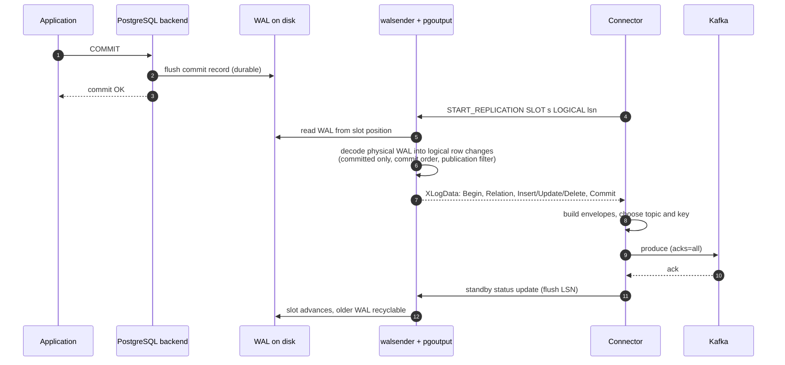

Decoding happens **inside the database** (walsender running the output plugin).  
The connector receives logical changes, not raw pages.

| Output plugin | Notes                                                                            |
| ------------- | -------------------------------------------------------------------------------- |
| `pgoutput`    | Built in since PostgreSQL 10; used by native logical replication; default choice |
| `wal2json`    | Extension emitting JSON; convenient for ad-hoc tooling                           |
| `decoderbufs` | Protobuf output; used historically by Debezium                                   |

Version milestones relevant to CDC:

| Version | Capability                                                                 |
| ------- | -------------------------------------------------------------------------- |
| 10      | Native logical replication, `pgoutput`, publications                       |
| 13      | `max_slot_wal_keep_size`                                                   |
| 14      | Streaming of large in-progress transactions (protocol v2), binary transfer |
| 16      | Logical decoding on standbys (offload decode from the primary)             |
| 17      | Failover slots: logical slots synchronized to standbys, survive promotion  |

### 5.3 MySQL: row-based binlog

| Requirement / concept     | Purpose                                                                                                                          |
| ------------------------- | -------------------------------------------------------------------------------------------------------------------------------- |
| `binlog_format = ROW`     | Binlog records row images, not SQL statements                                                                                    |
| `binlog_row_image = FULL` | Complete before and after images                                                                                                 |
| GTIDs                     | Position survives failover to a replica with the same transaction history                                                        |
| Binlog retention          | Hard limit: a connector lagging past expiry must re-snapshot                                                                     |
| Schema history            | Binlog rows lack full column metadata; the connector records every DDL to interpret rows against the schema at that log position |

The connector registers as a replica (binlog dump protocol) and **decodes in the connector**, unlike PostgreSQL where decoding is server-side.

### 5.4 Other engines

| Engine      | Interface                   | Position token      | Notes                                       |
| ----------- | --------------------------- | ------------------- | ------------------------------------------- |
| MongoDB     | Change streams over oplog   | Resume token        | Requires replica set or sharded cluster     |
| DynamoDB    | DynamoDB Streams            | Shard iterator      | 24-hour retention, per-item ordering        |
| SQL Server  | CDC feature (change tables) | LSN                 | Agent job populates change tables           |
| Oracle      | LogMiner / XStream          | SCN                 | Licensing and supplemental logging required |
| CockroachDB | Changefeeds                 | Resolved timestamps | Emits directly to Kafka, no separate reader |

### 5.5 The change event envelope

| Field    | Content                                                                               |
| -------- | ------------------------------------------------------------------------------------- |
| `op`     | `c` create, `u` update, `d` delete, `r` snapshot read, `t` truncate                   |
| `before` | Row image before the change (null for inserts; key-only or full per replica identity) |
| `after`  | Row image after the change (null for deletes)                                         |
| `source` | Database, schema, table, log position (LSN / GTID), transaction id, commit time       |
| `ts_ms`  | Time the connector processed the event                                                |

```json
{
  "op": "u",
  "before": { "id": 42, "status": "PACKED" },
  "after":  { "id": 42, "status": "SHIPPED" },
  "source": {
    "db": "orders", "schema": "public", "table": "orders",
    "lsn": 24023128, "txId": 5810, "ts_ms": 1761206400000
  },
  "ts_ms": 1761206400112
}
```

These are **physical events** ("row 42 changed column `status`"), not **domain events** ("OrderShipped").  
That distinction drives the outbox pattern in section 7.

---

## 6. Correctness Guarantees

### 6.1 The acknowledgment chain

Each layer releases data only after the next layer confirms durable receipt.

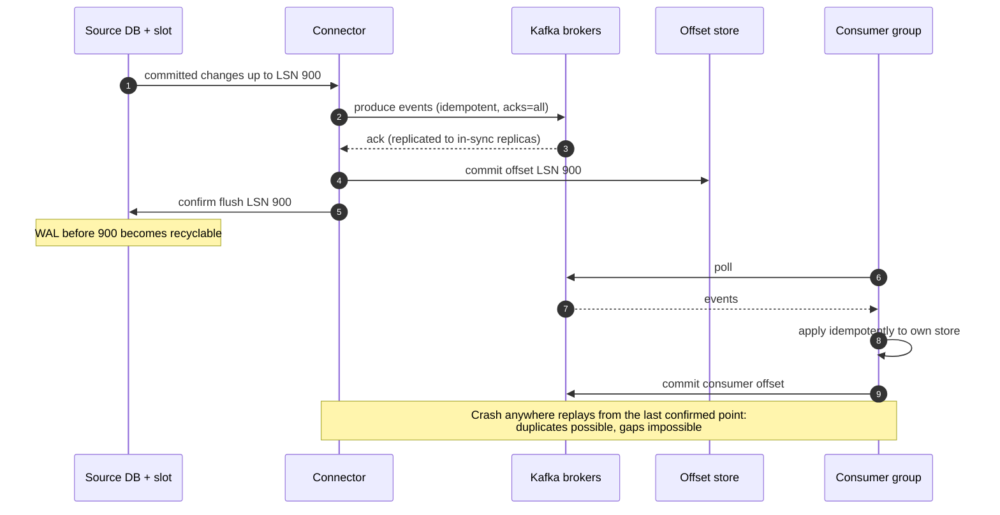

| Layer            | Tracks                               | Guarantee                                                                     |
| ---------------- | ------------------------------------ | ----------------------------------------------------------------------------- |
| Replication slot | `confirmed_flush_lsn`                | WAL not recycled until acknowledged; nothing lost while the connector is down |
| Connector        | Offset in Connect offsets topic      | Advances only after Kafka acks the produced events                            |
| Kafka            | Replicated partition logs            | Survives broker failure; retention or compaction enables replay               |
| Connect cluster  | Task assignment, worker liveness     | Failed tasks rebalanced and resumed from stored offsets                       |
| Consumer group   | Committed offsets per partition      | Each consumer progresses independently                                        |
| Schema registry  | Schema versions, compatibility rules | Incompatible changes rejected before they reach consumers                     |

### 6.2 Delivery semantics

- **At-least-once is the baseline.** A crash between "Kafka acked" and "offset committed" replays already-delivered events.
- Kafka Connect supports exactly-once delivery for source connectors (KIP-618, Kafka 3.3+), with connector-specific support.  
  End-to-end correctness still requires idempotent sinks, because the sink's own writes are outside Kafka's transaction.

| Idempotency technique | Mechanism                                                     | Fits                                     |
| --------------------- | ------------------------------------------------------------- | ---------------------------------------- |
| Upsert by primary key | Last write wins; replays converge                             | Search indexes, caches, replicas         |
| Version / LSN guard   | Apply only if incoming LSN is greater than stored LSN         | Any store that can hold a version column |
| Processed-event table | Record event id in the same transaction as the side effect    | Payments, notifications, side effects    |
| Natural idempotence   | Operation is idempotent by nature (set status, delete by key) | Simple projections                       |

### 6.3 Ordering

| Scope                     | Guaranteed?             | Mechanism                                                |
| ------------------------- | ----------------------- | -------------------------------------------------------- |
| Single row                | Yes                     | Commit order + partitioning by primary key               |
| Single table, across rows | No                      | Rows hash to different partitions                        |
| Single transaction        | Reconstructable         | Transaction metadata topic (BEGIN/END with event counts) |
| Whole database            | Only with one partition | Caps throughput; rarely acceptable                       |

### 6.4 The snapshot problem

The log has limited retention, so a new consumer cannot reconstruct full state from the log alone.  
It needs **existing rows plus every change after them**, merged without gaps and without letting a stale snapshot row overwrite a newer change.

| Strategy                                | Mechanism                                                                                          | Cost                                   |
| --------------------------------------- | -------------------------------------------------------------------------------------------------- | -------------------------------------- |
| Locked snapshot                         | Lock, read all, record log position, unlock, stream from position                                  | Blocks writes on large tables          |
| Exported snapshot (PostgreSQL)          | Slot creation exports an MVCC snapshot; read tables inside it; stream from slot's consistent point | Long-running transaction on the source |
| Watermark (DBLog, Debezium incremental) | Chunked reads interleaved with live log; conflicting rows dropped                                  | No locks; pausable; resumable          |

**Watermark algorithm (per chunk):**

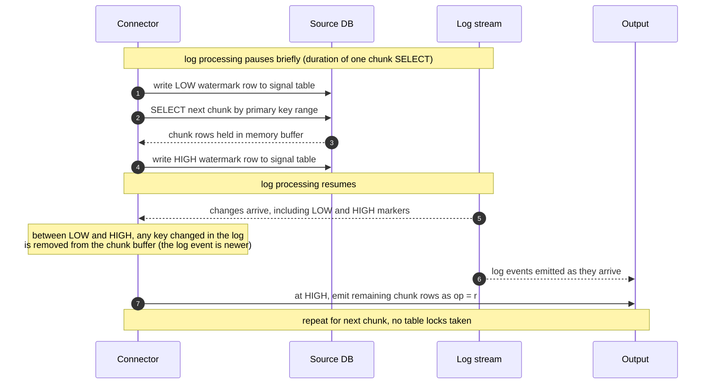

### 6.5 Deletes, tombstones, compaction

- A delete emits a `d` event, followed by a **tombstone** (key with null value).
- With Kafka **log compaction**, a topic retains the latest value per key and eventually drops keys whose last record is a tombstone.
- A compacted CDC topic is therefore a replayable snapshot of current table state: new consumers bootstrap from Kafka without touching the source database.

---

## 7. Transactional Outbox

### 7.1 Why plain table CDC is not enough for business events

| Aspect          | Table CDC (physical events)              | Outbox CDC (domain events)                 |
| --------------- | ---------------------------------------- | ------------------------------------------ |
| Event meaning   | "Row changed"                            | "OrderShipped", "PaymentSettled"           |
| Contract        | Internal table schema leaks to consumers | Deliberate, versioned event schema         |
| Schema freedom  | Renaming a column breaks consumers       | Tables refactor freely behind the contract |
| Business intent | Must be inferred from diffs              | Explicit in the event type and payload     |
| Volume          | Every column change on wide tables       | Only events the service chooses to publish |

### 7.2 Mechanics

1. The service writes business rows **and** an outbox row in **one local transaction**.
2. CDC captures only the `outbox` table.
3. An event router (Debezium's outbox event router SMT, or custom logic) maps each outbox row to a topic by aggregate type, keyed by aggregate id.
4. The outbox row can be deleted in the same transaction or immediately after: the insert is already in the log, so the table stays near-empty.

```sql
CREATE TABLE outbox (
    id             UUID         PRIMARY KEY,
    aggregate_type VARCHAR(64)  NOT NULL,   -- routes to topic, e.g. "order"
    aggregate_id   VARCHAR(64)  NOT NULL,   -- Kafka key, preserves per-aggregate order
    event_type     VARCHAR(128) NOT NULL,   -- e.g. "OrderShipped"
    payload        JSONB        NOT NULL,
    created_at     TIMESTAMPTZ  NOT NULL DEFAULT now()
);
```

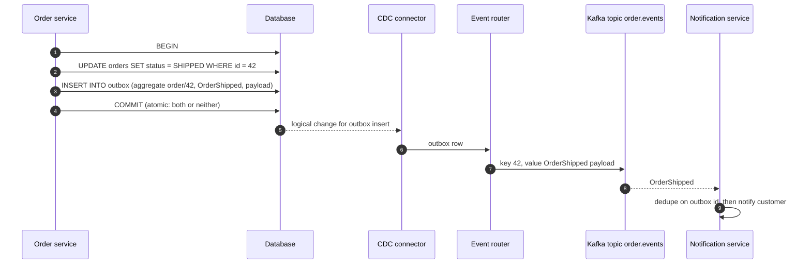

### 7.3 Properties

- **Atomicity**: state change and event publication commit together.
- **No dual write**: the service never talks to Kafka.
- **Ordering per aggregate**: key = aggregate id.
- **Idempotent consumers** still required: the outbox `id` is the natural deduplication key.
- **Alternative without a table (PostgreSQL)**: `pg_logical_emit_message()` writes a transactional message directly into WAL, consumed by the connector as an `M` message. No outbox table at all.

---

## 8. CDC Compared with Adjacent Approaches

| Dimension             | CDC                              | Batch ETL                       | Native replication   | Event sourcing                         | App-level publishing     |
| --------------------- | -------------------------------- | ------------------------------- | -------------------- | -------------------------------------- | ------------------------ |
| Source of truth       | Database state                   | Database state                  | Database state       | Event log                              | Database state           |
| Latency               | Milliseconds to seconds          | Hours                           | Milliseconds         | Milliseconds                           | Milliseconds             |
| Captures every change | Yes                              | No (snapshot diffs)             | Yes                  | Yes (by construction)                  | Only what code remembers |
| Consistency risk      | Low (derived from commits)       | Low, but stale                  | Low                  | Low                                    | High (dual write)        |
| Target                | Any system                       | Warehouse                       | Same database engine | Any projection                         | Any system               |
| Event semantics       | Physical (or domain via outbox)  | None                            | None (internal)      | Domain                                 | Domain                   |
| Retrofit cost         | Low: no app change for table CDC | Low                             | Low                  | Very high: application redesign        | Medium, and fragile      |
| Main weakness         | Ops load, async lag              | Staleness, missed intermediates | Homogeneous only     | Complexity, schema evolution of events | Inconsistency on failure |

**Positioning:** CDC gives most of event sourcing's integration benefits (replayable history, decoupled consumers) without the event-sourcing programming model.  
Outbox plus CDC closes the remaining gap (domain semantics).

---

## 9. Reliability at Enterprise Scale

### 9.1 Production evidence

| Organization / product | System                    | Use                                                                                           |
| ---------------------- | ------------------------- | --------------------------------------------------------------------------------------------- |
| LinkedIn               | Databus                   | Early large-scale CDC feeding search, caches, social graph                                    |
| Netflix                | DBLog                     | Watermark-based CDC syncing MySQL / PostgreSQL to search and analytics for many microservices |
| Airbnb                 | SpinalTap                 | General-purpose CDC service streaming database mutations to Kafka                             |
| Shopify                | Debezium on sharded MySQL | Per-shard connectors into Kafka                                                               |
| Banks, telcos          | Oracle GoldenGate         | Decades of log-based replication in revenue-critical paths                                    |

The capture mechanism is the same one databases use for their own replicas.  
The mechanism is not the weak point; operations and design around it are.

### 9.2 Guarantees

| Property                                        | Provided? | Condition                                              |
| ----------------------------------------------- | --------- | ------------------------------------------------------ |
| No lost committed changes                       | Yes       | Position acknowledged only after downstream durability |
| No phantom events from rolled-back transactions | Yes       | Only committed transactions are decoded                |
| Per-row ordering                                | Yes       | Key = primary key, idempotent producer                 |
| Exactly-once end to end                         | No        | At-least-once plus idempotent sinks                    |
| Cross-entity / global ordering at scale         | No        | Requires single partition                              |
| Synchronous consistency with derived stores     | Never     | Pipeline is asynchronous by design                     |

### 9.3 Strain points at high volume

| Strain point             | Mechanism of failure                                                 | Mitigation                                                               |
| ------------------------ | -------------------------------------------------------------------- | ------------------------------------------------------------------------ |
| Single reader per stream | Decode + serialize is single-threaded; throughput ceiling per stream | Shard capture: one connector per DB shard or table group                 |
| Decode load on primary   | PostgreSQL decodes inside the primary, once per slot                 | Fewer slots; decode on standby (PostgreSQL 16+); MySQL replica as source |
| WAL amplification        | `REPLICA IDENTITY FULL` logs whole old rows                          | Use `FULL` only where full before-images are required                    |
| Large transactions       | Millions of rows arrive as one burst after commit                    | Batch bulk jobs; streaming in-progress transactions (protocol v2)        |
| Slot lag                 | Downstream stall pins WAL on the primary until disk fills            | `max_slot_wal_keep_size`; page on lag; Kafka as buffer                   |
| Database failover        | Slot or binlog position lost on promotion                            | PostgreSQL 17 failover slots; MySQL GTIDs; tested re-snapshot runbook    |
| Schema changes           | DDL breaks consumers bound to table structure                        | Schema registry compatibility; outbox contracts; tolerant readers        |
| Huge snapshots           | Billions of rows compete with production for hours                   | Chunked watermark snapshots, run against a replica                       |
| Hot keys                 | One entity saturates one partition                                   | Revisit keying; split hot aggregates; accept per-key ceiling             |

### 9.4 Hardening checklist

- [ ] Capture sharded so each stream's throughput is well below its ceiling.
- [ ] `max_slot_wal_keep_size` set: a broken stream is preferable to a dead primary.
- [ ] Kafka: replication factor 3, `min.insync.replicas = 2`, producer `acks = all`, idempotence on.
- [ ] Retention long enough to cover the longest tolerated consumer outage plus replay.
- [ ] Outbox for business-critical events; table CDC for replication-style sinks.
- [ ] Every consumer idempotent by design and tested with duplicate injection.
- [ ] Reconciliation jobs (counts, checksums) between source and each sink.
- [ ] Runbooks rehearsed: connector failover, DB failover, slot recreation, re-snapshot, schema rollout.

### 9.5 Monitoring

| Metric                  | Source                                                       | Why it matters               | Alert example               |
| ----------------------- | ------------------------------------------------------------ | ---------------------------- | --------------------------- |
| Slot lag (bytes)        | `pg_wal_lsn_diff(pg_current_wal_lsn(), confirmed_flush_lsn)` | Disk exposure on the primary | > 20% of free WAL disk      |
| Slot active             | `pg_replication_slots.active`                                | Reader disconnected          | false for > 5 min           |
| Source-to-connector lag | `MilliSecondsBehindSource` (Debezium)                        | Capture freshness            | > 60 s sustained            |
| End-to-end freshness    | Commit timestamp vs sink apply time                          | User-visible staleness       | > SLO (e.g. 30 s p99)       |
| Consumer lag            | Consumer group offset lag per partition                      | Sink health                  | Growing for > 10 min        |
| DLQ volume              | Dead-letter topic message rate                               | Poison events, schema breaks | Any non-zero sustained rate |
| Reconciliation drift    | Periodic count / checksum comparison                         | Silent divergence            | Any mismatch                |

### 9.6 When CDC is the wrong tool

| Requirement                                           | Why CDC fails it                             | Use instead                                    |
| ----------------------------------------------------- | -------------------------------------------- | ---------------------------------------------- |
| Read-your-own-writes on a derived store               | Asynchronous propagation; derived store lags | Read from primary, or design UI around lag     |
| Hard real-time, millisecond end-to-end guarantees     | Multiple hops, batching, broker latency      | In-process or synchronous paths                |
| Global transactional ordering at high throughput      | Partitioning gives per-key order only        | Single-writer designs, ordered logs per domain |
| Business meaning not visible in row diffs             | Physical events lack intent                  | Outbox or explicit domain events               |
| No log access, low change volume, tolerable staleness | Operational cost exceeds value               | Polling or batch ETL                           |

---

## 10. Use Cases

| Use case                                | Why CDC                                                           | Typical sink                      | Caveat                                              |
| --------------------------------------- | ----------------------------------------------------------------- | --------------------------------- | --------------------------------------------------- |
| Search index synchronization            | Index follows commits without dual writes                         | Elasticsearch, OpenSearch         | Denormalized documents need joins or enrichment     |
| Cache invalidation / refresh            | Evict exactly what changed, when it changed                       | Redis, Memcached                  | Short stale window remains                          |
| Warehouse / lake replication            | Near-real-time analytics instead of nightly dumps                 | Snowflake, BigQuery, Iceberg      | Merge/upsert cost in columnar stores                |
| Reliable microservice events            | Outbox: atomic state change plus publish                          | Kafka topics per aggregate        | Consumers must deduplicate                          |
| CQRS read models, materialized views    | Read-optimized projections derived from write store               | Any query store                   | Eventual consistency on reads                       |
| Zero-downtime database migration        | Snapshot plus continuous sync, then cutover                       | New database                      | Cutover and rollback must be rehearsed (section 11) |
| Cross-region / cross-engine replication | Heterogeneous targets that native replication cannot reach        | Remote DB of another engine       | Conflict handling if both sides write               |
| Audit trail and compliance history      | Immutable row-level history with before/after images              | Append-only store, object storage | Retention and PII governance                        |
| Event-driven workflows                  | State changes trigger notifications, billing, fulfillment         | Workflow engines, services        | Physical events need mapping to intent              |
| Monolith decomposition (strangler fig)  | New services receive monolith data without touching monolith code | New service databases             | Temporary coupling to monolith schema               |
| Fraud and anomaly detection             | Stream processors react to changes within seconds                 | Flink, Kafka Streams              | Requires enrichment and windowing                   |
| ML feature store freshness              | Online features updated from transactional data                   | Feature store (online tier)       | Point-in-time correctness for training sets         |
| SaaS / CRM propagation                  | Push customer and account changes to external tools               | CRM, marketing platforms          | Third-party API rate limits                         |
| Replay, backfill, rebuild               | Recreate any derived store from compacted topics or re-snapshot   | Any                               | Replay throughput and idempotency                   |

---

## 11. Case Study: Zero-Downtime Database Migration

### 11.1 Scenario

| Attribute         | Value                                                                                                                  |
| ----------------- | ---------------------------------------------------------------------------------------------------------------------- |
| Source            | Self-managed MySQL 8.0, primary + 2 replicas, GTIDs enabled                                                            |
| Target            | Managed PostgreSQL 17                                                                                                  |
| Data size         | ~1.5 TB across 120 tables; largest table ~600 M rows                                                                   |
| Write load        | ~8,000 row changes/s at peak                                                                                           |
| Availability goal | Reads available throughout; write pause at cutover ≤ 30 s                                                              |
| Rollback goal     | Return to MySQL within minutes, at any time during a 72 h observation window                                           |
| Why heterogeneous | Exercises type mapping, schema translation, dialect changes and reverse sync; a same-engine upgrade is a strict subset |

### 11.2 What "zero downtime" means precisely

| Interpretation                 | Reads            | Writes                                | Cost                                                   |
| ------------------------------ | ---------------- | ------------------------------------- | ------------------------------------------------------ |
| Brief write freeze (this plan) | Always available | Paused for seconds at cutover         | Simple, deterministic, verifiable                      |
| Buffered writes during freeze  | Always available | Accepted, held and retried by the app | Clients see latency, not errors; retry logic required  |
| True zero write pause          | Always available | Never paused                          | Bidirectional sync with conflict resolution; high risk |

Bidirectional active-active writing during migration requires conflict resolution and loop prevention.  
The freeze-based approach avoids both and is the industry default.

### 11.3 Architecture

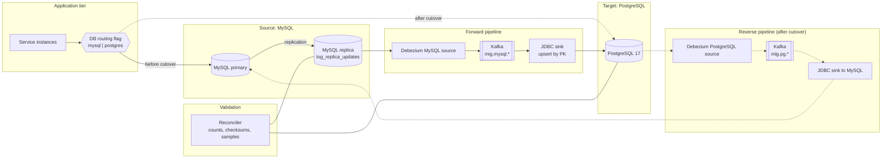

Design decisions:

- Capture from a **replica** with `log_replica_updates = ON` and GTIDs: snapshot and binlog reading load stays off the primary; GTIDs keep the position valid if the replica topology changes.
- **Kafka between source and target**: the target can be paused, rebuilt or re-applied without touching MySQL; the topic retains history for replay.
- **Reverse pipeline** prepared before cutover and activated at cutover: it is the rollback mechanism.
- **Routing flag in the data-access layer**: a heterogeneous migration requires dialect-specific queries, so the application must already be able to run against both engines.  
  A network proxy cannot translate MySQL to PostgreSQL.

### 11.4 Timeline

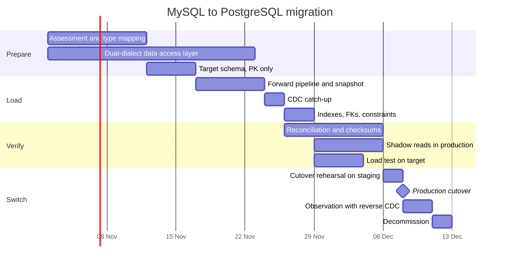

### 11.5 Phase 1: Assessment

| Check                               | Why it matters for CDC migration                                                     |
| ----------------------------------- | ------------------------------------------------------------------------------------ |
| Every table has a primary key       | Upsert-by-key and idempotent apply depend on it; add surrogate keys where missing    |
| Data types and edge values          | Zero dates, unsigned overflow, ENUM/SET, charset and collation behavior              |
| Triggers, stored procedures, events | Must be ported or deliberately dropped; triggers on target must not double-apply     |
| Generated / computed columns        | Recompute on target or exclude from capture                                          |
| Auto-increment usage                | Sequences on target must be reset above source maximums before cutover               |
| Write rate and largest transactions | Sizes Kafka partitions, sink parallelism and snapshot chunking                       |
| Application SQL dialect             | `ON DUPLICATE KEY UPDATE`, backticks, implicit casts, loose `GROUP BY`, `LIMIT a, b` |
| Binlog retention                    | Must exceed snapshot duration plus a safety margin                                   |

**Type mapping:**

| MySQL                        | PostgreSQL                       | Notes                                                                                           |
| ---------------------------- | -------------------------------- | ----------------------------------------------------------------------------------------------- |
| `TINYINT(1)`                 | `BOOLEAN` or `SMALLINT`          | Only `BOOLEAN` if used strictly as a flag                                                       |
| `INT UNSIGNED`               | `BIGINT`                         | Unsigned range exceeds `INTEGER`                                                                |
| `BIGINT UNSIGNED`            | `NUMERIC(20)`                    | No unsigned 64-bit type in PostgreSQL                                                           |
| `DECIMAL(p,s)`               | `NUMERIC(p,s)`                   | Exact                                                                                           |
| `FLOAT` / `DOUBLE`           | `REAL` / `DOUBLE PRECISION`      | Compare with tolerance during validation                                                        |
| `DATETIME`                   | `TIMESTAMP`                      | No time zone in either                                                                          |
| `TIMESTAMP`                  | `TIMESTAMPTZ`                    | MySQL stores UTC and converts by session time zone                                              |
| `'0000-00-00'` dates         | `NULL`                           | Invalid in PostgreSQL; decide and document the rule                                             |
| `VARCHAR` / `TEXT` (utf8mb4) | `VARCHAR` / `TEXT` (UTF8)        | Case-insensitive collations need ICU nondeterministic collation, `citext`, or `lower()` indexes |
| `BLOB` family                | `BYTEA`                          |                                                                                                 |
| `JSON`                       | `JSONB`                          | Key order and duplicate keys normalize in `JSONB`                                               |
| `ENUM`                       | `TEXT` + `CHECK`, or `ENUM` type | `TEXT` + `CHECK` is easier to evolve                                                            |
| `SET`                        | `TEXT[]`                         | Application parsing changes                                                                     |
| `YEAR`                       | `SMALLINT`                       |                                                                                                 |
| `AUTO_INCREMENT`             | `GENERATED ... AS IDENTITY`      | Reset with `setval` before cutover                                                              |

### 11.6 Phase 2: Target preparation

1. Create tables with **primary keys only**. Secondary indexes, foreign keys and triggers slow bulk load and can reject out-of-order arrivals (a child row applied before its parent across partitions).
2. Configure the sink for **upsert by primary key** and **delete on tombstone/`d`**, so replays converge.
3. Create the reverse-pipeline objects in advance (publication on PostgreSQL, sink config for MySQL) but do not start them.

### 11.7 Phase 3: Initial snapshot

| Option                               | Mechanism                                                                                | When to use                                               |
| ------------------------------------ | ---------------------------------------------------------------------------------------- | --------------------------------------------------------- |
| Connector snapshot (incremental)     | Chunked, watermark-based reads by PK while binlog streaming runs                         | Default; resumable, no long locks                         |
| Bulk export plus CDC from a position | Consistent dump at a known GTID set, bulk `COPY` into PostgreSQL, CDC from that GTID set | Very large tables where row-by-row sink apply is too slow |

Either way, the handoff rule is the same: the stream must start exactly at the position the snapshot represents, and the apply must be idempotent so overlap is harmless.

### 11.8 Phase 4: CDC catch-up and steady state

- Lag decreases from hours (snapshot duration) to seconds.
- Once steady, finish the target:
  - `CREATE INDEX CONCURRENTLY` for secondary indexes.
  - Foreign keys added `NOT VALID`, then `VALIDATE CONSTRAINT` (no long exclusive lock).
  - Port triggers and functions; keep them disabled for replicated writes if they would double-apply.
  - `ANALYZE` all tables.
- Steady state is held for days, not hours: validation and shadow reads need production traffic.

### 11.9 Phase 5: Validation

| Layer                | Method                                                                               | Catches                                       |
| -------------------- | ------------------------------------------------------------------------------------ | --------------------------------------------- |
| Row counts           | Per table, at the same GTID / LSN watermark                                          | Missing or extra rows                         |
| Chunked checksums    | Hash of canonicalized row values per PK range; drill into mismatching chunks         | Value drift, conversion bugs                  |
| Sampled deep compare | Random rows compared field by field with type-aware equality                         | Precision, time zone, collation, JSON issues  |
| Shadow reads         | Application reads from both for a sample of requests, serves MySQL, logs differences | Query-level dialect and semantics differences |
| Load test            | Replay captured production queries against PostgreSQL                                | Missing indexes, plan regressions             |

Canonicalization is mandatory for cross-engine checksums: normalize numerics (scale), timestamps (UTC, precision), booleans, JSON (sorted keys), and text (no trailing-space surprises) before hashing.

### 11.10 Phase 6: Cutover

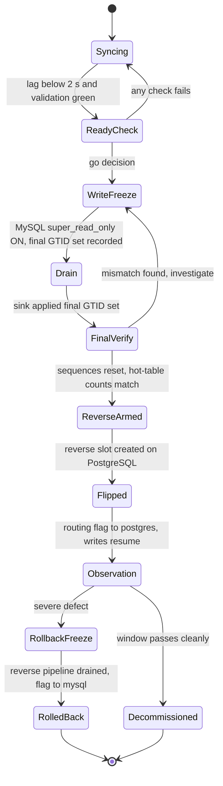

Ordering constraints that make the cutover lossless:

1. **Freeze before drain.** With MySQL read-only, the final GTID set is fixed; the target can provably catch up to it.
2. **Drain to a position, not to a feeling.** Cutover proceeds only when the sink has applied the event carrying the final GTID, not when lag "looks like zero".
3. **Reset sequences while frozen.** `setval` every identity sequence above the source maximum, or the first insert on PostgreSQL collides.
4. **Create the reverse slot before writes resume.** The slot's consistent point precedes the first PostgreSQL write, so the reverse pipeline cannot miss anything.
5. **Flip, then unfreeze.** Writes resume only against PostgreSQL. The freeze window is steps 1 through 5: seconds when lag was already near zero.

### 11.11 Phase 7: Rollback window

- The reverse pipeline (PostgreSQL → Kafka → MySQL) keeps MySQL current with every write made after cutover.
- Rollback is the same procedure mirrored: freeze PostgreSQL writes, drain the reverse pipeline to its final LSN, flip the flag to MySQL, unfreeze.
- Rollback must be rehearsed in staging with the same rigor as the forward cutover. An untested rollback is not a rollback.

### 11.12 Phase 8: Decommission

1. Stop the reverse pipeline; drop its replication slot (an abandoned slot pins WAL forever).
2. Stop the forward pipeline; delete migration topics after a retention grace period.
3. Remove the MySQL code paths and the routing flag.
4. Archive a final MySQL backup; retire the hosts.

### 11.13 Risks and mitigations

| Risk                                       | Impact                                    | Mitigation                                                          |
| ------------------------------------------ | ----------------------------------------- | ------------------------------------------------------------------- |
| Lag spikes at cutover time                 | Freeze window grows                       | Cut over at low traffic; go only when lag is below threshold        |
| Type conversion drift                      | Silent data corruption                    | Explicit mapping table; canonical checksums; sampled deep compare   |
| Sequence collisions after flip             | Insert failures immediately after cutover | `setval` above source max plus margin, verified in the runbook      |
| Triggers firing on replicated writes       | Double-applied side effects               | Disable or guard triggers for the replication role until cutover    |
| DDL on source during migration             | Pipeline break or schema drift            | Schema freeze for the migration window; DDL through a reviewed path |
| Binlog purged before snapshot completes    | Forced restart of snapshot                | Retention sized above snapshot duration; monitor connector position |
| Out-of-order parent/child apply            | FK violations on target                   | Defer FKs until steady state; key related tables consistently       |
| Long-running transactions on source        | Delayed visibility, cutover blocked       | Kill or wait for long transactions before freeze                    |
| Collation and case sensitivity differences | Uniqueness and lookup behavior changes    | Audit unique indexes on text; choose collation deliberately         |
| Large BLOB / TEXT columns                  | Sink throughput collapse                  | Larger batches; bulk path for those tables                          |
| Reverse pipeline untested                  | Rollback impossible when needed           | Full rollback rehearsal in staging                                  |

### 11.14 Cutover runbook

**T-7 days**

- [ ] Forward pipeline in steady state; lag p99 below 2 s for 72 h.
- [ ] Reconciliation green for all tables; zero unexplained shadow-read mismatches.
- [ ] Load test on PostgreSQL meets latency SLOs.
- [ ] Full cutover and rollback rehearsed on staging, timings recorded.

**T-1 day**

- [ ] Schema change freeze on the source in effect.
- [ ] Reverse pipeline configuration deployed, stopped.
- [ ] On-call roster, communication channel, go/no-go owner confirmed.

**T-0 (cutover)**

- [ ] Lag below threshold; no long-running transactions on source.
- [ ] Application switched to write-buffering mode (or maintenance response for writes).
- [ ] `SET GLOBAL super_read_only = ON` on MySQL; record `gtid_executed`.
- [ ] Wait for sink to apply the final GTID set.
- [ ] Hot-table counts match; sequences reset.
- [ ] Reverse replication slot created on PostgreSQL.
- [ ] Routing flag to `postgres`; writes resume; error rates and latency watched.
- [ ] Reverse pipeline started; MySQL receiving PostgreSQL writes.

**T+ (observation)**

- [ ] Reverse lag, error budgets and reconciliation monitored for the full window.
- [ ] Go/no-go for decommission recorded.

---

## 12. Building a CDC Connector in Rust

### 12.1 Scope

PostgreSQL → Kafka only. Every source engine has its own protocol; a "generic" connector is several connectors behind one interface.  
Generalize after one works end to end.

Goals: no lost committed change, per-row order, bounded memory, restart without operator action, observable lag.

### 12.2 Required knowledge

**A. Control plane (one-time setup):** `wal_level = logical`, a `REPLICATION` role with `SELECT` on captured tables, a publication, `REPLICA IDENTITY` choices, `max_slot_wal_keep_size` (section 5.2).

**B. Replication protocol (data plane):**

| Step            | Command / message                                                                            |
| --------------- | -------------------------------------------------------------------------------------------- |
| Connect         | Startup parameter `replication=database`                                                     |
| Create slot     | `CREATE_REPLICATION_SLOT <slot> LOGICAL pgoutput` with an exported snapshot                  |
| Start streaming | `START_REPLICATION SLOT <slot> LOGICAL <lsn> (proto_version '1', publication_names '<pub>')` |
| Server → client | `XLogData` (WAL start, WAL end, send time, payload)                                          |
| Server → client | Primary keepalive (WAL end, time, reply-requested flag)                                      |
| Client → server | Standby status update (write, flush, apply LSN, time)                                        |
| Liveness rule   | No status update within `wal_sender_timeout` (default 60 s) ends the session                 |

**C. pgoutput messages:**

| Tag | Message  | Contents                                                                                         |
| --- | -------- | ------------------------------------------------------------------------------------------------ |
| `B` | Begin    | Final LSN of the transaction, commit timestamp, xid                                              |
| `R` | Relation | Table OID, schema, name, replica identity, columns (name, type OID, key flag); re-sent after DDL |
| `Y` | Type     | Custom type metadata                                                                             |
| `I` | Insert   | Relation OID, new tuple                                                                          |
| `U` | Update   | Relation OID, optional old key (`K`) or old tuple (`O`), new tuple (`N`)                         |
| `D` | Delete   | Relation OID, old key (`K`) or old tuple (`O`)                                                   |
| `T` | Truncate | Relation OIDs, options                                                                           |
| `C` | Commit   | Flags, commit LSN, **end LSN**, commit timestamp                                                 |
| `M` | Message  | Prefix and content from `pg_logical_emit_message()`                                              |

**D. Tuple column markers:**

| Marker | Meaning                                                                                                                  |
| ------ | ------------------------------------------------------------------------------------------------------------------------ |
| `n`    | NULL                                                                                                                     |
| `t`    | Text-formatted value follows                                                                                             |
| `b`    | Binary-formatted value follows (binary option, PostgreSQL 14+)                                                           |
| `u`    | Unchanged TOASTed value, **not sent**. Merge from cache, require `REPLICA IDENTITY FULL`, or mark as absent in the event |

**E. Position semantics:**

- Protocol v1 delivers only committed transactions, whole, in commit order.
- The position to acknowledge is the **commit end LSN** of the last transaction fully durable in Kafka.
- On restart, PostgreSQL resends every transaction not confirmed: duplicates, never gaps.
- **The slot is the offset store.** Acknowledge only after Kafka acks; restart with `START_REPLICATION ... LOGICAL 0/0` and the server resumes from `confirmed_flush_lsn`.  
  No separate checkpoint database is needed.

**F. Initial snapshot:** create the slot with an exported snapshot; a second, ordinary connection runs `BEGIN ISOLATION LEVEL REPEATABLE READ`, `SET TRANSACTION SNAPSHOT '<name>'`, reads each table, emits `op = r`.  
Streaming from the slot begins exactly where that snapshot ends.

**G. Kafka producer:** `enable.idempotence = true`, `acks = all`, key = primary-key bytes, topic per table (`cdc.<schema>.<table>`), tombstone after delete, source LSN and xid in every event.

### 12.3 Architecture

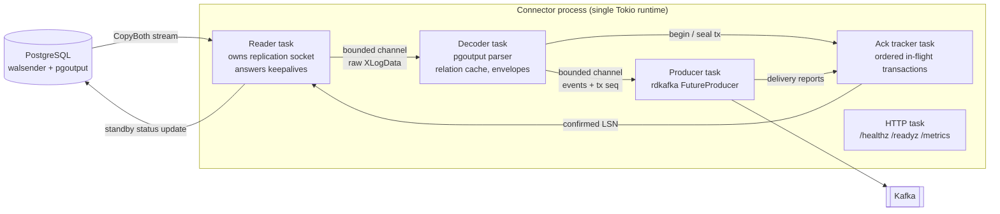

Bounded channels give backpressure for free: if Kafka slows, the producer blocks, the decoder blocks, the reader stops reading, and lag accumulates in the slot (visible, alertable) instead of in memory.

### 12.4 Ack tracker: the correctness core

Kafka delivery reports complete **out of order** across partitions.  
The tracker confirms only a contiguous prefix of fully-acknowledged transactions.

```rust
use std::collections::VecDeque;

#[derive(Clone, Copy, PartialEq, Eq, PartialOrd, Ord, Debug)]
pub struct Lsn(pub u64);

struct InFlightTx {
    end_lsn: Option<Lsn>, // set when the Commit message is decoded
    pending: usize,       // records handed to the producer, not yet acked
}

/// Tracks in-flight transactions and computes the highest LSN that is
/// safe to report to PostgreSQL as flushed. Owned by a single task.
pub struct AckTracker {
    base_seq: u64, // sequence number of queue.front()
    queue: VecDeque<InFlightTx>,
    confirmed: Lsn,
}

impl AckTracker {
    pub fn new(start: Lsn) -> Self {
        Self { base_seq: 0, queue: VecDeque::new(), confirmed: start }
    }

    /// On Begin: register a transaction, return its sequence number.
    pub fn begin(&mut self) -> u64 {
        self.queue.push_back(InFlightTx { end_lsn: None, pending: 0 });
        self.base_seq + self.queue.len() as u64 - 1
    }

    /// For every record handed to the Kafka producer.
    pub fn produced(&mut self, seq: u64) {
        self.slot(seq).pending += 1;
    }

    /// On Commit: the transaction has no more records coming.
    pub fn seal(&mut self, seq: u64, end_lsn: Lsn) {
        self.slot(seq).end_lsn = Some(end_lsn);
        self.advance();
    }

    /// From a Kafka delivery report, in any order.
    pub fn acked(&mut self, seq: u64) {
        self.slot(seq).pending -= 1;
        self.advance();
    }

    /// Highest commit end LSN whose records are all durable in Kafka.
    pub fn confirmed(&self) -> Lsn {
        self.confirmed
    }

    fn advance(&mut self) {
        while let Some(front) = self.queue.front() {
            match front.end_lsn {
                Some(lsn) if front.pending == 0 => {
                    self.confirmed = lsn;
                    self.queue.pop_front();
                    self.base_seq += 1;
                }
                _ => break, // never confirm past an incomplete transaction
            }
        }
    }

    fn slot(&mut self, seq: u64) -> &mut InFlightTx {
        let idx = (seq - self.base_seq) as usize;
        &mut self.queue[idx]
    }
}
```

| Scenario                                            | Tracker behavior                                     |
| --------------------------------------------------- | ---------------------------------------------------- |
| Later transaction fully acked before an earlier one | Confirmed LSN does not move                          |
| Earlier transaction completes                       | Confirmed LSN jumps past every completed transaction |
| Transaction with zero published records (filtered)  | Sealed with zero pending, confirmed immediately      |
| Crash with transactions in flight                   | Unconfirmed transactions are resent on restart       |

### 12.5 Crates

| Crate                                       | Role                                                                                                                                   |
| ------------------------------------------- | -------------------------------------------------------------------------------------------------------------------------------------- |
| `tokio`                                     | Async runtime, tasks, bounded `mpsc` channels, signal handling                                                                         |
| `pgwire-replication`                        | Replication plane over the wire protocol; explicit start LSN and progress reporting; leaves pgoutput decoding and checkpointing to you |
| `tokio-postgres`                            | Control plane: publications, slot checks, snapshot reads                                                                               |
| `rdkafka`                                   | Kafka producer (librdkafka bindings), delivery reports                                                                                 |
| `serde`, `serde_json`                       | Event envelopes; add `apache-avro` or `prost` for registry-backed formats                                                              |
| `tracing`                                   | Structured logs and spans                                                                                                              |
| `metrics` + Prometheus exporter             | Lag, throughput, in-flight gauges                                                                                                      |
| `axum`                                      | Health and metrics endpoints on a management port                                                                                      |
| Reference: `supabase/etl`                   | Rust framework over PostgreSQL logical replication; read for design, not as a dependency of a learning build                           |
| Reference: `mysql_async` (`binlog` feature) | `BinlogStream` for a later MySQL source                                                                                                |

### 12.6 Configuration

```toml
[source]
dsn            = "postgres://cdc_user@orders-db.internal:5432/orders"
slot           = "cdc_orders"
publication    = "cdc_pub"
snapshot       = "initial"          # initial | never

[sink]
brokers        = "kafka-1:9092,kafka-2:9092,kafka-3:9092"
topic_template = "cdc.{schema}.{table}"
format         = "json"             # json | avro

[pipeline]
channel_capacity    = 10000         # bounds memory, drives backpressure
status_interval_ms  = 1000          # standby status update cadence

[management]
listen = "0.0.0.0:9187"
```

Credentials come from the environment or a secrets store, never the file.

### 12.7 Deployment

| Concern             | Decision                                                                              |
| ------------------- | ------------------------------------------------------------------------------------- |
| Artifact            | One statically linked binary in a minimal image (distroless or scratch)               |
| Placement           | Same region and network as the database; never on the database host                   |
| Replicas            | Exactly one active reader per slot                                                    |
| Rollout strategy    | `Recreate`, so two instances never overlap during deploys                             |
| Single-reader guard | PostgreSQL refuses a second `START_REPLICATION` on an active slot: the slot is a lock |
| Shutdown            | SIGTERM: stop reading, flush producer, send final status update, exit                 |
| Probes              | Liveness on process health; readiness on "replication session established"            |
| Memory              | Sized to channel capacity plus the largest expected transaction                       |

```yaml
apiVersion: apps/v1
kind: Deployment
metadata:
  name: cdc-orders
spec:
  replicas: 1
  strategy:
    type: Recreate
  selector:
    matchLabels: { app: cdc-orders }
  template:
    metadata:
      labels: { app: cdc-orders }
    spec:
      terminationGracePeriodSeconds: 60
      containers:
        - name: connector
          image: registry.internal/cdc-orders:1.0.0
          ports:
            - { name: mgmt, containerPort: 9187 }
          envFrom:
            - secretRef: { name: cdc-orders-credentials }
          livenessProbe:
            httpGet: { path: /healthz, port: mgmt }
          readinessProbe:
            httpGet: { path: /readyz, port: mgmt }
          resources:
            requests: { cpu: "500m", memory: "512Mi" }
            limits:   { memory: "1Gi" }
```

### 12.8 Build sequence and chaos matrix

| Stage | Deliverable                                                     | Exit criterion                                                        |
| ----- | --------------------------------------------------------------- | --------------------------------------------------------------------- |
| 1     | Raw reader: stream `XLogData`, answer keepalives, no acks       | Session stays up; slot lag visibly grows                              |
| 2     | pgoutput decoder, relation cache, typed JSON to stdout          | Inserts, updates, deletes, NULLs, TOAST `u`, DDL handled              |
| 3     | Kafka producer + ack tracker + status updates                   | Slot lag stays flat under load                                        |
| 4     | Crash safety                                                    | `kill -9` mid-load: zero missing rows downstream (duplicates allowed) |
| 5     | Exported-snapshot initial load                                  | Snapshot plus stream equals source state                              |
| 6     | Operations: metrics, health, graceful shutdown, image, manifest | Deployable and observable                                             |
| 7     | Chaos tests                                                     | All rows below pass                                                   |

| Chaos case                       | Expected behavior                                                            |
| -------------------------------- | ---------------------------------------------------------------------------- |
| Kafka unavailable for 10 minutes | Backpressure; slot lag grows; full recovery without loss after Kafka returns |
| One transaction of 1 M rows      | Memory stays within limits; transaction published and confirmed atomically   |
| `ALTER TABLE` mid-stream         | New `Relation` message refreshes cache; events reflect new columns           |
| PostgreSQL restart               | Reconnect with backoff; resume from `confirmed_flush_lsn`                    |
| Connector OOM-killed             | Restart resumes; duplicates only                                             |
| Second instance started          | Refused by the active slot; no corruption                                    |

---

## 13. Operations Runbook

| Scenario                              | Symptom                                       | Immediate action                                             | Recovery                                                                                |
| ------------------------------------- | --------------------------------------------- | ------------------------------------------------------------ | --------------------------------------------------------------------------------------- |
| Connector crash loop                  | Slot inactive, lag growing                    | Inspect last error; check credentials, network, poison event | Fix cause; connector resumes from slot position                                         |
| Slot lag breach                       | WAL volume rising on primary                  | Find the stall (connector, Kafka, sink backpressure)         | Restore flow; if disk is critical, drop slot and plan re-snapshot                       |
| Database failover (no failover slots) | Connector cannot find slot on new primary     | Stop connector                                               | Recreate slot; re-snapshot affected tables; consumers upsert                            |
| Binlog / WAL position expired         | Connector refuses to start from stored offset | Stop connector                                               | Re-snapshot (incremental where possible)                                                |
| Schema change rollout                 | Consumers failing deserialization             | Pause affected sinks                                         | Additive changes first; registry compatibility; consumers before producers for removals |
| Poison event                          | One record repeatedly fails in a sink         | Route to dead-letter topic                                   | Fix data or code; replay DLQ                                                            |
| Kafka outage                          | Producer errors, backpressure                 | Confirm connector is blocking, not dropping                  | Recovery automatic once brokers return; verify lag drains                               |
| Corrupted derived store               | Reconciliation mismatch                       | Stop the affected sink                                       | Rebuild from compacted topic or targeted re-snapshot                                    |

---

## 14. System Design Interview Angle

### 14.1 Trigger phrases

| Interview prompt contains                                | CDC-based answer                                        |
| -------------------------------------------------------- | ------------------------------------------------------- |
| "Keep search results in sync with the database"          | CDC → Kafka → search sink, upsert by id                 |
| "Invalidate the cache when data changes"                 | CDC-driven invalidation keyed by primary key            |
| "Guarantee the event is published if the write succeeds" | Transactional outbox + CDC                              |
| "Real-time analytics on operational data"                | CDC → Kafka → warehouse / lake                          |
| "Migrate to a new database without downtime"             | Snapshot + CDC sync + validated cutover + reverse CDC   |
| "Several services need to react to order status changes" | Outbox events on a per-aggregate topic, consumer groups |

### 14.2 Trade-offs to state unprompted

- Asynchronous: derived stores lag; read-your-own-writes needs the primary.
- At-least-once: consumers are idempotent.
- Ordering is per key, not global.
- Operational cost: slot lag can endanger the primary; monitor and cap it.
- Physical events leak schema; use outbox for business contracts.

### 14.3 Integration example: notification pipeline

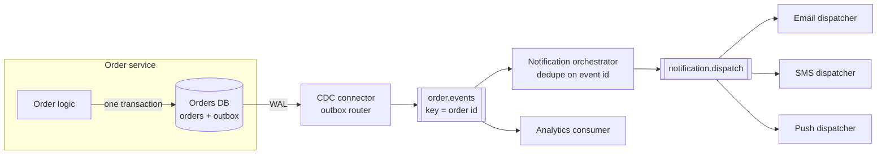

The order service never calls the notification system.  
Status changes reach it through the outbox, exactly once per committed change from the order service's perspective, at least once on the wire, deduplicated by event id.

---

## 15. Glossary

| Term                | Definition                                                                                |
| ------------------- | ----------------------------------------------------------------------------------------- |
| WAL                 | Write-ahead log: PostgreSQL's durable record of changes, written before data pages        |
| Binlog              | MySQL's binary log of changes; row format records before and after images                 |
| Oplog               | MongoDB's operations log underlying replication and change streams                        |
| LSN                 | Log Sequence Number: a byte position in PostgreSQL's WAL                                  |
| GTID                | Global Transaction Identifier: MySQL's server-independent transaction position            |
| Logical decoding    | Turning physical WAL into logical row changes inside PostgreSQL                           |
| Output plugin       | The decoder that formats logical changes (`pgoutput`, `wal2json`)                         |
| Publication         | PostgreSQL object listing which tables are replicated                                     |
| Replication slot    | Server-side record of a consumer's confirmed position; prevents WAL removal               |
| Replica identity    | Which old-row columns PostgreSQL logs for updates and deletes                             |
| Connector           | Component that moves data between an external system and the event log                    |
| SMT                 | Single Message Transform: lightweight per-record transformation in Kafka Connect          |
| Snapshot            | Initial capture of existing rows before streaming changes                                 |
| Watermark           | Marker written into the log to bound a snapshot chunk relative to live changes            |
| Tombstone           | Kafka record with a key and null value; marks deletion for log compaction                 |
| Log compaction      | Kafka retention that keeps only the latest record per key                                 |
| Outbox              | Table written in the same transaction as business data, captured by CDC to publish events |
| Idempotent consumer | Consumer whose repeated application of the same event leaves the same result              |
| Dual write          | Writing to two systems without a shared transaction; the problem CDC removes              |
| Cutover             | The moment traffic switches from the old system to the new one                            |

---

## 16. References

**Specifications and documentation**

- PostgreSQL: [Logical Decoding](https://www.postgresql.org/docs/current/logicaldecoding.html)
- PostgreSQL: [Streaming Replication Protocol, Logical](https://www.postgresql.org/docs/current/protocol-logical-replication.html)
- PostgreSQL: [Logical Replication Message Formats](https://www.postgresql.org/docs/current/protocol-logicalrep-message-formats.html)
- Debezium: [Reference documentation](https://debezium.io/documentation/reference/stable/)
- Debezium: [Outbox Event Router](https://debezium.io/documentation/reference/stable/transformations/outbox-event-router.html)
- Apache Kafka: [KIP-618, exactly-once support for source connectors](https://cwiki.apache.org/confluence/display/KAFKA/KIP-618%3A+Exactly-Once+Support+for+Source+Connectors)

**Papers and engineering write-ups**

- Andreakis and Papapanagiotou, [DBLog: A Watermark Based Change-Data-Capture Framework](https://arxiv.org/abs/2010.12597), 2020
- Netflix Technology Blog, [DBLog: A Generic Change-Data-Capture Framework](https://medium.com/netflix-techblog/dblog-a-generic-change-data-capture-framework-69351fb9099b), 2019
- Airbnb, [SpinalTap](https://airbnb.io/projects/spinaltap/) and  
- Capture Data Evolution [Capturing Data Evolution in a Service-Oriented Architecture](https://medium.com/airbnb-engineering/capturing-data-evolution-in-a-service-oriented-architecture-72f7c643ee6f)
- Martin Kleppmann, *Designing Data-Intensive Applications*, chapter 11 (stream processing, change data capture)

**Rust ecosystem**

- [`pgwire-replication`](https://docs.rs/pgwire-replication)
- [`supabase/etl`](https://github.com/supabase/etl)
- [`mysql_async`](https://docs.rs/mysql_async)
- [`rdkafka`](https://docs.rs/rdkafka)

---
