<!-- markdownlint-disable MD001 -->
<!-- markdownlint-disable MD024 -->
<!-- markdownlint-disable MD025 -->
<!-- markdownlint-disable MD026 -->
<!-- markdownlint-disable MD029 -->
<!-- markdownlint-disable MD033 -->
<!-- markdownlint-disable MD036 -->
<!-- markdownlint-disable MD040 -->
<!-- markdownlint-disable MD056 -->
<!-- markdownlint-disable MD060 -->

# Distributed Locking: Design and Reference

A complete guide to designing, implementing, and operating distributed locks: the theory, the failure modes, the backends, and the practice.

---

## Table of Contents

**Part I: Foundations**

- [0. Front Matter](#0-front-matter)
- [1. The Problem](#1-the-problem)
- [2. Two Purposes of a Lock](#2-two-purposes-of-a-lock)
- [3. Required Properties](#3-required-properties)
- [4. System Model and Failure Modes](#4-system-model-and-failure-modes)

**Part II: Anatomy of a Lock Service**

- [5. Components](#5-components)
- [6. The Lock Record](#6-the-lock-record)
- [7. Lifecycle](#7-lifecycle)
- [8. Acquisition Strategies](#8-acquisition-strategies)
- [9. Leases and Time](#9-leases-and-time)
- [10. Ownership and Safe Release](#10-ownership-and-safe-release)
- [11. Fencing Tokens](#11-fencing-tokens)

**Part III: Backends**

- [12. Single-Node Redis](#12-single-node-redis)
- [13. Redlock](#13-redlock)
- [14. Consensus Foundation](#14-consensus-foundation)
- [15. ZooKeeper](#15-zookeeper)
- [16. etcd](#16-etcd)
- [17. Relational Databases](#17-relational-databases)
- [18. Other Backends](#18-other-backends)
- [19. Backend Comparison](#19-backend-comparison)

**Part IV: Advanced Design**

- [20. Lock Variants](#20-lock-variants)
- [21. Multi-Resource Locking and Deadlock](#21-multi-resource-locking-and-deadlock)
- [22. Defense in Depth](#22-defense-in-depth)
- [23. Alternatives to Locking](#23-alternatives-to-locking)
- [24. Client Library and API Design](#24-client-library-and-api-design)

**Part V: Practice**

- [25. Case Study: Nightly Billing Job](#25-case-study-nightly-billing-job)
- [26. Case Study: Ticket Seat Holds](#26-case-study-ticket-seat-holds)
- [27. Case Study: Shard Ownership](#27-case-study-shard-ownership)
- [28. Observability](#28-observability)
- [29. Testing](#29-testing)
- [30. Anti-Patterns](#30-anti-patterns)
- [31. Design Checklist](#31-design-checklist)
- [32. References](#32-references)

---

# Part I: Foundations

## 0. Front Matter

### 0.1 Scope

This document covers **mutual exclusion across processes that do not share memory**: separate processes, containers, virtual machines, or data centers that must agree that at most one of them performs a given action at a time.  
It covers:

- the theory: what guarantees are possible, and under which assumptions
- the mechanics: leases, ownership, fencing, renewal, release
- the backends: Redis, Redlock, ZooKeeper, etcd, relational databases, Consul, DynamoDB, Chubby
- the practice: API design, observability, testing, anti-patterns, worked case studies

It does not cover in-process thread synchronization, except to contrast it with the distributed case.

### 0.2 How to Read This Document

| Goal                                      | Read                                  |
| ----------------------------------------- | ------------------------------------- |
| Understand why distributed locks are hard | Sections 1 to 4                       |
| Build a lock correctly on any store       | Sections 5 to 11                      |
| Pick a backend                            | Sections 12 to 19, especially 19      |
| Decide whether a lock is the right tool   | Sections 2, 22, 23                    |
| Operate locks in production               | Sections 28 to 31                     |
| Quick review before a design meeting      | Section 31 (checklist) and Section 30 |

### 0.3 Notation

- `C1`, `C2`, ... are clients (processes that want the lock).
- `S` is the lock store (Redis, etcd, ZooKeeper, a database).
- `R` is the protected resource (a database table, a file, an external API).
- `T` is a lease duration (TTL).
- `tok` is a fencing token.
- Code blocks are pseudocode unless they name a concrete system (Redis, SQL, etcd).

### 0.4 Glossary

| Term                   | Meaning                                                                                                      |
| ---------------------- | ------------------------------------------------------------------------------------------------------------ |
| Mutual exclusion       | At most one holder of the lock at any instant.                                                               |
| Lock store             | The shared system that records who holds a lock. Also called the coordinator or lock service.                |
| Lease                  | A lock that is granted for a bounded time and expires on its own unless renewed.                             |
| TTL                    | Time to live. The duration of a lease.                                                                       |
| Owner id               | A unique value written by the holder so it can later prove ownership. Usually a random UUID per attempt.     |
| Heartbeat / renewal    | Periodic extension of a lease by its holder while work continues.                                            |
| Watchdog               | A background thread in the client library that performs renewal automatically.                               |
| Compare-and-delete     | Delete the lock only if its value still equals the caller's owner id, as one atomic operation.               |
| Compare-and-swap (CAS) | Write a new value only if the current value matches an expected one, atomically.                             |
| Fencing token          | A number that strictly increases with every grant of the lock; the resource rejects stale numbers.           |
| Linearizability        | Every operation appears to take effect at one instant between its call and its return, in one global order.  |
| Consensus              | A protocol (Raft, Paxos, Zab) by which a group of nodes agrees on a single sequence of values.               |
| Quorum                 | A majority of nodes, `floor(N/2) + 1`. Any two quorums overlap in at least one node.                         |
| Session                | In ZooKeeper, etcd, and Consul: a liveness relationship between a client and the store, kept alive by pings. |
| Ephemeral node         | A key that the store deletes automatically when the creating session ends.                                   |
| Herd effect            | Many waiting clients all waking up and retrying when one lock is released.                                   |
| Process pause          | A stop-the-world interruption of a process (GC, VM migration, swapping, SIGSTOP) of unbounded length.        |
| Clock drift            | The difference in rate between two clocks. Clock jump: a sudden step change, for example from NTP.           |
| Split brain            | Two nodes each believing they are the sole holder or leader.                                                 |
| Idempotent             | An operation that has the same effect whether it is applied once or many times.                              |

---

## 1. The Problem

### 1.1 Local Mutex vs Distributed Lock

Inside one process, a mutex is cheap and reliable.  
The operating system and CPU guarantee that the lock word is shared, that atomic instructions are atomic, and that if the process dies, every thread holding the lock dies with it.  
None of these guarantees survive the move to multiple machines.

| Aspect                    | Local mutex (threads in one process)        | Distributed lock (processes on many machines)              |
| ------------------------- | ------------------------------------------- | ---------------------------------------------------------- |
| Shared state              | Memory word, same address space             | A record in an external store reached over a network       |
| Atomicity                 | CPU instruction (CAS, LOCK prefix)          | Store-side atomic operation (SET NX, txn, conditional put) |
| Latency                   | Nanoseconds                                 | Sub-millisecond to tens of milliseconds                    |
| Holder crash              | Whole process dies, lock disappears with it | Holder dies, lock record remains in the store              |
| Holder pause              | All threads paused together                 | Holder pauses, rest of the world keeps going               |
| Failure detection         | Not needed                                  | Required, and fundamentally imperfect (timeouts)           |
| Clock                     | One clock                                   | Many clocks that drift and jump                            |
| Message loss              | Impossible                                  | Normal                                                     |
| Knowing you hold the lock | Certain                                     | Only "I held it as of my last confirmation"                |

The last row is the core difficulty.  
A distributed lock holder can never be certain it still holds the lock at the instant it acts.  
Everything in this document is a consequence of that.

### 1.2 What Goes Wrong Without a Lock

Two common failures:

- **Lost update:** two processes read the same value, modify it, and write it back. One write overwrites the other.
- **Double execution:** two processes both decide a one-time action has not been done and both do it (charge a card, send an email, ship an order).

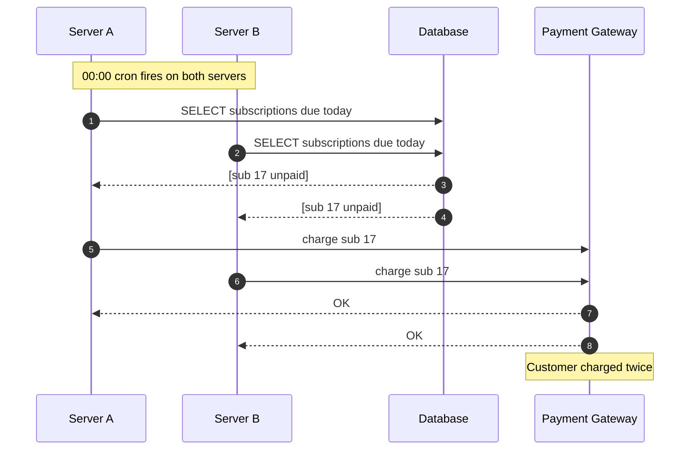

### 1.3 Where Distributed Locks Are Used

| Use                                 | Example                                                 | Typical lock granularity  |
| ----------------------------------- | ------------------------------------------------------- | ------------------------- |
| Singleton scheduled jobs            | Nightly billing, report generation, cleanup             | One per job               |
| Leader election                     | One active scheduler, one primary writer                | One per service           |
| Resource reservation                | Seat holds, inventory holds, username claims            | One per item              |
| Exclusive access to external system | A vendor API that breaks under concurrent use           | One per account or tenant |
| Serializing workflows per entity    | Only one order-state transition at a time per order     | One per entity id         |
| Work partitioning                   | Each shard or partition processed by exactly one worker | One per shard             |
| Schema migrations                   | Only one deployment instance runs migrations            | One per database          |
| Cache stampede protection           | Only one process recomputes an expired cache entry      | One per cache key         |

---

## 2. Two Purposes of a Lock

Martin Kleppmann's distinction, which drives every later design decision: **why** you take the lock determines **how strong** it must be.

### 2.1 Efficiency vs Correctness

| Aspect                      | Efficiency lock                                           | Correctness lock                                         |
| --------------------------- | --------------------------------------------------------- | -------------------------------------------------------- |
| Purpose                     | Avoid doing the same work twice                           | Protect an invariant that must never be violated         |
| Cost of a lock failure      | Wasted compute, a duplicate email, a recomputed cache     | Corrupted data, money lost, double-sold inventory        |
| Acceptable failure rate     | Rare failures are tolerable                               | Zero, or as close as engineering allows                  |
| Store requirement           | Single Redis node is usually fine                         | Consensus store (etcd, ZooKeeper) or the resource itself |
| Fencing tokens              | Optional                                                  | Required                                                 |
| Idempotency at the resource | Nice to have                                              | Required as a final safety net                           |
| Typical examples            | Cache recompute, report generation, crawler deduplication | Payments, ledger writes, seat sales, leader-only writes  |

### 2.2 The Key Insight

For a correctness lock, **the lock alone is never sufficient**.  
Because a holder can pause or be partitioned after its last confirmation, there is always a window where two processes believe they hold the lock.  
Correctness therefore has to be enforced where the action lands, at the resource, using fencing tokens, conditional writes, or unique constraints.  
The lock reduces contention; the resource guarantees the invariant.

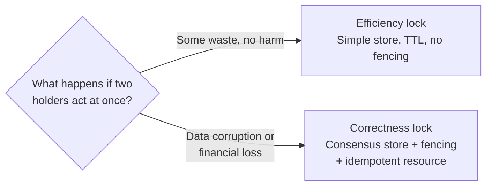

---

## 3. Required Properties

A distributed lock is judged on safety, liveness, and a few practical properties.  
Safety is about what must never happen; liveness is about what must eventually happen.

### 3.1 Property Table

| Property            | Class       | Definition                                                | How it is achieved                                       |
| ------------------- | ----------- | --------------------------------------------------------- | -------------------------------------------------------- |
| Mutual exclusion    | Safety      | At most one client holds the lock at any moment           | Atomic check-and-set in a linearizable store             |
| Owner integrity     | Safety      | Only the holder can release or renew its lock             | Unique owner id + compare-and-delete / compare-and-renew |
| Stale-holder safety | Safety      | A client that lost the lock cannot damage the resource    | Fencing tokens checked at the resource                   |
| Deadlock freedom    | Liveness    | The lock is eventually acquirable even if a holder dies   | Leases (TTL) or session-bound ephemeral keys             |
| Fault tolerance     | Liveness    | The lock service keeps working when some store nodes fail | Replication with consensus (quorum)                      |
| Progress under load | Liveness    | Waiters eventually acquire the lock                       | Bounded hold times, retries with backoff                 |
| Fairness            | Quality     | Waiters acquire in request order; no starvation           | FIFO queue (sequential znodes, revision ordering)        |
| Low latency         | Performance | Acquire and release are fast                              | In-memory store, single round trip, local quorum         |
| Throughput          | Performance | Many independent locks can be served at once              | Fine-grained keys, sharding of the keyspace              |
| Observability       | Operations  | Holders, wait times, and expirations are visible          | Metadata in the record, metrics, structured logs         |

### 3.2 The Fundamental Trade-off

Deadlock freedom requires that a lock be taken away from a holder that appears dead.  
But "appears dead" is detected by a timeout, and a timeout cannot distinguish a dead process from a slow or paused one. Therefore:

> Any lock that guarantees deadlock freedom through timeouts can, in some executions, grant the lock to a second client while the first still believes it holds it.

This is not a bug in a particular implementation; it follows from the impossibility of perfect failure detection in an asynchronous network (the same root cause as the FLP result).  
The only remedy is to make the resource reject the stale holder (Section 11).

## 4. System Model and Failure Modes

### 4.1 Assumptions Worth Stating Explicitly

Every lock design rests on assumptions about the environment. Designs fail when those assumptions are left implicit.

| Model dimension   | Optimistic assumption (often wrong)     | Realistic assumption                                                 |
| ----------------- | --------------------------------------- | -------------------------------------------------------------------- |
| Process failures  | Crash-stop: a failed process stays dead | Crash-recovery, plus arbitrary-length pauses                         |
| Network           | Reliable, bounded delay                 | Messages delayed, reordered, duplicated, dropped; partitions happen  |
| Clocks            | Synchronized, monotonic                 | Drift (tens of ppm), steps from NTP, leap smearing, VM clock jumps   |
| Store durability  | Writes survive restarts                 | Depends on fsync policy and replication mode                         |
| Store consistency | Every read sees latest write            | Asynchronous replicas can lag; failover can lose acknowledged writes |

### 4.2 Failure Modes and Their Effect on a Lock

| Failure                           | Example cause                              | Effect on the lock                                         | Mitigation                                                     |
| --------------------------------- | ------------------------------------------ | ---------------------------------------------------------- | -------------------------------------------------------------- |
| Holder crash                      | OOM kill, hardware fault, deploy           | Lock never released explicitly                             | Lease TTL or ephemeral session key                             |
| Holder pause                      | GC stop-the-world, VM live migration, swap | Lease expires, another client acquires, holder resumes     | Fencing tokens at the resource                                 |
| Holder partitioned from store     | Network split                              | Cannot renew; lease expires while holder still works       | Holder aborts when renewal fails; fencing tokens               |
| Holder partitioned from resource  | Network split                              | Writes delayed; may arrive after lock moved                | Fencing tokens; idempotent writes                              |
| Delayed message                   | Congested network, retransmission          | An old write lands after a newer holder's write            | Fencing tokens                                                 |
| Clock jump on store               | NTP step, manual change                    | TTL-based expiry fires early or late                       | Use monotonic clocks for TTL accounting                        |
| Clock drift on client             | Cheap oscillator                           | Client believes its lease lasts longer than the store does | Client-side safety margin; renew well before expiry            |
| Store node crash, no persistence  | Redis restart without AOF                  | Lock record lost; second client acquires                   | Persistence with fsync, or delayed restart, or consensus       |
| Store failover, async replication | Redis primary dies before replicating      | Replica promoted without the lock; second client acquires  | Consensus store; WAIT command reduces but does not remove risk |
| Store unavailable                 | Store cluster down                         | No one can acquire; holders cannot renew                   | Quorum replication; fail closed for correctness locks          |
| Duplicate release                 | Retry of a release call                    | Could delete someone else's lock                           | Compare-and-delete with owner id                               |

### 4.3 The Pause Problem

The single most important failure to internalize. The holder does nothing wrong; time simply passes without it noticing.

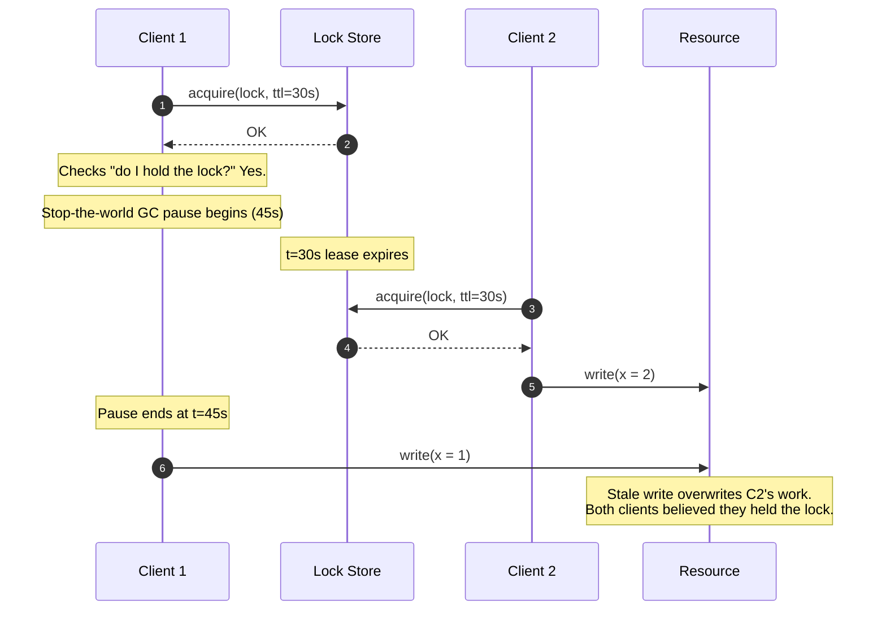

Checking "do I still hold the lock?" immediately before writing does not help: the pause can occur between the check and the write. No client-side check can close this window.

### 4.4 Sources of Pauses

| Source                          | Typical duration          | Notes                                                     |
| ------------------------------- | ------------------------- | --------------------------------------------------------- |
| JVM / .NET / Go GC              | Milliseconds to minutes   | Full GCs on large heaps have exceeded a minute            |
| VM live migration               | Hundreds of ms to seconds | The guest has no idea it was suspended                    |
| Hypervisor steal time           | Milliseconds to seconds   | Noisy neighbours                                          |
| Swapping / page faults          | Milliseconds to seconds   | Memory-mapped files, overcommitted hosts                  |
| SIGSTOP / debugger / laptop lid | Unbounded                 | Includes containers frozen by the orchestrator            |
| Synchronous disk I/O            | Milliseconds to seconds   | Slow or failing disk, NFS hang                            |
| CPU throttling (cgroups)        | Milliseconds per period   | CFS quota exhaustion stalls every thread in the container |

---

# Part II: Anatomy of a Lock Service

## 5. Components

### 5.1 The Four Roles

Every distributed lock system, whatever the backend, has the same four roles.  
Confusion about which role is responsible for which guarantee is the root of most broken designs.

| Component          | Responsibility                                                                | Must guarantee                                  | Must not be trusted to                         |
| ------------------ | ----------------------------------------------------------------------------- | ----------------------------------------------- | ---------------------------------------------- |
| Client library     | Acquire, renew, release; generate owner id; propagate token; detect lost lock | Never act after it knows the lock is lost       | Know for certain that it still holds the lock  |
| Lock store         | Store lock records; atomic check-and-set; expire leases; issue tokens         | Linearizable grant decisions; monotonic tokens  | Prevent a stale holder from acting             |
| Token issuer       | Produce strictly increasing fencing tokens per lock                           | Monotonicity across failover                    | Anything else (often part of the store)        |
| Protected resource | Perform the actual work; validate tokens; enforce invariants                  | Reject stale tokens; enforce unique constraints | Know who the current holder is without a token |

### 5.2 Architecture

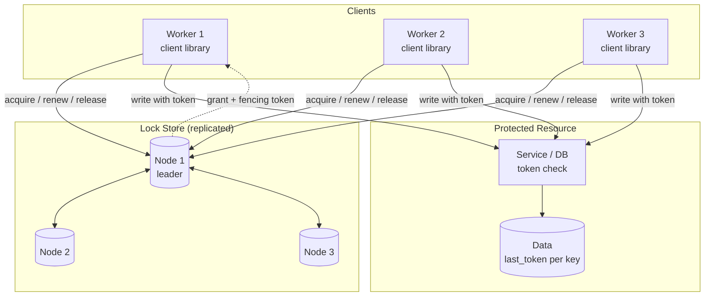

### 5.3 Data Flow Summary

1. Client generates an owner id and asks the store for the lock.
2. Store atomically checks the record, writes it if free, increments the token, and returns the token.
3. Client starts a renewal loop and begins work.
4. Every write to the resource carries the token.
5. Resource compares the token with the highest it has seen for that key and rejects anything lower.
6. Client stops renewal and releases with compare-and-delete.

---

## 6. The Lock Record

### 6.1 Fields

| Field         | Purpose                                                      | Example                              | Required?                  |
| ------------- | ------------------------------------------------------------ | ------------------------------------ | -------------------------- |
| key           | Identifies the protected thing; the unit of mutual exclusion | `lock:billing:2026-10`               | Yes                        |
| owner_id      | Proves ownership on renew and release                        | `host-a:pid-4312:9f1c2e7a-...`       | Yes                        |
| expires_at    | When the lease lapses if not renewed                         | Store-side TTL or monotonic deadline | Yes (unless session-bound) |
| fencing_token | Strictly increasing grant counter                            | `42`                                 | Yes for correctness locks  |
| acquired_at   | Diagnostics: how long it has been held                       | `2026-10-21T00:00:00.123Z`           | Recommended                |
| holder_info   | Diagnostics: hostname, pid, version, trace id                | `{"host":"app-a","pid":4312}`        | Recommended                |
| mode          | For read-write locks: shared or exclusive                    | `exclusive`                          | Only for RW locks          |
| count         | For reentrant locks: recursion depth                         | `2`                                  | Only for reentrant locks   |

### 6.2 Key Design and Granularity

The key defines what is mutually exclusive. Too coarse and unrelated work serializes; too fine and multi-key operations need several locks and risk deadlock.

| Granularity          | Key example             | Concurrency | Deadlock risk | Use when                                    |
| -------------------- | ----------------------- | ----------- | ------------- | ------------------------------------------- |
| Global               | `lock:billing`          | None        | None          | Singleton job, migration                    |
| Per tenant           | `lock:tenant:812`       | Per tenant  | Low           | Tenant-wide operations                      |
| Per entity           | `lock:order:55021`      | High        | Medium        | Entity state machines                       |
| Per field / sub-item | `lock:show:42:seat:14C` | Very high   | Higher        | Inventory, seats, independent sub-resources |

Naming conventions that pay off:

- Prefix with `lock:` so lock keys never collide with data keys and are easy to scan.
- Include every dimension of scope: `lock:{service}:{resource}:{id}`.
- Include the period for recurring jobs: `lock:billing:2026-10-21` prevents a late finisher of yesterday's run from blocking today's.
- Never derive keys from unvalidated user input without normalization; case and whitespace differences create two "different" locks for the same thing.

### 6.3 Owner Id Generation

The owner id must be unique **per acquisition attempt**, not per process.  
If a process uses its hostname as the owner id, then two threads in it, or a restarted process with the same name, can release each other's locks.

```lua
owner_id = hostname + ":" + pid + ":" + random_uuid_v4()
```

The hostname and pid are for humans reading the record; the UUID provides uniqueness.

---

## 7. Lifecycle

### 7.1 States

**Store view:**

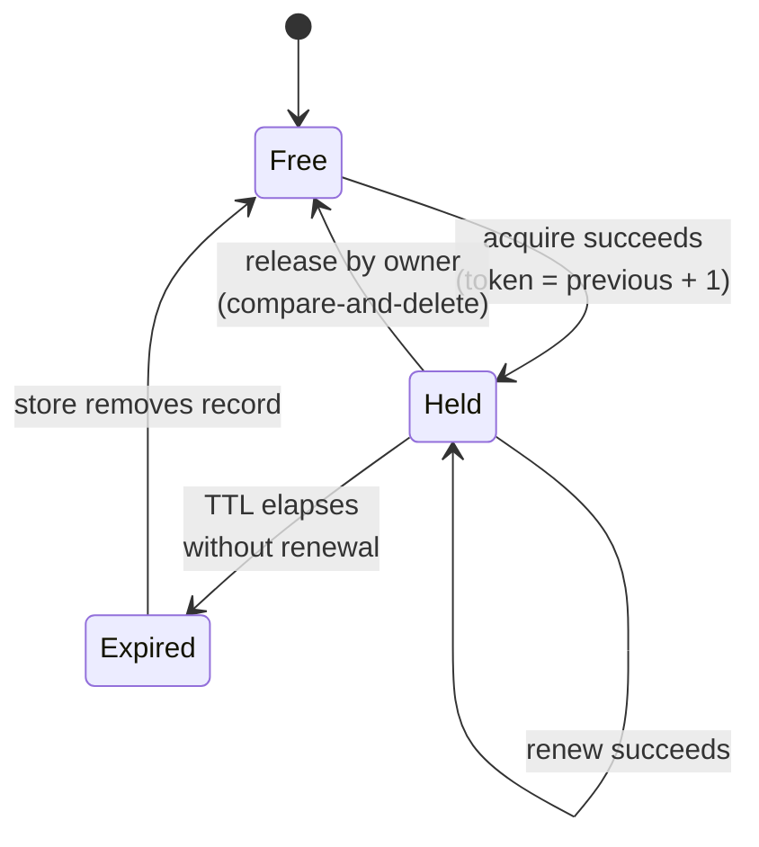

**Client view:**

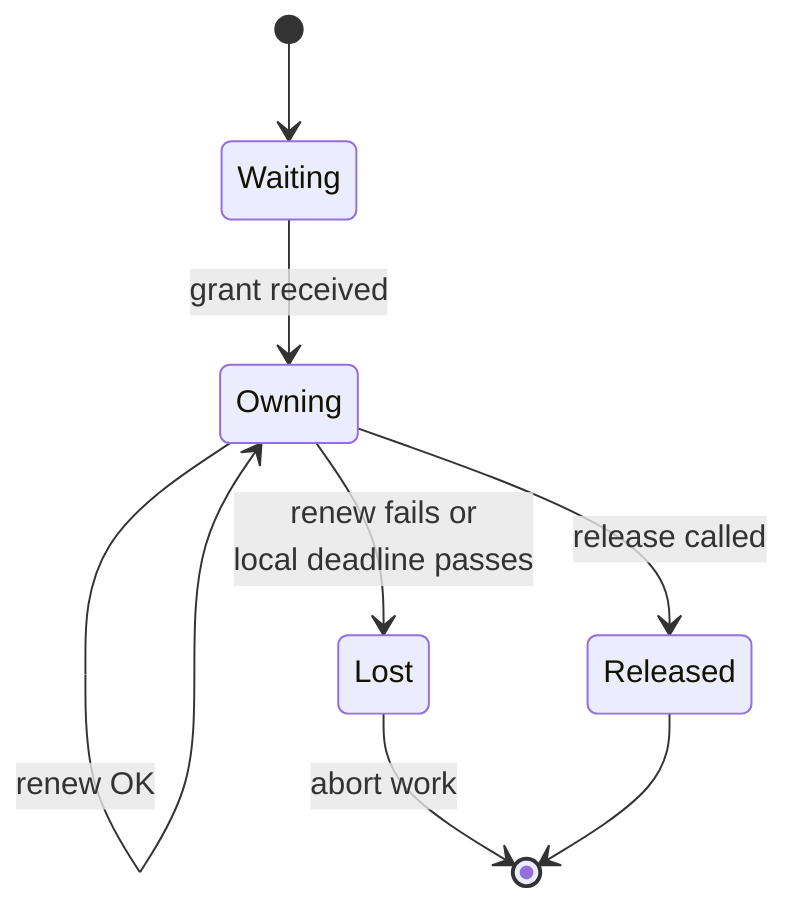

The store has its own view (Free, Held, Expired) and each client has its own (Waiting, Owning, Lost, Released).  
The two views can disagree: a client can be in Owning while the store is already Expired.  
That disagreement is the pause problem from Section 4.3.

### 7.2 Transitions

| Transition          | Trigger                                           | Actor  | Atomic requirement                            |
| ------------------- | ------------------------------------------------- | ------ | --------------------------------------------- |
| Free → Held         | Acquire request, key absent                       | Store  | Check-absent and write must be one operation  |
| Held → Held (renew) | Renew request with matching owner id              | Store  | Compare owner and extend TTL in one operation |
| Held → Free         | Release request with matching owner id            | Store  | Compare owner and delete in one operation     |
| Held → Expired      | TTL deadline passes                               | Store  | Store-side clock; no client involvement       |
| Owning → Lost       | Renewal rejected, renewal timeout, local deadline | Client | Must cancel in-flight work immediately        |
| Session end         | ZooKeeper/etcd/Consul session timeout             | Store  | All ephemeral keys of the session deleted     |

### 7.3 Happy Path

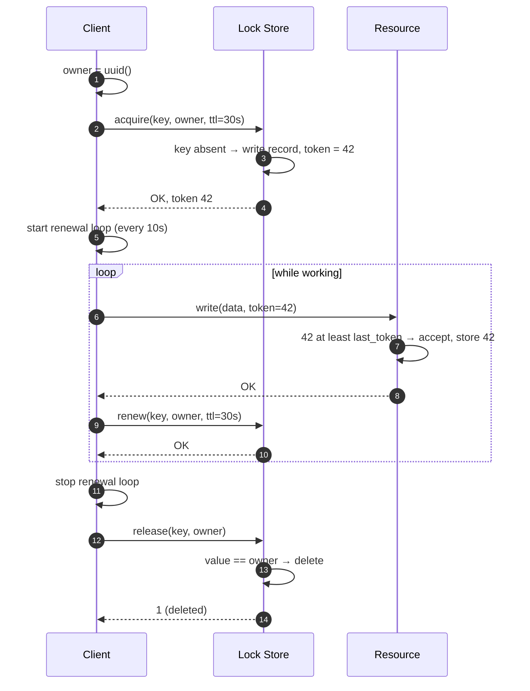

---

## 8. Acquisition Strategies

What a client does when the lock is already held.

### 8.1 Strategy Comparison

| Strategy                  | Behaviour when lock is held                | Latency to acquire after release | Store load             | Fairness | Best for                                   |
| ------------------------- | ------------------------------------------ | -------------------------------- | ---------------------- | -------- | ------------------------------------------ |
| Try-lock (non-blocking)   | Return failure immediately                 | N/A (caller gives up)            | One request            | None     | Singleton jobs: "someone else is doing it" |
| Fixed-interval polling    | Retry every N ms                           | Up to N ms                       | High under contention  | None     | Prototypes only                            |
| Exponential backoff       | Retry with growing delay, capped           | Up to the current backoff        | Moderate               | None     | General purpose, low contention            |
| Backoff with jitter       | Exponential backoff plus randomization     | Up to the current backoff        | Moderate, smoothed     | None     | General purpose; the sensible default      |
| Watch / notify            | Subscribe to the key; wake when it changes | One notification round trip      | Low while waiting      | None     | Medium contention on consensus stores      |
| Watch / notify (all wake) | All waiters watch the same key             | Fast but stampedes               | Spike on every release | None     | Avoid: herd effect                         |
| FIFO queue                | Enqueue; watch only your predecessor       | One notification round trip      | Low and constant       | Strong   | High contention, fairness required         |

### 8.2 Backoff With Jitter

Without jitter, clients that failed together retry together and collide again.  
"Full jitter" picks a random delay between zero and the exponential cap.

```lua
attempt = 0
deadline = now() + acquire_timeout
while now() < deadline:
    if try_acquire(key, owner, ttl): return SUCCESS
    cap   = min(max_backoff, base * 2^attempt)
    sleep(random_between(0, cap))          # full jitter
    attempt += 1
return TIMEOUT
```

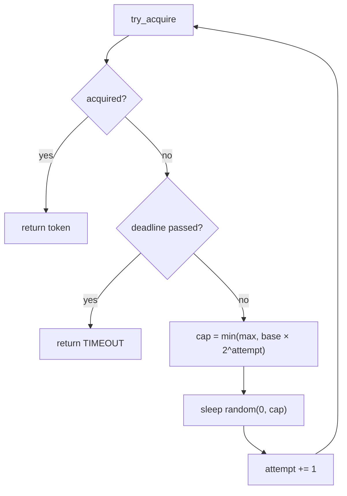

| Parameter       | Typical value  | Effect of too low                | Effect of too high                       |
| --------------- | -------------- | -------------------------------- | ---------------------------------------- |
| base            | 10–50 ms       | Hammering the store              | Slow acquisition after release           |
| max_backoff     | 1–5 s          | Wasted requests under long holds | Long idle gaps between holders           |
| acquire_timeout | Caller-defined | Spurious failures                | Callers stuck waiting; thread exhaustion |

### 8.3 Watch-Based Waiting

Consensus stores (etcd, ZooKeeper, Consul) let clients subscribe to changes on a key, so waiting costs nothing until the lock changes hands.

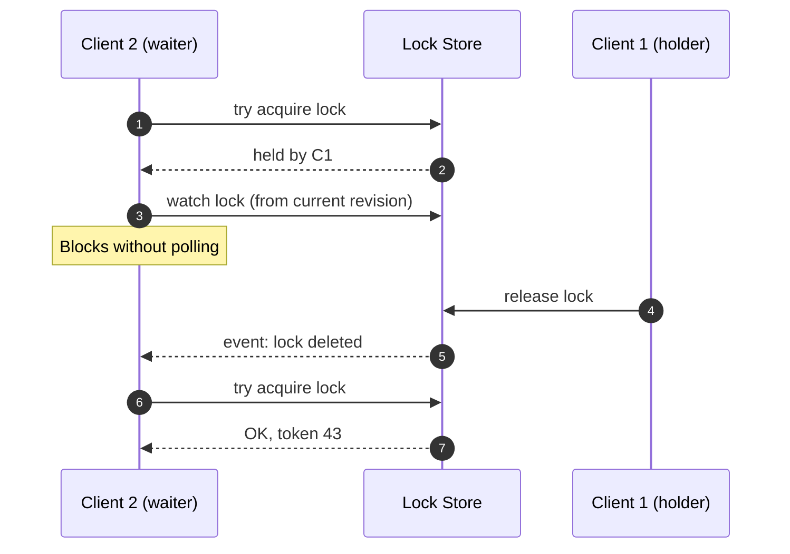

Always watch **from the revision you observed**, not from "now".  
Otherwise a delete that happens between the failed acquire and the watch registration is missed and the client waits forever.

### 8.4 The Herd Effect and Its Cure

If 1,000 clients all watch the same key, every release wakes 1,000 clients, 999 of which fail and re-register.  
The cure is a queue in which each waiter watches only the waiter directly ahead of it (Section 15.3).  
Each release then wakes exactly one client.

---

## 9. Leases and Time

### 9.1 Why Leases

A lease turns "held until released" into "held until released or until T elapses".  
It is the mechanism that provides deadlock freedom when holders crash.  
The price is that the store, not the holder, decides when the lock ends.

### 9.2 Choosing the TTL

| TTL choice                 | On holder crash                      | On long-running work                                      | On holder pause                       |
| -------------------------- | ------------------------------------ | --------------------------------------------------------- | ------------------------------------- |
| Very short (1–5 s)         | Fast recovery                        | Needs frequent renewal; sensitive to store latency spikes | Lock lost on small pauses             |
| Short + renewal (10–60 s)  | Recovery within one TTL              | Renewal keeps it alive indefinitely                       | Lock lost on pauses longer than TTL   |
| Long, no renewal (10 min+) | Lock blocked for up to the full TTL  | Fine if work is always shorter than TTL                   | Lock lost only on very long pauses    |
| Infinite                   | Lock blocked forever; manual cleanup | Fine                                                      | Never lost; never recovers from crash |

Rule: **short TTL plus renewal** is the default.  
A long TTL without renewal is acceptable only when the work has a hard upper bound well below the TTL and slow recovery after a crash is tolerable.

### 9.3 Renewal (Heartbeat / Watchdog)

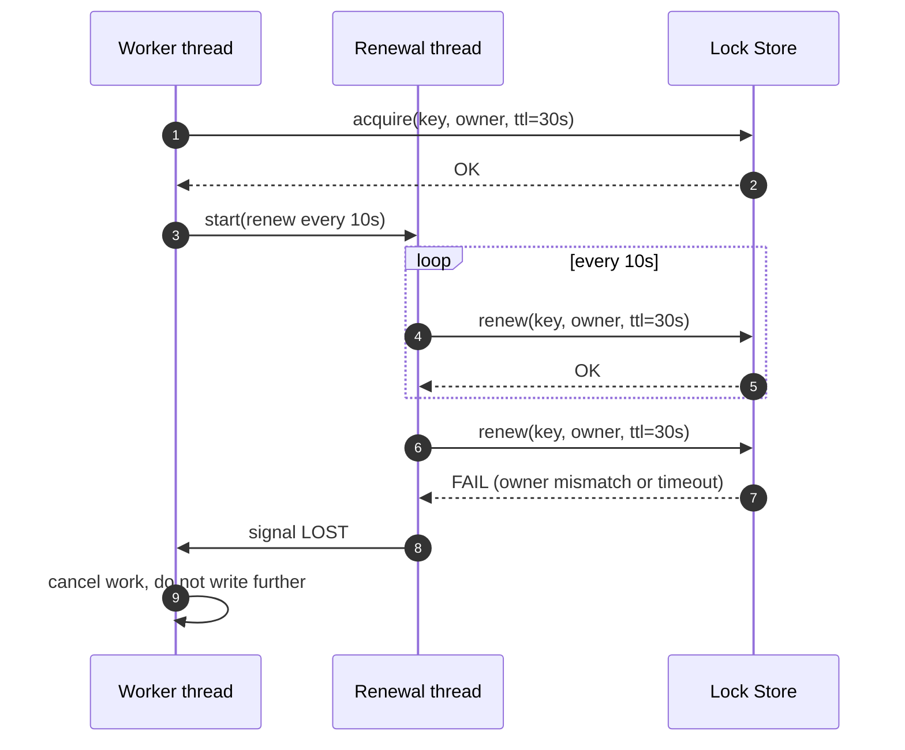

Renewal rules:

1. Renew at roughly **one third of the TTL**, so two consecutive renewals can fail before expiry.
2. Renew with **compare-and-renew**: extend only if the value is still your owner id.
3. Put a **timeout on each renewal call** shorter than the remaining lease.
4. Track a **local deadline** using a monotonic clock: `local_deadline = time_request_sent + ttl - safety_margin`.  
  If renewal has not succeeded before that deadline, treat the lock as lost even if no error came back.
5. On loss, **signal the worker** and make the worker check that signal before every side effect.  
  A renewal thread that silently dies while the worker continues is a classic bug.
6. Renewal does not fix pauses. A paused process does not renew, and does not notice that it failed to renew until it resumes.

### 9.4 Clocks

| Clock                       | Behaviour                                              | Use for lease accounting?                        |
| --------------------------- | ------------------------------------------------------ | ------------------------------------------------ |
| Wall clock (CLOCK_REALTIME) | Can jump forward or backward (NTP step, manual change) | No                                               |
| Monotonic (CLOCK_MONOTONIC) | Never goes backward; rate can be slewed slightly       | Yes, for local durations                         |
| Boot time (CLOCK_BOOTTIME)  | Monotonic and includes suspend time                    | Yes; preferable where processes can be suspended |
| Store-side TTL              | The store's own monotonic timer                        | Yes; the authoritative expiry                    |

Two different machines' monotonic clocks cannot be compared, so a lease is safe only if:

- the store measures expiry with its own monotonic clock, and
- the client measures its local deadline from the moment **before it sent** the acquire request, with a margin for drift.

### 9.5 Timing Budget

For a lease of duration `T`, the client can safely assume it holds the lock only until:

```lua
safe_until = t_send + T − drift_margin − max_expected_pause
drift_margin ≈ T × max_clock_drift_rate   (e.g. 30 s × 200 ppm ≈ 6 ms)
```

`t_send` is the local monotonic time recorded before the acquire was sent.  
`max_expected_pause` cannot actually be bounded, which is why this budget reduces risk but never removes it; fencing (Section 11) closes the gap.

| Term               | Source                       | Typical magnitude      |
| ------------------ | ---------------------------- | ---------------------- |
| Network round trip | Acquire request to response  | 0.2–50 ms              |
| Clock drift        | Crystal oscillator tolerance | 10–200 ppm             |
| Store processing   | Consensus commit (etcd/ZK)   | 1–10 ms                |
| Pause              | GC, VM migration, throttling | Unbounded in principle |

---

## 10. Ownership and Safe Release

### 10.1 Why Plain Delete Is Unsafe

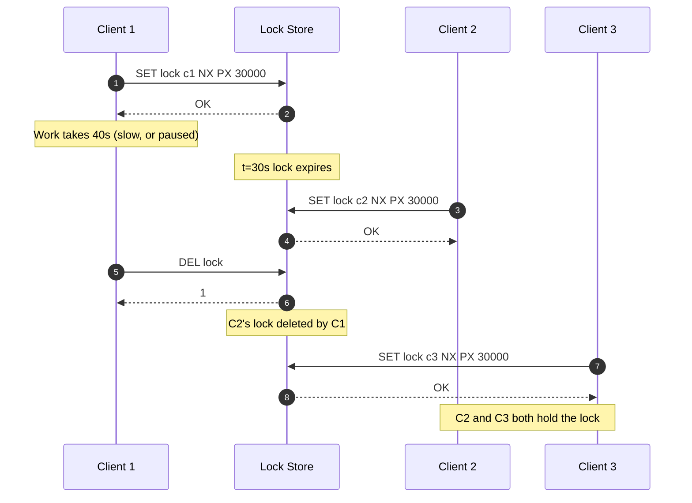

A non-atomic "get, compare, then delete" in client code is equally unsafe: the lock can expire and be re-acquired between the get and the delete.

### 10.2 Atomic Compare-and-Delete

**Redis (Lua script, executed atomically):**

```lua
-- KEYS[1] = lock key, ARGV[1] = owner id
if redis.call("GET", KEYS[1]) == ARGV[1] then
    return redis.call("DEL", KEYS[1])
else
    return 0
end
```

Newer servers add native conditional commands (Redis 8.4: `DELEX key IFEQ value` and `SET ... IFEQ`; Valkey 9: `DELIFEQ`). The Lua script works on every version.

**Compare-and-renew (Redis Lua):**

```lua
if redis.call("GET", KEYS[1]) == ARGV[1] then
    return redis.call("PEXPIRE", KEYS[1], ARGV[2])
else
    return 0
end
```

**etcd (transaction):**

```lua
Txn(
  If:   Value("lock/billing") == owner_id
  Then: Delete("lock/billing")
  Else: (nothing)
)
```

**SQL:**

```sql
DELETE FROM locks
WHERE  lock_key = 'billing'
  AND  owner_id = '9f1c2e7a-...';
-- 1 row affected: released. 0 rows: not ours (already expired or taken over).
```

### 10.3 Release Methods Compared

| Method                         | Atomic? | Safe against stale release? | Notes                                     |
| ------------------------------ | ------- | --------------------------- | ----------------------------------------- |
| `DEL key`                      | Yes     | No                          | Deletes whoever holds it                  |
| `GET` then `DEL` in client     | No      | No                          | Race between the two calls                |
| `WATCH`/`MULTI`/`EXEC` (Redis) | Yes     | Yes                         | Optimistic; more round trips than Lua     |
| Lua compare-and-delete         | Yes     | Yes                         | Standard Redis approach                   |
| etcd txn with value compare    | Yes     | Yes                         | Or compare on `CreateRevision` / lease id |
| Revoke etcd lease              | Yes     | Yes                         | Deletes all keys attached to that lease   |
| ZooKeeper delete with version  | Yes     | Yes                         | Ephemeral node owned by session           |
| SQL `DELETE ... WHERE owner`   | Yes     | Yes                         | Check affected row count                  |
| Let the TTL expire             | N/A     | Yes                         | Safe but slow; only a fallback            |

### 10.4 When to Release

| Situation                                     | Action                                                               |
| --------------------------------------------- | -------------------------------------------------------------------- |
| Work completed successfully                   | Release immediately, after the result is durably committed           |
| Work failed with a definitive error           | Release immediately so others can retry                              |
| Outcome ambiguous (timeout, `pending`)        | Keep the lock (keep renewing) until the outcome is known             |
| Renewal failed / lock lost                    | Stop work; attempt release anyway (it is a no-op if not owner)       |
| Process shutting down gracefully              | Release in the shutdown hook                                         |
| Process crashed                               | Nothing; the TTL or session timeout frees it                         |
| Release call itself fails (store unreachable) | Retry with backoff from a queue or outbox; TTL is the final backstop |

Explicit release is the primary mechanism. The TTL exists only for the cases where nobody is left to report back.

### 10.5 Idempotent Release

Release must be safe to call any number of times. With compare-and-delete it already is: the second call finds either no key or another owner's key and does nothing.  
Client code should therefore never treat "0 deleted" as an error worth crashing on; log it as "lock was already gone", which is useful evidence that the lease expired during work.

---

## 11. Fencing Tokens

### 11.1 Idea

Every successful acquisition returns a number strictly greater than every number returned before for that lock.  
The holder attaches the number to every operation on the resource.  
The resource remembers the highest number it has accepted and refuses anything lower.

The lock store can grant the lock to two clients in overlapping wall-clock time (Section 3.2).  
Fencing turns that unavoidable overlap into a harmless one: the resource serializes the holders by token order, and the older holder's writes bounce.

### 11.2 Sequence

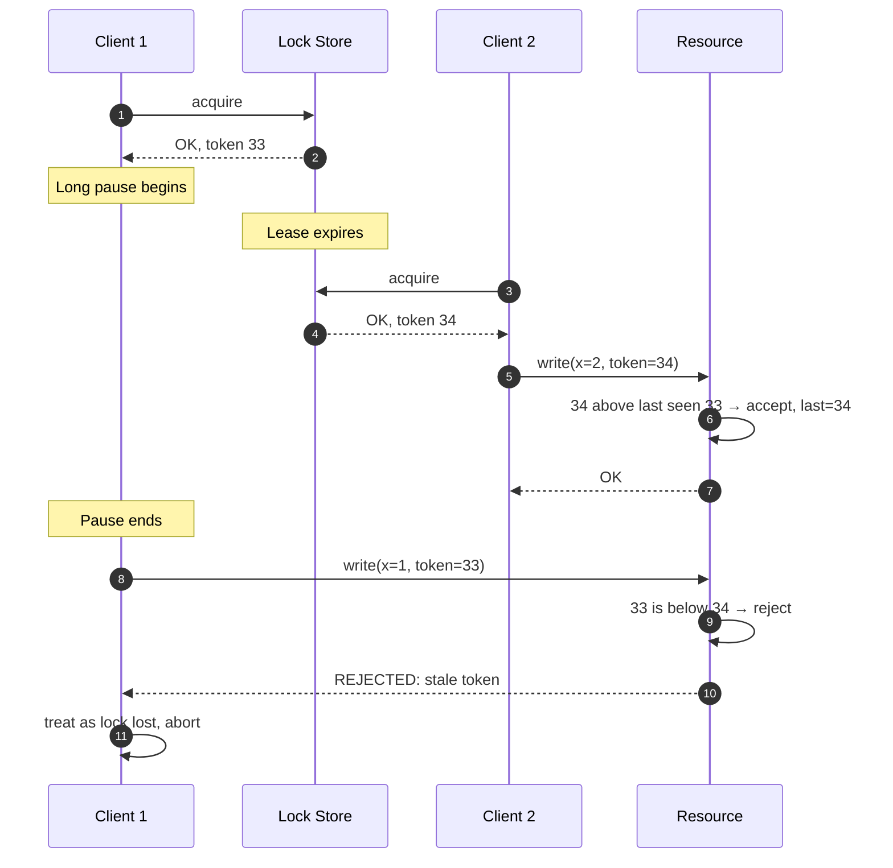

### 11.3 Token Sources by Backend

| Backend         | Token source                                          | Monotonic across failover?                      |
| --------------- | ----------------------------------------------------- | ----------------------------------------------- |
| Single Redis    | `INCR lock:{key}:fence` in the same Lua as the SET    | Only if persisted (AOF `appendfsync always`)    |
| Redis + replica | Same                                                  | No: async replication can lose increments       |
| Redlock         | None built in                                         | No fencing available natively                   |
| etcd            | Key's `mod_revision` or `create_revision`             | Yes: global revision is raft-replicated         |
| ZooKeeper       | Znode `czxid`, or sequential node number              | Yes: zxid is Zab-replicated                     |
| Consul          | `LockIndex` / `ModifyIndex` of the KV entry           | Yes: raft index                                 |
| PostgreSQL      | Sequence value or `version` column incremented in txn | Yes, if the sequence is in the same durable DB  |
| DynamoDB        | Conditional update of a `version` attribute           | Yes: conditional writes are strongly consistent |
| Chubby          | Lock "sequencer" (lock name, mode, generation number) | Yes                                             |

### 11.4 Enforcement at the Resource

The resource must perform the check and the write **atomically**, otherwise the check itself has a race.

**SQL row with a per-key token column:**

```sql
UPDATE accounts
SET    balance    = :new_balance,
       last_token = :token
WHERE  id         = :account_id
  AND  last_token < :token;     -- or <= if the same holder writes repeatedly
-- 0 rows affected → stale token → abort
```

**Separate fence table for a whole job:**

```sql
-- Inside the same transaction as the business write
UPDATE fences
SET    token   = :token
WHERE  name    = 'billing'
  AND  token  <= :token;
-- if 0 rows: ROLLBACK
```

**Object storage / external API:** pass the token in a header (`X-Fencing-Token: 34`).  
The service must persist the high-water mark per resource and compare atomically.  
If the external system cannot do this, fencing is impossible against it, and the design must instead rely on idempotency keys (Section 23).

### 11.5 Strict vs Non-Strict Comparison

| Comparison      | Accepts                               | Use when                                                |
| --------------- | ------------------------------------- | ------------------------------------------------------- |
| `token > last`  | Only the first write of each holder   | Each holder writes exactly once                         |
| `token >= last` | Repeated writes by the current holder | A holder performs many writes during its tenure (usual) |

### 11.6 Limits of Fencing

- The resource must be able to store and compare tokens. Many third-party APIs cannot.
- Fencing protects writes that **reach** the resource in token order. A side effect outside the resource (an email sent, a webhook fired) is not fenced.
- Every resource touched under the lock needs its own check. Fencing one table but not another leaves a hole.
- Tokens must come from the same linearizable source that grants the lock; a separate counter can drift from the actual grant order.

---

# Part III: Backends

## 12. Single-Node Redis

### 12.1 Acquire

```lua
SET lock:billing "host-a:4312:9f1c2e7a" NX PX 30000
```

| Part       | Meaning                                                   |
| ---------- | --------------------------------------------------------- |
| `SET`      | Write a string value                                      |
| key        | The lock name, shared by all contenders                   |
| value      | Owner id, unique per attempt                              |
| `NX`       | Only if the key does not exist (the atomic check-and-set) |
| `PX 30000` | Expire after 30,000 ms (use `EX` for seconds)             |
| Reply      | `OK` on success, `nil` if the key exists                  |

Do not use the older `SETNX` followed by `EXPIRE`: if the client crashes between the two commands the key never expires.

### 12.2 Acquire With Fencing Token (Lua)

```lua
-- KEYS[1] = lock key, KEYS[2] = fence counter key
-- ARGV[1] = owner id, ARGV[2] = ttl ms
if redis.call("SET", KEYS[1], ARGV[1], "NX", "PX", ARGV[2]) then
    return redis.call("INCR", KEYS[2])
else
    return nil
end
```

The counter key must never expire and must survive restarts, so it requires AOF persistence with `appendfsync always` for real monotonicity.

### 12.3 Redis Commands Used for Locking

| Command / feature            | Purpose in lock design                                |
| ---------------------------- | ----------------------------------------------------- |
| `SET key val NX PX ms`       | Atomic acquire with lease                             |
| `EVAL` / `EVALSHA` / `FCALL` | Atomic compare-and-delete, compare-and-renew, fencing |
| `PEXPIRE` / `PTTL`           | Renew lease / inspect remaining lease                 |
| `INCR`                       | Fencing token counter                                 |
| `WAIT numreplicas timeout`   | Block until N replicas acknowledged previous writes   |
| Keyspace notifications       | Optional: notify waiters on `del` / `expired` events  |
| Pub/Sub                      | Redisson-style wake-ups for waiters                   |

### 12.4 Hazards

| Hazard                         | Scenario                                                    | Consequence                     | Mitigation                                                                                        |
| ------------------------------ | ----------------------------------------------------------- | ------------------------------- | ------------------------------------------------------------------------------------------------- |
| Restart without persistence    | Redis crashes and restarts empty                            | All locks vanish; double grants | AOF `always`, or stay down for at least max TTL after restart                                     |
| Async replication failover     | Primary acks SET, dies before replicating; replica promoted | Lock vanishes; double grant     | Consensus store; `WAIT` narrows but does not close the gap                                        |
| Clock jump on Redis host       | Expiry uses a clock that jumps                              | Leases end early                | Redis uses monotonic time for expiry in modern versions; keep NTP slewing                         |
| Eviction under memory pressure | `maxmemory-policy allkeys-*` evicts lock keys               | Locks silently disappear        | `noeviction` or `volatile-*` with care; dedicated instance                                        |
| Cluster resharding             | Key slot migrates during acquire                            | `MOVED`/`ASK` errors; retries   | Client library handles redirects; keep lock and fence keys in one slot with hash tags `{billing}` |

### 12.5 Failover Losing a Lock

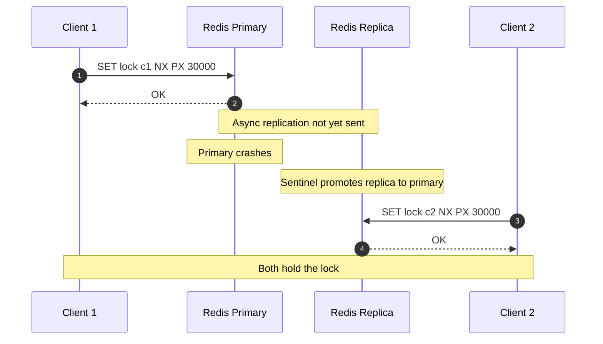

**Verdict:** single-node Redis is a good efficiency lock.  
It is not a correctness lock unless fencing is enforced at the resource, and even then token monotonicity depends on durability settings.

---

## 13. Redlock

### 13.1 Algorithm

Redlock, proposed by Redis's author, runs the lock on **N independent Redis primaries** (typically 5, no replication between them) and requires a majority.

1. Record the current time `t1` (milliseconds).
2. Try `SET key owner NX PX ttl` on each of the N instances in sequence or in parallel, with a short per-instance timeout (much smaller than `ttl`).
3. Record `t2`. Elapsed = `t2 − t1`.
4. The lock is acquired if at least `N/2 + 1` instances replied `OK` **and** elapsed < `ttl`.
5. Validity time = `ttl − elapsed − clock_drift_allowance`.
6. If not acquired, release on **all** instances (including those that seemed to fail; the reply may have been lost).
7. Release: compare-and-delete on all instances.

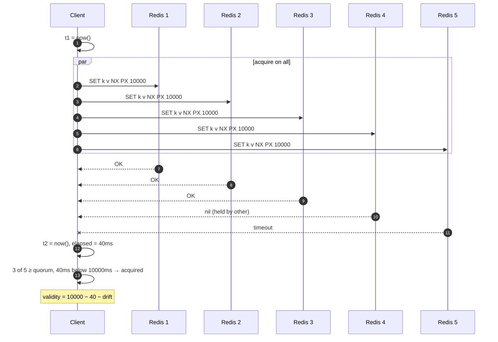

### 13.2 The Debate

In 2016 Martin Kleppmann published "How to do distributed locking", arguing Redlock is unsafe for correctness.  
Salvatore Sanfilippo (antirez) replied in "Is Redlock safe?". The core points:

| Kleppmann's claim                                                                     | Antirez's response                                                                                                            | Where it lands                                                                                      |
| ------------------------------------------------------------------------------------- | ----------------------------------------------------------------------------------------------------------------------------- | --------------------------------------------------------------------------------------------------- |
| Redlock produces no fencing token, so a paused client can corrupt the resource        | If the resource can check tokens, it can usually do CAS itself and needs no lock; random owner ids can serve similar purposes | Without tokens, no lock survives pauses; this criticism applies to every lease lock without fencing |
| Safety depends on bounded network delay, bounded pauses, and bounded clock error      | Assumes clocks are monotonic-ish and drift is bounded, which is reasonable in practice                                        | Redlock is safe only in a partially synchronous model with bounded clock error                      |
| A clock jump on one Redis node can make its key expire early, enabling two majorities | Operators should prevent clock jumps (slew, not step); this is an operational requirement                                     | Valid concern; Redis now uses monotonic clocks for some timing, but TTL semantics still matter      |
| Node restart without fsync loses the key; a new majority forms                        | Use delayed restarts: keep a restarted node unavailable for at least max TTL                                                  | Workable mitigation, but operationally fragile                                                      |
| For efficiency, a single Redis is enough; for correctness, use consensus + fencing    | Redlock offers more availability than single-node for efficiency locks                                                        | Practical consensus: Redlock occupies an awkward middle ground                                      |

### 13.3 Two Majorities via Clock Jump

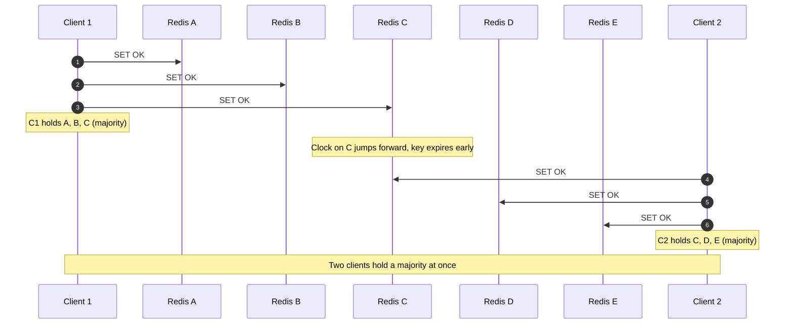

### 13.4 Verdict

| Use case         | Redlock suitable? | Reason                                                            |
| ---------------- | ----------------- | ----------------------------------------------------------------- |
| Efficiency lock  | Yes, but overkill | Single Redis gives nearly the same benefit at a fifth of the cost |
| Correctness lock | No                | No fencing tokens, timing assumptions, restart hazards            |

---

## 14. Consensus Foundation

### 14.1 Why Consensus

A correctness lock needs the store's grant decisions to be **linearizable** and **durable across node failures**.  
A single node is linearizable but not fault-tolerant; asynchronous replication is fault-tolerant but not linearizable across failover.  
Consensus protocols (Raft in etcd and Consul, Zab in ZooKeeper, Paxos in Chubby and Spanner) provide both: a write is acknowledged only after a majority has durably stored it, and any new leader is guaranteed to have every acknowledged write.

### 14.2 Quorum Arithmetic

| Cluster size N | Quorum `floor(N/2)+1` | Failures tolerated `N − quorum` | Notes                                       |
| -------------- | --------------------- | ------------------------------- | ------------------------------------------- |
| 1              | 1                     | 0                               | No fault tolerance                          |
| 2              | 2                     | 0                               | Worse than 1: either failure stops progress |
| 3              | 2                     | 1                               | Common minimum for production               |
| 4              | 3                     | 1                               | No gain over 3; more replication cost       |
| 5              | 3                     | 2                               | Common for critical systems                 |
| 7              | 4                     | 3                               | Rarely needed; higher write latency         |

Use odd sizes. Any two majorities share at least one node, so two conflicting lock grants cannot both be committed.

### 14.3 Raft Replicating a Lock Write

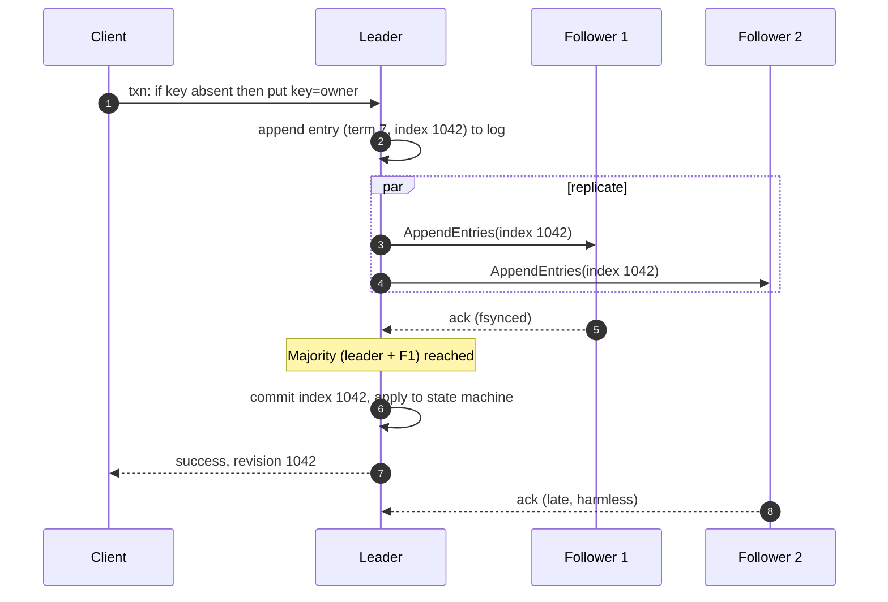

The revision (1042) is a strictly increasing, cluster-wide number: a fencing token for free.

### 14.4 What Consensus Does and Does Not Fix

| Problem                          | Fixed by consensus? | Explanation                                                                                                 |
| -------------------------------- | ------------------- | ----------------------------------------------------------------------------------------------------------- |
| Lost lock on store node crash    | Yes                 | Majority holds every committed write                                                                        |
| Lost lock on failover            | Yes                 | New leader must contain all committed entries                                                               |
| Monotonic fencing tokens         | Yes                 | Log index / revision only increases                                                                         |
| Store clock jumps                | Mostly              | Lease expiry in etcd is driven by the leader's monotonic timer; leader change extends leases conservatively |
| Client process pauses            | No                  | Still need fencing at the resource                                                                          |
| Client partitioned from resource | No                  | Still need fencing at the resource                                                                          |
| Minority partition availability  | No (by design)      | Minority side cannot grant locks: CP, not AP                                                                |

### 14.5 CAP Position

A correctness lock **must** choose consistency over availability during a partition.  
A lock that stays available on both sides of a partition grants it to both sides.  
Consensus stores refuse writes on the minority side, which is exactly the desired behaviour.

---

## 15. ZooKeeper

### 15.1 Concepts

| Concept          | Meaning                                                                     |
| ---------------- | --------------------------------------------------------------------------- |
| Znode            | A node in a hierarchical namespace, like a file with a small payload        |
| Session          | Client connection with a timeout; kept alive by heartbeats                  |
| Ephemeral znode  | Deleted automatically when the creating session expires                     |
| Sequential znode | Name gets a monotonically increasing 10-digit suffix assigned by the server |
| Watch            | One-time notification when a znode changes or is deleted                    |
| zxid             | 64-bit transaction id; global total order of all writes                     |
| czxid / mzxid    | zxid of the creation / last modification of a znode                         |

### 15.2 Znode Types

| Type                  | Persistent?             | Sequential suffix? | Lock use                               |
| --------------------- | ----------------------- | ------------------ | -------------------------------------- |
| Persistent            | Yes                     | No                 | Lock parent directory `/locks/billing` |
| Persistent sequential | Yes                     | Yes                | Rarely for locks                       |
| Ephemeral             | No                      | No                 | Simple exclusive lock (herd-prone)     |
| Ephemeral sequential  | No                      | Yes                | Fair queue lock recipe                 |
| Container (3.5+)      | Auto-removed when empty | No                 | Lock parent that cleans itself up      |
| TTL (3.5.3+)          | Expires if unmodified   | Optional           | Persistent nodes with expiry           |

### 15.3 The Lock Recipe

1. Create `/locks/billing/lock-` as **ephemeral sequential**. Server returns e.g. `lock-0000000017`.
2. List children of `/locks/billing` and sort.
3. If your node is the lowest, you hold the lock.
4. Otherwise, set a watch on the node **immediately before yours** in sorted order (not on the lowest).
5. When that watch fires, go back to step 2 (the predecessor may have died rather than reached the front, so re-check).
6. Release: delete your node. Crash: session expires, node deleted automatically.

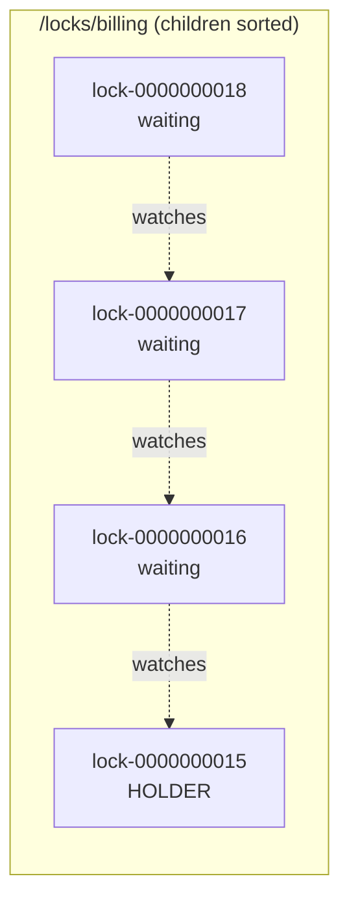

When 15 is deleted, only 16 wakes. No herd.

### 15.4 Acquire Flow

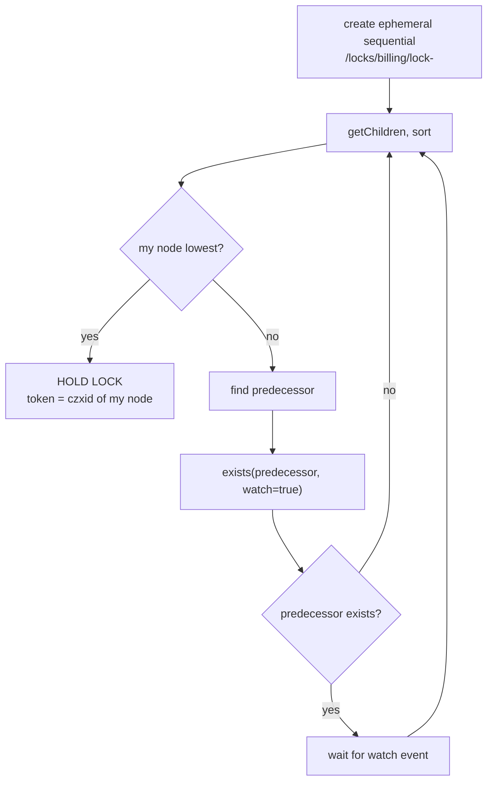

### 15.5 Session Semantics and Their Traps

| Event                       | What the client sees                        | What it must do                                                         |
| --------------------------- | ------------------------------------------- | ----------------------------------------------------------------------- |
| `Disconnected`              | Connection lost; session may still be alive | Stop work that needs the lock, or keep going only until session timeout |
| `SyncConnected` (reconnect) | Session still valid                         | Continue; ephemeral node still exists                                   |
| `Expired`                   | Session gone; ephemeral node deleted        | Lock is lost; abort; create a new session to retry                      |

Trap: a client disconnected from ZooKeeper cannot know whether its session has expired on the server side. A pausing client is in the same position.  
Apache Curator's `InterProcessMutex` implements the recipe and handles reconnection; fencing via `czxid` is still the caller's responsibility.

---

## 16. etcd

### 16.1 Primitives

| Primitive           | Description                                                              | Lock role                     |
| ------------------- | ------------------------------------------------------------------------ | ----------------------------- |
| Lease               | A TTL object with an id; keys can be attached; `KeepAlive` extends it    | Lease = lock liveness         |
| `Put` with lease    | Key is deleted when the lease expires or is revoked                      | Lock record                   |
| `Txn`               | If/Then/Else with compares on value, version, create/mod revision, lease | Atomic acquire and release    |
| Revision            | Cluster-wide counter incremented on every write                          | Fencing token                 |
| `create_revision`   | Revision at which a key was created                                      | Queue position; fencing token |
| Watch               | Stream of changes from a given revision                                  | Wait for predecessor deletion |
| `concurrency.Mutex` | Go client library implementation of a fair lock                          | Ready-made recipe             |

### 16.2 Acquire With a Transaction

```lua
lease = LeaseGrant(ttl=15)
KeepAlive(lease)                        # background renewal

resp = Txn(
    If:   CreateRevision("lock/billing") == 0          # key does not exist
    Then: Put("lock/billing", owner_id, lease=lease)
    Else: Get("lock/billing")
)
if resp.succeeded:
    token = resp.header.revision        # fencing token
```

### 16.3 Fair Mutex (concurrency package)

The Go `concurrency.Mutex` works like the ZooKeeper recipe, using revisions instead of sequence numbers:

1. Put `lock/billing/<lease-id>` attached to the session lease.
2. Its `create_revision` determines queue position.
3. Wait for deletion of all keys under the prefix with a smaller `create_revision` (specifically, the one immediately before).
4. Holder's `create_revision` doubles as fencing token.

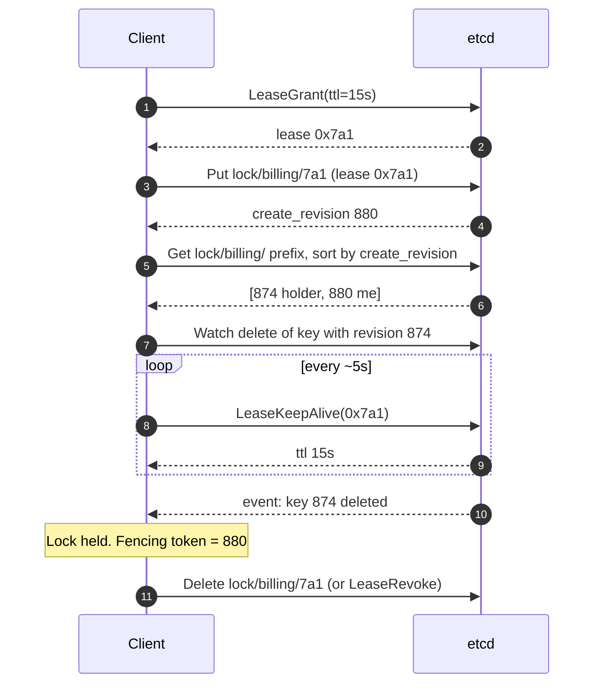

### 16.4 etcd Lease Behaviour

| Situation                       | Behaviour                                                                           |
| ------------------------------- | ----------------------------------------------------------------------------------- |
| Client stops sending keepalives | Lease expires after TTL; attached keys deleted                                      |
| etcd leader changes             | New leader resets lease timers to full TTL (conservative: never expires early)      |
| Client partitioned              | Keepalive stream breaks; client library reports lease loss after timeout            |
| `LeaseRevoke`                   | Immediate deletion of all attached keys                                             |
| Minimum TTL                     | Bounded below by election timeout multiples; very short TTLs are rejected or raised |

Note the leader-change rule: leases can live **longer** than TTL, never shorter.  
This favours safety on the store side but means recovery after a holder crash can take longer than one TTL.

---

## 17. Relational Databases

When the protected data already lives in one relational database, the database itself is often the best lock, because the lock and the data share a transaction and a durability guarantee.

### 17.1 Techniques

| Technique                              | Scope of exclusion                  | Released when                          | Survives connection loss?   | Caveats                                                             |
| -------------------------------------- | ----------------------------------- | -------------------------------------- | --------------------------- | ------------------------------------------------------------------- |
| `SELECT ... FOR UPDATE`                | Specific rows                       | Transaction commits or rolls back      | No (txn aborts)             | Holds a transaction open; long holds block vacuum and other writers |
| `SELECT ... FOR UPDATE SKIP LOCKED`    | Rows; skip ones locked by others    | Transaction end                        | No                          | Excellent for job queues; not a named lock                          |
| `SELECT ... FOR UPDATE NOWAIT`         | Rows; fail fast if locked           | Transaction end                        | No                          | Try-lock semantics                                                  |
| PostgreSQL `pg_advisory_lock(id)`      | Arbitrary 64-bit key, session-level | Explicit unlock or session end         | No (released on disconnect) | Connection poolers in transaction mode break session locks          |
| PostgreSQL `pg_advisory_xact_lock(id)` | Arbitrary key, transaction-level    | Transaction end                        | No                          | Safe with poolers                                                   |
| MySQL `GET_LOCK(name, timeout)`        | Named lock, session-level           | `RELEASE_LOCK` or session end          | No                          | Same pooler caveat                                                  |
| Lock table with expiry                 | Named row                           | Explicit delete or expiry check        | Yes                         | You implement leases, ownership, fencing yourself                   |
| Optimistic concurrency (`version`)     | Single row                          | Not a lock: conflict detected at write | Yes                         | Retries on conflict; often replaces locks entirely                  |

### 17.2 Lock Table Pattern

```sql
CREATE TABLE distributed_locks (
    lock_key      TEXT        PRIMARY KEY,
    owner_id      TEXT        NOT NULL,
    fencing_token BIGINT      NOT NULL,
    expires_at    TIMESTAMPTZ NOT NULL,
    acquired_at   TIMESTAMPTZ NOT NULL DEFAULT now(),
    holder_info   JSONB
);

CREATE SEQUENCE lock_fence_seq;

-- Acquire (insert, or take over an expired lock)
INSERT INTO distributed_locks (lock_key, owner_id, fencing_token, expires_at)
VALUES ('billing', :owner, nextval('lock_fence_seq'), now() + interval '30 seconds')
ON CONFLICT (lock_key) DO UPDATE
    SET owner_id      = EXCLUDED.owner_id,
        fencing_token = EXCLUDED.fencing_token,
        expires_at    = EXCLUDED.expires_at,
        acquired_at   = now()
    WHERE distributed_locks.expires_at < now()
RETURNING fencing_token;
-- A row returned → acquired. No row → held by someone else.

-- Renew
UPDATE distributed_locks
SET    expires_at = now() + interval '30 seconds'
WHERE  lock_key = 'billing' AND owner_id = :owner AND expires_at > now();

-- Release
DELETE FROM distributed_locks
WHERE  lock_key = 'billing' AND owner_id = :owner;
```

`now()` is the database server's clock, so every client uses one clock. `nextval` can skip values but never goes backward, so it is a valid fencing token.  
Note that sequence calls are non-transactional: a rolled-back acquire burns a value, which is harmless.

### 17.3 Advisory Lock Pitfall With Connection Poolers

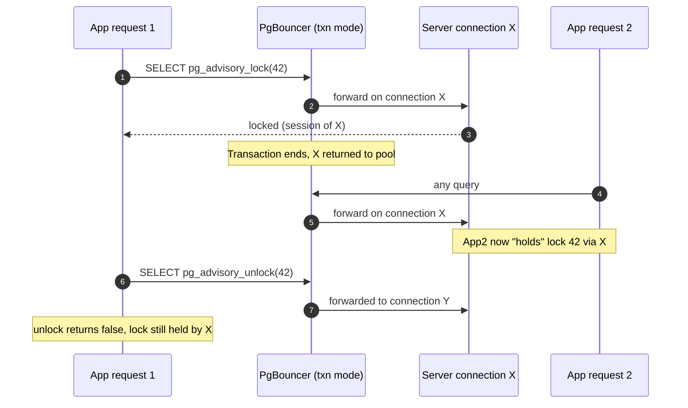

Use transaction-scoped advisory locks, or a dedicated non-pooled connection for session locks.

---

## 18. Other Backends

### 18.1 Consul

- **Sessions** bind to node health checks and have a TTL; `Behavior = release` or `delete` defines what happens to held keys on session invalidation.
- **Acquire:** `PUT /v1/kv/locks/billing?acquire=<session>` succeeds only if no other session holds the key.
- **Fencing:** the key's `LockIndex` increments on each acquisition; `ModifyIndex` is a raft index.
- **Lock-delay:** after a session is invalidated, the key cannot be re-acquired for a configurable delay (default 15 s).  
  This gives a crashed-but-actually-paused holder time to notice and stop.  

It is a heuristic, not a guarantee.

### 18.2 DynamoDB

- **Acquire:** `PutItem` with `ConditionExpression: attribute_not_exists(lock_key) OR expires_at < :now`.
- **Renew / release:** conditional update/delete on `owner_id = :me`.
- **Fencing:** a `version` attribute incremented in every conditional write.
- **Clock:** the condition compares client-supplied times, so the client clocks matter.  
The AWS "DynamoDB Lock Client" avoids trusting clocks by having waiters observe a record version number (`recordVersionNumber`) that the holder changes on every heartbeat;  
if it stays unchanged for a full lease duration as measured locally, the lock is considered abandoned.
- DynamoDB's native TTL deletion is lazy (can take hours or days), so it cannot be used as the lease mechanism itself.

### 18.3 Google Chubby (Historical Reference)

Chubby (Burrows, OSDI 2006) is the origin of most ideas in this document:

| Chubby idea                          | Descendant                      |
| ------------------------------------ | ------------------------------- |
| Coarse-grained, advisory locks       | Leader election as the main use |
| Paxos-replicated cell of 5 replicas  | etcd, ZooKeeper, Consul         |
| Sessions with KeepAlive and lease    | ZooKeeper sessions, etcd leases |
| Sequencers (lock generation numbers) | Fencing tokens                  |
| Lock-delay after holder failure      | Consul lock-delay               |
| File-system-like namespace           | ZooKeeper znodes                |

Chubby's design paper explicitly recommends sequencers for any resource that can check them, and lock-delay as a fallback for those that cannot.

### 18.4 Kubernetes Leases

The `coordination.k8s.io/v1 Lease` object (stored in etcd) is used by controller leader election. Fields: `holderIdentity`, `leaseDurationSeconds`, `renewTime`, `leaseTransitions`.  
Acquisition uses optimistic concurrency on `resourceVersion`. Expiry is judged by clients comparing `renewTime` to their own clocks, so it assumes reasonably synchronized clocks.  
`leaseTransitions` can serve as a coarse fencing token.

---

## 19. Backend Comparison

### 19.1 Master Matrix

| Backend            | Consistency on failover      | Native fencing token       | Failure detection           | Fair queue         | Acquire latency | Throughput | Operational cost         | Correctness lock?              |
| ------------------ | ---------------------------- | -------------------------- | --------------------------- | ------------------ | --------------- | ---------- | ------------------------ | ------------------------------ |
| Redis single node  | N/A (single point)           | Via INCR, durability-bound | Key TTL                     | No (Redisson: yes) | ~0.2–1 ms       | Very high  | Low                      | No                             |
| Redis + replica    | Can lose locks               | Unsafe                     | Key TTL                     | No                 | ~0.2–1 ms       | Very high  | Low                      | No                             |
| Redlock (5 nodes)  | Majority, timing-dependent   | None                       | Key TTL                     | No                 | ~1–5 ms         | High       | Medium                   | No                             |
| ZooKeeper          | Linearizable writes (Zab)    | zxid / sequence number     | Session timeout             | Yes                | ~2–10 ms        | Medium     | High (JVM, ensemble)     | Yes, with fencing              |
| etcd               | Linearizable (Raft)          | Revision                   | Lease TTL                   | Yes                | ~2–10 ms        | Medium     | Medium                   | Yes, with fencing              |
| Consul             | Linearizable (Raft)          | LockIndex / ModifyIndex    | Session + health checks     | Via semaphores     | ~2–10 ms        | Medium     | Medium                   | Yes, with fencing              |
| PostgreSQL / MySQL | Depends on replication setup | Sequence / version column  | Connection or expiry column | With SKIP LOCKED   | ~1–5 ms         | Medium     | Low if DB already exists | Yes, if data is in the same DB |
| DynamoDB           | Strongly consistent writes   | Version attribute          | Lease + version heartbeat   | No                 | ~5–20 ms        | High       | Low (managed)            | Yes, with fencing              |
| Kubernetes Lease   | etcd-backed                  | leaseTransitions (coarse)  | Client clock vs renewTime   | No                 | ~10–50 ms       | Low        | Low inside k8s           | Leader election only           |

### 19.2 Choosing a Backend

```mermaid
flowchart TD
    S(["Need a distributed lock"]) --> Q1{"Is the protected data<br/>in one relational DB?"}
    Q1 -->|yes| DB["Use the DB:<br/>row lock, advisory xact lock,<br/>or lock table + fencing column"]
    Q1 -->|no| Q2{"Efficiency or<br/>correctness?"}
    Q2 -->|efficiency| Q3{"Redis already<br/>in the stack?"}
    Q3 -->|yes| R["Single Redis:<br/>SET NX PX + Lua release"]
    Q3 -->|no| Q3b{"Running on<br/>Kubernetes?"}
    Q3b -->|yes| K["Kubernetes Lease<br/>or etcd"]
    Q3b -->|no| R2["Redis or the store<br/>you already operate"]
    Q2 -->|correctness| Q4{"Can the resource<br/>check a token?"}
    Q4 -->|yes| Q5{"Already operate a<br/>consensus store?"}
    Q5 -->|"etcd / k8s"| E["etcd lease + txn<br/>revision as token"]
    Q5 -->|"ZooKeeper"| Z["Curator recipe<br/>czxid as token"]
    Q5 -->|"Consul"| C["Consul session<br/>LockIndex as token"]
    Q5 -->|none| E
    Q4 -->|no| ID["Redesign: idempotency keys,<br/>conditional writes,<br/>or single-writer partitioning"]
```

---

# Part IV: Advanced Design

## 20. Lock Variants

### 20.1 Variant Overview

| Variant             | Semantics                                                     | Typical use                                  | Implementation sketch                                                   |
| ------------------- | ------------------------------------------------------------- | -------------------------------------------- | ----------------------------------------------------------------------- |
| Exclusive (mutex)   | One holder                                                    | Default                                      | `SET NX`, txn on absent key, ephemeral node                             |
| Reentrant           | Same owner may acquire again; must release equally many times | Recursive code paths under one logical owner | Store `owner_id` + `count`; increment on re-acquire by same owner       |
| Read-write (shared) | Many readers or one writer                                    | Config reads vs config updates               | Reader set + writer flag; writer waits for readers to drain             |
| Counting semaphore  | Up to N concurrent holders                                    | Rate-limiting access to a fragile dependency | Set of up to N holder entries, each with its own lease                  |
| Leader election     | One long-lived holder; others standby                         | Active/passive schedulers, primary writers   | Lock with renewal + "leader changed" callbacks; often a lease API       |
| Hierarchical        | Lock on parent implies lock on children                       | Tree-shaped resources (folders, org units)   | Intention locks (IS, IX) on ancestors, real locks on targets            |
| Striped             | Hash many keys onto K lock stripes                            | Bound lock-key cardinality                   | `lock:stripe:{hash(key) mod K}`; false sharing between keys in a stripe |
| Multi-lock          | Atomically acquire a set of keys                              | Transfers between two accounts               | Global ordering + all-or-nothing; or a single txn over all keys         |

### 20.2 Reentrant Lock (Redis Hash, Redisson-Style)

```lua
-- KEYS[1] = lock key; ARGV[1] = ttl ms; ARGV[2] = owner id
if redis.call("EXISTS", KEYS[1]) == 0 then
    redis.call("HSET", KEYS[1], ARGV[2], 1)
    redis.call("PEXPIRE", KEYS[1], ARGV[1])
    return 1
end
if redis.call("HEXISTS", KEYS[1], ARGV[2]) == 1 then
    redis.call("HINCRBY", KEYS[1], ARGV[2], 1)
    redis.call("PEXPIRE", KEYS[1], ARGV[1])
    return 1
end
return 0
```

Release decrements the counter and deletes the key only when it reaches zero.  
Distributed reentrancy is subtle: the owner id must represent the **logical owner** (for example a thread or a request), not just the process, or two unrelated threads in one process will "reenter" each other's lock.

### 20.3 Read-Write Lock Admission

```mermaid
flowchart TD
    REQ["Request"] --> M{"mode?"}
    M -->|read| R1{"writer holding<br/>or writer waiting?"}
    R1 -->|no| RG["Grant shared<br/>readers += 1"]
    R1 -->|yes| RW["Wait<br/>(writer preference)"]
    M -->|write| W1{"writer holding<br/>or readers active?"}
    W1 -->|no| WG["Grant exclusive"]
    W1 -->|yes| WW["Enqueue as waiting writer<br/>blocks new readers"]
    RW --> R1
    WW --> W1
```

| Policy            | Behaviour                                 | Risk                   |
| ----------------- | ----------------------------------------- | ---------------------- |
| Reader preference | New readers admitted while a writer waits | Writer starvation      |
| Writer preference | Waiting writer blocks new readers         | Reader latency spikes  |
| FIFO              | Strict arrival order across both modes    | Lower read concurrency |

In ZooKeeper, the shared-lock recipe uses `read-` and `write-` sequential nodes: a reader waits on the nearest preceding `write-` node; a writer waits on the nearest preceding node of any kind.

### 20.4 Counting Semaphore

```python
semaphore "vendor-api", permits = 5

acquire:
    remove expired holder entries
    if count(holders) < 5:
        add {owner_id, expires_at}
        return OK
    return FULL
```

In Redis this is commonly a sorted set scored by expiry time, with `ZREMRANGEBYSCORE` to evict expired holders and `ZCARD` to count, all inside one Lua script.  
In etcd, each permit holder writes a key under a prefix with its own lease; the holders are the N keys with the lowest `create_revision`.

### 20.5 Leader Election as a Long-Lived Lock

Leader election is a lock that is held indefinitely and renewed continuously. Extra requirements:

| Requirement                     | Why                                                  |
| ------------------------------- | ---------------------------------------------------- |
| "Became leader" callback        | Start leader-only duties                             |
| "Lost leadership" callback      | Stop duties immediately, before the next side effect |
| Leadership epoch / term         | Fencing token for every leader-only write            |
| Observability of current leader | Followers route requests to the leader               |
| Graceful handoff                | Release on shutdown to avoid a full TTL gap          |

---

## 21. Multi-Resource Locking and Deadlock

### 21.1 Coffman Conditions

Deadlock requires all four. Break any one and deadlock is impossible.

| Condition        | Meaning                              | How to break it in a distributed lock system                    |
| ---------------- | ------------------------------------ | --------------------------------------------------------------- |
| Mutual exclusion | Resources cannot be shared           | Use shared/read locks where possible (rarely removable)         |
| Hold and wait    | Holder of one lock waits for another | Acquire all locks at once, or release everything on any failure |
| No preemption    | Locks cannot be taken away           | Leases: every lock is preempted after its TTL                   |
| Circular wait    | A cycle of waiters                   | Global lock ordering: always acquire in sorted key order        |

Leases already break "no preemption", so distributed lease locks cannot deadlock **permanently**.  
They can still livelock or stall for a full TTL, which is unacceptable in practice, so ordering is still required.

### 21.2 The Classic Cycle

```mermaid
flowchart LR
    T1["Transfer 1<br/>A → B"] -->|"holds"| LA["lock:account:A"]
    T1 -.->|"waits for"| LB["lock:account:B"]
    T2["Transfer 2<br/>B → A"] -->|"holds"| LB
    T2 -.->|"waits for"| LA
```

Fix: both transfers lock `min(A, B)` first, then `max(A, B)`. The cycle cannot form.

### 21.3 Prevention Techniques

| Technique                  | How                                                                   | Cost                                              |
| -------------------------- | --------------------------------------------------------------------- | ------------------------------------------------- |
| Global ordering            | Sort keys; acquire in order                                           | Requires knowing all keys up front                |
| All-or-nothing acquisition | Single atomic txn over all keys (etcd txn, Lua over keys in one slot) | Limited by store's multi-key atomicity            |
| Try-all-then-back-off      | Try each; on any failure release all and retry with jittered backoff  | Livelock possible under heavy contention          |
| Acquire timeout            | Give up waiting after a bound                                         | Callers must handle failure                       |
| Coarser lock               | Replace N fine locks with one coarse lock                             | Less concurrency                                  |
| Deadlock detection         | Build a wait-for graph; abort one participant                         | Complex in a distributed setting; rarely worth it |

### 21.4 All-or-Nothing Acquire Sketch

```lua
keys = sort(["lock:account:B", "lock:account:A"])
acquired = []
for k in keys:
    if try_acquire(k, owner, ttl):
        acquired.append(k)
    else:
        for a in reversed(acquired): release(a, owner)
        sleep(jittered_backoff())
        restart
```

---

## 22. Defense in Depth

### 22.1 Layers

No single mechanism makes a distributed critical section safe.  
Each layer covers failures the previous ones cannot.

| Layer | Mechanism                                  | Failure it stops                                         | What gets past it                        |
| ----- | ------------------------------------------ | -------------------------------------------------------- | ---------------------------------------- |
| 1     | Atomic acquire (`SET NX`, txn)             | Two clients acquiring simultaneously in normal operation | Store failover, pauses                   |
| 2     | Owner id + compare-and-delete              | A client deleting another client's lock                  | Pauses (holder still acts)               |
| 3     | Lease + renewal                            | Crashed holder blocking everyone forever                 | Paused holder resuming after expiry      |
| 4     | Consensus store                            | Lock loss on store node crash or failover                | Pauses, client-resource partitions       |
| 5     | Fencing token at the resource              | Stale holder writing after its lease expired             | Side effects outside the fenced resource |
| 6     | Idempotent operations / unique constraints | Duplicate execution reaching the resource by any path    | Non-idempotent external side effects     |
| 7     | Reconciliation / audit                     | Anything that slipped through                            | Nothing, but detection is after the fact |

### 22.2 Diagram

```mermaid
flowchart TB
    W["Worker wants to act"] --> L1["1 Atomic acquire"]
    L1 --> L2["2 Owner id on renew and release"]
    L2 --> L3["3 Lease + renewal"]
    L3 --> L4["4 Consensus-replicated store"]
    L4 --> L5["5 Fencing token checked by resource"]
    L5 --> L6["6 Idempotency key / unique constraint"]
    L6 --> OK[("Invariant preserved")]
    L7["7 Reconciliation job"] -.->|"detects and repairs"| OK
```

### 22.3 Matching Layers to Lock Purpose

| Layer            | Efficiency lock | Correctness lock |
| ---------------- | --------------- | ---------------- |
| Atomic acquire   | Required        | Required         |
| Owner id release | Required        | Required         |
| Lease + renewal  | Required        | Required         |
| Consensus store  | Optional        | Recommended      |
| Fencing token    | Optional        | Required         |
| Idempotency      | Recommended     | Required         |
| Reconciliation   | Optional        | Recommended      |

---

## 23. Alternatives to Locking

A distributed lock adds a dependency, latency, and a failure mode.  
Often a different design removes the need for one.

### 23.1 Alternatives Table

| Problem                                  | Alternative                                      | How it works                                                                 | Why it can be better than a lock                     |
| ---------------------------------------- | ------------------------------------------------ | ---------------------------------------------------------------------------- | ---------------------------------------------------- |
| Lost update on a row                     | Optimistic concurrency (`version` column)        | `UPDATE ... SET v = v + 1 WHERE id = ? AND v = ?`; retry on 0 rows           | No lock service; conflict detected at the resource   |
| Double charge / double send              | Idempotency key                                  | Unique key per logical operation; second attempt returns the first result    | Safe under any number of retries and concurrent runs |
| Double booking                           | Unique constraint                                | `UNIQUE (show_id, seat_id)` on bookings                                      | The database is the arbiter; impossible to violate   |
| Seat or stock hold                       | Conditional update in the DB                     | `UPDATE seats SET held_by=? WHERE id=? AND status='FREE'`                    | Hold and data in one transaction                     |
| Per-entity serialization                 | Single-writer partitioning                       | Route all events for an entity to one partition and one consumer (Kafka key) | Ordering by construction; no coordination per event  |
| Singleton job                            | Exclusive queue consumer / scheduler with leader | One message per run in a queue with visibility timeout                       | The queue's delivery semantics provide exclusion     |
| Job queue workers stepping on each other | `SELECT ... FOR UPDATE SKIP LOCKED`              | Each worker claims distinct rows                                             | Parallelism without a named lock                     |
| Concurrent counters or sets              | Atomic operations / CRDTs                        | `INCR`, `HINCRBY`, G-Counters, OR-Sets                                       | Commutative merges; no exclusion needed              |
| Cache stampede                           | Request coalescing / probabilistic early refresh | One in-flight recompute per process; random early expiry                     | No cross-process coordination                        |
| Config change races                      | Compare-and-swap on the config store             | Write only if version unchanged                                              | Same atomicity, no lease                             |

### 23.2 Do You Need a Distributed Lock?

```mermaid
flowchart TD
    A(["Concurrent actors may conflict"]) --> B{"Can the operation be<br/>made idempotent?"}
    B -->|yes| B1["Idempotency key / unique constraint.<br/>Lock optional, only to save work."]
    B -->|no| C{"Is the state in one store<br/>that supports CAS or transactions?"}
    C -->|yes| C1["Optimistic concurrency or<br/>conditional write. No lock."]
    C -->|no| D{"Can all work for a key be<br/>routed to one worker?"}
    D -->|yes| D1["Single-writer partitioning<br/>(queue key, consistent hashing)."]
    D -->|no| E{"Does a conflict cause<br/>harm or only waste?"}
    E -->|waste| E1["Efficiency lock:<br/>simple store + TTL."]
    E -->|harm| E2["Correctness lock:<br/>consensus store + fencing<br/>+ idempotency."]
```

---

## 24. Client Library and API Design

### 24.1 API Surface

| Method                               | Contract                                                                           | Returns              |
| ------------------------------------ | ---------------------------------------------------------------------------------- | -------------------- |
| `tryAcquire(key, ttl)`               | Single attempt; never blocks beyond one store round trip                           | `Lease` or `null`    |
| `acquire(key, ttl, timeout, ctx)`    | Retries with backoff or watch until acquired, timeout, or cancellation             | `Lease` or error     |
| `Lease.token`                        | Fencing token for this grant                                                       | Integer              |
| `Lease.renew()`                      | Compare-and-renew; normally called by the watchdog                                 | OK or `LockLost`     |
| `Lease.release()`                    | Compare-and-delete; idempotent; safe to call after loss                            | Released / NotOwner  |
| `Lease.isValid()`                    | Local estimate based on monotonic deadline; advisory only                          | Boolean              |
| `Lease.lost()`                       | A channel / future / cancellation token that fires when the lock is known lost     | Signal               |
| `withLock(key, ttl, fn(ctx, token))` | Acquire, start watchdog, run `fn` with a context cancelled on loss, always release | `fn` result or error |

### 24.2 withLock Wrapper

```lua
function withLock(key, ttl, fn):
    owner = new_owner_id()
    lease = acquire(key, owner, ttl, timeout)        # throws on timeout
    ctx   = new_cancellable_context()
    wd    = start_watchdog(lease, interval = ttl / 3,
                           on_lost = () => ctx.cancel(LOCK_LOST))
    try:
        return fn(ctx, lease.token)                  # fn must check ctx and pass token
    finally:
        wd.stop()
        try: lease.release()                         # idempotent
        except StoreUnavailable: enqueue_release_retry(lease)
```

```mermaid
sequenceDiagram
    autonumber
    participant App as Application
    participant Lib as Lock Library
    participant WD as Watchdog
    participant S as Store
    participant R as Resource

    App->>Lib: withLock("billing", 30s, fn)
    Lib->>S: acquire
    S-->>Lib: OK, token 57
    Lib->>WD: start (every 10s)
    Lib->>App: fn(ctx, token=57)
    App->>R: write(token=57)
    R-->>App: OK
    WD->>S: renew
    S--xWD: timeout
    WD->>WD: local deadline passed
    WD->>Lib: LOST
    Lib->>App: ctx.cancel(LOCK_LOST)
    App->>App: next ctx check fails, abort
    Lib->>S: release (best effort)
    Lib-->>App: error LOCK_LOST
```

### 24.3 Design Rules for the Library

| Rule                                                | Reason                                                                  |
| --------------------------------------------------- | ----------------------------------------------------------------------- |
| Generate owner ids internally                       | Callers reuse ids; reuse breaks ownership                               |
| Expose the fencing token prominently                | If it is hidden, nobody uses it                                         |
| Cancel work on loss via the language's cancellation | Callbacks that set a flag nobody checks are useless                     |
| Never block forever                                 | Every wait and every store call has a timeout                           |
| Measure deadlines with a monotonic clock            | Wall clock jumps corrupt lease accounting                               |
| Release in `finally`, idempotently                  | Exceptions must not leak locks                                          |
| Log owner id and token on acquire, loss, release    | Post-incident reconstruction                                            |
| Fail closed for correctness locks                   | Store unavailable → do not proceed                                      |
| Allow fail open only by explicit opt-in             | Some efficiency locks prefer duplicate work to no work                  |
| Emit metrics (Section 28)                           | Contention and expirations are invisible otherwise                      |
| Do not hide reentrancy                              | Implicit reentrancy causes double-release bugs; make it a distinct type |

### 24.4 Fail-Open vs Fail-Closed

| Store unavailable → | Fail closed (do not run)                                           | Fail open (run anyway)                   |
| ------------------- | ------------------------------------------------------------------ | ---------------------------------------- |
| Correctness lock    | Required                                                           | Never                                    |
| Efficiency lock     | Safe, but work stalls                                              | Acceptable if duplicate work is harmless |
| Leader election     | Followers stay followers; leader steps down when its lease expires | Split brain                              |

---

# Part V: Practice

## 25. Case Study: Nightly Billing Job

### 25.1 Setup

| Element    | Detail                                                                  |
| ---------- | ----------------------------------------------------------------------- |
| Workers    | 3 identical app servers A, B, C, each with cron `0 0 * * * run_billing` |
| Lock store | Redis (efficiency) or etcd (correctness); both shown                    |
| Resource   | Postgres tables `subscriptions`, `payments`, `fences`                   |
| Invariant  | Each subscription charged at most once per period                       |
| Lock key   | `lock:billing:2026-10-21`                                               |

### 25.2 Design

1. **Lock** chooses one worker. Key includes the date so runs on different days never interfere.
2. **Lease 30 s + watchdog every 10 s** so a crash frees the lock within 30 s.
3. **Fencing token** from etcd revision (or Redis `INCR` if Redis is used) is written into a `fences` row inside every payment transaction.
4. **Idempotency:** `payments` has `UNIQUE (subscription_id, period)`; the gateway call carries an idempotency key `sub-{id}-{period}`.
5. **Resume:** a restarted run skips subscriptions already in `payments`.

```sql
BEGIN;
  UPDATE fences SET token = :token
  WHERE name = 'billing' AND token <= :token;          -- 0 rows → ROLLBACK, lock lost
  INSERT INTO payments (subscription_id, period, amount, gateway_ref)
  VALUES (:sub, '2026-10', :amount, :ref);              -- unique violation → already paid
COMMIT;
```

### 25.3 End-to-End Flow

```mermaid
sequenceDiagram
    autonumber
    participant A as Server A
    participant B as Server B
    participant S as Lock Store
    participant PG as Payment Gateway
    participant DB as Postgres

    par cron 00:00
        A->>S: acquire lock:billing:2026-10-21
        B->>S: acquire lock:billing:2026-10-21
    end
    S-->>A: OK, token 41
    S-->>B: held
    B->>B: log "already running", exit
    loop each due subscription
        A->>DB: is sub paid for 2026-10?
        DB-->>A: no
        A->>PG: charge(idempotency key sub-17-2026-10)
        PG-->>A: OK ref=ch_9
        A->>DB: txn: fence check token 41 + insert payment
        DB-->>A: committed
    end
    A->>S: release (compare-and-delete)
```

### 25.4 Failure Scenarios

| Scenario                                        | What happens                                                                                | Outcome                                                              |
| ----------------------------------------------- | ------------------------------------------------------------------------------------------- | -------------------------------------------------------------------- |
| A crashes mid-run                               | Watchdog stops; lease expires in ≤ 30 s; next attempt (retry cron or B on schedule) resumes | No double charge (unique key)                                        |
| A pauses 60 s (GC)                              | Lease expires; B acquires with token 42; A resumes and its fence update affects 0 rows      | A aborts; B continues                                                |
| A charged gateway, then paused before DB insert | B charges the same sub; gateway dedupes on idempotency key and returns the original charge  | One real charge                                                      |
| Redis primary fails over (Redis variant)        | Lock lost; B acquires with a token that may not be higher                                   | Fencing unreliable → unique key and gateway idempotency carry safety |
| Lock store down at 00:00                        | Fail closed: nobody runs; alert fires                                                       | Delayed billing, no corruption                                       |
| Release fails                                   | Lease expires in 30 s                                                                       | Harmless                                                             |
| Run takes longer than 24 h                      | Next day uses a different key and runs concurrently                                         | Acceptable: different period; per-sub uniqueness holds               |

---

## 26. Case Study: Ticket Seat Holds

### 26.1 Setup

| Element          | Detail                                                                 |
| ---------------- | ---------------------------------------------------------------------- |
| Contention       | Thousands of users at sale open; many targeting the same popular seats |
| Lock granularity | Per seat: `hold:show:42:seat:14C`                                      |
| Hold duration    | 10 min max; 60 s TTL extended by page heartbeat every 20 s             |
| Permanent truth  | `bookings` with `UNIQUE (show_id, seat_id)`                            |
| Payment          | External gateway with sync responses and async webhooks                |

### 26.2 Seat States

```mermaid
stateDiagram-v2
    [*] --> Free
    Free --> Held: user selects seat<br/>(SET NX, TTL 60s)
    Held --> Held: page heartbeat<br/>(extend, max 10 min total)
    Held --> Free: decline / cancel / webhook failed<br/>(explicit release)
    Held --> Free: heartbeat stops<br/>(TTL expiry)
    Held --> Sold: payment succeeded<br/>(insert booking, release hold)
    Held --> Pending: gateway timeout or pending
    Pending --> Sold: status poll / webhook success
    Pending --> Free: definitive failure
    Sold --> [*]
```

### 26.3 Flow

```mermaid
sequenceDiagram
    autonumber
    participant U1 as User 1
    participant U2 as User 2
    participant API as Booking API
    participant S as Hold Store
    participant PG as Payment Gateway
    participant DB as Database

    U1->>API: select 14C
    U2->>API: select 14C
    API->>S: SET hold:42:14C u1:h1 NX PX 60000
    API->>S: SET hold:42:14C u2:h2 NX PX 60000
    S-->>API: OK (u1)
    S-->>API: nil (u2)
    API-->>U2: seat being booked, pick another
    API-->>U1: hold confirmed, 10:00 timer
    loop every 20s while page open
        U1->>API: extend hold
        API->>S: compare-and-renew u1:h1
    end
    U1->>API: pay
    API->>PG: charge (idempotency key h1)
    PG-->>API: success
    API->>DB: INSERT booking (show 42, seat 14C, u1)
    DB-->>API: OK
    API->>S: compare-and-delete u1:h1
    API-->>U1: ticket issued
```

### 26.4 What Frees the Seat

| Situation                      | Mechanism                                   | Time to free      |
| ------------------------------ | ------------------------------------------- | ----------------- |
| Card declined                  | Explicit release on sync response           | Immediate         |
| User clicks cancel / back      | `DELETE /hold/14C` → compare-and-delete     | Immediate         |
| Async `payment.failed` webhook | Release in webhook handler                  | Seconds           |
| Tab closed                     | `sendBeacon` release (best effort) or TTL   | Immediate to 60 s |
| Server crash                   | Heartbeat stops; TTL expiry                 | ≤ 60 s            |
| Gateway timeout / `pending`    | Keep hold; poll status; release on `failed` | Until resolved    |
| Hold reaches 10 min cap        | Server refuses further extension            | 10 min            |

### 26.5 Late Success

If payment succeeds after the hold expired and someone else booked 14C, the `INSERT` into `bookings` fails the unique constraint.  
The API then refunds through the gateway using the same idempotency key and informs the user.  
The hold is a UX and contention device; the constraint is the guarantee.

---

## 27. Case Study: Shard Ownership

### 27.1 Problem

A stream of events is split into 64 shards.  
A pool of workers (which scales between 4 and 16) must process each shard with **exactly one** worker at a time, and must rebalance when workers join or leave.

### 27.2 Design

| Aspect            | Choice                                                                                           |
| ----------------- | ------------------------------------------------------------------------------------------------ |
| Store             | etcd                                                                                             |
| Lock per shard    | `shards/owner/{n}` attached to the worker's lease                                                |
| Membership        | `workers/{id}` attached to the same lease; watched by all                                        |
| Target assignment | Each worker computes its fair share: `ceil(64 / live_workers)`                                   |
| Claiming          | Txn: create `shards/owner/{n}` if absent                                                         |
| Shedding          | Worker owning more than its share releases extras after finishing in-flight batches              |
| Fencing           | Shard key's `create_revision` stored with each checkpoint; checkpoint write is conditional on it |
| Failure           | Worker dies → lease expires → its shard keys vanish → others claim them                          |

### 27.3 Claim and Rebalance Loop

```mermaid
flowchart TD
    START(["Worker starts"]) --> L["Grant lease, KeepAlive"]
    L --> REG["Put workers/my-id with lease"]
    REG --> LOOP["Reconcile loop"]
    LOOP --> CNT["Read live workers and shard owners"]
    CNT --> SHARE["target = ceil(64 / workers)"]
    SHARE --> CMP{"owned vs target"}
    CMP -->|"owned below target"| CLAIM["Txn: claim an unowned shard<br/>token = create_revision"]
    CMP -->|"owned above target"| SHED["Finish batch, checkpoint,<br/>delete shard key"]
    CMP -->|"equal"| WATCH["Watch workers/ and shards/owner/"]
    CLAIM --> WATCH
    SHED --> WATCH
    WATCH -->|"change event"| LOOP
    L -.->|"lease lost"| STOP["Stop all shard processing<br/>exit or restart"]
```

### 27.4 Checkpoint Fencing

```sql
UPDATE shard_checkpoints
SET    offset       = :offset,
       owner_token  = :token
WHERE  shard_id     = :shard
  AND  owner_token <= :token;
```

A worker that lost a shard during a pause cannot move the checkpoint backward or forward after the new owner has written, because its token is older.

---

## 28. Observability

### 28.1 Metrics

| Metric                                    | Type      | Meaning                                                  | Alert when                                         |
| ----------------------------------------- | --------- | -------------------------------------------------------- | -------------------------------------------------- |
| `lock_acquire_attempts_total{key,result}` | Counter   | Attempts by outcome: acquired, contended, timeout, error | Error ratio > 1% for 5 min                         |
| `lock_acquire_latency_seconds`            | Histogram | Time from request to grant                               | p99 above SLO                                      |
| `lock_wait_seconds`                       | Histogram | Time spent waiting due to contention                     | p99 rising steadily                                |
| `lock_hold_seconds`                       | Histogram | Time between acquire and release                         | p99 approaches TTL                                 |
| `lock_renew_failures_total`               | Counter   | Failed renewals                                          | Any sustained non-zero rate                        |
| `lock_lost_total`                         | Counter   | Locks known lost while held                              | Any occurrence for correctness locks               |
| `lock_expired_unreleased_total`           | Counter   | Leases that expired instead of being released            | Rate increase (crashes or slow work)               |
| `lock_release_not_owner_total`            | Counter   | Release found the lock already gone or re-owned          | Any occurrence: indicates lease shorter than work  |
| `fencing_rejections_total{resource}`      | Counter   | Writes rejected for stale tokens                         | Any occurrence: a pause or partition just happened |
| `lock_store_up`                           | Gauge     | Store reachability                                       | 0 for more than 30 s                               |
| `leader_changes_total`                    | Counter   | Leadership transitions                                   | More than N per hour (flapping)                    |

### 28.2 Logs

Log at acquire, renewal failure, loss, release, and fencing rejection with these fields:

| Field      | Example                          |
| ---------- | -------------------------------- |
| `lock_key` | `lock:billing:2026-10-21`        |
| `owner_id` | `app-a:4312:9f1c2e7a`            |
| `token`    | `41`                             |
| `event`    | `acquired` / `lost` / `released` |
| `held_ms`  | `18234`                          |
| `ttl_ms`   | `30000`                          |
| `trace_id` | `4bf92f3577b34da6`               |

With `owner_id` and `token` in every log line, any double-execution incident can be reconstructed as a timeline.

### 28.3 Traces

Wrap acquire, hold, and release in spans.  
Contention shows up as a long `lock.acquire` span; a lock held across a slow downstream call shows up as a long `lock.hold` span containing that call.

---

## 29. Testing

### 29.1 What to Test

| Test                  | Failure injected                                    | Expected result                                                        |
| --------------------- | --------------------------------------------------- | ---------------------------------------------------------------------- |
| Concurrent acquire    | N clients acquire the same key simultaneously       | Exactly one success                                                    |
| Holder crash          | Kill holder process (SIGKILL)                       | Another client acquires within TTL                                     |
| Holder pause          | SIGSTOP holder beyond TTL, then SIGCONT             | Second client acquires; first client's writes rejected by fencing      |
| Renewal failure       | Block holder ↔ store traffic (iptables / toxiproxy) | Holder detects loss before local deadline and cancels work             |
| Stale release         | Holder releases after expiry and takeover           | Release is a no-op; new holder unaffected                              |
| Store node failure    | Kill store leader                                   | Correctness store: no double grant; Redis single: documented loss      |
| Store partition       | Isolate minority store nodes                        | Minority refuses grants                                                |
| Clock skew            | Skew client clock (libfaketime)                     | No effect on safety when monotonic clocks are used                     |
| Clock jump on store   | Step store clock forward                            | Store-side expiry unaffected (monotonic) or behaviour documented       |
| Slow store            | Add latency to store responses                      | Acquire timeouts honoured; renewals still beat local deadline or abort |
| Release failure       | Drop release requests                               | Lock frees after TTL; retry queue drains                               |
| Lock-loss propagation | Revoke lease externally                             | Worker context cancelled before next side effect                       |

### 29.2 Techniques

| Technique                | Tooling examples                                  | What it gives you                                           |
| ------------------------ | ------------------------------------------------- | ----------------------------------------------------------- |
| Deterministic simulation | Custom simulators, FoundationDB-style sim testing | Reproducible interleavings, including rare ones             |
| Fault injection proxies  | Toxiproxy, tc netem, iptables                     | Latency, drops, partitions between specific components      |
| Process pause injection  | SIGSTOP/SIGCONT, cgroup freezer                   | The pause problem on demand                                 |
| Clock manipulation       | libfaketime, chrony step                          | Clock jumps and skew                                        |
| Linearizability checking | Jepsen, Knossos, Porcupine                        | Proof (for the recorded history) that grants were exclusive |
| Property-based tests     | Hypothesis, QuickCheck, jqwik                     | Random operation sequences against an invariant             |
| Model checking           | TLA+, P                                           | Exhaustive check of the protocol design itself              |

### 29.3 The Invariant to Check

Record every grant as `(key, token, owner, start, end)` from the resource's perspective (accepted writes). Then assert:

- tokens accepted by the resource for a key are non-decreasing in commit order, and
- no two distinct owners have accepted writes interleaved for the same key.

Checking only the lock store's view is not enough; the lock store believes it is correct even during the pause problem.

---

## 30. Anti-Patterns

| Anti-pattern                                       | Consequence                                           | Fix                                                             |
| -------------------------------------------------- | ----------------------------------------------------- | --------------------------------------------------------------- |
| `SETNX` then `EXPIRE` as two commands              | Crash between them leaves a lock that never expires   | `SET key val NX PX ttl`                                         |
| Plain `DEL` on release                             | Deletes another client's lock after expiry            | Compare-and-delete (Lua / txn)                                  |
| Constant owner id (hostname, service name)         | Different attempts release each other's locks         | Random UUID per acquisition                                     |
| No TTL                                             | Crashed holder blocks forever                         | Lease with renewal                                              |
| Long TTL without renewal "to be safe"              | Slow recovery; still unsafe if work exceeds TTL       | Short TTL + watchdog                                            |
| Wall clock for lease math                          | Clock steps cause early or late expiry                | Monotonic clocks; store-side TTL                                |
| Correctness lock without fencing                   | Paused holder corrupts data                           | Fencing tokens at the resource                                  |
| Fencing token from a separate counter              | Token order differs from grant order                  | Token from the same atomic operation as the grant               |
| Checking `isLocked()` before writing               | Pause between check and write                         | Fencing; treat the check as advisory                            |
| Renewal thread failures ignored                    | Worker continues after losing the lock                | Propagate loss as cancellation; check before each side effect   |
| Holding a lock across slow external calls          | Hold time unpredictable; TTL exceeded                 | Narrow the critical section; use idempotency for external calls |
| Lock on replicated Redis for correctness           | Failover silently drops locks                         | Consensus store                                                 |
| Session advisory locks behind a transaction pooler | Lock attached to a random connection                  | Transaction-level advisory locks or dedicated connections       |
| Lock key from raw user input                       | Equivalent inputs produce different keys              | Normalize and validate                                          |
| One global lock for unrelated work                 | Throughput collapse                                   | Finer-grained keys                                              |
| Fine-grained locks acquired in arbitrary order     | Deadlock or TTL-long stalls                           | Global ordering, all-or-nothing                                 |
| All waiters watching one key                       | Herd effect on each release                           | Predecessor-watch queue                                         |
| Fixed-interval retries without jitter              | Synchronized retry storms                             | Exponential backoff with full jitter                            |
| Fail-open on store outage for correctness locks    | Concurrent execution during outages                   | Fail closed                                                     |
| Using a lock where a unique constraint suffices    | Extra dependency and failure modes                    | Constraint, CAS, or idempotency key (Section 23)                |
| Releasing on ambiguous outcome (timeout, pending)  | Second actor starts while the first may still succeed | Hold until definitive result; reconcile                         |
| Lock keys evicted under memory pressure            | Locks vanish silently                                 | `noeviction`, dedicated instance                                |

---

## 31. Design Checklist

| #   | Question                                                   | Decision guidance                                                        |
| --- | ---------------------------------------------------------- | ------------------------------------------------------------------------ |
| 1   | Can the problem be solved without a lock?                  | Section 23: idempotency, CAS, constraints, partitioning                  |
| 2   | Efficiency or correctness?                                 | Section 2: decides store, fencing, idempotency requirements              |
| 3   | What exactly is the unit of exclusion?                     | Section 6.2: key granularity and naming                                  |
| 4   | Which store?                                               | Section 19: prefer the DB if data lives there; consensus for correctness |
| 5   | What is the owner id?                                      | Random per attempt; include host/pid for diagnostics                     |
| 6   | What is the TTL and renewal interval?                      | Short TTL, renew at TTL/3, monotonic local deadline                      |
| 7   | How is the lock released, and when?                        | Compare-and-delete; release on known failure; TTL backstop               |
| 8   | Where does the fencing token come from, and who checks it? | Same atomic op as grant; every resource touched must check               |
| 9   | Is the operation idempotent?                               | Unique constraints, idempotency keys for external calls                  |
| 10  | What does the worker do on lock loss?                      | Cancel immediately; no side effects after loss                           |
| 11  | What happens when the store is unavailable?                | Fail closed for correctness                                              |
| 12  | What is the waiting strategy?                              | Try-lock, backoff with jitter, or predecessor-watch queue                |
| 13  | Are multiple locks taken together?                         | Global ordering, all-or-nothing                                          |
| 14  | Can the critical section be shortened?                     | Move slow and external work outside, or make it idempotent               |
| 15  | What is measured and alerted on?                           | Section 28 metrics, especially lost locks and fencing rejections         |
| 16  | How is it tested?                                          | Section 29: pauses, partitions, store failures, clock faults             |
| 17  | Is there a reconciliation path for whatever slips through? | Periodic audit of the invariant                                          |

---

## 32. References

| Source                                                                                              | Why read it                                                             |
| --------------------------------------------------------------------------------------------------- | ----------------------------------------------------------------------- |
| Martin Kleppmann, "How to do distributed locking" (2016)                                            | Efficiency vs correctness; fencing tokens; critique of Redlock          |
| Salvatore Sanfilippo, "Is Redlock safe?" (2016)                                                     | The counter-argument and Redlock's assumptions                          |
| Redis documentation, "Distributed Locks with Redis"                                                 | Official single-node and Redlock algorithms                             |
| Mike Burrows, "The Chubby lock service for loosely-coupled distributed systems" (OSDI 2006)         | Origin of sequencers, sessions, lock-delay                              |
| Apache ZooKeeper, "ZooKeeper Recipes and Solutions"                                                 | Lock, shared lock, leader election recipes                              |
| Apache Curator documentation                                                                        | Production-grade ZooKeeper recipes (`InterProcessMutex`, `LeaderLatch`) |
| etcd documentation: leases, transactions, `concurrency` package                                     | Lease semantics, revision-based locking                                 |
| HashiCorp Consul documentation: sessions, semaphores, leader election                               | Session behaviours, lock-delay                                          |
| AWS, "Building Distributed Locks with the DynamoDB Lock Client"                                     | Clock-free lease detection via record version numbers                   |
| Martin Kleppmann, *Designing Data-Intensive Applications*, chapters 8 and 9                         | Unreliable clocks, process pauses, linearizability, consensus           |
| Diego Ongaro and John Ousterhout, "In Search of an Understandable Consensus Algorithm" (Raft, 2014) | How etcd and Consul replicate lock state                                |
| Fischer, Lynch, Paterson, "Impossibility of Distributed Consensus with One Faulty Process" (1985)   | Why perfect failure detection is impossible                             |
| Kyle Kingsbury, Jepsen analyses (etcd, ZooKeeper, Consul, Redis)                                    | Real-world safety violations found by fault injection                   |
| Marc Brooker, "Exponential Backoff And Jitter" (AWS Architecture Blog)                              | Retry strategy for contended acquisition                                |

---
