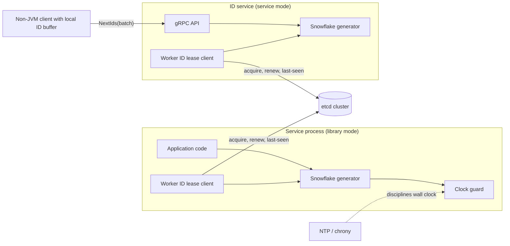

<!-- markdownlint-disable MD001 -->
<!-- markdownlint-disable MD012 -->
<!-- markdownlint-disable MD024 -->
<!-- markdownlint-disable MD025 -->
<!-- markdownlint-disable MD026 -->
<!-- markdownlint-disable MD029 -->
<!-- markdownlint-disable MD033 -->
<!-- markdownlint-disable MD040 -->
<!-- markdownlint-disable MD056 -->
<!-- markdownlint-disable MD060 -->

# Distributed Unique ID Generator

---

## Decisions in one screen

01. **Layout:** 64 bits = 1 sign + 41 ms timestamp + 10 worker + 12 sequence. About 69.7 years, 1,024 nodes, 4,096 IDs per ms per node.
02. **Ordering:** per-node monotonic, cluster-wide k-sorted. No global total order.
03. **Delivery:** in-process library first; gRPC ID service with client-side batching for non-JVM clients.
04. **Worker IDs:** etcd lease with compare-and-create, self-fencing deadline, and a last-seen timestamp check before reuse.
05. **Backward clock:** wait if 5 ms or less, otherwise refuse and alert.
06. **Alternatives kept:** UUIDv7 where 128-bit keys are acceptable; Leaf-segment for dense business numbers.

---

## Contents

| Sections | Part                                                                                  |
| -------- | ------------------------------------------------------------------------------------- |
| 01 to 07 | Problem, terms, requirements, capacity, API, data model, architecture and bit layout  |
| 08       | Deep dives: approaches compared, clocks, worker IDs, Leaf-segment, storage effects    |
| 09 to 15 | Reliability, scalability, security, observability, trade-offs, extensions, 45-min cut |
| 16       | Java implementation                                                                   |
| 17       | Rust implementation                                                                   |
| 18       | Interview Q&A and exercises                                                           |
| 19       | References                                                                            |

Sections 01 to 15 plus section 19 follow the 15-section catalog template, with one added section (02, Terms) so every domain term is defined before use.  
The template's sections 02 to 14 are therefore numbered 03 to 15 here, and References (template 15) moves to the end as 19.

## Reading order

01. Sections 01 to 07: terms, requirements, numbers, and the bit layout.
02. Section 08: the five deep dives. This is where interviews are won.
03. Section 16: map every line of `nextId` back to section 07.03.
04. Sections 09 to 15: failure modes, scaling, security, and the 45-minute cut.
05. Section 18: answer each question aloud before reading the answer.
06. Section 17: Rust second pass.

---

## 01. Problem statement

Every service in a large platform needs identifiers for new records: orders, payments, messages, users.  
A single database sequence cannot serve hundreds of services across many machines and regions without becoming a bottleneck and a single point of failure.

Build a component that hands out identifiers which are unique across the whole platform, fit in a 64-bit integer, sort roughly by creation time,  
and can be produced at millions per second with no network call on the hot path.

The consumers are backend services written mostly in Java, plus a few in other languages.

---

## 02. Terms used in this document

Each term is defined here before it is used anywhere below.

| Term               | Meaning in this document                                                                                                            |
| ------------------ | ----------------------------------------------------------------------------------------------------------------------------------- |
| ID                 | A value that names exactly one entity. Here, a 64-bit signed integer whose sign bit is always 0.                                    |
| Generator          | The code that produces IDs. It may run inside the calling service or as a separate network service.                                 |
| Node               | One running generator instance, usually one process.                                                                                |
| Wall clock         | The operating-system clock that reports calendar time (Java `System.currentTimeMillis`). It can be adjusted forwards or backwards.  |
| Monotonic clock    | A clock that only moves forward but has no relation to calendar time (Java `System.nanoTime`). It resets when the process restarts. |
| Custom epoch       | A fixed instant chosen by the system (for example 2025-01-01T00:00:00Z) from which timestamps inside the ID are counted.            |
| Worker ID          | A small integer, unique among all live nodes, embedded in every ID that node produces.                                              |
| Sequence           | A per-node counter that separates IDs created by the same node in the same millisecond.                                             |
| Monotonic IDs      | Each ID from one node is strictly greater than the previous ID from that node.                                                      |
| Total order        | Every pair of IDs across all nodes is ordered exactly by creation time. This needs one global sequencer.                            |
| K-sorted           | IDs are sorted by creation time except within a small window k. Here k is bounded by clock skew between nodes plus one millisecond. |
| Clock skew         | The difference between the wall clocks of two machines at the same real instant.                                                    |
| NTP                | Network Time Protocol. A daemon (ntpd or chrony) that keeps the wall clock close to a reference time.                               |
| Slew               | NTP correcting the clock by running it slightly faster or slower. Time never jumps.                                                 |
| Step               | NTP correcting the clock by setting it to a new value in one jump, which can move it backwards.                                     |
| Lease              | A time-limited claim on a key in a coordination store. The holder must renew it before it expires, or the store deletes the key.    |
| Coordination store | A small, strongly consistent key-value store used for locks and membership, such as etcd or ZooKeeper.                              |
| Fencing            | Stopping a node from acting once it may have lost its lease, so two nodes never act on the same claim at the same time.             |
| Segment            | A contiguous block of IDs (for example 1001 to 2000) reserved from a database in one write and then handed out from memory.         |
| Birthday bound     | The probability that at least two of n random values from a space of size N collide. It is approximately n squared divided by 2N.   |
| B-tree             | The index structure used by most relational databases. Keys live in sorted pages. Inserting into a full page splits it into two.    |
| Clustered index    | An index whose leaf pages hold the full rows, so row order on disk follows key order. InnoDB primary keys are clustered.            |
| Base32 (Crockford) | A text encoding using 32 symbols (digits and letters, without I, L, O, U). Each symbol carries 5 bits.                              |

---

## 03. Requirements

### 03.01 Functional requirements

01. Return one new ID per call, and a batch of up to 10,000 IDs per call.
02. Every ID is unique across all nodes, all regions, and the lifetime of the system.
03. IDs fit in a signed 64-bit integer and are always positive.
04. IDs from one node are monotonic. IDs across nodes are k-sorted by creation time.
05. An ID can be decoded into its creation timestamp, worker ID, and sequence for debugging.

### 03.02 Non-functional requirements

| Property             | Target                                                                   |
| -------------------- | ------------------------------------------------------------------------ |
| Throughput           | 2,000,000 IDs per second platform-wide at peak                           |
| Latency (in-process) | p99 under 10 microseconds per ID                                         |
| Latency (over RPC)   | p99 under 2 milliseconds per batch                                       |
| Availability         | 99.99 percent for ID issuance; issuance survives coordination-store loss |
| Uniqueness           | Zero duplicates. A duplicate is a correctness bug, not a tolerated error |
| Lifespan             | At least 50 years from the custom epoch                                  |
| Cluster size         | Up to 1,024 concurrent generator nodes                                   |
| Ordering             | k-sorted, k at most clock skew plus 1 ms (target skew under 10 ms)       |

### 03.03 Out of scope

01. Global total order. It requires one sequencer on the hot path and conflicts with the throughput and availability targets.
02. Gap-free IDs. Restarts and unused batches leave gaps. Business numbers that must be gap-free (tax invoice numbers) need a separate per-tenant counter in the ledger database.
03. Secrecy. IDs are identifiers, never authorization tokens.

---

## 04. Capacity estimation

| Quantity                        | Estimate                                                                          |
| ------------------------------- | --------------------------------------------------------------------------------- |
| Peak demand                     | 2,000,000 IDs per second                                                          |
| Average demand                  | 200,000 IDs per second (peak is 10x average)                                      |
| IDs per year at average         | 200,000 x 31,536,000 s = about 6.3 trillion                                       |
| Capacity of one node            | 4,096 per ms = 4,096,000 per second (12-bit sequence)                             |
| Nodes needed for peak, sequence | 1 in theory; real nodes hit CPU or lock limits first, around 1 to 5 million per s |
| Cluster ceiling                 | 1,024 nodes x 4,096,000 = about 4.19 billion IDs per second                       |
| Generator storage               | None for IDs. Worker registry: 1,024 keys of under 200 bytes each                 |
| RPC bandwidth (service mode)    | 8 bytes per ID; at peak 16 MB/s of payload, negligible with batching              |
| Lifespan (41-bit millisecond)   | 2^41 ms = 2,199,023,255,552 ms = about 69.7 years                                 |

The binding constraint is not throughput. It is the number of worker IDs (1,024) and the lifespan of the timestamp field.  
Both are fixed by the bit layout in section 07.01.

---

## 05. API design

Two delivery modes share one contract.

### 05.01 Library mode (primary)

The generator runs inside each service process. There is no network call per ID.

```java
public interface IdGenerator {

    long nextId();

    long[] nextIds(int count);   // 1 to 10,000

    DecodedId decode(long id);   // timestamp, workerId, sequence
}
```

### 05.02 Service mode (for non-JVM clients)

A small stateless ID service exposes the same operations over gRPC.

```proto
service IdService {
  rpc NextIds (NextIdsRequest) returns (NextIdsResponse);
  rpc Decode  (DecodeRequest)  returns (DecodeResponse);
}

message NextIdsRequest  { uint32 count = 1; }          // 1 to 10,000
message NextIdsResponse { repeated fixed64 ids = 1; }
message DecodeRequest   { fixed64 id = 1; }
message DecodeResponse  { int64 timestamp_ms = 1; uint32 worker_id = 2; uint32 sequence = 3; }
```

### 05.03 Contract rules

01. **Idempotency.** Not needed. A retried call returns new IDs. Unused IDs are discarded and leave gaps, which is allowed.
02. **Batching.** Clients in service mode fetch a batch and serve from a local buffer, which removes the RPC from the per-ID path.
03. **JSON transport.** JavaScript numbers are IEEE 754 doubles and represent integers exactly only up to 2^53. A 64-bit ID loses precision in a browser.  
  Every public JSON API sends IDs as strings (Twitter's `id_str` exists for this reason).
04. **Errors.** The generator fails loudly (exception or `UNAVAILABLE`) rather than returning a possibly duplicate ID.

---

## 06. Data model

The generator stores no IDs. It needs only two small pieces of state.

### 06.01 Worker registry (in the coordination store)

| Key                           | Value                                 | Lifetime                     |
| ----------------------------- | ------------------------------------- | ---------------------------- |
| `/idgen/workers/{workerId}`   | owner pod name, process start time    | Bound to a lease (TTL 30 s)  |
| `/idgen/last-seen/{workerId}` | highest timestamp issued by any owner | Permanent, updated every 3 s |

The first key says who owns a worker ID now.  
The second key survives the owner and lets the next owner of the same worker ID check that its clock is past everything the previous owner issued.

### 06.02 Segment table (only for the segment allocator in section 08.04)

```sql
CREATE TABLE id_segment (
    biz_tag      VARCHAR(64)  NOT NULL,   -- one row per ID namespace, e.g. 'order'
    max_id       BIGINT       NOT NULL,   -- highest ID already handed out in a segment
    step         INT          NOT NULL,   -- segment size, e.g. 10,000
    updated_at   TIMESTAMP    NOT NULL,
    PRIMARY KEY (biz_tag)
);
```

### 06.03 Datastore choice

etcd (or ZooKeeper) holds the worker registry because the registry needs linearizable writes and leases, and it is tiny.  
The segment table lives in any replicated relational database the platform already runs, because one row update per segment is a very light load.

---

## 07. High-level architecture

### 07.01 The ID layout

A Snowflake-style layout, named after the generator Twitter published in 2010, packs three fields into 63 usable bits.

```text
 63  62                                         22 21              12 11              0
+---+---------------------------------------------+------------------+-----------------+
| 0 |  timestamp: ms since custom epoch (41 bits) | worker ID (10)   | sequence (12)   |
+---+---------------------------------------------+------------------+-----------------+
```

| Field     | Bits | Range            | Meaning                                               |
| --------- | ---- | ---------------- | ----------------------------------------------------- |
| Sign      | 1    | always 0         | Keeps the ID positive in Java `long` and SQL `BIGINT` |
| Timestamp | 41   | 0 to 2^41 - 1 ms | Milliseconds since the custom epoch; about 69.7 years |
| Worker ID | 10   | 0 to 1,023       | Unique among live nodes                               |
| Sequence  | 12   | 0 to 4,095       | Counter within one millisecond on one node            |

Because the timestamp occupies the high bits, numeric order of IDs equals time order, to millisecond precision.  
Two nodes can never collide because their worker IDs differ.  
One node can never collide with itself because, within a millisecond, its sequence differs, and across milliseconds, its timestamp differs.  
That last guarantee holds only while the node's timestamp never repeats, which is why clock handling (section 08.02) is the hard part.

### 07.02 Components



| Component              | Responsibility                                                                                 |
| ---------------------- | ---------------------------------------------------------------------------------------------- |
| Snowflake generator    | Packs timestamp, worker ID, and sequence. Pure CPU, no I/O.                                    |
| Clock guard            | Reads the wall clock, detects backward movement, waits or refuses.                             |
| Worker ID lease client | Acquires a free worker ID at startup, renews the lease, publishes last-seen time, self-fences. |
| etcd cluster           | Holds the worker registry. Not on the per-ID path.                                             |
| ID service             | Wraps the same generator behind gRPC for clients that cannot embed the library.                |
| NTP / chrony           | Keeps wall clocks within a few milliseconds and configured to slew, not step.                  |

### 07.03 Use-case walk-through

**Node startup.**

01. The lease client grants an etcd lease with a 30-second TTL.
02. It scans `/idgen/workers/` and, for a free worker ID, runs an etcd transaction: create `/idgen/workers/{id}` with the lease only if the key does not exist. On conflict it tries the next free ID.
03. It reads `/idgen/last-seen/{id}`. If the local wall clock is not past that value, it waits until it is (or refuses to start if the gap is larger than a limit, for example 5 seconds).
04. Only then does the generator accept `nextId` calls.

**Issuing an ID (hot path).**

01. Read the wall clock in milliseconds.
02. If it is behind the last issued timestamp, apply the backward-clock rule (section 08.02).
03. If it equals the last timestamp, increment the sequence. If the sequence wraps past 4,095, spin until the next millisecond.
04. Otherwise reset the sequence to 0.
05. Pack and return. No network, no disk.

**Steady state.** Every 3 seconds the lease client renews the lease and writes the latest issued timestamp to `/idgen/last-seen/{id}`.

**Shutdown.** The lease client writes a final last-seen value and revokes the lease, which frees the worker ID immediately.

---

## 08. Deep dives

### 08.01 Approaches compared

Each approach below is a complete answer to "generate unique IDs". The interview expects you to know all of them and justify one.

**A. Single database auto-increment.** One table with an auto-increment column.  
  Simple, totally ordered, and dense. It fails on every scale requirement: one primary database caps throughput, adds a network round trip per ID, and is a single point of failure.

**B. Multi-master offset and step (ticket servers).** Flickr ran two MySQL servers configured so that one issued odd numbers and the other even numbers.

```sql
-- Server 1: auto_increment_increment = 2, auto_increment_offset = 1
-- Server 2: auto_increment_increment = 2, auto_increment_offset = 2
CREATE TABLE tickets64 (
    id    BIGINT UNSIGNED NOT NULL AUTO_INCREMENT,
    stub  CHAR(1)         NOT NULL DEFAULT '',
    PRIMARY KEY (id),
    UNIQUE KEY stub (stub)
);

REPLACE INTO tickets64 (stub) VALUES ('a');
SELECT LAST_INSERT_ID();
```

`REPLACE` deletes and reinserts the single row, so the table stays one row long while the counter advances.  
It removes the single point of failure but keeps a network round trip per ID.  
Adding a third server means changing the step on every server, and the two servers drift apart so IDs are no longer time-ordered across servers.

**C. UUID version 4.** 128 bits, of which 122 are random.  
  No coordination at all.  
  By the birthday bound, generating 1.03 x 10^14 IDs gives a one-in-a-billion chance of any collision; at 1 million IDs per second that takes about 3.3 years.  
  The practical risks are a weak or badly seeded random generator (for example a cloned VM or a forked process sharing state) and the cost of 128 random bits as a database key (section 08.05).

**D. UUID version 7 (RFC 9562, 2024).** 128 bits: a 48-bit Unix millisecond timestamp, 4 version bits, 2 variant bits, and 74 bits of randomness, optionally with part of the random field used as a counter for monotonicity within a millisecond.  
  Time-ordered like Snowflake, coordination-free like UUIDv4.  
  At 1,000 IDs per millisecond the chance of a collision within that millisecond is about 1,000^2 / 2^75, roughly 2.6 x 10^-17; over a full year of such milliseconds it is under one in a million.  
  The cost is 16 bytes instead of 8.

**E. ULID.** Same idea as UUIDv7, older and not an IETF standard: 48-bit millisecond timestamp plus 80 random bits, written as 26 Crockford Base32 characters so the text form also sorts by time.

**F. Snowflake.** The layout in section 07.01. 64 bits, time-ordered, no network per ID. Costs: a worker-ID assignment system and careful clock handling.  
  Variants: Instagram generated the same shape inside PostgreSQL with 13 shard bits and 10 sequence bits;  
  Sony's Sonyflake uses 39 bits of 10-millisecond units (about 174 years), 8 sequence bits, and 16 machine bits.

**G. Segment allocation (Meituan Leaf-segment).** A node reserves a block of IDs from a database row in one update and hands them out from memory. Details in section 08.04.

| Approach             | Size    | Time-ordered             | Network per ID | Coordination needed      | Main risk                           |
| -------------------- | ------- | ------------------------ | -------------- | ------------------------ | ----------------------------------- |
| A. DB auto-increment | 64 bit  | Total                    | Yes            | One database             | Throughput, single point of failure |
| B. Ticket servers    | 64 bit  | Per server only          | Yes            | N databases              | Hard to add servers                 |
| C. UUIDv4            | 128 bit | No                       | No             | None                     | Index locality, RNG quality         |
| D. UUIDv7            | 128 bit | k-sorted                 | No             | None                     | 16-byte keys                        |
| E. ULID              | 128 bit | k-sorted                 | No             | None                     | Not standardized                    |
| F. Snowflake         | 64 bit  | k-sorted                 | No             | Worker IDs at startup    | Clock going backwards               |
| G. Leaf-segment      | 64 bit  | Per node, roughly global | No (amortized) | One database row per tag | Database outage longer than buffer  |

**Decision.** Snowflake (F) as the default, because the requirement is 64-bit, k-sorted, and no network per ID.  
  UUIDv7 (D) where 128-bit keys are acceptable and no worker-ID system is wanted. Leaf-segment (G) for namespaces that want dense, nearly sequential numbers and already depend on a database.

### 08.02 Clock handling

The uniqueness proof in section 07.01 assumes a node never issues two IDs with the same timestamp and sequence.  
If the wall clock moves backwards by 50 ms, the node re-enters milliseconds it already used, its sequence restarts at 0, and it can reissue IDs it already handed out.

**Why wall clocks move backwards.**

01. NTP steps the clock. ntpd slews offsets below 128 ms and steps larger ones; chrony steps only when configured with `makestep`.
02. An operator or a VM host sets the time manually.
03. A virtual machine is paused, migrated, or restored from a snapshot.
04. A leap second is inserted, and the kernel replays the last second of the day (unless the platform smears it, as Google and AWS do, by slewing over hours).

**Rules, from cheapest to strongest.**

| Backward drift seen           | Rule                                                                                       |
| ----------------------------- | ------------------------------------------------------------------------------------------ |
| Up to a few ms (default 5 ms) | Spin until the clock passes the last issued timestamp, then continue.                      |
| Larger, within a process      | Refuse with an error, raise an alert, and let load balancing route calls to healthy nodes. |
| Across a restart              | Compare with `/idgen/last-seen/{id}` at startup and wait or refuse (section 07.03).        |

**Alternative: logical clock.** Ignore the wall clock when it is behind and keep issuing from the last timestamp, advancing it by one each time the sequence wraps.  
  Baidu's UidGenerator does this and calls it borrowing future time.  
  It never refuses, but IDs drift ahead of real time under heavy load or a long backward step, and on restart the node must not start below the borrowed time.  
  Use it when availability matters more than timestamp accuracy.

**Alternative: monotonic clock anchored once.** At startup, read the wall clock once, then compute time as that anchor plus elapsed `System.nanoTime`.  
  The value never goes backwards inside the process, which removes the in-process problem entirely.  
  It drifts away from wall time over weeks and does not help across restarts, so the last-seen check is still required.

**Operational rules.** Configure chrony to slew only after boot. Alert on NTP offset above 10 ms.  
  Use the cloud provider's leap-smeared time source.

### 08.03 Worker-ID assignment

Two live nodes with the same worker ID can issue identical IDs in the same millisecond. Assignment is therefore a correctness mechanism, not configuration.

| Method                         | How it works                                            | Weakness                                                                 |
| ------------------------------ | ------------------------------------------------------- | ------------------------------------------------------------------------ |
| Static config                  | Each host has an ID in a config file                    | Human error copies the same ID to two hosts                              |
| Derived from IP or MAC         | Lower bits of the address                               | Collisions when addresses share low bits; containers reuse IPs           |
| Kubernetes StatefulSet ordinal | Pod `idgen-7` uses 7                                    | One namespace per StatefulSet; a force-deleted pod can briefly run twice |
| Database row per start         | Insert a row at boot, use its auto-increment ID (Baidu) | IDs are never reused, so 22 worker bits are needed                       |
| Lease in etcd or ZooKeeper     | Create-if-absent key bound to a lease (section 07.03)   | Lease loss must stop issuance; needs the store at startup                |

**Lease-based assignment, done safely.**

01. **Acquire** with a compare-and-create transaction so two nodes cannot both create the key.
02. **Self-fence.** The lease expires on the etcd side, and the node may not learn that in time (long garbage-collection pause, network partition).  
  The node keeps a local deadline: last successful renewal time plus TTL minus a safety margin (for example 30 s minus 10 s).  
  Past the deadline it stops issuing, even if it has not heard anything.
03. **Reuse safely.** A new owner of a released worker ID must wait until its clock is past `/idgen/last-seen/{id}`.  
  Without that, a new owner whose clock is behind the old owner's could reissue the old owner's IDs.
04. **Survive store outages.** Nodes that already hold a lease keep issuing until their local deadline.  
  Choose a TTL long enough to ride out a typical etcd failover. New nodes cannot start during the outage; that is the accepted cost.

**VM and container cloning.** A cloned VM or a container restored from a checkpoint carries the same worker ID and the same last timestamp in memory.  
  Treat a clone as a new process: always re-acquire the worker ID at resume.

### 08.04 Segment allocation (Leaf-segment)

Each node reserves a segment with one transactional update and serves IDs from memory.

```sql
UPDATE id_segment SET max_id = max_id + step, updated_at = NOW() WHERE biz_tag = 'order';
SELECT max_id, step FROM id_segment WHERE biz_tag = 'order';
-- The node now owns (max_id - step, max_id].
```

Row-level locking on the `UPDATE` serializes allocators, so two nodes always get disjoint segments. No clock is involved, so clock problems disappear.

**Double buffering.** If the node fetched the next segment only after exhausting the current one, every segment boundary would stall callers for one database round trip.  
  Leaf keeps two buffers: once 10 percent of the current segment is consumed, it fetches the next segment in the background.  
  When the current one runs out, it swaps instantly.

**Sizing the step.** Choose the step so one segment lasts several minutes at peak; that buffer is the time the database can be down without impact.  
  At 10,000 IDs per second per node and a step of 3,000,000, a segment lasts 5 minutes, and two buffered segments give up to 10 minutes.  
  Leaf adjusts the step dynamically from the observed consumption rate.

**Properties.** IDs are dense and nearly sequential globally (interleaved per node), which suits namespaces like order numbers.  
  A restart throws away the unused part of a segment, leaving a gap. Sequential IDs are easy to enumerate (section 11).

**Leaf-snowflake.** Meituan's second mode is Snowflake with worker IDs from ZooKeeper persistent sequential nodes, a local file cache of the worker ID so a node can restart while ZooKeeper is down,  
  and a periodic timestamp report used to refuse startup if the local clock is behind.  
  It is the same design as sections 07 and 08.03.

### 08.05 Effect of ID choice on storage

**B-tree insert locality.** With time-ordered keys, every insert lands on the rightmost leaf page of the index, which stays hot in memory, and pages fill completely.  
With random keys (UUIDv4), inserts land on random pages: the working set becomes the whole index, pages split and end up about half to two-thirds full, and write amplification rises.  
In InnoDB the primary key is a clustered index, so random keys also scatter the row data itself.  
This is the strongest argument for UUIDv7 or Snowflake over UUIDv4.

**Hot ranges in range-sharded stores.** The opposite problem appears in databases that split data into key ranges across servers (Bigtable, HBase, Spanner, CockroachDB).  
Time-ordered keys send all new writes to the single server holding the newest range.  
Fixes: hash the ID before choosing the shard, put a hash or shard prefix before the ID in the key, or use a bit-reversed ID as the key.

**Modulo sharding skew.** Sharding by `id % N` with Snowflake IDs can be badly uneven.  
  At low traffic most IDs are the first in their millisecond, so the sequence bits are 0 and the low bits of every ID are identical.  
  Fix: shard on a hash of the ID, or start each millisecond's sequence at a random value instead of 0.

**Size.** An 8-byte key versus a 16-byte key doubles the size of every index that contains it, including every foreign key and secondary index that carries the primary key.

---

## 09. Reliability and failure handling

| Failure                                  | Effect                                      | Handling                                                                  |
| ---------------------------------------- | ------------------------------------------- | ------------------------------------------------------------------------- |
| Clock steps back by under 5 ms           | Brief stall                                 | Spin until the clock catches up                                           |
| Clock steps back by more                 | Possible duplicates if ignored              | Refuse, alert, route traffic to other nodes                               |
| Node restarts with clock behind          | Possible duplicates                         | Last-seen check at startup                                                |
| Two nodes share a worker ID              | Duplicates                                  | Compare-and-create acquisition, self-fencing deadline                     |
| etcd unavailable                         | No new nodes can start                      | Running nodes continue until their lease deadline; long TTL               |
| Sequence exhausted in a millisecond      | Up to 1 ms stall                            | Spin to next ms; scale out if sustained                                   |
| Timestamp field exhausted (year 2094)    | Generator stops                             | Hard error long before; plan a new epoch or layout years ahead            |
| ID service unavailable                   | Non-JVM clients stall                       | Client buffers a batch; several stateless replicas behind a load balancer |
| Segment database unavailable             | No new segments                             | Two buffered segments cover the outage window                             |
| VM snapshot restore or clone             | Same worker ID and memory state             | Re-acquire worker ID and re-run last-seen check on resume                 |
| ID passed through JavaScript as a number | Silent precision loss, wrong record fetched | Send IDs as strings in JSON                                               |

**Disaster recovery.** The generator keeps no data that needs backup. Recovery point objective (RPO, the amount of data you can afford to lose) is zero by construction.  
Recovery time objective (RTO, how long recovery may take) equals node startup time plus the last-seen wait. For multi-region deployment,  
give each region a disjoint worker-ID range (for example 2 bits of the 10 for region), so regions never need to coordinate.

---

## 10. Scalability

| Scale | What breaks                                          | Fix                                                                                            |
| ----- | ---------------------------------------------------- | ---------------------------------------------------------------------------------------------- |
| 10x   | Lock contention on a single generator per process    | One generator per core, each with its own worker ID, or a lock-free CAS on a packed state word |
| 10x   | 1,024 worker IDs not enough as service replicas grow | Move to service mode for small services, so fewer processes hold worker IDs                    |
| 100x  | 1,024 worker IDs fundamentally too few               | Rebalance bits: 39-bit timestamp at 10 ms units, 16 worker bits, 8 sequence bits (Sonyflake)   |
| 100x  | Any 64-bit layout too tight                          | Move new namespaces to UUIDv7 (128 bit)                                                        |
| Any   | Range-sharded store hot spot on newest range         | Hash the ID before placement (section 08.05)                                                   |

Changing the bit layout is a migration: old and new IDs must stay disjoint and comparable. Start the new layout at a timestamp strictly greater than any old ID's, or reserve a version bit.

---

## 11. Security and privacy

01. **Information leak.** A Snowflake ID reveals its creation time, the worker that created it, and roughly how many IDs that worker issued in that millisecond.  
  Sequential IDs reveal total volume: a competitor can create two orders a day apart and subtract (the German tank problem).
02. **Enumeration.** Predictable IDs make it easy to try neighbouring IDs. This is harmless only if every read checks authorization.  
  Missing checks of this kind are called insecure direct object references (IDOR).
03. **Opaque public IDs.** When IDs leave the platform, either map them to a random public token stored alongside the record, or encrypt the 64-bit ID with a keyed 64-bit block cipher.  
  Encryption is a permutation, so uniqueness is preserved and no extra storage is needed.
04. **Never use IDs as secrets.** Password-reset tokens, session IDs, and invite links need 128 or more bits from a cryptographically secure random generator.
05. **Access to the coordination store.** Only generator nodes may write `/idgen/`. A rogue client that grabs or deletes worker keys can cause duplicates.

---

## 12. Observability

| Metric                                  | Type    | Alert                                           |
| --------------------------------------- | ------- | ----------------------------------------------- |
| `idgen_ids_issued_total`                | Counter | None; capacity planning                         |
| `idgen_sequence_wraps_total`            | Counter | Sustained growth: node is near 4,096 per ms     |
| `idgen_clock_backwards_total`           | Counter | Any increase                                    |
| `idgen_clock_backwards_max_drift_ms`    | Gauge   | Above 5 ms                                      |
| `idgen_refusals_total`                  | Counter | Any increase                                    |
| `idgen_lease_deadline_remaining_s`      | Gauge   | Below 15 s                                      |
| `idgen_free_worker_ids`                 | Gauge   | Below 10 percent of 1,024                       |
| `node_ntp_offset_ms` (chrony tracking)  | Gauge   | Above 10 ms                                     |
| `idgen_segment_remaining_fraction`      | Gauge   | Below 0.2 with no next segment loaded           |
| Unique-constraint violations downstream | Counter | Any violation on an ID column: page immediately |

The last row is the only direct duplicate detector.  
Every table keyed by these IDs already has a unique constraint; route its violations to the ID-generator team.

---

## 13. Trade-offs and alternatives

| Decision               | Chosen                     | Rejected                      | Reason                                                           |
| ---------------------- | -------------------------- | ----------------------------- | ---------------------------------------------------------------- |
| ID width               | 64 bit                     | 128 bit                       | Half the index size; fits `long` and `BIGINT`                    |
| Ordering               | k-sorted                   | Total order                   | Total order needs a central sequencer on every call              |
| Delivery               | Library first              | Service only                  | No network per ID; service kept for non-JVM clients              |
| Worker IDs             | etcd leases                | Static config                 | Static config fails silently through human error                 |
| Backward clock         | Wait if small, else refuse | Logical clock (borrow future) | Keeps timestamps truthful; failure is visible                    |
| Time unit              | 1 ms                       | 10 ms (Sonyflake)             | Better ordering resolution; 69.7 years is enough                 |
| Dense business numbers | Leaf-segment per namespace | Snowflake                     | Dense IDs where the business wants them; still no per-ID DB call |

---

## 14. Future extensions

01. Region bits inside the worker ID for active-active multi-region deployment.
02. A lock-free generator using `AtomicLong` compare-and-set on a packed `(timestamp, sequence)` state, for very hot single processes.
03. Per-namespace epochs and layouts behind the same API.
04. A public-ID service that encrypts internal IDs before they leave the platform.
05. A UUIDv7 mode for new services that prefer zero coordination over 8-byte keys.

---

## 15. Interview cut (45 minutes)

| Minutes | Phase                     | What to say                                                                                           | What to skip                        |
| ------- | ------------------------- | ----------------------------------------------------------------------------------------------------- | ----------------------------------- |
| 00-05   | Clarify                   | Size (64 or 128 bit), ordering need, QPS, number of generators, lifespan, gaps allowed                | Business context                    |
| 05-10   | Options                   | Auto-increment, ticket servers, UUIDv4, UUIDv7, Snowflake, segment; one line of trade-off each        | History                             |
| 10-18   | Layout                    | Draw the 1/41/10/12 layout; derive 69.7 years and 4,096 per ms; explain why it is unique and k-sorted | Exact epoch value                   |
| 18-28   | Clock                     | Causes of backward clocks; wait, refuse, logical clock; last-seen check across restarts               | Leap-second kernel details          |
| 28-36   | Worker IDs                | Lease with compare-and-create, self-fencing deadline, safe reuse                                      | ZooKeeper versus etcd API specifics |
| 36-41   | Storage and failure modes | B-tree locality, range-shard hot spots, JavaScript precision, VM clones                               | Full metric list                    |
| 41-45   | Wrap up                   | Scaling path (bit rebalance, UUIDv7), security (enumeration, opaque IDs)                              | Future extensions                   |

**Signals interviewers look for.** You derive the numbers rather than recite them. You explain why the design is unique, not just what the bits are.  
You raise clock rollback and duplicate worker IDs before being asked. You know that 64-bit IDs break in JavaScript.

---

## 16. Java implementation

> Both classes compile on Java 21 and were tested with 8 threads: 4,000,000 Snowflake IDs and 80,000 segment IDs, all unique.

### 16.01 Snowflake generator

Layout: 1 sign bit, 41 timestamp bits, 10 worker bits, 12 sequence bits (section 07.01).

```java
import java.util.function.LongSupplier;

public final class SnowflakeIdGenerator {

    // Layout: 1 sign bit (always 0) | 41 bits timestamp | 10 bits worker | 12 bits sequence
    private static final long EPOCH_MS = 1_735_689_600_000L; // 2025-01-01T00:00:00Z

    private static final int WORKER_BITS = 10;
    private static final int SEQUENCE_BITS = 12;
    private static final int TIMESTAMP_BITS = 41;

    private static final long MAX_WORKER_ID = (1L << WORKER_BITS) - 1;
    private static final long MAX_SEQUENCE = (1L << SEQUENCE_BITS) - 1;
    private static final long MAX_ELAPSED_MS = (1L << TIMESTAMP_BITS) - 1;

    private static final int WORKER_SHIFT = SEQUENCE_BITS;
    private static final int TIMESTAMP_SHIFT = SEQUENCE_BITS + WORKER_BITS;

    private final long workerId;
    private final long maxBackwardMs;
    private final LongSupplier clockMs;

    private long lastTimestampMs = -1L;
    private long sequence = 0L;

    public SnowflakeIdGenerator(long workerId, long maxBackwardMs, LongSupplier clockMs) {
        if (workerId < 0 || workerId > MAX_WORKER_ID) {
            throw new IllegalArgumentException("workerId must be in [0, " + MAX_WORKER_ID + "]");
        }
        this.workerId = workerId;
        this.maxBackwardMs = maxBackwardMs;
        this.clockMs = clockMs;
    }

    public SnowflakeIdGenerator(long workerId) {
        this(workerId, 5, System::currentTimeMillis);
    }

    public synchronized long nextId() {
        long now = clockMs.getAsLong();

        if (now < lastTimestampMs) {
            long driftMs = lastTimestampMs - now;
            if (driftMs > maxBackwardMs) {
                throw new ClockMovedBackwardsException(driftMs);
            }
            now = waitUntil(lastTimestampMs); // small drift: wait it out
        }

        if (now == lastTimestampMs) {
            sequence = (sequence + 1) & MAX_SEQUENCE;
            if (sequence == 0) {
                now = waitUntil(lastTimestampMs + 1); // 4096 IDs used in this ms
            }
        } else {
            sequence = 0;
        }

        lastTimestampMs = now;

        long elapsedMs = now - EPOCH_MS;
        if (elapsedMs < 0 || elapsedMs > MAX_ELAPSED_MS) {
            throw new IllegalStateException("timestamp outside the 41-bit range: " + elapsedMs);
        }

        return (elapsedMs << TIMESTAMP_SHIFT) | (workerId << WORKER_SHIFT) | sequence;
    }

    private long waitUntil(long targetMs) {
        long now = clockMs.getAsLong();
        while (now < targetMs) {
            Thread.onSpinWait();
            now = clockMs.getAsLong();
        }
        return now;
    }

    public static long timestampMsOf(long id) {
        return (id >>> TIMESTAMP_SHIFT) + EPOCH_MS;
    }

    public static long workerIdOf(long id) {
        return (id >>> WORKER_SHIFT) & MAX_WORKER_ID;
    }

    public static long sequenceOf(long id) {
        return id & MAX_SEQUENCE;
    }

    public static final class ClockMovedBackwardsException extends RuntimeException {
        public ClockMovedBackwardsException(long driftMs) {
            super("clock moved backwards by " + driftMs + " ms; refusing to issue IDs");
        }
    }
}
```

#### 16.01.01 Design notes

01. **Why `synchronized`.** The sequence caps one node at 4,096,000 IDs per second.  
  An uncontended monitor costs tens of nanoseconds, so the lock is not the limit.  
  Measured: about 1.1 million IDs per second with 8 contending threads, including the cost of a concurrent hash set in the test.
02. **Why spin while holding the lock.** Other callers cannot make progress in the same millisecond anyway.  
Spinning is bounded by `maxBackwardMs` or by one millisecond for sequence exhaustion.
03. **Why an injected clock.** `LongSupplier clockMs` lets tests move time backwards deterministically and lets production swap in an anchored monotonic clock (section 08.02).
04. **Why `>>>` in the decoders.** Unsigned shift keeps decoding correct even if a caller passes a negative value by mistake.
05. **What this class does not do.** It does not acquire its worker ID.  
  The lease client (section 08.03) passes `workerId` in and must stop calling `nextId` once its lease deadline passes.

#### 16.01.02 Usage

```java
SnowflakeIdGenerator ids = new SnowflakeIdGenerator(leaseClient.workerId());

long orderId = ids.nextId();

Instant createdAt = Instant.ofEpochMilli(SnowflakeIdGenerator.timestampMsOf(orderId));
long worker = SnowflakeIdGenerator.workerIdOf(orderId);
```

### 16.02 Segment allocator (Leaf-segment)

```java
import java.util.concurrent.CompletableFuture;
import java.util.concurrent.ExecutorService;
import java.util.concurrent.Executors;

public final class SegmentIdAllocator {

    // Leaf prefetches the next range once 10% of the current one is consumed.
    private static final double PREFETCH_AT_CONSUMED_FRACTION = 0.10;

    public interface SegmentDao {
        // Atomically: UPDATE id_segment SET max_id = max_id + step WHERE biz_tag = ?;
        //             SELECT max_id, step FROM id_segment WHERE biz_tag = ?;
        // Returns the range (max_id - step, max_id].
        Range allocate(String bizTag);
    }

    public static final class Range {
        private final long first;
        private final long last;
        private long cursor;

        public Range(long first, long last) {
            this.first = first;
            this.last = last;
            this.cursor = first;
        }

        boolean isExhausted() {
            return cursor > last;
        }

        double consumedFraction() {
            return (double) (cursor - first) / (last - first + 1);
        }

        long take() {
            return cursor++;
        }
    }

    private final SegmentDao dao;
    private final String bizTag;
    private final ExecutorService loader;

    private Range current;
    private CompletableFuture<Range> next;

    public SegmentIdAllocator(SegmentDao dao, String bizTag, ExecutorService loader) {
        this.dao = dao;
        this.bizTag = bizTag;
        this.loader = loader;
    }

    public synchronized long nextId() {
        if (current == null) {
            current = dao.allocate(bizTag);
        }

        if (next == null && current.consumedFraction() >= PREFETCH_AT_CONSUMED_FRACTION) {
            next = CompletableFuture.supplyAsync(() -> dao.allocate(bizTag), loader);
        }

        if (current.isExhausted()) {
            current = (next != null) ? next.join() : dao.allocate(bizTag);
            next = null;
        }

        return current.take();
    }
}
```

#### 16.02.01 Design notes

01. **Disjoint ranges.** Correctness comes from the database: the `UPDATE ... SET max_id = max_id + step` takes a row lock, so concurrent allocators always receive disjoint ranges.
02. **Double buffer.** The next range is requested asynchronously once 10 percent of the current one is consumed, so callers normally never wait on the database.
03. **Failure behaviour.** If the database is down when both ranges run out, `next.join()` throws and `nextId` fails loudly. It never invents IDs.
04. **Gaps.** A restart discards the unconsumed rest of both ranges. That is expected.

#### 16.02.02 DAO sketch with JDBC

```java
public Range allocate(String bizTag) {
    try (Connection c = dataSource.getConnection()) {
        c.setAutoCommit(false);
        try (PreparedStatement up = c.prepareStatement(
                 "UPDATE id_segment SET max_id = max_id + step, updated_at = NOW() WHERE biz_tag = ?");
             PreparedStatement sel = c.prepareStatement(
                 "SELECT max_id, step FROM id_segment WHERE biz_tag = ?")) {
            up.setString(1, bizTag);
            if (up.executeUpdate() != 1) {
                throw new IllegalStateException("unknown biz_tag " + bizTag);
            }
            sel.setString(1, bizTag);
            try (ResultSet rs = sel.executeQuery()) {
                rs.next();
                long maxId = rs.getLong(1);
                int step = rs.getInt(2);
                c.commit();
                return new Range(maxId - step + 1, maxId);
            }
        } catch (SQLException e) {
            c.rollback();
            throw e;
        }
    } catch (SQLException e) {
        throw new IllegalStateException("segment allocation failed for " + bizTag, e);
    }
}
```

The `SELECT` runs in the same transaction as the `UPDATE`, so it reads this allocator's own write, not another allocator's.

---

## 17. Rust implementation

> Second pass of section 16. Same layout, same rules.  
> Tested with `cargo test --release` (edition 2024): 8 threads x 200,000 IDs, all unique and per-thread increasing; a 100 ms backward clock step is refused. `cargo clippy` is clean.

### 17.01 Snowflake generator with tests

```rust
use std::sync::Mutex;
use std::time::{SystemTime, UNIX_EPOCH};

// Layout: 1 sign bit (always 0) | 41 bits timestamp | 10 bits worker | 12 bits sequence
const EPOCH_MS: u64 = 1_735_689_600_000; // 2025-01-01T00:00:00Z

const WORKER_BITS: u32 = 10;
const SEQUENCE_BITS: u32 = 12;
const TIMESTAMP_BITS: u32 = 41;

const MAX_WORKER_ID: u64 = (1 << WORKER_BITS) - 1;
const MAX_SEQUENCE: u64 = (1 << SEQUENCE_BITS) - 1;
const MAX_ELAPSED_MS: u64 = (1 << TIMESTAMP_BITS) - 1;

const WORKER_SHIFT: u32 = SEQUENCE_BITS;
const TIMESTAMP_SHIFT: u32 = SEQUENCE_BITS + WORKER_BITS;

#[derive(Debug, PartialEq, Eq)]
pub enum IdError {
    ClockMovedBackwards { drift_ms: u64 },
    TimestampOutOfRange { elapsed_ms: i128 },
}

struct State {
    last_timestamp_ms: u64,
    sequence: u64,
}

pub struct Snowflake<C: Fn() -> u64> {
    worker_id: u64,
    max_backward_ms: u64,
    clock_ms: C,
    state: Mutex<State>,
}

impl<C: Fn() -> u64> Snowflake<C> {
    pub fn new(worker_id: u64, max_backward_ms: u64, clock_ms: C) -> Self {
        assert!(worker_id <= MAX_WORKER_ID, "worker_id must be in [0, {MAX_WORKER_ID}]");
        Self {
            worker_id,
            max_backward_ms,
            clock_ms,
            state: Mutex::new(State { last_timestamp_ms: 0, sequence: 0 }),
        }
    }

    pub fn next_id(&self) -> Result<u64, IdError> {
        let mut s = self.state.lock().expect("id generator mutex poisoned");
        let mut now = (self.clock_ms)();

        if now < s.last_timestamp_ms {
            let drift_ms = s.last_timestamp_ms - now;
            if drift_ms > self.max_backward_ms {
                return Err(IdError::ClockMovedBackwards { drift_ms });
            }
            now = self.wait_until(s.last_timestamp_ms); // small drift: wait it out
        }

        if now == s.last_timestamp_ms {
            s.sequence = (s.sequence + 1) & MAX_SEQUENCE;
            if s.sequence == 0 {
                now = self.wait_until(s.last_timestamp_ms + 1); // 4096 IDs used in this ms
            }
        } else {
            s.sequence = 0;
        }

        s.last_timestamp_ms = now;

        let elapsed_ms = now as i128 - EPOCH_MS as i128;
        if elapsed_ms < 0 || elapsed_ms > MAX_ELAPSED_MS as i128 {
            return Err(IdError::TimestampOutOfRange { elapsed_ms });
        }

        Ok(((elapsed_ms as u64) << TIMESTAMP_SHIFT) | (self.worker_id << WORKER_SHIFT) | s.sequence)
    }

    fn wait_until(&self, target_ms: u64) -> u64 {
        loop {
            let now = (self.clock_ms)();
            if now >= target_ms {
                return now;
            }
            std::hint::spin_loop();
        }
    }
}

pub fn system_clock_ms() -> u64 {
    SystemTime::now()
        .duration_since(UNIX_EPOCH)
        .expect("system clock is before 1970")
        .as_millis() as u64
}

pub fn timestamp_ms_of(id: u64) -> u64 {
    (id >> TIMESTAMP_SHIFT) + EPOCH_MS
}

pub fn worker_id_of(id: u64) -> u64 {
    (id >> WORKER_SHIFT) & MAX_WORKER_ID
}

pub fn sequence_of(id: u64) -> u64 {
    id & MAX_SEQUENCE
}

#[cfg(test)]
mod tests {
    use super::*;
    use std::collections::HashSet;
    use std::sync::atomic::{AtomicU64, Ordering};
    use std::sync::Arc;
    use std::thread;

    #[test]
    fn unique_and_increasing_across_threads() {
        let generator = Arc::new(Snowflake::new(513, 5, system_clock_ms));
        let handles: Vec<_> = (0..8)
            .map(|_| {
                let generator = Arc::clone(&generator);
                thread::spawn(move || {
                    let mut ids = Vec::with_capacity(200_000);
                    for _ in 0..200_000 {
                        let id = generator.next_id().unwrap();
                        if let Some(&prev) = ids.last() {
                            assert!(id > prev);
                        }
                        ids.push(id);
                    }
                    ids
                })
            })
            .collect();
        let mut all = HashSet::new();
        for h in handles {
            for id in h.join().unwrap() {
                assert!(all.insert(id));
            }
        }
        let id = generator.next_id().unwrap();
        assert_eq!(worker_id_of(id), 513);
        assert!(timestamp_ms_of(id) <= system_clock_ms());
    }

    #[test]
    fn large_backward_jump_is_refused() {
        let clock = Arc::new(AtomicU64::new(1_800_000_000_000));
        let c = Arc::clone(&clock);
        let generator = Snowflake::new(1, 5, move || c.load(Ordering::SeqCst));
        generator.next_id().unwrap();
        clock.fetch_sub(100, Ordering::SeqCst);
        assert_eq!(generator.next_id(), Err(IdError::ClockMovedBackwards { drift_ms: 100 }));
        let _ = sequence_of(0);
    }
}
```

### 17.02 Differences from the Java version

| Concern          | Java                           | Rust                                                                 |
| ---------------- | ------------------------------ | -------------------------------------------------------------------- |
| Mutual exclusion | `synchronized` method          | `Mutex<State>`; only the mutable fields sit inside the lock          |
| Error reporting  | Unchecked exception            | `Result<u64, IdError>`; the caller must handle a refusal             |
| Clock injection  | `LongSupplier`                 | Generic `C: Fn() -> u64`, monomorphized, so no virtual call          |
| Integer type     | Signed `long`, sign bit kept 0 | `u64`; top bit is still 0, so the value converts to `i64` losslessly |
| Range check      | `long` arithmetic              | `i128` arithmetic, so a clock before the epoch cannot underflow      |
| Thread sharing   | Any reference                  | `Arc<Snowflake<_>>`; `Sync` holds when the clock closure is `Sync`   |

### 17.03 Notes

01. `gen` is a reserved keyword in Rust edition 2024, which is why the tests use `generator` as the variable name.
02. A poisoned mutex (a panic while holding the lock) is treated as fatal with `expect`.  
  The state cannot be half-updated by any path in `next_id`, but failing loudly matches the rule that the generator never guesses.

---

## 18. Interview Q&A and exercises

> Answers are in the length you would say them aloud. Section references point to sections 01 to 15.

### 18.01 Questions and answers

#### 18.01.01 Why not just use the database auto-increment?

```text
One database becomes the throughput ceiling, adds a network round trip to every insert, and is a single point of failure.  
It also ties ID creation to one table, so you cannot know an ID before the insert, which complicates writing to several tables or systems at once.
```

#### 18.01.02 Why 41 bits for the timestamp?

```text
63 usable bits minus 10 worker bits minus 12 sequence bits leaves 41. 2^41 milliseconds is about 69.7 years, which covers any realistic system lifetime from a recent custom epoch.
```

#### 18.01.03 Why a custom epoch instead of the Unix epoch?

```text
Counting from 1970 would waste 55 of the 69.7 years before the system existed.  
A recent epoch gives the full range to the future.
```

#### 18.01.04 Prove that two Snowflake IDs never collide

```text
Different nodes have different worker IDs, so their IDs differ in the worker field. One node, in one millisecond,  
increments the sequence and waits for the next millisecond after 4,096 IDs, so its IDs differ in the sequence field.  
One node, across milliseconds, has different timestamps, provided its timestamp never repeats.  
The proof has two assumptions: worker IDs are unique among live nodes, and a node's clock never goes back to a millisecond it already used.  
Worker-ID leasing and clock handling exist to protect those two assumptions.
```

#### 18.01.05 Are Snowflake IDs sorted?

```text
Per node they are strictly increasing.  
Across nodes they are k-sorted: an ID created later on a node whose clock is behind can be smaller than an earlier ID from another node.  
The error window is the clock skew between nodes plus one millisecond.
```

#### 18.01.06 What happens if the clock goes backwards?

```text
Within a few milliseconds, wait until it catches up. Beyond that, refuse to issue IDs and alert, because continuing could repeat IDs.  
The alternative is a logical clock that keeps counting from the last timestamp (Baidu's borrowing future time).  
Across restarts, compare against a persisted last-seen timestamp before issuing anything.
```

#### 18.01.07 How do you assign worker IDs?

```text
A lease in etcd or ZooKeeper: create the worker key only if it does not exist, bind it to a lease, renew it, and stop issuing once the local deadline passes without a renewal.  
Before reusing a worker ID, wait until the local clock is past the previous owner's last-seen timestamp.
```

#### 18.01.08 What if etcd goes down?

```text
Running nodes keep their worker IDs and keep issuing until their lease deadline, because etcd is not on the per-ID path.  
New nodes cannot start until etcd returns. Choose the lease TTL to cover a normal etcd leader failover.
```

#### 18.01.09 UUIDv4 or UUIDv7 or Snowflake?

```text
UUIDv4 when ordering does not matter and keys are not in a B-tree that cares about locality.  
UUIDv7 when you want time ordering with zero coordination and can afford 16-byte keys.  
Snowflake when you need 8-byte keys and can run a worker-ID system.
```

#### 18.01.10 Why are random UUIDs bad as primary keys in MySQL?

```text
InnoDB clusters rows by primary key.  
Random keys insert into random pages, so the whole index must stay in memory, pages split often and stay partly empty, and writes amplify.  
Time-ordered keys append to the rightmost page.
```

#### 18.01.11 Can time-ordered IDs hurt?

```text
Yes, in range-sharded stores such as Bigtable, HBase, or Spanner.  
All new keys fall in the newest range and hit one server.  
Hash the ID, or prefix the key with a hash, before placement.
```

#### 18.01.12 How many IDs per second can one node produce?

```text
4,096 per millisecond, so 4,096,000 per second.  
The whole cluster: 1,024 nodes times that, about 4.19 billion per second.
```

#### 18.01.13 What breaks first as you grow?

```text
The 1,024 worker IDs, not throughput.  
Fix by rebalancing bits (fewer timestamp or sequence bits, more worker bits), by moving small services to a shared ID service, or by moving to 128-bit UUIDv7.
```

#### 18.01.14 Any problem returning these IDs to a web frontend?

```text
JavaScript numbers lose integer precision above 2^53.  
A Snowflake ID above that silently changes in the browser.  
Send IDs as strings in JSON.
```

#### 18.01.15 Is it safe to expose these IDs publicly?

```text
They leak creation time, worker, and volume, and they are easy to enumerate.  
Enforce authorization on every lookup, and for public use map them to random tokens or encrypt them with a keyed 64-bit block cipher.
```

#### 18.01.16 How does Leaf-segment avoid a database call per ID?

```text
Each node reserves a range of IDs with one row update and hands them out from memory.  
It prefetches the next range in the background once 10 percent of the current one is used, so callers do not wait at range boundaries.
```

#### 18.01.17 Snowflake IDs sharded by `id % 16` give uneven shards. Why?

```text
At low traffic most IDs are the first in their millisecond, so their sequence bits, which are the lowest bits, are all 0, and `id % 16` is the same for all of them.  
Shard on a hash of the ID, or start the sequence at a random value each millisecond.
```

### 18.02 Exercises

01. **Bit budget.** Design a 64-bit layout for 50,000 nodes, at least 100 years of life, and at least 1,000 IDs per second per node. Show the arithmetic.
02. **Region bits.** Split the 10 worker bits into region and worker for 4 regions. What is the per-region node limit, and what changes in the lease protocol?
03. **Lock-free generator.** Rewrite `SnowflakeIdGenerator.nextId` with one `AtomicLong` holding the packed `(timestamp, sequence)` state and a compare-and-set loop. Keep the backward-clock rule.
04. **Anchored clock.** Implement a `LongSupplier` that reads the wall clock once and then adds elapsed `System.nanoTime`. Write a test showing it never decreases when the wall clock is stepped back.
05. **Lease client.** Using the etcd Java client (jetcd), implement acquire with compare-and-create, renewal, the local self-fencing deadline, and the last-seen wait on startup.
06. **Collision math.** Compute the probability of any collision for 10^12 UUIDv4 values, and for 10^6 UUIDv7 values created within one millisecond.
07. **Decode tool.** Write a command-line tool in Rust that takes an ID and prints creation time in ISO 8601, worker ID, and sequence.
08. **Migration.** Your 41/10/12 layout must become 39/16/8 with 10 ms units. Describe how old and new IDs stay unique and comparable during and after the migration.
09. **Leaf step tuning.** Given a database recovery time of 4 minutes and peak consumption of 25,000 IDs per second per node, choose the segment step and justify it.

### 18.03 Exercise answer key (numbers only)

| Exercise | Key numbers                                                                                                                          |
| -------- | ------------------------------------------------------------------------------------------------------------------------------------ |
| 01       | 1 s time unit: 32 timestamp bits (136 years), 16 worker bits (65,536 nodes), 15 sequence bits (32,768 per s). 1 + 32 + 16 + 15 = 64. |
| 02       | 2 region bits, 8 worker bits: 256 nodes per region. Each region leases from its own key prefix.                                      |
| 06       | UUIDv4: (10^12)^2 / 2^123, about 9.4 x 10^-14. UUIDv7: (10^6)^2 / 2^75, about 2.6 x 10^-11.                                          |
| 09       | One segment must outlast 4 minutes: 25,000 x 240 = 6,000,000. Use a step of 6,000,000 or more; two buffers give double margin.       |

---

## 19. References

01. Twitter, "Announcing Snowflake" (2010), and the archived source at `github.com/twitter-archive/snowflake`.
02. Instagram Engineering, "Sharding and IDs at Instagram" (2012).
03. Flickr, "Ticket Servers: Distributed Unique Primary Keys on the Cheap" (2010), `code.flickr.net`.
04. IETF RFC 9562, "Universally Unique IDentifiers (UUIDs)" (2024), defines UUIDv7.
05. ULID specification, `github.com/ulid/spec`.
06. Meituan Leaf, `github.com/Meituan-Dianping/Leaf`.
07. Baidu UidGenerator, `github.com/baidu/uid-generator`.
08. Sony Sonyflake, `github.com/sony/sonyflake`.
09. System Design Primer, `github.com/donnemartin/system-design-primer`.

---
