<!-- markdownlint-disable MD001 -->
<!-- markdownlint-disable MD024 -->
<!-- markdownlint-disable MD025 -->
<!-- markdownlint-disable MD026 -->
<!-- markdownlint-disable MD029 -->
<!-- markdownlint-disable MD033 -->
<!-- markdownlint-disable MD040 -->
<!-- markdownlint-disable MD056 -->
<!-- markdownlint-disable MD060 -->

# Global Rate Limiter for an Unauthenticated API Gateway

Scope: 1,000,000 requests per second, 100 requests per client per 60-second sliding window, enforced at the API gateway tier.

## At a glance

| Question                           | Answer                                                                                            |
| ---------------------------------- | ------------------------------------------------------------------------------------------------- |
| What is being built?               | A global, per-IP, sliding-window rate limiter inside the API gateway, written from scratch        |
| Where does the counter live?       | In the memory of exactly one gateway per client IP (the "owner")                                  |
| How does a request find its owner? | A consistent-hash ring over the client IP, evaluated by the routing tier in front of the gateways |
| How is "global" achieved?          | By partitioning ownership, not by replicating or sharing counters                                 |
| What does a decision cost?         | One in-process hash lookup and a few arithmetic operations, no network call                       |
| What is traded away?               | A small, bounded counting error and a bounded one-window fail-open when a gateway is lost         |

---

## Table of contents

01. [Context and requirements](#1-context-and-requirements)
02. [Consistent hashing](#2-consistent-hashing)
03. [The problem and its complexity](#3-the-problem-and-its-complexity)
04. [The solution: IP-partitioned, in-memory limiting](#4-the-solution-ip-partitioned-in-memory-limiting)
05. [What the solution does not provide, and what must still be done](#5-what-the-solution-does-not-provide-and-what-must-still-be-done)
06. [Rust reference implementation](#6-rust-reference-implementation)

---

## 1. Context and requirements

### 1.1 Requirements

| ID  | Requirement           | Value                                                                   |
| --- | --------------------- | ----------------------------------------------------------------------- |
| R1  | Peak load             | 1,000,000 requests per second across the whole fleet                    |
| R2  | Limit                 | At most 100 requests per client in any 60-second sliding window         |
| R3  | Client identity       | Source IP address, because requests are unauthenticated                 |
| R4  | Enforcement point     | The API gateway, the first component that receives a user request       |
| R5  | Build constraint      | Implemented from scratch, no off-the-shelf limiter product or framework |
| R6  | Behavior at the limit | HTTP 429 with a `Retry-After` header                                    |

### 1.2 Assumptions and accepted trade-offs

| ID  | Statement                                                                                                        |
| --- | ---------------------------------------------------------------------------------------------------------------- |
| A1  | The count is approximate. The sliding-window counter interpolates between two buckets, and its error is bounded. |
| A2  | When a gateway is lost, about 1/N of clients get a fresh counter. Fail-open lasts at most one 60-second window.  |
| A3  | The limit is per IP address (IPv6 per /64 prefix), not per person.                                               |
| A4  | Each region enforces its own limit unless client IPs are pinned to one region (see section 5).                   |
| A5  | Gateway clocks are NTP-synchronised. A skew of a second or two only affects counts across a failover.            |
| A6  | Volumetric floods (network-layer DDoS) are absorbed upstream of this layer.                                      |

### 1.3 Terms used in this document

| Term          | Meaning                                                                                                       |
| ------------- | ------------------------------------------------------------------------------------------------------------- |
| Client key    | The identity a request is counted against: an IPv4 address or an IPv6 /64 prefix                              |
| Owner gateway | The single gateway that holds the counter for a client key                                                    |
| Bucket        | A fixed 60-second slot of time, numbered `unix_time_ms / 60000`                                               |
| Estimate      | The interpolated number of requests in the trailing 60 seconds                                                |
| Ring          | The circular hash space on which gateways and client keys are placed                                          |
| Virtual node  | One of many positions a single gateway occupies on the ring                                                   |
| Snapshot      | An asynchronous copy of hot counters, written off the request path, used only to soften the loss of a gateway |

---

## 2. Consistent hashing

### 2.1 What it is

Consistent hashing is a way of assigning keys to servers so that **when the set of servers changes, only a small fraction of the keys change servers**. Two properties define it:

1. **Determinism.** While the server set is unchanged, a key always maps to the same server. Anyone holding the same server list and the same hash function computes the same answer, with no lookup table and no coordination.
2. **Minimal disruption.** When one server joins or leaves, only about `1/N` of the keys move, and they move only to or from that server.

It was introduced in 1997 for web caching, and it is the mechanism that lets stateful systems add and remove nodes without reshuffling everything.

### 2.2 The problem it solves: why `hash(key) mod N` fails

The simplest assignment is `hash(key) mod N`. It works until `N` changes. Take 12 keys with hashes 0 to 11, where one of four servers crashes so that `N` goes from 4 to 3:

| Key hash k | k mod 4 (before) | k mod 3 (after) | Owner changes? |
| ---------: | ---------------: | --------------: | -------------- |
|          0 |                0 |               0 | no             |
|          1 |                1 |               1 | no             |
|          2 |                2 |               2 | no             |
|          3 |                3 |               0 | yes            |
|          4 |                0 |               1 | yes            |
|          5 |                1 |               2 | yes            |
|          6 |                2 |               0 | yes            |
|          7 |                3 |               1 | yes            |
|          8 |                0 |               2 | yes            |
|          9 |                1 |               0 | yes            |
|         10 |                2 |               1 | yes            |
|         11 |                3 |               2 | yes            |

Nine of twelve keys move (75%). The general rule: going from `N` to `N-1` servers keeps only `1/N` of keys in place.

| Servers (N to N-1) | Keys moved by `mod N` | Keys moved by a consistent-hash ring (about) |
| ------------------ | --------------------: | -------------------------------------------: |
| 4 to 3             |                 75.0% |                                        25.0% |
| 10 to 9            |                 90.0% |                                        10.0% |
| 50 to 49           |                 98.0% |                                         2.0% |
| 60 to 59           |                 98.3% |                                         1.7% |

For a rate limiter that keeps counters in gateway memory, a `mod N` assignment would strand the counters of nearly every client on every membership change.

### 2.3 The ring

1. Treat the output range of the hash function as a **circle**: `0 .. 2^32-1` (or `2^64-1`), where the largest value wraps around to 0.
2. Hash each **server name** onto the circle. That is the server's position.
3. Hash each **key** (here, the client IP) onto the same circle.
4. A key is owned by the **first server found walking clockwise** from the key's position, wrapping past the end if necessary.

Worked example on a tiny circle of positions `0 .. 99`, with G1 at 10, G2 at 40 and G3 at 70:

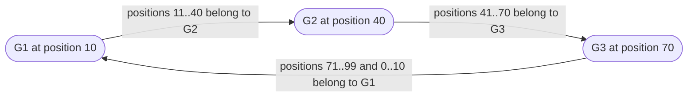

| Server | Position | Owns (the arc that ends at the server) |
| ------ | -------: | -------------------------------------- |
| G1     |       10 | 71..99 and 0..10 (wraps around)        |
| G2     |       40 | 11..40                                 |
| G3     |       70 | 41..70                                 |

Lookups:

| Key position | Walk clockwise                      | Owner |
| -----------: | ----------------------------------- | ----- |
|           25 | next server at or after 25 is at 40 | G2    |
|           85 | passes 99, wraps to 0, next is 10   | G1    |
|           70 | a server sits exactly at 70         | G3    |

Membership changes:

| Event                   | What happens                                                                | Keys that move                           |
| ----------------------- | --------------------------------------------------------------------------- | ---------------------------------------- |
| G2 crashes              | Its arc 11..40 continues clockwise and is inherited by G3 (now owns 11..70) | Only G2's keys, all to one neighbor (G3) |
| G4 joins at position 55 | G4 takes 41..55 from G3. G3 keeps 56..70                                    | Only keys in 41..55, all from G3 to G4   |
| Nothing changes         | Every key keeps its owner                                                   | None                                     |

### 2.4 Lookup algorithm and cost

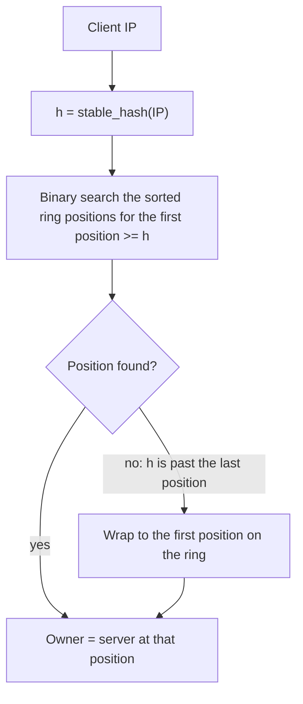

| Item                  | Value                                                                                            |
| --------------------- | ------------------------------------------------------------------------------------------------ |
| Data structure        | Sorted array of `(position, server)` pairs                                                       |
| Lookup                | Binary search, `O(log P)` where `P` is the number of ring positions                              |
| Example size          | 60 servers x 150 virtual nodes = 9,000 positions, about 13 comparisons per lookup                |
| Rebuild on membership | Re-sort the array. Done on a membership change, never per request                                |
| Hash function         | Must be stable across processes and machines. A per-process randomly keyed hasher cannot be used |

### 2.5 Virtual nodes

With one position per server, the arcs are uneven by chance, so some servers own far more of the circle than others. A failed server's whole arc also lands on a single neighbor, which can double that neighbor's load and push it over capacity, starting a cascade.

The fix is to give every server **many positions**, typically 100 to 200. Each position is hashed from a derived name such as `gw-07#0`, `gw-07#1`, `gw-07#2`, and so on. Each server then owns many small arcs scattered around the ring.

| Aspect                   | One position per server          | Many virtual nodes per server (for example 150)            |
| ------------------------ | -------------------------------- | ---------------------------------------------------------- |
| Share of keys per server | Uneven, can differ several-fold  | Close to equal, spread shrinks as virtual nodes increase   |
| When a server dies       | One neighbor inherits everything | Each of its many arcs is inherited by a different neighbor |
| Load after a failure     | One node may roughly double      | Spread thinly across all survivors                         |
| Cost                     | Smallest ring                    | Larger sorted array, still a single binary search          |

### 2.6 What consistent hashing gives and what it does not

| It gives                                                   | It does not give                                                                     |
| ---------------------------------------------------------- | ------------------------------------------------------------------------------------ |
| Same key, same server, while membership is stable          | Movement of the state itself. When an arc moves, the counters stay on the old server |
| Only about `1/N` of keys move on a membership change       | Relief for a single hot key. One key is one point and stays on one server            |
| No shared lookup table, any router computes the same owner | Agreement for free. Routers holding different server lists compute different owners  |
| Cheap lookups with a sorted array and a binary search      | Perfect balance. Balance is statistical and improves with more virtual nodes         |

### 2.7 Where it is used

| Domain                | Examples                                       | What consistent hashing decides                                |
| --------------------- | ---------------------------------------------- | -------------------------------------------------------------- |
| Distributed caches    | memcached clients (ketama-style)               | Which node holds a key. A new node invalidates about 1/N       |
| Distributed databases | Amazon Dynamo, Apache Cassandra                | Which nodes own which part of the key space                    |
| Content delivery      | Akamai (where the technique originated)        | Which edge cache serves a URL                                  |
| Load balancers        | Envoy ring-hash, HAProxy consistent hashing    | Session affinity: the same client reaches the same backend     |
| Stateful workers      | Systems keeping per-key state in worker memory | Which worker owns a key's state (this design is in this class) |

Related algorithms for the same goal: rendezvous (highest-random-weight) hashing, jump consistent hash and Maglev hashing. Redis Cluster uses 16,384 fixed hash slots instead of a ring.

---

## 3. The problem and its complexity

### 3.1 Problem statement

Enforce "no more than 100 requests per client in any 60-second sliding window" across a fleet of API gateways that together receive 1,000,000 requests per second, where requests carry no credentials and the only usable identity is the source IP. The limit must be **global**: a client must not get 100 requests per gateway.

### 3.2 Scale arithmetic

| Quantity                                             | Value                               | Derivation                                      |
| ---------------------------------------------------- | ----------------------------------- | ----------------------------------------------- |
| Peak request rate                                    | 1,000,000 req/s                     | given                                           |
| Sustained rate of a client at the limit              | 1.67 req/s                          | 100 requests / 60 s                             |
| Minimum distinct active clients (legitimate traffic) | 600,000                             | 1,000,000 / 1.67                                |
| Shared-store operations if every request touches it  | 1,000,000 ops/s or more             | one per request, more if it needs several steps |
| One shared-store node, order of magnitude            | about 100,000 ops/s                 | typical single-node figure                      |
| Shared-store shards needed                           | at least 10, about 20 with headroom | 1,000,000 / 100,000, doubled                    |
| Latency added per request, same-AZ round trip        | 0.5 to 1 ms                         | one network round trip                          |
| Latency added per request, cross-region round trip   | tens to hundreds of ms              | unusable inline                                 |
| Gateways at 20,000 req/s each                        | 50                                  | 1,000,000 / 20,000                              |

### 3.3 What a 60-second sliding window demands

The window moves continuously, so a request at 12:01:15 is judged against 12:00:15 to 12:01:15. Three ways to count:

| Approach                 | State per client                 | Accuracy                            | Problem                                        |
| ------------------------ | -------------------------------- | ----------------------------------- | ---------------------------------------------- |
| Fixed window counter     | One counter + window id (~16 B)  | Up to 2x the limit at a window edge | 100 at 12:00:59 + 100 at 12:01:00 = 200 in 2 s |
| Sliding log (timestamps) | Up to 100 entries per client     | Exact                               | 0.8 KB to 4-10 KB per client                   |
| Sliding window counter   | Two counters + bucket id (~16 B) | Approximate (even previous bucket)  | Bounded error, shrinks as the window slides    |

### 3.4 The shape of the workload

A legitimate client sends at most about 1.7 requests per second, and there are at least 600,000 of them active at once. The workload is **wide and shallow**: very many keys, each touched rarely.

This has a non-obvious consequence for any design that spreads each client's requests across many gateways. Batching increments locally and syncing them later only helps when one key is hit many times between syncs. Here each gateway sees a given client about once per sync interval, so batched deltas collapse to roughly one remote operation per request. Batching does not remove the shared store from the hot path.

### 3.5 The straightforward design and why it fails

The first design considered: keep an external cache that maps each client IP to a **set of request ids** with a 60-second TTL, and rely on the cache's scheduler to remove expired entries. Review findings:

| #   | Defect                             | Why it breaks                                                                        | Severity               |
| --- | ---------------------------------- | ------------------------------------------------------------------------------------ | ---------------------- |
| 1   | TTL is per key, not per member     | A set expires whole: fixed window if TTL is set once, never expires if refreshed     | Invalidates the design |
| 2   | No expiry scheduler for members    | Expiry is lazy, sampled and whole-key. Nothing removes single request ids at 60 s    | Invalidates the design |
| 3   | Check-then-add is not atomic       | Count, add, expire are separate steps. Gateways interleave and overshoot. 3x the ops | Invalidates the design |
| 4   | An IP is not a unique person       | NAT and proxies share one IP across many users. One user can rotate IPs or a /64     | Scope question         |
| 5   | Request ids carry no useful data   | Counting needs timestamps only. 4-10 KB per saturated IP, 4-10 GB at 1M IPs          | Cost                   |
| 6   | Shared-store throughput            | At least 1M round trips per second, more with multi-step scripts. 20+ shards         | Invalidates at scale   |
| 7   | Rejected traffic still costs an op | An attack becomes store load. The limiter falls over first, when it is needed most   | Invalidates at scale   |
| 8   | Hot key                            | Sharding spreads keys, not requests. One abusive IP saturates one shard              | Invalidates at scale   |
| 9   | Store sits in the hot path         | Adds 0.5-1 ms per request. A stall blocks every gateway. Failover loses counts       | Invalidates at scale   |
| 10  | No capacity headroom               | 20k per gateway assumes even load at exactly peak. One failure overloads the rest    | Cost and risk          |
| 11  | Global across regions unresolved   | One cluster means cross-region round trips inline. One per region breaks "global"    | Scope question         |

Severity order: items 1 to 3 invalidate the design on correctness. Items 6 to 9 invalidate it at this scale. Items 5 and 10 are cost and risk. Items 4 and 11 are scope questions carried forward.

The atomicity defect (item 3) in motion, with the count at 99 and a limit of 100:

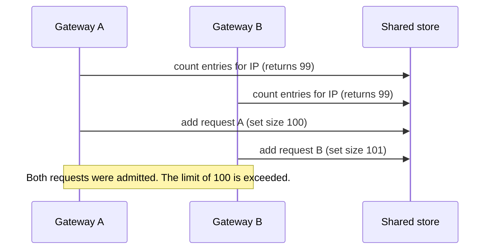

The throughput and latency defects (items 6 to 9) in one picture:

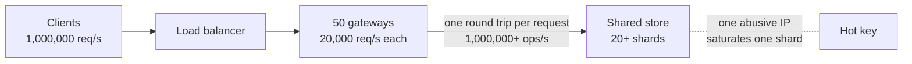

### 3.6 Complexity summary and the requirements it imposes

| Dimension           | Why it is hard here                                              | Requirement placed on the solution               |
| ------------------- | ---------------------------------------------------------------- | ------------------------------------------------ |
| Window semantics    | A true sliding window is costly per client, a fixed one is wrong | Constant memory per client, no boundary burst    |
| Atomicity           | Many gateways decide about the same client concurrently          | Exactly one decision-maker per client            |
| Throughput          | 1,000,000 decisions per second                                   | No shared-state operation per request            |
| Latency             | Every request pays for the decision                              | No network hop in the decision path              |
| Wide, shallow keys  | 600,000+ clients, each touched rarely, so batching cannot help   | State local to where the request lands           |
| Hot keys and floods | Abusive clients create skew and amplify load                     | Cheap rejection that touches no shared component |
| Availability        | A shared dependency in the hot path is a global single point     | A loss affects only a small slice of clients     |
| Failure behavior    | State is lost when a node is lost                                | A bounded, explicit error after a node loss      |

---

## 4. The solution: IP-partitioned, in-memory limiting

### 4.1 Principle

Every client IP has exactly **one owner gateway**. A consistent-hash ring over the client IP, evaluated by the routing tier in front of the gateways, sends all requests from an IP to its owner. The owner keeps that client's counters in its own memory and makes every decision locally.

"Global" is therefore enforced by **partitioning**: there is only one counter per client in the whole system, so there is nothing to synchronize.

The counter table is **working state, not a cache**. A cache is a fast copy of data whose truth lives elsewhere, and it pays off when reads dominate and entries are reused. Here every request writes the counter, a client appears about once per second at most, and there is no other copy to mirror or invalidate. The counter is the truth, held in the memory of the one node that owns it.

### 4.2 Architecture

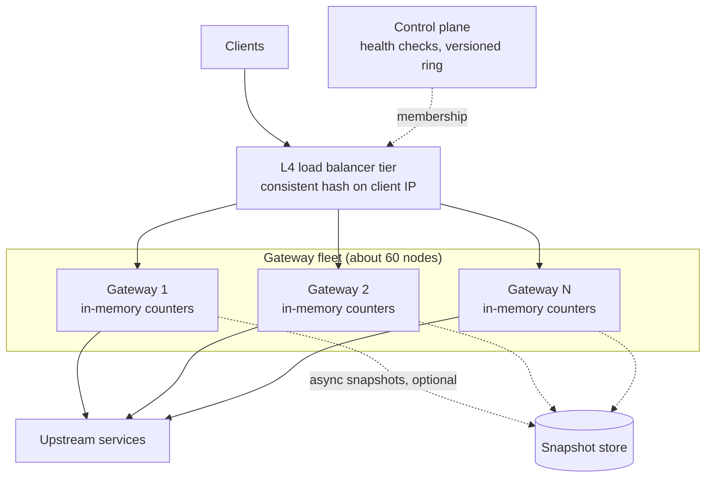

Solid arrows are the request path. Dashed arrows are off the request path.

| Component             | Responsibility                                                      | Statefulness                    | On the request path? |
| --------------------- | ------------------------------------------------------------------- | ------------------------------- | -------------------- |
| L4 load balancer tier | Hash the client IP onto the ring, forward to the owner gateway      | Stateless (holds only the ring) | Yes                  |
| Gateway fleet         | Hold counters, decide allow or reject, forward allowed requests     | Stateful: in-memory counters    | Yes                  |
| Control plane         | Health-check gateways, publish a versioned node list to the routers | Holds membership                | No                   |
| Snapshot store        | Receive hot-counter snapshots, hand them to a gateway taking over   | Loss is tolerated               | No                   |
| Upstream services     | Serve allowed requests. They never see rejected traffic             | Unrelated to the limiter        | Yes (allowed only)   |

### 4.3 Data model

| Item           | Definition                                                                                                   |
| -------------- | ------------------------------------------------------------------------------------------------------------ |
| Key            | IPv4 address (32 bits), or IPv6 /64 prefix (64 bits). An IPv4-mapped IPv6 address is treated as IPv4         |
| Value          | `bucket` (which 60-second slot), `prev` (count in the previous bucket), `curr` (count in the current bucket) |
| Value size     | 16 bytes (`u64` plus two `u32`)                                                                              |
| Budget         | About 64 bytes per tracked client including hash-table overhead                                              |
| Rejected calls | Never stored. Memory per client is constant however hard the client pushes                                   |

### 4.4 The algorithm: sliding window counter

```text
t        = seconds elapsed in the current bucket (0 to 60)
estimate = prev x (1 - t / 60) + curr
reject if estimate >= 100, otherwise curr = curr + 1 and admit
```

The previous bucket's count is weighted by how much of it still overlaps the trailing 60 seconds. Early in a bucket most of `prev` still counts. Late in a bucket almost none does.

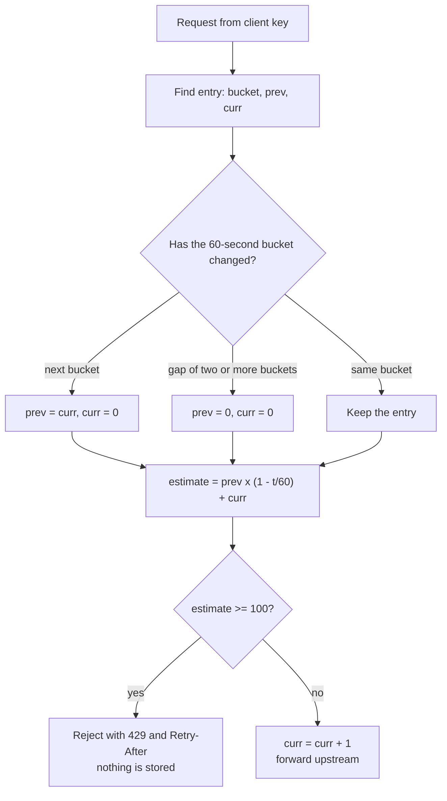

| Rule              | Detail                                                                                        |
| ----------------- | --------------------------------------------------------------------------------------------- |
| Bucket alignment  | Bucket id is `unix_time_ms / 60000`, so all gateways derive the same boundaries               |
| Rolling           | One bucket forward: `prev = curr`, `curr = 0`. Two or more forward: both reset to 0           |
| Atomicity         | Roll, estimate and increment happen under one lock on one gateway                             |
| Rejected requests | Not recorded, so rejects cannot grow per-client state or the table                            |
| Retry-After       | Earliest moment the estimate falls below the limit, rounded up to whole seconds in the header |
| Accuracy          | Exact for an evenly spread previous bucket. Otherwise off by at most its count, shrinking     |

**Worked example 1: a normal client.** At 12:00 the client sent 80 requests (the previous bucket). It is now 12:01:15, so 15 of 60 seconds have elapsed and `prev` is weighted by 0.75. The weighted previous count is `80 x 0.75 = 60`.

| `curr` before request | Estimate | Decision                |
| --------------------: | -------: | ----------------------- |
|                     0 |     60.0 | allow                   |
|                    20 |     80.0 | allow                   |
|                    39 |     99.0 | allow (curr becomes 40) |
|                    40 |    100.0 | reject (429)            |

Exactly 40 further requests fit in this bucket.

**Worked example 2: a boundary burst.** A fixed window would allow 100 requests at 12:00:59 and 100 more at 12:01:00.

| Time     | State                    | Estimate              | Result                     |
| -------- | ------------------------ | --------------------- | -------------------------- |
| 12:00:59 | 100 requests admitted    | -                     | 100 admitted, then rejects |
| 12:01:01 | `prev = 100`, `curr = 0` | `100 x 59/60 = 98.33` | allow (curr becomes 1)     |
| 12:01:01 | `curr = 1`               | `98.33 + 1 = 99.33`   | allow (curr becomes 2)     |
| 12:01:01 | `curr = 2`               | `98.33 + 2 = 100.33`  | reject                     |

Only 2 requests pass instead of 100. The sliding counter closes the boundary loophole.

### 4.5 Request lifecycle

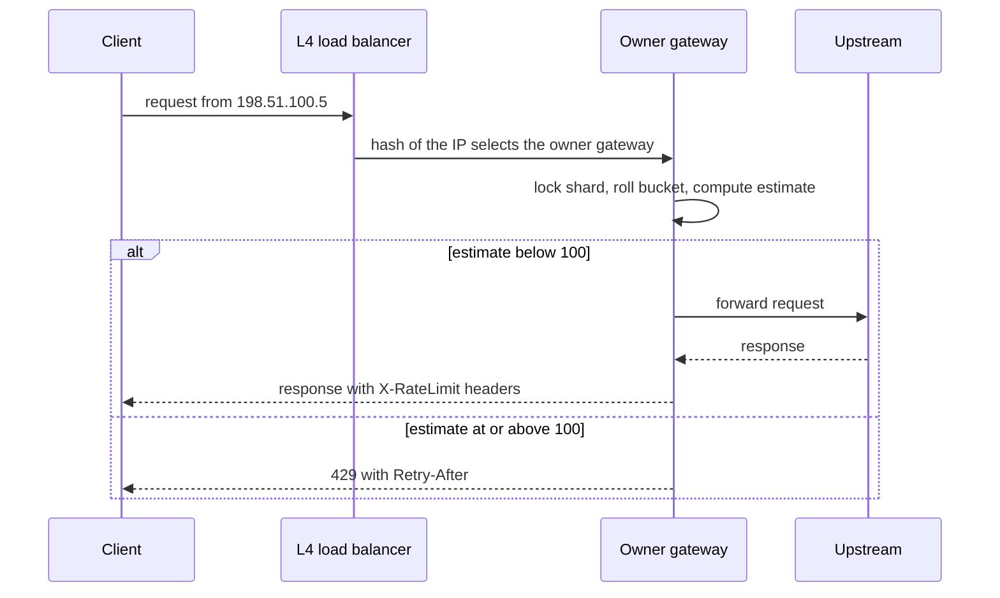

| Step | Where   | Action                                                         | Network calls |
| ---: | ------- | -------------------------------------------------------------- | ------------: |
|    1 | LB tier | Hash the client IP, binary-search the ring, pick the owner     |             0 |
|    2 | Gateway | Resolve the client key, lock one table shard                   |             0 |
|    3 | Gateway | Roll the bucket if needed, compute the estimate                |             0 |
|    4 | Gateway | Reject (429) or increment and continue                         |             0 |
|    5 | Gateway | Forward allowed requests upstream. Add `X-RateLimit-*` headers | upstream only |

### 4.6 Inside one gateway

| Concern                | Design                                                                                      |
| ---------------------- | ------------------------------------------------------------------------------------------- |
| Concurrency            | Table split into 64 shards, each behind its own mutex, chosen by a randomly keyed hash      |
| Lock scope             | Held for one lookup and a few operations. Never across I/O or an await point                |
| Hash-flooding          | Shard selector and per-shard map are randomly keyed, so attackers cannot force collisions   |
| Expiry                 | Sweeper every 10 s drops entries two or more buckets old (equivalent to no entry)           |
| Memory protection      | Per-shard cap. At the cap: emergency sweep, then admit new clients untracked and count them |
| Placement in the stack | Outermost layer, so rejects are dropped before parsing, authentication or routing           |
| Observability          | Atomic counters for allowed, rejected, untracked, evicted. Table size readable at any time  |

### 4.7 Routing tier and membership

| Item              | Design                                                                                                      |
| ----------------- | ----------------------------------------------------------------------------------------------------------- |
| Ring              | About 60 gateways x 150 virtual nodes = 9,000 positions                                                     |
| Hash input        | The client key (IPv4 address or IPv6 /64 prefix), so all addresses in a /64 share one owner and one counter |
| Router instances  | Stateless and horizontally scaled. Any instance computes the same owner for the same key                    |
| Membership source | The control plane publishes a **versioned** node list. Routers must not mix versions                        |
| Failure detection | Health checks every 2 seconds, a gateway leaves the ring after 3 consecutive misses (about 6 seconds)       |
| Source address    | The routing tier must hash the real client address (see section 5 on address fidelity)                      |

### 4.8 Failure behavior

**What a gateway crash looks like.** Illustrative 3-node ring (production has about 60 nodes). G2 crashes:

| Client IP | Owner before | Owner after | Counter state                                              |
| --------- | ------------ | ----------- | ---------------------------------------------------------- |
| A         | G1           | G1          | Untouched                                                  |
| B         | G2           | G3          | Lost with G2's memory, restored from snapshot or restarted |
| C         | G2           | G1          | Lost with G2's memory, restored from snapshot or restarted |
| D         | G3           | G3          | Untouched                                                  |

Only the failed node's clients move. Clients A and D never notice.

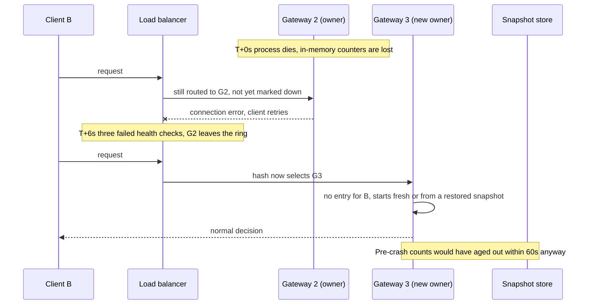

| Time                     | Event                                                                                  |
| ------------------------ | -------------------------------------------------------------------------------------- |
| T+0 s                    | G2's process dies. Its clients' counters vanish with its memory                        |
| T+0 to 6 s               | The router still sends G2's clients to G2. Connections fail and clients retry          |
| T+6 s                    | G2 leaves the ring (2 s check interval x 3 misses). Its clients re-hash onto survivors |
| First request after move | New owner has no entry: resumes from a snapshot at most ~5 s old, or starts at 0       |
| T+66 s                   | Lost history would have expired anyway. The overshoot window closes                    |

**The error is bounded.**

| Bound     | Value                                                                                                                                |
| --------- | ------------------------------------------------------------------------------------------------------------------------------------ |
| Magnitude | A client at 99 of 100 when its gateway died, with no snapshot, can send up to 100 more, so at most 199 in that window instead of 100 |
| Duration  | Once per crash, for at most one 60-second window                                                                                     |
| Scope     | About 1/60 of clients (1.7%). Legitimate clients rarely sit near the limit, so in practice only abusers gain anything                |

**Load redistribution (why virtual nodes matter).**

| Situation                               | Per-gateway load                                                                 |
| --------------------------------------- | -------------------------------------------------------------------------------- |
| Normal, 60 gateways                     | about 16,700 req/s each                                                          |
| One gateway lost, virtual nodes         | each of 59 survivors absorbs about 283 req/s more (about 16,950)                 |
| One gateway lost, one position per node | one neighbor absorbs all 16,700 and reaches about 33,400, past its 20,000 target |

**Other failures.**

| Failure                      | Effect                                                                   | Why it is contained                      |
| ---------------------------- | ------------------------------------------------------------------------ | ---------------------------------------- |
| Snapshot store down          | Decisions unaffected. Recovery after a gateway loss becomes a cold start | Never touched on the request path        |
| One load balancer fails      | Other instances compute the same owner for every IP                      | Routers are stateless and deterministic  |
| Routers disagree on the ring | A client splits across two owners and the effective limit multiplies     | Versioned, atomic rollout with alerts    |
| One gateway slows down       | Only its 1/N slice of clients is affected                                | No shared component spreads the slowdown |

### 4.9 Recovery and deployments

A restarted or newly deployed gateway reclaims its share of the ring with an empty table, while the nodes that covered for it hold live counters for those clients that are then abandoned. A rolling deploy of 60 nodes would repeat this 60 times. Two mechanisms keep this bounded:

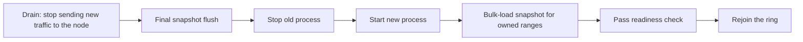

| Mechanism       | What it does                                                                                                         |
| --------------- | -------------------------------------------------------------------------------------------------------------------- |
| Readiness gate  | A node loads the snapshot for the ranges it will own **before** it joins the ring                                    |
| Graceful drain  | A node flushes a final snapshot, then leaves the ring, then exits                                                    |
| Snapshot policy | Flush every 5 seconds, persist only clients at or above 50% of the limit, since cold clients lose nothing meaningful |

### 4.10 Capacity and sizing

| Item                                | Value                                          | Basis                                     |
| ----------------------------------- | ---------------------------------------------- | ----------------------------------------- |
| Peak load                           | 1,000,000 req/s                                | requirement                               |
| Per-gateway target                  | 20,000 req/s                                   | assumption                                |
| Gateways needed at target           | 50                                             | 1,000,000 / 20,000                        |
| Gateways provisioned                | 60                                             | headroom for failures and rolling deploys |
| Normal load per gateway             | about 16,700 req/s                             | 1,000,000 / 60                            |
| Load per gateway after one failure  | about 16,950 req/s                             | 1,000,000 / 59                            |
| Memory per tracked client           | about 64 bytes budgeted                        | key, 16-byte entry, table overhead        |
| Memory at 10 million active clients | about 640 MB fleet-wide, 11 MB per gateway     | 10,000,000 x 64 B, over 60 gateways       |
| Ring size                           | 9,000 positions, about 13 comparisons a lookup | 60 x 150, log2(9,000)                     |
| Cost of one limiter decision        | about 430 ns (about 2.3 M per second per core) | measured, 1 vCPU sandbox, 1M clients      |
| CPU spent on limiting, whole fleet  | well under one core in total                   | 1,000,000 req/s x 430 ns = 0.43 core      |
| Failure detection time              | about 6 seconds                                | 2 s interval x 3 misses                   |
| Worst-case overshoot after a crash  | 2x the limit, once per client, at most 60 s    | section 4.8                               |

The 430 ns figure is a single-vCPU sandbox measurement (section 6.11). Validate it on target hardware before relying on it.

### 4.11 Real-time scenarios

**Scenario A: a normal client.** `198.51.100.5` sent 80 requests in the previous minute. It is 12:01:15.

| Step | What happens                                                                      |
| ---: | --------------------------------------------------------------------------------- |
|    1 | The ring hashes the IP to Gateway 7, as it always does while membership is stable |
|    2 | Gateway 7 weights the previous bucket: `80 x 0.75 = 60`                           |
|    3 | With `curr = 20` the estimate is 80, so the request is allowed                    |
|    4 | When `curr` reaches 40 the estimate reaches 100 and the next request gets a 429   |
|    5 | `Retry-After` is a few milliseconds, rounded up to 1 second in the HTTP header    |

**Scenario B: boundary burst.** An attacker sends 100 requests at 12:00:59 and tries again at 12:01:01. A fixed window would admit 200 requests in 2 seconds. The sliding counter admits 2 more at 12:01:01 and rejects the rest (worked example 2 in section 4.4).

**Scenario C: an abusive bot.** `192.0.2.99` sends 5,000 requests per second.

| Observation                                                                                                                    |
| ------------------------------------------------------------------------------------------------------------------------------ |
| All of its traffic lands on one gateway, say Gateway 7                                                                         |
| The first 100 requests pass within about 20 ms. The remaining ~4,900 per second are rejected with a local memory lookup        |
| Gateway 7 goes from about 16,700 to about 21,700 req/s. A rejection is cheaper than a proxied request, so the node absorbs it  |
| Upstream services see nothing beyond the first 100 requests. No shared component is touched                                    |
| A bot sending 500,000 req/s would saturate its single owner. That is a volumetric attack and is handled upstream of this layer |

**Scenario D: a gateway crash.** Covered in section 4.8: detection in about 6 seconds, about 1/60 of clients re-homed, overshoot bounded at 2x once per affected client, closing within 60 seconds.

**Scenario E: a rolling deploy.** With drain, a final snapshot and a readiness gate, each node's departure re-homes about 1/60 of clients, and the new owners resume from counts at most one flush interval (about 5 seconds) old. Without those mechanisms every step of the deploy would reset 1.7% of clients.

### 4.12 Why this design fits 1,000,000 requests per second

| Property                              | Value in this design                                                                |
| ------------------------------------- | ----------------------------------------------------------------------------------- |
| Network calls added per request       | 0                                                                                   |
| Shared components on the request path | 0                                                                                   |
| Coordination between gateways         | None. Each client has exactly one decision-maker                                    |
| Per-request CPU for the decision      | About 0.4 microseconds                                                              |
| How capacity grows                    | Add gateways. Each takes about 1/N of clients and about 1/N of load                 |
| Blast radius of a failure             | About 1/N of clients for at most one window                                         |
| Cost of a rejection                   | A local lookup. Attack traffic never reaches upstream services or any shared system |

The work per request is constant and local, the state per client is constant, and capacity scales linearly with the number of gateways. At 1,000,000 requests per second those three properties are what keep the system's cost and failure modes proportional to the fleet instead of to the traffic.

---

## 5. What the solution does not provide, and what must still be done

### 5.1 Summary

| #   | Gap or limitation                | Consequence                                         | Work required                                          | Priority |
| --- | -------------------------------- | --------------------------------------------------- | ------------------------------------------------------ | -------- |
| G1  | Real client IP fidelity          | Clients behind a proxy share its one counter        | Verify source address end to end, trust headers rarely | P0       |
| G2  | Ring agreement across routers    | Split owners multiply the limit                     | Versioned membership, atomic rollout, alert            | P0       |
| G3  | State not migrated by the ring   | Counters stay behind: bounded fail-open             | Snapshots, readiness gate, graceful drain              | P0       |
| G4  | Memory exhaustion by IP spraying | Table growth from many source addresses             | Shard cap, IPv6 /64 grouping, overflow policy          | P0       |
| G5  | Observability and operations     | Misrouting and overflow go unnoticed                | Metrics, dashboards, alerts, runbooks                  | P0       |
| G6  | IP is not a person               | Shared IPs share one limit, multi-IP users get more | Deferred: identity, allowlists or higher quotas        | P1       |
| G7  | Hot owner, volumetric attacks    | One huge sender saturates its single owner          | Filtering and scrubbing upstream of this layer         | P1       |
| G8  | Multi-region                     | The limit applies per region                        | Pin each client IP to one region, or accept it         | P1       |
| G9  | Approximate counting             | Small bounded deviation from an exact window        | Accept, or refine if a stricter guarantee is needed    | P2       |
| G10 | Policy features                  | One global limit only                               | Per-route limits, allowlists, quotas, dynamic config   | P2       |

### 5.2 Details

**G1. Real client IP fidelity.** The ring hashes the client address, and the gateway counts against it. Both must see the true client address.

| Deployment                            | TCP peer seen by gateway | Required handling                                   |
| ------------------------------------- | ------------------------ | --------------------------------------------------- |
| L4 balancer preserving source address | The real client          | Use the peer address directly                       |
| CDN, proxy or L7 tier in front        | The proxy                | Use a header that only trusted proxies write        |
| Untrusted forwarding header           | Whatever the client sent | Never trust it: clients can forge `X-Forwarded-For` |

The reference code takes the entry a configured number of trusted proxies from the right of `X-Forwarded-For` and ignores anything further left. If a forwarding header is used, the routing tier needs an L7 component, because an L4 hash cannot read headers.

**G2. Ring agreement.** The determinism that removes coordination also makes every router's list authoritative for its own decisions. Publish the node list with a version number, apply it atomically, export the version as a metric, and alert when more than one version is live for longer than a short grace period.

**G3. State migration.** The ring moves ownership, not data. Required: periodic snapshots of hot counters, a readiness gate that loads them before joining, and a graceful drain on shutdown. The snapshot store should support loading by ring range in production, so a node reads only what it will own. The reference code loads all entries and filters.

**G4. Memory exhaustion.** An attacker who sprays addresses creates many tracked clients, each costing about 64 bytes. Mitigations: a hard cap per shard, aggregation of IPv6 by /64, the sweeper, and an explicit overflow policy. The reference code fails open for new clients when a shard is full and counts the event. Choose fail-open or fail-closed deliberately and alert on any overflow.

**G5. Observability.**

| Metric                           | Meaning                                     | Alert                                | In reference code |
| -------------------------------- | ------------------------------------------- | ------------------------------------ | ----------------- |
| `rl_allowed_total`               | Requests admitted                           | Sudden drop                          | yes (counter)     |
| `rl_rejected_total`              | Requests answered 429                       | Sudden rise, by source network       | yes (counter)     |
| `rl_untracked_total`             | Admitted uncounted because a shard was full | Any sustained non-zero rate          | yes (counter)     |
| `rl_evicted_total`               | Entries removed by the sweeper              | Trend only                           | yes (counter)     |
| `rl_tracked_clients`             | Table size                                  | Approaching the cap                  | yes (`len()`)     |
| `rl_ring_version`                | Membership version per router and gateway   | More than one live version for 1 min | to add            |
| `rl_misrouted_total`             | Requests at a gateway that is not the owner | Sustained non-zero rate              | to add            |
| `rl_snapshot_flush_errors_total` | Failed snapshot writes                      | Sustained failures                   | to add            |
| `rl_check_duration_ns`           | Decision latency histogram                  | p99 regression                       | to add            |

**G6. IP is not a person.** The limit is per IP address (IPv6 per /64). Many users behind one address share a single limit, and one user with many addresses gets several. This design does not address either case. It is deliberately deferred: a fix needs identity, allowlisting or differentiated quotas for known shared ranges.

**G7. Hot owner and volumetric attacks.** One client's traffic always lands on one gateway. Moderate abuse is absorbed cheaply, because rejection is a local lookup. A flood of hundreds of thousands of requests per second from one address, or a distributed flood, must be filtered upstream: anycast, scrubbing, network-layer rate filters.

**G8. Multi-region.** One ring per region keeps decisions local. A truly global limit needs each client IP pinned to exactly one region.

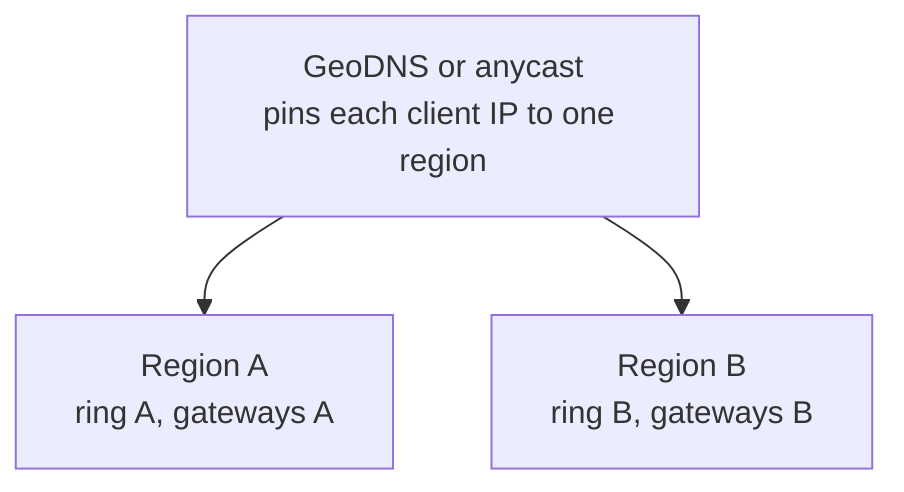

Without pinning, a client can obtain the limit once per region.

**G9. Approximate counting.** The estimate is exact for an evenly spread previous bucket and otherwise deviates by at most the previous bucket's count, shrinking as the window slides. This is accepted. An exact sliding log costs up to 100 stored entries per client and is not needed to meet the requirement.

**G10. Policy features.** The reference limiter applies one limit to one identity. Per-route limits, allowlists, partner quotas and dynamic reconfiguration need a policy layer in front of `check`.

### 5.3 Validation plan

| Test                           | What it proves                                                  | Pass criterion                                   |
| ------------------------------ | --------------------------------------------------------------- | ------------------------------------------------ |
| Unit tests (included)          | Window math, retry-after, sweep, overflow, merge, ring movement | All pass                                         |
| Ring property test             | Removal moves only the removed node's keys, addition only takes | Zero violations over millions of keys            |
| Load test at 1.2x peak         | 60 nodes sustain 1,200,000 req/s                                | Latency in budget, no table overflow             |
| Skewed-traffic test            | A few clients at 5,000 req/s do not hurt the rest               | Other clients' latency unchanged                 |
| Chaos: kill one gateway        | Detection time, re-homing, bounded overshoot                    | Detect in ~6 s, overshoot at most 2x, 60 s close |
| Chaos: kill the snapshot store | Decisions are unaffected                                        | No change in 429 rate or latency                 |
| Rolling-deploy rehearsal       | Drain, flush and gate keep the reset bounded                    | At most ~5 s of counts lost per moved client     |
| Ring-disagreement drill        | Alert fires when routers hold different versions                | Alert within the grace period                    |
| Address-spray test             | Cap and overflow policy behave as designed                      | Memory bounded, `untracked` metric fires         |
| Clock-skew test                | Behavior across a failover with 2 s of skew                     | No effect beyond the documented bound            |

### 5.4 Suggested order of work

| Phase | Deliverable                                                     | Exit condition                                                   |
| ----: | --------------------------------------------------------------- | ---------------------------------------------------------------- |
|     1 | Core limiter and gateway middleware (section 6)                 | Unit tests green, benchmark on target hardware                   |
|     2 | Routing tier with the ring, versioned membership, health checks | One client always reaches one gateway, mixed-version alert works |
|     3 | Metrics, dashboards, alerts                                     | All metrics in section 5.2 (G5) exported                         |
|     4 | Snapshot store, readiness gate, graceful drain                  | Rolling deploy rehearsal passes                                  |
|     5 | Load and chaos testing                                          | Validation plan (5.3) complete                                   |
|     6 | Address-fidelity and multi-region decisions, policy features    | G1, G6, G8 and G10 decisions recorded                            |

---

## 6. Rust reference implementation

### 6.1 Scope and verification

This section shows how the gateway builds the capability. The code was compiled and its full test suite (28 tests) passed on Rust 1.91.1, edition 2021. Current dependency versions need Rust 1.85 or newer.

| File              | Responsibility                                                               | Runs in                                  |
| ----------------- | ---------------------------------------------------------------------------- | ---------------------------------------- |
| `Cargo.toml`      | Dependencies: `axum`, `tokio`. Dev: `tower`                                  | build                                    |
| `src/lib.rs`      | Module declarations                                                          | -                                        |
| `src/key.rs`      | `ClientKey`: IPv4 address or IPv6 /64 prefix, stable byte form               | gateway and routing tier                 |
| `src/limiter.rs`  | The limiter: sharded table, sliding window counter, sweep, export and import | gateway                                  |
| `src/ring.rs`     | Consistent-hash ring with virtual nodes                                      | routing tier (and gateway for readiness) |
| `src/snapshot.rs` | `SnapshotStore` trait, flush loop, restore for owned ranges, in-memory store | gateway                                  |
| `src/gateway.rs`  | Client IP resolution and the axum middleware                                 | gateway                                  |
| `src/main.rs`     | Wiring: restore, background tasks, serve, graceful drain                     | gateway                                  |

Placement of the limiter in the gateway's request path:

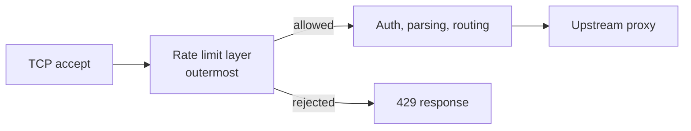

### 6.2 `Cargo.toml`

```toml
[package]
name = "edge-rate-limiter"
version = "0.1.0"
edition = "2021"
rust-version = "1.85"

[dependencies]
axum = "0.7"
tokio = { version = "1", features = ["rt-multi-thread", "macros", "time", "net", "signal"] }

[dev-dependencies]
tower = { version = "0.4", features = ["util"] }
```

### 6.3 `src/lib.rs`

```rust
//! Edge rate limiter: sliding-window-counter limiting held in gateway memory,
//! with client-IP partitioning delegated to a consistent-hash ring.

pub mod gateway;
pub mod key;
pub mod limiter;
pub mod ring;
pub mod snapshot;
```

### 6.4 `src/key.rs`

```rust
use std::net::IpAddr;

/// The identity a request is counted against.
///
/// IPv4 is counted per address. IPv6 is counted per /64 prefix, because a single
/// subscriber normally controls an entire /64 and could otherwise rotate through
/// 2^64 addresses to dodge the limit.
#[derive(Clone, Copy, Debug, PartialEq, Eq, Hash)]
pub enum ClientKey {
    V4(u32),
    V6Prefix64(u64),
}

impl ClientKey {
    pub fn from_ip(ip: IpAddr) -> Self {
        match ip {
            IpAddr::V4(v4) => ClientKey::V4(u32::from(v4)),
            IpAddr::V6(v6) => match v6.to_ipv4_mapped() {
                // ::ffff:a.b.c.d is the same client as a.b.c.d.
                Some(v4) => ClientKey::V4(u32::from(v4)),
                None => ClientKey::V6Prefix64((u128::from(v6) >> 64) as u64),
            },
        }
    }

    /// Process-independent byte form, used for ring placement and snapshot keys.
    pub fn stable_bytes(&self) -> [u8; 9] {
        let mut out = [0u8; 9];
        match *self {
            ClientKey::V4(v) => {
                out[0] = 4;
                out[1..5].copy_from_slice(&v.to_be_bytes());
            }
            ClientKey::V6Prefix64(v) => {
                out[0] = 6;
                out[1..9].copy_from_slice(&v.to_be_bytes());
            }
        }
        out
    }
}
```

### 6.5 `src/limiter.rs`

```rust
//! Sliding-window-counter limiter held entirely in gateway memory.
//!
//! Per client the limiter stores three numbers: the id of the current time bucket,
//! the request count of the previous bucket and the count of the current bucket.
//! The number of requests in the trailing window is estimated as
//!
//! ```text
//! estimate = prev * (1 - elapsed_fraction) + curr
//! ```
//!
//! and a request is rejected when `estimate >= limit`. Rejected requests are never
//! recorded, so memory per client is constant no matter how hard a client pushes.

use std::collections::hash_map::RandomState;
use std::collections::HashMap;
use std::hash::BuildHasher;
use std::sync::atomic::{AtomicU64, Ordering};
use std::sync::{Mutex, MutexGuard};
use std::time::{Duration, SystemTime, UNIX_EPOCH};

use crate::key::ClientKey;

/// Time source. Wall-clock milliseconds in production, a manual clock in tests.
pub trait Clock: Send + Sync + 'static {
    fn now_ms(&self) -> u64;
}

pub struct SystemClock;

impl Clock for SystemClock {
    fn now_ms(&self) -> u64 {
        SystemTime::now()
            .duration_since(UNIX_EPOCH)
            .map(|d| d.as_millis() as u64)
            .unwrap_or(0)
    }
}

#[derive(Clone, Debug)]
pub struct Config {
    /// Maximum requests per client inside any trailing window.
    pub limit: u32,
    /// Window length. Must be at least one second.
    pub window: Duration,
    /// Number of independently locked table shards (lock striping).
    pub shards: usize,
    /// Hard cap on tracked clients per shard. Protects memory against address spraying.
    pub max_entries_per_shard: usize,
}

impl Default for Config {
    fn default() -> Self {
        Self {
            limit: 100,
            window: Duration::from_secs(60),
            shards: 64,
            max_entries_per_shard: 100_000,
        }
    }
}

/// Per-client state: 16 bytes of payload.
#[derive(Clone, Copy, Debug, PartialEq, Eq)]
pub struct Entry {
    /// `now_ms / window_ms` of the bucket that `curr` belongs to.
    pub bucket: u64,
    pub prev: u32,
    pub curr: u32,
}

impl Entry {
    /// Advance this entry to `now_bucket`. A one-bucket step shifts `curr` into `prev`;
    /// a longer gap means the old traffic has fully expired.
    fn roll_to(&mut self, now_bucket: u64) {
        if now_bucket <= self.bucket {
            return;
        }
        self.prev = if now_bucket == self.bucket + 1 { self.curr } else { 0 };
        self.curr = 0;
        self.bucket = now_bucket;
    }

    /// Combine two views of the same client (used when restoring snapshots).
    /// Both are aligned to the newer bucket, then the larger count of each field wins.
    pub fn merge(mut self, mut other: Entry) -> Entry {
        let bucket = self.bucket.max(other.bucket);
        self.roll_to(bucket);
        other.roll_to(bucket);
        Entry {
            bucket,
            prev: self.prev.max(other.prev),
            curr: self.curr.max(other.curr),
        }
    }
}

#[derive(Clone, Copy, Debug, PartialEq, Eq)]
pub enum Decision {
    /// Request admitted. `remaining` is the whole number of further requests that fit.
    Allow { remaining: u32 },
    /// Request admitted but not counted, because the table is full (deliberate fail-open).
    AllowUntracked,
    /// Request rejected. `retry_after` is the earliest time a retry can succeed.
    Reject { retry_after: Duration },
}

#[derive(Default, Debug)]
pub struct Metrics {
    pub allowed: AtomicU64,
    pub rejected: AtomicU64,
    pub untracked: AtomicU64,
    pub evicted: AtomicU64,
}

type Table = HashMap<ClientKey, Entry>;

pub struct Limiter<C: Clock = SystemClock> {
    cfg: Config,
    window_ms: u64,
    shards: Box<[Mutex<Table>]>,
    /// Randomly keyed, so an attacker cannot choose addresses that all land in one shard.
    shard_hasher: RandomState,
    clock: C,
    metrics: Metrics,
}

impl Limiter<SystemClock> {
    pub fn new(cfg: Config) -> Self {
        Self::with_clock(cfg, SystemClock)
    }
}

impl<C: Clock> Limiter<C> {
    pub fn with_clock(cfg: Config, clock: C) -> Self {
        let window_ms = cfg.window.as_millis() as u64;
        assert!(cfg.limit > 0, "limit must be positive");
        assert!(window_ms >= 1_000, "window must be at least one second");
        assert!(cfg.shards > 0, "need at least one shard");
        let shards = (0..cfg.shards).map(|_| Mutex::new(Table::new())).collect();
        Self {
            cfg,
            window_ms,
            shards,
            shard_hasher: RandomState::new(),
            clock,
            metrics: Metrics::default(),
        }
    }

    pub fn limit(&self) -> u32 {
        self.cfg.limit
    }

    pub fn metrics(&self) -> &Metrics {
        &self.metrics
    }

    /// Number of clients currently tracked.
    pub fn len(&self) -> usize {
        self.shards.iter().map(|s| lock(s).len()).sum()
    }

    pub fn is_empty(&self) -> bool {
        self.len() == 0
    }

    /// The hot path: one shard lock, one hash lookup, a few arithmetic operations.
    pub fn check(&self, key: ClientKey) -> Decision {
        let now = self.clock.now_ms();
        let bucket = now / self.window_ms;
        let frac = (now % self.window_ms) as f64 / self.window_ms as f64;
        let limit = f64::from(self.cfg.limit);

        let decision = {
            let mut table = lock(&self.shards[self.shard_of(&key)]);

            if table.len() >= self.cfg.max_entries_per_shard && !table.contains_key(&key) {
                let removed = sweep_table(&mut table, bucket);
                self.metrics.evicted.fetch_add(removed as u64, Ordering::Relaxed);
            }

            if table.len() >= self.cfg.max_entries_per_shard && !table.contains_key(&key) {
                Decision::AllowUntracked
            } else {
                let e = table.entry(key).or_insert(Entry { bucket, prev: 0, curr: 0 });
                e.roll_to(bucket);
                let estimate = f64::from(e.prev) * (1.0 - frac) + f64::from(e.curr);
                if estimate >= limit {
                    Decision::Reject { retry_after: retry_after(e, frac, limit, self.window_ms) }
                } else {
                    e.curr = e.curr.saturating_add(1);
                    let remaining = (limit - (estimate + 1.0)).floor().max(0.0) as u32;
                    Decision::Allow { remaining }
                }
            }
        };

        let counter = match decision {
            Decision::Allow { .. } => &self.metrics.allowed,
            Decision::AllowUntracked => &self.metrics.untracked,
            Decision::Reject { .. } => &self.metrics.rejected,
        };
        counter.fetch_add(1, Ordering::Relaxed);
        decision
    }

    /// Drop entries that can no longer influence any decision. Run every few seconds.
    pub fn sweep(&self) -> usize {
        let bucket = self.clock.now_ms() / self.window_ms;
        let mut removed = 0;
        for shard in self.shards.iter() {
            removed += sweep_table(&mut lock(shard), bucket);
        }
        self.metrics.evicted.fetch_add(removed as u64, Ordering::Relaxed);
        removed
    }

    /// Entries worth persisting: live clients whose combined bucket counts reach `min_total`.
    /// Clients far below the limit gain little from a restored count, so they are skipped.
    pub fn export_hot(&self, min_total: u32) -> Vec<(ClientKey, Entry)> {
        let now_bucket = self.clock.now_ms() / self.window_ms;
        let mut out = Vec::new();
        for shard in self.shards.iter() {
            let table = lock(shard);
            out.extend(
                table
                    .iter()
                    .filter(|(_, e)| {
                        e.bucket.saturating_add(1) >= now_bucket
                            && e.prev.saturating_add(e.curr) >= min_total
                    })
                    .map(|(k, e)| (*k, *e)),
            );
        }
        out
    }

    /// Merge persisted entries into the live table. Returns how many were applied.
    pub fn import<I>(&self, items: I) -> usize
    where
        I: IntoIterator<Item = (ClientKey, Entry)>,
    {
        let now_bucket = self.clock.now_ms() / self.window_ms;
        let mut applied = 0;
        for (key, snap) in items {
            if snap.bucket.saturating_add(1) < now_bucket {
                continue; // stale: already expired
            }
            let mut table = lock(&self.shards[self.shard_of(&key)]);
            if table.len() >= self.cfg.max_entries_per_shard && !table.contains_key(&key) {
                continue;
            }
            table.entry(key).and_modify(|e| *e = e.merge(snap)).or_insert(snap);
            applied += 1;
        }
        applied
    }

    fn shard_of(&self, key: &ClientKey) -> usize {
        (self.shard_hasher.hash_one(key) % self.shards.len() as u64) as usize
    }
}

fn lock(shard: &Mutex<Table>) -> MutexGuard<'_, Table> {
    // The table holds plain counters, so state behind a poisoned lock is still usable.
    shard.lock().unwrap_or_else(|p| p.into_inner())
}

/// An entry two or more buckets old is equivalent to no entry at all.
fn sweep_table(table: &mut Table, now_bucket: u64) -> usize {
    let before = table.len();
    table.retain(|_, e| e.bucket.saturating_add(1) >= now_bucket);
    before - table.len()
}

/// Earliest delay after which the same request would be admitted.
fn retry_after(e: &Entry, frac: f64, limit: f64, window_ms: u64) -> Duration {
    let prev = f64::from(e.prev);
    let curr = f64::from(e.curr);

    let wait_fraction = if curr < limit && prev > 0.0 {
        // Decay of the previous bucket inside the current bucket is enough:
        // prev * (1 - f) + curr < limit  <=>  f > 1 - (limit - curr) / prev
        (1.0 - (limit - curr) / prev) - frac
    } else {
        // The current bucket alone fills the limit. Wait for the rollover (prev' = curr),
        // then for decay: curr * (1 - f') < limit  <=>  f' > 1 - limit / curr
        (1.0 - frac) + (1.0 - limit / curr).max(0.0)
    };

    let ms = (wait_fraction * window_ms as f64).ceil().max(1.0) as u64 + 1;
    Duration::from_millis(ms.min(2 * window_ms))
}
```

### 6.6 `src/ring.rs`

```rust
//! Consistent-hash ring with virtual nodes.
//!
//! Used by the routing tier (load balancer or L7 router) to pick the one gateway that
//! owns a client. Every router instance must build the ring from the same node list,
//! the same virtual-node count and the same hash function, so that all of them agree.

use crate::key::ClientKey;

/// Process-independent 64-bit hash (FNV-1a followed by the splitmix64 finalizer).
/// `std`'s default hasher is randomly keyed per process and must not be used here.
pub fn stable_hash64(bytes: &[u8]) -> u64 {
    let mut h: u64 = 0xcbf2_9ce4_8422_2325;
    for &b in bytes {
        h ^= u64::from(b);
        h = h.wrapping_mul(0x0000_0100_0000_01b3);
    }
    h ^= h >> 30;
    h = h.wrapping_mul(0xbf58_476d_1ce4_e5b9);
    h ^= h >> 27;
    h = h.wrapping_mul(0x94d0_49bb_1331_11eb);
    h ^ (h >> 31)
}

#[derive(Clone, Debug)]
pub struct HashRing {
    version: u64,
    nodes: Vec<String>,
    /// (position on the ring, index into `nodes`), sorted by position.
    points: Vec<(u64, u32)>,
}

impl HashRing {
    /// `version` identifies the membership list; routers should refuse to mix versions.
    pub fn new<I, S>(nodes: I, vnodes_per_node: usize, version: u64) -> Self
    where
        I: IntoIterator<Item = S>,
        S: Into<String>,
    {
        let mut nodes: Vec<String> = nodes.into_iter().map(Into::into).collect();
        nodes.sort();
        nodes.dedup(); // canonical order, so equal sets always build equal rings

        let mut points = Vec::with_capacity(nodes.len() * vnodes_per_node);
        for (idx, name) in nodes.iter().enumerate() {
            for v in 0..vnodes_per_node {
                points.push((stable_hash64(format!("{name}#{v}").as_bytes()), idx as u32));
            }
        }
        points.sort_unstable();
        Self { version, nodes, points }
    }

    pub fn version(&self) -> u64 {
        self.version
    }

    pub fn nodes(&self) -> &[String] {
        &self.nodes
    }

    /// First node clockwise from `hash`, wrapping past the end of the ring.
    pub fn owner_of_hash(&self, hash: u64) -> Option<&str> {
        if self.points.is_empty() {
            return None;
        }
        let i = self.points.partition_point(|&(pos, _)| pos < hash);
        let (_, idx) = self.points[i % self.points.len()];
        Some(&self.nodes[idx as usize])
    }

    pub fn owner_of(&self, key: &ClientKey) -> Option<&str> {
        self.owner_of_hash(stable_hash64(&key.stable_bytes()))
    }

    /// Ring with `node` removed, for example after failed health checks.
    pub fn without(&self, node: &str, version: u64) -> HashRing {
        let vnodes = self.points.len() / self.nodes.len().max(1);
        HashRing::new(self.nodes.iter().filter(|n| n.as_str() != node).cloned(), vnodes, version)
    }

    /// Ring with `node` added.
    pub fn with(&self, node: &str, version: u64) -> HashRing {
        let vnodes = self.points.len() / self.nodes.len().max(1);
        HashRing::new(self.nodes.iter().cloned().chain([node.to_owned()]), vnodes, version)
    }
}
```

### 6.7 `src/snapshot.rs`

```rust
//! Off-path persistence of hot counters, used only to soften the loss of a node.
//! Nothing here is read or written while a request is being decided.

use std::collections::HashMap;
use std::fmt;
use std::future::Future;
use std::sync::{Arc, Mutex};
use std::time::Duration;

use crate::key::ClientKey;
use crate::limiter::{Clock, Entry, Limiter};
use crate::ring::HashRing;

#[derive(Debug)]
pub struct StoreError(pub String);

impl fmt::Display for StoreError {
    fn fmt(&self, f: &mut fmt::Formatter<'_>) -> fmt::Result {
        write!(f, "snapshot store error: {}", self.0)
    }
}

impl std::error::Error for StoreError {}

/// Backing store for snapshots. Production: Redis, DynamoDB, an object store, anything
/// that can hold a few million small records. Implementations must merge on save
/// (`Entry::merge`) so that two gateways never overwrite each other with older data.
pub trait SnapshotStore: Send + Sync + 'static {
    fn save(&self, items: Vec<(ClientKey, Entry)>) -> impl Future<Output = Result<(), StoreError>> + Send;
    fn load(&self) -> impl Future<Output = Result<Vec<(ClientKey, Entry)>, StoreError>> + Send;
}

/// Persist every live client at or above `min_total` requests across its two buckets.
pub async fn flush_once<S, C>(limiter: &Limiter<C>, store: &S, min_total: u32) -> Result<usize, StoreError>
where
    S: SnapshotStore,
    C: Clock,
{
    let items = limiter.export_hot(min_total);
    let count = items.len();
    if count > 0 {
        store.save(items).await?;
    }
    Ok(count)
}

/// Background task: flush every `every`. A failed flush is logged and retried next tick;
/// request handling is never affected.
pub async fn run_flush_loop<S, C>(limiter: Arc<Limiter<C>>, store: Arc<S>, every: Duration, min_total: u32)
where
    S: SnapshotStore,
    C: Clock,
{
    let mut tick = tokio::time::interval(every);
    loop {
        tick.tick().await;
        if let Err(err) = flush_once(&limiter, &*store, min_total).await {
            eprintln!("snapshot flush failed: {err}");
        }
    }
}

/// Readiness gate: before a node joins the ring it loads the snapshot and keeps only the
/// clients it will own. Returns how many entries were applied.
pub async fn restore_owned<S, C>(
    limiter: &Limiter<C>,
    store: &S,
    ring: &HashRing,
    self_id: &str,
) -> Result<usize, StoreError>
where
    S: SnapshotStore,
    C: Clock,
{
    let items = store.load().await?;
    Ok(limiter.import(items.into_iter().filter(|(k, _)| ring.owner_of(k) == Some(self_id))))
}

/// In-process store for development and tests.
#[derive(Default)]
pub struct MemoryStore {
    inner: Mutex<HashMap<ClientKey, Entry>>,
}

impl SnapshotStore for MemoryStore {
    async fn save(&self, items: Vec<(ClientKey, Entry)>) -> Result<(), StoreError> {
        let mut map = self.inner.lock().unwrap();
        for (key, entry) in items {
            map.entry(key).and_modify(|e| *e = e.merge(entry)).or_insert(entry);
        }
        Ok(())
    }

    async fn load(&self) -> Result<Vec<(ClientKey, Entry)>, StoreError> {
        Ok(self.inner.lock().unwrap().iter().map(|(k, e)| (*k, *e)).collect())
    }
}
```

### 6.8 `src/gateway.rs`

```rust
//! API-gateway integration: client-IP resolution and an axum middleware that must be the
//! first layer in the chain, so that rejected traffic costs as little as possible.

use std::net::{IpAddr, SocketAddr};
use std::sync::Arc;
use std::time::Duration;

use axum::extract::{ConnectInfo, Request, State};
use axum::http::{header, HeaderMap, HeaderValue, StatusCode};
use axum::middleware::Next;
use axum::response::{IntoResponse, Response};

use crate::key::ClientKey;
use crate::limiter::{Clock, Decision, Limiter};

/// Where the client address comes from. Getting this wrong silently breaks the limiter:
/// behind a proxy the TCP peer is the proxy, and every client would share one counter.
#[derive(Clone, Debug)]
pub enum ClientIpSource {
    /// The L4 balancer preserves the client source address (for example IPVS direct
    /// return), so the TCP peer is the client.
    Peer,
    /// Behind trusted proxies that append to `X-Forwarded-For`. `trusted_hops` is the number
    /// of trusted proxies. The client is the entry that many positions from the right;
    /// anything further left is client-supplied and is ignored.
    ForwardedFor { trusted_hops: usize },
}

pub struct GatewayState<C: Clock> {
    pub limiter: Arc<Limiter<C>>,
    pub ip_source: ClientIpSource,
}

pub fn resolve_client_ip(source: &ClientIpSource, peer: SocketAddr, headers: &HeaderMap) -> IpAddr {
    match source {
        ClientIpSource::Peer => peer.ip(),
        ClientIpSource::ForwardedFor { trusted_hops } => {
            let chain: Vec<&str> = headers
                .get_all("x-forwarded-for")
                .iter()
                .filter_map(|v| v.to_str().ok())
                .flat_map(|s| s.split(','))
                .collect();
            if *trusted_hops == 0 || chain.len() < *trusted_hops {
                return peer.ip();
            }
            chain[chain.len() - trusted_hops]
                .trim()
                .parse()
                .unwrap_or_else(|_| peer.ip())
        }
    }
}

pub async fn rate_limit<C: Clock>(
    State(state): State<Arc<GatewayState<C>>>,
    ConnectInfo(peer): ConnectInfo<SocketAddr>,
    req: Request,
    next: Next,
) -> Response {
    let ip = resolve_client_ip(&state.ip_source, peer, req.headers());
    let limit = state.limiter.limit();

    // The limiter's lock is held only inside `check`, never across an await point.
    match state.limiter.check(ClientKey::from_ip(ip)) {
        Decision::Allow { remaining } => {
            let mut resp = next.run(req).await;
            let h = resp.headers_mut();
            h.insert("x-ratelimit-limit", HeaderValue::from(limit));
            h.insert("x-ratelimit-remaining", HeaderValue::from(remaining));
            resp
        }
        Decision::AllowUntracked => next.run(req).await,
        Decision::Reject { retry_after } => too_many_requests(limit, retry_after),
    }
}

fn too_many_requests(limit: u32, retry_after: Duration) -> Response {
    let seconds = ((retry_after.as_millis() + 999) / 1000).max(1) as u64;
    let mut resp = (StatusCode::TOO_MANY_REQUESTS, "rate limit exceeded\n").into_response();
    let h = resp.headers_mut();
    h.insert(header::RETRY_AFTER, HeaderValue::from(seconds));
    h.insert("x-ratelimit-limit", HeaderValue::from(limit));
    h.insert("x-ratelimit-remaining", HeaderValue::from(0u32));
    resp
}
```

### 6.9 `src/main.rs`

```rust
use std::net::SocketAddr;
use std::sync::Arc;
use std::time::Duration;

use axum::{middleware, routing::get, Router};
use edge_rate_limiter::gateway::{rate_limit, ClientIpSource, GatewayState};
use edge_rate_limiter::limiter::{Config, Limiter, SystemClock};
use edge_rate_limiter::ring::HashRing;
use edge_rate_limiter::snapshot::{flush_once, restore_owned, run_flush_loop, MemoryStore};

#[tokio::main]
async fn main() {
    // Membership comes from service discovery in production; env vars keep the example small.
    let node_id = std::env::var("NODE_ID").unwrap_or_else(|_| "gw-1".into());
    let members = std::env::var("RING_NODES").unwrap_or_else(|_| node_id.clone());
    let ring = HashRing::new(members.split(',').map(str::trim), 150, 1);

    let limiter = Arc::new(Limiter::new(Config::default()));
    let store = Arc::new(MemoryStore::default()); // replace with a Redis-backed SnapshotStore

    // Readiness gate: load what this node will own before it starts taking traffic.
    match restore_owned(&limiter, &*store, &ring, &node_id).await {
        Ok(n) => eprintln!("restored {n} counters"),
        Err(e) => eprintln!("starting without snapshot: {e}"), // fail open: a cold start is acceptable
    }

    // Background work, all off the request path.
    tokio::spawn({
        let limiter = limiter.clone();
        async move {
            let mut tick = tokio::time::interval(Duration::from_secs(10));
            loop {
                tick.tick().await;
                let removed = limiter.sweep();
                eprintln!("sweep removed {removed}, tracking {}", limiter.len());
            }
        }
    });
    tokio::spawn(run_flush_loop(limiter.clone(), store.clone(), Duration::from_secs(5), 50));

    let state = Arc::new(GatewayState { limiter: limiter.clone(), ip_source: ClientIpSource::Peer });
    let app = Router::new()
        .route("/", get(|| async { "ok\n" }))
        // Outermost layer: reject before any parsing, authentication or routing work.
        .layer(middleware::from_fn_with_state(state, rate_limit::<SystemClock>));

    let listener = tokio::net::TcpListener::bind("0.0.0.0:8080").await.expect("bind");
    axum::serve(listener, app.into_make_service_with_connect_info::<SocketAddr>())
        .with_graceful_shutdown(async {
            let _ = tokio::signal::ctrl_c().await;
        })
        .await
        .expect("serve");

    // Graceful drain: after the LB has stopped sending traffic, persist everything once more.
    match flush_once(&limiter, &*store, 1).await {
        Ok(n) => eprintln!("final flush wrote {n} counters"),
        Err(e) => eprintln!("final flush failed: {e}"),
    }
}
```

### 6.10 Tests that pin the design's numbers

The limiter tests reproduce the worked examples of section 4.4 (80 previous requests leaving room for exactly 40, the boundary burst admitting exactly 2). The ring tests check the properties of section 2 (removal moves only the removed node's keys, `mod N` moves almost everything).

`src/limiter.rs` (test support and tests, appended after the code in 6.5):

```rust
#[cfg(test)]
pub(crate) mod testing {
    use super::Clock;
    use std::sync::atomic::{AtomicU64, Ordering};
    use std::sync::Arc;

    #[derive(Clone)]
    pub struct ManualClock(Arc<AtomicU64>);

    impl ManualClock {
        pub fn at(ms: u64) -> Self {
            Self(Arc::new(AtomicU64::new(ms)))
        }
        pub fn set(&self, ms: u64) {
            self.0.store(ms, Ordering::SeqCst);
        }
        pub fn advance(&self, ms: u64) {
            self.0.fetch_add(ms, Ordering::SeqCst);
        }
    }

    impl Clock for ManualClock {
        fn now_ms(&self) -> u64 {
            self.0.load(Ordering::SeqCst)
        }
    }
}

#[cfg(test)]
mod tests {
    use super::testing::ManualClock;
    use super::*;

    const WINDOW_MS: u64 = 60_000;
    /// Start of bucket 10, so "bucket start + n seconds" reads naturally.
    const T0: u64 = 10 * WINDOW_MS;

    fn cfg() -> Config {
        Config { limit: 100, window: Duration::from_secs(60), shards: 4, max_entries_per_shard: 1_000 }
    }

    fn client(s: &str) -> ClientKey {
        ClientKey::from_ip(s.parse().unwrap())
    }

    fn is_allowed(d: Decision) -> bool {
        matches!(d, Decision::Allow { .. })
    }

    fn setup() -> (Limiter<ManualClock>, ManualClock) {
        let clock = ManualClock::at(T0);
        (Limiter::with_clock(cfg(), clock.clone()), clock)
    }

    #[test]
    fn admits_exactly_the_limit_then_rejects() {
        let (limiter, _clock) = setup();
        let k = client("198.51.100.5");
        let allowed = (0..150).filter(|_| is_allowed(limiter.check(k))).count();
        assert_eq!(allowed, 100);
    }

    #[test]
    fn remaining_counts_down() {
        let (limiter, _clock) = setup();
        let k = client("198.51.100.5");
        assert_eq!(limiter.check(k), Decision::Allow { remaining: 99 });
        assert_eq!(limiter.check(k), Decision::Allow { remaining: 98 });
    }

    #[test]
    fn worked_example_80_previous_15s_elapsed_leaves_room_for_40() {
        let (limiter, clock) = setup();
        let k = client("198.51.100.5");
        for _ in 0..80 {
            assert!(is_allowed(limiter.check(k)));
        }
        clock.set(T0 + WINDOW_MS + 15_000); // next bucket, 15 s in: estimate starts at 80 * 0.75 = 60
        let allowed = (0..100).filter(|_| is_allowed(limiter.check(k))).count();
        assert_eq!(allowed, 40);
    }

    #[test]
    fn boundary_burst_is_not_doubled() {
        let (limiter, clock) = setup();
        let k = client("192.0.2.1");
        clock.set(T0 + 59_000); // 12:00:59
        let first = (0..200).filter(|_| is_allowed(limiter.check(k))).count();
        assert_eq!(first, 100);
        clock.set(T0 + 61_000); // 12:01:01, estimate = 100 * 59/60 = 98.33
        let second = (0..200).filter(|_| is_allowed(limiter.check(k))).count();
        assert_eq!(second, 2);
    }

    #[test]
    fn retry_after_inside_the_bucket_is_accurate() {
        let (limiter, clock) = setup();
        let k = client("198.51.100.5");
        for _ in 0..80 {
            limiter.check(k);
        }
        clock.set(T0 + WINDOW_MS + 15_000);
        for _ in 0..40 {
            assert!(is_allowed(limiter.check(k)));
        }
        let Decision::Reject { retry_after } = limiter.check(k) else { panic!("expected reject") };
        assert!(retry_after < Duration::from_millis(50));
        clock.advance(retry_after.as_millis() as u64);
        assert!(is_allowed(limiter.check(k)));
    }

    #[test]
    fn retry_after_across_the_rollover_is_accurate() {
        let (limiter, clock) = setup();
        let k = client("198.51.100.5");
        clock.set(T0 + 30_000);
        for _ in 0..100 {
            assert!(is_allowed(limiter.check(k)));
        }
        let Decision::Reject { retry_after } = limiter.check(k) else { panic!("expected reject") };
        assert!(retry_after >= Duration::from_millis(30_000));
        assert!(retry_after <= Duration::from_millis(30_010));
        clock.advance(retry_after.as_millis() as u64);
        assert!(is_allowed(limiter.check(k)));
    }

    #[test]
    fn clients_are_independent() {
        let (limiter, _clock) = setup();
        let a = client("198.51.100.5");
        let b = client("198.51.100.6");
        for _ in 0..100 {
            limiter.check(a);
        }
        assert!(!is_allowed(limiter.check(a)));
        assert!(is_allowed(limiter.check(b)));
    }

    #[test]
    fn rejected_requests_do_not_grow_the_count() {
        let (limiter, clock) = setup();
        let k = client("203.0.113.9");
        for _ in 0..10_000 {
            limiter.check(k);
        }
        clock.set(T0 + WINDOW_MS); // exact start of the next bucket
        // Only the 100 admitted requests count as history, not the 10,000 attempts.
        let Decision::Reject { retry_after } = limiter.check(k) else { panic!("expected reject") };
        assert!(retry_after < Duration::from_millis(20));
    }

    #[test]
    fn sweep_removes_entries_two_buckets_old() {
        let (limiter, clock) = setup();
        limiter.check(client("198.51.100.5"));
        limiter.check(client("198.51.100.6"));
        assert_eq!(limiter.len(), 2);
        clock.set(T0 + WINDOW_MS);
        assert_eq!(limiter.sweep(), 0); // previous bucket still contributes
        clock.set(T0 + 2 * WINDOW_MS);
        assert_eq!(limiter.sweep(), 2);
        assert!(limiter.is_empty());
    }

    #[test]
    fn full_table_fails_open_and_counts_it() {
        let clock = ManualClock::at(T0);
        let cfg = Config { shards: 1, max_entries_per_shard: 2, ..cfg() };
        let limiter = Limiter::with_clock(cfg, clock);
        limiter.check(client("198.51.100.1"));
        limiter.check(client("198.51.100.2"));
        assert_eq!(limiter.check(client("198.51.100.3")), Decision::AllowUntracked);
        assert_eq!(limiter.metrics().untracked.load(Ordering::Relaxed), 1);
        assert_eq!(limiter.len(), 2);
    }

    #[test]
    fn snapshot_round_trip_preserves_the_count() {
        let (a, clock) = setup();
        let k = client("198.51.100.5");
        for _ in 0..100 {
            a.check(k);
        }
        a.check(client("198.51.100.77")); // cold client, below the export threshold
        let hot = a.export_hot(50);
        assert_eq!(hot.len(), 1);

        let b = Limiter::with_clock(cfg(), clock);
        assert_eq!(b.import(hot), 1);
        assert!(!is_allowed(b.check(k)));
    }

    #[test]
    fn merge_aligns_buckets_before_taking_the_maximum() {
        let local = Entry { bucket: 10, prev: 0, curr: 3 };
        let snap = Entry { bucket: 9, prev: 0, curr: 80 };
        assert_eq!(local.merge(snap), Entry { bucket: 10, prev: 80, curr: 3 });
    }

    #[test]
    fn concurrent_callers_never_exceed_the_limit() {
        let (limiter, _clock) = setup();
        let k = client("203.0.113.7");
        let allowed = AtomicU64::new(0);
        std::thread::scope(|s| {
            for _ in 0..8 {
                s.spawn(|| {
                    for _ in 0..50 {
                        if is_allowed(limiter.check(k)) {
                            allowed.fetch_add(1, Ordering::Relaxed);
                        }
                    }
                });
            }
        });
        assert_eq!(allowed.load(Ordering::Relaxed), 100);
    }
}
```

`src/ring.rs` (tests, appended after the code in 6.6):

```rust
#[cfg(test)]
mod tests {
    use super::*;
    use std::collections::HashMap;

    const KEYS: u64 = 100_000;

    fn names(n: usize) -> Vec<String> {
        (1..=n).map(|i| format!("gw-{i:02}")).collect()
    }

    fn key_hash(i: u64) -> u64 {
        stable_hash64(&i.to_be_bytes())
    }

    #[test]
    fn lookup_is_deterministic_regardless_of_input_order() {
        let a = HashRing::new(names(10), 150, 1);
        let mut shuffled = names(10);
        shuffled.reverse();
        let b = HashRing::new(shuffled, 150, 1);
        for i in 0..10_000 {
            assert_eq!(a.owner_of_hash(key_hash(i)), b.owner_of_hash(key_hash(i)));
        }
    }

    #[test]
    fn removing_a_node_moves_only_that_nodes_keys() {
        let before = HashRing::new(names(10), 150, 1);
        let after = before.without("gw-04", 2);
        let mut moved = 0u64;
        for i in 0..KEYS {
            let (o1, o2) = (before.owner_of_hash(key_hash(i)), after.owner_of_hash(key_hash(i)));
            if o1 != o2 {
                moved += 1;
                assert_eq!(o1, Some("gw-04"), "a key moved that did not belong to the removed node");
            }
        }
        let share = moved as f64 / KEYS as f64;
        assert!((0.06..0.14).contains(&share), "moved {share:.3}, expected about 1/10");
    }

    #[test]
    fn adding_a_node_only_takes_keys_for_itself() {
        let before = HashRing::new(names(10), 150, 1);
        let after = before.with("gw-11", 2);
        for i in 0..KEYS {
            let (o1, o2) = (before.owner_of_hash(key_hash(i)), after.owner_of_hash(key_hash(i)));
            if o1 != o2 {
                assert_eq!(o2, Some("gw-11"));
            }
        }
    }

    #[test]
    fn hash_mod_n_moves_almost_everything() {
        let moved = (0..KEYS).filter(|&i| key_hash(i) % 10 != key_hash(i) % 9).count();
        assert!(moved as f64 / KEYS as f64 > 0.85);
    }

    fn imbalance(ring: &HashRing) -> f64 {
        let mut load: HashMap<&str, u64> = HashMap::new();
        for i in 0..KEYS {
            *load.entry(ring.owner_of_hash(key_hash(i)).unwrap()).or_default() += 1;
        }
        let mean = KEYS as f64 / ring.nodes().len() as f64;
        *load.values().max().unwrap() as f64 / mean
    }

    #[test]
    fn virtual_nodes_improve_balance() {
        let one = imbalance(&HashRing::new(names(10), 1, 1));
        let many = imbalance(&HashRing::new(names(10), 150, 1));
        assert!(many < one, "150 vnodes ({many:.2}) should beat 1 vnode ({one:.2})");
        assert!(many < 1.4, "hottest node carries {many:.2}x the mean");
    }

    #[test]
    fn empty_ring_has_no_owner() {
        let ring = HashRing::new(Vec::<String>::new(), 150, 1);
        assert_eq!(ring.owner_of_hash(42), None);
    }
}
```

The other modules carry smaller test modules covering IPv6 /64 grouping and IPv4-mapped addresses (`key.rs`), restore-only-what-you-own and resume-from-snapshot (`snapshot.rs`), and forwarded-header parsing plus an end-to-end 429 check through the axum stack (`gateway.rs`).

### 6.11 Micro-benchmark behind the sizing figure

`examples/bench.rs`:

```rust
use edge_rate_limiter::key::ClientKey;
use edge_rate_limiter::limiter::{Config, Limiter};
use std::net::{IpAddr, Ipv4Addr};
use std::sync::Arc;
use std::time::Instant;

fn main() {
    let limiter = Arc::new(Limiter::new(Config::default()));
    let ips: Vec<ClientKey> = (0..1_000_000u32)
        .map(|i| ClientKey::from_ip(IpAddr::V4(Ipv4Addr::from(0x0a00_0000 + i))))
        .collect();
    for k in &ips { limiter.check(*k); }

    for threads in [1usize, 4, 8] {
        let per = 2_000_000usize;
        let t = Instant::now();
        std::thread::scope(|s| {
            for tid in 0..threads {
                let l = limiter.clone();
                let ips = &ips;
                s.spawn(move || {
                    let mut x = tid * 7919;
                    for _ in 0..per {
                        x = (x + 104_729) % ips.len();
                        std::hint::black_box(l.check(ips[x]));
                    }
                });
            }
        });
        let el = t.elapsed();
        let total = (per * threads) as f64;
        println!("threads={threads}: {:.0} ns/check per thread, {:.2} M checks/s total",
            el.as_nanos() as f64 / per as f64, total / el.as_secs_f64() / 1e6);
    }
    println!("tracked clients: {}", limiter.len());
}
```

Measured in a single-vCPU sandbox with 1,000,000 distinct tracked clients, release build:

| Threads | Time per check, per thread | Total throughput |
| ------: | -------------------------: | ---------------: |
|       1 |                     426 ns |  2.35 M checks/s |
|       4 |                   1,664 ns |  2.40 M checks/s |
|       8 |                   3,350 ns |  2.39 M checks/s |

The sandbox has one core, so the multi-thread rows show time-slicing, not scaling. The single-thread row is the meaningful one. Re-run on target hardware before relying on any figure.

### 6.12 Tuning knobs

| Knob                             | Where            | Default         | Effect                                                     |
| -------------------------------- | ---------------- | --------------- | ---------------------------------------------------------- |
| `limit`                          | `Config`         | 100             | Requests allowed per window                                |
| `window`                         | `Config`         | 60 s            | Window length, at least 1 second                           |
| `shards`                         | `Config`         | 64              | Lock striping. Raise if profiling shows lock contention    |
| `max_entries_per_shard`          | `Config`         | 100,000         | Memory cap. At the cap, new clients are admitted untracked |
| Virtual nodes per gateway        | `HashRing::new`  | 150 (in `main`) | Balance versus ring size                                   |
| Sweep interval                   | `main`           | 10 s            | How quickly idle entries are reclaimed                     |
| Snapshot flush interval          | `main`           | 5 s             | Upper bound on counts lost for a moved client              |
| Snapshot threshold (`min_total`) | `main`           | 50              | Only clients at or above 50% of the limit are persisted    |
| Trusted proxy hops               | `ClientIpSource` | `Peer`          | Where the client address comes from                        |

### 6.13 Design-to-code map

| Design element                      | Section | Code                                                                                      |
| ----------------------------------- | ------- | ----------------------------------------------------------------------------------------- |
| Sliding window counter              | 4.4     | `Limiter::check`, `Entry::roll_to`                                                        |
| Retry-After                         | 4.4     | `retry_after` in `limiter.rs`, `too_many_requests` in `gateway.rs`                        |
| Sharded table, lock scope           | 4.6     | `Limiter::shards`, `lock`, `shard_of`                                                     |
| Expiry sweep                        | 4.6     | `Limiter::sweep`, `sweep_table`                                                           |
| Memory cap and fail-open overflow   | 4.6, G4 | `Config::max_entries_per_shard`, `Decision::AllowUntracked`                               |
| Consistent-hash ring, virtual nodes | 2, 4.7  | `HashRing`                                                                                |
| Snapshot flush and restore          | 4.9     | `flush_once`, `run_flush_loop`, `restore_owned`, `Limiter::export_hot`, `Limiter::import` |
| Readiness gate and graceful drain   | 4.9     | `main.rs`: restore before `serve`, final `flush_once` after shutdown                      |
| Client address resolution           | G1      | `ClientIpSource`, `resolve_client_ip`                                                     |
| IPv6 /64 aggregation                | 4.3, G4 | `ClientKey::from_ip`                                                                      |
| Outermost placement                 | 4.6     | `main.rs`: `middleware::from_fn_with_state` as the router layer                           |

### 6.14 Known simplifications in the reference code

| Simplification                                  | What production needs                                                       |
| ----------------------------------------------- | --------------------------------------------------------------------------- |
| `MemoryStore` stands in for the snapshot store  | A real store (Redis or similar) that merges on save and loads by ring range |
| Ring built from environment variables in `main` | Membership from service discovery, versioned and swapped atomically         |
| The routing tier is not implemented             | An L4 or L7 router using `HashRing`. Use one hash implementation everywhere |
| No PROXY-protocol parsing                       | Needed if a TCP proxy hides the client address                              |
| No misroute detection                           | Check `ring.owner_of(key) == self` and count mismatches                     |
| Metrics are atomics read in code                | Export through the metrics pipeline in use                                  |
| Single global limit                             | Policy layer for per-route limits and allowlists                            |
| `std::sync::Mutex` per shard                    | Adequate at this rate. Profile before replacing it                          |

---
