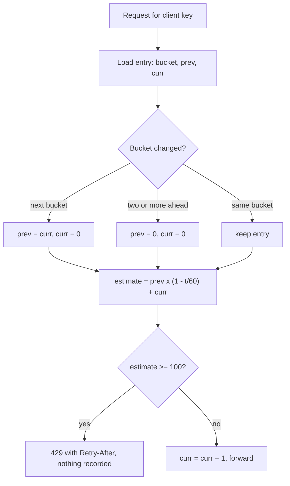
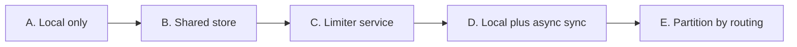
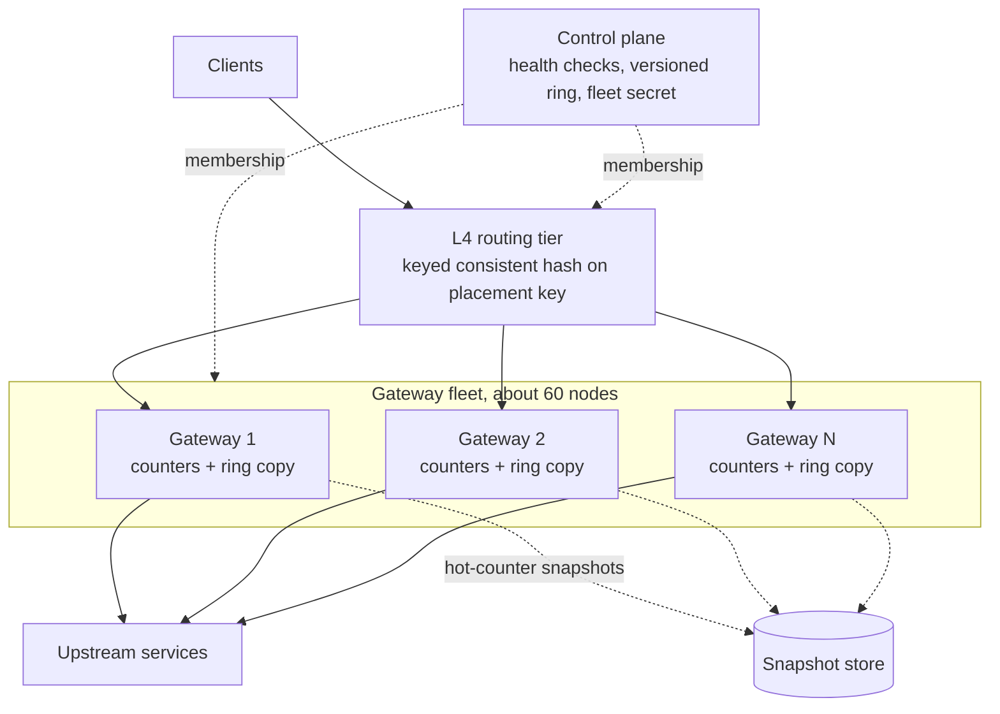
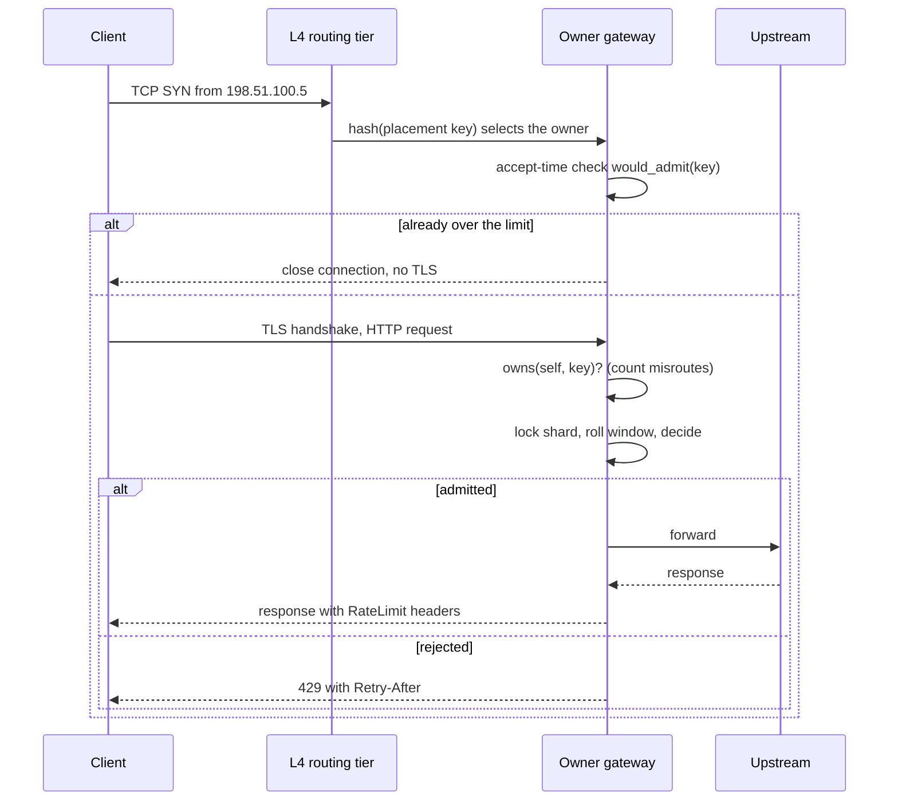
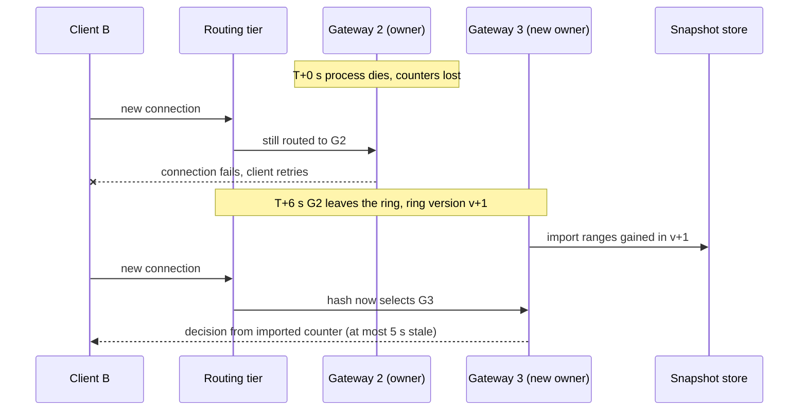

<!-- markdownlint-disable MD001 -->
<!-- markdownlint-disable MD024 -->
<!-- markdownlint-disable MD025 -->
<!-- markdownlint-disable MD026 -->
<!-- markdownlint-disable MD029 -->
<!-- markdownlint-disable MD033 -->
<!-- markdownlint-disable MD040 -->
<!-- markdownlint-disable MD056 -->
<!-- markdownlint-disable MD060 -->

# Global Rate Limiter for an Unauthenticated API Gateway

**Interview reference.** 1,000,000 requests per second, 100 requests per client per 60-second sliding window, enforced at the API gateway tier.

This document is a study and discussion reference.  
It is organized the way a design interview runs: clarify, estimate, choose an algorithm, choose where state lives, design, stress-test, and defend.  
Every guarantee is stated with its bound. The Rust code in section 12 compiles and its tests pin the numbers used in the text.

## 30-second summary

| Question                         | Answer                                                                                                          |
| -------------------------------- | --------------------------------------------------------------------------------------------------------------- |
| What makes a limit "global"?     | One counter per client in the whole system                                                                      |
| Where can that counter live?     | In a shared store (cost: a network hop per request) or on one owner node (cost: routing must find the owner)    |
| What this design picks           | One owner gateway per client, chosen by a keyed consistent-hash ring evaluated in the routing tier              |
| What a decision costs            | One in-process hash lookup and a few arithmetic operations, about 0.35 µs, no network call                      |
| Which counting algorithm         | Sliding window counter (approximate, 16 B) or a conservative sub-bucket counter (strict, 24 B)                  |
| Where the hard parts are         | Churn (state does not follow ownership), connections (routed, not requests), identity (an IP is not a person)   |
| What is traded away              | Bounded over-admission after failures, routing coupled to limiter state, per-region scope                       |
| When it is the wrong design      | Authenticated keys, several limit dimensions, global aggregate caps, billing, managed load balancers            |

---

## Table of contents

01. [Mental model](#1-mental-model)
02. [Clarify the problem](#2-clarify-the-problem)
03. [Back-of-envelope estimates](#3-back-of-envelope-estimates)
04. [Counting algorithms](#4-counting-algorithms)
05. [Where the counter lives: the design space](#5-where-the-counter-lives-the-design-space)
06. [Consistent hashing](#6-consistent-hashing)
07. [The design: one owner per client](#7-the-design-one-owner-per-client)
08. [Guarantees, stated with their bounds](#8-guarantees-stated-with-their-bounds)
09. [Failure drills](#9-failure-drills)
10. [When this design is wrong, and what replaces it](#10-when-this-design-is-wrong-and-what-replaces-it)
11. [Interview follow-up questions](#11-interview-follow-up-questions)
12. [Rust reference core](#12-rust-reference-core)
13. [Glossary](#13-glossary)

---

## 1. Mental model

Five sentences carry the whole design:

1. A rate limit is a **count per key per window**. "Global" means there is exactly **one count per key**, wherever requests land.
2. That single count either lives in a **shared store**, paid for with a network hop per request, or on **one owner node**, paid for with routing that always finds the owner.
3. **Consistent hashing** makes "find the owner" a pure function of the key and the member list: no lookup table, no coordination, and only about 1/N of keys move when membership changes.
4. Everything hard sits at the edges: **state does not follow ownership**, load balancers **route connections, not requests**, and **an IP address is not a person**.
5. No distributed limiter is exact under failure. A good design **states its bounds** (how much over, for how long, for which clients) and makes them small.

### Interview arc (45 minutes)

| Minutes | Phase               | What to produce                                                                  | Section |
| ------: | ------------------- | -------------------------------------------------------------------------------- | ------- |
|   0 - 5 | Clarify             | Identity, strictness, regions, failure policy, burst semantics                   | 2       |
|  5 - 10 | Estimate            | Clients, ops per second, memory, why a shared store is expensive                 | 3       |
| 10 - 15 | Algorithm           | Compare fixed window, log, sliding counter, token bucket. Pick one, state error  | 4       |
| 15 - 20 | State placement     | The spectrum: shared store, limiter service, local+sync, partition by routing    | 5       |
| 20 - 30 | Design              | Ring, owner gateway, data model, request path, eviction                          | 6, 7    |
| 30 - 40 | Failure and churn   | Crash, deploy, scale-out, connection affinity, split ring                        | 8, 9    |
| 40 - 45 | Limits of the design | Where it breaks and what replaces it                                            | 10      |

---

## 2. Clarify the problem

### 2.1 Questions to ask, and how each answer changes the design

| Question                                              | Why it matters                                                                                       | If the answer is...                    | Then...                                                              |
| ----------------------------------------------------- | ---------------------------------------------------------------------------------------------------- | -------------------------------------- | -------------------------------------------------------------------- |
| What identity is limited?                             | Decides whether the key is visible at L4 (IP) or only at L7 (API key, user)                          | API key or user                        | Partitioning by routing needs an L7 router, or a limiter service     |
| Is the limit contractual or protective?               | Decides how much over-admission is acceptable                                                        | Billing, paid quota                    | Durable exact counters, not this design                              |
| "100 per any 60 s" or "1.67 per second with a burst"? | Different contracts: sliding window versus token bucket                                              | Rate with burst                        | Token bucket or GCRA, 8 to 16 bytes per key                          |
| One region or many?                                   | A single owner per key across regions needs a cross-region hop                                       | Many regions, strict global            | Per-region budgets leased from a global allocator                    |
| Fail open or fail closed when state is lost?          | Availability versus protection                                                                       | Fail closed                            | Snapshots become mandatory, a crash rejects a slice of clients       |
| Do we own the load-balancing tier?                    | Routing by key needs control of the hash, the key derivation and the membership                      | Managed cloud load balancer            | Use a shared store or a limiter service instead                      |
| What sits in front: CDN, proxies?                     | The TCP peer may not be the client                                                                   | CDN                                    | L7 routing on a trusted header, a whole extra proxy tier             |
| Which protocols?                                      | Keep-alive, HTTP/2 and HTTP/3 change how ownership changes reach clients                             | HTTP/3 heavy                           | Routing by connection id conflicts with routing by IP                |
| One limit or several?                                 | One ring partitions by one key                                                                       | Per IP and per route and per tenant    | Co-locate dimensions or move to a limiter service                    |

### 2.2 Fixed requirements for this document

| ID  | Requirement           | Value                                                               |
| --- | --------------------- | ------------------------------------------------------------------- |
| R1  | Peak load             | 1,000,000 requests per second across the fleet                      |
| R2  | Limit                 | At most 100 requests per client in any 60-second sliding window     |
| R3  | Client identity       | Source IP address. IPv4 per address, IPv6 per /64 prefix            |
| R4  | Enforcement point     | The API gateway                                                     |
| R5  | Build constraint      | Implemented from scratch, no off-the-shelf limiter                  |
| R6  | Behavior at the limit | HTTP 429 with `Retry-After`                                         |

### 2.3 Explicit assumptions and non-goals

| ID  | Statement                                                                                                     |
| --- | ------------------------------------------------------------------------------------------------------------- |
| A1  | The limit protects capacity. It is not billing. Bounded over-admission during failures is acceptable          |
| A2  | We own the L4 tier and can choose its hash, key derivation and membership feed                                |
| A3  | Single region. Multi-region behavior is discussed in section 10, not solved                                   |
| A4  | Volumetric floods (network-layer DDoS) are absorbed upstream                                                  |
| A5  | Fail open on lost state: losing a counter admits a little extra, it never rejects legitimate clients          |
| N1  | Non-goal: telling users behind one shared IP apart. The limit is per address, not per person                  |

---

## 3. Back-of-envelope estimates

| Quantity                                         | Value                                    | Derivation                                         |
| ------------------------------------------------ | ---------------------------------------- | -------------------------------------------------- |
| Peak request rate                                | 1,000,000 req/s                          | given                                              |
| Sustained rate of one client at the limit        | 1.67 req/s                               | 100 / 60 s                                         |
| Minimum distinct active clients at peak          | 600,000                                  | 1,000,000 / 1.67, if every client is at the limit  |
| Realistic active clients                         | several million                          | most clients are far below the limit               |
| Gateways at 20,000 req/s each                    | 50, provision 60                         | headroom for one failure plus a rolling deploy     |
| Load per gateway, 60 nodes                       | about 16,700 req/s                       | 1,000,000 / 60                                     |
| Shared-store ops if every request touches it     | 1,000,000 ops/s                          | one atomic script per request                      |
| Shared-store shards at ~100k scripted ops/node   | 10, about 20 with headroom               | order of magnitude                                 |
| Hop to a store in the same zone                  | 0.5 to 1 ms                              | one round trip                                     |
| Limiter decision, in memory                      | about 0.35 µs                            | measured, section 12.7                             |
| Fleet CPU spent on decisions                     | about 0.35 core in total                 | 1,000,000 x 0.35 µs                                |
| Entry size                                       | 16 B (two-bucket) or 24 B (six slots)    | plus a 16 B key                                    |
| Memory per tracked client including table slack  | about 40 to 95 B                         | hash table load factor between 44% and 87.5%       |
| Memory at the per-gateway cap (6.4M clients)     | about 0.25 to 0.6 GB                     | 64 shards x 100,000 entries                        |

Two numbers matter more than the rest:

- **Decision cost versus request cost.**  
  The decision is 0.35 µs.  
  A rejected request still costs TLS decryption, HTTP parsing and writing a response: tens of microseconds on an established connection, and a full TLS handshake (much more) on a new one.  
  Rejection is cheap compared with proxying upstream, not free.

- **Wide and shallow.**  
  Millions of keys, each touched at most about 1.7 times per second.  
  Batching updates locally and syncing later only pays off when one key is hit many times between syncs.  
  Here it is not, so batching cannot take a shared store off the hot path.

---

## 4. Counting algorithms

### 4.1 Comparison

| Algorithm                                     | State per key                      | Contract it enforces                     | Most admitted in one true 60 s window (limit 100)  | Use when                                           |
| --------------------------------------------- | ---------------------------------- | ---------------------------------------- | -------------------------------------------------- | -------------------------------------------------- |
| Fixed window                                  | 16 B                               | 100 per calendar minute                  | 200, within 2 seconds across the boundary          | Rough quotas, simplest code                        |
| Sliding log                                   | up to 100 timestamps, 400 B as u32 | Exact sliding window                     | 100                                                | Low limits, strict contracts                       |
| Sliding window counter (two buckets)          | 16 B                               | Approximate sliding window               | 199 under an aligned attack, about 100 organically | Protective limits at scale                         |
| Conservative sub-buckets (k slots)            | 24 B for k = 6                     | Never over-admits                        | 100                                                | Strict R2 at constant memory                       |
| Token bucket (capacity 100, refill 100/min)   | 16 B                               | Rate plus burst                          | close to 200 (burst, then a full refill)           | The contract is a rate, bursts are allowed         |
| GCRA                                          | 8 B (one timestamp)                | Same as token bucket                     | close to 200 with burst 100                        | Token bucket semantics with the smallest state     |
| Leaky bucket as a queue                       | a queue                            | Smooths output, delays instead of 429    | not a policing algorithm                           | Traffic shaping toward a fragile backend           |

**Interview point:** token bucket and GCRA bound *rate and burst*, not "N per window".  
If the interviewer says "100 per minute", ask which of the two contracts they mean before choosing.

### 4.2 Sliding window counter (two buckets)

```text
bucket   = now_ms / 60000                     (aligned for every node)
t        = seconds elapsed in the current bucket (0 to 60)
estimate = prev x (1 - t / 60) + curr
reject if estimate >= 100, otherwise curr = curr + 1 and admit
```

The previous bucket is weighted by how much of it still overlaps the trailing 60 seconds, as if its requests were spread evenly.



**Worked example 1: a normal client.** 80 requests in the previous minute. Now 12:01:15, so `prev` is weighted by 0.75 and counts as 60.

| `curr` before | Estimate | Decision                |
| ------------: | -------: | ----------------------- |
|             0 |     60.0 | allow                   |
|            39 |     99.0 | allow (curr becomes 40) |
|            40 |    100.0 | reject                  |

Exactly 40 more requests fit (test `two_bucket_worked_example_80_previous_leaves_room_for_40`).

**Worked example 2: the boundary burst is closed.**  
100 requests at 12:00:59. At 12:01:01, `prev` weighs `100 x 59/60 = 98.33`, so 2 more pass instead of 100 (test `two_bucket_closes_the_two_second_boundary_burst`).

**Worked example 3: the aligned attack is not closed.**  
Bucket boundaries are public (`unix_ms / 60000`). The attacker sends:

| Time        | State before         | Estimate per request              | Admitted |
| ----------- | -------------------- | --------------------------------- | -------: |
| 12:00:59.9  | empty                | 0 to 99                           |      100 |
| 12:01:59.0  | prev = 100, curr = 0 | `100 x 1/60 + curr = 1.67 + curr` |   99     |

The window (12:00:59.0, 12:01:59.0] contains **199** admitted requests (test `two_bucket_admits_almost_double_inside_one_true_window`).  
The interpolation error is at most the previous bucket's count, which an attacker can make equal to the limit.

What to say in an interview:  
*"The two-bucket counter closes the 2-second burst but still allows close to 2x inside one true minute against an attacker who times bucket edges."*  
*"On organic traffic the error is tiny. If R2 is strict, I count conservatively."*

### 4.3 Conservative sub-bucket counter

Split the window into `k` slots of `ceil(60 / k)` seconds. Keep `k + 1` slot counts: the current slot plus the `k` previous ones.  
**Count all of them in full. Never interpolate.**

```text
slot      = now_ms / slot_ms
counted   = current slot + k previous slots   (covers between 60 s and 60 + 60/k s)
reject if sum(counted) >= 100
```

**Why it never over-admits.**  
  The counted span always contains the true trailing 60 seconds.  
  At every admission, the true count is at most the counted sum, which was below 100.  
  So no true window ending at an admission can hold more than 100, and a window with more than 100 admissions would have to end at one.

**What it costs.**  
  A client can be held back up to one extra slot.  
  With `k = 6` (10-second slots), a client that sends 100 requests at 12:00:00 next succeeds at 12:01:10, not 12:01:00 (test `sub_buckets_hold_a_full_client_back_by_at_most_one_slot`).  
  Against the aligned attack of example 3 it admits 0 in the second burst (test `sub_buckets_never_exceed_the_limit_under_the_edge_attack`).  
  A randomized test over 50,000 arrivals checks that no true window ever exceeds 100.

**Retry-After is exact.**  
  Walk the slots from oldest to newest, subtract each from the sum, and stop at the first slot whose expiry brings the sum below the limit.  
  That slot's expiry time is the answer (test `sub_buckets_retry_after_is_exact`).

### 4.4 GCRA in four lines

Worth knowing because interviewers ask for "the smallest state":

```text
T   = window / limit            (600 ms: one request's worth of time)
tau = (burst - 1) x T           (how far ahead of schedule a client may run)
admit if now >= TAT - tau,  then TAT = max(TAT, now) + T
```

`TAT` is the theoretical arrival time, one timestamp per key. It is exactly a token bucket expressed as time.

### 4.5 Choosing

| Situation                                          | Pick                                                                         |
| -------------------------------------------------- | ---------------------------------------------------------------------------- |
| Protective limit, huge key count, organic traffic  | Two-bucket counter                                                           |
| R2 must hold even against timed attacks            | Conservative sub-buckets                                                     |
| Contract is "average rate with bursts"             | GCRA                                                                         |
| Very low limit (for example 5 per minute), exact   | Sliding log (5 timestamps is tiny)                                           |
| Hybrid                                             | Counter for clients under 50% of the limit, upgrade to an exact log above it |

---

## 5. Where the counter lives: the design space

### 5.1 What not to do: the naive shared-store design

An external cache mapping each IP to a **set of request ids** with a 60-second TTL, relying on expiry to slide the window.

| Defect                                  | Why it breaks                                                                |
| --------------------------------------- | ---------------------------------------------------------------------------- |
| TTL is per key, not per member          | The set expires whole. Fixed window if set once, never expires if refreshed  |
| Check, add and expire are separate      | Two gateways read 99, both add, the count reaches 101                        |
| Request ids carry no information        | Counting needs timestamps only. 4 to 10 KB per saturated client              |
| Every rejection is a store operation    | An attack turns into store load, the limiter fails first                     |

These are flaws of that specific design, not of shared stores in general.

### 5.2 The five options



| Option                                    | How it works                                                                                                       | Strength                                              | Weakness                                                                                            |
| ----------------------------------------- | ------------------------------------------------------------------------------------------------------------------ | ----------------------------------------------------- | --------------------------------------------------------------------------------------------------- |
| A. Local only, no stickiness              | Each gateway counts what it sees                                                                                   | Trivial                                               | A client spread over 60 nodes gets up to 60 x 100. Dividing the limit gives 1.67 per node: useless  |
| B. Shared store, done right               | Same algorithm in one atomic script per request. Local `reject_until` cache per key. Fail open on store timeout    | No routing changes. Easy multi-dimension limits       | 0.5 to 1 ms per request, a 10 to 20 shard cluster in the hot path                                   |
| C. Sharded limiter service                | Gateways call the limiter node that owns the key (consistent hashing on the service side)                          | Decoupled from request routing. Any key, any dimension| One hop per request, a service to run                                                               |
| D. Local counting plus async aggregation  | Gateways count locally and periodically exchange totals                                                            | No hot-path hop. Good for high-rate keys              | Wide-shallow keys: each node sees a client rarely, so the merged view lags by a whole sync interval |
| E. Partition by routing (this document)   | The load balancer hashes the client onto its owner gateway. The owner counts in memory                             | No hop, no shared component, atomic by construction   | Needs control of the routing tier. Couples request routing to limiter state. Complex churn          |

### 5.3 Comparison

| Property                          | B. Shared store         | C. Limiter service    | D. Local + sync                           | E. Partition by routing             |
| --------------------------------- | ----------------------- | --------------------- | ----------------------------------------- | ----------------------------------- |
| Network hops per request          | 1                       | 1                     | 0                                         | 0                                   |
| Atomicity per key                 | Script                  | Single owner          | None (eventual)                           | Single owner                        |
| Accuracy in steady state          | Algorithm bound         | Algorithm bound       | Over by up to N x limit per sync interval | Algorithm bound                     |
| Blast radius of one node failure  | 1/S of keys (S shards)  | 1/S of keys           | Small                                     | 1/N of keys, plus their connections |
| Needs control of the load balancer| No                      | No                    | No                                        | Yes                                 |
| Several limit dimensions          | Easy                    | Easy                  | Easy                                      | Hard (one partition key)            |
| Operational complexity            | Low to medium           | Medium                | Medium                                    | High                                |

**Interview soundbite:** *"Global by partitioning, not by sharing. If I cannot control routing, I move the same partitioning one hop away into a limiter service or a sharded store."*

Options B, C and E are the same idea at different places: **one owner per key**.  
B puts the owner in a store shard, C in a limiter node, E in the gateway that already receives the request.

---

## 6. Consistent hashing

### 6.1 Why `hash(key) mod N` fails

Going from N to N - 1 servers keeps only 1/N of keys in place.

| Servers     | Keys moved by `mod N` | Keys moved by a ring (about) |
| ----------- | --------------------: | ---------------------------: |
| 4 to 3      |                 75.0% |                        25.0% |
| 10 to 9     |                 90.0% |                        10.0% |
| 60 to 59    |                 98.3% |                         1.7% |

For counters held in memory, `mod N` strands nearly every client's state on every membership change.

### 6.2 The ring

1. Treat the hash output as a circle `0 .. 2^64 - 1`.
2. Place each server on it (many times, see 6.3).
3. Place each key on it.
4. The owner is the first server clockwise from the key, wrapping at the end.

Worked example on positions `0 .. 99` with G1 at 10, G2 at 40, G3 at 70:

| Server | Owns            |
| ------ | --------------- |
| G1     | 71..99 and 0..10 |
| G2     | 11..40          |
| G3     | 41..70          |

| Event                    | Effect                                                     |
| ------------------------ | ---------------------------------------------------------- |
| G2 crashes               | 11..40 goes to G3. Nothing else moves                      |
| G4 joins at 55           | 41..55 moves from G3 to G4. Nothing else moves             |

Lookup is a binary search over a sorted array of positions: 60 servers x 150 virtual nodes = 9,000 positions, about 13 comparisons.

### 6.3 Virtual nodes

| Aspect               | One position per server         | 150 positions per server              |
| -------------------- | ------------------------------- | ------------------------------------- |
| Share of keys        | Uneven, can differ several-fold | Close to equal                        |
| When a server dies   | One neighbor inherits all of it | Spread over all survivors             |
| Load after a failure | One node can double             | Each of 59 survivors gains about 1.7% |

### 6.4 The hash must be stable and keyed

- **Stable:** every router and gateway must compute the same position, so a per-process randomly seeded hasher (Rust's `DefaultHasher`, `RandomState`) cannot place keys on the ring.
- **Keyed with a fleet secret:** with an unkeyed hash and guessable node names (`gw-07#0`), an attacker who holds a large IPv6 range can compute offline which addresses land on one chosen gateway, and aim a table-filling attack at it.  
  SipHash-2-4 with a secret distributed alongside the membership list prevents that.

These two needs differ from the **in-process table**, whose shard selector should be randomly keyed per process so that hash-flooding cannot be planned at all.

### 6.5 What consistent hashing does and does not give

| Gives                                                  | Does not give                                                                  |
| ------------------------------------------------------ | ------------------------------------------------------------------------------ |
| Same key, same owner, while membership is stable       | Movement of state. When ownership moves, the counters stay behind              |
| Only about 1/N of keys move on a change                | Relief for a hot key. One key is one point on the ring                         |
| Agreement without coordination                         | Agreement when holders have different member lists                             |
| Cheap lookups                                          | Perfect balance. Balance is statistical                                        |

### 6.6 Alternatives worth naming

| Scheme                  | Lookup             | Movement on change                                  | Notes                                                                      |
| ----------------------- | ------------------ | --------------------------------------------------- | -------------------------------------------------------------------------- |
| Ring with virtual nodes | O(log P)           | About 1/N, only to or from the changed node         | Weights by vnode count. Used here                                          |
| Rendezvous (HRW)        | O(N) hashes        | Exactly the changed node's keys                     | No vnodes needed. 60 hashes per lookup is fine at this size                |
| Jump consistent hash    | O(log N), no table | Minimal, but only when removing the last bucket     | Cannot remove an arbitrary failed server. Fits storage shards, not servers |
| Maglev                  | O(1) table lookup  | Close to minimal, not exactly minimal               | Built for L4 load balancers. Table rebuild on change                       |
| Fixed hash slots        | O(1)               | Slots move explicitly                               | Redis Cluster uses 16,384 slots. Moves are planned operations              |

---

## 7. The design: one owner per client

### 7.1 Architecture



Solid arrows are the request path, dashed arrows are off it.

| Component       | Responsibility                                                                     | On the request path? |
| --------------- | ---------------------------------------------------------------------------------- | -------------------- |
| L4 routing tier | Derive the placement key, hash it on the ring, forward the connection to the owner | Yes                  |
| Gateway         | Count, decide, verify ownership, forward allowed requests                          | Yes                  |
| Control plane   | Health checks, versioned member list, fleet secret                                 | No                   |
| Snapshot store  | Hold recent hot counters for whoever takes over a range                            | No                   |

### 7.2 Identity: counting key versus placement key

| Key           | IPv4               | IPv6                     | Purpose                                                       |
| ------------- | ------------------ | ------------------------ | ------------------------------------------------------------- |
| Counting key  | /32 (the address)  | /64                      | What one counter is kept for                                  |
| Placement key | /32 by default     | /48 by default           | What the ring hashes, so related counters share one owner     |

Why separate them:

- Many ISPs delegate a /56 or /48 to one subscriber. Counting per /64 alone gives that subscriber 256 to 65,536 independent limits.
- An aggregate counter per /48 only works if every /64 inside it reaches the same owner. Placing by /48 guarantees that (test `a_48_lands_on_one_owner`).
- The router and the gateway must derive the placement key identically. If the router hashed full /128 addresses, one /64 would spread over up to 60 gateways and get up to 60 times the limit.

The trade-off: coarser placement makes bigger hot owners.

Known limit of IP identity: carrier-grade NAT puts thousands of users behind one IPv4 address, so they share one counter and one owner.  
For mobile-heavy traffic this is a real outage for those users, not a footnote.  
The fix is outside this layer: authenticated identity, or higher limits for known NAT ranges.

### 7.3 Data model

| Item        | Definition                                                                                                    |
| ----------- | ------------------------------------------------------------------------------------------------------------- |
| Key         | `ClientKey`: `V4(u32)` or `V6Prefix64(u64)`, 16 bytes in memory                                               |
| Value       | `TwoBucket { bucket: u64, prev: u32, curr: u32 }` (16 B) or `SixSlots { head: u64, counts: [u16; 7] }` (24 B) |
| Table       | 64 shards, each a `HashMap` behind its own mutex                                                              |
| Rejections  | Never recorded. State per client is constant however hard it pushes                                           |

### 7.4 Inside one gateway

| Concern                   | Design                                                                                                                                                                                                          |
| ------------------------- | --------------------------------------------------------------------------------------------------------------------------------------------------------------------------------------------------------------- |
| Concurrency               | 64 shards with their own mutex. The shard is picked by a per-process randomly keyed hash                                                                                                                        |
| Lock scope                | One lookup and a few operations. Never across I/O or an `await`                                                                                                                                                 |
| Expiry                    | An entry expires only when the epoch (bucket or slot) advances, so each shard is swept **at most once per epoch**. Extra sweeps would scan and find nothing                                                     |
| Memory cap                | Per-shard cap. A new client at a full shard first triggers the due sweep, then **evicts the lightest of 16 sampled entries**                                                                                    |
| Why evict, not fail open  | Admitting untracked clients turns the limiter off for whoever fills the table, including the attacker. Evicting an entry with weight 3 costs at most 3 requests of accuracy, and heavy entries survive sampling |
| Accept-time penalty check | At TCP accept, a read-only `would_admit(peer)` lookup. A client already over its limit is dropped before TLS and HTTP parsing                                                                                   |
| Ownership check           | Every request checks `ring.owns(self, key)`. A miss means the connection predates a ring change (7.6)                                                                                                           |
| Clock                     | Wall time read once at start, then advanced by a monotonic clock, so an NTP step cannot reset every counter at once                                                                                             |

A note on the original framing "the limiter is the outermost layer, so rejects skip parsing": an HTTP middleware receives an already parsed request.  
Only the accept-time check skips TLS and parsing.

### 7.5 Request lifecycle



| Step | Where   | Work                                                 | Network calls |
| ---: | ------- | ---------------------------------------------------- | ------------: |
|    1 | LB      | Placement key, keyed hash, binary search             |             0 |
|    2 | Gateway | Accept-time `would_admit` lookup                     |             0 |
|    3 | Gateway | Ownership check (about 13 comparisons)               |             0 |
|    4 | Gateway | Shard lock, roll, estimate, increment                |             0 |
|    5 | Gateway | Forward or 429                                       | upstream only |

### 7.6 Membership, churn and connection affinity

Load balancers route **connections**, not requests.  
A client on HTTP/1.1 keep-alive or HTTP/2 can send thousands of requests over one connection that lives for hours.  
When the ring changes, only two things can happen to existing connections:

| L4 behavior                         | When a node joins and takes over some keys                                                                         | Problem                                                                                 |
| ----------------------------------- | ------------------------------------------------------------------------------------------------------------------ | --------------------------------------------------------------------------------------- |
| Stateless (hash every packet)       | Packets of existing connections now reach the new owner, which has no socket for them                              | Those connections are reset                                                             |
| Stateful (connection tracking)      | Old connections stay on the old node, new connections go to the new owner                                          | The client has **two owners**: the limit doubles silently for the connection's lifetime |

The fix uses the ownership check from 7.4:

1. Every gateway holds the same versioned ring as the routers.
2. On each request, a gateway checks `owns(self, key)`.
3. If it does not own the key, it still decides locally (a small, bounded error), then ends the connection gracefully: `Connection: close` for HTTP/1.1, `GOAWAY` for HTTP/2.
4. The client reconnects and the new connection lands on the true owner.
5. The event is counted in `rl_misrouted_total`, which also detects routers holding a different ring version.

Membership rules:

| Rule                 | Value                                                                                   |
| -------------------- | --------------------------------------------------------------------------------------- |
| Source of truth      | Control plane publishes `(version, members, vnodes, placement, secret)`                 |
| Rollout              | Atomic swap per holder. Alert when more than one version is live for over a minute      |
| Failure detection    | Health check every 2 s, leave after 3 misses (about 6 s)                                |
| Join                 | Load owned ranges from snapshots **before** joining (readiness gate)                    |
| Leave                | Stop new connections, flush a final snapshot, send GOAWAY, exit (graceful drain)        |

HTTP/3 caveat: QUIC runs over UDP and lets a client keep a connection while its IP changes.  
QUIC-aware load balancers route by connection id, not by IP.  
With HTTP/3 enabled, the ownership check becomes the only reliable enforcement of single ownership.

### 7.7 State on failure: snapshots and range import

The ring moves ownership, never data. Three mechanisms limit the damage:

| Mechanism               | Trigger                         | Action                                                                                                                      |
| ----------------------- | ------------------------------- | --------------------------------------------------------------------------------------------------------------------------- |
| Periodic snapshot       | Every 5 s, off the request path | Persist entries at or above 50% of the limit. Cold entries lose nothing meaningful                                          |
| Range import            | **Any** ring change             | Each gateway computes the ranges it gained and bulk-loads them. Survivors of a crash do this too, not only restarting nodes |
| Readiness gate + drain  | Deploy                          | New node imports before joining. Leaving node flushes before exiting                                                        |

Merge rule when importing:

- Two copies of one owner's counter: take the **maximum** (a newer copy of the same history).
- Counts from two different owners for the same key (split ownership during a ring change): **sum** them, because they counted disjoint requests.
- So snapshot records are tagged with `(owner, ring_version)`: max within a tag, sum across tags.



### 7.8 Capacity and sizing

| Item                                  | Value                                         | Basis                                          |
| ------------------------------------- | --------------------------------------------- | ---------------------------------------------- |
| Gateways provisioned                  | 60                                            | 50 needed at 20,000 req/s, plus headroom       |
| Load per gateway                      | about 16,700 req/s, 16,950 after one failure  | 1,000,000 / 60, / 59                           |
| Ring size                             | 9,000 positions, about 13 comparisons         | 60 x 150                                       |
| Decision cost                         | about 0.35 µs, 2.8 M decisions/s per core     | measured, section 12.7                         |
| Rejection cost                        | dominated by TLS and HTTP, not the decision   | measure on target hardware                     |
| Memory per gateway, 170k clients      | about 7 to 16 MB                              | 10 M active clients spread over 60 nodes       |
| Memory per gateway at the cap         | about 0.25 to 0.6 GB                          | 6.4 M entries                                  |
| Failure detection                     | about 6 s                                     | 2 s x 3                                        |

---

## 8. Guarantees, stated with their bounds

Limit 100, window 60 s. "Admitted" means admitted inside one true 60-second window.

| Condition                                              | Two-bucket counter                                      | Six-slot conservative counter | Duration                                      |
| :----------------------------------------------------- | :------------------------------------------------------ | :---------------------------- | :-------------------------------------------- |
| Steady state, organic traffic                          | about 100                                               | at most 100                   | always                                        |
| Steady state, attacker timing bucket edges             | up to 199                                               | at most 100                   | always                                        |
| Owner crash, no snapshot                               | up to about 300                                         | up to 200                     | once per crash, closes within one window      |
| Owner crash, snapshot imported                         | plus what was admitted in the last 5 s before the crash | same                          | once per crash                                |
| Split ownership (old connections, mixed ring versions) | times the number of owners                              | same                          | until connections close or the ring converges |
| Live eviction at the memory cap                        | plus the evicted entry's weight                         | same                          | per eviction, light entries chosen first      |
| Several regions, client not pinned                     | times the number of regions                             | same                          | always                                        |
| Subscriber holds a /48, only /64 counters              | times the number of /64s used                           | same                          | always, unless a /48 aggregate counter exists |

How to say it: *"In steady state the bound is the algorithm's. Every failure adds a stated amount, for a stated duration, to a stated slice of clients, roughly 1/N of them."*

---

## 9. Failure drills

Each drill: what happens, and the answer an interviewer wants.

|  # | Scenario                                    | What happens                                                                                                                 | Answer                                                                                         |
| -: | :------------------------------------------ | :--------------------------------------------------------------------------------------------------------------------------- | :--------------------------------------------------------------------------------------------- |
|  1 | Normal client                               | Always reaches Gateway 7. Decision in memory                                                                                 | Zero hops, constant work                                                                       |
|  2 | 100 requests at 12:00:59, retry at 12:01:01 | Two-bucket admits 2, six-slot admits 0                                                                                       | Sliding counting closes the boundary burst                                                     |
|  3 | Bursts aligned to bucket edges              | Two-bucket admits 199 in one true minute                                                                                     | Use conservative slots if R2 is strict                                                         |
|  4 | One IP at 5,000 req/s                       | All traffic on one owner. 100 pass, the rest are rejected. After the first rejection, new connections are dropped at accept  | Cheap per request, but the TLS cost of new connections is real. Large floods go upstream       |
|  5 | Address spray from a /32 IPv6 allocation    | New keys fill shards. Due sweep runs once per epoch, then light entries are evicted                                          | Memory bounded, limiter never turns off, heavy clients keep their counts                       |
|  6 | Gateway crash                               | 6 s of failed connections for 1/60 of clients, then re-homing and range import                                               | Bounded over-admission for about 1.7% of clients, closes within one window                     |
|  7 | Scale-out from 60 to 66 nodes               | Each new node takes about 1/66 of clients. Old connections to old owners are closed by the ownership check                   | Without the check: resets (stateless L4) or doubled limits (stateful L4)                       |
|  8 | Rolling deploy                              | Drain, final flush, restart, import, readiness, rejoin. Repeats 60 times                                                     | Each step re-homes about 1.7% of clients with counts at most 5 s stale                         |
|  9 | Routers hold different ring versions        | One client splits across two owners                                                                                          | Version metric, alert after a grace period. Gateways see misroutes                             |
| 10 | Snapshot store down                         | Decisions unaffected. Failover becomes a cold start                                                                          | Nothing on the request path depends on it                                                      |
| 11 | CDN deployed in front                       | L4 sees CDN egress addresses. Clients spread across gateways, or collapse onto CDN nodes                                     | Needs an L7 routing tier that reads a trusted header. The design's main advantage shrinks      |
| 12 | Large carrier NAT address                   | Thousands of users share one counter and one owner                                                                           | Known limit of IP identity. Allowlist or raise limits for known ranges                         |
| 13 | NTP steps the clock by 2 minutes            | With the monotonic clock: nothing until restart. With raw wall time: every counter resets at once                            | Monotonic in process, wall time only to align snapshots                                        |

---

## 10. When this design is wrong, and what replaces it

The design fits only when **all** of these hold: the key is visible at L4, there is one limit dimension, you control the routing tier, one region is enough, and bounded over-admission is acceptable.

| Situation                                                | Why this design breaks                                                                         | What to use instead                                                                                        |
| :------------------------------------------------------- | :--------------------------------------------------------------------------------------------- | :--------------------------------------------------------------------------------------------------------- |
| Limit per API key, user or tenant                        | The key is inside the request. Routing by it needs an L7 router                                | Limiter service (option C) or shared store (option B), partitioned by that key                             |
| Several dimensions at once (IP and user and route)       | One ring partitions by one key. Other dimensions live on other owners                          | Limiter service evaluating all dimensions, or co-locate dimensions that nest (for example /64 inside /48)  |
| Global aggregate cap (backend takes 10k req/s)           | The cap is not per client and cannot be partitioned                                            | A central allocator leases slices of the budget to gateways, which spend them locally                      |
| Billing, paid quotas                                     | Fail-open, approximate counting and per-region multiplication are unacceptable                 | Durable store with exact, idempotent counting and an audit trail                                           |
| Long windows (hour, day, month)                          | "Error bounded by one window" stops being small. A crash loses a day of counts                 | Durable counters, short local windows in front as a first filter                                           |
| Managed load balancers, Kubernetes Services, serverless  | No control over the hash or the key derivation                                                 | Shared store with a local negative cache                                                                   |
| Strict global limit across regions                       | DNS and anycast do not pin a client to one region reliably                                     | Per-region budgets leased from a global allocator, rebalanced every few seconds                            |
| Small or medium scale                                    | Operational cost far above the benefit                                                         | One Redis node and an atomic script                                                                        |

The recurring pattern behind every replacement: **keep one owner per key, but move the owner to where the key is visible.**

---

## 11. Interview follow-up questions

**Q1. Why not just use Redis?**

```text
At this scale a correct Redis design works: one atomic script per request, about 20 shards, a local cache of `reject_until` per key so rejected traffic never reaches the store, and fail-open on timeout.  
Its costs are a 0.5 to 1 ms hop and a hot-path dependency. Partitioning by routing removes both, at the price of owning the routing tier.  
Choose by who controls the load balancer and how many limit dimensions exist.
```

**Q2. How is atomicity guaranteed?**

```text
By construction: exactly one owner per key, and on that owner one shard mutex covers roll, estimate and increment.  
There is no cross-node race because there is no second writer.
```

**Q3. What happens when a gateway dies?**

```text
About 6 seconds of failed connections for its 1/N of clients, then re-homing.  
Survivors import the ranges they gained from snapshots at most 5 seconds old.  
Without snapshots the affected clients get at most one extra limit's worth, once, within one window.
```

**Q4. Why virtual nodes?**

```text
Balance in steady state, and on failure the dead node's load spreads over all survivors instead of doubling one neighbor.
```

**Q5. Can an attacker overload one gateway?**

```text
With an unkeyed ring hash, yes: compute which addresses map to it and send from those.  
The ring hash is keyed with a fleet secret. Inside a gateway the shard hash is randomly keyed per process.
```

**Q6. Why not divide the limit across gateways?**

```text
100 over 60 gateways is 1.67 each. A client whose requests land randomly would be rejected after a handful of requests on one node while others sit idle.  
Division only works for very high limits with even spread.
```

**Q7. How does Retry-After work?**

```text
Two-bucket: solve `prev x (1 - f) + curr < limit` for the time fraction `f`, or wait for the rollover if `curr` alone fills the limit.  
Sub-buckets: find the earliest slot whose expiry brings the sum under the limit. Round up to whole seconds in the header.
```

**Q8. Why are rejected requests not recorded?**

```text
Recording them would make memory and counts grow with abuse, and a client hammering the gateway would lock itself out forever.  
Only admitted requests consume the limit.
```

**Q9. What about clock skew between gateways?**

```text
Each decision uses only the owner's clock, so skew does not affect steady state.  
It matters only when a counter moves between nodes during failover: a skew of a second or two shifts a few requests across a bucket.  
Bucket ids are derived from wall time so snapshots align.
```

**Q10. What happens when the memory cap is hit?**

```text
Run the due sweep (at most once per epoch per shard), then evict the lightest of a small random sample.  
Never admit untracked clients, because that hands the off-switch to whoever fills the table.
```

**Q11. How do you know routing is broken?**

```text
Gateways count requests for keys they do not own (`rl_misrouted_total`), and every holder exports its ring version.  
Mixed versions for more than a minute raise an alert.
```

**Q12. How does this extend to multiple regions?**

```text
Either accept a per-region limit (R times the global value) explicitly, or lease per-region budgets from a global allocator.  
GeoDNS and anycast do not pin clients reliably enough to call a per-region ring "global".
```

**Q13. What about HTTP/2 and long-lived connections?**

```text
They are the reason for the per-request ownership check.  
After a ring change, a gateway that no longer owns a key sends GOAWAY so the client reconnects to the owner.
```

**Q14. Token bucket or sliding window?**

```text
Ask what the contract means. "At most 100 in any minute" is a sliding window. "On average 100 per minute with bursts" is a token bucket, and GCRA implements it with one timestamp.
```

**Q15. How would you test it?**

```text
Unit tests pinning the worked examples; a property test that no true window ever exceeds the limit (for the strict algorithm);  
ring property tests for minimal movement; load at 1.2x peak; skewed traffic; chaos tests killing a gateway and the snapshot store; a ring-disagreement drill; an address-spray test.
```

**Q16. What is the single biggest weakness?**

```text
Coupling request routing to limiter state.  
The routing tier must be custom, gateways cannot be balanced by load, and every membership change becomes a state-handover problem.
```

---

## 12. Rust reference core

### 12.1 Scope

Standard library only, no dependencies. Built and tested on Rust 1.97.0 (edition 2021, minimum 1.73).  
**30 tests pass** in debug and release builds, and `cargo clippy --all-targets` reports no warnings.

| File             | Responsibility                                                                                  |
| ---------------- | ----------------------------------------------------------------------------------------------- |
| `Cargo.toml`     | Crate definition, no dependencies                                                               |
| `src/lib.rs`     | Module declarations                                                                             |
| `src/key.rs`     | `ClientKey` (counting key) and `Placement` (placement key prefixes)                             |
| `src/window.rs`  | `WindowState` trait, `TwoBucket`, `SubBuckets<N>` / `SixSlots`, with Retry-After                |
| `src/limiter.rs` | Sharded table, sweep once per epoch, sampled eviction, `would_admit`, monotonic clock, metrics  |
| `src/ring.rs`    | SipHash-2-4, keyed ring with virtual nodes, `owns`                                              |
| `examples/bench.rs` | Single-thread decision cost with one million tracked clients                                 |

Gateway wiring, the routing tier, snapshots and range import are given as pseudocode in 12.8, because they depend on the HTTP stack and the store in use.

### 12.2 `Cargo.toml`

```toml
[package]
name = "edge-rate-limiter"
version = "0.2.0"
edition = "2021"
rust-version = "1.73"

[dependencies]

[profile.release]
debug = false
```

### 12.3 `src/lib.rs`

```rust
//! Edge rate limiter: per-client limiting held in gateway memory, with client
//! ownership assigned by a keyed consistent-hash ring.

pub mod key;
pub mod limiter;
pub mod ring;
pub mod window;
```

### 12.4 `src/key.rs`

```rust
use std::net::IpAddr;

/// The identity a request is counted against.
///
/// IPv4 is counted per address. IPv6 is counted per /64 prefix, because one subscriber
/// normally controls a whole /64 and could otherwise rotate through 2^64 addresses.
#[derive(Clone, Copy, Debug, PartialEq, Eq, Hash)]
pub enum ClientKey {
    V4(u32),
    V6Prefix64(u64),
}

/// How coarsely a client is placed on the ring. Placement can be coarser than counting,
/// so that an aggregate counter (per IPv6 /48, per IPv4 /24) lives on the same owner as
/// the fine-grained counters inside it.
#[derive(Clone, Copy, Debug, PartialEq, Eq)]
pub struct Placement {
    /// 1..=32. 32 places every IPv4 address independently.
    pub v4_prefix: u8,
    /// 1..=64. 48 keeps every /64 of a typical subscriber /48 on one owner.
    pub v6_prefix: u8,
}

impl Default for Placement {
    fn default() -> Self {
        Self { v4_prefix: 32, v6_prefix: 48 }
    }
}

impl ClientKey {
    pub fn from_ip(ip: IpAddr) -> Self {
        match ip {
            IpAddr::V4(v4) => ClientKey::V4(u32::from(v4)),
            IpAddr::V6(v6) => match v6.to_ipv4_mapped() {
                // ::ffff:a.b.c.d is the same client as a.b.c.d.
                Some(v4) => ClientKey::V4(u32::from(v4)),
                None => ClientKey::V6Prefix64((u128::from(v6) >> 64) as u64),
            },
        }
    }

    /// Process-independent bytes used for ring placement. Router and gateway must call
    /// this with the same `Placement`, or they compute different owners.
    pub fn placement_bytes(&self, p: Placement) -> [u8; 9] {
        let mut out = [0u8; 9];
        match *self {
            ClientKey::V4(v) => {
                out[0] = 4;
                out[1..5].copy_from_slice(&(v & mask32(p.v4_prefix)).to_be_bytes());
            }
            ClientKey::V6Prefix64(v) => {
                out[0] = 6;
                out[1..9].copy_from_slice(&(v & mask64(p.v6_prefix)).to_be_bytes());
            }
        }
        out
    }
}

fn mask32(bits: u8) -> u32 {
    match bits {
        0 => 0,
        b => u32::MAX << (32 - u32::from(b.min(32))),
    }
}

fn mask64(bits: u8) -> u64 {
    match bits {
        0 => 0,
        b => u64::MAX << (64 - u32::from(b.min(64))),
    }
}

#[cfg(test)]
mod tests {
    use super::*;

    fn k(s: &str) -> ClientKey {
        ClientKey::from_ip(s.parse().unwrap())
    }

    #[test]
    fn ipv6_is_counted_per_64() {
        assert_eq!(k("2001:db8:1:2::1"), k("2001:db8:1:2:ffff::9"));
        assert_ne!(k("2001:db8:1:2::1"), k("2001:db8:1:3::1"));
    }

    #[test]
    fn ipv4_mapped_ipv6_is_the_ipv4_client() {
        assert_eq!(k("::ffff:198.51.100.5"), k("198.51.100.5"));
    }

    #[test]
    fn placement_groups_a_48_but_counting_does_not() {
        let p = Placement::default();
        let (a, b) = (k("2001:db8:1:2::1"), k("2001:db8:1:3::1"));
        assert_ne!(a, b);
        assert_eq!(a.placement_bytes(p), b.placement_bytes(p));
        assert_ne!(a.placement_bytes(p), k("2001:db8:2:2::1").placement_bytes(p));
    }

    #[test]
    fn ipv4_placement_prefix_is_configurable() {
        let p24 = Placement { v4_prefix: 24, v6_prefix: 48 };
        assert_eq!(k("198.51.100.5").placement_bytes(p24), k("198.51.100.77").placement_bytes(p24));
        let p32 = Placement::default();
        assert_ne!(k("198.51.100.5").placement_bytes(p32), k("198.51.100.77").placement_bytes(p32));
    }
}
```

### 12.5 `src/window.rs`

```rust
//! Per-client window state. Two interchangeable algorithms:
//!
//! * `TwoBucket`: the classic sliding window counter. 16 bytes, interpolates the previous
//!   bucket, approximate. An adversary who concentrates requests at bucket edges can get
//!   close to 2x the limit inside one true window.
//! * `SubBuckets<N>`: N slots covering slightly more than one window, counted in full.
//!   Never admits more than `limit` in any true window. The price is that a client can
//!   be held back for up to one extra slot (window / (N - 1)).

use std::time::Duration;

#[derive(Clone, Copy, Debug)]
pub struct Params {
    pub limit: u32,
    pub window_ms: u64,
}

#[derive(Clone, Copy, Debug, PartialEq, Eq)]
pub enum Verdict {
    /// Admitted and recorded. `remaining` is the whole number of further requests that fit now.
    Admit { remaining: u32 },
    /// Rejected and not recorded. `retry_after` is the earliest delay after which a retry succeeds.
    Reject { retry_after: Duration },
}

pub trait WindowState: Copy + Send + 'static {
    /// Largest limit the state's counters can represent.
    const MAX_LIMIT: u32 = u32::MAX;

    fn new(now_ms: u64, p: &Params) -> Self;

    /// Decide, and on admission record the request. Rejections are never recorded.
    fn admit(&mut self, now_ms: u64, p: &Params) -> Verdict;

    /// Number of requests currently counted against the client (used to pick eviction victims).
    fn weight(&self, now_ms: u64, p: &Params) -> f64;

    /// True when this state can no longer influence any decision.
    fn is_expired(&self, now_ms: u64, p: &Params) -> bool;

    /// Expiry can only change when this number changes. Sweeping more often is wasted work.
    fn expiry_epoch(now_ms: u64, p: &Params) -> u64;

    /// Decide without recording anything (used for accept-time penalty checks).
    fn would_admit(&self, now_ms: u64, p: &Params) -> bool {
        let mut copy = *self;
        matches!(copy.admit(now_ms, p), Verdict::Admit { .. })
    }
}

// ---------------------------------------------------------------------------------------
// Classic sliding window counter
// ---------------------------------------------------------------------------------------

#[derive(Clone, Copy, Debug, PartialEq, Eq)]
pub struct TwoBucket {
    /// `now_ms / window_ms` of the bucket that `curr` belongs to.
    pub bucket: u64,
    pub prev: u32,
    pub curr: u32,
}

impl TwoBucket {
    fn roll_to(&mut self, now_bucket: u64) {
        if now_bucket <= self.bucket {
            return;
        }
        self.prev = if now_bucket == self.bucket + 1 { self.curr } else { 0 };
        self.curr = 0;
        self.bucket = now_bucket;
    }

    fn estimate(&self, frac: f64) -> f64 {
        f64::from(self.prev) * (1.0 - frac) + f64::from(self.curr)
    }
}

fn frac_of(now_ms: u64, window_ms: u64) -> f64 {
    (now_ms % window_ms) as f64 / window_ms as f64
}

impl WindowState for TwoBucket {
    fn new(now_ms: u64, p: &Params) -> Self {
        TwoBucket { bucket: now_ms / p.window_ms, prev: 0, curr: 0 }
    }

    fn admit(&mut self, now_ms: u64, p: &Params) -> Verdict {
        self.roll_to(now_ms / p.window_ms);
        let frac = frac_of(now_ms, p.window_ms);
        let limit = f64::from(p.limit);
        let estimate = self.estimate(frac);
        if estimate >= limit {
            return Verdict::Reject { retry_after: two_bucket_retry(self, frac, limit, p.window_ms) };
        }
        self.curr = self.curr.saturating_add(1);
        Verdict::Admit { remaining: (limit - estimate - 1.0).floor().max(0.0) as u32 }
    }

    fn weight(&self, now_ms: u64, p: &Params) -> f64 {
        let mut copy = *self;
        copy.roll_to(now_ms / p.window_ms);
        copy.estimate(frac_of(now_ms, p.window_ms))
    }

    fn is_expired(&self, now_ms: u64, p: &Params) -> bool {
        self.bucket.saturating_add(1) < now_ms / p.window_ms
    }

    fn expiry_epoch(now_ms: u64, p: &Params) -> u64 {
        now_ms / p.window_ms
    }
}

fn two_bucket_retry(e: &TwoBucket, frac: f64, limit: f64, window_ms: u64) -> Duration {
    let prev = f64::from(e.prev);
    let curr = f64::from(e.curr);
    let wait_fraction = if curr < limit && prev > 0.0 {
        // Decay of `prev` inside this bucket is enough:
        // prev * (1 - f) + curr < limit  <=>  f > 1 - (limit - curr) / prev
        (1.0 - (limit - curr) / prev) - frac
    } else {
        // `curr` alone fills the limit: wait for the rollover (prev' = curr), then for decay:
        // curr * (1 - f') < limit  <=>  f' > 1 - limit / curr
        (1.0 - frac) + (1.0 - limit / curr).max(0.0)
    };
    let ms = (wait_fraction * window_ms as f64).ceil().max(1.0) as u64 + 1;
    Duration::from_millis(ms.min(2 * window_ms))
}

// ---------------------------------------------------------------------------------------
// Conservative sub-bucket counter
// ---------------------------------------------------------------------------------------

/// `N` slots of `ceil(window / (N - 1))` ms each. The current slot plus the `N - 1`
/// previous ones are always counted in full, which covers at least one whole window, so
/// the count can never be lower than the true count and the limit is never exceeded.
#[derive(Clone, Copy, Debug, PartialEq, Eq)]
pub struct SubBuckets<const N: usize> {
    /// Id of the newest slot the counts are aligned to.
    head: u64,
    counts: [u16; N],
}

/// Six 10-second slots per 60-second window, plus the current one: 7 x u16 + u64 = 22 bytes.
pub type SixSlots = SubBuckets<7>;

impl<const N: usize> SubBuckets<N> {
    fn slot_ms(p: &Params) -> u64 {
        assert!(N >= 2, "need at least two slots");
        p.window_ms.div_ceil((N - 1) as u64)
    }

    fn roll_to(&mut self, now_slot: u64) {
        if now_slot <= self.head {
            return;
        }
        if now_slot - self.head >= N as u64 {
            self.counts = [0; N];
        } else {
            for s in self.head + 1..=now_slot {
                self.counts[(s % N as u64) as usize] = 0;
            }
        }
        self.head = now_slot;
    }

    fn total(&self) -> u32 {
        self.counts.iter().map(|&c| u32::from(c)).sum()
    }

    /// Earliest delay until enough of the oldest slots have aged out.
    fn retry_after(&self, now_ms: u64, slot_ms: u64, limit: u32) -> Duration {
        let mut left = self.total();
        for i in 0..N as u64 {
            // The slot `s = head + 1 + i - N` stops counting at the start of slot `s + N`.
            let s_plus_n = self.head + 1 + i;
            let c = u32::from(self.counts[(s_plus_n % N as u64) as usize]);
            if c == 0 {
                continue;
            }
            left -= c;
            if left < limit {
                return Duration::from_millis((s_plus_n * slot_ms).saturating_sub(now_ms).max(1));
            }
        }
        Duration::from_millis(slot_ms)
    }
}

impl<const N: usize> WindowState for SubBuckets<N> {
    const MAX_LIMIT: u32 = u16::MAX as u32;

    fn new(now_ms: u64, p: &Params) -> Self {
        SubBuckets { head: now_ms / Self::slot_ms(p), counts: [0; N] }
    }

    fn admit(&mut self, now_ms: u64, p: &Params) -> Verdict {
        let slot_ms = Self::slot_ms(p);
        let now_slot = now_ms / slot_ms;
        self.roll_to(now_slot);
        let total = self.total();
        if total >= p.limit {
            return Verdict::Reject { retry_after: self.retry_after(now_ms, slot_ms, p.limit) };
        }
        let i = (now_slot % N as u64) as usize;
        self.counts[i] = self.counts[i].saturating_add(1);
        Verdict::Admit { remaining: p.limit - total - 1 }
    }

    fn weight(&self, now_ms: u64, p: &Params) -> f64 {
        let mut copy = *self;
        copy.roll_to(now_ms / Self::slot_ms(p));
        f64::from(copy.total())
    }

    fn is_expired(&self, now_ms: u64, p: &Params) -> bool {
        self.head.saturating_add(N as u64) <= now_ms / Self::slot_ms(p)
    }

    fn expiry_epoch(now_ms: u64, p: &Params) -> u64 {
        now_ms / Self::slot_ms(p)
    }
}

#[cfg(test)]
mod tests {
    use super::*;

    const W: u64 = 60_000;
    /// Start of bucket 10 (12:00:00 in the worked examples).
    const T0: u64 = 10 * W;
    const P: Params = Params { limit: 100, window_ms: W };

    fn admits<S: WindowState>(s: &mut S, at: u64, attempts: usize, log: &mut Vec<u64>) -> usize {
        let mut n = 0;
        for _ in 0..attempts {
            if let Verdict::Admit { .. } = s.admit(at, &P) {
                log.push(at);
                n += 1;
            }
        }
        n
    }

    /// Largest number of admitted requests inside any half-open window (t - W, t].
    fn worst_window(log: &[u64]) -> usize {
        let mut worst = 0;
        let mut lo = 0;
        for hi in 0..log.len() {
            while log[lo] + W <= log[hi] {
                lo += 1;
            }
            worst = worst.max(hi - lo + 1);
        }
        worst
    }

    #[test]
    fn two_bucket_worked_example_80_previous_leaves_room_for_40() {
        let mut s = TwoBucket::new(T0, &P);
        let mut log = Vec::new();
        assert_eq!(admits(&mut s, T0, 80, &mut log), 80);
        // 12:01:15: weighted previous = 80 * 0.75 = 60.
        assert_eq!(admits(&mut s, T0 + W + 15_000, 100, &mut log), 40);
    }

    #[test]
    fn two_bucket_closes_the_two_second_boundary_burst() {
        let mut s = TwoBucket::new(T0, &P);
        let mut log = Vec::new();
        assert_eq!(admits(&mut s, T0 + 59_000, 200, &mut log), 100);
        assert_eq!(admits(&mut s, T0 + 61_000, 200, &mut log), 2);
    }

    #[test]
    fn two_bucket_admits_almost_double_inside_one_true_window() {
        let mut s = TwoBucket::new(T0, &P);
        let mut log = Vec::new();
        // 100 requests at 12:00:59.9, then a second burst at 12:01:59.
        assert_eq!(admits(&mut s, T0 + 59_900, 200, &mut log), 100);
        assert_eq!(admits(&mut s, T0 + W + 59_000, 200, &mut log), 99);
        // Both bursts fall inside the window (12:00:59.0, 12:01:59.0].
        assert_eq!(worst_window(&log), 199);
    }

    #[test]
    fn two_bucket_retry_after_is_accurate() {
        let mut s = TwoBucket::new(T0, &P);
        let mut log = Vec::new();
        admits(&mut s, T0 + 30_000, 100, &mut log);
        let Verdict::Reject { retry_after } = s.admit(T0 + 30_000, &P) else { panic!() };
        let at = T0 + 30_000 + retry_after.as_millis() as u64;
        assert!(matches!(s.admit(at, &P), Verdict::Admit { .. }));
    }

    #[test]
    fn sub_buckets_never_exceed_the_limit_under_the_edge_attack() {
        let mut s = SixSlots::new(T0, &P);
        let mut log = Vec::new();
        assert_eq!(admits(&mut s, T0 + 59_900, 200, &mut log), 100);
        assert_eq!(admits(&mut s, T0 + W + 59_000, 200, &mut log), 0);
        assert_eq!(admits(&mut s, T0 + 2 * W, 200, &mut log), 100);
        assert_eq!(worst_window(&log), 100);
    }

    #[test]
    fn sub_buckets_hold_a_full_client_back_by_at_most_one_slot() {
        let mut s = SixSlots::new(T0, &P);
        let mut log = Vec::new();
        assert_eq!(admits(&mut s, T0, 100, &mut log), 100);
        let Verdict::Reject { retry_after } = s.admit(T0, &P) else { panic!() };
        assert_eq!(retry_after, Duration::from_millis(70_000)); // window + one 10 s slot
        let at = T0 + 70_000;
        assert!(!s.would_admit(at - 1, &P));
        assert!(s.would_admit(at, &P));
    }

    #[test]
    fn sub_buckets_retry_after_is_exact() {
        let mut s = SixSlots::new(T0, &P);
        let mut log = Vec::new();
        admits(&mut s, T0 + 5_000, 30, &mut log);
        admits(&mut s, T0 + 25_000, 70, &mut log);
        let now = T0 + 40_000;
        let Verdict::Reject { retry_after } = s.admit(now, &P) else { panic!() };
        let at = now + retry_after.as_millis() as u64;
        assert!(!s.would_admit(at - 1, &P));
        assert!(s.would_admit(at, &P));
    }

    #[test]
    fn sub_buckets_hold_the_limit_for_any_arrival_pattern() {
        let mut s = SixSlots::new(T0, &P);
        let mut log = Vec::new();
        let mut x: u64 = 0x2545_f491_4f6c_dd1d;
        let mut t = T0;
        for _ in 0..50_000 {
            x ^= x << 13;
            x ^= x >> 7;
            x ^= x << 17;
            t += x % 1_500; // gaps of 0 to 1.5 s, with bursts when the gap is small
            admits(&mut s, t, 1 + (x % 5) as usize, &mut log);
        }
        assert!(log.len() > 10_000);
        assert!(worst_window(&log) <= 100);
    }

    #[test]
    fn expiry_matches_the_state_horizon() {
        let a = TwoBucket::new(T0, &P);
        assert!(!a.is_expired(T0 + W, &P));
        assert!(a.is_expired(T0 + 2 * W, &P));
        let b = SixSlots::new(T0, &P);
        assert!(!b.is_expired(T0 + 69_999, &P));
        assert!(b.is_expired(T0 + 70_000, &P));
    }
}
```

### 12.6 `src/limiter.rs`

```rust
//! Sharded in-memory limiter. One owner gateway holds one of these; every decision is a
//! shard lock, one hash lookup and a few arithmetic operations.

use std::collections::hash_map::RandomState;
use std::collections::HashMap;
use std::hash::BuildHasher;
use std::sync::atomic::{AtomicU64, Ordering};
use std::sync::{Mutex, MutexGuard};
use std::time::{Duration, Instant, SystemTime, UNIX_EPOCH};

use crate::key::ClientKey;
use crate::window::{Params, Verdict, WindowState};

pub trait Clock: Send + Sync + 'static {
    fn now_ms(&self) -> u64;
}

/// Wall-clock milliseconds read once at start, then advanced by a monotonic clock.
/// An NTP step after boot cannot reset or freeze every counter at once.
pub struct MonotonicClock {
    base_ms: u64,
    start: Instant,
}

impl MonotonicClock {
    pub fn new() -> Self {
        let base_ms = SystemTime::now()
            .duration_since(UNIX_EPOCH)
            .map(|d| d.as_millis() as u64)
            .unwrap_or(0);
        Self { base_ms, start: Instant::now() }
    }
}

impl Default for MonotonicClock {
    fn default() -> Self {
        Self::new()
    }
}

impl Clock for MonotonicClock {
    fn now_ms(&self) -> u64 {
        self.base_ms + self.start.elapsed().as_millis() as u64
    }
}

#[derive(Clone, Debug)]
pub struct Config {
    pub limit: u32,
    /// At least one second.
    pub window: Duration,
    /// Independently locked table shards.
    pub shards: usize,
    /// Hard cap on tracked clients per shard.
    pub max_entries_per_shard: usize,
    /// Entries inspected when the cap forces an eviction.
    pub eviction_sample: usize,
}

impl Default for Config {
    fn default() -> Self {
        Self {
            limit: 100,
            window: Duration::from_secs(60),
            shards: 64,
            max_entries_per_shard: 100_000,
            eviction_sample: 16,
        }
    }
}

#[derive(Clone, Copy, Debug, PartialEq, Eq)]
pub enum Decision {
    Allow { remaining: u32 },
    Reject { retry_after: Duration },
}

#[derive(Default, Debug)]
pub struct Metrics {
    pub allowed: AtomicU64,
    pub rejected: AtomicU64,
    /// Expired entries removed by sweeps.
    pub swept: AtomicU64,
    /// Number of shard sweeps actually performed (at most one per shard per epoch).
    pub sweeps: AtomicU64,
    /// Live entries evicted because a shard hit its cap. Each costs at most its weight in accuracy.
    pub evicted_live: AtomicU64,
}

struct Shard<W> {
    map: HashMap<ClientKey, W>,
    last_swept_epoch: u64,
}

pub struct Limiter<W: WindowState, C: Clock = MonotonicClock> {
    params: Params,
    max_entries_per_shard: usize,
    eviction_sample: usize,
    shards: Box<[Mutex<Shard<W>>]>,
    /// Randomly keyed, so an attacker cannot pick addresses that all land in one shard.
    shard_hasher: RandomState,
    clock: C,
    metrics: Metrics,
}

impl<W: WindowState> Limiter<W, MonotonicClock> {
    pub fn new(cfg: Config) -> Self {
        Self::with_clock(cfg, MonotonicClock::new())
    }
}

impl<W: WindowState, C: Clock> Limiter<W, C> {
    pub fn with_clock(cfg: Config, clock: C) -> Self {
        let window_ms = cfg.window.as_millis() as u64;
        assert!(cfg.limit > 0 && cfg.limit <= W::MAX_LIMIT, "limit out of range for this window type");
        assert!(window_ms >= 1_000, "window must be at least one second");
        assert!(cfg.shards > 0 && cfg.max_entries_per_shard > 0 && cfg.eviction_sample > 0);
        let shards = (0..cfg.shards)
            .map(|_| Mutex::new(Shard { map: HashMap::new(), last_swept_epoch: 0 }))
            .collect();
        Self {
            params: Params { limit: cfg.limit, window_ms },
            max_entries_per_shard: cfg.max_entries_per_shard,
            eviction_sample: cfg.eviction_sample,
            shards,
            shard_hasher: RandomState::new(),
            clock,
            metrics: Metrics::default(),
        }
    }

    pub fn limit(&self) -> u32 {
        self.params.limit
    }

    pub fn metrics(&self) -> &Metrics {
        &self.metrics
    }

    pub fn len(&self) -> usize {
        self.shards.iter().map(|s| lock(s).map.len()).sum()
    }

    pub fn is_empty(&self) -> bool {
        self.len() == 0
    }

    /// The hot path.
    pub fn check(&self, key: ClientKey) -> Decision {
        let now = self.clock.now_ms();
        let p = &self.params;
        let verdict = {
            let mut shard = lock(&self.shards[self.shard_of(&key)]);
            if shard.map.len() >= self.max_entries_per_shard && !shard.map.contains_key(&key) {
                self.make_room(&mut shard, now);
            }
            shard.map.entry(key).or_insert_with(|| W::new(now, p)).admit(now, p)
        };
        match verdict {
            Verdict::Admit { remaining } => {
                self.metrics.allowed.fetch_add(1, Ordering::Relaxed);
                Decision::Allow { remaining }
            }
            Verdict::Reject { retry_after } => {
                self.metrics.rejected.fetch_add(1, Ordering::Relaxed);
                Decision::Reject { retry_after }
            }
        }
    }

    /// Read-only decision for an accept-time penalty check: drop a connection from a client
    /// that is already over its limit before paying for TLS and HTTP parsing.
    pub fn would_admit(&self, key: ClientKey) -> bool {
        let now = self.clock.now_ms();
        let shard = lock(&self.shards[self.shard_of(&key)]);
        shard.map.get(&key).map_or(true, |w| w.would_admit(now, &self.params))
    }

    /// Periodic maintenance. Sweeps each shard at most once per expiry epoch.
    pub fn sweep(&self) -> usize {
        let now = self.clock.now_ms();
        self.shards.iter().map(|s| self.sweep_if_due(&mut lock(s), now)).sum()
    }

    fn sweep_if_due(&self, shard: &mut Shard<W>, now: u64) -> usize {
        let epoch = W::expiry_epoch(now, &self.params);
        if epoch <= shard.last_swept_epoch {
            return 0; // nothing can have expired since the last sweep
        }
        let before = shard.map.len();
        shard.map.retain(|_, w| !w.is_expired(now, &self.params));
        shard.last_swept_epoch = epoch;
        let removed = before - shard.map.len();
        self.metrics.sweeps.fetch_add(1, Ordering::Relaxed);
        self.metrics.swept.fetch_add(removed as u64, Ordering::Relaxed);
        removed
    }

    /// Called only when a new client arrives at a full shard. Never admits untracked:
    /// first reclaim expired entries (once per epoch), then evict the lightest sampled entry.
    fn make_room(&self, shard: &mut Shard<W>, now: u64) {
        self.sweep_if_due(shard, now);
        if shard.map.len() < self.max_entries_per_shard {
            return;
        }
        let p = &self.params;
        let victim = shard
            .map
            .iter()
            .take(self.eviction_sample)
            .min_by(|a, b| a.1.weight(now, p).total_cmp(&b.1.weight(now, p)))
            .map(|(k, _)| *k);
        if let Some(k) = victim {
            shard.map.remove(&k);
            self.metrics.evicted_live.fetch_add(1, Ordering::Relaxed);
        }
    }

    fn shard_of(&self, key: &ClientKey) -> usize {
        (self.shard_hasher.hash_one(key) % self.shards.len() as u64) as usize
    }
}

fn lock<W>(shard: &Mutex<Shard<W>>) -> MutexGuard<'_, Shard<W>> {
    // The table holds plain counters, so state behind a poisoned lock is still usable.
    shard.lock().unwrap_or_else(|p| p.into_inner())
}

#[cfg(test)]
pub(crate) mod testing {
    use super::Clock;
    use std::sync::atomic::{AtomicU64, Ordering};
    use std::sync::Arc;

    #[derive(Clone)]
    pub struct ManualClock(Arc<AtomicU64>);

    impl ManualClock {
        pub fn at(ms: u64) -> Self {
            Self(Arc::new(AtomicU64::new(ms)))
        }
        pub fn set(&self, ms: u64) {
            self.0.store(ms, Ordering::SeqCst);
        }
    }

    impl Clock for ManualClock {
        fn now_ms(&self) -> u64 {
            self.0.load(Ordering::SeqCst)
        }
    }
}

#[cfg(test)]
mod tests {
    use super::testing::ManualClock;
    use super::*;
    use crate::window::{SixSlots, TwoBucket};

    const W: u64 = 60_000;
    const T0: u64 = 10 * W;

    fn client(s: &str) -> ClientKey {
        ClientKey::from_ip(s.parse().unwrap())
    }

    fn nth(i: u32) -> ClientKey {
        ClientKey::V4(0x0a00_0000 + i)
    }

    fn small(shards: usize, cap: usize, sample: usize) -> Config {
        Config { shards, max_entries_per_shard: cap, eviction_sample: sample, ..Config::default() }
    }

    fn allowed(d: Decision) -> bool {
        matches!(d, Decision::Allow { .. })
    }

    #[test]
    fn admits_exactly_the_limit_with_either_window() {
        let a: Limiter<TwoBucket, _> = Limiter::with_clock(Config::default(), ManualClock::at(T0));
        let b: Limiter<SixSlots, _> = Limiter::with_clock(Config::default(), ManualClock::at(T0));
        let k = client("198.51.100.5");
        assert_eq!((0..150).filter(|_| allowed(a.check(k))).count(), 100);
        assert_eq!((0..150).filter(|_| allowed(b.check(k))).count(), 100);
    }

    #[test]
    fn concurrent_callers_never_exceed_the_limit() {
        let l: Limiter<TwoBucket, _> = Limiter::with_clock(Config::default(), ManualClock::at(T0));
        let k = client("203.0.113.7");
        let n = AtomicU64::new(0);
        std::thread::scope(|s| {
            for _ in 0..8 {
                s.spawn(|| {
                    for _ in 0..50 {
                        if allowed(l.check(k)) {
                            n.fetch_add(1, Ordering::Relaxed);
                        }
                    }
                });
            }
        });
        assert_eq!(n.load(Ordering::Relaxed), 100);
    }

    #[test]
    fn full_shard_evicts_instead_of_failing_open_and_sweeps_once_per_epoch() {
        let clock = ManualClock::at(T0);
        let l: Limiter<TwoBucket, _> = Limiter::with_clock(small(1, 4, 16), clock);
        for i in 0..4 {
            l.check(nth(i));
        }
        // 100 new clients arrive at a full shard of live entries within one epoch.
        for i in 4..104 {
            assert!(allowed(l.check(nth(i))));
        }
        assert_eq!(l.len(), 4);
        assert_eq!(l.metrics().sweeps.load(Ordering::Relaxed), 1, "one scan, not one per request");
        assert_eq!(l.metrics().evicted_live.load(Ordering::Relaxed), 100);
    }

    #[test]
    fn eviction_keeps_the_heavy_client() {
        let l: Limiter<TwoBucket, _> = Limiter::with_clock(small(1, 3, 16), ManualClock::at(T0));
        let heavy = client("192.0.2.99");
        for _ in 0..100 {
            l.check(heavy);
        }
        for i in 0..50 {
            l.check(nth(i)); // light clients churn through the remaining slots
        }
        assert!(!allowed(l.check(heavy)), "the abuser's count must survive the churn");
    }

    #[test]
    fn expired_entries_are_reclaimed_before_live_ones() {
        let clock = ManualClock::at(T0);
        let l: Limiter<TwoBucket, _> = Limiter::with_clock(small(1, 2, 16), clock.clone());
        l.check(nth(1));
        l.check(nth(2));
        clock.set(T0 + 2 * W);
        l.check(nth(3));
        assert_eq!(l.metrics().swept.load(Ordering::Relaxed), 2);
        assert_eq!(l.metrics().evicted_live.load(Ordering::Relaxed), 0);
    }

    #[test]
    fn periodic_sweep_runs_once_per_epoch() {
        let clock = ManualClock::at(T0);
        let l: Limiter<TwoBucket, _> = Limiter::with_clock(small(4, 100, 16), clock.clone());
        l.check(nth(1));
        l.sweep();
        l.sweep();
        assert_eq!(l.metrics().sweeps.load(Ordering::Relaxed), 4); // first call, every shard
        clock.set(T0 + 2 * W);
        assert_eq!(l.sweep(), 1);
        assert!(l.is_empty());
    }

    #[test]
    fn would_admit_does_not_record() {
        let l: Limiter<SixSlots, _> = Limiter::with_clock(Config::default(), ManualClock::at(T0));
        let k = client("198.51.100.5");
        for _ in 0..1_000 {
            assert!(l.would_admit(k));
        }
        for _ in 0..100 {
            l.check(k);
        }
        assert!(!l.would_admit(k));
        assert_eq!(l.metrics().allowed.load(Ordering::Relaxed), 100);
    }
}
```

### 12.7 `src/ring.rs` and the benchmark

```rust
//! Keyed consistent-hash ring with virtual nodes.
//!
//! The routing tier uses it to pick the one gateway that owns a client, and every gateway
//! holds the same ring to verify ownership per request. All holders must agree on the node
//! list, the virtual-node count, the placement prefixes and the secret key.

use crate::key::{ClientKey, Placement};

/// SipHash-2-4. Keyed, so an attacker who does not know the fleet secret cannot
/// precompute which client addresses land on a chosen gateway.
pub fn siphash24(key: [u8; 16], msg: &[u8]) -> u64 {
    let k0 = u64::from_le_bytes(key[0..8].try_into().unwrap());
    let k1 = u64::from_le_bytes(key[8..16].try_into().unwrap());
    let mut v = [
        0x736f_6d65_7073_6575 ^ k0,
        0x646f_7261_6e64_6f6d ^ k1,
        0x6c79_6765_6e65_7261 ^ k0,
        0x7465_6462_7974_6573 ^ k1,
    ];
    let mut chunks = msg.chunks_exact(8);
    for c in &mut chunks {
        let m = u64::from_le_bytes(c.try_into().unwrap());
        v[3] ^= m;
        sip_round(&mut v);
        sip_round(&mut v);
        v[0] ^= m;
    }
    let mut last = (msg.len() as u64 & 0xff) << 56;
    for (i, &b) in chunks.remainder().iter().enumerate() {
        last |= u64::from(b) << (8 * i);
    }
    v[3] ^= last;
    sip_round(&mut v);
    sip_round(&mut v);
    v[0] ^= last;
    v[2] ^= 0xff;
    for _ in 0..4 {
        sip_round(&mut v);
    }
    v[0] ^ v[1] ^ v[2] ^ v[3]
}

fn sip_round(v: &mut [u64; 4]) {
    v[0] = v[0].wrapping_add(v[1]);
    v[1] = v[1].rotate_left(13) ^ v[0];
    v[0] = v[0].rotate_left(32);
    v[2] = v[2].wrapping_add(v[3]);
    v[3] = v[3].rotate_left(16) ^ v[2];
    v[0] = v[0].wrapping_add(v[3]);
    v[3] = v[3].rotate_left(21) ^ v[0];
    v[2] = v[2].wrapping_add(v[1]);
    v[1] = v[1].rotate_left(17) ^ v[2];
    v[2] = v[2].rotate_left(32);
}

#[derive(Clone, Debug)]
pub struct HashRing {
    version: u64,
    secret: [u8; 16],
    placement: Placement,
    vnodes: usize,
    nodes: Vec<String>,
    /// (position, index into `nodes`), sorted by position.
    points: Vec<(u64, u32)>,
}

impl HashRing {
    pub fn new<I, S>(nodes: I, vnodes: usize, version: u64, secret: [u8; 16], placement: Placement) -> Self
    where
        I: IntoIterator<Item = S>,
        S: Into<String>,
    {
        let mut nodes: Vec<String> = nodes.into_iter().map(Into::into).collect();
        nodes.sort();
        nodes.dedup(); // canonical order: equal sets build equal rings
        let mut points = Vec::with_capacity(nodes.len() * vnodes);
        for (idx, name) in nodes.iter().enumerate() {
            for v in 0..vnodes {
                points.push((siphash24(secret, format!("{name}#{v}").as_bytes()), idx as u32));
            }
        }
        points.sort_unstable();
        Self { version, secret, placement, vnodes, nodes, points }
    }

    pub fn version(&self) -> u64 {
        self.version
    }

    pub fn nodes(&self) -> &[String] {
        &self.nodes
    }

    pub fn hash_key(&self, key: &ClientKey) -> u64 {
        siphash24(self.secret, &key.placement_bytes(self.placement))
    }

    /// First node clockwise from `hash`, wrapping past the end.
    pub fn owner_of_hash(&self, hash: u64) -> Option<&str> {
        if self.points.is_empty() {
            return None;
        }
        let i = self.points.partition_point(|&(pos, _)| pos < hash);
        let (_, idx) = self.points[i % self.points.len()];
        Some(&self.nodes[idx as usize])
    }

    pub fn owner_of(&self, key: &ClientKey) -> Option<&str> {
        self.owner_of_hash(self.hash_key(key))
    }

    /// Per-request ownership check on the gateway. A `false` means the request arrived on a
    /// connection opened under an older ring: count it and close the connection.
    pub fn owns(&self, self_id: &str, key: &ClientKey) -> bool {
        self.owner_of(key) == Some(self_id)
    }

    pub fn without(&self, node: &str, version: u64) -> HashRing {
        let rest = self.nodes.iter().filter(|n| n.as_str() != node).cloned();
        HashRing::new(rest, self.vnodes, version, self.secret, self.placement)
    }

    pub fn with(&self, node: &str, version: u64) -> HashRing {
        let all = self.nodes.iter().cloned().chain([node.to_owned()]);
        HashRing::new(all, self.vnodes, version, self.secret, self.placement)
    }
}

#[cfg(test)]
mod tests {
    use super::*;
    use std::collections::HashMap;

    const SECRET: [u8; 16] = *b"fleet-secret-k01";
    const KEYS: u32 = 100_000;

    fn names(n: usize) -> Vec<String> {
        (1..=n).map(|i| format!("gw-{i:02}")).collect()
    }

    fn ring(n: usize, vnodes: usize) -> HashRing {
        HashRing::new(names(n), vnodes, 1, SECRET, Placement::default())
    }

    fn key(i: u32) -> ClientKey {
        ClientKey::V4(i.wrapping_mul(2_654_435_761))
    }

    #[test]
    fn siphash_matches_the_reference_vectors() {
        let k: [u8; 16] = std::array::from_fn(|i| i as u8);
        let m: Vec<u8> = (0u8..15).collect();
        assert_eq!(siphash24(k, &[]), 0x726f_db47_dd0e_0e31);
        assert_eq!(siphash24(k, &m), 0xa129_ca61_49be_45e5);
    }

    #[test]
    fn lookup_ignores_input_order() {
        let mut rev = names(10);
        rev.reverse();
        let a = ring(10, 150);
        let b = HashRing::new(rev, 150, 1, SECRET, Placement::default());
        assert!((0..10_000).all(|i| a.owner_of(&key(i)) == b.owner_of(&key(i))));
    }

    #[test]
    fn removing_a_node_moves_only_its_keys() {
        let before = ring(10, 150);
        let after = before.without("gw-04", 2);
        let mut moved = 0;
        for i in 0..KEYS {
            let (o1, o2) = (before.owner_of(&key(i)), after.owner_of(&key(i)));
            if o1 != o2 {
                assert_eq!(o1, Some("gw-04"));
                moved += 1;
            }
        }
        let share = f64::from(moved) / f64::from(KEYS);
        assert!((0.06..0.14).contains(&share), "moved {share:.3}");
    }

    #[test]
    fn adding_a_node_only_takes_keys_for_itself() {
        let before = ring(10, 150);
        let after = before.with("gw-11", 2);
        for i in 0..KEYS {
            let (o1, o2) = (before.owner_of(&key(i)), after.owner_of(&key(i)));
            if o1 != o2 {
                assert_eq!(o2, Some("gw-11"));
            }
        }
    }

    #[test]
    fn mod_n_moves_almost_everything() {
        let r = ring(10, 1);
        let moved = (0..KEYS).filter(|&i| r.hash_key(&key(i)) % 10 != r.hash_key(&key(i)) % 9).count();
        assert!(moved as f64 / f64::from(KEYS) > 0.85);
    }

    fn hottest_over_mean(r: &HashRing) -> f64 {
        let mut load: HashMap<&str, u32> = HashMap::new();
        for i in 0..KEYS {
            *load.entry(r.owner_of(&key(i)).unwrap()).or_default() += 1;
        }
        f64::from(*load.values().max().unwrap()) / (f64::from(KEYS) / r.nodes().len() as f64)
    }

    #[test]
    fn virtual_nodes_improve_balance() {
        let one = hottest_over_mean(&ring(10, 1));
        let many = hottest_over_mean(&ring(10, 150));
        assert!(many < one && many < 1.4, "1 vnode {one:.2}, 150 vnodes {many:.2}");
    }

    #[test]
    fn a_different_secret_gives_an_unrelated_placement() {
        let a = ring(10, 150);
        let b = HashRing::new(names(10), 150, 1, *b"another-secret!!", Placement::default());
        let same = (0..KEYS).filter(|&i| a.owner_of(&key(i)) == b.owner_of(&key(i))).count();
        assert!((same as f64 / f64::from(KEYS)) < 0.2, "placement should be unpredictable without the key");
    }

    #[test]
    fn a_48_lands_on_one_owner() {
        let r = ring(60, 150);
        let owner = r.owner_of(&ClientKey::from_ip("2001:db8:7:0::1".parse().unwrap()));
        for sub in 0..256u32 {
            let ip = format!("2001:db8:7:{sub:x}::1").parse().unwrap();
            assert_eq!(r.owner_of(&ClientKey::from_ip(ip)), owner);
        }
    }

    #[test]
    fn owns_agrees_with_owner_of() {
        let r = ring(10, 150);
        let k = key(42);
        let owner = r.owner_of(&k).unwrap().to_owned();
        assert!(r.owns(&owner, &k));
        assert!(!r.owns("gw-not-a-member", &k));
    }

    #[test]
    fn empty_ring_has_no_owner() {
        let r = HashRing::new(Vec::<String>::new(), 150, 1, SECRET, Placement::default());
        assert_eq!(r.owner_of(&key(1)), None);
    }
}
```

`examples/bench.rs`:

```rust
use edge_rate_limiter::key::ClientKey;
use edge_rate_limiter::limiter::{Config, Limiter};
use edge_rate_limiter::window::{SixSlots, TwoBucket, WindowState};
use std::time::Instant;

fn run<W: WindowState>(name: &str) {
    let limiter: Limiter<W> = Limiter::new(Config::default());
    let keys: Vec<ClientKey> = (0..1_000_000u32).map(|i| ClientKey::V4(0x0a00_0000 + i)).collect();
    for k in &keys {
        limiter.check(*k);
    }
    let ops = 4_000_000usize;
    let t = Instant::now();
    let mut x = 0usize;
    for _ in 0..ops {
        x = (x + 104_729) % keys.len();
        std::hint::black_box(limiter.check(keys[x]));
    }
    let ns = t.elapsed().as_nanos() as f64 / ops as f64;
    println!("{name:<10} {ns:>6.0} ns/check  {:>5.2} M checks/s/core  tracked={}", 1e3 / ns, limiter.len());
}

fn main() {
    run::<TwoBucket>("TwoBucket");
    run::<SixSlots>("SixSlots");
}
```

Measured in a 2-vCPU sandbox, release build, single thread, one million tracked clients:

| Window type | Time per decision | Decisions per second per core |
| ----------- | ----------------: | ----------------------------: |
| `TwoBucket` |            347 ns |                        2.88 M |
| `SixSlots`  |            353 ns |                        2.83 M |

The cost is dominated by the cache miss on a large table, not the arithmetic, which is why the two algorithms cost the same. Re-measure on target hardware.

### 12.8 Integration pseudocode

```text
// Gateway, at TCP accept
key = ClientKey::from_ip(peer_ip)
if !limiter.would_admit(key):
    close connection                      // no TLS, no parsing

// Gateway, per HTTP request
key = ClientKey::from_ip(client_ip)       // peer, or trusted-proxy header entry
if !ring.owns(self_id, key):
    metrics.misrouted += 1
    mark connection to close after this response (Connection: close / GOAWAY)
match limiter.check(key):
    Allow { remaining }   -> forward, add RateLimit headers
    Reject { retry_after } -> 429, Retry-After = ceil(retry_after in seconds)

// Gateway, background
every few seconds: limiter.sweep()        // no-op until the epoch advances
every 5 s:         store.save(export entries with weight >= limit / 2, tagged (self_id, ring.version))

// Gateway, on ring change old -> new
gained = ranges owned in new but not in old
limiter.import(store.load_ranges(gained)) // max within a tag, sum across tags

// Routing tier, per new connection
pkey  = ClientKey::from_ip(src_ip)
owner = ring.owner_of(pkey)               // same secret, vnodes, placement as gateways
forward connection to owner
```

### 12.9 Test map

| Test                                                                              | Pins                                           |
| :-------------------------------------------------------------------------------- | :--------------------------------------------- |
| `two_bucket_worked_example_80_previous_leaves_room_for_40`                        | Worked example 1                               |
| `two_bucket_closes_the_two_second_boundary_burst`                                 | Worked example 2                               |
| `two_bucket_admits_almost_double_inside_one_true_window`                          | Worked example 3: 199 in one true window       |
| `sub_buckets_never_exceed_the_limit_under_the_edge_attack`                        | Strict R2 under the same attack                |
| `sub_buckets_hold_the_limit_for_any_arrival_pattern`                              | Randomized check over 50,000 arrivals          |
| `sub_buckets_hold_a_full_client_back_by_at_most_one_slot`                         | The cost of strictness: 70 s instead of 60 s   |
| `sub_buckets_retry_after_is_exact` / `two_bucket_retry_after_is_accurate`         | Retry-After correctness                        |
| `full_shard_evicts_instead_of_failing_open_and_sweeps_once_per_epoch`             | No fail-open, no scan per request              |
| `eviction_keeps_the_heavy_client`                                                 | Abusers cannot churn their count away          |
| `concurrent_callers_never_exceed_the_limit`                                       | Atomicity on one owner                         |
| `would_admit_does_not_record`                                                     | Accept-time check is read-only                 |
| `siphash_matches_the_reference_vectors`                                           | Hash correctness                               |
| `removing_a_node_moves_only_its_keys` / `adding_a_node_only_takes_keys_for_itself`| Minimal disruption                             |
| `a_different_secret_gives_an_unrelated_placement`                                 | Placement is unpredictable without the secret  |
| `a_48_lands_on_one_owner`                                                         | Placement key groups a subscriber              |

### 12.10 Tuning knobs

| Knob                    | Where            | Default | Effect                                                        |
| ----------------------- | ---------------- | ------- | ------------------------------------------------------------- |
| `limit`, `window`       | `Config`         | 100, 60 s | The contract                                                |
| Window type             | `Limiter<W, _>`  | either  | `TwoBucket` approximate, `SixSlots` strict                    |
| `shards`                | `Config`         | 64      | Lock striping                                                 |
| `max_entries_per_shard` | `Config`         | 100,000 | Memory cap                                                    |
| `eviction_sample`       | `Config`         | 16      | Larger protects heavy entries better, costs more per eviction |
| Virtual nodes           | `HashRing::new`  | 150     | Balance versus ring size                                      |
| Placement prefixes      | `Placement`      | /32, /48| Co-location of aggregates versus hot-owner size               |
| Snapshot interval       | gateway          | 5 s     | Staleness of imported counts                                  |

### 12.11 Simplifications in the reference code

| Simplification                                | What production needs                                                       |
| --------------------------------------------- | --------------------------------------------------------------------------- |
| No snapshot store or range import             | A store that loads by ring range and merges by `(owner, version)` tag       |
| No routing tier                               | An L4 or L7 router using the same `HashRing`, secret and `Placement`        |
| No /48 aggregate counter                      | A second counter per placement key, checked alongside the /64 counter       |
| Eviction samples the first entries iterated   | Good enough as an approximation. A true random sample needs extra structure |
| Metrics are atomics read in code              | Export through the metrics pipeline in use                                  |

---

## 13. Glossary

| Term             | Meaning                                                                                            |
| ---------------- | -------------------------------------------------------------------------------------------------- |
| Counting key     | What one counter belongs to: IPv4 address or IPv6 /64                                              |
| Placement key    | What the ring hashes: IPv4 /32 and IPv6 /48 by default                                             |
| Owner gateway    | The single gateway holding a client's counter                                                      |
| Ring             | Circular hash space where gateways and keys are placed                                             |
| Virtual node     | One of many positions a gateway occupies on the ring                                               |
| Ring version     | Number identifying one member list. All holders must agree                                         |
| Bucket / slot    | Fixed time interval: 60 s bucket for the two-bucket counter, 10 s slot for six slots               |
| Epoch            | The bucket or slot number. Expiry can only change when it advances                                 |
| Weight           | Requests currently counted for a client. Used to pick eviction victims                             |
| Misroute         | A request reaching a gateway that does not own its key, usually on a connection from an older ring |
| Snapshot         | Off-path copy of hot counters, tagged with owner and ring version                                  |
| GCRA             | Generic cell rate algorithm: token bucket expressed as one timestamp                               |

---
