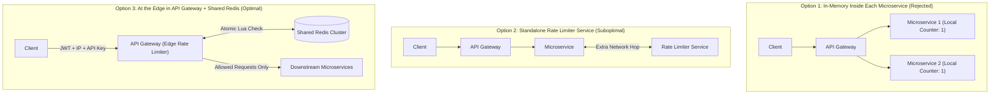
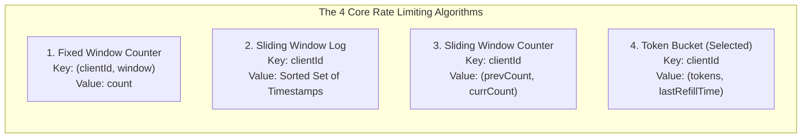
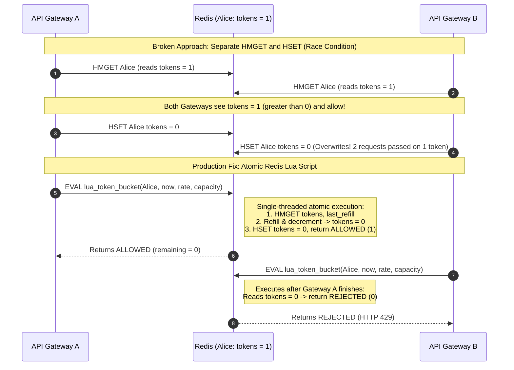
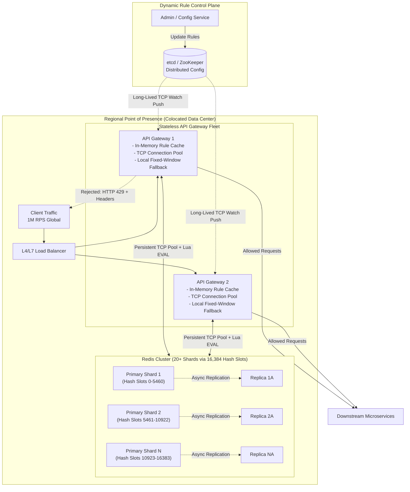

<!-- markdownlint-disable MD001 -->
<!-- markdownlint-disable MD024 -->
<!-- markdownlint-disable MD025 -->
<!-- markdownlint-disable MD026 -->
<!-- markdownlint-disable MD029 -->
<!-- markdownlint-disable MD033 -->
<!-- markdownlint-disable MD036 -->
<!-- markdownlint-disable MD040 -->
<!-- markdownlint-disable MD056 -->
<!-- markdownlint-disable MD060 -->

# Part 1: The System Design Strategy

Designing a **Distributed Rate Limiter** is an infrastructure/backend component interview (frequently asked at **Microsoft**, **OpenAI**, and **Meta**) rather than a consumer product interview.  
Your strategy must shift from designing user-facing screens and CRUD tables to optimizing **hot-path latency, concurrency atomicity, distributed state sharding, and fault-tolerant degradation**.

## A. Interview Execution Strategy (The 45-Minute Pacing Plan)

| Phase                                              | Time Allocation | Strategic Objective                                                         | Key Candidate Actions & Signals                                                                                                                                                                                                                                                                                                                           |
| :------------------------------------------------- | :-------------- | :-------------------------------------------------------------------------- | :-------------------------------------------------------------------------------------------------------------------------------------------------------------------------------------------------------------------------------------------------------------------------------------------------------------------------------------------------------- |
| **1. Requirements & Scale Scoping**                | ~5–7 mins       | Lock down what is being protected, traffic volume, and hot-path SLAs.       | Ask *what* system we are protecting (e.g., a 100M DAU social network at **1M RPS**). Quantify non-functional requirements (e.g., **less than 10ms** check latency, **AP over CP** in CAP theorem). Skip asking "Client-side vs. Server-side"—acknowledge immediately that rate limiting must be **server-side** so clients cannot spoof or bypass limits. |
| **2. Core Entities & System Interface**            | ~1–2 mins       | Define the internal contract rather than external REST endpoints.           | Breeze through this in under a minute. Define `Request`, `Client`, and `Rule`. Because end users do not call a rate limiter directly, define an internal RPC/function signature: `isRequestAllowed(clientId, ruleId)`.                                                                                                                                    |
| **3. High-Level Design (Placement & Algorithm)**   | ~12–15 mins     | Place the limiter at the edge, select the right algorithm, and share state. | Compare placement options (In-Service vs. Standalone Service vs. **API Gateway Edge**). Walk through the 4 classic rate-limiting algorithms, select **Token Bucket** stored in **Redis**, and specify **HTTP 429** error responses and headers.                                                                                                           |
| **4. Deep Dives (Proactive Scaling & Resilience)** | ~20 mins        | Satisfy every non-functional requirement with math and failure handling.    | Drive the math for **Redis Sharding** (1M RPS $\div$ 50k ops/sec = 20 shards), solve the **Read-Modify-Write race condition** using **Redis Lua scripts**, compare **Fail Open vs. Fail Closed vs. Local Fallback**, optimize latency via **Connection Pooling & Geo-Colocation**, and push dynamic rules via **etcd / ZooKeeper**.                       |

---

## B. Level Differentiation Matrix (What Interviewers Look For)

| Candidate Level         | Expected Breadth vs. Depth          | Defining Behaviors in This Interview                                                                                                                                                                                                                                                                                  |
| :---------------------- | :---------------------------------- | :-------------------------------------------------------------------------------------------------------------------------------------------------------------------------------------------------------------------------------------------------------------------------------------------------------------------- |
| **Mid-Level (L4 / E4)** | 80% Breadth / 20% Depth             | Places the rate limiter at the API Gateway, explains the 4 algorithms conceptually, introduces Redis for global state, knows HTTP `429`, and solves single-node Redis bottlenecks when prompted by the interviewer.                                                                                                   |
| **Senior (L5 / E5)**    | Balanced Breadth & Proactive Depth  | Proactively calculates Redis shard count (`20+ shards`) without prompting, explains consistent hashing vs. Redis Cluster hash slots, weighs `Fail Open` vs. `Fail Closed` trade-offs, and adds asynchronous read/failover replicas.                                                                                   |
| **Staff+ (L6+ / E6+)**  | Deep Production Mastery             | Immediately spots the concurrent **Read-Modify-Write race condition** between multiple gateways and solves it with atomic **Redis Lua scripts**, proposes **local gateway in-memory fallback** during Redis outages, tunes **TCP connection pools**, and designs push-based config propagation with **etcd watches**. |

---

# Part 2: Complete System Design Reference Document

## 1. Executive Summary & Requirements Matrix

A **Rate Limiter** controls the number of requests a client can send within a specified time window (for example, 100 requests per minute per user). Its primary purpose is to protect downstream microservices and databases from abusive traffic, accidental retry storms, scraping, and Distributed Denial-of-Service (DDoS) amplification.

### Functional Requirements

| Requirement ID | Feature                                | Description & Technical Context                                                                                                                                                   |
| :------------- | :------------------------------------- | :-------------------------------------------------------------------------------------------------------------------------------------------------------------------------------- |
| **FR-1**       | **Identify Clients**                   | Uniquely identify incoming callers using **User ID**, **IP Address**, or **API Key** (or a layered combination of all three).                                                     |
| **FR-2**       | **Enforce Configurable Rules**         | Throttle incoming requests against configurable thresholds (e.g., 100 requests/minute per user or per endpoint).                                                                  |
| **FR-3**       | **Return Informative Error Responses** | Fail fast with **HTTP `429 Too Many Requests**` and attach standard rate-limit metadata headers(`X-RateLimit-Limit`, `X-RateLimit-Remaining`, `X-RateLimit-Reset`, `Retry-After`).|

### Non-Functional Requirements & Scale Assumptions

| Requirement Category      | Target / Choice                        | Architectural Justification                                                                                                                                                            |
| :------------------------ | :------------------------------------- | :------------------------------------------------------------------------------------------------------------------------------------------------------------------------------------- |
| **Traffic Scale**         | **100M DAU / 1,000,000 RPS**           | Protects a massive consumer-facing platform (e.g., Facebook/Instagram scale).                                                                                                          |
| **CAP Theorem Trade-off** | **Availability over Consistency (AP)** | If a rule update takes a few seconds to propagate or a Redis replica lags slightly during failover, allowing 1–2 extra requests is harmless compared to blocking all platform traffic. |
| **Hot-Path Latency**      | **Less than 10 milliseconds**          | Every incoming request passes through the rate limiter; high check latency directly degrades end-user experience across the entire platform.                                           |
| **High Scalability**      | **Horizontal Sharding**                | A single in-memory node cannot process 1M RPS; state must partition cleanly across a distributed cluster.                                                                              |
| **Fault Tolerance**       | **Graceful Degradation**               | Outages inside the rate limiter cluster must neither crash backend services nor cause a complete platform blackout.                                                                    |

---

## 2. Core Entities & System Interface

Because a rate limiter is an internal infrastructure component embedded in the request path rather than a standalone user-facing product, we define an internal **System Interface** instead of public CRUD endpoints.

### Core Entities

| Entity      | Key Attributes                                    | Purpose                                                                                       |
| :---------- | :------------------------------------------------ | :-------------------------------------------------------------------------------------------- |
| **Request** | `endpoint`, `httpMethod`, `headers`, `timestamp`  | Represents the incoming call being evaluated at the network edge.                             |
| **Client**  | `userId`, `ipAddress`, `apiKey`, `userTier`       | Identifies *who* is making the request (extracted from HTTP headers / JWT).                   |
| **Rule**    | `ruleId`, `scope`, `bucketCapacity`, `refillRate` | Defines the burst limit and sustained throughput allowed for a given client tier or endpoint. |

### Internal System Interface

```typescript
interface RateLimitResponse {
  passes: boolean;          // True if allowed, False if throttled (HTTP 429)
  remaining: number;        // Remaining tokens in the user's bucket
  resetTime: number;        // Epoch timestamp or seconds until tokens replenish
}

// Invoked internally by the API Gateway on every incoming request
function isRequestAllowed(clientId: string, ruleId: string): RateLimitResponse

```

---

## 3. High-Level Design & Architectural Evolution

### A. Where Should the Rate Limiter Live?

Before choosing an algorithm, we must decide **where** the rate limiter sits in the network topology and **how** it accesses client identity.



| Placement Option                                    | How It Works                                                                                                                               | Pros                                                                                                             | Cons / Why Rejected or Chosen                                                                                                                                  |
| :-------------------------------------------------- | :----------------------------------------------------------------------------------------------------------------------------------------- | :--------------------------------------------------------------------------------------------------------------- | :------------------------------------------------------------------------------------------------------------------------------------------------------------- |
| **1. Inside Each Microservice (In-Process Memory)** | Each microservice maintains local in-memory counters for incoming requests.                                                                | Ultra-fast (zero network hops); full access to internal database context.                                        | **No global coordination.** If a user sends 1 request to Service A and 1 to Service B, each service sees a count of 1 while the user actually made 2 requests. |
| **2. Standalone Rate Limiter Microservice**         | Requests pass through the Gateway to a microservice, which then makes an RPC call to a central Rate Limiter service.                       | Solves global state coordination across services.                                                                | **Excess latency & wasted ingress.** Abusive traffic still penetrates the gateway and consumes microservice threads before being rejected.                     |
| **3. At the Edge inside the API Gateway (Chosen)**  | The API Gateway evaluates rate limits at the perimeter before routing requests downstream, storing state in an external **Redis** cluster. | Acts like a **"bouncer at the club door"**—blocks malicious traffic at the perimeter; keeps microservices clean. | Gateway only sees HTTP request context (headers, IP, URL). **Fix:** Encode business attributes (e.g., `isPremium: true`) inside the signed **JWT** header.     |

### B. Client Identification Strategy (Layered Rules)

Real production systems rarely rely on a single identifier. Instead, combine all three in layered rules extracted from the HTTP request:

1. **User ID (from JWT Header):** Primary identifier for authenticated traffic (e.g., Free users: 100 req/min; Premium users: 1,000 req/min).
2. **IP Address:** Essential fallback for unauthenticated endpoints (e.g., `/login`, `/register`, public search) where no JWT exists (e.g., 50 req/min per IP).
3. **API Key:** Used for external developer/webhook integrations (e.g., 50,000 req/min per organization key).

---

### C. Rate Limiting Algorithms Comparison



| Algorithm                      | Mechanism & Data Structure                                                                                                                                                           | Memory Footprint                                               | Accuracy & Burst Handling                                                                 | Key Trade-offs & Verdict                                                                                                                    |
| :----------------------------- | :----------------------------------------------------------------------------------------------------------------------------------------------------------------------------------- | :------------------------------------------------------------- | :---------------------------------------------------------------------------------------- | :------------------------------------------------------------------------------------------------------------------------------------------ |
| **1. Fixed Window Counter**    | Divides time into fixed intervals (e.g., 1-minute buckets). Increments a counter per `(clientId, windowStart)` in a hash table.                                                      | **Very Low** (`O(1)` — 1 integer per user per window)          | **Poor at boundaries.** Susceptible to the **Boundary Effect** and **Starvation**.        | **Rejected:** A user can send 100 requests at `12:01:59` and 100 more at `12:02:00` (**200 requests in 2 seconds**).                        |
| **2. Sliding Window Log**      | Stores every request's exact timestamp in a sorted log/heap (e.g., Redis `ZSET`). Removes timestamps older than `now - window` on every check.                                       | **Extremely High** (`O(N)` per user where $N$ is window limit) | **100% Exact** rolling window accuracy. Zero boundary bursts.                             | **Rejected for 100M DAU:** Storing hundreds of timestamps per user across millions of users consumes prohibitive RAM.                       |
| **3. Sliding Window Counter**  | Stores only **2 integers** per user (`prevWindowCount`, `currWindowCount`). Estimates rolling count via weighted overlap: $\text{curr} + \text{prev} \times (1 - \text{elapsed\%})$. | **Very Low** (`O(1)` — 2 integers per user)                    | **High (Approximation).** Smooths boundary spikes assuming uniform distribution.          | **Strong Runner-Up:** Great memory efficiency, though cannot separately tune instantaneous burst size vs. steady rate.                      |
| **4. Token Bucket (Selected)** | Each user has a bucket with max **Capacity ($B$)** and **Refill Rate ($R$)**. Lazily refills tokens based on elapsed time since `lastRefill`.                                        | **Very Low** (`O(1)` — 2 numbers: `tokens`, `lastRefill`)      | **Optimal.** Explicitly separates **Burst Capacity ($B$)** from **Sustained Rate ($R$)**. | **Selected Winner:** Industry standard; handles natural user burstiness while strictly bounding sustained load with just 2 values per user. |

#### Walkthrough of the Two Mathematical Algorithms

1. **Sliding Window Counter Math:**

* Suppose the limit is **10 requests per minute**.
* Previous window (`01:00–02:00`) recorded **8 requests**.
* Current window (`02:00–03:00`) has recorded **6 requests**, and a new request arrives at `02:42` (**70% through the current minute**).
* Because 70% of the current window has elapsed, **30%** of the 60-second rolling lookback overlaps with the previous window:

$$\text{Estimated Requests} = 6 + (8 \times 0.30) = 8.4$$

* Since $8.4$ is less than $10$, the request is **allowed**.

2. **Token Bucket Lazy Refill Math:**

* Instead of running an expensive background process to add tokens every second for 100 million users, we compute refills **lazily on read**:
* Suppose Alice's bucket has `Capacity = 100`, `Refill Rate = 1 token/sec`.
* Stored in Redis: `tokens = 20`, `last_refill = 1700000000`.
* Request arrives at `now = 1700000030` (`30 seconds` later):

$$\text{Refilled Tokens} = \min(100, 20 + (30 \times 1)) = 50\text{ tokens}$$

* Since $50$ is greater than $0$, we consume 1 token (`tokens = 49`), set `last_refill = 1700000030`, and allow the request.

---

### D. Solving the Concurrency Race Condition with Redis Lua Scripting

When multiple API Gateway instances read and write to Redis concurrently, a naive `HMGET` followed by `HSET` introduces a classic **Read-Modify-Write Race Condition**:



#### Reference Redis Lua Script Logic

```lua
-- KEYS[1]: client bucket key (e.g., "rate_limit:user:alice")
-- ARGV[1]: capacity, ARGV[2]: refill_rate_per_sec, ARGV[3]: current_timestamp_sec
local capacity = tonumber(ARGV[1])
local refill_rate = tonumber(ARGV[2])
local now = tonumber(ARGV[3])

local data = redis.call("HMGET", KEYS[1], "tokens", "last_refill")
local tokens = tonumber(data[1])
local last_refill = tonumber(data[2])

if tokens == nil then
  tokens = capacity
  last_refill = now
else
  local elapsed = math.max(0, now - last_refill)
  tokens = math.min(capacity, tokens + (elapsed * refill_rate))
end

if tokens >= 1 then
  tokens = tokens - 1
  redis.call("HSET", KEYS[1], "tokens", tokens, "last_refill", now)
  return {1, math.floor(tokens)} -- Allowed
else
  redis.call("HSET", KEYS[1], "tokens", tokens, "last_refill", now)
  return {0, 0} -- Throttled (429)
end

```

---

### E. Error Handling: Fail Fast & HTTP 429 Headers

When a request exceeds its rate limit:

* **Fail Fast vs. Queueing:** Never enqueue rate-limited requests for interactive user-facing applications. If a user clicks "Refresh Feed" and the request sits in a queue, the user assumes the app is frozen, taps refresh repeatedly, and compounds the backlog. Always **Fail Fast** (queueing is reserved only for asynchronous batch/background intra-service pipelines).
* **Standard HTTP Response:**
* **Status Code:** `429 Too Many Requests`
* **Response Headers:**
* `X-RateLimit-Limit: 100` (Maximum burst ceiling for the rule)
* `X-RateLimit-Remaining: 0` (Tokens currently left in the bucket)
* `X-RateLimit-Reset: 1700000060` (Epoch timestamp when bucket replenishes)
* `Retry-After: 1` (Seconds to wait before retrying)

---

## 4. Deep-Dive Engineering Trade-offs & Final Architecture



### Deep Dive 1: Scaling to 1 Million RPS (Sharding & Redis Cluster)

* **The Single-Node Bottleneck:** A single Redis instance handles roughly **100,000 operations per second**. Because each rate-limit evaluation performs a read and a write (`HMGET` + `HSET`, or an atomic Lua execution), effective throughput is roughly **50,000 RPS per Redis node**.
* **Back-of-the-Envelope Shard Math:**

$$\text{Minimum Shards} = \frac{1,000,000\text{ RPS}}{50,000\text{ RPS/shard}} = 20\text{ Redis Primary Shards}$$

In production, provision **25–30+ shards** to maintain headroom for traffic surges.

* **How to Shard (Consistent Hashing vs. Redis Cluster Hash Slots):**
* **Shard Key:** Always partition by `clientId` (`userId`, `IP`, or `API Key`) so a given client's bucket lives on a single deterministic shard.
* **Redis Cluster Hash Slots:** Rather than building a custom consistent hashing ring, use **Redis Cluster**, which divides the keyspace into **16,384 fixed hash slots** ($\text{Slot} = \text{CRC16}(\text{clientId}) \pmod{16384}$) and maps ranges of slots across the 20+ shards automatically.

---

### Deep Dive 2: Fault Tolerance & Outage Strategies

What happens if a Redis shard crashes or the Redis Cluster becomes unreachable?

| Strategy                                                | Behavior During Redis Outage                                                                                          | Impact on Backend Services                                                                                          | Impact on End Users                                                                                                                           | When to Use                                                            |
| :------------------------------------------------------ | :-------------------------------------------------------------------------------------------------------------------- | :------------------------------------------------------------------------------------------------------------------ | :-------------------------------------------------------------------------------------------------------------------------------------------- | :--------------------------------------------------------------------- |
| **1. Fail Open**                                        | API Gateway bypasses rate limiting and allows 100% of traffic through.                                                | **High Risk of Cascading Failure:** Unthrottled traffic Spike/DDoS can overwhelm databases and crash microservices. | Zero immediate disruption unless downstream services collapse.                                                                                | Non-critical internal services with excess compute headroom.           |
| **2. Fail Closed**                                      | API Gateway rejects 100% of incoming requests with errors.                                                            | **100% Protected:** Downstream services sit idle and safe.                                                          | **Total Outage:** The entire application appears offline to users.                                                                            | Strict security/financial boundaries or hard GPU/API cost caps.        |
| **3. Local In-Memory Gateway Fallback (Best Practice)** | API Gateway switches automatically to a **local in-memory Fixed Window Counter** in Gateway RAM until Redis recovers. | **Protected:** Caps traffic per gateway node so downstream services don't melt down.                                | **High Availability Preserved:** Users continue using the app normally; limits are slightly looser due to lack of cross-gateway coordination. | **Staff-Level Production Standard** for high-scale consumer platforms. |

* **High Availability via Replicas:** Configure **1 to 2 Read/Failover Replicas** per primary shard in Redis Cluster using **asynchronous replication**. If Primary Shard 1 dies, Replica 1A promotes automatically within seconds. Because replication is asynchronous (prioritizing **Availability over Consistency**), a few in-flight token decrements may be lost during failover—meaning Alice might get 101 requests instead of 100, which is an acceptable trade-off.

---

### Deep Dive 3: Achieving Sub-10ms Latency

Even though Redis in-memory operations take less than 1ms, network overhead can easily blow past our 10ms budget unless we apply two optimizations:

1. **TCP Connection Pooling:**

* Opening a new TCP connection (3-way handshake + TLS negotiation) on every request adds **20ms to 50ms** of latency.
* Each API Gateway maintains a pre-warmed **pool of persistent TCP connections** to the Redis shards. (Standard in modern Redis client libraries, though Staff candidates should note that **pool sizing must be tuned** to match concurrency and Redis response time so requests don't block waiting for a free socket).

2. **Geographic Colocation (Multi-Region Edge PoPs):**

* A user in Tokyo should never wait for an API Gateway in US-East to query a Redis cluster across the Pacific Ocean.
* Deploy API Gateways and their regional Redis Cluster shards in the **same data center** within each geographic region near the users.

---

### Deep Dive 4: Dynamic Rule Configuration Management

Rules (e.g., changing `/checkout` from 50 req/min to 20 req/min during an attack) cannot be hardcoded into gateway deployment binaries.

| Configuration Approach                                                  | How It Works                                                                                                                                    | Why It Fails or Succeeds                                                                                                                        |
| :---------------------------------------------------------------------- | :---------------------------------------------------------------------------------------------------------------------------------------------- | :---------------------------------------------------------------------------------------------------------------------------------------------- |
| **1. Periodic DB / Redis Polling**                                      | Gateways poll a SQL database or Redis every $N$ seconds for updated rules.                                                                      | **Suboptimal:** Polling every 30s creates propagation lag during an active incident; polling every 1s burns Gateway CPU and wastes bandwidth.   |
| **2. Fetch Rules from Redis on Every Request**                          | Gateways look up rule parameters in Redis alongside user token counts on every request.                                                         | **Suboptimal:** Increases payload size and operations on the hot path for rules that rarely change.                                             |
| **3. Push-Based Distributed Config via `etcd` / `ZooKeeper` (Optimal)** | Gateways cache all rules in **local Gateway RAM** (`0ms` lookup latency) and open a **persistent TCP `Watch` stream** to `etcd` or `ZooKeeper`. | **Optimal:** Zero hot-path network overhead during request checks, plus near-instantaneous push updates the moment an engineer modifies a rule. |

---

## 5. Technical Glossary & Reusable Mental Models

### A. Core Concepts Glossary

| Term                             | Plain-English Definition                                                                                          | Role in Distributed Rate Limiter                                                                                             |
| :------------------------------- | :---------------------------------------------------------------------------------------------------------------- | :--------------------------------------------------------------------------------------------------------------------------- |
| **Token Bucket**                 | An algorithm where a bucket holds up to $B$ tokens and refills at $R$ tokens/sec; each request consumes 1 token.  | Decouples **short-term burst tolerance ($B$)** from **long-term sustained rate ($R$)** using only 2 numbers per client.      |
| **Lazy Refill**                  | Computing accrued tokens mathematically at request time (`elapsed * rate`) rather than running background timers. | Eliminates the need for background threads updating 100M idle buckets every second.                                          |
| **Redis Lua Scripting (`EVAL`)** | Executing a server-side Lua script directly inside Redis's single-threaded event loop.                            | Guarantees that reading (`HMGET`), calculating refills, and writing (`HSET`) execute **atomically** without race conditions. |
| **Redis Hash Slots**             | Redis Cluster's partitioning scheme that maps keys via `CRC16(key) mod 16384` across physical shards.             | Enables horizontal scaling across 20+ Redis nodes without external consistent-hashing proxy layers.                          |
| **HTTP 429**                     | Standard HTTP status code for `"Too Many Requests"`.                                                              | Signals explicitly to clients and SDKs to back off rather than treating throttling as a server crash (`500`).                |
| **Connection Pooling**           | Maintaining a cache of open, reusable TCP sockets between a client service and a datastore.                       | Eliminates the 20–50ms TCP/TLS handshake penalty on the hot path, keeping checks under 10ms.                                 |
| **etcd / ZooKeeper Watch**       | A distributed coordination feature where clients subscribe to key changes over a persistent connection.           | Pushes dynamic rate-limit rule updates into API Gateway memory immediately without polling.                                  |

---

### B. The Reusable Mental Model ("Symptom $\rightarrow$ Bottleneck $\rightarrow$ Solution" Cheat Sheet)

Use these first-principles triggers across any high-throughput infrastructure design problem:

| Symptom / Problem Statement                                                                    | Underlying Bottleneck / Trap                                                                  | Architectural Solution Trigger                                                                                                                             |
| :--------------------------------------------------------------------------------------------- | :-------------------------------------------------------------------------------------------- | :--------------------------------------------------------------------------------------------------------------------------------------------------------- |
| *"Users burst 2x the allowed limit right as the clock ticks to a new minute."*                 | **Fixed Window Boundary Effect:** Two bursts straddling the reset boundary (`:59` and `:00`). | Switch to **Token Bucket** (to explicitly bound burst size) or **Sliding Window Counter** (weighted 2-window approximation).                               |
| *"We need to update counters every second for 100M users, which crushes our CPU."*             | **Eager Background Ticking:** Running cron jobs or timers for idle entities.                  | Use **Lazy Evaluation on Read:** Store `(value, lastUpdatedTimestamp)` and calculate state transitions on-the-fly when the user actually makes a request.  |
| *"Two stateless servers read the same counter value from Redis and overwrite each other."*     | **Read-Modify-Write Race Condition:** Non-atomic network round-trips (`GET` then `SET`).      | Move the read, math, and write into a single **Redis Lua Script (`EVAL`)** so Redis executes it atomically on its single thread.                           |
| *"A single Redis instance maxes out at ~50k–100k RPS, but we have 1M RPS."*                    | **Single-Node Event Loop Saturation.**                                                        | **Shard by Client ID** across a **Redis Cluster** ($\text{Shards} = \text{Total RPS} / 50\text{k}$) with async failover replicas.                          |
| *"Checking Redis on every request is adding 30ms of latency even though Redis takes 0.5ms."*   | **Per-Request TCP Handshake & Cross-Region RTT.**                                             | Enable **TCP Connection Pooling** on the gateway and **colocate Gateways + Redis shards** in regional edge data centers.                                   |
| *"Gateways need dynamic rules without polling a database or adding latency to every request."* | **Pull- vs. Push-Configuration Trade-off.**                                                   | Cache rules in **local Gateway RAM** and use **`etcd` / `ZooKeeper` Watches** to push updates over a persistent TCP stream.                                |

---
