<!-- markdownlint-disable MD001 -->
<!-- markdownlint-disable MD012 -->
<!-- markdownlint-disable MD024 -->
<!-- markdownlint-disable MD025 -->
<!-- markdownlint-disable MD026 -->
<!-- markdownlint-disable MD029 -->
<!-- markdownlint-disable MD033 -->
<!-- markdownlint-disable MD040 -->
<!-- markdownlint-disable MD056 -->
<!-- markdownlint-disable MD060 -->

# `notification-system`: High-Level and Low-Level Design

**Scope:** a generic, multi-channel notification platform serving `orders`, `payment`, `users`, `inventory`, `catalog` and future services.

**Targets:** 10,000,000 users, 1,000,000 notifications per minute, durable, low-latency, highly resilient, horizontally scalable.  

**Code:** the LLD uses Java (orchestration, control plane) and Rust (dispatch data plane). Both were compiled and tested (section 22).  

| Part | Sections | Covers                                                                                             |
| ---- | -------- | -------------------------------------------------------------------------------------------------- |
| A    | 1 - 3    | Requirements, notification classes, capacity estimation                                            |
| B    | 4 - 11   | Architecture, integration, core flows, queues, guarantees, security, multi-region                  |
| C    | 12 - 18  | Domain model, contracts, data model, state machine, component internals, algorithms, observability |
| D    | 19 - 23  | Failure modes, scaling, decision log, rollout and testing, risks. Appendices follow                |

---

# Part A: Foundations

## 1. Context, goals and requirements

Domain services need to tell users things: an order shipped, a payment failed, a new device logged in, a one-time password.  
Each service building its own email and SMS plumbing duplicates provider integrations, drifts on consent rules and fails differently under load.  
`notification-system` is the one shared platform: producers state **what happened and to whom**, the platform decides **whether, when, where and how** to tell the user.  

### 1.1 Functional requirements

| ID  | Requirement                                                                                       |
| --- | ------------------------------------------------------------------------------------------------- |
| F1  | Accept notification requests from any internal service through an API and through domain events   |
| F2  | Deliver over push, email, SMS and WhatsApp, with ordered fallback between channels                |
| F3  | Honor user preferences: channel opt-outs, marketing consent, quiet hours, locale                  |
| F4  | Distinguish critical notifications (OTP, new device login) from informational and bulk ones       |
| F5  | Render versioned, localized templates                                                             |
| F6  | Deduplicate: the same producer request never reaches the user twice                               |
| F7  | Support delayed, scheduled and campaign (bulk) sends                                              |
| F8  | Track every notification to a terminal state and expose its status                                |
| F9  | Ingest delivery receipts, bounces and complaints from providers and update status and suppression |
| F10 | Enforce per-producer quotas and per-user frequency caps                                           |

### 1.2 Non-functional requirements

| ID  | Requirement  | Target                                                                                         |
| --- | ------------ | ---------------------------------------------------------------------------------------------- |
| N1  | Throughput   | 1,000,000 notifications per minute (16,667/s), design capacity 3x (50,000/s)                   |
| N2  | Latency      | P0 accepted to handed-to-provider: p99 at or under 2 s                                         |
| N3  | Durability   | No accepted notification is lost: replicated log, acknowledged only after a durable write      |
| N4  | Availability | Ingest 99.99% for P0 and P1, no single point of failure, survives loss of an availability zone |
| N5  | Isolation    | Bulk traffic never delays critical traffic; one producer cannot starve another                 |
| N6  | Resilience   | Provider outages absorbed by failover, retries and circuit breakers without operator action    |
| N7  | Scalability  | Capacity grows by adding instances and partitions, not by redesign                             |
| N8  | Auditability | Every state change recorded with who, what, when; PII minimized and encrypted                  |

### 1.3 Service-level objectives by class

| Class | Ingest latency p99 | Accepted to handed to provider p99 | Ingest availability | Delivery success within TTL  |
| ----- | ------------------ | ---------------------------------- | ------------------- | ---------------------------- |
| P0    | 50 ms              | 2 s                                | 99.99%              | 99.9% (at least one channel) |
| P1    | 100 ms             | 10 s                               | 99.99%              | 99.9%                        |
| P2    | 100 ms             | 60 s                               | 99.95%              | 99%                          |
| P3    | 200 ms             | inside the campaign window         | 99.9%               | 98% (bounces excluded)       |

"Handed to provider" is the last point the platform controls.  
Handset delivery, inbox placement and carrier latency are tracked through receipts but are not part of the SLO.

### 1.4 Non-goals

- Authoring tools for marketing content, audience segmentation and A/B testing (the platform consumes a segment, it does not compute one).
- In-app inbox UI and real-time chat. A feed channel can be added later as another adapter.
- Replacing provider-side features: carrier routing, inbox placement, device wake-up.

## 2. Notification taxonomy and priority model

Four classes carry the policy. A producer names the class, the platform enforces what the class means.

| Class | Name          | Examples                                                      | Default chain              | TTL   | Attempts per channel | Backoff (base, cap) |
| ----- | ------------- | ------------------------------------------------------------- | -------------------------- | ----- | -------------------- | ------------------- |
| P0    | Security      | OTP, new device login, password changed                       | SMS, WhatsApp, Push, Email | 5 min | 3                    | 200 ms, 5 s         |
| P1    | Transactional | Payment captured or failed, order placed or cancelled, refund | Push, Email, SMS           | 1 h   | 5                    | 1 s, 5 min          |
| P2    | Informational | Order shipped, back in stock, price drop                      | Push, Email                | 24 h  | 5                    | 5 s, 30 min         |
| P3    | Bulk          | Campaigns, digests, announcements                             | Email, Push                | 48 h  | 3                    | 30 s, 1 h           |

Per-event overrides replace the class chain.  
`device.new_login` uses Push, SMS, Email: the user already has the app, so push is the fastest and cheapest channel.

| Policy switch                  | P0  | P1  | P2  | P3  | Rationale                                            |
| ------------------------------ | --- | --- | --- | --- | ---------------------------------------------------- |
| Bypass quiet hours             | yes | yes | no  | no  | A login alert at 03:00 matters, a promotion does not |
| Bypass channel opt-out         | yes | no  | no  | no  | Security messages cannot be switched off             |
| Requires marketing consent     | no  | no  | no  | yes | Legal basis for promotional content                  |
| Frequency cap applies          | no  | no  | yes | yes | Protects users from informational floods             |
| Dedicated lane and worker pool | yes | yes | yes | yes | Isolation: a campaign must not delay an OTP          |

The TTL is enforced end to end.  
A 6-minute-old OTP is worthless and possibly harmful, so every stage drops a message past its deadline instead of sending late.

## 3. Capacity estimation

Inputs: 10 million users, 1,000,000 notifications per minute at peak.  
The class and channel mix below is an **assumption** to be replaced with measured traffic; every derived number scales linearly with it.

| Quantity                      | Value             | Derivation                                        |
| ----------------------------- | ----------------- | ------------------------------------------------- |
| Peak target                   | 16,667 per second | 1,000,000 / 60                                    |
| Design capacity               | 50,000 per second | 3 x peak (campaign overlap, retry storms, growth) |
| Full-base campaign drain time | 10 minutes        | 10,000,000 / 1,000,000 per minute                 |
| Planning daily volume         | 500,000,000       | about 35% of the peak rate held for 24 hours      |
| Provider calls at peak        | 17,500 per second | 16,667 x 1.05 (5% retries)                        |

| Class | Assumed share | Rate at peak | Rate at design capacity |
| ----- | ------------- | ------------ | ----------------------- |
| P0    | 3%            | 500/s        | 1,500/s                 |
| P1    | 22%           | 3,667/s      | 11,000/s                |
| P2    | 35%           | 5,833/s      | 17,500/s                |
| P3    | 40%           | 6,667/s      | 20,000/s                |

| Channel  | Assumed share | Rate at peak | Planning note                                                               |
| -------- | ------------- | ------------ | --------------------------------------------------------------------------- |
| Push     | 45%           | 7,500/s      | APNs and FCM over pooled HTTP/2 connections                                 |
| Email    | 35%           | 5,833/s      | About 21 million per hour. Several ESPs and separate IP pools per class     |
| SMS      | 12%           | 2,000/s      | Several aggregators. Dominant cost line                                     |
| WhatsApp | 8%            | 1,333/s      | Per-number throughput caps: verify with the provider, plan for many numbers |

| Resource                    | Estimate                          | Derivation                                                           |
| --------------------------- | --------------------------------- | -------------------------------------------------------------------- |
| Ingest request size         | about 1 KB                        | event, user id, template id, parameters                              |
| Ingest log throughput       | 17 MB/s peak, 50 MB/s design      | rate x 1 KB                                                          |
| Dispatch log throughput     | 27 MB/s peak, 80 MB/s design      | rate x 1.6 KB (email bodies above 8 KB stored as blob references)    |
| Log disk writes, replicated | about 240 MB/s at design capacity | 80 MB/s x replication factor 3                                       |
| Status records              | 175 GB per day                    | 500M x 350 B                                                         |
| Hot status retention        | 2.5 TB, 7.4 TB replicated         | 14 days, replication factor 3, older data archived to object storage |
| Dedup keys                  | about 90 GB, 180 GB replicated    | 500M per day x 2 days x 90 B                                         |
| User profiles               | 12 GB                             | 10M x 1.2 KB, fits in cache                                          |
| Device tokens               | 5 GB                              | 10M users x 2.5 devices x 200 B                                      |

| Component             | Per-instance planning rate   | Instances at design capacity | Provisioned |
| --------------------- | ---------------------------- | ---------------------------- | ----------- |
| Ingest API (4 vCPU)   | 6,000 requests/s             | 9                            | 12          |
| Orchestrator (4 vCPU) | 2,000 messages/s             | 25                           | 32          |
| Dispatcher (4 vCPU)   | 5,000 provider calls/s       | 11                           | 16          |
| Log brokers (NVMe)    | 25 MB/s sustained per broker | 10                           | 12          |

Per-instance rates are planning assumptions.  
Section 22 requires load tests to confirm or replace them before launch.

---

# Part B: High-level design

## 4. Architecture overview

Design principles:

1. **Accept fast, deliver asynchronously.** Producers get a durable acknowledgement and never wait for a provider.
2. **One lane per priority.** Separate topics, consumers and worker pools, so bulk cannot delay critical traffic.
3. **At-least-once everywhere, idempotent at every boundary.** Duplicates are filtered by keys, not prevented by luck.
4. **Decide late.** Preferences and consent are evaluated at send time, so an unsubscribe is honored immediately.
5. **Every external dependency sits behind an adapter** with its own quota, breaker and fallback.
6. **State is rebuilt from the log.** Services are stateless; the log and the stores are the memory.

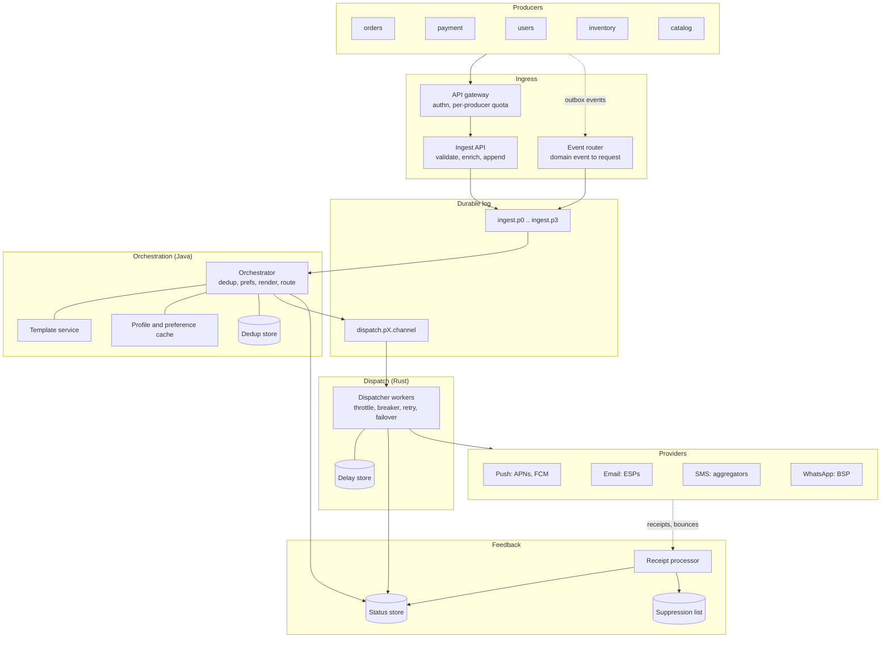

| Component          | Responsibility                                                         | Language | State                 | Scales by           |
| ------------------ | ---------------------------------------------------------------------- | -------- | --------------------- | ------------------- |
| API gateway        | Authenticate producers, per-producer quota, TLS termination            | managed  | none                  | instances           |
| Ingest API         | Validate, assign id, durably append to the ingest lane, return 202     | Java     | none                  | instances           |
| Event router       | Map domain events (outbox) to requests by versioned rules              | Java     | rules cache           | partitions          |
| Orchestrator       | Dedup, preferences, frequency cap, channel choice, render, enqueue     | Java     | none                  | partitions per lane |
| Template service   | Versioned, localized templates, compiled and cached                    | Java     | template DB           | replicas, cache     |
| Dispatcher workers | Provider calls with throttle, breaker, retry, failover, short delays   | Rust     | in-memory delay queue | partitions          |
| Delay store        | Durable store for long delays and deferred sends                       | storage  | scheduled tasks       | shards by due time  |
| Receipt processor  | Normalize callbacks, update status, feed suppression and token cleanup | Java     | none                  | partitions          |
| Campaign service   | Expand an audience into chunks, release at a controlled rate           | Java     | campaign state        | partitions          |

| Concern           | Choice                           | Alternatives considered             | Why this choice                                                             |
| ----------------- | -------------------------------- | ----------------------------------- | --------------------------------------------------------------------------- |
| Durable log       | Kafka                            | Pulsar, Kinesis, SQS plus SNS       | Throughput, ordering, replay, lag signal. Cost: operations, no native delay |
| Dedup store       | Redis cluster, `SET NX PX`       | DB unique key, in-memory            | Atomic claim in under 1 ms. Cost: about 180 GB of memory                    |
| Status store      | Wide-column (Cassandra, Scylla)  | DynamoDB, sharded SQL               | Write-heavy, key-addressed, TTL. Cost: query-first modeling                 |
| Config, templates | PostgreSQL plus caches           | Document store                      | Relational integrity for versions and rules, low write rate                 |
| Delay store       | Sharded table by due-time bucket | Redis sorted set, Kafka delay tiers | Durable and queryable by time; a poller re-publishes due tasks              |
| Blob store        | Object storage                   | Database blobs                      | Cheap storage for large bodies (claim-check)                                |
| Languages         | Java and Rust                    | One language                        | Java: domain logic. Rust: predictable latency in the provider path          |

## 5. Integration with domain services

Two entry paths feed the same pipeline.

| Path          | Used for                                   | Mechanism                                                                     | Latency profile       |
| ------------- | ------------------------------------------ | ----------------------------------------------------------------------------- | --------------------- |
| Direct API    | OTP, flows where the caller needs an id    | `POST /v1/notifications` with an idempotency key, 202 after durable append    | tens of ms            |
| Domain events | Everything state-driven (orders, payments) | Transactional outbox, CDC to the producer's topic, event router applies rules | sub-second end to end |

The **transactional outbox** removes the dual-write problem: the producer writes its business row and an outbox row in one database transaction; change-data-capture publishes the outbox row.  
A crash between "order saved" and "event sent" cannot lose the notification, and a replay cannot double-send because the request id is stable.

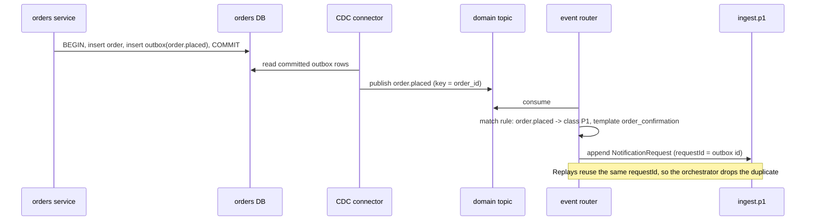

| Producer  | Event              | Class | Chain override                    | Notes                                         |
| --------- | ------------------ | ----- | --------------------------------- | --------------------------------------------- |
| users     | otp.requested      | P0    | none (SMS, WhatsApp, Push, Email) | Direct API, synchronous 202, expires in 5 min |
| users     | device.new_login   | P0    | Push, SMS, Email                  | Includes device and approximate location      |
| users     | password.changed   | P0    | none                              |                                               |
| payment   | payment.captured   | P1    | none                              | Receipt link                                  |
| payment   | payment.failed     | P1    | none                              | Deep link to retry                            |
| payment   | refund.issued      | P1    | Email, Push                       |                                               |
| orders    | order.placed       | P1    | none                              |                                               |
| orders    | order.shipped      | P2    | none                              | Tracking link                                 |
| orders    | order.delivered    | P2    | Push, Email                       | Review prompt, capped                         |
| inventory | item.back_in_stock | P2    | Push, Email                       | Only for users who subscribed                 |
| catalog   | price.drop         | P2    | Push, Email                       | Watchlist match, frequency cap applies        |
| catalog   | promo.campaign     | P3    | Email, Push                       | Campaign service, marketing consent required  |

| Onboarding step for a new producer         | Owner    | Gate                                            |
| ------------------------------------------ | -------- | ----------------------------------------------- |
| Register producer id, credentials, quota   | platform | Quota reviewed against provider budget          |
| Define event types, class, template, chain | producer | Class chosen from the taxonomy, not invented    |
| Publish a schema for each event            | producer | Schema compatibility check in CI                |
| Use a stable request id per business event | producer | Contract test: replay produces one notification |
| Pass the staging load test                 | platform | Within quota, no lane contamination             |

## 6. Core flows

### 6.1 Critical path: OTP and new-device login (P0)

The shortest path in the system.  
Every hop is budgeted (section 8).  
The orchestrator consumes `ingest.p0` with its own consumer group and worker pool, so nothing else competes for it.

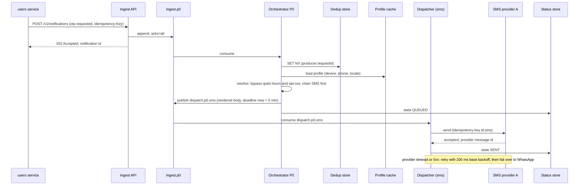

For `device.new_login` the chain is Push, SMS, Email: the worker tries push first, and a permanent push rejection (token gone) fails over to SMS immediately, without waiting for a retry budget.

### 6.2 Transactional events (P1)

Same pipeline, relaxed latency and a longer retry budget. The producer path is the outbox (section 5).

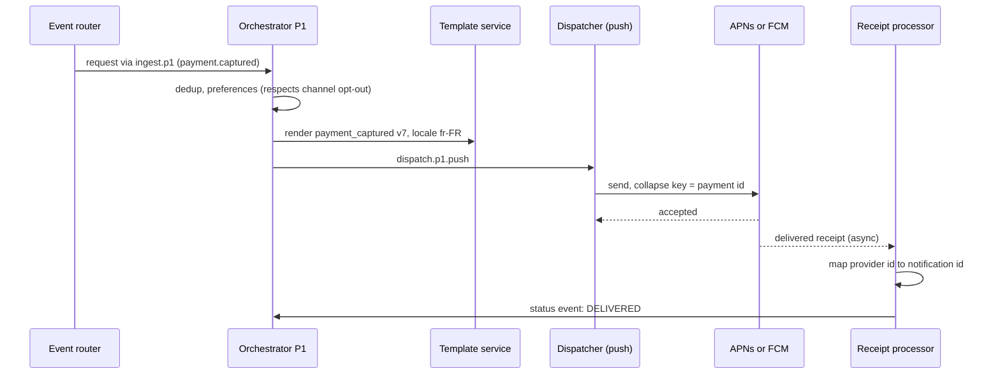

### 6.3 Informational with quiet hours (P2)

At 23:30 local time, `order.shipped` is not sent. The orchestrator renders it, publishes it with `notBefore` set to the end of the quiet window and records DEFERRED.  
If the window end falls after the deadline, the notification is suppressed with reason `WOULD_EXPIRE` rather than delivered late.

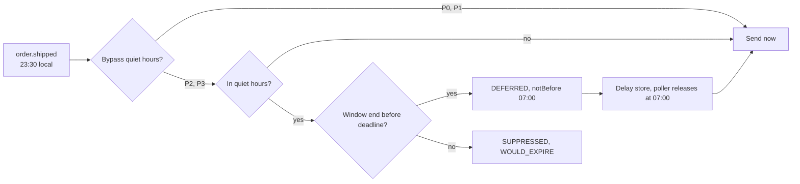

### 6.4 Bulk campaign (P3)

A campaign addressed to 10 million users must neither flood the log nor starve other traffic.  
The campaign service is the pacing layer.

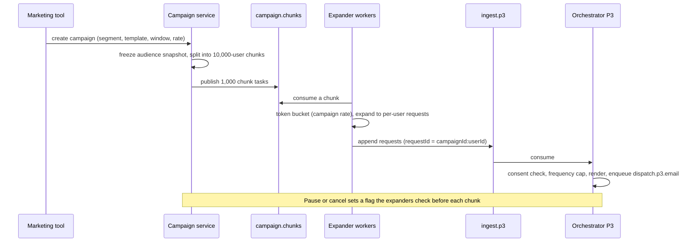

| Control       | Value                                             | Purpose                                             |
| ------------- | ------------------------------------------------- | --------------------------------------------------- |
| Chunk size    | 10,000 users                                      | Small enough to retry, large enough to amortize     |
| Campaign rate | default 15,000 users/s, configurable per campaign | Matches the 1,000,000 per minute target             |
| Request id    | `campaignId:userId`                               | A crashed and restarted expander cannot double-send |
| Lane          | `ingest.p3` and `dispatch.p3.*` only              | Cannot occupy P0 to P2 capacity                     |
| Kill switch   | campaign flag checked per chunk                   | Stops a bad send within seconds                     |

### 6.5 Delivery receipts

Providers confirm asynchronously, and unreliably: callbacks arrive late, twice, or out of order.  
The receipt processor makes that safe.  

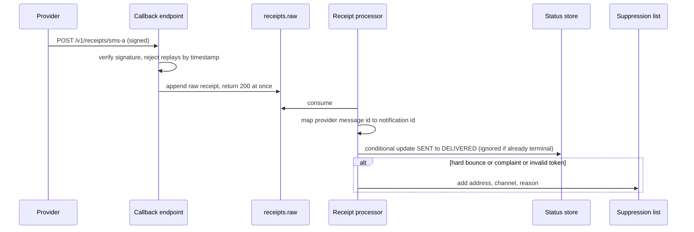

### 6.6 Scheduled and delayed sends

| Source of delay      | Short (30 s or less)                               | Long (over 30 s)                                  |
| -------------------- | -------------------------------------------------- | ------------------------------------------------- |
| Retry backoff        | Worker keeps the task in its in-memory delay queue | Task written to the delay store, offset committed |
| Quiet-hours deferral | not applicable                                     | Delay store                                       |
| Producer `notBefore` | not applicable                                     | Delay store                                       |

The worker commits offsets by watermark: the lowest offset whose task is not yet resolved.  
A crash replays unresolved tasks, so an in-memory delay never loses a message; the provider idempotency key and the dedup store absorb the replay.  
The delay store poller scans due-time buckets once per second and re-publishes due tasks to their dispatch topic.

## 7. Queue topology and data flow

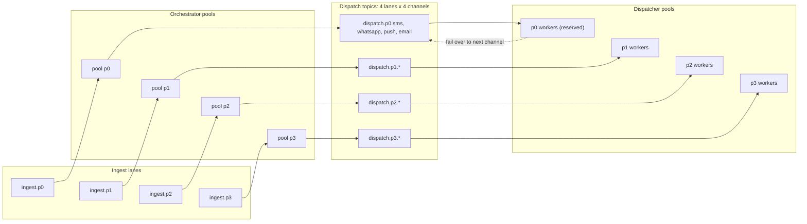

| Topic                      | Partitions | Retention | Key             | Consumers                |
| -------------------------- | ---------- | --------- | --------------- | ------------------------ |
| `ingest.p0`                | 12         | 3 days    | user id         | orchestrator pool p0     |
| `ingest.p1`                | 24         | 3 days    | user id         | orchestrator pool p1     |
| `ingest.p2`                | 32         | 3 days    | user id         | orchestrator pool p2     |
| `ingest.p3`                | 48         | 3 days    | user id         | orchestrator pool p3     |
| `dispatch.p0.*` (4 topics) | 6 each     | 1 day     | user id         | dispatcher pool p0       |
| `dispatch.p1.*` (4 topics) | 12 each    | 1 day     | user id         | dispatcher pool p1       |
| `dispatch.p2.*` (4 topics) | 16 each    | 1 day     | user id         | dispatcher pool p2       |
| `dispatch.p3.*` (4 topics) | 16 each    | 1 day     | user id         | dispatcher pool p3       |
| `receipts.raw`             | 24         | 1 day     | provider msg id | receipt processor        |
| `status.events`            | 32         | 7 days    | notification id | status writer, callbacks |
| `campaign.chunks`          | 24         | 7 days    | campaign id     | expander workers         |
| `dlq.dispatch`             | 8          | 14 days   | notification id | replay tool, alerting    |

| Mechanism                 | Detail                                                                                                                 |
| ------------------------- | ---------------------------------------------------------------------------------------------------------------------- |
| Partition key             | `user_id`: one user's messages in a lane are ordered and land on one consumer                                          |
| Replication               | Factor 3, `min.insync.replicas` 2, `acks=all`, rack-aware across 3 zones                                               |
| Back-pressure             | Rising lag on a dispatch topic pauses matching orchestrator partitions; ingest keeps accepting, the log absorbs bursts |
| Provider-quota share      | Share = quota x owned partitions / total partitions, recomputed on rebalance                                           |
| Work-conserving borrowing | Idle capacity serves other lanes: P0 first, P1 to P3 weighted 5:3:1 (section 17)                                       |

## 8. Non-functional mechanisms

| Requirement     | Mechanism                                                                        | Where                    | Cost                                    |
| --------------- | -------------------------------------------------------------------------------- | ------------------------ | --------------------------------------- |
| Durability      | 202 only after `acks=all` append to a 3-way log across 3 zones                   | Ingest API, log          | 10 to 15 ms of append latency           |
| Durability      | Offsets committed only after the downstream effect is durable                    | Orchestrator, dispatcher | Replays on crash: stages are idempotent |
| Low latency     | Dedicated P0 lane, pool and reserved capacity; no slow synchronous calls         | Topology                 | Idle reserved capacity                  |
| Low latency     | Hot data in memory: profiles, compiled templates, provider connection pools      | Orchestrator, dispatcher | Memory, invalidation work               |
| Low latency     | P0 budget: ingest 20, append 15, orchestrate 30, publish 15, provider 150-400 ms | End to end               | p50 about 300 ms, p99 under 1 s         |
| High throughput | Partitioned log, batching producers, async I/O, pipelined Redis calls            | All                      | Partition planning                      |
| High throughput | Claim-check: email bodies over 8 KB in blob storage, reference in the task       | Orchestrator, dispatcher | One blob read per large email           |
| Resilience      | Breaker per provider, provider and channel failover, bounded retries, DLQ        | Dispatcher               | More integrations and contracts         |
| Resilience      | Degraded modes: profile store down means P0 and P1 send, P2 and P3 wait          | Orchestrator             | P1 may reach an opted-out channel       |
| Scalability     | Stateless services, partition parallelism, autoscaling on consumer lag           | All                      | Partition count is a ceiling            |
| Isolation       | Per-class lanes, per-producer quotas, per-campaign rates                         | Edge, topology           | Fragmentation, offset by borrowing      |

## 9. Delivery semantics, ordering and idempotency

End-to-end exactly-once is not attainable with external providers: after a timeout, the platform cannot know whether the provider sent the message.  
The design is **at-least-once with idempotent boundaries**, which yields effectively-once in the normal case and a small, bounded duplicate rate in the failure case.

| Stage                    | Guarantee                   | Mechanism                                                                                      |
| ------------------------ | --------------------------- | ---------------------------------------------------------------------------------------------- |
| Producer to ingest       | At-least-once, deduplicated | Producer retries with the same `Idempotency-Key`; the orchestrator claims `producer:requestId` |
| Ingest to orchestrator   | At-least-once               | Consumer offsets committed after processing; claim released if processing fails                |
| Orchestrator to dispatch | At-least-once               | Idempotent producer; duplicate task has the same notification id (derived from the dedup key)  |
| Dispatcher to provider   | At-least-once               | Provider idempotency key `notificationId:channel`; stable across retries                       |
| Provider to handset      | Provider-defined            | Not controlled; observed through receipts                                                      |
| Status updates           | Idempotent, monotonic       | Conditional update against the state machine; same state is a no-op, backward moves rejected   |

Ordering is guaranteed **per user within a lane** (same partition key) and not across lanes or channels.  
Notifications that must be ordered relative to each other (shipped before delivered) should share a lane; the producer's clock, not arrival time, is carried as `createdAt`.  
Global ordering is a non-goal because it would force a single partition.  

The residual duplicate case is a provider that accepted a message but whose response was lost, combined with a provider that ignores the idempotency key.  
It is bounded by the retry budget and measured by the duplicate-suspect metric (section 18).

## 10. Security, privacy and compliance

| Area              | Control                                                                                                          |
| ----------------- | ---------------------------------------------------------------------------------------------------------------- |
| Producer authn    | mTLS or signed tokens; producer id bound to credentials, never taken from the payload                            |
| Authorization     | Producers use only registered event types and classes; P0 restricted to an allowlist                             |
| PII minimization  | Log carries `user_id` and rendered content, not addresses; the dispatcher resolves contacts from a cache         |
| Encryption        | TLS in transit, encryption at rest for log, stores and blobs; field-level encryption for contacts and OTP bodies |
| OTP handling      | OTP values live only in the rendered body, are redacted from logs and traces, expire with the 5-minute TTL       |
| Consent           | Marketing consent required for P3; opt-out and STOP processed within minutes and applied at send time            |
| Channel rules     | SMS: registered sender ids. WhatsApp: opt-in, approved templates. Email: SPF, DKIM, DMARC, one-click unsubscribe |
| Deliverability    | Separate email subdomains and IP pools for P0 and P1 versus P3, so bulk reputation cannot block OTP mail         |
| Webhook security  | Callbacks verified by signature and timestamp; replays rejected                                                  |
| Audit and erasure | Immutable audit of state changes; erasure removes profile, tokens and bodies, keeps non-identifying counters     |

## 11. Multi-AZ, multi-region and disaster recovery

Within a region every tier spans three zones: brokers rack-aware, stateless services spread with zone anti-affinity, stores with replication factor 3.  
A zone loss removes one third of capacity, which the 3x headroom covers.

Across regions the platform runs **active-active by producer region**: each region owns its own ingest, log, orchestrators and dispatchers.  
Configuration, templates and profile data replicate asynchronously between regions.

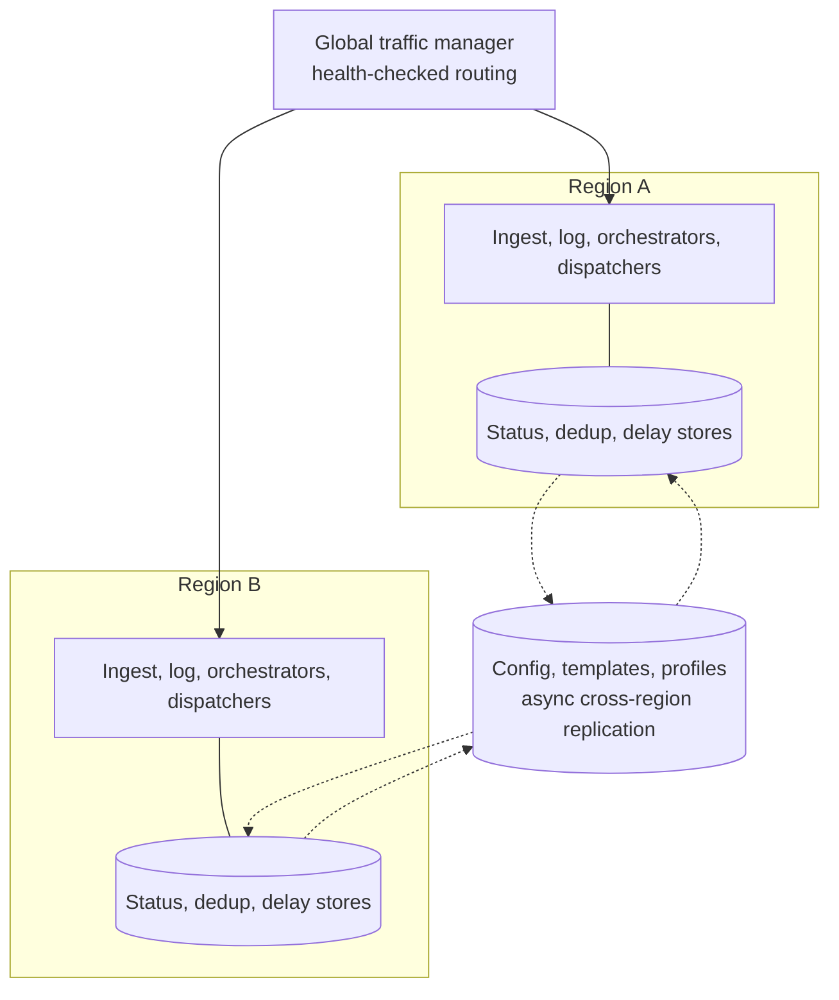

| Component               | Replication             | RPO            | RTO     | Failover behavior                                                             |
| ----------------------- | ----------------------- | -------------- | ------- | ----------------------------------------------------------------------------- |
| Ingest log              | 3 zones, sync in region | 0 in region    | seconds | Leader election, producers retry                                              |
| Ingest log, region loss | Mirrored to peer region | seconds        | minutes | Producers re-route, mirrored requests replayed in the peer                    |
| Status store            | Multi-region, async     | seconds        | minutes | Peer serves reads; late writes merged by the state machine                    |
| Dedup store             | Regional only           | not replicated | minutes | Cold in the peer: duplicates possible up to the TTL, bounded by provider keys |
| Config, templates       | Async, versioned        | seconds        | minutes | Last replicated version is used                                               |
| Delay store             | With the status store   | seconds        | minutes | Peer pollers take over due-time buckets                                       |

Region failover accepts a bounded duplicate risk for non-critical classes and prefers a duplicate OTP to a missing one.

---

# Part C: Low-level design

## 12. Domain model

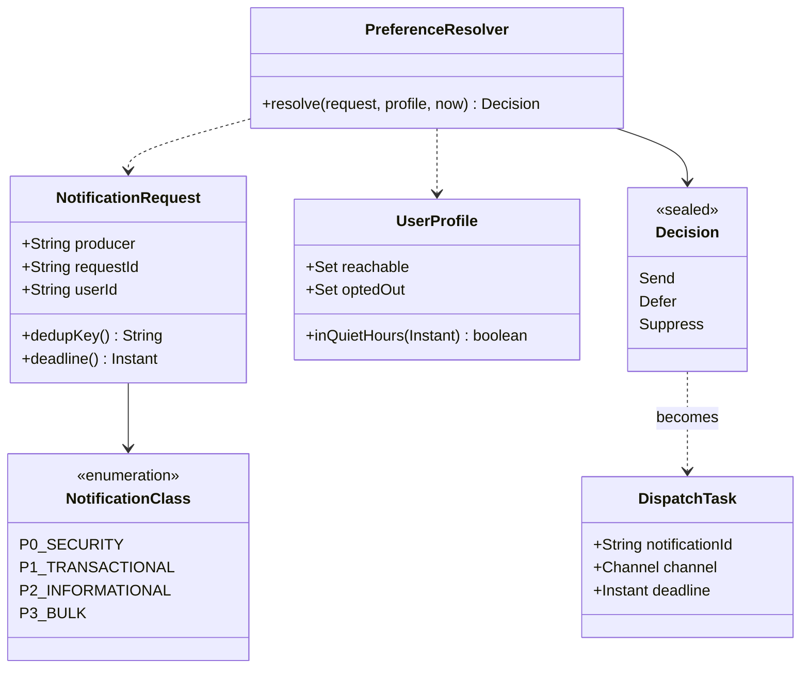

| Entity          | Identity                             | Lifecycle                                                     | Owner             |
| --------------- | ------------------------------------ | ------------------------------------------------------------- | ----------------- |
| Request         | `producer:requestId`                 | Immutable once accepted                                       | Ingest            |
| Notification    | UUID derived from the dedup key      | State machine (section 15)                                    | Orchestrator      |
| DispatchTask    | notification id plus channel         | Created per channel attempt chain, consumed once per delivery | Orchestrator      |
| DeliveryAttempt | notification id plus attempt number  | Append-only                                                   | Dispatcher        |
| UserProfile     | user id                              | Read model replicated from the users service                  | Users service     |
| Template        | template id plus version plus locale | Versioned, published, never edited in place                   | Template service  |
| Suppression     | channel plus address hash            | Added by bounces, complaints, STOP; removed on re-consent     | Receipt processor |

### 12.1 Java domain types (orchestration)

`Channel` is a four-value enum: `PUSH, EMAIL, SMS, WHATSAPP`.  
The class enum carries the policy switches of section 2, so policy lives in one place.

```java
package com.acme.notify;

import java.time.Duration;
import java.util.List;

/** Priority class. Each class owns a lane, a time-to-live and a set of policy switches. */
public enum NotificationClass {
    P0_SECURITY(Duration.ofMinutes(5), List.of(Channel.SMS, Channel.WHATSAPP, Channel.PUSH, Channel.EMAIL),
            true, true, false, "lane.p0"),
    P1_TRANSACTIONAL(Duration.ofHours(1), List.of(Channel.PUSH, Channel.EMAIL, Channel.SMS),
            true, false, false, "lane.p1"),
    P2_INFORMATIONAL(Duration.ofHours(24), List.of(Channel.PUSH, Channel.EMAIL),
            false, false, false, "lane.p2"),
    P3_BULK(Duration.ofHours(48), List.of(Channel.EMAIL, Channel.PUSH),
            false, false, true, "lane.p3");

    private final Duration ttl;
    private final List<Channel> defaultChain;
    private final boolean bypassQuietHours;
    private final boolean bypassChannelOptOut;
    private final boolean requiresMarketingConsent;
    private final String lane;

    NotificationClass(Duration ttl, List<Channel> defaultChain, boolean bypassQuietHours,
                      boolean bypassChannelOptOut, boolean requiresMarketingConsent, String lane) {
        this.ttl = ttl;
        this.defaultChain = defaultChain;
        this.bypassQuietHours = bypassQuietHours;
        this.bypassChannelOptOut = bypassChannelOptOut;
        this.requiresMarketingConsent = requiresMarketingConsent;
        this.lane = lane;
    }

    public Duration ttl() { return ttl; }
    public List<Channel> defaultChain() { return defaultChain; }
    public boolean bypassQuietHours() { return bypassQuietHours; }
    public boolean bypassChannelOptOut() { return bypassChannelOptOut; }
    public boolean requiresMarketingConsent() { return requiresMarketingConsent; }
    public String lane() { return lane; }
}
```

```java
package com.acme.notify;

import java.time.Instant;
import java.util.Map;
import java.util.Objects;

/**
 * What a producer service (orders, payment, users, inventory, catalog) asks for.
 * {@code requestId} is the producer-supplied idempotency key and is mandatory.
 */
public record NotificationRequest(
        String producer,
        String requestId,
        String userId,
        String eventType,
        NotificationClass notificationClass,
        String templateId,
        Map<String, String> params,
        Instant createdAt) {

    public NotificationRequest {
        requireText(producer, "producer");
        requireText(requestId, "requestId");
        requireText(userId, "userId");
        requireText(eventType, "eventType");
        requireText(templateId, "templateId");
        Objects.requireNonNull(notificationClass, "notificationClass");
        Objects.requireNonNull(createdAt, "createdAt");
        params = Map.copyOf(params == null ? Map.of() : params);
    }

    /** Scope of idempotency: one producer cannot collide with another. */
    public String dedupKey() { return producer + ":" + requestId; }

    /** After this instant sending is pointless (an OTP delivered after its expiry). */
    public Instant deadline() { return createdAt.plus(notificationClass.ttl()); }

    private static void requireText(String value, String field) {
        if (value == null || value.isBlank()) {
            throw new IllegalArgumentException(field + " must not be blank");
        }
    }
}
```

```java
package com.acme.notify;

import java.time.Instant;
import java.time.LocalDate;
import java.time.LocalTime;
import java.time.ZoneId;
import java.time.ZonedDateTime;
import java.util.EnumSet;
import java.util.Set;

/** Read model of a user's contact points and preferences, served from the profile cache. */
public record UserProfile(
        String userId,
        Set<Channel> reachable,
        Set<Channel> optedOut,
        boolean marketingConsent,
        ZoneId zone,
        LocalTime quietStart,
        LocalTime quietEnd,
        String locale) {

    /** Degraded profile used when the profile store is down and the class must not be blocked. */
    public static UserProfile assumeReachable(String userId) {
        return new UserProfile(userId, EnumSet.allOf(Channel.class), EnumSet.noneOf(Channel.class),
                false, ZoneId.of("UTC"), LocalTime.MIDNIGHT, LocalTime.MIDNIGHT, "en");
    }

    /** Equal start and end means quiet hours are disabled. Windows may wrap past midnight. */
    public boolean inQuietHours(Instant now) {
        if (quietStart.equals(quietEnd)) return false;
        LocalTime t = now.atZone(zone).toLocalTime();
        return quietStart.isBefore(quietEnd)
                ? !t.isBefore(quietStart) && t.isBefore(quietEnd)
                : !t.isBefore(quietStart) || t.isBefore(quietEnd);
    }

    /** First instant after {@code now} at which the quiet window ends. */
    public Instant quietHoursEnd(Instant now) {
        ZonedDateTime today = now.atZone(zone);
        LocalDate day = today.toLocalDate();
        ZonedDateTime candidate = day.atTime(quietEnd).atZone(zone);
        if (!candidate.toInstant().isAfter(now)) {
            candidate = day.plusDays(1).atTime(quietEnd).atZone(zone);
        }
        return candidate.toInstant();
    }
}
```

```java
package com.acme.notify;

import java.time.Instant;
import java.util.List;

/** Result of applying preferences and policy to one request. */
public sealed interface Decision {

    enum Reason { NO_CONSENT, NO_ELIGIBLE_CHANNEL, WOULD_EXPIRE }

    record Send(Channel channel, List<Channel> fallbacks) implements Decision { }

    /** Hold until {@code until} (end of quiet hours), then send as {@code then}. */
    record Defer(Instant until, Send then) implements Decision { }

    record Suppress(Reason reason) implements Decision { }
}
```

```java
package com.acme.notify;

import java.time.Instant;
import java.util.List;

/**
 * Message placed on a lane for the dispatcher.
 * It carries no contact data: the dispatcher resolves the destination from the contact cache, which keeps phone numbers and addresses out of the log.
 */
public record DispatchTask(
        String notificationId,
        String userId,
        NotificationClass notificationClass,
        Channel channel,
        List<Channel> fallbacks,
        String subject,
        String body,
        Instant notBefore,
        Instant deadline) { }
```

```java
package com.acme.notify;

import java.time.Instant;

/** What the orchestrator reports back to the ingest consumer for one request. */
public sealed interface Outcome {
    record Enqueued(String notificationId, Channel channel) implements Outcome { }
    record Deferred(String notificationId, Instant until) implements Outcome { }
    record Suppressed(Decision.Reason reason) implements Outcome { }
    record Duplicate() implements Outcome { }
    record Rejected(String why) implements Outcome { }
}
```

### 12.2 Rust domain types (dispatch)

`src/model.rs` mirrors the task and holds the per-lane constants the hot path needs.

```rust
#[derive(Clone, Copy, Debug, PartialEq, Eq, Hash)]
pub enum Channel {
    Push,
    Email,
    Sms,
    Whatsapp,
}

impl Channel {
    pub fn as_str(self) -> &'static str {
        match self {
            Channel::Push => "push",
            Channel::Email => "email",
            Channel::Sms => "sms",
            Channel::Whatsapp => "whatsapp",
        }
    }
}

/// One lane per priority class. Order matters: `P0` is the most urgent.
#[derive(Clone, Copy, Debug, PartialEq, Eq, Hash, PartialOrd, Ord)]
pub enum Lane {
    P0,
    P1,
    P2,
    P3,
}

impl Lane {
    pub const ALL: [Lane; 4] = [Lane::P0, Lane::P1, Lane::P2, Lane::P3];

    pub fn index(self) -> usize {
        self as usize
    }

    /// Attempts on one channel before failing over to the next channel in the chain.
    pub fn max_attempts_per_channel(self) -> u32 {
        match self {
            Lane::P0 => 3,
            Lane::P1 => 5,
            Lane::P2 => 5,
            Lane::P3 => 3,
        }
    }

    /// (base, cap) of the retry backoff in milliseconds.
    pub fn backoff_ms(self) -> (u64, u64) {
        match self {
            Lane::P0 => (200, 5_000),
            Lane::P1 => (1_000, 300_000),
            Lane::P2 => (5_000, 1_800_000),
            Lane::P3 => (30_000, 3_600_000),
        }
    }
}

/// A rendered message ready to hand to a provider. Contact details are resolved by the caller.
#[derive(Clone, Debug, PartialEq, Eq)]
pub struct DispatchTask {
    pub notification_id: String,
    pub user_id: String,
    pub lane: Lane,
    pub channel: Channel,
    pub fallbacks: Vec<Channel>,
    pub subject: String,
    pub body: String,
    pub not_before_ms: u64,
    pub deadline_ms: u64,
    /// Attempts already made on the current channel.
    pub attempt: u32,
}
```

## 13. API and event contracts

| Method and path                      | Caller             | Purpose                                          | Success                       |
| ------------------------------------ | ------------------ | ------------------------------------------------ | ----------------------------- |
| `POST /v1/notifications`             | producers          | Submit one request                               | 202 with id; 200 on duplicate |
| `POST /v1/notifications:batch`       | producers          | Submit up to 500 requests, per-item results      | 207 multi-status              |
| `GET /v1/notifications/{id}`         | producers, support | Current state and attempt history                | 200                           |
| `PUT /v1/users/{userId}/preferences` | users service      | Replace channel, consent and quiet-hour settings | 204                           |
| `POST /v1/receipts/{provider}`       | providers          | Signed delivery, bounce and complaint callbacks  | 200 immediately               |
| `POST /v1/campaigns`                 | marketing          | Create, pause, resume or cancel a campaign       | 201                           |

Submit request:

```json
{
  "requestId": "01J9ZQ8X-otp-4412",
  "userId": "u_8841220",
  "eventType": "otp.requested",
  "class": "P0_SECURITY",
  "templateId": "otp_login",
  "params": { "code": "482913", "ttlMinutes": "5" },
  "createdAt": "2026-10-15T09:12:44.120Z"
}
```

Response: `202 {"notificationId": "3f2b8c1e-5a0d-3c1e-9b7a-0d4e6f1a2b3c", "state": "ACCEPTED"}`.

| Field      | Type     | Required | Rule                                                                                    |
| ---------- | -------- | -------- | --------------------------------------------------------------------------------------- |
| requestId  | string   | yes      | Producer-unique idempotency key; also sent as `Idempotency-Key`; at most 128 characters |
| userId     | string   | yes      | Platform user id. Contact details are never accepted from producers                     |
| eventType  | string   | yes      | Registered for the producer; selects rule, template and channel chain                   |
| class      | enum     | yes      | Must be allowed for the producer; P0 restricted to an allowlist                         |
| templateId | string   | yes      | Must exist and be published                                                             |
| params     | map      | no       | String values, at most 8 KB total; every template placeholder must be present           |
| createdAt  | RFC 3339 | yes      | Business time of the event. The deadline is `createdAt + class TTL`                     |

| Status | Meaning                                           | Producer action                          |
| ------ | ------------------------------------------------- | ---------------------------------------- |
| 200    | Duplicate: same `requestId` and same body         | Use the returned id                      |
| 400    | Malformed body or field                           | Fix, do not retry                        |
| 401    | Unknown or invalid credentials                    | Fix credentials                          |
| 403    | Class or event type not allowed for this producer | Request access                           |
| 409    | `requestId` reused with a different body          | Fix the key generation                   |
| 422    | Unknown template or missing placeholder           | Fix the template or params, do not retry |
| 429    | Producer quota exceeded, `Retry-After` set        | Back off                                 |
| 503    | Log temporarily unavailable, `Retry-After` set    | Retry with the same key                  |

Log message envelope (value is the request or task, headers carry routing and tracing):

```json
{
  "headers": { "producer": "users", "requestId": "01J9ZQ8X-otp-4412", "class": "P0_SECURITY",
               "schemaVersion": "3", "traceparent": "00-4bf92f35...-01" },
  "key": "u_8841220",
  "value": { "notificationId": "3f2b8c1e-...", "channel": "SMS", "fallbacks": ["PUSH", "EMAIL"],
             "subject": "", "body": "Your code is 482913", "notBefore": "2026-10-15T09:12:44.150Z",
             "deadline": "2026-10-15T09:17:44.120Z", "attempt": 0 }
}
```

Normalized receipt event (produced by the callback endpoint after signature checks):

```json
{
    "provider": "sms-a",
    "providerMessageId": "SM9f31",
    "status": "DELIVERED",
    "reason": null,
    "occurredAt": "2026-10-15T09:12:46.900Z",
    "channel": "SMS"
}
```

Receipt statuses: `DELIVERED`, `READ`, `FAILED`, `BOUNCED_HARD`, `BOUNCED_SOFT`, `COMPLAINED`, `TOKEN_INVALID`.

## 14. Data model

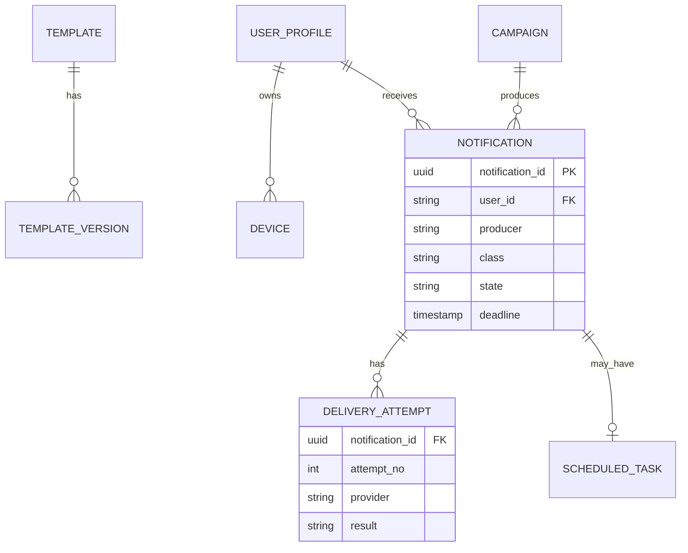

Status and scheduling (wide-column store, queries known in advance):

```sql
CREATE TABLE notification_by_id (
  notification_id uuid PRIMARY KEY,
  user_id text, producer text, event_type text, class text, channel text,
  state text, attempts int, last_error text,
  created_at timestamp, deadline timestamp, updated_at timestamp
) WITH default_time_to_live = 1209600;                      -- 14 days hot

CREATE TABLE notification_by_user (
  user_id text, created_at timestamp, notification_id uuid, state text, event_type text,
  PRIMARY KEY ((user_id), created_at, notification_id)
) WITH CLUSTERING ORDER BY (created_at DESC) AND default_time_to_live = 1209600;

CREATE TABLE delivery_attempt (
  notification_id uuid, attempt_no int, channel text, provider text,
  provider_message_id text, result text, at timestamp,
  PRIMARY KEY ((notification_id), attempt_no)
);

CREATE TABLE scheduled_task (                                -- delay store
  due_bucket bigint, shard int, due_at timestamp, notification_id uuid, payload blob,
  PRIMARY KEY ((due_bucket, shard), due_at, notification_id)
);                                                           -- bucket = epoch minute, shard = hash(id) mod 16

CREATE TABLE suppression (
  channel text, address_hash blob, reason text, added_at timestamp,
  PRIMARY KEY ((channel, address_hash))
);
```

Configuration (relational store, low write rate):

```sql
CREATE TABLE template_version (
  template_id text, version int, locale text, channel text, subject text, body text,
  status text CHECK (status IN ('DRAFT','PUBLISHED','RETIRED')),
  PRIMARY KEY (template_id, version, locale, channel)
);
```

| Store                  | Key design                               | Hot keys and mitigation                      | TTL and retention             |
| ---------------------- | ---------------------------------------- | -------------------------------------------- | ----------------------------- |
| `notification_by_id`   | partition = notification id              | None: uniform UUIDs                          | 14 days hot, then archived    |
| `notification_by_user` | partition = user id                      | Heavy users bounded by frequency caps        | 14 days                       |
| `scheduled_task`       | partition = (minute bucket, shard of 16) | A busy minute spreads over 16 shards         | Deleted on release            |
| Dedup (Redis)          | `dedup:{producer}:{requestId}` to id     | Hash slots spread by key                     | 48 hours                      |
| Frequency cap (Redis)  | `cap:{userId}:{class}:{window}`          | One user, a few keys                         | Window length                 |
| Profile cache (Redis)  | `profile:{userId}` hash                  | L1 cache, 60 s TTL, for non-critical classes | 10 min, invalidated on change |
| Suppression            | `(channel, address_hash)`                | None                                         | Until re-consent              |

## 15. Notification state machine

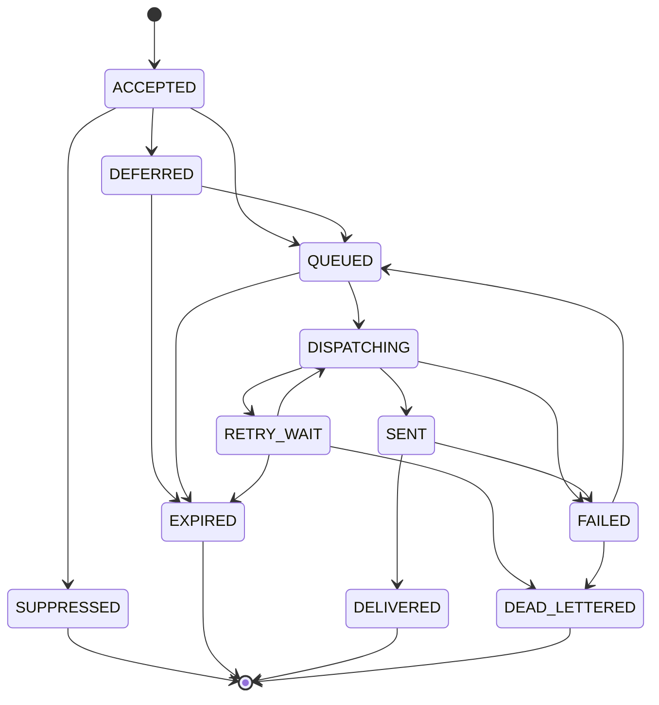

| Transition                     | Trigger                                                              | Written by           |
| ------------------------------ | -------------------------------------------------------------------- | -------------------- |
| ACCEPTED to SUPPRESSED         | No consent, no eligible channel, or deferral would pass the deadline | Orchestrator         |
| ACCEPTED to DEFERRED           | Quiet hours or producer `notBefore`                                  | Orchestrator         |
| ACCEPTED or DEFERRED to QUEUED | Task durably published to a dispatch topic                           | Orchestrator, poller |
| QUEUED to DISPATCHING          | Worker picks the task                                                | Dispatcher           |
| DISPATCHING to SENT            | Provider accepted (`DispatchResult::Sent`)                           | Dispatcher           |
| DISPATCHING to RETRY_WAIT      | Transient failure, throttle or open breaker (`Retry`)                | Dispatcher           |
| DISPATCHING to FAILED          | Permanent rejection or attempt budget spent on this channel          | Dispatcher           |
| FAILED to QUEUED               | Next channel in the chain (`Failover`)                               | Dispatcher           |
| FAILED to DEAD_LETTERED        | No channel left (`DeadLetter`)                                       | Dispatcher           |
| any waiting state to EXPIRED   | Deadline passed (`Expired`)                                          | Dispatcher, poller   |
| SENT to DELIVERED or FAILED    | Provider receipt or bounce                                           | Receipt processor    |

Status writes are conditional updates (`UPDATE ... IF state IN (allowed predecessors)`), so concurrent and replayed writers cannot move a notification backward.  
Writing the current state again is a no-op.  

```java
package com.acme.notify;

import java.util.EnumMap;
import java.util.EnumSet;
import java.util.Map;
import java.util.Set;

/** Lifecycle of one notification. Illegal transitions are rejected, never silently applied. */
public enum NotificationState {
    ACCEPTED, SUPPRESSED, DEFERRED, QUEUED, DISPATCHING, RETRY_WAIT, SENT, DELIVERED, FAILED, EXPIRED,
    DEAD_LETTERED;

    private static final Map<NotificationState, Set<NotificationState>> NEXT = new EnumMap<>(NotificationState.class);

    static {
        NEXT.put(ACCEPTED, EnumSet.of(SUPPRESSED, DEFERRED, QUEUED));
        NEXT.put(DEFERRED, EnumSet.of(QUEUED, EXPIRED));
        NEXT.put(QUEUED, EnumSet.of(DISPATCHING, EXPIRED));
        NEXT.put(DISPATCHING, EnumSet.of(SENT, RETRY_WAIT, FAILED));
        NEXT.put(RETRY_WAIT, EnumSet.of(DISPATCHING, EXPIRED, DEAD_LETTERED));
        NEXT.put(SENT, EnumSet.of(DELIVERED, FAILED));
        NEXT.put(FAILED, EnumSet.of(QUEUED, DEAD_LETTERED));
    }

    public boolean canMoveTo(NotificationState next) {
        return NEXT.getOrDefault(this, EnumSet.noneOf(NotificationState.class)).contains(next);
    }

    public boolean isTerminal() {
        return !NEXT.containsKey(this);
    }
}
```

## 16. Component internals

### 16.1 Ingest API

| Step | Action                                                                                       | Failure handling                                 |
| ---- | -------------------------------------------------------------------------------------------- | ------------------------------------------------ |
| 1    | Authenticate producer, check class and event-type allowlist, apply per-producer token bucket | 401, 403, 429                                    |
| 2    | Validate schema and field limits; reject unknown template early (cached lookup)              | 400, 422                                         |
| 3    | Compute the lane from the class and the key from `userId`                                    | n/a                                              |
| 4    | Append to `ingest.{lane}` with `acks=all`, idempotent producer, linger 5 ms for batching     | 503 with `Retry-After` when the append times out |
| 5    | Return 202 with the derived notification id                                                  | n/a                                              |

The ingest tier performs no preference or provider work, so its latency is one validation and one append.

### 16.2 Orchestrator (Java)

Stages and early exits of `OrchestratorPipeline.process`:

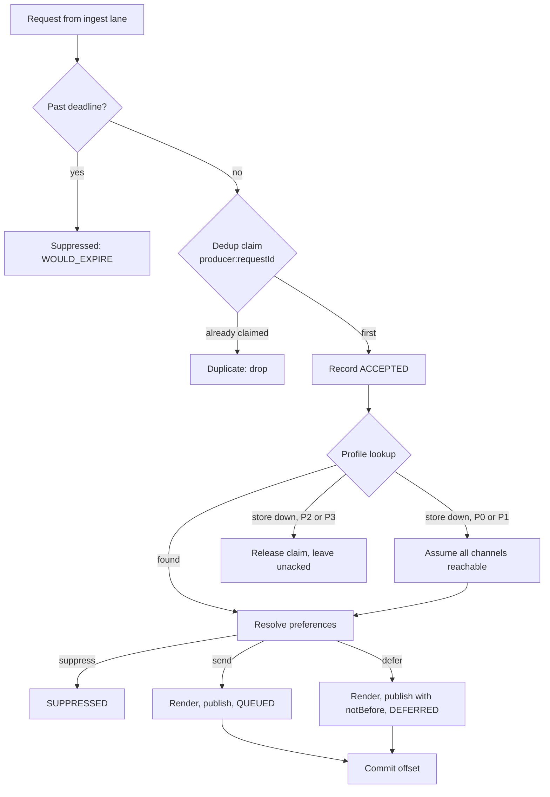

Ports (the orchestrator's I/O boundary) isolate the pure policy from infrastructure:

```java
package com.acme.notify;

import java.time.Duration;
import java.util.Map;
import java.util.Optional;

/** Outbound ports of the orchestrator. Production adapters: Redis, the profile cache, Kafka, the status store. */
@SuppressWarnings("serial")
public final class Ports {

    private Ports() { }

    public interface IdempotencyStore {
        /** Atomically claim a key. True when this caller is the first, false for a duplicate. */
        boolean claim(String key, Duration ttl);

        /** Give a claim back so that a producer retry can be processed after an infrastructure failure. */
        void release(String key);
    }

    public interface ProfileStore {
        /** @throws ProfileUnavailableException when the store cannot answer */
        Optional<UserProfile> find(String userId);
    }

    public interface TemplateRenderer {
        record Rendered(String subject, String body) { }

        /** @throws RenderException when the template is unknown or a placeholder has no value */
        Rendered render(String templateId, String locale, Map<String, String> params);
    }

    public interface LaneProducer {
        /** @throws LaneUnavailableException when the log cannot durably accept the message */
        void publish(DispatchTask task);
    }

    public interface StatusStore {
        /** Conditional update: rejects transitions the state machine forbids, treats the same state as a no-op. */
        void record(String notificationId, NotificationState next);
    }

    public static class ProfileUnavailableException extends RuntimeException {
        public ProfileUnavailableException(String message) { super(message); }
    }

    public static class RenderException extends RuntimeException {
        public RenderException(String message) { super(message); }
    }

    public static class LaneUnavailableException extends RuntimeException {
        public LaneUnavailableException(String message) { super(message); }
    }
}
```

`PreferenceResolver` is a pure function: no I/O, deterministic, evaluated at send time.

```java
package com.acme.notify;

import java.time.Instant;
import java.util.List;
import java.util.Map;

/**
 * Pure function of (request, profile, time). No I/O, so it is trivially testable and can be
 * evaluated at send time with fresh preferences, which is what unsubscribe compliance requires.
 */
public final class PreferenceResolver {

    private final Map<String, List<Channel>> eventChains;

    /** @param eventChains per-event channel order overriding the class default */
    public PreferenceResolver(Map<String, List<Channel>> eventChains) {
        this.eventChains = Map.copyOf(eventChains);
    }

    public Decision resolve(NotificationRequest req, UserProfile profile, Instant now) {
        NotificationClass cls = req.notificationClass();

        if (cls.requiresMarketingConsent() && !profile.marketingConsent()) {
            return new Decision.Suppress(Decision.Reason.NO_CONSENT);
        }

        List<Channel> chain = eventChains.getOrDefault(req.eventType(), cls.defaultChain());
        List<Channel> eligible = chain.stream()
                .filter(profile.reachable()::contains)
                .filter(c -> cls.bypassChannelOptOut() || !profile.optedOut().contains(c))
                .toList();
        if (eligible.isEmpty()) {
            return new Decision.Suppress(Decision.Reason.NO_ELIGIBLE_CHANNEL);
        }

        Decision.Send send = new Decision.Send(eligible.get(0), eligible.subList(1, eligible.size()));
        if (!cls.bypassQuietHours() && profile.inQuietHours(now)) {
            return new Decision.Defer(profile.quietHoursEnd(now), send);
        }
        return send;
    }
}
```

```java
package com.acme.notify;

import com.acme.notify.Ports.IdempotencyStore;
import com.acme.notify.Ports.LaneProducer;
import com.acme.notify.Ports.LaneUnavailableException;
import com.acme.notify.Ports.ProfileStore;
import com.acme.notify.Ports.ProfileUnavailableException;
import com.acme.notify.Ports.RenderException;
import com.acme.notify.Ports.StatusStore;
import com.acme.notify.Ports.TemplateRenderer;

import java.nio.charset.StandardCharsets;
import java.time.Clock;
import java.time.Duration;
import java.time.Instant;
import java.util.UUID;

/**
 * The orchestrator's per-request pipeline:
 * deadline check, dedup, profile, preferences, render, enqueue.
 * Stages exit early, and every exit leaves a status record.
 */
public final class OrchestratorPipeline {

    private static final Duration DEDUP_TTL = Duration.ofHours(48);

    private final IdempotencyStore dedup;
    private final ProfileStore profiles;
    private final PreferenceResolver resolver;
    private final TemplateRenderer renderer;
    private final LaneProducer lanes;
    private final StatusStore status;
    private final Clock clock;

    OrchestratorPipeline(IdempotencyStore dedup, ProfileStore profiles, PreferenceResolver resolver,
                         TemplateRenderer renderer, LaneProducer lanes, StatusStore status, Clock clock) {
        this.dedup = dedup;
        this.profiles = profiles;
        this.resolver = resolver;
        this.renderer = renderer;
        this.lanes = lanes;
        this.status = status;
        this.clock = clock;
    }

    /**
     * @throws LaneUnavailableException    the log refused the message
     * @throws ProfileUnavailableException the profile store is down and the class may wait
     *         Both release the dedup claim first, so the ingest consumer leaves the message
     *         unacknowledged and it is redelivered (at-least-once).
     */
    public Outcome process(NotificationRequest req) {
        Instant now = clock.instant();

        if (!now.isBefore(req.deadline())) {
            return new Outcome.Suppressed(Decision.Reason.WOULD_EXPIRE);
        }
        if (!dedup.claim(req.dedupKey(), DEDUP_TTL)) {
            return new Outcome.Duplicate();
        }

        // Stable across redeliveries of the same request, so status writes stay idempotent.
        String id = UUID.nameUUIDFromBytes(req.dedupKey().getBytes(StandardCharsets.UTF_8)).toString();
        try {
            status.record(id, NotificationState.ACCEPTED);

            UserProfile profile = loadProfile(req);
            if (profile == null) {
                status.record(id, NotificationState.SUPPRESSED);
                return new Outcome.Suppressed(Decision.Reason.NO_ELIGIBLE_CHANNEL);
            }

            return switch (resolver.resolve(req, profile, now)) {
                case Decision.Suppress s -> {
                    status.record(id, NotificationState.SUPPRESSED);
                    yield new Outcome.Suppressed(s.reason());
                }
                case Decision.Defer d when !d.until().isBefore(req.deadline()) -> {
                    status.record(id, NotificationState.SUPPRESSED);
                    yield new Outcome.Suppressed(Decision.Reason.WOULD_EXPIRE);
                }
                case Decision.Defer d -> enqueue(id, req, profile, d.then(), d.until(), NotificationState.DEFERRED);
                case Decision.Send s -> enqueue(id, req, profile, s, now, NotificationState.QUEUED);
            };
        } catch (LaneUnavailableException | ProfileUnavailableException e) {
            dedup.release(req.dedupKey());
            throw e;
        }
    }

    /** Critical classes degrade to "assume reachable" instead of waiting for the profile store. */
    private UserProfile loadProfile(NotificationRequest req) {
        try {
            return profiles.find(req.userId()).orElse(null);
        } catch (ProfileUnavailableException down) {
            NotificationClass cls = req.notificationClass();
            if (cls == NotificationClass.P0_SECURITY || cls == NotificationClass.P1_TRANSACTIONAL) {
                return UserProfile.assumeReachable(req.userId());
            }
            throw down;
        }
    }

    private Outcome enqueue(String id, NotificationRequest req, UserProfile profile, Decision.Send send,
                            Instant notBefore, NotificationState next) {
        TemplateRenderer.Rendered text;
        try {
            text = renderer.render(req.templateId(), profile.locale(), req.params());
        } catch (RenderException e) {
            return new Outcome.Rejected("render failed: " + e.getMessage()); // producer bug: never retried
        }
        lanes.publish(new DispatchTask(id, req.userId(), req.notificationClass(), send.channel(), send.fallbacks(),
                text.subject(), text.body(), notBefore, req.deadline()));
        status.record(id, next);
        return next == NotificationState.DEFERRED
                ? new Outcome.Deferred(id, notBefore)
                : new Outcome.Enqueued(id, send.channel());
    }
}
```

| Design point                             | Reason                                                                                                       |
| ---------------------------------------- | ------------------------------------------------------------------------------------------------------------ |
| Notification id derived from dedup key   | Redelivery produces the same id, so status writes and provider idempotency keys stay stable                  |
| Claim released on infrastructure failure | A producer retry must be processed, not dropped as a duplicate of a message that never left the orchestrator |
| Render failure returns `Rejected`        | A bad template is a producer bug; retrying cannot fix it                                                     |
| Profile outage degrades by class         | OTP and payment messages must not wait for a cache; informational messages can                               |
| Preferences resolved at send time        | An unsubscribe made one second ago is honored                                                                |

### 16.3 Template service

Templates are versioned and immutable once published. Rendering substitutes `{{name}}` placeholders, applies locale fallback (`fr-CA` to `fr` to default), and fails fast on a missing placeholder.  
Compiled templates are cached in memory keyed by `(templateId, version, locale, channel)`.  
Email bodies above 8 KB are written to blob storage and the task carries a reference (claim-check).  
Channel constraints are enforced at publish time: SMS segment length, WhatsApp pre-approved template ids, push payload size.

### 16.4 Dispatcher (Rust)

A worker consumes one dispatch topic partition at a time, resolves the destination from the contact cache, and calls `Dispatcher::handle`.  
The function is synchronous and pure with respect to time: it takes `now_ms`, returns a `DispatchResult`, and performs no I/O except the provider call.  
The surrounding worker owns offsets, the delay queue and republishing.

| `DispatchResult` | Worker action                                                                                         | State written              |
| ---------------- | ----------------------------------------------------------------------------------------------------- | -------------------------- |
| `Sent`           | Record the attempt and receipt id, advance the commit watermark                                       | SENT                       |
| `Retry`          | Delay at most 30 s in memory, otherwise write to the delay store; advance the watermark after handoff | RETRY_WAIT                 |
| `Failover`       | Publish the task to the next channel's dispatch topic, then advance the watermark                     | FAILED, then QUEUED        |
| `Expired`        | Drop, record                                                                                          | EXPIRED                    |
| `DeadLetter`     | Publish to `dlq.dispatch` with the reason                                                             | FAILED, then DEAD_LETTERED |

```rust
use std::collections::HashMap;
use std::sync::Mutex;

use crate::model::{Channel, DispatchTask};
use crate::provider::{OutboundMessage, PoolOutcome, ProviderPool, ProviderReceipt};

/// What the worker does next with a task. The worker owns the I/O: it commits offsets,
/// pushes `Retry` into the delay queue, re-publishes `Failover` to the channel's lane, and so on.
#[derive(Debug, PartialEq, Eq)]
pub enum DispatchResult {
    Sent { channel: Channel, receipt: ProviderReceipt },
    /// Same channel, one more attempt after `delay_ms`.
    Retry { task: DispatchTask, delay_ms: u64 },
    /// This channel is spent. The task now targets the next channel in the chain.
    Failover { task: DispatchTask },
    Expired,
    DeadLetter { reason: String },
}

/// Small deterministic generator for backoff jitter. Not for anything security related.
pub struct XorShift64(u64);

impl XorShift64 {
    pub fn new(seed: u64) -> Self {
        Self(seed.max(1))
    }

    pub fn next_u64(&mut self) -> u64 {
        let mut x = self.0;
        x ^= x << 13;
        x ^= x >> 7;
        x ^= x << 17;
        self.0 = x;
        x
    }
}

pub struct Dispatcher {
    pools: HashMap<Channel, ProviderPool>,
    rng: Mutex<XorShift64>,
}

impl Dispatcher {
    pub fn new(pools: HashMap<Channel, ProviderPool>, seed: u64) -> Self {
        Self { pools, rng: Mutex::new(XorShift64::new(seed)) }
    }

    pub fn handle(&self, task: DispatchTask, now_ms: u64) -> DispatchResult {
        if now_ms >= task.deadline_ms {
            return DispatchResult::Expired;
        }
        let Some(pool) = self.pools.get(&task.channel) else {
            return Self::next_channel(task, "no provider pool for channel".to_string());
        };

        // Same key on every retry of one channel, a different key per channel.
        let msg = OutboundMessage {
            idempotency_key: format!("{}:{}", task.notification_id, task.channel.as_str()),
            user_id: &task.user_id,
            subject: &task.subject,
            body: &task.body,
        };
        match pool.send(&msg, now_ms) {
            PoolOutcome::Sent(receipt) => DispatchResult::Sent { channel: task.channel, receipt },
            PoolOutcome::Rejected(why) => Self::next_channel(task, why),
            PoolOutcome::Retry { after_ms } => self.retry(task, after_ms, now_ms),
            PoolOutcome::Unavailable => self.retry(task, 0, now_ms),
        }
    }

    fn retry(&self, mut task: DispatchTask, hint_ms: u64, now_ms: u64) -> DispatchResult {
        task.attempt += 1;
        if task.attempt >= task.lane.max_attempts_per_channel() {
            return Self::next_channel(task, "attempt budget spent on the last channel".to_string());
        }
        let delay_ms = hint_ms.max(self.backoff_ms(&task));
        if now_ms.saturating_add(delay_ms) >= task.deadline_ms {
            return Self::next_channel(task, "retry would land after the deadline".to_string());
        }
        DispatchResult::Retry { task, delay_ms }
    }

    /// Exponential backoff with equal jitter: half fixed, half random.
    fn backoff_ms(&self, task: &DispatchTask) -> u64 {
        let (base, cap) = task.lane.backoff_ms();
        let ceiling = cap.min(base.saturating_mul(1u64 << (task.attempt - 1).min(20)));
        let half = ceiling / 2;
        let jitter = self.rng.lock().unwrap_or_else(|p| p.into_inner()).next_u64() % (half + 1);
        half + jitter
    }

    fn next_channel(task: DispatchTask, reason: String) -> DispatchResult {
        match task.fallbacks.split_first() {
            Some((next, rest)) => {
                let (channel, fallbacks) = (*next, rest.to_vec());
                DispatchResult::Failover { task: DispatchTask { channel, fallbacks, attempt: 0, ..task } }
            }
            None => DispatchResult::DeadLetter { reason },
        }
    }
}
```

The provider adapter layer turns a vendor SDK into the `Provider` trait and wraps each provider with its own breaker and quota bucket.  
A `ProviderPool` is the ordered provider list for one channel.

```rust
use std::sync::Arc;

use crate::breaker::CircuitBreaker;
use crate::bucket::TokenBucket;

#[derive(Clone, Debug, PartialEq, Eq)]
pub enum SendError {
    /// Provider-side or network trouble. Counts against the provider's health.
    Transient(String),
    /// The message itself is unacceptable (bad number, hard bounce). Retrying will not help.
    Permanent(String),
    /// The provider asked us to slow down. Not a health failure.
    RateLimited { retry_after_ms: u64 },
}

#[derive(Clone, Debug)]
pub struct OutboundMessage<'a> {
    /// Stable across retries on one channel, so providers that support it can deduplicate.
    pub idempotency_key: String,
    pub user_id: &'a str,
    pub subject: &'a str,
    pub body: &'a str,
}

#[derive(Clone, Debug, PartialEq, Eq)]
pub struct ProviderReceipt {
    pub provider: &'static str,
    pub provider_message_id: String,
}

/// Adapter for one external provider (an SMS aggregator, an email API, APNs/FCM, a WhatsApp BSP).
pub trait Provider: Send + Sync {
    fn name(&self) -> &'static str;
    fn send(&self, msg: &OutboundMessage<'_>) -> Result<ProviderReceipt, SendError>;
}

/// A provider with its own quota and its own health state.
pub struct ProviderSlot {
    pub provider: Arc<dyn Provider>,
    pub breaker: CircuitBreaker,
    pub bucket: TokenBucket,
}

#[derive(Debug, PartialEq, Eq)]
pub enum PoolOutcome {
    Sent(ProviderReceipt),
    /// Nothing could take the message now. Try again after at least this long.
    Retry { after_ms: u64 },
    /// A provider rejected the message permanently.
    Rejected(String),
    /// Every provider is blocked by its breaker.
    Unavailable,
}

/// Providers for one channel in preference order.
pub struct ProviderPool {
    slots: Vec<ProviderSlot>,
}

impl ProviderPool {
    pub fn new(slots: Vec<ProviderSlot>) -> Self {
        Self { slots }
    }

    /// Walk the providers in order. A throttled, rate-limited or failing provider is skipped, not waited on:
    /// failing over to the next provider is cheaper than queueing behind a slow one.
    pub fn send(&self, msg: &OutboundMessage<'_>, now_ms: u64) -> PoolOutcome {
        let mut soonest_retry: Option<u64> = None;
        let mut note = |ms: u64| soonest_retry = Some(soonest_retry.map_or(ms, |cur| cur.min(ms)));

        for slot in &self.slots {
            if !slot.breaker.allow(now_ms) {
                continue;
            }
            if let Err(wait_ms) = slot.bucket.try_acquire(1.0, now_ms) {
                note(wait_ms);
                continue;
            }
            match slot.provider.send(msg) {
                Ok(receipt) => {
                    slot.breaker.on_success();
                    return PoolOutcome::Sent(receipt);
                }
                Err(SendError::Permanent(why)) => {
                    slot.breaker.on_success(); // the provider answered correctly: it is healthy
                    return PoolOutcome::Rejected(why);
                }
                Err(SendError::RateLimited { retry_after_ms }) => note(retry_after_ms),
                Err(SendError::Transient(_)) => slot.breaker.on_failure(now_ms),
            }
        }
        match soonest_retry {
            Some(after_ms) => PoolOutcome::Retry { after_ms },
            None => PoolOutcome::Unavailable,
        }
    }
}
```

### 16.5 Delay queue and delay store

`DelayQueue` is the in-memory heap for short waits.  
The durable path for long waits is the `scheduled_task` table drained by a poller that scans the current and previous minute buckets across all 16 shards every second and re-publishes due tasks.

```rust
use std::cmp::Reverse;
use std::collections::{BinaryHeap, HashMap};

/// Min-heap of items keyed by due time. Holds retries and deferred sends until they are due.
/// A hashed timing wheel is the upgrade path if pushes dominate; the interface would not change.
pub struct DelayQueue<T> {
    heap: BinaryHeap<Reverse<(u64, u64)>>, // (due_ms, seq): seq keeps FIFO order among equal due times
    items: HashMap<u64, T>,
    seq: u64,
}

impl<T> Default for DelayQueue<T> {
    fn default() -> Self {
        Self { heap: BinaryHeap::new(), items: HashMap::new(), seq: 0 }
    }
}

impl<T> DelayQueue<T> {
    pub fn push(&mut self, item: T, due_ms: u64) {
        self.seq += 1;
        self.heap.push(Reverse((due_ms, self.seq)));
        self.items.insert(self.seq, item);
    }

    /// Remove and return the earliest item that is due at `now_ms`.
    pub fn pop_due(&mut self, now_ms: u64) -> Option<T> {
        let Reverse((due_ms, seq)) = *self.heap.peek()?;
        if due_ms > now_ms {
            return None;
        }
        self.heap.pop();
        self.items.remove(&seq)
    }

    /// When the poller should wake up next.
    pub fn next_due_ms(&self) -> Option<u64> {
        self.heap.peek().map(|Reverse((due_ms, _))| *due_ms)
    }

    pub fn len(&self) -> usize {
        self.heap.len()
    }

    pub fn is_empty(&self) -> bool {
        self.heap.is_empty()
    }
}
```

### 16.6 Receipt processor, DLQ and replay, device registry

| Component         | Behavior                                                                                                                 |
| ----------------- | ------------------------------------------------------------------------------------------------------------------------ |
| Receipt processor | Maps provider id to notification id, conditional status update, adds hard bounces, complaints, bad tokens to suppression |
| DLQ and replay    | `dlq.dispatch` keeps task and reason for 14 days; a replay tool re-publishes selected tasks within the deadline          |
| Device registry   | Tokens per user and device; `TOKEN_INVALID` deletes the token; unseen for 60 days pruned; one push per device            |
| Campaign service  | Audience snapshot, chunking, per-campaign token bucket, pause and cancel flag (section 6.4)                              |

## 17. Algorithms and policies

### 17.1 Idempotency and deduplication

1. Key = `producer:requestId`. The orchestrator claims it with `SET key id NX PX 48h`. A failed claim means duplicate.
2. If the pipeline fails after the claim for an infrastructure reason, the claim is released before the exception propagates, and the message is redelivered.
3. The provider call carries `notificationId:channel`, stable across retries and distinct across channels.
4. Status writes are conditional on the state machine.

### 17.2 Retry with equal jitter

`delay = ceiling/2 + random(0, ceiling/2)` where `ceiling = min(cap, base x 2^(attempt-1))`.  
Half the delay is fixed so retries cannot collapse to zero; half is random so a provider recovering from an outage is not hit by a synchronized wave.  
A retry is skipped if it would land after the deadline. After the per-channel attempt budget the task fails over to the next channel.

```java
package com.acme.notify;

import java.time.Duration;
import java.time.Instant;
import java.util.Optional;
import java.util.random.RandomGenerator;

/**
 * Exponential backoff with equal jitter, bounded by an attempt budget per channel and by the message deadline.
 * Shared by every JVM-side consumer that retries: ingest redelivery, delay-store poller, producer callbacks.
 * The Rust dispatcher applies the same constants on the provider call path.
 */
public record RetryPolicy(int maxAttempts, Duration base, Duration cap) {

    public static RetryPolicy forClass(NotificationClass cls) {
        return switch (cls) {
            case P0_SECURITY -> new RetryPolicy(3, Duration.ofMillis(200), Duration.ofSeconds(5));
            case P1_TRANSACTIONAL -> new RetryPolicy(5, Duration.ofSeconds(1), Duration.ofMinutes(5));
            case P2_INFORMATIONAL -> new RetryPolicy(5, Duration.ofSeconds(5), Duration.ofMinutes(30));
            case P3_BULK -> new RetryPolicy(3, Duration.ofSeconds(30), Duration.ofHours(1));
        };
    }

    /**
     * @param attemptsMade attempts already made, at least 1
     * @return the wait before the next attempt, or empty when the budget or the deadline is exhausted
     */
    public Optional<Duration> nextDelay(int attemptsMade, Instant deadline, Instant now, RandomGenerator rng) {
        if (attemptsMade < 1 || attemptsMade >= maxAttempts) return Optional.empty();
        long exp = Math.min(attemptsMade - 1, 30);
        long ceilingMs = Math.min(cap.toMillis(), base.toMillis() * (1L << exp));
        long half = ceilingMs / 2;
        long delayMs = half + (half == 0 ? 0 : rng.nextLong(half + 1));
        Instant at = now.plusMillis(delayMs);
        return at.isAfter(deadline) ? Optional.empty() : Optional.of(Duration.ofMillis(delayMs));
    }
}
```

### 17.3 Throttling against provider quotas

A token bucket per provider enforces the quota locally.  
A throttled provider is skipped in favor of the next, not waited on.  
Each worker holds a share of the quota proportional to the partitions it owns, so the fleet total stays within the provider limit without a shared counter on the hot path.

```rust
use std::sync::Mutex;

/// Token bucket for a provider quota. Time is supplied by the caller in milliseconds.
pub struct TokenBucket {
    capacity: f64,
    refill_per_ms: f64,
    inner: Mutex<Inner>,
}

struct Inner {
    tokens: f64,
    last_ms: u64,
}

impl TokenBucket {
    /// `rate_per_sec` sustained, `burst` as the capacity. Starts full.
    pub fn new(rate_per_sec: f64, burst: f64, now_ms: u64) -> Self {
        assert!(rate_per_sec > 0.0 && burst >= 1.0);
        Self {
            capacity: burst,
            refill_per_ms: rate_per_sec / 1000.0,
            inner: Mutex::new(Inner { tokens: burst, last_ms: now_ms }),
        }
    }

    /// Take `n` tokens or report how many milliseconds until they are available.
    pub fn try_acquire(&self, n: f64, now_ms: u64) -> Result<(), u64> {
        let mut s = self.inner.lock().unwrap_or_else(|p| p.into_inner());
        let elapsed = now_ms.saturating_sub(s.last_ms) as f64;
        s.tokens = (s.tokens + elapsed * self.refill_per_ms).min(self.capacity);
        s.last_ms = s.last_ms.max(now_ms);
        if s.tokens >= n {
            s.tokens -= n;
            Ok(())
        } else {
            Err(((n - s.tokens) / self.refill_per_ms).ceil() as u64)
        }
    }
}
```

### 17.4 Circuit breaker

Consecutive failures open the breaker; after the cooldown a limited number of probes test the provider; a probe success closes it and a probe failure reopens it.  
Permanent rejections do not count against the provider, because the provider answered correctly.

```rust
use std::sync::Mutex;

#[derive(Clone, Copy, Debug, PartialEq, Eq)]
pub enum BreakerState {
    Closed,
    Open,
    HalfOpen,
}

/// Consecutive-failure circuit breaker with a bounded number of half-open probes.
pub struct CircuitBreaker {
    failure_threshold: u32,
    cooldown_ms: u64,
    max_probes: u32,
    inner: Mutex<Inner>,
}

struct Inner {
    state: BreakerState,
    consecutive_failures: u32,
    opened_at_ms: u64,
    probes: u32,
}

impl CircuitBreaker {
    pub fn new(failure_threshold: u32, cooldown_ms: u64, max_probes: u32) -> Self {
        Self {
            failure_threshold,
            cooldown_ms,
            max_probes,
            inner: Mutex::new(Inner { state: BreakerState::Closed, consecutive_failures: 0, opened_at_ms: 0, probes: 0 }),
        }
    }

    pub fn state(&self) -> BreakerState {
        self.lock().state
    }

    /// May a call go to the provider right now? Counts the call as a probe when half-open.
    pub fn allow(&self, now_ms: u64) -> bool {
        let mut s = self.lock();
        match s.state {
            BreakerState::Closed => true,
            BreakerState::Open => {
                if now_ms.saturating_sub(s.opened_at_ms) >= self.cooldown_ms {
                    s.state = BreakerState::HalfOpen;
                    s.probes = 1;
                    true
                } else {
                    false
                }
            }
            BreakerState::HalfOpen => {
                if s.probes < self.max_probes {
                    s.probes += 1;
                    true
                } else {
                    false
                }
            }
        }
    }

    pub fn on_success(&self) {
        let mut s = self.lock();
        if s.state != BreakerState::Open {
            s.state = BreakerState::Closed;
            s.consecutive_failures = 0;
            s.probes = 0;
        }
    }

    pub fn on_failure(&self, now_ms: u64) {
        let mut s = self.lock();
        match s.state {
            BreakerState::HalfOpen => Self::open(&mut s, now_ms),
            BreakerState::Closed => {
                s.consecutive_failures += 1;
                if s.consecutive_failures >= self.failure_threshold {
                    Self::open(&mut s, now_ms);
                }
            }
            BreakerState::Open => {}
        }
    }

    fn open(s: &mut Inner, now_ms: u64) {
        s.state = BreakerState::Open;
        s.opened_at_ms = now_ms;
        s.probes = 0;
    }

    fn lock(&self) -> std::sync::MutexGuard<'_, Inner> {
        self.inner.lock().unwrap_or_else(|p| p.into_inner())
    }
}
```

### 17.5 Lane selection and work-conserving borrowing

Each lane has reserved workers.  
Idle capacity is lent through a selector: P0 first whenever it has work, then P1, P2 and P3 by smooth weighted round robin (5:3:1) so none starves.

```rust
use crate::model::Lane;

/// Chooses which lane a shared worker serves next.
/// P0 is served first whenever it has work. P1..P3 share what is left by smooth weighted round robin,
/// so bulk can never starve transactional traffic and neither is starved by the other.
pub struct LaneSelector {
    weights: [i64; 3], // P1, P2, P3
    current: [i64; 3],
}

impl LaneSelector {
    pub fn new(p1: u32, p2: u32, p3: u32) -> Self {
        Self { weights: [p1 as i64, p2 as i64, p3 as i64], current: [0; 3] }
    }

    /// `ready[lane.index()]` tells whether that lane has a message waiting.
    pub fn next(&mut self, ready: [bool; 4]) -> Option<Lane> {
        if ready[Lane::P0.index()] {
            return Some(Lane::P0);
        }
        let mut total = 0;
        let mut best: Option<usize> = None;
        for i in 0..3 {
            if !ready[i + 1] {
                continue;
            }
            self.current[i] += self.weights[i];
            total += self.weights[i];
            if best.map_or(true, |b| self.current[i] > self.current[b]) {
                best = Some(i);
            }
        }
        let chosen = best?;
        self.current[chosen] -= total;
        Some(Lane::ALL[chosen + 1])
    }
}
```

### 17.6 Parameters

| Parameter              | P0                                                | P1         | P2          | P3          | Notes                                |
| ---------------------- | ------------------------------------------------- | ---------- | ----------- | ----------- | ------------------------------------ |
| TTL                    | 5 min                                             | 1 h        | 24 h        | 48 h        | Deadline = createdAt + TTL           |
| Attempts per channel   | 3                                                 | 5          | 5           | 3           | Then fail over                       |
| Backoff base, cap      | 200 ms, 5 s                                       | 1 s, 5 min | 5 s, 30 min | 30 s, 1 h   | Equal jitter                         |
| Frequency cap per user | none                                              | none       | 5 per day   | 2 per week  | Redis counters                       |
| Quiet hours default    | bypass                                            | bypass     | 22:00-07:00 | 22:00-07:00 | User local time, user-configurable   |
| Provider breaker       | 5 failures, 10 s cooldown, 3 probes (all classes) |            |             |             | Per provider, not per class          |
| Quota bucket burst     | 1 second of the worker's quota share              |            |             |             | Smooths bursts, bounded by the quota |

## 18. Observability

Golden signals per lane and per channel, with the notification id and trace id on every log line (OTP values redacted).

| SLI                            | Metric                                                      | Source                 |
| ------------------------------ | ----------------------------------------------------------- | ---------------------- |
| Accept latency                 | `ingest_latency_ms` histogram by class                      | Ingest API             |
| Accepted to handed to provider | `e2e_handoff_ms` histogram by class and channel             | Status events          |
| Consumer lag                   | `consumer_lag` by topic and group                           | Broker                 |
| Delivery success               | `delivered / (delivered + failed + dead_lettered)` by class | Receipt processor      |
| Provider health                | `provider_errors_total`, `breaker_state` by provider        | Dispatcher             |
| Duplicate suspects             | `dedup_hits_total`, `provider_dup_suspect_total`            | Orchestrator, receipts |
| Expired before send            | `expired_total` by class                                    | Dispatcher             |
| Table pressure                 | `dedup_memory_bytes`, `status_write_errors_total`           | Stores                 |

| Alert                                   | Condition                                    | Severity | First response                               |
| --------------------------------------- | -------------------------------------------- | -------- | -------------------------------------------- |
| P0 handoff latency                      | p99 over 2 s for 5 minutes                   | page     | Check provider breakers, lane lag            |
| P0 consumer lag                         | lag over 5 s of traffic for 2 minutes        | page     | Scale pool, inspect hot partition            |
| Provider breaker open                   | any primary provider open for over 2 minutes | ticket   | Confirm failover is carrying traffic         |
| All providers for a channel unavailable | breakers open on every provider of a channel | page     | Activate channel failover, contact vendors   |
| DLQ growth                              | over 100 messages per minute                 | page     | Inspect reasons, stop the offending producer |
| Expired P0 or P1                        | any sustained non-zero rate                  | page     | Find the bottleneck, check deadline math     |
| Delivery success drop                   | P0 under 99% for 10 minutes                  | page     | Compare by provider and country              |
| Dedup store memory                      | over 80%                                     | ticket   | Add shards, shorten TTL for P3               |

---

# Part D: Operations and decisions

## 19. Failure-mode analysis

| Failure                    | Detection                   | Impact                | Mitigation                                                      | Bound                |
| -------------------------- | --------------------------- | --------------------- | --------------------------------------------------------------- | -------------------- |
| One SMS provider down      | Breaker opens at 5 failures | None visible          | Pool fails over to provider B in the same call                  | Seconds              |
| Whole channel down         | All breakers open, alert    | Channel unavailable   | Fail over to the next channel; DLQ if none left                 | Until recovery       |
| Broker loss                | Controller election         | Brief produce errors  | Replication 3, `acks=all`, producer retries                     | Seconds, no loss     |
| Zone loss                  | Health checks               | One third of capacity | 3x headroom, rack-aware replicas, zone-spread services          | Minutes to rebalance |
| Dedup store down           | Claim errors                | Cannot dedup          | P0 and P1 proceed (provider keys bound duplicates); P2, P3 wait | Outage duration      |
| Profile store down         | Lookup errors               | No preferences        | P0 and P1 assume reachable; P2 and P3 redelivered later         | Outage duration      |
| Status store degraded      | Write latency, errors       | Status lags           | Buffer in `status.events`; delivery continues                   | Replay catches up    |
| Orchestrator crash         | Group rebalance             | Messages replayed     | Idempotent pipeline: claim, derived id, conditional writes      | Seconds              |
| Crash after provider ack   | Offset not committed        | Possible duplicate    | Provider idempotency key; receipts reconcile                    | One in-flight task   |
| Poison message             | Repeated consumer failure   | Partition blocked     | Retry budget, then `dlq.dispatch`; consumer moves on            | Retry budget         |
| Retry storm on recovery    | Rate spike on one provider  | Provider re-throttles | Equal-jitter backoff, token bucket, half-open probes            | Smoothed by jitter   |
| Abusive producer, hot user | Quota metrics, skew         | Lane pressure         | Gateway quota, per-user frequency cap                           | Quota                |
| Bad template published     | Render failure rate         | Rejections (422)      | Versioned templates, staged publish, instant rollback           | Minutes              |

Provider failover and breaker recovery, as implemented in `ProviderPool` and `CircuitBreaker`:

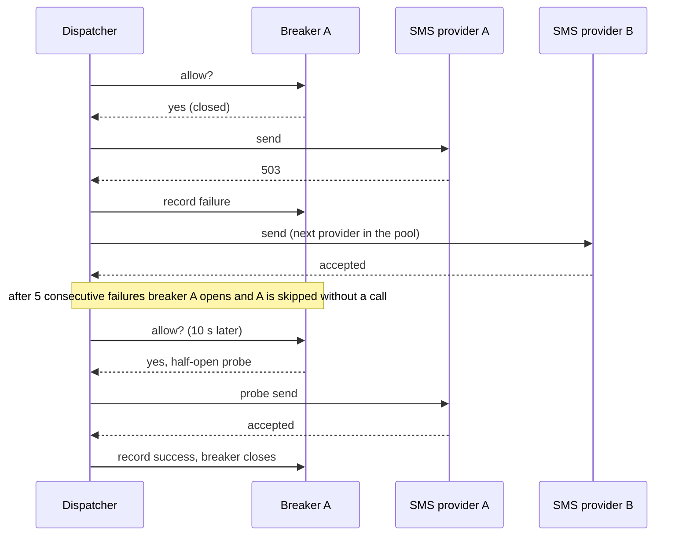

Region failover:

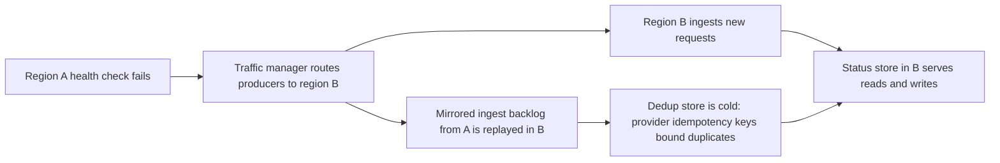

## 20. Scaling and capacity plan

| Component         | Scaling signal                     | Scale-out step                      | Ceiling and what raises it                                  |
| ----------------- | ---------------------------------- | ----------------------------------- | ----------------------------------------------------------- |
| Ingest API        | CPU over 60%, p99 latency          | Add instances                       | None practical; stateless                                   |
| Orchestrator pool | Consumer lag per lane              | Add instances up to partition count | Partitions: grow by adding partitions ahead of need         |
| Dispatcher pool   | Lag, in-flight provider calls      | Add instances up to partition count | Provider quotas: add providers, numbers, IP pools           |
| Log               | Disk and network per broker        | Add brokers, rebalance partitions   | Operational limits per cluster: shard into several clusters |
| Dedup store       | Memory over 70%                    | Add shards, reshard slots           | Shorten TTL for low classes                                 |
| Status store      | Write latency, compaction pressure | Add nodes                           | Archive older data sooner                                   |
| Delay store       | Poller lag                         | More shards per bucket              | Bucket granularity                                          |

Hot-spot handling:

| Hot spot                                      | Handling                                                                                                                  |
| --------------------------------------------- | ------------------------------------------------------------------------------------------------------------------------- |
| One heavy producer                            | Gateway quota and class allowlist; lane isolation keeps it from other classes                                             |
| One heavy user                                | Partition key is `user_id`, so a single user maps to one partition; frequency caps and per-producer quotas bound the rate |
| Busy minute (07:00 release of deferred sends) | Delay store spreads each minute over 16 shards; poller releases at a controlled rate                                      |
| Campaign launch                               | Campaign token bucket paces expansion; P3 lane only                                                                       |


| Cost driver          | Relative weight | Lever                                                                                     |
| -------------------- | --------------- | ----------------------------------------------------------------------------------------- |
| SMS                  | highest         | Prefer push and email where the class allows; order chains by cost for P1 and P2; digests |
| WhatsApp             | high            | Use for P0 fallback and opted-in transactional flows; pre-approved templates              |
| Email                | medium          | Volume pricing, multiple ESPs, suppress bounces early                                     |
| Push                 | low             | Collapse keys, TTLs                                                                       |
| Log, stores, compute | medium          | Right-size retention, archive early, autoscale on lag                                     |

## 21. Trade-offs and decision log

| Decision                | Options considered                 | Choice                    | Rationale                                 | Cost accepted               |
| ----------------------- | ---------------------------------- | ------------------------- | ----------------------------------------- | --------------------------- |
| Delivery guarantee      | At-most, at-least, exactly once    | At-least-once, idempotent | A lost OTP is worse than a rare duplicate | Bounded duplicate rate      |
| Priority mechanism      | One priority queue, lane per class | Lane per class            | No head-of-line blocking from bulk        | Some idle capacity          |
| Preference evaluation   | At ingest, at send time            | At send time              | Unsubscribe honored immediately           | One lookup per message      |
| Log technology          | Kafka, Pulsar, SQS                 | Kafka                     | Throughput, ordering, replay, lag signal  | No native delay, ops weight |
| Dispatcher language     | Java, Rust                         | Rust                      | Predictable latency, low memory           | Second toolchain            |
| Orchestrator language   | Java, Rust                         | Java                      | Rich domain logic, libraries, team skills | JVM latency tuning          |
| Partition key           | Notification id, user id           | User id                   | Per-user ordering, cache locality         | Heavy users concentrate     |
| Contact data in the log | Embed, resolve at dispatch         | Resolve at dispatch       | Keeps PII out of the log and DLQ          | Cache lookup in the worker  |
| Provider quota          | Shared counter, per-worker share   | Per-worker share          | No shared dependency on the hot path      | Uneven if partitions skew   |
| Producer integration    | Dual write, outbox with CDC        | Outbox (API for OTP)      | No lost or phantom events                 | CDC infrastructure          |
| Large email bodies      | In the log, claim-check            | Claim-check over 8 KB     | Log stays near 1.6 KB per message         | Blob read per large email   |
| Multi-region model      | Active-passive, active-active      | Active-active by region   | Fast failover, local latency              | Cold dedup, duplicate risk  |

## 22. Rollout, testing and runbooks

| Phase | Scope                                              | Method                              | Exit criteria                                   |
| ----- | -------------------------------------------------- | ----------------------------------- | ----------------------------------------------- |
| 1     | Ingest, log, orchestrator, push dispatcher, status | Shadow mode: receive, send nothing  | Lag and status accuracy as expected             |
| 2     | P0 for `users` on SMS with failover                | 1%, 10%, 50%, 100% with kill switch | P0 p99 under 2 s, success at target for 2 weeks |
| 3     | P1 for `payment` and `orders`                      | Per producer, dual-run with legacy  | Duplicates within bound, receipts reconcile     |
| 4     | P2 for `inventory` and `catalog`                   | Percentage ramp                     | Frequency caps and quiet hours verified         |
| 5     | P3 campaigns                                       | Small audiences first               | 10M campaign in window, P0 unaffected           |
| 6     | Second region active                               | Game day failover                   | RPO and RTO of section 11 met                   |

Verification of the reference code in this document:

| Suite                           | Toolchain   | Command                                      | Result           |
| ------------------------------- | ----------- | -------------------------------------------- | ---------------- |
| Java `SelfCheck` (orchestrator) | JDK 21      | `java -ea -cp out com.acme.notify.SelfCheck` | 26 checks passed |
| Rust unit tests (dispatcher)    | Rust 1.91.1 | `cargo test`                                 | 24 tests passed  |

| Area covered by the suites       | Examples                                                                                                               |
| -------------------------------- | ---------------------------------------------------------------------------------------------------------------------- |
| Preference and policy            | P0 sent in quiet hours; P2 deferred to 07:00; P3 needs consent; opt-out honored except for P0                          |
| Idempotency and failure handling | Duplicate dropped; claim released when the log is down; P0 survives profile outage while P2 waits                      |
| State machine and retry          | Illegal transitions rejected; every state reachable; backoff inside bounds and never past the deadline                 |
| Throttling and breaker           | Burst then wait reported; breaker opens, half-opens, closes or reopens                                                 |
| Provider pool and dispatch       | Failover on transient errors; no failover on permanent rejection; stable idempotency keys; dead letter at end of chain |
| Scheduling and lanes             | Delay queue ordering; P0 first; 5:3:1 weighting; idle lanes donate capacity                                            |

The suites are not reproduced in this document; the tables above list what they assert.  
Appendix C gives the commands to rebuild and run them from the code in sections 12 to 17.

### 22.1 Test matrix beyond unit tests

| Test type         | Scenario                                                        | Pass criterion                   |
| ----------------- | --------------------------------------------------------------- | -------------------------------- |
| Contract          | Each producer replays an event twice                            | One notification                 |
| Integration       | End to end with provider sandboxes on all four channels         | All states reach terminal values |
| Load              | 1.2x peak for 1 hour, 3x spike for 10 minutes                   | SLOs hold, no lag growth         |
| Isolation         | 10M-user campaign running while OTP traffic is sent             | P0 p99 within 10% of baseline    |
| Chaos             | Kill a broker, a zone, the dedup store, a provider              | Behavior matches section 19      |
| Soak              | 24 hours at 50% of peak                                         | No memory or lag drift           |
| Disaster recovery | Region failover game day                                        | RPO and RTO of section 11        |
| Security          | Receipt replay, forged callbacks, producer privilege escalation | All rejected                     |

| Runbook              | Trigger                          | Key steps                                                          |
| -------------------- | -------------------------------- | ------------------------------------------------------------------ |
| Provider degradation | Breaker open, error rate up      | Confirm failover, adjust quota shares, open a vendor ticket        |
| P0 latency breach    | p99 over 2 s                     | Check lag, breakers, hot partition; scale pool; shed lower lanes   |
| Consumer lag growth  | Lag alert                        | Find the slow stage, scale to partition ceiling, pause campaigns   |
| Bad campaign         | Complaint spike or wrong content | Set kill switch, drain chunks, notify support                      |
| DLQ spike            | DLQ rate alert                   | Group by reason, fix cause, replay within the deadline             |
| Region failover      | Regional health failure          | Route traffic, verify mirror replay, watch duplicates              |
| Suppression error    | Mass bounce or wrong opt-out     | Correct entries, replay affected sends only where still within TTL |

## 23. Risks, open items and future work

| Risk                                          | Likelihood | Impact | Mitigation                                             | Open item                             |
| --------------------------------------------- | ---------- | ------ | ------------------------------------------------------ | ------------------------------------- |
| Provider quota lower than the plan            | Medium     | High   | Multiple providers and numbers, early quota requests   | Confirm contracts and per-number caps |
| Class and channel mix differs from assumption | High       | Medium | Capacity model parameterized; review after first month | Replace assumptions with measurements |
| Duplicate sends during failover               | Medium     | Medium | Provider idempotency keys, receipts reconciliation     | Measure real duplicate rate           |
| Hot partitions from skewed user ids           | Low        | Medium | Frequency caps, partition monitoring                   | Evaluate key salting if observed      |
| Template or consent mistakes                  | Medium     | High   | Staged publish, rollback, consent audits               | Legal review per region               |
| Dedup memory growth                           | Medium     | Medium | TTL by class, sharding                                 | Decide a shorter TTL for P3           |
| Two-language operational burden               | Medium     | Medium | Shared contracts, CI for both, clear ownership         | Staffing plan                         |

Future work: in-app inbox channel, per-user send-time optimization, digest batching, provider cost-based routing, self-service producer onboarding.

---

# Appendices

## Appendix A: Glossary

| Term             | Meaning                                                                       |
| ---------------- | ----------------------------------------------------------------------------- |
| Lane             | The set of topics, consumers and workers dedicated to one priority class      |
| Owner            | The consumer that holds a partition, and therefore the user keys hashed to it |
| Claim            | An atomic first-writer-wins record in the dedup store                         |
| Claim-check      | Storing a large payload elsewhere and passing a reference                     |
| Deadline         | `createdAt` plus the class TTL; after it a message is never sent              |
| Equal jitter     | Backoff where half the delay is fixed and half random                         |
| Watermark commit | Committing the lowest offset whose task is still unresolved                   |
| Outbox           | A table written in the same transaction as business data, published by CDC    |
| Suppression      | A durable record that an address or token must not be contacted on a channel  |

## Appendix B: Example producer and provider configuration

```yaml
producer: users
allowed_classes: [P0_SECURITY, P1_TRANSACTIONAL]
quota: { per_second: 2000, per_day: 50000000 }
rules:
  - { event: otp.requested,     class: P0_SECURITY, template: otp_login }
  - { event: device.new_login,  class: P0_SECURITY, template: new_device_alert, chain: [PUSH, SMS, EMAIL] }
  - { event: password.changed,  class: P0_SECURITY, template: password_changed }
providers:
  sms:
    - { name: sms-a, quota_per_second: 1500, breaker: { failures: 5, cooldown_seconds: 10, probes: 3 } }
    - { name: sms-b, quota_per_second: 1200, breaker: { failures: 5, cooldown_seconds: 10, probes: 3 } }
  email:
    - { name: esp-a, quota_per_second: 4000, ip_pool: transactional }
    - { name: esp-b, quota_per_second: 3000, ip_pool: bulk }
  whatsapp:
    - { name: bsp-a, numbers: 20, per_number_per_second: 80 }
  push:
    - { name: fcm,  connections: 64 }
    - { name: apns, connections: 64 }
```

## Appendix C: Build and run the reference code

```bash
# Orchestrator (Java 21, no dependencies)
cd notify-java && mkdir -p out && javac -d out src/com/acme/notify/*.java
java -ea -cp out com.acme.notify.SelfCheck

# Dispatcher (Rust 1.85 or newer, standard library only)
cd notify-dispatcher && cargo test
```

| Reference code scope                                    | Production work still required                                                        |
| ------------------------------------------------------- | ------------------------------------------------------------------------------------- |
| In-memory ports and fakes                               | Adapters for Redis, Kafka, the profile cache, the template store and the status store |
| Provider trait with scripted test doubles               | One adapter per vendor (HTTP clients, authentication, error mapping)                  |
| Worker loop described, `Dispatcher::handle` implemented | Consumer loop, offset watermark, delay-store poller, republishing                     |
| Single-process tests                                    | Load, soak and chaos suites of section 22                                             |
| Frequency caps, quotas, templates not coded             | Redis counters (17.6), gateway quotas, template service (16.3)                        |

---
