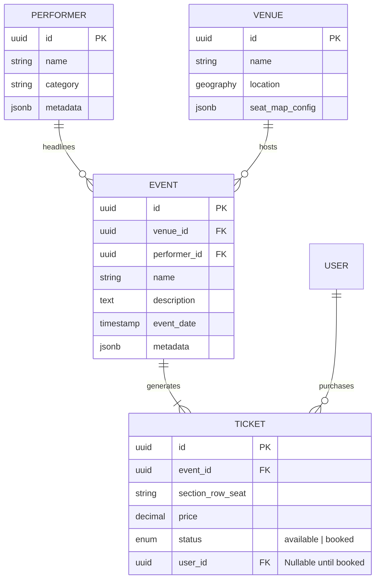
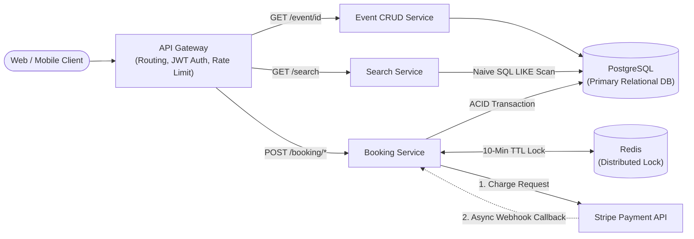
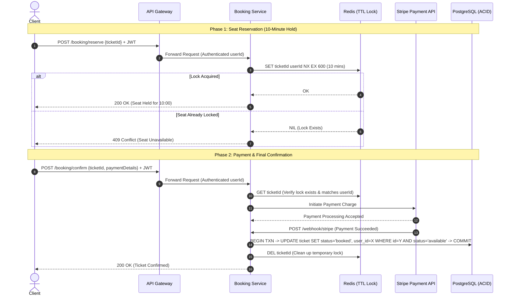
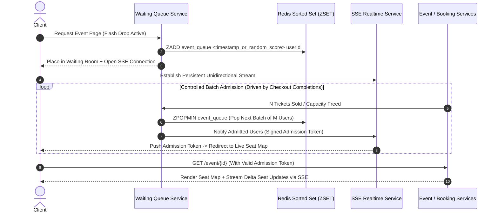

<!-- markdownlint-disable MD001 -->
<!-- markdownlint-disable MD024 -->
<!-- markdownlint-disable MD025 -->
<!-- markdownlint-disable MD026 -->
<!-- markdownlint-disable MD029 -->
<!-- markdownlint-disable MD033 -->
<!-- markdownlint-disable MD036 -->
<!-- markdownlint-disable MD040 -->
<!-- markdownlint-disable MD056 -->
<!-- markdownlint-disable MD060 -->

# System Design Playbook: Design Ticketmaster

This document serves as a comprehensive reference for designing a high-concurrency online event ticketing platform (such as Ticketmaster, BookMyShow, or StubHub)  
and outlines a repeatable strategy for navigating a 45-minute Senior/Staff System Design interview.

---

## 0. The 45-Minute Interview Execution Strategy

Before diving into the technical architecture, approach the interview room using this structured, five-phase chronological playbook:

| Phase                          | Time Allocation           | Primary Objective                                                               | Key Strategic Rule                                                                                                     |
| :----------------------------- | :------------------------ | :------------------------------------------------------------------------------ | :--------------------------------------------------------------------------------------------------------------------- |
| **1. Requirements & Scoping**  | $5\text{--}8\text{ mins}$ | Define Functional, Contextualized Non-Functional, and Out-of-Scope boundaries.  | Work backward from the core user funnel. Never write bare buzzwords ("scalable"); tie every metric to domain reality.  |
| **2. Core Entities**           | $\sim 2\text{ mins}$      | List the top-level nouns persisted in the system.                               | List only entity names first. Defer exact columns and foreign keys until you draw the database in the HLD.             |
| **3. API Design**              | $\sim 5\text{ mins}$      | Translate each Functional Requirement into clean RESTful contracts.             | Model booking as a **two-phase flow** (Reserve $\rightarrow$ Confirm). Extract `userId` from JWT headers, not bodies.  |
| **4. High-Level Design (HLD)** | $\sim 10\text{ mins}$     | Build an end-to-end working baseline architecture (reach by the 15-min mark).   | Satisfy functional requirements first. Flag naive bottlenecks (like SQL `LIKE` scans) verbally and defer to Deep Dives.|
| **5. Deep Dives**              | $\sim 20\text{ mins}$     | Use your Non-Functional Requirements as a checklist to harden the architecture. | Skip "math without a purpose." Only calculate capacity when the number directly drives a sharding or caching choice.   |

---

## 1. Executive Summary & Requirements Matrix

### 1.1 Functional Requirements (The User Funnel)

Walking backward from the primary business objective—purchasing a ticket—yields three core user workflows:

1. **Book Tickets:** Users can select available seats for an event, hold them temporarily while entering payment details, and complete the purchase.
2. **View an Event:** Users can view an event details page containing performer info, venue details, and an interactive seat map displaying real-time seat availability.
3. **Search for Events:** Users can search and filter events across keywords, locations, event categories, and date ranges.

### 1.2 Contextualized Non-Functional Requirements

Instead of generic system qualities, Ticketmaster is defined by four domain-specific engineering tensions:

| Requirement Category              | Target System Behavior                                 | Engineering Justification                                                                                                     |
| :-------------------------------- | :----------------------------------------------------- | :---------------------------------------------------------------------------------------------------------------------------- |
| **Split CAP Theorem Priorities**  | **CP** for Booking; **AP** for Search & Event Viewing  | Double-booking a seat is unacceptable (Strong Consistency), whereas browsing/searching can tolerate a few seconds of staleness|
| **Extreme Read-to-Write Ratio**   | $100:1$ to $1,000:1$ Read-Heavy Workload               | Only $\sim 1\%$ of users viewing an event or searching actually complete a ticket purchase.                                   |
| **Flash-Crowd Surge Scalability** | Handle sudden spikes of $10\text{M+}$ concurrent users | Superstar tours (e.g., Taylor Swift), World Cup finals, or Super Bowl drops create massive instantaneous traffic spikes.      |
| **Low-Latency Discovery & UI**    | Search $< 200\text{ ms}$; Live Seat Map Updates        | Users combining free-text, date, and geospatial filters expect fast results; seat maps must not show stale availability.      |

### 1.3 Out of Scope ("Below the Line")

Explicitly listing out-of-scope features demonstrates product maturity while keeping the session focused:

* Admin portals for creating/updating events, venues, and seat maps.
* Secondary resale marketplace (peer-to-peer ticket transfers).
* GDPR compliance, user registration/login flows, and email/SMS receipt delivery pipelines.

---

## 2. Data Model, Entities & API Specifications

### 2.1 Core Entities & Entity-Relationship (ER) Diagram

At the database layer, **PostgreSQL** is chosen as the primary source of truth because the domain relies on structured relational mappings ($1:N$) and requires **ACID transactions** to guarantee zero double-booking.



### 2.2 Relational Schema Definitions

| Table Name    | Primary Key | Foreign Keys                     | Key Columns & Types                                                           | Indexing & Design Notes                                                                                   |
| :------------ | :---------- | :------------------------------- | :---------------------------------------------------------------------------- | :-------------------------------------------------------------------------------------------------------- |
| **Event**     | `id` (UUID) | `venue_id`, `performer_id`       | `name` (VARCHAR), `description` (TEXT), `event_date` (TIMESTAMP)              | Indexed on `(event_date)` and `(venue_id)`. Synced to Elasticsearch via CDC.                              |
| **Venue**     | `id` (UUID) | None                             | `name` (VARCHAR), `location` (GEOGRAPHY/Lat-Long), `seat_map_config` (JSONB)  | Rarely mutates. Highly cacheable in Redis.                                                                |
| **Performer** | `id` (UUID) | None                             | `name` (VARCHAR), `category` (VARCHAR), `metadata` (JSONB)                    | Rarely mutates. Highly cacheable in Redis.                                                                |
| **Ticket**    | `id` (UUID) | `event_id`, `user_id` (Nullable) | `seat` (VARCHAR), `price` (DECIMAL), `status` (`ENUM('available', 'booked')`) | Composite index on `(event_id, status)`. Note: Temporary `reserved` state is intentionally kept in Redis. |

### 2.3 RESTful API Specifications

#### 1. View an Event

* **Endpoint:** `GET /v1/event/{eventId}`
* **Purpose:** Fetches event metadata, venue layout, performer details, and the current availability of all tickets for the seat map.
* **Response ($200\text{ OK}$):**

  ```json
  {
    "event": { "id": "evt_101", "name": "Eras Tour", "date": "2026-11-15T20:00:00Z" },
    "venue": { "id": "ven_55", "name": "SoFi Stadium", "seatMap": { "sections": ["A", "B", "C"] } },
    "performer": { "id": "perf_9", "name": "Taylor Swift" },
    "tickets": [
      { "id": "tkt_1", "seat": "Sec A - Row 1 - Seat 1", "price": 250.00, "status": "available" },
      { "id": "tkt_2", "seat": "Sec A - Row 1 - Seat 2", "price": 250.00, "status": "unavailable" }
    ]
  }
  ```

#### 2. Search for Events

* **Endpoint:** `GET /v1/search?term={string}&location={lat,long}&type={category}&startDate={iso}&endDate={iso}`
* **Purpose:** Returns a lightweight list of matching event summaries to populate search results.
* **Response ($200\text{ OK}$):** `Partial<Event>[]` (ID, Title, Thumbnail, Venue Name, Date, Starting Price).

#### 3. Book a Ticket (Two-Phase Reservation & Confirmation)

Real-world ticketing requires a **two-phase workflow**: selecting a seat locks it for $10\text{ minutes}$ so the user can enter payment information without someone else sniping the seat mid-checkout.

* **Security Rule:** Never pass `userId` inside the JSON request body (where a malicious client could spoof another user's ID).  
Always extract the `userId` server-side from the cryptographically signed `Authorization: Bearer <JWT>` header.

| Phase                  | Endpoint & Method          | Headers                         | Request Body                                                 | Behavior & Guarantees                                                                                             |
| :--------------------- | :------------------------- | :------------------------------ | :----------------------------------------------------------- | :---------------------------------------------------------------------------------------------------------------- |
| **Phase 1: Reserve**   | `POST /v1/booking/reserve` | `Authorization: Bearer <JWT>`   | `{ "ticketId": "tkt_1" }`                                    | Acquires an atomic distributed lock in Redis (`SET ticketId userId NX EX 600`) for $10\text{ minutes}$.           |
| **Phase 2: Confirm**   | `POST /v1/booking/confirm` | `Authorization: Bearer <JWT>`   | `{ "ticketId": "tkt_1", "paymentDetails": "pi_stripe_xyz" }` | Verifies Redis lock ownership, processes payment via Stripe, updates PostgreSQL `status = booked` in an ACID txn. |

---

## 3. Step-by-Step Architecture & Component Workflows

### 3.1 Baseline High-Level Design (Functional Completeness)

In the first pass of the High-Level Design, we build a clean microservice architecture behind an **API Gateway** that satisfies all functional requirements before introducing complex scaling layers.



### 3.2 Two-Phase Booking & Stripe Webhook Sequence

When confirming a ticket, synchronous calls to banking networks can be slow or flaky.  
The Booking Service coordinates between the **Redis Distributed Lock**, **Stripe**, and **PostgreSQL**:



### 3.3 Final Scaled Architecture (Senior/Staff Target)

After addressing all Non-Functional Requirements during the Deep Dives—adding **Elasticsearch with CDC**, **Multi-Tier Caching**, **Server-Sent Events (SSE)** for live seat maps,  
and a **Virtual Waiting Queue** for flash crowds—the complete system looks like this:

```mermaid
flowchart TB
    Client(["Web / Mobile Client"])

    subgraph Edge_And_Queue ["Edge & Surge Protection Layer"]
        CDN["CDN Edge Cache<br/>(Static Assets & 30-60s Search Cache)"]
        APIGW["API Gateway<br/>(Auth, Routing, Rate Limiting)"]
        WaitQueue["Virtual Waiting Queue Service"]
        RedisQueue[("Redis Sorted Set (ZSET)<br/>Waiting Room Priority Queue")]
    end

    subgraph Core_Services ["Stateless Microservices Layer"]
        EventSvc["Event CRUD Service"]
        SearchSvc["Search Service"]
        BookingSvc["Booking Service"]
        SSESvc["SSE Realtime Service<br/>(Unidirectional Push)"]
    end

    subgraph Data_And_Storage ["Storage, Caching & Search Layer"]
        RedisCache[("Redis Entity Cache<br/>(Event, Venue, Performer)")]
        RedisLock[("Redis Distributed Lock<br/>(10-Min Seat Hold TTL)")]
        PG[("PostgreSQL Sharded Cluster<br/>(Sharded by eventId / venueId)")]
        CDC["CDC Pipeline<br/>(Debezium / Kafka)"]
        ES[("Elasticsearch / OpenSearch<br/>(Inverted & Geo Indexes + Node Cache)")]
    end

    Stripe["Stripe Payment Gateway"]

    Client --> CDN
    CDN --> APIGW
    APIGW --> WaitQueue
    WaitQueue <--> RedisQueue
    WaitQueue -.->|Batch Admission Notification| SSESvc
    SSESvc ===>|Persistent HTTP Stream (SSE)| Client

    APIGW --> EventSvc
    APIGW --> SearchSvc
    APIGW --> BookingSvc

    EventSvc --> RedisCache
    EventSvc --> RedisLock
    EventSvc --> PG

    SearchSvc --> ES

    BookingSvc <--> RedisLock
    BookingSvc --> PG
    BookingSvc <--> Stripe
    BookingSvc -.->|Seat State Change| SSESvc

    PG -->|Transaction Log Stream| CDC
    CDC -->|Async Index Sync| ES
```

### 3.4 Virtual Waiting Queue & Real-Time Seat Map Workflow

When a high-demand event drops (e.g., $1,000,000\text{ users}$ competing for $100,000\text{ seats}$), allowing all users onto the event page simultaneously causes two catastrophic failures:

1. The backend database and SSE broadcast fan-out are crushed by a thundering herd.
2. All $100,000\text{ seats}$ get reserved within milliseconds, turning the entire seat map unavailable and creating a terrible user experience.

**The Solution:** An admin-enabled **Virtual Waiting Queue** acts as an admission control valve in front of the Event page:



---

## 4. Deep-Dive Engineering Trade-offs & Failure Modes

### 4.1 Solving the 10-Minute Seat Reservation Expiration

When a user selects a seat, it must be locked for $10\text{ minutes}$ and automatically released if abandoned.  
Below is the progression from naive to Staff-level solutions:

| Approach                              | Mechanism                                                                                                                  | Pros                                                    | Cons & Why It Fails / Succeeds                                                                                                      | Interview Bar      |
| :------------------------------------ | :------------------------------------------------------------------------------------------------------------------------- | :------------------------------------------------------ | :---------------------------------------------------------------------------------------------------------------------------------- | :----------------- |
| **1. Query-Time Timestamp Filtering** | Add `status = reserved` and `reserved_ts` in PostgreSQL. Filter reads with `WHERE status='available' OR now() - ts > 10m`. | No extra infrastructure required.                       | **Fails:** Leaves dirty `reserved` rows in the database indefinitely; complicates read queries and write contention.                | **Below Bar**      |
| **2. Background Cron Job Sweep**      | Store `status = reserved` in PostgreSQL. Run a Cron job every $10\text{ minutes}$ to reset expired rows to `available`.    | Simple to reason about; cleans up database state.       | **Mid-Level Only:** Introduces an expiration lag delta ($n$ up to $9+\text{ mins}$) where a seat stays locked for $19\text{ mins}$. | **Mid-Level Pass** |
| **3. Redis Distributed Lock + TTL**   | Keep PostgreSQL strictly `available` or `booked`. Write `ticketId -> userId` in Redis with `EX 600` ($10\text{-min}$ TTL). | **Exact-second expiration**; offloads ephemeral writes. | **Senior/Staff Standard:** `Event Service` queries `available` tickets from Postgres and subtracts active Redis locks in memory.    | **Senior / Staff** |

#### Failure Mode Analysis: What Happens If the Redis Lock Cluster Crashes?

* **Scenario:** The Redis instance holding active $10\text{-minute}$ locks crashes and spins back up empty.
* **Impact on User Experience:** Any reservations made in the last $10\text{ minutes}$ are forgotten. A second user viewing the seat map will see those seats as `available` and may also enter the checkout flow.
* **Why Correctness (Zero Double-Booking) Is Still Guaranteed:** When both users submit payment on `POST /booking/confirm`, the final state transition (`status = available` $\rightarrow$ `status = booked`) executes inside a **PostgreSQL ACID Transaction** (using row-level locking `SELECT ... FOR UPDATE` or optimistic conditional update `WHERE status = 'available'`).  
  The first transaction to reach PostgreSQL commits; the second fails and triggers an immediate payment refund.
* **Key Takeaway:** Redis protects **User Experience** and absorbs read/write contention, while PostgreSQL protects **Data Integrity**.

### 4.2 Low-Latency Search, Data Synchronization & Caching Tiers

#### A. Why SQL Fails and How Elasticsearch Solves It

Running `SELECT * FROM events WHERE name LIKE '%term%' AND description LIKE '%term%'` forces PostgreSQL to perform an $O(N)$ **full table scan** because B-Tree indexes cannot accelerate leading-wildcard (`%term%`) text searches.  
Offloading search to **Elasticsearch / AWS OpenSearch** provides:

1. **Inverted Indexes:** Tokenizes text fields (removing stop words, stemming) into a hash-like mapping of `word -> [eventId_1, eventId_2]`, reducing text lookup to near $O(1)$.
2. **Geospatial Indexes (Quadtrees & Geohashing):** Recursively partitions 2D coordinates into grid cells so proximity queries (*"events within $25\text{ miles}$"*) execute in milliseconds.

#### B. Syncing PostgreSQL to Elasticsearch: Dual-Write vs. CDC

| Sync Strategy                 | How It Works                                                                                         | Trade-offs & Verdict                                                                                                                               |
| :---------------------------- | :--------------------------------------------------------------------------------------------------- | :------------------------------------------------------------------------------------------------------------------------------------------------- |
| **Application Dual-Write**    | The Admin Service writes to PostgreSQL and immediately makes a second network call to Elasticsearch. | **Fragile:** Suffers from partial failure bugs (if Postgres succeeds and Elasticsearch times out, data drifts without complex distributed retries).|
| **Change Data Capture (CDC)** | A connector (e.g., Debezium) tails PostgreSQL's Write-Ahead Log (WAL) and streams mutations to ES.   | **Preferred:** Decouples application logic from search indexing, guarantees eventual delivery, and handles low event-mutation velocity effortlessly|

#### C. Multi-Tier Search Caching Strategy

Because search results are not personalized per user, identical search queries yield identical results:

| Cache Layer                                         | Location & Mechanism                                                                      | Ideal Use Case & Caveats                                                                                                                                 |
| :-------------------------------------------------- | :---------------------------------------------------------------------------------------- | :------------------------------------------------------------------------------------------------------------------------------------------------------- |
| **1. OpenSearch Node Query Cache**                  | Built-in LRU cache inside OpenSearch storing top $10,000\text{ queries}$ per shard.       | Zero infrastructure overhead; enabled via simple cluster configuration.                                                                                  |
| **2. Distributed Cache (Redis)**                    | Caches normalized query hashes (`hash(term+loc+date) -> Partial<Event>[]`) in front of ES.| Prevents repetitive network hops and query parsing inside the Search cluster.                                                                            |
| **3. CDN Edge Cache ($30\text{--}60\text{s}$ TTL)** | Caches `GET /search` HTTP responses at geographic edge PoPs near the user.                | **Fastest latency**, but requires low query parameter cardinality (e.g., city names instead of raw 8-decimal GPS coordinates, and zero personalization). |

### 4.3 Real-Time Seat Map Updates: Polling vs. WebSockets vs. SSE

When thousands of users browse the same event page, static seat maps go stale within seconds.  
Choosing the right real-time protocol requires analyzing session duration and communication directionality:

| Protocol                     | Communication Direction                          | Connection Mechanism                                                                           | Trade-offs & Ticketmaster Fit                                                                                                                                                                                 |
| :--------------------------- | :----------------------------------------------- | :--------------------------------------------------------------------------------------------- | :------------------------------------------------------------------------------------------------------------------------------------------------------------------------------------------------------------ |
| **Short Polling**            | Client $\rightarrow$ Server                      | Client requests full seat map every $2\text{--}5\text{ seconds}$.                              | **Poor Fit:** Wastes bandwidth sending unchanged seats; hammers backend services during spikes.                                                                                                               |
| **Long Polling**             | Simulated Server Push                            | Client opens HTTP request; server holds it open ($30\text{--}60\text{s}$) until a seat changes.| **Acceptable for Short Sessions:** Works well if users only stay on the page for $1\text{--}3\text{ minutes}$, avoiding persistent socket setup.                                                              |
| **WebSockets**               | Full-Duplex (Bidirectional)                      | Upgrades HTTP to a persistent 2-way TCP connection.                                            | **Overkill:** Clients only *receive* seat availability updates; they don't stream continuous messages back to the server.                                                                                     |
| **Server-Sent Events (SSE)** | **Unidirectional (Server $\rightarrow$ Client)** | Standard persistent HTTP connection streaming lightweight delta events.                        | **Optimal Choice:** Lightweight HTTP-native protocol, supports automatic reconnection, works seamlessly through load balancers, and pushes both seat map deltas and Virtual Waiting Queue admission signals.  |

### 4.4 Scaling Reads & Database Sharding

1. **Static Entity Caching in Redis:**
   * Because the read-to-write ratio is $\ge 100:1$ and `Event`, `Venue`, and `Performer` metadata rarely change after creation, cache the joined `{ Event, Venue, Performer }` JSON object in **Redis** keyed by `eventId`.
   * When `GET /event/{eventId}` is called, `Event CRUD Service` fetches the static metadata from Redis in $< 2\text{ ms}$ and only queries PostgreSQL + Redis Lock for dynamic `Ticket` availability.
2. **PostgreSQL Horizontal Sharding:**
   * **Capacity Trigger:** Only introduce sharding if total ticket rows or write throughput exceed a single vertical PostgreSQL instance.
   * **Shard Key Choice:**
     * **Shard by `eventId` (Preferred):** All queries for viewing an event (`GET /event/{eventId}`) and booking tickets belong to a single event, routing cleanly to a single shard without cross-shard joins.
     * **Shard by `venueId` (Geographic Alternative):** Useful if infrastructure is deployed regionally so local events reside in regional data centers closest to the buyers.

---

## 5. Technical Glossary & Reusable Mental Models

### 5.1 Core Concepts & Terminology Glossary

| Term / Concept                 | Plain-English Explanation                                                                                                    | Architectural Role in Ticketmaster                                                                                          |
| :----------------------------- | :--------------------------------------------------------------------------------------------------------------------------- | :-------------------------------------------------------------------------------------------------------------------------- |
| **Split CAP Theorem**          | Applying different Consistency vs. Availability trade-offs to different microservices within the same system.                | Enforces **CP (Strong Consistency)** on the Booking path and **AP (High Availability)** on Search and Event viewing.        |
| **ACID Transactions**          | Database guarantees (*Atomicity, Consistency, Isolation, Durability*) ensuring concurrent writes execute safely in isolation.| Guarantees in PostgreSQL that two concurrent payment confirmations can never mark the same `ticketId` as `booked`.          |
| **JWT (JSON Web Token)**       | A cryptographically signed, base64-encoded JSON payload sent in HTTP headers to verify user identity statelessly.            | Validated at the API Gateway so microservices can trust the caller's `userId` without hitting an auth DB on every call.     |
| **Webhooks & Payment Intents** | An asynchronous HTTP callback pattern where an external provider (Stripe) POSTs to your server URL once an action finishes.  | Decouples slow banking/credit-card network calls from blocking worker threads in the Booking Service.                       |
| **Distributed Lock with TTL**  | An atomic key-value entry (`SET key val NX EX seconds`) in a shared in-memory cluster (Redis) that self-deletes on expiry.   | Holds a reserved ticket across horizontally scaled Booking Service nodes for exactly $600\text{ seconds}$ without Cron lag. |
| **Inverted Index**             | A search index data structure mapping tokenized words to the list of document IDs containing those words.                    | Powers fast full-text keyword search in Elasticsearch without running $O(N)$ SQL `LIKE '%term%'` table scans.               |
| **Quadtrees & Geohashing**     | Spatial indexing structures that recursively divide a 2D map into hierarchical grid boxes or string prefixes.                | Enables fast radius/proximity filtering (*"events near Los Angeles"*) inside Elasticsearch.                                 |
| **Change Data Capture (CDC)**  | A pattern that reads a primary database's transaction log (WAL) and streams row-level changes to downstream systems.         | Synchronizes PostgreSQL `Event` updates into Elasticsearch asynchronously without fragile application dual-writes.          |
| **Server-Sent Events (SSE)**   | A standard HTML5/HTTP protocol allowing a server to push real-time text messages to a browser over a single HTTP connection. | Streams real-time seat status changes (`available` $\rightarrow$ `unavailable`) and waiting queue updates to clients.       |
| **Redis Sorted Set (`ZSET`)**  | An in-memory data structure where every unique member (`userId`) is associated with a floating-point sorting score.          | Powers the **Virtual Waiting Queue**, ordering millions of waiting users by arrival timestamp or randomized fairness score. |

### 5.2 Reusable Mental Models for Future System Design Rounds

Use these three first-principles frameworks whenever you encounter **Inventory, Booking, or High-Contention System Design problems** (e.g., *Design Airbnb, Design Airline Seat Booking, Design Uber, Design Amazon Flash Sales*):

#### Mental Model 1: The "Two-Speed" Consistency Architecture

Whenever a system combines **high-volume catalog browsing** with **purchasing finite inventory**, split your design into two distinct regimes:

1. **The Fast AP Read Path (Search & Browse):** Optimize for low latency and high availability using CDN Edge Caches, Redis entity caches, and eventually consistent search indexes (Elasticsearch via CDC).
2. **The Strict CP Write Path (Reserve & Checkout):** Optimize for serialization and correctness using atomic Distributed Locks (Redis TTL) and ACID relational transactions (PostgreSQL).

#### Mental Model 2: "Shield and Vault" Defense-in-Depth for Concurrency

Never rely on a single layer to handle both high-contention user experience and permanent data integrity:

* **The Shield (Redis Distributed Lock with TTL):** Sits in front of checkout. It is fast, in-memory, absorbs $99.9\%$ of concurrent clicks, and gives the user a clean $10\text{-minute}$ countdown timer.
* **The Vault (PostgreSQL ACID Transaction):** Sits at the end of checkout. It only records permanent transitions (`available` $\rightarrow$ `booked`). Even if the Redis Shield crashes completely, the PostgreSQL Vault guarantees zero double-booking.

#### Mental Model 3: Symptom $\rightarrow$ Bottleneck $\rightarrow$ Solution Cheat Sheet

| Interview Problem Symptom                                                                | Naive Trap to Avoid                                                    | Senior / Staff Architectural Trigger                                                                                           |
| :--------------------------------------------------------------------------------------- | :--------------------------------------------------------------------- | :----------------------------------------------------------------------------------------------------------------------------- |
| *"An item must be held temporarily for $X\text{ mins}$ and auto-released if abandoned."* | Updating a DB `status` column and running a periodic Cron job sweep.   | Store only permanent states in the DB; put temporary holds in a **Redis Distributed Lock with TTL** (`SET NX EX`).             |
| *"Users need to search free text, dates, and geographic locations simultaneously."*      | Running SQL `WHERE name LIKE '%query%'` on the transactional database. | Stream DB changes via **CDC** into **Elasticsearch** to leverage **Inverted Indexes** and **Geospatial Quadtrees**.            |
| *"Clients need real-time UI updates, but data only flows from server to client."*        | Defaulting to bidirectional WebSockets or frequent short polling.      | Use **Server-Sent Events (SSE)** for unidirectional server push (or **Long Polling** if user dwell time is $< 3\text{ mins}$). |
| *"Millions of users arrive at the exact same millisecond for finite items."*             | Trying to infinitely auto-scale the database and broadcast layers.     | Place a **Virtual Waiting Queue** (`Redis ZSET`) at the edge and admit users in controlled batches via **SSE**.                |
| *"Popular unpersonalized search queries are hammering the search cluster."*              | Scaling up Elasticsearch nodes endlessly.                              | Layer **OpenSearch Node Query Cache**, **Redis Query Cache**, and **CDN Edge Caching** ($30\text{--}60\text{s}$ TTL).          |

---
