<!-- markdownlint-disable MD001 -->
<!-- markdownlint-disable MD024 -->
<!-- markdownlint-disable MD025 -->
<!-- markdownlint-disable MD026 -->
<!-- markdownlint-disable MD029 -->
<!-- markdownlint-disable MD033 -->
<!-- markdownlint-disable MD036 -->
<!-- markdownlint-disable MD040 -->
<!-- markdownlint-disable MD056 -->
<!-- markdownlint-disable MD060 -->

# Zero-Downtime Database Migration: Reference Design

## Table of Contents

01. [Purpose, Scope, Non-Goals](#1-purpose-scope-non-goals)
02. [Glossary](#2-glossary)
03. [Reference System](#3-reference-system)
04. [Requirements](#4-requirements)
05. [Approaches That Fail](#5-approaches-that-fail)
06. [Solution Overview](#6-solution-overview)
07. [Components](#7-components)
08. [Phase Walkthrough](#8-phase-walkthrough)
09. [Core Algorithms](#9-core-algorithms)
10. [Downstream Consumer Transition](#10-downstream-consumer-transition)
11. [Failure Modes and Runbook](#11-failure-modes-and-runbook)
12. [Capacity and Timing Math](#12-capacity-and-timing-math)
13. [Testing and Rehearsal](#13-testing-and-rehearsal)
14. [Security and Compliance](#14-security-and-compliance)
15. [Go / No-Go Checklists](#15-go--no-go-checklists)
16. [Appendix: SQL Reference](#16-appendix-sql-reference)

---

## 1. Purpose, Scope, Non-Goals

### 1.1 Purpose

Move a live relational database that serves a finance workload from one cluster (the **source**) to another cluster (the **target**) such that:

- No client request is refused at any point.
- No committed write is lost, duplicated, reordered, or partially applied.
- After the move, the target holds exactly the data the source would have held, and all business invariants hold.
- The move can be reversed for a defined period after cutover without data loss.

### 1.2 Scope

| In scope                                                                  | Out of scope                                                         |
|---------------------------------------------------------------------------|----------------------------------------------------------------------|
| Same-engine major-version move (PostgreSQL 11 to 16, MySQL 5.7 to 8.0)    | Cross-engine move (PostgreSQL to MySQL); noted where mechanics differ|
| Infrastructure move (self-managed VMs to managed service, same region)    | Cross-region move with latency above 5 ms between clusters           |
| Data copy, change capture, verification, routing, cutover, rollback       | Schema redesign during the migration                                 |
| Read replicas and reporting replicas on the target                        | Re-sharding (1 to N primaries)                                       |
| Downstream consumers fed by the change log                                | Application feature work                                             |

### 1.3 Non-Goals

- Changing the schema. Schema is frozen for the whole migration (section 4.3).
- Reducing latency or cost. Those are outcomes of the new platform, not goals of the procedure.
- Using vendor migration services (AWS DMS, GCP DMS, Azure DMS). Section 5 explains why.

### 1.4 How to Read This Document

- Section 3 fixes the numbers. Every later calculation uses them.
- Section 7 defines each custom component completely: what it does, what it reads, what it writes, what state it keeps, how it fails.
- Section 8 walks the phases in time order and references the components.
- Section 9 isolates the algorithms where correctness is decided.

---

## 2. Glossary

### 2.1 PostgreSQL and MySQL Term Map

| Concept                                     | PostgreSQL                                                                      | MySQL (InnoDB)                                                                                      |
| :------------------------------------------ | :------------------------------------------------------------------------------ | :-------------------------------------------------------------------------------------------------- |
| Durable change log                          | WAL (write-ahead log), files in `pg_wal/`                                       | Binary log (binlog) for replication; redo log for crash recovery only                               |
| Position in the change log                  | LSN (log sequence number), e.g. `3/A1B2C3D0`                                    | Binlog file + offset (`mysql-bin.000123:4567`) or GTID set                                          |
| Global transaction identity                 | `xid` (32-bit, wraps) + commit LSN                                              | GTID `server_uuid:transaction_id`                                                                   |
| Row-level change stream                     | Logical decoding via an output plugin (`pgoutput`, `wal2json`, `test_decoding`) | Row-based binlog (`binlog_format=ROW`)                                                              |
| Enable row-level changes                    | `wal_level=logical` (restart required)                                          | `binlog_format=ROW`, `binlog_row_image=FULL` (dynamic, per session)                                 |
| Old-row image on update/delete              | `REPLICA IDENTITY DEFAULT` (PK only) or `FULL` (all columns)                    | `binlog_row_image=FULL` (all columns) or `MINIMAL`                                                  |
| Retention of unread changes                 | Replication slot holds WAL until confirmed                                      | `binlog_expire_logs_seconds`; no consumer-driven retention                                          |
| Consumer progress marker                    | `confirmed_flush_lsn` on the slot                                               | Consumer-stored GTID set or file + offset                                                           |
| Consistent export point                     | `CREATE_REPLICATION_SLOT ... EXPORT_SNAPSHOT` / `pg_export_snapshot()`          | `FLUSH TABLES WITH READ LOCK` + `SHOW MASTER STATUS` + `START TRANSACTION WITH CONSISTENT SNAPSHOT` |
| Import a snapshot in a session              | `SET TRANSACTION SNAPSHOT '<id>'`                                               | No equivalent; one session holds the snapshot, or use `LOCK INSTANCE FOR BACKUP` (8.0)              |
| Physical replica                            | Streaming replica (hot standby)                                                 | Replica applying binlog (`CHANGE REPLICATION SOURCE TO`)                                            |
| Physical replication across major versions  | Not possible                                                                    | Possible one major version forward (5.7 to 8.0) via binlog                                          |
| Auto-increment ID                           | `SEQUENCE` / `GENERATED AS IDENTITY`                                            | `AUTO_INCREMENT` column attribute                                                                   |
| Advance ID generator                        | `SELECT setval('seq', n)`                                                       | `ALTER TABLE t AUTO_INCREMENT = n`                                                                  |
| Replication lag view                        | `pg_stat_replication`, `pg_replication_slots`                                   | `SHOW REPLICA STATUS`, `performance_schema.replication_*`                                           |
| Origin tagging (loop prevention)            | Replication origins: `pg_replication_origin_session_setup()`                    | `server_id` on each event; GTID source UUID                                                         |
| Connection pooler (rejected alt)            | PgBouncer                                                                       | ProxySQL                                                                                            |
| Built-in logical replication (rejected alt) | `CREATE PUBLICATION` / `CREATE SUBSCRIPTION`                                    | Native async replication, Group Replication                                                         |
| Row hash function                           | `md5(row::text)`, `hashtextextended()`                                          | `MD5(CONCAT_WS(...))`, `CRC32()`                                                                    |

### 2.2 Terms Used in This Document

| Term                  | Definition                                                                                                       |
|-----------------------|------------------------------------------------------------------------------------------------------------------|
| Source                | The cluster being migrated away from. Authoritative until write cutover.                                         |
| Target                | The cluster being migrated to. Authoritative after write cutover.                                                |
| Authoritative side    | The single cluster that accepts application writes at a given moment. There is never more than one.              |
| CDC                   | Change data capture: reading committed row changes from the change log and delivering them elsewhere.            |
| Forward stream        | CDC from source to target. Active from snapshot until write cutover.                                             |
| Reverse stream        | CDC from target to source. Active from write cutover until decommission.                                         |
| Snapshot point        | The change-log position at which the bulk copy is consistent. Written `S` (LSN or GTID set).                     |
| Chunk                 | A contiguous primary-key range of one table, the unit of copy and verification. Default 100,000 rows.            |
| Watermark             | The highest change-log position the target has fully applied. Written `W`.                                       |
| Lag                   | Source current position minus target watermark, expressed in bytes and seconds.                                  |
| Invariant             | A business rule that must hold on any consistent copy, e.g. total debits equal total credits.                    |
| Shadow read           | A duplicate of a live read sent to the non-authoritative side only to compare results; its result is discarded.  |
| Gate                  | A set of measurable conditions that must all hold before the next phase starts.                                  |
| RPO                   | Recovery point objective: the maximum committed data that may be lost. Here 0.                                   |
| RTO                   | Recovery time objective: the maximum time to restore service after a failure. Here under 1 minute.               |
| Idempotent apply      | Applying the same change twice leaves the same result as applying it once.                                       |

---

## 3. Reference System

### 3.1 Business Context

| Attribute             | Value                                                                                                                                        |
| :-------------------- | :------------------------------------------------------------------------------------------------------------------------------------------- |
| Business              | Digital wallet and payments                                                                                                                  |
| Customers / accounts  | ~5M customers, ~3M accounts                                                                                                                  |
| Regions               | One                                                                                                                                          |
| Age of database       | 6 years                                                                                                                                      |
| Regulation            | PCI-DSS; 7-year retention of financial records                                                                                               |
| Services using the DB | 8; 4 of them write                                                                                                                           |
| Why migrate           | PostgreSQL 11 end-of-life (Nov 2023), audit finding, 2 TB of 3 TB volume used, largest VM tier reached, manual failover caused two incidents |

### 3.2 Workload

| Metric                       | Average                                      | Peak      | Basis                                                                     |
| :--------------------------- | :------------------------------------------- | :-------- | :------------------------------------------------------------------------ |
| Business transactions        | ~1.4/s (120k/day)                            | ~12/s     | One payment = one ACID transaction                                        |
| Rows written per transaction | ~8                                           | ~8        | 2 ledger entries, 1 transaction, 2 balances, audit, idempotency key, misc |
| Row writes                   | ~11.6/s (1M/day)                             | ~100/s    | Peak factor 8-9x (business hours, month-end)                              |
| Reads                        | ~1,160/s (100M/day)                          | ~10,000/s | 100 reads per write                                                       |
| Read routing                 | Primary 15%, app replicas 70%, reporting 15% | same      | Balance checks go to primary                                              |
| Low-traffic window           | 02:00 to 05:00, ~10% of average              | -         | Single-region user base                                                   |
| Nightly batch                | 00:00 to 02:00                               | -         | Ledger reconciliation                                                     |
| Change freeze                | Last 3 and first 2 days of each month        | -         | Month-end close                                                           |

### 3.3 Data

| Table                | Rows       | Size incl. indexes | Write pattern                                 | Hot rows            |
| :------------------- | :--------- | :----------------- | :-------------------------------------------- | :------------------ |
| `ledger_entries`     | ~480M      | ~800 GB            | Insert only, 2 per transaction (double entry) | None                |
| `transactions`       | ~240M      | ~450 GB            | Insert, then 1 status update                  | Last ~24 h          |
| `audit_log`          | ~400M      | ~450 GB            | Insert only, JSON payload                     | None                |
| `customers`, `kyc_*` | ~5M        | ~60 GB             | Rare updates                                  | Few                 |
| `account_balances`   | ~3M        | ~2 GB              | Update on every transaction, row lock         | All active accounts |
| `idempotency_keys`   | ~2.4M      | ~1 GB              | Insert, deleted after 30 days                 | Last 30 days        |
| ~70 other tables     | ~10M       | ~240 GB            | Mixed                                         | Mixed               |
| **Total**            | **~1.14B** | **~2 TB**          |                                               |                     |

### 3.4 Current Topology

```mermaid
flowchart LR
    subgraph Clients["Client tier"]
        API["Payments API<br/>(writes + balance reads)"]
        SVC["3 other writing services"]
        RO["4 read-only services"]
        RPT["Reporting jobs<br/>regulatory reports"]
    end

    subgraph Source["Source cluster: PostgreSQL 11, self-managed VMs"]
        P[("Primary<br/>3 TB volume, 2 TB used")]
        R1[("App replica 1")]
        R2[("App replica 2")]
        R3[("App replica 3")]
        RP1[("Reporting replica 1")]
        RP2[("Reporting replica 2")]
    end

    subgraph Down["Downstream"]
        CDCX["Existing change feed<br/>to warehouse"]
        DW[("Data warehouse")]
        REC["Nightly reconciliation"]
        BANK["Partner-bank settlement files"]
    end

    API -->|writes, balance reads| P
    SVC -->|writes| P
    RO -->|reads| R1
    RO -->|reads| R2
    RO -->|reads| R3
    RPT -->|long queries| RP1
    RPT -->|long queries| RP2
    P -. "async streaming WAL" .-> R1
    P -. "async streaming WAL" .-> R2
    P -. "async streaming WAL" .-> R3
    P -. "async streaming WAL" .-> RP1
    P -. "async streaming WAL" .-> RP2
    P -->|logical decoding| CDCX --> DW
    RP1 --> REC
    RP1 --> BANK
```

### 3.5 Target Topology

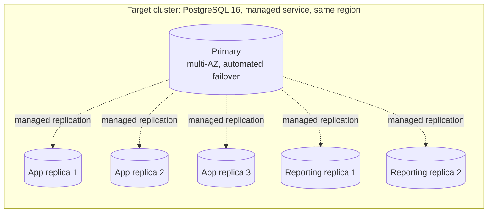

---

## 4. Requirements

### 4.1 Functional Requirements

| ID   | Requirement                  | Measurable criterion                                                                                                                   |
| :--- | :--------------------------- | :------------------------------------------------------------------------------------------------------------------------------------- |
| FR01 | Full data transfer           | All ~1.14B rows across ~76 tables present on target; copy reads a replica or snapshot, throttled to 50 MB/s                            |
| FR02 | Continuous change capture    | Every committed change after snapshot point `S` applied on target in commit order, whole transactions only; lag under 1 s at peak      |
| FR03 | Uninterrupted service        | 0 refused requests in every phase; ~1,160 reads/s average, ~10k/s peak served throughout                                               |
| FR04 | Controlled write cutover     | Write pause at most 1 s; at peak at most ~100 row writes / ~12 transactions held, none lost or rejected                                |
| FR05 | Staged read cutover          | Reads move per group (reporting, app replicas, primary-bound) in steps of 1%, 10%, 50%, 100%; each step reversible                     |
| FR06 | Read-your-writes             | A balance read issued after a committed debit always reflects that debit, including across cutover                                     |
| FR07 | Exactly-once posting         | No transaction applied twice or skipped; all ~2.4M live idempotency keys present on target before writes move                          |
| FR08 | Verification                 | Per-table chunk hashes equal; debits equal credits per currency; each of ~3M balances equals sum of its entries; audit log identical   |
| FR09 | Shadow validation            | 1% of live reads compared against target; 0 mismatches over at least 7 days including one month-end                                    |
| FR10 | Rollback                     | For 14 days after cutover, every target write is applied on source; rollback completes under 1 min with 0 data loss                    |
| FR11 | Downstream continuity        | Warehouse feed, reports, reconciliation, settlement files see no gap and no duplicate                                                  |
| FR12 | Target replicas and HA       | 1 primary + 3 app replicas + 2 reporting replicas + automated failover (RTO under 1 min) ready before cutover                          |
| FR13 | Scheduling                   | Write cutover inside 02:00 to 05:00, after nightly batch, outside month-end freeze                                                     |
| FR14 | Schema freeze                | No DDL on source from snapshot until decommission                                                                                      |
| FR15 | Security and compliance      | Data stays in region, TLS in transit, encryption at rest, every migration action audited, no plaintext card data in migration tooling  |
| FR16 | Observability and auto-abort | Lag, divergence, error rate, p99 latency monitored live; any threshold breach pauses or reverses the current step automatically        |

### 4.2 Service Levels

| Metric                       | Target                  |
|------------------------------|-------------------------|
| Availability (payments API)  | 99.99% (~4.3 min/month) |
| Write latency p99            | Under 150 ms            |
| Read latency p99             | Under 50 ms             |
| RPO                          | 0                       |
| RTO                          | Under 1 minute          |

### 4.3 Business Invariants

| ID  | Invariant                | Check                                                                                   |
| :-- | :----------------------- | :-------------------------------------------------------------------------------------- |
| I1  | Double entry balances    | For each currency: `SUM(amount) WHERE side='debit'` = `SUM(amount) WHERE side='credit'` |
| I2  | Balance equals history   | For each account: `account_balances.balance` = `SUM(ledger_entries.signed_amount)`      |
| I3  | No double posting        | `idempotency_keys.key` unique; each key maps to exactly one `transactions.id`           |
| I4  | Audit log immutable      | Chunk hashes of `audit_log` identical on both sides; no row on target absent on source  |
| I5  | Transaction completeness | Every `transactions.id` with status `posted` has exactly 2 `ledger_entries`             |

### 4.4 Constraints

| Constraint                                          | Consequence for design                                                                  |
|-----------------------------------------------------|-----------------------------------------------------------------------------------------|
| Schema frozen                                       | Change applier maps columns 1:1; no transformation logic                                |
| PostgreSQL 11 cannot do logical decoding on a standby | Change reader connects to the source primary; bulk copy may read a standby            |
| Managed target exposes no physical WAL / filesystem | Reverse stream must use logical decoding on the target                                  |
| Major-version gap 11 to 16                          | Physical replication impossible; logical (row-level) path only                          |
| 4 services write directly                           | All writes must be moved behind one controllable gateway before cutover                 |

---

## 5. Approaches That Fail

| Approach                               | How it works                                                    | Why it fails here                                                                                                                                                                                                |
| :------------------------------------- | :-------------------------------------------------------------- | :--------------------------------------------------------------------------------------------------------------------------------------------------------------------------------------------------------------- |
| Dump and restore                       | `pg_dump` / `mysqldump`, stop writes, restore                   | 2 TB restore + index build takes 15 to 30 h of write downtime; violates FR3                                                                                                                                      |
| Physical replication then promote      | Streaming replica of source, promote at cutover                 | PostgreSQL cannot stream across major versions; managed target accepts no external physical stream                                                                                                               |
| Application dual-write                 | App writes every change to both clusters                        | No atomic commit across two clusters; one write succeeds, the other fails, data diverges silently; violates FR2, FR7                                                                                             |
| Write to empty target first            | New writes go to target, bulk copy fills history behind         | Updates to not-yet-copied rows match 0 rows and are lost; balance check reads source while write lands on target, enabling double debit; uniqueness and idempotency checked against partial data; ID collisions  |
| Verify by row count and table size     | Compare `count(*)` and `pg_total_relation_size()`               | Size differs by design across versions (bloat, page layout, TOAST); counts take minutes on 480M rows and miss wrong values                                                                                       |
| Vendor migration service (DMS)         | Managed full load + CDC                                         | Applies per row, not per transaction (target sees half transactions); limited control over cutover pause; no invariant checks; opaque failure handling                                                           |
| Built-in publication / subscription    | `CREATE PUBLICATION` on source, `CREATE SUBSCRIPTION` on target | Viable, but: no origin filtering on PostgreSQL 11 subscriber, no custom throttling, no hook for verification watermarks, initial copy reads the primary. Rejected per tooling stance; used as fallback           |
| Debezium + JDBC sink                   | Kafka Connect source and sink connectors                        | Sink applies rows independently, breaking transaction atomicity on target; extra Kafka dependency in the write path of the migration                                                                             |
| PgBouncer / ProxySQL as cutover switch | `PAUSE`, repoint, `RESUME`                                      | Viable, but cannot do weighted read routing per query class, shadow reads, or read-your-writes tokens. Replaced by the custom DB Gateway                                                                         |

The common lesson: **exactly one cluster is authoritative at any moment, and the non-authoritative cluster is only ever fed from the authoritative cluster's committed change log.**

---

## 6. Solution Overview

### 6.1 Principle

1. Source stays authoritative for all reads and writes until the target is complete, current, and verified.
2. Target is filled by a consistent snapshot copy plus a forward change stream that starts exactly at the snapshot point.
3. Reads move to the target gradually, by query class, each step reversible.
4. Writes move in one atomic switch with a pause under 1 s.
5. Immediately after the switch, a reverse change stream keeps the source current, making rollback lossless.

### 6.2 Component Architecture

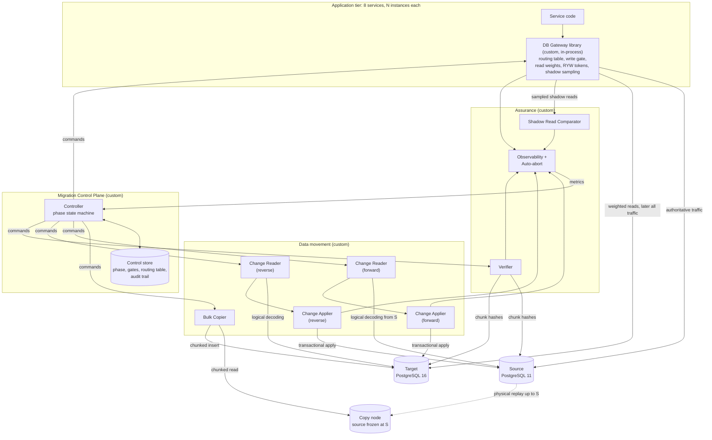

### 6.3 Component Summary

| Component                  | Section | Type                                         | Active during                             | Writes to                          |
| :------------------------- | :------ | :------------------------------------------- | :---------------------------------------- | :--------------------------------- |
| Migration Control Plane    | 7.1     | Long-running service                         | All phases                                | Control store                      |
| DB Gateway                 | 7.2     | In-process library in every service instance | Phase 0 onward                            | Source or target (app traffic)     |
| Change Reader              | 7.3     | Long-running worker                          | Phases 1 to 6 (forward), 6 to 9 (reverse) | In-memory hand-off to applier      |
| Change Applier             | 7.4     | Long-running worker                          | Same as reader                            | Target (forward), source (reverse) |
| Bulk Copier                | 7.5     | Batch job                                    | Phase 1                                   | Target                             |
| Verifier                   | 7.6     | Batch job, repeating                         | Phases 2 to 9                             | Control store (results only)       |
| Shadow Read Comparator     | 7.7     | Long-running worker                          | Phase 4                                   | Control store (mismatches only)    |
| Cutover Orchestrator       | 7.8     | Run-once procedure inside Control Plane      | Phase 6 (and rollback)                    | Gateway, readers, appliers         |
| Reverse Replicator         | 7.9     | Reader + applier, reversed                   | Phases 6 to 9                             | Source                             |
| Observability + Auto-abort | 7.10    | Long-running service                         | All phases                                | Control Plane (abort signals)      |

### 6.4 Migration State Machine

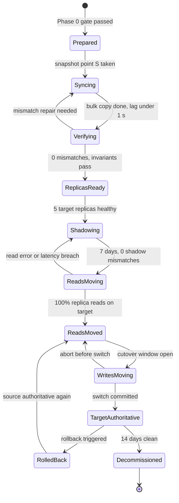

### 6.5 Timeline

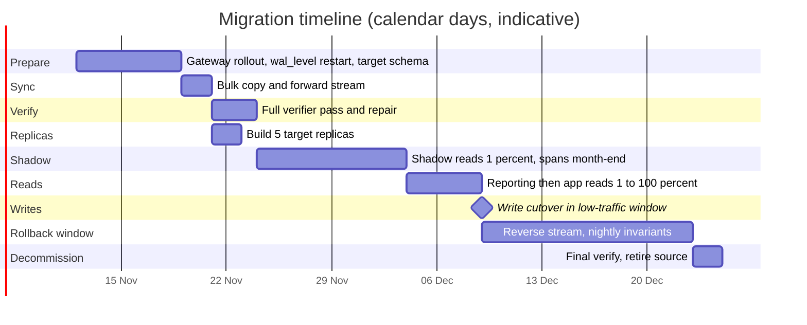

---

## 7. Components

Every component below is custom code. Each subsection uses the same template:

| Field              | Meaning                                                              |
|--------------------|----------------------------------------------------------------------|
| Responsibility     | The one job the component owns                                       |
| Inputs             | What it reads, from where                                            |
| Outputs            | What it writes, to where                                             |
| State              | What it must remember across restarts, and where that is stored      |
| Interfaces         | How other components talk to it                                      |
| Failure and recovery | What happens when it crashes, stalls, or receives bad input        |
| PostgreSQL specifics | Mechanisms used on PostgreSQL                                      |
| MySQL specifics    | Equivalent mechanisms on MySQL                                       |

### 7.1 Migration Control Plane

**Responsibility.** Single source of truth for migration state.  
Runs the phase state machine (section 6.4), evaluates gates, issues commands to every other component, publishes the routing table, and records an audit trail of every action.

| Field                | Detail                                                                                                                                                                                                                                                                          |
| :------------------- | :-------------------------------------------------------------------------------------------------------------------------------------------------------------------------------------------------------------------------------------------------------------------------------|
| Inputs               | Heartbeats and metrics from all components; operator commands (approve gate, abort, rollback)                                                                                                                                                                                   |
| Outputs              | Routing table versions to DB Gateway instances; start/stop/pause commands to copier, replicators, verifier                                                                                                                                                                      |
| State                | Control store: a small, separate PostgreSQL database (not the source, not the target), HA with synchronous standby                                                                                                                                                              |
| Interfaces           | gRPC command API; long-lived push stream to every DB Gateway instance; read-only HTTP status page                                                                                                                                                                               |
| Failure and recovery | Runs as 2 instances; one leader holds a lease (row in `cp_leader` with expiry, renewed every 2 s). Every command carries the leader's **epoch**; components reject commands with an epoch lower than the highest seen (fencing). A new leader resumes from the persisted phase. |

**Control store tables.**

| Table            | Key columns                                                                                             | Purpose                                                 |
| :--------------- | :------------------------------------------------------------------------------------------------------ | :------------------------------------------------------ |
| `cp_leader`      | `holder`, `epoch`, `expires_at`                                                                         | Leader lease and fencing epoch                          |
| `cp_phase`       | `phase`, `entered_at`, `entered_by`                                                                     | Current state-machine state                             |
| `cp_gate_result` | `gate`, `check_name`, `value`, `threshold`, `passed`, `at`                                              | Every gate evaluation, kept for audit                   |
| `cp_routing`     | `version`, `class`, `source_weight`, `target_weight`, `write_gate`                                      | Versioned routing table, append-only                    |
| `cp_gateway_ack` | `instance_id`, `routing_version`, `acked_at`                                                            | Which gateway instance runs which routing version       |
| `cp_chunk`       | `table`, `chunk_id`, `pk_lo`, `pk_hi`, `copy_state`, `verify_state`, `src_hash`, `tgt_hash`, `attempts` | Copy and verification progress per chunk                |
| `cp_mismatch`    | `table`, `pk`, `kind`, `first_seen`, `resolved_at`                                                      | Row-level differences found by verifier or shadow reads |
| `cp_audit`       | `at`, `actor`, `action`, `params`, `result`                                                             | Immutable audit trail (FR15)                            |

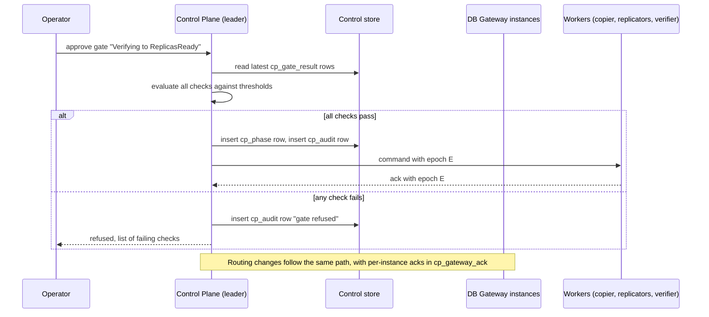

### 7.2 DB Gateway (in-process library)

**Responsibility.** Decide, for every database operation issued by service code, which cluster and which node receives it;  
hold new writes during cutover; attach and honour read-your-writes tokens; sample reads for shadow comparison.

It is a library linked into every service instance, wrapping the service's existing connection pools.  
It replaces PgBouncer / ProxySQL for routing purposes. A connection pooler may still sit underneath it for connection multiplexing.

| Field                | Detail                                                                                                                                                                                                                                                                           |
| :------------------- | :------------------------------------------------------------------------------------------------------------------------------------------------------------------------------------------------------------------------------------------------------------------------------- |
| Inputs               | Routing table pushed by Control Plane; query class declared by the calling code                                                                                                                                                                                                  |
| Outputs              | Queries to source or target nodes; shadow samples to Shadow Read Comparator; metrics                                                                                                                                                                                             |
| State                | In memory only: current routing version, write-gate state, in-flight write count, per-session RYW token. Rebuilt from Control Plane on start.                                                                                                                                    |
| Interfaces           | `begin(class)`, `commit()`, `query(class, sql, params)` for service code; push stream from Control Plane                                                                                                                                                                         |
| Failure and recovery | If the push stream drops, the instance keeps its last routing version but **refuses to open new write transactions after 5 s without a heartbeat** (fail closed for writes, fail open for reads). Database-level fencing (section 9.6) covers instances that misbehave anyway.   |

**Query classes.** Every call site declares one. Unclassified calls are treated as `WRITE`.

| Class            | Examples                                         | Routing rule                                                     |
|------------------|--------------------------------------------------|------------------------------------------------------------------|
| `WRITE`          | Post payment, update status                      | Authoritative primary only. Weight is 100/0 or 0/100, never split|
| `READ_PRIMARY`   | Balance check before debit                       | Authoritative primary only. Moves together with `WRITE`          |
| `READ_REPLICA`   | Transaction history, customer profile            | Weighted between source app replicas and target app replicas     |
| `READ_REPORTING` | Regulatory report queries                        | Weighted between source and target reporting replicas            |

**Write gate states.**

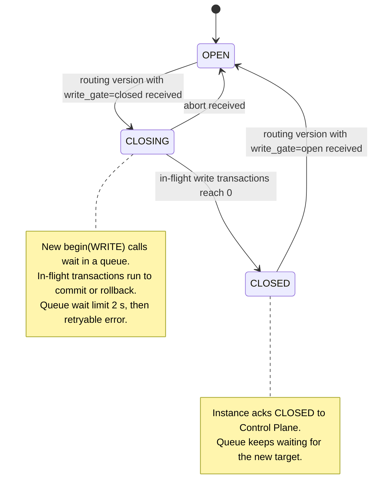

**Read-your-writes token.**

| Step                                    | PostgreSQL                                                                                              | MySQL                                                                                         |
| :-------------------------------------- | :------------------------------------------------------------------------------------------------------ | :-------------------------------------------------------------------------------------------- |
| After a write commits, capture position | `SELECT pg_current_wal_lsn()` in the same session right after `COMMIT`                                  | `@@session.gtid_executed` or `session_track_gtids=OWN_GTID` returns the GTID in the OK packet |
| Store token                             | Per user session, in the service's session context, with a 10 s expiry                                  | Same                                                                                          |
| Route a later read                      | Send to a replica whose `pg_last_wal_replay_lsn() >= token`; else primary                               | `SELECT WAIT_FOR_EXECUTED_GTID_SET(token, 0.05)` on replica; on timeout use primary           |
| Across cutover                          | Tokens issued by the source are invalidated at cutover; reads in the next 10 s go to the target primary | Same                                                                                          |

**Request path.**

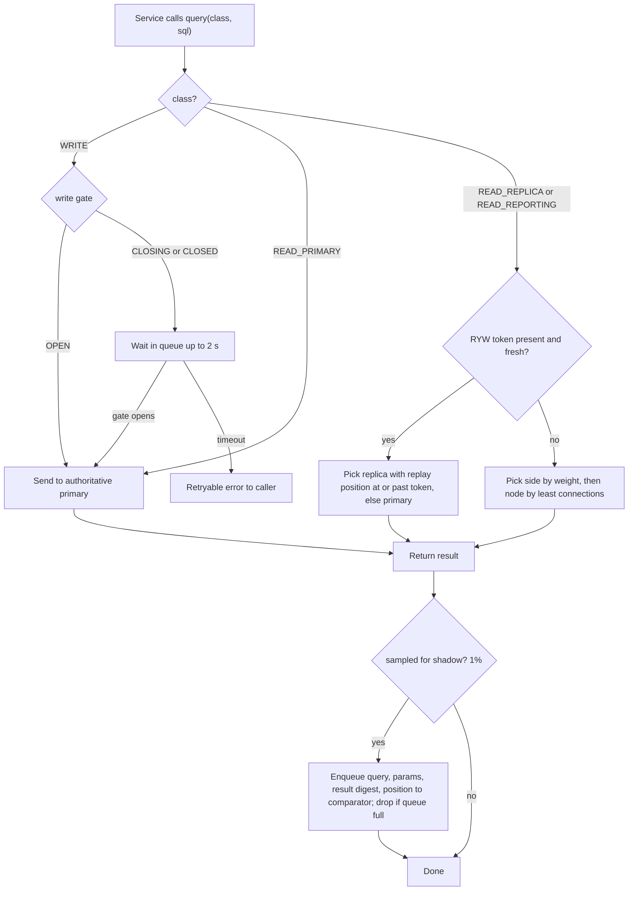

### 7.3 Change Reader

**Responsibility.** Read committed row changes from a cluster's change log, starting at a given position, and hand complete transactions, in commit order, to the Change Applier.

Reader and Applier run in the same process (the **Replicator**), connected by a bounded in-memory queue.  
One Replicator instance runs per direction.  
A standby instance waits on a lease in the control store.

| Field                | Detail                                                                                                                                                                                                                                                 |
| :------------------- | :----------------------------------------------------------------------------------------------------------------------------------------------------------------------------------------------------------------------------------------------------- |
| Inputs               | Change log of the cluster being read (forward: source; reverse: target), starting position from the Applier checkpoint                                                                                                                                 |
| Outputs              | Ordered stream of `Txn` records to the Applier                                                                                                                                                                                                         |
| State                | None of its own. Start position comes from the Applier checkpoint on the destination cluster. Retention of unread changes is the job of the replication slot (PostgreSQL) or binlog retention (MySQL).                                                 |
| Interfaces           | Start(position), Stop(), Pause(); emits `Txn`; sends progress feedback to the source cluster                                                                                                                                                           |
| Failure and recovery | On crash, restart from the Applier checkpoint. Duplicated delivery is harmless (section 9.2). If the change log no longer contains the checkpoint position (MySQL binlog purged), the stream is broken: stop, alert, re-snapshot the affected tables.  |

**`Txn` record.**

| Field        | PostgreSQL source                                                                     | MySQL source                                                                        |
| :----------- | :------------------------------------------------------------------------------------ | :---------------------------------------------------------------------------------- |
| `id`         | `xid` from Begin message                                                              | GTID from `GTID_LOG_EVENT`                                                          |
| `commit_pos` | Commit LSN from Commit message                                                        | GTID (ordered by binlog position)                                                   |
| `commit_ts`  | Commit timestamp                                                                      | Event timestamp                                                                     |
| `origin`     | Origin name from Origin message, if any                                               | `server_id` of the event                                                            |
| `changes[]`  | Insert / Update / Delete / Truncate with relation id, old key or old tuple, new tuple | `WRITE_ROWS` / `UPDATE_ROWS` / `DELETE_ROWS` with table id, before and after images |

**PostgreSQL mechanics.**

| Item                   | Detail                                                                                                                                                        |
| :--------------------- | :------------------------------------------------------------------------------------------------------------------------------------------------------------ |
| Prerequisite           | `wal_level=logical`, `max_replication_slots >= 4`, `max_wal_senders >= 10`; role with `REPLICATION`                                                           |
| Table set              | `CREATE PUBLICATION mig_pub FOR ALL TABLES` (a publication is only a table filter used by `pgoutput`; no subscription is created)                             |
| Connection             | Replication protocol connection: `replication=database`                                                                                                       |
| Slot                   | `CREATE_REPLICATION_SLOT mig_fwd LOGICAL pgoutput EXPORT_SNAPSHOT`; returns `consistent_point` (the snapshot point `S`) and a snapshot name                   |
| Streaming              | `START_REPLICATION SLOT mig_fwd LOGICAL <checkpoint> (proto_version '1', publication_names 'mig_pub')` on PostgreSQL 11; on PostgreSQL 16 add `origin 'none'` |
| Messages decoded       | Begin, Relation, Type, Insert, Update, Delete, Truncate, Origin, Commit                                                                                       |
| Progress feedback      | Standby Status Update with `flush_lsn` = Applier checkpoint; the slot releases WAL older than that                                                            |
| Not carried            | Sequence values, DDL, large objects (`pg_largeobject`). Handled in sections 9.3 and 4.4                                                                       |
| Unchanged TOAST values | Update messages mark unchanged out-of-line values as `u` (unchanged); the Applier must not overwrite them                                                     |
| Large transactions     | PostgreSQL 11 decodes a transaction only after commit and spills to disk on the source after 4,096 changes; nightly batch transactions must be bounded        |
| Restriction            | PostgreSQL 11 cannot create a logical slot on a standby; the reader connects to the source primary                                                            |

**MySQL mechanics.**

| Item               | Detail                                                                                                                                             |
| :----------------- | :------------------------------------------------------------------------------------------------------------------------------------------------- |
| Prerequisite       | `binlog_format=ROW`, `binlog_row_image=FULL`, `gtid_mode=ON`, `enforce_gtid_consistency=ON`; user with `REPLICATION SLAVE`, `REPLICATION CLIENT`   |
| Connection         | Binlog dump protocol: `COM_BINLOG_DUMP_GTID` with a unique `server_id` and the executed GTID set to start after                                    |
| Events decoded     | `GTID_LOG_EVENT`, `QUERY_EVENT` (`BEGIN`), `TABLE_MAP_EVENT`, `WRITE_ROWS_EVENT`, `UPDATE_ROWS_EVENT`, `DELETE_ROWS_EVENT`, `XID_EVENT` (commit)   |
| Retention          | No consumer-driven retention. `binlog_expire_logs_seconds` must exceed the longest planned reader outage plus the bulk copy duration (set 7 days)  |
| Not carried        | DDL arrives as `QUERY_EVENT` and must be rejected (schema frozen); `AUTO_INCREMENT` counters are not replicated as such                            |
| Can read a replica | Yes, with `log_replica_updates=ON` on that replica                                                                                                 |

**Lag measurement independent of traffic.** The Control Plane writes `UPDATE mig_heartbeat SET ts = now()` on the source primary every second.  
The heartbeat row flows through the stream. Lag in seconds = `now() - last applied heartbeat ts`.  
This also keeps the PostgreSQL slot advancing in idle periods.

### 7.4 Change Applier

**Responsibility.** Apply each `Txn` from the Reader to the destination cluster as exactly one destination transaction, in commit order, such that applying a `Txn` twice has the same effect as applying it once, and record progress atomically with the data.

| Field                | Detail                                                                                                                                                                                                                                                     |
| :------------------- | :--------------------------------------------------------------------------------------------------------------------------------------------------------------------------------------------------------------------------------------------------------- |
| Inputs               | `Txn` records from the Reader                                                                                                                                                                                                                              |
| Outputs              | Rows on the destination cluster; checkpoint row on the destination cluster; progress feedback to the Reader                                                                                                                                                |
| State                | Checkpoint table `mig_checkpoint(stream, applied_pos, applied_ts)` on the **destination** cluster, updated inside each applied transaction                                                                                                                 |
| Interfaces           | Consumes the in-process queue; exposes applied position and lag metrics                                                                                                                                                                                    |
| Failure and recovery | Crash mid-transaction: destination rolls it back, checkpoint unchanged, the `Txn` is re-delivered. Any apply error (constraint violation, type error, missing row for an update without full image): **stop the stream and alert**. Never skip a `Txn`.    |

**Apply rules (idempotent form).**

| Change               | PostgreSQL statement                                                           | MySQL statement                                                                |
| :------------------- | :----------------------------------------------------------------------------- | :----------------------------------------------------------------------------- |
| Insert               | `INSERT ... ON CONFLICT (pk) DO UPDATE SET <all columns> = EXCLUDED.<col>`     | `INSERT ... ON DUPLICATE KEY UPDATE <col> = VALUES(<col>)` (8.0.19+: row alias)|
| Update, PK unchanged | Same upsert as insert, with unchanged-TOAST columns left out of the `SET` list | Same upsert as insert                                                          |
| Update, PK changed   | `DELETE WHERE pk = old_pk`, then upsert new row                                | Same                                                                           |
| Delete               | `DELETE WHERE pk = old_pk` (0 rows affected is not an error)                   | Same                                                                           |
| Truncate             | Rejected; alert (not expected in this workload)                                | Rejected                                                                       |

Upsert is used for every insert and update so that a re-delivered `Txn`, or an overlap at the snapshot boundary (section 9.1), converges to the same row.

**Session settings on the destination.**

| Purpose                                                          | PostgreSQL                                                                                                                 | MySQL                                                                      |
| :--------------------------------------------------------------- | :------------------------------------------------------------------------------------------------------------------------- | :------------------------------------------------------------------------- |
| Do not re-fire triggers and FK checks already enforced on origin | `SET session_replication_role = replica`                                                                                   | `SET foreign_key_checks = 0` (triggers still fire; none expected on target)|
| Tag changes with their origin                                    | `pg_replication_origin_session_setup('mig_fwd')`; per transaction `pg_replication_origin_xact_setup(commit_lsn, commit_ts)`| `SET gtid_next = '<source GTID>'` preserves the original GTID              |
| Skip already-applied transactions natively                       | Origin progress `pg_replication_origin_progress('mig_fwd', true)`                                                          | A GTID already in `gtid_executed` is skipped by the server                 |
| Deterministic text formats                                       | `SET TimeZone='UTC'`, `SET DateStyle='ISO, YMD'`                                                                           | `SET time_zone='+00:00'`                                                   |

**Apply loop.**

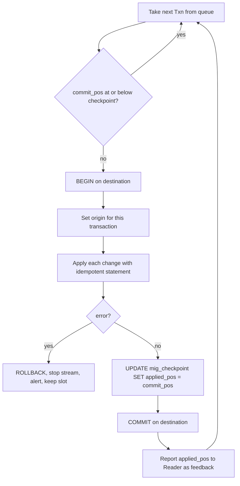

**Throughput.** Single-threaded apply in commit order. Measured cost per `Txn` of ~8 rows is 2 to 5 ms over a same-region link, giving 200 to 500 `Txn`/s capacity against a peak of ~12/s.  
Parallel apply is therefore not needed and is excluded because it complicates ordering.

### 7.5 Bulk Copier

**Responsibility.** Copy every table as it existed at snapshot point `S` into the empty target, in chunks, throttled, resumable, without loading the source primary.

| Field                | Detail                                                                                                                                      |
| :------------------- | :------------------------------------------------------------------------------------------------------------------------------------------ |
| Inputs               | A read-only copy of the source frozen at exactly `S` (the **copy node**, below)                                                             |
| Outputs              | Rows in target tables; per-chunk row count, byte count and hash in `cp_chunk`                                                               |
| State                | `cp_chunk.copy_state` per chunk: `pending`, `copying`, `done`, `failed`                                                                     |
| Interfaces           | Start(table list, rate limit), Pause(), Resume(), Status()                                                                                  |
| Failure and recovery | Each chunk is copied inside one target transaction. A crash rolls back the open chunk; on restart all `copying` chunks reset to `pending`.  |

**The copy node.** The copy must see the source exactly at `S`.  
Reading the primary under an exported snapshot for 12 to 24 h would hold back the primary's `xmin`, blocking vacuum and bloating the hot `account_balances` table.  
Instead a dedicated read-only node is stopped exactly at `S`.

| Step | PostgreSQL                                                                                                                           | MySQL                                                                             |
| :--- | :----------------------------------------------------------------------------------------------------------------------------------- | :-------------------------------------------------------------------------------- |
| 1    | Take a base backup of the source (`pg_basebackup`) onto a new host; note its end LSN `B`                                             | Add a new replica of the source (clone plugin or backup restore)                  |
| 2    | Create the forward slot after the backup ends: `S = consistent_point` (guaranteed `S > B`)                                           | Let the replica catch up                                                          |
| 3    | Start the new host in recovery with `recovery_target_lsn = 'S'`, `recovery_target_inclusive = on`, `recovery_target_action = 'pause'`| `STOP REPLICA`; read `@@global.gtid_executed` on that replica: this set is `S`    |
| 4    | When `pg_is_wal_replay_paused()` is true, the node is frozen at `S` and serves read-only queries                                     | Node is frozen at `S`                                                             |
| 5    | Forward stream later starts from slot `mig_fwd` at `S`                                                                               | Forward stream starts on the source with `COM_BINLOG_DUMP_GTID` excluding set `S` |

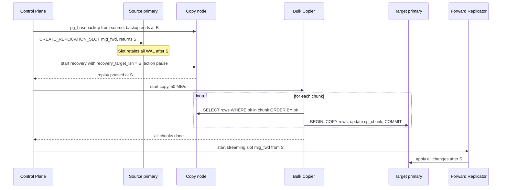

**Why the forward stream starts only after the copy finishes.**  
If changes after `S` were applied while chunks were still being copied, an update could upsert a newer row version into a chunk that the copier later fills with the older snapshot version, regressing the row.  
Starting the stream after the copy guarantees every streamed change is newer than every copied row.  
The slot (PostgreSQL) or binlog retention (MySQL) holds the changes meanwhile: ~1M row changes per day, a few GB of WAL.

**Chunking.**

| Item               | Rule                                                                                                                                                                                                                                   |
| :----------------- | :------------------------------------------------------------------------------------------------------------------------------------------------------------------------------------------------------------------------------------- |
| Chunk size         | 100,000 rows (about 170 MB average for this data); 10,000 rows for tables with large JSON payloads                                                                                                                                     |
| Boundary discovery | Keyset walk: `SELECT pk FROM t WHERE pk > $last ORDER BY pk LIMIT 1 OFFSET 99999`                                                                                                                                                      |
| Composite keys     | Row comparison `(a, b) > ($1, $2)` (PostgreSQL); same syntax in MySQL 8.0                                                                                                                                                              |
| Text keys          | Order with `COLLATE "C"` (PostgreSQL) / `COLLATE utf8mb4_bin` (MySQL); never with a locale collation, whose order can differ between OS library versions                                                                               |
| Parallelism        | 4 workers pulling from the `pending` queue                                                                                                                                                                                             |
| Throttle           | Token bucket on bytes, 50 MB/s total; halves when target replication lag or target CPU exceed thresholds                                                                                                                               |
| Write path         | `COPY t FROM STDIN` text format (PostgreSQL); multi-row `INSERT` of 1,000 rows or `LOAD DATA LOCAL INFILE` (MySQL)                                                                                                                     |
| Indexes            | Target tables carry only primary keys and unique constraints during copy; secondary indexes built afterward with `CREATE INDEX CONCURRENTLY` (PostgreSQL) / online `ALTER TABLE ... ADD INDEX, ALGORITHM=INPLACE, LOCK=NONE` (MySQL)   |
| Foreign keys       | Added after copy as `NOT VALID`, then `VALIDATE CONSTRAINT` (PostgreSQL); MySQL validates on add, run with `foreign_key_checks=0` and verify through invariants                                                                        |
| Hash during copy   | Each chunk's hash (section 9.4) is computed from the rows as they are copied and stored as `src_hash`, giving a free first verification pass                                                                                           |

### 7.6 Verifier

**Responsibility.** Prove, continuously, that target data equals source data and that business invariants hold on each cluster.  
Report differences down to the row. Repair differences.

It is a standalone batch service. It has read-only credentials to one replica on each side and write credentials only for the control store and for repair.  
It shares no code path with the application or the Replicator.

| Field              | Detail                                                                                                         |
|--------------------|----------------------------------------------------------------------------------------------------------------|
| Inputs             | Source reporting replica; target replica (target primary before replicas exist); replication positions on both |
| Outputs            | `cp_chunk.verify_state`, `cp_mismatch` rows, gate metrics; repair writes to target                             |
| State              | `cp_chunk` and `cp_mismatch` in the control store                                                              |
| Interfaces         | Start(full pass), Start(incremental), Start(invariants), Repair(table, pks)                                    |
| Failure and recovery | Stateless between chunks; on restart continues from `cp_chunk.verify_state = pending`                        |

**Three checks.**

| Check                    | What it compares                                                             | Exactness                                                                    |
| :----------------------- | :--------------------------------------------------------------------------- | :--------------------------------------------------------------------------- |
| Cross-cluster chunk hash | Hash of a chunk on source vs hash of the same chunk on target                | Exact for chunks with no change in flight; otherwise converges by retry (9.4)|
| Row diff                 | Per-row hashes of a mismatched chunk, joined by PK                           | Identifies missing, extra, and differing rows                                |
| Invariants I1 to I5      | Business rules computed inside one `REPEATABLE READ` snapshot on one cluster | Exact, because a single snapshot is consistent regardless of ongoing writes  |

**Chunk verification flow.**

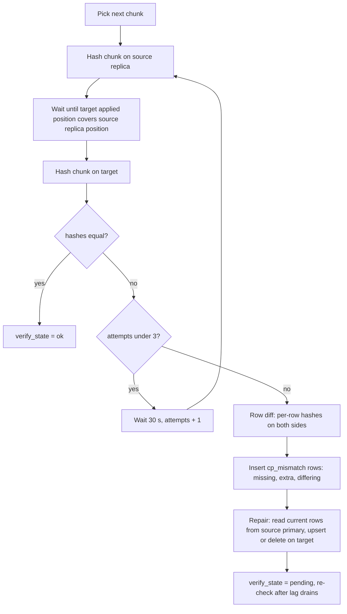

**Repair is safe while the stream runs.**  
Repair reads the current row from the source primary and writes it to the target.  
A stream change for that row still in flight is either older than the repaired version, in which case the stream will afterwards deliver every newer change up to and including the repaired version,  
or newer, in which case it overwrites the repaired version correctly. Either way the row converges to the source's latest state.

**Scheduling.**

| Pass                  | Scope                                                                                          | Frequency                                                      |
| :-------------------- | :--------------------------------------------------------------------------------------------- | :------------------------------------------------------------- |
| Copy-time hash        | Every chunk, during bulk copy                                                                  | Once                                                           |
| Full pass             | Every chunk of every table                                                                     | Once after copy, once before cutover, once before decommission |
| Incremental pass      | Chunks touched since the last pass (`updated_at` column, or chunk ids recorded by the Applier) | Hourly                                                         |
| Invariants I1, I3, I5 | Whole tables                                                                                   | Hourly on a reporting replica                                  |
| Invariant I2          | All ~3M accounts (scans ledger, ~800 GB)                                                       | Nightly; hourly on a 1% account sample                         |

### 7.7 Shadow Read Comparator

**Responsibility.** Re-run a sample of live read queries on the target and compare results with what the source returned, to prove the target answers real queries identically before any user traffic depends on it.

| Field              | Detail                                                                                                         |
|--------------------|----------------------------------------------------------------------------------------------------------------|
| Inputs             | Samples from DB Gateway: query fingerprint, SQL, parameters, result digest, source position at read time       |
| Outputs            | Mismatch records in `cp_mismatch` (primary keys and fingerprint only); match-rate metrics                      |
| State              | None durable; a bounded in-memory queue                                                                        |
| Interfaces         | Ingest(sample); metrics                                                                                        |
| Failure and recovery | Losing samples is acceptable; the comparator never affects the user response path                            |

| Rule                  | Detail                                                                                                                      |
| :-------------------- | :-------------------------------------------------------------------------------------------------------------------------- |
| Eligible queries      | Read-only, deterministic, on an allowlist of fingerprints. Excluded: `now()`, `random()`,`LIMIT` without a unique `ORDER BY`|
| Position alignment    | Run on target only after target applied position covers the source position recorded at read time; wait up to 2 s, else drop|
| Normalisation         | Sort rows by primary key; render timestamps in UTC with microseconds; render numerics with fixed scale                      |
| Mismatch confirmation | Re-run on both sides once; only a repeated mismatch is recorded                                                             |
| Privacy               | Only digests and primary keys leave the service; no row values, no card data                                                |
| Never                 | Execute any statement classified `WRITE` or `READ_PRIMARY` on the target                                                    |

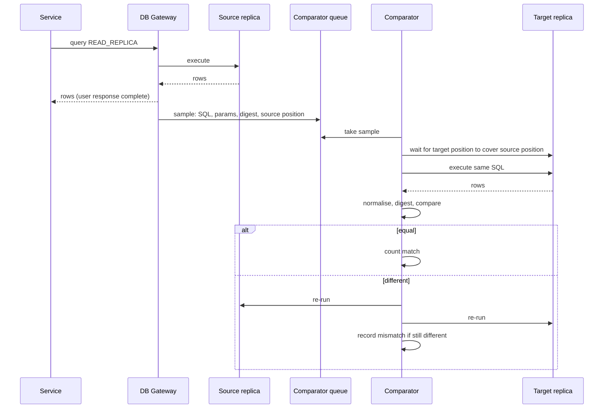

### 7.8 Cutover Orchestrator

**Responsibility.** Execute the write cutover (and the rollback, which is the same procedure in reverse) as a scripted, timed, abortable sequence.  
Runs inside the Control Plane leader.

| Field                | Detail                                                                                                                                                                                                                |
| :------------------- | :-------------------------------------------------------------------------------------------------------------------------------------------------------------------------------------------------------------------- |
| Inputs               | Gate results, Replicator positions, gateway acks                                                                                                                                                                      |
| Outputs              | Routing versions, privilege changes on both clusters, sequence values on the new primary, Replicator commands                                                                                                         |
| State                | Each step's start, end, and result written to `cp_audit` before the next step starts                                                                                                                                  |
| Interfaces           | `cutover(dry_run)`, `rollback()`, `abort()`                                                                                                                                                                           |
| Failure and recovery | Every step before the routing switch has an undo. Any step exceeding its time budget triggers abort. Leader loss mid-cutover: the new leader reads `cp_audit`, and if the switch step has not completed, aborts.      |

**Step budget (write pause).**

| #  | Step                                                                                   | Budget     | Undo on abort                           |
| :- | :------------------------------------------------------------------------------------- | :--------- | :-------------------------------------- |
| 1  | Publish routing version: `write_gate = closed`                                         | -          | Publish `write_gate = open`             |
| 2  | Wait for all gateway instances to ack `CLOSED` (in-flight writes drained)              | 300 ms     | Same as 1                               |
| 3  | Fence source: revoke write privileges from the application role                        | 20 ms      | Re-grant                                |
| 4  | Read final source position `F`                                                         | 5 ms       | -                                       |
| 5  | Wait until forward Applier checkpoint is at or past `F`                                | 300 ms     | -                                       |
| 6  | Stop forward Replicator (keep slot)                                                    | 20 ms      | Restart forward Replicator              |
| 7  | Set target sequences above source values (section 9.3)                                 | 50 ms      | -                                       |
| 8  | Unfence target: grant write privileges to the application role                         | 20 ms      | Revoke                                  |
| 9  | Start reverse Replicator (slots `mig_rev`, `feed_tgt` pre-created, sections 7.9, 10.2) | 50 ms      | Stop reverse Replicator                 |
| 10 | Publish routing version: `WRITE`, `READ_PRIMARY` to target; `write_gate = open`        | 100 ms     | Point of no abort; use rollback instead |
|    | **Total pause budget**                                                                 | **865 ms** |                                         |

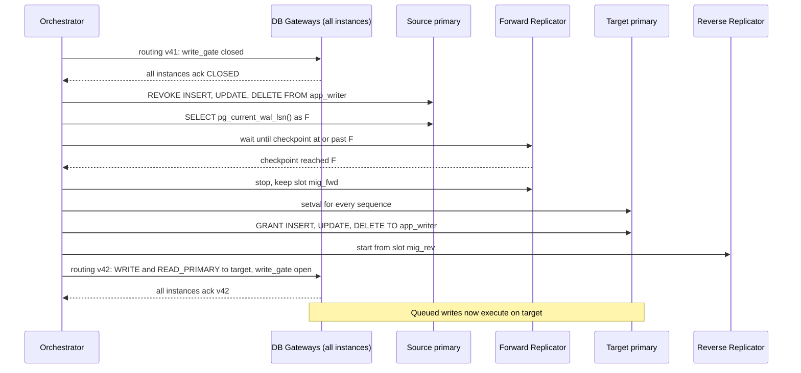

### 7.9 Reverse Replicator

**Responsibility.** From the moment of write cutover until decommission, apply every change committed on the target to the source, so that the source is always a lossless rollback point.

It is the same Replicator binary as the forward one, configured in the opposite direction.

| Setting               | Forward                        | Reverse                                                                                                                      |
| :-------------------- | :----------------------------- | :--------------------------------------------------------------------------------------------------------------------------- |
| Read from             | Source primary (PostgreSQL 11) | Target primary (PostgreSQL 16)                                                                                               |
| Slot                  | `mig_fwd` on source            | `mig_rev` on target                                                                                                          |
| Apply to              | Target primary                 | Source primary                                                                                                               |
| Applier role          | `mig_applier` on target        | `mig_applier` on source (not affected by the fence on `app_writer`)                                                          |
| Checkpoint table      | `mig_checkpoint` on target     | `mig_checkpoint` on source                                                                                                   |
| Origin set on apply   | `mig_fwd` on target            | `mig_rev` on source                                                                                                          |
| Origin filter on read | None needed                    | Drop every `Txn` that carries an origin (`origin 'none'` on PostgreSQL 16; reader also drops `Txn` with an Origin message)   |

**Loop prevention.**  
The target holds changes written by the forward Applier (tagged origin `mig_fwd`) and changes written by the application (no origin).  
The reverse reader must forward only the latter. The slot `mig_rev` is created on the target before the cutover window, so its start position precedes the first application write on the target;  
the origin filter discards the forward-applied history it also sees.

| Engine     | Mechanism                                                                                                                                          |
| :--------- | :------------------------------------------------------------------------------------------------------------------------------------------------- |
| PostgreSQL | Forward Applier sets a replication origin; `pgoutput` on PostgreSQL 16 accepts `origin 'none'` and omits those transactions                        |
| MySQL      | Forward Applier preserves source GTIDs (`gtid_next`); reverse reader drops events whose GTID source UUID equals the source cluster's `server_uuid` |

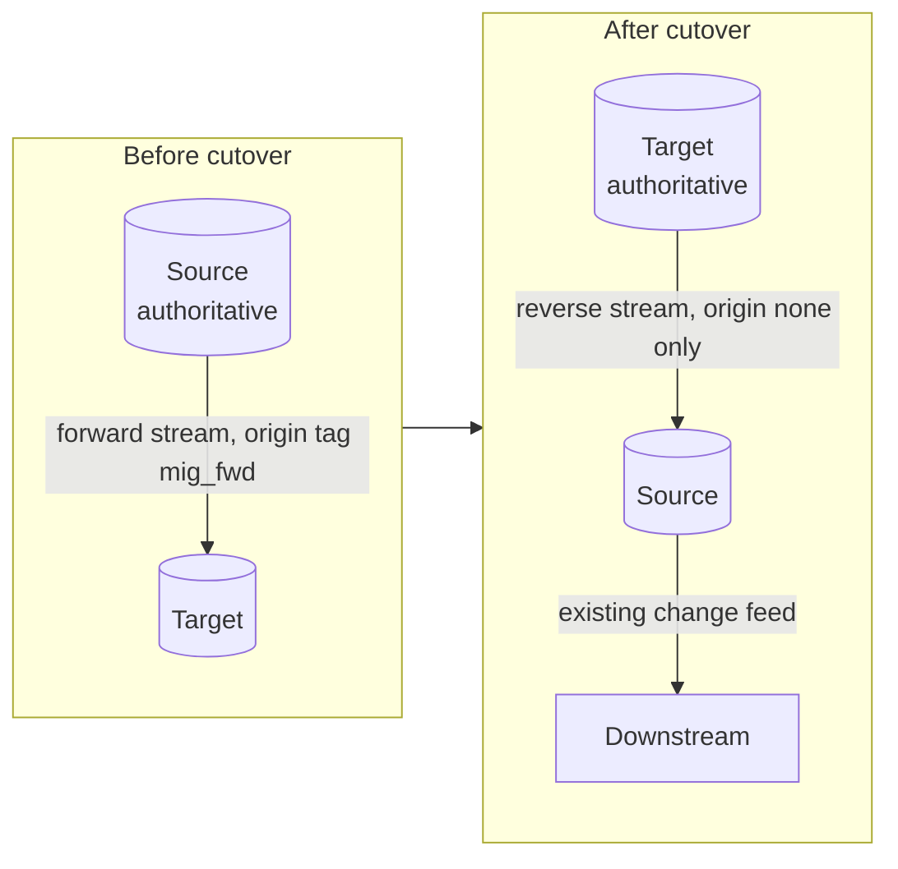

### 7.10 Observability and Auto-Abort

**Responsibility.** Measure every quantity that a gate or an abort rule depends on, and convert threshold breaches into Control Plane commands without waiting for a human.

| Metric                                  | Source                                                  | Threshold              | Automatic action                           |
| :-------------------------------------- | :------------------------------------------------------ | :--------------------- | :----------------------------------------- |
| Forward lag (seconds)                   | Heartbeat age on target                                 | Over 1 s for 60 s      | Block gates; page                          |
| Forward lag (bytes)                     | `pg_current_wal_lsn() - confirmed_flush_lsn` / GTID gap | Over 5 GB              | Page; throttle copier and verifier         |
| Source WAL retained by slot             | `pg_replication_slots`, disk free on source             | Disk free under 25%    | Page; at 15%,drop slot and plan re-snapshot|
| MySQL binlog headroom                   | Oldest binlog vs reader position                        | Under 48 h of headroom | Page                                       |
| Chunk mismatches open                   | `cp_mismatch` unresolved                                | Over 0 at a gate       | Gate refuses                               |
| Invariant failures                      | Verifier                                                | Any                    | Gate refuses; during rollback window, page |
| Shadow mismatch rate                    | Comparator                                              | Over 0 confirmed       | Block read moves                           |
| p99 read latency, target-routed         | DB Gateway                                              | Over 50 ms for 5 min   | Reduce target read weight to previous step |
| p99 write latency after cutover         | DB Gateway                                              | Over 150 ms for 5 min  | Page; human decides rollback               |
| Error rate, target-routed               | DB Gateway                                              | Over 0.1% for 2 min    | Reduce target read weight to previous step |
| Gateway instances not on latest routing | `cp_gateway_ack`                                        | Any, 2 s after publish | Abort cutover step                         |
| Reverse lag (seconds)                   | Heartbeat written on target, read on source             | Over 5 s for 60 s      | Page; rollback blocked until caught up     |

---

## 8. Phase Walkthrough

Each phase lists entry criteria, steps, exit gate, and how to back out.  
The Control Plane refuses to enter a phase until the previous exit gate is recorded as passed in `cp_gate_result`.

### 8.0 Phase 0: Prepare

**Entry criteria.** Migration approved; target account provisioned in the same region; change window calendar published.

| #  | Step                                          | PostgreSQL                                                                                                                                                                                                       | MySQL                                                                                                                                        |
| :- | :-------------------------------------------- | :--------------------------------------------------------------------------------------------------------------------------------------------------------------------------------------------------------------- | :------------------------------------------------------------------------------------------------------------------------------------------- |
| 1  | Deploy Control Plane and control store        | Separate small PostgreSQL HA pair                                                                                                                                                                                | Same                                                                                                                                         |
| 2  | Roll out DB Gateway library to all 8 services | Every call site declares a query class; routing 100% source; run at least 7 days                                                                                                                                 | Same                                                                                                                                         |
| 3  | Ensure every table has a primary key          | `SELECT ... FROM pg_class LEFT JOIN pg_index ... WHERE NOT indisprimary` must return 0 rows                                                                                                                      | `information_schema.TABLE_CONSTRAINTS` check; required for row-based apply                                                                   |
| 4  | Freeze schema                                 | Event trigger on `ddl_command_start` raises an error for every role except `mig_admin`                                                                                                                           | Revoke `CREATE`, `ALTER`, `DROP`, `INDEX` from application and operator roles                                                                |
| 5  | Enable row-level change log                   | `wal_level = logical` requires a restart: `CHECKPOINT`, then `pg_ctl restart -m fast` in 02:00 to 05:00 while the DB Gateway holds writes (gate wait raised to 15 s for this event only); typically 2 to 5 s     | `binlog_format=ROW`, `binlog_row_image=FULL` (dynamic); `gtid_mode` stepped `OFF_PERMISSIVE`, `ON_PERMISSIVE`, `ON` online                   |
| 6  | Create migration roles                        | `mig_repl` (`REPLICATION`), `mig_applier`, `mig_verifier` (read-only), `mig_admin`                                                                                                                               | `mig_repl` (`REPLICATION SLAVE`, `REPLICATION CLIENT`), `mig_applier`(`CONNECTION_ADMIN`, `REPLICATION_APPLIER`), `mig_verifier`, `mig_admin`|
| 7  | Create publication and heartbeat table        | `CREATE PUBLICATION mig_pub FOR ALL TABLES`; `CREATE TABLE mig_heartbeat`                                                                                                                                        | Heartbeat table only                                                                                                                         |
| 8  | Provision target                              | PostgreSQL 16, `rds.logical_replication = 1` (or equivalent), `max_replication_slots >= 4`                                                                                                                       | MySQL 8.0, same binlog and GTID settings                                                                                                     |
| 9  | Create target schema, pre-data only           | `pg_dump --schema-only --section=pre-data` from source, apply to target                                                                                                                                          | `mysqldump --no-data`, strip secondary indexes and foreign keys                                                                              |
| 10 | Create roles on target, fenced                | `app_writer` exists with `SELECT` only; write privileges granted at cutover                                                                                                                                      | `read_only = ON` on target; applier holds `CONNECTION_ADMIN`                                                                                 |
| 11 | Create checkpoint table on target             | `mig_checkpoint(stream text primary key, applied_pos pg_lsn, applied_ts timestamptz)`                                                                                                                            | `applied_pos` as GTID set text                                                                                                               |

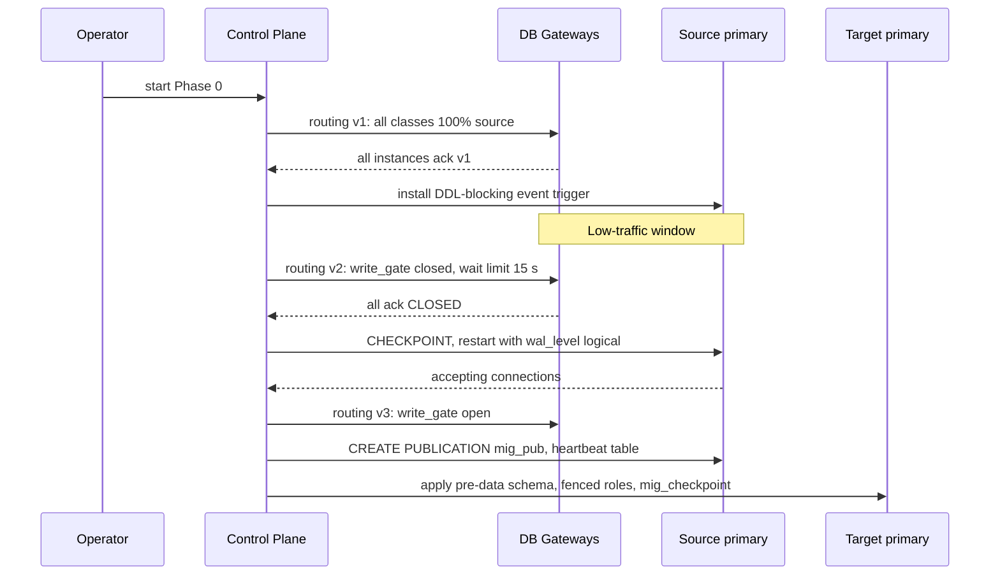

**Exit gate.**

| Check                                               | Threshold          |
|-----------------------------------------------------|--------------------|
| Gateway instances acking current routing version    | 100%               |
| Unclassified query call sites                       | 0                  |
| Tables without primary key                          | 0                  |
| DDL blocked (test statement as operator role)       | Rejected           |
| `SHOW wal_level` on source                          | `logical`          |
| Target schema object count equals source pre-data   | Equal              |

**Back out.** Revert routing to version 1; the library is inert at 100% source. Leave `wal_level = logical` (harmless).

### 8.1 Phase 1: Sync

**Entry criteria.** Phase 0 gate passed. Copy node host provisioned with 3 TB disk.

| #  | Step                                                                                                      | Duration (section 12)  |
| :- | :-------------------------------------------------------------------------------------------------------- | :--------------------- |
| 1  | Base backup of source onto copy node                                                                      | ~6 h at 100 MB/s       |
| 2  | Create forward slot `mig_fwd`, record `S`                                                                 | Seconds                |
| 3  | Replay copy node to `S`, pause                                                                            | Minutes                |
| 4  | Bulk copy all chunks to target at 50 MB/s (table data ~1.1 TB; indexes are rebuilt on target, not copied) | ~6.4 h                 |
| 5  | Build post-data on target: secondary indexes, then foreign keys `NOT VALID` + `VALIDATE`                  | 4 to 12 h              |
| 6  | Start forward Replicator from `S`                                                                         | -                      |
| 7  | Catch up the backlog accumulated since `S`                                                                | ~1M changes, under 1 h |
| 8  | Destroy copy node                                                                                         | -                      |

Steps 1 to 4 are diagrammed in section 7.5. Index build (step 5) can run while the stream catches up (step 6) on PostgreSQL with `CREATE INDEX CONCURRENTLY`;  
to keep the procedure simple and the build fast, run step 5 before step 6.

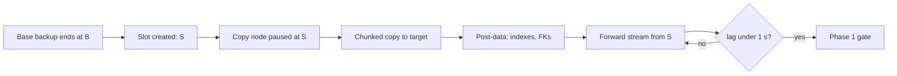

**Exit gate.**

| Check                        | Threshold                          |
|------------------------------|------------------------------------|
| `cp_chunk.copy_state = done` | 100% of chunks                     |
| Copy-time hash recorded      | 100% of chunks                     |
| All target indexes valid     | `pg_index.indisvalid` true for all |
| Forward lag                  | Under 1 s for 24 h                 |
| Source disk free             | Over 30%                           |

**Back out.** Stop Replicator, drop slot `mig_fwd` (releases WAL on source), truncate target. Nothing user-facing changed.

### 8.2 Phase 2: Verify

**Entry criteria.** Phase 1 gate passed.

| #  | Step                                                                                         |
|----|----------------------------------------------------------------------------------------------|
| 1  | Full verifier pass over all chunks (source reporting replica vs target primary)              |
| 2  | Row diff and repair for every chunk still mismatched after 3 attempts                        |
| 3  | Invariants I1 to I5 on target inside one `REPEATABLE READ` snapshot                          |
| 4  | Same invariants on source reporting replica, as baseline                                     |
| 5  | Incremental passes hourly from here until decommission                                       |

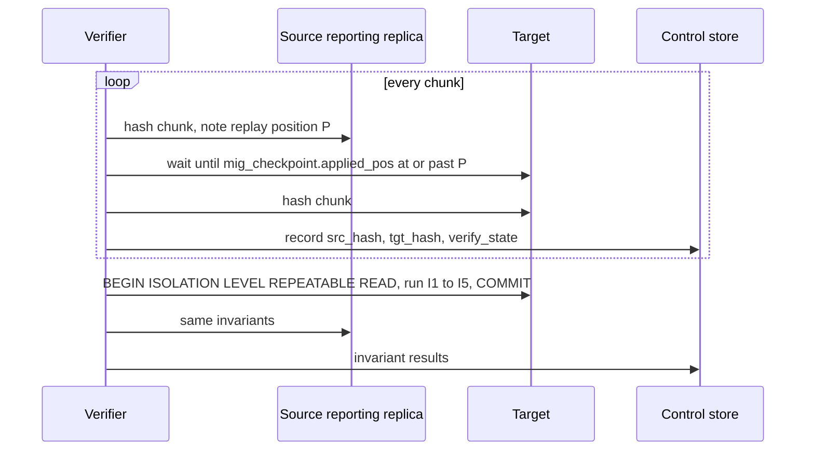

**Exit gate.**

| Check                                                                        | Threshold |
| :--------------------------------------------------------------------------- | :-------- |
| Chunks `verify_state = ok`                                                   | 100%      |
| Open `cp_mismatch` rows                                                      | 0         |
| Invariants I1 to I5 on target                                                | All pass  |
| Invariant results equal between source and target (same totals per currency) | Equal     |

**Back out.** Repair and re-verify; if repair rate is high (over 0.01% of rows), suspect the Applier, stop, fix, re-snapshot affected tables.

### 8.3 Phase 3: Build Target Replicas

**Entry criteria.** Phase 1 gate passed (may run in parallel with Phase 2).

| #  | Step                                                                                                                                                                                     |
| :- | :--------------------------------------------------------------------------------------------------------------------------------------------------------------------------------------- |
| 1  | Create 3 app replicas and 2 reporting replicas from the target primary (managed read replicas)                                                                                           |
| 2  | Reporting replicas: allow long queries without cancellation: `max_standby_streaming_delay = -1` or `hot_standby_feedback = on` (PostgreSQL); MySQL replicas have no equivalent conflict  |
| 3  | Configure automated failover on target primary (multi-AZ standby)                                                                                                                        |
| 4  | Failover drill on target: force failover, measure RTO, confirm forward Replicator reconnects and resumes from checkpoint                                                                 |

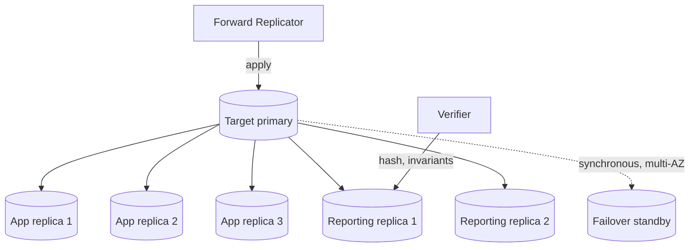

**Exit gate.**

| Check                                  | Threshold                                     |
| :------------------------------------- | :-------------------------------------------- |
| Replica count healthy                  | 5 of 5                                        |
| Replica lag behind target primary      | Under 500 ms                                  |
| Failover drill RTO                     | Under 60 s                                    |
| Forward Replicator resumed after drill | Yes, no gap (verifier incremental pass clean) |

### 8.4 Phase 4: Shadow Reads

**Entry criteria.** Phases 2 and 3 gates passed.

| #  | Step                                                                                 |
|----|--------------------------------------------------------------------------------------|
| 1  | Publish routing with shadow sampling 1% for `READ_REPLICA` and `READ_REPORTING`      |
| 2  | Comparator runs samples on target replicas (section 7.7)                             |
| 3  | Run at least 7 days, spanning one month-end close                                    |
| 4  | Record target-side latency of shadow queries; compare with source                    |

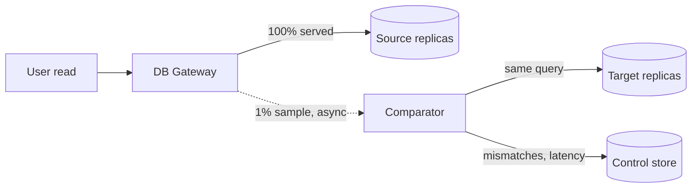

**Exit gate.**

| Check                                         | Threshold                      |
|-----------------------------------------------|--------------------------------|
| Confirmed shadow mismatches                   | 0                              |
| Samples compared                              | At least 7M (1% of 100M/dayx7) |
| Target p99 latency for shadow queries         | Under 50 ms                    |
| Month-end included                            | Yes                            |

### 8.5 Phase 5: Move Reads

**Entry criteria.** Phase 4 gate passed; not inside month-end freeze.

| Step | Class                   | Target weight | Hold time | Rollback trigger (auto)                 |
| :--- | :---------------------- | :------------ | :-------- | :-------------------------------------- |
| 1    | `READ_REPORTING`        | 10%           | 24 h      | Error rate or p99 breach (section 7.10) |
| 2    | `READ_REPORTING`        | 100%          | 24 h      | Same                                    |
| 3    | `READ_REPLICA`          | 1%            | 4 h       | Same                                    |
| 4    | `READ_REPLICA`          | 10%           | 12 h      | Same                                    |
| 5    | `READ_REPLICA`          | 50%           | 24 h      | Same                                    |
| 6    | `READ_REPLICA`          | 100%          | 24 h      | Same                                    |
| -    | `READ_PRIMARY`, `WRITE` | 0%            | -         | Move only in Phase 6                    |

Read-your-writes during this phase: the session's token is a **source** position.  
A target replica is fresh enough when its replicated copy of `mig_checkpoint.applied_pos` is at or past the token (section 9.7).

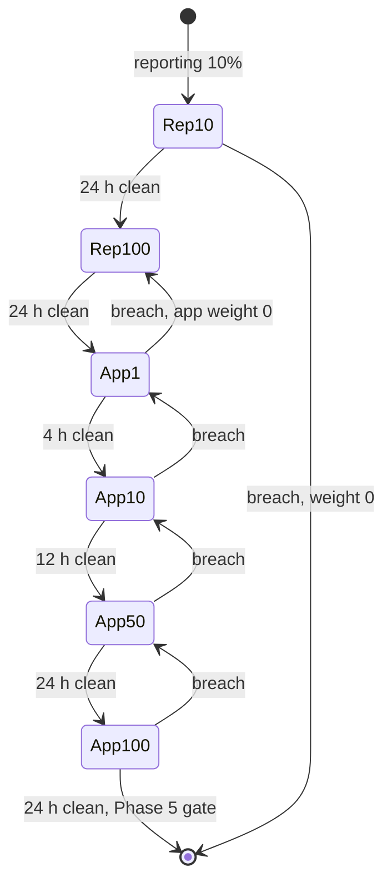

**Exit gate.** 100% of replica and reporting reads on target for 24 h;  
Error rate and p99 within thresholds; shadow sampling still at 0 confirmed mismatches (now sampling in reverse: target served, source compared).

### 8.6 Phase 6: Move Writes

**Entry criteria.**

| Check                                                     | Threshold                                          |
| :-------------------------------------------------------- | :------------------------------------------------- |
| Clock                                                     | Inside 02:00 to 05:00                              |
| Nightly reconciliation batch                              | Finished                                           |
| Calendar                                                  | Not in last 3 or first 2 days of month             |
| Forward lag                                               | Under 100 ms                                       |
| Incremental verifier pass in last hour                    | 0 mismatches                                       |
| Invariants in last hour                                   | Pass                                               |
| Reverse slot `mig_rev` and feed slot `feed_tgt` on target | Created, inactive                                  |
| Reverse Replicator                                        | Deployed, idle, checkpoint table on source present |
| Gateway instances acking current routing                  | 100%                                               |
| Dry run of steps 1, 2, then abort, on previous night      | Pause measured under 400 ms                        |

**Steps.** Section 7.8 table and diagram. Pause budget 865 ms; measured target under 600 ms.

**Immediately after the switch (first 15 minutes).**

| Check                                                                  | Action if breached                            |
| :--------------------------------------------------------------------- | :-------------------------------------------- |
| Write error rate under 0.1%                                            | Human decision: rollback                      |
| Write p99 under 150 ms                                                 | Human decision: rollback                      |
| Reverse lag under 5 s                                                  | Investigate; rollback blocked until caught up |
| Sample of 100 recent transactions present on source via reverse stream | Investigate reverse Replicator                |
| Invariant I1 on target                                                 | Rollback                                      |

### 8.7 Phase 7: Downstream Transition

See section 10. The existing change feed keeps reading the source during the rollback window; it sees target writes because the reverse Applier writes them into the source's WAL / binlog.

### 8.8 Phase 8: Rollback Window

**Duration.** 14 days after write cutover.

| Activity                                   | Frequency                                       |
| :----------------------------------------- | :---------------------------------------------- |
| Reverse lag monitoring                     | Continuous                                      |
| Incremental verifier pass                  | Hourly                                          |
| Invariants I1 to I5 on both clusters       | Nightly                                         |
| Source WAL retained by kept slot `mig_fwd` | Continuous (kept for re-attempt after rollback) |
| Target WAL retained by `mig_rev`           | Continuous                                      |

**Rollback procedure.** The cutover in mirror image.

```mermaid
sequenceDiagram
    participant OR as Orchestrator
    participant GW as DB Gateways
    participant TP as Target primary
    participant RR as Reverse Replicator
    participant SP as Source primary
    participant FR as Forward Replicator

    OR->>GW: routing: write_gate closed
    GW-->>OR: all ack CLOSED
    OR->>TP: REVOKE INSERT, UPDATE, DELETE FROM app_writer
    OR->>TP: read final position F2
    OR->>RR: wait until source checkpoint at or past F2
    OR->>RR: stop, keep slot mig_rev
    OR->>SP: setval every sequence above target values
    OR->>SP: GRANT INSERT, UPDATE, DELETE TO app_writer
    OR->>FR: resume from slot mig_fwd, drop transactions with origin mig_rev
    OR->>GW: routing: WRITE, READ_PRIMARY, all reads to source, gate open
    GW-->>OR: all ack
```

After rollback the forward stream resumes from its own checkpoint.  
Transactions it sees with origin `mig_rev` already exist on the target (they were written there first), so the reader drops them.  
The target therefore stays current and a second cutover attempt needs no new snapshot.

### 8.9 Phase 9: Decommission

**Entry criteria.** 14 days without rollback; last full verifier pass clean; sign-off recorded in `cp_audit`.

| #  | Step                                                                                                        |
| :- | :---------------------------------------------------------------------------------------------------------- |
| 01 | Final full verifier pass, source vs target                                                                  |
| 02 | Final invariants on both clusters; archive results                                                          |
| 03 | Stop reverse Replicator                                                                                     |
| 04 | Drop slot `mig_rev` on target (otherwise target WAL grows without bound)                                    |
| 05 | Drop slot `mig_fwd` and publication `mig_pub` on source                                                     |
| 06 | Take a final backup of source; store per 7-year retention policy                                            |
| 07 | Remove source endpoints from the DB Gateway routing table; library stays as the standard data-access layer  |
| 08 | Revoke and drop migration roles on both clusters; remove DDL-blocking trigger (now on target only if added) |
| 09 | Shut down source cluster and copy node remnants                                                             |
| 10 | Lift schema freeze                                                                                          |

```mermaid
flowchart LR
    A["Final verify"] --> B["Stop reverse stream"]
    B --> C["Drop mig_rev on target"]
    C --> D["Drop mig_fwd, mig_pub on source"]
    D --> E["Final backup archived"]
    E --> F["Remove source from routing"]
    F --> G["Drop migration roles"]
    G --> H["Shut down source"]
    H --> I["Lift schema freeze"]
```

---

## 9. Core Algorithms

### 9.1 Snapshot-to-Stream Hand-off

**Requirement.** Every committed transaction appears on the target exactly once in effect: either in the bulk copy or in the stream, never in neither.

| Engine     | Snapshot side                                              | Stream side                                                                     | Boundary                                              |
| :--------- | :--------------------------------------------------------- | :------------------------------------------------------------------------------ | :---------------------------------------------------- |
| PostgreSQL | Copy node replayed to `recovery_target_lsn = S`, inclusive | Slot `mig_fwd` streams transactions committing after its `consistent_point` `S` | Commits at `S` may appear in both: overlap, never gap |
| MySQL      | Copy replica stopped; `gtid_executed` read as set `S`      | `COM_BINLOG_DUMP_GTID` with set `S`: server sends only GTIDs not in `S`         | Exact; no overlap, no gap                             |

Overlap is harmless because every Applier statement is an upsert or a key-based delete (section 7.4).  
Gap is impossible because the stream's start is defined by the same point as the snapshot.

```mermaid
flowchart LR
    subgraph Log["Source change log, commit order"]
        direction LR
        T1["txn 1"] --> T2["txn 2"] --> T3["txn 3 at S"] --> T4["txn 4"] --> T5["txn 5"]
    end
    T1 -.-> COPY["Bulk copy (snapshot at S)"]
    T2 -.-> COPY
    T3 -.-> COPY
    T3 -.-> STREAM["Forward stream (after S)"]
    T4 -.-> STREAM
    T5 -.-> STREAM
```

### 9.2 Exactly-Once Effect from At-Least-Once Delivery

Delivery from a slot or binlog is at-least-once: after a crash, changes since the last confirmed position are sent again.  
Exactly-once **effect** comes from three properties together:

1. Every `Txn` is applied as one destination transaction (all or nothing).
2. The checkpoint row is updated inside that same transaction.
3. Every statement is idempotent (upsert, key-based delete).

| Crash point                               | Destination state             | On restart                                                    | Result       |
| :---------------------------------------- | :---------------------------- | :------------------------------------------------------------ | :----------- |
| Before destination `BEGIN`                | `Txn` absent, checkpoint old  | `Txn` re-delivered and applied                                | Applied once |
| Mid-apply, before `COMMIT`                | Rolled back by destination    | `Txn` re-delivered and applied                                | Applied once |
| After `COMMIT`, before feedback to source | `Txn` present, checkpoint new | `Txn` re-delivered; skipped (position at or below checkpoint) | Applied once |
| After feedback                            | `Txn` present                 | Not re-delivered                                              | Applied once |

### 9.3 Identifier Generators

PostgreSQL sequences are not part of the logical stream: explicit inserts with ids from the source do not advance the target sequence.  
MySQL InnoDB advances the `AUTO_INCREMENT` counter when an explicit larger value is inserted (persisted across restart in 8.0; recomputed as `MAX(id)+1` at restart in 5.7).

| Moment          | PostgreSQL                                                                                                                                   | MySQL                                                                                                                          |
| :-------------- | :------------------------------------------------------------------------------------------------------------------------------------------- | :----------------------------------------------------------------------------------------------------------------------------- |
| Cutover step 7  | For each sequence: `SELECT last_value FROM seq` on fenced source; `SELECT setval('seq', last_value + 1000)` on target, all in one `DO` block | Check `information_schema.TABLES.AUTO_INCREMENT >= MAX(id)+1` per table; if not, `ALTER TABLE t AUTO_INCREMENT = MAX(id)+1000` |
| Rollback        | Same, target to source                                                                                                                       | Same                                                                                                                           |
| Why after fence | After the source is fenced no new ids are drawn there, so `last_value` is final                                                              | Same                                                                                                                           |
| Margin of 1000  | Covers ids drawn by transactions that rolled back; gaps are allowed, duplicates are not                                                      | Same                                                                                                                           |
| Alternative     | Client-generated UUID v7 / ULID keys remove the problem entirely; not applicable to an existing schema under freeze                          | Same                                                                                                                           |

### 9.4 Chunk Hashing Under Concurrent Writes

**Hash definition.**

| Engine     | Chunk hash expression                                                                                                                                                                    |
| :--------- | :--------------------------------------------------------------------------------------------------------------------------------------------------------------------------------------- |
| PostgreSQL | `SELECT md5(string_agg(md5(t::text), '' ORDER BY pk)) FROM t WHERE pk > $lo AND pk <= $hi`                                                                                               |
| MySQL      | `SELECT MD5(GROUP_CONCAT(MD5(CONCAT_WS('#', COALESCE(c1,'\N'), COALESCE(c2,'\N'), ...)) ORDER BY pk SEPARATOR '')) FROM t WHERE pk > ? AND pk <= ?` with `group_concat_max_len = 4194304`|

Hashing each row first, then the concatenation of row hashes, bounds memory at 32 bytes per row (3.2 MB per 100,000-row chunk).

**Deterministic text rendering.** The same value must print identically on both clusters, including across major versions.

| Setting                | PostgreSQL                                            | MySQL                             | Why                                                                    |
| :--------------------- | :---------------------------------------------------- | :-------------------------------- | :--------------------------------------------------------------------- |
| Time zone              | `SET TimeZone = 'UTC'`                                | `SET time_zone = '+00:00'`        | `timestamptz` / `TIMESTAMP` print in session time zone                 |
| Date format            | `SET DateStyle = 'ISO, YMD'`                          | Fixed                             | Default may differ per server                                          |
| Float output           | `SET extra_float_digits = 3`                          | Fixed                             | PostgreSQL 12 changed default float output; 11 and 16 differ otherwise |
| Binary output          | `SET bytea_output = 'hex'`                            | `HEX(col)`                        | Escape vs hex format                                                   |
| Interval output        | `SET IntervalStyle = 'postgres'`                      | -                                 | Server default may differ                                              |
| NULL vs empty string   | `row::text` distinguishes them                        | `COALESCE(col, '\N')` marker      | `CONCAT_WS` skips NULLs                                                |
| `json` vs `jsonb`      | `jsonb` normalises; `json` keeps whitespace as stored | `JSON` normalised                 | Both stable if the type is unchanged                                   |
| Key order for text PKs | `ORDER BY pk COLLATE "C"`                             | `ORDER BY pk COLLATE utf8mb4_bin` | Locale collation order can differ between OS library versions          |

**Convergence under writes.**  
The two hashes are taken at slightly different moments. A chunk that changed between the two reads mismatches temporarily.  
The verifier records the source replica's replay position `P`, waits until the target has applied up to `P`, then hashes the target.  
If rows changed after `P`, the target may be ahead of the source read.  
Up to 3 attempts 30 s apart resolve these; only a mismatch that persists is a real difference.

**Shortcut for immutable data.** `ledger_entries` and `audit_log` (~77% of rows, ~1.25 TB or ~62% of bytes) are insert-only.  
A chunk whose upper bound is below the maximum primary key at `S` never changes, so one matching hash is final for that chunk.

### 9.5 Write Pause Calculation

| Quantity                                                                    | Formula                             | Low window (~1 write/s) | Peak (100 writes/s) |
| :-------------------------------------------------------------------------- | :---------------------------------- | :---------------------- | :------------------ |
| Drain time                                                                  | Longest in-flight write transaction | ~20 ms                  | ~150 ms             |
| Catch-up                                                                    | Forward lag at fence                | ~50 ms                  | ~300 ms             |
| Fixed steps (fence, read F, stop, sequences, grant, start reverse, publish) | Sum of step budgets                 | ~265 ms                 | ~265 ms             |
| Total pause                                                                 | Sum                                 | ~335 ms                 | ~715 ms             |
| Writes held in gateway queues                                               | Rate x pause                        | ~1 row write            | ~72 row writes      |
| Business transactions held                                                  | Rate / 8 x pause                    | 0 to 1                  | ~9                  |

Requirements on clients: transaction timeout above 2 s (gate queue wait limit); retries carry idempotency keys.

### 9.6 Fencing the Non-Authoritative Cluster

Gateway acknowledgements prove that well-behaved instances stopped writing.  
They do not cover an instance that was partitioned from the Control Plane, paused by a garbage collector, or an operator script that connects directly.  
The database itself must refuse writes from the application role on the side that is no longer authoritative.  
This is the same principle as fencing tokens in distributed locking (`/mnt/project-files/distributed-locking/distributed-locking.md`): the resource enforces the boundary, not the client.

| Engine     | Fence                                                                                                                                                                                 | Takes effect                                                          | Applier exempt because                      |
| :--------- | :------------------------------------------------------------------------------------------------------------------------------------------------------------------------------------ | :-------------------------------------------------------------------- | :------------------------------------------ |
| PostgreSQL | `REVOKE INSERT, UPDATE, DELETE, TRUNCATE ON ALL TABLES IN SCHEMA app FROM app_writer`; then `pg_terminate_backend()` for `app_writer` sessions `idle in transaction`                  | Next statement of every session (privileges are checked at execution) | Applier uses role `mig_applier`, not revoked|
| MySQL      | `SET GLOBAL read_only = ON`; then `KILL` remaining application connections                                                                                                            | Immediately for users without `CONNECTION_ADMIN` / `SUPER`            | Applier user holds `CONNECTION_ADMIN`       |
| MySQL note | `REVOKE` on global privileges does not affect existing connections; database-level `REVOKE` applies only after the next `USE`. Hence `read_only`, not `REVOKE`, is the fence on MySQL | -                                                                     | -                                           |

```mermaid
sequenceDiagram
    participant Z as Stale gateway instance (partitioned)
    participant SP as Source primary
    participant TP as Target primary

    Note over SP: Cutover step 3: REVOKE from app_writer
    Z->>SP: INSERT INTO transactions ...
    SP-->>Z: ERROR permission denied
    Z->>Z: retryable error, reconnect, fetch routing
    Z->>TP: INSERT INTO transactions ... (after routing refresh)
    TP-->>Z: OK
```

### 9.7 Read-Your-Writes Across Two Clusters

A position from the source (LSN / GTID) means nothing on the target's own replicas, whose replay position is in the target's log.  
The bridge is the checkpoint table: the forward Applier writes the source position it has applied into `mig_checkpoint` on the target, and that row replicates to every target replica.

| Situation                               | Token type      | A node is fresh enough when                                                                     |
| :-------------------------------------- | :-------------- | :---------------------------------------------------------------------------------------------- |
| Source replica, before cutover          | Source position | `pg_last_wal_replay_lsn() >= token` / `WAIT_FOR_EXECUTED_GTID_SET(token)`                       |
| Target replica, before cutover          | Source position | `SELECT applied_pos FROM mig_checkpoint WHERE stream='fwd'` on that replica is at or past token |
| Any node, after cutover                 | Target position | Same as first row, on target replicas                                                           |
| Token issued before cutover, read after | Source position | Route to target primary for the token's remaining lifetime (10 s)                               |

---

## 10. Downstream Consumer Transition

### 10.1 Consumers

| Consumer                      | Reads from today                   | During Phases 1 to 5                | After write cutover (rollback window)                                          | After decommission        |
| :---------------------------- | :--------------------------------- | :---------------------------------- | :----------------------------------------------------------------------------- | :------------------------ |
| Change feed to warehouse      | Logical decoding on source primary | Unchanged                           | Unchanged; sees target writes via reverse Applier                              | Target slot `feed_tgt`    |
| Regulatory reports            | Source reporting replicas          | Moved in Phase 5 (`READ_REPORTING`) | Target reporting replicas                                                      | Target reporting replicas |
| Nightly ledger reconciliation | Source reporting replica           | Moved in Phase 5                    | Run on both clusters, results compared                                         | Target only               |
| Partner-bank settlement files | Source reporting replica           | Moved in Phase 5                    | Generated from both, files compared byte for byte for 3 days; target copy sent | Target only               |

### 10.2 Change Feed Hand-off Without Gap or Duplicate

The feed must switch from reading the source log to reading the target log. The two logs have unrelated positions.  
The bridge is again the checkpoint row: every transaction the reverse Applier writes on the source also updates `mig_checkpoint` with the **target** commit position of the transaction it is applying.  
A feed consumer reading the source log therefore knows, for every transaction, the target position it corresponds to.

| Step | Action                                                                                                                                                                                                                                                                                                    |
| :--- | :-------------------------------------------------------------------------------------------------------------------------------------------------------------------------------------------------------------------------------------------------------------------------------------------------------- |
| 1    | Before the cutover window, create slot `feed_tgt` on the target next to `mig_rev`. It retains every target transaction from that point, including all application writes after cutover. Forward-applied transactions it also contains are discarded in step 4 because their positions are below `Plast`.  |
| 2    | Until decommission, the feed reads the source. For each transaction applied by the reverse Applier, it records the target position `Ptgt` from the `mig_checkpoint` change inside that transaction.                                                                                                       |
| 3    | At hand-off, stop the source feed reader. Let `Plast` be the highest `Ptgt` it emitted.                                                                                                                                                                                                                   |
| 4    | Start the target feed reader on `feed_tgt`. Drop every transaction with commit position at or below `Plast`; emit the rest.                                                                                                                                                                               |
| 5    | Drop the source feed slot.                                                                                                                                                                                                                                                                                |

MySQL: the reverse Applier preserves target GTIDs (`gtid_next`), so the source binlog carries the target GTID of each transaction; the hand-off filters by GTID set instead of position.

```mermaid
sequenceDiagram
    participant TP as Target primary
    participant RA as Reverse Applier
    participant SP as Source primary
    participant FS as Feed reader (source)
    participant FT as Feed reader (target)
    participant K as Warehouse loader

    Note over TP: slot feed_tgt created before cutover
    TP->>RA: txn at target position 9/100
    RA->>SP: apply txn + mig_checkpoint = 9/100
    SP->>FS: txn, carries Ptgt 9/100
    FS->>K: emit events tagged 9/100
    Note over FS: hand-off: stop, Plast = 9/100
    TP->>FT: replay feed_tgt from its start
    FT->>FT: drop txns at or below 9/100
    FT->>K: emit txns after 9/100
```

The warehouse loader additionally applies events idempotently by `(table, primary key, commit position)`, so an accidental duplicate does not double-count.

---

## 11. Failure Modes and Runbook

| #  | Failure                                                         | Detection                                               | Impact                                                                                 | Response                                                                                                     |
| :- | :-------------------------------------------------------------- | :------------------------------------------------------ | :------------------------------------------------------------------------------------- | :----------------------------------------------------------------------------------------------------------- |
| 1  | Replicator process crash                                        | Heartbeat lost; lag grows                               | Target falls behind; no user impact before cutover                                     | Standby instance takes lease, resumes from checkpoint (9.2)                                                  |
| 2  | Apply error (constraint, type, missing row)                     | Applier stops, alert                                    | Lag grows                                                                              | Never skip. Inspect `Txn`; fix root cause (usually schema mismatch); repair rows; resume                     |
| 3  | Source disk filling from WAL retained by slot                   | Disk free under 25%                                     | Source primary at risk                                                                 | Fix stalled Replicator. At 15% free: drop slot, accept re-snapshot                                           |
| 4  | MySQL binlog purged before reader consumed it                   | Reader error: GTIDs purged                              | Stream broken                                                                          | Re-snapshot affected tables; raise `binlog_expire_logs_seconds`                                              |
| 5  | Source primary failover during Phases 1 to 5 (PostgreSQL 11)    | Replicator connection error; slot absent on new primary | Logical slots are not copied to standbys before PostgreSQL 17: stream lost             | Create new slot; re-snapshot or repair: verifier full pass finds and repairs the gap                         |
| 6  | Target primary failover before cutover                          | Applier connection error                                | Short apply pause                                                                      | Applier reconnects; checkpoint table is on target storage, survives                                          |
| 7  | Target primary failover during rollback window                  | Reverse reader connection error                         | Slot `mig_rev` may be lost (service-dependent; PostgreSQL 16 does not replicate slots) | Re-create `mig_rev`; verifier repair in reverse direction for the interval; rollback blocked until clean     |
| 8  | Copy node failure mid-copy                                      | Copier errors                                           | Copy stalls                                                                            | Rebuild copy node to same `S`; chunks marked `done` stay; continue                                           |
| 9  | Chunk copy failure                                              | `copy_state = failed`                                   | None                                                                                   | Automatic retry 3 times; then alert                                                                          |
| 10 | Verifier persistent mismatch                                    | `cp_mismatch` rows                                      | Gate blocked                                                                           | Row diff, repair (7.6); if rate over 0.01%, stop and investigate Applier                                     |
| 11 | False mismatch from text rendering                              | Mismatches only in float, timestamp, bytea columns      | Gate blocked                                                                           | Check session settings (9.4)                                                                                 |
| 12 | Shadow mismatch from different query plan or collation ordering | Comparator                                              | Read move blocked                                                                      | Add unique `ORDER BY`; fix collation; re-baseline                                                            |
| 13 | Target slower than source for some queries (new planner)        | Shadow latency, p99 after read move                     | Read move blocked or reversed                                                          | `ANALYZE` all tables after copy; tune; add index on target only if schema freeze allows (it does not: defer) |
| 14 | Gateway instance loses Control Plane stream                     | Missing ack                                             | Instance may write to wrong side                                                       | Instance refuses new writes after 5 s; DB-level fence (9.6) rejects stray writes                             |
| 15 | Long write transaction blocks drain at cutover                  | Step 2 exceeds 300 ms                                   | Pause budget exceeded                                                                  | Abort cutover (no user-visible effect beyond pause); identify transaction; retry next window                 |
| 16 | Cutover step timeout or error before switch                     | Orchestrator                                            | Pause ends                                                                             | Automatic abort and undo (7.8)                                                                               |
| 17 | Error spike after switch                                        | Write error rate over 0.1%                              | User impact                                                                            | Human decides rollback (8.8)                                                                                 |
| 18 | Duplicate key on insert after cutover                           | Application errors on one table                         | Writes to that table fail                                                              | Sequence not advanced: `setval` above `MAX(id)` immediately                                                  |
| 19 | Control Plane leader loss                                       | Lease expires                                           | No new commands for up to 2 s                                                          | Follower takes lease with higher epoch; components reject old epoch                                          |
| 20 | Network partition between clusters                              | Lag grows                                               | Before cutover: none. After: rollback point ages                                       | Block cutover; after cutover, rollback blocked until reverse lag recovers                                    |
| 21 | DDL attempted during freeze                                     | Event trigger error / privilege error                   | Statement rejected                                                                     | Route through change board; defer                                                                            |
| 22 | Month-end volume spike                                          | Lag, latency                                            | Higher lag                                                                             | Throttle verifier and copier; no gate transitions during freeze                                              |

---

## 12. Capacity and Timing Math

### 12.1 Data Movement

| Item                                  | Calculation                                                   | Result            |
| :------------------------------------ | :------------------------------------------------------------ | :---------------- |
| Data volume                           | 2 TB = 2,097,152 MB                                           | -                 |
| Bulk copy at 50 MB/s                  | 2,097,152 / 50                                                | 41,943 s, ~11.7 h |
| Bulk copy excluding secondary indexes | ~1.1 TB table data (indexes ~0.9 TB built on target) / 50 MB/s| ~6.4 h            |
| Base backup for copy node at 100 MB/s | 2,097,152 / 100                                               | ~5.8 h            |
| Secondary index build on target       | Measured on rehearsal; typical                                | 4 to 12 h         |
| Backlog after copy and index build    | ~1M row changes/day x ~1 day                                  | ~1M changes       |
| Catch-up at 300 Txn/s (~2,400 rows/s) | 1,000,000 / 2,400                                             | ~7 min            |
| Network for copy                      | 50 MB/s x 8                                                   | 400 Mbit/s        |

### 12.2 Verification

| Item                                   | Calculation                                        | Result                    |
|----------------------------------------|----------------------------------------------------|---------------------------|
| Chunks                                 | ~1.14B rows / 100,000                              | ~11,400                   |
| Full pass, each side, at 50 MB/s read  | ~1.1 TB table data / 50 MB/s, sides in parallel    | ~6.4 h                    |
| Invariant I2 (scan ledger 800 GB)      | 800 GB / 100 MB/s on reporting replica             | ~2.3 h                    |
| Incremental pass                       | Chunks touched per hour: hot tail of 4 tables      | Minutes                   |

### 12.3 Log Retention and Disk

| Item                                                  | Calculation                                | Result                                         |
| :---------------------------------------------------- | :----------------------------------------- | :--------------------------------------------- |
| WAL generated per day on source                       | ~1M row changes x ~1 KB + full-page images | ~2 to 4 GB/day                                 |
| Retained during copy and index build                  | ~1 day                                     | ~4 GB                                          |
| Retained by kept `mig_fwd` over 14-day rollback window| 14 x ~4 GB                                 | ~56 GB                                         |
| Source free disk                                      | 3 TB volume, 2 TB used                     | ~1 TB; ample                                   |
| Target primary storage                                | 2 TB + growth 350 GB/yr + 50% headroom     | Provision 4 TB or autoscaling                  |
| Copy node                                             | Full copy of source                        | 3 TB, destroyed after Phase 1                  |
| MySQL binlog retention                                | Copy + index + margin                      | `binlog_expire_logs_seconds = 604800` (7 days) |

### 12.4 Calendar

| Phase                     | Duration          |
|---------------------------|-------------------|
| 0 Prepare                 | 7 days            |
| 1 Sync                    | 2 days            |
| 2 Verify                  | 3 days            |
| 3 Replicas (parallel)     | 2 days            |
| 4 Shadow                  | 10 days.          |
| 5 Reads                   | 5 days            |
| 6 Writes                  | 1 night           |
| 8 Rollback window         | 14 days           |
| 9 Decommission            | 2 days            |
| **Total**                 | **~6 weeks**      |

---

## 13. Testing and Rehearsal

### 13.1 Environments

| Environment | Data                                        | Purpose                                                     |
| :---------- | :------------------------------------------ | :---------------------------------------------------------- |
| Unit        | Synthetic                                   | Applier statement generation, hash rendering, gate logic    |
| Integration | Synthetic, all column types, both engines   | Reader/Applier end to end, TOAST, PK updates, NULL vs empty |
| Staging     | Production-sized (2 TB), masked per PCI-DSS | Timing, throughput, full rehearsals                         |
| Production  | Real                                        | Dry run of cutover steps 1 and 2 the night before           |

### 13.2 Fault Injection Matrix

| #  | Injected fault                                                      | Expected outcome                                     |
| :- | :------------------------------------------------------------------ | :--------------------------------------------------- |
| 1  | Kill Replicator between apply and checkpoint                        | No duplicate, no gap (verifier clean)                |
| 2  | Kill Bulk Copier mid-chunk                                          | Chunk rolled back, recopied                          |
| 3  | Update a random row on target directly                              | Verifier flags exactly that row; repair fixes it     |
| 4  | Delete a random row on target                                       | Verifier reports `missing`; repair fixes it          |
| 5  | Insert an extra row on target                                       | Verifier reports `extra`; repair deletes it          |
| 6  | Update that changes a primary key                                   | Applier deletes old key, inserts new                 |
| 7  | Update of a row with a large out-of-line (TOAST) column not changed | Column value preserved on target                     |
| 8  | Float, `bytea`, `timestamptz`, `interval`, NULL vs empty values     | Hashes equal                                         |
| 9  | Failover source primary during sync                                 | Runbook #5 completes; verifier clean                 |
| 10 | Failover target primary during sync and during rollback window      | Runbook #6, #7 complete                              |
| 11 | Partition one gateway instance from Control Plane at cutover        | Instance writes rejected by fence; retried to target |
| 12 | Hold a 5 s write transaction open at cutover                        | Step 2 times out; cutover aborts cleanly             |
| 13 | Fill source disk to 20%                                             | Alert fires; throttling engages                      |
| 14 | Full cutover followed by rollback followed by second cutover        | Verifier clean after each; pause under 1 s each time |

### 13.3 Rehearsal Acceptance

| Criterion                                   | Threshold                    |
|---------------------------------------------|------------------------------|
| Full rehearsals in staging                  | 3 consecutive successful     |
| Measured write pause                        | Under 600 ms, all 3          |
| Measured rollback duration                  | Under 60 s                   |
| Verifier mismatches after each rehearsal    | 0                            |
| Fault matrix                                | All 14 pass                  |

---

## 14. Security and Compliance

| Area                  | Control                                                                                                                              |
| :-------------------- | :----------------------------------------------------------------------------------------------------------------------------------- |
| Data residency        | Source, target, copy node, Control Plane, all workers in the same region                                                             |
| Encryption in transit | PostgreSQL `sslmode=verify-full`; MySQL `REQUIRE X509` / `ssl-mode=VERIFY_IDENTITY` for every connection, including replication      |
| Encryption at rest    | Target: service-managed KMS keys. Copy node: encrypted volume, destroyed with key deletion after Phase 1                             |
| Card data             | Copied as opaque values; no tool transforms, logs, or caches row contents; comparator and verifier emit digests and primary keys only|
| Least privilege       | Roles below; no migration role has `SUPERUSER` / `ALL PRIVILEGES`                                                                    |
| Credentials           | Secrets manager; rotated at decommission                                                                                             |
| Audit                 | `cp_audit` for every Control Plane action; database audit logging (`pgaudit` / MySQL audit plugin) for migration roles               |
| Change approval       | Gate approvals and cutover require two named approvers, recorded in `cp_audit`                                                       |
| Retention             | Final source backup kept per 7-year policy, then destroyed                                                                           |

| Role           | Cluster        | Privileges                                                                                                                    |
| :------------- | :------------- | :---------------------------------------------------------------------------------------------------------------------------- |
| `mig_repl`     | Source, target | Replication connection, read publication tables                                                                               |
| `mig_applier`  | Target, source | `INSERT`, `UPDATE`, `DELETE`, `SELECT` on app tables; replication origin functions / `CONNECTION_ADMIN`, `REPLICATION_APPLIER`|
| `mig_verifier` | Both replicas  | `SELECT` only                                                                                                                 |
| `mig_admin`    | Both           | DDL during setup and teardown; `REVOKE`/`GRANT` for fencing; `setval`                                                         |
| `app_writer`   | Both           | Application writes; fenced on non-authoritative side                                                                          |

---

## 15. Go / No-Go Checklists

### 15.1 Gate Summary

| Gate              | Must be true                                                                                                       | Approvers |
| :---------------- | :----------------------------------------------------------------------------------------------------------------- | :-------- |
| 0 to 1            | Gateway on all instances; 0 unclassified call sites; all tables have PK; DDL blocked; `wal_level=logical`          | 2         |
| 1 to 2            | All chunks copied with hash; indexes valid; lag under 1 s for 24 h; source disk over 30% free                      | 2         |
| 2 to 4            | 100% chunks verified; 0 open mismatches; invariants pass on both; 5 target replicas healthy; failover drill passed | 2         |
| 4 to 5            | 7+ days shadow with 0 confirmed mismatches; month-end included; target p99 under 50 ms                             | 2         |
| 5 to 6            | 100% replica and reporting reads on target for 24 h within SLO                                                     | 2         |
| 6 (cutover night) | Section 8.6 entry criteria all true                                                                                | 2         |
| 8 to 9            | 14 days without rollback; final full pass clean; invariants pass on both                                           | 2         |

### 15.2 Cutover Night Run Sheet

- [ ] 01:30 Confirm reconciliation batch running normally; on-call for DB, payments API, platform present
- [ ] 02:00 Confirm reconciliation batch finished
- [ ] 02:05 Review dashboard: forward lag under 100 ms, error rate baseline, gateway acks 100%
- [ ] 02:10 Verifier incremental pass and invariants: green within last hour
- [ ] 02:15 Confirm slots `mig_rev` and `feed_tgt` exist on target; reverse Replicator idle and healthy
- [ ] 02:20 Two approvers record approval in Control Plane
- [ ] 02:25 Run `cutover()`; observe step timings live
- [ ] 02:26 Confirm routing version acked by 100% of instances; writes succeeding on target
- [ ] 02:30 Reverse lag under 5 s; sample of 100 transactions present on source
- [ ] 02:40 Invariant I1 on target green
- [ ] 03:00 Error rate and p99 at baseline for 30 min: declare cutover complete in `cp_audit`
- [ ] 05:00 Hand over to day shift with rollback procedure and thresholds

---

## 16. Appendix: SQL Reference

### 16.1 PostgreSQL

```sql
-- Source: enable logical decoding (restart required)
ALTER SYSTEM SET wal_level = 'logical';
ALTER SYSTEM SET max_replication_slots = 10;
ALTER SYSTEM SET max_wal_senders = 20;

-- Source: block DDL during freeze
CREATE OR REPLACE FUNCTION mig_block_ddl() RETURNS event_trigger AS $$
BEGIN
  IF current_user <> 'mig_admin' THEN
    RAISE EXCEPTION 'schema frozen for migration';
  END IF;
END $$ LANGUAGE plpgsql;
CREATE EVENT TRIGGER mig_block_ddl ON ddl_command_start EXECUTE PROCEDURE mig_block_ddl();

-- Source: table set and heartbeat
CREATE PUBLICATION mig_pub FOR ALL TABLES;
CREATE TABLE mig_heartbeat (id int PRIMARY KEY, ts timestamptz NOT NULL);
INSERT INTO mig_heartbeat VALUES (1, now());
-- every second, by Control Plane:
UPDATE mig_heartbeat SET ts = now() WHERE id = 1;

-- Source: create slot over a replication connection (psql "dbname=pay replication=database")
CREATE_REPLICATION_SLOT mig_fwd LOGICAL pgoutput EXPORT_SNAPSHOT;
-- returns: slot_name, consistent_point (= S), snapshot_name, output_plugin

-- Copy node (PostgreSQL 11 uses recovery.conf; 12+ uses postgresql.conf + standby.signal)
-- recovery.conf
--   standby_mode = 'on'
--   primary_conninfo = 'host=source-primary user=mig_repl sslmode=verify-full'
--   recovery_target_lsn = '<S>'
--   recovery_target_inclusive = true
--   recovery_target_action = 'pause'
SELECT pg_is_wal_replay_paused(), pg_last_wal_replay_lsn();

-- Reader: start streaming (replication connection)
START_REPLICATION SLOT mig_fwd LOGICAL 0/0 (proto_version '1', publication_names 'mig_pub');
-- PostgreSQL 16 reverse reader adds: origin 'none'

-- Target: checkpoint table and replication origin
CREATE TABLE mig_checkpoint (stream text PRIMARY KEY, applied_pos pg_lsn NOT NULL, applied_ts timestamptz NOT NULL);
SELECT pg_replication_origin_create('mig_fwd');

-- Applier, per Txn
SET session_replication_role = replica;
SELECT pg_replication_origin_session_setup('mig_fwd');
BEGIN;
SELECT pg_replication_origin_xact_setup('<commit_lsn>', '<commit_ts>');
INSERT INTO transactions (id, account_id, amount, status, updated_at)
VALUES ($1, $2, $3, $4, $5)
ON CONFLICT (id) DO UPDATE SET account_id = EXCLUDED.account_id, amount = EXCLUDED.amount,
  status = EXCLUDED.status, updated_at = EXCLUDED.updated_at;
UPDATE mig_checkpoint SET applied_pos = '<commit_lsn>', applied_ts = '<commit_ts>' WHERE stream = 'fwd';
COMMIT;

-- Lag
SELECT slot_name, active, pg_wal_lsn_diff(pg_current_wal_lsn(), confirmed_flush_lsn) AS bytes_behind
FROM pg_replication_slots;

-- Fence and unfence
REVOKE INSERT, UPDATE, DELETE, TRUNCATE ON ALL TABLES IN SCHEMA app FROM app_writer;
SELECT pg_terminate_backend(pid) FROM pg_stat_activity
WHERE usename = 'app_writer' AND state = 'idle in transaction';
GRANT INSERT, UPDATE, DELETE ON ALL TABLES IN SCHEMA app TO app_writer;

-- Sequences: read on fenced source, apply on target
SELECT format('SELECT setval(%L, %s);', schemaname || '.' || sequencename, COALESCE(last_value, 0) + 1000)
FROM pg_sequences;

-- Chunk hash (session settings first)
SET TimeZone = 'UTC'; SET DateStyle = 'ISO, YMD'; SET extra_float_digits = 3;
SET bytea_output = 'hex'; SET IntervalStyle = 'postgres';
SELECT md5(string_agg(md5(t::text), '' ORDER BY t.id))
FROM ledger_entries t WHERE t.id > $1 AND t.id <= $2;

-- Invariants in one snapshot
BEGIN ISOLATION LEVEL REPEATABLE READ READ ONLY;
SELECT currency, SUM(amount) FILTER (WHERE side = 'debit')  AS debits,
                 SUM(amount) FILTER (WHERE side = 'credit') AS credits
FROM ledger_entries GROUP BY currency
HAVING SUM(amount) FILTER (WHERE side = 'debit') <> SUM(amount) FILTER (WHERE side = 'credit');   -- I1: expect 0 rows
SELECT b.account_id FROM account_balances b
JOIN (SELECT account_id, SUM(signed_amount) s FROM ledger_entries GROUP BY account_id) e USING (account_id)
WHERE b.balance <> e.s;                                                                               -- I2: expect 0 rows
SELECT key FROM idempotency_keys GROUP BY key HAVING count(*) > 1;                                    -- I3: expect 0 rows
SELECT t.id FROM transactions t LEFT JOIN ledger_entries l ON l.transaction_id = t.id
WHERE t.status = 'posted' GROUP BY t.id HAVING count(l.id) <> 2;                                      -- I5: expect 0 rows
COMMIT;

-- Decommission
SELECT pg_drop_replication_slot('mig_rev');   -- on target
SELECT pg_drop_replication_slot('mig_fwd');   -- on source
DROP PUBLICATION mig_pub;
```

### 16.2 MySQL

```sql
-- Source: row-based binlog with GTIDs (online)
SET PERSIST binlog_format = 'ROW';
SET PERSIST binlog_row_image = 'FULL';
SET PERSIST enforce_gtid_consistency = ON;
SET PERSIST gtid_mode = OFF_PERMISSIVE;
SET PERSIST gtid_mode = ON_PERMISSIVE;
-- wait until SHOW STATUS LIKE 'Ongoing_anonymous_transaction_count' = 0
SET PERSIST gtid_mode = ON;
SET PERSIST binlog_expire_logs_seconds = 604800;

-- Copy replica: freeze at S
STOP REPLICA;
SELECT @@global.gtid_executed;   -- this GTID set is S

-- Reader: COM_BINLOG_DUMP_GTID with server_id = 9001 and GTID set S (protocol-level, from the custom client)

-- Applier, per Txn
SET foreign_key_checks = 0;
SET time_zone = '+00:00';
SET gtid_next = '<source_uuid>:<n>';
BEGIN;
INSERT INTO transactions (id, account_id, amount, status, updated_at)
VALUES (?, ?, ?, ?, ?) AS new
ON DUPLICATE KEY UPDATE account_id = new.account_id, amount = new.amount,
  status = new.status, updated_at = new.updated_at;
UPDATE mig_checkpoint SET applied_pos = '<gtid set>' WHERE stream = 'fwd';
COMMIT;
SET gtid_next = 'AUTOMATIC';

-- Lag (on a replica of the target or on the target)
SELECT GTID_SUBTRACT('<source gtid_executed>', @@global.gtid_executed) AS missing;

-- Read-your-writes on a replica
SELECT WAIT_FOR_EXECUTED_GTID_SET('<token>', 0.05);   -- 0 = caught up, 1 = timeout

-- Fence and unfence
SET GLOBAL read_only = ON;            -- applier user holds CONNECTION_ADMIN
-- KILL <id> for each remaining application connection from information_schema.PROCESSLIST
SET GLOBAL read_only = OFF;

-- AUTO_INCREMENT check
SELECT TABLE_NAME, AUTO_INCREMENT FROM information_schema.TABLES
WHERE TABLE_SCHEMA = 'pay' AND AUTO_INCREMENT IS NOT NULL;
-- compare with SELECT MAX(id)+1 FROM <table>; if lower:
ALTER TABLE transactions AUTO_INCREMENT = 240001000;

-- Chunk hash
SET SESSION group_concat_max_len = 4194304;
SELECT MD5(GROUP_CONCAT(MD5(CONCAT_WS('#', id, account_id, COALESCE(amount, '\\N'), side, currency,
       DATE_FORMAT(created_at, '%Y-%m-%d %H:%i:%s.%f'))) ORDER BY id SEPARATOR ''))
FROM ledger_entries WHERE id > ? AND id <= ?;
```

---
