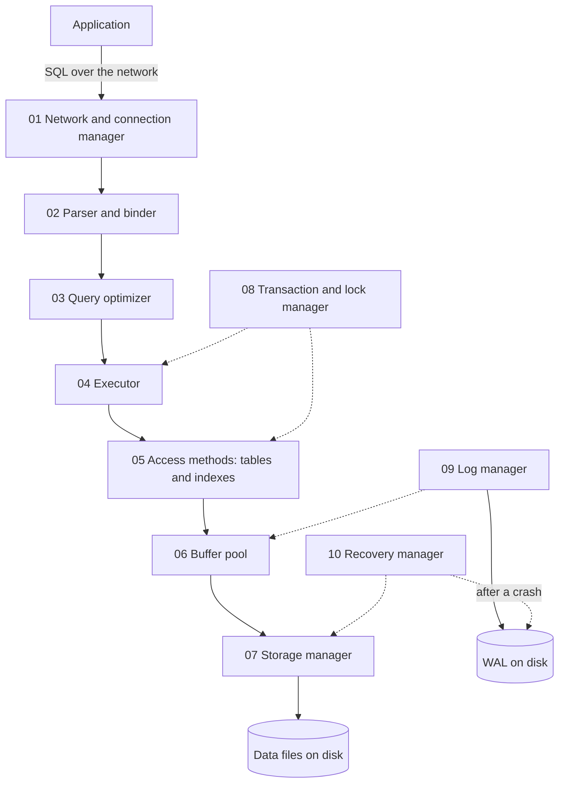
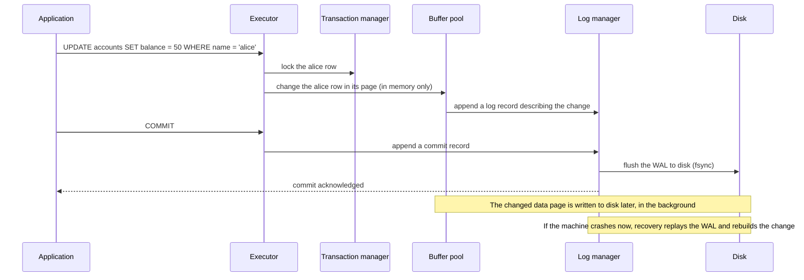
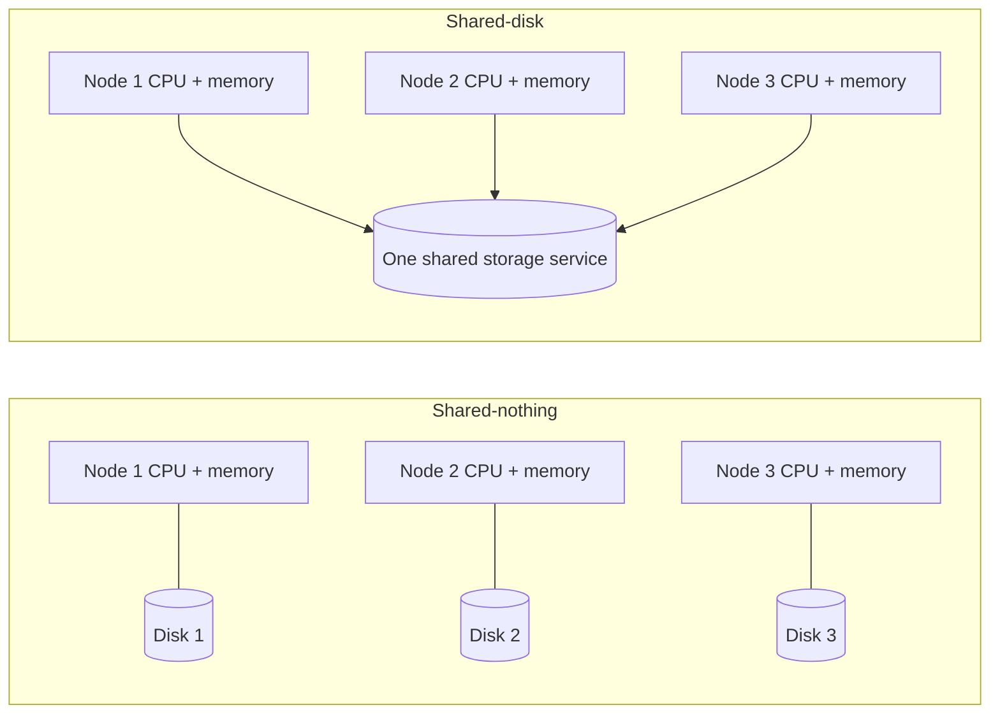
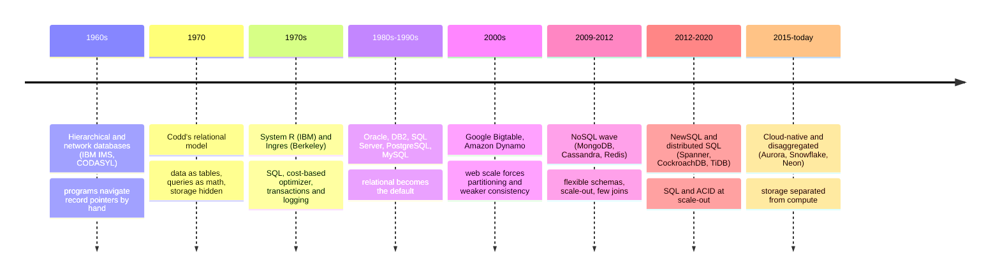
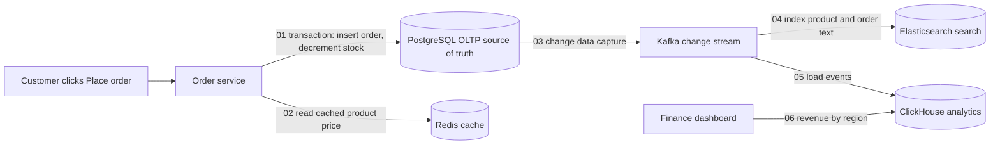

<!-- markdownlint-disable MD001 -->
<!-- markdownlint-disable MD024 -->
<!-- markdownlint-disable MD025 -->
<!-- markdownlint-disable MD026 -->
<!-- markdownlint-disable MD029 -->
<!-- markdownlint-disable MD033 -->
<!-- markdownlint-disable MD040 -->
<!-- markdownlint-disable MD056 -->
<!-- markdownlint-disable MD060 -->

# D01. What a Database System Is

---

## 01. Terms first

| Term                 | Meaning in this module                                                                                                                                                      |
| -------------------- | --------------------------------------------------------------------------------------------------------------------------------------------------------------------------- |
| Database             | An organized collection of related data, for example all customers, orders and payments of a shop.                                                                          |
| DBMS                 | Database management system: the software that stores a database and lets many programs read and change it safely. PostgreSQL is a DBMS; the data inside it is the database. |
| Application          | A program that uses the database, such as an order service.                                                                                                                 |
| Query                | A request to read or change data, usually written in SQL.                                                                                                                   |
| SQL                  | Structured Query Language: a declarative language. You state what you want, not how to fetch it.                                                                            |
| Declarative          | Describing the result you want ("all orders above 100") instead of the steps to compute it.                                                                                 |
| Transaction          | A group of changes that succeeds or fails as one unit. A money transfer (debit plus credit) is one transaction.                                                             |
| Commit, rollback     | Commit makes a transaction's changes permanent; rollback throws them all away.                                                                                              |
| Concurrency          | Many programs or users working on the same data at the same time.                                                                                                           |
| Crash safety         | After a power cut or a killed process, the data is still correct: committed work kept, half-done work gone.                                                                 |
| Integrity constraint | A rule the DBMS enforces on every change, for example "balance must not be negative".                                                                                       |
| Schema               | The declared shape of the data: tables, columns, types and constraints.                                                                                                     |
| Data model           | The way data is organized and queried: tables, documents, key-value pairs, graphs and so on.                                                                                |
| Page                 | The fixed-size block (8 KB in PostgreSQL, 16 KB in InnoDB) in which a DBMS reads and writes disk.                                                                           |
| Index                | An extra structure that finds rows by a key without reading the whole table, like a book's index.                                                                           |
| Buffer pool          | The memory area where a DBMS keeps copies of disk pages it is using.                                                                                                        |
| WAL                  | Write-ahead log: an append-only file where every change is recorded before the data pages are updated. It is how a DBMS survives crashes.                                   |
| OLTP                 | Online transaction processing: many small, fast reads and writes (place an order, update a cart).                                                                           |
| OLAP                 | Online analytical processing: few large queries that scan and summarize lots of data (monthly revenue by region).                                                           |
| Node                 | One machine (or container) running a copy of the DBMS in a cluster.                                                                                                         |

---

## 02. D01.01 Files vs a DBMS

A program can store data in files, but the moment several users share the data, the machine can crash, or the questions change,  
the program has to re-invent concurrency control, crash recovery, integrity checks, query processing and storage layout.  
A DBMS is those five things built once, tested for decades, and shared by every application.

### Running example

A tiny bank keeps balances in `accounts.csv`:

```text
alice,100
bob,100
```

Five things go wrong as the bank grows. Each one is a reason DBMSs exist.

| #   | Problem with plain files                                                                                                                | What the DBMS provides                       | Taught in  |
| --- | --------------------------------------------------------------------------------------------------------------------------------------- | -------------------------------------------- | ---------- |
| 01  | Two tellers update alice at the same moment; both read 100, both write their result; one update is lost.                                | Concurrency control (locks, MVCC)            | D24 to D28 |
| 02  | Power fails after alice is debited but before bob is credited; 50 units of money vanish.                                                | Transactions and crash recovery (WAL)        | D29, D30   |
| 03  | A bug writes `alice,-400`; nothing stops it.                                                                                            | Integrity constraints checked on every write | D05        |
| 04  | A manager asks "who has more than 80?"; a developer must write and ship new code for every new question.                                | Declarative queries (SQL) and an optimizer   | D04, D22   |
| 05  | The file grows to 50 GB; finding alice means reading the whole file. Adding an index means rewriting every program that reads the file. | Indexes and physical data independence       | D11 to D17 |

**Physical data independence** means programs say *what* data they need, and the DBMS decides *how* it is stored and found.  
An administrator can add an index, compress a table or move it to a faster disk, and no application changes.  
With files, the storage format is baked into every program that reads it.

**Logical data independence** is the next level: the schema can evolve (for example a view hides a split table) while old queries keep working.

### When files are still right

A DBMS is not always the answer:

- Write-once data read by batch jobs (logs, data lake files in Parquet) is often kept in files or object storage.

- A single process with a single user and no crash-safety needs (a config file) does not need a DBMS.

- Even then, many teams embed a small DBMS such as SQLite instead of writing file-handling code, because it gives the five guarantees for free.

---

## 03. D01.02 Anatomy of a DBMS

Every DBMS, from SQLite to Spanner, has the same layers: a front end that understands queries, a planner that chooses how to run them, an executor that runs them,  
access methods that find rows, a buffer pool that caches pages, a storage manager that talks to disk, and, beside all of them,  
a transaction manager and a log manager that keep the data correct under concurrency and crashes.

### The component map



| #   | Component               | Job, in one line                                                                          | Example in PostgreSQL                       | Module          |
| --- | ----------------------- | ----------------------------------------------------------------------------------------- | ------------------------------------------- | --------------- |
| 01  | Network and connections | Accept clients, authenticate, hold a session per connection                               | The postmaster forks one process per client | D07, D21        |
| 02  | Parser and binder       | Turn SQL text into a tree; check that tables and columns exist                            | Parser, analyzer                            | D22             |
| 03  | Query optimizer         | Choose the cheapest plan among many equivalent ones                                       | The planner, `EXPLAIN` shows its choice     | D22, D23        |
| 04  | Executor                | Run the plan: scans, joins, sorts, aggregates                                             | Executor nodes                              | D19 to D21      |
| 05  | Access methods          | Read and write rows in tables and indexes                                                 | Heap access, B-tree, GIN, BRIN              | D11, D14 to D18 |
| 06  | Buffer pool             | Keep hot pages in memory; decide what to evict                                            | `shared_buffers`                            | D13             |
| 07  | Storage manager         | Map pages to files and disk blocks                                                        | One file per table segment under `base/`    | D10, D11        |
| 08  | Transaction and locks   | Isolate concurrent transactions; detect deadlocks                                         | Lock manager, MVCC snapshots                | D24 to D28      |
| 09  | Log manager             | Append every change to the WAL before the page changes; flush at commit                   | WAL writer, `pg_wal/`                       | D29             |
| 10  | Recovery manager        | After a crash, replay the WAL so committed work is restored and unfinished work is undone | Startup process "redo"                      | D30             |

### Example: one read

`SELECT balance FROM accounts WHERE name = 'alice';`

01. The connection manager receives the text on alice's session.

02. The parser builds a tree; the binder confirms `accounts` and `balance` exist and `name` is text.

03. The optimizer sees an index on `name` (the primary key) and picks an index scan over reading the whole table.  
  In the lab, `EXPLAIN` prints exactly this: `Index Scan using accounts_pkey on accounts`.

04. The executor asks the B-tree access method for key `'alice'`.

05. The access method needs index pages and then the table page; it asks the buffer pool.

06. If the page is in memory, it is returned at once. If not, the storage manager reads the 8 KB page from disk into a free buffer.

07. The row is checked against the transaction's snapshot (is this version visible to me?) and the balance is returned.

### Example: one write, and why it survives a crash



The key idea, reused all through this track: **at commit only the small, sequential log is forced to disk, not the scattered data pages.**  
That makes commits fast and crash-safe at the same time.

---

## 04. D01.03 Taxonomy by data model

A data model is how a database organizes data and how you ask questions of it.  
The main families are relational, key-value, document, wide-column and graph, plus purpose-built families for time-series, search and vectors.  
The model decides which questions are cheap and which are painful.

### One dataset, five models

Data: user 42, named Asha, with two orders.

**Relational** (PostgreSQL, MySQL). Tables of rows, linked by keys; any question can be asked with joins.

```text
users                     orders
id | name                 id  | user_id | total
42 | Asha                 901 | 42      | 250
                          902 | 42      | 90
```

**Key-value** (Redis, DynamoDB in its simplest use). One opaque value per key; lookup by key only.

```text
user:42         -> {"name":"Asha"}
user:42:orders  -> [901, 902]
```

**Document** (MongoDB). Self-contained JSON-like documents; related data is often embedded.

```text
{ "_id": 42, "name": "Asha",
  "orders": [ {"id": 901, "total": 250}, {"id": 902, "total": 90} ] }
```

**Wide-column** (Cassandra, ScyllaDB). Rows grouped into partitions by a partition key and sorted by a clustering key; tables are designed per query.

```text
orders_by_user   partition key: user_id   clustering key: order_id
user_id | order_id | total
42      | 901      | 250
42      | 902      | 90
```

**Graph** (Neo4j). Nodes and relationships, both with properties; traversals are the main operation.

```text
(Asha:User {id:42}) -[:PLACED]-> (:Order {id:901, total:250})
(Asha:User {id:42}) -[:PLACED]-> (:Order {id:902, total:90})
```

### Comparison

| Model       | Good at                                                    | Painful at                                        | Products in this plan                                   |
| ----------- | ---------------------------------------------------------- | ------------------------------------------------- | ------------------------------------------------------- |
| Relational  | Ad-hoc questions, joins, strong integrity, transactions    | Massive write scale on one node; deep hierarchies | PostgreSQL, MySQL, SQLite, Oracle, CockroachDB, Spanner |
| Key-value   | Lowest-latency get and put by key, huge scale              | Any question not by key                           | Redis, DynamoDB, RocksDB, etcd                          |
| Document    | Data read and written as one object; flexible schema       | Many-to-many relations, cross-document integrity  | MongoDB                                                 |
| Wide-column | High write throughput, time-ordered data per key, multi-DC | Ad-hoc queries, joins; every query needs a table  | Cassandra, ScyllaDB                                     |
| Graph       | Multi-hop relationships (friends of friends, fraud rings)  | Bulk scans and aggregates                         | Neo4j                                                   |
| Time-series | Append-heavy measurements, downsampling, retention         | Updates, random access                            | TimescaleDB, InfluxDB                                   |
| Search      | Full-text relevance, fuzzy matching, facets                | Transactions; it is rarely the source of truth    | Elasticsearch, OpenSearch                               |
| Vector      | "Find the most similar" over embeddings (AI search)        | Exact queries, transactions                       | pgvector, dedicated vector databases                    |

Two cautions for interviews:

- **"NoSQL" is not a model.** It is a label for everything non-relational, and many "NoSQL" systems now speak SQL-like languages (Cassandra's CQL) and offer transactions (MongoDB).

- **The lines blur.** PostgreSQL stores documents (`jsonb`), vectors (pgvector) and time-series (TimescaleDB).  
  This is called **multi-model**.  
  The choice is often "relational with extensions" vs "specialized system", not "SQL vs NoSQL".

---

## 05. D01.04 Taxonomy by workload and architecture

Besides the data model, a database is classified by the work it is built for (OLTP, OLAP or both), by how it is deployed (embedded library or server),  
by how it spreads over machines (single node, shared-nothing, shared-disk), and by where its primary copy of data lives (disk or memory).

### Workload

| Aspect         | OLTP                                    | OLAP                                                    |
| -------------- | --------------------------------------- | ------------------------------------------------------- |
| Example query  | `UPDATE carts SET qty = 2 WHERE id = 7` | `SELECT region, sum(total) FROM orders GROUP BY region` |
| Rows touched   | A few                                   | Millions to billions                                    |
| Mix            | Many writes and point reads             | Mostly reads, bulk loads                                |
| Latency target | Milliseconds                            | Seconds to minutes                                      |
| Storage layout | Row-oriented (whole row together)       | Column-oriented (each column together, compressed)      |
| Products       | PostgreSQL, MySQL, Oracle, CockroachDB  | ClickHouse, Snowflake, BigQuery, DuckDB                 |

**HTAP** (hybrid transactional and analytical processing) tries to do both in one system, typically by keeping a row copy for OLTP and a column copy for OLAP (TiDB with TiFlash, SingleStore).  
The usual production pattern is still separate systems connected by a pipeline (section 08).

### Deployment

- **Embedded**: the DBMS is a library inside your process; no server, no network. SQLite (every phone), RocksDB (inside many databases), DuckDB (analytics on a laptop).

- **Client-server**: the DBMS is a separate server process; applications connect over the network. PostgreSQL, MySQL, MongoDB.

### Distribution



| Architecture   | Idea                                                                            | Examples                                           |
| -------------- | ------------------------------------------------------------------------------- | -------------------------------------------------- |
| Single node    | One machine holds everything; replicas are copies for safety and reads          | PostgreSQL, MySQL (with read replicas)             |
| Shared-nothing | Each node owns a slice of the data on its own disk; nodes talk over the network | Cassandra, CockroachDB, MongoDB (sharded), Spanner |
| Shared-disk    | Nodes share one storage layer; compute scales separately from storage           | Amazon Aurora, Snowflake, Oracle RAC, Neon         |

### Where the primary copy lives

- **Disk-oriented**: the truth is on disk; memory is a cache (buffer pool). PostgreSQL, MySQL.

- **In-memory**: the truth is in RAM; disk holds snapshots and a log for recovery. Redis, VoltDB, SAP HANA.  
  Faster, but the data set must fit in memory and restarts take time.

---

## 06. D01.05 History in one page

Every few years a "replacement" for relational databases appears; the good ideas get absorbed into relational systems and SQL keeps winning,  
because declarative queries plus physical data independence outlast any single storage trick.



The 2024 paper "What Goes Around Comes Around... And Around" (Stonebraker and Pavlo) reviews twenty years of new data models and concludes the same:  
most either faded or were folded into SQL systems (JSON columns, vector indexes, graph queries via SQL/PGQ).

---

## 07. D01.06 The product map for this track

Every product taught later fits on the two axes above: data model and architecture.  
Knowing where a product sits predicts most of its strengths and weaknesses before reading its manual.

| Product      | Data model             | Workload      | Architecture                           | Storage engine idea        | Module   |
| ------------ | ---------------------- | ------------- | -------------------------------------- | -------------------------- | -------- |
| PostgreSQL   | Relational (+ JSON)    | OLTP          | Single node + replicas                 | Heap tables + B-tree, MVCC | D41, D42 |
| MySQL InnoDB | Relational             | OLTP          | Single node + replicas                 | Clustered B-tree, undo log | D43, D44 |
| SQLite       | Relational             | Embedded OLTP | Embedded library                       | B-tree in one file         | D45      |
| MongoDB      | Document               | OLTP          | Replica sets, shared-nothing shards    | WiredTiger B-tree          | D46      |
| Cassandra    | Wide-column            | Write-heavy   | Shared-nothing, leaderless             | LSM tree                   | D47      |
| ScyllaDB     | Wide-column            | Write-heavy   | Shared-nothing, shard-per-core         | LSM tree                   | D48      |
| DynamoDB     | Key-value / document   | OLTP          | Managed, shared-nothing                | B-tree per partition       | D49      |
| Redis        | Key-value (data types) | Cache, OLTP   | In-memory, single node or cluster      | In-memory structures       | D50      |
| RocksDB      | Key-value              | Embedded      | Embedded library                       | LSM tree                   | D51      |
| Spanner      | Relational             | OLTP          | Shared-nothing, globally distributed   | LSM-like, Paxos per split  | D52      |
| CockroachDB  | Relational             | OLTP          | Shared-nothing, Raft per range         | LSM tree (Pebble)          | D53      |
| ClickHouse   | Relational (columnar)  | OLAP          | Shared-nothing or cloud shared storage | Columnar MergeTree         | D55      |
| DuckDB       | Relational (columnar)  | OLAP          | Embedded library                       | Columnar, vectorized       | D55      |

Notice the repeating patterns: **two storage families** (B-tree vs LSM tree, D15 and D17) and **three distribution styles** (single leader with replicas, leaderless, consensus per partition, D33 to D37).  
Most of the 60 modules are about these few ideas.

---

## 08. The story: one order, five databases

A real company rarely has one database. Follow one order on an e-commerce site.



01. **PostgreSQL** (relational, OLTP) records the order and decrements stock in one transaction.  
  If the server crashes mid-way, recovery from the WAL makes sure both happened or neither did.  
  This is the source of truth.

02. **Redis** (in-memory key-value) serves the product price in under a millisecond so the hot read path does not load PostgreSQL.

03. **Change data capture (CDC)** reads PostgreSQL's WAL and publishes every committed change as an event to Kafka (a durable, ordered message log).  
  The log that made the database crash-safe now also feeds other systems.

04. **Elasticsearch** (search) indexes the order so support staff can type "Asha blue shoes" and find it.  
  It is a derived copy; if it is lost, it is rebuilt from the stream.

05. **ClickHouse** (columnar, OLAP) stores every order event for analytics.

06. The finance dashboard asks "revenue by region this quarter" on ClickHouse, scanning millions of rows in seconds without slowing down checkout on PostgreSQL.

The lesson: pick each database for one job, keep exactly one source of truth, and derive the rest from its log. D60 returns to this design.

---

## 09. Lab: the same bank, as files and as a DBMS

Goal: see problems 01 to 03 from section 02 happen with files, and see a DBMS prevent them.  
Only a shell and PostgreSQL are needed. Verified on PostgreSQL 16.

### Setup

```text
docker run -d --name d01-pg -e POSTGRES_PASSWORD=pg -p 5432:5432 postgres:16
export PGHOST=localhost PGUSER=postgres PGPASSWORD=pg
```

### Part 01. Two writers on one file (lost updates)

`file_lost_update.sh`:

```bash
#!/usr/bin/env bash
# Two writers increment one number stored in a plain file, 1000 times each.
echo 0 > counter.txt
inc() { for i in $(seq 1000); do v=$(cat counter.txt); echo $((v + 1)) > counter.txt; done; }
inc & inc & wait
echo "expected 2000, file says: $(cat counter.txt)"
```

Output from three runs:

```text
expected 2000, file says: 5
expected 2000, file says: 5
expected 2000, file says: 8
```

It is far worse than a few lost updates.  
`echo ... > counter.txt` first empties the file and then writes; the other writer often reads the empty file in between, treats it as 0, and resets the counter.  
No locking, no atomic replace, no isolation.

### Part 02. Crash in the middle of a transfer (file)

`file_crash.sh`:

```bash
#!/usr/bin/env bash
# Transfer 50 from alice to bob in a plain CSV file; the process is killed halfway.
printf 'alice,100\nbob,100\n' > accounts.csv
transfer() {
  sed -i 's/^alice,100$/alice,50/' accounts.csv   # step 1: debit alice
  sleep 2                                         # the "crash window"
  sed -i 's/^bob,100$/bob,150/' accounts.csv      # step 2: credit bob
}
transfer & pid=$!
sleep 1; kill -9 $pid                             # simulate a crash
cat accounts.csv
awk -F, '{s+=$2} END {print "total money:", s}' accounts.csv
```

Output:

```text
alice,50
bob,100
total money: 150
```

50 units of money vanished.  
Nothing records that a transfer was in progress, so nothing can undo or finish it.

### Part 03. The same two problems in PostgreSQL

Create the tables:

```sql
CREATE TABLE counter  (id int PRIMARY KEY, v int NOT NULL);
INSERT INTO counter VALUES (1, 0);

CREATE TABLE accounts (name text PRIMARY KEY, balance int NOT NULL CHECK (balance >= 0));
INSERT INTO accounts VALUES ('alice', 100), ('bob', 100);
```

Two concurrent clients, 1000 increments each, using the `pgbench` load tool that ships with PostgreSQL:

```text
echo "UPDATE counter SET v = v + 1 WHERE id = 1;" > inc.sql
pgbench -n -c 2 -t 1000 -f inc.sql postgres
psql -Atc "SELECT 'counter says: ' || v FROM counter;"
```

```text
number of transactions actually processed: 2000/2000
number of failed transactions: 0 (0.000%)
counter says: 2000
```

The row lock taken by `UPDATE` makes the second writer wait for the first, so no update is lost.

Crash in the middle of a transfer. `db_crash.sql`:

```sql
BEGIN;
UPDATE accounts SET balance = balance - 50 WHERE name = 'alice';  -- step 1: debit alice
SELECT pg_sleep(5);                                              -- the "crash window"
UPDATE accounts SET balance = balance + 50 WHERE name = 'bob';    -- step 2: credit bob
COMMIT;
```

Run it in the background, then kill its server process with `kill -9` (in Docker: `docker exec d01-pg kill -9 <pid>`, with the pid taken from `pg_stat_activity`):

```text
psql -f db_crash.sql &
sleep 1
psql -Atc "SELECT pid FROM pg_stat_activity WHERE query LIKE '%pg_sleep%' AND pid <> pg_backend_pid();"
```

After the kill:

```text
alice,100
bob,100
total money: 200
```

The server log shows the recovery manager from section 03 doing its job:

```text
LOG:  server process (PID 6335) was terminated by signal 9: Killed
LOG:  database system was not properly shut down; automatic recovery in progress
LOG:  redo starts at 0/14EF3E0
LOG:  redo done at 0/156E460
LOG:  database system is ready to accept connections
```

PostgreSQL treats a killed server process as a possible memory corruption, restarts all sessions, and replays the WAL.  
The half-done transfer never committed, so it is not visible.

### Part 04. Integrity and the optimizer

```sql
UPDATE accounts SET balance = balance - 500 WHERE name = 'alice';
```

```text
ERROR:  new row for relation "accounts" violates check constraint "accounts_balance_check"
DETAIL:  Failing row contains (alice, -400).
```

```sql
EXPLAIN SELECT * FROM accounts WHERE name = 'alice';
```

```text
 Index Scan using accounts_pkey on accounts  (cost=0.15..8.17 rows=1 width=36)
   Index Cond: (name = 'alice'::text)
```

The query never said "use the index"; the optimizer chose it. That is physical data independence in one line.

### Try this

- Re-run Part 01 with a lock around the read and write: change the loop body to `flock counter.lock sh -c 'v=$(cat counter.txt); echo $((v + 1)) > counter.txt'`.  
  The count becomes 2000 (verified); you have just built a crude lock manager.

- In Part 03, run the transfer without `BEGIN` and `COMMIT` (each `UPDATE` is then its own transaction) and kill it in the sleep.  
  Money vanishes again (verified: alice 50, bob 100): the DBMS protects only what you declare as one transaction.

### Clean up

```text
docker rm -f d01-pg
```

---

## 10. Interview questions

01. **Why use a database instead of files?**
    Concurrency control, crash recovery, integrity constraints, declarative queries with an optimizer, and physical data independence.  
    Give the lost-update and half-transfer examples.

02. **Walk me through what happens when a query reaches PostgreSQL.**
    Connection, parse and bind, optimize (choose plan), execute, access methods, buffer pool, disk if needed; visibility check against the snapshot.  
    For writes: lock, change the page in memory, log record, commit flushes the WAL, page written later.

03. **Why does a database write a log instead of writing the data pages at commit?**
    The log is small and sequential; pages are large and scattered.  
    Forcing only the log makes commits fast, and replaying it after a crash rebuilds any change not yet in the pages.

04. **SQL vs NoSQL?**
    Reframe it: pick by data model and access pattern, consistency needs, and scale.  
    "NoSQL" covers four different models; many of them now offer SQL-like languages and transactions, and PostgreSQL covers many NoSQL use cases with `jsonb`.

05. **OLTP vs OLAP, and why not run analytics on the production database?**
    Different access patterns and layouts (row vs column).  
    Big scans compete for CPU, memory and I/O with checkout traffic. Use replicas for light reporting, a columnar system fed by CDC for real analytics.

06. **Shared-nothing vs shared-disk?**
    Shared-nothing partitions data across nodes with their own disks (Cassandra, CockroachDB); scales writes, but cross-node work needs coordination.  
    Shared-disk lets compute nodes share one storage layer (Aurora, Snowflake); compute scales independently, storage layer must be highly available.

---

## 11. Exercises

01. A team stores user sessions as one JSON file per user on a shared network drive. List three DBMS guarantees they are missing, with one concrete failure for each.

02. Place each system on the model and architecture axes: a ride-hailing driver-location cache, a bank ledger, a product search box, a "people you may know" feature, a fleet of IoT temperature sensors.

03. In the write sequence diagram of section 03, the data page is written "later".  
  Explain what happens if the machine crashes (a) after the WAL flush but before the page write, (b) before the WAL flush.

04. Your company runs revenue reports directly on the main PostgreSQL primary and checkout gets slow every month-end. Propose two fixes, one cheap and one long-term, and name their trade-offs.

---

## 12. Solutions

01. **Missing guarantees.**
    - Concurrency: two app servers update the same session file at once; one write overwrites the other (a lost login state).
    - Atomicity and crash safety: a crash during a rewrite leaves a truncated or half-written JSON file that no longer parses.
    - Queries: "how many users are logged in now?" means opening every file; there is no index on expiry time, so cleaning up expired sessions is a full scan.
    Bonus: no integrity (nothing stops a malformed session), no access control beyond file permissions.

02. **Placements.**

| System                   | Model                      | Architecture and why                                                                     |
| ------------------------ | -------------------------- | ---------------------------------------------------------------------------------------- |
| Driver-location cache    | Key-value (with geo index) | In-memory (Redis), frequent overwrites, loss tolerable, rebuilt from drivers             |
| Bank ledger              | Relational                 | Single-node OLTP with synchronous replica, or distributed SQL at large scale; needs ACID |
| Product search box       | Search                     | Shared-nothing search cluster (Elasticsearch), derived from the source of truth          |
| People you may know      | Graph                      | Graph database or precomputed offline; multi-hop traversal                               |
| IoT temperature readings | Time-series or wide-column | Shared-nothing, append-heavy (TimescaleDB, Cassandra), retention by time                 |

03. **Crash timing.**
    (a) The commit was acknowledged and the WAL record is on disk. On restart, the recovery manager replays the WAL and re-applies the change to the page. Nothing is lost.
    (b) The commit was never acknowledged. The change existed only in memory and is gone; the client saw an error or timeout and must retry.  
      The database is consistent: the transaction simply did not happen.

04. **Month-end reports.**
    - Cheap: run reports on a read replica. Trade-off: replica lag (reports a few seconds stale, usually fine) and long reports can conflict with replay on the replica.
    - Long-term: stream changes with CDC into a columnar OLAP store (ClickHouse, BigQuery).  
      Trade-off: another system to operate and data a few seconds to minutes behind, in exchange for fast analytics with zero load on checkout.

---

## 13. Sources

- CMU 15-445/645 Fall 2025, Lecture 01 "Relational Model and Algebra" (first half covers why databases exist).

- Silberschatz, Korth, Sudarshan, "Database System Concepts", 7th ed., ch 01 (Introduction), ch 20.1-20.2 (centralized and server architectures).

- Petrov, "Database Internals", ch 01 (DBMS architecture, memory vs disk, row vs column).

- Hellerstein, Stonebraker, Hamilton, "Architecture of a Database System" (2007), sections 1 and 2.

- Stonebraker and Pavlo, "What Goes Around Comes Around... And Around", SIGMOD Record 2024.

---
