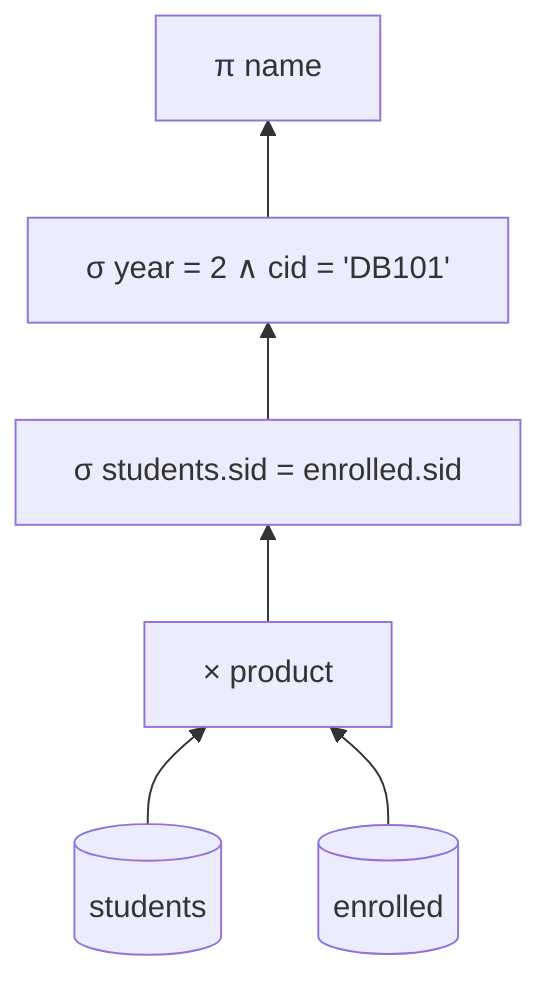
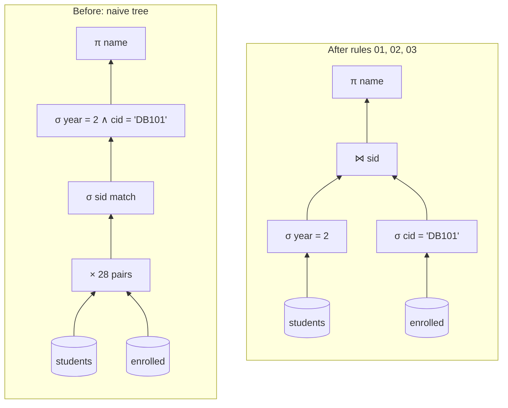

<!-- markdownlint-disable MD001 -->
<!-- markdownlint-disable MD024 -->
<!-- markdownlint-disable MD025 -->
<!-- markdownlint-disable MD026 -->
<!-- markdownlint-disable MD029 -->
<!-- markdownlint-disable MD033 -->
<!-- markdownlint-disable MD040 -->
<!-- markdownlint-disable MD056 -->
<!-- markdownlint-disable MD060 -->

# D02. Relational Model and Algebra

---

## 01. Terms first

| Term                | Meaning in this module                                                                                               |
| ------------------- | -------------------------------------------------------------------------------------------------------------------- |
| Relational model    | Edgar Codd's 1970 idea: store all data as relations (tables) and query them with mathematical operators.             |
| Relation            | A named set of tuples that share the same attributes. In SQL: a table.                                               |
| Tuple               | One element of a relation. In SQL: a row.                                                                            |
| Attribute           | A named column of a relation, for example `year`.                                                                    |
| Domain              | The set of allowed values for an attribute, for example integers 1 to 4 for `year`. In SQL: a type plus constraints. |
| Degree, arity       | Number of attributes of a relation.                                                                                  |
| Cardinality         | Number of tuples in a relation.                                                                                      |
| Schema              | The structure: relation name and its attributes, written `students(sid, email, name, year)`. Changes rarely.         |
| Instance            | The tuples stored right now. Changes with every insert, update and delete.                                           |
| Key                 | A set of attributes whose values identify exactly one tuple (kinds defined in section 02).                           |
| NULL                | A marker meaning "value unknown or not applicable". Not a value; covered in depth in D04.                            |
| Set                 | A collection with no order and no duplicates.                                                                        |
| Bag (multiset)      | A collection with no order but duplicates allowed. SQL tables and results are bags.                                  |
| Operator            | A function that takes one or two relations and returns a relation.                                                   |
| Relational algebra  | A small set of operators that build answers step by step. Procedural: it says how.                                   |
| Relational calculus | A logic notation that describes the answer. Declarative: it says what.                                               |
| Query plan          | The tree of operators a DBMS actually runs for a query (introduced in D01).                                          |

---

## 02. D02.01 Relations, tuples and keys

A relation is a set of tuples over a fixed list of attributes.  
Because it is a set, it has no row order and no duplicate rows, and every tuple must be distinguishable by some key.  
Keys and foreign keys are how the model expresses identity and links between relations, without pointers.

### Running example

Every example in this module uses this small university database. It is the lab dataset, so every result shown below was produced by PostgreSQL 16.

```text
students(sid, email, name, year)          courses(cid, title, dept)
  1  asha@uni.edu  Asha  2                  DB101  Databases          CS
  2  ben@uni.edu   Ben   3                  OS201  Operating Systems  CS
  3  chen@uni.edu  Chen  2                  ML301  Machine Learning   CS
  4  dana@uni.edu  Dana  1                  EC101  Economics          ECON

enrolled(sid, cid, grade)
  1 DB101 A   1 OS201 B   1 ML301 A
  2 DB101 B   2 EC101 A
  3 DB101 A   3 OS201 A
```

`students` has degree 4 and cardinality 4. Dana is enrolled in nothing; she matters later.

### Properties that follow from "a relation is a set"

- **No order.** Rows have no position; "the third row" means nothing. Any order you see in SQL output is accidental unless you wrote `ORDER BY`.

- **No duplicates.** Two identical tuples would be the same element. (SQL relaxes this; section 05.)

- **Atomic values.** Each cell holds one value from its domain, not a list. This is first normal form, revisited in D03.

### Keys

| Key kind      | Definition                                                             | Example in `students`                                         |
| ------------- | ---------------------------------------------------------------------- | ------------------------------------------------------------- |
| Superkey      | Any set of attributes whose values are unique across all tuples        | `{sid}`, `{email}`, `{sid, name}`, `{sid, email, name, year}` |
| Candidate key | A minimal superkey: remove any attribute and it stops being unique     | `{sid}` and `{email}`                                         |
| Primary key   | The one candidate key chosen as the main identifier                    | `{sid}`                                                       |
| Alternate key | A candidate key that was not chosen; enforced with `UNIQUE`            | `{email}`                                                     |
| Foreign key   | Attributes in one relation whose values must exist as a key in another | `enrolled.sid` references `students.sid`                      |
| Composite key | A key with more than one attribute                                     | `{sid, cid}` in `enrolled`                                    |

A key is a rule about **all valid instances**, not an observation about today's data.  
Today no two students share a name, but `{name}` is not a key, because two students named Asha may enroll tomorrow.

The DBMS enforces declared keys on every write:

```sql
INSERT INTO students VALUES (5, 'asha@uni.edu', 'Asha Two', 1);
-- ERROR:  duplicate key value violates unique constraint "students_email_key"

INSERT INTO enrolled VALUES (9, 'DB101', 'A');
-- ERROR:  insert or update on table "enrolled" violates foreign key constraint "enrolled_sid_fkey"
-- DETAIL:  Key (sid)=(9) is not present in table "students".
```

**Natural vs surrogate keys.** `email` is a natural key (it means something in the real world). `sid` is a surrogate key (a generated number with no meaning).  
Surrogate keys never change, which is why they are usually the primary key; natural keys are still declared `UNIQUE` so the real-world rule holds. D03 goes deeper.

---

## 03. D02.02 The six basic operators

Six operators are enough to express every query the relational model can answer: selection, projection, union, difference, Cartesian product and rename.  
Each takes relations and returns a relation, so they can be nested freely. This "closure" property is what lets a DBMS treat a query as a tree of operators.

| Operator          | Symbol    | What it does                                            | SQL equivalent              | Example and result                                  |
| ----------------- | --------- | ------------------------------------------------------- | --------------------------- | --------------------------------------------------- |
| Selection         | σ (sigma) | Keep tuples that satisfy a condition (rows)             | `WHERE`                     | σ year=2 (students) gives Asha, Chen                |
| Projection        | π (pi)    | Keep only some attributes (columns)                     | `SELECT DISTINCT col, ...`  | π dept (courses) gives {CS, ECON}                   |
| Union             | ∪         | Tuples in either relation                               | `UNION`                     | year-2 sids ∪ DB101 sids gives {1, 2, 3}            |
| Difference        | − (minus) | Tuples in the first but not the second                  | `EXCEPT`                    | π sid (students) − π sid (enrolled) gives {4}, Dana |
| Cartesian product | ×         | Every tuple of one paired with every tuple of the other | `CROSS JOIN` or `FROM a, b` | students × courses has 4 × 4 = 16 tuples            |
| Rename            | ρ (rho)   | Rename a relation or its attributes                     | `AS`                        | ρ classmate (students) for a self-join              |

Union and difference require **union-compatible** inputs: same number of attributes, with matching domains. You cannot union `students` with `courses`.

### Composing operators

"Names of year-2 students enrolled in DB101":

```text
π name ( σ year=2 ∧ cid='DB101' ( σ students.sid = enrolled.sid ( students × enrolled ) ) )
```

Read it inside out: pair every student with every enrollment (16 × 7 = 28 pairs), keep pairs where the `sid` matches, keep those with year 2 and course DB101, then keep only the name.  
The same expression as a tree, which is exactly the shape a DBMS plans with:



The result is {Asha, Chen}. Section 07 shows why no real DBMS runs this tree as drawn.

---

## 04. D02.03 Derived operators: joins, intersection, division

Joins, intersection and division add no new power; each can be written with the six basic operators.  
They exist because they are what people actually ask for, and because a DBMS can run them much faster than the long form.

### Joins

| Join            | Symbol | Definition in basic operators                              | SQL                                             | Example result                           |
| --------------- | ------ | ---------------------------------------------------------- | ----------------------------------------------- | ---------------------------------------- |
| Theta join      | ⋈θ     | σθ (R × S), any condition θ                                | `JOIN ... ON a.year = b.year AND a.sid < b.sid` | Asha and Chen are classmates (same year) |
| Equi-join       | ⋈ a=b  | Theta join where θ uses only equality                      | `JOIN ... ON e.sid = s.sid`                     | 7 student-course pairs                   |
| Natural join    | ⋈      | Equi-join on all same-named attributes, keep one copy      | `NATURAL JOIN`                                  | `students ⋈ enrolled` joins on `sid`     |
| Left outer join | ⟕      | Join, plus unmatched left tuples padded with NULLs         | `LEFT JOIN`                                     | 8 rows: Dana appears with NULL course    |
| Semi-join       | ⋉      | Left tuples that have at least one match; no right columns | `WHERE EXISTS (...)`                            | Students with any A: Asha, Ben, Chen     |
| Anti-join       | ▷      | Left tuples that have no match                             | `WHERE NOT EXISTS (...)`                        | Students with no enrollment: Dana        |

Outer joins are not part of Codd's original algebra, because they produce NULLs.  
They were added later because "show every customer, with orders if any" is one of the most common questions in practice.

**Natural join pitfall.** `NATURAL JOIN` matches every column with the same name. If someone later adds a `name` column to `enrolled`, the same query silently starts joining on `name` too.  
Production SQL uses explicit `JOIN ... ON` or `JOIN ... USING (sid)`.

### Intersection

R ∩ S = R − (R − S). "Year-2 students who take OS201": {1, 3} ∩ {1, 3} = {1, 3}. SQL: `INTERSECT`.

### Division

Division answers "for all" questions: **which students took every CS course?**

R ÷ S returns the values of R's remaining attributes that are paired, in R, with **every** tuple of S.

- R = π sid, cid (enrolled), S = π cid (σ dept='CS' (courses)) = {DB101, OS201, ML301}.

- Asha has all three; Chen lacks ML301; Ben lacks two; Dana has none.

- Result: {Asha}.

SQL has no division operator. The standard idiom reads "there is no CS course that this student did not take":

```sql
SELECT s.name FROM students s
WHERE NOT EXISTS (
  SELECT c.cid FROM courses c WHERE c.dept = 'CS'
  EXCEPT
  SELECT e.cid FROM enrolled e WHERE e.sid = s.sid);
-- Asha
```

Another common form compares counts: students whose count of distinct CS courses equals the total number of CS courses. Both appear in interviews.

---

## 05. D02.04 Set semantics vs bag semantics

The pure model uses sets, so duplicates vanish after every operator.  
SQL uses bags: it keeps duplicates unless you ask for `DISTINCT` or use `UNION`, `INTERSECT` or `EXCEPT` without `ALL`.  
SQL chose bags because removing duplicates costs a sort or a hash over the whole result, and because aggregates need duplicates to be correct.

Projection, in SQL, keeps duplicates:

```text
SELECT dept FROM courses;           SELECT DISTINCT dept FROM courses;
 CS                                   CS
 CS                                   ECON
 CS                                 (2 rows)
 ECON
(4 rows)
```

Union removes them, union all keeps them:

```text
year-2 sids  UNION      DB101 sids  ->  1, 2, 3          (3 rows)
year-2 sids  UNION ALL  DB101 sids  ->  1, 1, 2, 3, 3    (5 rows)
```

Why bags are the right default for SQL:

- **Cost.** Removing duplicates means sorting or hashing every result row (D19). Most queries do not need it.

- **Correct aggregates.** The average of grades {A, A, B} is not the average of the set {A, B}. Counting enrolments needs every row.

- **Meaningful duplicates.** Two identical purchase rows can be two real purchases when the table has no key.

Practical rules that follow:

- Use `UNION ALL` unless you need duplicates removed; plain `UNION` forces a de-duplication step.

- A `DISTINCT` added "to fix duplicates" usually hides a wrong join. Find the join that multiplies rows instead.

- A table without a primary key is a bag. Declare keys so the table is a set again.

---

## 06. D02.05 Relational calculus and Codd's theorem

Relational calculus describes the answer as a logical condition instead of a sequence of operators.  
Codd proved that the algebra and (safe) calculus express exactly the same queries. SQL is close to calculus in spirit, since you describe what you want.  
The DBMS translates it into an algebra tree it can execute and optimize.

**Tuple relational calculus**: "students in year 2":

```text
{ t | t ∈ students ∧ t.year = 2 }
```

"Names of students who took every CS course", written as logic:

```text
{ s.name | s ∈ students ∧ ∀c ∈ courses ( c.dept = 'CS' → ∃e ∈ enrolled ( e.sid = s.sid ∧ e.cid = c.cid ) ) }
```

The `∀` ("for all") is division; SQL expresses it with `NOT EXISTS ... EXCEPT` because ∀x P(x) is the same as "there is no x for which P fails".

**Domain relational calculus** uses variables for single values instead of tuples. It inspired Query-By-Example (QBE), the grid-style query builders in tools like Microsoft Access.

**Safety.** A calculus query such as { t | ¬(t ∈ students) } ("everything that is not a student") describes an infinite answer.  
Only safe queries, whose results draw values from the database, are allowed. Algebra is always safe.

**Relational completeness.** A language is relationally complete if it can express every algebra query.  
SQL is complete, and goes beyond the algebra with aggregation, sorting, recursion (D06) and NULLs.

---

## 07. D02.06 From algebra to query plans

Many algebra expressions give the same answer at very different costs.  
Equivalence rules say which rewrites are always safe; the optimizer uses them to turn the naive tree into a fast one.  
The most important rule: apply selections and projections as early as possible, and never form a full Cartesian product when a join condition exists.

### Core equivalence rules

| #   | Rule                             | Form                                                              | Why it helps                                   |
| --- | -------------------------------- | ----------------------------------------------------------------- | ---------------------------------------------- |
| 01  | Selection splitting              | σ a∧b (R) = σ a (σ b (R))                                         | Lets each condition move separately            |
| 02  | Selection pushdown               | σ cond (R ⋈ S) = σ cond (R) ⋈ S, if cond uses only R's attributes | Shrinks inputs before the expensive join       |
| 03  | Product plus selection is a join | σ R.a=S.b (R × S) = R ⋈ R.a=S.b S                                 | A join algorithm never builds the full product |
| 04  | Join commutativity               | R ⋈ S = S ⋈ R                                                     | Choose which side to build a hash table on     |
| 05  | Join associativity               | (R ⋈ S) ⋈ T = R ⋈ (S ⋈ T)                                         | Choose the join order; the biggest lever (D22) |
| 06  | Projection pushdown              | Drop attributes not needed above an operator                      | Less data per tuple through the plan           |

### The section 03 query, rewritten



With 4 students and 7 enrollments the naive tree builds 28 pairs.  
With 1 million students and 50 million enrollments it would build 50 trillion.  
The rewritten tree filters each table first and joins only what remains.

### PostgreSQL does this for you

Written in the old style, with a Cartesian product in `FROM` and all conditions in `WHERE`:

```sql
EXPLAIN (COSTS OFF)
SELECT s.name FROM students s, enrolled e, courses c
WHERE s.sid = e.sid AND e.cid = c.cid AND c.dept = 'CS' AND s.year = 2;
```

```text
 Nested Loop
   ->  Hash Join
         Hash Cond: (e.cid = c.cid)
         ->  Seq Scan on enrolled e
         ->  Hash
               ->  Seq Scan on courses c
                     Filter: (dept = 'CS'::text)
   ->  Index Scan using students_pkey on students s
         Index Cond: (sid = e.sid)
         Filter: (year = 2)
```

No product appears.  
The planner turned products plus conditions into two joins (rule 03), pushed `dept = 'CS'` down onto the `courses` scan (rule 02), chose a join order (rules 04 and 05),  
and picked a join algorithm for each join (D20). Algebra is the language the optimizer thinks in.

---

## 08. The story: one question, four languages

The question from a head of department: **"Which students have taken every CS course?"**

01. **English.** Ambiguous: does "every CS course" mean those offered this year or ever? Settling this is requirements work, not SQL.

02. **Calculus** (what): { s.name | s ∈ students ∧ ∀c ∈ courses (c.dept = 'CS' → ∃e ∈ enrolled (e.sid = s.sid ∧ e.cid = c.cid)) }.

03. **SQL** (what, in a language a DBMS accepts): the `NOT EXISTS ... EXCEPT` query from section 04.

04. **Algebra** (how): π name (students ⋈ (π sid, cid (enrolled) ÷ π cid (σ dept='CS' (courses)))).

05. **Plan** (how, with algorithms and costs): the optimizer rewrites the algebra with the section 07 rules, picks join methods, and runs it. Answer: Asha.

Each layer exists so the one above it can stay simple.  
You write steps 02 and 03; the DBMS owns 04 and 05. When a query is slow, you read step 05 with `EXPLAIN` (D23) and reason about it with step 04.

---

## 09. Lab

Goal: run every operator in SQL and see the algebra inside a real plan. Verified on PostgreSQL 16.

### Setup

```text
docker run -d --name d02-pg -e POSTGRES_PASSWORD=pg -p 5432:5432 postgres:16
export PGHOST=localhost PGUSER=postgres PGPASSWORD=pg
psql -f setup.sql
```

`setup.sql`:

```sql
CREATE TABLE students (
  sid   int  PRIMARY KEY,
  email text NOT NULL UNIQUE,
  name  text NOT NULL,
  year  int  NOT NULL CHECK (year BETWEEN 1 AND 4)
);
CREATE TABLE courses (
  cid   text PRIMARY KEY,
  title text NOT NULL,
  dept  text NOT NULL
);
CREATE TABLE enrolled (
  sid   int  REFERENCES students (sid),
  cid   text REFERENCES courses (cid),
  grade text,
  PRIMARY KEY (sid, cid)
);
INSERT INTO students VALUES
  (1, 'asha@uni.edu', 'Asha', 2), (2, 'ben@uni.edu', 'Ben', 3),
  (3, 'chen@uni.edu', 'Chen', 2), (4, 'dana@uni.edu', 'Dana', 1);
INSERT INTO courses VALUES
  ('DB101', 'Databases', 'CS'), ('OS201', 'Operating Systems', 'CS'),
  ('ML301', 'Machine Learning', 'CS'), ('EC101', 'Economics', 'ECON');
INSERT INTO enrolled VALUES
  (1, 'DB101', 'A'), (1, 'OS201', 'B'), (1, 'ML301', 'A'),
  (2, 'DB101', 'B'), (2, 'EC101', 'A'),
  (3, 'DB101', 'A'), (3, 'OS201', 'A');
```

### Operator workbook

Run each query and check the result against the one given. Every result here was produced by the setup above.

| #   | Operator  | Query                                                                                                        | Result                 |
| --- | --------- | ------------------------------------------------------------------------------------------------------------ | ---------------------- |
| 01  | σ         | `SELECT * FROM students WHERE year = 2;`                                                                     | Asha, Chen             |
| 02  | π (bag)   | `SELECT dept FROM courses;`                                                                                  | CS, CS, CS, ECON       |
| 03  | π (set)   | `SELECT DISTINCT dept FROM courses;`                                                                         | CS, ECON               |
| 04  | ×         | `SELECT count(*) FROM students CROSS JOIN courses;`                                                          | 16                     |
| 05  | ⋈ natural | `SELECT name, cid, grade FROM students NATURAL JOIN enrolled;`                                               | 7 rows                 |
| 06  | ∪         | `SELECT sid FROM students WHERE year = 2 UNION SELECT sid FROM enrolled WHERE cid = 'DB101';`                | 1, 2, 3                |
| 07  | ∪ (bag)   | Same with `UNION ALL`                                                                                        | 1, 1, 2, 3, 3          |
| 08  | −         | `SELECT sid FROM students EXCEPT SELECT sid FROM enrolled;`                                                  | 4                      |
| 09  | ∩         | `SELECT sid FROM students WHERE year = 2 INTERSECT SELECT sid FROM enrolled WHERE cid = 'OS201';`            | 1, 3                   |
| 10  | ÷         | Division query from section 04                                                                               | Asha                   |
| 11  | ⟕         | `SELECT s.name, e.cid FROM students s LEFT JOIN enrolled e ON e.sid = s.sid;`                                | 8 rows, Dana with NULL |
| 12  | ⋉         | `SELECT name FROM students s WHERE EXISTS (SELECT 1 FROM enrolled e WHERE e.sid = s.sid AND e.grade = 'A');` | Asha, Ben, Chen        |
| 13  | ▷         | `SELECT name FROM students s WHERE NOT EXISTS (SELECT 1 FROM enrolled e WHERE e.sid = s.sid);`               | Dana                   |
| 14  | ρ and ⋈θ  | `SELECT a.name, b.name FROM students a JOIN students b ON a.year = b.year AND a.sid < b.sid;`                | Asha, Chen             |

### Try this

- Run the section 07 `EXPLAIN` again after `ANALYZE;` and after inserting 100 000 extra students with `INSERT INTO students SELECT g, 's' || g || '@uni.edu', 's' || g, 1 + g % 4 FROM generate_series(5, 100004) g;`. Watch the plan change while the algebra stays the same (verified: the top join switches from Nested Loop to Merge Join).

- Add a column `name text` to `enrolled` and re-run query 05. The natural join now matches on `sid` and `name`, and returns 0 rows (verified), because every `name` in `enrolled` is NULL and NULL never equals anything.

### Clean up

```text
docker rm -f d02-pg
```

---

## 10. Interview questions

01. **What is the difference between a superkey, a candidate key and a primary key?**
    A superkey is any unique attribute set; a candidate key is a minimal superkey; the primary key is the candidate key chosen as the main identifier.  
    Others become alternate keys enforced with `UNIQUE`.

02. **Why is SQL based on bags instead of sets?**
    De-duplication costs a sort or hash of the result; aggregates need duplicates; some tables legitimately hold identical rows. `DISTINCT` and `UNION` give set semantics when you need them.

03. **Write "customers who bought every product in category X" in SQL.**
    Division: `NOT EXISTS (products in X EXCEPT products this customer bought)`, or compare `count(DISTINCT product)` with the total in X.

04. **What is the difference between a semi-join and an inner join?**
    A semi-join returns each left row at most once, if any match exists, and no right columns (`EXISTS`, `IN`).  
    An inner join returns one row per matching pair, so a customer with three orders appears three times.

05. **Why can a DBMS reorder joins and move filters without changing the result?**
    Relational algebra equivalence rules guarantee the rewritten expression is equal for every database instance. The optimizer only applies rules that are proven safe.

06. **Is SQL relational algebra?**
    No. SQL is declarative, closer to relational calculus, and goes beyond both with bags, NULLs, aggregation, ordering and recursion.  
    The DBMS translates SQL into an extended algebra tree internally.

---

## 11. Exercises

01. Write the algebra and the SQL for "names of students who got an A in at least one CS course".

02. List all candidate keys of `enrolled(sid, cid, grade)`. Is `{sid}` a key? Is `{sid, cid, grade}` a superkey?

03. How many tuples are in π sid (enrolled) under set semantics, and how many rows does `SELECT sid FROM enrolled` return? Why do they differ?

04. Find the courses taken by **every** year-2 student. Write it as a division and as SQL, and give the result.

05. Using the equivalence rules, rewrite σ dept='CS' ∧ year=2 ∧ students.sid=enrolled.sid ∧ enrolled.cid=courses.cid (students × enrolled × courses) into a tree with no Cartesian product and with each filter applied directly to its table.

---

## 12. Solutions

01. Algebra: π name (σ grade='A' ∧ dept='CS' (students ⋈ enrolled ⋈ courses)).

    ```sql
    SELECT DISTINCT s.name
    FROM students s
    JOIN enrolled e ON e.sid = s.sid
    JOIN courses  c ON c.cid = e.cid
    WHERE e.grade = 'A' AND c.dept = 'CS';
    ```

    Result: Asha, Chen. Ben's A is in EC101, which is ECON. `DISTINCT` is needed because Asha has two CS A's, and π is a set operator.

02. The only candidate key is `{sid, cid}`: a student takes a course once. `{sid}` is not a key, because Asha appears three times. `{sid, cid, grade}` is a superkey (it contains a key) but not a candidate key (not minimal).

03. Set: 3 tuples ({1, 2, 3}). SQL: 7 rows, because projection in SQL keeps duplicates. `SELECT count(*), count(DISTINCT sid) FROM enrolled` returns 7 and 3.

04. Division, with the year-2 students as the divisor: π cid, sid (enrolled) ÷ π sid (σ year=2 (students)).

    ```sql
    SELECT c.cid FROM courses c
    WHERE NOT EXISTS (
      SELECT s.sid FROM students s WHERE s.year = 2
      EXCEPT
      SELECT e.sid FROM enrolled e WHERE e.cid = c.cid);
    ```

    Result: DB101, OS201. Asha and Chen (the year-2 students) both took those two; only Asha took ML301.

05. Apply rule 01 to split the selection into four, rule 02 to push `dept='CS'` onto `courses` and `year=2` onto `students`, and rule 03 to combine each product with its matching equality into a join:

    ```text
    σ year=2 (students)  ⋈ sid  ( enrolled  ⋈ cid  σ dept='CS' (courses) )
    ```

    This is the tree PostgreSQL chose in section 07: `courses` filtered then hash-joined with `enrolled`, then joined to `students` filtered by year.

---

## 13. Sources

- CMU 15-445/645 Fall 2025, Lecture 01 "Relational Model and Algebra".

- Silberschatz, Korth, Sudarshan, "Database System Concepts", 7th ed., ch 02 (relational model, keys, algebra overview), ch 28 online (formal relational query languages, calculus).

- E. F. Codd, "A Relational Model of Data for Large Shared Data Banks", Communications of the ACM, 1970.

---
