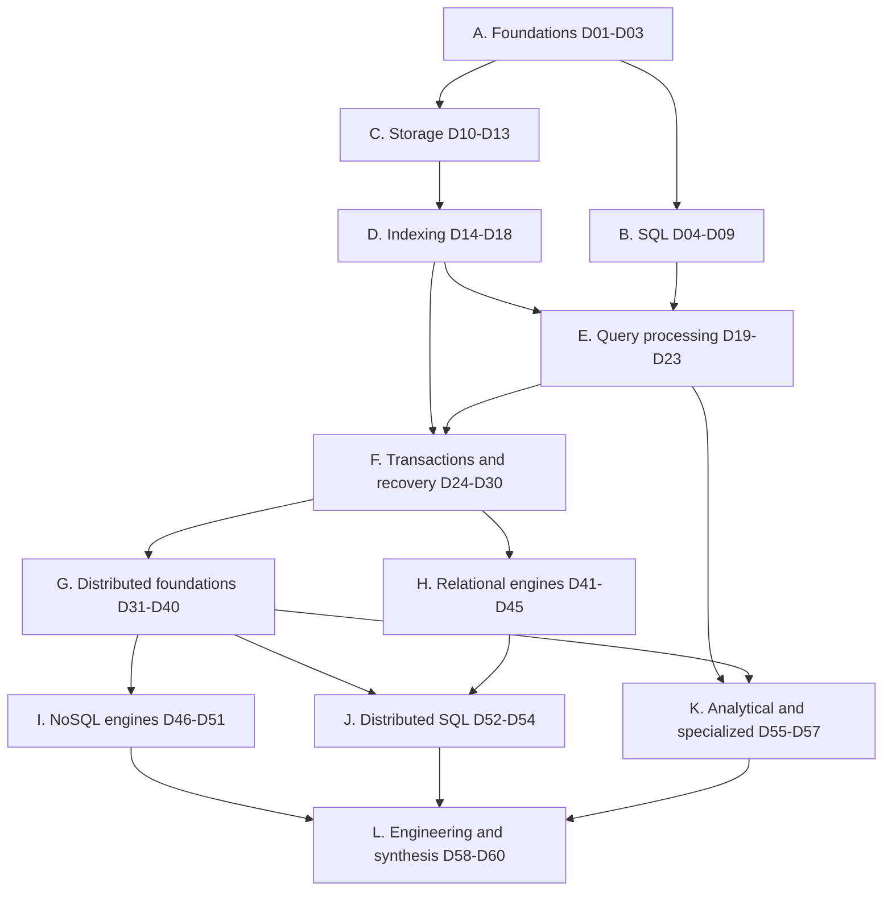

# Database Literature: Learning Plan and Strategy

## 01. Positioning

This track is the internals layer.  
The HLD track (`03-hld-and-system-design/README.md`, Parts C and E) is the "choose and defend a datastore" layer that sits on top of it.  
Where a topic already lives elsewhere, this track goes one level deeper and links back instead of re-teaching.

| Topic elsewhere in cis-theta                    | Where it lives                                | This track adds                                                           |
| ----------------------------------------------- | --------------------------------------------- | ------------------------------------------------------------------------- |
| Relational vs NoSQL families, when to use which | HLD C1, C2                                    | D01 taxonomy, D41 to D57 engine internals behind each family              |
| Replication modes, replication lag anomalies    | HLD C4                                        | D33, D34: log shipping formats, quorum math, anomaly proofs               |
| Partitioning, shard keys, rebalancing           | HLD C5                                        | D36: consistent hashing internals, range splits, global secondary indexes |
| Data modeling for query patterns                | HLD C6                                        | D03 normalization theory, D47 and D49 query-first modeling labs           |
| Redis persistence, replication, Cluster         | HLD D4                                        | D50: event loop, data-structure encodings, fork and copy-on-write         |
| CAP, consistency, Paxos and Raft basics         | HLD E1, E4                                    | D31, D34, D37: formal models, full Raft implementation                    |
| ID generation (UUIDv7, Snowflake)               | `05-interview-playbooks/unique-id-generator/` | D15: why random keys hurt B+tree locality and page splits                 |
| Idempotency, retries                            | REST R2 deep dives                            | D38: why distributed commit needs idempotent participants                 |
| etcd and Raft inside Kubernetes                 | Kubernetes K02                                | D37: Raft from the paper; D56: etcd as a product                          |
| Running databases on Kubernetes                 | Deployment G1.4                               | D58: operators, StatefulSet failure modes for databases                   |
| In-memory database with SQL-like queries (LLD)  | LLD catalog                                   | D21, D28: real executor and MVCC design to reuse in that machine-coding   |
| Payment ledger correctness                      | `payment-system/mock-interview/`              | D25: isolation levels and write skew in money movement                    |

---

## 02. Terms used in this plan

Every module re-defines its own terms before use. This table exists so that the plan itself is readable without forward references.

| Term                     | Meaning                                                                                                                     |
| ------------------------ | --------------------------------------------------------------------------------------------------------------------------- |
| Database                 | An organized collection of data.                                                                                            |
| DBMS                     | Database management system: the software that stores, queries and protects a database (PostgreSQL is a DBMS).               |
| Relation, tuple          | A relation is a table; a tuple is one row of it.                                                                            |
| Schema                   | The declared structure of data: tables, columns, types, constraints.                                                        |
| SQL                      | Structured Query Language: the declarative language for relational databases.                                               |
| Procedural SQL           | Languages that add variables, loops and error handling to SQL, run inside the DBMS: PL/SQL (Oracle), PL/pgSQL (PostgreSQL). |
| Stored procedure         | A named procedural-SQL program stored in and executed by the DBMS.                                                          |
| OLTP                     | Online transaction processing: many short reads and writes touching few rows (orders, payments).                            |
| OLAP                     | Online analytical processing: few long queries scanning many rows (reports, dashboards).                                    |
| Page (block)             | The fixed-size unit (for example 8 KB) in which a DBMS reads and writes disk.                                               |
| Buffer pool              | The DBMS-managed memory area that caches disk pages.                                                                        |
| Storage engine           | The DBMS component that lays out data on disk and in memory (InnoDB, WiredTiger, RocksDB).                                  |
| Index                    | An auxiliary structure that finds rows by key without scanning the whole table.                                             |
| B+tree                   | A balanced, wide tree index whose leaves hold keys in sorted order; the default index of relational systems.                |
| LSM tree                 | Log-structured merge tree: writes go to memory and are flushed as sorted immutable files that are merged later.             |
| Memtable, SSTable        | The in-memory write buffer of an LSM tree, and the sorted immutable file it is flushed to.                                  |
| Compaction               | Background merging of LSM files to drop overwritten and deleted data.                                                       |
| Query plan               | The tree of physical operators (scan, join, sort) the DBMS chooses to answer a query.                                       |
| Query optimizer          | The component that picks a query plan, usually by estimating cost.                                                          |
| Transaction              | A group of operations that succeeds or fails as one unit.                                                                   |
| ACID                     | Atomicity, consistency, isolation, durability: the guarantees a transaction may offer.                                      |
| Isolation level          | How much one transaction may see of another's uncommitted or concurrent work (Read Committed, Serializable).                |
| Serializability          | The guarantee that concurrent transactions produce a result equal to some one-at-a-time order.                              |
| Lock, latch              | A lock protects logical data for a transaction's lifetime; a latch protects an in-memory structure for microseconds.        |
| 2PL                      | Two-phase locking: a transaction acquires locks, then releases them, never acquiring after the first release.               |
| MVCC                     | Multi-version concurrency control: writers create new row versions so readers see a consistent snapshot unblocked.          |
| WAL                      | Write-ahead log: changes are recorded in an append-only log before the data pages are written.                              |
| Checkpoint               | A point where the DBMS bounds how much log must be replayed after a crash.                                                  |
| ARIES                    | The standard crash-recovery algorithm (analysis, redo, undo) built on a WAL.                                                |
| Replication              | Keeping copies of the same data on several machines.                                                                        |
| Leader, follower         | In single-leader replication, the leader accepts writes and followers copy its log.                                         |
| Partition (shard)        | A subset of the data placed on one machine or replica group; sharding is splitting data into partitions.                    |
| Quorum                   | The minimum number of replicas that must answer for an operation to count (for example 2 of 3).                             |
| Consensus                | Agreement by a group of machines on one value or one ordered log despite failures.                                          |
| Paxos, Raft              | The two dominant consensus algorithms; Raft was designed to be easier to understand and implement.                          |
| 2PC                      | Two-phase commit: a coordinator asks all participants to prepare, then tells all to commit or abort.                        |
| Linearizability          | The strongest single-object consistency: every operation appears to happen at one instant between call and return.          |
| CAP, PACELC              | CAP: under a network partition choose consistency or availability. PACELC adds: else, choose latency or consistency.        |
| HLC, TrueTime            | Hybrid logical clocks (physical time plus a counter) and Google's bounded-uncertainty clock API in Spanner.                 |
| Vectorized execution     | Processing a batch of values per operator call instead of one row, to use CPU caches and SIMD.                              |
| Columnar storage         | Storing each column contiguously, so analytical scans read only the columns they need.                                      |
| NewSQL / distributed SQL | Systems that keep SQL and ACID transactions while scaling out across machines (Spanner, CockroachDB, TiDB).                 |

---

## 03. Sources and how to get them

The two requested books are paid books; neither is legitimately free online.  
Both are on O'Reilly Learning and in most university libraries.  
Free, reliable substitutes are listed for every gap.

### 03.01 Primary books

| Code     | Book                                                                                      | Role in this plan                                                   | Availability                                           |
| -------- | ----------------------------------------------------------------------------------------- | ------------------------------------------------------------------- | ------------------------------------------------------ |
| **PET**  | Alex Petrov, "Database Internals", O'Reilly, 2019                                         | Storage engines (Part I) and distributed systems (Part II)          | Paid; O'Reilly Learning                                |
| **SKS**  | Silberschatz, Korth, Sudarshan, "Database System Concepts", 7th ed., McGraw-Hill, 2019    | The textbook behind CMU 15-445; theory, SQL, transactions, recovery | Paid; chapter bibliographies and slides at db-book.com |
| **DDIA** | Kleppmann and Riccomini, "Designing Data-Intensive Applications", 2nd ed., O'Reilly, 2026 | Bridge between internals and system design                          | Paid; O'Reilly Learning                                |

Petrov chapter map (used as `PET ch N` below):

| Ch  | Title                               | Ch  | Title                                   |
| --- | ----------------------------------- | --- | --------------------------------------- |
| 01  | Introduction and Overview           | 08  | Introduction and Overview (distributed) |
| 02  | B-Tree Basics                       | 09  | Failure Detection                       |
| 03  | File Formats                        | 10  | Leader Election                         |
| 04  | Implementing B-Trees                | 11  | Replication and Consistency             |
| 05  | Transaction Processing and Recovery | 12  | Anti-Entropy and Dissemination          |
| 06  | B-Tree Variants                     | 13  | Distributed Transactions                |
| 07  | Log-Structured Storage              | 14  | Consensus                               |

Silberschatz 7th edition chapter map (used as `SKS ch N` below; CMU readings use the same numbering):

| Ch  | Title                                | Ch  | Title                                           |
| --- | ------------------------------------ | --- | ----------------------------------------------- |
| 01  | Introduction                         | 17  | Transactions                                    |
| 02  | Introduction to the Relational Model | 18  | Concurrency Control                             |
| 03  | Introduction to SQL                  | 19  | Recovery System                                 |
| 04  | Intermediate SQL                     | 20  | Database-System Architectures                   |
| 05  | Advanced SQL                         | 21  | Parallel and Distributed Storage                |
| 06  | Database Design Using the E-R Model  | 22  | Parallel and Distributed Query Processing       |
| 07  | Relational Database Design           | 23  | Parallel and Distributed Transaction Processing |
| 08  | Complex Data Types                   | 24  | Advanced Indexing Techniques                    |
| 09  | Application Development              | 25  | Advanced Application Development                |
| 10  | Big Data                             | 26  | Blockchain Databases                            |
| 11  | Data Analytics                       | 27  | Advanced Relational Database Design (online)    |
| 12  | Physical Storage Systems             | 28  | Formal-Relational Query Languages (online)      |
| 13  | Data Storage Structures              | 29  | Object-Based Databases (online)                 |
| 14  | Indexing                             | 30  | XML (online)                                    |
| 15  | Query Processing                     | 31  | Information Retrieval (online)                  |
| 16  | Query Optimization                   | 32  | PostgreSQL (online)                             |

### 03.02 The three CMU playlists

All three playlists are the same course: **CMU 15-445/645 Intro to Database Systems**, taught by Andy Pavlo (with Jignesh Patel in some offerings), in three different semesters.  
They are not three different courses.

| Code    | Playlist                                                       | Offering  | Videos | Use                                                                                                     |
| ------- | -------------------------------------------------------------- | --------- | ------ | ------------------------------------------------------------------------------------------------------- |
| **F25** | `youtube.com/playlist?list=PLSE8ODhjZXjYMAgsGH-GtY5rJYZ6zjsd5` | Fall 2025 | 25     | **Primary.** Newest; two optimizer lectures; watch before each module                                   |
| **F24** | `youtube.com/playlist?list=PLSE8ODhjZXjYDBpQnSymaectKjxCy6BYq` | Fall 2024 | 26     | Secondary. Each lecture opens with an industry flash talk (Neon, ClickHouse, TiDB, DataStax and others) |
| **F23** | `youtube.com/playlist?list=PLSE8ODhjZXjbj8BMuIrRcacnQh20hmY9g` | Fall 2023 | 26     | Fallback. A second explanation when an F25 lecture does not land                                        |

Strategy: watch F25 once per module. Watch only the F24 flash talk named in a product module.  
Use F23 only to re-hear a hard topic.  
Never watch all three in full; that is 75 hours spent on one syllabus.

Lecture numbers below are the course schedule numbers.  
F24 and F23 also have a lecture 00 (course overview), so a playlist's video position can differ from the lecture number by one.

Course labs (BusTub, C++) are mirrored in this plan as Java labs: buffer pool manager, B+tree index, query execution, concurrency control (MVCC).

### 03.03 Supplementary sources (free unless marked)

| Code       | Source                                                                                                                                            | Used for                                               |
| ---------- | ------------------------------------------------------------------------------------------------------------------------------------------------- | ------------------------------------------------------ |
| **AODS**   | Hellerstein, Stonebraker, Hamilton, "Architecture of a Database System" (2007), free PDF                                                          | One-pass map of a whole DBMS                           |
| **RED**    | "Readings in Database Systems" (the Red Book), 5th ed., redbook.io                                                                                | Paper commentary by Stonebraker, Hellerstein, Bailis   |
| **721**    | CMU 15-721 Advanced Database Systems (Pavlo), 15721.courses.cs.cmu.edu                                                                            | OLAP internals, vectorization, compilation             |
| **SCI**    | Edward Sciore, "Database Design and Implementation", 2nd ed., Springer, 2020 (paid)                                                               | SimpleDB: a complete teaching DBMS written in Java     |
| **ROG**    | Egor Rogov, "PostgreSQL Internals" (Postgres Professional), free PDF                                                                              | PostgreSQL MVCC, buffers, WAL, locks, planner, indexes |
| **IDB**    | Hironobu Suzuki, "The Internals of PostgreSQL", interdb.jp, free                                                                                  | PostgreSQL second view                                 |
| **UTIL**   | Markus Winand, "Use the Index, Luke", use-the-index-luke.com, free                                                                                | Indexing from the SQL author's side                    |
| **HPM**    | Schwartz et al., "High Performance MySQL", 4th ed., O'Reilly (paid)                                                                               | MySQL operations and InnoDB tuning                     |
| **JCOLE**  | Jeremy Cole, InnoDB on-disk format blog series and `innodb_ruby`, free                                                                            | InnoDB page and record layout                          |
| **DPS**    | Mendes et al., "Database Performance at Scale", Apress, 2023, free (open access)                                                                  | ScyllaDB and performance engineering                   |
| **FEU**    | Feuerstein and Pribyl, "Oracle PL/SQL Programming", 6th ed., O'Reilly (paid)                                                                      | PL/SQL reference text                                  |
| **DOCS**   | Official manuals: PostgreSQL, MySQL, Oracle PL/SQL Language Reference, MongoDB, Cassandra, ScyllaDB, CockroachDB, Redis, RocksDB wiki, ClickHouse | Ground truth per product                               |
| **JEP**    | Jepsen analyses (jepsen.io) and the Hermitage isolation test suite                                                                                | What products actually guarantee                       |
| **PAPERS** | Listed per module                                                                                                                                 | Primary sources                                        |

Labs and code references:

| Language | Reference implementations to read                                                                                                                                            |
| -------- | ---------------------------------------------------------------------------------------------------------------------------------------------------------------------------- |
| Java     | SimpleDB (SCI), H2 Database, Apache Derby, Apache Cassandra (written in Java), Apache Calcite (optimizer framework), RocksJava                                               |
| Rust     | `mini-lsm` (LSM tutorial by Chi Zhang), `toydb` (distributed SQL by Erik Grinaker), `sled`, `redb`, `fjall`, `sqlparser-rs`, Apache DataFusion, `openraft`, `raft-rs` (TiKV) |
| Any      | Fly.io "Gossip Glomers" distributed-systems challenges on Jepsen's Maelstrom (accepts any language)                                                                          |

---

## 04. Conventions

| Item             | Choice                                                                                                                                                              |
| ---------------- | ------------------------------------------------------------------------------------------------------------------------------------------------------------------- |
| Teaching mode    | One whole module per delivery as a `dNN-<slug>.md` file (the method the owner chose for the HTTP track); switch to one sub-topic per turn on request                |
| Module format    | Terms first; each sub-topic opens with a **Short answer.**; Mermaid diagrams; one end-to-end story; labs; interview questions; exercises with solutions             |
| Write-up file    | `dNN-<slug>.md` in this folder, plus a row in the progress log                                                                                                      |
| Code             | Java 21+ first (JDBC, `java.nio`, `FileChannel`, `MemorySegment`, virtual threads); Rust second pass (`std`, `tokio`, `sqlx`, `bytes`)                              |
| Lab spine        | One Java project, `minidb`, grows module by module into a small relational DBMS (see section 19)                                                                    |
| Product labs     | Docker Compose per product, versions pinned at teach time; datasets: Pagila (PostgreSQL), Sakila (MySQL), TPC-H, IMDB (Join Order Benchmark)                        |
| Inspection tools | `EXPLAIN (ANALYZE, BUFFERS)`, `pageinspect`, `pg_waldump`, `innodb_ruby`, `sstabledump`, `nodetool`, `ldb` (RocksDB), `cockroach debug`, `perf`, `strace`, `iostat` |
| Priority tags    | **[CORE]** asked in most interviews, must be fluent. **[DEEP]** separates architect answers. **[AWARE]** know what it solves and when to use it                     |

---

## 05. Index

| #   | Part                          | Module                                           | Core question                                                                              |
| --- | ----------------------------- | ------------------------------------------------ | ------------------------------------------------------------------------------------------ |
| D01 | A. Foundations                | What a database system is                        | What does a DBMS do that files and a program cannot?                                       |
| D02 | A. Foundations                | Relational model and algebra                     | Why is a table a set, and what can be computed from sets?                                  |
| D03 | A. Foundations                | Data modeling and normalization                  | How is a schema designed so that it cannot contradict itself?                              |
| D04 | B. SQL                        | SQL core                                         | How is a question written declaratively, and how do NULLs change the answer?               |
| D05 | B. SQL                        | Intermediate SQL                                 | How do views, constraints and subqueries shape correct data?                               |
| D06 | B. SQL                        | Advanced and analytical SQL                      | How are rankings, running totals and hierarchies computed in one query?                    |
| D07 | B. SQL                        | SQL from applications                            | What happens between a Java method call and a row in the table?                            |
| D08 | B. SQL                        | PL/SQL (Oracle)                                  | How is procedural logic written, run and made fast inside Oracle?                          |
| D09 | B. SQL                        | PL/pgSQL, MySQL routines, and logic placement    | When should logic live in the database, and how is it written in PostgreSQL?               |
| D10 | C. Storage                    | Storage hardware and the operating system        | What does a write to disk really cost, and when is it really durable?                      |
| D11 | C. Storage                    | Files, pages and tuples                          | How does a row become bytes inside a page inside a file?                                   |
| D12 | C. Storage                    | Storage models and compression                   | Why do analytical databases store columns instead of rows?                                 |
| D13 | C. Storage                    | Buffer pool management                           | Why does a DBMS manage its own memory instead of trusting the OS?                          |
| D14 | D. Indexing                   | Hash tables                                      | How is a key found in constant time on disk and in memory?                                 |
| D15 | D. Indexing                   | B-trees and B+trees                              | Why has one tree shape dominated databases for fifty years?                                |
| D16 | D. Indexing                   | Index variants and filters                       | Which index fits text, geometry, low-cardinality columns or "maybe present"?               |
| D17 | D. Indexing                   | LSM trees and log-structured storage             | How do write-heavy engines turn random writes into sequential ones?                        |
| D18 | D. Indexing                   | Index concurrency control                        | How do many threads read and split one B+tree at the same time?                            |
| D19 | E. Query processing           | Sorting and aggregation                          | How is data larger than memory sorted and grouped?                                         |
| D20 | E. Query processing           | Join algorithms                                  | How are two tables matched, and when does each join method win?                            |
| D21 | E. Query processing           | Query execution models                           | How do operators pass rows to each other, on one core and on many?                         |
| D22 | E. Query processing           | Query optimization                               | How does the DBMS pick one plan out of millions?                                           |
| D23 | E. Query processing           | Reading plans and tuning queries                 | Why is this query slow, and what is the smallest change that fixes it?                     |
| D24 | F. Transactions and recovery  | Transactions and serializability                 | What does "correct" mean when transactions run at the same time?                           |
| D25 | F. Transactions and recovery  | Isolation levels and anomalies                   | What does each isolation level allow, in theory and in each real product?                  |
| D26 | F. Transactions and recovery  | Two-phase locking                                | How do locks give serializability, and what happens when they deadlock?                    |
| D27 | F. Transactions and recovery  | Timestamp ordering and optimistic control        | Can transactions be ordered without locks?                                                 |
| D28 | F. Transactions and recovery  | Multi-version concurrency control                | How do readers and writers stop blocking each other?                                       |
| D29 | F. Transactions and recovery  | Logging and durability                           | How is a commit made durable without writing every page?                                   |
| D30 | F. Transactions and recovery  | Crash recovery and ARIES                         | After a crash, how is the database put back exactly as committed?                          |
| D31 | G. Distributed foundations    | Models of distributed systems and time           | What can and cannot be known when machines and clocks fail?                                |
| D32 | G. Distributed foundations    | Failure detection, membership, leader election   | How does a cluster decide who is alive and who is in charge?                               |
| D33 | G. Distributed foundations    | Replication                                      | How are copies kept, and what does a client see while they disagree?                       |
| D34 | G. Distributed foundations    | Consistency models, CAP and quorums              | Which guarantees can a replicated system give, and at what price?                          |
| D35 | G. Distributed foundations    | Anti-entropy and conflict resolution             | How do replicas that diverged become equal again?                                          |
| D36 | G. Distributed foundations    | Partitioning and sharding                        | How is data split across machines and moved while serving traffic?                         |
| D37 | G. Distributed foundations    | Consensus: Paxos and Raft                        | How do machines agree on one log when any of them may fail?                                |
| D38 | G. Distributed foundations    | Distributed transactions                         | How does one transaction commit atomically across partitions?                              |
| D39 | G. Distributed foundations    | Distributed query processing and OLAP            | How does a query run across a hundred machines?                                            |
| D40 | G. Distributed foundations    | Cloud-native and disaggregated architectures     | What changes when storage, compute and log are separate services?                          |
| D41 | H. Relational engines         | PostgreSQL internals                             | How do PostgreSQL's heap, MVCC, WAL and planner fit together?                              |
| D42 | H. Relational engines         | PostgreSQL in production                         | How is PostgreSQL replicated, partitioned, vacuumed and kept highly available?             |
| D43 | H. Relational engines         | MySQL and InnoDB internals                       | How does a clustered-index engine with undo logs differ from PostgreSQL?                   |
| D44 | H. Relational engines         | MySQL replication and scale-out                  | How do binlog, GTID, Group Replication and Vitess scale MySQL?                             |
| D45 | H. Relational engines         | SQLite and embedded databases                    | How does a full SQL database fit in a library, and where is it used?                       |
| D46 | I. NoSQL engines              | MongoDB                                          | How do documents, WiredTiger, replica sets and shards work together?                       |
| D47 | I. NoSQL engines              | Apache Cassandra                                 | How does a leaderless, tunably consistent wide-column store work?                          |
| D48 | I. NoSQL engines              | ScyllaDB                                         | What does rewriting Cassandra as shard-per-core C++ change?                                |
| D49 | I. NoSQL engines              | Amazon DynamoDB and the Dynamo lineage           | How does a managed key-value store give predictable latency at any scale?                  |
| D50 | I. NoSQL engines              | Redis and in-memory stores                       | How does a single-threaded server reach a million operations per second?                   |
| D51 | I. NoSQL engines              | RocksDB and embedded key-value engines           | What is inside the engine that half of the distributed databases are built on?             |
| D52 | J. Distributed SQL            | Google Spanner                                   | How do synchronized clocks give global, externally consistent transactions?                |
| D53 | J. Distributed SQL            | CockroachDB                                      | How is Spanner's design rebuilt without atomic clocks?                                     |
| D54 | J. Distributed SQL            | TiDB, YugabyteDB, Vitess, Citus: a comparison    | Which scale-out SQL design fits which workload?                                            |
| D55 | K. Analytical and specialized | ClickHouse, DuckDB and the OLAP landscape        | How does a columnar engine scan a billion rows per second?                                 |
| D56 | K. Analytical and specialized | Search, graph, time-series, vector, coordination | What do Elasticsearch, Neo4j, TimescaleDB, pgvector, etcd and FoundationDB do differently? |
| D57 | K. Analytical and specialized | Commercial engines: Oracle, SQL Server, Aurora   | What do the big commercial systems do that the open-source ones copy or lack?              |
| D58 | L. Engineering and synthesis  | Operating databases                              | How are databases benchmarked, backed up, migrated, observed and run on Kubernetes?        |
| D59 | L. Engineering and synthesis  | Verifying correctness                            | How is a database proven to keep its promises under failure?                               |
| D60 | L. Engineering and synthesis  | Capstone: choosing and designing databases       | Can a datastore be chosen, designed and defended for any workload?                         |

---

## 06. Module flow

Teaching order is D01 to D60 as numbered, with two allowed pull-forwards:

- D41 (PostgreSQL internals) and D43 (InnoDB internals) may be taught right after D30, before Part G, if the owner wants product grounding earlier.

- Part B (SQL) depends only on Part A and can run in parallel with Part C as a lighter second stream.

---

## 07. Part A. Foundations

### D01. What a database system is

01. Files vs a DBMS: the problems a DBMS solves (concurrency, crash safety, integrity, declarative queries, physical data independence). **[CORE]**
02. Anatomy of a DBMS: network layer, parser, optimizer, executor, access methods, buffer pool, storage, transaction manager, log manager, recovery. One diagram reused by every later module. **[CORE]**
03. Taxonomy by data model: relational, key-value, document, wide-column, graph, time-series, search, vector, multi-model. **[CORE]**
04. Taxonomy by workload and architecture: OLTP vs OLAP vs HTAP; embedded vs client-server; single-node vs shared-nothing vs shared-disk; in-memory vs disk-oriented. **[CORE]**
05. History in one page: hierarchical and network models, Codd 1970, System R and Ingres, the NoSQL wave, NewSQL, cloud-native. Why the relational model keeps winning. **[AWARE]**
06. The product map used by this plan: every engine in Parts H to K placed on the taxonomy. **[CORE]**
07. Lab: same data (users, orders) in a CSV file with a Java program vs in PostgreSQL; break the file version with two concurrent writers and a `kill -9`.

Sources: SKS ch 01, 20.1-20.2; PET ch 01; AODS sec 1; Stonebraker and Pavlo, "What Goes Around Comes Around... And Around" (SIGMOD Record 2024); F25 L01 (first half).

### D02. Relational model and algebra

01. Relations as sets of tuples; attributes, domains, keys (super, candidate, primary, foreign). **[CORE]**
02. Relational algebra: selection, projection, union, difference, Cartesian product, rename; derived operators: join, intersection, division. **[CORE]**
03. Bag (multiset) semantics vs set semantics, and why SQL uses bags. **[DEEP]**
04. Relational calculus (tuple and domain) in one section; Codd's theorem: algebra and calculus are equally expressive. **[AWARE]**
05. Algebra as the bridge to query plans: every SQL query becomes an algebra tree; equivalence rules preview D22. **[CORE]**
06. Lab: a 200-line Java relational-algebra interpreter over in-memory lists (records as tuples, streams as operators).

Sources: SKS ch 02, ch 28 (online); F25 L01.

### D03. Data modeling and normalization

01. Entity-relationship modeling: entities, relationships, cardinality, weak entities, mapping ER to tables. **[CORE]**
02. Functional dependencies, closure, keys from dependencies. **[DEEP]**
03. Anomalies (update, insert, delete) and normal forms: 1NF, 2NF, 3NF, BCNF; 4NF and multivalued dependencies in brief. **[CORE]**
04. Decomposition: lossless join and dependency preservation; why 3NF is the practical target. **[DEEP]**
05. Denormalization on purpose: read-optimized copies, materialized views, document embedding; the price paid in write anomalies. **[CORE]**
06. Modeling patterns: surrogate vs natural keys, many-to-many, hierarchies (adjacency list, nested set, closure table, materialized path), polymorphic associations, soft delete, temporal tables, EAV and why to avoid it. **[CORE]**
07. Lab: model an e-commerce domain to 3NF; then denormalize one read path and measure.

Sources: SKS ch 06, 07, 27 (online); DDIA chapter on data models.

---

## 08. Part B. SQL

### D04. SQL core

01. SQL as a family: the ISO standard (SQL:2023), dialects (PostgreSQL, MySQL, Oracle, SQL Server, SQLite), and what is portable. **[CORE]**
02. DDL: `CREATE`, `ALTER`, `DROP`; data types (numeric precision, text, temporal types and time zones, boolean, UUID, JSON). **[CORE]**
03. DML: `INSERT`, `UPDATE`, `DELETE`, `MERGE`, upsert (`ON CONFLICT`, `ON DUPLICATE KEY`), `RETURNING`. **[CORE]**
04. `SELECT` logical processing order: `FROM`, `WHERE`, `GROUP BY`, `HAVING`, window, `SELECT`, `DISTINCT`, `ORDER BY`, `LIMIT`. **[CORE]**
05. Joins: inner, left, right, full outer, cross, self, semi and anti joins written with `EXISTS` and `NOT EXISTS`. **[CORE]**
06. NULL and three-valued logic: `NOT IN` with NULLs, `COUNT(*)` vs `COUNT(col)`, `IS DISTINCT FROM`, NULLs in unique constraints. **[CORE]**
07. Aggregation, `GROUP BY`, `HAVING`; set operations `UNION [ALL]`, `INTERSECT`, `EXCEPT`. **[CORE]**
08. Pagination: `OFFSET` vs keyset (seek) pagination, and why `OFFSET` degrades. **[CORE]**
09. Lab: 40 graded exercises on Pagila in PostgreSQL, each also run on MySQL (Sakila) to expose dialect differences.

Sources: SKS ch 03; F25 L02; UTIL (pagination chapter); DOCS (PostgreSQL SQL reference).

### D05. Intermediate SQL

01. Subqueries: scalar, row, table; correlated vs uncorrelated; `ANY`, `ALL`, `EXISTS`. **[CORE]**
02. Common table expressions (`WITH`); materialization behavior differences between products. **[CORE]**
03. Views, updatable views, materialized views and refresh strategies. **[CORE]**
04. Integrity constraints: `NOT NULL`, `UNIQUE`, `PRIMARY KEY`, `FOREIGN KEY` with `ON DELETE` actions, `CHECK`, exclusion constraints (PostgreSQL), deferrable constraints. **[CORE]**
05. Transactions in SQL: `BEGIN`, `COMMIT`, `ROLLBACK`, `SAVEPOINT`, `SET TRANSACTION ISOLATION LEVEL` (theory in D24 and D25). **[CORE]**
06. Index DDL from the user side: `CREATE INDEX`, composite and covering indexes, partial and expression indexes, `CONCURRENTLY`. **[CORE]**
07. Security: roles, `GRANT` and `REVOKE`, row-level security, SQL injection and why bind parameters are the fix. **[CORE]**
08. Lab: enforce a business rule four ways (constraint, trigger, application, exclusion constraint) and break each one.

Sources: SKS ch 04; F25 L02; DOCS.

### D06. Advanced and analytical SQL

01. Window functions: `ROW_NUMBER`, `RANK`, `DENSE_RANK`, `LAG`, `LEAD`, `FIRST_VALUE`, frame clauses (`ROWS`, `RANGE`, `GROUPS`). **[CORE]**
02. Classic interview patterns: top-N per group, running totals, gaps and islands, deduplication, sessionization, median and percentiles. **[CORE]**
03. Recursive CTEs: hierarchies, graph walks, generating series; cycle detection. **[CORE]**
04. `GROUPING SETS`, `ROLLUP`, `CUBE`; pivoting with `FILTER` and `CASE`. **[DEEP]**
05. `LATERAL` joins; JSON in SQL (`jsonb` operators, `JSON_TABLE`); arrays. **[DEEP]**
06. Temporal queries: time zones, `generate_series` calendars, interval arithmetic pitfalls. **[DEEP]**
07. Lab: an analytics workbook of 25 problems on TPC-H, with model answers and plans.

Sources: SKS ch 05.4-05.6, ch 11; DOCS (window function chapters).

### D07. SQL from applications

01. Client-server protocol: PostgreSQL wire protocol (simple vs extended query, parse/bind/execute), MySQL protocol in brief. **[DEEP]**
02. JDBC: `Connection`, `PreparedStatement`, `ResultSet`, batching, fetch size, auto-commit; server-side prepared statements and plan caching. **[CORE]**
03. Connection pooling: why connections are expensive (process per connection in PostgreSQL), HikariCP sizing, PgBouncer transaction mode and its caveats. **[CORE]**
04. ORMs: JPA and Hibernate, the persistence context, lazy loading, the N+1 problem, when to drop to SQL or jOOQ. **[CORE]**
05. Transactions in application code: Spring `@Transactional` propagation, retries on serialization failure, idempotency (cross-ref REST R2). **[CORE]**
06. Schema migrations: Flyway and Liquibase; expand-and-contract (cross-ref Deployment L3.1). **[CORE]**
07. Rust pass: `sqlx` (compile-time checked queries), `tokio-postgres`, `diesel` in brief. **[AWARE]**
08. Lab: reproduce N+1 in Hibernate, fix it three ways, measure round trips with `pg_stat_statements`.

Sources: SKS ch 05.1, ch 09; DOCS (PostgreSQL protocol chapter, JDBC driver docs).

### D08. PL/SQL (Oracle)

01. Why procedural SQL exists: fewer round trips, logic next to data, set-based plus procedural. Oracle's architecture in one page (SGA, PGA, SQL engine vs PL/SQL engine and context switches). **[CORE]**
02. Block structure: `DECLARE`, `BEGIN`, `EXCEPTION`, `END`; variables, `%TYPE`, `%ROWTYPE`, records, constants. **[CORE]**
03. Control flow; implicit and explicit cursors, cursor `FOR` loops, `REF CURSOR`, `SYS_REFCURSOR`. **[CORE]**
04. Exceptions: predefined, user-defined, `RAISE_APPLICATION_ERROR`, propagation, `SQLCODE` and `SQLERRM`. **[CORE]**
05. Procedures, functions, parameters (`IN`, `OUT`, `IN OUT`, `NOCOPY`), packages (spec vs body, package state). **[CORE]**
06. Collections: associative arrays, nested tables, `VARRAY`; bulk processing with `BULK COLLECT` and `FORALL`, `SAVE EXCEPTIONS`. **[CORE]**
07. Triggers: row vs statement, `BEFORE` and `AFTER`, `INSTEAD OF`, compound triggers, the mutating-table error. **[CORE]**
08. Dynamic SQL: `EXECUTE IMMEDIATE`, `DBMS_SQL`, bind variables and injection. **[CORE]**
09. Transactions inside PL/SQL: autonomous transactions and when they are a trap. **[DEEP]**
10. Performance and tooling: context-switch cost, `DBMS_OUTPUT`, `DBMS_PROFILER` and the hierarchical profiler, `DBMS_SCHEDULER`. **[DEEP]**
11. Lab: Oracle Database Free in Docker (or Oracle Live SQL); a ledger package with transfer procedure, audit trigger, bulk loader; row-by-row vs `FORALL` timing.

Sources: DOCS (Oracle PL/SQL Language Reference); FEU; SKS ch 05.2-05.3.

### D09. PL/pgSQL, MySQL routines, and logic placement

01. PostgreSQL functions vs procedures (`CALL`, transaction control inside procedures); `LANGUAGE sql` vs `plpgsql`; volatility (`IMMUTABLE`, `STABLE`, `VOLATILE`) and why the planner cares. **[CORE]**
02. PL/pgSQL syntax mapped to PL/SQL: declarations, `RETURN QUERY`, `RETURNS TABLE`, `FOUND`, `GET DIAGNOSTICS`, exceptions and their subtransaction cost. **[CORE]**
03. Triggers in PostgreSQL: trigger functions, `NEW` and `OLD`, transition tables, event triggers. **[CORE]**
04. Dynamic SQL with `EXECUTE ... USING` and `format()` with `%I` and `%L`. **[CORE]**
05. Plan caching inside PL/pgSQL (generic vs custom plans) and its surprises. **[DEEP]**
06. MySQL stored procedures, functions, triggers and events; their limits. T-SQL (SQL Server) in one page for recognition. **[AWARE]**
07. Logic placement: database vs application; testing (pgTAP), versioning, deployment, observability; the decision framework an architect uses. **[CORE]**
08. Lab: port the D08 ledger package to PL/pgSQL; write pgTAP tests; compare.

Sources: DOCS (PostgreSQL PL/pgSQL chapter, MySQL stored programs); SKS ch 05.2-05.3.

---

## 09. Part C. Storage

### D10. Storage hardware and the operating system

01. The storage hierarchy and latency numbers: CPU caches, DRAM, NVMe SSD, SATA SSD, HDD, network storage, object storage. **[CORE]**
02. HDD mechanics (seek, rotation) vs SSD internals (pages, erase blocks, flash translation layer, write amplification, garbage collection, TRIM). **[DEEP]**
03. The OS path of a write: `write()`, page cache, dirty pages, `fsync`, `fdatasync`, `O_DIRECT`, `O_DSYNC`; what "durable" means. **[CORE]**
04. Torn pages and atomic write units; why databases checksum pages; the 2018 "fsyncgate" lesson from PostgreSQL. **[DEEP]**
05. Why not `mmap`: page-fault stalls, eviction control, error handling, TLB shootdowns. **[DEEP]**
06. I/O interfaces: synchronous, `libaio`, `io_uring`; PostgreSQL's asynchronous I/O work as an example. **[AWARE]**
07. Lab: Java `FileChannel.force` vs no force; measure fsync latency; simulate a torn write and detect it with a CRC32C checksum. Rust pass: same with `std::fs::File::sync_data`.

Sources: SKS ch 12; F25 L03; PET ch 01, 03; Crotty, Leis, Pavlo, "Are You Sure You Want to Use MMAP in Your DBMS?" (CIDR 2022).

### D11. Files, pages and tuples

01. Database files: heap files, page directories, free-space maps; how PostgreSQL and InnoDB name and size files. **[CORE]**
02. Page layout: header, slotted pages (slot array plus tuples growing toward each other), record IDs. **[CORE]**
03. Tuple layout: header, null bitmap, fixed vs variable-length fields, alignment and padding, how column order changes row size. **[CORE]**
04. Large values: overflow pages, TOAST (PostgreSQL), off-page columns (InnoDB). **[DEEP]**
05. Alternatives to heap storage: index-organized (clustered) tables, log-structured storage (preview of D17). **[CORE]**
06. Binary encodings and file formats: fixed vs variable-length integers, checksums, versioning, cell layouts (PET ch 03). **[DEEP]**
07. Lab (`minidb` milestone 1): a Java disk manager and slotted page with insert, delete, update, compaction; inspect a real PostgreSQL page with `pageinspect`.

Sources: SKS ch 13.1-13.3; PET ch 03; F25 L03, L05; ROG (data organization chapters).

### D12. Storage models and compression

01. N-ary storage model (row store), decomposition storage model (column store), PAX (hybrid within a page). **[CORE]**
02. Why OLTP wants rows and OLAP wants columns; HTAP designs. **[CORE]**
03. Compression: block-level vs column-level; dictionary, run-length, bit-packing, delta, frame-of-reference; operating directly on compressed data. **[DEEP]**
04. Open columnar file formats: Parquet and ORC (row groups, column chunks, pages, statistics); Apache Arrow as the in-memory columnar format. **[DEEP]**
05. Lab: store TPC-H `lineitem` row-wise and column-wise in Java; run a two-column aggregate on both; add dictionary and RLE encoding.

Sources: SKS ch 11.2, 13.6; F25 L06; 721 (storage and compression lectures); Abadi, Madden, Hachem, "Column-Stores vs. Row-Stores: How Different Are They Really?" (SIGMOD 2008).

### D13. Buffer pool management

01. Why the DBMS manages memory itself: control of eviction, flushing order (WAL rule), prefetching, scan resistance. **[CORE]**
02. Buffer pool structures: frames, page table, pin counts, dirty flags, latches. **[CORE]**
03. Replacement policies: LRU, CLOCK, LRU-K, 2Q, ARC; sequential flooding and how products defend against it (PostgreSQL ring buffers, InnoDB midpoint insertion). **[CORE]**
04. Flushing: background writers, checkpoints, the WAL-before-data rule (formal treatment in D29). **[CORE]**
05. Double buffering with the OS page cache; `shared_buffers` vs `innodb_buffer_pool_size` sizing philosophy. **[CORE]**
06. Multiple pools, pre-fetching, scan sharing, buffer-pool bypass. **[DEEP]**
07. Lab (`minidb` milestone 2, mirrors BusTub Project 1): Java buffer pool manager with LRU-K replacer and a page guard API; concurrency test with virtual threads.

Sources: SKS ch 13.5; F25 L04; PET ch 05 (buffer management section); O'Neil et al., "The LRU-K Page Replacement Algorithm" (SIGMOD 1993).

---

## 10. Part D. Indexing

### D14. Hash tables

01. Hash functions for databases: speed vs quality (xxHash, MurmurHash, CRC), why cryptographic hashes are not used. **[CORE]**
02. Static hashing: chaining, linear probing, Robin Hood, cuckoo hashing; load factor and tombstones. **[CORE]**
03. Dynamic hashing: extendible hashing, linear hashing. **[DEEP]**
04. Where hash indexes appear: PostgreSQL hash indexes, InnoDB adaptive hash index, hash joins and aggregation (D19, D20), in-memory stores (D50). **[CORE]**
05. Lab (`minidb` milestone 3): a disk-backed extendible hash table on the D13 buffer pool.

Sources: SKS ch 14.5, 24.5; F25 L07.

### D15. B-trees and B+trees

01. From binary search trees to B-trees: why fanout matters on disk. **[CORE]**
02. B+tree structure: inner nodes, leaves, sibling links, occupancy; search, insert with splits, delete with merges and redistribution. **[CORE]**
03. Clustered vs secondary indexes; index-only scans and covering indexes; what a secondary index points to (row ID in PostgreSQL vs primary key in InnoDB). **[CORE]**
04. Composite keys and the leftmost-prefix rule; prefix and suffix truncation; duplicates and deduplication (PostgreSQL 13+). **[CORE]**
05. Implementation details: node layout, binary search within a page, right-only appends, bulk loading, fill factor. **[DEEP]**
06. Key choice and locality: why random UUIDv4 keys cause page splits and cache misses, and why UUIDv7 or sequences do not (cross-ref unique ID generator playbook). **[CORE]**
07. Lab (`minidb` milestone 4, mirrors BusTub Project 2): Java B+tree with insert, delete, range scan iterator; visualize splits.

Sources: SKS ch 14.1-14.4; PET ch 02, 04; F25 L08, L09; Graefe, "Modern B-Tree Techniques" (2011); UTIL.

### D16. Index variants and filters

01. B-tree variants: copy-on-write B-trees (LMDB), lazy B-trees, Bw-tree, B-epsilon and buffer trees, cache-oblivious B-trees. **[DEEP]**
02. Tries and radix trees: the adaptive radix tree (ART); skip lists (used by many memtables). **[DEEP]**
03. Bitmap indexes; inverted indexes for full text; R-trees and spatial indexes. **[CORE]**
04. PostgreSQL index access methods: B-tree, Hash, GiST, SP-GiST, GIN, BRIN; when each one wins. **[CORE]**
05. Filters: Bloom filters (math of false positives), counting, cuckoo and xor filters; where LSM engines use them. **[CORE]**
06. Partial, expression, multi-column and invisible indexes; index maintenance cost. **[CORE]**
07. Lab: Java Bloom filter tuned to a target false-positive rate; compare GIN vs B-tree for a `jsonb` containment query.

Sources: SKS ch 14.6-14.10, 24.1, 24.3-24.4; PET ch 06; F25 L09; Leis et al., "The Adaptive Radix Tree" (ICDE 2013); Bloom (1970).

### D17. LSM trees and log-structured storage

01. The write problem: random in-place updates vs sequential appends. **[CORE]**
02. LSM anatomy: WAL, memtable, immutable memtable, flush, SSTables (data blocks, index block, filter block, footer), levels. **[CORE]**
03. Reads: memtable, then levels newest-first; Bloom filters; tombstones and range tombstones. **[CORE]**
04. Compaction strategies: size-tiered, leveled, tiered-plus-leveled, time-window, FIFO; read, write and space amplification; the RUM conjecture. **[CORE]**
05. Variants: Bitcask (hash index plus log), WiscKey (key-value separation), unordered LSM. **[DEEP]**
06. B+tree vs LSM decision table for interviews. **[CORE]**
07. Lab (Rust is first here by design): follow `mini-lsm` week 1 in Rust; then port memtable, SSTable and leveled compaction to Java in `minidb` as an alternate engine.

Sources: SKS ch 14.8, 24.2; PET ch 07; F25 L05; O'Neil et al., "The Log-Structured Merge-Tree" (1996); Lu et al., "WiscKey" (FAST 2016); Athanassoulis et al., "Designing Access Methods: The RUM Conjecture" (EDBT 2016).

### D18. Index concurrency control

01. Locks vs latches restated; latch modes; why latches need no deadlock detection (ordering discipline instead). **[CORE]**
02. Latch crabbing (coupling) for search, insert, delete; optimistic crabbing. **[CORE]**
03. B-link trees (Lehman and Yao) and how PostgreSQL's nbtree uses them. **[DEEP]**
04. Optimistic lock coupling and version latches; lock-free structures (Bw-tree) and why they disappointed in practice. **[DEEP]**
05. Lab (`minidb` milestone 5): make the D15 B+tree thread-safe with crabbing; stress it with 64 virtual threads; detect races with a model check.

Sources: SKS ch 18.10.2; F25 L10; Lehman and Yao, "Efficient Locking for Concurrent Operations on B-Trees" (TODS 1981).

---

## 11. Part E. Query processing

### D19. Sorting and aggregation

01. Why sort: `ORDER BY`, `DISTINCT`, `GROUP BY`, merge joins, B+tree bulk loading. **[CORE]**
02. In-memory sorts and top-N heap sort; external merge sort with runs and k-way merge; I/O cost formulas. **[CORE]**
03. Using a B+tree to avoid sorting (clustered vs unclustered). **[CORE]**
04. Aggregation by sorting vs by hashing; partitioned hash aggregation with spilling. **[CORE]**
05. Lab: Java external merge sort over a file 10x larger than the heap; measure passes.

Sources: SKS ch 15.4-15.5; F25 L11.

### D20. Join algorithms

01. Nested loop (simple, block, index); cost in I/Os. **[CORE]**
02. Sort-merge join; when sorted input makes it free. **[CORE]**
03. Hash join: build and probe; Grace hash join and hybrid hash join; skew handling; Bloom-filter pushdown. **[CORE]**
04. Join choice summary table; semi and anti joins; why PostgreSQL and MySQL ship different join sets (MySQL added hash join in 8.0.18). **[CORE]**
05. Lab: implement all three in `minidb`; reproduce the crossover points with `EXPLAIN ANALYZE` in PostgreSQL.

Sources: SKS ch 15.4-15.6; F25 L12.

### D21. Query execution models

01. Processing models: iterator (Volcano) pull model, materialization model, vectorized (batch) model; push-based pipelines. **[CORE]**
02. Access methods in execution: sequential scan, index scan, bitmap scan, index-only scan; zone maps and late materialization. **[CORE]**
03. Expression evaluation: interpretation vs JIT compilation (PostgreSQL LLVM JIT, HyPer-style compilation). **[DEEP]**
04. Parallel execution: inter-query, intra-query, intra-operator (exchange operator), morsel-driven parallelism; PostgreSQL parallel query. **[CORE]**
05. Process models: process per connection (PostgreSQL), thread per connection (MySQL), thread pools, coroutines. **[CORE]**
06. Lab (`minidb` milestone 6, mirrors BusTub Project 3): Volcano executors (scan, filter, projection, hash join, aggregation, sort, limit) in Java; then a vectorized version and a speed comparison. Rust pass: run the same query through Apache DataFusion.

Sources: SKS ch 15.1-15.3, 15.7, ch 22 (parallel); F25 L13, L14; Graefe, "Volcano" (1994); Boncz et al., "MonetDB/X100" (CIDR 2005); Leis et al., "Morsel-Driven Parallelism" (SIGMOD 2014); 721.

### D22. Query optimization

01. Pipeline: parse, bind, rewrite (heuristics), plan (cost-based), execute. **[CORE]**
02. Rewrite rules: predicate pushdown, projection pushdown, subquery decorrelation and unnesting, view merging, constant folding. **[CORE]**
03. Cost models: I/O and CPU components; why the model is always wrong and still useful. **[CORE]**
04. Cardinality estimation: statistics, histograms (equi-width, equi-depth), most-common values, sampling, sketches (HyperLogLog, count-min); the independence assumption and its failures. **[CORE]**
05. Plan enumeration: System R dynamic programming, left-deep vs bushy trees, interesting orders; genetic optimization (PostgreSQL GEQO); Cascades and Volcano/Columbia top-down optimizers. **[DEEP]**
06. Adaptive and learned approaches; plan caching and parameter sniffing. **[AWARE]**
07. Lab: Java cost-based join-order optimizer (DP over subsets) for 5 tables; compare with Apache Calcite; run the Join Order Benchmark on PostgreSQL to see estimation error.

Sources: SKS ch 16; F25 L15, L16; Selinger et al. (SIGMOD 1979); Graefe, "The Cascades Framework" (1995); Leis et al., "How Good Are Query Optimizers, Really?" (VLDB 2015).

### D23. Reading plans and tuning queries

01. Reading `EXPLAIN` and `EXPLAIN (ANALYZE, BUFFERS)` in PostgreSQL; `EXPLAIN ANALYZE` and `EXPLAIN FORMAT=TREE` in MySQL. **[CORE]**
02. Estimated vs actual rows: the first thing to check. **[CORE]**
03. Index design method: equality first, then range; sargable predicates; functions on indexed columns; implicit casts. **[CORE]**
04. Common pathologies: missing index, wrong index, sort spilling to disk, nested loop over a huge outer, `OR` conditions, `LIKE '%x'`, stale statistics. **[CORE]**
05. Workload tools: `pg_stat_statements`, `auto_explain`, MySQL Performance Schema and `sys` schema, slow query log. **[CORE]**
06. Lab: a "slow query clinic" of 15 broken queries on Pagila and TPC-H; diagnose and fix each one with evidence.

Sources: UTIL; ROG (planner chapters); HPM (query optimization chapter); DOCS.

---

## 12. Part F. Transactions and recovery

### D24. Transactions and serializability

01. ACID, each letter defined precisely, and what each letter is not. **[CORE]**
02. Schedules; conflicts (read-write, write-read, write-write); conflict serializability and the precedence graph; view serializability. **[CORE]**
03. Recoverable, cascadeless and strict schedules. **[DEEP]**
04. Anomalies named: dirty read, non-repeatable read, phantom, lost update, read skew, write skew. **[CORE]**
05. Lab: Java schedule checker that builds a precedence graph and reports cycles.

Sources: SKS ch 17; F25 L17; PET ch 05.

### D25. Isolation levels and anomalies

01. ANSI SQL-92 levels and why the definitions are broken (Berenson et al. 1995). **[CORE]**
02. Snapshot isolation; write skew; serializable snapshot isolation (SSI) in PostgreSQL. **[CORE]**
03. Adya's generalized isolation (G0, G1, G2) in readable form. **[DEEP]**
04. What products really give: PostgreSQL, MySQL InnoDB (repeatable read with consistent reads but locking reads), Oracle ("serializable" is snapshot isolation), SQL Server, CockroachDB (serializable by default), MongoDB. **[CORE]**
05. Weak isolation in practice: `SELECT ... FOR UPDATE`, `FOR SHARE`, `SKIP LOCKED` job queues, advisory locks, retry loops. **[CORE]**
06. Lab: run the Hermitage test suite by hand on PostgreSQL and MySQL; reproduce write skew in a doctor on-call example and a payment example; fix both.

Sources: SKS ch 17.8-17.9, 18.8-18.9; F25 L17, L20; Berenson et al., "A Critique of ANSI SQL Isolation Levels" (SIGMOD 1995); Ports and Grittner, "Serializable Snapshot Isolation in PostgreSQL" (VLDB 2012); JEP (Hermitage); DDIA chapter on transactions.

### D26. Two-phase locking

01. Lock types and compatibility matrix; the lock manager data structure. **[CORE]**
02. 2PL, strict 2PL, strong strict 2PL; why 2PL guarantees conflict serializability. **[CORE]**
03. Deadlocks: detection with waits-for graphs, prevention with wait-die and wound-wait, timeouts. **[CORE]**
04. Multiple-granularity locking: intention locks (IS, IX, SIX); lock escalation. **[DEEP]**
05. Phantoms and predicate locking; InnoDB gap locks and next-key locks as the practical answer. **[CORE]**
06. Lab (`minidb` milestone 7): Java lock manager with deadlock detection; reproduce an InnoDB gap-lock deadlock and read `SHOW ENGINE INNODB STATUS`.

Sources: SKS ch 18.1-18.4, 18.9; F25 L18; DOCS (InnoDB locking chapter).

### D27. Timestamp ordering and optimistic control

01. Basic timestamp ordering; the Thomas write rule. **[DEEP]**
02. Optimistic concurrency control: read, validation, write phases; backward and forward validation. **[CORE]**
03. When optimistic beats pessimistic: contention, transaction length, retries. **[CORE]**
04. Application-level optimistic locking: version columns, JPA `@Version`, conditional writes (cross-ref D49 DynamoDB). **[CORE]**
05. Lab: Java OCC for an in-memory key-value store; benchmark vs 2PL at low and high contention.

Sources: SKS ch 18.5-18.6; F25 L19; Kung and Robinson, "On Optimistic Methods for Concurrency Control" (TODS 1981).

### D28. Multi-version concurrency control

01. The idea: writers create versions, readers read a snapshot; MVCC is not by itself a concurrency control protocol. **[CORE]**
02. Concurrency protocol on top: MV-2PL, MV-TO, MV-OCC, snapshot isolation. **[DEEP]**
03. Version storage: append-only (PostgreSQL heap tuples), time-travel table, delta storage (InnoDB and Oracle undo logs). **[CORE]**
04. Version ordering (oldest-to-newest vs newest-to-oldest) and index management (logical vs physical pointers, HOT updates). **[DEEP]**
05. Garbage collection: tuple-level vs transaction-level; PostgreSQL `VACUUM`, InnoDB purge; long-running transactions as the enemy; transaction ID wraparound. **[CORE]**
06. Lab (`minidb` milestone 8, mirrors BusTub Project 4): Java MVCC with snapshot isolation and a garbage collector; then watch `xmin` and `xmax` change in PostgreSQL with `pageinspect`.

Sources: SKS ch 18.7-18.8; F25 L20; Wu, Arulraj, Lin, Xian, Pavlo, "An Empirical Evaluation of In-Memory Multi-Version Concurrency Control" (VLDB 2017); ROG (MVCC chapters).

### D29. Logging and durability

01. Failure classes: transaction, system crash, media failure. **[CORE]**
02. Buffer policies: steal vs no-steal, force vs no-force; why steal plus no-force needs undo plus redo. **[CORE]**
03. Shadow paging vs write-ahead logging. **[CORE]**
04. Log record types: physical, logical, physiological; log sequence numbers (LSN). **[CORE]**
05. Commit path: group commit, `synchronous_commit` and `innodb_flush_log_at_trx_commit` trade-offs. **[CORE]**
06. Checkpoints: blocking, fuzzy; full-page writes (PostgreSQL) vs doublewrite buffer (InnoDB) against torn pages. **[DEEP]**
07. The log as the database: change data capture, logical decoding, the log in distributed systems (preview of D33, D40). **[CORE]**
08. Lab (`minidb` milestone 9): Java WAL with LSNs and group commit; measure commits per second with and without group commit; read real WAL with `pg_waldump`.

Sources: SKS ch 19.1-19.8; PET ch 05; F25 L21; ROG (WAL chapters).

### D30. Crash recovery and ARIES

01. ARIES principles: write-ahead logging, repeating history during redo, logging changes during undo. **[CORE]**
02. Data structures: page LSN, record LSN, transaction table, dirty page table; compensation log records (CLR). **[DEEP]**
03. The three passes: analysis, redo, undo; walk-through with an example log. **[CORE]**
04. Fuzzy checkpoints in ARIES; nested top actions. **[DEEP]**
05. Media recovery, point-in-time recovery (PITR), backups plus archived WAL. **[CORE]**
06. Recovery in in-memory databases (command logging, snapshots). **[AWARE]**
07. Lab (`minidb` milestone 10): implement ARIES recovery; a crash-injection test harness that kills the JVM at random points and verifies committed data survives.

Sources: SKS ch 19.9-19.10; PET ch 05; F25 L22; Mohan et al., "ARIES" (TODS 1992).

---

## 13. Part G. Distributed foundations

### D31. Models of distributed systems and time

01. Why distribute: scale, availability, latency, data residency; the fallacies of distributed computing. **[CORE]**
02. System models: synchronous, asynchronous, partially synchronous; failure models: crash-stop, crash-recovery, omission, Byzantine. **[CORE]**
03. Impossibility results: FLP; the two generals problem. **[DEEP]**
04. Time: physical clocks and drift, NTP, monotonic vs wall clocks; Lamport clocks; vector clocks; hybrid logical clocks (HLC); TrueTime. **[CORE]**
05. Shared-nothing vs shared-disk vs shared-memory architectures. **[CORE]**
06. Lab: Java Lamport and vector clocks over a simulated message bus; detect concurrent writes.

Sources: PET ch 08; SKS ch 20.4-20.5; F25 L23; Lamport, "Time, Clocks, and the Ordering of Events" (CACM 1978); Kulkarni et al., "Logical Physical Clocks" (HLC, 2014); DDIA chapter on the trouble with distributed systems.

### D32. Failure detection, membership, leader election

01. Heartbeats and timeouts; phi-accrual failure detector (Cassandra); SWIM and gossip-based membership. **[CORE]**
02. Leader election: bully algorithm, ring election, election by consensus; split brain. **[CORE]**
03. Leases and fencing tokens. **[CORE]**
04. Lab: Gossip Glomers challenges 1 to 3 (echo, unique IDs, broadcast) in Java on Maelstrom.

Sources: PET ch 09, 10, 12; Das et al., "SWIM" (DSN 2002); Hayashibara et al., "The Phi Accrual Failure Detector" (2004).

### D33. Replication

01. Single-leader, multi-leader, leaderless; synchronous vs asynchronous vs semi-synchronous. **[CORE]**
02. Replication log formats: statement-based, physical (WAL shipping), logical (row-based), trigger-based. **[CORE]**
03. Replication lag anomalies and fixes: read-your-writes, monotonic reads, consistent prefix (cross-ref HLD C4). **[CORE]**
04. Failover: detection, promotion, fencing the old leader, lost writes. **[CORE]**
05. Chain replication and primary-backup. **[DEEP]**
06. Lab: Gossip Glomers challenge 4 (grow-only counter) and a Java single-leader replicated key-value store with log shipping and manual failover.

Sources: PET ch 11; SKS ch 21.4, 23.4; DDIA chapter on replication; van Renesse and Schneider, "Chain Replication" (OSDI 2004).

### D34. Consistency models, CAP and quorums

01. The consistency spectrum: linearizable, sequential, causal, PRAM, read-your-writes, eventual. **[CORE]**
02. Linearizability vs serializability vs strict serializability. **[CORE]**
03. CAP stated correctly; PACELC; why "CA" is not a choice. **[CORE]**
04. Quorums: R + W > N, sloppy quorums, why quorums alone are not linearizable. **[CORE]**
05. Tunable consistency in practice: Cassandra levels, MongoDB read and write concerns, DynamoDB strongly consistent reads. **[CORE]**
06. Lab: Jepsen-style history check: record a history from the D33 store and check linearizability with a small Java checker (or Knossos/Porcupine as reference).

Sources: PET ch 11; Herlihy and Wing, "Linearizability" (TOPLAS 1990); Gilbert and Lynch (2002); Abadi, "Consistency Tradeoffs in Modern Distributed Database System Design" (PACELC, 2012); JEP (consistency models map); DDIA chapter on consistency and consensus.

### D35. Anti-entropy and conflict resolution

01. Read repair, hinted handoff, Merkle-tree anti-entropy repair. **[CORE]**
02. Gossip dissemination and epidemic protocols. **[DEEP]**
03. Conflict handling: last-write-wins and its data loss, version vectors and siblings, application merge. **[CORE]**
04. CRDTs: state-based vs operation-based; G-Counter, PN-Counter, OR-Set, LWW-Register; where they are used (Riak, Redis Enterprise active-active, local-first apps). **[DEEP]**
05. Lab: Java Merkle tree diff between two replicas; implement an OR-Set and test convergence under random message reordering.

Sources: PET ch 12, 11 (CRDT section); Shapiro et al., "Conflict-free Replicated Data Types" (2011); DeCandia et al., "Dynamo" (SOSP 2007).

### D36. Partitioning and sharding

01. Key-range, hash, and directory partitioning; skew and hot spots. **[CORE]**
02. Consistent hashing, virtual nodes, rendezvous hashing, jump hash. **[CORE]**
03. Range splits and merges (Bigtable tablets, CockroachDB ranges, TiKV regions); dynamic vs fixed partition counts. **[CORE]**
04. Secondary indexes: local (document-partitioned) vs global (term-partitioned); consistency of global indexes. **[CORE]**
05. Rebalancing while serving: data movement, throttling, routing (proxy, smart client, gossip); resharding without downtime (cross-ref HLD C5.5). **[CORE]**
06. Lab: Java consistent-hash ring with vnodes; simulate adding nodes and measure movement; compare with modulo hashing.

Sources: PET ch 13 (partitioning section); SKS ch 21.2-21.3; F25 L23; Karger et al. (STOC 1997); Chang et al., "Bigtable" (OSDI 2006); DDIA chapter on sharding.

### D37. Consensus: Paxos and Raft

01. The problem: agreement, validity, termination; consensus as atomic broadcast and replicated state machines. **[CORE]**
02. Single-decree Paxos: proposers, acceptors, learners; ballots; why two phases. **[CORE]**
03. Multi-Paxos; Fast Paxos, EPaxos, Flexible Paxos in brief. **[DEEP]**
04. Raft in full: terms, leader election, log replication, commit index, safety argument, membership change (joint consensus and single-server change), log compaction and snapshots, pre-vote, leader leases and read-index. **[CORE]**
05. ZAB (ZooKeeper) and Viewstamped Replication: the same idea, other names. **[AWARE]**
06. Multi-Raft: one Raft group per range (CockroachDB, TiKV, YugabyteDB); batching and heartbeat coalescing. **[DEEP]**
07. Byzantine fault tolerance (PBFT) in one section; why databases rarely need it. **[AWARE]**
08. Lab (the largest lab of the track): Raft in Java from the paper, with a deterministic network simulator for partitions, drops and reordering; Gossip Glomers challenges 5 and 6. Rust pass: compare with `openraft`.

Sources: PET ch 14; SKS ch 23.8; Lamport, "Paxos Made Simple" (2001); Ongaro and Ousterhout, "In Search of an Understandable Consensus Algorithm" (USENIX ATC 2014); Ongaro, PhD thesis (2014); Howard and Mortier, "Paxos vs Raft" (2020).

### D38. Distributed transactions

01. Atomic commitment vs consensus. **[CORE]**
02. Two-phase commit: protocol, coordinator failure, blocking, presumed abort and presumed commit; XA. **[CORE]**
03. Three-phase commit and why it is not used; 2PC on top of Raft groups (the modern answer to blocking). **[DEEP]**
04. Distributed concurrency control: distributed 2PL, timestamp-based (Spanner, Percolator), deterministic (Calvin). **[DEEP]**
05. Percolator snapshot isolation on Bigtable; TiDB's adaptation. **[DEEP]**
06. CockroachDB parallel commits and transaction pipelining (preview of D53). **[DEEP]**
07. When not to use distributed transactions: sagas and the outbox pattern (cross-ref HLD G2.3). **[CORE]**
08. Lab: Java 2PC over the D37 Raft groups; kill the coordinator between phases and show recovery.

Sources: PET ch 13; SKS ch 23.1-23.3; F25 L23; Peng and Dabek, "Percolator" (OSDI 2010); Thomson et al., "Calvin" (SIGMOD 2012); Corbett et al., "Spanner" (OSDI 2012).

### D39. Distributed query processing and OLAP

01. Parallel vs distributed databases; data placement and its effect on queries. **[CORE]**
02. Distributed joins: co-located, broadcast, shuffle (repartition); semi-join reduction. **[CORE]**
03. Distributed aggregation; partial and final aggregates; exchange operators. **[CORE]**
04. MPP engines and the data warehouse: Snowflake, BigQuery (Dremel), Redshift, Trino; storage-compute separation for analytics. **[CORE]**
05. Lakehouse formats: Iceberg, Delta Lake, Hudi; table formats over Parquet. **[AWARE]**
06. Lab: a two-node shuffle hash join in Java over sockets; compare broadcast vs shuffle as one table grows.

Sources: SKS ch 22; F25 L24; Melnik et al., "Dremel" (VLDB 2010); Dageville et al., "The Snowflake Elastic Data Warehouse" (SIGMOD 2016).

### D40. Cloud-native and disaggregated architectures

01. Shared-disk returns: compute nodes over a distributed storage service. **[CORE]**
02. "The log is the database": Amazon Aurora (redo log to storage, 6-way quorum across 3 zones). **[CORE]**
03. Neon and Azure SQL Hyperscale (Socrates): separating log, page servers and compute; branching. **[DEEP]**
04. Serverless databases, scale-to-zero, multi-tenancy and noisy neighbors. **[AWARE]**
05. Object storage as the bottom layer: latency, cost, consistency; tiered storage. **[DEEP]**
06. Lab: design exercise only: redesign `minidb` so that WAL and pages live behind a network service; list what breaks.

Sources: SKS ch 20.6, 21.5; Verbitski et al., "Amazon Aurora" (SIGMOD 2017); Antonopoulos et al., "Socrates" (SIGMOD 2019); F24 L03 flash talk (Neon).

---

## 14. Part H. Relational engines

Each product module follows one template: architecture diagram, storage, indexing, execution, concurrency, durability, replication and HA, scale-out, operations, failure stories, when to choose it, interview questions.

### D41. PostgreSQL internals

01. Process architecture: postmaster, backends, background writer, checkpointer, WAL writer, autovacuum, shared memory. **[CORE]**
02. Storage: heap files, forks (main, free space map, visibility map), pages, tuple headers, TOAST. **[CORE]**
03. MVCC: `xmin`, `xmax`, snapshots, commit log (CLOG), hint bits, HOT updates, visibility map and index-only scans. **[CORE]**
04. VACUUM and autovacuum internals; freezing and transaction ID wraparound. **[CORE]**
05. Buffer manager and clock-sweep; ring buffers. **[DEEP]**
06. WAL, checkpoints, full-page writes, archiving. **[CORE]**
07. Locking: heavyweight locks, row locks in tuple headers, lightweight locks, SSI predicate locks; `pg_locks`. **[DEEP]**
08. Planner and executor: statistics, extended statistics, join methods, parallel query, JIT. **[CORE]**
09. Index access methods recap from D16; the extension system (custom types, operators, index methods). **[DEEP]**
10. Lab: trace one `UPDATE` through tuple versions, WAL records and buffer state using `pageinspect`, `pg_waldump`, `pg_buffercache`.

Sources: SKS ch 32 (online); ROG; IDB; DOCS (PostgreSQL internals chapters); Stonebraker and Rowe, "The Design of Postgres" (1986).

### D42. PostgreSQL in production

01. Physical streaming replication, replication slots, synchronous standbys; logical replication and logical decoding (CDC with Debezium). **[CORE]**
02. High availability: Patroni with etcd, failover and fencing; managed services (RDS, Cloud SQL, Aurora PostgreSQL). **[CORE]**
03. Declarative partitioning: range, list, hash; partition pruning; partition maintenance. **[CORE]**
04. Scaling out: read replicas, PgBouncer, Citus (distributed tables, reference tables). **[CORE]**
05. Backups and PITR: `pg_basebackup`, pgBackRest, WAL archiving. **[CORE]**
06. Tuning and monitoring: memory settings, checkpoint tuning, bloat, `pg_stat_*` views, lock waits. **[CORE]**
07. Upgrades: `pg_upgrade`, logical replication upgrades. **[DEEP]**
08. Lab: three-node Patroni cluster in Docker Compose; kill the leader under load; measure failover time and data loss under async vs sync replication.

Sources: DOCS (high availability, replication, partitioning chapters); ROG.

### D43. MySQL and InnoDB internals

01. MySQL architecture: server layer vs pluggable storage engines; thread per connection; the data dictionary. **[CORE]**
02. InnoDB storage: tablespaces, segments, extents, pages, the clustered index (primary key is the table), secondary indexes holding primary keys. **[CORE]**
03. Record formats (COMPACT, DYNAMIC), off-page columns; why the primary key choice matters more in InnoDB than in PostgreSQL. **[CORE]**
04. Buffer pool (young and old sublists), change buffer, adaptive hash index; why MySQL 8.4 changed their defaults. **[DEEP]**
05. Redo log, undo log, doublewrite buffer; the commit path with binlog and two-phase internal commit. **[CORE]**
06. MVCC with read views and undo chains; purge; history list length. **[CORE]**
07. Locking: record, gap, next-key, insert-intention locks; deadlocks; the repeatable-read default. **[CORE]**
08. Optimizer: cost model, histograms, index merge, hash join, optimizer trace. **[DEEP]**
09. Lab: parse InnoDB pages with `innodb_ruby`; compare insert performance with auto-increment vs UUIDv4 vs UUIDv7 primary keys.

Sources: DOCS (MySQL Reference Manual, InnoDB chapter); HPM; JCOLE; Efficient MySQL Performance (Nichter, O'Reilly, paid).

### D44. MySQL replication and scale-out

01. Binary log formats (statement, row, mixed); GTIDs; asynchronous and semi-synchronous replication; parallel replication. **[CORE]**
02. Group Replication and InnoDB Cluster: Paxos-based group communication, single-primary vs multi-primary. **[DEEP]**
03. Failover tooling: Orchestrator, MySQL Router, managed services (RDS, Aurora MySQL). **[CORE]**
04. Sharding with Vitess: keyspaces, VTGate, VTTablet, resharding workflows. **[CORE]**
05. Online schema change: `gh-ost`, `pt-online-schema-change`, instant DDL. **[CORE]**
06. MyRocks (RocksDB under MySQL) as a contrast. **[AWARE]**
07. Lab: primary plus two replicas with GTID; break replication and repair it; run `gh-ost` during load.

Sources: DOCS; HPM; Vitess documentation.

### D45. SQLite and embedded databases

01. Architecture: tokenizer, parser, code generator, the VDBE bytecode virtual machine, B-tree module, pager, OS interface. **[CORE]**
02. File format: one file, B-tree pages, overflow pages. **[DEEP]**
03. Transactions: rollback journal vs WAL mode; single-writer locking. **[CORE]**
04. Where SQLite fits: mobile, edge, testing, local-first; LiteFS, Litestream, libSQL and Turso. **[AWARE]**
05. Other embedded engines: H2 and Derby (Java), DuckDB (analytics, D55), LMDB, BerkeleyDB. **[AWARE]**
06. Lab: `EXPLAIN` bytecode of a query in SQLite; Java JDBC to SQLite in WAL mode with concurrent readers.

Sources: DOCS (SQLite architecture and file format pages); Gaffney et al., "SQLite: Past, Present, and Future" (VLDB 2022).

---

## 15. Part I. NoSQL engines

### D46. MongoDB

01. Document model, BSON, schema design (embed vs reference), schema validation. **[CORE]**
02. WiredTiger: B-tree with in-memory page images, MVCC via update chains, checkpoints plus journal, compression. **[DEEP]**
03. Indexes: single, compound (ESR rule), multikey, text, geospatial, wildcard; covered queries; `explain()`. **[CORE]**
04. Replica sets: elections (Raft-like protocol version 1), oplog, read preference, write concern, read concern, causal consistency sessions. **[CORE]**
05. Sharding: shard keys (ranged, hashed, zoned), chunks and balancer, `mongos`, config servers; resharding. **[CORE]**
06. Multi-document transactions: snapshot isolation, cross-shard 2PC, limits. **[CORE]**
07. Aggregation pipeline and change streams. **[CORE]**
08. Lab: three-node replica set in Docker; step down the primary during writes with `w:1` vs `w:majority`; observe rollback.

Sources: DOCS (MongoDB manual, WiredTiger docs); Zhou et al., "Fault-Tolerant Replication with Pull-Based Consensus in MongoDB" (NSDI 2021); JEP (MongoDB analyses).

### D47. Apache Cassandra

01. Lineage: Dynamo distribution plus Bigtable data model. **[CORE]**
02. Ring, tokens, vnodes, replication strategies (`SimpleStrategy`, `NetworkTopologyStrategy`), snitches. **[CORE]**
03. Write path: commit log, memtable, SSTable flush; read path: row cache, Bloom filters, partition index, summary, compression offsets. **[CORE]**
04. Compaction: STCS, LCS, TWCS, the Unified Compaction Strategy (Cassandra 5). **[DEEP]**
05. Tunable consistency, hinted handoff, read repair, `nodetool repair` with Merkle trees; tombstones and `gc_grace_seconds`. **[CORE]**
06. Lightweight transactions (Paxos), their cost; Accord (CEP-15) status checked at teach time. **[DEEP]**
07. Data modeling: query-first design, partition key vs clustering key, partition size limits, time-bucketing, anti-patterns (queues, unbounded partitions). **[CORE]**
08. Storage-attached indexes (SAI) and vector search in Cassandra 5. **[AWARE]**
09. Lab: three-node cluster; model a chat-message table; inspect SSTables with `sstabledump`; produce a tombstone problem and fix it. Reading the Java source of the write path is part of this lab.

Sources: DOCS (Apache Cassandra docs); Lakshman and Malik, "Cassandra" (2009); DeCandia et al., "Dynamo" (SOSP 2007); Chang et al., "Bigtable" (OSDI 2006); F24 L22 flash talk (DataStax).

### D48. ScyllaDB

01. Why rewrite Cassandra: JVM garbage collection pauses, thread contention, kernel overhead. **[CORE]**
02. Seastar: shard-per-core, share-nothing, message passing between cores, futures; userspace I/O scheduler. **[DEEP]**
03. Shard-aware drivers; workload prioritization; its own cache instead of the OS page cache. **[DEEP]**
04. Tablets vs vnodes; Raft for schema and topology changes. **[DEEP]**
05. Compatibility with Cassandra (CQL) and DynamoDB (Alternator API); licensing changes. **[AWARE]**
06. Case study: Discord moving trillions of messages from Cassandra to ScyllaDB (cross-ref HLD O7.5). **[CORE]**
07. Lab: same schema and load on Cassandra vs ScyllaDB in Docker with `cassandra-stress`; compare p99 latency.

Sources: DPS; DOCS (ScyllaDB architecture docs); Seastar documentation.

### D49. Amazon DynamoDB and the Dynamo lineage

01. Dynamo (2007) vs DynamoDB (2012 onward): what was kept, what was dropped (leaderless replication replaced by Multi-Paxos leaders). **[CORE]**
02. Tables, items, partition and sort keys; partitions, adaptive capacity, on-demand vs provisioned throughput. **[CORE]**
03. Secondary indexes: local vs global; GSI replication lag. **[CORE]**
04. Single-table design and access-pattern modeling (cross-ref HLD C6.1). **[CORE]**
05. Conditional writes, transactions (`TransactWriteItems`), streams, TTL, global tables. **[CORE]**
06. Lab: DynamoDB Local; model an order-management access pattern list in one table; implement optimistic locking with conditional writes from Java (AWS SDK v2).

Sources: Elhemali et al., "Amazon DynamoDB: A Scalable, Predictably Performant, and Fully Managed NoSQL Database Service" (USENIX ATC 2022); DeCandia et al. (SOSP 2007); DOCS (DynamoDB developer guide).

### D50. Redis and in-memory stores

01. Single-threaded event loop, I/O threads, why it is fast; the cost of one slow command. **[CORE]**
02. Data structures and encodings: SDS strings, listpack, quicklist, skiplist plus hash for sorted sets, intset, streams, HyperLogLog. **[CORE]**
03. Persistence: RDB snapshots with `fork` and copy-on-write, AOF and rewrite, durability windows. **[CORE]**
04. Replication, Sentinel, Redis Cluster (16384 hash slots, gossip bus, `MOVED` and `ASK`). **[CORE]**
05. Patterns and anti-patterns: caching, rate limiting, distributed locks (Redlock and the Kleppmann critique), big keys, hot keys. **[CORE]**
06. The fork landscape: Valkey, licensing changes, Dragonfly, KeyDB; Memcached for contrast. **[AWARE]**
07. Lab: a Java RESP protocol client from scratch; then a three-shard Redis Cluster and a slot migration under load.

Sources: DOCS (Redis docs); Kleppmann, "How to do distributed locking" (2016); HLD D4 notes.

### D51. RocksDB and embedded key-value engines

01. Why RocksDB matters: the engine under MyRocks, CockroachDB (historically; now Pebble), TiKV, Kafka Streams, Flink state, YugabyteDB (DocDB), many others. **[CORE]**
02. Architecture: column families, WAL, memtables (skiplist), SST format (block-based table), block cache, Bloom and ribbon filters. **[DEEP]**
03. Compaction styles (leveled, universal, FIFO), write stalls, rate limiting, tuning for read, write or space amplification. **[DEEP]**
04. Transactions: optimistic and pessimistic transaction DB; snapshots; merge operator. **[DEEP]**
05. Siblings: LevelDB, Pebble (Go), BadgerDB, `sled`, `redb`, `fjall` (Rust), LMDB (B-tree, for contrast). **[AWARE]**
06. Lab: RocksJava workload with `db_bench`-style metrics; then finish `mini-lsm` weeks 2 and 3 in Rust (compaction, MVCC).

Sources: RocksDB wiki; Dong et al., "Optimizing Space Amplification in RocksDB" (CIDR 2017); Dong et al., "RocksDB: Evolution of Development Priorities" (TOS 2021); PET ch 07.

---

## 16. Part J. Distributed SQL

### D52. Google Spanner

01. Data model: directories (splits), interleaved tables, Paxos groups per split. **[CORE]**
02. TrueTime: the API, uncertainty interval, commit wait; why bounded uncertainty gives external consistency. **[CORE]**
03. Read-write transactions (2PL plus 2PC over Paxos groups), read-only transactions at a timestamp, schema changes. **[DEEP]**
04. Becoming a SQL system: distributed query processing, restartable queries. **[DEEP]**
05. Cloud Spanner operations: instance configs, multi-region, leader placement. **[AWARE]**
06. Lab: Spanner emulator from Java; design exercise: why commit wait is about 7 ms, and what changes if clock uncertainty grows.

Sources: Corbett et al., "Spanner" (OSDI 2012); Bacon et al., "Spanner: Becoming a SQL System" (SIGMOD 2017); Brewer, "Spanner, TrueTime and the CAP Theorem" (2017).

### D53. CockroachDB

01. Layered architecture: SQL, transactional KV, distribution, replication, storage (Pebble). **[CORE]**
02. Ranges, Multi-Raft, leaseholders, range splits and rebalancing, follower reads. **[CORE]**
03. MVCC on an LSM; hybrid logical clocks; read uncertainty intervals and restarts as the substitute for TrueTime. **[CORE]**
04. Transactions: write intents, transaction records, parallel commits, pipelining, serializable by default, read committed option. **[DEEP]**
05. Multi-region: regional and global tables, survival goals, locality-aware partitioning. **[CORE]**
06. Operational failure modes: clock skew limits, hot ranges, contention, retry errors (`40001`) and client retry loops. **[CORE]**
07. Lab: three-node cluster in Docker; induce a range split; kill a node; observe lease transfer and the retry error under contention from a Java client.

Sources: Taft et al., "CockroachDB: The Resilient Geo-Distributed SQL Database" (SIGMOD 2020); DOCS (CockroachDB architecture docs); JEP (CockroachDB analysis).

### D54. TiDB, YugabyteDB, Vitess, Citus: a comparison

01. TiDB: stateless SQL layer, TiKV (Raft plus RocksDB), Placement Driver timestamp oracle, Percolator transactions, TiFlash columnar replicas (HTAP). **[DEEP]**
02. YugabyteDB: PostgreSQL query layer reused on DocDB (Raft plus RocksDB); hybrid time. **[DEEP]**
03. Vitess (MySQL sharding middleware) and Citus (PostgreSQL extension) as the "shard the existing database" family. **[CORE]**
04. Comparison table: clocks, transactions, isolation default, SQL compatibility, operational model, licensing. **[CORE]**
05. Lab: comparison write-up only; optional TiDB playground run.

Sources: Huang et al., "TiDB: A Raft-based HTAP Database" (VLDB 2020); DOCS (TiDB, YugabyteDB, Vitess, Citus); F24 L09 flash talk (TiDB).

---

## 17. Part K. Analytical and specialized

### D55. ClickHouse, DuckDB and the OLAP landscape

01. ClickHouse architecture: MergeTree family, parts and merges, sparse primary index, granules, skip indexes, projections, materialized views. **[CORE]**
02. Vectorized execution and SIMD; compression codecs; distributed tables and replication with ClickHouse Keeper. **[DEEP]**
03. DuckDB: embedded OLAP, vectorized push-based execution, morsel parallelism, querying Parquet directly. **[CORE]**
04. The landscape: Apache Pinot, Apache Druid, StarRocks, Snowflake, BigQuery, Redshift; real-time vs batch OLAP. **[AWARE]**
05. Lab: load 100 million rows of a clickstream into ClickHouse and DuckDB; compare ordering keys and query times; read `EXPLAIN indexes = 1`.

Sources: Schulze et al., "ClickHouse: Lightning Fast Analytics for Everyone" (VLDB 2024); Raasveldt and Mühleisen, "DuckDB" (SIGMOD 2019 demo); 721; F24 L14 flash talk (ClickHouse), L05 flash talk (StarTree, Pinot).

### D56. Search, graph, time-series, vector, coordination

01. Search: Lucene segments, inverted index, BM25, near-real-time refresh; Elasticsearch and OpenSearch shards and replicas. **[CORE]**
02. Graph: property graph model, index-free adjacency (Neo4j), Cypher and the SQL/PGQ standard; when a graph database is worth it. **[AWARE]**
03. Time-series: TimescaleDB hypertables and compression, InfluxDB, Prometheus TSDB (Gorilla compression). **[AWARE]**
04. Vector search: embeddings, ANN indexes (HNSW, IVF, product quantization), pgvector vs dedicated vector databases (cross-ref HLD C2.7). **[CORE]**
05. Coordination stores: ZooKeeper, etcd (cross-ref Kubernetes K02); FoundationDB (ordered transactional KV, deterministic simulation testing, the "layers" concept). **[DEEP]**
06. Lab: pgvector HNSW index on 1 million embeddings, measure recall vs latency; an etcd lease-based leader election from Java (jetcd).

Sources: DOCS (Lucene, Elasticsearch, Neo4j, TimescaleDB, pgvector, etcd); Malkov and Yashunin, "HNSW" (2016); Pelkonen et al., "Gorilla" (VLDB 2015); Zhou et al., "FoundationDB" (SIGMOD 2021); SKS ch 31 (online); F24 L18 flash talk (Weaviate).

### D57. Commercial engines: Oracle, SQL Server, Aurora

01. Oracle: instance and database, SGA and PGA, undo-based MVCC and "snapshot too old", redo, RAC (shared-disk with Cache Fusion), Data Guard. **[CORE]**
02. SQL Server: buffer pool, transaction log and VLFs, snapshot isolation via tempdb version store, Always On availability groups, Hekaton in-memory OLTP, columnstore indexes. **[AWARE]**
03. Aurora MySQL and PostgreSQL in practice (architecture taught in D40): failover, replicas, global database. **[CORE]**
04. Licensing and cost as architectural inputs. **[AWARE]**
05. Lab: read-only comparison table of all relational engines in this plan.

Sources: DOCS (Oracle Database Concepts, SQL Server architecture guides); Diaconu et al., "Hekaton" (SIGMOD 2013).

---

## 18. Part L. Engineering and synthesis

### D58. Operating databases

01. Benchmarks: TPC-C, TPC-H, TPC-DS, YCSB, sysbench, pgbench; benchmarking mistakes (warm-up, coordinated omission, client bottlenecks). **[CORE]**
02. Observability: the four signals for databases (latency, throughput, saturation, errors), wait events, slow logs, lock graphs. **[CORE]**
03. Backup and restore drills; RPO and RTO; logical vs physical backups. **[CORE]**
04. Zero-downtime schema changes and data migrations; dual writes vs CDC-based migration. **[CORE]**
05. Databases on Kubernetes: StatefulSets, operators (CloudNativePG, Percona, K8ssandra), storage classes, failure modes (cross-ref Deployment G1.4). **[CORE]**
06. Security: encryption at rest and in transit, auditing, least privilege, secrets rotation. **[CORE]**
07. Lab: pgbench and sysbench runs with a written benchmark report; a full restore drill from backups.

Sources: DOCS; TPC specifications; Cooper et al., "YCSB" (SoCC 2010).

### D59. Verifying correctness

01. What can go wrong: lost writes, stale reads, split brain, clock bugs, fsync errors. **[CORE]**
02. Jepsen method: generators, nemesis (fault injection), history checkers; Elle for transactional anomalies. **[DEEP]**
03. Reading Jepsen reports: MongoDB, PostgreSQL, CockroachDB, Cassandra, Redis findings and what they teach. **[CORE]**
04. Deterministic simulation testing (FoundationDB, TigerBeetle); property-based testing (jqwik in Java, `proptest` in Rust); TLA+ in one section. **[DEEP]**
05. Lab: run a Maelstrom linearizability check against the D37 Raft store; add a nemesis and find a bug on purpose.

Sources: JEP; Kingsbury and Alvaro, "Elle" (VLDB 2021); FoundationDB paper (SIGMOD 2021).

### D60. Capstone: choosing and designing databases

01. Decision framework: access patterns, consistency needs, scale, latency, operations, team skill, cost; a one-page selection matrix covering every engine in this plan. **[CORE]**
02. Polyglot persistence and data integration: CDC, outbox, event sourcing, CQRS (cross-ref HLD G2.3). **[CORE]**
03. Design rounds, each answered end to end: design a key-value store; design a distributed SQL database; design a time-series store; design a ledger database; migrate a monolith database to shards. **[CORE]**
04. Interview question bank with model answers, grouped by part, 150+ questions. **[CORE]**
05. `minidb` final review: architecture document of the owner's own engine, with known limitations. **[CORE]**

Sources: all of the above; DDIA (whole book); F25 L25 (systems potpourri).

---

## 19. The `minidb` lab spine

One Java 21 project grows across the track. Each milestone is small enough for one module and leaves a runnable, tested engine.  
Rust second pass rebuilds the same milestones after D30, using `mini-lsm` and `toydb` as reading companions.

| Milestone | Module | Component                                                     | Mirrors              |
| --------- | ------ | ------------------------------------------------------------- | -------------------- |
| M01       | D11    | Disk manager, slotted pages, record IDs                       | SimpleDB file layer  |
| M02       | D13    | Buffer pool manager with LRU-K, page guards                   | BusTub Project 1     |
| M03       | D14    | Extendible hash index                                         | BusTub (older years) |
| M04       | D15    | B+tree index with range iterator                              | BusTub Project 2     |
| M05       | D18    | Concurrent B+tree with latch crabbing                         | BusTub Project 2     |
| M06       | D21    | Volcano executors, then vectorized executors                  | BusTub Project 3     |
| M07       | D26    | Lock manager with deadlock detection                          | BusTub (older years) |
| M08       | D28    | MVCC with snapshot isolation and GC                           | BusTub Project 4     |
| M09       | D29    | Write-ahead log with group commit                             | SimpleDB log layer   |
| M10       | D30    | ARIES recovery with crash-injection tests                     | SimpleDB recovery    |
| M11       | D17    | Alternate LSM storage engine                                  | `mini-lsm`           |
| M12       | D22    | SQL parser (hand-written or JSqlParser) and DP join optimizer | SimpleDB planner     |
| M13       | D37    | Raft replication of the WAL                                   | `toydb`              |
| M14       | D38    | Range partitioning with 2PC across Raft groups                | CockroachDB design   |

Repository layout (suggested, created when D11 starts): `06-database-literature/labs/minidb-java/` and `06-database-literature/labs/minidb-rust/`.

---

## 20. Product lab environment

| Product     | How to run                                                    | Data or workload                    |
| ----------- | ------------------------------------------------------------- | ----------------------------------- |
| PostgreSQL  | Docker image `postgres`, Patroni for HA                       | Pagila, TPC-H, Join Order Benchmark |
| MySQL       | Docker image `mysql`                                          | Sakila, sysbench                    |
| Oracle      | Oracle Database Free container, or Oracle Live SQL in browser | HR sample schema                    |
| SQLite      | Bundled CLI, `sqlite-jdbc`                                    | Chinook                             |
| MongoDB     | Docker image `mongo`, three-node replica set                  | Sample datasets from the manual     |
| Cassandra   | Docker image `cassandra`, three nodes                         | `cassandra-stress`                  |
| ScyllaDB    | Docker image `scylladb/scylla`                                | `cassandra-stress`                  |
| DynamoDB    | DynamoDB Local (Docker)                                       | Own access-pattern model            |
| Redis       | Docker images `redis` and `valkey/valkey`                     | `redis-benchmark`                   |
| RocksDB     | RocksJava dependency; `mini-lsm` in Rust                      | Synthetic                           |
| Spanner     | Cloud Spanner emulator (Docker)                               | Own schema                          |
| CockroachDB | Docker image `cockroachdb/cockroach`, three nodes             | `cockroach workload` (TPC-C, movr)  |
| ClickHouse  | Docker image `clickhouse/clickhouse-server`                   | Public clickstream datasets         |
| DuckDB      | Bundled CLI, `duckdb_jdbc`                                    | Parquet files                       |

Versions are pinned at teach time to the latest stable release, and each module records the version it was verified on.

---

## 21. Strategy and pacing

### 21.01 Study loop per module

01. Watch the mapped F25 lecture (about 80 minutes), with slides open. Skip this step for modules with no lecture.
02. Read the mapped Silberschatz sections for theory, then the Petrov chapter for engine-builder detail.
03. Read the module file (`dNN-*.md`): terms, short answers, diagrams, the story, interview questions.
04. Do the lab. Labs are where retention happens; never skip them for core modules.
05. Answer the exercises without notes; then check the solutions in the file.
06. Read one primary paper when the module lists one, using the three-pass method (abstract and figures, then body, then details).
07. Log the module as Done in the progress log, with one line on what was hardest.

### 21.02 Phases

| Phase | Modules    | Theme                     | Estimated effort at 8 to 10 h/week | Milestone                                         |
| ----- | ---------- | ------------------------- | ---------------------------------- | ------------------------------------------------- |
| 01    | D01 to D09 | Foundations and SQL       | 8 to 10 weeks                      | Any SQL interview question; PL/SQL ledger package |
| 02    | D10 to D18 | Storage and indexing      | 10 to 12 weeks                     | `minidb` M01 to M05; B+tree vs LSM from memory    |
| 03    | D19 to D23 | Query processing          | 6 to 8 weeks                       | `minidb` M06, M12; slow query clinic solved       |
| 04    | D24 to D30 | Transactions and recovery | 8 to 10 weeks                      | `minidb` M07 to M10; ARIES on a whiteboard        |
| 05    | D31 to D40 | Distributed foundations   | 12 to 14 weeks                     | Raft in Java passing partition tests              |
| 06    | D41 to D57 | Product deep dives        | 16 to 20 weeks                     | Explain any engine in the plan at architect depth |
| 07    | D58 to D60 | Engineering and synthesis | 4 to 6 weeks                       | Capstone design rounds; question bank complete    |

Total: roughly 64 to 80 weeks at a sustained pace.  
Phases 01 and 02 can overlap (SQL as a light second stream).  
Rust second pass runs after phase 04, one milestone per week alongside phase 05 or 06.

### 21.03 Interview fast track

If an interview is scheduled before the full track can finish, teach these 22 modules first, in this order, and return to the rest afterward:

D04, D06, D15, D17, D13, D24, D25, D28, D29, D23, D33, D34, D36, D37, D38, D41, D43, D47, D53, D50, D49, D60.

### 21.04 Rules for staying on track

- One module in flight at a time; a product module may run alongside a theory module.
- Every module ends with something written: the lab code, exercise answers, or both.
- Revisit the interview questions of finished modules once a month (spaced repetition).
- When a product changes (new major version), the module gets a dated note, not a rewrite.

---

## 22. Source map

Lecture numbers per offering, Silberschatz chapters, and Petrov chapters for each module. A dash means the source does not cover the module.

| #   | Module                                           | F25      | F24             | F23      | SKS (7th ed.)               | PET        |
| --- | ------------------------------------------------ | -------- | --------------- | -------- | --------------------------- | ---------- |
| D01 | What a database system is                        | L01      | L00-01          | L00-01   | 01, 20.1-20.2               | 01         |
| D02 | Relational model and algebra                     | L01      | L01             | L01      | 02, 28                      | -          |
| D03 | Data modeling and normalization                  | -        | -               | -        | 06, 07, 27                  | -          |
| D04 | SQL core                                         | L02      | L02             | L02      | 03                          | -          |
| D05 | Intermediate SQL                                 | L02      | L02             | L02      | 04                          | -          |
| D06 | Advanced and analytical SQL                      | L02      | L02             | L02      | 05.4-05.6, 11               | -          |
| D07 | SQL from applications                            | -        | -               | -        | 05.1, 09                    | -          |
| D08 | PL/SQL (Oracle)                                  | -        | -               | -        | 05.2-05.3                   | -          |
| D09 | PL/pgSQL, MySQL routines, logic placement        | -        | -               | -        | 05.2-05.3                   | -          |
| D10 | Storage hardware and the OS                      | L03      | L03             | L03      | 12                          | 01, 03     |
| D11 | Files, pages and tuples                          | L03, L05 | L03-04          | L03-04   | 13.1-13.3                   | 03         |
| D12 | Storage models and compression                   | L06      | L05             | L05      | 11.2, 13.6                  | 01         |
| D13 | Buffer pool management                           | L04      | L06             | L06      | 13.5                        | 05         |
| D14 | Hash tables                                      | L07      | L07             | L07      | 14.5, 24.5                  | -          |
| D15 | B-trees and B+trees                              | L08      | L08             | L08      | 14.1-14.4                   | 02, 04     |
| D16 | Index variants and filters                       | L09      | L09             | L08      | 14.6-14.10, 24.1, 24.3-24.4 | 06         |
| D17 | LSM trees and log-structured storage             | L05      | L04             | L04      | 14.8, 24.2                  | 07         |
| D18 | Index concurrency control                        | L10      | L10             | L09      | 18.10.2                     | 04, 06     |
| D19 | Sorting and aggregation                          | L11      | L11             | L10      | 15.4-15.5                   | -          |
| D20 | Join algorithms                                  | L12      | L12             | L11      | 15.4-15.6                   | -          |
| D21 | Query execution models                           | L13-14   | L13-14          | L12-13   | 15.1-15.3, 15.7, 22         | -          |
| D22 | Query optimization                               | L15-16   | L15             | L14      | 16                          | -          |
| D23 | Reading plans and tuning queries                 | -        | -               | -        | 16 (applied)                | -          |
| D24 | Transactions and serializability                 | L17      | L16             | L15      | 17                          | 05         |
| D25 | Isolation levels and anomalies                   | L17, L20 | L16, L19        | L15, L18 | 17, 18.8-18.9               | 05         |
| D26 | Two-phase locking                                | L18      | L17             | L16      | 18.1-18.4, 18.9             | 05         |
| D27 | Timestamp ordering and optimistic control        | L19      | L18             | L17      | 18.5-18.6                   | 05         |
| D28 | Multi-version concurrency control                | L20      | L19             | L18      | 18.7-18.8                   | 05         |
| D29 | Logging and durability                           | L21      | L20             | L19      | 19.1-19.8                   | 05         |
| D30 | Crash recovery and ARIES                         | L22      | L21             | L20      | 19.9-19.10                  | 05         |
| D31 | Models of distributed systems and time           | L23      | L22             | L21      | 20.4-20.5                   | 08         |
| D32 | Failure detection, membership, election          | -        | -               | -        | 23.7                        | 09, 10     |
| D33 | Replication                                      | L23      | L23             | L22      | 21.4, 23.4                  | 11         |
| D34 | Consistency models, CAP and quorums              | L23      | L23             | L22      | 23.4, 23.6                  | 11         |
| D35 | Anti-entropy and conflict resolution             | -        | -               | -        | 23.6                        | 11, 12     |
| D36 | Partitioning and sharding                        | L23      | L22             | L21      | 21.2-21.3                   | 13         |
| D37 | Consensus: Paxos and Raft                        | L23      | L23             | L22      | 23.8                        | 14         |
| D38 | Distributed transactions                         | L23      | L23             | L22      | 23.1-23.3, 23.5             | 13         |
| D39 | Distributed query processing and OLAP            | L24      | L24             | L23      | 22                          | -          |
| D40 | Cloud-native and disaggregated architectures     | L24      | L03 (talk), L24 | L23      | 20.6, 21.5                  | -          |
| D41 | PostgreSQL internals                             | -        | -               | -        | 32                          | -          |
| D42 | PostgreSQL in production                         | -        | -               | -        | 32                          | -          |
| D43 | MySQL and InnoDB internals                       | -        | -               | -        | -                           | -          |
| D44 | MySQL replication and scale-out                  | -        | -               | -        | -                           | -          |
| D45 | SQLite and embedded databases                    | -        | -               | -        | -                           | -          |
| D46 | MongoDB                                          | -        | -               | -        | 10.2                        | -          |
| D47 | Apache Cassandra                                 | -        | L22 (talk)      | -        | 10.2, 21.6                  | 07, 11, 12 |
| D48 | ScyllaDB                                         | -        | -               | -        | -                           | 07         |
| D49 | DynamoDB and the Dynamo lineage                  | -        | -               | -        | 21.6                        | 11, 12     |
| D50 | Redis and in-memory stores                       | -        | -               | -        | -                           | -          |
| D51 | RocksDB and embedded key-value engines           | -        | -               | -        | 24.2                        | 07         |
| D52 | Google Spanner                                   | L23      | L23             | L22      | 23.3, 23.8                  | 13         |
| D53 | CockroachDB                                      | L23      | L23             | L22      | 23.3                        | 13, 14     |
| D54 | TiDB, YugabyteDB, Vitess, Citus                  | -        | L09 (talk)      | -        | -                           | 13         |
| D55 | ClickHouse, DuckDB, OLAP landscape               | L24      | L14 (talk), L24 | L23      | 11, 22                      | -          |
| D56 | Search, graph, time-series, vector, coordination | -        | L18 (talk)      | -        | 31                          | -          |
| D57 | Commercial engines                               | -        | -               | -        | -                           | -          |
| D58 | Operating databases                              | -        | -               | -        | 19.7                        | -          |
| D59 | Verifying correctness                            | -        | -               | -        | -                           | -          |
| D60 | Capstone                                         | L25      | L25             | L25      | all                         | all        |

Section numbers within a chapter are best-effort mappings to the 7th edition and are re-checked against the book when each module is written.  
CMU lecture-to-chapter readings above are taken from the course schedule pages.

---

## 23. Progress log

| #   | Module                                           | Status      |
| --- | ------------------------------------------------ | ----------- |
| D01 | What a database system is                        | Not started |
| D02 | Relational model and algebra                     | Not started |
| D03 | Data modeling and normalization                  | Not started |
| D04 | SQL core                                         | Not started |
| D05 | Intermediate SQL                                 | Not started |
| D06 | Advanced and analytical SQL                      | Not started |
| D07 | SQL from applications                            | Not started |
| D08 | PL/SQL (Oracle)                                  | Not started |
| D09 | PL/pgSQL, MySQL routines, and logic placement    | Not started |
| D10 | Storage hardware and the operating system        | Not started |
| D11 | Files, pages and tuples                          | Not started |
| D12 | Storage models and compression                   | Not started |
| D13 | Buffer pool management                           | Not started |
| D14 | Hash tables                                      | Not started |
| D15 | B-trees and B+trees                              | Not started |
| D16 | Index variants and filters                       | Not started |
| D17 | LSM trees and log-structured storage             | Not started |
| D18 | Index concurrency control                        | Not started |
| D19 | Sorting and aggregation                          | Not started |
| D20 | Join algorithms                                  | Not started |
| D21 | Query execution models                           | Not started |
| D22 | Query optimization                               | Not started |
| D23 | Reading plans and tuning queries                 | Not started |
| D24 | Transactions and serializability                 | Not started |
| D25 | Isolation levels and anomalies                   | Not started |
| D26 | Two-phase locking                                | Not started |
| D27 | Timestamp ordering and optimistic control        | Not started |
| D28 | Multi-version concurrency control                | Not started |
| D29 | Logging and durability                           | Not started |
| D30 | Crash recovery and ARIES                         | Not started |
| D31 | Models of distributed systems and time           | Not started |
| D32 | Failure detection, membership, leader election   | Not started |
| D33 | Replication                                      | Not started |
| D34 | Consistency models, CAP and quorums              | Not started |
| D35 | Anti-entropy and conflict resolution             | Not started |
| D36 | Partitioning and sharding                        | Not started |
| D37 | Consensus: Paxos and Raft                        | Not started |
| D38 | Distributed transactions                         | Not started |
| D39 | Distributed query processing and OLAP            | Not started |
| D40 | Cloud-native and disaggregated architectures     | Not started |
| D41 | PostgreSQL internals                             | Not started |
| D42 | PostgreSQL in production                         | Not started |
| D43 | MySQL and InnoDB internals                       | Not started |
| D44 | MySQL replication and scale-out                  | Not started |
| D45 | SQLite and embedded databases                    | Not started |
| D46 | MongoDB                                          | Not started |
| D47 | Apache Cassandra                                 | Not started |
| D48 | ScyllaDB                                         | Not started |
| D49 | Amazon DynamoDB and the Dynamo lineage           | Not started |
| D50 | Redis and in-memory stores                       | Not started |
| D51 | RocksDB and embedded key-value engines           | Not started |
| D52 | Google Spanner                                   | Not started |
| D53 | CockroachDB                                      | Not started |
| D54 | TiDB, YugabyteDB, Vitess, Citus: a comparison    | Not started |
| D55 | ClickHouse, DuckDB and the OLAP landscape        | Not started |
| D56 | Search, graph, time-series, vector, coordination | Not started |
| D57 | Commercial engines: Oracle, SQL Server, Aurora   | Not started |
| D58 | Operating databases                              | Not started |
| D59 | Verifying correctness                            | Not started |
| D60 | Capstone: choosing and designing databases       | Not started |

---
