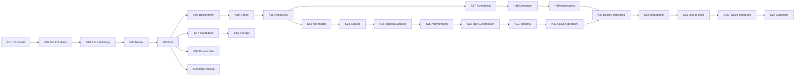

<!-- markdownlint-disable MD001 -->
<!-- markdownlint-disable MD024 -->
<!-- markdownlint-disable MD025 -->
<!-- markdownlint-disable MD026 -->
<!-- markdownlint-disable MD029 -->
<!-- markdownlint-disable MD033 -->
<!-- markdownlint-disable MD040 -->
<!-- markdownlint-disable MD056 -->
<!-- markdownlint-disable MD060 -->

# Kubernetes in Distributed Systems: Study Plan

## 01. Positioning

This track expands Parts D to H, the Kubernetes half of Part L, and Part R1 of the section syllabus (`07-application-deployment/README.md`) into a dedicated, interview-ready course. The section syllabus stays the master checklist; this track is where the Kubernetes depth lives.

| Section syllabus part            | Covered here by         |
| -------------------------------- | ----------------------- |
| D. Kubernetes architecture       | K01, K02, K03, K04, K25 |
| E. Workloads and configuration   | K05 to K11              |
| F. Networking                    | K12 to K15              |
| G. Storage, scheduling, scaling  | K16 to K19              |
| H. Security and extensibility    | K20, K21, K22           |
| L. Deployment strategies (K8s)   | K23                     |
| O. Observability (K8s debugging) | K24                     |
| R1. Interview question themes    | K26, K27                |

Docker gets its own track later (`07-application-deployment/docker/`), as agreed.

---

## 02. Conventions

| Item               | Choice                                                                                             |
| ------------------ | -------------------------------------------------------------------------------------------------- |
| Target version     | Kubernetes 1.34+; feature state (alpha/beta/GA) re-checked at teach time                           |
| Teaching mode      | In chat, one sub-topic per turn; owner says "next" to advance                                      |
| Per sub-topic      | Concept, YAML manifest, distributed-systems angle, failure mode, interview Q                       |
| Per module         | 2 to 3 exercises; owner answers; Claude reviews; then the write-up                                 |
| Write-up file      | `kNN-<slug>.md` in this folder, plus a row in the progress log                                     |
| Code examples      | YAML first; Java (Spring Boot) for app-side behaviour; Rust where useful                           |
| Local cluster      | kind (multi-node) for labs                                                                         |
| Primary references | kubernetes.io docs and KEPs, "Kubernetes in Action" 2e, "Production Kubernetes", Borg/Omega papers |

Priority tags used below:

- **[CORE]**: asked in almost every Kubernetes or deployment interview. Must be fluent.
- **[DEEP]**: separates senior/architect answers from mid-level ones.
- **[AWARE]**: know it exists, what it solves, and when to reach for it.

---

## 03. Kinds catalog

Every kind the plan covers, grouped by purpose. "Scope" is Namespaced (N) or Cluster (C).

| Kind                             | API group / version               | Scope | Purpose in one line                                  | Module |
| -------------------------------- | --------------------------------- | ----- | ---------------------------------------------------- | ------ |
| Pod                              | core/v1                           | N     | Smallest schedulable unit; co-located containers     | K05    |
| ReplicaSet                       | apps/v1                           | N     | Keep N identical pods alive                          | K06    |
| Deployment                       | apps/v1                           | N     | Versioned rollouts of stateless ReplicaSets          | K06    |
| StatefulSet                      | apps/v1                           | N     | Stable identity and storage per replica              | K07    |
| DaemonSet                        | apps/v1                           | N     | One pod per (selected) node                          | K08    |
| Job                              | batch/v1                          | N     | Run to completion with retries                       | K09    |
| CronJob                          | batch/v1                          | N     | Jobs on a schedule                                   | K09    |
| ControllerRevision               | apps/v1                           | N     | Revision history for StatefulSet and DaemonSet       | K07    |
| ConfigMap                        | core/v1                           | N     | Non-secret configuration                             | K10    |
| Secret                           | core/v1                           | N     | Sensitive configuration, typed                       | K10    |
| LimitRange                       | core/v1                           | N     | Per-object default and max resources                 | K11    |
| ResourceQuota                    | core/v1                           | N     | Aggregate caps per namespace                         | K11    |
| PriorityClass                    | scheduling.k8s.io/v1              | C     | Scheduling priority and preemption                   | K17    |
| RuntimeClass                     | node.k8s.io/v1                    | C     | Select container runtime handler (gVisor, Kata)      | K04    |
| Node                             | core/v1                           | C     | A worker machine and its status                      | K04    |
| Lease                            | coordination.k8s.io/v1            | N     | Heartbeats and leader election                       | K04    |
| Service                          | core/v1                           | N     | Stable virtual IP and DNS for a pod set              | K13    |
| EndpointSlice                    | discovery.k8s.io/v1               | N     | Scalable list of ready backends                      | K13    |
| Ingress                          | networking.k8s.io/v1              | N     | L7 HTTP routing (legacy API, frozen)                 | K14    |
| IngressClass                     | networking.k8s.io/v1              | C     | Which controller implements an Ingress               | K14    |
| GatewayClass                     | gateway.networking.k8s.io/v1      | C     | Gateway implementation (infra provider)              | K14    |
| Gateway                          | gateway.networking.k8s.io/v1      | N     | Listener / load balancer instance (cluster operator) | K14    |
| HTTPRoute, GRPCRoute             | gateway.networking.k8s.io/v1      | N     | Routing rules (app developer)                        | K14    |
| ReferenceGrant                   | gateway.networking.k8s.io/v1beta1 | N     | Cross-namespace reference permission                 | K14    |
| NetworkPolicy                    | networking.k8s.io/v1              | N     | L3/L4 pod firewall                                   | K15    |
| PersistentVolume                 | core/v1                           | C     | A piece of provisioned storage                       | K16    |
| PersistentVolumeClaim            | core/v1                           | N     | A request for storage                                | K16    |
| StorageClass                     | storage.k8s.io/v1                 | C     | Provisioner and parameters for dynamic volumes       | K16    |
| VolumeAttachment, CSIDriver      | storage.k8s.io/v1                 | C     | CSI plumbing                                         | K16    |
| VolumeSnapshot (+Class, Content) | snapshot.storage.k8s.io/v1        | N / C | Point-in-time volume snapshots                       | K16    |
| PodDisruptionBudget              | policy/v1                         | N     | Limit voluntary disruptions                          | K18    |
| HorizontalPodAutoscaler          | autoscaling/v2                    | N     | Scale replicas on metrics                            | K19    |
| VerticalPodAutoscaler            | autoscaling.k8s.io/v1 (add-on)    | N     | Right-size requests                                  | K19    |
| ScaledObject (KEDA)              | keda.sh/v1alpha1 (add-on)         | N     | Event-driven scaling, scale to zero                  | K19    |
| ServiceAccount                   | core/v1                           | N     | Workload identity inside the cluster                 | K20    |
| Role, ClusterRole                | rbac.authorization.k8s.io/v1      | N / C | Sets of permissions                                  | K20    |
| RoleBinding, ClusterRoleBinding  | rbac.authorization.k8s.io/v1      | N / C | Grant permissions to subjects                        | K20    |
| ValidatingAdmissionPolicy        | admissionregistration.k8s.io/v1   | C     | In-process CEL validation                            | K20    |
| Validating/MutatingWebhookConfig | admissionregistration.k8s.io/v1   | C     | External admission webhooks                          | K20    |
| Namespace                        | core/v1                           | C     | Naming, policy and quota boundary                    | K21    |
| CustomResourceDefinition         | apiextensions.k8s.io/v1           | C     | Add new kinds to the API                             | K22    |
| APIService                       | apiregistration.k8s.io/v1         | C     | Aggregated API servers (metrics-server)              | K22    |
| Event                            | events.k8s.io/v1                  | N     | Record of what controllers did                       | K24    |
| Rollout (Argo), Canary (Flagger) | add-on CRDs                       | N     | Progressive delivery                                 | K23    |

---

## 04. Module index

| ID  | Module                                   | Core question                                                          | Priority |
| --- | ---------------------------------------- | ---------------------------------------------------------------------- | -------- |
| K01 | Kubernetes as a distributed system       | What problem does Kubernetes solve, and what model does it use?        | CORE     |
| K02 | Control plane and etcd                   | How does a write become cluster state, and what keeps it consistent?   | CORE     |
| K03 | API machinery and the object model       | What does every object share, and how do controllers agree on it?      | CORE     |
| K04 | Nodes, kubelet and the runtime           | How does a pod spec turn into running processes on a machine?          | DEEP     |
| K05 | Pod                                      | Why is the pod, not the container, the unit of scheduling?             | CORE     |
| K06 | ReplicaSet and Deployment                | How does a stateless rollout actually progress, step by step?          | CORE     |
| K07 | StatefulSet                              | How do you run quorum and storage-bound systems on ephemeral pods?     | CORE     |
| K08 | DaemonSet                                | How do you guarantee one agent per node?                               | CORE     |
| K09 | Job and CronJob                          | How do you run finite and scheduled work with correct retries?         | CORE     |
| K10 | ConfigMap, Secret and projected data     | How does configuration reach a pod, and how does it change at runtime? | CORE     |
| K11 | Resource management                      | What do requests and limits really do in the kernel and scheduler?     | CORE     |
| K12 | Cluster networking model                 | How does any pod reach any other pod without NAT?                      | DEEP     |
| K13 | Service and service discovery            | How does a stable name map to a moving set of pods?                    | CORE     |
| K14 | Ingress and Gateway API                  | How does external L7 traffic enter the cluster?                        | CORE     |
| K15 | NetworkPolicy and service mesh           | How is east-west traffic secured, retried and shaped?                  | DEEP     |
| K16 | Storage                                  | How does durable state survive pods, nodes and zones?                  | CORE     |
| K17 | Scheduling                               | How does the scheduler pick a node, and how do you steer it?           | CORE     |
| K18 | Availability and disruption              | What happens when nodes, zones or operators take pods away?            | CORE     |
| K19 | Autoscaling                              | How do pods and nodes scale without oscillating or starving?           | CORE     |
| K20 | Identity, RBAC and admission             | Who may do what, and how is policy enforced at write time?             | CORE     |
| K21 | Namespaces and multi-tenancy             | How do many teams share one cluster safely?                            | DEEP     |
| K22 | Extending Kubernetes: CRDs and operators | How do you teach Kubernetes to run your own distributed system?        | DEEP     |
| K23 | Deployment strategies on Kubernetes      | How do you ship changes with zero downtime and fast rollback?          | CORE     |
| K24 | Observability and debugging              | How do you find out why something is broken, quickly?                  | CORE     |
| K25 | Production operations at scale           | How do you upgrade, back up, scale and span clusters and regions?      | DEEP     |
| K26 | Real-world failure scenarios             | What has actually gone wrong in production, and how was it fixed?      | CORE     |
| K27 | Interview capstone                       | Can you answer the classic questions end to end, under time pressure?  | CORE     |

---

## 05. Module flow

---

## 06. Interview fast track

If the interview date arrives before the full track is done, teach in this order and defer the rest:

1. K01, K02, K03 (model, control plane, apply path)
2. K05, K06 (pod lifecycle, rolling updates)
3. K13, K14 (Service, Ingress, Gateway API)
4. K11, K17, K18, K19 (resources, scheduling, disruption, autoscaling)
5. K07, K16 (StatefulSet and storage)
6. K23, K24 (deployment strategies, debugging playbook)
7. K27 (capstone drills)

Everything else continues after the interview.

---

## 07. Modules in detail

---

### K01. Kubernetes as a distributed system [CORE]

**Kinds:** none yet. This module sets the mental model every later module reuses.

- **K01.01 The problem.** Bin-packing workloads onto a fleet of unreliable machines; why static assignment (one service per VM) fails on cost, failure recovery and deploy speed. Lineage: Borg, Omega, Kubernetes.
- **K01.02 Declarative desired state.** Spec vs status; "what" not "how"; why imperative scripts break under partial failure and declarative reconciliation does not.
- **K01.03 Level-triggered vs edge-triggered control.** Controllers react to current state, not to missed events; why this makes the system self-healing after crashes, network partitions and dropped watch events.
- **K01.04 The control loop.** Observe, diff, act, repeat. Idempotent actions. Many small single-purpose controllers instead of one orchestrator (choreography over orchestration).
- **K01.05 Eventual consistency inside the cluster.** Every component sees a slightly stale view (informer caches); why "apply then immediately read" can surprise you; convergence time as a design parameter.
- **K01.06 Failure model.** What Kubernetes assumes can fail (pods, nodes, network links, zones, the control plane itself) and what keeps running when the control plane is down (data plane continues; no healing, no scaling).
- **K01.07 CAP framing.** etcd chooses consistency (CP); the data plane favours availability; why a partitioned node keeps serving its pods while the control plane marks it NotReady.
- **K01.08 Where Kubernetes stops.** It is not a PaaS, not a service mesh, not a CI system, not a database operator by default; what you must still build or buy.

**Real-world problems:** "the cluster API was down for 20 minutes; did traffic drop?"; controller hot-loops after a bad manifest.

**Interview checks:** "Explain reconciliation to a non-Kubernetes engineer." "Why level-triggered?" "What happens to running apps if etcd dies?"

**Lab:** stop the control plane containers in kind; show pods keep serving; restart and watch reconciliation catch up.

---

### K02. Control plane and etcd [CORE]

**Kinds:** none directly; covers the components every kind flows through.

- **K02.01 Component map.** kube-apiserver, etcd, kube-scheduler, kube-controller-manager, cloud-controller-manager; who talks to whom (everything through the API server, nothing to etcd directly).
- **K02.02 API server request pipeline.** TLS, authentication, authorization (RBAC, Node, Webhook), mutating admission, schema validation, validating admission, persistence to etcd, response. Where each kind of failure surfaces (401, 403, 422, 409, 429).
- **K02.03 API Priority and Fairness.** FlowSchema and PriorityLevelConfiguration; why one noisy controller cannot starve kubelets; 429 handling in clients.
- **K02.04 etcd internals.** Raft leader election, log replication, quorum (n/2+1), why 3 or 5 members and never even numbers, write latency bound by disk fsync and the slowest quorum member.
- **K02.05 etcd data model.** MVCC revisions, keys under `/registry/...`, watch streams, compaction and defragmentation, the default size quota and what happens when it is hit (cluster becomes read-only).
- **K02.06 Watch and resourceVersion.** List-then-watch, bookmarks, "too old resource version" (410 Gone) and relist; why this is the backbone of every controller.
- **K02.07 Scheduler at a glance.** Watches unscheduled pods, filters, scores, binds. Full depth in K17.
- **K02.08 Controller manager.** The built-in controllers (Deployment, ReplicaSet, Node lifecycle, Endpoint, Job, Namespace, GC, ServiceAccount); each one a loop; leader election via Lease.
- **K02.09 Cloud controller manager.** Node, route and service (load balancer) controllers; why it was split out of core.
- **K02.10 High availability topology.** Stacked vs external etcd; multiple API servers behind a load balancer; active/standby scheduler and controller manager via leader election; quorum loss scenarios and recovery.
- **K02.11 Managed control planes.** What EKS, GKE and AKS hide from you, and what still leaks (API rate limits, upgrade windows, webhook latency).

**Real-world problems:** etcd disk latency causing leader churn; etcd database full after Event floods; webhook outage blocking all deploys.

**Interview checks:** "Walk through `kubectl apply` end to end." "Why must etcd have an odd member count?" "What happens with 2 of 3 etcd members down?"

**Lab:** 3-member etcd in kind; kill members one at a time; observe read-only behaviour on quorum loss; snapshot and restore.

---

### K03. API machinery and the object model [CORE]

**Kinds:** the shape shared by all kinds.

- **K03.01 Group, Version, Kind, Resource.** GVK vs GVR; core vs named groups; `kubectl api-resources` and `kubectl explain`.
- **K03.02 Object anatomy.** apiVersion, kind, metadata, spec, status; who writes spec (users) vs status (controllers); the status subresource.
- **K03.03 Metadata in depth.** name vs generateName, uid, labels, annotations, namespace, creationTimestamp, deletionTimestamp, generation vs observedGeneration (how you know a controller has seen your change).
- **K03.04 Labels and selectors.** Equality and set-based selectors; label design conventions (`app.kubernetes.io/*`); immutable selectors and why changing them breaks ownership.
- **K03.05 Ownership and garbage collection.** ownerReferences, controller flag, cascading deletion (foreground, background, orphan); how a Deployment owns ReplicaSets which own Pods.
- **K03.06 Finalizers.** Deletion as a two-phase protocol; stuck Terminating objects and namespaces; when (and when not) to remove a finalizer by hand.
- **K03.07 Optimistic concurrency.** resourceVersion on update, 409 Conflict, retry-on-conflict loops; why there are no locks in the API.
- **K03.08 Apply semantics.** Create/replace/patch; strategic merge patch vs JSON merge patch vs JSON patch; client-side apply (last-applied annotation) vs server-side apply (field managers, conflicts, ownership of fields).
- **K03.09 API evolution.** Alpha, beta, GA; deprecation policy; storage version vs served versions; migrating manifests across removed APIs.
- **K03.10 Dry run and diff.** `--dry-run=server`, `kubectl diff`; why server-side dry run runs admission.

**Real-world problems:** two controllers fighting over a field (HPA vs a GitOps tool on `replicas`); namespace stuck Terminating; upgrade breaks because a beta API was removed.

**Interview checks:** "How does Kubernetes avoid lost updates without locks?" "Client-side vs server-side apply?" "Why is my namespace stuck deleting?"

**Lab:** reproduce a field-manager conflict between `kubectl apply` and a scaler; resolve with server-side apply ownership.

---

### K04. Nodes, kubelet and the runtime [DEEP]

**Kinds:** `Node`, `Lease`, `RuntimeClass`.

- **K04.01 Node object.** Capacity vs allocatable, conditions (Ready, MemoryPressure, DiskPressure, PIDPressure), addresses, taints, labels (topology labels for zone and region).
- **K04.02 kubelet responsibilities.** Pod sync loop, probes, volume mounts, image pulls, status reporting, static pods from a manifest directory (how the control plane itself runs under kubeadm).
- **K04.03 Heartbeats.** Node Lease renewals vs NodeStatus updates; why leases were introduced (etcd write load at scale).
- **K04.04 Node lifecycle controller.** Grace periods, NotReady and Unreachable taints, taint-based eviction with default `tolerationSeconds`; the real timeline from node death to pod rescheduling.
- **K04.05 CRI and runtimes.** containerd, CRI-O, the pod sandbox (pause container), image pull policy, image GC; dockershim removal and what actually changed.
- **K04.06 RuntimeClass.** Sandboxed runtimes (gVisor, Kata) for untrusted workloads; scheduling and overhead implications.
- **K04.07 cgroups on the node.** Pod and container cgroup hierarchy, cgroup v2, system-reserved and kube-reserved, allocatable math.
- **K04.08 Node-pressure eviction.** Hard and soft thresholds, eviction order by QoS and usage, why evicted pods pile up.
- **K04.09 Graceful node shutdown.** Shutdown grace periods by priority; spot instance termination handling.

**Real-world problems:** node flaps NotReady under disk pressure; pods take 5+ minutes to move off a dead node; PID exhaustion from a fork-heavy container.

**Interview checks:** "A node dies. Describe what happens and how long it takes." "What is the pause container for?"

**Lab:** stop a kind node's kubelet; time the NotReady transition and eviction; tune `tolerationSeconds`.

---

### K05. Pod [CORE]

**Kinds:** `Pod` (and the pod template embedded in every workload kind).

- **K05.01 Why a pod.** Shared network namespace (localhost, one IP), shared volumes, co-scheduling, shared fate; when two containers belong in one pod and when they do not.
- **K05.02 Multi-container patterns.** Sidecar, ambassador, adapter; examples (log shipper, proxy, config reloader).
- **K05.03 Init containers.** Ordering, blocking semantics, typical uses (wait-for-dependency, schema check, file seeding) and why "wait for dependency" is often an anti-pattern.
- **K05.04 Native sidecars.** Init containers with `restartPolicy: Always`; start before and stop after the main container; fixes Job completion and shutdown-ordering bugs of classic sidecars.
- **K05.05 Ephemeral containers.** `kubectl debug` into distroless pods; shared process namespace.
- **K05.06 Lifecycle.** Phases (Pending, Running, Succeeded, Failed, Unknown), conditions (PodScheduled, Initialized, ContainersReady, Ready), container states and reasons (Waiting: CrashLoopBackOff, ImagePullBackOff; Terminated: OOMKilled, Error, Completed).
- **K05.07 Restart policy and backoff.** Always, OnFailure, Never; exponential CrashLoopBackOff timing.
- **K05.08 Probes.** Startup, readiness, liveness; HTTP, TCP, exec, gRPC; thresholds and timing math; what each probe failure does (restart vs remove from endpoints).
- **K05.09 Probe anti-patterns.** Liveness checking downstream dependencies (cascading restarts), identical liveness and readiness endpoints, aggressive timeouts under GC pauses (Java), missing startup probe for slow JVM boot.
- **K05.10 Lifecycle hooks.** postStart and preStop; preStop sleep to cover endpoint propagation delay.
- **K05.11 Termination sequence.** Delete request, deletionTimestamp, endpoint removal and SIGTERM in parallel (the race), grace period, SIGKILL; Spring Boot and tokio graceful shutdown alignment.
- **K05.12 Pod-level settings.** hostNetwork, hostPID, dnsPolicy and dnsConfig, shareProcessNamespace, terminationGracePeriodSeconds, activeDeadlineSeconds, pod overhead, scheduling gates.
- **K05.13 Static and mirror pods.** How kubeadm control-plane pods run; why you cannot delete them with kubectl.

**Real-world problems:** 502s during every rollout (endpoint race); restart storms from a liveness probe hitting the database; JVM killed by liveness during startup.

**Interview checks:** "Readiness vs liveness vs startup?" "Why do I get 502s during a rolling update and how do I fix it?" "What happens, in order, when a pod is deleted?"

**Lab:** reproduce 502s on rollout with a Spring Boot service; fix with readiness, preStop sleep and graceful shutdown; verify with a load generator.

---

### K06. ReplicaSet and Deployment [CORE]

**Kinds:** `ReplicaSet`, `Deployment`.

- **K06.01 ReplicaSet.** Selector-based ownership, adoption of orphan pods, why you never create one directly.
- **K06.02 Deployment to ReplicaSet mapping.** pod-template-hash label; one ReplicaSet per template revision; what does and does not trigger a new revision (template changes only).
- **K06.03 RollingUpdate algorithm.** maxSurge and maxUnavailable (absolute and percentage, rounding rules), step-by-step scale up/down of new and old ReplicaSets, worked examples with 10 replicas.
- **K06.04 Rollout gating.** minReadySeconds, readiness as the gate, progressDeadlineSeconds and the Progressing condition; detecting stuck rollouts in CI (`kubectl rollout status`).
- **K06.05 Recreate strategy.** When downtime is required (incompatible schema, singleton licences, RWO volumes).
- **K06.06 History and rollback.** revisionHistoryLimit, `rollout undo`, `change-cause`; why rollback is a new forward rollout.
- **K06.07 Pause and resume.** Batching multiple changes into one rollout.
- **K06.08 Proportional scaling.** Scaling a Deployment mid-rollout; how replicas split between ReplicaSets.
- **K06.09 Stateless design requirements.** Externalized session state, idempotent startup, no local disk assumptions.
- **K06.10 Deployment vs StatefulSet vs DaemonSet decision table.**

**Real-world problems:** rollout stuck at 1 unavailable forever (bad readiness plus maxUnavailable 0); surge exhausting quota or cluster capacity; HPA and Deployment `replicas` field fighting in GitOps.

**Interview checks:** "With 10 replicas, maxSurge 25% and maxUnavailable 25%, walk the rollout." "How does a rollback work internally?"

**Lab:** run rollouts with different surge/unavailable settings under load and graph available replicas over time.

---

### K07. StatefulSet [CORE]

**Kinds:** `StatefulSet`, `ControllerRevision`, headless `Service`.

- **K07.01 Guarantees.** Stable ordinal names (`db-0`), stable DNS via headless Service, stable storage via volumeClaimTemplates; what is NOT guaranteed (stable IP, stable node).
- **K07.02 Pod management policy.** OrderedReady vs Parallel; when ordering matters (bootstrap of a leader) and when it only slows you down.
- **K07.03 Update strategies.** RollingUpdate in reverse ordinal order, `partition` for staged/canary rollouts, `maxUnavailable` for StatefulSets, OnDelete for operator-controlled upgrades.
- **K07.04 volumeClaimTemplates.** One PVC per ordinal; PVC retention policy on delete and scale-down; why scale-down does not delete data by default.
- **K07.05 Running quorum systems.** etcd, ZooKeeper, Kafka (KRaft), Cassandra on StatefulSets; peer discovery via DNS; quorum and replication factor vs replica count.
- **K07.06 At-most-one semantics and fencing.** Why the StatefulSet controller will not start `db-0` twice; why force-deleting a pod on an unreachable node can create split-brain; fencing tokens and storage-level fencing.
- **K07.07 Stuck rollouts.** A broken pod blocks OrderedReady rollouts; manual recovery steps.
- **K07.08 When not to use StatefulSet.** Managed databases vs self-hosted; operators (CloudNativePG, Strimzi) that wrap StatefulSets or replace them.

**Real-world problems:** split-brain after force-delete during a partition; Kafka broker rescheduled to another zone where its zonal disk cannot attach; StatefulSet rollout stuck on pod 2.

**Interview checks:** "Why can't I run Postgres as a Deployment with a PVC?" "How do you canary a StatefulSet?" "Why is force-deleting a StatefulSet pod dangerous?"

**Lab:** 3-node etcd or Redis cluster as a StatefulSet; partitioned rollout; simulate node loss and observe pod stuck Terminating.

---

### K08. DaemonSet [CORE]

**Kinds:** `DaemonSet`.

- **K08.01 Semantics.** One pod per eligible node; node addition and removal handling; targeting subsets with nodeSelector and affinity.
- **K08.02 Scheduling.** DaemonSet pods are placed by the default scheduler with node affinity; automatic tolerations for NotReady, Unreachable and pressure taints.
- **K08.03 Update strategy.** RollingUpdate with maxUnavailable and maxSurge; OnDelete.
- **K08.04 Use cases.** CNI agents, kube-proxy, log collectors (Fluent Bit), node-exporter, CSI node plugins, security agents (Falco).
- **K08.05 Host access.** hostPath, hostNetwork, privileged containers, and the security cost of each.
- **K08.06 Priority.** Why node agents need high PriorityClass (system-node-critical) to avoid preemption.

**Real-world problems:** a bad log-agent rollout eating node memory cluster-wide; DaemonSet pod not landing on tainted GPU nodes.

**Interview checks:** "DaemonSet vs Deployment with anti-affinity?" "How do you roll out a node agent safely to 1000 nodes?"

**Lab:** deploy a node-level agent with tolerations and a rolling update limited to one node at a time.

---

### K09. Job and CronJob [CORE]

**Kinds:** `Job`, `CronJob`.

- **K09.01 Job basics.** completions, parallelism; non-indexed vs Indexed completion mode (work partitioning by `JOB_COMPLETION_INDEX`).
- **K09.02 Failure handling.** backoffLimit, backoffLimitPerIndex, podFailurePolicy (ignore disruptions, fail fast on exit codes), successPolicy, activeDeadlineSeconds.
- **K09.03 Lifecycle.** ttlSecondsAfterFinished, suspend (queueing and batch systems like Kueue), Job tracking with finalizers.
- **K09.04 Delivery semantics.** At-least-once execution; why every Job must be idempotent (links to REST R2/R8 idempotency notes).
- **K09.05 Work-queue patterns.** Fixed completion count vs queue-driven workers; coordinating with an external queue.
- **K09.06 CronJob scheduling.** Cron syntax, `timeZone`, startingDeadlineSeconds, the missed-schedule limit, controller downtime behaviour.
- **K09.07 concurrencyPolicy.** Allow, Forbid, Replace; overlapping runs and their consequences.
- **K09.08 History and cleanup.** successfulJobsHistoryLimit, failedJobsHistoryLimit.
- **K09.09 Common uses.** Database migrations as pre-deploy Jobs, backups, report generation, batch ML; Jobs vs workflow engines (Argo Workflows, Airflow).
- **K09.10 Sidecars in Jobs.** The old "Job never completes" problem and the native sidecar fix.

**Real-world problems:** CronJob ran twice and double-charged customers; migration Job retried after partial success; thousands of completed Job pods choking etcd.

**Interview checks:** "Can a CronJob run twice for one schedule? How do you make it safe?" "How do you run a DB migration safely in a rollout?"

**Lab:** Indexed Job processing a partitioned dataset; podFailurePolicy that ignores node-drain failures but fails on exit code 42.

---

### K10. ConfigMap, Secret and projected data [CORE]

**Kinds:** `ConfigMap`, `Secret`.

- **K10.01 ConfigMap.** Data vs binaryData, size limit, env vars vs volume mounts vs command args.
- **K10.02 Secret types.** Opaque, kubernetes.io/tls, dockerconfigjson, service-account-token (legacy), basic-auth, ssh-auth; base64 is encoding, not encryption.
- **K10.03 Update propagation.** Env vars never update; mounted volumes update eventually (kubelet sync period plus cache TTL); `subPath` mounts never update.
- **K10.04 Reload strategies.** Rolling restart on hash annotation change (Helm/Kustomize generators), Reloader controller, in-app file watching (Spring Cloud Kubernetes).
- **K10.05 Immutable ConfigMaps and Secrets.** Performance benefit (no watches) and versioned-name pattern for safe rollouts and rollbacks.
- **K10.06 Projected volumes.** Combining ConfigMaps, Secrets, Downward API and service-account tokens in one mount.
- **K10.07 Downward API.** Pod name, namespace, labels, resource limits into env or files; uses (JVM sizing, log tagging).
- **K10.08 Secret security.** Encryption at rest with KMS providers, RBAC on `get`/`list` of secrets, avoiding secrets in env vars (process dumps, logs).
- **K10.09 External secret managers.** External Secrets Operator, Secrets Store CSI driver, Sealed Secrets, SOPS; trade-offs for GitOps.

**Real-world problems:** config change applied but pods still use old values; rollback restores code but not config; secret leaked via `kubectl describe` or env dump.

**Interview checks:** "How do you roll out a config change safely and roll it back?" "Are Kubernetes Secrets secure?"

**Lab:** versioned immutable ConfigMap with hash suffix; prove a rollback restores both code and config.

---

### K11. Resource management [CORE]

**Kinds:** `LimitRange`, `ResourceQuota` (PriorityClass in K17).

- **K11.01 Requests vs limits.** Requests drive scheduling; limits drive kernel enforcement; what happens with neither.
- **K11.02 CPU.** CFS shares from requests, CFS quota from limits, throttling at 100 ms periods, why CPU limits often hurt latency, the "no CPU limits" debate.
- **K11.03 Memory.** Limits enforced by the OOM killer, not throttling; page cache accounting; OOMKilled vs node-pressure eviction.
- **K11.04 QoS classes.** Guaranteed, Burstable, BestEffort; how QoS drives eviction order and OOM score adjustment.
- **K11.05 Ephemeral storage and PIDs.** Local storage requests/limits; pod PID limits.
- **K11.06 JVM in containers.** MaxRAMPercentage, heap vs metaspace vs direct memory vs thread stacks; sizing Java pods without OOMKills; ActiveProcessorCount and CPU limits.
- **K11.07 LimitRange.** Defaults, min, max, ratio per container or pod; why defaults matter in shared clusters.
- **K11.08 ResourceQuota.** Compute, object count and storage quotas; quota scopes; why quota requires requests on every pod.
- **K11.09 In-place pod resize.** Changing requests and limits without restart; resize policy per resource.
- **K11.10 Right-sizing.** Requests from observed p95/p99 usage; overcommit ratios; bin-packing efficiency vs noisy neighbours.

**Real-world problems:** p99 latency spikes from CPU throttling with low average usage; Java pod OOMKilled with a "correct" -Xmx; quota blocks a rollout's surge pods.

**Interview checks:** "Explain CPU throttling and when to drop CPU limits." "Why is my pod OOMKilled when heap usage is low?"

**Lab:** measure throttling (`nr_throttled`) for a Spring Boot service under load with and without CPU limits.

---

### K12. Cluster networking model [DEEP]

**Kinds:** none directly; underpins Service, Ingress and NetworkPolicy.

- **K12.01 The three rules.** Every pod gets an IP; pods reach pods without NAT; nodes reach pods without NAT. Why flat networking simplifies service discovery.
- **K12.02 Pod sandbox networking.** Network namespace, veth pair, bridge or routed interface; pod IP lifetime.
- **K12.03 CNI.** Plugin contract (ADD, DEL, CHECK), IPAM, pod CIDR per node.
- **K12.04 Data plane models.** Overlay (VXLAN, Geneve) vs native routing (BGP, cloud VPC routing like AWS VPC CNI); MTU issues; IP exhaustion on VPC-native CNIs.
- **K12.05 CNI implementations.** Calico, Cilium (eBPF), Flannel, cloud CNIs; picking one.
- **K12.06 kube-proxy modes.** iptables (rule growth, O(n) updates), IPVS, nftables; eBPF kube-proxy replacement (Cilium).
- **K12.07 conntrack.** Table exhaustion, UDP DNS races, long-lived connection behaviour on endpoint changes.
- **K12.08 Dual-stack IPv4/IPv6** awareness.

**Real-world problems:** intermittent 5-second DNS delays from conntrack races; pods failing to start because the subnet ran out of IPs; packet drops from MTU mismatch on overlay.

**Interview checks:** "Trace a packet from pod A on node 1 to pod B on node 2." "Why does iptables mode slow down with 10,000 Services?"

**Lab:** inspect veth pairs, routes and iptables chains in a kind node; trace a request with tcpdump.

---

### K13. Service and service discovery [CORE]

**Kinds:** `Service`, `EndpointSlice`.

- **K13.01 Why Services.** Pod IPs are ephemeral; a Service gives a stable virtual IP and DNS name in front of a label-selected set.
- **K13.02 Service types.** ClusterIP, NodePort, LoadBalancer, ExternalName; how each builds on the previous; when to use which.
- **K13.03 Headless Services.** `clusterIP: None`; DNS returns pod IPs; client-side load balancing and StatefulSet peer discovery.
- **K13.04 Services without selectors.** Manually managed EndpointSlices to front external databases or migrate traffic.
- **K13.05 EndpointSlices.** Why Endpoints did not scale; slice size; ready, serving and terminating conditions; how readiness gates membership.
- **K13.06 DNS.** CoreDNS, record formats (A/AAAA, SRV), search domains, `ndots:5` and the extra-lookups problem, NodeLocal DNSCache.
- **K13.07 Traffic policies.** externalTrafficPolicy Cluster vs Local (source IP preservation vs extra hop vs imbalance), internalTrafficPolicy, sessionAffinity.
- **K13.08 Topology-aware routing.** Keeping traffic in-zone (`trafficDistribution: PreferClose`); cross-zone cost and latency.
- **K13.09 Load-balancing reality.** kube-proxy balances connections, not requests; gRPC and HTTP/2 long-lived connection imbalance; fixes (client-side LB, headless plus xDS, mesh, connection max age).
- **K13.10 Cloud load balancers.** LoadBalancer Service controllers, annotations, NLB vs ALB, instance vs IP targets.

**Real-world problems:** one pod gets all gRPC traffic after scale-up; cross-zone data transfer bill explodes; DNS latency spikes from `ndots:5` on external lookups.

**Interview checks:** "How does a request to `orders.prod.svc.cluster.local` reach a pod?" "Why are my gRPC calls unbalanced?" "ClusterIP vs headless?"

**Lab:** demonstrate gRPC imbalance with a Java client; fix with client-side load balancing over a headless Service.

---

### K14. Ingress and Gateway API [CORE]

**Kinds:** `Ingress`, `IngressClass`, `GatewayClass`, `Gateway`, `HTTPRoute`, `GRPCRoute`, `TLSRoute`, `ReferenceGrant`.

- **K14.01 North-south traffic.** Why L4 LoadBalancer Services alone are not enough (one LB per service, no L7 routing, TLS per service).
- **K14.02 Ingress.** Host and path rules, pathType semantics, TLS section, default backend; controllers (NGINX, Traefik, HAProxy, cloud ALB).
- **K14.03 Ingress limitations.** Annotation sprawl, no standard for traffic splitting, headers or cross-namespace roles; Ingress API frozen; ingress-nginx project retirement and migration implications.
- **K14.04 Gateway API model.** Role-oriented split: infrastructure provider (GatewayClass), cluster operator (Gateway), application developer (Routes).
- **K14.05 Routes in depth.** Matches (path, header, query, method), filters (redirects, rewrites, header modification, mirroring), weighted backends for canaries.
- **K14.06 Cross-namespace routing.** allowedRoutes on listeners, ReferenceGrant for safe references.
- **K14.07 TLS.** Termination vs passthrough; cert-manager with ACME; certificate rotation.
- **K14.08 Edge concerns.** Rate limiting, auth, WAF, request size limits, timeouts; what belongs at the edge vs in the service.
- **K14.09 Migration.** Ingress to Gateway API mapping; running both during migration.

**Real-world problems:** canary traffic split impossible without vendor annotations; a cert expired because the issuer failed silently; tenant A's Ingress hijacking tenant B's host.

**Interview checks:** "Ingress vs Gateway API?" "How do you do a 10% canary at the edge?" "How does TLS get provisioned and rotated?"

**Lab:** Gateway API with Envoy Gateway or Cilium; HTTPRoute splitting 90/10 between two versions; cert-manager TLS.

---

### K15. NetworkPolicy and service mesh [DEEP]

**Kinds:** `NetworkPolicy` (plus mesh CRDs at awareness level).

- **K15.01 NetworkPolicy semantics.** Default allow; selecting a pod makes it isolated for that direction; policies are additive allow-lists; ingress and egress.
- **K15.02 Selectors.** podSelector, namespaceSelector, combined selectors (the AND vs OR YAML trap), ipBlock.
- **K15.03 Default-deny patterns.** Per-namespace default deny, then allow; remembering DNS egress.
- **K15.04 Enforcement.** Implemented by the CNI, not Kubernetes; policies silently ignored on a CNI without support.
- **K15.05 Cluster-wide policy.** AdminNetworkPolicy and CNI-specific extensions (Cilium L7 policies, Calico GlobalNetworkPolicy).
- **K15.06 Service mesh purpose.** mTLS identity, retries, timeouts, circuit breaking, outlier detection, traffic shifting, telemetry; the cost (latency, resources, complexity).
- **K15.07 Data plane options.** Sidecar (Istio, Linkerd), ambient (ztunnel plus waypoint), eBPF/Cilium mesh.
- **K15.08 Resilience semantics.** Retry storms and retry budgets, timeouts that compose, idempotency requirements for retried requests.
- **K15.09 Mesh vs library.** Mesh vs in-app resilience (Resilience4j for Java, tower for Rust); when a mesh is overkill.

**Real-world problems:** default-deny rollout breaks DNS for a whole namespace; mesh retries multiply load 27x across three hops during an incident.

**Interview checks:** "Write a policy that allows only the frontend to call the orders API." "Do you need a service mesh?"

**Lab:** default-deny plus explicit allows; Linkerd mTLS between two services; observe golden metrics.

---

### K16. Storage [CORE]

**Kinds:** `PersistentVolume`, `PersistentVolumeClaim`, `StorageClass`, `CSIDriver`, `VolumeAttachment`, `VolumeSnapshot`, `VolumeSnapshotClass`, `VolumeSnapshotContent`.

- **K16.01 Volume types.** emptyDir (disk and memory), hostPath, configMap/secret/projected, ephemeral generic volumes, persistent volumes.
- **K16.02 PV and PVC.** Static vs dynamic provisioning; binding; the claim as an abstraction over storage backends.
- **K16.03 StorageClass.** Provisioner, parameters, default class, reclaimPolicy (Delete vs Retain), allowVolumeExpansion.
- **K16.04 volumeBindingMode.** Immediate vs WaitForFirstConsumer; why zonal disks need late binding so the pod and disk land in the same zone.
- **K16.05 Access modes.** RWO, ROX, RWX, RWOP; RWO means one node, not one pod; block vs network file storage.
- **K16.06 CSI.** Controller and node plugins, attach and mount flow, VolumeAttachment, topology.
- **K16.07 Snapshots, clones and expansion.** VolumeSnapshot kinds, restore into new PVCs, online expansion.
- **K16.08 Data gravity in distributed systems.** Zonal disks pin pods to zones; replication at the app layer vs storage layer; RPO and RTO with snapshots.
- **K16.09 Databases on Kubernetes.** When it is reasonable (operators, local NVMe with app-level replication) and when managed services win.
- **K16.10 Failure modes.** Volume stuck attaching to a dead node (multi-attach errors), PVC Pending forever, reclaim Delete wiping data.

**Real-world problems:** pod rescheduled to another zone stuck Pending because its disk is zonal; "Multi-Attach error" after node failure; production data deleted by `reclaimPolicy: Delete`.

**Interview checks:** "Why does WaitForFirstConsumer exist?" "RWO vs RWOP?" "Would you run Postgres on Kubernetes?"

**Lab:** dynamic provisioning with a local CSI driver; snapshot, delete, restore; demonstrate reclaim policy behaviour.

---

### K17. Scheduling [CORE]

**Kinds:** `PriorityClass` (plus scheduling fields on Pod).

- **K17.01 Scheduler framework.** Scheduling queue, PreFilter, Filter, Score, Reserve, Permit, Bind; plugins; why scheduling is per pod and greedy.
- **K17.02 Node selection basics.** nodeName (bypasses scheduler), nodeSelector, node affinity (required vs preferred, IgnoredDuringExecution).
- **K17.03 Pod affinity and anti-affinity.** topologyKey, co-location and spreading; computational cost at scale.
- **K17.04 Taints and tolerations.** NoSchedule, PreferNoSchedule, NoExecute; dedicated node pools (GPU, spot); tolerations do not attract.
- **K17.05 Topology spread constraints.** maxSkew, whenUnsatisfiable, minDomains, matchLabelKeys; spreading across zones and nodes for failure isolation.
- **K17.06 Priority and preemption.** PriorityClass values, preemption victims, preemptionPolicy Never, system-critical classes; interaction with PDBs.
- **K17.07 Scheduling gates and readiness.** Holding pods until external conditions are met (quota systems like Kueue).
- **K17.08 Bin-packing vs spreading.** Scoring strategies (LeastAllocated, MostAllocated); cost vs resilience trade-off.
- **K17.09 Rescheduling.** Scheduler never moves running pods; descheduler for rebalancing.
- **K17.10 Specialized hardware.** Extended resources, device plugins, Dynamic Resource Allocation for GPUs.
- **K17.11 Multiple schedulers and gang scheduling** awareness (Volcano, Kueue, coscheduling) for batch and ML.

**Real-world problems:** all replicas on one node or zone; pod Pending with "0/12 nodes are available: ..." messages; low-priority batch preempting nothing because PDBs block; GPU nodes filled by non-GPU pods.

**Interview checks:** "How do you guarantee replicas survive a zone outage?" "Read this Pending message and tell me what is wrong." "Affinity vs taints?"

**Lab:** 3-zone kind cluster with zone labels; topology spread across zones; taint a pool; trigger preemption.

---

### K18. Availability and disruption [CORE]

**Kinds:** `PodDisruptionBudget`.

- **K18.01 Voluntary vs involuntary disruptions.** Drains, upgrades, autoscaler scale-down vs node crash, kernel panic, zone loss.
- **K18.02 Eviction API.** Why drain uses eviction (respects PDBs) instead of delete.
- **K18.03 PodDisruptionBudget.** minAvailable vs maxUnavailable, unhealthyPodEvictionPolicy, PDBs that block drains forever (minAvailable equals replicas).
- **K18.04 Drain and cordon.** Node maintenance workflow; DaemonSet and emptyDir flags; drain timeouts.
- **K18.05 Node failure timeline.** End-to-end: heartbeat loss, NotReady, taint, eviction after tolerationSeconds, replacement scheduling; tuning for faster failover.
- **K18.06 Zone failure.** Capacity headroom (N+1 zones), spread constraints, zonal storage limits, cross-zone traffic on failover.
- **K18.07 Designing for availability.** Replica counts vs failure domains, readiness gates, graceful shutdown, client retries with budgets.
- **K18.08 Pod deletion cost and scale-down choice.** Which replicas get removed first.

**Real-world problems:** cluster upgrade stalls on a PDB; zone outage leaves service under capacity because all zones ran at 90%; drain kills the only replica of a singleton.

**Interview checks:** "Design a service to survive the loss of one zone." "What does a PDB protect against, and what does it not?"

**Lab:** drain nodes under load with and without a PDB; measure error rate.

---

### K19. Autoscaling [CORE]

**Kinds:** `HorizontalPodAutoscaler`, `VerticalPodAutoscaler`, KEDA `ScaledObject`/`ScaledJob`, Karpenter `NodePool` (awareness).

- **K19.01 Scaling layers.** Pod count (HPA), pod size (VPA), node count (Cluster Autoscaler, Karpenter); how they interact.
- **K19.02 HPA algorithm.** desired = ceil(current * currentMetric / target); tolerance; multiple metrics take the max; utilization is relative to requests.
- **K19.03 HPA behaviour.** Stabilization windows, scale-up and scale-down policies, preventing flapping; control-theory view (feedback delay, oscillation).
- **K19.04 Metrics pipeline.** metrics-server (resource metrics), custom metrics API (Prometheus Adapter), external metrics API.
- **K19.05 What to scale on.** CPU vs request rate vs latency vs queue lag; why CPU is a poor signal for I/O-bound Java services.
- **K19.06 VPA.** Recommender, updater, admission controller; modes; conflict with HPA on the same resource; in-place resize.
- **K19.07 KEDA.** Event-driven scaling on Kafka lag, SQS depth, cron; scale to and from zero; cold start cost.
- **K19.08 Node autoscaling.** Cluster Autoscaler (node groups, scale-up on Pending pods, scale-down rules) vs Karpenter (group-less provisioning, consolidation, spot).
- **K19.09 Scaling latency budget.** Metric scrape, HPA sync, scheduling, node provisioning, image pull, JVM warm-up; overprovisioning with placeholder pods.
- **K19.10 Failure modes.** Thundering herd on scale-up, scale-down killing in-flight work, autoscaler fighting GitOps on `replicas`.

**Real-world problems:** traffic spike outruns autoscaling because nodes take 3 minutes plus JVM warm-up; HPA oscillates every minute; Kafka consumers scaled beyond partition count.

**Interview checks:** "Compute HPA replicas for this scenario." "How would you autoscale a Kafka consumer service?" "Cluster Autoscaler vs Karpenter?"

**Lab:** HPA on request rate via Prometheus Adapter; KEDA on Kafka lag; graph scaling under a load ramp.

---

### K20. Identity, RBAC and admission [CORE]

**Kinds:** `ServiceAccount`, `Role`, `ClusterRole`, `RoleBinding`, `ClusterRoleBinding`, `ValidatingAdmissionPolicy`, `ValidatingAdmissionPolicyBinding`, `MutatingWebhookConfiguration`, `ValidatingWebhookConfiguration`.

- **K20.01 Authentication.** X.509 client certs, OIDC for humans, ServiceAccount tokens for workloads; no User kind in the API.
- **K20.02 ServiceAccounts.** Bound, projected, audience-scoped, expiring tokens; automountServiceAccountToken; TokenRequest API.
- **K20.03 RBAC model.** Verbs, resources, subresources, resourceNames; Role vs ClusterRole; bindings and scope combinations (ClusterRole bound in a namespace).
- **K20.04 RBAC pitfalls.** Wildcards, `escalate`/`bind`/`impersonate` verbs, `create pods` as an escalation path, secret read access, aggregated ClusterRoles.
- **K20.05 Auditing access.** `kubectl auth can-i`, audit logs, least-privilege reviews.
- **K20.06 Pod Security.** Pod Security Standards (privileged, baseline, restricted) and Pod Security Admission modes (enforce, audit, warn).
- **K20.07 securityContext.** runAsNonRoot, runAsUser, readOnlyRootFilesystem, allowPrivilegeEscalation, capabilities, seccompProfile, fsGroup.
- **K20.08 Admission control.** Mutating then validating; webhooks (latency, failurePolicy, availability risk); CEL-based ValidatingAdmissionPolicy and MutatingAdmissionPolicy; Kyverno and Gatekeeper.
- **K20.09 Workload identity to cloud.** IRSA / EKS Pod Identity, GKE Workload Identity; no static cloud keys in Secrets.
- **K20.10 Supply chain at admission.** Enforcing signed images and banned tags.

**Real-world problems:** CI service account with cluster-admin leaked; validating webhook down with `failurePolicy: Fail` blocks every deploy; pod running as root in production.

**Interview checks:** "How would you lock down a multi-team cluster?" "Why is `create pods` permission dangerous?" "Webhook vs ValidatingAdmissionPolicy?"

**Lab:** least-privilege RBAC for a CI deployer; restricted PSA on a namespace; CEL policy blocking `:latest`.

---

### K21. Namespaces and multi-tenancy [DEEP]

**Kinds:** `Namespace` (with ResourceQuota, LimitRange, NetworkPolicy, RBAC as the tenancy toolkit).

- **K21.01 What a namespace is and is not.** Name scope, policy scope, quota scope; not a security or network boundary by itself.
- **K21.02 Namespace design.** Per team, per service, per environment; naming and label conventions.
- **K21.03 Tenancy toolkit.** RBAC plus quota plus LimitRange plus NetworkPolicy plus PSA per namespace.
- **K21.04 Soft vs hard multi-tenancy.** Trusted teams vs untrusted customers; shared kernel risk; sandboxed runtimes.
- **K21.05 Models.** Namespace-as-a-service, virtual clusters (vcluster), cluster-per-tenant; cost vs isolation.
- **K21.06 Environment separation.** Dev/staging/prod as namespaces vs separate clusters; blast-radius reasoning.
- **K21.07 Cluster-scoped resource conflicts.** CRDs, webhooks, StorageClasses shared by all tenants.

**Real-world problems:** a dev namespace consumes all cluster capacity; tenant installs a CRD version that breaks another tenant.

**Interview checks:** "Namespaces vs clusters for prod and staging?" "How would you host 200 teams on Kubernetes?"

**Lab:** onboard two tenants with a namespace template (quota, limits, policies, RBAC).

---

### K22. Extending Kubernetes: CRDs and operators [DEEP]

**Kinds:** `CustomResourceDefinition`, `APIService`, `Lease`.

- **K22.01 CRDs.** Schema (OpenAPI v3, structural), validation with CEL rules, defaulting, printer columns, status and scale subresources.
- **K22.02 CRD versioning.** Multiple served versions, storage version, conversion webhooks, migration.
- **K22.03 The controller pattern.** Informers, listers, shared caches, work queues with rate limiting, reconcile functions; level-triggered and idempotent by design.
- **K22.04 Writing reconcilers correctly.** Status conditions, observedGeneration, requeue vs error, owner references, finalizers for external cleanup, avoiding hot loops.
- **K22.05 Leader election.** Lease-based leader election; split-brain risk from clock skew and long GC pauses; fencing.
- **K22.06 Operators.** Encoding operational knowledge (backup, failover, upgrade); capability levels; examples (Prometheus Operator, CloudNativePG, Strimzi, cert-manager).
- **K22.07 Tooling.** Kubebuilder / controller-runtime (Go), Java Operator SDK and fabric8 client (Java), kube-rs (Rust).
- **K22.08 Aggregated API servers.** APIService; when a CRD is not enough (metrics-server).
- **K22.09 Operational risks.** Operator bugs as cluster-wide outages, CRD deletion deleting all custom resources, upgrade ordering.

**Real-world problems:** operator hot-loops and floods the API server; CRD removed during an uninstall wipes every instance; two operator replicas both act after a GC pause.

**Interview checks:** "Design an operator for a 3-node replicated database." "Why must reconcile be idempotent?"

**Lab:** small operator in Java (Java Operator SDK) managing a `Website` custom resource; Rust version with kube-rs as a second pass.

---

### K23. Deployment strategies on Kubernetes [CORE]

**Kinds:** `Deployment`, `Service`, `HTTPRoute`; Argo Rollouts `Rollout`/`AnalysisTemplate`; Flagger `Canary` (add-ons).

- **K23.01 Recreate.** Native via Deployment strategy; when downtime is acceptable or required.
- **K23.02 Rolling update.** Native; tuning for zero downtime (readiness, preStop, surge, PDB); compatibility requirement between N and N+1.
- **K23.03 Blue-green.** Two Deployments plus a Service selector switch or Gateway backend switch; capacity cost; instant rollback; database implications.
- **K23.04 Canary.** Replica-ratio canary (coarse) vs traffic-weighted canary (Gateway API, mesh); header-based routing for internal users.
- **K23.05 Progressive delivery.** Argo Rollouts and Flagger: steps, pauses, analysis on Prometheus metrics, automated rollback.
- **K23.06 A/B testing and shadow traffic.** Request mirroring via Gateway or mesh; side-effect safety for mirrored writes.
- **K23.07 Feature flags.** Decoupling deploy from release; OpenFeature.
- **K23.08 Data compatibility.** Expand and contract migrations; running migrations as Jobs or init steps; backward and forward compatible events and APIs.
- **K23.09 Packaging and delivery.** Helm vs Kustomize at the level needed to discuss strategies; GitOps (Argo CD, Flux) with sync waves; rollback via git revert.
- **K23.10 Choosing a strategy.** Comparison table by downtime, cost, rollback speed, blast radius, prerequisites.
- **K23.11 Multi-cluster and cell-based rollouts.** Ring deployments across clusters and regions; bake times.

**Real-world problems:** canary looks healthy on 5% traffic but a slow memory leak appears at 100%; blue-green cut-over with incompatible schema; rollback impossible after a destructive migration.

**Interview checks:** "Design a zero-downtime deployment pipeline for a payments service." "Canary vs blue-green: when?" "How do you roll back a release that ran a migration?"

**Lab:** rolling, blue-green and canary for the same service; Argo Rollouts with automatic rollback on error rate.

---

### K24. Observability and debugging [CORE]

**Kinds:** `Event`.

- **K24.01 Signals.** Events, container logs, metrics-server, kube-state-metrics, cAdvisor, control-plane metrics, audit logs.
- **K24.02 Debug toolkit.** `get -o wide`, `describe`, `logs --previous`, `events --sort-by`, `exec`, `debug` (ephemeral and node), `port-forward`, `top`.
- **K24.03 Playbook: Pending.** Insufficient resources, taints, affinity, PVC binding, quota, scheduling gates.
- **K24.04 Playbook: ImagePullBackOff and ErrImagePull.** Wrong tag, registry auth, rate limits, architecture mismatch.
- **K24.05 Playbook: CrashLoopBackOff.** App errors, missing config, failing liveness, OOMKilled, wrong command or entrypoint.
- **K24.06 Playbook: CreateContainerConfigError and RunContainerError.** Missing ConfigMap/Secret keys, bad mounts.
- **K24.07 Playbook: Service unreachable.** Selector mismatch, no ready endpoints, wrong targetPort, NetworkPolicy, DNS, kube-proxy.
- **K24.08 Playbook: stuck Terminating.** Finalizers, unreachable node, volume detach.
- **K24.09 Playbook: node problems.** NotReady, pressure conditions, kubelet and runtime logs.
- **K24.10 Cluster-level monitoring.** Golden signals for the control plane (API latency, etcd fsync, scheduler queue), alert design.

**Real-world problems:** each playbook item exercised against a deliberately broken manifest.

**Interview checks:** "A pod is in CrashLoopBackOff. Walk me through your debugging." "Service returns connection refused. What do you check, in order?"

**Lab:** a "break-fix" set of 10 broken manifests; diagnose each with only kubectl.

---

### K25. Production operations at scale [DEEP]

**Kinds:** cluster-level operations; no new kinds.

- **K25.01 Upgrades.** Version skew policy, control plane first then nodes, surge node pools, API removal checks, add-on compatibility.
- **K25.02 Backup and restore.** etcd snapshots vs resource-level backups (Velero) vs data backups; restore drills.
- **K25.03 Scalability limits.** Published limits (nodes per cluster, pods per node, pods per cluster); what actually breaks first (etcd size, watch fan-out, iptables, DNS).
- **K25.04 Control plane tuning.** API server request limits, APF, etcd defrag and compaction, event TTL.
- **K25.05 Multi-cluster.** Why multiple clusters (blast radius, regions, compliance); fleet management (Argo CD ApplicationSets, Cluster API); multi-cluster service discovery.
- **K25.06 Multi-region and DR.** Active-active vs active-passive; global load balancing; data replication is the hard part; RPO/RTO targets.
- **K25.07 Cost.** Requests-based allocation, idle capacity, spot nodes, consolidation.
- **K25.08 Cluster lifecycle.** Infrastructure as code, Cluster API, immutable clusters (replace, not repair).

**Real-world problems:** upgrade removes a beta API used by a Helm chart; cluster at 5,000 Services hits iptables latency; regional outage with no tested failover.

**Interview checks:** "How do you upgrade a production cluster with no downtime?" "One big cluster or many small ones?" "Design multi-region Kubernetes for a stateful service."

**Lab:** kind cluster upgrade with a drain-based node rotation; Velero backup and restore of a namespace.

---

### K26. Real-world failure scenarios [CORE]

Each scenario is taught as: symptom, investigation, root cause, fix, prevention, and the distributed-systems principle behind it.

- **K26.01 Rollout 502s.** Endpoint propagation race on termination.
- **K26.02 Cascading liveness restarts.** Liveness probe depends on a slow database.
- **K26.03 CPU throttling latency.** Low average CPU, high p99, CFS quota.
- **K26.04 JVM OOMKilled.** Non-heap memory ignored in sizing.
- **K26.05 DNS latency.** `ndots:5` plus conntrack races.
- **K26.06 gRPC imbalance.** Long-lived HTTP/2 connections and connection-level load balancing.
- **K26.07 etcd full.** Event or object floods; cluster goes read-only.
- **K26.08 Webhook outage.** Admission webhook down blocks the whole cluster.
- **K26.09 StatefulSet split-brain.** Force-delete during a network partition.
- **K26.10 Zonal storage trap.** Pod cannot move after zone failure.
- **K26.11 PDB-blocked upgrade.** Upgrade stalls overnight.
- **K26.12 Autoscaling too slow.** Spike outruns node provisioning plus warm-up.
- **K26.13 Retry storm.** Mesh and client retries multiply load during an incident.
- **K26.14 CronJob double run.** Non-idempotent scheduled task.
- **K26.15 Secret in plain sight.** Secret exposed via env var, logs or over-broad RBAC.
- **K26.16 Public post-mortems.** Walk through published Kubernetes incident reports (for example the k8s.af collection and vendor post-mortems) and extract the lesson from each.

**Lab:** reproduce at least 8 of these scenarios on kind and record them in `troubleshooting.md`.

---

### K27. Interview capstone [CORE]

- **K27.01 Classic walkthroughs.** `kubectl apply` end to end; pod creation to running; pod deletion to gone; request from internet to pod.
- **K27.02 Design questions.** Zero-downtime deployment pipeline; platform for 100 microservices; multi-region active-active on Kubernetes; running Kafka or Postgres on Kubernetes; secure multi-tenant cluster.
- **K27.03 Comparison questions.** Kubernetes vs ECS vs serverless; Deployment vs StatefulSet; Ingress vs Gateway API; HPA vs KEDA; Helm vs Kustomize; mesh vs library.
- **K27.04 Debugging drills.** Timed: given symptoms and kubectl output, find the cause.
- **K27.05 Numbers to know.** Default grace periods, eviction timeouts, probe defaults, etcd quorum math, published scale limits.
- **K27.06 Mock interview.** One full timed mock with model answer, in the style of the payment-system mock (`03-hld-and-system-design/payment-system/mock-interview/`).
- **K27.07 Question bank.** Curated questions from devops-exercises (Kubernetes section) with written answers.

---

## 08. Progress log

| Module | Title                                    | Status      | Write-up file | Date |
| ------ | ---------------------------------------- | ----------- | ------------- | ---- |
| K01    | Kubernetes as a distributed system       | Completed   |               |      |
| K02    | Control plane and etcd                   | Completed   |               |      |
| K03    | API machinery and the object model       | Completed   |               |      |
| K04    | Nodes, kubelet and the runtime           | Not started |               |      |
| K05    | Pod                                      | Not started |               |      |
| K06    | ReplicaSet and Deployment                | Not started |               |      |
| K07    | StatefulSet                              | Not started |               |      |
| K08    | DaemonSet                                | Not started |               |      |
| K09    | Job and CronJob                          | Not started |               |      |
| K10    | ConfigMap, Secret and projected data     | Not started |               |      |
| K11    | Resource management                      | Not started |               |      |
| K12    | Cluster networking model                 | Not started |               |      |
| K13    | Service and service discovery            | Not started |               |      |
| K14    | Ingress and Gateway API                  | Not started |               |      |
| K15    | NetworkPolicy and service mesh           | Not started |               |      |
| K16    | Storage                                  | Not started |               |      |
| K17    | Scheduling                               | Not started |               |      |
| K18    | Availability and disruption              | Not started |               |      |
| K19    | Autoscaling                              | Not started |               |      |
| K20    | Identity, RBAC and admission             | Not started |               |      |
| K21    | Namespaces and multi-tenancy             | Not started |               |      |
| K22    | Extending Kubernetes: CRDs and operators | Not started |               |      |
| K23    | Deployment strategies on Kubernetes      | Not started |               |      |
| K24    | Observability and debugging              | Not started |               |      |
| K25    | Production operations at scale           | Not started |               |      |
| K26    | Real-world failure scenarios             | Not started |               |      |
| K27    | Interview capstone                       | Not started |               |      |

---
