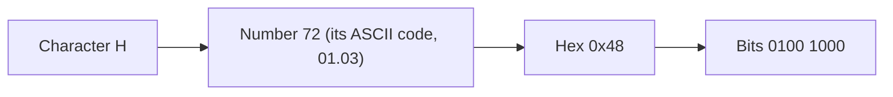
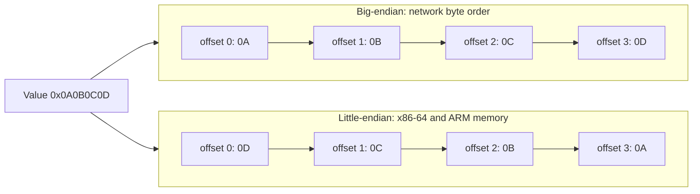
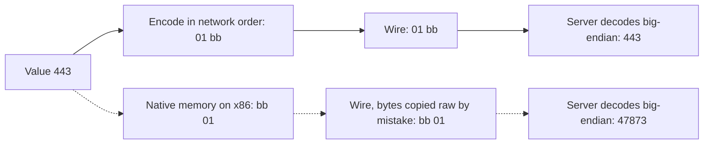
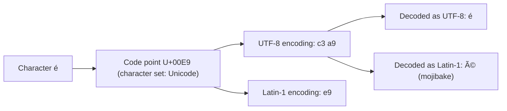
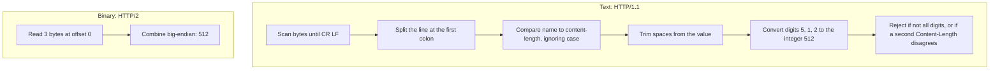
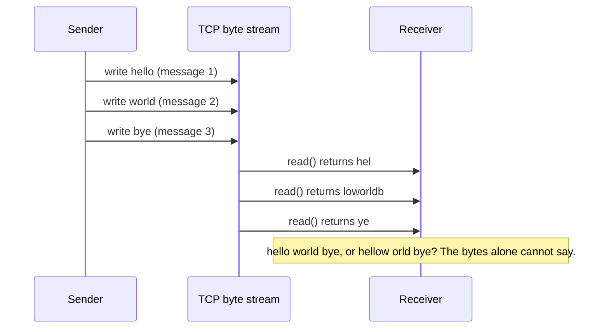
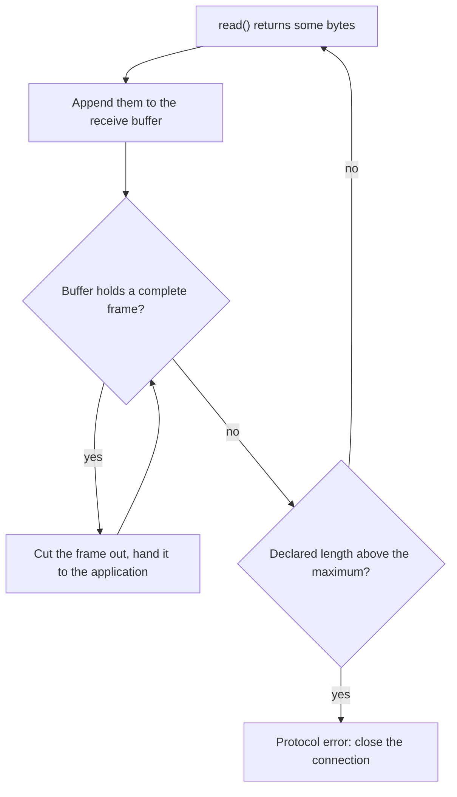
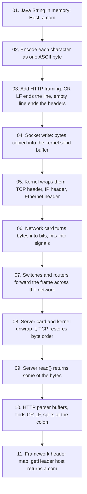
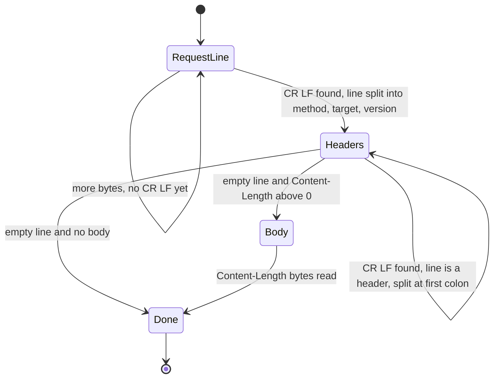
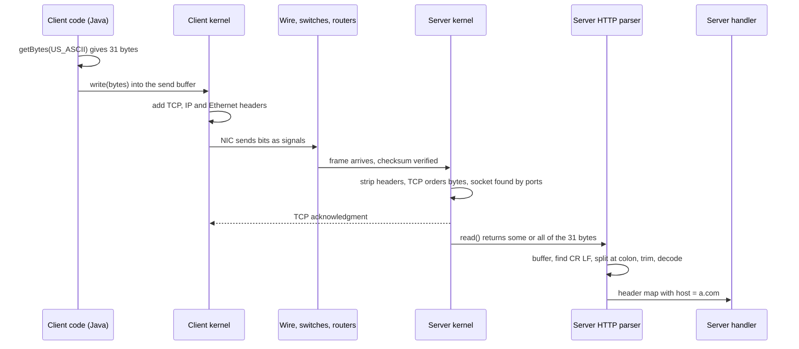

<!-- markdownlint-disable MD001 -->
<!-- markdownlint-disable MD024 -->
<!-- markdownlint-disable MD025 -->
<!-- markdownlint-disable MD026 -->
<!-- markdownlint-disable MD029 -->
<!-- markdownlint-disable MD033 -->
<!-- markdownlint-disable MD036 -->
<!-- markdownlint-disable MD040 -->
<!-- markdownlint-disable MD056 -->
<!-- markdownlint-disable MD060 -->

# H01. Bytes, Encodings and Framing

## Contents

| #     | Sub-topic                                                              | Tag  |
| ----- | ---------------------------------------------------------------------- | ---- |
| 01.01 | Bit, byte, octet; hex; reading a hex dump                              | CORE |
| 01.02 | Byte order (endianness): big-endian and little-endian                  | DEEP |
| 01.03 | Character sets vs encodings; ASCII, Unicode, UTF-8                     | CORE |
| 01.04 | Text-based vs binary-based protocols                                   | CORE |
| 01.05 | Why framing is needed, and the framing strategies                      | CORE |
| 01.06 | Base64 and percent-encoding                                            | CORE |
| 01.07 | The story: one request header, from a Java string to the wire and back | CORE |
| 01.08 | Labs: what each one shows and how to run it                            | CORE |
| 01.09 | Exercises                                                              |      |
| 01.10 | Solutions                                                              |      |
| 01.11 | Takeaways                                                              |      |

Terms used throughout:

- **Protocol**: an agreement between two programs on the format, meaning and order of the messages they exchange.
- **Sender** and **receiver**: the program that writes bytes onto a connection, and the program that reads them.
- **Parser**: the part of the receiver that turns raw bytes into structured values (a method, a header, a length).
- **Wire**: shorthand for "whatever carries the bytes between sender and receiver": copper, fibre, radio, or several of them in a row.  
  The wire carries bytes, never objects, strings or classes.

---

## 01.01 Bit, byte, octet; hex; reading a hex dump

A bit is a 0 or 1. An octet is exactly 8 bits and holds a number from 0 to 255.  
Everything a network carries is a sequence of octets.  
Engineers write octets in hex (two hex digits per octet) because each hex digit maps to exactly four bits.

### Terms

- **Bit**: one binary digit, `0` or `1`. The smallest unit any wire carries.
- **Byte**: the smallest unit of memory a machine can address.  
  Today 8 bits on every mainstream machine, but historically 6, 7 and 9-bit bytes existed.
- **Octet**: exactly 8 bits, by definition. RFCs say "octet" so that the specification never depends on any machine's byte size.  
  One octet holds `2^8 = 256` values: `0` to `255`.  
  In this track "byte" and "octet" mean the same thing unless stated.
- **Nibble**: 4 bits, half an octet. Holds `0` to `15`.
- **Hexadecimal (hex)**: base 16, digits `0`-`9` then `a`-`f` (`a` = 10, `f` = 15).  
  Written with a `0x` prefix in code: `0x47`.

### From a character to bits



### Why hex and not decimal

One hex digit is exactly one nibble, so one octet is exactly two hex digits, and each digit maps to four bits independently:

```text
0x48  =  4      8
      =  0100   1000
```

Decimal `72` (the same value) gives no such mapping; you cannot see the bits without arithmetic.  
When a protocol says "the top two bits are a flag", hex lets you read the flag directly.

| Hex | Binary | Decimal |     | Hex | Binary | Decimal |
| --- | ------ | ------- | --- | --- | ------ | ------- |
| 0   | 0000   | 0       |     | 8   | 1000   | 8       |
| 1   | 0001   | 1       |     | 9   | 1001   | 9       |
| 2   | 0010   | 2       |     | a   | 1010   | 10      |
| 3   | 0011   | 3       |     | b   | 1011   | 11      |
| 4   | 0100   | 4       |     | c   | 1100   | 12      |
| 5   | 0101   | 5       |     | d   | 1101   | 13      |
| 6   | 0110   | 6       |     | e   | 1110   | 14      |
| 7   | 0111   | 7       |     | f   | 1111   | 15      |

### Wire view: a hex dump

A **hex dump** prints raw bytes in three columns: offset, bytes in hex, and the same bytes as ASCII characters where printable.  
Here is `GET / HTTP/1.1` with `Host: a.com`, 31 octets (Lab 01 produces exactly this):

```text
offset  hex                                               ASCII
000000  47 45 54 20 2f 20 48 54 54 50 2f 31 2e 31 0d 0a   GET / HTTP/1.1..
000010  48 6f 73 74 3a 20 61 2e 63 6f 6d 0d 0a 0d 0a      Host: a.com....
```

01. **Offset**: position of the first byte on that line, in hex. `0x10` = 16.
02. **Hex column**: 16 bytes per line, two hex digits per byte.
03. **ASCII column**: printable bytes as characters; everything else as `.`.
04. `20` is a space. `0d 0a` is CR LF (carriage return, line feed), the HTTP/1.1 line terminator.  
  The closing `0d 0a 0d 0a` is the empty line that ends the header section.  
  A text editor hides these; a hex dump does not.

### Failure mode: Java's signed `byte`

Java's `byte` is a signed 8-bit integer: `-128` to `127`.  
A wire octet `0xC3` (195) stored in a `byte` reads as `-61`. Consequences:

- `b == 0xC3` is `false` (the right side is the `int` 195).
- `(hi << 8) | lo` sign-extends `lo` to `0xFFFFFFC3` and corrupts the result (Exercise 02 hits exactly this).
- Lengths computed from such bytes go negative.

Fix: widen with a mask, `b & 0xFF`, or `Byte.toUnsignedInt(b)`.  
`InputStream.read()` already returns an `int` in `0..255` (or `-1` for end of stream) for this reason.

```java
byte b = (byte) 0xC3;
System.out.println(b);                                        // -61
System.out.println(b & 0xFF);                                 // 195
System.out.println(HexFormat.of().formatHex(new byte[]{b}));  // c3   (Java 17+)
```

Rust separates the two types: `u8` is unsigned (`0..=255`), `i8` is signed.  
Wire code uses `u8`, so the bug appears only after an explicit `as i8`.

```rust
let b: u8 = 0xC3;
println!("{b} {b:02x} {b:08b}");   // 195 c3 11000011
```

### Tools

| Tool                  | Command                   |
| --------------------- | ------------------------- |
| xxd                   | `xxd file`                |
| hexdump               | `hexdump -C file`         |
| od (always installed) | `od -A x -t x1z file`     |
| Wireshark             | bottom pane of any packet |

### Interview angle

"Why do protocol specs say octet, and why do engineers read packets in hex?" Octet is unambiguous 8 bits.  
A hex digit is exactly 4 bits, so every byte is two characters and its bit pattern is readable at a glance.

---

## 01.02 Byte order (endianness): big-endian and little-endian

Byte order, or endianness, is the order in which the bytes of a multi-byte number are stored or sent.  
**Big-endian** puts the most significant byte first (443 = `0x01BB` is sent as `01 bb`).  
**Little-endian** puts the least significant byte first (`bb 01`).  

Internet protocols use big-endian, called **network byte order**; most CPUs use little-endian in memory, so code must convert when it moves numbers between memory and the wire.

### Terms

- **Multi-byte integer**: a number too big for one octet, stored across several. A 16-bit integer uses 2 octets, a 32-bit integer 4.
- **Most significant byte (MSB)**: the octet holding the highest-value part of the number, like the "thousands" digit of a decimal number. In `0x0A0B0C0D`, the MSB is `0x0A`.
- **Least significant byte (LSB)**: the octet holding the lowest-value part. In `0x0A0B0C0D`, the LSB is `0x0D`.

- **Endianness (byte order)**: the order in which the octets of a multi-byte integer are laid out in memory or on the wire.

- **Big-endian**: MSB first. Reads the same way the number is written in hex.
- **Little-endian**: LSB first.

The names come from Gulliver's Travels (which end of an egg to crack first); Danny Cohen applied them to computers in 1980. The point of the joke: neither choice is better, both sides must simply agree.

### The same number, two layouts



| Offset        | +0  | +1  | +2  | +3  |
| ------------- | --- | --- | --- | --- |
| Big-endian    | 0A  | 0B  | 0C  | 0D  |
| Little-endian | 0D  | 0C  | 0B  | 0A  |

### What endianness does not affect

- **Single bytes**: a one-byte value has nothing to reorder.
- **Byte strings**: ASCII and UTF-8 text are sequences of single bytes, so they have no byte order.  
  UTF-16 is a sequence of 2-byte units, so it does, which is why UTF-16 files may start with a byte order mark.
- **Bit order inside a byte**: the physical layer handles it; programs never see it.

### Network byte order

Internet protocols (IP, TCP, UDP, DNS, TLS, HTTP/2, QUIC) use **big-endian**.  
Port 443 is `0x01BB` and appears on the wire as `01 bb`.

Most CPUs today (x86-64, and ARM as configured in practice) are **little-endian** in memory.  
So every multi-byte integer is converted when it moves between memory and the wire.  
In C this is `htons` / `ntohs` ("host to network short").  
In Java and Rust the library does it, as long as you call the right method.



### Where it shows up

| Protocol field               | Width     | Order      |
| ---------------------------- | --------- | ---------- |
| TCP and UDP port numbers     | 16 bits   | Big-endian |
| IPv4 address                 | 32 bits   | Big-endian |
| TLS record length            | 16 bits   | Big-endian |
| HTTP/2 frame length          | 24 bits   | Big-endian |
| HTTP/2 stream identifier     | 31 bits   | Big-endian |
| QUIC variable-length integer | 1-8 bytes | Big-endian |

Text protocols (HTTP/1.1) avoid the issue for numbers: `Content-Length: 512` is the ASCII digits `35 31 32`, which have no byte order.

### Failure mode

A server listens on 8080 (`0x1F90`).  
A hand-written client stores the port in host order on a little-endian machine and sends `90 1f`.  
The server sees port `0x901F` = 36895. The connection is refused with no obvious cause.  
The same bug in a length field makes a parser wait for gigabytes of data that never arrive.

### Code

Java's `ByteBuffer`, `DataInputStream` and `DataOutputStream` are big-endian by default, which matches the network.  
Little-endian is opt-in (needed for some file formats, not for network protocols).

```java
ByteBuffer buf = ByteBuffer.allocate(4);          // big-endian by default
buf.putInt(0x0A0B0C0D);
System.out.println(HexFormat.ofDelimiter(" ").formatHex(buf.array()));   // 0a 0b 0c 0d

buf.clear().order(ByteOrder.LITTLE_ENDIAN).putInt(0x0A0B0C0D);
System.out.println(HexFormat.ofDelimiter(" ").formatHex(buf.array()));   // 0d 0c 0b 0a

System.out.println(ByteOrder.nativeOrder());       // LITTLE_ENDIAN on x86-64
```

Rust makes the order explicit in the method name, so it cannot be forgotten:

```rust
let port: u16 = 443;
assert_eq!(port.to_be_bytes(), [0x01, 0xbb]);          // network order
assert_eq!(port.to_le_bytes(), [0xbb, 0x01]);
assert_eq!(u16::from_be_bytes([0x01, 0xbb]), 443);
```

Avoid `to_ne_bytes` ("native endian") in wire code: it changes meaning across machines.

### Interview angle

"What is network byte order, and where does it bite?"  
Big-endian.  
It bites in hand-written binary codecs: port numbers, length prefixes, and any time two languages or machines exchange raw integers without a declared order.

---

## 01.03 Character sets vs encodings; ASCII, Unicode, UTF-8

A character set gives every character a number (a code point).  
An encoding turns those numbers into bytes.  
Text on the wire is always "bytes plus an encoding"; decode with the wrong encoding and you get garbage.  
UTF-8 is the encoding of the internet: ASCII characters stay one byte, everything else takes two to four.

### Terms

- **Character**: an abstract unit of text, such as "A", "é" or "€". Not a byte.
- **Character set (code space)**: a numbered list of characters. Each character gets a number called a **code point**.
- **Encoding**: the rule that turns code points into bytes. **Decoding** turns bytes back into code points.
- **Mojibake**: garbage text produced by decoding bytes with a different encoding from the one used to encode them.



### ASCII

- 128 characters, code points `0x00` to `0x7F`, one byte each, top bit always `0`.
- `0x00`-`0x1F` and `0x7F` are **control characters** (non-printing): `0x0D` CR, `0x0A` LF, `0x09` TAB, `0x00` NUL.
- `0x20` space, `0x30`-`0x39` digits, `0x41`-`0x5A` upper case, `0x61`-`0x7A` lower case.  
  Upper and lower case differ by one bit (`0x20`), which is why case-insensitive comparison of ASCII is cheap.

### Latin-1 (ISO-8859-1)

ASCII plus 128 Western European characters in `0x80`-`0xFF`, still one byte each.  
It matters for HTTP because early HTTP specifications allowed header bytes above `0x7F` to be read as Latin-1.

### Unicode

- One character set for all writing systems: code points `U+0000` to `U+10FFFF` (about 1.1 million slots).
- Unicode is the set, not the encoding. UTF-8, UTF-16 and UTF-32 are three encodings of it.

### UTF-8 byte layout

UTF-8 encodes each code point as 1 to 4 bytes.  
The leading bits of each byte say what role it plays:

| Code point range    | Bytes | Byte 1     | Byte 2     | Byte 3     | Byte 4     |
| ------------------- | ----- | ---------- | ---------- | ---------- | ---------- |
| U+0000 to U+007F    | 1     | `0xxxxxxx` |            |            |            |
| U+0080 to U+07FF    | 2     | `110xxxxx` | `10xxxxxx` |            |            |
| U+0800 to U+FFFF    | 3     | `1110xxxx` | `10xxxxxx` | `10xxxxxx` |            |
| U+10000 to U+10FFFF | 4     | `11110xxx` | `10xxxxxx` | `10xxxxxx` | `10xxxxxx` |

Examples:

| Character | Code point | UTF-8 bytes   |
| --------- | ---------- | ------------- |
| `A`       | U+0041     | `41`          |
| `é`       | U+00E9     | `c3 a9`       |
| `€`       | U+20AC     | `e2 82 ac`    |
| `😀`       | U+1F600    | `f0 9f 98 80` |

Worked example, `é` = U+00E9 = binary `000 1110 1001` (11 bits, so the 2-byte form):

```
template   110xxxxx 10xxxxxx
bits            00011   101001
result     11000011 10101001   =  c3 a9
```

Properties that made UTF-8 the encoding of the internet:

01. **ASCII-compatible**: every ASCII byte is itself. An ASCII-only parser (an HTTP/1.1 header parser) works on UTF-8 input without change.
02. **Self-synchronizing**: continuation bytes always start `10`, so a reader dropped into the middle of a stream finds the next character boundary within 3 bytes.
03. **No byte order**: it is a byte sequence, not a sequence of 16-bit units, so there is no endianness problem (unlike UTF-16; see 01.02).
04. **No accidental ASCII**: bytes of multi-byte characters are all `>= 0x80`, so they can never be mistaken for `/`, `"` or CR LF.

### Where encodings appear in HTTP

| Location                      | Rule                                                                                 |
| ----------------------------- | ------------------------------------------------------------------------------------ |
| Request line and header names | ASCII only                                                                           |
| Header values                 | Should be ASCII (RFC 9110). Bytes above `0x7F` are "obs-text": treat as opaque       |
| Non-ASCII in a header value   | Encode explicitly, e.g. `filename*=UTF-8''r%C3%A9sum%C3%A9.pdf` (RFC 8187)           |
| URL path and query            | ASCII; anything else is UTF-8 then percent-encoded (01.06)                           |
| Body                          | Any bytes; the text encoding is declared in `Content-Type: text/html; charset=utf-8` |
| JSON body                     | Must be UTF-8 (RFC 8259)                                                             |

### Failure modes

01. **Mojibake**: `é` sent as UTF-8 (`c3 a9`) but decoded as Latin-1 shows as `é`.  
  The bytes were right; the declared or assumed encoding was wrong.
02. **Platform default encoding**: `new String(bytes)` and `getBytes()` without a charset used the OS default before Java 18.  
  Since Java 18 (JEP 400) the default is UTF-8, but always pass `StandardCharsets.UTF_8` explicitly in wire code.
03. **Length confusion**: "length" has three meanings. Protocols almost always mean bytes.

    | Text | Java `length()` (UTF-16 units) | Code points | UTF-8 bytes |
    | ---- | ------------------------------ | ----------- | ----------- |
    | `A`  | 1                              | 1           | 1           |
    | `é`  | 1                              | 1           | 2           |
    | `😀` | 2                              | 1           | 4           |

    Setting `Content-Length` from `String.length()` truncates any body with non-ASCII text.

04. **Overlong encodings**: `/` is `2f`, but the invalid 2-byte form `c0 af` decodes to `/` in lax decoders.  
  Old servers checked for `../` on the raw bytes, then decoded, and served files outside the web root.  
  Strict decoders reject overlong forms; Java's and Rust's standard decoders do.

### Code

```java
String s = "é";
byte[] utf8 = s.getBytes(StandardCharsets.UTF_8);
System.out.println(utf8.length);                                          // 2
System.out.println(new String(utf8, StandardCharsets.ISO_8859_1));        // é  (mojibake)
System.out.println("😀".length() + " " + "😀".codePointCount(0, 2));      // 2 1
```

```rust
let s = "😀";
println!("{} {}", s.len(), s.chars().count());     // 4 1   (len() is bytes)
let overlong: Vec<u8> = vec![0xc0, 0xaf];
assert!(std::str::from_utf8(&overlong).is_err());   // overlong form rejected
```

Rust's `String` is guaranteed valid UTF-8; raw wire data belongs in `&[u8]` / `Vec<u8>` until validated.

### Interview angle

"A user's name shows as `é` in one service and fine in another. Where do you look?"  
At the boundary where bytes become text: the `charset` in `Content-Type`, the decoder's charset in the consumer, and any database or driver connection charset.  
The bytes are almost always correct; one side assumed the wrong encoding.

---

## 01.04 Text-based vs binary-based protocols

A **text-based protocol** writes its messages as human-readable characters: numbers are digits, and structure comes from keywords and separators such as `:` and CR LF (HTTP/1.1, SMTP).  
A **binary-based protocol** puts raw numbers at fixed positions with fixed widths, and structure comes from offsets and length fields (HTTP/2, TLS, QUIC).  

Text is easy to read and debug; binary is smaller, faster to parse and leaves no room for interpretation.

### Terms

- **Text protocol**: messages are made of printable characters (in practice ASCII), with structure expressed by delimiters and keywords.  
  Numbers are written as digits. Examples: HTTP/1.1, SMTP, FTP control, Redis RESP (mostly).

- **Binary protocol**: messages are laid out as fixed-width or length-prefixed fields of raw bytes.  
  Numbers are stored as integers in a declared byte order (01.02).  
  Examples: TLS, HTTP/2, HTTP/3, QUIC, TCP and IP headers, Protocol Buffers, Kafka.

### The same fact, both ways

"The body is 512 bytes long":

| Protocol | On the wire                                                                                        | Size     |
| -------- | -------------------------------------------------------------------------------------------------- | -------- |
| HTTP/1.1 | `Content-Length: 512` then CR LF: `43 6f 6e 74 65 6e 74 2d 4c 65 6e 67 74 68 3a 20 35 31 32 0d 0a` | 21 bytes |
| HTTP/2   | First 3 bytes of the frame header: `00 02 00`                                                      | 3 bytes  |

How each receiver gets to the integer 512:



Every step in the text path is a place where two implementations can disagree. The binary path has one rule.

### Trade-offs

| Aspect            | Text                                                      | Binary                                                     |
| ----------------- | --------------------------------------------------------- | ---------------------------------------------------------- |
| Human readability | Read and type by hand (`nc`, `telnet`)                    | Needs a decoder (Wireshark, `nghttp`)                      |
| Parse cost        | Scan byte by byte for delimiters; convert digits to ints  | Read a length, jump; integers are already integers         |
| Size              | Larger: 21 bytes for one length                           | Smaller: 3 bytes for the same length                       |
| Ambiguity         | High: whitespace, case, line endings, duplicates, folding | Low: every field has a fixed meaning and width             |
| Security          | Parser disagreements lead to smuggling and injection      | Fewer ambiguities; bugs are bounds checks and limits       |
| Extensibility     | Easy to add a header; old parsers ignore it               | Needs explicit extension points (type codes, TLV in 01.05) |
| Debugging         | Easy                                                      | Needs tools                                                |

### Why HTTP went from text to binary

HTTP/1.1 is text because in 1991 to 1997, human debuggability and simple implementation mattered most.  
At scale its weaknesses showed: header bytes repeated on every request, costly and lenient parsing, and no way to interleave messages on one connection.  
HTTP/2 (2015) keeps the same **semantics** (methods, status codes, headers; see REST track R2.1) but changes the **framing** to binary.  
That split, "same meaning, different bytes", is a theme of Part E.

### Hybrid designs

Many protocols mix both: text fields inside a length-prefixed structure.  
Redis RESP writes lengths as text digits but then reads exactly that many bytes:

```text
$5\r\nhello\r\n
```

`$5` says "a 5-byte string follows", so the payload may contain any byte, including `\r\n`.  
This combines readability with exact framing.

### Interview angle

"Why is HTTP/2 binary when HTTP/1.1 was text?"  
Parsing cost, size (header compression needs binary), unambiguous framing (fewer smuggling-type bugs), and multiplexing, which needs every chunk of data labelled with a stream ID.  
The semantics did not change.

---

## 01.05 Why framing is needed, and the framing strategies

TCP delivers a continuous stream of bytes, not separate messages.  
A single `read()` can return half a message, or one and a half.  
**Framing** is the rule both sides agree on so the receiver can find where each message ends: a delimiter (HTTP/1.1's CR LF), a length written in front (TLS, HTTP/2), a fixed size, or type-length-value fields.

### Terms

- **Byte stream**: an ordered sequence of bytes with no built-in boundaries.  
  TCP (H04) provides one: whatever the sender writes, the receiver gets the same bytes in the same order, but split into arbitrary chunks.  
  Two writes may arrive in one read; one write may arrive in three reads.

- **Message**: one unit of meaning in the protocol (an HTTP request, a TLS record).

- **Framing**: the rule that tells the receiver where each message starts and ends inside the byte stream.

- **Frame**: one delimited unit on the wire, usually a small header plus a payload.

### Why framing is needed

The sender writes three messages. The byte stream keeps their order but not their edges:



Why the chunks differ from the writes: the kernel buffers outgoing bytes, TCP cuts them into segments by size and timing (H04), the network may delay or resend some, and `read()` returns whatever has arrived so far.  
None of these steps knows or cares where the application's messages begin.

So the protocol must carry its own boundaries.  
Every protocol uses one of the strategies below, or a mix.

### Strategy 01: Delimiter

A reserved byte sequence marks the end of a message or field.

- **Example**: HTTP/1.1 ends each header line with `\r\n` and the header section with `\r\n\r\n`.

- **Pros**: simple, human-readable, streaming-friendly (no need to know the size in advance).

- **Cons**: the receiver must scan every byte.  
  The delimiter cannot appear in the data unless it is **escaped** (replaced by a special sequence), and escaping costs time and invites bugs.  
  Lenient parsers that also accept a bare `\n` disagree with strict ones; that disagreement is a root cause of request smuggling (H07).

### Strategy 02: Length prefix

A length field comes first; the receiver reads exactly that many bytes next.

- **Examples**: HTTP/1.1 `Content-Length` (length as text), TLS records (2-byte length), HTTP/2 frames (3-byte length), Kafka and most RPC protocols (4-byte length).

- **Pros**: no scanning, no escaping, payload may contain any byte. The receiver can allocate the exact buffer.

- **Cons**: the sender must know the size before sending.  
  A corrupted or hostile length makes the receiver wait forever or allocate huge buffers, so every length needs a **maximum** (HTTP/2 default 16 KB frame payload; TLS 16 KB plaintext record).

HTTP/1.1 **chunked transfer coding** solves the "size not known in advance" problem by sending a stream of length-prefixed chunks, with a zero-length chunk as the end marker (H07).

### Strategy 03: Fixed size

Every message, or the header part, has a known size.

- **Examples**: the HTTP/2 frame header is always 9 bytes; the TCP header is 20 bytes plus options whose size is itself declared in the fixed part.

- **Pros**: trivial to parse, constant offsets.

- **Cons**: wasteful or rigid for variable data. In practice it is used for headers, combined with a length prefix for the payload.

The HTTP/2 frame header shows fixed size and length prefix together:

```
+-----------------------------------------------+
|                 Length (24 bits)              |
+---------------+---------------+---------------+
|   Type (8)    |   Flags (8)   |
+-+-------------+---------------+-------------------------------+
|R|                 Stream Identifier (31 bits)                 |
+=+=============================================================+
|                   Frame Payload (Length bytes)                ...
+---------------------------------------------------------------+
```

### Strategy 04: Type-Length-Value (TLV)

Each field is a type code, then a length, then a value of that length.

- **Examples**: TLS extensions (2-byte type, 2-byte length, value), ASN.1 DER inside X.509 certificates (H13), Protocol Buffers fields.

- **Pros**: a parser can **skip fields it does not understand** by reading the length and jumping. This is how protocols add features without breaking old implementations.

- **Cons**: a few bytes of overhead per field.

### Variable-length integers (varints)

A length field has to have some width.  
A fixed 8-byte length wastes 7 bytes on a 5-byte message.  
A **variable-length integer** uses few bytes for small values and more for large ones.

QUIC and HTTP/3 (RFC 9000 §16) use the top 2 bits of the first byte to give the total size:

| Top 2 bits | Total length | Usable bits | Max value                 |
| ---------- | ------------ | ----------- | ------------------------- |
| `00`       | 1 byte       | 6           | 63                        |
| `01`       | 2 bytes      | 14          | 16,383                    |
| `10`       | 4 bytes      | 30          | 1,073,741,823             |
| `11`       | 8 bytes      | 62          | 4,611,686,018,427,387,903 |

Worked example, `7b bd`:

```
first byte 7b = 01 111011
               ^^ prefix 01  -> 2 bytes in total
                  111011     -> high 6 bits of the value
value = 111011 10111101 (binary) = 0x3bbd = 15293
```

Protocol Buffers use a different varint (7 bits per byte, top bit means "more bytes follow"). Same idea, different layout.

### Comparison

| Strategy      | Receiver must                  | Payload restrictions                    | Used by                                          |
| ------------- | ------------------------------ | --------------------------------------- | ------------------------------------------------ |
| Delimiter     | Scan every byte                | Cannot contain delimiter (or escape it) | HTTP/1.1 headers, SMTP, line-based logs          |
| Length prefix | Read length, then read N bytes | None                                    | TLS records, HTTP/2 frames, Kafka, gRPC messages |
| Fixed size    | Read N bytes                   | Fits the size                           | HTTP/2 frame header, TCP and IP headers          |
| TLV           | Read type and length, then N   | None                                    | TLS extensions, ASN.1 DER, Protocol Buffers      |
| Varint        | Read 1 byte, then up to 7 more | n/a (it is a length)                    | QUIC, HTTP/3, Protocol Buffers                   |

### The receive loop every framed protocol needs



### The two universal failure modes

01. **Assuming one read equals one message.** `read()` returns whatever has arrived, which may be half a message or two and a half.  
  A correct receiver keeps a buffer, appends each read, extracts as many complete frames as the buffer holds, and keeps the remainder for the next read (Lab 03 shows this step by step).

02. **Trusting the length.** A length of `0x7FFFFFFF` from an attacker makes a naive server allocate 2 GB.  
  Every length is checked against a maximum before allocating, and every read has a timeout.

### Interview angle

"TCP is a byte stream. How do you send messages over it?"  
Framing: delimiter, length prefix, or TLV, with a maximum frame size and a receive buffer that handles partial and coalesced reads.  
Then name a real protocol for each.

---

## 01.06 Base64 and percent-encoding

Both carry arbitrary bytes through a channel that allows only certain characters.  
Base64 turns any bytes into 64 safe letters (for headers, JSON, PEM files); percent-encoding writes unsafe URL bytes as `%XX`.  
Neither is encryption or compression.

### Base64

- **Problem**: a text-only channel (an HTTP header, JSON, email, a URL) must carry binary data such as a key, a hash or an image.

- **Mechanism**: take 3 bytes (24 bits), split into four 6-bit groups, map each group to one of 64 safe characters (`A-Z a-z 0-9 + /`). Output is 4 characters per 3 bytes.

- **Overhead**: exactly 4/3, about 33% larger.

- **Padding**: when the input is not a multiple of 3, `=` pads the output to a multiple of 4.

Worked example, `Man`:

```
bytes     M        a        n
hex       4d       61       6e
bits      01001101 01100001 01101110
6-bit     010011 010110 000101 101110
index     19     22     5      46
char      T      W      F      u        ->  TWFu
```

| Input bytes | Base64 |
| ----------- | ------ |
| `Man`       | `TWFu` |
| `Ma`        | `TWE=` |
| `M`         | `TQ==` |

- **Base64url**: replaces `+` with `-` and `/` with `_`, because `+` and `/` have meaning inside URLs.  
  Padding is often omitted. JWTs and ACME (H13) use base64url. `fb ff` is `+/8=` in standard Base64 and `-_8=` in base64url.

Where it appears in this track: `Authorization: Basic dXNlcjpwYXNz` (which is `user:pass`, readable by anyone, so only safe over TLS), the `Sec-WebSocket-Key` header (H08), PEM certificate files (H13).

### Percent-encoding (URL encoding)

- **Problem**: a URL may contain only a limited set of ASCII characters, and some of them (`/ ? # & =`) are structural.

- **Mechanism** (RFC 3986): a byte that is not allowed, or would be read as structure, becomes `%` followed by two hex digits.  
  Non-ASCII text is first encoded as UTF-8, then each byte is percent-encoded.

- **Unreserved characters**, never encoded: `A-Z a-z 0-9 - . _ ~`.

Example: `a b/é` as one path segment becomes `a%20b%2F%C3%A9` (space is `20`, `/` is `2F`, `é` is UTF-8 `C3 A9`).

### Failure modes

01. **Form encoding is not URL encoding.** HTML forms (`application/x-www-form-urlencoded`) encode a space as `+`.  
  RFC 3986 encodes it as `%20`, and `+` in a path is a literal plus. Java's `URLEncoder.encode` produces **form** encoding, so `a b` becomes `a+b`, which is wrong for a path segment.  
  Use `java.net.URI` builders or Spring's `UriComponentsBuilder` (REST track R2.1).

02. **Double encoding and double decoding.** `%252F` decoded once is `%2F`, decoded twice is `/`.  
  A proxy that decodes once and a backend that decodes again disagree on the path, which can bypass path-based access rules.  
  Decode exactly once, at one layer.

03. **Base64 as "security".** It is reversible by anyone. Credentials in Base64 are plaintext.

### Code

```java
byte[] raw = {(byte) 0xfb, (byte) 0xff};
System.out.println(Base64.getEncoder().encodeToString(raw));      // +/8=
System.out.println(Base64.getUrlEncoder().encodeToString(raw));   // -_8=
System.out.println(URLEncoder.encode("a b/é", StandardCharsets.UTF_8));   // a+b%2F%C3%A9  (form encoding)
```

```rust
use base64::{engine::general_purpose::{STANDARD, URL_SAFE}, Engine};
use percent_encoding::{utf8_percent_encode, AsciiSet, NON_ALPHANUMERIC};

// RFC 3986 unreserved characters stay as they are; everything else is encoded
const PATH_SEGMENT: &AsciiSet = &NON_ALPHANUMERIC.remove(b'-').remove(b'.').remove(b'_').remove(b'~');

println!("{}", STANDARD.encode([0xfb, 0xff]));                       // +/8=
println!("{}", URL_SAFE.encode([0xfb, 0xff]));                       // -_8=
println!("{}", utf8_percent_encode("a b/é", PATH_SEGMENT));          // a%20b%2F%C3%A9
```

### Interview angle

"Is Basic auth secure?" Only over TLS.  
Base64 is an encoding for transport safety, not a secret.  
Anyone on the path who sees the header can decode it.

---

## 01.07 The story: one request header, from a Java string to the wire and back

This section ties 01.01 to 01.05 together by following one header, `Host: a.com`, inside the request `GET / HTTP/1.1`, from the moment a Java program holds it as a `String` to the moment a server's code reads it back.  
Chapters 05 to 08 preview H02 and H04; each term is defined where it first appears.

### The whole journey at a glance



### Chapter 01: a string is not something a wire can carry

The client program builds the request:

```java
String request = "GET / HTTP/1.1\r\nHost: a.com\r\n\r\n";
```

In the JVM, a `String` is an object: a header with a class pointer, a hash field, and an internal array of characters stored as Latin-1 or UTF-16 depending on content.  
None of that structure means anything to another machine.  
Before anything can be sent, the text must become a plain sequence of octets in an encoding both sides agree on.

### Chapter 02: characters become numbers, numbers become bytes

HTTP/1.1 says the request line and headers are ASCII (01.03). So the program encodes with ASCII:

```java
byte[] bytes = request.getBytes(StandardCharsets.US_ASCII);   // 31 bytes
```

Each character of `Host: a.com` plus its line ending becomes exactly one octet:

| Character | ASCII code (decimal) | Hex  | Bits       |
| --------- | -------------------- | ---- | ---------- |
| `H`       | 72                   | `48` | `01001000` |
| `o`       | 111                  | `6f` | `01101111` |
| `s`       | 115                  | `73` | `01110011` |
| `t`       | 116                  | `74` | `01110100` |
| `:`       | 58                   | `3a` | `00111010` |
| space     | 32                   | `20` | `00100000` |
| `a`       | 97                   | `61` | `01100001` |
| `.`       | 46                   | `2e` | `00101110` |
| `c`       | 99                   | `63` | `01100011` |
| `o`       | 111                  | `6f` | `01101111` |
| `m`       | 109                  | `6d` | `01101101` |
| CR        | 13                   | `0d` | `00001101` |
| LF        | 10                   | `0a` | `00001010` |

13 octets, 104 bits.  
If the host name contained `é`, ASCII could not represent it; the encoder would substitute `?`,  
and the correct approach is a different representation entirely (IDNA "punycode" for host names, covered with DNS in H03).

### Chapter 03: framing marks are part of the bytes

The receiver will need to know where the `Host` value ends and where the headers end. HTTP/1.1 uses the delimiter strategy (01.05):

- `0d 0a` (CR LF) ends each line, so the value `a.com` ends just before `0d`.
- An empty line, a second `0d 0a` straight after the last header's `0d 0a`, ends the header section.
- This request has no body. A request with a body would add `Content-Length: N`, a length prefix written as text (01.04), telling the receiver to read exactly N more bytes after the empty line.

The final 31 bytes (Lab 01 prints them):

```
000000  47 45 54 20 2f 20 48 54 54 50 2f 31 2e 31 0d 0a   GET / HTTP/1.1..
000010  48 6f 73 74 3a 20 61 2e 63 6f 6d 0d 0a 0d 0a      Host: a.com....
```

### Chapter 04: handing the bytes to the operating system

```java
socket.getOutputStream().write(bytes);
```

A **socket** is the operating system object that represents one end of a network connection (H05).  
`write` copies the 31 bytes from the JVM into the **kernel send buffer**, memory owned by the operating system, and usually returns immediately.  
From here on the program has no control: the kernel decides when and how the bytes leave.  
This is also the last moment the application's idea of "one request" exists; the kernel only sees a stream of bytes.

### Chapter 05: the kernel wraps the bytes (preview of H02)

The kernel puts headers in front of the 31 bytes, one per layer. Each header is binary, with big-endian numbers (01.02):

| Layer    | Adds                                                      | Example bytes                               |
| -------- | --------------------------------------------------------- | ------------------------------------------- |
| TCP      | Ports, sequence number, checksum (20 to 32 bytes)         | Destination port 80 is `00 50`              |
| IP       | Source and destination addresses, TTL (20 bytes for IPv4) | Destination `203.0.113.80` is `cb 00 71 50` |
| Ethernet | Next-hop hardware addresses, type of payload (14 bytes)   | Type IPv4 is `08 00`                        |

The HTTP bytes ride inside, untouched; TCP and IP never look at them. The complete frame, decoded field by field, is in H02.02.

### Chapter 06: bytes become bits, bits become signals

The **network interface card (NIC)**, the hardware that connects the machine to the network, reads the frame from memory and transmits it one bit after another.  
The **physical layer** turns bits into something a medium can carry:

| Medium | A bit becomes                                                           |
| ------ | ----------------------------------------------------------------------- |
| Copper | Voltage levels; gigabit and faster links encode several bits per symbol |
| Fibre  | Pulses or levels of light                                               |
| Wi-Fi  | Changes in a radio wave's phase and amplitude                           |

Scale: at 1 Gbit/s one bit takes 1 nanosecond to send.  
This frame (91 bytes, plus 8 bytes of preamble before it, a 4-byte checksum after it, and a mandatory 12-byte gap) occupies the wire for under 1 microsecond.

### Chapter 07: across the network

Switches and routers between client and server each read only the header for their layer (H02.01).  
A switch reads the Ethernet destination; a router reads the IP destination, writes a new Ethernet header for the next link, and passes the rest along unchanged.  
Nothing in the middle reads `Host: a.com` unless it is an HTTP proxy (H08), and once the connection uses TLS (Part D) nothing in the middle can.

Distance costs time: light in fibre covers about 200,000 km per second, so every 1,000 km adds about 5 ms each way.  
This, not bandwidth, dominates the latency of small requests (H20).

### Chapter 08: the server unwraps the bytes

The server's NIC turns signals back into bits and bytes and checks the frame's checksum.  
The kernel strips the Ethernet, IP and TCP headers, uses the ports to find the right socket (H02.02), and TCP places the payload in order in the socket's **receive buffer**, then acknowledges it to the client.  
If a packet had been lost, TCP would have resent it; the application never sees loss, only delay (H04).

### Chapter 09: `read()` returns some bytes, not "a request"

```java
int n = in.read(buffer);   // n can be anything from 1 to 31 here
```

`read` returns whatever is in the receive buffer at that moment.  
Usually all 31 bytes arrive together, but under load, on slow links, or with larger requests, the first read might return `GET / HTT` and the next the rest.  
This is 01.05's framing problem in practice.  
The HTTP parser therefore appends every read to its own buffer and parses only what is complete.

### Chapter 10: the parser finds the header

The HTTP/1.1 parser is a small state machine driven by the framing bytes:



For our line, the bytes `48 6f 73 74 3a 20 61 2e 63 6f 6d 0d 0a`:

01. Find `0d 0a`: the line is the 11 bytes before it.
02. Split at the first `3a` (`:`): name bytes `48 6f 73 74`, value bytes `20 61 2e 63 6f 6d`.
03. Trim leading and trailing spaces and tabs from the value: `61 2e 63 6f 6d`.
04. Decode both as ASCII: name `Host`, value `a.com`. Header names are case-insensitive, so the parser stores them in a case-insensitive structure.
05. Enforce limits while doing it: maximum line length and total header size (otherwise `431 Request Header Fields Too Large`, REST track R3),  
  and a read timeout so a client that sends half a header and stops cannot hold the connection forever.

### Chapter 11: the application sees a header again

The framework (Tomcat under Spring Boot, or Actix's HTTP layer) puts the parsed pair into its header map.  
Application code finally reads it back as text:

```java
@GetMapping("/")
String hello(@RequestHeader("host") String host) {   // "a.com"; lookup ignores case
    return "Hello from " + host;
}
```

```rust
#[get("/")]
async fn hello(req: HttpRequest) -> String {
    let host = req.headers().get("host").and_then(|v| v.to_str().ok()).unwrap_or("?");
    format!("Hello from {host}")
}
```

The response travels back the same way in reverse.

### The journey as a sequence



### What can go wrong, chapter by chapter

| Chapter  | Mistake                                                 | Result                                                                           |
| -------- | ------------------------------------------------------- | -------------------------------------------------------------------------------- |
| 02       | Encoding non-ASCII header values as raw UTF-8           | Receiver rejects with `400`, or shows mojibake                                   |
| 03       | Sending bare LF instead of CR LF                        | Strict parsers reject, lenient ones accept: disagreement enables smuggling (H07) |
| 04       | Ignoring a partial write on a non-blocking socket (H05) | Truncated request; server waits for bytes that never come                        |
| 06 to 08 | Packet loss on the path                                 | Invisible to code; appears only as extra latency (TCP retransmits)               |
| 09       | Assuming one `read()` returns the whole request         | Works on a laptop, fails randomly under load                                     |
| 10       | No header size limit, no read timeout                   | Memory exhaustion, or slowloris: thousands of half-sent requests hold threads    |

---

## 01.08 Labs: what each one shows and how to run it

Five labs, from shell one-liners to complete programs.  
Each lists its goal, how to run it, the exact output to expect, and experiments to try.  
All programs below were run on JDK 21 and Rust 1.97 and produced the output shown.

| Lab | Topic                                    | Covers                | Needs        |
| --- | ---------------------------------------- | --------------------- | ------------ |
| 00  | Shell: see bytes without writing code    | 01.01, 01.02, 01.03   | Linux shell  |
| 01  | Hex dump of a raw HTTP request           | 01.01, 01.07          | Java or Rust |
| 02  | Encodings and byte order playground      | 01.01 to 01.03, 01.06 | Java or Rust |
| 03  | Frame reader that survives partial reads | 01.05                 | Java or Rust |
| 04  | QUIC varint decoder                      | 01.05                 | Java or Rust |

### Setup, once

Tools:

| Tool            | Check             | Notes                                                                   |
| --------------- | ----------------- | ----------------------------------------------------------------------- |
| JDK 21 or newer | `java -version`   | Any distribution (Temurin, Corretto). SDKMAN: `sdk install java 21-tem` |
| Rust toolchain  | `cargo --version` | Install with rustup from rust-lang.org                                  |
| `xxd` or `od`   | `od --version`    | `od` ships with Linux; `xxd` ships with vim                             |

On Windows, run everything inside WSL (Windows Subsystem for Linux).

Folder layout (anywhere on disk, for example `~/cis-theta-labs/h01/`):

```
h01/
  java/
    HexDump.java
    EncodingPlayground.java
    FrameReaderDemo.java
    VarintDemo.java
  rust/                      <- a Cargo project, created below
    Cargo.toml
    src/bin/hexdump.rs
    src/bin/playground.rs
    src/bin/frames.rs
    src/bin/varint.rs
```

**Java**: no build tool needed. Java 11+ can run a single source file directly ("source-file mode", JEP 330): it compiles in memory and runs `main`.

```
cd h01/java
java HexDump.java
```

If non-ASCII characters print as `?`, the terminal is not using UTF-8.  
Force it with `java -Dstdout.encoding=UTF-8 EncodingPlayground.java` (Java 19+).  
The bytes were right; only the printing was wrong, which is itself a small lesson from 01.03.

**Rust**: one Cargo project with one binary per lab.

```
cd h01
cargo new rust
cd rust
cargo add bytes base64 percent-encoding
rm src/main.rs
mkdir -p src/bin
# save each lab's Rust file into src/bin/ under the name shown, then:
cargo run --bin hexdump
```

### Lab 00: shell, no code

Goal: see that text is bytes, and see byte order with your own eyes.

```
# 01.01: a request as bytes (31 bytes, CR LF visible as 0d 0a)
printf 'GET / HTTP/1.1\r\nHost: a.com\r\n\r\n' | od -A x -t x1z

# 01.03: one character, two bytes in UTF-8
printf 'é' | od -A n -t x1                          # c3 a9

# 01.02: the same two bytes read as a 16-bit number, two ways (GNU od, Linux)
printf '\x01\xbb' | od -A n -t u2                   # 47873 on a little-endian CPU
printf '\x01\xbb' | od --endian=big -A n -t u2      # 443, network byte order
```

What it proves: `01 bb` means 443 only if both sides agree it is big-endian.

### Lab 01: hex dump of a raw HTTP request

Goal: produce the hex dump from 01.01 and 01.07 yourself, including the invisible CR LF bytes.

Java, `HexDump.java`:

```java
import java.nio.charset.StandardCharsets;
import java.util.HexFormat;

public final class HexDump {

    static String hexDump(byte[] data) {
        var out = new StringBuilder();
        var hex = HexFormat.of();
        for (int off = 0; off < data.length; off += 16) {
            int end = Math.min(off + 16, data.length);
            out.append(String.format("%06x  ", off));
            for (int i = off; i < off + 16; i++) {
                out.append(i < end ? hex.toHexDigits(data[i]) + " " : "   ");
            }
            out.append("  ");
            for (int i = off; i < end; i++) {
                int b = data[i] & 0xFF;                         // unsigned, see 01.01
                out.append(b >= 0x20 && b < 0x7F ? (char) b : '.');
            }
            out.append('\n');
        }
        return out.toString();
    }

    public static void main(String[] args) {
        String request = "GET / HTTP/1.1\r\nHost: a.com\r\n\r\n";
        byte[] bytes = request.getBytes(StandardCharsets.US_ASCII);
        System.out.println(bytes.length + " bytes");
        System.out.print(hexDump(bytes));
    }
}
```

Rust, `src/bin/hexdump.rs`:

```rust
fn hex_dump(data: &[u8]) -> String {
    let mut out = String::new();
    for (line, chunk) in data.chunks(16).enumerate() {
        out.push_str(&format!("{:06x}  ", line * 16));
        for i in 0..16 {
            match chunk.get(i) {
                Some(b) => out.push_str(&format!("{b:02x} ")),
                None => out.push_str("   "),
            }
        }
        out.push_str("  ");
        for &b in chunk {
            out.push(if (0x20..0x7f).contains(&b) { b as char } else { '.' });
        }
        out.push('\n');
    }
    out
}

fn main() {
    let request = b"GET / HTTP/1.1\r\nHost: a.com\r\n\r\n";
    println!("{} bytes", request.len());
    print!("{}", hex_dump(request));
}
```

Run: `java HexDump.java` or `cargo run --bin hexdump`.

Expected output (both):

```
31 bytes
000000  47 45 54 20 2f 20 48 54 54 50 2f 31 2e 31 0d 0a   GET / HTTP/1.1..
000010  48 6f 73 74 3a 20 61 2e 63 6f 6d 0d 0a 0d 0a      Host: a.com....
```

Try this:

01. Replace `\r\n` with `\n` everywhere. The `0d` bytes disappear: this is the "bare LF" request that strict servers reject (01.07, chapter table).
02. Add a header `X-Name: é` and encode with `UTF_8` instead of `US_ASCII`. Find `c3 a9` in the dump.  
  Then encode with `US_ASCII` again and see `3f` (`?`): the encoder silently replaced what it could not represent.

### Lab 02: encodings and byte order playground

Goal: run every snippet from 01.01, 01.02, 01.03 and 01.06 in one place.

Java, `EncodingPlayground.java`:

```java
import java.net.URLEncoder;
import java.nio.ByteBuffer;
import java.nio.ByteOrder;
import java.nio.charset.StandardCharsets;
import java.util.Base64;
import java.util.HexFormat;

public final class EncodingPlayground {

    public static void main(String[] args) {
        HexFormat hex = HexFormat.ofDelimiter(" ");

        // 01.01 signed byte
        byte b = (byte) 0xC3;
        System.out.println("signed byte      : " + b + ", unsigned: " + (b & 0xFF));

        // 01.02 byte order
        ByteBuffer big = ByteBuffer.allocate(4).putInt(0x0A0B0C0D);
        ByteBuffer little = ByteBuffer.allocate(4).order(ByteOrder.LITTLE_ENDIAN).putInt(0x0A0B0C0D);
        System.out.println("big-endian       : " + hex.formatHex(big.array()));
        System.out.println("little-endian    : " + hex.formatHex(little.array()));
        System.out.println("port 443 on wire : " + hex.formatHex(ByteBuffer.allocate(2).putShort((short) 443).array()));
        System.out.println("this CPU         : " + ByteOrder.nativeOrder());

        // 01.03 encodings and lengths
        for (String s : new String[]{"A", "é", "€", "😀"}) {
            byte[] utf8 = s.getBytes(StandardCharsets.UTF_8);
            System.out.printf("%-4s length()=%d codePoints=%d utf8Bytes=%d [%s]%n",
                    s, s.length(), s.codePointCount(0, s.length()), utf8.length, hex.formatHex(utf8));
        }
        System.out.println("mojibake         : " + new String("é".getBytes(StandardCharsets.UTF_8), StandardCharsets.ISO_8859_1));

        // 01.06 Base64 and percent-encoding
        byte[] raw = {(byte) 0xfb, (byte) 0xff};
        System.out.println("base64           : " + Base64.getEncoder().encodeToString(raw));
        System.out.println("base64url        : " + Base64.getUrlEncoder().encodeToString(raw));
        System.out.println("URLEncoder       : " + URLEncoder.encode("a b/é", StandardCharsets.UTF_8) + "   (form encoding, not RFC 3986)");
    }
}
```

Run: `java -Dstdout.encoding=UTF-8 EncodingPlayground.java`

Expected output (column alignment of the emoji row may vary by terminal):

```
signed byte      : -61, unsigned: 195
big-endian       : 0a 0b 0c 0d
little-endian    : 0d 0c 0b 0a
port 443 on wire : 01 bb
this CPU         : LITTLE_ENDIAN
A    length()=1 codePoints=1 utf8Bytes=1 [41]
é    length()=1 codePoints=1 utf8Bytes=2 [c3 a9]
€    length()=1 codePoints=1 utf8Bytes=3 [e2 82 ac]
😀   length()=2 codePoints=1 utf8Bytes=4 [f0 9f 98 80]
mojibake         : é
base64           : +/8=
base64url        : -_8=
URLEncoder       : a+b%2F%C3%A9   (form encoding, not RFC 3986)
```

Rust, `src/bin/playground.rs`:

```rust
use base64::{engine::general_purpose::{STANDARD, URL_SAFE}, Engine};
use percent_encoding::{utf8_percent_encode, AsciiSet, NON_ALPHANUMERIC};

// RFC 3986 unreserved characters stay as they are; everything else is encoded
const PATH_SEGMENT: &AsciiSet = &NON_ALPHANUMERIC.remove(b'-').remove(b'.').remove(b'_').remove(b'~');

fn main() {
    // 01.01 unsigned bytes
    let b: u8 = 0xC3;
    println!("u8               : {b} {b:02x} {b:08b}");

    // 01.02 byte order
    println!("big-endian       : {:02x?}", 0x0A0B0C0Du32.to_be_bytes());
    println!("little-endian    : {:02x?}", 0x0A0B0C0Du32.to_le_bytes());
    println!("port 443 on wire : {:02x?}", 443u16.to_be_bytes());

    // 01.03 encodings and lengths
    for s in ["A", "é", "€", "😀"] {
        println!("{s:<4} bytes={} chars={} {:02x?}", s.len(), s.chars().count(), s.as_bytes());
    }
    let overlong: Vec<u8> = vec![0xc0, 0xaf]; // invalid 2-byte form of '/'
    println!("overlong rejected: {}", std::str::from_utf8(&overlong).is_err());

    // 01.06 Base64 and percent-encoding
    println!("base64           : {}", STANDARD.encode([0xfb, 0xff]));
    println!("base64url        : {}", URL_SAFE.encode([0xfb, 0xff]));
    println!("percent-encoded  : {}", utf8_percent_encode("a b/é", PATH_SEGMENT));
}
```

Run: `cargo run --bin playground`

Expected output:

```
u8               : 195 c3 11000011
big-endian       : [0a, 0b, 0c, 0d]
little-endian    : [0d, 0c, 0b, 0a]
port 443 on wire : [01, bb]
A    bytes=1 chars=1 [41]
é    bytes=2 chars=1 [c3, a9]
€    bytes=3 chars=1 [e2, 82, ac]
😀    bytes=4 chars=1 [f0, 9f, 98, 80]
overlong rejected: true
base64           : +/8=
base64url        : -_8=
percent-encoded  : a%20b%2F%C3%A9
```

Compare the last lines: Java's `URLEncoder` gives `a+b...` (form encoding); the RFC 3986 encoder gives `a%20b...`.

Try this:

01. Change `"é"` to `"日本"`. Predict the UTF-8 byte count before running (two characters in U+0800 to U+FFFF: 3 bytes each, so 6).

02. In Java, replace `ByteBuffer.allocate(2).putShort((short) 443)` with `.order(ByteOrder.LITTLE_ENDIAN).putShort((short) 443)` and see `bb 01`: the bug from 01.02.

### Lab 03: a length-prefixed frame reader that survives partial reads

Goal: watch framing work.  
The program sends two frames (`hello` and `é!`) as one 16-byte stream, then delivers it in awkward chunks of 3, 4, 6 and 3 bytes, the way `read()` can.  
Frames come out only when they are complete.

Protocol: each frame is a 4-byte big-endian unsigned length, then that many UTF-8 bytes. Maximum payload 1 MiB.

```
frame 1:  00 00 00 05  68 65 6c 6c 6f        "hello"  (9 bytes)
frame 2:  00 00 00 03  c3 a9 21              "é!"     (7 bytes)
```

Java, `FrameReaderDemo.java` (`ByteBuffer` has two modes: write mode while filling, read mode after `flip()`; `compact()` keeps unread bytes and returns to write mode):

```java
import java.nio.ByteBuffer;
import java.nio.charset.StandardCharsets;
import java.util.Optional;

public final class FrameReaderDemo {

    static final int HEADER = 4;
    static final int MAX_FRAME = 1 << 20;   // 1 MiB

    /** Sender side: 4-byte big-endian length, then the UTF-8 payload. */
    static byte[] encodeFrame(String text) {
        byte[] payload = text.getBytes(StandardCharsets.UTF_8);
        return ByteBuffer.allocate(HEADER + payload.length)
                .putInt(payload.length)
                .put(payload)
                .array();
    }

    /** Receiver side: one complete payload, or empty if the buffer does not hold a full frame yet. */
    static Optional<byte[]> tryReadFrame(ByteBuffer buf) {
        if (buf.remaining() < HEADER) {
            return Optional.empty();
        }
        long len = Integer.toUnsignedLong(buf.getInt(buf.position()));   // peek, big-endian
        if (len > MAX_FRAME) {
            throw new IllegalStateException("frame too large: " + len);  // close the connection
        }
        if (buf.remaining() < HEADER + len) {
            return Optional.empty();                                     // wait for more bytes
        }
        buf.position(buf.position() + HEADER);
        byte[] payload = new byte[(int) len];
        buf.get(payload);
        return Optional.of(payload);
    }

    public static void main(String[] args) {
        // The sender writes two frames back to back: 9 + 7 = 16 bytes on the wire
        byte[] f1 = encodeFrame("hello");
        byte[] f2 = encodeFrame("é!");
        byte[] wire = ByteBuffer.allocate(f1.length + f2.length).put(f1).put(f2).array();

        // The network delivers them in awkward chunks, the way read() can
        int[] chunkSizes = {3, 4, 6, 3};
        ByteBuffer buf = ByteBuffer.allocate(1024);       // receive buffer, in write mode
        int offset = 0;
        for (int size : chunkSizes) {
            buf.put(wire, offset, size);
            offset += size;
            System.out.printf("read() returned %d bytes%n", size);

            buf.flip();                                   // switch to read mode
            Optional<byte[]> frame;
            while ((frame = tryReadFrame(buf)).isPresent()) {
                System.out.println("  complete frame: " + new String(frame.get(), StandardCharsets.UTF_8));
            }
            buf.compact();                                // keep leftover bytes, back to write mode
        }
    }
}
```

Rust, `src/bin/frames.rs` (`BytesMut` is a growable buffer; `split_to` takes bytes off the front without copying):

```rust
use bytes::{Buf, BufMut, Bytes, BytesMut};

const HEADER: usize = 4;
const MAX_FRAME: usize = 1 << 20; // 1 MiB

/// Sender side: 4-byte big-endian length, then the UTF-8 payload.
fn encode_frame(text: &str, out: &mut BytesMut) {
    out.put_u32(text.len() as u32); // put_u32 is big-endian
    out.put_slice(text.as_bytes());
}

/// Receiver side: Ok(Some(payload)) for a complete frame, Ok(None) if more bytes are needed.
fn try_read_frame(buf: &mut BytesMut) -> Result<Option<Bytes>, String> {
    if buf.len() < HEADER {
        return Ok(None);
    }
    let len = u32::from_be_bytes(buf[..HEADER].try_into().unwrap()) as usize; // peek
    if len > MAX_FRAME {
        return Err(format!("frame too large: {len}"));
    }
    if buf.len() < HEADER + len {
        return Ok(None);
    }
    buf.advance(HEADER);
    Ok(Some(buf.split_to(len).freeze()))
}

fn main() -> Result<(), String> {
    // The sender writes two frames back to back: 9 + 7 = 16 bytes on the wire
    let mut wire = BytesMut::new();
    encode_frame("hello", &mut wire);
    encode_frame("é!", &mut wire);

    // The network delivers them in awkward chunks, the way read() can
    let mut buf = BytesMut::new();
    let mut offset = 0;
    for size in [3, 4, 6, 3] {
        buf.extend_from_slice(&wire[offset..offset + size]);
        offset += size;
        println!("read() returned {size} bytes");
        while let Some(frame) = try_read_frame(&mut buf)? {
            println!("  complete frame: {}", String::from_utf8_lossy(&frame));
        }
    }
    Ok(())
}
```

Run: `java -Dstdout.encoding=UTF-8 FrameReaderDemo.java` or `cargo run --bin frames`.

Expected output (both):

```
read() returned 3 bytes
read() returned 4 bytes
read() returned 6 bytes
  complete frame: hello
read() returned 3 bytes
  complete frame: é!
```

Walk through it:

| After read | Bytes in buffer | What the reader sees                                  | Frames out |
| ---------- | --------------- | ----------------------------------------------------- | ---------- |
| 3 bytes    | 3               | Not even a full 4-byte length yet                     | none       |
| 4 bytes    | 7               | Length 5 known; needs 9 bytes, has 7                  | none       |
| 6 bytes    | 13              | Frame 1 complete (9 bytes); 4 left: length 3, needs 7 | `hello`    |
| 3 bytes    | 7               | Frame 2 complete                                      | `é!`       |

Try this:

01. Change the chunk sizes to `{16}`: both frames come out after one read (coalesced read).

02. Change them to sixteen chunks of 1 byte: frames still come out correctly.

03. Change the first frame's length to `0x7FFFFFFF` by writing `putInt(Integer.MAX_VALUE)` in `encodeFrame`: the reader refuses with "frame too large" instead of allocating 2 GB.

These two classes are exactly what Netty's `LengthFieldBasedFrameDecoder` and `tokio_util::codec::LengthDelimitedCodec` do.  
Use those in production; write this once to understand them.

### Lab 04: decode a QUIC varint

Goal: decode the variable-length integers from 01.05 using the examples in RFC 9000 Appendix A.1.

Java, `VarintDemo.java`:

```java
import java.nio.ByteBuffer;
import java.util.HexFormat;

public final class VarintDemo {

    static long readVarint(ByteBuffer buf) {
        int first = buf.get() & 0xFF;
        int length = 1 << (first >>> 6);        // top 2 bits: 1, 2, 4 or 8 bytes
        long value = first & 0x3F;              // drop the 2 prefix bits
        for (int i = 1; i < length; i++) {
            value = (value << 8) | (buf.get() & 0xFF);
        }
        return value;
    }

    public static void main(String[] args) {
        String[] samples = {"25", "4025", "7bbd", "9d7f3e7d", "c2197c5eff14e88c"};   // RFC 9000, Appendix A.1
        for (String hex : samples) {
            ByteBuffer buf = ByteBuffer.wrap(HexFormat.of().parseHex(hex));
            System.out.printf("%-18s -> %d%n", hex, readVarint(buf));
        }
    }
}
```

Rust, `src/bin/varint.rs`:

```rust
use bytes::Buf;

fn read_varint(buf: &mut impl Buf) -> u64 {
    let first = buf.get_u8();
    let length = 1usize << (first >> 6); // top 2 bits: 1, 2, 4 or 8 bytes
    let mut value = u64::from(first & 0x3f);
    for _ in 1..length {
        value = (value << 8) | u64::from(buf.get_u8());
    }
    value
}

fn main() {
    // RFC 9000, Appendix A.1
    let samples: [&[u8]; 5] = [
        &[0x25],
        &[0x40, 0x25],
        &[0x7b, 0xbd],
        &[0x9d, 0x7f, 0x3e, 0x7d],
        &[0xc2, 0x19, 0x7c, 0x5e, 0xff, 0x14, 0xe8, 0x8c],
    ];
    for s in samples {
        let mut buf = s;
        println!("{:<18} -> {}", hex(s), read_varint(&mut buf));
    }
}

fn hex(bytes: &[u8]) -> String {
    bytes.iter().map(|b| format!("{b:02x}")).collect()
}
```

Run: `java VarintDemo.java` or `cargo run --bin varint`.

Expected output (both):

```
25                 -> 37
4025               -> 37
7bbd               -> 15293
9d7f3e7d           -> 494878333
c2197c5eff14e88c   -> 151288809941952652
```

Note that `25` and `40 25` both decode to 37: the same value can be encoded in a longer form.  
QUIC allows this; protocols that need one canonical encoding (for signatures, H12) must forbid it.

Try this: pass a buffer with only `40` (the first byte of a 2-byte varint).  
Both versions fail (`BufferUnderflowException` in Java, a panic in Rust).  
A real decoder checks the remaining length first, exactly like Lab 03.

---

## 01.09 Exercises

### Exercise 01: decode a hex dump

A toy protocol frames each message as: 1-byte type, 2-byte big-endian length, then the payload as UTF-8 text.  
A receiver gets these 13 bytes in a single read:

```
01 00 05 68 65 6c 6c 6f 02 00 02 c3 a9
```

01. How many messages are there?
02. For each message, give the type, the length and the payload text.
03. The second payload has 2 bytes. How many characters is it?

### Exercise 02: find the bugs

```java
DataInputStream in = new DataInputStream(socket.getInputStream());
byte hi = in.readByte();
byte lo = in.readByte();
int len = (hi << 8) | lo;
byte[] payload = new byte[len];
in.read(payload);
String text = new String(payload);
```

Find every bug (there are at least four), say what input triggers each, and write the corrected version.

### Exercise 03: design a framing for log shipping

Services stream log records to a collector over one long-lived TCP connection.  
A record is UTF-8 text that may contain newlines, and sizes range from 100 bytes to 2 MB.

01. Choose a framing strategy and justify it against at least one alternative.
02. What maximum size do you enforce, and what does the collector do when a frame exceeds it?
03. If a corrupted length arrives, can the collector resynchronize, or must it close the connection? Why?

---

## 01.10 Solutions

### Solution 01

```text
01 | 00 05 | 68 65 6c 6c 6f || 02 | 00 02 | c3 a9
type  len     payload           type  len    payload
```

01. **Two messages.** 3 + 5 + 3 + 2 = 13 bytes, so the read held exactly two complete frames (a coalesced read, 01.05).

02. The messages:

    | Message | Type   | Length bytes | Length | Payload bytes    | Text    |
    | ------- | ------ | ------------ | ------ | ---------------- | ------- |
    | 1       | `0x01` | `00 05`      | 5      | `68 65 6c 6c 6f` | `hello` |
    | 2       | `0x02` | `00 02`      | 2      | `c3 a9`          | `é`     |

03. **One character.** `c3 a9` is the 2-byte UTF-8 form of U+00E9 (`110 00011`, `10 101001`, so the code point bits are `00011 101001` = `0xE9`).  
  Decoded as Latin-1 it would wrongly show as `é`, two characters.

Lesson: the length counts bytes, not characters, and the reader must loop until the buffer is empty instead of stopping after the first message.

### Solution 02

01. **Sign extension in `(hi << 8) | lo`.**

    - Trigger: any length whose low byte is `0x80` or more, e.g. 200 = `00 c8`.
    - Effect: `lo` widens to `0xFFFFFFC8`, so `len` = -56 and `new byte[len]` throws `NegativeArraySizeException`. With `hi` at `0x80` or more the length also goes negative.

02. **Return value of `in.read(payload)` ignored.**

    - Trigger: a payload split across TCP segments (any slow or large message).
    - Effect: fewer bytes are read than `len`, the rest of the array stays zero, and the next frame is parsed from the middle of this one.

03. **End of stream not handled.**

    - Trigger: the peer closes the connection mid-payload.
    - Effect: `read` returns -1, which is ignored; a truncated message is processed as if complete.

04. **Platform default charset in `new String(payload)`.**

    - Trigger: non-ASCII text on Java 17 or older with a non-UTF-8 OS locale.
    - Effect: mojibake. On Java 18+ the default is UTF-8, but the intent is still implicit.

05. **Malformed UTF-8 accepted silently.**

    - Trigger: invalid bytes such as `c0 af`.
    - Effect: `new String` replaces them with U+FFFD, so corruption or attacks pass unnoticed.

06. **No maximum length.**

    - Trigger: a peer sends `ff ff`.
    - Effect: a 64 KB allocation per message even if the protocol's real limit is smaller; with a 4-byte length this becomes gigabytes.

07. **No read timeout.**

    - Trigger: the peer sends the 2-byte length and then nothing.
    - Effect: the thread blocks forever; enough such peers exhaust the thread pool.

Bug 01, step by step, for length 200:

```
hi = 0x00               ->  int 0x00000000
lo = (byte) 0xc8 = -56  ->  int 0xFFFFFFC8   (sign extension)
hi << 8                 =   0x00000000
(hi << 8) | lo          =   0xFFFFFFC8  = -56
```

Corrected version:

```java
static final int MAX_PAYLOAD = 16 * 1024;   // the protocol's real limit, not 65535

socket.setSoTimeout(10_000);                                    // bug 07: a stalled peer cannot pin the thread
DataInputStream in = new DataInputStream(new BufferedInputStream(socket.getInputStream()));

int len = in.readUnsignedShort();                               // bug 01: 2 bytes, big-endian, 0..65535
if (len > MAX_PAYLOAD) {                                        // bug 06
    throw new IOException("payload too large: " + len);
}
byte[] payload = new byte[len];
in.readFully(payload);                                          // bugs 02 and 03: loops, EOFException on early close
String text = StandardCharsets.UTF_8.newDecoder()               // bugs 04 and 05: explicit charset, strict decoding
        .decode(ByteBuffer.wrap(payload))                       // MalformedInputException on invalid UTF-8
        .toString();
```

Verified behaviour on JDK 21: the original throws `NegativeArraySizeException: -56` for a 200-byte message and returns `hi` padded with three zero characters for a truncated one;  
the corrected version reads the 200-byte message, throws `EOFException` for the truncated one, and `MalformedInputException` for `c0 af`.

The same reader in Rust is naturally safer (`u16::from_be_bytes` cannot sign-extend, `read_exact` loops, `String::from_utf8` validates), but it still needs the maximum and a timeout:

```rust
use std::io::{self, Read};

const MAX_PAYLOAD: usize = 16 * 1024;

fn read_message(stream: &mut impl Read) -> io::Result<String> {
    let mut len_bytes = [0u8; 2];
    stream.read_exact(&mut len_bytes)?;
    let len = u16::from_be_bytes(len_bytes) as usize;
    if len > MAX_PAYLOAD {
        return Err(io::Error::new(io::ErrorKind::InvalidData, format!("payload too large: {len}")));
    }
    let mut payload = vec![0u8; len];
    stream.read_exact(&mut payload)?;
    String::from_utf8(payload).map_err(|e| io::Error::new(io::ErrorKind::InvalidData, e))
}
// before calling: tcp_stream.set_read_timeout(Some(Duration::from_secs(10)))?;
```

### Solution 03

**01. Strategy: length prefix, with a small fixed header.**

```text
+---------+---------+------------------+---------------------+
| version | flags   | length (4 bytes, | payload (UTF-8,     |
| 1 byte  | 1 byte  | big-endian)      | length bytes)       |
+---------+---------+------------------+---------------------+
```

- **Against newline delimiters**: records contain newlines, so every newline in a record must be escaped and unescaped, and the collector must scan up to 2 MB per record byte by byte.  
  Escaping bugs corrupt records and can let one record inject fake ones (log injection).  
  A length prefix carries any bytes unchanged and lets the collector allocate the exact size.

- **Why 4 bytes**: 2 MB does not fit in 2 bytes (max 65,535).  
  A varint would save 2 to 3 bytes per record, which is 2 to 3 percent on a 100-byte record; reasonable but not essential.  
  A fixed 4 bytes is simpler and fast.

- **Why a version byte**: the format will change (compression, batching, checksums).  
  A version field lets the collector support old and new producers at once.  
  This is the extension-point lesson from TLV.

- **Valid alternative**: if records are JSON objects, newline-delimited JSON works, because JSON escapes newlines inside strings, so a raw newline can only appear between records.  
  It costs scanning but is human-readable. For arbitrary text, prefer the length prefix.

- **Batching**: production systems (Kafka is the reference design) frame batches of records with one length and one checksum, to amortise per-frame cost.

**02. Maximum size: 4 MiB**, twice the largest expected record, written into the protocol specification so producers know it.

- Producers enforce it before sending: oversized records are truncated with a marker or rejected locally, and counted in a metric.

- If the collector still receives a larger length, it treats it as a protocol violation: logs it with the producer's identity, increments an error metric, and closes the connection.  
  It does not try to read and discard the oversized frame, because a length that breaks the contract is as likely to be corruption as an honest large record, and skipping an untrusted length can mean reading gigabytes.

**03. Resynchronization: no, close the connection.**

- With a pure length prefix, the only way to find the next frame is to trust the current length.  
  If one length is wrong, every later boundary is wrong, and there is no marker in the stream to search for.  
  Unlike UTF-8 (01.03), the format is not self-synchronizing.

- On TCP this is acceptable: random corruption in transit is caught by the Ethernet CRC and TCP checksum, and with TLS (Part D) any modification makes the connection fail outright.  
  So a bad length almost always means a producer bug, and the right response is to fail fast.

- Recovery happens one level up: the producer reconnects and resends from its last acknowledged record.  
  That requires the protocol to have acknowledgments (for example, the collector periodically acknowledges a sequence number), giving at-least-once delivery, with duplicates removed by record ID at the collector (REST track R2, DD-3).

- Resynchronization markers (a magic sync value every N bytes plus a per-frame checksum) belong in **files**, where a damaged region must be skipped and there is no sender to ask again.  
  Avro container files and many write-ahead logs do this.

---

## 01.11 Takeaways

01. The wire carries octets only. "Text", "request" and "header" are interpretations the receiver applies.
02. Read bytes in hex: two digits per octet, bits visible. Java's `byte` is signed; mask with `& 0xFF`.
03. Endianness is the byte order of multi-byte numbers. Network byte order is big-endian (most significant byte first); most CPUs are little-endian.  
  Use `ByteBuffer` (default big-endian) in Java and `to_be_bytes` / `from_be_bytes` in Rust; never native order in wire code.
04. Text is bytes plus an encoding. UTF-8 is ASCII-compatible and self-synchronizing; protocol lengths count bytes, not characters.
05. Text protocols trade parse cost and ambiguity for readability; binary protocols put fixed-width numbers at fixed offsets.  
  HTTP/2 kept HTTP semantics and switched to binary framing.
06. A byte stream has no message boundaries, so every protocol needs framing: delimiters, length prefixes, fixed sizes, TLV and varints.
07. Every frame reader must handle partial and coalesced reads, cap every length, and time out.
08. Base64 and percent-encoding make bytes safe for text channels. They are not secrecy. Decode exactly once.
09. One header's journey: string, encoded bytes, framing delimiters, kernel buffer, TCP/IP/Ethernet headers, bits as signals, and back up through a buffering parser.  
  Every step has its own failure mode.

---
