<!-- markdownlint-disable MD001 -->
<!-- markdownlint-disable MD024 -->
<!-- markdownlint-disable MD025 -->
<!-- markdownlint-disable MD026 -->
<!-- markdownlint-disable MD029 -->
<!-- markdownlint-disable MD033 -->
<!-- markdownlint-disable MD036 -->
<!-- markdownlint-disable MD040 -->
<!-- markdownlint-disable MD056 -->
<!-- markdownlint-disable MD060 -->

# H02. The Network Stack and Encapsulation

## Contents

| #     | Sub-topic                                                | Tag   |
| ----- | -------------------------------------------------------- | ----- |
| 02.01 | Layering: the OSI model vs the TCP/IP model              | CORE  |
| 02.02 | Encapsulation: one HTTP request, byte by byte            | CORE  |
| 02.03 | Addressing: MAC, IP, port; ARP and Neighbor Discovery    | AWARE |
| 02.04 | MTU, MSS, fragmentation and Path MTU Discovery           | DEEP  |
| 02.05 | Routing and hops: TTL and `traceroute`                   | AWARE |
| 02.06 | NAT and the 5-tuple                                      | DEEP  |
| 02.07 | TCP vs UDP at a glance                                   | CORE  |
| 02.08 | The story: one packet from a laptop to a server and back | CORE  |
| 02.09 | Labs: what each one shows and how to run it              | CORE  |
| 02.10 | Exercises                                                |       |
| 02.11 | Solutions                                                |       |
| 02.12 | Takeaways                                                |       |

Terms used throughout:

- **Host**: any machine that sends or receives traffic as an endpoint (a laptop, a server, a container with its own address).
- **Interface (NIC, network interface card)**: a host's attachment point to a network. One host can have several (Ethernet, Wi-Fi, loopback, a VPN tunnel).
- **Link**: one directly connected network segment, such as one Ethernet LAN or one Wi-Fi network. Hosts on the same link reach each other without a router.
- **Router**: a device that connects links and forwards traffic between them.
- **Header**: bytes a protocol puts in front of the data it carries, describing that data (addresses, lengths, flags).
- **Payload**: the data a protocol carries for the layer above it.
- **PDU (protocol data unit)**: a header plus payload at one layer. Each layer has its own name for it: **frame** (link layer), **packet** (IP), **segment** (TCP), **datagram** (UDP), **message** (application).
- **TCP and UDP**: the two classic transport protocols. TCP gives a reliable, ordered byte stream (H01.05; fully in H04). UDP gives individual, unreliable datagrams. 02.07 compares them.
- **Socket**: the operating system object a program uses to send and receive on the network. One end of a conversation. Covered in depth in H05.

---

## 02.01 Layering: the OSI model vs the TCP/IP model

Networking is split into layers, each with one job and its own header.  
The TCP/IP model is what actually runs: link (Ethernet, Wi-Fi), internet (IP), transport (TCP, UDP) and application (HTTP).  
The older OSI model has seven layers and survives as vocabulary: "L2" is the link, "L3" is IP, "L4" means IPs and ports, "L7" means the device understands HTTP.

### The idea of a layer

A **layer** is one protocol with one job, which uses only the service of the layer directly below it and offers a service to the layer directly above it.  
Two rules make layering work:

01. **Vertical**: layer N on a host talks only to layers N-1 and N+1 on the same host, through a narrow interface (for example, the socket API between HTTP and TCP).

02. **Horizontal**: layer N on host A talks to layer N on host B by writing a header that only layer N on host B reads.  
  TCP on the client writes a TCP header; only TCP on the server interprets it.

The benefit is replaceability.  
HTTP does not change when the laptop moves from Wi-Fi to Ethernet, and Ethernet does not change when HTTP/1.1 becomes HTTP/2.

The cost is information hiding.  
TCP does not know where one HTTP response ends and the next begins, so one lost packet stalls every response on the connection (head-of-line blocking, H04 and H17).  
QUIC (H18) exists partly because the strict TCP / TLS / HTTP layering became too expensive.

### The OSI reference model (ISO 7498, 1984)

| #   | Layer        | PDU name           | Job                                                    | Internet examples                         |
| --- | ------------ | ------------------ | ------------------------------------------------------ | ----------------------------------------- |
| 07  | Application  | Message            | What the program means                                 | HTTP, DNS, SMTP, SSH                      |
| 06  | Presentation | Message            | Encoding, compression, encryption of data              | (no separate protocol; TLS, MIME, codecs) |
| 05  | Session      | Message            | Opening, managing and closing a dialogue               | (no separate protocol; TLS sessions, RPC) |
| 04  | Transport    | Segment / datagram | Process-to-process delivery, reliability, flow control | TCP, UDP, QUIC                            |
| 03  | Network      | Packet             | Host-to-host delivery across many links                | IPv4, IPv6, ICMP                          |
| 02  | Data link    | Frame              | Delivery to the next device on the same link           | Ethernet, Wi-Fi (802.11), ARP             |
| 01  | Physical     | Bit / symbol       | Bits as signals on a medium                            | Copper, fibre, radio                      |

### The TCP/IP model (RFC 1122, 1989)

| TCP/IP layer | Covers OSI layers | Protocols                       |
| ------------ | ----------------- | ------------------------------- |
| Application  | 05, 06, 07        | HTTP, TLS, DNS, SMTP            |
| Transport    | 04                | TCP, UDP (QUIC is built on UDP) |
| Internet     | 03                | IPv4, IPv6, ICMP                |
| Link         | 01, 02            | Ethernet, Wi-Fi                 |

### Which one engineers actually use

- **The stack that exists is TCP/IP.** OSI's protocols lost; layers 05 and 06 never became separate protocols on the internet.  
  Their jobs live inside applications or libraries (TLS, compression).

- **The vocabulary is OSI's numbers.** "L2 switch", "L3 router", "L4 load balancer", "L7 firewall" all use OSI numbering.  
  In practice "L4" means "sees IP addresses and ports" and "L7" means "understands HTTP (or another application protocol)".

### Where HTTP, TLS and QUIC sit

```text
  HTTP/1.1          HTTP/2            HTTP/3
 +----------+     +----------+     +----------------+
 | HTTP/1.1 |     | HTTP/2   |     | HTTP/3         |
 +----------+     +----------+     +----------------+
 | TLS      |     | TLS      |     | QUIC           |
 | (opt.)   |     |          |     | (TLS 1.3 built |
 +----------+     +----------+     |  into it)      |
 | TCP      |     | TCP      |     +----------------+
 |          |     |          |     | UDP            |
 +----------+     +----------+     +----------------+
 | IP       |     | IP       |     | IP             |
 +----------+     +----------+     +----------------+
 | Link     |     | Link     |     | Link           |
 +----------+     +----------+     +----------------+
```

TLS sits between TCP and HTTP.  
It receives a byte stream from TCP and gives a byte stream to HTTP.  
People label it "L5", "L6" or "L4.5"; the label matters less than that interface.  
QUIC is a transport protocol implemented in user space on top of UDP (H18).

### Devices by layer

What each kind of box on the path reads and what it changes.  
This table is the map for every "why did the proxy do that" question later.

| Device                           | Layer | Reads                       | Changes                                                       |
| -------------------------------- | ----- | --------------------------- | ------------------------------------------------------------- |
| Hub (obsolete)                   | L1    | Nothing; repeats signals    | Nothing                                                       |
| Switch                           | L2    | Destination MAC address     | Nothing; forwards the frame out of one port                   |
| Router                           | L3    | Destination IP address      | Builds a new link header per hop; decrements TTL; IP checksum |
| NAT gateway                      | L3/L4 | IPs and ports               | Source IP and port (and checksums), keeps a mapping table     |
| Stateful firewall                | L3/L4 | IPs, ports, TCP flags       | Nothing; drops what policy forbids                            |
| L4 load balancer                 | L4    | IPs and ports (the 5-tuple) | Destination IP and port, or nothing (direct server return)    |
| L7 load balancer / reverse proxy | L7    | Whole HTTP request          | Anything: terminates TCP and TLS, opens a new connection      |

One possible path, and what each box reads:

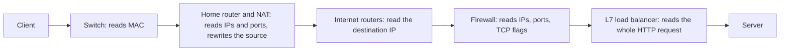

A **middlebox** is any device on the path that is not an endpoint but inspects or changes traffic: NATs, firewalls, load balancers, proxies.  
Middleboxes that peek at higher-layer headers they do not own cause **ossification**: once deployed boxes depend on the exact shape of a protocol, that shape can no longer change.  
This single idea explains why TLS 1.3 disguises itself as TLS 1.2 (H15) and why QUIC encrypts almost all of its own headers (H18).

### Interview angle

"What does L4 vs L7 load balancing mean?"  
An L4 balancer chooses a backend per connection from IPs and ports, without reading the payload, so it is fast and protocol-agnostic but cannot route by URL and balances connections, not requests.  
An L7 balancer terminates the connection, parses HTTP, and can route, retry and balance per request, at the cost of CPU and of being a TLS termination point.

---

## 02.02 Encapsulation: one HTTP request, byte by byte

On the way down the stack, each layer puts its own header in front of the data from the layer above: the HTTP bytes go inside a TCP segment, inside an IP packet, inside an Ethernet frame.  
The receiver removes the headers in reverse order, and because each header names the next protocol, the bytes reach the right program.

### Terms

- **Encapsulation**: each layer treats everything from the layer above as an opaque payload and puts its own header in front. Going down the stack on the sender, headers are added.  
  Going up on the receiver, they are removed (**decapsulation**).

- **Demultiplexing**: on the receiver, choosing which upper-layer protocol, and finally which socket, gets the payload.  
  Every header carries a field naming the next one.

### The picture

```text
Application      [ HTTP request bytes                         ]
Transport        [TCP hdr][ HTTP request bytes                ]                 segment
Internet   [IP hdr][TCP hdr][ HTTP request bytes              ]                 packet
Link [Eth hdr][IP hdr][TCP hdr][ HTTP request bytes           ][FCS]            frame
```

The same picture with the sizes of the request decoded below:

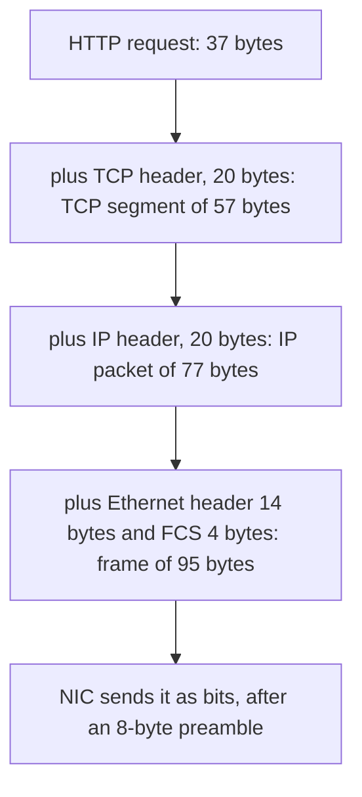

The **FCS (frame check sequence)** is a 4-byte CRC-32 trailer that Ethernet adds to detect corruption on the link.  
The receiving NIC checks and strips it, so capture tools usually do not show it.

### A real frame, decoded

A minimal HTTP/1.1 request (`curl` also adds `User-Agent` and `Accept`) from client `192.0.2.10` port 51514 to server `203.0.113.80` port 80.  
All addresses are from the ranges reserved for documentation (RFC 5737 for IPv4, RFC 7042 for MAC). Checksums are computed correctly.

```text
offset  hex                                               ASCII
000000  00 00 5e 00 53 01 00 00 5e 00 53 02 08 00 45 00   ..^.S...^.S...E.
000010  00 4d 1c 46 40 00 40 06 20 0a c0 00 02 0a cb 00   .M.F@.@. .......
000020  71 50 c9 3a 00 50 6b 8b 45 68 32 7b 23 c7 50 18   qP.:.Pk.Eh2{#.P.
000030  01 f6 95 f0 00 00 47 45 54 20 2f 20 48 54 54 50   ......GET / HTTP
000040  2f 31 2e 31 0d 0a 48 6f 73 74 3a 20 65 78 61 6d   /1.1..Host: exam
000050  70 6c 65 2e 63 6f 6d 0d 0a 0d 0a                  ple.com....
```

91 bytes captured: 14 Ethernet + 20 IPv4 + 20 TCP + 37 HTTP.

**Ethernet II header** (offsets `0x00` to `0x0d`, 14 bytes):

| Offset   | Bytes               | Field           | Value and meaning                                       |
| -------- | ------------------- | --------------- | ------------------------------------------------------- |
| 00 to 05 | `00 00 5e 00 53 01` | Destination MAC | The **default gateway's** MAC, not the server's (02.03) |
| 06 to 0b | `00 00 5e 00 53 02` | Source MAC      | The client's NIC                                        |
| 0c to 0d | `08 00`             | EtherType       | `0x0800` = IPv4 follows (`0x86dd` IPv6, `0x0806` ARP)   |

**IPv4 header** (offsets `0x0e` to `0x21`, 20 bytes):

| Offset   | Bytes         | Field                  | Value and meaning                                                |
| -------- | ------------- | ---------------------- | ---------------------------------------------------------------- |
| 0e       | `45`          | Version, IHL           | Version 4; header length 5 words x 4 = 20 bytes (no options)     |
| 0f       | `00`          | DSCP, ECN              | Priority marking and congestion signal bits; unused here         |
| 10 to 11 | `00 4d`       | Total length           | 77 = 20 IP + 20 TCP + 37 HTTP. The IP packet's own length        |
| 12 to 13 | `1c 46`       | Identification         | Groups fragments of one packet (02.04)                           |
| 14 to 15 | `40 00`       | Flags, fragment offset | DF ("don't fragment") set; offset 0                              |
| 16       | `40`          | TTL                    | 64 hops left (Linux default; 02.05)                              |
| 17       | `06`          | Protocol               | 6 = TCP follows (17 = UDP, 1 = ICMP)                             |
| 18 to 19 | `20 0a`       | Header checksum        | Covers the IP header only                                        |
| 1a to 1d | `c0 00 02 0a` | Source address         | 192.0.2.10                                                       |
| 1e to 21 | `cb 00 71 50` | Destination address    | 203.0.113.80, the real server, unchanged end to end (unless NAT) |

**TCP header** (offsets `0x22` to `0x35`, 20 bytes):

| Offset   | Bytes         | Field                 | Value and meaning                                                 |
| -------- | ------------- | --------------------- | ----------------------------------------------------------------- |
| 22 to 23 | `c9 3a`       | Source port           | 51514, an ephemeral port picked by the client OS                  |
| 24 to 25 | `00 50`       | Destination port      | 80, HTTP                                                          |
| 26 to 29 | `6b 8b 45 68` | Sequence number       | Position of this payload's first byte in the client's byte stream |
| 2a to 2d | `32 7b 23 c7` | Acknowledgment number | Next byte the client expects from the server                      |
| 2e       | `50`          | Data offset           | Header length 5 words x 4 = 20 bytes                              |
| 2f       | `18`          | Flags                 | `0x10` ACK + `0x08` PSH ("deliver to the application now")        |
| 30 to 31 | `01 f6`       | Window                | 502; multiplied by a scale factor agreed in the handshake (H04)   |
| 32 to 33 | `95 f0`       | Checksum              | Covers TCP header, payload and a "pseudo-header" of both IPs      |
| 34 to 35 | `00 00`       | Urgent pointer        | Unused                                                            |

**Payload** (offsets `0x36` to `0x5a`, 37 bytes): the HTTP request from H01, unchanged. TCP and IP never look inside it.

In a real Linux capture the TCP header is usually 32 bytes, not 20, because of the timestamps option (data offset `0x80`). H04 covers options.

### Demultiplexing on the receiver

```
EtherType 0x0800  ->  hand to IPv4
Protocol  6       ->  hand to TCP
(TCP, src IP, src port, dst IP, dst port)  ->  find the one socket for this connection
socket            ->  the program's read() returns the HTTP bytes
```

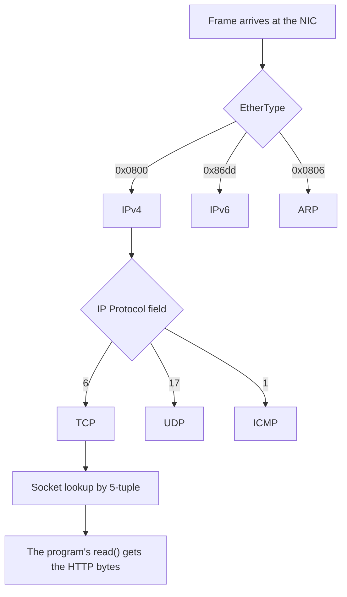

Each header names the next one, much like the type-length-value chains in H01.05.

### Overhead

| Unit                             | Bytes | Notes                                                     |
| -------------------------------- | ----- | --------------------------------------------------------- |
| Preamble + start frame delimiter | 8     | Physical layer; never seen in captures                    |
| Ethernet header                  | 14    | 18 with an 802.1Q VLAN tag                                |
| IPv4 header                      | 20    | Up to 60 with options; IPv6 is a fixed 40                 |
| TCP header                       | 20    | Up to 60; typically 32 with timestamps                    |
| UDP header                       | 8     | Fixed                                                     |
| Ethernet FCS                     | 4     | Trailer                                                   |
| Interframe gap                   | 12    | Mandatory idle time between frames, counted in byte times |

For a full-size segment: 1500-byte IP packet + 14 + 4 + 8 + 12 = 1538 byte times on the wire, of which 1460 are payload (1448 with timestamps).  
Efficiency is about 94 to 95 percent.  
For a 1-byte payload it is under 2 percent, which is why small writes are expensive (Nagle's algorithm, H04).

Ethernet also has a **minimum** frame size of 64 bytes including FCS.  
A bare TCP ACK (54 bytes) is padded with zeros to 60 bytes before the FCS; captures show this as trailing padding.

### Checksums detect accidents, not attackers

The Ethernet CRC, the IP header checksum and the TCP/UDP checksum all detect random corruption.  
None of them uses a key, so anyone who changes a packet can recompute them.  
Integrity against an attacker comes only from cryptography (a MAC, H11, inside TLS, H14 and H15).

Practical trap: modern NICs compute checksums in hardware after the capture point ("checksum offload"), so Wireshark on the sending host often flags outgoing packets as "checksum incorrect".  
That is expected, not a bug.

### Interview angle

"Walk me down the stack for one HTTP request."  

- Application bytes go to the socket;
- TCP adds ports, sequence numbers and a checksum;
- IP adds source and destination addresses, TTL and the protocol number;
- Ethernet adds next-hop MAC addresses and an EtherType.

The receiver strips them in reverse, using EtherType, Protocol and the 5-tuple to demultiplex to the right socket.

---

## 02.03 Addressing: MAC, IP, port; ARP and Neighbor Discovery

Three addresses at three layers.  
A MAC address finds the next device on the local link and is rewritten at every router.  
An IP address names the final destination and stays the same end to end, unless NAT rewrites it.  
A port names the program on that host.  
ARP finds the MAC address that belongs to an IP address on the local link.

### Three addresses, three scopes

| Address | Layer | Size                            | Scope         | Assigned by                                 | Changes along the path?        |
| ------- | ----- | ------------------------------- | ------------- | ------------------------------------------- | ------------------------------ |
| MAC     | L2    | 48 bits                         | One link only | NIC vendor, or randomised by the OS         | Yes, rewritten at every router |
| IP      | L3    | 32 bits (IPv4), 128 bits (IPv6) | End to end    | Network admin, DHCP, IPv6 autoconfiguration | No, except through NAT         |
| Port    | L4    | 16 bits                         | One host      | OS (ephemeral) or the program (`bind`)      | No, except through NAT         |

The rule to remember: **the IP header names the final destination; the Ethernet header names only the next hop.**

### MAC addresses

- 48 bits, written `00:00:5e:00:53:01`. The first 24 bits (the OUI) historically identify the vendor.
- `ff:ff:ff:ff:ff:ff` is broadcast: every host on the link receives it.
- Phones and laptops now randomise MACs per Wi-Fi network for privacy, so a MAC is not a stable device identity.

### IPv4 addresses, subnets and CIDR

- 32 bits, written as four decimal octets: `192.0.2.10`.
- A **subnet** is a block of addresses that share a prefix and sit on one link. **CIDR notation** writes the prefix length after a slash: `192.0.2.0/24` means "the first 24 bits are the network, the last 8 identify the host", so 256 addresses.
- A **default gateway** is the router a host sends traffic to when the destination is outside its own subnet.

Ranges an architect needs to recognise:

| Range            | Meaning                                                                                       |
| ---------------- | --------------------------------------------------------------------------------------------- |
| `10.0.0.0/8`     | Private (RFC 1918); not routed on the internet                                                |
| `172.16.0.0/12`  | Private (RFC 1918)                                                                            |
| `192.168.0.0/16` | Private (RFC 1918)                                                                            |
| `100.64.0.0/10`  | Carrier-grade NAT shared space (RFC 6598); 02.06                                              |
| `127.0.0.0/8`    | Loopback: never leaves the host                                                               |
| `169.254.0.0/16` | Link-local. `169.254.169.254` is the cloud instance metadata service: the classic SSRF target |
| `0.0.0.0`        | "Any local address" when binding a server socket                                              |

### IPv6 addresses

- 128 bits, written as eight groups of four hex digits; one run of zero groups may be written as `::`. Example: `2001:db8::10` (the `2001:db8::/32` prefix is reserved for documentation).

- `::1` is loopback; `fe80::/10` is link-local; `fc00::/7` is unique-local (the IPv6 analogue of private ranges); `2000::/3` is global unicast.

- IPv6 has enough addresses that NAT is not needed, though many networks still deploy firewalls that behave like it.

### Ports

| Range          | Name                       | Notes                                                                  |
| -------------- | -------------------------- | ---------------------------------------------------------------------- |
| 0 to 1023      | Well-known                 | 80 HTTP, 443 HTTPS, 53 DNS, 22 SSH. Binding needs privilege on Linux   |
| 1024 to 49151  | Registered                 | 5432 PostgreSQL, 6379 Redis, 8080 by convention                        |
| 49152 to 65535 | Dynamic / ephemeral (IANA) | Linux actually uses 32768 to 60999 by default for outgoing connections |

A port is not a process and is not "used up" by connections on the server side.  
One listening socket on port 443 can have hundreds of thousands of connected sockets, all with local port 443, told apart by the client's IP and port (02.06).

### Local or remote: the decision every host makes

01. Is the destination IP inside my subnet? Compare prefixes.
02. If yes: find the destination's MAC and send the frame directly to it.
03. If no: find the **default gateway's** MAC and send the frame to the gateway, with the IP destination still set to the final server.

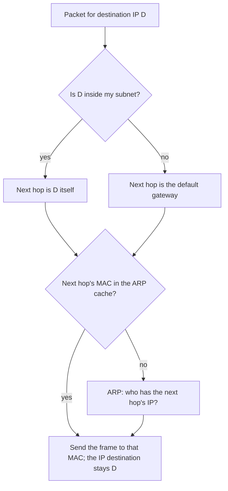

That is why the frame in 02.02 carries the gateway's MAC with the server's IP.  
On Linux, `ip route get 203.0.113.80` prints the decision (`via 192.0.2.1 dev eth0 src 192.0.2.10`).

### ARP (IPv4) and Neighbor Discovery (IPv6)

To send a frame, a host needs the next hop's MAC, but it only knows its IP.  
**ARP (Address Resolution Protocol)** fills the gap:

```
Client -> broadcast:   Who has 192.0.2.1? Tell 192.0.2.10
Gateway -> client:     192.0.2.1 is at 00:00:5e:00:53:01
```

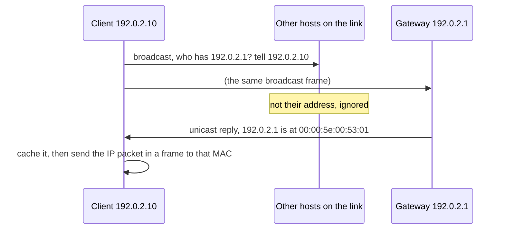

The answer is cached for seconds to minutes (`ip neigh` shows the cache).  
ARP has no authentication: any host on the link can answer, which enables **ARP spoofing**, a man-in-the-middle attack on local networks.  
This is one concrete reason "it's on the internal network" does not justify skipping TLS.

IPv6 replaces ARP with **Neighbor Discovery**, a set of ICMPv6 messages (Neighbor Solicitation and Advertisement sent to a multicast address, plus Router Advertisements that let hosts configure their own addresses).  
Same job, same lack of authentication by default.

### Interview angle

"A packet goes from my laptop to a server three routers away. Which addresses change?"  
The source and destination MAC change on every link; the IP addresses and ports stay the same end to end, unless a NAT rewrites them.

---

## 02.04 MTU, MSS, fragmentation and Path MTU Discovery

The MTU is the largest packet a link can carry (1500 bytes on Ethernet); the MSS is the largest TCP payload that fits inside it (1460).  
A packet too big for some link on the path would have to be split (fragmentation), which everyone avoids, so senders discover the path's MTU instead.  
When the ICMP messages that make that discovery work are blocked, large packets vanish silently: small requests work, TLS handshakes and big downloads hang.

### Terms

- **MTU (maximum transmission unit)**: the largest IP packet, including the IP header, that a link can carry in one frame. Ethernet's is 1500 bytes.
- **Path MTU**: the smallest MTU of all links between two hosts. The largest packet that can cross the whole path without being split.
- **MSS (maximum segment size)**: the largest TCP **payload** a host is willing to receive in one segment. Each side announces it in its SYN (H04). MSS = MTU - IP header - TCP header.
- **Fragmentation**: splitting one IP packet into several smaller ones so that each fits a link's MTU, and reassembling them at the destination.
- **ICMP (Internet Control Message Protocol)**: IP's error and diagnostic protocol, carried inside IP packets. `ping` uses its Echo messages; routers use it to report errors back to senders.

### Common MTUs

| Link or tunnel                                     | MTU              |
| -------------------------------------------------- | ---------------- |
| Ethernet                                           | 1500             |
| Jumbo frames (data centres; AWS inside a VPC)      | 9000 (AWS: 9001) |
| PPPoE (DSL broadband)                              | 1492             |
| VXLAN overlay on a 1500 underlay (Kubernetes CNIs) | 1450             |
| WireGuard default                                  | 1420             |
| IPv6 guaranteed minimum on every link              | 1280             |

Every tunnel (VPN, overlay network, IPsec) adds headers, so the inner MTU is always smaller than the outer one.

### MSS arithmetic

| Path MTU | IP version | IP header | TCP header           | Payload per segment                    |
| -------- | ---------- | --------- | -------------------- | -------------------------------------- |
| 1500     | IPv4       | 20        | 20                   | 1460 (this is the MSS)                 |
| 1500     | IPv4       | 20        | 32 (with timestamps) | 1448 (MSS still 1460; options take 12) |
| 1500     | IPv6       | 40        | 20                   | 1440                                   |
| 1450     | IPv4       | 20        | 20                   | 1410                                   |

### Fragmentation and why everyone avoids it

- **IPv4**: a router may split a packet if its DF (don't fragment) flag is clear.  
  The Identification, MF (more fragments) flag and Fragment Offset fields (02.02) let the destination reassemble the pieces.

- **IPv6**: routers never fragment. Only the sending host may, using a Fragment extension header.

Why fragmentation is avoided:

01. **Loss amplification**: lose any one fragment and the whole packet is lost and must be resent.

02. **Middleboxes cannot see ports**: only the first fragment carries the TCP or UDP header. NATs, firewalls, L4 load balancers and multipath routers cannot classify the rest, and many simply drop fragments.

03. **Reassembly state is an attack surface**: the receiver buffers pieces waiting for the rest, which invites memory exhaustion and historic bugs (overlapping fragments used to crash kernels and evade intrusion detection).

04. **Identification wrap-around**: the 16-bit ID repeats quickly at high packet rates, so fragments of different packets can be mis-assembled (RFC 4963).

So TCP sets DF on every packet and keeps segments under the path MTU, and QUIC does the same for UDP.

### Path MTU Discovery (PMTUD)

01. The sender sends full-size packets with DF set.

02. A router whose next link has a smaller MTU drops the packet and returns an ICMP error carrying that MTU: "Fragmentation Needed" (ICMPv4 type 3 code 4) or "Packet Too Big" (ICMPv6 type 2).

03. The sender lowers its packet size for that destination and resends.

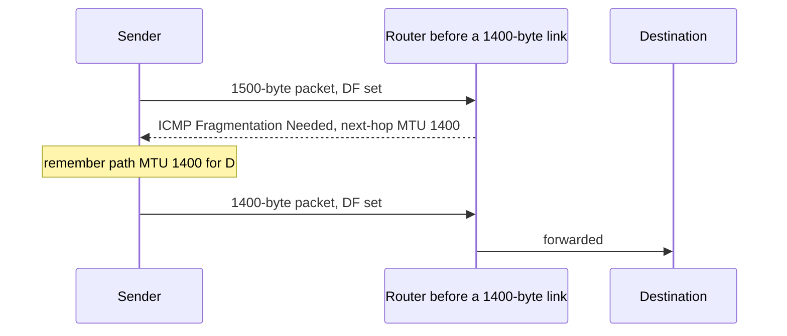

### Failure mode: the PMTUD black hole

Firewalls configured to "block all ICMP" also block the error in step 02.  
The sender never learns, keeps sending full-size packets, and they vanish silently.

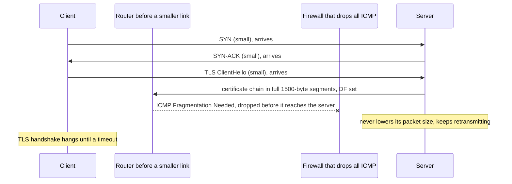

The signature is distinctive and worth memorising:

- The TCP handshake succeeds (SYN packets are tiny).
- Small requests and health checks work.
- Large responses stall, and **TLS handshakes hang right after the ClientHello**, because the server's certificate chain (several KB) is sent in full-size segments.
- It often appears only after traffic starts going through a VPN, an overlay network or a new cloud link.

Fixes, in order of preference:

01. Never block ICMPv4 type 3 or ICMPv6 type 2. Rate-limit them if needed.
02. Set the correct MTU on tunnel and overlay interfaces (in Kubernetes, the CNI's MTU setting).
03. **MSS clamping** on the tunnel router: rewrite the MSS in passing SYNs to fit the tunnel, so TCP never sends too-large segments (`iptables ... -j TCPMSS --clamp-mss-to-pmtu`).
04. **Packetization-layer PMTUD** (RFC 4821, and RFC 8899 for datagram protocols): the sender probes with larger packets and treats their loss, not ICMP, as the signal.  
  Linux enables it for TCP with `net.ipv4.tcp_mtu_probing=1`; QUIC implementations use it natively.

### Forward link: QUIC's 1200 bytes

QUIC requires every path to carry UDP payloads of at least 1200 bytes and pads its first packets to that size.  
The number comes from IPv6's guaranteed 1280-byte MTU minus 40 (IPv6 header) minus 8 (UDP header) = 1232, leaving a margin. H18 picks this up.

### Interview angle

"Users on the corporate VPN say the site loads forever, but ping works."  
Suspect a PMTUD black hole: ping uses small packets, TLS and large responses need full-size ones.  
Test with `ping -M do -s 1472 <host>` (1472 + 8 ICMP + 20 IP = 1500) and smaller sizes to find the real path MTU, then fix with MSS clamping or correct tunnel MTU, and unblock ICMP.

---

## 02.05 Routing and hops: TTL and `traceroute`

Routers forward packets one hop at a time, picking the next hop from the destination IP using the most specific matching route.  
Each hop decrements the packet's TTL; at zero the packet is dropped and an error goes back to the sender.  
`traceroute` sends probes with TTL 1, 2, 3 and so on, so that every router on the path reveals itself.

### Terms

- **Routing table**: a router's (and every host's) list of `prefix -> next hop, interface` entries.
- **Hop**: one router-to-router (or host-to-router) step on the path.
- **Longest-prefix match**: when several entries match a destination, the most specific (longest prefix) wins.

Example table and lookup for `10.1.2.7`:

| Prefix        | Next hop          | Matches 10.1.2.7?      |
| ------------- | ----------------- | ---------------------- |
| `0.0.0.0/0`   | ISP router        | Yes (default)          |
| `10.0.0.0/8`  | VPN tunnel        | Yes                    |
| `10.1.2.0/24` | Directly attached | Yes, longest: **wins** |

### What a router reads, ignores and changes

- **Reads**: the destination IP address (and, for policy routing, sometimes the source).

- **Ignores**: TCP and UDP ports, TLS, HTTP. A plain router does not know they exist.

- **Changes**: the link-layer header (new source and destination MAC for the next link), the TTL (decremented), and the IPv4 header checksum (recomputed because the TTL changed).  
  IPv6 dropped the header checksum so that routers do less work.

### TTL (Time To Live) / Hop Limit

- An 8-bit counter in the IP header. Every router decrements it by one. At zero the router drops the packet and sends an ICMP **Time Exceeded** message back to the source.
- Purpose: if a routing mistake creates a loop, packets die instead of circulating forever.
- Typical starting values: 64 (Linux, macOS), 128 (Windows), 255 (many network devices). IPv6 calls the same field **Hop Limit**.

### `traceroute`: using TTL as a probe

01. Send a probe with TTL 1. The first router decrements it to 0, drops it and replies "Time Exceeded" from its own address.

02. Send TTL 2, 3, and so on. Each probe reveals one more hop.

03. The destination answers differently (port unreachable for UDP probes, echo reply for ICMP, SYN-ACK for TCP probes), which ends the trace.

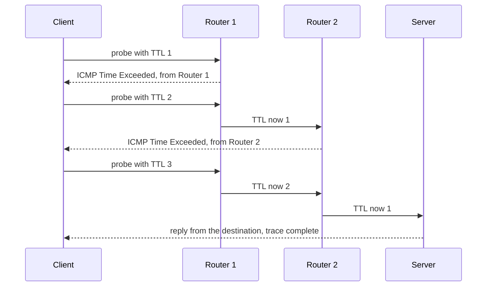

Reading the output correctly:

- `* * *` on a hop means that router did not reply (many rate-limit or ignore ICMP). It does not mean packets are lost there, if later hops respond.

- Routers that balance traffic over several equal paths (ECMP, equal-cost multi-path) hash on the 5-tuple.  
  Classic `traceroute` changes the port per probe, so it can show hops from different paths mixed together.  
  `mtr` and "Paris traceroute" keep the 5-tuple fixed to avoid this.

- `traceroute -T -p 443 <host>` uses TCP SYNs to port 443, which pass through firewalls that drop UDP or ICMP probes.

### Beyond one network

Between organisations, routes are exchanged with **BGP (Border Gateway Protocol)** by autonomous systems (networks under one administration, such as an ISP or a cloud provider).  
One consequence matters for HTTP: **anycast**, where the same IP address is announced from many locations and BGP delivers each user to the nearest one.  
Public DNS resolvers (`1.1.1.1`, `8.8.8.8`) and CDN edges work this way (H03, H20).

### Interview angle

"How does traceroute work?"  
It sends probes with increasing TTL; each router that decrements TTL to zero returns ICMP Time Exceeded, revealing itself.  
Silent hops are usually ICMP filtering, not loss.

---

## 02.06 NAT and the 5-tuple

A connection is identified by its 5-tuple: protocol, source IP, source port, destination IP, destination port.  
NAT lets many private machines share one public IP by rewriting the source IP and port and remembering the mapping.  
Those mappings block unsolicited inbound connections and expire when idle, and a client talking to a single server can run out of source ports.

### Terms

- **5-tuple**: `(protocol, source IP, source port, destination IP, destination port)`. It uniquely identifies one TCP connection or one UDP flow at a given moment.

- **Private vs public address**: private addresses (RFC 1918) are reusable inside any organisation and are not routed on the internet; public addresses are globally unique.

- **NAT (network address translation)**: a device that rewrites addresses in packets crossing it.  
  The common form, **NAPT** (network address and port translation, also called PAT or "masquerade"), also rewrites the source port, so many private hosts share one public IP.

### How NAPT works

```text
Inside:   192.168.1.20:51514  ->  203.0.113.80:443
                  |  NAT rewrites the source, records the mapping
Outside:  198.51.100.7:40001  ->  203.0.113.80:443

Reply:    203.0.113.80:443  ->  198.51.100.7:40001
                  |  NAT looks up 40001, rewrites the destination back
Inside:   203.0.113.80:443  ->  192.168.1.20:51514
```

The same exchange as a sequence:

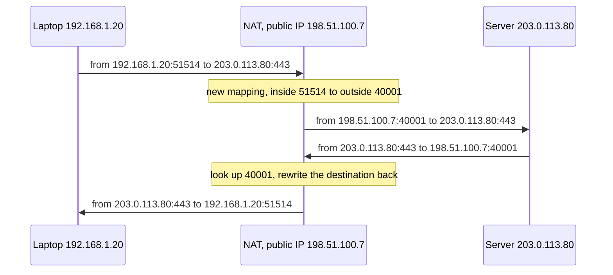

The NAT also recomputes the IP and TCP/UDP checksums, because the TCP and UDP checksums cover a "pseudo-header" that includes both IP addresses.

### What the 5-tuple is used for

| Component                       | Uses the 5-tuple to                                                   |
| ------------------------------- | --------------------------------------------------------------------- |
| Kernel                          | Deliver an arriving segment to the one socket for that connection     |
| NAT and connection tracking     | Key the translation table                                             |
| Stateful firewall               | Allow replies belonging to an established flow                        |
| ECMP routers, L4 load balancers | Hash to pick a path or backend, so one flow always takes the same one |
| Flow logs (e.g. cloud VPC logs) | Record who talked to whom                                             |

### Consequences of NAT that reach HTTP

01. **No unsolicited inbound connections.** A mapping exists only after an inside host sends first.  
  So clients behind NAT cannot be connected to; servers need public addresses or a load balancer in front.  
  It is also why "server push" on the web is always a long-lived connection the client opened (WebSocket, SSE, HTTP/2 streams).

02. **Idle mappings expire.** UDP mappings must last at least 2 minutes by RFC 4787 (5 recommended), but many devices use about 30 seconds.  
  TCP mappings for established connections should last at least 2 hours 4 minutes by RFC 5382, but cloud NATs and load balancers are far shorter (AWS NAT Gateway: 350 seconds idle; Azure Load Balancer: 4 minutes by default).  
  An idle connection then dies silently: the next write gets a reset or simply hangs.  
  Fixes: application keepalives shorter than the smallest timeout on the path (HTTP/2 PING, gRPC keepalive, WebSocket ping, tuned TCP keepalive) and connection-pool idle eviction shorter than that timeout.

03. **NAT rebinding.** After an idle gap, a NAT may give the same inside flow a new outside port. The server sees a new 5-tuple.  
  A TCP connection is identified by its 5-tuple, so it is dead.  
  QUIC identifies connections by a **connection ID** carried in its packets, so it survives rebinding and even a switch from Wi-Fi to cellular (H18).

04. **Many users behind one IP.** Carrier-grade NAT (`100.64.0.0/10`) and corporate NAT put thousands of users behind one public address.  
  IP-based rate limiting and blocking then punishes everyone behind it, and abuse reports need IP **and port and timestamp** to identify a user.

05. **Protocols that put addresses in the payload break** (FTP active mode, SIP) unless the NAT has a protocol-specific helper.  
  HTTP is safe because it does not.

06. **Peer-to-peer needs NAT traversal** (STUN, TURN, ICE, as used by WebRTC). Awareness only.

### NAT rebinding: why TCP dies and QUIC survives

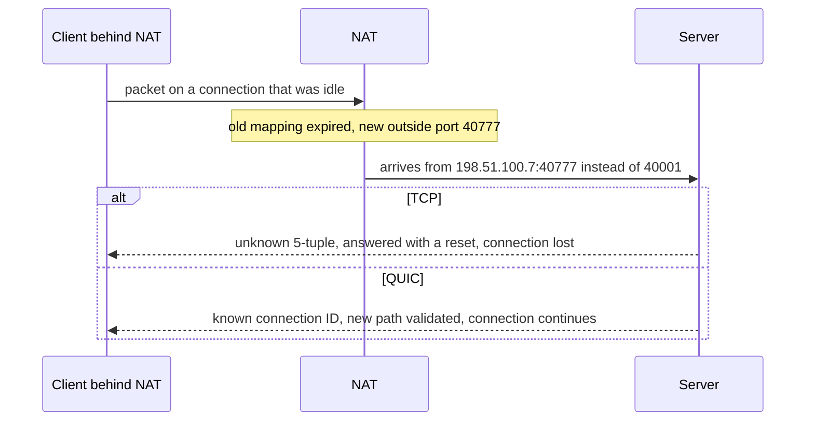

### Ephemeral port exhaustion (client side)

For connections from one client IP to one server IP and port, four of the five tuple elements are fixed.  
Only the source port varies.

- Linux offers 28,232 ephemeral ports by default (32768 to 60999).
- The side that closes a TCP connection first keeps its tuple in `TIME_WAIT` for 60 seconds on Linux (H04 explains why).
- So a client that opens and closes a new connection per request to one destination can sustain about 28,232 / 60, roughly **470 new connections per second**, before `connect()` fails with `EADDRNOTAVAIL` ("Cannot assign requested address"; in Java a `SocketException` subclass with that message).

Fixes, best first:

01. **Reuse connections**: HTTP keep-alive and a connection pool. This removes the problem rather than moving the limit.
02. Spread across more destination IPs or ports (each one is a fresh 28k space), or add source IPs.
03. Widen `net.ipv4.ip_local_port_range`; enable `net.ipv4.tcp_tw_reuse` for outgoing connections.

The same limit applies one level up: a cloud NAT gateway shares its public IPs among all instances behind it, with a per-destination cap (AWS documents 55,000 simultaneous connections to each unique destination per NAT gateway IP).  
Many services calling one third-party API through one NAT hit it together.

### Interview angle

"Why can a server handle a million connections on port 443 but a client cannot open more than about 28k to one server?"  
The server's connections differ by client IP and port, so the tuple space is enormous.  
The client's connections to one destination differ only by the client's source port, a 16-bit field further limited by the ephemeral range and `TIME_WAIT`.

---

## 02.07 TCP vs UDP at a glance

TCP gives a reliable, ordered byte stream after a handshake, at the cost of setup latency and head-of-line blocking.  
UDP sends independent datagrams with no guarantees and almost no overhead.  
Use TCP when every byte must arrive in order; use UDP when late data is useless, when one small question and answer is all you need, or when the application builds its own reliability, as QUIC does.

H04 covers TCP in depth and H18 builds QUIC on UDP. This section fixes the contrast.

### What each promises

| Property              | TCP                                   | UDP                                                   |
| --------------------- | ------------------------------------- | ----------------------------------------------------- |
| Setup                 | Three-way handshake (1 round trip)    | None; first packet carries data                       |
| Delivery              | Reliable: lost data is retransmitted  | Best effort: may be lost                              |
| Order                 | In order                              | May arrive reordered                                  |
| Duplicates            | Removed                               | May be duplicated                                     |
| Message boundaries    | None: a byte stream (H01.05)          | Preserved: one send is one datagram                   |
| Flow control          | Yes (receiver window)                 | No                                                    |
| Congestion control    | Yes                                   | No; the application must behave                       |
| Header                | 20 to 60 bytes                        | 8 bytes                                               |
| Head-of-line blocking | Yes, across the whole connection      | No                                                    |
| Kernel state          | Per connection                        | None (per socket only)                                |
| Typical use           | HTTP/1.1, HTTP/2, TLS, databases, SSH | DNS, QUIC / HTTP/3, voice and video calls, games, NTP |

### The UDP header, all of it

```text
 0                   1                   2                   3
 0 1 2 3 4 5 6 7 8 9 0 1 2 3 4 5 6 7 8 9 0 1 2 3 4 5 6 7 8 9 0 1
+-------------------------------+-------------------------------+
|          Source port          |       Destination port        |
+-------------------------------+-------------------------------+
|            Length             |           Checksum            |
+-------------------------------+-------------------------------+
|                        Payload ...
```

UDP adds only ports (for demultiplexing to a socket) and a checksum on top of IP. Everything else is left to the application.

### Why UDP is the substrate for new transports

A new transport could in theory get its own IP protocol number, as SCTP (protocol 132) did.  
In practice NATs and firewalls drop protocols other than TCP and UDP, and TCP itself is implemented in operating system kernels and middleboxes that update slowly.  
This is ossification (02.01) at the transport layer.  
UDP passes almost everywhere and adds almost nothing, so QUIC builds reliability, ordering, congestion control and encryption on top of it, in user space, where it can be updated with an application release (H18).

The price: some networks block or throttle UDP, so HTTP/3 clients always keep an HTTP/2-over-TCP fallback (H19).

### Choosing between them

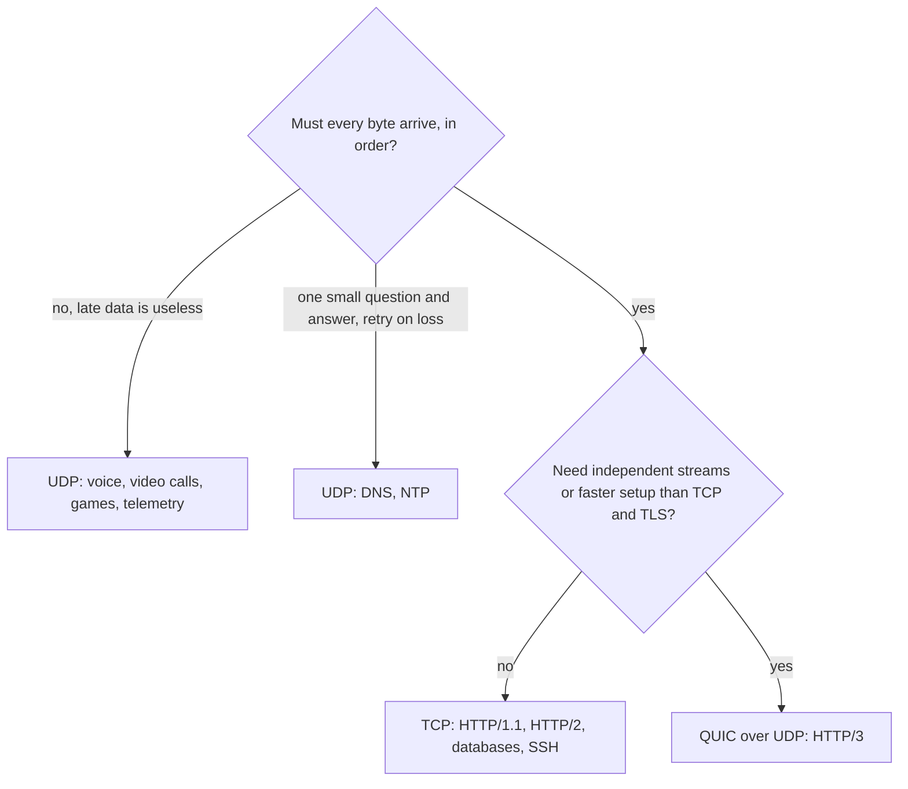

### Interview angle

"Why is DNS on UDP and HTTP on TCP?"  
A typical DNS exchange is one small question and one small answer; a handshake would double its latency, and a lost query can simply be retried.  
HTTP transfers arbitrary amounts of data that must arrive complete and in order.  
HTTP/3 then moved to UDP only because QUIC reimplements TCP's guarantees above it, with better behaviour for multiplexed streams.

---

## 02.08 The story: one packet from a laptop to a server and back

This section ties 02.01 to 02.07 together by following the TCP segment from 02.02 (the `GET /` request) from a laptop at home to a server in a data centre, and the reply back.  
H01.07 followed the header down to the wire; this story follows the packet across the network.

The cast:

| Role             | Addresses                                                                  |
| ---------------- | -------------------------------------------------------------------------- |
| Laptop           | `192.168.1.20/24` on home Wi-Fi, ephemeral port 51514                      |
| Home router      | LAN side `192.168.1.1`; internet side `198.51.100.7`; does routing and NAT |
| ISP and internet | About a dozen routers, owned by several networks                           |
| Server           | `203.0.113.80`, port 80, in a cloud data centre                            |

### The journey at a glance

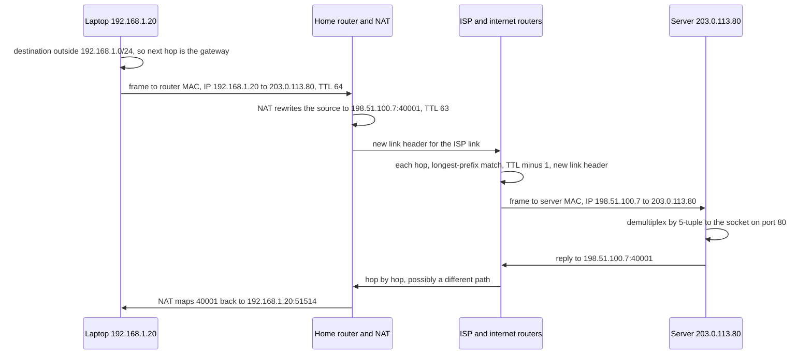

### Chapter 01: the kernel has a segment to send

The laptop's kernel holds a TCP segment: source port 51514, destination port 80, carrying the 37 HTTP bytes.  
TCP's job ends at "deliver this to `203.0.113.80`"; getting it there is IP's job.

### Chapter 02: local or remote?

The laptop's address is `192.168.1.20/24`, so its subnet is `192.168.1.0` to `192.168.1.255`. `203.0.113.80` is outside it, so the next hop is the default gateway, `192.168.1.1` (02.03).

### Chapter 03: find the gateway's MAC

The laptop checks its ARP cache for `192.168.1.1`.  
Usually the answer is there from earlier traffic; if not, it broadcasts an ARP request and waits for the router's reply (02.03).  
Only now can it build a frame.

### Chapter 04: the first frame

| Header | Field           | Value                                  |
| ------ | --------------- | -------------------------------------- |
| Link   | Destination MAC | Home router's LAN MAC (the next hop)   |
| Link   | Source MAC      | Laptop's Wi-Fi MAC                     |
| IP     | Source          | `192.168.1.20`                         |
| IP     | Destination     | `203.0.113.80` (the final destination) |
| IP     | TTL             | 64                                     |
| TCP    | Ports           | 51514 to 80                            |

The Wi-Fi card sends it as radio signals to the router.

### Chapter 05: the home router does three jobs

01. **Routing**: it removes the Wi-Fi link header, reads the destination IP, and finds only its default route (towards the ISP) matching.  
  It decrements TTL to 63.

02. **NAT**: `192.168.1.20` is a private address and cannot appear on the internet.  
  The router rewrites the source to its own public address and a free port, `198.51.100.7:40001`, records the mapping `40001 <-> 192.168.1.20:51514`, and recomputes the IP and TCP checksums (02.06).

03. **New link header**: it builds a frame for the ISP link, with its own WAN MAC as source and the ISP router's MAC as destination.

If the ISP link is PPPoE with a 1492-byte MTU, this packet still fits: TCP agreed on a smaller MSS during the handshake, often because the router rewrote ("clamped") the MSS in the SYN (02.04).  
Nothing is fragmented.

### Chapter 06: across the internet

Each router on the way repeats the same small routine: remove the incoming link header, look up `203.0.113.80` with longest-prefix match, decrement TTL, write a new link header for the outgoing link.  
The path between networks was chosen in advance by BGP (02.05).  
None of these routers reads the ports or the HTTP bytes.

### Chapter 07: arrival

The last router in the cloud provider's network delivers a frame addressed to the server's MAC.  
The server's kernel demultiplexes it (02.02): EtherType `0x0800` to IPv4, Protocol 6 to TCP, then the 5-tuple `(TCP, 198.51.100.7, 40001, 203.0.113.80, 80)` to one socket.  
The HTTP bytes appear in the server program's `read()`.

The server never sees `192.168.1.20`. To it, the client is `198.51.100.7:40001`, which is why logs, rate limits and abuse reports at the server only ever know the NAT's address (02.06).  
If `203.0.113.80` belongs to an L4 load balancer rather than the server itself, the balancer hashes this 5-tuple to pick a backend and forwards the packet to it; the rest is unchanged.

The TTL arrives as, for example, 52: twelve routers decremented it on the way.

### Chapter 08: the reply

The server answers to `198.51.100.7:40001`.  
The return path may use different routers (routing is decided independently in each direction).  
At the home router, the NAT looks up port 40001, rewrites the destination back to `192.168.1.20:51514`, and delivers it over Wi-Fi.

### What changed and what did not, hop by hop

| Link on the path        | Source MAC        | Destination MAC   | Source IP and port   | Destination IP and port | TTL     |
| ----------------------- | ----------------- | ----------------- | -------------------- | ----------------------- | ------- |
| Laptop to home router   | Laptop            | Home router (LAN) | `192.168.1.20:51514` | `203.0.113.80:80`       | 64      |
| Home router to ISP      | Home router (WAN) | ISP router        | `198.51.100.7:40001` | `203.0.113.80:80`       | 63      |
| Each router to the next | That router       | The next router   | `198.51.100.7:40001` | `203.0.113.80:80`       | minus 1 |
| Last router to server   | Last router       | Server            | `198.51.100.7:40001` | `203.0.113.80:80`       | e.g. 52 |

The rule from 02.03 in one table: MACs change on every link; IPs and ports change only at the NAT; TTL drops by one per router.

### What can go wrong, chapter by chapter

| Chapter | Failure                                                         | What the user sees                                              |
| ------- | --------------------------------------------------------------- | --------------------------------------------------------------- |
| 02      | Wrong subnet mask or default gateway                            | "Network unreachable", or only local hosts reachable            |
| 03      | ARP spoofing by another host on the Wi-Fi                       | Nothing visible; traffic silently passes through the attacker   |
| 05      | NAT mapping expired on an idle connection                       | Next request on a pooled connection fails with a reset or hangs |
| 05, 06  | Smaller MTU on the path with ICMP blocked                       | Small requests work, TLS handshakes and downloads hang          |
| 06      | Routing loop                                                    | TTL reaches zero; `traceroute` shows the same routers repeating |
| 07      | Server rate-limits by IP while many users share one NAT address | Innocent users blocked together                                 |

---

## 02.09 Labs: what each one shows and how to run it

| Lab | Topic                                           | Covers              | Needs                        |
| --- | ----------------------------------------------- | ------------------- | ---------------------------- |
| 00  | Inspect your own machine's addresses and routes | 02.03, 02.04, 02.06 | Linux shell                  |
| 01  | Capture one HTTP request and label every layer  | 02.02, 02.03        | Linux shell, root, Wireshark |
| 02  | Path MTU and `traceroute`                       | 02.04, 02.05        | Linux shell, internet access |
| 03  | The 5-tuple from code                           | 02.06               | Java or Rust                 |
| 04  | Message boundaries: TCP vs UDP                  | 02.07, H01.05       | Java or Rust                 |
| 05  | `TIME_WAIT` and who closes first                | 02.06               | Linux shell, Python 3, curl  |

### Setup, once

On Ubuntu or Debian (Windows: inside WSL):

```
sudo apt install iproute2 tcpdump tshark curl iputils-tracepath iputils-ping traceroute mtr-tiny python3
```

Wireshark (the graphical version of `tshark`) is optional; `tshark` prints the same decoding as text.  
On macOS, `tcpdump`, `traceroute` and `ping` are built in; `ip` and `ss` are Linux tools (use `ifconfig`, `netstat -rn`, `arp -a` and `netstat -an` instead).

Folder layout:

```text
h02/
  java/
    FiveTuple.java
    Boundaries.java
  rust/                      <- cargo new rust (no extra crates needed)
    src/bin/five_tuple.rs
    src/bin/boundaries.rs
```

Run Java files with `java FiveTuple.java` (single-file source mode, as in H01).  
For Rust: `cargo new rust`, `cd rust`, `rm src/main.rs`, `mkdir -p src/bin`, save the files into `src/bin/`, then `cargo run --bin five_tuple`.

All programs below were run on JDK 21 and Rust 1.97; the outputs shown are real, except where a value depends on your machine (ports, addresses), which is noted.

### Lab 00: inspect your own machine

```text
ip addr                          # addresses, prefix lengths, MTU per interface
ip route                         # routing table; "default via X" is the gateway
ip route get 1.1.1.1             # the local-or-remote decision for one destination
ip neigh                         # ARP / Neighbor Discovery cache
ss -tn                           # established TCP connections as 5-tuples
cat /proc/sys/net/ipv4/ip_local_port_range   # ephemeral ports, usually 32768 60999
```

What to look for:

01. In `ip addr`, find your main interface, its address with prefix (for example `192.168.1.20/24`) and `mtu 1500`.
02. In `ip route get 1.1.1.1`, the output `via 192.168.1.1 dev wlan0 src 192.168.1.20` says: remote destination, send to the gateway, from this interface and address.
03. In `ip neigh`, find the gateway's IP and its MAC (`lladdr`). That MAC is what your frames carry as the destination for every internet-bound packet.
04. In `ss -tn`, every line is a 5-tuple (protocol TCP implied): `Local Address:Port` and `Peer Address:Port`.

### Lab 01: capture one plain HTTP request and label every layer

Goal: see the frame from 02.02 on your own machine.

```text
# terminal 1: capture on the interface from Lab 00 (not "any", see traps)
sudo tcpdump -i wlan0 -nn -s 0 -w http.pcap 'tcp port 80'

# terminal 2
curl --http1.1 http://example.com/ -o /dev/null

# terminal 1: stop with Ctrl-C, then decode as text
tshark -r http.pcap -V -Y 'http.request' | less
```

Or open `http.pcap` in Wireshark and select the packet whose payload starts `GET /`.  
Label, using the bottom (bytes) pane:

01. Destination and source MAC. The destination should equal your gateway's MAC from `ip neigh`.
02. EtherType `08 00`.
03. IP total length, TTL (64 on Linux), protocol `06`, source and destination addresses.
04. TCP ports, flags (`PSH, ACK`) and data offset (expect 32 bytes because of the timestamps option).
05. The first HTTP byte, `47` (`G`).

Then look at the server's reply packets: their TTL started at 64, 128 or 255.  
Subtract the received value from the nearest of those to estimate the number of hops.

Traps:

- `-i any` on Linux replaces the Ethernet header with a "Linux cooked capture" pseudo-header, so there are no MAC addresses. Use a real interface.

- Outgoing packets may show "checksum incorrect": checksum offload (02.02). Expected.

- `example.com` may redirect or change over time; any plain-HTTP site works.

### Lab 02: path MTU and `traceroute`

```text
tracepath example.com                    # hops, plus "pmtu 1500" when the path MTU is found
ping -c 2 -M do -s 1472 example.com      # 1472 + 8 ICMP + 20 IP = 1500 bytes, DF set: should pass
ping -c 2 -M do -s 1473 example.com      # 1501 bytes: "message too long, mtu=1500" from your own kernel
traceroute -T -p 80 example.com          # TCP SYN probes; passes firewalls that drop UDP and ICMP
mtr -rwc 10 example.com                  # traceroute and ping combined, with loss per hop
```

Expected: the 1472 ping passes on a normal 1500-byte path.  
On a VPN, PPPoE or overlay network, reduce `-s` until it passes; that size plus 28 is your path MTU.  
In `traceroute` output, `* * *` on a middle hop with responses after it is ICMP filtering, not loss (02.05).  
Some networks block ping entirely; then rely on `tracepath` and `traceroute -T`.

### Lab 03: the 5-tuple from code

Goal: see that every connection has its own source port while the destination stays fixed.  
With no arguments the program starts a local server and connects to it three times, so it runs offline; with a host and port it connects there instead.

Java, `FiveTuple.java`:

```java
import java.net.InetAddress;
import java.net.NetworkInterface;
import java.net.ServerSocket;
import java.net.Socket;

public final class FiveTuple {

    public static void main(String[] args) throws Exception {
        if (args.length == 2) {                       // e.g. java FiveTuple.java example.com 80
            show(new Socket(args[0], Integer.parseInt(args[1])));
            return;
        }
        // No arguments: a local server, three client connections to it
        try (var server = new ServerSocket(0, 50, InetAddress.getLoopbackAddress())) {
            for (int i = 0; i < 3; i++) {
                show(new Socket(InetAddress.getLoopbackAddress(), server.getLocalPort()));
                server.accept().close();
            }
        }
    }

    static void show(Socket socket) throws Exception {
        try (socket) {
            var nif = NetworkInterface.getByInetAddress(socket.getLocalAddress());
            System.out.printf("TCP  local %-22s remote %-22s MTU %d%n",
                    socket.getLocalSocketAddress(), socket.getRemoteSocketAddress(),
                    nif == null ? -1 : nif.getMTU());
        }
    }
}
```

Rust, `src/bin/five_tuple.rs` (the standard library has no MTU API; on Linux read `/sys/class/net/<interface>/mtu`):

```rust
use std::net::{TcpListener, TcpStream};

fn main() -> std::io::Result<()> {
    let args: Vec<String> = std::env::args().collect();
    if args.len() == 3 {
        // e.g. cargo run --bin five_tuple -- example.com 80
        let s = TcpStream::connect(format!("{}:{}", args[1], args[2]))?;
        println!("TCP  local {:<22} remote {}", s.local_addr()?, s.peer_addr()?);
        return Ok(());
    }
    // No arguments: a local server, three client connections to it
    let listener = TcpListener::bind("127.0.0.1:0")?;
    for _ in 0..3 {
        let s = TcpStream::connect(listener.local_addr()?)?;
        listener.accept()?;
        println!("TCP  local {:<22} remote {}", s.local_addr()?, s.peer_addr()?);
    }
    Ok(())
}
```

Run: `java FiveTuple.java` or `cargo run --bin five_tuple`. Expected output shape (port numbers differ on every run):

```text
TCP  local /127.0.0.1:47952       remote localhost/127.0.0.1:35979 MTU 65536
TCP  local /127.0.0.1:47956       remote localhost/127.0.0.1:35979 MTU 65536
TCP  local /127.0.0.1:47958       remote localhost/127.0.0.1:35979 MTU 65536
```

Read it as 5-tuples: protocol TCP, destination `127.0.0.1:35979` fixed, source port new for each connection, picked from the ephemeral range.  
Loopback's MTU is 65536, not 1500, because loopback never touches a physical link.  
Run `java FiveTuple.java example.com 80` to see your real interface's address and MTU.

### Lab 04: message boundaries, TCP vs UDP

Goal: prove H01.05's claim that TCP has no message boundaries.  
Three sends of `a`, `bb`, `ccc`: UDP delivers three datagrams; TCP delivers one byte stream that a single read typically returns as `abbccc`.

Java, `Boundaries.java`:

```java
import java.io.OutputStream;
import java.net.*;
import java.nio.charset.StandardCharsets;
import java.util.List;

public final class Boundaries {
    public static void main(String[] args) throws Exception {
        var msgs = List.of("a", "bb", "ccc");

        // UDP: one send = one datagram = one receive
        try (var rx = new DatagramSocket(0, InetAddress.getLoopbackAddress());
             var tx = new DatagramSocket()) {
            for (String m : msgs) {
                byte[] b = m.getBytes(StandardCharsets.US_ASCII);
                tx.send(new DatagramPacket(b, b.length, rx.getLocalSocketAddress()));
            }
            byte[] buf = new byte[1500];
            for (int i = 0; i < msgs.size(); i++) {
                var p = new DatagramPacket(buf, buf.length);
                rx.receive(p);
                System.out.println("UDP " + new String(p.getData(), 0, p.getLength(), StandardCharsets.US_ASCII));
            }
        }

        // TCP: three writes, the receiver sees only bytes
        try (var server = new ServerSocket(0, 50, InetAddress.getLoopbackAddress());
             var client = new Socket(InetAddress.getLoopbackAddress(), server.getLocalPort());
             var conn = server.accept()) {
            OutputStream out = client.getOutputStream();
            for (String m : msgs) {
                out.write(m.getBytes(StandardCharsets.US_ASCII));
            }
            Thread.sleep(50);                                   // let all bytes arrive
            byte[] buf = new byte[64];
            int n = conn.getInputStream().read(buf);
            System.out.println("TCP " + new String(buf, 0, n, StandardCharsets.US_ASCII));   // typically abbccc
        }
    }
}
```

Rust, `src/bin/boundaries.rs`:

```rust
use std::io::{Read, Write};
use std::net::{TcpListener, TcpStream, UdpSocket};
use std::{thread, time::Duration};

fn main() -> std::io::Result<()> {
    let msgs: [&[u8]; 3] = [b"a", b"bb", b"ccc"];

    // UDP
    let rx = UdpSocket::bind("127.0.0.1:0")?;
    let tx = UdpSocket::bind("127.0.0.1:0")?;
    for m in msgs {
        tx.send_to(m, rx.local_addr()?)?;
    }
    let mut buf = [0u8; 1500];
    for _ in 0..msgs.len() {
        let (n, _) = rx.recv_from(&mut buf)?;
        println!("UDP {}", String::from_utf8_lossy(&buf[..n]));
    }

    // TCP
    let listener = TcpListener::bind("127.0.0.1:0")?;
    let mut client = TcpStream::connect(listener.local_addr()?)?;
    let (mut conn, _) = listener.accept()?;
    for m in msgs {
        client.write_all(m)?;
    }
    thread::sleep(Duration::from_millis(50));
    let n = conn.read(&mut buf)?;
    println!("TCP {}", String::from_utf8_lossy(&buf[..n]));   // typically abbccc
    Ok(())
}
```

Run: `java Boundaries.java` or `cargo run --bin boundaries`. Expected output (both):

```
UDP a
UDP bb
UDP ccc
TCP abbccc
```

"Typically" matters: TCP may also return `a` then `bbccc`, depending on timing.  
Correct code never relies on either outcome; it frames its messages (H01.08, Lab 03).

Try this: remove the `sleep`.  
The TCP line may now print only `a`, because `read` returns as soon as any bytes are available.

### Lab 05: `TIME_WAIT` and who closes first

Goal: see the state that causes ephemeral port exhaustion (02.06), and see that it sits on whichever side closes the connection first.

```text
# terminal 1: a tiny HTTP server on port 8000
python3 -m http.server 8000 --bind 127.0.0.1

# terminal 2: 200 requests, each on a new connection
for i in $(seq 1 200); do curl -s -o /dev/null http://127.0.0.1:8000/; done

# count TIME_WAIT sockets on each side
ss -tan state time-wait '( sport = :8000 )' | tail -n +2 | wc -l    # server side
ss -tan state time-wait '( dport = :8000 )' | tail -n +2 | wc -l    # client side
```

Expected: about 200 on the **server** side and almost none on the client side.  
Python's simple server speaks HTTP/1.0 and closes each connection after the response, so the server closes first and holds `TIME_WAIT`; curl's ports are free immediately.  
Wait 60 seconds and run the counts again: they drop to zero as `TIME_WAIT` expires.

The lesson for Exercise 03: in a service that opens a connection per request and closes it after reading the response, the **client** closes first, so the client's ephemeral ports are the ones stuck in `TIME_WAIT`.

---

## 02.10 Exercises

### Exercise 01: decode a frame

The client `192.0.2.10/24` (gateway `192.0.2.1`, MAC `00:00:5e:00:53:01`) sends this frame:

```text
offset  hex                                               ASCII
000000  00 00 5e 00 53 01 00 00 5e 00 53 02 08 00 45 00   ..^.S...^.S...E.
000010  00 39 0f 2a 40 00 40 11 3f 17 c0 00 02 0a c6 33   .9.*@.@.?......3
000020  64 35 cf 09 00 35 00 25 c8 b6 ab cd 01 00 00 01   d5...5.%........
000030  00 00 00 00 00 00 07 65 78 61 6d 70 6c 65 03 63   .......example.c
000040  6f 6d 00 00 01 00 01                              om.....
```

01. Which network-layer protocol and which transport protocol does it carry? Name the bytes that tell you.
02. Give the source and destination IP, source and destination port, TTL and the DF flag.
03. How long is the IP packet, the transport header and the transport payload? Check that the numbers agree.
04. Why is the destination MAC the gateway's? What application protocol is this likely to be, and why?

### Exercise 02: an overlay network that half works

A Kubernetes cluster runs on nodes with a 1500-byte MTU.  
The network plugin uses a VXLAN overlay, which adds 50 bytes of headers to every pod packet.

01. What should the MTU of each pod's interface be?
02. What MSS will pod-to-pod IPv4 TCP connections use, and what is the actual payload per segment with TCP timestamps on?
03. Someone sets the pod interface MTU to 1500 by mistake, and the node firewall drops all ICMP. List what still works, what breaks, and explain each with the mechanism from 02.04.
04. Give two fixes, and say which you prefer for production.

### Exercise 03: "Cannot assign requested address"

A Java service calls `https://payments.internal` (one virtual IP, port 443) at 1,000 requests per second.  
Each request opens a new TCP connection and closes it after the response.  
Within minutes, calls fail with "Cannot assign requested address".

01. Explain the failure with 5-tuple arithmetic. Which side holds the connections in `TIME_WAIT`, and for how long?
02. At what request rate would the problem begin with Linux defaults?
03. Rank three fixes, and explain why the best one removes the problem rather than raising the limit.
04. The team adds a second service that calls the same payment provider through the same cloud NAT gateway. What new limit can they hit, and where?

---

## 02.11 Solutions

### Solution 01: decode a frame

The frame, split by layer:

```text
Ethernet  00 00 5e 00 53 01 | 00 00 5e 00 53 02 | 08 00
IPv4      45 00 00 39 0f 2a 40 00 40 11 3f 17 c0 00 02 0a c6 33 64 35
UDP       cf 09 00 35 00 25 c8 b6
Payload   ab cd 01 00 00 01 00 00 00 00 00 00 07 65 78 61 6d 70 6c 65 03 63 6f 6d 00 00 01 00 01
```

01. **IPv4 over Ethernet, carrying UDP.** EtherType `08 00` (offset `0x0c`) means IPv4.  
  The IP Protocol byte at offset `0x17` is `11` hex = 17, which means UDP.

02. Header fields:

    | Field            | Bytes         | Value                     |
    | ---------------- | ------------- | ------------------------- |
    | Source IP        | `c0 00 02 0a` | `192.0.2.10`              |
    | Destination IP   | `c6 33 64 35` | `198.51.100.53`           |
    | Source port      | `cf 09`       | 53001 (ephemeral)         |
    | Destination port | `00 35`       | 53                        |
    | TTL              | `40`          | 64                        |
    | Flags            | `40 00`       | DF set, fragment offset 0 |

03. Lengths, and the check:

    | Item             | Source of the number          | Bytes |
    | ---------------- | ----------------------------- | ----- |
    | IP packet        | Total length `00 39`          | 57    |
    | IP header        | IHL nibble `5` x 4            | 20    |
    | UDP header       | Fixed                         | 8     |
    | UDP length field | `00 25` (header plus payload) | 37    |
    | UDP payload      | 37 - 8                        | 29    |
    | Captured frame   | 14 Ethernet + 57 IP           | 71    |

    20 + 37 = 57, matching the IP total length, and the dump is 71 bytes (`0x47`), matching 14 + 57.

04. **Why the gateway's MAC**: the client is `192.0.2.10/24`, so its subnet is `192.0.2.0` to `192.0.2.255`.  
  `198.51.100.53` is outside it, so the frame goes to the default gateway, and the destination MAC `00:00:5e:00:53:01` is the gateway's (02.03).  
  The IP destination is still the final server.

    **Which application**: a DNS query. Evidence: destination port 53; the payload has DNS's shape, a 2-byte ID `ab cd`, flags `01 00` (recursion desired), one question, then the name `example.com` in DNS label form (`07` + "example" + `03` + "com" + `00`, a length-prefixed encoding from H01.05), type `00 01` (A record, an IPv4 address) and class `00 01` (Internet). H03 decodes DNS fully.

### Solution 02: an overlay network that half works

01. **Pod MTU = 1450.** The underlay carries 1500-byte packets; VXLAN adds 50 bytes; 1500 - 50 = 1450.
02. **MSS = 1410** (1450 - 20 IPv4 - 20 TCP). With TCP timestamps, the MSS announced in the SYN is still 1410, but each full segment carries 1398 bytes of payload because 12 bytes of every header go to the option.
03. With the pod MTU wrongly at 1500 and ICMP dropped:

    - **What works**: DNS lookups, TCP handshakes, health checks, `ping` with default sizes, and any request and response small enough to fit in packets of up to 1450 bytes. All of these use small packets.

    - **What breaks**: anything that fills a segment. The pod's TCP believes the MTU is 1500 and sends 1500-byte packets with DF set; after encapsulation they are 1550 bytes, larger than the 1500-byte underlay. They are dropped, and the ICMP "Fragmentation Needed" that would tell the sender to shrink is dropped by the firewall: a PMTUD black hole (02.04). Large API responses, file uploads and downloads hang, and TLS handshakes stall after the ClientHello because the server's certificate chain needs full-size segments.

    - **The tell**: failures depend on payload size, not on the service. Requests are usually small and responses large, so "the request reaches the server, the client never gets the response" is the common report. Large UDP datagrams are also lost.

04. Fixes:

    | Fix                                                                                     | Covers                     | Notes                                                                    |
    | --------------------------------------------------------------------------------------- | -------------------------- | ------------------------------------------------------------------------ |
    | Set the pod MTU correctly in the network plugin configuration                           | TCP and UDP, all workloads | **Preferred.** Fixes the cause. Most plugins can detect it automatically |
    | Allow ICMP type 3 code 4 (and ICMPv6 type 2) through firewalls                          | Anything using PMTUD       | Needed regardless, so future MTU changes fail safe                       |
    | MSS clamping on the encapsulating node                                                  | TCP only                   | Good safety net; does nothing for UDP or QUIC                            |
    | Jumbo-frame underlay (for example 9001 on AWS), or native routing without encapsulation | Removes the squeeze        | Platform-level choice; overlay MTU then has ample headroom               |

    For production: correct MTU in the plugin, ICMP allowed, and packetization-layer probing enabled (`net.ipv4.tcp_mtu_probing=1`) as a safety net.

### Solution 03: "Cannot assign requested address"

01. **The arithmetic.** Every call is a new connection with the tuple `(TCP, client IP, ?, VIP, 443)`.  
  Four elements are fixed; only the client's source port varies. Linux has 28,232 ephemeral ports (32768 to 60999).  
  The client closes each connection after reading the response, so the **client** closes first and keeps each tuple in `TIME_WAIT` for 60 seconds (Lab 05 shows that the side that closes first holds it).  
  At 1,000 new connections per second, all 28,232 ports are in `TIME_WAIT` after about 28 seconds; `connect()` then fails with `EADDRNOTAVAIL`, "Cannot assign requested address".

02. **Threshold**: about 28,232 / 60, roughly **470 new connections per second** to one destination with Linux defaults. Below that, ports are freed as fast as they are used.

    (Recent Linux kernels reuse `TIME_WAIT` ports for outgoing connections to loopback by default, `tcp_tw_reuse = 2`, which is why a laptop test against `localhost` may not reproduce it.)

03. Fixes, best first:

    | Rank | Fix                                                                                            | Effect                                                                            |
    | ---- | ---------------------------------------------------------------------------------------------- | --------------------------------------------------------------------------------- |
    | 01   | Reuse connections: HTTP keep-alive with a connection pool                                      | Removes the problem                                                               |
    | 02   | `net.ipv4.tcp_tw_reuse = 1` for outgoing connections (safe with TCP timestamps)                | Lets new connections take over `TIME_WAIT` tuples                                 |
    | 03   | Widen `ip_local_port_range` (for example 1024 to 65535), or add destination VIPs or source IPs | Raises the ceiling (about 1,070 per second per destination with the widest range) |

    Why pooling removes the problem rather than raising the limit: the number of connections needed is set by concurrency, not by request rate.  
    By Little's law (concurrent requests = arrival rate x time each request takes), 1,000 requests per second at 20 ms each need only about **20** connections in flight.  
    A pool of 20 to 50 long-lived connections uses 20 to 50 tuples forever, instead of 1,000 new tuples per second.  
    It also removes a TCP and TLS handshake from every call (H04, H16), which usually saves more latency and CPU than anything else on this list.

    In Java: `java.net.http.HttpClient` pools connections by default as long as one client instance is reused and each response body is fully read; Apache HttpClient needs a `PoolingHttpClientConnectionManager`.  
    Common ways to defeat pooling by accident: creating a new client per request, not consuming or closing response bodies, or sending `Connection: close`.

04. **The NAT gateway limit.** Both services leave through the same cloud NAT gateway, whose public IP is the source for all their connections to the payment provider.  
  Now the tuple `(TCP, NAT public IP, ?, provider IP, 443)` is shared by every instance behind the NAT,  
  and the NAT gateway itself caps concurrent connections per unique destination (AWS documents 55,000 per NAT gateway IP address). Without pooling, mappings for closed connections linger,  
  and the gateway starts refusing new ones; on AWS this shows up as the `ErrorPortAllocation` metric rising and as connection timeouts in both services, even though neither instance has exhausted its own ports.  
  Fixes: connection pooling in both services (again the real fix), additional public IPs on the NAT gateway, or private connectivity to the provider that bypasses the NAT.

---

## 02.12 Takeaways

01. The internet runs the TCP/IP stack; engineers name layers with OSI numbers. "L4" means IPs and ports, "L7" means HTTP.
02. Each layer adds a header in front of the layer above (encapsulation). Each header names the next protocol (EtherType, IP Protocol, port), which is how the receiver demultiplexes to a socket.
03. The IP header names the final destination; the link header names only the next hop. MACs change at every router, IPs and ports do not, except through NAT.
04. Checksums catch accidents, not attackers. Integrity needs cryptography.
05. MTU is the largest IP packet per link; MSS is the largest TCP payload. Fragmentation is avoided; PMTUD finds the path MTU, and blocked ICMP turns it into a black hole whose signature is "handshake OK, big transfers and TLS hang".
06. Routers read the destination IP, rewrite the link header and decrement TTL. `traceroute` uses TTL expiry to reveal hops.
07. The 5-tuple identifies a connection. NAT rewrites it, expires idle mappings, and rebinds ports; TCP cannot survive a changed tuple, QUIC can.
08. A client to one destination is limited by ephemeral ports and `TIME_WAIT`; connection reuse is the real fix.
09. TCP gives a reliable ordered byte stream at the cost of handshakes and head-of-line blocking. UDP gives datagrams and nothing else, which is exactly why QUIC is built on it.
10. One packet's trip: local-or-remote decision, ARP for the gateway, NAT at the edge, a new link header and TTL minus one at every router, demultiplexing by 5-tuple at the server, and the NAT mapping reversed on the way back.

---
