<!-- markdownlint-disable MD001 -->
<!-- markdownlint-disable MD024 -->
<!-- markdownlint-disable MD025 -->
<!-- markdownlint-disable MD026 -->
<!-- markdownlint-disable MD029 -->
<!-- markdownlint-disable MD033 -->
<!-- markdownlint-disable MD036 -->
<!-- markdownlint-disable MD040 -->
<!-- markdownlint-disable MD056 -->
<!-- markdownlint-disable MD060 -->

# H03. DNS

---

## Contents

| #     | Sub-topic                                                               | Tag  |
| ----- | ----------------------------------------------------------------------- | ---- |
| 03.01 | The problem: names, the namespace tree, zones and delegation            | CORE |
| 03.02 | The resolution path: stub, recursive resolver, root, TLD, authoritative | CORE |
| 03.03 | Record types                                                            | CORE |
| 03.04 | TTL and caching at every layer                                          | CORE |
| 03.05 | DNS on the wire: message format, UDP, TCP, EDNS(0)                      | DEEP |
| 03.06 | Trust and privacy: spoofing, cache poisoning, DNSSEC, DoT, DoH          | DEEP |
| 03.07 | DNS in system design                                                    | CORE |
| 03.08 | The story: the first lookup of `api.shop.example`                       | CORE |
| 03.09 | Labs: what each one shows and how to run it                             | CORE |
| 03.10 | Exercises                                                               |      |
| 03.11 | Solutions                                                               |      |
| 03.12 | Takeaways                                                               |      |

Terms used throughout:

- **Domain name**: a name made of **labels** separated by dots, such as `api.shop.example`.  
  Each label is at most 63 bytes; the whole name at most 255 bytes. Comparison ignores ASCII case.

- **FQDN (fully qualified domain name)**: a name written all the way to the root, formally with a trailing dot: `api.shop.example.`.  
  Without the dot, some software treats the name as relative and appends local suffixes (03.07 shows why that matters).

- **Query** and **response**: DNS is a question-and-answer protocol.  
  A client sends one question ("what is the IPv4 address of `api.shop.example`?") and gets one response.

- **Resource record (RR)**: one piece of DNS data: a name, a type (such as `A` for an IPv4 address), a lifetime, and the data itself. 03.03 lists the types.

- **Resolver**: software that finds answers. **Server**: software that holds or relays them. 03.02 separates the four roles precisely.

The names `shop.example` and `api.shop.example` are used throughout.  
The `.example` top-level domain is reserved for documentation (RFC 2606) and does not exist on the real internet; the stories pretend it does.  
Labs use real names where they need the real internet.

---

## 03.01 The problem: names, the namespace tree, zones and delegation

Routers need IP addresses; humans and configuration files need stable names.  
DNS is a distributed, hierarchical database that maps names to data (mostly addresses).  
The namespace is a tree read from right to left, and responsibility for parts of the tree is handed down from parent to child through **delegation**, so no single organisation has to know every name.

### Why names at all

01. **Addresses change**: a service moves to a new data centre, a load balancer is replaced, a cloud instance restarts with a new IP. A name stays the same.

02. **One address, many names**: a single load balancer IP serves `shop.example`, `api.shop.example` and `img.shop.example`.  
  HTTP tells them apart with the `Host` header (H07) and TLS with SNI (H15), but first DNS must send all three to the same address.

03. **One name, many addresses**: a global service returns different addresses to different users (03.07).

Before DNS (1983, RFC 882/883; current core RFC 1034/1035 from 1987), every host on the ARPANET downloaded one central file, `HOSTS.TXT`.  
Its descendant, `/etc/hosts`, still exists and is still consulted first on most systems (03.02).

### The namespace tree

Names are read from right to left, from the most general label to the most specific.  
The invisible rightmost label is the **root**, written as a single dot.

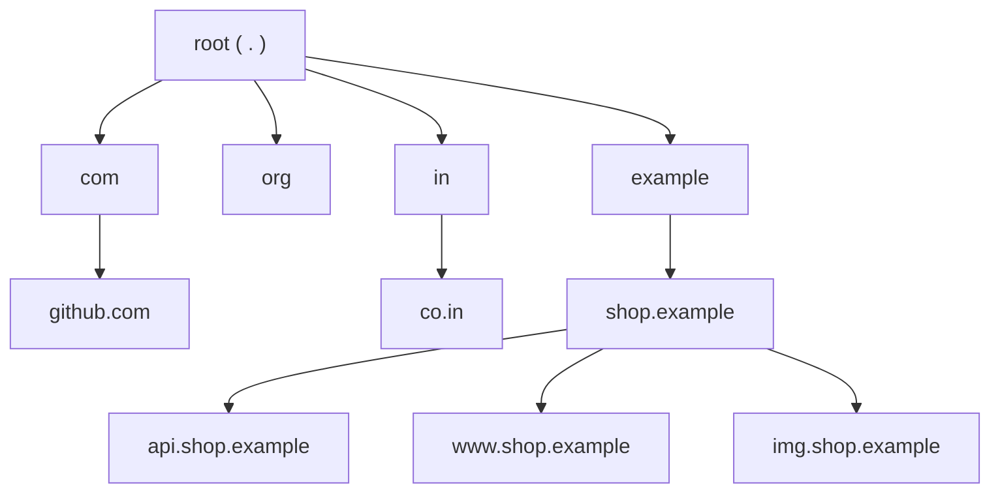

- **TLD (top-level domain)**: a child of the root: generic (`com`, `org`, `dev`) or country-code (`in`, `uk`, `de`).

- **Domain**: any node plus everything below it. `shop.example` as a domain includes `api.shop.example`.

- **Subdomain**: a domain below another. `api.shop.example` is a subdomain of `shop.example`.

### Zones and delegation

A **zone** is the part of the tree that one set of servers is responsible for.  
A domain and a zone are often the same, but not always: the owner of `shop.example` may run `api.shop.example` in the same zone, or hand it to another team as a separate zone.

**Delegation** is how a parent zone hands a child to someone else: the parent publishes **NS (name server)** records saying "for `shop.example`, ask these servers".  
Those servers are **authoritative** for the child zone: they hold its records and answer for them directly.

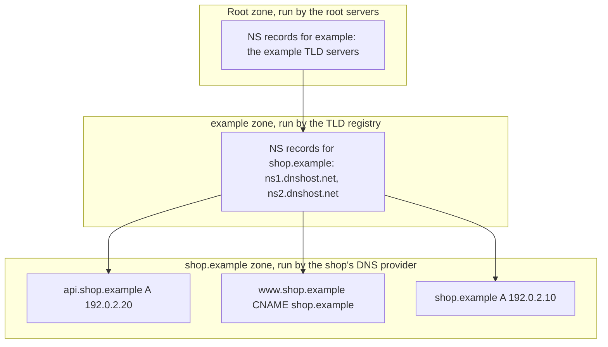

**Glue records**: if the child's name servers are named inside the child zone (`ns1.shop.example` serving `shop.example`), a resolver could not find their addresses without first asking them, a chicken-and-egg problem.  
So the parent also publishes their addresses, called glue, alongside the NS records.

### Who runs what

| Part                | Run by                                                                                                                                                                                                        |
| ------------------- | ------------------------------------------------------------------------------------------------------------------------------------------------------------------------------------------------------------- |
| Root zone           | Content managed by IANA; served by 13 named server identities (`a` to `m.root-servers.net`), operated by 12 organisations, each identity spread over many anycast sites (H02.05) worldwide                    |
| A TLD such as `com` | A **registry** (Verisign for `com`), which runs the TLD's authoritative servers                                                                                                                               |
| Your domain         | Bought through a **registrar**, which tells the registry which NS records to publish; hosted by a **DNS provider** (Route 53, Cloudflare, Azure DNS, your own servers), which runs your authoritative servers |

The registrar, the registry and the DNS provider are three different parties.  
A compromised registrar account can change your NS records and redirect your whole domain without touching your DNS provider; this is why production domains use registrar locks and strong authentication.

### Interview angle

"What happens if the root servers go down?"  
Very little at first: resolvers cache the root's referrals for TLDs for up to two days, the root is served from many anycast sites, and most lookups never reach the root because the TLD servers are already cached.  
The root is designed to be rarely needed.

---

## 03.02 The resolution path: stub, recursive resolver, root, TLD, authoritative

Your machine runs a small **stub resolver** that asks one **recursive resolver** (your ISP's, your company's, or a public one such as `1.1.1.1`) for a final answer.  
On a cache miss, the recursive resolver walks the tree itself: it asks a **root server**, which refers it to the **TLD servers**, which refer it to the domain's **authoritative servers**, which give the answer.  
Every step is cached, so most lookups end at the first cache.

### The four roles

| Role                 | Where it runs                                                          | Asks or answers                                    | Caches                 |
| -------------------- | ---------------------------------------------------------------------- | -------------------------------------------------- | ---------------------- |
| Stub resolver        | In the OS and C library on every host                                  | Asks one resolver for a final answer (RD=1)        | Sometimes (OS service) |
| Recursive resolver   | ISP, corporate network, cloud VPC, public (`1.1.1.1`, `8.8.8.8`)       | Walks the tree on behalf of stubs                  | Yes, heavily           |
| Authoritative server | DNS provider, registry, root operators                                 | Answers only for its own zones (AA=1); never walks | No (it holds the data) |
| Forwarder            | Home routers, `systemd-resolved`, Kubernetes CoreDNS, corporate relays | Passes queries on to another resolver              | Usually                |

`RD` (recursion desired) and `AA` (authoritative answer) are flag bits in the DNS header; 03.05 shows them on the wire.

### Recursive vs iterative queries

- **Recursive query** (stub to resolver): "give me the final answer, do whatever it takes". The stub sets RD=1 and waits.

- **Iterative query** (resolver to authorities): "tell me what you know".  
  Each server returns either the answer or a **referral**: a response with no answer, NS records for a closer zone in the authority section, and glue addresses in the additional section.

### A cold lookup, step by step

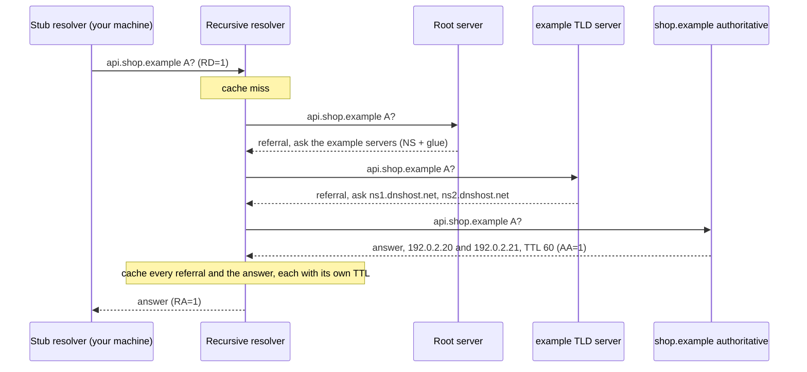

How the resolver knows where the root is: it ships with a **root hints** file listing the root servers' addresses, and refreshes it with a "priming" query at startup.

Two refinements real resolvers apply:

- **Out-of-zone name servers cost extra lookups.**  
  If `shop.example`'s servers are `ns1.dnshost.net`, the resolver must also resolve `ns1.dnshost.net` (another walk, through `net`) unless it is cached.  
  Deep chains of such dependencies are a hidden latency and reliability cost.

- **QNAME minimisation** (RFC 9156): instead of sending the full name to every server, the resolver asks the root only about `example`, the TLD only about `shop.example`, and so on.  
  Each server learns only what it needs to.

### On your own machine (Linux)

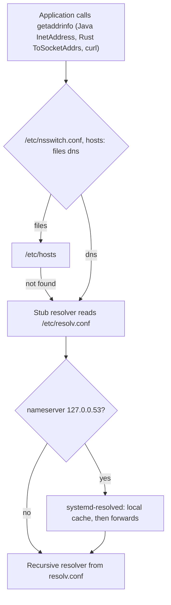

`/etc/resolv.conf` holds three things that matter in production:

| Directive                              | Meaning                                                                                   |
| -------------------------------------- | ----------------------------------------------------------------------------------------- |
| `nameserver 10.0.0.2`                  | Which resolver to ask (up to three, tried in order)                                       |
| `search corp.example`                  | Suffixes appended to names that look relative (fewer dots than `ndots`)                   |
| `options ndots:1 timeout:5 attempts:2` | Dots needed before a name is tried as-is first; seconds to wait per try; tries per server |

A name such as `db` becomes `db.corp.example` thanks to `search`. 03.07 shows how this same feature multiplies queries in Kubernetes.

On macOS the stub is `mDNSResponder`; on Windows the DNS Client service.  
In cloud VPCs the recursive resolver is provided by the platform (on AWS, the VPC's base address plus two, and `169.254.169.253`).

### IPv4 and IPv6 together

`getaddrinfo` usually sends an `A` query (IPv4) and an `AAAA` query (IPv6) in parallel and sorts the results by RFC 6724 rules.  
Browsers and curl then race IPv6 and IPv4 connection attempts ("Happy Eyeballs", RFC 8305) so a broken IPv6 path costs at most a few hundred milliseconds.  
Java's `InetAddress` returns IPv4 first unless `-Djava.net.preferIPv6Addresses=true`.

### Interview angle

"Explain recursive vs iterative resolution." The stub sends one recursive query and expects a final answer.  
The recursive resolver performs iterative queries, following referrals from root to TLD to authoritative, caching each step.  
Authoritative servers never recurse; they answer for their zones or refer.

---

## 03.03 Record types

Every DNS record has a name, a type, a TTL and data.  

- `A` and `AAAA` give IPv4 and IPv6 addresses;
- `CNAME` makes one name an alias of another;
- `NS` and `SOA` describe the zone itself;
- `MX` routes email; `TXT` carries free text used for verification;
- `CAA` says which certificate authorities may issue certificates;
- `HTTPS` tells clients, before they connect, which protocols (such as HTTP/3) a service supports

### Structure of a record

In **zone file** syntax (the text format DNS providers import and export):

```
; name                 TTL    class  type   data
api.shop.example.      60     IN     A      192.0.2.20
```

| Field | Meaning                                                      |
| ----- | ------------------------------------------------------------ |
| Name  | The owner name the record belongs to                         |
| TTL   | Seconds a resolver may cache it (03.04)                      |
| Class | Always `IN` (Internet) in practice                           |
| Type  | What kind of data follows                                    |
| Data  | The value, format depends on type (called RDATA on the wire) |

An **RRset** is all records with the same name and type, for example both `A` records of `api.shop.example`.  
The RRset, not the single record, is the unit that is cached, expired and signed.

### The types an architect meets

| Type                    | Code       | Data                                          | Used for                                                       |
| ----------------------- | ---------- | --------------------------------------------- | -------------------------------------------------------------- |
| `A`                     | 1          | IPv4 address (4 bytes)                        | Where to connect over IPv4                                     |
| `NS`                    | 2          | A server name                                 | Delegation: who is authoritative for a zone                    |
| `CNAME`                 | 5          | Another name                                  | Alias: "this name is really that name"                         |
| `SOA`                   | 6          | Primary server, admin mailbox, serial, timers | Zone metadata; negative-caching TTL                            |
| `PTR`                   | 12         | A name                                        | Reverse lookup: IP to name (`20.2.0.192.in-addr.arpa`)         |
| `MX`                    | 15         | Preference and mail server name               | Where to deliver email                                         |
| `TXT`                   | 16         | Length-prefixed text strings                  | SPF, DKIM, domain verification, ACME `_acme-challenge` (H13)   |
| `AAAA`                  | 28         | IPv6 address (16 bytes)                       | Where to connect over IPv6                                     |
| `SRV`                   | 33         | Priority, weight, port, target                | Service discovery (Kubernetes named ports, SIP, LDAP)          |
| `OPT`                   | 41         | (pseudo-record)                               | EDNS(0) options, never stored (03.05)                          |
| `DS`, `RRSIG`, `DNSKEY` | 43, 46, 48 | Key hashes, signatures, keys                  | DNSSEC (03.06)                                                 |
| `HTTPS`                 | 65         | Priority, target, service parameters          | Protocols (`alpn`), address hints, ECH keys for HTTPS services |
| `CAA`                   | 257        | Flags, tag, value                             | Which CAs may issue certificates for the domain (H13)          |

### A small zone file

```
$TTL 300
shop.example.        3600  IN  SOA    ns1.dnshost.net. hostmaster.shop.example. (
                                      2026102401 ; serial
                                      7200       ; refresh: secondaries check this often
                                      900        ; retry
                                      1209600    ; expire
                                      300 )      ; minimum: negative-caching TTL
shop.example.        86400 IN  NS     ns1.dnshost.net.
shop.example.        86400 IN  NS     ns2.dnshost.net.
shop.example.              IN  A      192.0.2.10
shop.example.              IN  AAAA   2001:db8::10
www.shop.example.    3600  IN  CNAME  shop.example.
api.shop.example.    60    IN  A      192.0.2.20
api.shop.example.    60    IN  A      192.0.2.21
shop.example.              IN  MX     10 mail.shop.example.
shop.example.              IN  TXT    "v=spf1 include:_spf.mailhost.example -all"
shop.example.              IN  CAA    0 issue "letsencrypt.org"
shop.example.              IN  HTTPS  1 . alpn="h3,h2" ipv4hint=192.0.2.10
```

Records without an explicit TTL take the `$TTL` default (300 seconds).

### CNAME: the rules that bite

- A resolver that finds a CNAME restarts the lookup at the target name and returns the whole chain.  
  Each hop to another zone can cost another walk of the tree.

- **A CNAME cannot coexist with any other record at the same name.**  
  The zone apex (`shop.example` itself) always has `SOA` and `NS` records, so **the apex cannot be a CNAME**.  
  This is why "point my bare domain at my CDN's name" needs either provider-specific "ALIAS" / "CNAME flattening" (the provider resolves the target and serves `A` records) or the standard `HTTPS` record in alias mode.

- CDNs and managed load balancers usually hand you a name, not an IP (`shop.cdnprovider.net`), precisely so they can change addresses without you.

### HTTPS records (RFC 9460)

```
shop.example.  300  IN  HTTPS  1 . alpn="h3,h2" ipv4hint=192.0.2.10 ipv6hint=2001:db8::10
```

| Part       | Meaning                                                                                                  |
| ---------- | -------------------------------------------------------------------------------------------------------- |
| `1`        | Priority. `0` means alias mode (point to another name, allowed at the apex); `1` and up are service mode |
| `.`        | Target name; `.` means "this same name"                                                                  |
| `alpn`     | Application protocols supported: HTTP/3 (`h3`) and HTTP/2 (`h2`) (H15, H19)                              |
| `ipv4hint` | Addresses the client may use without waiting for the `A` answer                                          |
| `ech`      | (not shown) Public key for Encrypted Client Hello (H15)                                                  |

Browsers query `HTTPS` alongside `A` and `AAAA`, so they can open an HTTP/3 connection on the first attempt instead of learning about it later from an `Alt-Svc` header (H19).

### Interview angle

"Why can't the bare domain be a CNAME, and what do you do instead?"  
A CNAME excludes all other data at that name, and the apex must hold `SOA` and `NS`.  
Use the DNS provider's alias or flattening feature, or an `HTTPS` record in alias mode, or point `A` / `AAAA` records directly at anycast addresses.

---

## 03.04 TTL and caching at every layer

Every record carries a **TTL** (time to live) in seconds: how long anyone may cache it.  
Answers are cached in the recursive resolver, in the OS, in the JVM, sometimes in the browser, and implicitly in every open connection.  
A change to a record is not "propagated"; old copies simply expire, each on its own schedule, and some layers ignore the TTL entirely.

### The cache chain

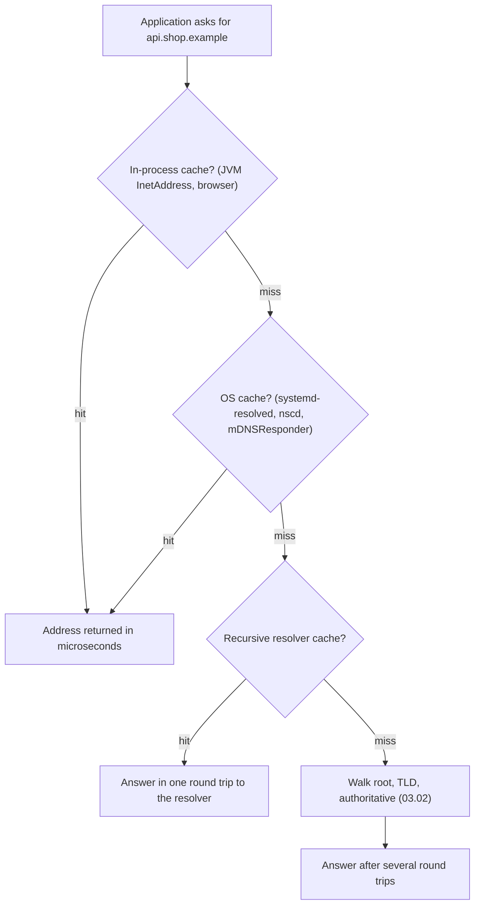

And outside the chain: an **already open connection** keeps using the address it connected to, whatever DNS says now.  
A connection pool with no maximum lifetime is, in effect, a DNS cache with an infinite TTL.

### Each layer's rules

| Layer                        | Honours the record's TTL?               | Defaults and knobs                                                                                                                  |
| ---------------------------- | --------------------------------------- | ----------------------------------------------------------------------------------------------------------------------------------- |
| Recursive resolver           | Yes, often with min/max clamps          | Some serve expired data when authorities are unreachable ("serve-stale", RFC 8767)                                                  |
| OS (`systemd-resolved` etc.) | Yes                                     | Some systems have no OS cache at all; then every lookup goes to the resolver                                                        |
| JVM (`InetAddress`)          | **No**: uses its own fixed TTL          | `networkaddress.cache.ttl`: 30 s by default (forever if a security manager is installed); `networkaddress.cache.negative.ttl`: 10 s |
| Browser                      | Roughly; keeps a short in-process cache | Browser-specific                                                                                                                    |
| Rust standard library        | No cache at all                         | Every `to_socket_addrs` call goes to `getaddrinfo` (and so to the OS)                                                               |
| Open connections and pools   | **No**                                  | Until the connection closes; set a maximum connection lifetime                                                                      |

### The JVM in detail

- `InetAddress` caches every successful lookup for `networkaddress.cache.ttl` seconds and every failure for `networkaddress.cache.negative.ttl` seconds, regardless of the record's real TTL.  
  A record with TTL 3600 is re-resolved every 30 s; a record with TTL 5 is still used for 30 s.

- Set the TTL before the first lookup, because the JVM reads it once:

  ```java
  java.security.Security.setProperty("networkaddress.cache.ttl", "60");
  ```

  or in `$JAVA_HOME/conf/security/java.security`. The older `-Dsun.net.inetaddr.ttl=60` system property also works.

- Recent JDKs add `networkaddress.cache.stale.ttl`: keep using an expired entry for that long if a fresh lookup fails, which protects against short resolver outages.

- Since JDK 18 (JEP 418), a custom `InetAddressResolver` can replace the OS lookup entirely.

Lab 04 shows the JVM serving a stale address for exactly its cache TTL.

### Rust in detail

- `std::net::ToSocketAddrs` calls the C library's `getaddrinfo`, which blocks the calling thread and caches nothing in-process.

- In async code, `tokio::net::lookup_host` runs `getaddrinfo` on a blocking thread pool.

- `hickory-resolver` is a pure-Rust asynchronous resolver with its own cache that honours record TTLs; HTTP clients such as `reqwest` can use it through a feature flag.

### Negative caching

"This name does not exist" (NXDOMAIN) and "the name exists but has no record of this type" (NODATA) are cached too, for the smaller of the SOA record's own TTL and its `minimum` field (RFC 2308).  
The classic accident: someone queries `new.shop.example` before the record is created; their resolver caches the negative answer; for the next few minutes the new service "works for everyone except them".

### "DNS propagation" is cache expiry

Nothing is pushed when a record changes.  
Each cache that holds the old answer keeps it until its TTL runs out, counted from the moment that cache fetched it.  
So the worst-case staleness after a change is the TTL the old record had, plus whatever extra caching (JVM, pools) sits in front.

The safe recipe for changing an important record:

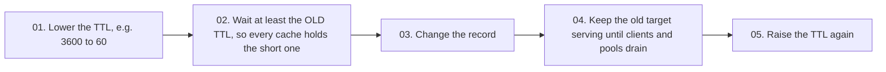

### Interview angle

"We changed the DNS record an hour ago and some clients still hit the old server. Why?"  
The old record's TTL may have been longer than an hour; some resolvers clamp or serve stale;  
Java processes may cache with their own policy; and most importantly, pooled connections opened before the change never re-resolve.  
Lower TTLs in advance and cap connection lifetimes.

---

## 03.05 DNS on the wire: message format, UDP, TCP, EDNS(0)

A DNS message is a 12-byte header, then four sections: question, answer, authority, additional.  
Names are written as length-prefixed labels and repeated names are replaced by 2-byte pointers.  
Queries normally travel in a single UDP datagram to port 53; if the answer is too big, the server sets the **TC** (truncated) flag and the client asks again over TCP, where each message is preceded by a 2-byte length.

### Transport

- **UDP port 53** for almost all queries: one datagram out, one back, no handshake (H02.07).

- **TCP port 53** when a response is too big for UDP, for zone transfers between servers, and whenever a client prefers it.  
Every DNS server must support TCP (RFC 7766). Because TCP is a byte stream, each DNS message on TCP is framed with a 2-byte big-endian length (H01.05, length prefix).

### The header (12 bytes)

```
 0  1  2  3  4  5  6  7  8  9 10 11 12 13 14 15
+--+--+--+--+--+--+--+--+--+--+--+--+--+--+--+--+
|                      ID                       |   matches a response to its query
+--+--+--+--+--+--+--+--+--+--+--+--+--+--+--+--+
|QR|   Opcode  |AA|TC|RD|RA| Z|AD|CD|   RCODE   |   flags
+--+--+--+--+--+--+--+--+--+--+--+--+--+--+--+--+
|                    QDCOUNT                    |   number of questions (1)
+--+--+--+--+--+--+--+--+--+--+--+--+--+--+--+--+
|                    ANCOUNT                    |   answer records
+--+--+--+--+--+--+--+--+--+--+--+--+--+--+--+--+
|                    NSCOUNT                    |   authority records (referrals, SOA)
+--+--+--+--+--+--+--+--+--+--+--+--+--+--+--+--+
|                    ARCOUNT                    |   additional records (glue, OPT)
+--+--+--+--+--+--+--+--+--+--+--+--+--+--+--+--+
```

| Flag   | Meaning when set                                              |
| ------ | ------------------------------------------------------------- |
| QR     | This is a response (0 = query)                                |
| Opcode | Kind of query; 0 = standard query                             |
| AA     | Authoritative answer: the responder owns this zone            |
| TC     | Truncated: the full answer did not fit; retry over TCP        |
| RD     | Recursion desired (set by the client)                         |
| RA     | Recursion available (set by a recursive resolver)             |
| AD     | Authentic data: the resolver validated it with DNSSEC (03.06) |
| CD     | Checking disabled: client asks the resolver not to validate   |
| RCODE  | Result code (table below)                                     |

| RCODE | Name     | Meaning                                                                         |
| ----- | -------- | ------------------------------------------------------------------------------- |
| 0     | NOERROR  | Success. With zero answers it means NODATA: the name exists, the type does not  |
| 1     | FORMERR  | The server could not parse the query                                            |
| 2     | SERVFAIL | The resolver failed: authorities unreachable, DNSSEC validation failed, timeout |
| 3     | NXDOMAIN | The name does not exist                                                         |
| 4     | NOTIMP   | Query type not implemented                                                      |
| 5     | REFUSED  | Policy refusal (for example, a server that does not serve this client)          |

SERVFAIL and NXDOMAIN are different failures: NXDOMAIN is an authoritative "no such name";  
SERVFAIL means "I could not find out", and it is what users see when a DNS provider is down or DNSSEC is broken.

### Names on the wire

Each label is written as a 1-byte length and then its bytes; a zero byte ends the name (H01.05, length prefix):

```
api.shop.example   ->   03 61 70 69  04 73 68 6f 70  07 65 78 61 6d 70 6c 65  00
                        3  a  p  i   4  s  h  o  p   7  e  x  a  m  p  l  e   end
```

**Compression**: because the same names repeat in a response, any name (or the tail of one) can be replaced by a 2-byte **pointer**: the top two bits are `11`,  
and the remaining 14 bits are the offset of an earlier copy from the start of the message. `c0 0c` means "the name at offset 12", which is always the question name.  
A label length can never start with `11` (lengths are at most 63, `0011 1111`), so the two cases cannot be confused.

### A real response, decoded

The query `api.shop.example A` answered by the lab server (Lab 01), 66 bytes:

```
offset  hex                                               ASCII
000000  5e eb 85 00 00 01 00 02 00 00 00 00 03 61 70 69   ^............api
000010  04 73 68 6f 70 07 65 78 61 6d 70 6c 65 00 00 01   .shop.example...
000020  00 01 c0 0c 00 01 00 01 00 00 00 3c 00 04 c0 00   ...........<....
000030  02 14 c0 0c 00 01 00 01 00 00 00 3c 00 04 c0 00   ...........<....
000040  02 15                                             ..
```

| Offset   | Bytes                     | Meaning                                                          |
| -------- | ------------------------- | ---------------------------------------------------------------- |
| 00 to 01 | `5e eb`                   | ID, copied from the query                                        |
| 02 to 03 | `85 00`                   | `1000 0101 0000 0000`: QR=1, AA=1, RD=1, RA=0, RCODE=0 (NOERROR) |
| 04 to 0b | `00 01 00 02 00 00 00 00` | 1 question, 2 answers, 0 authority, 0 additional                 |
| 0c to 1d | `03 61 70 69 ... 00`      | Question name `api.shop.example` (18 bytes)                      |
| 1e to 21 | `00 01 00 01`             | Question type A, class IN                                        |
| 22 to 23 | `c0 0c`                   | Answer 1 name: pointer to offset 12, the question name           |
| 24 to 27 | `00 01 00 01`             | Type A, class IN                                                 |
| 28 to 2b | `00 00 00 3c`             | TTL 60 seconds                                                   |
| 2c to 2d | `00 04`                   | RDATA length 4                                                   |
| 2e to 31 | `c0 00 02 14`             | 192.0.2.20                                                       |
| 32 to 41 | `c0 0c ... c0 00 02 15`   | Answer 2, same layout: 192.0.2.21                                |

12 + 22 + 16 + 16 = 66 bytes. Without compression each answer would repeat the 18-byte name; the pointer saves 16 bytes per record.

Parsers must guard against hostile pointers that loop back on themselves; the lab clients cap the number of jumps.

### Size limits, EDNS(0) and truncation

- The original limit for DNS over UDP is **512 bytes**.

- **EDNS(0)** (RFC 6891) lets a client advertise a bigger UDP buffer by adding an `OPT` pseudo-record to the additional section of its query.  
  The same record carries the DNSSEC OK bit and option extensions.

- Big UDP responses get fragmented by IP (H02.04), and fragments are often dropped by firewalls.  
  The industry agreed ("DNS Flag Day 2020") on an EDNS buffer of **1232 bytes**: IPv6's guaranteed 1280-byte MTU minus 40 bytes of IPv6 header and 8 of UDP.  
  The same arithmetic gave QUIC its 1200 bytes (H02.04).

- If the answer still does not fit, the server sends what fits (often nothing) with **TC=1**, and the client retries over TCP:

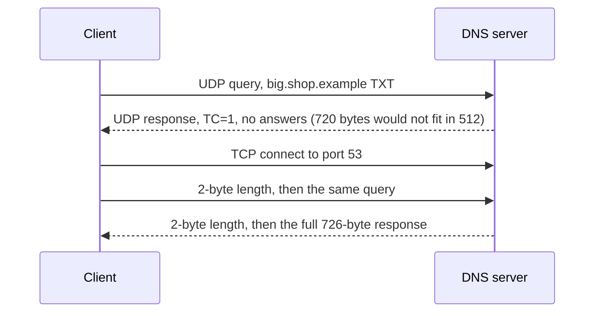

Lab 02 performs exactly this exchange.  
A firewall that allows UDP 53 but blocks TCP 53 breaks every lookup with a large answer (many DNSSEC-signed answers, long TXT records), which shows up as random-looking resolution failures.

### Matching a response to its query

Over UDP there is no connection, so the client accepts a response only if it arrives on the right source port, from the server it asked, with the same ID and the same question.  
The ID is 16 bits, so it must be random, and the source port must be random too; 03.06 explains why.

### Interview angle

"Is DNS UDP or TCP?" Both.  
UDP for normal queries because one small question and answer fit in one datagram with no handshake; TCP for large answers (after a truncated UDP response), zone transfers, and encrypted variants.  
Blocking TCP 53 is a configuration bug.

---

## 03.06 Trust and privacy: spoofing, cache poisoning, DNSSEC, DoT, DoH

Classic DNS is unauthenticated and unencrypted: anyone on the path can read every name you look up, and an attacker who can guess a query's ID and port can inject a false answer that a resolver will cache for everyone.  
**DNSSEC** adds signatures so resolvers can verify answers (integrity, not privacy). **DoT** and **DoH** encrypt the hop between your machine and the resolver (privacy, not integrity of the data itself).  
In practice the strongest protection for web traffic is TLS certificate validation: a lying DNS server can send you to the wrong address, but the impostor cannot prove it is the real site.

### Threats

| Threat                 | Who can do it                                          | Effect                                                        |
| ---------------------- | ------------------------------------------------------ | ------------------------------------------------------------- |
| Reading queries        | Anyone on the path (Wi-Fi, ISP)                        | Learns every site you visit                                   |
| Modifying answers      | Anyone on the path                                     | Redirects you to their server                                 |
| Off-path spoofing      | Anyone who can send packets with a forged source IP    | Races a forged answer against the real one                    |
| Cache poisoning        | Off-path attacker who wins the race at a resolver      | False answer cached and served to every user of that resolver |
| Resolver hijack        | Malware or a compromised router changing your resolver | All lookups answered by the attacker                          |
| Registrar or NS hijack | Attacker with your registrar credentials               | Whole domain redirected at the source (03.01)                 |

### Spoofing and the Kaminsky attack (2008)

A resolver accepts a UDP response if the source address, destination port, ID and question match.  
Before 2008, many resolvers used a fixed source port, leaving only the 16-bit ID to guess: 65,536 possibilities.  
Dan Kaminsky showed how to make guessing cheap:

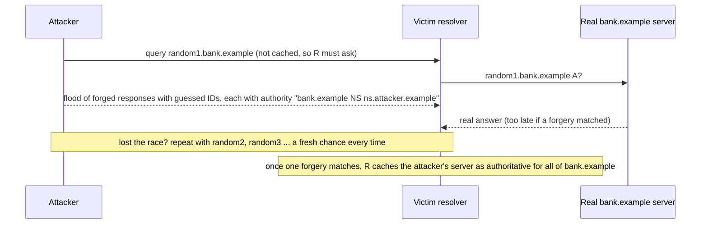

The trick was asking for names that are never cached, so the attacker gets unlimited attempts, and putting the payload in the authority section, so a win hijacks the whole domain, not just one name.

Mitigations, all now standard:

01. **Source port randomisation** (RFC 5452): the attacker must now guess about 16 bits of port as well as 16 bits of ID.

02. **0x20 encoding**: the resolver randomises the case of the query name (`aPi.ShOp.eXaMpLe`) and requires the response to echo it exactly; extra bits to guess.

03. **Bailiwick checks**: a server for `random1.bank.example` may only supply records within its own zone.

04. **DNSSEC**: forgeries fail signature checks.

### DNSSEC: signed answers

- Each zone has signing keys published as `DNSKEY` records. Every RRset is signed, and the signature is published as an `RRSIG` record.

- The parent zone publishes a `DS` record, a hash of the child's key, and signs it with its own key.  
  So trust flows from parent to child, up to the root's key, which validating resolvers ship with as the **trust anchor**.

- "Does not exist" answers are provable too, through `NSEC` / `NSEC3` records listing which names do exist around the gap.

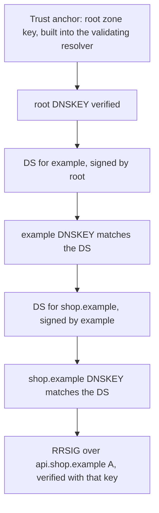

What DNSSEC does not do:

- **No privacy**: everything is still readable.

- **Usually not end to end**: the recursive resolver validates and sets the AD flag; the stub on your machine generally trusts that flag over an unprotected hop.

- **Operational risk**: an expired signature or a botched key rollover makes every name in the zone fail with SERVFAIL for every validating resolver. Several well-known domains have gone dark this way.

### Encrypted DNS: DoT, DoH, DoQ

| Protocol       | Transport                          | Port | Notes                                                                            |
| -------------- | ---------------------------------- | ---- | -------------------------------------------------------------------------------- |
| Plain DNS      | UDP or TCP                         | 53   | Readable and modifiable on the path                                              |
| DoT (RFC 7858) | DNS over TLS over TCP              | 853  | Easy to identify and block by port                                               |
| DoH (RFC 8484) | DNS messages inside HTTPS requests | 443  | The same binary message from 03.05, sent as an HTTP body; looks like web traffic |
| DoQ (RFC 9250) | DNS over QUIC                      | 853  | Encryption without TCP head-of-line blocking                                     |

What encryption changes and what it does not:

- It hides queries from the Wi-Fi operator and the ISP, and stops on-path modification between you and the resolver.

- The resolver still sees every query, so the choice of resolver is a trust decision.

- Browsers that use their own DoH resolver bypass the OS and corporate DNS, which breaks internal names served only by the company's DNS ("split horizon", 03.07) and bypasses DNS-based security filtering.  
  Enterprises disable it by policy.

- Encrypted Client Hello (H15) needs encrypted DNS: its key arrives in the `HTTPS` record, and fetching it in plaintext would leak the very name ECH hides.

### Why TLS is the real defence for HTTPS

If DNS sends a browser to an attacker's address for `bank.example`, the attacker still has to complete a TLS handshake with a certificate for `bank.example` signed by a trusted authority (H13).  
Without one, the connection fails with a certificate error. So DNS attacks against HTTPS sites mostly cause denial of service, not impersonation, as long as:

- clients use `https://` from the first request (HSTS, H16), and

- attackers cannot obtain a certificate.  
  Certificate authorities validate domain control partly through DNS (H13), which is why DNS integrity, `CAA` records and authorities checking from several network locations matter for the whole web PKI.

### Two attacks that abuse DNS against applications

- **DNS rebinding**: a malicious site's name first resolves to the attacker's server, then, with a TTL of zero, to `127.0.0.1` or an internal IP.  
  The victim's browser, still on the "same origin", now talks to internal services.  
  Defences: internal services validate the `Host` header and require authentication even on localhost.

- **SSRF filter bypass by re-resolution**: a server-side filter resolves a user-supplied URL, sees a public IP and allows it; the HTTP client then resolves again and gets `169.254.169.254` (H02.03).  
  Defence: resolve once, check that address, and connect to that same address.

### Interview angle

"Does DNSSEC encrypt DNS?" No.  
DNSSEC authenticates data with signatures from the root down; DoT and DoH encrypt the client-to-resolver hop.  
They solve different problems and are complementary. For web traffic, TLS certificate validation is what stops a forged DNS answer from becoming impersonation.

---

## 03.07 DNS in system design

DNS is the first load balancer every request meets: it can hand out several addresses, different addresses per region, weighted splits for canaries, or a backup address when health checks fail.  
Its weakness is caching: changes take effect only as caches expire, so DNS-based failover takes tens of seconds to minutes, not milliseconds.  
It is also a dependency that can take everything down, so it deserves the same redundancy as any other critical system.

### Traffic steering techniques

| Technique                        | How it works                                                          | Caveats                                                                                                                                                     |
| -------------------------------- | --------------------------------------------------------------------- | ----------------------------------------------------------------------------------------------------------------------------------------------------------- |
| Multiple `A` records             | Return several addresses; clients pick one                            | Many clients take the first after sorting, so load is uneven; no health awareness                                                                           |
| Weighted records                 | Return address X for 95% of queries and Y for 5%                      | Weights apply per resolver query, not per user; caches skew it                                                                                              |
| Geo or latency-based routing     | Answer depends on where the query came from                           | Sees the **resolver's** location, not the user's (public resolvers); EDNS Client Subnet (RFC 7871) passes a prefix of the user's address, at a privacy cost |
| Health-checked failover          | Provider stops returning an address whose health checks fail          | Slow: detection plus TTL plus client caching (below)                                                                                                        |
| Anycast (not DNS, compared here) | One IP announced from many sites; BGP routes each user to the nearest | Failover in seconds at the routing layer; used by CDNs and DNS providers themselves                                                                         |

### Why DNS failover is slow

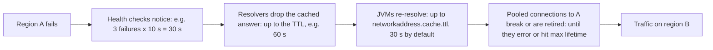

Two minutes is a realistic best case for DNS failover. For faster failover, put a stable anycast or load balancer address in DNS and fail over behind it.

### Choosing a TTL

| TTL             | Good for                                                        | Cost                                                                                    |
| --------------- | --------------------------------------------------------------- | --------------------------------------------------------------------------------------- |
| 30 to 60 s      | Failover records, endpoints you plan to move, weighted canaries | More queries (latency and provider bills); more exposed to resolver or provider outages |
| 300 s           | Typical service endpoints                                       | Changes visible within about five minutes                                               |
| 3600 s to 1 day | Stable records: NS, MX, verification TXT                        | Slow to change; very resilient: caches ride out a provider outage                       |

### DNS as a single point of failure

- **October 2016**: a botnet (Mirai) flooded the DNS provider Dyn; many large sites that used only Dyn became unreachable for hours, even though their servers were fine.

- **October 2021**: a configuration change withdrew the network routes (BGP, H02.05) to Facebook's authoritative DNS servers; with no answers, every Facebook name failed worldwide, which also locked staff out of internal tools.

Lessons for an architect:

01. Use two independent DNS providers for critical zones (both serve the same records; NS records list both).

02. Keep moderate TTLs on stable records so caches can ride out a provider outage.

03. Keep DNS off the per-request hot path: cache in-process, honour TTLs, and reuse connections.

04. Keep a way into your systems that does not depend on your own DNS.

### Split-horizon DNS

The same name gets different answers inside and outside the company network: `api.shop.example` resolves to a private `10.x` address for internal clients and to the public load balancer for everyone else.  
Common and useful; it breaks when a client's resolver is not the one you expect (a laptop on DoH, a container using a public resolver).

### DNS inside Kubernetes

- Every Service gets a name: `orders.shop.svc.cluster.local` (service `orders`, namespace `shop`).  
  CoreDNS answers with the Service's virtual IP; for "headless" Services it returns the individual pod IPs, plus `SRV` records for named ports.

- Each pod's `/etc/resolv.conf` contains several search domains and `options ndots:5`.  
  Any name with fewer than five dots is first tried with every search suffix appended. A lookup of `api.payments.com` from namespace `shop`:

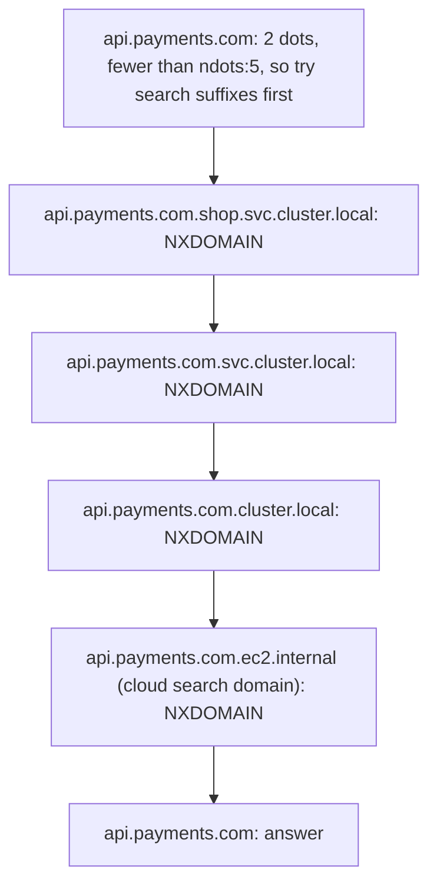

  Each step is an `A` and an `AAAA` query, so one external lookup costs up to 10 queries. Fixes are in Solution 03.

### Interview angle

"Design failover for an active-passive two-region API."  
Put a health-checked failover record (or, better, a global anycast load balancer) in front;  
use a short TTL (30 to 60 s) on that record only; cap client-side caching (JVM TTL) and connection lifetimes;  
and state the expected failover time honestly as detection plus TTL plus client caching, about one to two minutes with DNS alone.

---

## 03.08 The story: the first lookup of `api.shop.example`

This section ties 03.01 to 03.07 together by following one Java service's first call to `https://api.shop.example/orders`, on a freshly started machine where nothing is cached.  
(Remember: `.example` is fictional; imagine it is a real TLD.)

The cast:

| Role                       | Who                                                                            |
| -------------------------- | ------------------------------------------------------------------------------ |
| Application                | A Spring Boot service using `java.net.http.HttpClient`                         |
| Stub resolver and OS cache | glibc `getaddrinfo` and `systemd-resolved` on `127.0.0.53`                     |
| Recursive resolver         | The cloud VPC resolver                                                         |
| Root, TLD, authoritative   | A root server; the `example` TLD servers; `ns1.dnshost.net` for `shop.example` |

### The journey at a glance

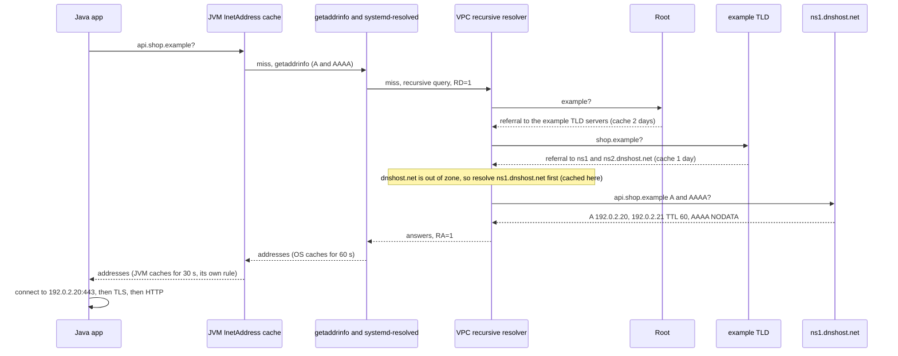

### Chapter 01: the application needs an address

`HttpClient.send` needs a socket address before it can open a TCP connection (H04).  
The URL holds a name, so the client calls `InetAddress.getAllByName("api.shop.example")`.

### Chapter 02: the JVM's cache

The JVM checks its `InetAddress` cache. Nothing is there; the process just started. It calls the operating system.

### Chapter 03: the operating system

`getaddrinfo` reads `/etc/nsswitch.conf` (`hosts: files dns`), checks `/etc/hosts` (no entry), then reads `/etc/resolv.conf` and finds `nameserver 127.0.0.53`: the local `systemd-resolved`.  
Its cache is empty too. It sends an `A` and an `AAAA` query (03.02) to the VPC resolver, each a single UDP datagram with RD=1, a random ID and a random source port (03.05, 03.06).

### Chapter 04: the recursive resolver walks the tree

The resolver has an empty cache except for the root hints:

01. **Root**: asks about `example` (QNAME minimisation).  
  The root returns a referral: NS records for the `example` TLD servers plus their addresses as glue. TTL two days.

02. **TLD**: asks about `shop.example`. The TLD returns a referral to `ns1.dnshost.net` and `ns2.dnshost.net`. TTL one day.  
  These names are outside `shop.example`, so there is no glue for them.

03. **Side trip**: the resolver must resolve `ns1.dnshost.net`, which may need its own walk through `net` (or be cached from earlier).

04. **Authoritative**: asks `ns1.dnshost.net` for `api.shop.example` `A` and `AAAA`.  
  It answers with AA=1: two `A` records with TTL 60, and NODATA for `AAAA` (the name exists, no IPv6 address), carrying the zone's `SOA` so the negative answer can be cached.

Every referral and answer goes into the resolver's cache with its own TTL.

### Chapter 05: back up the chain

The resolver returns the answers with RA=1. `systemd-resolved` caches them for 60 s.  
The JVM caches the addresses for 30 s, because it applies its own `networkaddress.cache.ttl`, not the record's TTL (03.04).  
`InetAddress` returns `[192.0.2.20, 192.0.2.21]`.

### Chapter 06: connecting

`HttpClient` connects to `192.0.2.20` on port 443.  
From here H02's story takes over (local-or-remote, ARP, NAT, routers), then the TCP handshake (H04), TLS (Part D) and the HTTP request.  
The connection goes into the client's pool and is reused for later requests, so for as long as it stays open, this service will keep talking to `192.0.2.20` whatever DNS says later.

### What it cost

| Lookup                         | Path                                               | Typical time |
| ------------------------------ | -------------------------------------------------- | ------------ |
| This first one (cold)          | JVM, OS, resolver, root, TLD, `net`, authoritative | 50 to 200 ms |
| Another service, resolver warm | JVM, OS, one round trip to the resolver            | 1 to 10 ms   |
| Same JVM, within 30 s          | JVM cache only                                     | Microseconds |
| Same connection, any time      | No lookup at all                                   | Zero         |

### What can go wrong, chapter by chapter

| Chapter | Failure                                                    | What the application sees                                          |
| ------- | ---------------------------------------------------------- | ------------------------------------------------------------------ |
| 02      | JVM cache set to forever (`-1`)                            | Never sees a changed address until restart                         |
| 03      | Lost UDP query                                             | Lookup stalls for the resolver timeout (default 5 s), then retries |
| 03      | Wrong `search` / `ndots` settings                          | Several extra queries per lookup; slow first requests              |
| 04      | Authoritative provider down                                | SERVFAIL after timeouts: `UnknownHostException`                    |
| 04      | Broken DNSSEC signatures                                   | SERVFAIL from validating resolvers only: "works on my machine"     |
| 04      | Record not created yet when first queried                  | NXDOMAIN cached for the negative TTL                               |
| 06      | Pooled connection to an address that DNS no longer returns | Requests keep going to the old server until the connection closes  |

---

## 03.09 Labs: what each one shows and how to run it

| Lab | Topic                                              | Covers              | Needs                         |
| --- | -------------------------------------------------- | ------------------- | ----------------------------- |
| 00  | A `dig` tour of the real DNS                       | 03.02 to 03.05      | `dig`, internet access        |
| 01  | Run your own authoritative DNS server              | 03.01, 03.03, 03.05 | Java                          |
| 02  | A DNS client built by hand, including TCP fallback | 03.05               | Java or Rust                  |
| 03  | Point your client at a real resolver               | 03.02, 03.05        | Java or Rust, internet access |
| 04  | The JVM's own DNS cache                            | 03.04               | Java                          |
| 05  | Your machine's resolver configuration              | 03.02, 03.04        | Linux shell; Rust             |

### Setup, once

```
sudo apt install bind9-dnsutils     # provides dig (older systems: dnsutils)
```

JDK 21+ and Rust as in H01. Folder layout:

```
h03/
  java/
    MiniDnsServer.java
    DnsClient.java
    JvmDnsCache.java
  rust/                       <- cargo new rust (no extra crates)
    src/bin/dns_client.rs
    src/bin/os_resolve.rs
```

Verification note: everything in Labs 01, 02, 04 and 05 was run on JDK 21 and Rust 1.97, and the lab server's responses were also checked with an independent DNS library (Python `dnslib`).  
Labs 00 and 03 need the real internet and `dig`, which my sandbox does not have; their outputs are shown as shapes, and addresses and TTLs will differ on your machine.

### Lab 00: a `dig` tour of the real DNS

```
dig example.com                      # A record via your configured resolver
dig +short example.com AAAA          # just the IPv6 addresses
dig @1.1.1.1 example.com             # ask a specific resolver
dig example.com NS                   # who is authoritative
dig +norecurse @a.root-servers.net com NS   # ask a root server directly: you get a referral
dig +trace example.com               # do the whole walk yourself: root, com, authoritative
dig cloudflare.com HTTPS             # an HTTPS record with alpn="h3,h2"
dig -x 1.1.1.1                       # reverse lookup (PTR)
dig nonexistent-name-12345.com       # NXDOMAIN, with the SOA in the authority section
```

How to read `dig example.com` (shape; values vary):

```
;; ->>HEADER<<- opcode: QUERY, status: NOERROR, id: 4242       <- RCODE and ID (03.05)
;; flags: qr rd ra; QUERY: 1, ANSWER: 2, AUTHORITY: 0, ADDITIONAL: 1   <- QR, RD, RA flags; section counts
;; OPT PSEUDOSECTION:
; EDNS: version: 0, flags:; udp: 1232                          <- EDNS(0), 1232-byte buffer
;; QUESTION SECTION:
;example.com.                   IN      A
;; ANSWER SECTION:
example.com.            287     IN      A       <address 1>    <- TTL counting down in the resolver's cache
example.com.            287     IN      A       <address 2>
;; Query time: 12 msec                                         <- one round trip: the resolver had it cached
;; SERVER: 127.0.0.53#53(127.0.0.53) (UDP)                     <- the stub's local forwarder
```

Things to notice:

01. Run `dig example.com` twice: the TTL decreases between runs, because you are seeing the resolver's cached copy aging (03.04).

02. `flags: qr rd ra` but no `aa`: a recursive resolver answered from cache. `dig @<an authoritative server> example.com` shows `aa`.

03. In `dig +trace`, each block is one referral: the root's `NS` records for `com`, then `com`'s `NS` records for `example.com`, then the authoritative answer with `aa` (03.02).

04. `+norecurse` to a root server returns no answer, only an authority section of `com` NS records and glue: a referral.

### Lab 01: run your own authoritative DNS server

Goal: see DNS from the server's side. `MiniDnsServer.java` is authoritative for `shop.example` on `127.0.0.1:5353` over UDP and TCP, with the records from 03.01: two `A` records for `api`, a `CNAME` for `www`, an `AAAA`, and a `TXT` record too big for UDP.  
It follows CNAMEs inside its zone, compresses names, answers NXDOMAIN for unknown names, and sets TC=1 when a UDP response would exceed 512 bytes. It logs every question it receives.

Port 5353 is used so the server needs no root privileges (53 is a privileged port).

`MiniDnsServer.java`:

```java
import java.io.DataInputStream;
import java.io.DataOutputStream;
import java.io.IOException;
import java.net.*;
import java.nio.ByteBuffer;
import java.nio.charset.StandardCharsets;
import java.util.*;

/** A tiny authoritative DNS server for the zone shop.example, on 127.0.0.1:5353, over UDP and TCP. */
public final class MiniDnsServer {

    static final int PORT = 5353;
    static final int TYPE_A = 1, TYPE_CNAME = 5, TYPE_TXT = 16, TYPE_AAAA = 28;
    static final int CLASS_IN = 1;
    static final int UDP_LIMIT = 512;                  // classic DNS-over-UDP limit without EDNS(0)

    record Rr(String name, int type, int ttl, byte[] rdata) {}

    static final Map<String, List<Rr>> ZONE = new HashMap<>();

    static {
        add("shop.example", TYPE_A, 300, ip("192.0.2.10"));
        add("shop.example", TYPE_AAAA, 300, ip("2001:db8::10"));
        add("www.shop.example", TYPE_CNAME, 3600, encodeName("shop.example"));
        add("api.shop.example", TYPE_A, 60, ip("192.0.2.20"));
        add("api.shop.example", TYPE_A, 60, ip("192.0.2.21"));
        add("big.shop.example", TYPE_TXT, 300, bigTxt(20));   // 680 bytes of TXT data: too big for 512-byte UDP
    }

    public static void main(String[] args) throws Exception {
        InetAddress loopback = InetAddress.getLoopbackAddress();
        Thread.startVirtualThread(() -> serveTcp(loopback));
        try (var udp = new DatagramSocket(PORT, loopback)) {
            System.out.println("authoritative for shop.example on " + loopback.getHostAddress() + ":" + PORT + " (UDP and TCP)");
            byte[] buf = new byte[4096];
            while (true) {
                var packet = new DatagramPacket(buf, buf.length);
                udp.receive(packet);
                byte[] query = Arrays.copyOf(packet.getData(), packet.getLength());
                byte[] response = respond(query, true, "UDP " + packet.getSocketAddress());
                udp.send(new DatagramPacket(response, response.length, packet.getSocketAddress()));
            }
        }
    }

    /** DNS over TCP: every message is preceded by a 2-byte big-endian length (H01.05). */
    static void serveTcp(InetAddress addr) {
        try (var server = new ServerSocket(PORT, 50, addr)) {
            while (true) {
                Socket s = server.accept();
                Thread.startVirtualThread(() -> {
                    try (s; var in = new DataInputStream(s.getInputStream());
                         var out = new DataOutputStream(s.getOutputStream())) {
                        while (true) {
                            byte[] query = new byte[in.readUnsignedShort()];
                            in.readFully(query);
                            byte[] response = respond(query, false, "TCP " + s.getRemoteSocketAddress());
                            out.writeShort(response.length);
                            out.write(response);
                            out.flush();
                        }
                    } catch (IOException endOfConnection) {
                        // client closed the connection
                    }
                });
            }
        } catch (IOException e) {
            throw new RuntimeException(e);
        }
    }

    static byte[] respond(byte[] query, boolean udp, String from) {
        ByteBuffer q = ByteBuffer.wrap(query);
        int id = q.getShort() & 0xFFFF;
        int flags = q.getShort() & 0xFFFF;
        int qdcount = q.getShort() & 0xFFFF;
        q.position(12);
        String qname = readName(q);
        int qtype = q.getShort() & 0xFFFF;
        q.getShort();                                          // QCLASS, assumed IN
        byte[] question = Arrays.copyOfRange(query, 12, q.position());

        List<Rr> answers = new ArrayList<>();
        int rcode = qdcount == 1 ? resolve(qname, qtype, answers) : 1;   // 1 = FORMERR
        byte[] response = build(id, flags, rcode, question, qname, answers, false);
        boolean truncated = udp && response.length > UDP_LIMIT;
        if (truncated) {
            response = build(id, flags, rcode, question, qname, List.of(), true);   // TC=1: "ask again over TCP"
        }
        System.out.printf("%-26s asks %-18s %-5s -> %s, %d answer(s)%s%n", from, qname, typeName(qtype),
                rcode == 0 ? "NOERROR" : rcode == 3 ? "NXDOMAIN" : "FORMERR", truncated ? 0 : answers.size(),
                truncated ? ", truncated (TC=1)" : "");
        return response;
    }

    /** Looks the name up in the zone, following CNAMEs that point inside the zone. */
    static int resolve(String name, int qtype, List<Rr> out) {
        List<Rr> rrs = ZONE.get(name.toLowerCase(Locale.ROOT));
        if (rrs == null) {
            return 3;                                          // NXDOMAIN: the name does not exist
        }
        for (Rr rr : rrs) {
            if (rr.type() == TYPE_CNAME && qtype != TYPE_CNAME) {
                out.add(rr);
                return resolve(readName(ByteBuffer.wrap(rr.rdata())), qtype, out);
            }
            if (rr.type() == qtype) {
                out.add(rr);
            }
        }
        return 0;                                              // NOERROR, possibly with no answers ("NODATA")
    }

    static byte[] build(int id, int queryFlags, int rcode, byte[] question, String qname, List<Rr> answers, boolean tc) {
        ByteBuffer r = ByteBuffer.allocate(8192);
        int flags = 0x8000                                     // QR: this is a response
                | 0x0400                                       // AA: authoritative answer
                | (tc ? 0x0200 : 0)                            // TC: truncated
                | (queryFlags & 0x0100)                        // RD: copied from the query
                | rcode;                                       // RA stays 0: no recursion offered
        r.putShort((short) id).putShort((short) flags)
         .putShort((short) 1).putShort((short) answers.size()).putShort((short) 0).putShort((short) 0);
        r.put(question);
        Map<String, Integer> offsets = new HashMap<>();
        rememberSuffixes(qname, 12, offsets);                  // the question name starts at offset 12
        for (Rr rr : answers) {
            writeName(r, rr.name(), offsets);
            r.putShort((short) rr.type()).putShort((short) CLASS_IN).putInt(rr.ttl())
             .putShort((short) rr.rdata().length).put(rr.rdata());
        }
        return Arrays.copyOf(r.array(), r.position());
    }

    /** Writes a name, replacing any suffix already in the message with a 2-byte pointer (compression). */
    static void writeName(ByteBuffer r, String name, Map<String, Integer> offsets) {
        String rest = name;
        while (!rest.isEmpty()) {
            Integer at = offsets.get(rest);
            if (at != null) {
                r.putShort((short) (0xC000 | at));             // top 2 bits 11 = pointer, low 14 bits = offset
                return;
            }
            if (r.position() < 0x4000) {
                offsets.put(rest, r.position());
            }
            int dot = rest.indexOf('.');
            String label = dot < 0 ? rest : rest.substring(0, dot);
            r.put((byte) label.length()).put(label.getBytes(StandardCharsets.US_ASCII));
            rest = dot < 0 ? "" : rest.substring(dot + 1);
        }
        r.put((byte) 0);
    }

    static void rememberSuffixes(String name, int offset, Map<String, Integer> offsets) {
        String rest = name.toLowerCase(Locale.ROOT);
        while (!rest.isEmpty()) {
            offsets.put(rest, offset);
            int dot = rest.indexOf('.');
            offset += (dot < 0 ? rest.length() : dot) + 1;
            rest = dot < 0 ? "" : rest.substring(dot + 1);
        }
    }

    static String readName(ByteBuffer buf) {
        var name = new StringBuilder();
        int len;
        while ((len = buf.get() & 0xFF) != 0) {
            byte[] label = new byte[len];
            buf.get(label);
            name.append(name.isEmpty() ? "" : ".").append(new String(label, StandardCharsets.US_ASCII));
        }
        return name.toString().toLowerCase(Locale.ROOT);
    }

    static byte[] encodeName(String name) {
        ByteBuffer b = ByteBuffer.allocate(256);
        for (String label : name.split("\\.")) {
            b.put((byte) label.length()).put(label.getBytes(StandardCharsets.US_ASCII));
        }
        b.put((byte) 0);
        return Arrays.copyOf(b.array(), b.position());
    }

    static void add(String name, int type, int ttl, byte[] rdata) {
        ZONE.computeIfAbsent(name, k -> new ArrayList<>()).add(new Rr(name, type, ttl, rdata));
    }

    static byte[] ip(String literal) {
        try {
            return InetAddress.getByName(literal).getAddress();   // a literal: parsed, never looked up
        } catch (UnknownHostException e) {
            throw new IllegalArgumentException(e);
        }
    }

    static byte[] bigTxt(int strings) {
        ByteBuffer b = ByteBuffer.allocate(4096);
        for (int i = 0; i < strings; i++) {
            byte[] s = String.format("filler string %02d to make this big", i).getBytes(StandardCharsets.US_ASCII);
            b.put((byte) s.length).put(s);                     // TXT data: length-prefixed strings
        }
        return Arrays.copyOf(b.array(), b.position());
    }

    static String typeName(int type) {
        return switch (type) {
            case TYPE_A -> "A";
            case TYPE_CNAME -> "CNAME";
            case TYPE_TXT -> "TXT";
            case TYPE_AAAA -> "AAAA";
            case 15 -> "MX";
            default -> "TYPE" + type;
        };
    }
}
```

Run (terminal 1, leave it running):

```
java MiniDnsServer.java
```

Expected first line:

```
authoritative for shop.example on 127.0.0.1:5353 (UDP and TCP)
```

If you have `dig`, query it directly (terminal 2):

```
dig @127.0.0.1 -p 5353 www.shop.example          # CNAME then A, flags qr aa rd
dig @127.0.0.1 -p 5353 nope.shop.example         # status: NXDOMAIN
dig @127.0.0.1 -p 5353 big.shop.example TXT      # ";; Truncated, retrying in TCP mode."
```

`dig` warns that recursion was requested but is not available, because this server is authoritative only (RA=0), exactly like a real authoritative server.

### Lab 02: a DNS client built by hand, including TCP fallback

Goal: build the query bytes yourself, send them, and decode the answer, including compression pointers and the TC-to-TCP fallback from 03.05. Usage: `<name> [type] [server] [port]`; defaults `example.com A 1.1.1.1 53`.

Java, `DnsClient.java`:

```java
import java.io.DataInputStream;
import java.io.DataOutputStream;
import java.net.*;
import java.nio.ByteBuffer;
import java.nio.charset.StandardCharsets;
import java.security.SecureRandom;
import java.util.Arrays;
import java.util.HexFormat;
import java.util.Map;

/** Builds a DNS query by hand, sends it over UDP (and TCP if truncated), and decodes the response. */
public final class DnsClient {

    static final Map<String, Integer> TYPES = Map.of(
            "A", 1, "NS", 2, "CNAME", 5, "SOA", 6, "MX", 15, "TXT", 16, "AAAA", 28, "HTTPS", 65, "CAA", 257);

    public static void main(String[] args) throws Exception {
        String name = args.length > 0 ? args[0] : "example.com";
        String type = args.length > 1 ? args[1].toUpperCase() : "A";
        String server = args.length > 2 ? args[2] : "1.1.1.1";
        int port = args.length > 3 ? Integer.parseInt(args[3]) : 53;
        var target = new InetSocketAddress(InetAddress.getByName(server), port);   // server is an IP literal

        int id = new SecureRandom().nextInt(1 << 16);                 // unpredictable ID: anti-spoofing (03.06)
        byte[] query = buildQuery(id, name, TYPES.get(type));
        System.out.printf("query (%d bytes) to %s over UDP%n", query.length, target);
        System.out.print(hexDump(query));

        byte[] response = sendUdp(query, target);
        if ((response[2] & 0x02) != 0) {                              // TC bit set: answer did not fit
            System.out.printf("response (%d bytes) has TC=1, retrying over TCP%n", response.length);
            response = sendTcp(query, target);
        }
        System.out.printf("response (%d bytes)%n", response.length);
        System.out.print(hexDump(response));
        decode(response, id);
    }

    static byte[] buildQuery(int id, String name, int qtype) {
        ByteBuffer b = ByteBuffer.allocate(512);
        b.putShort((short) id);
        b.putShort((short) 0x0100);                                   // flags: RD=1, "please recurse for me"
        b.putShort((short) 1).putShort((short) 0).putShort((short) 0).putShort((short) 0);   // 1 question
        for (String label : name.split("\\.")) {                      // www.example.com -> 3www7example3com0
            byte[] bytes = label.getBytes(StandardCharsets.US_ASCII);
            b.put((byte) bytes.length).put(bytes);
        }
        b.put((byte) 0);
        b.putShort((short) qtype).putShort((short) 1);                // QTYPE, QCLASS=IN
        return Arrays.copyOf(b.array(), b.position());
    }

    static byte[] sendUdp(byte[] query, InetSocketAddress target) throws Exception {
        try (var socket = new DatagramSocket()) {
            socket.setSoTimeout(3000);
            socket.send(new DatagramPacket(query, query.length, target));
            byte[] buf = new byte[4096];
            var packet = new DatagramPacket(buf, buf.length);
            socket.receive(packet);
            return Arrays.copyOf(buf, packet.getLength());
        }
    }

    static byte[] sendTcp(byte[] query, InetSocketAddress target) throws Exception {
        try (var socket = new Socket()) {
            socket.connect(target, 3000);
            socket.setSoTimeout(3000);
            var out = new DataOutputStream(socket.getOutputStream());
            out.writeShort(query.length);                             // 2-byte length prefix (H01.05)
            out.write(query);
            out.flush();
            var in = new DataInputStream(socket.getInputStream());
            byte[] response = new byte[in.readUnsignedShort()];
            in.readFully(response);
            return response;
        }
    }

    static void decode(byte[] msg, int expectedId) throws Exception {
        ByteBuffer b = ByteBuffer.wrap(msg);
        int id = b.getShort() & 0xFFFF;
        int flags = b.getShort() & 0xFFFF;
        int qd = b.getShort() & 0xFFFF, an = b.getShort() & 0xFFFF, ns = b.getShort() & 0xFFFF, ar = b.getShort() & 0xFFFF;
        if (id != expectedId) {
            throw new IllegalStateException("ID mismatch: not the answer to our question");
        }
        System.out.printf("header    id=0x%04x QR=%d AA=%d TC=%d RD=%d RA=%d rcode=%s%n", id,
                flags >> 15 & 1, flags >> 10 & 1, flags >> 9 & 1, flags >> 8 & 1, flags >> 7 & 1, rcode(flags & 0xF));
        System.out.printf("counts    question=%d answer=%d authority=%d additional=%d%n", qd, an, ns, ar);
        for (int i = 0; i < qd; i++) {
            String qname = readName(b, msg);
            int qtype = b.getShort() & 0xFFFF;
            b.getShort();
            System.out.printf("question  %s %s%n", qname, typeName(qtype));
        }
        String[] sections = {"answer", "authority", "additional"};
        int[] counts = {an, ns, ar};
        for (int s = 0; s < 3; s++) {
            for (int i = 0; i < counts[s]; i++) {
                String rrName = readName(b, msg);
                int type = b.getShort() & 0xFFFF;
                b.getShort();                                         // CLASS
                long ttl = Integer.toUnsignedLong(b.getInt());
                int rdlength = b.getShort() & 0xFFFF;
                int rdataStart = b.position();
                String data = rdata(type, msg, rdataStart, rdlength);
                b.position(rdataStart + rdlength);
                System.out.printf("%-9s %-20s %6d  %-5s %s%n", sections[s], rrName, ttl, typeName(type), data);
            }
        }
    }

    static String rdata(int type, byte[] msg, int start, int len) throws Exception {
        ByteBuffer b = ByteBuffer.wrap(msg);
        b.position(start);
        byte[] raw = Arrays.copyOfRange(msg, start, start + len);
        return switch (type) {
            case 1, 28 -> InetAddress.getByAddress(raw).getHostAddress();      // A, AAAA
            case 2, 5 -> readName(b, msg);                                    // NS, CNAME
            case 15 -> (b.getShort() & 0xFFFF) + " " + readName(b, msg);       // MX: preference, exchange
            case 16 -> {                                                       // TXT: length-prefixed strings
                var sb = new StringBuilder();
                while (b.position() < start + len) {
                    byte[] s = new byte[b.get() & 0xFF];
                    b.get(s);
                    sb.append('"').append(new String(s, StandardCharsets.UTF_8)).append("\" ");
                }
                yield sb.length() > 60 ? sb.substring(0, 60) + "... (" + len + " bytes)" : sb.toString();
            }
            case 6 -> readName(b, msg) + " " + readName(b, msg) + " serial=" + Integer.toUnsignedLong(b.getInt());
            default -> HexFormat.of().formatHex(raw);
        };
    }

    /** Reads a name, following compression pointers (top two bits 11, then a 14-bit offset from the message start). */
    static String readName(ByteBuffer b, byte[] msg) {
        var name = new StringBuilder();
        ByteBuffer cur = b;                                           // b ends up just after the name or first pointer
        int jumps = 0;
        int len;
        while ((len = cur.get() & 0xFF) != 0) {
            if ((len & 0xC0) == 0xC0) {
                int offset = ((len & 0x3F) << 8) | (cur.get() & 0xFF);
                if (++jumps > 32) {
                    throw new IllegalStateException("compression loop");   // a hostile message
                }
                cur = ByteBuffer.wrap(msg).position(offset);           // continue reading at the earlier copy
                continue;
            }
            byte[] label = new byte[len];
            cur.get(label);
            name.append(name.isEmpty() ? "" : ".").append(new String(label, StandardCharsets.US_ASCII));
        }
        return name.isEmpty() ? "." : name.toString();
    }

    static String rcode(int code) {
        return switch (code) {
            case 0 -> "NOERROR";
            case 1 -> "FORMERR";
            case 2 -> "SERVFAIL";
            case 3 -> "NXDOMAIN";
            case 4 -> "NOTIMP";
            case 5 -> "REFUSED";
            default -> "RCODE" + code;
        };
    }

    static String typeName(int type) {
        return TYPES.entrySet().stream().filter(e -> e.getValue() == type).map(Map.Entry::getKey)
                .findFirst().orElse(type == 41 ? "OPT" : "TYPE" + type);
    }

    static String hexDump(byte[] data) {
        var out = new StringBuilder();
        int shown = Math.min(data.length, 128);                       // first 8 lines are enough to read
        for (int off = 0; off < shown; off += 16) {
            int end = Math.min(off + 16, shown);
            out.append(String.format("%06x  ", off));
            for (int i = off; i < off + 16; i++) {
                out.append(i < end ? String.format("%02x ", data[i] & 0xFF) : "   ");
            }
            out.append("  ");
            for (int i = off; i < end; i++) {
                int c = data[i] & 0xFF;
                out.append(c >= 0x20 && c < 0x7F ? (char) c : '.');
            }
            out.append('\n');
        }
        if (data.length > shown) {
            out.append(String.format("        ... %d more bytes%n", data.length - shown));
        }
        return out.toString();
    }
}
```

Rust, `src/bin/dns_client.rs` (standard library only):

```rust
//! Builds a DNS query by hand, sends it over UDP (and TCP if truncated), and decodes the response.
//! Usage: cargo run --bin dns_client -- <name> [type] [server] [port]
use std::collections::hash_map::RandomState;
use std::hash::{BuildHasher, Hasher};
use std::io::{Read, Write};
use std::net::{IpAddr, Ipv4Addr, Ipv6Addr, SocketAddr, TcpStream, UdpSocket};
use std::time::Duration;

const TYPES: [(&str, u16); 9] = [
    ("A", 1), ("NS", 2), ("CNAME", 5), ("SOA", 6), ("MX", 15),
    ("TXT", 16), ("AAAA", 28), ("HTTPS", 65), ("CAA", 257),
];

fn main() -> std::io::Result<()> {
    let args: Vec<String> = std::env::args().collect();
    let name = args.get(1).map_or("example.com", |s| s.as_str());
    let qtype = args.get(2).map_or("A".to_string(), |s| s.to_uppercase());
    let server: IpAddr = args.get(3).map_or("1.1.1.1", |s| s.as_str()).parse().expect("server must be an IP");
    let port: u16 = args.get(4).map_or(53, |s| s.parse().expect("port"));
    let target = SocketAddr::new(server, port);

    // Not cryptographically strong; production code uses the OS random source (getrandom crate)
    let id = RandomState::new().build_hasher().finish() as u16;
    let code = TYPES.iter().find(|(n, _)| *n == qtype).map(|(_, c)| *c).expect("unknown type");
    let query = build_query(id, name, code);
    println!("query ({} bytes) to {target} over UDP", query.len());
    print!("{}", hex_dump(&query));

    let mut response = send_udp(&query, target)?;
    if response[2] & 0x02 != 0 {
        println!("response ({} bytes) has TC=1, retrying over TCP", response.len());
        response = send_tcp(&query, target)?;
    }
    println!("response ({} bytes)", response.len());
    print!("{}", hex_dump(&response));
    decode(&response, id);
    Ok(())
}

fn build_query(id: u16, name: &str, qtype: u16) -> Vec<u8> {
    let mut q = Vec::new();
    q.extend_from_slice(&id.to_be_bytes());
    q.extend_from_slice(&0x0100u16.to_be_bytes()); // flags: RD=1
    for count in [1u16, 0, 0, 0] {
        q.extend_from_slice(&count.to_be_bytes()); // one question
    }
    for label in name.split('.') {
        q.push(label.len() as u8);
        q.extend_from_slice(label.as_bytes());
    }
    q.push(0);
    q.extend_from_slice(&qtype.to_be_bytes());
    q.extend_from_slice(&1u16.to_be_bytes()); // class IN
    q
}

fn send_udp(query: &[u8], target: SocketAddr) -> std::io::Result<Vec<u8>> {
    let socket = UdpSocket::bind(if target.is_ipv4() { "0.0.0.0:0" } else { "[::]:0" })?;
    socket.set_read_timeout(Some(Duration::from_secs(3)))?;
    socket.send_to(query, target)?;
    let mut buf = [0u8; 4096];
    let (n, _) = socket.recv_from(&mut buf)?;
    Ok(buf[..n].to_vec())
}

fn send_tcp(query: &[u8], target: SocketAddr) -> std::io::Result<Vec<u8>> {
    let mut stream = TcpStream::connect_timeout(&target, Duration::from_secs(3))?;
    stream.set_read_timeout(Some(Duration::from_secs(3)))?;
    stream.write_all(&(query.len() as u16).to_be_bytes())?; // 2-byte length prefix (H01.05)
    stream.write_all(query)?;
    let mut len = [0u8; 2];
    stream.read_exact(&mut len)?;
    let mut response = vec![0u8; u16::from_be_bytes(len) as usize];
    stream.read_exact(&mut response)?;
    Ok(response)
}

fn u16_at(msg: &[u8], pos: usize) -> u16 {
    u16::from_be_bytes([msg[pos], msg[pos + 1]])
}

/// Reads a name starting at `pos`; returns the name and the position just after it (or after the first pointer).
fn read_name(msg: &[u8], mut pos: usize) -> (String, usize) {
    let mut labels: Vec<String> = Vec::new();
    let mut end = None;
    for _ in 0..128 {
        let len = msg[pos] as usize;
        if len == 0 {
            return (if labels.is_empty() { ".".into() } else { labels.join(".") }, end.unwrap_or(pos + 1));
        }
        if len & 0xC0 == 0xC0 {
            end.get_or_insert(pos + 2); // the caller continues after the pointer
            pos = (u16_at(msg, pos) & 0x3FFF) as usize;
            continue;
        }
        labels.push(String::from_utf8_lossy(&msg[pos + 1..pos + 1 + len]).into_owned());
        pos += 1 + len;
    }
    panic!("compression loop"); // a hostile message
}

fn decode(msg: &[u8], expected_id: u16) {
    let id = u16_at(msg, 0);
    let flags = u16_at(msg, 2);
    let counts = [u16_at(msg, 4), u16_at(msg, 6), u16_at(msg, 8), u16_at(msg, 10)];
    assert_eq!(id, expected_id, "ID mismatch: not the answer to our question");
    let bit = |n: u16| (flags >> n) & 1;
    println!("header    id=0x{id:04x} QR={} AA={} TC={} RD={} RA={} rcode={}",
             bit(15), bit(10), bit(9), bit(8), bit(7), rcode(flags & 0xF));
    println!("counts    question={} answer={} authority={} additional={}", counts[0], counts[1], counts[2], counts[3]);
    let mut pos = 12;
    for _ in 0..counts[0] {
        let (qname, next) = read_name(msg, pos);
        println!("question  {qname} {}", type_name(u16_at(msg, next)));
        pos = next + 4;
    }
    for (section, count) in [("answer", counts[1]), ("authority", counts[2]), ("additional", counts[3])] {
        for _ in 0..count {
            let (rr_name, next) = read_name(msg, pos);
            let rtype = u16_at(msg, next);
            let ttl = u32::from_be_bytes(msg[next + 4..next + 8].try_into().unwrap());
            let rdlen = u16_at(msg, next + 8) as usize;
            let start = next + 10;
            let data = rdata(rtype, msg, start, rdlen);
            println!("{section:<9} {rr_name:<20} {ttl:>6}  {:<5} {data}", type_name(rtype));
            pos = start + rdlen;
        }
    }
}

fn rdata(rtype: u16, msg: &[u8], start: usize, len: usize) -> String {
    let raw = &msg[start..start + len];
    match rtype {
        1 => Ipv4Addr::new(raw[0], raw[1], raw[2], raw[3]).to_string(),
        28 => Ipv6Addr::from(<[u8; 16]>::try_from(raw).unwrap()).to_string(),
        2 | 5 => read_name(msg, start).0,
        15 => format!("{} {}", u16_at(msg, start), read_name(msg, start + 2).0),
        16 => {
            let (mut out, mut p) = (String::new(), 0);
            while p < len {
                let n = raw[p] as usize;
                out.push_str(&format!("\"{}\" ", String::from_utf8_lossy(&raw[p + 1..p + 1 + n])));
                p += 1 + n;
            }
            if out.len() > 60 { format!("{}... ({len} bytes)", &out[..60]) } else { out }
        }
        _ => raw.iter().map(|b| format!("{b:02x}")).collect(),
    }
}

fn rcode(code: u16) -> String {
    match code {
        0 => "NOERROR".into(), 1 => "FORMERR".into(), 2 => "SERVFAIL".into(),
        3 => "NXDOMAIN".into(), 4 => "NOTIMP".into(), 5 => "REFUSED".into(),
        n => format!("RCODE{n}"),
    }
}

fn type_name(code: u16) -> String {
    TYPES.iter().find(|(_, c)| *c == code).map_or_else(
        || if code == 41 { "OPT".into() } else { format!("TYPE{code}") },
        |(n, _)| n.to_string(),
    )
}

fn hex_dump(data: &[u8]) -> String {
    let shown = data.len().min(128); // first 8 lines are enough to read
    let mut out = String::new();
    for (line, chunk) in data[..shown].chunks(16).enumerate() {
        out.push_str(&format!("{:06x}  ", line * 16));
        for i in 0..16 {
            match chunk.get(i) {
                Some(b) => out.push_str(&format!("{b:02x} ")),
                None => out.push_str("   "),
            }
        }
        out.push_str("  ");
        for &b in chunk {
            out.push(if (0x20..0x7f).contains(&b) { b as char } else { '.' });
        }
        out.push('\n');
    }
    if data.len() > shown {
        out.push_str(&format!("        ... {} more bytes\n", data.len() - shown));
    }
    out
}
```

Run against the Lab 01 server (terminal 2):

```
java DnsClient.java www.shop.example A 127.0.0.1 5353
cargo run --bin dns_client -- www.shop.example A 127.0.0.1 5353
```

Expected output (both; the first two bytes, the random ID, differ on every run):

```
query (34 bytes) to /127.0.0.1:5353 over UDP
000000  b1 23 01 00 00 01 00 00 00 00 00 00 03 77 77 77   .#...........www
000010  04 73 68 6f 70 07 65 78 61 6d 70 6c 65 00 00 01   .shop.example...
000020  00 01                                             ..
response (76 bytes)
000000  b1 23 85 00 00 01 00 02 00 00 00 00 03 77 77 77   .#...........www
000010  04 73 68 6f 70 07 65 78 61 6d 70 6c 65 00 00 01   .shop.example...
000020  00 01 c0 0c 00 05 00 01 00 00 0e 10 00 0e 04 73   ...............s
000030  68 6f 70 07 65 78 61 6d 70 6c 65 00 c0 10 00 01   hop.example.....
000040  00 01 00 00 01 2c 00 04 c0 00 02 0a               .....,......
header    id=0xb123 QR=1 AA=1 TC=0 RD=1 RA=0 rcode=NOERROR
counts    question=1 answer=2 authority=0 additional=0
question  www.shop.example A
answer    www.shop.example       3600  CNAME shop.example
answer    shop.example            300  A     192.0.2.10
```

(Rust prints the target as `127.0.0.1:5353` without the leading slash.) Exercise 01 decodes this response byte by byte.

Now the truncation case:

```
java DnsClient.java big.shop.example TXT 127.0.0.1 5353
```

Expected (hex dump shortened by the program to its first 128 bytes):

```
query (34 bytes) to /127.0.0.1:5353 over UDP
000000  6e 47 01 00 00 01 00 00 00 00 00 00 03 62 69 67   nG...........big
000010  04 73 68 6f 70 07 65 78 61 6d 70 6c 65 00 00 10   .shop.example...
000020  00 01                                             ..
response (34 bytes) has TC=1, retrying over TCP
response (726 bytes)
000000  6e 47 85 00 00 01 00 01 00 00 00 00 03 62 69 67   nG...........big
000010  04 73 68 6f 70 07 65 78 61 6d 70 6c 65 00 00 10   .shop.example...
000020  00 01 c0 0c 00 10 00 01 00 00 01 2c 02 a8 21 66   ...........,..!f
000030  69 6c 6c 65 72 20 73 74 72 69 6e 67 20 30 30 20   iller string 00 
000040  74 6f 20 6d 61 6b 65 20 74 68 69 73 20 62 69 67   to make this big
000050  21 66 69 6c 6c 65 72 20 73 74 72 69 6e 67 20 30   !filler string 0
000060  31 20 74 6f 20 6d 61 6b 65 20 74 68 69 73 20 62   1 to make this b
000070  69 67 21 66 69 6c 6c 65 72 20 73 74 72 69 6e 67   ig!filler string
        ... 598 more bytes
header    id=0x6e47 QR=1 AA=1 TC=0 RD=1 RA=0 rcode=NOERROR
counts    question=1 answer=1 authority=0 additional=0
question  big.shop.example TXT
answer    big.shop.example        300  TXT   "filler string 00 to make this big" "filler string 01 to mak... (680 bytes)
```

And the server's log in terminal 1 shows both legs:

```
UDP /127.0.0.1:46192       asks big.shop.example   TXT   -> NOERROR, 0 answer(s), truncated (TC=1)
TCP /127.0.0.1:44602       asks big.shop.example   TXT   -> NOERROR, 1 answer(s)
```

Try this:

01. `java DnsClient.java nope.shop.example A 127.0.0.1 5353`: `rcode=NXDOMAIN`, zero answers.

02. `java DnsClient.java shop.example MX 127.0.0.1 5353`: `rcode=NOERROR` with zero answers. That is NODATA: the name exists, the type does not (03.05).

03. `java DnsClient.java shop.example AAAA 127.0.0.1 5353`: Java prints the address in full form (`2001:db8:0:0:0:0:0:10`), Rust in compressed form (`2001:db8::10`). Same 16 bytes.

04. In `MiniDnsServer.java`, change `UDP_LIMIT` to `4096` and rerun the TXT query: no truncation, one UDP round trip.

### Lab 03: point your client at a real resolver

With internet access, use the same client against public resolvers and real names:

```
java DnsClient.java example.com A 1.1.1.1
java DnsClient.java example.com NS 8.8.8.8
java DnsClient.java github.com MX 1.1.1.1
cargo run --bin dns_client -- cloudflare.com HTTPS 1.1.1.1
```

What to look for (values vary):

- `RA=1` and `AA=0`: a recursive resolver answering, usually from cache.

- Run the same query twice: the TTL is lower the second time (cache aging).

- The `HTTPS` answer is printed as hex by the program (type 65 is not decoded); find the bytes `68 33` (`h3`) and `68 32` (`h2`) inside it: the ALPN list from 03.03.

- Query an authoritative server directly, using an address from `dig example.com NS` then `dig +short <that name>`, and see `AA=1`, `RA=0`.

### Lab 04: the JVM's own DNS cache

Goal: watch the JVM keep serving an old address after the record changed, for exactly its cache TTL and regardless of the record's TTL.  
The program uses the `jdk.net.hosts.file` system property to make the JVM resolve names from a local file instead of the OS, so the experiment runs offline and gives the same result every time.

`JvmDnsCache.java`:

```java
import java.net.InetAddress;
import java.nio.file.Files;
import java.nio.file.Path;
import java.security.Security;

/** Shows the JVM's own DNS cache: a changed record is ignored until the cache entry expires. */
public final class JvmDnsCache {

    public static void main(String[] args) throws Exception {
        // Must be set before the first lookup; the JVM reads it once.
        Security.setProperty("networkaddress.cache.ttl", args.length > 0 ? args[0] : "5");

        // jdk.net.hosts.file makes the JVM resolve names from this file instead of the OS (offline, deterministic)
        Path hosts = Path.of(System.getProperty("jdk.net.hosts.file", "hosts.txt"));
        Files.writeString(hosts, "192.0.2.20 api.shop.example\n");

        long start = System.nanoTime();
        for (int i = 0; i <= 9; i++) {
            if (i == 2) {
                Files.writeString(hosts, "192.0.2.99 api.shop.example\n");    // the "DNS change"
                System.out.println("        record changed to 192.0.2.99");
            }
            long t0 = System.nanoTime();
            String ip = InetAddress.getByName("api.shop.example").getHostAddress();
            long micros = (System.nanoTime() - t0) / 1_000;
            System.out.printf("t=%ds    api.shop.example -> %-11s (%d us)%n",
                    (System.nanoTime() - start) / 1_000_000_000, ip, micros);
            Thread.sleep(1000);
        }
    }
}
```

Run with a 5-second JVM cache:

```
java -Djdk.net.hosts.file=hosts.txt JvmDnsCache.java 5
```

Expected (timings in microseconds vary):

```
t=0s    api.shop.example -> 192.0.2.20  (16111 us)
t=1s    api.shop.example -> 192.0.2.20  (145 us)
        record changed to 192.0.2.99
t=2s    api.shop.example -> 192.0.2.20  (65 us)
t=3s    api.shop.example -> 192.0.2.20  (267 us)
t=4s    api.shop.example -> 192.0.2.20  (125 us)
t=5s    api.shop.example -> 192.0.2.99  (1151 us)
t=6s    api.shop.example -> 192.0.2.99  (125 us)
t=7s    api.shop.example -> 192.0.2.99  (149 us)
t=8s    api.shop.example -> 192.0.2.99  (131 us)
t=9s    api.shop.example -> 192.0.2.99  (110 us)
```

The record changed at t=2s, but the JVM kept returning the old address until its 5-second entry expired at t=5s.  
The first lookup is slow (cold), cached ones take microseconds, and the lookup at t=5s is slower again because it went back to the source.

Try this:

01. Pass `0`: no caching; the new address appears at t=2s.

02. Pass `-1`: cache forever; `192.0.2.20` until the process exits.  
  This is what a JVM with a security manager used to do by default, and why old Java services needed restarts after DNS changes.

03. Omit the argument and remove the `Security.setProperty` line: the JVM default of 30 seconds applies, longer than the whole run.

### Lab 05: your machine's resolver configuration

```
cat /etc/nsswitch.conf | grep hosts     # order: files, then dns (03.02)
cat /etc/resolv.conf                    # nameserver, search, options (ndots, timeout)
getent hosts localhost                  # resolve through the same path applications use
resolvectl status                       # systemd-resolved: upstream servers per interface
resolvectl statistics                   # cache size and hit/miss counters
resolvectl flush-caches                 # empty the OS cache, then repeat a dig and compare Query time
```

Rust, `src/bin/os_resolve.rs`, resolves through the OS twice and times both:

```rust
//! Resolves a name through the operating system (getaddrinfo), twice, and times both calls.
//! Rust's standard library keeps no DNS cache of its own: any caching happens in the OS or below.
use std::net::ToSocketAddrs;
use std::time::Instant;

fn main() -> std::io::Result<()> {
    let name = std::env::args().nth(1).unwrap_or_else(|| "localhost".into());
    for attempt in 1..=2 {
        let t0 = Instant::now();
        let addrs: Vec<_> = (name.as_str(), 443).to_socket_addrs()?.map(|a| a.ip()).collect();
        println!("attempt {attempt}: {name} -> {addrs:?} in {:?}", t0.elapsed());
    }
    Ok(())
}
```

Run: `cargo run --bin os_resolve` (defaults to `localhost`) or `cargo run --bin os_resolve -- example.com`. Expected for `localhost`:

```
attempt 1: localhost -> [127.0.0.1] in 102.924µs
attempt 2: localhost -> [127.0.0.1] in 4.719µs
```

The second call is faster because the C library and `/etc/hosts` are already loaded and in memory, not because Rust cached anything.  
With a real name and `systemd-resolved`, the second attempt is faster because of the OS cache; on a system without an OS cache, both attempts go to the resolver.

---

## 03.10 Exercises

### Exercise 01: decode a DNS response

This is the 76-byte response from Lab 02 to the query `www.shop.example A`:

```
offset  hex                                               ASCII
000000  b1 23 85 00 00 01 00 02 00 00 00 00 03 77 77 77   .#...........www
000010  04 73 68 6f 70 07 65 78 61 6d 70 6c 65 00 00 01   .shop.example...
000020  00 01 c0 0c 00 05 00 01 00 00 0e 10 00 0e 04 73   ...............s
000030  68 6f 70 07 65 78 61 6d 70 6c 65 00 c0 10 00 01   hop.example.....
000040  00 01 00 00 01 2c 00 04 c0 00 02 0a               .....,......
```

01. Decode the flags `85 00`. Why is AA set and RA clear?

02. Walk both answer records field by field. Where do the pointers `c0 0c` and `c0 10` point, and which names do they stand for?

03. Account for all 76 bytes.

04. A recursive resolver caches this response. A client asks it the same question 10 minutes later. What is still cached, what must be fetched again, and why?

### Exercise 02: move an API to a new load balancer

`api.shop.example` has one `A` record pointing at the old load balancer, with TTL 86400 (one day).  
It must move to a new load balancer at a new address with no user-visible errors.  
Clients are Java services using default JVM DNS settings and connection pools with no maximum connection lifetime, plus a few legacy services started with `networkaddress.cache.ttl=-1`.

01. Write the cutover timeline, with the reason for each wait.

02. After the record is changed, which clients will still reach the old load balancer, and for how long?

03. What must the old load balancer do, and when can it be switched off?

### Exercise 03: slow external calls from Kubernetes

Java pods in namespace `shop` call `https://api.payments.com`.  
Monitoring shows two problems: CoreDNS receives roughly ten times more queries than expected, and about 1 in 1,000 calls is exactly 5 seconds slower than normal.

01. Explain the query multiplication with the pod's `/etc/resolv.conf` (search domains and `ndots:5`). How many queries can one uncached lookup cause?

02. Explain the 5-second outliers.

03. Give at least three fixes and rank them.

---

## 03.11 Solutions

### Solution 01

01. `85 00` = `1000 0101 0000 0000`:

    | Bits | Field     | Value | Meaning                                       |
    | ---- | --------- | ----- | --------------------------------------------- |
    | 1    | QR        | 1     | Response                                      |
    | 0000 | Opcode    | 0     | Standard query                                |
    | 1    | AA        | 1     | Authoritative answer                          |
    | 0    | TC        | 0     | Not truncated                                 |
    | 1    | RD        | 1     | Recursion was desired (copied from the query) |
    | 0    | RA        | 0     | Recursion not available                       |
    | 000  | Z, AD, CD | 0     | Unused here                                   |
    | 0000 | RCODE     | 0     | NOERROR                                       |

    AA is set because the server holds the `shop.example` zone itself.  
    RA is clear because it is an authoritative-only server: it answers for its zone and never walks the tree for anyone, exactly like a real authoritative server (03.02).

02. The records:

    ```
    Answer 1 (offset 0x22)
    c0 0c           name: pointer to offset 12 = "www.shop.example" (the question name)
    00 05           type CNAME
    00 01           class IN
    00 00 0e 10     TTL 3600
    00 0e           RDATA length 14
    04 73 68 6f 70 07 65 78 61 6d 70 6c 65 00   "shop.example", written in full

    Answer 2 (offset 0x3c)
    c0 10           name: pointer to offset 16 = "shop.example"
    00 01           type A
    00 01           class IN
    00 00 01 2c     TTL 300
    00 04           RDATA length 4
    c0 00 02 0a     192.0.2.10
    ```

    `c0 10` is the clever one: offset 16 (`0x10`) is where the label `04 73 68 6f 70` ("shop") begins inside the question name `www.shop.example`.  
    Reading from there gives "shop.example". Compression can point at the tail of any earlier name.

03. 12 (header) + 18 (question name: 1+3, 1+4, 1+7, and the zero byte) + 4 (question type and class) + 26 (answer 1: 2 + 2 + 2 + 4 + 2 + 14) + 16 (answer 2: 2 + 2 + 2 + 4 + 2 + 4) = 76.

04. The resolver caches each RRset with its own TTL: the CNAME for 3600 s and the `A` record of `shop.example` for 300 s.  
  After 10 minutes (600 s), the CNAME is still cached (3000 s left) but the `A` record expired 300 s ago.  
  The resolver answers the CNAME from cache and fetches only `shop.example A` again from the authoritative server.  
  This is why long-lived aliases pointing at short-lived addresses work well: the stable part is cached long, the changing part is refreshed often.

### Solution 02

01. Timeline:

    | When           | Step                                                                                                                                                                      | Why                                                                           |
    | -------------- | ------------------------------------------------------------------------------------------------------------------------------------------------------------------------- | ----------------------------------------------------------------------------- |
    | Day -2         | Lower the TTL of `api.shop.example` from 86400 to 60                                                                                                                      | Caches that fetched the record just before this still hold it for up to a day |
    | Day -2 to -1   | Wait at least 86400 s, plus margin                                                                                                                                        | After this, no cache holds the long-TTL copy; every copy expires within 60 s  |
    | Before cutover | Configure a maximum connection lifetime (for example 5 minutes) in client pools; restart legacy `-1` services with a finite TTL, or plan to restart them after the change | Pools and forever-caches ignore DNS entirely (03.04)                          |
    | Day 0, T       | Change the `A` record to the new address; verify with `dig` against the authoritative servers and several public resolvers                                                | Confirms the source of truth changed                                          |
    | T to T+90 s    | Resolvers pick up the new record within 60 s; JVMs within another 30 s                                                                                                    | TTL 60 plus the JVM's default 30 s cache                                      |
    | T to T+5 min   | Pooled connections reach their maximum lifetime and reconnect, resolving the new address                                                                                  | Connection lifetime cap                                                       |
    | Days later     | Raise the TTL back to 300 or more                                                                                                                                         | Restores resilience and lowers query volume                                   |

02. Still hitting the old load balancer after the change:

    - Any client whose resolver fetched the record within the last 60 s (at most 60 s).
    - JVMs with a cached entry: up to 30 s more.
    - **Pooled connections opened before the change: indefinitely** unless they have a maximum lifetime, are closed by the server, or break. This is usually the largest group.
    - Legacy services with `networkaddress.cache.ttl=-1`: **until they restart**, even for new connections.
    - Anything with the old IP hard-coded in configuration or firewall rules.

03. The old load balancer must keep serving correctly, routing to the same backends as the new one, until traffic to it drops to zero.  
  To speed up the drain it can retire connections gracefully: HTTP/1.1 `Connection: close` on responses, HTTP/2 `GOAWAY` (H17), or closing idle keep-alive connections, so clients reconnect and re-resolve.  
  Switch it off only after its connection and request metrics show no traffic for a full observation window (for example 24 hours, to catch batch jobs), and after the legacy services have restarted.

### Solution 03

01. A pod's `/etc/resolv.conf` looks like:

    ```
    nameserver 10.96.0.10
    search shop.svc.cluster.local svc.cluster.local cluster.local ec2.internal
    options ndots:5
    ```

    `api.payments.com` has 2 dots, fewer than 5, so the resolver library treats it as possibly relative and tries every search suffix before the name itself (the flowchart in 03.07).  
    That is 4 suffixed names that all return NXDOMAIN, plus the real name: 5 names. For each name the C library sends an `A` and an `AAAA` query: **up to 10 queries per uncached lookup**, 8 of them wasted.  
    With the JVM caching for only 30 s and many pods, this multiplies into the observed load.

02. A DNS query over UDP that is lost gets no reply, and the C library waits for its timeout, **5 seconds by default** (`options timeout:5`), before retrying.  
  The exact 5 s step gives it away.  
  In Kubernetes the classic cause is a race in the Linux kernel's connection tracking when the `A` and `AAAA` queries leave the same socket at the same moment, which can drop one of them; overloaded CoreDNS pods (made worse by the query multiplication in 01) are another.  
  Every lost packet costs one full timeout.

03. Fixes, ranked:

    | Rank | Fix                                                                             | Effect                                                                                                                                           |
    | ---- | ------------------------------------------------------------------------------- | ------------------------------------------------------------------------------------------------------------------------------------------------ |
    | 01   | Lower `ndots` for these pods: `dnsConfig: options: [{name: ndots, value: "2"}]` | External names with 2 or more dots are tried as-is first: 2 queries instead of 10                                                                |
    | 02   | Run NodeLocal DNSCache (a caching DNS agent on every node)                      | Answers most lookups on the node, avoids the connection-tracking race, offloads CoreDNS                                                          |
    | 03   | Raise the JVM cache to 30 to 60 s deliberately, and reuse connections           | Fewer lookups in the first place; pooled connections need none                                                                                   |
    | 04   | Add the glibc option `single-request-reopen` in `dnsConfig`                     | Sends `A` and `AAAA` from different sockets, side-stepping the race                                                                              |
    | 05   | Use the fully qualified name with a trailing dot, `api.payments.com.`           | Skips the search list entirely, but leaks into URLs, `Host` headers and TLS name checks, where a trailing dot can confuse servers; prefer fix 01 |

    Container images based on Alpine Linux use the musl C library, which resolves differently (it queries all name servers in parallel and ignores some glibc options), so verify fixes on the actual base image.

---

## 03.12 Takeaways

01. DNS is a distributed, hierarchical database read from right to left; responsibility is handed from parent to child zones by NS-record delegation.

02. A stub asks one recursive resolver for a final answer; the resolver walks root, TLD and authoritative servers iteratively and caches every step.

03. Records have a name, type, TTL and data. Know `A`, `AAAA`, `CNAME`, `NS`, `SOA`, `MX`, `TXT`, `CAA` and `HTTPS`; a CNAME cannot sit at the zone apex.

04. TTLs bound how long answers are cached, but the JVM applies its own TTL, Rust's standard library caches nothing, and open connections ignore DNS entirely. "Propagation" is cache expiry.

05. On the wire: a 12-byte header and four sections, labels as length-prefixed strings, compression pointers, UDP by default, TCP with a 2-byte length prefix when TC=1, and EDNS buffers of 1232 bytes.

06. Plain DNS can be read and forged. Random IDs and ports defeat blind spoofing; DNSSEC adds integrity; DoT and DoH add privacy; TLS certificate validation keeps a forged answer from becoming impersonation.

07. DNS steers traffic (round robin, weights, geo, failover), but caching makes it slow to react; failover through DNS alone takes minutes. Treat DNS as critical infrastructure with redundancy.

08. In Kubernetes, `ndots:5` and search domains multiply external lookups; lost UDP queries cost the 5-second resolver timeout.

---
