<!-- markdownlint-disable MD001 -->
<!-- markdownlint-disable MD024 -->
<!-- markdownlint-disable MD025 -->
<!-- markdownlint-disable MD026 -->
<!-- markdownlint-disable MD029 -->
<!-- markdownlint-disable MD033 -->
<!-- markdownlint-disable MD036 -->
<!-- markdownlint-disable MD040 -->
<!-- markdownlint-disable MD056 -->
<!-- markdownlint-disable MD060 -->

# H04. TCP in depth

---

## Contents

| #     | Sub-topic                                                                   | Tag   |
| ----- | --------------------------------------------------------------------------- | ----- |
| 04.01 | What TCP promises, and what it does not                                     | CORE  |
| 04.02 | The segment header, field by field                                          | CORE  |
| 04.03 | Opening a connection: handshake, initial sequence numbers, the two queues   | CORE  |
| 04.04 | Reliability: acknowledgments, retransmission timeout, fast retransmit, SACK | DEEP  |
| 04.05 | Flow control: the receive window                                            | CORE  |
| 04.06 | Congestion control: slow start, Reno, CUBIC, BBR, bandwidth-delay product   | DEEP  |
| 04.07 | Nagle's algorithm, delayed ACK, and the 40 ms stall                         | DEEP  |
| 04.08 | Head-of-line blocking                                                       | CORE  |
| 04.09 | Closing a connection: FIN, half-close, TIME_WAIT, RST, the state machine    | CORE  |
| 04.10 | Keepalive and TCP Fast Open                                                 | AWARE |
| 04.11 | The story: one HTTP request over a fresh TCP connection                     | CORE  |
| 04.12 | Labs: what each one shows and how to run it                                 | CORE  |
| 04.13 | Exercises                                                                   |       |
| 04.14 | Solutions                                                                   |       |
| 04.15 | Takeaways                                                                   |       |

Terms used throughout:

- **Segment**: one TCP unit: a TCP header plus zero or more bytes of application data, carried inside one IP packet (H02.02).

- **Connection**: a pair of endpoints that have agreed to exchange bytes, identified by the 4-tuple (source IP, source port, destination IP, destination port).  
  On a host the protocol is fixed as TCP, so the 5-tuple from H02 reduces to these four values.

- **Byte stream**: what the application sees: an ordered sequence of bytes with no built-in message boundaries (H01.05, H02.07).

- **Kernel buffers**: every connection has a **send buffer** (bytes the application wrote that the peer has not yet acknowledged) and a **receive buffer** (bytes that arrived but the application has not yet read).  
  `write()` copies into the first; `read()` copies out of the second.

- **RTT (round-trip time)**: the time from sending a segment to receiving its acknowledgment.  
  On loopback it is tens of microseconds; within a region about 0.5 to 2 ms; across continents 100 to 300 ms.

- **MSS (maximum segment size)**: the most application bytes one segment may carry (H02.04).  
  1460 on a 1500-byte Ethernet path with IPv4, 1448 in practice when the timestamps option takes 12 bytes.

- **Sender** and **receiver**: TCP is full duplex, so each side is both. When this module says "sender", it means the side sending the bytes being discussed.

Captures in this module are real. They were taken with `tcpdump` and `ss` on Linux 6.18 over loopback, with the loopback MTU set to 1500 and segmentation offload switched off so that segments look as they would on Ethernet (Lab 00 explains both settings).  
Ports, sequence numbers and timings differ on every run.

---

## 04.01 What TCP promises, and what it does not

TCP turns IP's best-effort packet delivery into a **reliable, ordered, full-duplex byte stream** between two endpoints, and it slows down when the network or the receiver cannot keep up.  
It does **not** preserve message boundaries, does not bound latency, does not tell the sender that the peer application has processed the data, and does not provide security.

### What IP gives TCP to work with

IP (H02.05) delivers each packet independently. A packet can be:

- **Lost**: a router queue overflowed, a link flapped, a firewall dropped it.

- **Reordered**: two packets took different paths (ECMP, H02.05) or one was delayed in a queue.

- **Duplicated**: rare, but possible after link-layer retransmission or routing changes.

- **Corrupted**: caught by checksums and then dropped, which turns it into a loss.

### The six promises

| Promise             | Meaning                                                                | Mechanism (section)                                 |
| ------------------- | ---------------------------------------------------------------------- | --------------------------------------------------- |
| Connection-oriented | Both sides agree to talk before any data flows, and agree when it ends | Handshake (04.03), FIN close (04.09)                |
| Reliable            | Every byte arrives, or the connection reports an error                 | Sequence numbers, ACKs, retransmission (04.04)      |
| Ordered             | Bytes are delivered to the application in the order they were written  | Sequence numbers, receive buffer reassembly (04.04) |
| Byte stream         | The receiver sees bytes, not the writer's chunks                       | Segmentation is TCP's choice, not the app's (04.07) |
| Full duplex         | Both directions are independent; each can be closed separately         | Two sequence spaces, half-close (04.09)             |
| Network-friendly    | The sender slows down when the receiver or the network is overloaded   | Flow control (04.05), congestion control (04.06)    |

### What TCP does not promise

- **Message boundaries.** Two `write()` calls of 100 bytes can arrive as one 200-byte `read()`, or as reads of 37 and 163.  
  Framing is the application protocol's job; HTTP/1.1 uses delimiters and lengths (H01.05, H07).

- **Bounded latency.** A lost segment is retransmitted after a timeout that can grow to minutes (04.04). Meanwhile, everything behind it waits (04.08).

- **Application-level delivery.** An acknowledgment means the peer's **kernel** has the bytes, not that the peer **application** read or processed them.  
  A successful `write()` means even less: the bytes are in your own kernel's send buffer (Lab 05 shows `write()` succeeding while the network is down).  
  Only an application-level response proves processing, which is why HTTP has status codes and why retries need idempotency (REST track, R2 deep dives).

- **Security.** Anyone on the path can read and modify segments. TLS (H11 to H16) adds confidentiality and integrity on top.

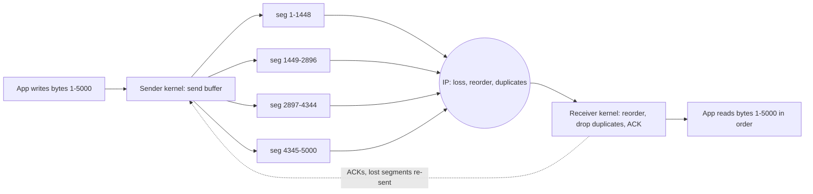

### Interview angle

"Is TCP reliable?" The architect answer: it is reliable **between kernels**, for as long as the connection lives.  
It gives no proof that the remote application processed anything, and if the connection breaks mid-request, the client cannot know whether the server acted.  
That is the root of every "retry safely" design: idempotency keys, at-least-once delivery with deduplication.

---

## 04.02 The segment header, field by field

Every segment starts with a header of 20 to 60 bytes: two ports, a **sequence number** (the position of this segment's first byte in the stream),  
an **acknowledgment number** (the next byte the sender expects from the peer), flags (SYN, ACK, FIN, RST, PSH and others),  
a **window** (how many more bytes the sender of this segment can accept), a checksum, and options negotiated in the handshake (MSS, window scale, SACK, timestamps).

### Layout

The header in the style of RFC 9293 (each row is 32 bits; numbers on top are bit positions):

```
 0                   1                   2                   3
 0 1 2 3 4 5 6 7 8 9 0 1 2 3 4 5 6 7 8 9 0 1 2 3 4 5 6 7 8 9 0 1
+-------------------------------+-------------------------------+
|          Source Port          |       Destination Port        |
+-------------------------------+-------------------------------+
|                        Sequence Number                        |
+---------------------------------------------------------------+
|                    Acknowledgment Number                      |
+-------+-------+-+-+-+-+-+-+-+-+-------------------------------+
| Data  | Rsrvd |C|E|U|A|P|R|S|F|                               |
| Offset|       |W|C|R|C|S|S|Y|I|            Window             |
|       |       |R|E|G|K|H|T|N|N|                               |
+-------+-------+-+-+-+-+-+-+-+-+-------------------------------+
|           Checksum            |         Urgent Pointer        |
+-------------------------------+-------------------------------+
|                    Options (0 to 40 bytes)                    |
+---------------------------------------------------------------+
|                             Data                              |
+---------------------------------------------------------------+
```

| Field                 | Bits  | Meaning                                                                                               |
| --------------------- | ----- | ----------------------------------------------------------------------------------------------------- |
| Source port           | 16    | Sender's port; the client's is ephemeral (H02.06)                                                     |
| Destination port      | 16    | Receiver's port, for example 443                                                                      |
| Sequence number       | 32    | Stream position of the first data byte in this segment. SYN and FIN each consume one number           |
| Acknowledgment number | 32    | Valid when ACK is set: "I have received every byte before this number; send this one next"            |
| Data offset           | 4     | Header length in 32-bit words: 5 (20 bytes) to 15 (60 bytes)                                          |
| Reserved              | 4     | Must be zero                                                                                          |
| Flags                 | 8     | CWR, ECE (congestion signals, 04.06), URG, ACK, PSH, RST, SYN, FIN                                    |
| Window                | 16    | Bytes the sender of this segment is willing to receive, starting at the acknowledgment number (04.05) |
| Checksum              | 16    | Ones' complement sum over a pseudo-header (IPs, protocol, length), the header and the data            |
| Urgent pointer        | 16    | Legacy "out-of-band" data; effectively unused by modern protocols                                     |
| Options               | 0-320 | Type-length-value entries (H01.05), padded to a multiple of 4 bytes                                   |

### The flags

| Flag | Name                      | Meaning                                                                                                     |
| ---- | ------------------------- | ----------------------------------------------------------------------------------------------------------- |
| SYN  | Synchronize               | "Here is my initial sequence number." Only in the first segment from each side                              |
| ACK  | Acknowledge               | The acknowledgment number is valid. Set on every segment after the first SYN                                |
| FIN  | Finish                    | "I have no more data to send." Closes one direction (04.09)                                                 |
| RST  | Reset                     | "This connection does not exist or is aborted." Kills both directions immediately (04.09)                   |
| PSH  | Push                      | "Deliver to the application without waiting for more." Set by the sender's stack when a write has been sent |
| URG  | Urgent                    | The urgent pointer is valid. Legacy                                                                         |
| ECE  | ECN-Echo                  | Explicit Congestion Notification: "a router marked my incoming packets as congested" (04.06)                |
| CWR  | Congestion Window Reduced | "I have reacted to your ECE"                                                                                |

`tcpdump` prints flags as letters: `S` SYN, `.` ACK, `P` PSH, `F` FIN, `R` RST, `E` ECE, `W` CWR. So `[S.]` is SYN+ACK and `[P.]` is a data segment with PSH and ACK.

### The options

| Kind | Length | Name                 | Where                                  | Purpose                                                                   |
| ---- | ------ | -------------------- | -------------------------------------- | ------------------------------------------------------------------------- |
| 0    | 1      | End of option list   | Anywhere                               | Padding at the end                                                        |
| 1    | 1      | NOP                  | Anywhere                               | Padding to align the next option                                          |
| 2    | 4      | MSS                  | SYN only                               | "Do not send me segments with more than N data bytes" (H02.04)            |
| 3    | 3      | Window scale         | SYN only                               | "Multiply my window field by 2^N." N is 0 to 14 (04.05)                   |
| 4    | 2      | SACK permitted       | SYN only                               | "I understand selective acknowledgments"                                  |
| 5    | varies | SACK                 | Any ACK                                | "Besides the cumulative ACK, I also hold these byte ranges" (04.04)       |
| 8    | 10     | Timestamps           | SYN, then every segment if both agreed | RTT measurement on every ACK; protection against wrapped sequence numbers |
| 34   | varies | TCP Fast Open cookie | SYN                                    | 04.10                                                                     |

### A real SYN, decoded

The first segment `curl` sent in Lab 01, as `tcpdump -x` printed it (IPv4 header first, then TCP):

```
0x0000:  4500 003c 48b1 4000 4006 f408 7f00 0001     IPv4: 20-byte header, total 60 bytes, protocol 06 = TCP
0x0010:  7f00 0001 85a2 1f40 96cb 2930 0000 0000     ...dst 127.0.0.1 | TCP starts at 0x0014
0x0020:  a002 faf0 fe30 0000 0204 05b4 0402 080a
0x0030:  e724 14c9 0000 0000 0103 030a
```

| Bytes                           | Field                  | Value                                                           |
| ------------------------------- | ---------------------- | --------------------------------------------------------------- |
| `85 a2`                         | Source port            | 34210 (ephemeral)                                               |
| `1f 40`                         | Destination port       | 8000                                                            |
| `96 cb 29 30`                   | Sequence number        | 2529896752: the client's random initial sequence number (04.03) |
| `00 00 00 00`                   | Acknowledgment number  | 0, not valid yet (ACK flag clear)                               |
| `a0`                            | Data offset + reserved | `a` = 10 words = 40-byte header, so 20 bytes of options         |
| `02`                            | Flags                  | `0000 0010` = SYN only                                          |
| `fa f0`                         | Window                 | 64240 (never scaled in a SYN)                                   |
| `fe 30`                         | Checksum               | (computed over pseudo-header, header and data)                  |
| `00 00`                         | Urgent pointer         | 0                                                               |
| `02 04 05 b4`                   | Option: MSS            | Kind 2, length 4, value `05b4` = 1460                           |
| `04 02`                         | Option: SACK permitted | Kind 4, length 2                                                |
| `08 0a e7 24 14 c9 00 00 00 00` | Option: Timestamps     | Kind 8, length 10, TSval 3877901513, TSecr 0                    |
| `01`                            | Option: NOP            | Padding so the next option ends on a 4-byte boundary            |
| `03 03 0a`                      | Option: Window scale   | Kind 3, length 3, shift 10: "multiply my window by 1024"        |

`tcpdump` shows the same thing in one line:

```
IP 127.0.0.1.34210 > 127.0.0.1.8000: Flags [S], seq 2529896752, win 64240, options [mss 1460,sackOK,TS val 3877901513 ecr 0,nop,wscale 10], length 0
```

### Sequence numbers are byte positions

Each side picks a random **initial sequence number (ISN)**. The SYN uses the ISN; the first data byte is ISN + 1.  
If the client's ISN is 1000 and it sends 86 bytes of request, they occupy sequence numbers 1001 to 1086, and the server acknowledges with `ack 1087`: "I have everything up to 1086; send 1087 next".  
`tcpdump` prints sequence numbers relative to the ISN after the handshake (so `seq 1:87`), which is easier to read; `tcpdump -S` prints absolute values.

The 32-bit space wraps after 4 GiB. At 10 Gbit/s that takes 3.4 seconds, so an old delayed segment could carry a sequence number that looks valid again.  
The timestamps option guards against this (**PAWS**, protection against wrapped sequences): a segment with an older timestamp than the last one seen is dropped.

### Interview angle

"What is in a TCP header?"  
List the fields, then say why the sequence number counts bytes rather than segments (so TCP can re-segment freely on retransmission and coalesce small writes),  
and why the window field needs the scale option (16 bits cap the window at 64 KiB, far below what modern paths need, 04.05).

---

## 04.03 Opening a connection: handshake, initial sequence numbers, the two queues

The client sends SYN with its ISN and options, the server answers SYN-ACK with its own ISN and options, the client answers ACK: the **three-way handshake**, costing one round trip before any request byte can be sent.  
The server's kernel completes handshakes **on its own**, before the application calls `accept()`, and parks finished connections in an **accept queue** whose size is the `backlog`.  
When that queue is full, new SYNs are dropped and clients wait at least a second.  
A **SYN flood** fills the queue of half-open connections; **SYN cookies** defend against it by keeping no state until the final ACK.

### The handshake

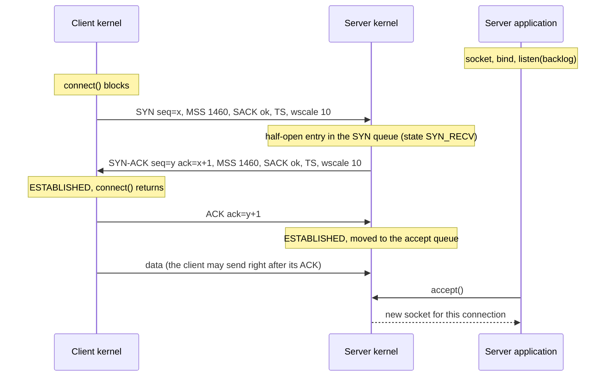

Three things are agreed:

01. **Both initial sequence numbers.** Each side's SYN carries its ISN, and each side acknowledges the other's (`ack = ISN + 1`, since the SYN consumes one number).

02. **Options.** MSS, window scale, SACK and timestamps are offered in the SYN. An option is used only if both SYNs carry it.

03. **That both directions work.** The client knows the server can hear it and answer; the server knows the client heard its answer.

Why three messages and not two: with two, the server would never learn that its SYN-ACK arrived, and a delayed duplicate SYN from an old connection attempt could create a connection that nobody wants.

**Cost:** one RTT before the client can send its request.  
The client sends data right after its ACK, so a request-response exchange on a new connection costs at least 2 RTTs;  
TLS adds 1 (TLS 1.3) or 2 (TLS 1.2) more (H15). This is the main reason connection reuse matters so much (H08).

### Why initial sequence numbers are random

Two reasons:

01. **Old segments from a previous connection with the same 4-tuple** must not fall inside the new connection's sequence window.  
  A clock-based ISN that keeps moving forward makes that unlikely.

02. **Blind spoofing.** If an attacker who cannot see the traffic could predict the ISN, they could forge a whole connection from a spoofed source address (the 1994 Mitnick attack exploited predictable ISNs), or inject data or RST into an existing one. RFC 6528 defines ISN = a 4-microsecond clock + a keyed hash of the 4-tuple and a secret, which is both moving and unpredictable.

### The two queues on the server

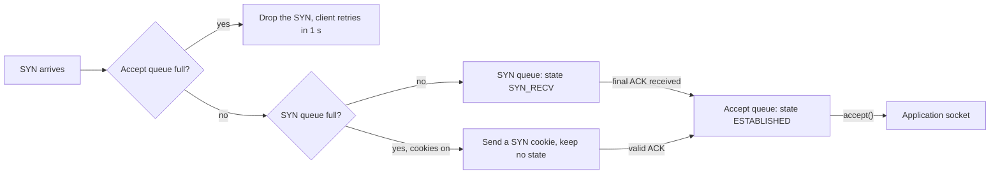

- **SYN queue**: half-open connections, after the SYN-ACK was sent and before the client's ACK arrives. Bounded by `net.ipv4.tcp_max_syn_backlog`.

- **Accept queue**: fully established connections waiting for the application to call `accept()`.  
  Bounded by the `backlog` argument of `listen()`, capped by `net.core.somaxconn` (4096 on Linux since 5.4; 128 before).

The application does not take part in the handshake. Lab 02 shows it: a server that never calls `accept()` still completes `backlog + 1` handshakes, and clients see `connect()` succeed.  
Then the queue is full and the kernel drops further SYNs. The client retransmits its SYN after 1 second, and the drop is counted in `nstat` as `TcpExtListenOverflows` and `TcpExtListenDrops`.

| Stack                        | Default backlog                                    |
| ---------------------------- | -------------------------------------------------- |
| Java `ServerSocket`          | 50                                                 |
| JDK `jwebserver`             | 50 (seen in Lab 00's `ss -tln`)                    |
| Tomcat / Spring Boot         | `acceptCount` = 100 (`server.tomcat.accept-count`) |
| Netty                        | Read from `net.core.somaxconn`                     |
| Rust `std::net::TcpListener` | 128, not configurable (use `socket2` to change it) |
| Linux cap (`somaxconn`)      | 4096 (kernel 5.4 and later)                        |

**Why this matters in production.** When a server is briefly overloaded (a garbage-collection pause, a burst after a deploy), its accept queue fills, SYNs are dropped, and clients see latency jump by exactly 1 s, then 2 s, then 3 s: the SYN retransmission timer.  
A p99 latency with a spike at about 1,000 ms is the fingerprint of SYN drops or a full accept queue. `ss -tln` shows it directly: for a listening socket, `Recv-Q` is the current accept-queue length and `Send-Q` is its limit.

### When the handshake fails

| What the client sees                      | Cause                                                                | How long it takes                                    |
| ----------------------------------------- | -------------------------------------------------------------------- | ---------------------------------------------------- |
| `Connection refused` (`ECONNREFUSED`)     | Nothing listens on the port; the host answers SYN with RST           | One RTT (Lab 05: 6.5 ms including JVM overhead)      |
| `Connect timed out` (application timeout) | SYNs or SYN-ACKs are dropped: firewall, full accept queue, dead host | The application's connect timeout                    |
| `Connection timed out` (`ETIMEDOUT`)      | Same, with no application timeout                                    | The kernel gives up: about 130 s with Linux defaults |
| `No route to host` (`EHOSTUNREACH`)       | ICMP unreachable from a router, or ARP failed (H02.03)               | Seconds                                              |

The SYN retransmission schedule (Lab 05, measured on Linux 6.18): retries at 1, 2, 3, 4, 5, 7, 11, 19, 35 and 67 seconds after the first SYN, then `ETIMEDOUT` at about 131 s.  
Recent kernels retry the first few SYNs at a fixed 1-second interval (`net.ipv4.tcp_syn_linear_timeouts`, 4 here) before doubling;  
older kernels double from the start (1, 3, 7, 15, 31, 63 s, giving up after about 127 s with `tcp_syn_retries = 6`).  
Either way, **always set a connect timeout** in clients; a few hundred milliseconds to a few seconds within a data center.

### SYN flood and SYN cookies

A **SYN flood** sends SYNs from spoofed source addresses.  
Each creates a half-open entry; the SYN-ACKs go to addresses that never answer; the SYN queue fills and real clients cannot connect.  
It costs the attacker almost nothing per entry.

**SYN cookies** (`net.ipv4.tcp_syncookies = 1`, the Linux default, which uses them only when the SYN queue overflows) remove the state.  
The server encodes what it needs into its own ISN: a coarse timestamp, an index for the client's MSS, and a keyed hash of the 4-tuple.  
It stores nothing. When the final ACK arrives, `ack - 1` must be a valid cookie, and the server rebuilds the connection from it.  
A spoofed SYN therefore costs the server one SYN-ACK and no memory.

The cost: little room in 32 bits, so options beyond the MSS index are lost unless the timestamps option carries them (Linux encodes window scale and SACK permission in the timestamp value).  
Large-scale floods are absorbed upstream by DDoS protection (anycast scrubbing, cloud load balancers that terminate TCP), but SYN cookies keep a single host alive.

### Interview angle

"What happens when you call `connect()`?"  
Walk the handshake, name the two queues, and point out that `connect()` returning does not mean the server application has seen the connection.  
Then the failure table: refused is fast and means "nothing listening"; timeout means "something drops packets", and its duration depends on your timeout settings.

---

## 04.04 Reliability: acknowledgments, retransmission timeout, fast retransmit, SACK

The receiver acknowledges the highest in-order byte it holds (**cumulative ACK**).  
The sender keeps every unacknowledged byte and retransmits it when either a timer expires (**RTO**, retransmission timeout, computed from measured RTTs, at least 200 ms on Linux,  
doubling on each repeat) or three duplicate ACKs show that a later segment arrived but an earlier one did not (**fast retransmit**).  

**SACK** lets the receiver report exactly which ranges it holds, so the sender retransmits only the holes.

### Cumulative acknowledgment

The acknowledgment number says "every byte before this has arrived". If segments carrying bytes 1-1448, 1449-2896 and 2897-4344 are sent and the second is lost, the receiver can only acknowledge 1449 (after the first) and then again 1449 (after the third): a **duplicate ACK**.  
The third segment's bytes wait in the receive buffer, invisible to the application, until the hole is filled (04.08).

Receivers do not ACK every segment: the **delayed ACK** rule (04.07) allows one ACK for every two full-size segments, or a short timer.  
ACKs also ride for free on data flowing the other way (**piggybacking**).

### The retransmission timeout (RFC 6298)

The sender measures RTT samples (with the timestamps option, on every ACK) and keeps two smoothed values:

```
first sample R:     SRTT = R                 RTTVAR = R / 2
each later sample:  RTTVAR = 3/4 * RTTVAR + 1/4 * |SRTT - R|
                    SRTT   = 7/8 * SRTT   + 1/8 * R
timeout:            RTO    = SRTT + max(G, 4 * RTTVAR)       G = clock granularity
```

- **SRTT** (smoothed RTT) is a moving average; **RTTVAR** tracks how much RTT varies. The RTO sits about four deviations above the average, so a merely slow segment rarely looks lost.

- **Bounds.** RFC 6298 recommends a minimum RTO of 1 s. Linux uses 200 ms (`TCP_RTO_MIN`) and a maximum of 120 s.  
  The initial RTO before any sample is 1 s, which is why a lost SYN costs a full second.

- **Exponential backoff.** Each time the same segment times out again, RTO doubles. A congested or broken path is not hammered.

- **Karn's algorithm.** RTT samples are not taken from retransmitted segments (it is ambiguous which copy was acknowledged); timestamps remove the ambiguity.

Lab 07's estimator, fed with 100 ms samples and a spike to 300 ms:

```
sample      RTT     SRTT   RTTVAR      RTO
1           100    100.0     50.0      300
6           100    100.0     12.6      200     <- stable path: RTO falls to the 200 ms floor
7           300    125.0     59.5      363     <- one slow sample: RTO jumps
8           310    148.1     90.9      512
14          100    121.6     42.2      290     <- decays back over several samples
if the next segment is lost, retransmissions fire after: 290 871 2033 4355 9001 18293 ms
```

### What a timeout looks like (Lab 05)

One small message every 500 ms; then all traffic to the server is dropped for 4 seconds. The capture shows the lost segment being sent again and again:

```
01.520607  seq 67:89 length 22     original (msg 4); the block started at about 1.24 s
01.724909  seq 67:89 length 22     +204 ms  tail loss probe
01.932927  seq 67:89 length 22     +208 ms  first RTO
02.368895  seq 67:89 length 22     +436 ms  RTO doubled
03.196939  seq 67:89 length 22     +828 ms
04.860896  seq 67:89 length 22     +1664 ms
                                   the block ended at about 5.25 s ...
08.221076  seq 67:89 length 22     +3360 ms  ... but nothing was sent until this retransmission, 3 s later
08.221117  ack 89                  finally acknowledged
```

Three lessons from one capture:

01. **The outage lasted 4 s; the application stalled for 6.7 s.** Exponential backoff means recovery waits for the next scheduled retransmission, not for the network.

02. **The application never noticed.** Every `write()` during the outage returned immediately; the bytes waited in the send buffer.

03. **The first retransmission was a probe, not a timeout.** Linux uses RACK-TLP (RFC 8985): when the last segment in flight goes unacknowledged, it sends a **tail loss probe** after about 2 x SRTT (plus a 200 ms allowance for the receiver's delayed ACK when only one segment is in flight) to trigger an ACK that reveals the loss quickly.

How long before TCP gives up on an established connection: `net.ipv4.tcp_retries2 = 15` retransmissions, which with backoff is about **15 minutes** (924.6 s with the 200 ms floor).  
A client talking to a server that vanished (power loss, a network partition) without a timeout of its own hangs that long.  
Defenses: application read timeouts, `TCP_USER_TIMEOUT` (RFC 5482; available in Netty's epoll transport and Rust's `socket2`), and keepalive (04.10).

### Fast retransmit and SACK

Waiting a whole RTO for every loss would be slow. When data keeps flowing, the receiver's duplicate ACKs reveal a hole much sooner:

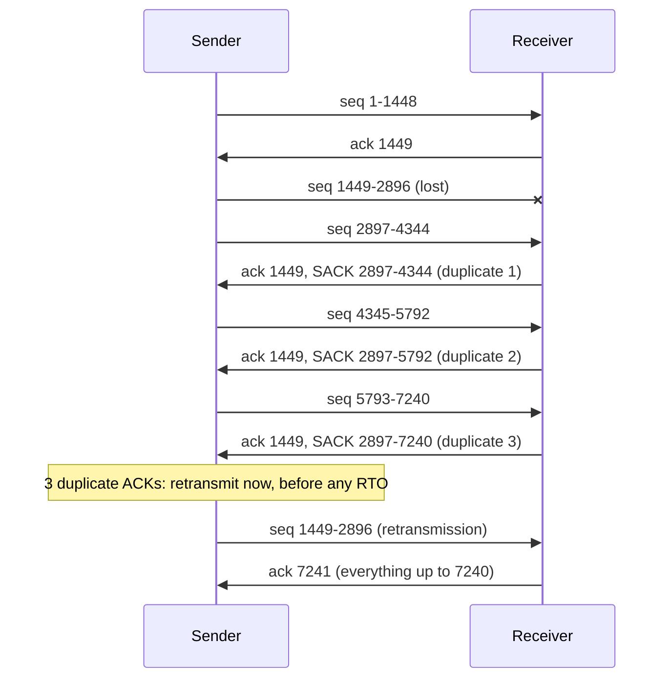

- **Fast retransmit** (RFC 5681): three duplicate ACKs trigger an immediate retransmission of the first unacknowledged segment.  
  Three, not one, because a single duplicate ACK is often just reordering.

- **SACK** (selective acknowledgment, RFC 2018): with plain cumulative ACKs, the sender knows only where the first hole is. SACK blocks (option kind 5) list the ranges beyond the hole that have arrived, so with several losses in one window the sender repairs all holes in one round trip instead of one per RTT.

- **RACK** (RFC 8985), the modern Linux default, detects loss by time instead of by counting duplicates: if a segment sent later has been acknowledged and an earlier one has not after a short reordering window, the earlier one is lost.  
  It handles reordering and losses at the tail of a transfer better than the duplicate-ACK rule.

Every retransmission also tells congestion control that the network is overloaded (04.06): fast retransmit reduces the sending rate moderately; an RTO collapses it to one segment.

### Interview angle

"How does TCP detect loss?" Two signals: a timer (RTO, adaptive, with backoff) and duplicate ACKs or SACK (fast retransmit, much faster).  
Then the operational point: timeout-driven recovery is what makes TCP latency spiky, so a p99 that jumps by about 200 ms, 400 ms or 1 s is a loss signature worth checking with `nstat TcpExtTCPTimeouts` and `ss -ti` (`retrans:` field).

---

## 04.05 Flow control: the receive window

Flow control stops a fast sender from overrunning a slow **receiver**. In every segment, the receiver advertises its **receive window** (rwnd): how many more bytes it can buffer.  
The sender never has more unacknowledged bytes in flight than that.  
If the application stops reading, the window shrinks to zero, the sender stops, and `write()` blocks once the sender's own buffer is full.  
The 16-bit window field is multiplied by 2^scale, negotiated in the handshake, so modern windows can reach about 1 GiB.

### The sliding window

From the sender's view, its byte stream is divided by two numbers it learns from each ACK: the acknowledgment number and the advertised window.

```
          acknowledged   |  in flight (sent, not ACKed)  |  may send now  |  must wait
   ... ==================|===============================|================|.............
                     SND.UNA                       SND.NXT        SND.UNA + window
```

- **SND.UNA**: the oldest unacknowledged byte.

- **SND.NXT**: the next byte to send.

- **SND.UNA + window**: the right edge. As ACKs arrive, the left edge moves right; as the receiver's application reads, the window it advertises grows again, and the right edge moves right. The window "slides".

The sender may have at most `min(rwnd, cwnd)` bytes in flight, where **cwnd** is the congestion window from 04.06. Flow control protects the receiver; congestion control protects the network.

### Window scaling

The window field is 16 bits, so without scaling the window is at most 65,535 bytes. A sender can have one window per RTT in flight, so throughput is capped at `window / RTT`:

| Window              | RTT 1 ms    | RTT 20 ms   | RTT 100 ms |
| ------------------- | ----------- | ----------- | ---------- |
| 64 KiB (no scaling) | 524 Mbit/s  | 26 Mbit/s   | 5.2 Mbit/s |
| 4 MiB               | 33.6 Gbit/s | 1.7 Gbit/s  | 336 Mbit/s |
| 32 MiB              | 268 Gbit/s  | 13.4 Gbit/s | 2.7 Gbit/s |

The **window scale** option (RFC 7323), sent only in the SYN, gives a shift of 0 to 14: the real window is `field x 2^shift`.  
In the captures, `wscale 10` means multiply by 1024, so `win 63` after the handshake means 64,512 bytes. Both SYNs must carry the option, or neither side scales.  
A middlebox that strips it (old firewalls did) silently caps every connection at 64 KiB per RTT, a classic "the link is 1 Gbit/s but transfers crawl" cause.

### Autotuning and buffer sizes

Linux sizes receive buffers automatically between the three values in `net.ipv4.tcp_rmem` (minimum, default, maximum; here `4096 131072 33554432`), growing the buffer when the application reads fast enough to need it.  
Send buffers grow within `net.ipv4.tcp_wmem`.

Setting `SO_RCVBUF` or `SO_SNDBUF` explicitly (`Socket.setReceiveBufferSize` in Java) **disables autotuning** for that socket on Linux, and the receive buffer must be set before `connect()` or `listen()` for the window scale to account for it.  
Unless measurements show a need, leave both unset.

### Zero window and the persist timer

Lab 03 runs a receiver that does not read for 6 seconds while the sender writes as fast as it can:

```
t= 0.5s  sender has written    753,664 bytes
t= 1.0s  sender has written    753,664 bytes   <- write() is blocked
...
receiver: starting to read
t= 6.0s  sender has written  6,160,384 bytes
```

`ss -tn` during the stall shows where the bytes are:

```
State Recv-Q Send-Q Local Address:Port  Peer Address:Port
ESTAB 127480 0          127.0.0.1:9001     127.0.0.1:38086     <- receiver: 127,480 bytes unread
ESTAB 0      638568     127.0.0.1:38086    127.0.0.1:9001      <- sender: 638,568 bytes not yet accepted
```

For an established socket, `Recv-Q` is bytes received but not read by the application, and `Send-Q` is bytes not yet acknowledged by the peer.  
The 753,664 bytes the application "wrote" are split between the two kernels; none of them reached the receiving application.

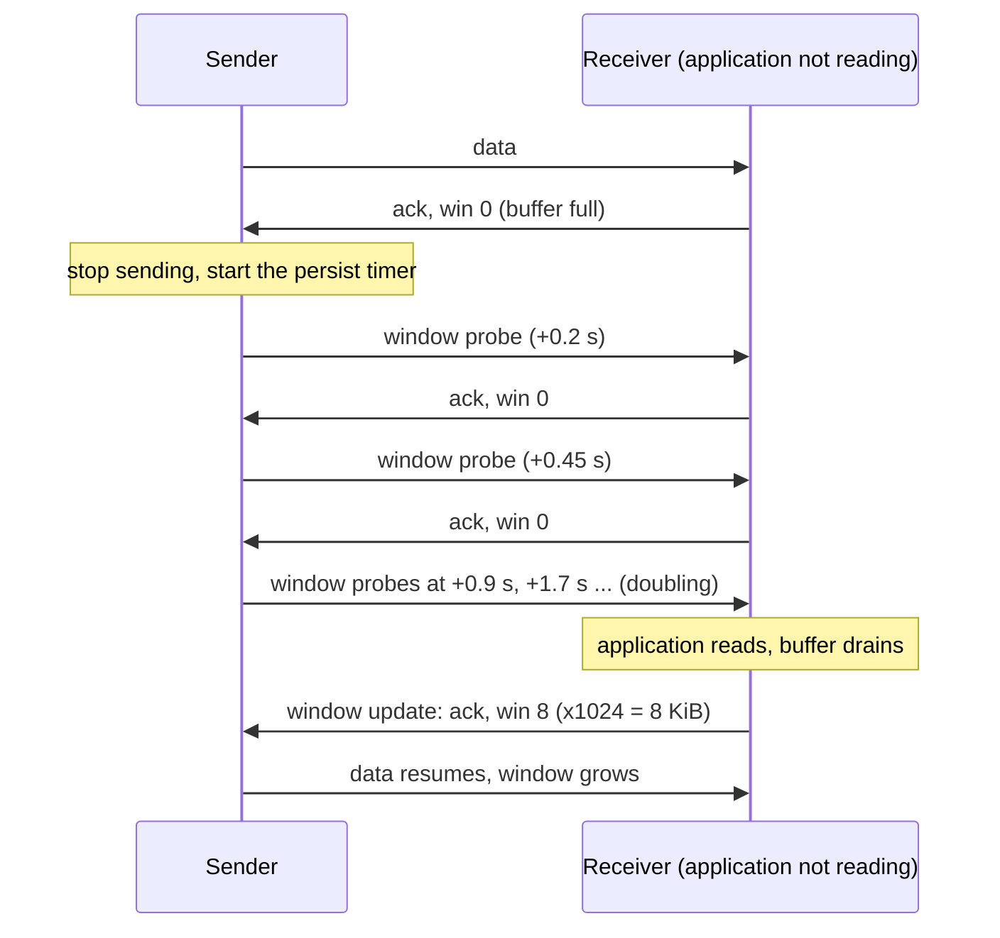

A **zero window** is not an error; the connection is healthy and simply paused.  
The sender keeps the connection alive with **window probes** sent on the persist timer, with backoff (the capture shows them at about 0.2, 0.45, 0.9 and 1.7 s apart).  
Without probes, a lost window update would deadlock both sides forever: the receiver waiting for data, the sender waiting for a window.

Receivers also avoid **silly window syndrome**: advertising tiny windows (a few bytes) as the application reads a little at a time, which would make the sender emit tiny segments.  
The receiver waits until it can offer at least one MSS or half its buffer.

### What it means for services

- **Backpressure is built in.** A slow consumer makes the producer's `write()` block (or, with non-blocking I/O, return "would block", H05).  
  A proxy that reads from one connection and writes to another without respecting this, buffering in memory instead, can run out of memory.

- **A stuck reader stalls the writer.** A service whose thread pool is exhausted stops reading its sockets; every client writing to it blocks in turn.

- **Buffer sizes must cover the bandwidth-delay product** (04.06) for full speed on long paths.

### Interview angle

"Flow control vs congestion control?" Flow control: receiver to sender, explicit (the window field), protects the receiver's memory.  
Congestion control: inferred from loss or delay, protects the network. The sender obeys whichever is smaller.  
Bonus: `Recv-Q` growing on a server socket means the application is not reading fast enough; `Send-Q` growing means the peer or the network is not keeping up.

---

## 04.06 Congestion control: slow start, Reno, CUBIC, BBR, bandwidth-delay product

The sender cannot see the network, so it guesses how much data the path can hold and keeps a **congestion window** (cwnd) of bytes it allows itself in flight.  
It starts small (10 segments), doubles every RTT (**slow start**) until it sees loss, then grows slowly and cuts back on each loss (**congestion avoidance**). **Reno** halves on loss and adds one segment per RTT;  
**CUBIC**, the Linux, Windows and macOS default, cuts by 30% and regrows along a cubic curve, which suits fast long paths; **BBR** measures bandwidth and minimum RTT instead of waiting for loss.  
To fill a path, the window must reach the **bandwidth-delay product** (bandwidth x RTT).

### Why the network needs protecting

Routers have finite queues.  
If every sender transmitted as fast as its own link allowed, queues at the bottleneck would overflow, packets would be dropped, senders would retransmit, and the network would carry mostly retransmissions.  
This happened: the 1986 **congestion collapse**, when throughput between Lawrence Berkeley Laboratory and UC Berkeley fell from 32 kbit/s to 40 bit/s.  
Van Jacobson's 1988 algorithms (slow start, congestion avoidance, fast retransmit) are the fix, and they are still the skeleton of every TCP.

### Bandwidth-delay product

The **bandwidth-delay product (BDP)** is how many bytes are "in the pipe" when it is full: the bottleneck bandwidth times the RTT.  
To keep the pipe full, a sender needs at least one BDP of unacknowledged data in flight, so both cwnd and the receiver's window must reach it.

| Path                      | Bandwidth | RTT    | BDP     |
| ------------------------- | --------- | ------ | ------- |
| Same rack                 | 25 Gbit/s | 0.1 ms | 312 KB  |
| Same region, across zones | 10 Gbit/s | 1 ms   | 1.25 MB |
| Mumbai to Frankfurt       | 1 Gbit/s  | 120 ms | 15 MB   |
| Mobile 4G                 | 20 Mbit/s | 60 ms  | 150 KB  |

Throughput is at most `min(cwnd, rwnd) / RTT`. A path with a large BDP (a "long fat network") needs window scaling (04.05), large buffers, and a congestion controller that grows quickly.

### The phases

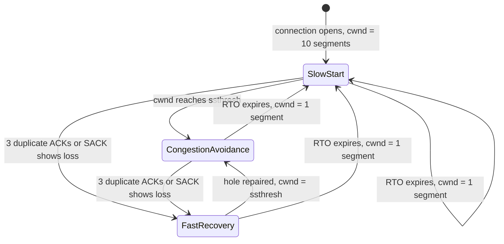

- **Slow start.** cwnd starts at the **initial window**, 10 segments (about 14 KB, RFC 6928; older stacks used 2 to 4).  
  Each ACK adds one segment, so cwnd doubles every RTT: 10, 20, 40, 80. "Slow" is historical; growth is exponential.

- **ssthresh** (slow-start threshold): the cwnd at which slow start hands over to congestion avoidance.  
  Initially unlimited; after a loss, set to the reduced window.

- **Congestion avoidance.** cwnd grows by about one segment per RTT (Reno), probing gently for spare capacity.

- **Fast recovery** (on fast retransmit, 04.04): ssthresh = cwnd x beta, cwnd = ssthresh, keep sending. Reno uses beta = 0.5; CUBIC 0.7.  
  This pattern is **AIMD**: additive increase, multiplicative decrease. It is what makes competing flows converge to fair shares.

- **Timeout.** An RTO means the ACK clock has stopped entirely; cwnd collapses to 1 segment (the **loss window**) and slow start begins again.  
  This is much more expensive than fast recovery.

### Reno, CUBIC and the long-path problem

Reno's +1 segment per RTT is too slow on paths with a large BDP.  
Lab 07's model of a 100 Mbit/s path with 100 ms RTT (BDP 863 segments, loss when cwnd exceeds 1295 because the bottleneck buffer holds half a BDP):

```
reno: after the first loss, cwnd 648 (halved), then +1 per RTT
round  15  t=  1.5s  cwnd    652  avoidance  |#########################
round 150  t= 15.0s  cwnd    787  avoidance  |##############################
round 300  t= 30.0s  cwnd    937  avoidance  |####################################
link utilisation over 300 rounds: 89%

cubic: after the first loss, cwnd 906 (x0.7), then regrows on a cubic curve
round  15  t=  1.5s  cwnd    962  avoidance  |#####################################
round  60  t=  6.0s  cwnd   1248  avoidance  |################################################
round 105  t= 10.5s  cwnd   1295  avoidance  |##################################################
round 110  t= 11.0s  cwnd   1295  LOSS       |##################################################
link utilisation over 300 rounds: 98%
```

Reno needs about 650 RTTs, more than a minute, to climb back from one loss. **CUBIC** (RFC 9438) makes the window a function of **time since the last loss**, not of RTT count:

```
W(t) = C x (t - K)^3 + W_max          C = 0.4,  K = cube root of (W_max x (1 - beta) / C)
```

`W_max` is the window when the loss happened.  
The curve rises quickly at first, flattens as it approaches `W_max` (where loss happened last time), then accelerates again to probe for new capacity.  
Because it depends on time, flows with different RTTs grow at similar rates, which is fairer than Reno.  
CUBIC also keeps a Reno estimate and uses whichever is larger, so it is never less aggressive than Reno on short paths. CUBIC has been the Linux default since 2006.

### Loss-based vs model-based

Reno and CUBIC treat **loss** as the congestion signal. On today's networks this has two problems:

01. **Bufferbloat.** Large router buffers delay loss. A loss-based sender fills the buffer before backing off, so every packet waits in the queue: latency rises by tens or hundreds of milliseconds under load, hurting everything sharing the link.

02. **Random loss is not congestion.** On Wi-Fi or long intercontinental paths, a 0.1% loss rate that has nothing to do with congestion still halves the window each time.  
  The Mathis formula estimates loss-limited throughput of Reno-like TCP as `(MSS / RTT) x (1.22 / sqrt(p))`, where `p` is the loss rate: with 1448-byte segments, 100 ms RTT and 0.1% loss, about 4.5 Mbit/s, whatever the link speed (Exercise 02 works through it).

**BBR** (Bottleneck Bandwidth and Round-trip propagation time, Google 2016) models the path instead: it continually estimates the bottleneck bandwidth (maximum delivery rate recently seen) and the minimum RTT, **paces** packets at the estimated bandwidth, and keeps about 2 x BDP in flight.  
  It does not need loss to find the limit and keeps queues short.  
  Trade-offs: BBR v1 could take more than its fair share from CUBIC flows and cause high retransmission rates in shallow buffers; BBR v2 and v3 add loss and ECN signals to address this.  
  Google runs BBR for YouTube and google.com; on Linux it is a module chosen with `net.ipv4.tcp_congestion_control = bbr`.  
  (This sandbox's kernel uses BBR, which is why `ss -ti` lines in the labs print `bbr`; most distributions default to `cubic`.)

**ECN** (Explicit Congestion Notification, RFC 3168) is the cooperative alternative to dropping: a router about to overflow marks the IP header instead, the receiver echoes it with the **ECE** flag, and the sender reduces cwnd as if a loss had happened and answers with **CWR**, without losing data.  
  Data center transports such as DCTCP rely on it.

### What congestion control means for services

- **New connections are slow.** A fresh connection can send only about 14 KB in its first RTT.  
  A 100 KB response needs three round trips of data (10 + 20 + 40 segments = 101 KB) where a 14 KB one needs one.  
  This is another reason to reuse connections (H08) and why the size of the first response (HTML, a JSON payload) matters on high-RTT paths.

- **Idle connections forget.** With `net.ipv4.tcp_slow_start_after_idle = 1` (Linux default), a connection idle for longer than one RTO drops back to the initial window.  
  For long-lived connections that send in bursts (HTTP/2, gRPC, database pools), servers often set it to 0.

- **One connection per transfer is not always best.** Parallel TCP connections each run their own congestion control and together grab more of a shared bottleneck, which is why download managers open several;  
  HTTP/2 deliberately uses one (H17) and relies on a single well-tuned window.

- **Server-side choice.** The sender's algorithm governs each direction.  
  For a server sending large responses over the internet, switching to BBR can raise throughput on lossy, long paths significantly; measure before and after.

### Interview angle

"Why is my 1 Gbit/s link to another continent only giving me 50 Mbit/s per transfer?" Work through: BDP (window big enough? window scaling on? buffers?), loss rate (Mathis), congestion controller (CUBIC vs BBR), and slow start for short transfers. Then the fixes: tune buffers, BBR on the sender, parallel streams, or move data closer.

---

## 04.07 Nagle's algorithm, delayed ACK, and the 40 ms stall

**Nagle's algorithm** (sender side) holds back a small segment while earlier data is still unacknowledged, so many tiny writes become fewer, fuller segments.  
**Delayed ACK** (receiver side) waits up to about 40 ms on Linux (200 ms on Windows) before acknowledging, hoping to piggyback the ACK on a response.  
Together, with a write-write-read pattern, each waits for the other: the second write is held until the ACK, and the ACK is delayed because no response is ready.  
The result is a stall of exactly the delayed-ACK timer per request. `TCP_NODELAY` disables Nagle; most HTTP stacks set it.

### The two optimizations

- **Nagle (RFC 896, 1984)**: if there is unacknowledged data in flight, do not send a segment smaller than the MSS; buffer it until either a full MSS has accumulated or all outstanding data is acknowledged.  
  It was designed for Telnet, where each keystroke would otherwise be a 41-byte packet carrying 1 byte.

- **Delayed ACK (RFC 1122, RFC 9293)**: a receiver may delay an ACK for up to 500 ms (in practice 40 ms minimum on Linux, 200 ms on Windows), and must ACK at least every second full-size segment.  
  If the application replies within the delay, the ACK rides on the reply for free.

Each is sensible alone. The trouble is the combination.

### The stall, step by step

A client sends a request in two `write()` calls (say, headers then body), then waits for the response.  
The server answers only after reading the whole request. Lab 04 measures it:

```
request  1:      150 us
request  2:   44,347 us
request  3:   43,135 us
...
TCP_NODELAY=false  average 39,165 us per request

request  1:      372 us
request  2:      238 us
...
TCP_NODELAY=true  average 133 us per request
```

The capture of request 2:

```
00.010528  client > server  [P.] seq 201:301   length 100    write 1 (header) leaves at once: nothing unacknowledged
                                                              write 2 (body) is held by Nagle: the header is not yet ACKed
00.053748  server > client  [.]  ack 301                      the server's delayed ACK fires, 43 ms later
00.053765  client > server  [P.] seq 301:401   length 100    the body leaves the moment the ACK arrives
00.053789  server > client  [.]  ack 401
00.054063  server > client  [P.] seq 2:3       length 1      the response
```

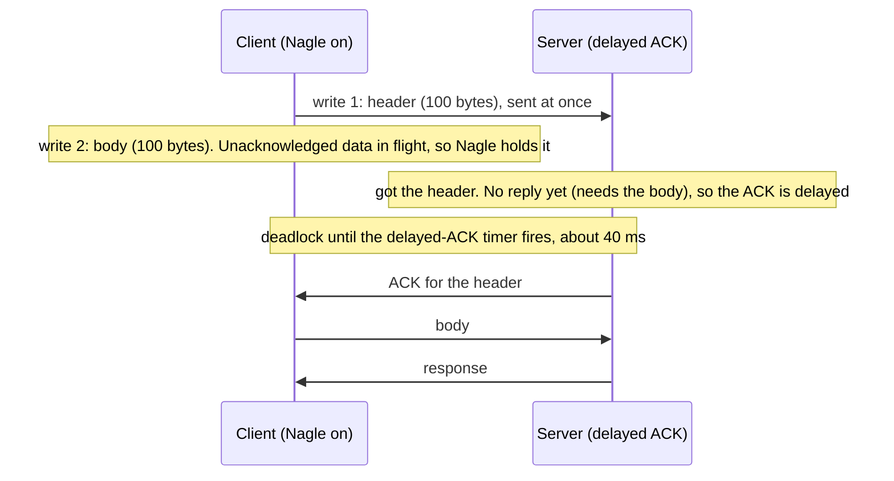

Request 1 was fast because Linux starts every connection in **quick-ACK mode**, acknowledging immediately for the first few segments; the stall begins once it switches to delayed ACKs.

### Fixes, best first

| Fix                              | How                                                                          | Notes                                                                   |
| -------------------------------- | ---------------------------------------------------------------------------- | ----------------------------------------------------------------------- |
| Write each message with one call | Build the full request in a buffer (`BufferedOutputStream`, `writev`)        | Fewer system calls too. Nagle never triggers for a single write         |
| Disable Nagle                    | `TCP_NODELAY`: `socket.setTcpNoDelay(true)`, `stream.set_nodelay(true)`      | Right for request-response protocols. Slight risk of more small packets |
| Ask for an immediate ACK         | `TCP_QUICKACK` on the receiver (Linux only; `jdk.net.ExtendedSocketOptions`) | Not sticky: the kernel may return to delayed mode. A patch, not a fix   |

Which stacks set `TCP_NODELAY` already (checked with `strace` for the two clients): the JDK's `java.net.http.HttpClient` and the `curl` tool both set it; Netty and Tomcat enable it by default.  
Plain `java.net.Socket` and Rust's `std::net::TcpStream` and `tokio::net::TcpStream` do not, so hand-written protocols and simple clients hit the stall.

### Interview angle

"Our internal RPC has a p50 of exactly 40 ms and we cannot find the slow code."  
The answer: Nagle plus delayed ACK. Confirm with a packet capture (a gap of about 40 ms between a small segment and its ACK, with the next segment leaving right after the ACK), then fix with a single write per message or `TCP_NODELAY`.

---

## 04.08 Head-of-line blocking

TCP delivers bytes strictly in order.  
If one segment is lost, every byte after it waits in the receiver's kernel until the retransmission arrives, even bytes that arrived perfectly and belong to unrelated requests. This is transport-level **head-of-line (HOL) blocking**. It is why HTTP/2 over TCP suffers badly on lossy networks (all streams share one byte stream) and why HTTP/3 moved to QUIC, which orders bytes per stream.

### What it looks like

Lab 05 sends one message every 500 ms on one connection. The message sent at 1.53 s is lost repeatedly during a 4-second block:

```
t= 1.53s sender wrote: msg 4
t= 2.03s sender wrote: msg 5
...
t= 7.54s sender wrote: msg 16
t= 8.23s                          receiver got: msg 4 (sent t= 1.53s)
t= 8.23s                          receiver got: msg 5 (sent t= 2.03s)
...
t= 8.23s                          receiver got: msg 16 (sent t= 7.54s)
```

Message 16, sent after the network had recovered, still waited until message 4 was repaired: all twelve messages arrived in the same instant.  
(In this capture the later messages were also held back by the sender, because cwnd had collapsed to one segment; with a working path and a single random loss, they would arrive at the receiver and wait in its buffer instead. The application sees the same thing either way.)

### Why it matters for HTTP

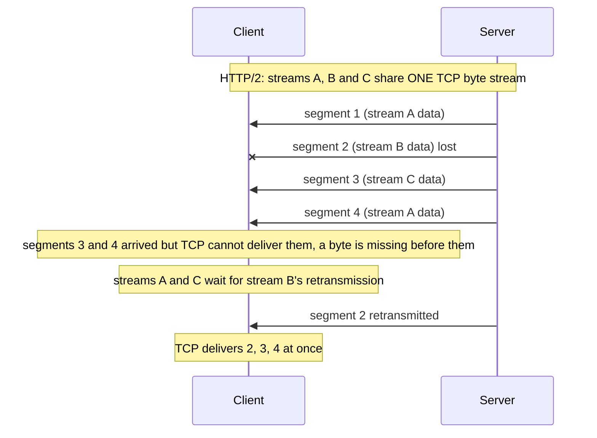

| Protocol         | Head-of-line blocking                                                                                       |
| ---------------- | ----------------------------------------------------------------------------------------------------------- |
| HTTP/1.1         | At the HTTP level: one request at a time per connection. Browsers open about 6 connections per origin (H08) |
| HTTP/2 over TCP  | Solved at the HTTP level (multiplexed streams), but **all** streams stall on one TCP loss (H17)             |
| HTTP/3 over QUIC | QUIC orders bytes per stream: a loss on stream B delays only stream B (H18, H19)                            |

With low loss (data centers), HTTP/2's single connection is better than six; with 2% loss (a bad mobile link), measurements commonly show HTTP/2 doing worse than HTTP/1.1 with several connections, because one loss stalls everything.

### Interview angle

"Why did HTTP/3 abandon TCP?"  
Head-of-line blocking in the kernel's in-order delivery cannot be fixed by any protocol on top of TCP; and TCP itself cannot change quickly because middleboxes ossified it (H02.07).  
QUIC runs over UDP in user space, orders per stream, and encrypts its headers so middleboxes cannot ossify it again.

---

## 04.09 Closing a connection: FIN, half-close, TIME_WAIT, RST, the state machine

Each direction closes separately: a side that is done sending sends **FIN**, the other acknowledges, and the connection is fully closed when both have sent FIN (four segments, often three when a FIN rides with an ACK).  
The side that closes first ends in **TIME_WAIT** for 60 seconds on Linux, to absorb late segments and repeat its final ACK if needed.  
**RST** aborts a connection immediately and appears when a port is closed, when a socket is closed with unread data, when `SO_LINGER` is 0, or when a peer that already closed receives data.  
"Connection reset by peer" means an RST arrived.

### The graceful close

The client from Lab 01 (`curl`) closes first:

```
00.002059  client > server  [F.] seq 87,  ack 160    client: "I am done sending"     client: FIN_WAIT_1
00.002484  server > client  [F.] seq 160, ack 88     server ACKs and sends its own FIN  client: TIME_WAIT
00.002502  client > server  [.]  ack 161             client ACKs the server's FIN       server: CLOSED
```

Three segments here, not four, because the server's application closed immediately, so its ACK of the client's FIN and its own FIN travelled together.  
Each FIN consumes one sequence number, which is why the ACK numbers step by one (`ack 88`, `ack 161`).

### Half-close

Because the two directions are independent, a side can stop sending and keep receiving.  
`shutdownOutput()` in Java, `shutdown(Shutdown::Write)` in Rust, `shutdown(fd, SHUT_WR)` in C send FIN without closing the socket. Lab 06's `halfclose` mode:

```
client: sent FIN with shutdownOutput(), now reading
server: read 17 bytes, then EOF; replying
client: server said: got 17 bytes
```

The server's read returned end-of-stream (EOF) at the client's FIN, and the server still answered on the direction that was open.  
This is how a client says "the request is complete" in protocols without a length field, and what `nc -N` and HTTP/1.0 without `Content-Length` relied on. A `read()` returning EOF (`-1` in Java, `0` in Rust and C) means exactly "the peer sent FIN".

### The state machine

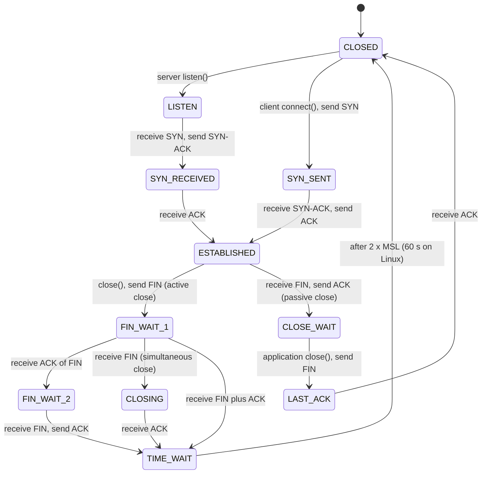

States worth knowing by name, because `ss -tan` shows them:

| State        | Meaning                                                         | Many of them means                                                                     |
| ------------ | --------------------------------------------------------------- | -------------------------------------------------------------------------------------- |
| `LISTEN`     | A server socket waiting for SYNs                                | Normal                                                                                 |
| `SYN-SENT`   | Client sent SYN, no answer yet                                  | Destination unreachable or dropping SYNs                                               |
| `SYN-RECV`   | Server sent SYN-ACK, waiting for ACK                            | Slow clients, or a SYN flood                                                           |
| `ESTAB`      | Data can flow                                                   | Normal; compare with expected pool sizes                                               |
| `FIN-WAIT-2` | We sent FIN and it was acknowledged; waiting for the peer's FIN | The peer application has not closed. Orphans are reaped after `tcp_fin_timeout` (60 s) |
| `CLOSE-WAIT` | The peer sent FIN; **our application** has not called `close()` | **A bug in our code**: a leaked socket. It stays until the process closes it or exits  |
| `TIME-WAIT`  | We closed first; waiting 60 s                                   | High connection churn; see below                                                       |

`CLOSE_WAIT` piling up is one of the most useful signals in this table: the kernel did its part, and the application is leaking connections, typically an HTTP response body that is never closed, which also stalls connection pools.

### Why TIME_WAIT exists

The active closer waits **2 x MSL** (maximum segment lifetime) before forgetting the connection. Linux fixes this at 60 seconds (`TCP_TIMEWAIT_LEN`); note that `tcp_fin_timeout` is a different timer (for `FIN_WAIT_2`), a common confusion. Two reasons:

01. **The final ACK can be lost.** If it is, the peer retransmits its FIN.  
  The side in TIME_WAIT still knows the connection and re-sends the ACK.  
  Without it, the FIN would hit a closed port, provoke an RST, and the peer would report an error for a connection that ended correctly.

02. **Old duplicates must die.** A delayed segment from this connection could arrive after a new connection with the same 4-tuple has started, and corrupt it if its sequence number happened to fit.  
  Waiting for twice the maximum lifetime of a segment in the network guarantees old segments are gone.

The costs and fixes were covered in H02.06 (ephemeral port exhaustion on clients that open many short connections: about 470 new connections per second to one destination with defaults; fix with connection pooling, then `tcp_tw_reuse`).  
TIME_WAIT entries themselves are cheap (a small structure, no buffers); the scarce resource is the 4-tuple.

**`SO_REUSEADDR`** answers a different question: can a **server** bind its listening port while old connections on that port sit in TIME_WAIT?  
Without it, a restarted server fails with "Address already in use" for up to 60 s. Lab 06's `reuse` mode:

```
old server closed; its side of the connection is now in TIME_WAIT
bind with SO_REUSEADDR=false: Address already in use
bind with SO_REUSEADDR=true: OK
```

Java's `ServerSocket` and Rust's `TcpListener::bind` turn it on by default on Linux, which is why most servers restart cleanly.  
Do not confuse it with **`SO_REUSEPORT`**, which lets several sockets listen on the same port at once, with the kernel spreading new connections across them (used by multi-process servers such as NGINX).

### RST: the abort

| Situation                                         | What happens (Lab 06 mode)                                                                                |
| ------------------------------------------------- | --------------------------------------------------------------------------------------------------------- |
| SYN to a port nobody listens on                   | RST in reply; client sees `Connection refused` (Lab 05, `ConnectProbe`)                                   |
| `close()` with SO_LINGER enabled and timeout 0    | RST instead of FIN; unsent data discarded; no TIME_WAIT. Peer sees `Connection reset by peer` (`linger0`) |
| `close()` while received data is still unread     | The kernel sends RST (here right after a FIN). Writing afterwards fails with `Broken pipe` (`unread`)     |
| Data arrives for a connection the receiver closed | RST. The classic stale pooled connection (`stale`)                                                        |
| A middlebox times out an idle connection          | Either silence (the next segment is dropped) or an RST from the middlebox                                 |

The `stale` mode reproduces a production classic:

```
server: answered request 1, closing the idle connection
client: got answer 1
client: write of request 2 succeeded
client: read for response 2 returned -1 (no response, ever)
```

```
00.001440  server > client  [F.]  seq 10, ack 10     the server closed the idle connection
00.044880  client > server  [.]   ack 11             the client's kernel ACKs the FIN; the application does not look
00.305488  client > server  [P.]  seq 10:19          request 2 on the "pooled" connection
00.305572  server > client  [R]   seq 2850838996     the server's kernel has no such connection: RST
```

The client's kernel knew the server had closed (it acknowledged the FIN 300 ms earlier), but a connection pool that does not check before reuse sends the next request anyway.  
The write succeeds; the response never comes; the client library reports "connection reset", "unexpected end of stream", or Apache HttpClient's `NoHttpResponseException`.  
This is why HTTP clients validate idle connections, set their pool's idle timeout **shorter** than the server's keep-alive timeout, and retry such failures automatically only for idempotent requests (REST track R2 deep dives; Exercise 04).

### Interview angle

"What is TIME_WAIT and why do I have 30,000 of them?" Explain the two reasons, that the side that closes first holds it, and that it costs 4-tuples, not memory.  
Then the fixes in order: connection reuse, let the client close first or the server close first depending on who has fewer distinct peers, `tcp_tw_reuse` for clients.  
Never "reduce TIME_WAIT to 1 second" (not tunable on Linux, and unsafe).

---

## 04.10 Keepalive and TCP Fast Open

**TCP keepalive** sends an empty probe on an idle connection to detect a dead peer or keep a NAT or load-balancer mapping alive; it is off by default per socket and, when on, waits 2 hours before the first probe on Linux.  
It is unrelated to **HTTP keep-alive**, which means reusing a connection for several requests. **TCP Fast Open** lets a repeat client send data in its SYN, saving one RTT, but middlebox interference and replay risk kept it marginal;  
TLS 1.3 and QUIC solved the same latency problem one layer up.

### TCP keepalive

| Setting                         | Linux default | Meaning                                         |
| ------------------------------- | ------------- | ----------------------------------------------- |
| `SO_KEEPALIVE` (per socket)     | off           | Enable keepalive on this socket                 |
| `net.ipv4.tcp_keepalive_time`   | 7200 s        | Idle time before the first probe                |
| `net.ipv4.tcp_keepalive_intvl`  | 75 s          | Time between unanswered probes                  |
| `net.ipv4.tcp_keepalive_probes` | 9             | Unanswered probes before the connection is dead |

A probe is a segment with no data and a sequence number one below the next expected, which forces the peer to answer with an ACK.  
If nine probes go unanswered, the connection is reset and the application's next call fails.  
With defaults, detection takes 2 hours plus 11 minutes, far too slow for most uses, so applications that rely on it set per-socket values:

- Java (JDK 11+): `socket.setKeepAlive(true)` and `socket.setOption(ExtendedSocketOption.TCP_KEEPIDLE, 60)` (from `jdk.net.ExtendedSocketOptions`; also `TCP_KEEPINTERVAL`, `TCP_KEEPCOUNT`).

- Rust: the `socket2` crate's `TcpKeepalive`.

- `curl` turns keepalive on with 60 s idle and 60 s interval (visible in `strace`).

**Why it matters:** NAT gateways, firewalls and load balancers drop idle mappings: AWS NLB after 350 s, many home routers after a few minutes, Kubernetes `conntrack` after `nf_conntrack_tcp_timeout_established` (5 days by default, often lowered).  
After that, both ends still think the connection is open, and the next request vanishes or is answered by RST. Keepalive probes more often than the shortest idle timeout on the path keep the mapping alive.

For HTTP, gRPC and WebSocket, prefer **application-level heartbeats** (HTTP/2 `PING`, gRPC keepalive, WebSocket ping): they prove the peer application is responsive, not just its kernel, and they pass through proxies that would absorb TCP-level probes.

### TCP Fast Open (RFC 7413)

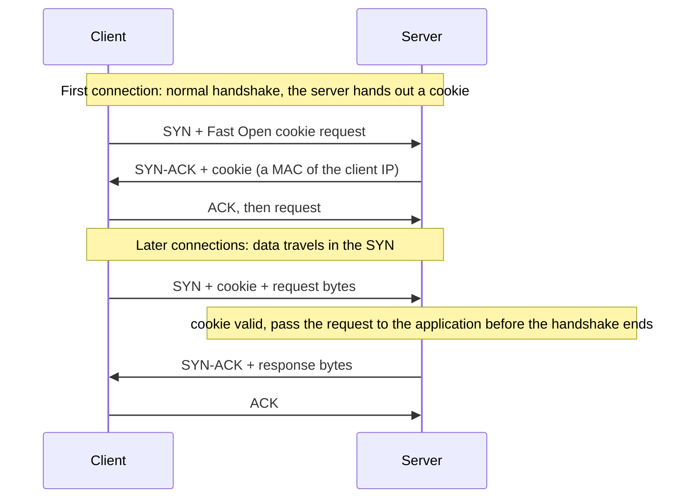

Saving one RTT on every repeat connection sounds compelling. In practice:

- **Middleboxes** drop or mangle SYNs that carry data or unknown options, so clients need fallback logic and caches of "TFO works here".

- **Replay.** A SYN with data can be duplicated by the network, so the server may process the request twice.  
  Only idempotent requests are safe, the same constraint as TLS 1.3 0-RTT (H15).

- **Tracking.** The cookie identifies a returning client.

Linux supports it (`net.ipv4.tcp_fastopen`, a bitmask: 1 = client, 2 = server, 3 = both; 1 here). Browsers tried and removed it.  
The latency win moved up the stack: TLS 1.3 session resumption with 0-RTT, and QUIC, which combines transport and crypto handshakes into one round trip (H19).

### Interview angle

"HTTP keep-alive vs TCP keepalive?" HTTP keep-alive (persistent connections) is about reusing one TCP connection for many requests, saving handshakes.  
TCP keepalive is a probe mechanism for idle connections. Mixing them up is a common tell. Bonus: explain the idle-timeout mismatch between client pools and load balancers (Exercise 04).

---

## 04.11 The story: one HTTP request over a fresh TCP connection

`curl http://127.0.0.1:8000/hello.txt` against the JDK's built-in `jwebserver`, captured with `tcpdump` (Lab 01).  
The response is 159 bytes: 148 of headers and 11 of body, `hello, tcp\n`. Every packet of the connection's life, timestamps relative to the first:

```
 #   time       direction          flags  seq / ack                 length  what
01   0.000000   client > server    [S]    seq 1930999382            0       SYN, options mss 1460, sackOK, TS, wscale 10
02   0.000189   server > client    [S.]   seq 1806977643 ack ...383 0       SYN-ACK, same options
03   0.000208   client > server    [.]    ack 1                     0       handshake done
04   0.000290   client > server    [P.]   seq 1:87                  86      GET /hello.txt HTTP/1.1 ...
05   0.000302   server > client    [.]    ack 87                    0       server kernel ACKs the request
06   0.001703   server > client    [P.]   seq 1:149                 148     HTTP/1.1 200 OK + headers
07   0.001733   client > server    [.]    ack 149                   0
08   0.001907   server > client    [P.]   seq 149:160               11      body: "hello, tcp\n"
09   0.001928   client > server    [.]    ack 160                   0
10   0.002059   client > server    [F.]   seq 87                    0       curl has its answer and closes
11   0.002484   server > client    [F.]   seq 160 ack 88            0       server ACKs and closes too
12   0.002502   client > server    [.]    ack 161                   0       client enters TIME_WAIT for 60 s
```

### The journey at a glance

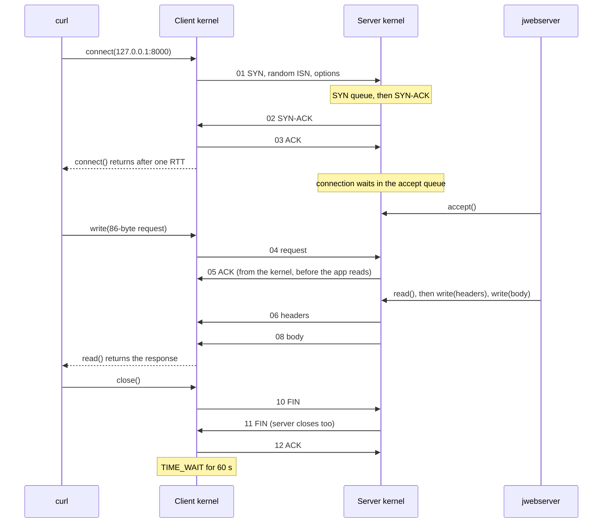

### Chapter 01: connect()

`curl` calls `connect()`. The client kernel picks an ephemeral port (H02.06), generates a random ISN (04.03), and sends a SYN offering its options: MSS 1460 (from the 1500-byte MTU, H02.04), SACK, timestamps, and window scale 10.  
The SYN-ACK comes back with the server's own random ISN and the same options, so both sides will use SACK, timestamps and a scale factor of 1024.  
The client's ACK completes the handshake and `connect()` returns. Elapsed: one round trip.  
On loopback that is 0.2 ms; from Mumbai to a server in Frankfurt it would be about 120 ms, before a single byte of the request has moved.

### Chapter 02: the server has not looked yet

The handshake was done entirely by the server's kernel. `jwebserver` had called `listen()` with backlog 50; the connection now waits in the accept queue until a server thread calls `accept()`.  
If the server were overloaded and the queue full, packet 01 would have been dropped and `curl` would have retried after one second (04.03).

### Chapter 03: the request

`curl` writes the 86-byte request (`GET /hello.txt HTTP/1.1`, `Host`, `User-Agent`, `Accept`, blank line) in one call, with `TCP_NODELAY` set, so it leaves at once as segment 04, with PSH set because the write is complete.  
Its sequence numbers are 1 to 86 relative to the ISN, so the server kernel acknowledges with `ack 87` (packet 05) within 12 microseconds.  
That ACK comes from the kernel, not from `jwebserver`: it says only that the bytes are in the server's receive buffer (04.01).

### Chapter 04: the response

`jwebserver` reads the request, writes the status line and headers (148 bytes, packet 06), then the body (11 bytes, packet 08). Two writes produced two segments.  
Here they did not stall: the server's first segment was acknowledged (packet 07) before the second write.  
On a path with a real RTT and Nagle enabled on the server, the 11-byte segment would have waited for that ACK (04.07).  
Both segments fit easily in the initial congestion window of 10 segments; a response of more than about 14 KB would have needed extra round trips of slow start (04.06).

### Chapter 05: closing

`curl` has a complete response (it knows from `Content-length: 11`, H07) and closes first: FIN in packet 10.  
The server acknowledges and closes in the same segment (packet 11), and the client acknowledges that (packet 12).  
Because `curl` closed first, **the client** now holds the 4-tuple in TIME_WAIT for 60 seconds (04.09). One `curl` per second is harmless;  
1,000 per second from one host to one server would exhaust its ephemeral ports (H02.06).

### What it cost

| Step                                 | Round trips                      | On loopback                 | Mumbai to Frankfurt (RTT 120 ms)  |
| ------------------------------------ | -------------------------------- | --------------------------- | --------------------------------- |
| TCP handshake                        | 1                                | 0.2 ms                      | 120 ms                            |
| Request and response                 | 1                                | 1.6 ms (mostly server time) | 120 ms plus server time           |
| Close                                | 0 for the client (does not wait) | -                           | -                                 |
| **Total before the body is in hand** | **2**                            | **about 2 ms**              | **about 240 ms plus server time** |

Adding TLS 1.3 would add one more round trip (H15). A reused keep-alive connection would skip the handshake entirely (H08).

### What can go wrong, chapter by chapter

| Chapter | Failure                                        | Symptom                                                         |
| ------- | ---------------------------------------------- | --------------------------------------------------------------- |
| 01      | SYN lost, or the server's accept queue is full | Connect takes about 1 s longer (SYN retry)                      |
| 01      | Nothing listening                              | `Connection refused` in one RTT                                 |
| 01      | Firewall drops SYNs                            | Connect timeout (application) or about 130 s (kernel)           |
| 02      | Server never accepts (thread pool exhausted)   | Connections succeed, requests hang                              |
| 03      | Request split across writes, Nagle on          | About 40 ms per request (04.07)                                 |
| 04      | A response segment lost                        | Fast retransmit (one RTT) or RTO (200 ms or more) (04.04)       |
| 04      | Client stops reading                           | Server's `write()` blocks on a zero window (04.05)              |
| 05      | Client closes first at a high rate             | Ephemeral ports in TIME_WAIT, `Cannot assign requested address` |
| 05      | Connection reused after the server closed it   | RST, "connection reset" on the next request (04.09)             |

---

## 04.12 Labs: what each one shows and how to run it

| Lab | Topic                                               | Covers                     | Needs                             |
| --- | --------------------------------------------------- | -------------------------- | --------------------------------- |
| 00  | Tools: `tcpdump`, `ss`, `nstat`, and loopback setup | All                        | Linux, root                       |
| 01  | Watch a real HTTP request, packet by packet         | 04.02, 04.03, 04.09, 04.11 | Java (`jwebserver`), `curl`, root |
| 02  | The accept queue                                    | 04.03                      | Java                              |
| 03  | Flow control and the zero window                    | 04.05                      | Java or Rust                      |
| 04  | The 40 ms stall                                     | 04.07                      | Java or Rust                      |
| 05  | Loss, retransmission, SACK, head-of-line blocking   | 04.03, 04.04, 04.08        | Java, `iptables`, root            |
| 06  | Five ways a connection ends                         | 04.09                      | Java or Rust                      |
| 07  | The arithmetic: RTO estimator and congestion window | 04.04, 04.06               | Java or Rust                      |

### Setup, once

Labs 00, 01 and 05 change loopback settings or add firewall rules, so the safest place to run everything is a disposable Linux container (this also works on macOS and Windows, where Docker runs a Linux VM):

```
docker run --rm -it --cap-add NET_ADMIN --cap-add NET_RAW -v "$PWD":/h04 -w /h04 ubuntu:24.04
apt update && apt install -y openjdk-21-jdk-headless tcpdump iproute2 iptables ethtool curl
```

On a Linux machine directly, install the same packages and prefix the root commands with `sudo`. `ss`, `ip`, `nstat` and `tc` come from `iproute2`. `jwebserver` ships with JDK 18 and later.  
Rust as in H01 (in the container: `apt install -y cargo`, or `rustup`).

Folder layout:

```
h04/
  www/
    hello.txt                 <- printf 'hello, tcp\n' > www/hello.txt
    big.txt                   <- head -c 20000 /dev/zero | tr '\0' x > www/big.txt
    medium.txt                <- head -c 300000 /dev/zero | tr '\0' y > www/medium.txt
  java/
    Backlog.java  ZeroWindow.java  NagleStall.java  LossDemo.java
    ConnectProbe.java  Teardown.java  RtoEstimator.java  CwndSim.java
  rust/                       <- cargo new rust (no extra crates)
    src/bin/zero_window.rs  nagle.rs  teardown.rs  rto.rs
```

Run Java files with `java X.java` from `h04/java`, and Rust binaries with `cargo run --release --bin <name> -- <args>` from `h04/rust`.

Verification note: every output in this section was produced by running the code shown, on JDK 21, Rust 1.97 and Linux 6.18, in a sandbox with full network capabilities.  
Timings, ports, sequence numbers and byte counts will differ on your machine; the shapes will not.

### Lab 00: tools and loopback setup

**Two settings that make loopback look like Ethernet.** Loopback's MTU is 65536, so its MSS is 65483, and the kernel passes huge "super packets" through it because of segmentation offload (the network card, or here the loopback driver, would normally cut them into MSS-sized segments).  
With offload on, `tcpdump` shows lengths such as 7240 (5 x 1448) or 65160. To see real segments:

```
ip link set lo mtu 1500             # MSS becomes 1460, as on Ethernet
ethtool -K lo tso off gso off       # no segmentation offload: tcpdump shows real segments

# to restore afterwards (not needed in a throwaway container)
ip link set lo mtu 65536
ethtool -K lo tso on gso on
```

**`tcpdump`** (root):

```
tcpdump -i lo -nn -ttttt 'tcp port 8000'    # -nn: numeric hosts and ports, -ttttt: time since the first packet
tcpdump -i lo -nn -S 'tcp port 8000'        # absolute sequence numbers instead of relative
tcpdump -i lo -nn -x 'tcp port 8000'        # hex dump of each packet's headers (04.02)
tcpdump -i lo -nn 'tcp[tcpflags] & (tcp-syn|tcp-fin|tcp-rst) != 0'   # only SYN, FIN and RST segments
tcpdump -i lo -nn 'tcp port 9001 and tcp[14:2] = 0'                 # only segments advertising a zero window
tcpdump -i lo -w h04.pcap 'tcp port 8000'   # save to a file for Wireshark
```

The expression `tcp[14:2]` reads 2 bytes at offset 14 of the TCP header, which is the window field (04.02).

**`ss`** (no root needed):

```
ss -tln                       # listening sockets
ss -tan                       # all TCP sockets with their state
ss -tan state time-wait       # one state only
ss -tn 'dport = :8000'        # filter by port
ss -ti 'dport = :8000'        # TCP internals per connection
ss -tmi 'dport = :8000'       # plus socket memory
```

Real output with `jwebserver` running and one `curl` connection open:

```
$ ss -tln
State  Recv-Q Send-Q Local Address:Port  Peer Address:Port
LISTEN 0      50         127.0.0.1:8000       0.0.0.0:*        <- listener: Recv-Q = accept queue now, Send-Q = backlog

$ ss -ti 'dport = :8000'
ESTAB 0      0          127.0.0.1:35834    127.0.0.1:8000

bbr wscale:10,10 rto:204 rtt:0.137/0.08 ato:40 mss:1448 pmtu:1500 rcvmss:1448 advmss:1448 cwnd:11
bytes_sent:34 bytes_acked:35 bytes_received:20151 segs_out:19 segs_in:18 ... lastsnd:1980 lastrcv:1968
... rcv_space:14631 rcv_ssthresh:81501 minrtt:0.009 snd_wnd:65536
```

| Field                     | Meaning                                                                   | Section |
| ------------------------- | ------------------------------------------------------------------------- | ------- |
| `bbr`                     | Congestion control algorithm for this socket                              | 04.06   |
| `wscale:10,10`            | Window scale: what the peer sent, what we sent                            | 04.05   |
| `rto:204`                 | Current retransmission timeout, ms                                        | 04.04   |
| `rtt:0.137/0.08`          | SRTT / RTTVAR, ms                                                         | 04.04   |
| `ato:40`                  | Delayed-ACK timeout, ms                                                   | 04.07   |
| `mss:1448`                | Effective MSS (1460 minus 12 bytes of timestamps)                         | 04.02   |
| `cwnd:11`                 | Congestion window, segments                                               | 04.06   |
| `retrans:1/5`             | Currently retransmitted / total retransmissions (appears only after loss) | 04.04   |
| `backoff:4`               | How many times the RTO has doubled (appears only after timeouts)          | 04.04   |
| `rwnd_limited:...(98.6%)` | Share of time the sender was blocked by the receiver's window             | 04.05   |
| `snd_wnd:65536`           | Peer's advertised window, bytes                                           | 04.05   |

**`nstat`** prints kernel counters. `-a` shows absolute values since boot; without it, the change since the last `nstat` call.

```
nstat -az TcpExtListenOverflows TcpExtListenDrops TcpRetransSegs TcpExtTCPTimeouts TcpExtTCPSackRecovery TcpExtTCPLossProbes
sysctl net.ipv4.tcp_congestion_control net.ipv4.tcp_rmem net.ipv4.tcp_wmem net.core.somaxconn net.ipv4.tcp_syncookies
```

**Wireshark**, on a file saved with `-w`: the filters `tcp.analysis.retransmission`, `tcp.analysis.zero_window`, `tcp.analysis.duplicate_ack` and `tcp.flags.reset == 1` find the events in this module;  
Statistics, then TCP Stream Graphs, then Stevens or tcptrace, plots sequence numbers over time, which makes slow start and stalls visible at a glance.

### Lab 01: watch a real HTTP request, packet by packet

Goal: produce the capture in 04.11 yourself.

Terminal 1, a static file server (JDK 18+):

```
jwebserver -b 127.0.0.1 -p 8000 -d "$PWD/www"
```

Terminal 2, the capture (root):

```
tcpdump -i lo -nn -ttttt 'tcp port 8000'
```

Terminal 3:

```
curl -s http://127.0.0.1:8000/hello.txt
```

Terminal 2 shows the twelve packets of 04.11: SYN, SYN-ACK, ACK, the 86-byte request, an ACK, the 148-byte headers, the 11-byte body, ACKs, and the close.

Now a 20 KB response, to see slow start's initial window:

```
curl -s -o /dev/null http://127.0.0.1:8000/big.txt
```

Real output, trimmed (options removed):

```
00.002453  8000 > 35152  [P.] seq 1:152          length 151    headers
00.006431  8000 > 35152  [.]  seq 152:1600       length 1448   body segment 1
00.006455  8000 > 35152  [.]  seq 1600:3048      length 1448
...                                                             segments 3 to 9
00.006483  8000 > 35152  [P.] seq 13184:14632    length 1448   segment 10: the initial window, about 14 KB
00.006508  35152 > 8000  [.]  ack 14632, win 79
00.006530  8000 > 35152  [.]  seq 14632:16080    length 1448   more segments as ACKs return
...
00.006624  8000 > 35152  [P.] seq 19432:20152    length 720
```

Every segment carries 1448 bytes: the MSS of 1460 minus 12 bytes for the timestamps option.  
With the loopback's tiny RTT the window opens immediately; on a 100 ms path, segment 11 would wait about 100 ms for the first ACKs.

Things to try:

01. Run `curl` twice: the SYN's `seq` (the ISN) is unrelated between runs (04.03). Add `-S` to `tcpdump` to see absolute numbers after the handshake too.

02. `curl -s -o /dev/null -o /dev/null http://127.0.0.1:8000/hello.txt http://127.0.0.1:8000/hello.txt` fetches twice over **one** connection (one SYN in the capture): HTTP keep-alive (H08).

03. Right after `curl` finishes, `ss -tan state time-wait 'dport = :8000'` shows the client's port in TIME_WAIT, because `curl` closed first (04.09).

04. `tcpdump -i lo -nn -x 'tcp port 8000 and tcp[tcpflags] & tcp-syn != 0'` prints the SYN in hex; decode it with the table in 04.02.

### Lab 02: the accept queue

Goal: see that the kernel completes handshakes without the application, and what happens when the accept queue is full.  
`Backlog.java` listens with a small backlog, never calls `accept()`, and opens connections to itself with a 2-second connect timeout.

`Backlog.java`:

```java
import java.net.InetSocketAddress;
import java.net.ServerSocket;
import java.net.Socket;
import java.util.ArrayList;
import java.util.List;

// A server that listens with a tiny backlog and never calls accept().
// Shows that the kernel completes handshakes on its own, and what happens when the accept queue is full.
public class Backlog {
    public static void main(String[] args) throws Exception {
        int backlog = args.length > 0 ? Integer.parseInt(args[0]) : 3;
        var server = new ServerSocket();
        server.bind(new InetSocketAddress("127.0.0.1", 9000), backlog);    // listen(fd, backlog)
        System.out.println("listening on 127.0.0.1:9000 with backlog " + backlog + "; accept() is never called");

        List<Socket> clients = new ArrayList<>();
        for (int i = 1; i <= backlog + 3; i++) {
            var s = new Socket();
            long t0 = System.nanoTime();
            try {
                s.connect(new InetSocketAddress("127.0.0.1", 9000), 2000);   // 2 s connect timeout
                System.out.printf("client %d: connected in %.1f ms%n", i, (System.nanoTime() - t0) / 1e6);
                clients.add(s);
            } catch (Exception e) {
                System.out.printf("client %d: %s after %.0f ms%n", i, e.getMessage(), (System.nanoTime() - t0) / 1e6);
                s.close();
            }
        }
        System.out.println("now run: ss -tln 'sport = :9000'   (Recv-Q = queued, Send-Q = backlog); Ctrl+C to stop");
        Thread.sleep(args.length > 1 ? Long.parseLong(args[1]) : 600_000);
        server.close();
    }
}
```

Run (terminal 1), then inspect from terminal 2 while it sleeps:

```
java Backlog.java 3
ss -tln 'sport = :9000'
nstat -az TcpExtListenOverflows TcpExtListenDrops
```

Real output:

```
listening on 127.0.0.1:9000 with backlog 3; accept() is never called
client 1: connected in 3.1 ms
client 2: connected in 0.5 ms
client 3: connected in 0.4 ms
client 4: connected in 0.3 ms
client 5: Connect timed out after 2002 ms
client 6: Connect timed out after 2003 ms

State  Recv-Q Send-Q Local Address:Port Peer Address:Port
LISTEN 4      3          127.0.0.1:9000      0.0.0.0:*          <- 4 connections queued, limit 3

#kernel
TcpExtListenOverflows           4                  0.0
TcpExtListenDrops               4                  0.0
```

With `tcpdump -i lo -nn -ttttt 'tcp port 9000'` running, clients 1 to 4 show complete handshakes, and client 5 shows a SYN, no answer, and the same SYN again 1 second later:

```
00.016292  36114 > 9000  [S]  seq 2057145753     client 5's SYN: dropped, the accept queue is full
01.027790  36114 > 9000  [S]  seq 2057145753     retransmitted after 1 s (same ISN), dropped again
```

What to notice:

01. Four connections fit with a backlog of 3: Linux admits a connection while the queue length is not yet **greater** than the backlog.

02. `connect()` succeeded for clients 1 to 4 even though the server application never saw them.  
  If the server now crashed, those clients would learn about it only when they tried to use the connection.

03. Each drop costs the client a full second: the initial RTO for SYNs (04.03).

Things to try:

01. `java Backlog.java 50`: all six connect.

02. Lower the system cap: `sysctl -w net.core.somaxconn=2`, then `java Backlog.java 3`: only 3 connect, because the effective backlog is `min(3, 2)`.  
  Restore with `sysctl -w net.core.somaxconn=4096`.

### Lab 03: flow control and the zero window

Goal: see the receive window close, `write()` block, window probes, and the window reopening.  
The receiver accepts but does not read for a few seconds; the sender writes 8 MiB in 16 KiB chunks; the main thread prints progress every 500 ms.

`ZeroWindow.java`:

```java
import java.io.InputStream;
import java.io.OutputStream;
import java.net.InetSocketAddress;
import java.net.ServerSocket;
import java.net.Socket;
import java.util.concurrent.atomic.AtomicLong;

// Flow control made visible: the receiver stops reading, its window shrinks to zero, and the sender's write() blocks.
// Usage: java ZeroWindow.java [secondsBeforeReceiverReads] [rcvbufBytes]
public class ZeroWindow {
    public static void main(String[] args) throws Exception {
        int pauseSeconds = args.length > 0 ? Integer.parseInt(args[0]) : 6;
        int rcvbuf = args.length > 1 ? Integer.parseInt(args[1]) : 0;              // 0 = kernel default

        var server = new ServerSocket();
        if (rcvbuf > 0) {
            server.setReceiveBufferSize(rcvbuf);                                   // must be set before listen to affect the window scale
        }
        server.bind(new InetSocketAddress("127.0.0.1", 9001));

        Thread receiver = Thread.ofPlatform().start(() -> {
            try (Socket s = server.accept(); InputStream in = s.getInputStream()) {
                System.out.println("receiver: accepted, NOT reading for " + pauseSeconds + " s");
                Thread.sleep(pauseSeconds * 1000L);
                System.out.println("receiver: starting to read");
                byte[] buf = new byte[64 * 1024];
                long total = 0;
                int n;
                while ((n = in.read(buf)) != -1) {
                    total += n;
                }
                System.out.println("receiver: EOF after " + total + " bytes");
            } catch (Exception e) {
                throw new RuntimeException(e);
            }
        });

        AtomicLong written = new AtomicLong();
        long goal = 8L * 1024 * 1024;                                              // 8 MiB
        Thread sender = Thread.ofPlatform().start(() -> {
            try (Socket s = new Socket("127.0.0.1", 9001); OutputStream out = s.getOutputStream()) {
                byte[] chunk = new byte[16 * 1024];
                while (written.get() < goal) {
                    out.write(chunk);                                              // blocks when the send buffer is full
                    written.addAndGet(chunk.length);
                }
                System.out.println("sender: all " + goal + " bytes written, closing");
            } catch (Exception e) {
                throw new RuntimeException(e);
            }
        });

        long last = -1;
        for (int tick = 1; sender.isAlive(); tick++) {
            Thread.sleep(500);
            long now = written.get();
            String note = now == last ? "   <- write() is blocked" : "";
            System.out.printf("t=%4.1fs  sender has written %,10d bytes%s%n", tick / 2.0, now, note);
            last = now;
        }
        receiver.join();
        server.close();
    }
}
```

Rust, `src/bin/zero_window.rs` (port 9011):

```rust
// Flow control made visible: the receiver stops reading, the window closes, and write() blocks.
// Usage: cargo run --release --bin zero_window -- [secondsBeforeReceiverReads]
use std::io::{Read, Write};
use std::net::{TcpListener, TcpStream};
use std::sync::atomic::{AtomicU64, Ordering};
use std::sync::Arc;
use std::thread;
use std::time::Duration;

fn main() -> std::io::Result<()> {
    let pause: u64 = std::env::args().nth(1).and_then(|s| s.parse().ok()).unwrap_or(6);
    let listener = TcpListener::bind("127.0.0.1:9011")?;

    let receiver = thread::spawn(move || {
        let (mut s, _) = listener.accept().unwrap();
        println!("receiver: accepted, NOT reading for {pause} s");
        thread::sleep(Duration::from_secs(pause));
        println!("receiver: starting to read");
        let mut buf = vec![0u8; 64 * 1024];
        let mut total = 0u64;
        loop {
            match s.read(&mut buf) {
                Ok(0) | Err(_) => break,
                Ok(n) => total += n as u64,
            }
        }
        println!("receiver: EOF after {total} bytes");
    });

    let written = Arc::new(AtomicU64::new(0));
    let goal = 8u64 * 1024 * 1024;
    let w = Arc::clone(&written);
    let sender = thread::spawn(move || {
        let mut s = TcpStream::connect("127.0.0.1:9011").unwrap();
        let chunk = [0u8; 16 * 1024];
        while w.load(Ordering::Relaxed) < goal {
            s.write_all(&chunk).unwrap();                        // blocks when the send buffer is full
            w.fetch_add(chunk.len() as u64, Ordering::Relaxed);
        }
        println!("sender: all {goal} bytes written, closing");
    });

    let mut last = u64::MAX;
    let mut tick = 1;
    while !sender.is_finished() {
        thread::sleep(Duration::from_millis(500));
        let now = written.load(Ordering::Relaxed);
        let note = if now == last { "   <- write() is blocked" } else { "" };
        println!("t={:4.1}s  sender has written {now:>10} bytes{note}", tick as f64 / 2.0);
        last = now;
        tick += 1;
    }
    receiver.join().unwrap();
    Ok(())
}
```

Run, with `ss` and `tcpdump` in other terminals:

```
java ZeroWindow.java 6
ss -tn '( sport = :9001 or dport = :9001 )'
ss -tmi 'dport = :9001'
tcpdump -i lo -nn -ttttt 'tcp port 9001 and tcp[14:2] = 0'
```

Real output (Java):

```
receiver: accepted, NOT reading for 6 s
t= 0.5s  sender has written    753,664 bytes
t= 1.0s  sender has written    753,664 bytes   <- write() is blocked
...
t= 5.5s  sender has written    753,664 bytes   <- write() is blocked
receiver: starting to read
t= 6.0s  sender has written  6,160,384 bytes
sender: all 8388608 bytes written, closing
receiver: EOF after 8388608 bytes
t= 6.5s  sender has written  8,388,608 bytes
```

`ss` during the stall:

```
State Recv-Q Send-Q Local Address:Port  Peer Address:Port
ESTAB 127480 0          127.0.0.1:9001     127.0.0.1:38086     <- receiver kernel holds 127,480 unread bytes
ESTAB 0      638568     127.0.0.1:38086    127.0.0.1:9001      <- sender kernel holds 638,568 unacknowledged bytes

skmem:(r0,rb131072,t0,tb705024,...) bbr wscale:10,10 rto:212 backoff:4 ... rwnd_limited:3328ms(98.6%) ... notsent:638568
```

The capture (both directions, trimmed):

```
00.092412  9001 > 38086  [.]  ack 127481, win 0          receiver: buffer full
00.308458  38086 > 9001  [.]  ack 1, win 63, length 0     sender: window probe
00.308467  9001 > 38086  [.]  ack 127481, win 0          still zero
00.756497  38086 > 9001  [.]  length 0                    probe (+0.45 s)
01.620449  38086 > 9001  [.]  length 0                    probe (+0.86 s)
03.348495  38086 > 9001  [.]  length 0                    probe (+1.73 s)
06.002534  9001 > 38086  [.]  ack 127481, win 8           receiver read: window update, 8 x 1024 bytes
06.002605  38086 > 9001  [P.] seq 127481:135673, length 8192   sender resumes
```

Rust (`cargo run --release --bin zero_window -- 3`) shows the same shape with a different total, because the JDK and Rust's standard library leave buffer sizes to the kernel's autotuning, which reacts to timing:

```
receiver: accepted, NOT reading for 3 s
t= 0.5s  sender has written     589824 bytes
t= 1.0s  sender has written     589824 bytes   <- write() is blocked
...
receiver: starting to read
sender: all 8388608 bytes written, closing
receiver: EOF after 8388608 bytes
```

Things to try:

01. `java ZeroWindow.java 3 16384` sets a 16 KiB receive buffer on the server: the sender blocks after only 180,224 bytes, because the receiver's share is now tiny.  
  This is the effect of setting `SO_RCVBUF`: autotuning is off for that socket (04.05).

02. While it is stalled, `ss -ti 'dport = :9001'` repeatedly: `backoff` rises as probes back off.

### Lab 04: the 40 ms stall

Goal: reproduce Nagle plus delayed ACK (04.07). The client sends each 200-byte request as two 100-byte writes and waits for a 1-byte answer; the server answers only after reading all 200 bytes.

`NagleStall.java`:

```java
import java.io.DataInputStream;
import java.io.InputStream;
import java.io.OutputStream;
import java.net.InetSocketAddress;
import java.net.ServerSocket;
import java.net.Socket;

// The write-write-read pattern: Nagle's algorithm on the client meets delayed ACK on the server.
// Usage: java NagleStall.java [nodelay true|false] [requests]
public class NagleStall {
    public static void main(String[] args) throws Exception {
        boolean noDelay = args.length > 0 && Boolean.parseBoolean(args[0]);
        int requests = args.length > 1 ? Integer.parseInt(args[1]) : 10;

        var server = new ServerSocket();
        server.bind(new InetSocketAddress("127.0.0.1", 9002));
        Thread.ofPlatform().daemon().start(() -> {
            try (Socket s = server.accept()) {
                var in = new DataInputStream(s.getInputStream());
                OutputStream out = s.getOutputStream();
                byte[] request = new byte[200];
                while (true) {
                    in.readFully(request);                         // the server answers only after the WHOLE request arrived
                    out.write('k');
                }
            } catch (Exception ignored) {
            }
        });

        try (Socket s = new Socket()) {
            s.setTcpNoDelay(noDelay);                              // false = Nagle on (the default)
            s.connect(new InetSocketAddress("127.0.0.1", 9002));
            OutputStream out = s.getOutputStream();
            InputStream in = s.getInputStream();
            byte[] header = new byte[100];
            byte[] body = new byte[100];
            long sum = 0;
            for (int i = 1; i <= requests; i++) {
                long t0 = System.nanoTime();
                out.write(header);                                 // write 1: 100 bytes
                out.write(body);                                   // write 2: 100 bytes, while write 1 is not yet ACKed
                in.read();                                         // wait for the 1-byte response
                long us = (System.nanoTime() - t0) / 1000;
                sum += us;
                System.out.printf("request %2d: %,8d us%n", i, us);
            }
            System.out.printf("TCP_NODELAY=%s  average %,d us per request%n", noDelay, sum / requests);
        }
        server.close();
    }
}
```

Rust, `src/bin/nagle.rs` (port 9012):

```rust
// The write-write-read pattern: Nagle on the client meets delayed ACK on the server.
// Usage: cargo run --release --bin nagle -- [nodelay true|false] [requests]
use std::io::{Read, Write};
use std::net::{TcpListener, TcpStream};
use std::thread;
use std::time::Instant;

fn main() -> std::io::Result<()> {
    let args: Vec<String> = std::env::args().collect();
    let nodelay = args.get(1).map(|s| s == "true").unwrap_or(false);
    let requests: u32 = args.get(2).and_then(|s| s.parse().ok()).unwrap_or(10);

    let listener = TcpListener::bind("127.0.0.1:9012")?;
    thread::spawn(move || {
        let (mut s, _) = listener.accept().unwrap();
        let mut request = [0u8; 200];
        while s.read_exact(&mut request).is_ok() {              // answer only after the WHOLE request arrived
            if s.write_all(b"k").is_err() {
                break;
            }
        }
    });

    let mut s = TcpStream::connect("127.0.0.1:9012")?;
    s.set_nodelay(nodelay)?;                                     // false = Nagle on (the default)
    let header = [0u8; 100];
    let body = [0u8; 100];
    let mut reply = [0u8; 1];
    let mut total = 0u128;
    for i in 1..=requests {
        let t0 = Instant::now();
        s.write_all(&header)?;                                   // write 1
        s.write_all(&body)?;                                     // write 2, while write 1 is not yet ACKed
        s.read_exact(&mut reply)?;
        let us = t0.elapsed().as_micros();
        total += us;
        println!("request {i:2}: {us:8} us");
    }
    println!("TCP_NODELAY={nodelay}  average {} us per request", total / requests as u128);
    Ok(())
}
```

Run:

```
java NagleStall.java false 10        # Nagle on (the default)
java NagleStall.java true 10         # TCP_NODELAY
cargo run --release --bin nagle -- false 5
cargo run --release --bin nagle -- true 5
```

Real output (Java):

```
request  1:      150 us
request  2:   44,347 us
request  3:   43,135 us
request  4:   43,402 us
...
request 10:   43,701 us
TCP_NODELAY=false  average 39,165 us per request

request  1:      372 us
request  2:      238 us
...
request 10:       63 us
TCP_NODELAY=true  average 133 us per request
```

Rust:

```
request  1:      174 us
request  2:    43939 us
...
TCP_NODELAY=false  average 35175 us per request
request  1:       65 us
...
TCP_NODELAY=true  average 57 us per request
```

A 300-fold slowdown from one socket option.  
The capture with `tcpdump -i lo -nn -ttttt 'tcp port 9002'` is the one annotated in 04.07: a gap of 43 ms between the first write and its ACK, and the second write leaving 17 microseconds after the ACK.

Things to try:

01. Make the client send the request with **one** `write()` of 200 bytes (replace the two writes with `out.write(java.util.Arrays.copyOf(header, 200))`).  
  The stall disappears with Nagle still on (measured: average 97 us per request): Nagle holds back a small segment only while earlier data is unacknowledged.

02. Increase the request count to 100: every request after the first few stalls; the first is fast because of Linux's quick-ACK mode at connection start.

### Lab 05: loss, retransmission, SACK, head-of-line blocking

Three experiments, all using `iptables` to drop packets on loopback (root).  
`tcpdump` on `lo` sees packets as they are sent, before the `INPUT` rule drops them, so every retransmission appears in the capture.

**Part A: a 4-second outage on a live connection.**  
`LossDemo.java` sends a small message every 500 ms on one connection (with `TCP_NODELAY`, so each is its own segment); the receiver prints when each arrives.

`LossDemo.java`:

```java
import java.io.BufferedReader;
import java.io.InputStreamReader;
import java.io.PrintStream;
import java.net.InetSocketAddress;
import java.net.ServerSocket;
import java.net.Socket;
import java.nio.charset.StandardCharsets;

// One small message every 500 ms over one connection. Block the port for a few seconds (iptables) and watch:
// write() keeps succeeding, TCP retransmits with exponential backoff, and the receiver gets the backlog all at once.
// Usage: java LossDemo.java [messages]
public class LossDemo {
    static final long START = System.nanoTime();

    static String t() {
        return String.format("t=%5.2fs", (System.nanoTime() - START) / 1e9);
    }

    public static void main(String[] args) throws Exception {
        int messages = args.length > 0 ? Integer.parseInt(args[0]) : 16;
        var server = new ServerSocket();
        server.bind(new InetSocketAddress("127.0.0.1", 9003));

        Thread receiver = Thread.ofPlatform().start(() -> {
            try (Socket s = server.accept();
                 var in = new BufferedReader(new InputStreamReader(s.getInputStream(), StandardCharsets.US_ASCII))) {
                String line;
                while ((line = in.readLine()) != null) {
                    System.out.println(t() + "                          receiver got: " + line);
                }
            } catch (Exception e) {
                System.out.println(t() + " receiver: " + e);
            }
        });

        try (Socket s = new Socket()) {
            s.setTcpNoDelay(true);                                 // one message, one segment
            s.connect(new InetSocketAddress("127.0.0.1", 9003));
            var out = new PrintStream(s.getOutputStream(), true, StandardCharsets.US_ASCII);
            for (int i = 1; i <= messages; i++) {
                String msg = "msg " + i + " (sent " + t() + ")";
                out.print(msg + "\n");
                out.flush();
                System.out.println(t() + " sender wrote: msg " + i);   // write() returned: the data is in the kernel, not delivered
                Thread.sleep(500);
            }
        }
        receiver.join();
        server.close();
    }
}
```

Terminal 1: `tcpdump -i lo -nn -ttttt 'tcp port 9003'`. Terminal 2: `java LossDemo.java 16`. Terminal 3, about a second after starting it:

```
iptables -A INPUT -i lo -p tcp --dport 9003 -j DROP; sleep 4; iptables -D INPUT -i lo -p tcp --dport 9003 -j DROP
```

To get timings like the ones below, a script can start the program and block the port 0.2 s after message 3:

```
#!/bin/bash
java LossDemo.java 16 > loss.out 2>&1 &
grep -q 'msg 3' <(tail -f loss.out)
sleep 0.2
iptables -A INPUT -i lo -p tcp --dport 9003 -j DROP
sleep 4.0
iptables -D INPUT -i lo -p tcp --dport 9003 -j DROP
wait
cat loss.out
```

Real output:

```
t= 0.02s                          receiver got: msg 1 (sent t= 0.01s)
t= 0.02s sender wrote: msg 1
t= 0.53s sender wrote: msg 2
t= 0.53s                          receiver got: msg 2 (sent t= 0.53s)
t= 1.03s sender wrote: msg 3
t= 1.03s                          receiver got: msg 3 (sent t= 1.03s)
t= 1.53s sender wrote: msg 4                                    <- the port was blocked at about 1.24 s
t= 2.03s sender wrote: msg 5
...
t= 7.54s sender wrote: msg 16                                   <- unblocked at about 5.25 s
t= 8.23s                          receiver got: msg 4 (sent t= 1.53s)
t= 8.23s                          receiver got: msg 5 (sent t= 2.03s)
...
t= 8.23s                          receiver got: msg 16 (sent t= 7.54s)
```

The capture of the lost segment, the one analysed in 04.04:

```
01.520607  52842 > 9003  [P.] seq 67:89, length 22     original
01.724909  52842 > 9003  [P.] seq 67:89, length 22     tail loss probe
01.932927  52842 > 9003  [P.] seq 67:89, length 22     RTO
02.368895  52842 > 9003  [P.] seq 67:89, length 22     RTO x2
03.196939  52842 > 9003  [P.] seq 67:89, length 22     RTO x4
04.860896  52842 > 9003  [P.] seq 67:89, length 22     RTO x8
08.221076  52842 > 9003  [P.] seq 67:89, length 22     RTO x16: the first one after the block ended
08.221117  9003 > 52842  [.]  ack 89
08.221132  52842 > 9003  [FP.] seq 89:360, length 271  messages 5 to 16 and the FIN, in one segment
```

And `ss -ti 'dport = :9003'` half a second, then 3.5 s, into the block:

```
rto:408  backoff:1 ... cwnd:1 ... unacked:1 retrans:1/2 lost:1
rto:3264 backoff:4 ... cwnd:1 ... unacked:1 retrans:1/5 lost:1 ... notsent:133
```

What to notice: every `write()` succeeded during the outage (04.01); the RTO doubled each time (04.04);  
`cwnd` collapsed to 1 segment (04.06), so later messages waited in the sender (`notsent`);  
and messages sent long after the outage were delivered only after the oldest one, all at once (04.08).

**Part B: SYN loss and refused connections.** `ConnectProbe.java` connects and reports how it ended.

`ConnectProbe.java`:

```java
import java.net.InetSocketAddress;
import java.net.Socket;

// connect() to a host and port, and report how it ended and how long it took.
// Usage: java ConnectProbe.java [host] [port] [timeoutMillis]
public class ConnectProbe {
    public static void main(String[] args) {
        String host = args.length > 0 ? args[0] : "127.0.0.1";
        int port = args.length > 1 ? Integer.parseInt(args[1]) : 9004;
        int timeout = args.length > 2 ? Integer.parseInt(args[2]) : 20_000;     // 0 would mean "wait for the kernel to give up"
        long t0 = System.nanoTime();
        try (Socket s = new Socket()) {
            s.connect(new InetSocketAddress(host, port), timeout);
            System.out.printf("connected to %s:%d in %.1f ms%n", host, port, (System.nanoTime() - t0) / 1e6);
        } catch (Exception e) {
            System.out.printf("%s: %s after %.1f ms%n", e.getClass().getSimpleName(), e.getMessage(), (System.nanoTime() - t0) / 1e6);
        }
    }
}
```

```
java ConnectProbe.java 127.0.0.1 9004 20000           # nothing listens on 9004

iptables -A INPUT -i lo -p tcp --dport 9004 -j DROP    # now SYNs vanish
java ConnectProbe.java 127.0.0.1 9004 20000
java ConnectProbe.java 127.0.0.1 9004 0                # no application timeout: the kernel decides
iptables -D INPUT -i lo -p tcp --dport 9004 -j DROP
```

Real output:

```
ConnectException: Connection refused after 6.5 ms
SocketTimeoutException: Connect timed out after 20011.7 ms
ConnectException: Connection timed out after 134012.6 ms
```

The capture of the last run shows the SYN retry schedule from 04.03 (retries at 1, 2, 3, 4, 5, 7, 11, 19, 35 s and beyond):

```
00.000000  47454 > 9004  [S]  seq 1915976123
01.016348  47454 > 9004  [S]  seq 1915976123
02.036349  47454 > 9004  [S]  seq 1915976123
03.060397  47454 > 9004  [S]  seq 1915976123
04.084386  47454 > 9004  [S]  seq 1915976123
05.108353  47454 > 9004  [S]  seq 1915976123
07.124359  47454 > 9004  [S]  seq 1915976123
11.380338  47454 > 9004  [S]  seq 1915976123
19.572344  47454 > 9004  [S]  seq 1915976123
35.700362  47454 > 9004  [S]  seq 1915976123
```

**Part C: one lost segment in a bulk transfer, repaired with SACK.** With `jwebserver` from Lab 01 running, drop exactly the 11th large segment the server sends, then download 300 KB:

```
iptables -A INPUT -i lo -p tcp --sport 8000 -m length --length 1000:65535 -m statistic --mode nth --every 1000000 --packet 10 -j DROP
tcpdump -i lo -nn -ttttt 'tcp port 8000'                # in another terminal
curl -s -o /dev/null -w '%{time_total}\n' http://127.0.0.1:8000/medium.txt
iptables -F INPUT
```

Real output (trimmed):

```
00.002243  8000 > 60078  [.]  seq 14633:16081, length 1448            dropped by the rule
00.002244  8000 > 60078  [P.] seq 16081:16537, length 456
00.002248  60078 > 8000  [.]  ack 14633, sack 1 {16081:16537}         "I have a hole at 14633, but I hold 16081 to 16537"
...
00.002481  60078 > 8000  [.]  ack 14633, sack 1 {16081:17985}
00.002486  60078 > 8000  [.]  ack 14633, sack 1 {16081:32465}         the SACK block grows with every arrival
00.002532  8000 > 60078  [.]  seq 14633:16081, length 1448            the hole is retransmitted, 0.3 ms after the loss
00.002553  60078 > 8000  [.]  ack 32465                               the cumulative ACK jumps over everything held
0.004879                                                              (curl: total time)
```

`nstat -az TcpExtTCPSackRecovery` increments by one.  
There is no timeout: the loss was repaired within a round trip by fast recovery (04.04), and the download took under 5 ms.

### Lab 06: five ways a connection ends

Goal: see FIN, half-close, RST and TIME_WAIT from the application's side and on the wire.  
Run each mode with `tcpdump -i lo -nn -ttttt 'tcp port 9005'` in another terminal.

`Teardown.java`:

```java
import java.io.InputStream;
import java.io.OutputStream;
import java.net.BindException;
import java.net.InetSocketAddress;
import java.net.ServerSocket;
import java.net.Socket;
import java.nio.charset.StandardCharsets;

// Five ways a TCP connection ends. Usage: java Teardown.java halfclose|unread|linger0|stale|reuse
public class Teardown {
    static final int PORT = 9005;

    public static void main(String[] args) throws Exception {
        switch (args.length > 0 ? args[0] : "halfclose") {
            case "halfclose" -> halfClose();
            case "unread" -> closeWithUnreadData();
            case "linger0" -> lingerZero();
            case "stale" -> staleConnection();
            case "reuse" -> reuseAddress();
            default -> System.out.println("usage: java Teardown.java halfclose|unread|linger0|stale|reuse");
        }
    }

    // 01. The client sends a request, then shuts down only its sending direction (FIN). The server reads to EOF,
    //     and still sends its answer on the direction that is open.
    static void halfClose() throws Exception {
        try (var server = listen()) {
            Thread.ofPlatform().start(() -> {
                try (Socket s = server.accept()) {
                    byte[] all = s.getInputStream().readAllBytes();               // returns at EOF, that is, at the client's FIN
                    System.out.println("server: read " + all.length + " bytes, then EOF; replying");
                    s.getOutputStream().write(("got " + all.length + " bytes\n").getBytes(StandardCharsets.US_ASCII));
                } catch (Exception e) {
                    System.out.println("server: " + e);
                }
            });
            try (Socket c = new Socket("127.0.0.1", PORT)) {
                c.getOutputStream().write("the whole request".getBytes(StandardCharsets.US_ASCII));
                c.shutdownOutput();                                                // send FIN; reading still works
                System.out.println("client: sent FIN with shutdownOutput(), now reading");
                System.out.print("client: server said: " + new String(c.getInputStream().readAllBytes(), StandardCharsets.US_ASCII));
            }
        }
    }

    // 02. The server closes while the client's data sits unread in its receive buffer: the kernel sends RST, not FIN.
    static void closeWithUnreadData() throws Exception {
        try (var server = listen()) {
            Thread.ofPlatform().start(() -> {
                try (Socket s = server.accept()) {
                    Thread.sleep(200);                                             // let the request arrive; never read it
                    s.getOutputStream().write("early answer\n".getBytes(StandardCharsets.US_ASCII));
                    System.out.println("server: wrote an answer and closed WITHOUT reading the request");
                } catch (Exception e) {
                    System.out.println("server: " + e);
                }
            });
            try (Socket c = new Socket("127.0.0.1", PORT)) {
                c.getOutputStream().write("a request the server never reads".getBytes(StandardCharsets.US_ASCII));
                Thread.sleep(500);
                InputStream in = c.getInputStream();
                byte[] buf = new byte[100];
                int n = in.read(buf);
                System.out.println("client: first read returned " + n + " bytes");
                n = in.read(buf);
                System.out.println("client: second read returned " + n + " (EOF: the FIN arrived before the RST)");
                c.getOutputStream().write("more".getBytes(StandardCharsets.US_ASCII));
                System.out.println("client: write after the RST succeeded");
            } catch (Exception e) {
                System.out.println("client: " + e);
            }
        }
    }

    // 03. SO_LINGER with timeout 0: close() discards unsent data and sends RST at once. No FIN, no TIME_WAIT.
    static void lingerZero() throws Exception {
        try (var server = listen()) {
            Thread.ofPlatform().start(() -> {
                try (Socket s = server.accept()) {
                    s.setSoLinger(true, 0);
                    System.out.println("server: close() with SO_LINGER=0");
                } catch (Exception e) {
                    System.out.println("server: " + e);
                }
            });
            try (Socket c = new Socket("127.0.0.1", PORT)) {
                Thread.sleep(300);
                OutputStream out = c.getOutputStream();
                out.write("hello?".getBytes(StandardCharsets.US_ASCII));
                System.out.println("client: read returned " + c.getInputStream().read());
            } catch (Exception e) {
                System.out.println("client: " + e);
            }
        }
    }

    // 04. A pooled connection the server already closed: the next request is written successfully, the server's
    //     kernel answers it with RST, and the client's read sees the connection end without a response.
    static void staleConnection() throws Exception {
        try (var server = listen()) {
            Thread.ofPlatform().start(() -> {
                try (Socket s = server.accept()) {
                    s.getInputStream().read(new byte[100]);
                    s.getOutputStream().write("answer 1\n".getBytes(StandardCharsets.US_ASCII));
                    System.out.println("server: answered request 1, closing the idle connection");
                } catch (Exception e) {
                    System.out.println("server: " + e);
                }
            });
            try (Socket c = new Socket("127.0.0.1", PORT)) {
                OutputStream out = c.getOutputStream();
                InputStream in = c.getInputStream();
                byte[] buf = new byte[100];
                out.write("request 1".getBytes(StandardCharsets.US_ASCII));
                int n = in.read(buf);
                System.out.print("client: got " + new String(buf, 0, n, StandardCharsets.US_ASCII));
                Thread.sleep(300);                                                 // the connection sits idle in a "pool"
                out.write("request 2".getBytes(StandardCharsets.US_ASCII));
                System.out.println("client: write of request 2 succeeded");
                Thread.sleep(100);
                System.out.println("client: read for response 2 returned " + in.read(buf) + " (no response, ever)");
            } catch (Exception e) {
                System.out.println("client: " + e);
            }
        }
    }

    // 05. The server closes first, so the server side holds TIME_WAIT on port 9005. Rebinding then depends on SO_REUSEADDR.
    static void reuseAddress() throws Exception {
        try (var server = listen()) {
            Thread.ofPlatform().start(() -> {
                try (Socket s = server.accept()) {
                    s.getOutputStream().write("bye\n".getBytes(StandardCharsets.US_ASCII));
                } catch (Exception e) {
                    System.out.println("server: " + e);
                }                                                                  // server closes first
            });
            try (Socket c = new Socket("127.0.0.1", PORT)) {
                c.getInputStream().readAllBytes();
            }
        }
        Thread.sleep(200);
        System.out.println("old server closed; its side of the connection is now in TIME_WAIT");
        for (boolean reuse : new boolean[] {false, true}) {
            try (var again = new ServerSocket()) {
                again.setReuseAddress(reuse);
                again.bind(new InetSocketAddress("127.0.0.1", PORT));
                System.out.println("bind with SO_REUSEADDR=" + reuse + ": OK");
            } catch (BindException e) {
                System.out.println("bind with SO_REUSEADDR=" + reuse + ": " + e.getMessage());
            }
        }
    }

    static ServerSocket listen() throws Exception {
        var server = new ServerSocket();
        server.setReuseAddress(true);                                              // the JDK default on Linux, made explicit
        server.bind(new InetSocketAddress("127.0.0.1", PORT));
        return server;
    }
}
```

Rust, `src/bin/teardown.rs` (port 9015; the standard library has no stable `SO_LINGER` setter, so it covers `halfclose` and `stale`):

```rust
// Half-close and a stale pooled connection. Usage: cargo run --release --bin teardown -- halfclose|stale
use std::io::{Read, Write};
use std::net::{Shutdown, TcpListener, TcpStream};
use std::thread;
use std::time::Duration;

fn main() -> std::io::Result<()> {
    let mode = std::env::args().nth(1).unwrap_or_else(|| "halfclose".into());
    let listener = TcpListener::bind("127.0.0.1:9015")?;
    match mode.as_str() {
        "halfclose" => {
            thread::spawn(move || {
                let (mut s, _) = listener.accept().unwrap();
                let mut all = Vec::new();
                s.read_to_end(&mut all).unwrap();                // returns at EOF, that is, at the client's FIN
                println!("server: read {} bytes, then EOF; replying", all.len());
                s.write_all(format!("got {} bytes\n", all.len()).as_bytes()).unwrap();
            });
            let mut c = TcpStream::connect("127.0.0.1:9015")?;
            c.write_all(b"the whole request")?;
            c.shutdown(Shutdown::Write)?;                        // send FIN; reading still works
            println!("client: sent FIN with shutdown(Write), now reading");
            let mut answer = String::new();
            c.read_to_string(&mut answer)?;
            print!("client: server said: {answer}");
        }
        "stale" => {
            thread::spawn(move || {
                let (mut s, _) = listener.accept().unwrap();
                let mut buf = [0u8; 100];
                let _ = s.read(&mut buf).unwrap();
                s.write_all(b"answer 1\n").unwrap();
                println!("server: answered request 1, closing the idle connection");
            });                                                  // the stream is dropped here: close()
            let mut c = TcpStream::connect("127.0.0.1:9015")?;
            let mut buf = [0u8; 100];
            c.write_all(b"request 1")?;
            let n = c.read(&mut buf)?;
            print!("client: got {}", String::from_utf8_lossy(&buf[..n]));
            thread::sleep(Duration::from_millis(300));
            c.write_all(b"request 2")?;
            println!("client: write of request 2 succeeded");
            thread::sleep(Duration::from_millis(100));
            match c.read(&mut buf) {
                Ok(n) => println!("client: read for response 2 returned {n} (no response, ever)"),
                Err(e) => println!("client: read for response 2 failed: {e}"),
            }
        }
        _ => println!("usage: teardown halfclose|stale"),
    }
    Ok(())
}
```

```
java Teardown.java halfclose
java Teardown.java unread
java Teardown.java linger0
java Teardown.java stale
java Teardown.java reuse
cargo run --release --bin teardown -- halfclose
cargo run --release --bin teardown -- stale
```

Real output (Java):

```
== halfclose
client: sent FIN with shutdownOutput(), now reading
server: read 17 bytes, then EOF; replying
client: server said: got 17 bytes
== unread
server: wrote an answer and closed WITHOUT reading the request
client: first read returned 13 bytes
client: second read returned -1 (EOF: the FIN arrived before the RST)
client: java.net.SocketException: Broken pipe
== linger0
server: close() with SO_LINGER=0
client: java.net.SocketException: Connection reset by peer
== stale
server: answered request 1, closing the idle connection
client: got answer 1
client: write of request 2 succeeded
client: read for response 2 returned -1 (no response, ever)
== reuse
old server closed; its side of the connection is now in TIME_WAIT
bind with SO_REUSEADDR=false: Address already in use
bind with SO_REUSEADDR=true: OK
```

Rust prints the same for `halfclose`, and for `stale` reports `read for response 2 returned 0` (Rust's EOF value).

The captures (options removed):

```
halfclose
00.000587  38602 > 9005  [P.] seq 1:18, length 17     the request
00.000626  38602 > 9005  [F.] seq 18                  client's FIN: half-close
00.002030  9005 > 38602  [P.] seq 1:14, length 13     server still answers
00.002123  9005 > 38602  [F.] seq 14                  then closes its direction
00.002141  38602 > 9005  [.]  ack 15

unread
00.000745  46404 > 9005  [P.] seq 1:33, length 32     a request the server never reads
00.201317  9005 > 46404  [P.] seq 1:14, length 13     the server's answer
00.201968  9005 > 46404  [F.] seq 14                  the JDK shuts down output first ...
00.202033  9005 > 46404  [R.] seq 15                  ... then the kernel resets: 32 bytes were discarded unread

linger0
00.000186  46408 > 9005  [.]  ack 1                   handshake complete
00.000796  9005 > 46408  [R.] seq 1                   close() with SO_LINGER=0: RST, no FIN, no TIME_WAIT

stale
00.001440  9005 > 38076  [F.] seq 10                  the server closes the idle connection
00.044880  38076 > 9005  [.]  ack 11                  the client's kernel ACKs the FIN (delayed ACK, 43 ms)
00.305488  38076 > 9005  [P.] seq 10:19, length 9     request 2 on the closed connection
00.305572  9005 > 38076  [R]  seq 2850838996          RST from the server's kernel
```

After `reuse`, `ss -tan state time-wait '( sport = :9005 or dport = :9005 )'` lists the server-side entry `127.0.0.1:9005 -> 127.0.0.1:<port>`: the server closed first, so the server holds TIME_WAIT.

Things to try:

01. In `unread`, the client's `read()` saw EOF because the JDK sent a FIN before the kernel's RST.  
  A server that calls `close()` directly with unread data (C, Python, Go) sends only the RST: on Linux the client still reads the bytes that had already arrived, then gets `Connection reset by peer`.  
  Worse, any part of the response still in the server's **send** buffer is discarded, so a large response is cut short.  
  This is why HTTP servers read and discard an unread request body (a "lingering close") before closing.

02. Simulate a socket leak: a server that accepts three connections and never closes them.

    ```
    python3 -c "import socket,time; s=socket.create_server(('127.0.0.1',9006)); c=[s.accept() for _ in range(3)]; time.sleep(600)" &
    for i in 1 2 3; do timeout 1 nc 127.0.0.1 9006 < /dev/null; done      # each nc closes, sending FIN
    ss -tan state close-wait 'sport = :9006'
    ```

    Real output: three `CLOSE-WAIT` entries on port 9006, each with `Recv-Q` 1 (the unread FIN).  
    They stay until the server process closes them or exits: the leak signature from 04.09.

### Lab 07: the arithmetic: RTO estimator and congestion window model

Goal: make the formulas of 04.04 and 04.06 concrete. Neither program touches the network.

`RtoEstimator.java` applies RFC 6298 to a list of RTT samples:

```java
// RFC 6298 retransmission timeout, fed with RTT samples in milliseconds.
// Usage: java RtoEstimator.java [minRtoMs] [sample ...]
public class RtoEstimator {
    public static void main(String[] args) {
        double minRto = args.length > 0 ? Double.parseDouble(args[0]) : 200;     // RFC 6298 says 1000; Linux uses 200
        double[] samples = args.length > 1
                ? java.util.Arrays.stream(args, 1, args.length).mapToDouble(Double::parseDouble).toArray()
                : new double[] {100, 102, 98, 101, 99, 100, 300, 310, 100, 99, 101, 100, 100, 100};
        final double alpha = 1.0 / 8, beta = 1.0 / 4;                              // gains from RFC 6298
        double srtt = 0, rttvar = 0;
        System.out.printf("%-6s %8s %8s %8s %8s%n", "sample", "RTT", "SRTT", "RTTVAR", "RTO");
        for (int i = 0; i < samples.length; i++) {
            double r = samples[i];
            if (i == 0) {
                srtt = r;                                                          // first measurement
                rttvar = r / 2;
            } else {
                rttvar = (1 - beta) * rttvar + beta * Math.abs(srtt - r);          // update RTTVAR with the OLD srtt
                srtt = (1 - alpha) * srtt + alpha * r;
            }
            double rto = Math.max(minRto, srtt + Math.max(1, 4 * rttvar));         // clock granularity G = 1 ms
            System.out.printf("%-6d %8.0f %8.1f %8.1f %8.0f%n", i + 1, r, srtt, rttvar, rto);
        }
        double rto = Math.max(minRto, srtt + 4 * rttvar);
        System.out.print("if the next segment is lost, retransmissions fire after:");
        double t = 0;
        for (int k = 0; k < 6; k++) {
            t += rto;
            System.out.printf(" %.0f", t);
            rto = Math.min(rto * 2, 120_000);                                      // exponential backoff, capped at 120 s
        }
        System.out.println(" ms");
    }
}
```

Rust, `src/bin/rto.rs`:

```rust
// RFC 6298 retransmission timeout. Usage: cargo run --release --bin rto -- [minRtoMs] [sample ...]
fn main() {
    let args: Vec<f64> = std::env::args().skip(1).filter_map(|s| s.parse().ok()).collect();
    let min_rto = args.first().copied().unwrap_or(200.0);       // RFC 6298 says 1000; Linux uses 200
    let samples: Vec<f64> = if args.len() > 1 {
        args[1..].to_vec()
    } else {
        vec![100.0, 102.0, 98.0, 101.0, 99.0, 100.0, 300.0, 310.0, 100.0, 99.0, 101.0, 100.0, 100.0, 100.0]
    };
    let (alpha, beta) = (1.0 / 8.0, 1.0 / 4.0);
    let (mut srtt, mut rttvar) = (0.0f64, 0.0f64);
    println!("{:<6} {:>8} {:>8} {:>8} {:>8}", "sample", "RTT", "SRTT", "RTTVAR", "RTO");
    for (i, &r) in samples.iter().enumerate() {
        if i == 0 {
            srtt = r;
            rttvar = r / 2.0;
        } else {
            rttvar = (1.0 - beta) * rttvar + beta * (srtt - r).abs();   // uses the OLD srtt
            srtt = (1.0 - alpha) * srtt + alpha * r;
        }
        let rto = min_rto.max(srtt + (4.0 * rttvar).max(1.0));
        println!("{:<6} {:>8.0} {:>8.1} {:>8.1} {:>8.0}", i + 1, r, srtt, rttvar, rto);
    }
    let mut rto = min_rto.max(srtt + 4.0 * rttvar);
    let mut t = 0.0;
    print!("if the next segment is lost, retransmissions fire after:");
    for _ in 0..6 {
        t += rto;
        print!(" {t:.0}");
        rto = (rto * 2.0).min(120_000.0);                        // exponential backoff, capped at 120 s
    }
    println!(" ms");
}
```

Run:

```
java RtoEstimator.java                      # defaults: 200 ms floor, 100 ms samples with a spike
java RtoEstimator.java 200 0.05 0.04 0.06   # loopback-like samples, in ms
cargo run --release --bin rto
```

Real output:

```
sample      RTT     SRTT   RTTVAR      RTO
1           100    100.0     50.0      300
2           102    100.3     38.0      252
3            98    100.0     29.1      216
4           101    100.1     22.1      200
5            99    100.0     16.8      200
6           100    100.0     12.6      200
7           300    125.0     59.5      363
8           310    148.1     90.9      512
9           100    142.1     80.2      463
10           99    136.7     70.9      420
11          101    132.2     62.1      381
12          100    128.2     54.6      347
13          100    124.7     48.0      317
14          100    121.6     42.2      290
if the next segment is lost, retransmissions fire after: 290 871 2033 4355 9001 18293 ms

(loopback-like samples, last lines)
3             0      0.1      0.0      200
if the next segment is lost, retransmissions fire after: 200 600 1400 3000 6200 12600 ms
```

(Rust prints `100.2` on line 2 where Java prints `100.3`: the value is 100.25, and the two languages round halves differently.)  
On loopback the RTO sits at the 200 ms floor, and the backoff series 200, 400, 800, 1600, 3200 ms is the one measured in Lab 05.

`CwndSim.java` models congestion control one round trip at a time on a path with a given bandwidth and RTT, with a bottleneck buffer of half a BDP.  
It is a model of shapes, not a packet simulator:

```java
// A round-by-round model of congestion control on one path (one line per round trip).
// Not a packet simulator: it shows the SHAPE of Reno and CUBIC, and why the bandwidth-delay product matters.
// Usage: java CwndSim.java [reno|cubic] [mbps] [rttMs] [rounds]
public class CwndSim {
    public static void main(String[] args) {
        String algo = args.length > 0 ? args[0] : "reno";
        double mbps = args.length > 1 ? Double.parseDouble(args[1]) : 100;
        double rttMs = args.length > 2 ? Double.parseDouble(args[2]) : 100;
        int rounds = args.length > 3 ? Integer.parseInt(args[3]) : 120;
        int mss = 1448;

        double bdp = mbps * 1e6 / 8 * (rttMs / 1000) / mss;     // segments in flight needed to fill the pipe
        double capacity = bdp * 1.5;                             // pipe plus a bottleneck buffer of half a BDP
        System.out.printf("%s: %.0f Mbit/s, RTT %.0f ms, BDP = %.0f segments (%.2f MB), loss when cwnd > %.0f%n",
                algo, mbps, rttMs, bdp, bdp * mss / 1e6, capacity);

        double cwnd = 10;                                        // initial window: 10 segments (RFC 6928)
        double ssthresh = Double.MAX_VALUE;
        double wMax = 0;
        double epochStart = 0;                                   // CUBIC: time of the last loss, in seconds
        final double beta = 0.7, c = 0.4;                        // CUBIC constants (RFC 9438)
        double delivered = 0;

        for (int r = 1; r <= rounds; r++) {
            double t = r * rttMs / 1000;
            boolean loss = cwnd > capacity;                      // the window no longer fits in pipe plus buffer
            String event = loss ? "LOSS" : cwnd < ssthresh ? "slow start" : "avoidance";
            if (r <= 8 || r % (rounds / 20) == 0 || loss) {
                int bar = (int) Math.round(Math.min(cwnd, capacity * 1.1) / capacity * 50);
                System.out.printf("round %3d  t=%5.1fs  cwnd %6.0f  %-10s |%s%n", r, t, cwnd, event, "#".repeat(bar));
            }
            delivered += Math.min(cwnd, bdp);                    // at most a BDP per round trip reaches the receiver
            if (loss) {
                wMax = capacity;                                 // the window at the moment the buffer overflowed
                ssthresh = algo.equals("reno") ? wMax / 2 : wMax * beta;
                cwnd = ssthresh;                                 // fast recovery: halve (Reno) or x0.7 (CUBIC), no restart from 1
                epochStart = t;
            } else if (cwnd < ssthresh) {
                cwnd *= 2;                                       // slow start: doubles each RTT
            } else if (algo.equals("reno")) {
                cwnd += 1;                                       // additive increase: +1 segment per RTT
            } else {
                double k = Math.cbrt(wMax * (1 - beta) / c);     // seconds until the curve is back at wMax
                double elapsed = t - epochStart;
                double cubic = c * Math.pow(elapsed - k, 3) + wMax;
                double reno = wMax * beta + 3 * (1 - beta) / (1 + beta) * (elapsed / (rttMs / 1000));   // "TCP-friendly" estimate
                cwnd = Math.max(cubic, reno);
            }
        }
        double ideal = bdp * rounds;
        System.out.printf("link utilisation over %d rounds: %.0f%%%n", rounds, 100 * delivered / ideal);
    }
}
```

Run:

```
java CwndSim.java reno 100 100 300
java CwndSim.java cubic 100 100 300
```

Real output (Reno, trimmed):

```
reno: 100 Mbit/s, RTT 100 ms, BDP = 863 segments (1.25 MB), loss when cwnd > 1295
round   1  t=  0.1s  cwnd     10  slow start |
round   2  t=  0.2s  cwnd     20  slow start |#
round   3  t=  0.3s  cwnd     40  slow start |##
round   4  t=  0.4s  cwnd     80  slow start |###
round   5  t=  0.5s  cwnd    160  slow start |######
round   6  t=  0.6s  cwnd    320  slow start |############
round   7  t=  0.7s  cwnd    640  slow start |#########################
round   8  t=  0.8s  cwnd   1280  slow start |#################################################
round   9  t=  0.9s  cwnd   2560  LOSS       |#######################################################
round  15  t=  1.5s  cwnd    652  avoidance  |#########################
round  60  t=  6.0s  cwnd    697  avoidance  |###########################
round 150  t= 15.0s  cwnd    787  avoidance  |##############################
round 300  t= 30.0s  cwnd    937  avoidance  |####################################
link utilisation over 300 rounds: 89%
```

CUBIC, same path (trimmed):

```
round   9  t=  0.9s  cwnd   2560  LOSS       |#######################################################
round  15  t=  1.5s  cwnd    962  avoidance  |#####################################
round  30  t=  3.0s  cwnd   1097  avoidance  |##########################################
round  60  t=  6.0s  cwnd   1248  avoidance  |################################################
round  90  t=  9.0s  cwnd   1292  avoidance  |##################################################
round 110  t= 11.0s  cwnd   1295  LOSS       |##################################################
round 120  t= 12.0s  cwnd   1003  avoidance  |#######################################
round 211  t= 21.1s  cwnd   1295  LOSS       |##################################################
round 300  t= 30.0s  cwnd   1294  avoidance  |##################################################
link utilisation over 300 rounds: 98%
```

What to notice: slow start reaches the BDP in 7 round trips from 10 segments; Reno, after halving, needs more than a minute of +1 per RTT to return;  
CUBIC returns in about 10 seconds, levels off near the old maximum, then probes past it and triggers the next loss, a regular sawtooth.

Things to try:

01. `java CwndSim.java reno 100 10 300` (same bandwidth, 10 ms RTT): utilisation rises to 95%, because a smaller BDP means fewer segments to climb back.

02. `java CwndSim.java reno 1000 100 600` versus `cubic` with the same arguments (1 Gbit/s, 100 ms, BDP 8633 segments): utilisation is 77% for Reno and 99% for CUBIC.  
  The larger the BDP, the wider the gap; this is why CUBIC replaced Reno.

---

## 04.13 Exercises

### Exercise 01: read a trace

A capture taken **on the client**, `10.0.0.5`. Timestamps and options are shown on the handshake only; after it, sequence numbers are relative.

```
01  0.000000  10.0.0.5.51000 > 10.0.0.9.8080: Flags [S], seq 3000000000, win 64240, options [mss 1460,sackOK,TS val 100 ecr 0,nop,wscale 7], length 0
02  0.040100  10.0.0.9.8080 > 10.0.0.5.51000: Flags [S.], seq 7000000, ack 3000000001, win 65160, options [mss 1400,sackOK,TS val 900 ecr 100,nop,wscale 9], length 0
03  0.040150  10.0.0.5.51000 > 10.0.0.9.8080: Flags [.], ack 1, win 502, length 0
04  0.040300  10.0.0.5.51000 > 10.0.0.9.8080: Flags [P.], seq 1:201, ack 1, win 502, length 200
05  0.080400  10.0.0.9.8080 > 10.0.0.5.51000: Flags [.], ack 201, win 128, length 0
06  0.095000  10.0.0.9.8080 > 10.0.0.5.51000: Flags [.], seq 1:1389, ack 201, win 128, length 1388
07  0.095020  10.0.0.9.8080 > 10.0.0.5.51000: Flags [.], seq 2777:4165, ack 201, win 128, length 1388
08  0.095030  10.0.0.5.51000 > 10.0.0.9.8080: Flags [.], ack 1389, win 502, length 0
09  0.095040  10.0.0.5.51000 > 10.0.0.9.8080: Flags [.], ack 1389, win 502, options [sack 1 {2777:4165}], length 0
10  0.095050  10.0.0.9.8080 > 10.0.0.5.51000: Flags [.], seq 4165:5553, ack 201, win 128, length 1388
11  0.095060  10.0.0.5.51000 > 10.0.0.9.8080: Flags [.], ack 1389, win 502, options [sack 1 {2777:5553}], length 0
12  0.095070  10.0.0.9.8080 > 10.0.0.5.51000: Flags [P.], seq 5553:6941, ack 201, win 128, length 1388
13  0.095080  10.0.0.5.51000 > 10.0.0.9.8080: Flags [.], ack 1389, win 502, options [sack 1 {2777:6941}], length 0
14  0.135200  10.0.0.9.8080 > 10.0.0.5.51000: Flags [.], seq 1389:2777, ack 201, win 128, length 1388
15  0.135220  10.0.0.5.51000 > 10.0.0.9.8080: Flags [.], ack 6941, win 502, length 0
16  0.135400  10.0.0.5.51000 > 10.0.0.9.8080: Flags [F.], seq 201, ack 6941, win 502, length 0
17  0.175500  10.0.0.9.8080 > 10.0.0.5.51000: Flags [F.], seq 6941, ack 202, win 128, length 0
18  0.175550  10.0.0.5.51000 > 10.0.0.9.8080: Flags [.], ack 6942, win 502, length 0
```

01. What is the RTT, and how do you read it from this capture?
02. Which options are in use? What is each side's receive window **in bytes** after the handshake?
03. The client offered MSS 1460. Why does the server send segments of 1388 bytes?
04. What happened between packets 06 and 14? Name the missing segment, explain how the client told the server, and say whether the repair was triggered by a timeout or by something else.
05. How much later did the client application get bytes 1389 onwards than it would have without the loss?  
  What would the delay have been if the lost segment had been the **last** one of the response?
06. How many bytes did each side send? Who closed first, and which side holds TIME_WAIT?
07. Was the server limited by flow control or by congestion control while sending the response?

### Exercise 02: a backup that takes days

A backup job copies 500 GB from Mumbai to Frankfurt over a dedicated 1 Gbit/s link with an RTT of 120 ms. It uses one TCP connection.  
The sender runs Linux with CUBIC; the receiver's `tcp_rmem` maximum is the common distribution default of 6 MiB. Monitoring shows a loss rate of 0.01% (1 packet in 10,000).  
The job takes more than two days. Use 1448-byte segments.

01. Compute the bandwidth-delay product, in bytes and in segments.
02. If the only limit were the receive window, what throughput would 6 MiB allow? What would a 64 KiB window (window scaling stripped by a middlebox) allow?
03. Estimate the loss-limited throughput of a Reno-like sender with the Mathis formula. CUBIC's average window under random loss is about `1.054 x RTT^0.75 / p^0.75` segments (RTT in seconds, RFC 9438); compute its throughput too.
04. How long does the copy take at each of the rates from 02 and 03, and at line rate?
05. Propose fixes, in the order you would apply them, and say what each one buys.

### Exercise 03: the 40 ms mystery

A Java service calls an internal pricing service in the same zone (RTT 0.3 ms) over a custom binary protocol on plain `java.net.Socket`: each request is a 4-byte length prefix followed by the payload (H01.05).  
The client code is:

```java
out.write(lengthPrefix);     // 4 bytes
out.write(payload);          // usually 300 bytes, sometimes 20 KB (20,480 bytes)
int status = in.read();      // the server answers after reading the whole frame
```

Observations: client-side p50 latency is 40.4 ms; the pricing service's own processing time is 0.2 ms; neither side is busy.  
A teammate wraps `out` in a `BufferedOutputStream` (default 8,192-byte buffer) and calls `flush()` after the payload; small requests drop to 0.6 ms, but 20 KB requests still often take about 40 ms.

01. Explain the original 40 ms, naming both mechanisms and which side each runs on.
02. Why did the `BufferedOutputStream` fix small requests?
03. Why do 20 KB requests still stall? (Hint: what does `BufferedOutputStream.write` do with an array larger than its buffer, and which segment of a large write is small?)
04. How would you prove the diagnosis with tools, before changing code?
05. What is the right fix, and why is turning on `TCP_QUICKACK` on the server not enough?

### Exercise 04: resets every morning

Service A (Spring Boot, Apache HttpClient 5 with a connection pool) calls service B through an AWS Network Load Balancer, whose TCP idle timeout is 350 seconds.  
B's HTTP keep-alive timeout was raised to one hour. A's pool keeps idle connections for 30 minutes and does not validate them before reuse; TCP keepalive is off.  
Traffic is heavy during business hours and nearly zero overnight.

Every morning, the first requests fail with `java.net.SocketException: Connection reset` or `NoHttpResponseException`, roughly one failure per pooled connection; retries succeed.  
Some of the failed requests were `POST /payments`.

01. Explain the mechanism, step by step, from the last request of the evening to the first failure in the morning.
02. Why does each pooled connection fail exactly once, and why is this never seen during the day?
03. List the fixes in the order you would apply them, with concrete settings.
04. Which of the failed requests is it safe to retry automatically, and why does the answer not depend on where the RST came from?

---

## 04.14 Solutions

### Solution 01

01. **RTT is about 40 ms.** On a client-side capture, the time from the client's SYN (01, 0.000000) to the SYN-ACK (02, 0.040100) is one full round trip, plus the server's negligible handshake processing.  
  The request (04, 0.040300) and its ACK (05, 0.080400) confirm it: 40.1 ms.

02. **SACK, timestamps and window scaling**, because both SYNs carry `sackOK`, `TS` and `wscale`.  
  Each side's window field is multiplied by the shift **that side announced**:

    | Side   | Shift announced | Window field | Window in bytes    |
    | ------ | --------------- | ------------ | ------------------ |
    | Client | 7 (x 128)       | 502          | 502 x 128 = 64,256 |
    | Server | 9 (x 512)       | 128          | 128 x 512 = 65,536 |

    The windows in the SYNs themselves (64240, 65160) are never scaled.

03. **The server's own path is narrower.** A sender uses the smaller of the peer's announced MSS (1460) and the MSS its own path allows.  
  The server announced 1400, which means its interface MTU is 1440 (for example a tunnel or overlay, H02.04), so it also sends at most 1400 bytes of TCP payload;  
  12 of those go to the timestamps option on every segment, leaving 1388 bytes of data. The client could send the server only 1388-byte segments too, for the same reason.

04. **Segment `1389:2777` was lost** before reaching the client: the capture jumps from `seq 1:1389` (06) to `seq 2777:4165` (07).  
  The client acknowledged `1389` once normally (08) and then three more times as duplicates (09, 11, 13), each with a SACK block listing the data it held beyond the hole, growing from `{2777:4165}` to `{2777:6941}`.  
  The server retransmitted exactly the hole (14).  
  **Not a timeout**: the retransmission arrived 40 ms after the third duplicate ACK left, one RTT, while an RTO is at least 200 ms on Linux and the initial RTO is 1s.  
  This is fast retransmit with SACK-based recovery (04.04).

05. **One RTT, 40 ms.** Without the loss, segment `1389:2777` would have arrived around 0.09501; it arrived at 0.135200.  
  Bytes 2777 to 6940 were already in the client's kernel but could not be delivered before the hole was filled (head-of-line blocking, 04.08).  
  If the **last** segment had been lost, no later segment would have produced duplicate ACKs: the server would have waited for a tail loss probe (about 2 x SRTT plus a delayed-ACK allowance,  
  roughly 80 to 280 ms here) or the RTO (at least 200 ms), so the delay would have been several times larger.

06. **Client to server: 200 bytes** (`seq 1:201`). **Server to client: 6,940 bytes** (`seq 1:6941`, five segments of 1388).  
  The **client** sent the first FIN (16), so the client holds TIME_WAIT for 60 s after packet 18.  
  The server's FIN (17) acknowledges the client's FIN and closes the other direction in one segment; it arrives one RTT after packet 16 because the server closed as soon as it read end-of-stream.

07. **Neither.** The server sent five segments (6,940 bytes) in its first flight.  
  The client's window was 64,256 bytes, and a new connection's initial congestion window is 10 segments (13,880 bytes here).  
  The response fitted in both. A response larger than about 13.9 KB would have needed a second round trip of slow start (04.06).

### Solution 02

01. **BDP** = 1 Gbit/s x 0.12 s = 120 Mbit = **15 MB**, about **10,359 segments** of 1448 bytes. To fill the link, about 15 MB must be in flight at all times.

02. **Window-limited throughput** = window / RTT:

    | Window                   | Throughput                        |
    | ------------------------ | --------------------------------- |
    | 6 MiB (receiver maximum) | 6,291,456 B / 0.12 s = 419 Mbit/s |
    | 64 KiB (no scaling)      | 65,535 B / 0.12 s = 4.4 Mbit/s    |

    So even with no loss, one connection could use only about 42% of the link with a 6 MiB buffer.  
    (Linux advertises somewhat less than the full buffer, because part of it holds packet overhead, so the real figure is lower.)

03. **Loss-limited throughput** with p = 0.0001:

    | Model              | Average window                                 | Throughput                              |
    | ------------------ | ---------------------------------------------- | --------------------------------------- |
    | Mathis (Reno-like) | 1.22 / sqrt(0.0001) = 122 segments             | 122 x 1448 B / 0.12 s = **11.8 Mbit/s** |
    | CUBIC              | 1.054 x 0.12^0.75 / 0.0001^0.75 = 215 segments | 215 x 1448 B / 0.12 s = **20.7 Mbit/s** |

    Loss, not the window, is the binding limit: one random loss in 10,000 packets caps a 1 Gbit/s link at about 2% utilisation per connection.

04. **Copy time for 500 GB** (4 x 10^12 bits):

    | Rate                       | Time                      |
    | -------------------------- | ------------------------- |
    | Reno-like, 11.8 Mbit/s     | about 94 hours (3.9 days) |
    | CUBIC, 20.7 Mbit/s         | about 54 hours (2.2 days) |
    | Window-limited, 419 Mbit/s | about 2.6 hours           |
    | Line rate, 1 Gbit/s        | about 1.1 hours           |

    "More than two days" matches the CUBIC estimate; a Reno-like sender would need almost four.

05. Fixes, in order:

    | Order | Fix                                                                                   | What it buys                                                                                                                                  |
    | ----- | ------------------------------------------------------------------------------------- | --------------------------------------------------------------------------------------------------------------------------------------------- |
    | 01    | Find and remove the loss source                                                       | A dedicated link should not lose 1 in 10,000: check interface errors, duplex mismatches, a policer, a faulty optic. Removes the binding limit |
    | 02    | Raise buffers above the BDP: `tcp_rmem` and `tcp_wmem` maximum to 32 MiB on both ends | The window limit moves from 419 Mbit/s to above line rate                                                                                     |
    | 03    | BBR on the sender (`net.ipv4.tcp_congestion_control = bbr`)                           | Random loss no longer halves the rate: BBR paces at the measured bottleneck bandwidth                                                         |
    | 04    | Parallel streams (for example 16)                                                     | Each stream gets its own window: 16 x 20.7 = about 330 Mbit/s even with the loss                                                              |
    | 05    | Compress or deduplicate; or a transfer tool built on UDP with its own rate control    | Fewer bytes, or no TCP congestion control in the way                                                                                          |

    The architect point: on long, fast paths, throughput per connection is governed by `window / RTT` and by `1 / sqrt(loss)`, not by the link speed on the contract.

### Solution 03

01. **Nagle (client) plus delayed ACK (server).** The first `write()` (4 bytes) leaves at once: nothing is unacknowledged.  
  The second `write()` (300 bytes) is smaller than the MSS while the 4 bytes are unacknowledged, so the client's Nagle algorithm holds it.  
  The server has received 4 bytes of a frame it cannot process, so it has no response to piggyback an ACK on, and its delayed-ACK timer (40 ms minimum on Linux) runs out first.  
  The ACK then releases the payload, and the server answers in 0.2 ms. 40 ms + 0.2 ms + about 0.3 ms of RTT = the observed 40.4 ms (04.07).

02. **One segment instead of two.** The `BufferedOutputStream` collects the prefix and the 300-byte payload; `flush()` hands 304 bytes to the kernel in one `write()`.  
  With nothing unacknowledged, Nagle sends it at once; the server has the whole frame and answers.

03. **Large writes bypass the buffer, and the tail of a large write is small.**  
  `BufferedOutputStream.write(byte[])` with an array at least as large as its buffer (8,192 bytes) first flushes what it holds (the 4-byte prefix, which leaves as its own small segment) and then writes the 20 KB array directly.  
  Now there are two writes again.  
  Nagle never delays full-size segments, so with 1448-byte segments 14 full segments leave, but the last 208 bytes (20,480 - 14 x 1448) form a small segment that Nagle holds until **all** outstanding data is acknowledged.  
  The server ACKs every second full-size segment immediately, but when an odd segment is left over, its ACK is delayed, and the tail waits up to 40 ms.  
  Whether a given request stalls depends on segment counts and timing, which is why it is "often", not "always".

04. **Proof before code changes:**

    - `tcpdump` on the client: a gap of about 40 ms between a small segment and its ACK, with the next segment leaving microseconds after that ACK (the Lab 04 signature).
    - A latency histogram with a sharp peak at 40 to 41 ms, not a smooth tail.
    - `ss -ti` shows `ato:40` on the server's sockets: the delayed-ACK timeout.
    - The quickest confirmation: set `TCP_NODELAY` on one client instance (a canary) and watch its latency fall to sub-millisecond.

05. **The fix: write each frame with one call, and set `TCP_NODELAY`.**  
  Build the frame in one buffer (a `ByteBuffer` or a byte array with the prefix and payload) and write it once, which also halves the system calls;  
  then `socket.setTcpNoDelay(true)` so that the small tail of a multi-segment frame is never held.  
  `TCP_QUICKACK` on the server is not enough: on Linux it is not sticky (the kernel may return to delayed-ACK mode), it must be reapplied after reads,  
  and it treats the symptom on the receiver instead of the cause on the sender.  
  Every mature RPC framework (gRPC over Netty, for example) sets `TCP_NODELAY` and writes whole frames.

### Solution 04

01. **The mechanism:**

    - **Evening.** The last requests finish.  
      Connections A to NLB to B stay open and idle in A's pool (kept up to 30 minutes) and on B (kept up to an hour).

    - **After 350 s of silence.** The NLB removes each idle connection from its flow table.  
      It sends nothing to either side. Both A and B still believe the connection is open.

    - **After 30 minutes.** A's pool would evict idle connections, but only when its eviction runs and only for connections idle that long.  
      Overnight, the occasional request reuses a pooled connection that has been idle for more than 350 s, and those fail too, but there are few of them.  
      In the morning, every connection that survived in the pool is in the same state.

    - **Morning.** A takes a pooled connection and writes a request. The `write()` succeeds (04.01).  
      The packet reaches the NLB, which has no flow for it and answers with **RST** (documented NLB behavior after the idle timeout).  
      A's next `read()` fails with `Connection reset`, or, if the library notices the closed connection as end of stream before any response, `NoHttpResponseException`.

02. **Once per connection**: the RST destroys that connection; the retry opens a new one, which the NLB tracks fresh.  
  **Never during the day**: under steady traffic no connection is idle for 350 s, so no flow expires.

03. Fixes, in order:

    | Order | Fix                                                                                                         | Setting                                                                                                           |
    | ----- | ----------------------------------------------------------------------------------------------------------- | ----------------------------------------------------------------------------------------------------------------- |
    | 01    | Make the client side of each hop time out first: pool idle time shorter than every idle timeout on the path | Evict idle connections after 60 s (well under 350 s), for example `evictIdleConnections(TimeValue.ofSeconds(60))` |
    | 02    | Validate connections that have been idle before reusing them                                                | Apache HttpClient 5: `setValidateAfterInactivity(TimeValue.ofSeconds(10))` on the connection config               |
    | 03    | TCP keepalive more often than the NLB timeout, so idle flows stay in its table                              | `SO_KEEPALIVE` with `TCP_KEEPIDLE` of 60 s (`jdk.net.ExtendedSocketOptions`, or the client's socket config)       |
    | 04    | Retry automatically only what is safe to repeat                                                             | Idempotent methods by default; `POST /payments` only with an idempotency key (REST track, R2 deep dives)          |
    | 05    | Optional: align the NLB idle timeout with the traffic pattern                                               | NLB idle timeouts are configurable (60 to 6000 s); the order of timeouts still matters                            |

    The general rule: along a chain of hops, the idle timeouts should **increase** from the client towards the server (client pool < load balancer < server keep-alive), so that the side that knows it is idle closes the connection deliberately instead of finding out with an RST.

04. **Safe to retry: the idempotent requests** (`GET`, `PUT`, `DELETE`, or a `POST` carrying an idempotency key).  
  The other `POST /payments` requests are not safe to retry blindly, even though in this incident the RST came from the NLB, so those requests never reached B.  
  The client cannot know where an RST came from or how far the request got: the same `Connection reset` could appear after B had received and processed the payment and the response was lost.  
  TCP's guarantees end at the kernel (04.01); only an idempotency key makes a retry safe whatever happened.

---

## 04.15 Takeaways

01. TCP gives a reliable, ordered byte stream **between kernels**.  
  A successful `write()` means the bytes are in your send buffer; an ACK means they are in the peer's receive buffer;  neither means the peer application processed them.

02. Sequence numbers count bytes, start at a random ISN, and let TCP re-segment, reorder and deduplicate freely.  
  Options agreed in the SYNs (MSS, window scale, SACK, timestamps) shape the whole connection.

03. A new connection costs one RTT before the first request byte, and the kernel completes it before the application calls `accept()`.  
  A full accept queue silently drops SYNs: a latency spike of exactly 1 s is its fingerprint.

04. Loss is repaired by fast retransmit with SACK in about one RTT, or by the RTO in 200 ms or more, doubling each time.  
  Timeouts, not bandwidth, make TCP latency spiky, and a dead peer can hang an unprotected client for about 15 minutes.

05. Flow control (the receive window) protects the receiver and gives backpressure for free: a reader that stops reading blocks the writer. `Recv-Q` and `Send-Q` in `ss` show where bytes are stuck.

06. Congestion control (cwnd) protects the network. Slow start begins at 10 segments and doubles per RTT; CUBIC regrows by time since the last loss; BBR models bandwidth and RTT.  
  Throughput per connection is bounded by `window / RTT` and, under random loss, by `1 / sqrt(loss rate)`.

07. Nagle plus delayed ACK turns write-write-read into a 40 ms stall. Write each message with one call, and set `TCP_NODELAY` for request-response protocols.

08. One lost segment stalls every byte behind it: transport-level head-of-line blocking, the reason HTTP/2 suffers on lossy networks and HTTP/3 moved to QUIC.

09. The side that closes first holds TIME_WAIT for 60 s, which costs 4-tuples, not memory. `CLOSE_WAIT` piling up is your application leaking sockets.  
  RST means abort: closed ports, unread data at close, `SO_LINGER` 0, or data sent on a connection the other side forgot.

10. Idle timeouts along a path must increase from client to server, and pooled connections must be evicted or validated before the shortest of them expires.  
  TCP keepalive keeps middlebox state alive; HTTP keep-alive is connection reuse; they are different things.

---
