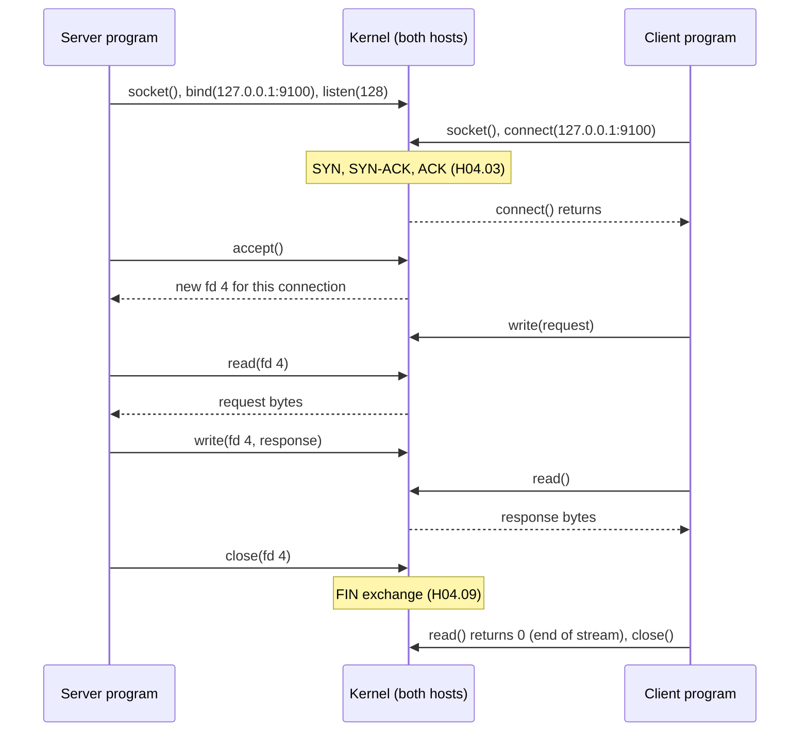
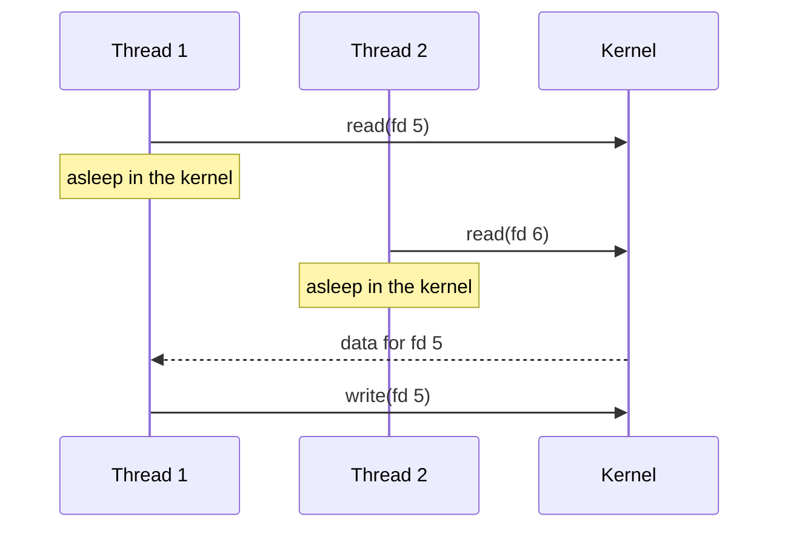
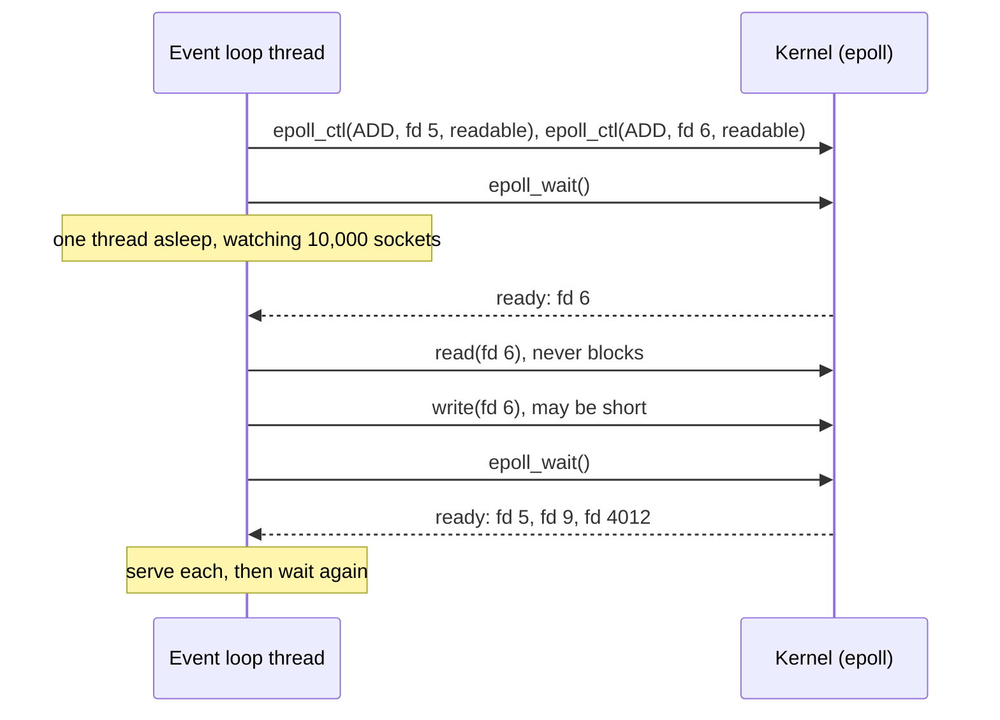
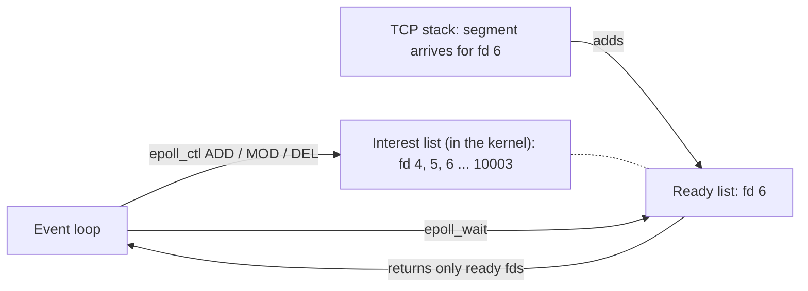
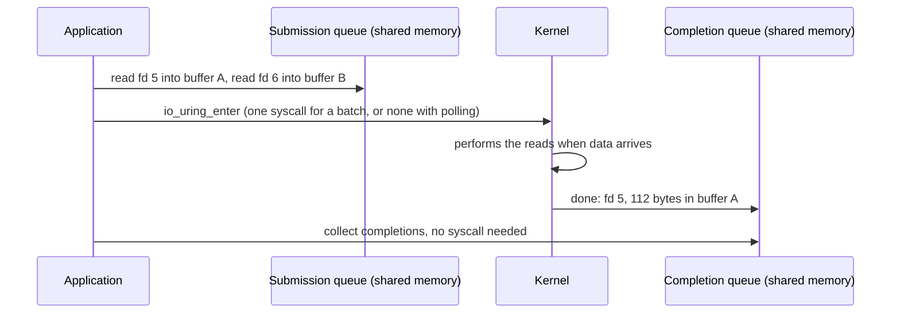
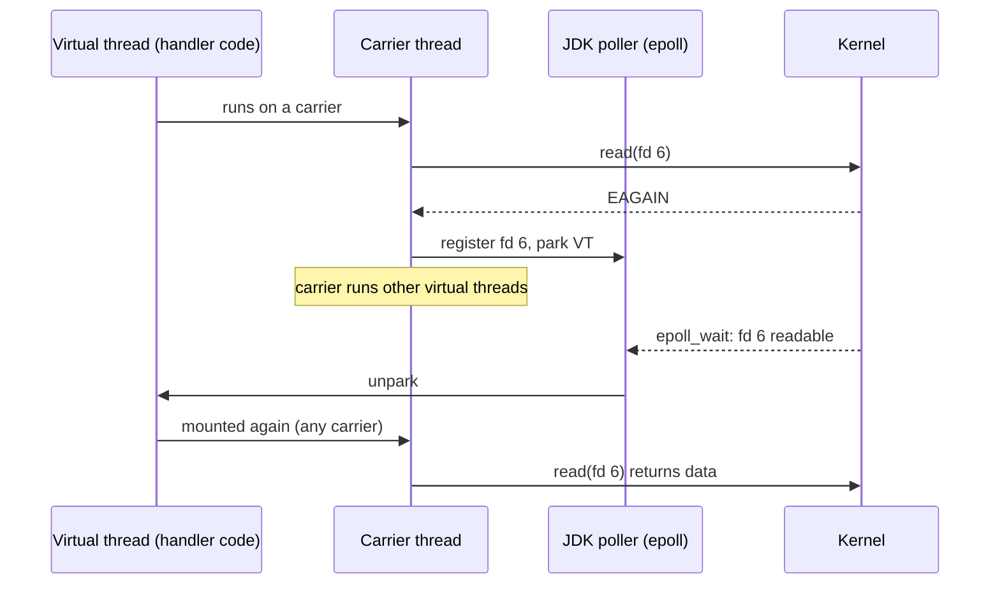
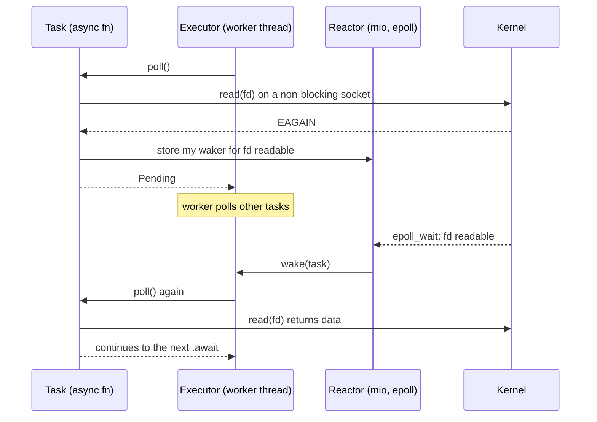
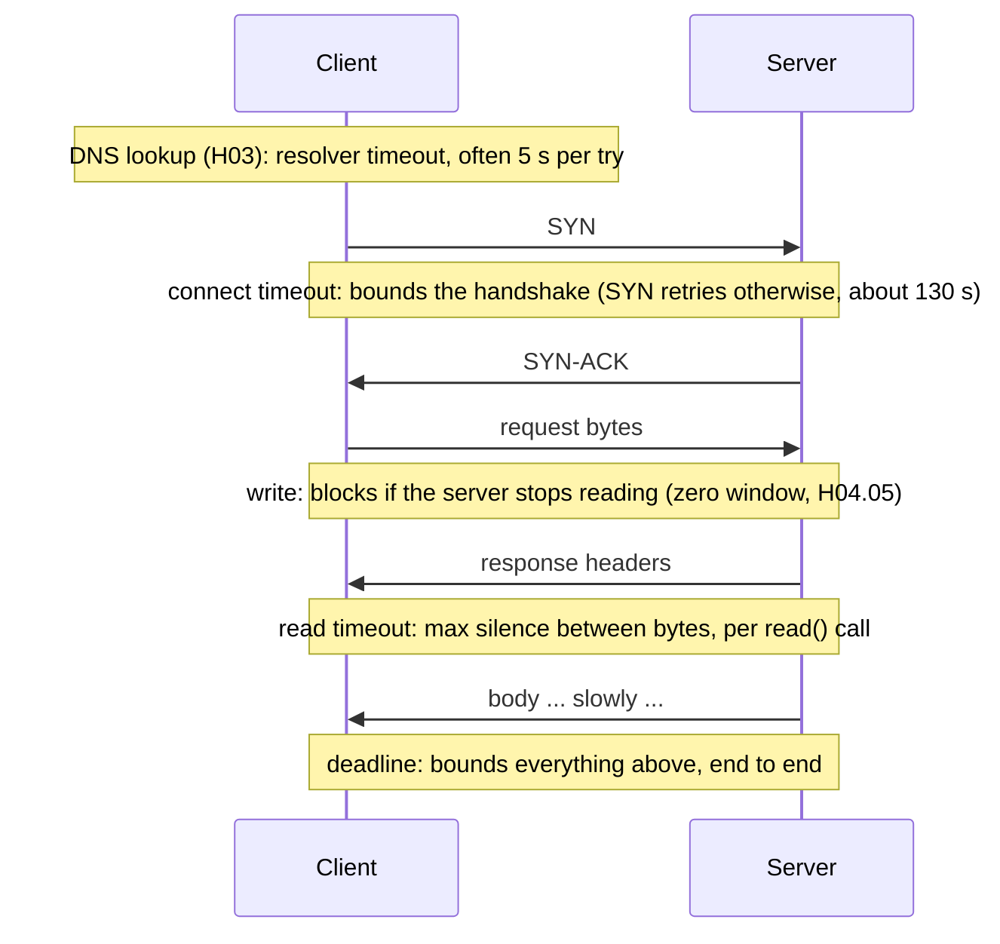

<!-- markdownlint-disable MD001 -->
<!-- markdownlint-disable MD024 -->
<!-- markdownlint-disable MD025 -->
<!-- markdownlint-disable MD026 -->
<!-- markdownlint-disable MD029 -->
<!-- markdownlint-disable MD033 -->
<!-- markdownlint-disable MD036 -->
<!-- markdownlint-disable MD040 -->
<!-- markdownlint-disable MD056 -->
<!-- markdownlint-disable MD060 -->

# H05. Sockets and I/O models

---

## Contents

| #     | Sub-topic                                                                         | Tag  |
| ----- | --------------------------------------------------------------------------------- | ---- |
| 05.01 | The Berkeley socket API and file descriptors                                      | CORE |
| 05.02 | Kernel buffers, short reads and short writes                                      | CORE |
| 05.03 | I/O models: blocking, readiness (`select`, `poll`, `epoll`, `kqueue`), completion | DEEP |
| 05.04 | Java: `Socket`, NIO and `Selector`, Netty, virtual threads                        | CORE |
| 05.05 | Rust: `std::net`, `mio`, futures and `tokio`                                      | DEEP |
| 05.06 | Timeouts: connect, read, write, idle, and the deadline                            | CORE |
| 05.07 | The story: one message through three kinds of server                              | CORE |
| 05.08 | Labs: what each one shows and how to run it                                       | CORE |
| 05.09 | Exercises                                                                         |      |
| 05.10 | Solutions                                                                         |      |
| 05.11 | Takeaways                                                                         |      |

Terms used throughout:

- **Kernel** and **user space**: the operating system kernel owns the network card, TCP state and buffers (H04).  
  Programs run in user space and cannot touch those directly.

- **System call** (syscall): a request from a program to the kernel, such as "send these bytes".  
  Each costs a switch into the kernel and back, from about 100 nanoseconds to a few microseconds. `strace` lists them.

- **File descriptor** (fd): a small integer that names an open kernel object for one process: a file, a pipe, or a socket. Every socket call takes one.

- **Socket**: the kernel object a program uses for network communication.  
  For TCP it is either a **listening socket** (waits for new connections) or a **connected socket** (one per connection, with its own send and receive buffers).

- **Thread**: an independent flow of execution inside a process.  
  A **platform thread** (or OS thread) is scheduled by the kernel. Java 21's **virtual threads** are scheduled by the JVM (05.04).

- **Blocking**: a call that does not return until it can complete; the calling thread sleeps meanwhile.  
  **Non-blocking**: a call that returns at once, with an error such as `EAGAIN` ("try again later") when it cannot proceed.

- **Concurrent connections**: connections open at the same time.  
  Most are idle at any instant: a chat client, a database pool, or an HTTP keep-alive connection waiting for the next request.

Outputs in this module are real: system calls captured with `strace`, sockets with `ss`, memory with `ps`, on Linux 6.18 with 4 CPUs, JDK 21 and Rust 1.97 (`tokio` 1.54, `mio` 1.2).

---

## 05.01 The Berkeley socket API and file descriptors

Every networked program, in every language, ends up calling the same handful of kernel functions designed for 4.2BSD Unix in 1983: a server calls `socket`, `bind`, `listen`, then `accept` once per client;  
a client calls `socket` and `connect`; both then `read`/`write` (or `recv`/`send`) and finally `close`.  

Each socket is a **file descriptor**, so the operating system's limits on open files are also limits on connections.  
Java's `Socket` and Rust's `TcpStream` are thin wrappers over these calls.

### The calls

| Call                 | Side   | What it does                                                                                          | TCP underneath (H04)                                  |
| -------------------- | ------ | ----------------------------------------------------------------------------------------------------- | ----------------------------------------------------- |
| `socket()`           | Both   | Creates a socket and returns its fd                                                                   | Nothing on the wire                                   |
| `setsockopt()`       | Both   | Sets options: `SO_REUSEADDR`, `TCP_NODELAY`, `SO_KEEPALIVE`, buffer sizes, timeouts                   | Changes behaviour (H04.07, H04.09, H04.10)            |
| `bind()`             | Server | Attaches a local address and port                                                                     | Nothing on the wire                                   |
| `listen(backlog)`    | Server | Marks the socket as listening; sets the accept-queue limit                                            | The kernel now answers SYNs (H04.03)                  |
| `accept()`           | Server | Takes one established connection off the accept queue; returns a **new** fd for it                    | The handshake already happened                        |
| `connect()`          | Client | Starts the handshake; blocks until it completes or fails (or returns `EINPROGRESS` when non-blocking) | SYN, SYN-ACK, ACK                                     |
| `read()` / `recv()`  | Both   | Copies **up to** N bytes from the receive buffer; blocks if it is empty; returns 0 at end of stream   | Frees receive-buffer space, opens the window (H04.05) |
| `write()` / `send()` | Both   | Copies **up to** N bytes into the send buffer; blocks if it is full                                   | Segments leave when windows allow (H04.05, H04.06)    |
| `shutdown(SHUT_WR)`  | Both   | Ends the sending direction only                                                                       | FIN (half-close, H04.09)                              |
| `close()`            | Both   | Releases the fd; ends the connection                                                                  | FIN, or RST if unread data remains (H04.09)           |



### What a real server and a real client call

Lab 00 runs a 16-line Rust server under `strace` and sends it one request with `curl`.  
The server's system calls, unedited apart from removing unrelated lines:

```text
socket(AF_INET, SOCK_STREAM|SOCK_CLOEXEC, IPPROTO_IP) = 3
setsockopt(3, SOL_SOCKET, SO_REUSEADDR, [1], 4) = 0
bind(3, {sa_family=AF_INET, sin_port=htons(9100), sin_addr=inet_addr("127.0.0.1")}, 16) = 0
listen(3, 128)                          = 0
accept4(3, {sa_family=AF_INET, sin_port=htons(57624), sin_addr=inet_addr("127.0.0.1")}, [128 => 16], SOCK_CLOEXEC) = 4
recvfrom(4, "GET / HTTP/1.1\r\nHost: 127.0.0.1:"..., 1024, 0, NULL, NULL) = 77
sendto(4, "HTTP/1.0 200 OK\r\nContent-Length:"..., 44, MSG_NOSIGNAL, NULL, 0) = 44
close(4)                                = 0
close(3)                                = 0
```

Seven lines of Rust became exactly these calls. Details worth knowing:

- **`TcpListener::bind` is four system calls**: `socket`, `setsockopt(SO_REUSEADDR)` (so a restarted server can bind despite TIME_WAIT, H04.09), `bind`, and `listen` with a backlog of 128 that Rust's standard library does not let you change.

- **`accept4` returned fd 4**, a new socket for this connection; fd 3 keeps listening.  
  Every connection to port 9100 has its own fd, all sharing the local port; the kernel tells them apart by the 4-tuple (H02.06).

- **`SOCK_CLOEXEC`**: the fd is closed automatically if the program starts another program (`exec`), so child processes do not inherit connections by accident.

- **`MSG_NOSIGNAL`**: writing to a connection the peer has reset raises the `SIGPIPE` signal, which by default **kills the process**.  
  Rust (and the JVM) suppress it and return an error (`Broken pipe`, H04.09 Lab 06) instead. C programs that forget this die mysteriously when a client disconnects.

The `curl` side shows the non-blocking form of `connect`, which is how a connect **timeout** is implemented:

```text
socket(AF_INET, SOCK_STREAM, IPPROTO_TCP) = 5
setsockopt(5, SOL_TCP, TCP_NODELAY, [1], 4) = 0
setsockopt(5, SOL_SOCKET, SO_KEEPALIVE, [1], 4) = 0
connect(5, {sa_family=AF_INET, sin_port=htons(9100), sin_addr=inet_addr("127.0.0.1")}, 16) = -1 EINPROGRESS (Operation now in progress)
poll([{fd=5, events=POLLOUT}, {fd=3, events=POLLIN}], 2, 1000) = 1 ([{fd=5, revents=POLLOUT}])
sendto(5, "GET / HTTP/1.1\r\nHost: 127.0.0.1:"..., 77, MSG_NOSIGNAL, NULL, 0) = 77
poll([{fd=5, events=POLLIN}, {fd=3, events=POLLIN}], 2, 1000) = 1 ([{fd=5, revents=POLLIN}])
recvfrom(5, "HTTP/1.0 200 OK\r\nContent-Length:"..., 102400, 0, NULL, NULL) = 44
close(5)                                = 0
```

`connect` returned immediately with `EINPROGRESS`; `curl` then waited in `poll` (05.03) for the socket to become writable, which signals "handshake complete", with a timeout it controls.  
The same pattern sits under Java's `socket.connect(addr, timeoutMs)` and Rust's `TcpStream::connect_timeout`.

### Sockets are file descriptors

A process's open sockets appear under `/proc/<pid>/fd`.  
The `mio` echo server from Lab 03 with two clients connected:

```text
$ ls -l /proc/10640/fd
lr-x------ 1 root root 64 Oct 25 15:39 0 -> /dev/null
l-wx------ 1 root root 64 Oct 25 15:39 1 -> /dev/null
l-wx------ 1 root root 64 Oct 25 15:39 2 -> /dev/null
lrwx------ 1 root root 64 Oct 25 15:39 3 -> anon_inode:[eventpoll]     <- the epoll instance (05.03)
lrwx------ 1 root root 64 Oct 25 15:39 4 -> socket:[390860]            <- the listening socket
lrwx------ 1 root root 64 Oct 25 15:39 5 -> socket:[391500]            <- client 1
lrwx------ 1 root root 64 Oct 25 15:39 6 -> socket:[391501]            <- client 2

$ ss -tnp 'sport = :9205'
ESTAB 0      0          127.0.0.1:9205    127.0.0.1:41304 users:(("mio_echo",pid=10640,fd=6))
ESTAB 0      0          127.0.0.1:9205    127.0.0.1:41288 users:(("mio_echo",pid=10640,fd=5))
```

The consequence: **every connection costs one file descriptor**, and processes have a limit (`ulimit -n`; `Max open files` in `/proc/<pid>/limits`).  
Many Linux distributions and systemd services start with a soft limit of 1024.  
When it is reached, `accept()` fails with `EMFILE`, "Too many open files", and a server stops taking connections while looking otherwise healthy.  
Java raises its soft limit to the hard limit at startup on Linux; other runtimes do not.  
For a server meant to hold many connections, set `LimitNOFILE` (systemd) or `ulimit -n` explicitly, and remember that files, pipes and outgoing connections share the same budget.

### Interview angle

"What happens when you call `accept()`?" The kernel has already done the handshake; `accept` only takes a finished connection off the queue and gives it a new fd.  
Bonus points: the listening socket and all accepted sockets share the port, the backlog bounds the queue (H04.03), and running out of fds makes `accept` fail with `EMFILE`.

---

## 05.02 Kernel buffers, short reads and short writes

`read()` returns **whatever has arrived**, between 1 byte and the size you asked for, and 0 only at end of stream.  
It does not return "a message". `write()` on a blocking socket waits until all bytes fit in the send buffer; on a non-blocking socket it copies **as much as fits** and returns that count, which can be 0.  
Every correct protocol implementation loops: read until it has a complete frame (H01.05), and write until every byte is accepted.

### Where the bytes are


The application only ever talks to its own kernel's buffers (H04.01).  
`read()` and `write()` are memory copies between your buffer and the kernel's, plus a wake-up when the other side needs one.

### Short reads

Lab 02: the peer sends 1 MiB with a **single** `write()`; the reader calls `read()` with a 64 KiB buffer until end of stream:

```text
peer wrote 1,048,576 bytes in ONE write(); reader asked for 65,536 per read()
read() calls: 37, total 1048576 bytes
first 12 sizes: [65536, 65536, 8736, 1448, 1448, 1448, 15928, 20272, 2896, 1448, 1448, 1448]
smallest 376, largest 65536
```

One write became 37 reads of anything from 376 to 65,536 bytes, depending on how many segments had arrived at each moment.  
`1448` is one segment (H04.02). Run it again and the sizes change. The rules:

- `read()` returns **at least 1** byte, as soon as any are available. It does not wait to fill your buffer.

- `read()` returns **0** (Rust, C) or **-1** (Java) only when the peer has sent FIN and every byte before it has been read (H04.09).

- A read **never** respects the writer's boundaries. Two messages can arrive in one read; one message can need many.

So reading a framed message always looks like this:

```java
// Read exactly n bytes, or fail: the loop that every protocol needs (DataInputStream.readFully does this)
static byte[] readExactly(InputStream in, int n) throws IOException {
    byte[] buf = new byte[n];
    int off = 0;
    while (off < n) {
        int r = in.read(buf, off, n - off);
        if (r == -1) {
            throw new EOFException("peer closed after " + off + " of " + n + " bytes");
        }
        off += r;
    }
    return buf;
}
```

Rust's `read_exact`, Java's `DataInputStream.readFully` and `InputStream.readNBytes` implement this loop; prefer them over hand-written ones.

### Short writes

With a **blocking** socket, Java's `OutputStream.write(bytes)` and Rust's `write_all` loop internally until everything is in the send buffer, sleeping when it is full (H04.05 showed the sender blocked by a zero window).  
With a **non-blocking** socket, nothing waits. Lab 02, writing 64 MiB to a peer that never reads:

```text
write() call 1: asked to write 67,108,864 bytes, kernel accepted    78,192
write() call 2: asked to write 67,030,672 bytes, kernel accepted   139,320
write() call 3: asked to write 66,891,352 bytes, kernel accepted   510,824
write() call 4: asked to write 66,380,528 bytes, kernel accepted         0
write() call 5: asked to write 66,380,528 bytes, kernel accepted    72,400
66,308,128 bytes are still in the application's buffer: the caller must keep them and retry later
```

The kernel took what fitted, then nothing (`0` in Java NIO; `Err(WouldBlock)` in Rust, which is `EAGAIN` from the kernel), then a little more as the buffers autotuned.  
A non-blocking program must **keep the unsent remainder** per connection and try again when the socket becomes writable (05.03, 05.04).  
Forgetting the return value of a non-blocking `write` silently corrupts the stream, because the bytes after the accepted part are simply never sent.

### Interview angle

"I sent a 4 KB message with one `write`, but the server's `read` got 1,200 bytes.  

Is the network broken?"  
No: TCP is a byte stream (H04.01) and `read` returns what has arrived.  
The fix is framing (a length prefix or a delimiter, H01.05) and a read loop.  
The non-blocking counterpart is the unchecked `write` return value.

---

## 05.03 I/O models: blocking, readiness (`select`, `poll`, `epoll`, `kqueue`), completion

A server spends almost all its time waiting for bytes.  
There are three ways to wait. **Blocking**: one thread per connection, each asleep in `read()`; simple, but every waiting connection costs a whole OS thread.  
**Readiness**: make sockets non-blocking and ask the kernel "which of these thousands of sockets can I read or write now?" with `epoll` (Linux) or `kqueue` (BSD, macOS), then serve them from a few threads: the **event loop**.  
**Completion**: hand the kernel the operation itself ("read into this buffer") and get notified when it is done, with `io_uring` (Linux) or IOCP (Windows).  
Readiness is what Netty, NGINX, Node.js and `tokio` are built on; Java's virtual threads hide it behind blocking-style code.

### Model 1: blocking, thread per connection



The code is the simplest possible: sequential, one connection per thread, `read` then `write`.  
The cost is the thread. Lab 03 held 10,000 connections, each sending one 64-byte message per second, against a Java echo server with one platform thread per connection:

| Measure                                 | Value                                                                          |
| --------------------------------------- | ------------------------------------------------------------------------------ |
| Threads                                 | 22 idle, **10,021** loaded                                                     |
| Resident memory                         | 92 MB idle, **709 MB** loaded: about 62 KB per connection                      |
| Accept-queue overflows while connecting | 2 (thread creation could not keep up with connects; each cost a 1 s SYN retry) |
| First-round p99 latency                 | 1,022 ms (connections still waiting in the accept queue for their threads)     |
| Later rounds p50 / p99                  | 104 us / 47.8 ms                                                               |

Each platform thread reserves about 1 MB of virtual memory for its stack (`strace` shows `clone3(... stack_size=0xfef80 ...)`: 1,044,352 bytes) and actually touches tens of kilobytes;  
the kernel schedules all 10,000, and every wake-up is a context switch of a few microseconds.  
At 10,000 connections this works on a 16 GB machine; at 100,000 it does not.

This is the **C10K problem**, named by Dan Kegel in 1999: how does one server handle 10,000 concurrent clients?  
The answer was to stop dedicating a thread to each connection.

### Model 2: non-blocking sockets with readiness notification

Put every socket in non-blocking mode (05.02), so `read` returns `EAGAIN` instead of sleeping.  
Then one thread asks the kernel which sockets are ready, and serves only those:



The readiness interfaces, in historical order:

| Interface | Origin                         | How it works                                                                                | Cost per wait                   |
| --------- | ------------------------------ | ------------------------------------------------------------------------------------------- | ------------------------------- |
| `select`  | 4.2BSD, 1983                   | Pass bitmaps of fds to watch on every call; limited to fd numbers below 1024 (`FD_SETSIZE`) | Proportional to all watched fds |
| `poll`    | System V, 1986                 | Pass an array of fds on every call; no 1024 limit                                           | Proportional to all watched fds |
| `epoll`   | Linux 2.5.44, 2002             | Register each fd once (`epoll_ctl`); `epoll_wait` returns only the ready ones               | Proportional to **ready** fds   |
| `kqueue`  | FreeBSD 4.1, 2000 (also macOS) | Like `epoll`, and also covers files, signals, timers and processes                          | Proportional to **ready** fds   |

`select` and `poll` copy the whole interest list into the kernel and scan it on every call, so with 10,000 mostly idle connections each wake-up costs 10,000 checks.  
`epoll` keeps the interest list inside the kernel; the TCP stack adds a socket to a **ready list** when data arrives, and `epoll_wait` just hands that list over.  
That change is what made C10K routine.



Two subtleties that bite implementers:

- **Level-triggered vs edge-triggered.** Level-triggered (the `epoll` default, and what Java's `Selector` uses) reports a socket as long as it **is** readable.  
  Edge-triggered (`EPOLLET`, used by `mio` and `tokio`) reports it once when it **becomes** readable; the program must then read until `EAGAIN`, or the remaining bytes wait until more data arrives.  
  Lab 03's `mio` server has the "read until `WouldBlock`" loop for this reason.

- **Writable is almost always true.** A socket is writable whenever its send buffer has space, which is nearly always.  
  Register for "writable" only while there are unsent bytes (05.02), and remove it afterwards, or the loop wakes continuously and burns a CPU core (Exercise 02).

The pattern built on this, one loop that waits for readiness and dispatches to handlers, is the **reactor**.  
Its one rule: **a handler must never block**.  
A slow handler (a synchronous database call, a big JSON parse) stalls every other connection served by that loop.

Lab 03's measurements for event-loop servers holding the same 10,000 connections:

| Server                 | Threads (idle, loaded) | Resident memory, idle to loaded | Per connection | Later rounds p50 / p99 |
| ---------------------- | ---------------------- | ------------------------------- | -------------- | ---------------------- |
| Java NIO `Selector`    | 22, 21                 | 107 MB to 114 MB                | about 0.75 KB  | 146 us / 3.5 ms        |
| Rust `mio`, one thread | 1, 1                   | 2.1 MB to 3.6 MB                | about 0.15 KB  | 134 us / 2.0 ms        |

### Model 3: completion

Readiness still costs two steps per operation: a wait that says "you can read now", then the `read` call. **Completion-based** I/O submits the operation itself:



- **IOCP** (I/O completion ports, Windows NT 3.5, 1994) has been the native model on Windows for decades.

- **`io_uring`** (Linux 5.1, 2019) shares two ring buffers between the program and the kernel: the program queues requests, the kernel queues results, and many operations need one system call or none.  
  It also works for regular files, which `epoll` cannot.  
  Its broad kernel surface has produced a series of security bugs; Google restricted its use in 2023, and some container runtimes block it in their default security profiles.  
  Netty and Rust (`tokio-uring`, `glommio`, `monoio`) offer io_uring transports; most production network servers still run on `epoll`.

The pattern built on completion is the **proactor**: handlers run when an operation has finished, rather than when one may start.

### Comparison

| Model                      | Code style                                    | Cost per idle connection              | Main risk                                           | Typical users                                      |
| -------------------------- | --------------------------------------------- | ------------------------------------- | --------------------------------------------------- | -------------------------------------------------- |
| Blocking, platform threads | Sequential, simple                            | A thread: tens of KB plus scheduling  | Thread exhaustion at thousands of connections       | Classic Tomcat, JDBC drivers, simple tools         |
| Readiness (event loop)     | Callbacks or state machines                   | A buffer and a registration           | One blocking handler stalls everyone                | NGINX, Node.js, Netty, Redis, `mio`                |
| Readiness, hidden          | Sequential (`async`/`await`, virtual threads) | A task: hundreds of bytes to a few KB | Blocking calls inside tasks, pinning (05.04, 05.05) | `tokio`, Go, Java virtual threads                  |
| Completion                 | Submit and collect                            | A buffer per pending operation        | Kernel attack surface, less mature tooling          | Windows servers, storage engines, `io_uring` users |

### Interview angle

"How would you build a server for 100,000 WebSocket connections?" Not one OS thread per connection.  
Name `epoll` and the event loop (or virtual threads / `async`, which sit on it), explain why `epoll` beats `select` (registration once, cost proportional to ready sockets),  
and state the reactor's rule: never block the loop; push slow work to a separate pool. Exercise 01 does the capacity arithmetic.

---

## 05.04 Java: `Socket`, NIO and `Selector`, Netty, virtual threads

Java has three generations of network I/O. `java.net.Socket` and `ServerSocket` (1996) are blocking: one thread per connection.  
**NIO** (Java 1.4, 2002) adds non-blocking `SocketChannel`s, `ByteBuffer`s and a `Selector`, which is `epoll` on Linux and `kqueue` on macOS:  
the event loop. **Netty** packages that event loop into the framework most high-performance Java servers use.  
**Virtual threads** (Java 21) let you write the blocking, thread-per-connection code again, while the JDK runs it on an event loop underneath;  
Lab 03 held 10,000 connections with 29 OS threads that way.

### `java.net.Socket` and `ServerSocket`

The blocking API from 05.01, one-to-one: `new ServerSocket()`, `bind(addr, backlog)` (default backlog 50, H04.03), `accept()`, `getInputStream().read()`, `getOutputStream().write()`, `close()`.  
Options map to `setsockopt`: `setTcpNoDelay`, `setKeepAlive`, `setSoTimeout` (the read timeout, 05.06), `setReceiveBufferSize`, `setSoLinger`, plus Linux-specific ones in `jdk.net.ExtendedSocketOptions` (`TCP_KEEPIDLE`, `TCP_QUICKACK`).  
Since JDK 13 (JEP 353) these classes are implemented on top of NIO internally, which is what later made virtual threads possible.

`EchoServer.java` in Lab 03 is the classic shape:

```java
while (true) {
    Socket s = server.accept();
    threads.start(() -> echo(s));          // one thread per connection; echo() loops read() then write()
}
```

### NIO: channels, buffers, `Selector`

| Type                                   | Role                                                                                                                     |
| -------------------------------------- | ------------------------------------------------------------------------------------------------------------------------ |
| `ServerSocketChannel`, `SocketChannel` | Sockets that can be put in non-blocking mode (`configureBlocking(false)`)                                                |
| `ByteBuffer`                           | A buffer with a position and a limit: `flip()` switches from filling to draining, `compact()` keeps unsent bytes         |
| `Selector`                             | The readiness multiplexer: `epoll` on Linux, `kqueue` on macOS                                                           |
| `SelectionKey`                         | One registration: channel, interest set (`OP_ACCEPT`, `OP_READ`, `OP_WRITE`), and an attachment for per-connection state |

`NioEchoServer.java` (Lab 03) is one thread serving every connection:

```java
while (true) {
    selector.select();                                         // epoll_wait
    for (SelectionKey key : selector.selectedKeys()) {         // only the ready ones
        if (key.isAcceptable()) { /* accept, configureBlocking(false), register OP_READ with a ByteBuffer */ }
        else { serve(key); }                                   // read what is there, write what fits, keep the rest
    }
    selector.selectedKeys().clear();
}
```

Under `strace`, the loop is exactly the `epoll` sequence of 05.03 (Lab 04):

```text
epoll_wait(4, [{events=EPOLLIN, data={u32=7, ...}}], 1024, -1) = 1      <- listening socket fd 7 is readable
accept(7, {sa_family=AF_INET, sin_port=htons(52340), ...}) = 8
epoll_ctl(4, EPOLL_CTL_ADD, 8, {events=EPOLLIN, ...}) = 0               <- register the new connection
epoll_wait(4, [{events=EPOLLIN, data={u32=8, ...}}], 1024, -1) = 1      <- fd 8 has data
read(8, "hello\n", 1024) = 6
write(8, "hello\n", 6) = 6
epoll_wait(4, ...
```

What NIO makes you handle yourself: per-connection state in attachments instead of local variables, partial reads and writes (05.02),  
`OP_WRITE` management, never blocking in the loop, and spreading load across several selectors on multi-core machines. That is why few teams write raw NIO.

**NIO.2** (Java 7) added `AsynchronousSocketChannel`, a completion-style API with callbacks or `Future`s.  
On Linux it is implemented over `epoll` with a thread pool; it is rarely used directly.

### Netty in one paragraph

Netty is the event-loop framework that most of the Java ecosystem's network servers and clients are built on: gRPC-Java, Reactor Netty (under Spring WebFlux), Vert.x, Elasticsearch, Cassandra drivers and many more.  
A **boss** event loop accepts connections and hands each to one of N **worker** event loops (typically 2 x cores), each a thread with its own `Selector` that owns its connections for their whole life,  
so a connection's handlers never run on two threads at once.  

Each connection has a **pipeline** of handlers (decode bytes into frames, frames into messages, business logic, encode back), pooled reference-counted `ByteBuf`s instead of `ByteBuffer`, and optional native transports (`epoll`, `kqueue`, and `io_uring` in recent versions) that expose Linux-specific options.  
The reactor rule applies in full: a blocking call inside a handler stalls every connection on that worker.

### Virtual threads (Java 21)

A **virtual thread** is a `java.lang.Thread` that the JVM, not the kernel, schedules.  
Virtual threads run on a small pool of platform **carrier threads** (a `ForkJoinPool` with one carrier per core by default).  
When a virtual thread blocks on a socket, the JDK does not block the carrier:

01. The socket is in non-blocking mode underneath. The virtual thread calls `read()`; the kernel returns `EAGAIN`.

02. The JDK registers the fd with an internal **poller** (an `epoll` instance serviced by a "Read-Poller" thread) and  
  **unmounts** the virtual thread: its stack frames are saved to the heap, and the carrier picks up another virtual thread.

03. When `epoll_wait` reports the fd readable, the poller **unparks** the virtual thread; it is mounted on any free carrier and its `read()` is retried, now successfully.

Lab 04 captured this with `strace` on `EchoServer.java virtual` (thread names from `/proc/<pid>/task/*/comm`):

```text
[ForkJoinPool-1-worker] read(6, ..., 1024) = -1 EAGAIN (Resource temporarily unavailable)   <- no data yet: park
[Read-Updater]          epoll_ctl(8, EPOLL_CTL_ADD, 6, {events=EPOLLIN|EPOLLONESHOT, ...}) = 0
[Read-Poller]           <... epoll_wait resumed>[{events=EPOLLIN, data={u32=6, ...}}], 512, -1) = 1   <- 167 ms later
[ForkJoinPool-1-worker] read(6, "hello\n", 1024) = 6                                       <- remounted, retried
[ForkJoinPool-1-worker] write(6, "hello\n", 6) = 6
[ForkJoinPool-1-worker] read(6, ..., 1024) = -1 EAGAIN                                      <- park again
[Read-Updater]          epoll_ctl(8, EPOLL_CTL_MOD, 6, {events=EPOLLIN|EPOLLONESHOT, ...}) = 0
```

The same Java source with `Thread.ofPlatform()` produced `clone3(...)` (a new OS thread) per connection and a plain blocking `read(6, ...)` that slept in the kernel for 196 ms.  
The code is identical; only the thread builder differs:

```java
Thread.Builder threads = virtual ? Thread.ofVirtual() : Thread.ofPlatform();
```

Lab 03's result for the virtual-thread version: **29 OS threads** and about 9.6 KB per connection (stacks of parked virtual threads live on the heap), p99 2.8 ms, versus 10,021 threads and about 62 KB per connection with platform threads.



What virtual threads change, and what they do not:

| Topic                | Effect                                                                                                                                                                                                                                                                                  |
| -------------------- | --------------------------------------------------------------------------------------------------------------------------------------------------------------------------------------------------------------------------------------------------------------------------------------- |
| Code style           | Ordinary blocking code (`InputStream`, JDBC, `HttpClient.send`) scales like an event loop. No callbacks, readable stack traces                                                                                                                                                          |
| Thread count         | Create one per task or request; never pool them. Millions are fine                                                                                                                                                                                                                      |
| Pinning              | In JDK 21 to 23, blocking inside a `synchronized` block **pins** the carrier (it cannot unmount). Too many pinned carriers and everything stalls. JDK 24 (JEP 491) removed this for `synchronized`; in older JDKs use `ReentrantLock` and watch the `jdk.VirtualThreadPinned` JFR event |
| Downstream limits    | Cheap threads mean 10,000 concurrent requests can now reach a 20-connection database pool at once. Limit concurrency explicitly (a `Semaphore`, the pool's own wait timeout)                                                                                                            |
| CPU-bound work       | No gain: there are still only as many carriers as cores                                                                                                                                                                                                                                 |
| `ThreadLocal` caches | One cache per virtual thread, multiplied by millions, can exhaust memory                                                                                                                                                                                                                |
| Spring Boot 3.2+     | `spring.threads.virtual.enabled=true` runs Tomcat's request handling on virtual threads                                                                                                                                                                                                 |

### Java options at a glance

| API                              | Model                                              | Use it for                                                      |
| -------------------------------- | -------------------------------------------------- | --------------------------------------------------------------- |
| `Socket` + platform threads      | Blocking                                           | Tools, tests, low connection counts                             |
| `Socket` + virtual threads (21+) | Blocking code, event loop beneath                  | New services with many concurrent, mostly waiting connections   |
| NIO `Selector`                   | Readiness, by hand                                 | Learning; rare specialised servers                              |
| Netty (or frameworks on it)      | Readiness, framework                               | High-performance servers and clients, custom protocols, proxies |
| `java.net.http.HttpClient`       | Async internally (`sendAsync`), or blocking `send` | HTTP clients without extra dependencies                         |

### Interview angle

"Do virtual threads make reactive programming obsolete?" Largely, for the goal of scaling I/O-bound request handling: sequential code now scales like an event loop.  
Name the caveats: pinning on JDK 21 to 23, unbounded concurrency hitting downstream limits, `ThreadLocal` memory, and no help for CPU-bound work.  
Netty remains the right tool for protocol-heavy servers where you want full control of the loop.

---

## 05.05 Rust: `std::net`, `mio`, futures and `tokio`

Rust's standard library offers blocking sockets (`TcpListener`, `TcpStream`) for thread-per-connection code. `mio` is a thin cross-platform layer over `epoll`,  
`kqueue` and Windows' equivalents: the event loop with nothing on top.  

`tokio` builds an **async runtime** on `mio`: an executor that runs many lightweight **tasks** on a few threads, a **reactor** that turns readiness events into wake-ups, and timers.  

You write `socket.read(&mut buf).await`; the compiler turns the function into a state machine that suspends at each `.await`.

### `std::net`

| Method                                       | Notes                                                                                                     |
| -------------------------------------------- | --------------------------------------------------------------------------------------------------------- |
| `TcpListener::bind(addr)`                    | `socket` + `SO_REUSEADDR` + `bind` + `listen(128)`; the backlog of 128 is fixed (05.01)                   |
| `TcpStream::connect(addr)`                   | Blocking connect, no timeout: waits for the kernel's SYN retries (about 130 s, H04.03)                    |
| `TcpStream::connect_timeout(addr, d)`        | Non-blocking connect plus `poll`, as `curl` does (05.01)                                                  |
| `set_read_timeout`, `set_write_timeout`      | `SO_RCVTIMEO`, `SO_SNDTIMEO`. On Linux an expired timeout returns `ErrorKind::WouldBlock`, not `TimedOut` |
| `set_nodelay`, `set_nonblocking`, `shutdown` | `TCP_NODELAY`, `O_NONBLOCK`, half-close                                                                   |
| `read_exact`, `write_all`, `read_to_end`     | The loops from 05.02                                                                                      |

For options the standard library lacks (backlog, keepalive timing, `SO_LINGER`, buffer sizes), the `socket2` crate exposes the full `setsockopt` surface and converts to and from `std` and `tokio` types.

### `mio`: the event loop by hand

`mio` gives you exactly the readiness model of 05.03 and nothing else:

| `mio` type | Meaning                                                        |
| ---------- | -------------------------------------------------------------- |
| `Poll`     | The `epoll` (or `kqueue`) instance                             |
| `Registry` | `register`, `reregister`, `deregister`: `epoll_ctl`            |
| `Token`    | A number you choose to identify each socket in events          |
| `Interest` | `READABLE`, `WRITABLE`                                         |
| `Events`   | What `poll.poll(&mut events, timeout)` (`epoll_wait`) returned |

`mio` registers sockets **edge-triggered**, so a handler must read until `WouldBlock` and write until `WouldBlock`, keeping unsent bytes (Lab 03's `mio_echo.rs` does both).  
One thread with `mio` held the 10,000 connections of Lab 03 in 3.6 MB.

### Futures, tasks and wakers

An `async fn` does not run when called. It returns a **future**: a value that represents a computation in progress, with one method the runtime calls, `poll`:

- `poll` returns `Ready(value)` when the work is done, or `Pending` when it cannot progress yet.  
  Before returning `Pending`, the future arranges to be woken: it hands a **waker** to whatever it is waiting for.

- The compiler turns each `async fn` into a state machine: one state per `.await` point, holding the local variables that live across it.  
  Its size is known at compile time, so a task needs no separate stack: Lab 03's `tokio` server used about 1.8 KB per connection, most of it the 1 KiB read buffer.

- A **task** is a top-level future handed to the runtime with `tokio::spawn`.  
  The **executor** polls tasks that are ready; the **reactor** (built on `mio`) wakes tasks whose sockets became ready.



This is the same mechanism as Java's virtual threads, with one difference in philosophy: Rust makes every suspension point visible as `.await` and stores state in compiler-generated structs;  
Java hides suspension inside blocking calls and stores state as heap-allocated stack frames.

### `tokio`

`#[tokio::main]` starts the multi-threaded runtime: one worker thread per core (Lab 03 showed 5 threads on 4 cores: 4 workers plus the main thread), a work-stealing scheduler that moves tasks between idle and busy workers,  
the I/O reactor, and a timer wheel. `tokio_echo.rs` in Lab 03:

```rust
loop {
    let (mut socket, _) = listener.accept().await?;
    tokio::spawn(async move {                       // one task per connection
        let mut buf = [0u8; 1024];
        loop {
            let n = match socket.read(&mut buf).await {
                Ok(0) | Err(_) => return,
                Ok(n) => n,
            };
            if socket.write_all(&buf[..n]).await.is_err() {
                return;
            }
        }
    });
}
```

Result: 5 threads, 20.6 MB for 10,000 connections, p99 1.5 ms.

Pitfalls, each of which has caused real outages:

| Pitfall                | What happens                                                                                                                                                                                                                      | Fix                                                                              |
| ---------------------- | --------------------------------------------------------------------------------------------------------------------------------------------------------------------------------------------------------------------------------- | -------------------------------------------------------------------------------- |
| Blocking inside a task | `std::thread::sleep`, blocking file or DNS calls, a mutex held across I/O, heavy CPU work: the worker thread stops polling every other task                                                                                       | `tokio::task::spawn_blocking`, async equivalents, `tokio::time::sleep`           |
| Default listen backlog | `TcpListener::bind` uses a backlog of 128. Lab 03's first run with it had 9 accept-queue overflows, and opening 10,000 connections took 9.6 s instead of 0.4 s, because each overflow cost a client a 1-second SYN retry (H04.03) | `TcpSocket::listen(4096)` (as in Lab 03)                                         |
| Cancellation by drop   | `tokio::time::timeout` or `select!` cancels by **dropping** the future at its current `.await`. Half-done work (a partially written frame) is abandoned                                                                           | Know which operations are cancellation-safe; finish or discard frames explicitly |
| Unbounded spawning     | A task per request with no limit: memory grows and downstream services are overwhelmed                                                                                                                                            | `Semaphore`, bounded channels, connection pools                                  |

### Interview angle

"What is the difference between a thread and an async task?"  

A thread has its own stack and is scheduled by the kernel (or the JVM, for virtual threads); a task is a state machine polled by a user-space executor, woken by a reactor when its I/O is ready.  
Tasks are cheaper, but the runtime only works if tasks yield often: one blocking call steals a worker from everyone.

---

## 05.06 Timeouts: connect, read, write, idle, and the deadline

A network call can hang in every phase: resolving the name, connecting, writing the request, waiting for the response, and reading the body.  
Each socket-level timeout covers one phase, and only per call: a read timeout limits **each** `read()`, so a server that sends one byte per second never trips it.  
Every client needs a connect timeout, a read timeout, a way to bound writes, an idle policy for pooled connections, and above all an **overall deadline** for the whole operation.

### The phases and their timeouts



| Timeout                | Bounds                                      | Java `Socket`                                  | Java `HttpClient`                              | Rust `std`          | `tokio`                                 | Without it                                             |
| ---------------------- | ------------------------------------------- | ---------------------------------------------- | ---------------------------------------------- | ------------------- | --------------------------------------- | ------------------------------------------------------ |
| Connect                | The TCP handshake                           | `connect(addr, ms)`                            | `connectTimeout(Duration)`                     | `connect_timeout`   | `timeout(d, TcpStream::connect(..))`    | About 130 s of SYN retries (H04.03)                    |
| Read                   | Silence during **one** `read()`             | `setSoTimeout(ms)`                             | (internal)                                     | `set_read_timeout`  | `timeout` around each read              | Forever, or about 15 min if the peer vanished (H04.04) |
| Write                  | One blocked `write()`                       | **None**: close the socket from another thread | (internal)                                     | `set_write_timeout` | `timeout` around each write             | Forever, while the peer keeps a zero window            |
| Request (`HttpClient`) | From sending until the response **headers** | -                                              | `HttpRequest.timeout(Duration)`                | -                   | -                                       | -                                                      |
| Pool acquisition       | Waiting for a free pooled connection        | -                                              | -                                              | -                   | -                                       | Requests queue unboundedly behind a slow dependency    |
| Idle                   | How long a pooled connection may sit unused | Pool setting                                   | (internal, `jdk.httpclient.keepalive.timeout`) | -                   | -                                       | Stale connections and RSTs (H04.09)                    |
| **Deadline**           | The whole operation, every phase            | Your own timer                                 | `sendAsync(..).orTimeout(..)`                  | Your own timer      | `tokio::time::timeout(d, whole_future)` | The sum of every gap above                             |

### What Lab 05 measured

```text
== connect      (accept queue full: SYNs dropped)
t= 1.01s  connect: java.net.SocketTimeoutException: Connect timed out
== read         (server accepts, never answers)
t= 1.01s  read: java.net.SocketTimeoutException: Read timed out
== drip         (server sends one byte every 250 ms, client read timeout 1 s)
t=13.79s  drip: read the whole response (55 bytes); the 1 s read timeout never fired
== deadline     (same server, client enforces a 2 s total budget)
t= 2.01s  deadline: gave up after 5 bytes, total budget of 2 s exceeded
== write        (server never reads; java.net.Socket has no write timeout)
t= 3.02s  watchdog: the writer is still blocked after 3 s; closing the socket
t= 3.03s  write: java.net.SocketException: Socket closed
== httpclient   (headers at once, body one byte per 500 ms; request timeout 2 s)
t= 7.78s  httpclient: status 200, body "slow-loris-body."
== httpdeadline (same, with sendAsync(..).orTimeout(2, SECONDS))
t= 2.18s  httpclient: java.util.concurrent.CompletionException: java.util.concurrent.TimeoutException
```

And from Rust:

```text
t= 1.00s  connect: connection timed out (TimedOut)
t= 1.03s  read: Resource temporarily unavailable (os error 11) (WouldBlock)
t= 2.17s  write: Resource temporarily unavailable (os error 11) (WouldBlock) after 768728 bytes
t=13.78s  drip: read the whole response (55 bytes); the 1 s read timeout never fired
t= 2.00s  deadline: total budget of 2 s exceeded; the exchange was dropped
```

Four lessons:

01. **A read timeout is not a deadline.** It bounds silence, not duration.  
  A slow or malicious server (the **slowloris** pattern) that keeps sending a trickle holds the client forever.  
  Only a deadline on the whole exchange stops it.

02. **`java.net.Socket` has no write timeout.** A blocking `write` to a peer that stopped reading waits indefinitely; the only escape is closing the socket from another thread.  
  Rust's standard library does expose `SO_SNDTIMEO`.

03. **`HttpClient`'s request timeout ends when the headers arrive.**  
  The 2-second timeout did not stop a body that took 7.8 seconds. Use `sendAsync(...).orTimeout(...)` (or a body handler that enforces its own limit) for a true deadline.

04. **Rust reports socket timeouts as `WouldBlock` on Linux**, because the kernel returns `EAGAIN`. Code matching only `ErrorKind::TimedOut` misses them.

### Choosing values

- **Connect timeout**: inside a data center, a few hundred milliseconds to 1 s.  
  Note that a value under 1 s means one lost SYN fails the attempt (the first SYN retry is at 1 s, H04.03), so pair it with a retry to another instance.

- **Read timeout**: from the dependency's observed latency (its p99.9 plus margin), not a round number.  
  Too low, and normal slow responses fail; too high, and threads pile up during an incident.

- **Deadline**: from the caller's own budget. If a user-facing request has 800 ms, a call it makes cannot have a 30-second timeout.  
  **Propagate deadlines**: gRPC sends the remaining deadline to the server with every call, so the whole chain gives up together instead of doing work nobody is waiting for.

- **Retries**: inside the deadline, with backoff, only for idempotent operations (REST track, R2), and with a retry budget so that retries do not multiply load during an outage.

### Interview angle

"Our service has a 30-second timeout on every HTTP call, yet threads hang for minutes during incidents."  

Ask which timeout: read timeouts are per call and do not bound slow trickles; writes may have no timeout at all; pool acquisition may be unbounded; DNS may hang.  
The fix is layered: per-phase timeouts sized from measurements, an overall deadline, deadline propagation, and bulkheads (separate limits per dependency) so one slow dependency cannot take every thread.

---

## 05.07 The story: one message through three kinds of server

The same two messages, `hello\n` and then `again\n` 300 ms later, sent by a tiny Python client to the same echo protocol, served three ways.  
Every line below was captured with `strace -f -tt` on the server (Lab 04).  
Times are relative to the server's `accept`.

### Server A: one platform thread per connection

```text
+0.000  [main]          accept(5, ...) = 6
+1.026  [main]          clone3({... stack_size=0xfef80 ...}) = 10625      a new OS thread for this connection
+1.029  [new thread]    read(6, <blocks in the kernel> ...
+1.224                  ... "hello\n", 1024) = 6                          woken by the kernel when data arrived
+1.225  [new thread]    write(6, "hello\n", 6) = 6
+1.225  [new thread]    read(6, ... blocks 300 ms ...) = "again\n"
+1.526  [new thread]    write(6, "again\n", 6) = 6
+1.526  [new thread]    read(6, "", 1024) = 0                             end of stream
+1.528  [new thread]    close(6)
```

The simplest story: a thread is born for the connection and sleeps inside `read()` until the kernel has data. Between messages the thread exists, holds its stack, and does nothing.

The 1-second gap between `accept` and the new thread's first `read` happens only on the **first** connection: it is the JVM's one-time cost of the first lambda and the first thread start, inflated by `strace`.  
A second connection to the same server started its `read` 0.4 ms after `accept`. Server C shows the same gap for the same reason.

### Server B: one event-loop thread with a `Selector`

```text
+0.000  [loop]  epoll_wait(4, ...) = 1  fd 7                              the listening socket is readable
+0.000  [loop]  accept(7, ...) = 8
+0.001  [loop]  epoll_ctl(4, EPOLL_CTL_ADD, 8, {EPOLLIN})                 watch the new connection
+0.001  [loop]  epoll_wait(4, ...) = 1  fd 8                              data for fd 8
+0.001  [loop]  read(8, "hello\n", 1024) = 6
+0.002  [loop]  write(8, "hello\n", 6) = 6
+0.002  [loop]  epoll_wait(4, ... sleeps 300 ms ...) = 1  fd 8
+0.302  [loop]  read(8, "again\n", 1024) = 6
+0.302  [loop]  write(8, "again\n", 6) = 6
+0.303  [loop]  epoll_wait(4, ...) = 1  fd 8
+0.303  [loop]  read(8, "", 1024) = 0                                     end of stream
+0.305  [loop]  epoll_ctl(4, EPOLL_CTL_DEL, 8)  close(8)
```

No thread was created. The single loop thread sleeps in `epoll_wait` for **all** connections at once;  
the kernel's TCP stack puts fd 8 on the ready list when a segment arrives (05.03), `epoll_wait` returns it, and the loop serves it and goes back to sleep.  
With 10,000 connections the loop is the same, only the ready lists are longer.

### Server C: one virtual thread per connection

```text
+0.000  [main]           accept(5, ...) = 6                               the same blocking-style code as Server A
+1.058  [carrier]        read(6, ...) = -1 EAGAIN                         the socket is non-blocking underneath
+1.070  [Read-Updater]   epoll_ctl(8, EPOLL_CTL_ADD, 6, {EPOLLIN|EPOLLONESHOT})   the virtual thread parks
+1.237  [Read-Poller]    epoll_wait(8, ...) = 1  fd 6                     data arrived: unpark
+1.238  [carrier]        read(6, "hello\n", 1024) = 6                     remounted on a carrier, read retried
+1.238  [carrier]        write(6, "hello\n", 6) = 6
+1.238  [carrier]        read(6, ...) = -1 EAGAIN                         park again
+1.238  [Read-Updater]   epoll_ctl(8, EPOLL_CTL_MOD, 6, ...)              re-arm the one-shot registration
+1.538  [Read-Poller]    epoll_wait(8, ...) = 1  fd 6
+1.539  [carrier]        read(6, "again\n", 1024) = 6
+1.540  [carrier]        write(6, "again\n", 6) = 6
+1.540  [carrier]        read(6, "", 1024) = 0                            end of stream (after one more park and wake)
+1.542  [carrier]        close(6)
```

The application code is Server A's, line for line, but the system calls are Server B's: an `EAGAIN`, an `epoll` registration, a poller thread that waits for everyone, and a short burst of work on whichever carrier is free.  
The registration uses `EPOLLONESHOT`, so the fd is reported once and must be re-armed (`EPOLL_CTL_MOD`) the next time the virtual thread parks.

### What each server paid

| Server                   | OS threads per connection | Wakes per message                                                        | Memory per connection (Lab 03) | Code style     |
| ------------------------ | ------------------------- | ------------------------------------------------------------------------ | ------------------------------ | -------------- |
| A: platform thread       | 1                         | Kernel wakes the connection's thread                                     | about 62 KB                    | Sequential     |
| B: `Selector` event loop | 0                         | Kernel wakes the loop, which serves fd 8                                 | about 0.75 KB                  | Event handlers |
| C: virtual thread        | 0                         | Kernel wakes the poller, which unparks the virtual thread onto a carrier | about 9.6 KB                   | Sequential     |

### What can go wrong, per server

| Server  | Failure                                                           | Symptom                                                                                     |
| ------- | ----------------------------------------------------------------- | ------------------------------------------------------------------------------------------- |
| A       | Thousands of connections                                          | Memory and scheduler pressure; thread-creation limits (`threads-max`, container PID limits) |
| A, B, C | Accept loop slower than connects (thread creation, small backlog) | Accept-queue overflows, 1-second SYN retries (H04.03)                                       |
| B       | A handler blocks (database call, `Thread.sleep`, large parse)     | Every connection on the loop stalls                                                         |
| B       | `OP_WRITE` left registered with nothing to send                   | 100% CPU on the loop thread (Exercise 02)                                                   |
| C       | Blocking while holding a `synchronized` lock (JDK 21 to 23)       | Carriers pinned; throughput collapses (Exercise 04)                                         |
| All     | No read deadline                                                  | Slow peers hold connections (and threads, or tasks) indefinitely (05.06)                    |

---

## 05.08 Labs: what each one shows and how to run it

| Lab | Topic                                             | Covers              | Needs                            |
| --- | ------------------------------------------------- | ------------------- | -------------------------------- |
| 00  | The socket API under `strace`, and sockets as fds | 05.01               | Rust, `strace`, `curl`, Python 3 |
| 01  | A raw HTTP/1.0 client                             | 05.01, 05.02, 05.06 | Java (`jwebserver`), Rust        |
| 02  | Short reads and short writes                      | 05.02               | Java or Rust                     |
| 03  | C10K: five servers, 10,000 connections            | 05.03, 05.04, 05.05 | Java, Rust, `iproute2`           |
| 04  | The system calls of three server models           | 05.04, 05.07        | Java, `strace`, Python 3         |
| 05  | Timeouts: what each one covers                    | 05.06               | Java or Rust                     |

### Setup, once

A disposable Linux container is the easiest place to run everything.  
`strace` needs the `SYS_PTRACE` capability to attach to a running process, and Lab 03 needs more than 10,000 open files per process:

```
docker run --rm -it --cap-add NET_ADMIN --cap-add SYS_PTRACE --ulimit nofile=65536:65536 \
    -v "$PWD":/h05 -w /h05 ubuntu:24.04
apt update && apt install -y openjdk-21-jdk-headless strace iproute2 ethtool curl python3 build-essential
```

Rust 1.85 or later is needed for edition 2024: install it with `rustup` as in H01 (Ubuntu 24.04's `cargo` package is older).  
On a Linux machine directly, install the same packages and run `ulimit -n 65536` in the shell used for Lab 03.

Folder layout:

```text
h05/
  www/
    hello.txt             <- printf 'hello, sockets\n' > www/hello.txt                (15 bytes)
    big.bin               <- head -c 1000000 /dev/zero | tr '\0' z > www/big.bin     (1,000,000 bytes)
  hello_again.py          <- Lab 04 client
  c10k.sh                 <- Lab 03 driver
  java/
    RawHttpClient.java  ShortIo.java  EchoServer.java  NioEchoServer.java  EchoLoad.java  Timeouts.java
  rust/                   <- cargo new rust, then the three cargo add lines below
    src/bin/tiny_server.rs  raw_http.rs  short_io.rs  tokio_echo.rs  mio_echo.rs  timeouts.rs
```

```text
cd h05
cargo new rust && cd rust
cargo add tokio --features full
cargo add mio --features os-poll,net
cargo add socket2 --features all
# put the six files into src/bin/, delete src/main.rs, then:
cargo build --release
```

Run Java files with `java X.java` from `h05/java`, and Rust binaries with `cargo run -q --release --bin <name> -- <args>` from `h05/rust` (or directly as `target/release/<name>`).

Verification note: every output in this section was produced by running the code shown, on JDK 21, Rust 1.97 (`tokio` 1.54.1, `mio` 1.2.4, `socket2` 0.6.5) and Linux 6.18 with 4 CPUs, 16 GB of memory, and H04 Lab 00's loopback settings still active (MTU 1500, segmentation offload off).  
Timings, ports, fd numbers and read sizes will differ on your machine; the shapes will not.  
Java timings for the first call in a fresh JVM include class loading, which is why the same request shows a slower `connect` in Java than in Rust.

### Lab 00: the socket API under `strace`, and sockets as fds

Goal: produce the system-call listings of 05.01 yourself, then see sockets as file descriptors and what happens when they run out.

`tiny_server.rs`, the whole Berkeley server API in one connection:

```rust
// The Berkeley socket API in its smallest form: one connection, one request, one answer.
// Run it under strace to see each call become a system call.
use std::io::{Read, Write};
use std::net::TcpListener;

fn main() -> std::io::Result<()> {
    let listener = TcpListener::bind("127.0.0.1:9100")?;      // socket(), setsockopt(SO_REUSEADDR), bind(), listen()
    println!("listening on 127.0.0.1:9100");
    let (mut conn, peer) = listener.accept()?;                 // accept4(): blocks until a client connects
    println!("accepted {peer}");
    let mut buf = [0u8; 1024];
    let n = conn.read(&mut buf)?;                              // recvfrom(): returns whatever has arrived, at most 1024 bytes
    println!("read {n} bytes");
    conn.write_all(b"HTTP/1.0 200 OK\r\nContent-Length: 6\r\n\r\nhello\n")?;   // sendto()
    Ok(())                                                     // conn and listener dropped: close(), close()
}
```

Terminal 1, from `h05/rust`:

```text
strace -e trace=socket,setsockopt,bind,listen,accept4,recvfrom,sendto,close -o tiny.strace ./target/release/tiny_server
```

Terminal 2:

```text
strace -e trace=socket,connect,setsockopt,getsockopt,sendto,recvfrom,poll,close -o curl.strace curl -s http://127.0.0.1:9100/
cat tiny.strace
grep -E 'AF_INET|connect|NODELAY|KEEPALIVE|poll|sendto|recvfrom|close\(5\)' curl.strace
```

Real output. Terminal 1 prints:

```text
listening on 127.0.0.1:9100
accepted 127.0.0.1:57624
read 77 bytes
```

and `tiny.strace` holds the nine calls listed in 05.01, from `socket(AF_INET, SOCK_STREAM|SOCK_CLOEXEC, IPPROTO_IP) = 3` to the final `close(3)`.  
`curl.strace` holds the non-blocking `connect` returning `EINPROGRESS`, then `poll` for `POLLOUT`, also listed in 05.01.  
The `grep` is needed because `curl.strace` also holds several dozen `close(3)` lines from `curl`'s startup: the dynamic loader opens and closes each shared library it loads.

**Sockets as file descriptors.** Start the `mio` server, hold two connections open with Python, and look at the server's fd table:

```text
./target/release/mio_echo 9205 > /dev/null 2>&1 & P=$!
python3 -c 'import socket,time; a=socket.create_connection(("127.0.0.1",9205)); b=socket.create_connection(("127.0.0.1",9205)); time.sleep(3)' &
sleep 1
ls -l /proc/$P/fd
ss -tnp 'sport = :9205'
grep 'Max open files' /proc/$P/limits
kill $P
```

Real output, trimmed to the interesting columns:

```text
lr-x------ 0 -> /dev/null
l-wx------ 1 -> /dev/null
l-wx------ 2 -> /dev/null
lrwx------ 3 -> anon_inode:[eventpoll]
lrwx------ 4 -> socket:[392540]
lrwx------ 5 -> socket:[392541]
lrwx------ 6 -> socket:[392542]

ESTAB 0      0          127.0.0.1:9205    127.0.0.1:37948 users:(("mio_echo",pid=11377,fd=5))
ESTAB 0      0          127.0.0.1:9205    127.0.0.1:37958 users:(("mio_echo",pid=11377,fd=6))

Max open files            20000                20000                files
```

fd 3 is the `epoll` instance (05.03), fd 4 the listening socket, fds 5 and 6 the two connections; `ss -p` confirms which fd holds which connection.

**Running out of fds.** Give the server a limit of 16 open files and open 20 connections:

```text
(ulimit -n 16; ./target/release/mio_echo 9206) &
sleep 0.5
python3 -c '
import socket
s = []
for i in range(20):
    try:
        s.append(socket.create_connection(("127.0.0.1", 9206), timeout=1))
    except Exception as e:
        print(i, e)
        break
print("client opened", len(s))'
```

Real output (server line first, then the client's):

```text
echo server, one thread with mio, port 9206
Error: Os { code: 24, kind: Uncategorized, message: "Too many open files" }
14 [Errno 111] Connection refused
client opened 14
```

Five fds were taken (0, 1, 2, `epoll`, listener), so 11 connections were accepted and the 12th `accept` failed with `EMFILE` (code 24).  
This server treats any accept error as fatal and exits; a production server must log, back off and keep serving.  
The client still saw **14** successful connects: the kernel completes handshakes before `accept` (H04.03), so connections 12 to 14 were sitting in the accept queue when the server died, and the 15th found no listener at all.

Things to try:

01. `strace -f -e trace=network java RawHttpClient.java` (Lab 01): the JVM makes the same calls, plus a few dozen more for its own setup.

02. `strace -c ./target/release/tiny_server` prints a count of every system call made, with the time spent in each.

03. Change `tiny_server.rs` to read with a 4-byte buffer in a loop: `strace` shows many small `recvfrom` calls for one request (05.02).

04. In the EMFILE experiment, raise the limit to 1024 and open 2,000 connections: the failure moves, but it does not go away. This is why servers set `LimitNOFILE` explicitly.

### Lab 01: a raw HTTP/1.0 client

Goal: speak HTTP over a bare socket in both languages: resolve, connect with a timeout, write one request, read until the server's FIN, split the head from the body at the first blank line.

Terminal 1, a static file server (JDK 18+):

```text
jwebserver -b 127.0.0.1 -p 8000 -d "$PWD/www"
```

`RawHttpClient.java`:

```java
import java.io.ByteArrayOutputStream;
import java.io.InputStream;
import java.io.OutputStream;
import java.net.InetAddress;
import java.net.InetSocketAddress;
import java.net.Socket;
import java.nio.charset.StandardCharsets;

// HTTP/1.0 by hand over a TCP socket: resolve, connect, write the request, read until EOF, split head from body.
// Usage: java RawHttpClient.java [host] [port] [path]
public class RawHttpClient {
    public static void main(String[] args) throws Exception {
        String host = args.length > 0 ? args[0] : "127.0.0.1";
        int port = args.length > 1 ? Integer.parseInt(args[1]) : 8000;
        String path = args.length > 2 ? args[2] : "/hello.txt";

        long t0 = System.nanoTime();
        InetAddress address = InetAddress.getAllByName(host)[0];                 // DNS (H03), or a literal IP
        long tDns = System.nanoTime();

        try (Socket socket = new Socket()) {
            socket.connect(new InetSocketAddress(address, port), 3_000);        // connect timeout: 3 s
            socket.setSoTimeout(5_000);                                          // read timeout: 5 s per read() call
            long tConnect = System.nanoTime();

            String request = "GET " + path + " HTTP/1.0\r\n"
                    + "Host: " + host + "\r\n"
                    + "User-Agent: raw-java/1.0\r\n"
                    + "Accept: */*\r\n"
                    + "\r\n";                                                   // blank line: end of the head
            OutputStream out = socket.getOutputStream();
            out.write(request.getBytes(StandardCharsets.US_ASCII));              // one write: no Nagle stall (H04.07)

            InputStream in = socket.getInputStream();
            var response = new ByteArrayOutputStream();
            byte[] buf = new byte[16 * 1024];
            long tFirstByte = 0;
            int reads = 0;
            int n;
            while ((n = in.read(buf)) != -1) {                                   // HTTP/1.0: the server's FIN ends the response
                if (reads++ == 0) {
                    tFirstByte = System.nanoTime();
                }
                response.write(buf, 0, n);
            }
            long tDone = System.nanoTime();

            byte[] all = response.toByteArray();
            int split = indexOf(all, "\r\n\r\n".getBytes(StandardCharsets.US_ASCII));
            String head = new String(all, 0, split, StandardCharsets.US_ASCII);
            int bodyLength = all.length - split - 4;

            System.out.printf("dns %.2f ms | connect %.2f ms | first byte %.2f ms | total %.2f ms | %d read() calls%n",
                    ms(t0, tDns), ms(tDns, tConnect), ms(tConnect, tFirstByte), ms(t0, tDone), reads);
            System.out.println("--- request (" + request.length() + " bytes)");
            System.out.print(request.replace("\r\n", "\\r\\n\n"));
            System.out.println("--- response head");
            System.out.println(head);
            String preview = new String(all, split + 4, Math.min(bodyLength, 40), StandardCharsets.UTF_8);
            System.out.println("--- body: " + bodyLength + " bytes, starts with " + preview.strip());
        }
    }

    static int indexOf(byte[] data, byte[] pattern) {
        outer:
        for (int i = 0; i + pattern.length <= data.length; i++) {
            for (int j = 0; j < pattern.length; j++) {
                if (data[i + j] != pattern[j]) {
                    continue outer;
                }
            }
            return i;
        }
        throw new IllegalStateException("no end of head found");
    }

    static double ms(long from, long to) {
        return (to - from) / 1e6;
    }
}
```

Terminal 2, from `h05/java`:

```text
java RawHttpClient.java
java RawHttpClient.java 127.0.0.1 8000 /big.bin
java RawHttpClient.java localhost 8000 /nope
```

Real output:

```text
$ java RawHttpClient.java
dns 0.63 ms | connect 5.40 ms | first byte 6.31 ms | total 13.63 ms | 2 read() calls
--- request (83 bytes)
GET /hello.txt HTTP/1.0\r\n
Host: 127.0.0.1\r\n
User-Agent: raw-java/1.0\r\n
Accept: */*\r\n
\r\n
--- response head
HTTP/1.1 200 OK
Connection: close
Date: Sun, 25 Oct 2026 15:49:38 GMT
Last-modified: Sun, 25 Oct 2026 15:24:34 GMT
Content-type: text/plain
Content-length: 15
--- body: 15 bytes, starts with hello, sockets

$ java RawHttpClient.java 127.0.0.1 8000 /big.bin
dns 0.59 ms | connect 4.93 ms | first byte 6.13 ms | total 20.33 ms | 64 read() calls
...
Content-type: application/octet-stream
Content-length: 1000000
--- body: 1000000 bytes, starts with zzzzzzzzzzzzzzzzzzzzzzzzzzzzzzzzzzzzzzzz

$ java RawHttpClient.java localhost 8000 /nope
dns 5.81 ms | connect 5.16 ms | first byte 9.77 ms | total 21.18 ms | 2 read() calls
...
HTTP/1.1 404 Not Found
Connection: close
Content-type: text/html; charset=UTF-8
Content-length: 127
--- body: 127 bytes, starts with <!DOCTYPE html>
```

What to notice:

- **Two reads for a 15-byte body**: `jwebserver` writes the head and the body separately, so they arrived as two pieces.  
  The final `read`, which returned -1 for the server's FIN, is not counted. A client that ignores `Content-Length`, like this one, relies on that FIN to find the end (H01.05).

- **64 reads for 1 MB**, from a 16 KiB buffer: each `read` returned what had arrived (05.02).

- **`localhost` cost 5.8 ms of DNS** (the resolver checks `/etc/hosts` and the JVM's caches start cold); `127.0.0.1` is parsed without any lookup.

- The server answered an HTTP/1.0 request with `HTTP/1.1 200 OK` and `Connection: close`: a server may reply with its highest minor version, and the close tells the client how the body ends.

`raw_http.rs`:

```rust
// HTTP/1.0 by hand over a TCP socket. Usage: cargo run --release --bin raw_http -- [host] [port] [path]
use std::io::{Read, Write};
use std::net::{TcpStream, ToSocketAddrs};
use std::time::{Duration, Instant};

fn main() -> std::io::Result<()> {
    let args: Vec<String> = std::env::args().collect();
    let host = args.get(1).map(String::as_str).unwrap_or("127.0.0.1");
    let port: u16 = args.get(2).and_then(|p| p.parse().ok()).unwrap_or(8000);
    let path = args.get(3).map(String::as_str).unwrap_or("/hello.txt");

    let t0 = Instant::now();
    let addr = (host, port).to_socket_addrs()?.next().expect("no address");   // DNS (H03), or a literal IP
    let t_dns = t0.elapsed();

    let mut stream = TcpStream::connect_timeout(&addr, Duration::from_secs(3))?;
    stream.set_read_timeout(Some(Duration::from_secs(5)))?;                   // per read() call
    stream.set_write_timeout(Some(Duration::from_secs(5)))?;                  // per write() call
    let t_connect = t0.elapsed();

    let request = format!("GET {path} HTTP/1.0\r\nHost: {host}\r\nUser-Agent: raw-rust/1.0\r\nAccept: */*\r\n\r\n");
    stream.write_all(request.as_bytes())?;                                     // loops over short writes for us

    let mut response = Vec::new();
    let mut buf = [0u8; 16 * 1024];
    let mut reads = 0;
    let mut t_first = Duration::ZERO;
    loop {
        let n = stream.read(&mut buf)?;
        if n == 0 {
            break;                                                             // EOF: the server's FIN ends an HTTP/1.0 response
        }
        if reads == 0 {
            t_first = t0.elapsed();
        }
        reads += 1;
        response.extend_from_slice(&buf[..n]);
    }
    let t_done = t0.elapsed();

    let split = response.windows(4).position(|w| w == b"\r\n\r\n").expect("no end of head found");
    let head = String::from_utf8_lossy(&response[..split]);
    let body = &response[split + 4..];
    println!(
        "dns {:.2} ms | connect {:.2} ms | first byte {:.2} ms | total {:.2} ms | {reads} read() calls",
        ms(t_dns),
        ms(t_connect - t_dns),
        ms(t_first - t_connect),
        ms(t_done)
    );
    println!("--- response head\n{head}");
    let preview = String::from_utf8_lossy(&body[..body.len().min(40)]);
    println!("--- body: {} bytes, starts with {}", body.len(), preview.trim());
    Ok(())
}

fn ms(d: Duration) -> f64 {
    d.as_secs_f64() * 1000.0
}
```

From `h05/rust`:

```text
cargo run -q --release --bin raw_http
cargo run -q --release --bin raw_http -- 127.0.0.1 8000 /big.bin
cargo run -q --release --bin raw_http -- 127.0.0.1 9999
```

Real output:

```text
$ cargo run -q --release --bin raw_http
dns 0.00 ms | connect 0.11 ms | first byte 1.54 ms | total 2.13 ms | 2 read() calls
--- response head
HTTP/1.1 200 OK
Connection: close
Date: Sun, 25 Oct 2026 15:49:49 GMT
Last-modified: Sun, 25 Oct 2026 15:24:34 GMT
Content-type: text/plain
Content-length: 15
--- body: 15 bytes, starts with hello, sockets

$ cargo run -q --release --bin raw_http -- 127.0.0.1 8000 /big.bin
dns 0.00 ms | connect 0.09 ms | first byte 1.63 ms | total 11.04 ms | 66 read() calls
...
--- body: 1000000 bytes, starts with zzzzzzzzzzzzzzzzzzzzzzzzzzzzzzzzzzzzzzzz

$ cargo run -q --release --bin raw_http -- 127.0.0.1 9999
Error: Os { code: 111, kind: ConnectionRefused, message: "Connection refused" }
```

The same request, the same server: `connect` takes 0.1 ms in Rust and about 5 ms in a fresh JVM, which is class loading, not network.  
Nothing listens on port 9999, so the kernel answered the SYN with RST and `connect` failed at once with `ECONNREFUSED` (H04.09), not after a timeout.

Things to try:

01. Remove the `Host:` line. HTTP/1.0 allows that, and `jwebserver` answers 200.  
  Then change the version to `HTTP/1.1`, still without `Host:`: RFC 9112 says the server must answer 400, yet `jwebserver` answered 200 in this sandbox.  
  Servers differ in how strictly they enforce the rules (H06).

02. Send the request in two `write` calls, the request line first and the headers 100 ms later.  
  The server still sees one request, because it reads until the blank line (05.02).

03. Make SYNs vanish with `iptables -A INPUT -p tcp --dport 8001 -j DROP`, then run `java RawHttpClient.java 127.0.0.1 8001 /`: `SocketTimeoutException: Connect timed out` after 3 s, where a connect without a timeout would wait about 130 s for the kernel's SYN retries (05.06).  
  Remove the rule with `-D` instead of `-A`.

04. Fetch `/big.bin` with buffers of 1 KiB and 256 KiB and compare the number of `read()` calls.

### Lab 02: short reads and short writes

Goal: see that `read` and `write` move "some" bytes, not "all".

`ShortIo.java`:

```java
import java.io.InputStream;
import java.net.InetSocketAddress;
import java.net.ServerSocket;
import java.net.Socket;
import java.nio.ByteBuffer;
import java.nio.channels.SocketChannel;
import java.util.ArrayList;
import java.util.List;

// Short reads and short writes: read() and write() move "some" bytes, not "all" bytes.
// Usage: java ShortIo.java reads|writes
public class ShortIo {
    static final int ONE_MIB = 1024 * 1024;

    public static void main(String[] args) throws Exception {
        if (args.length > 0 && args[0].equals("writes")) {
            shortWrites();
        } else {
            shortReads();
        }
    }

    // The peer sends 1 MiB with ONE write(). The reader asks for 64 KiB at a time and records what each read() returns.
    static void shortReads() throws Exception {
        try (var server = new ServerSocket()) {
            server.bind(new InetSocketAddress("127.0.0.1", 9101));
            Thread.ofPlatform().start(() -> {
                try (Socket s = server.accept()) {
                    s.getOutputStream().write(new byte[ONE_MIB]);                 // a single 1 MiB write
                } catch (Exception e) {
                    throw new RuntimeException(e);
                }
            });
            try (Socket c = new Socket("127.0.0.1", 9101)) {
                InputStream in = c.getInputStream();
                byte[] buf = new byte[64 * 1024];
                List<Integer> sizes = new ArrayList<>();
                int n;
                long total = 0;
                while ((n = in.read(buf)) != -1) {
                    sizes.add(n);
                    total += n;
                }
                System.out.println("peer wrote 1,048,576 bytes in ONE write(); reader asked for 65,536 per read()");
                System.out.println("read() calls: " + sizes.size() + ", total " + total + " bytes");
                System.out.println("first 12 sizes: " + sizes.subList(0, Math.min(12, sizes.size())));
                System.out.println("smallest " + sizes.stream().mapToInt(Integer::intValue).min().orElse(0)
                        + ", largest " + sizes.stream().mapToInt(Integer::intValue).max().orElse(0));
            }
        }
    }

    // A non-blocking channel to a peer that never reads: write() accepts what fits in the send buffer, then 0.
    static void shortWrites() throws Exception {
        try (var server = new ServerSocket()) {
            server.bind(new InetSocketAddress("127.0.0.1", 9102));
            Thread.ofPlatform().daemon().start(() -> {
                try {
                    Socket s = server.accept();                                    // accept, never read
                    Thread.sleep(60_000);
                    s.close();
                } catch (Exception ignored) {
                }
            });
            try (SocketChannel ch = SocketChannel.open(new InetSocketAddress("127.0.0.1", 9102))) {
                ch.configureBlocking(false);                                       // write() must never block
                ByteBuffer data = ByteBuffer.allocate(64 * ONE_MIB);
                for (int call = 1; call <= 5 && data.hasRemaining(); call++) {
                    int requested = data.remaining();
                    int written = ch.write(data);                                  // returns how many bytes the kernel took
                    System.out.printf("write() call %d: asked to write %,9d bytes, kernel accepted %,9d%n", call, requested, written);
                    Thread.sleep(100);
                }
                System.out.printf("%,d bytes are still in the application's buffer: the caller must keep them and retry later%n",
                        data.remaining());
            }
        }
    }
}
```

`short_io.rs`:

```rust
// Short reads and short writes. Usage: cargo run --release --bin short_io -- reads|writes
use std::io::{ErrorKind, Read, Write};
use std::net::{TcpListener, TcpStream};
use std::thread;
use std::time::Duration;

const ONE_MIB: usize = 1024 * 1024;

fn main() -> std::io::Result<()> {
    if std::env::args().nth(1).as_deref() == Some("writes") {
        short_writes()
    } else {
        short_reads()
    }
}

fn short_reads() -> std::io::Result<()> {
    let listener = TcpListener::bind("127.0.0.1:9111")?;
    thread::spawn(move || {
        let (mut s, _) = listener.accept().unwrap();
        s.write_all(&vec![0u8; ONE_MIB]).unwrap();                // one call from the application's point of view
    });
    let mut c = TcpStream::connect("127.0.0.1:9111")?;
    let mut buf = vec![0u8; 64 * 1024];
    let mut sizes = Vec::new();
    loop {
        let n = c.read(&mut buf)?;
        if n == 0 {
            break;
        }
        sizes.push(n);
    }
    println!("read() calls: {}, total {} bytes", sizes.len(), sizes.iter().sum::<usize>());
    println!("first 12 sizes: {:?}", &sizes[..sizes.len().min(12)]);
    Ok(())
}

fn short_writes() -> std::io::Result<()> {
    let listener = TcpListener::bind("127.0.0.1:9112")?;
    thread::spawn(move || {
        let (_s, _) = listener.accept().unwrap();                 // accept, never read
        thread::sleep(Duration::from_secs(60));
    });
    let mut c = TcpStream::connect("127.0.0.1:9112")?;
    c.set_nonblocking(true)?;
    let data = vec![0u8; 64 * ONE_MIB];
    let mut sent = 0;
    for call in 1..=5 {
        match c.write(&data[sent..]) {
            Ok(n) => {
                println!("write() call {call}: asked for {:>9} bytes, kernel accepted {n:>9}", data.len() - sent);
                sent += n;
            }
            Err(e) if e.kind() == ErrorKind::WouldBlock => {
                println!("write() call {call}: asked for {:>9} bytes, error WouldBlock (EAGAIN): send buffer full", data.len() - sent);
            }
            Err(e) => return Err(e),
        }
        thread::sleep(Duration::from_millis(100));
    }
    println!("{} bytes still waiting in the application", data.len() - sent);
    Ok(())
}
```

Run:

```text
cd java && java ShortIo.java reads && java ShortIo.java writes && cd ..
cd rust && cargo run -q --release --bin short_io -- reads && cargo run -q --release --bin short_io -- writes
```

Real output from a later run than the one in 05.02, with different read sizes, as expected:

```text
$ java ShortIo.java reads
peer wrote 1,048,576 bytes in ONE write(); reader asked for 65,536 per read()
read() calls: 25, total 1048576 bytes
first 12 sizes: [14480, 14480, 21720, 65160, 65536, 16384, 64512, 23816, 65160, 41968, 65160, 65536]
smallest 376, largest 65536

$ java ShortIo.java writes
write() call 1: asked to write 67,108,864 bytes, kernel accepted    78,192
write() call 2: asked to write 67,030,672 bytes, kernel accepted   139,320
write() call 3: asked to write 66,891,352 bytes, kernel accepted   510,824
write() call 4: asked to write 66,380,528 bytes, kernel accepted         0
write() call 5: asked to write 66,380,528 bytes, kernel accepted    72,400
66,308,128 bytes are still in the application's buffer: the caller must keep them and retry later

$ cargo run -q --release --bin short_io -- reads
read() calls: 22, total 1048576 bytes
first 12 sizes: [7240, 7240, 14480, 21720, 27512, 40544, 40544, 55024, 26064, 65160, 65160, 65160]

$ cargo run -q --release --bin short_io -- writes
write() call 1: asked for  67108864 bytes, kernel accepted     78192
write() call 2: asked for  67030672 bytes, kernel accepted    139320
write() call 3: asked for  66891352 bytes, kernel accepted    510824
write() call 4: asked for  66380528 bytes, error WouldBlock (EAGAIN): send buffer full
write() call 5: asked for  66380528 bytes, error WouldBlock (EAGAIN): send buffer full
66380528 bytes still waiting in the application
```

Sizes such as 14,480 and 65,160 are whole numbers of 1,448-byte segments (H04.02), 65,536 is a full buffer, and the rest are whatever happened to be waiting at that instant.  
The write side is the same in both languages, because the kernel decides: 78,192, 139,320 and 510,824 bytes as the send buffer autotuned (H04.05), then nothing.  
Java NIO reports "nothing" as `0`, Rust as `Err(WouldBlock)`; both mean `EAGAIN`.

Things to try:

01. Make the reader slower (sleep 10 ms after each `read`): fewer, fuller reads, because more data waits in the receive buffer each time.

02. In `shortWrites`, open the channel unconnected (`SocketChannel.open()`), call `ch.setOption(StandardSocketOptions.SO_SNDBUF, 4096)`, then `connect`.  
  This sandbox then accepted 46,336, 89,448 and 18,680 bytes, then 0 twice: a smaller total that stops growing, because setting the size disables autotuning (H04.05).  
  The total is still far above 4 KB because bytes that the peer's kernel has received and acknowledged leave the send buffer: a writer can get ahead by its send buffer **plus** the peer's receive buffer.

03. Lengthen the sleeps in `shortWrites` to 5 s and run `ss -tmi 'dport = :9102'` from another terminal: `Send-Q` shows the bytes queued in the client's kernel, and `skmem` the buffer limits.

### Lab 03: C10K: five servers, 10,000 connections

Goal: hold 10,000 concurrent connections with five server designs and measure what each costs: OS threads, resident memory, accept-queue overflows and latency.

The servers, all speaking the same echo protocol:

| Server   | File                 | Model                                                       | Port |
| -------- | -------------------- | ----------------------------------------------------------- | ---- |
| platform | `EchoServer.java`    | Blocking `ServerSocket`, one platform thread per connection | 9201 |
| virtual  | `EchoServer.java`    | The same code, one virtual thread per connection            | 9202 |
| nio      | `NioEchoServer.java` | One thread, `Selector`, non-blocking channels               | 9203 |
| tokio    | `tokio_echo.rs`      | One task per connection, multi-threaded `tokio` runtime     | 9204 |
| mio      | `mio_echo.rs`        | One thread, hand-written edge-triggered event loop          | 9205 |

`EchoServer.java`:

```java
import java.io.InputStream;
import java.io.OutputStream;
import java.net.InetSocketAddress;
import java.net.ServerSocket;
import java.net.Socket;

// Thread-per-connection echo server. The ONLY difference between the two modes is the kind of thread.
// Usage: java EchoServer.java platform|virtual [port]
public class EchoServer {
    public static void main(String[] args) throws Exception {
        boolean virtual = args.length > 0 && args[0].equals("virtual");
        int port = args.length > 1 ? Integer.parseInt(args[1]) : (virtual ? 9202 : 9201);
        Thread.Builder threads = virtual ? Thread.ofVirtual() : Thread.ofPlatform();

        try (var server = new ServerSocket()) {
            server.bind(new InetSocketAddress("127.0.0.1", port), 4096);          // a large accept queue (H04.03)
            System.out.println("echo server, " + (virtual ? "virtual" : "platform") + " thread per connection, port " + port);
            while (true) {
                Socket s = server.accept();
                threads.start(() -> echo(s));                                     // one thread per connection
            }
        }
    }

    static void echo(Socket s) {
        try (s; InputStream in = s.getInputStream(); OutputStream out = s.getOutputStream()) {
            byte[] buf = new byte[1024];
            int n;
            while ((n = in.read(buf)) != -1) {                                    // blocks: the thread waits here
                out.write(buf, 0, n);
            }
        } catch (Exception ignored) {
        }
    }
}
```

`NioEchoServer.java`:

```java
import java.net.InetSocketAddress;
import java.nio.ByteBuffer;
import java.nio.channels.SelectionKey;
import java.nio.channels.Selector;
import java.nio.channels.ServerSocketChannel;
import java.nio.channels.SocketChannel;

// Event-loop echo server: ONE thread, a Selector (epoll on Linux), non-blocking channels.
// Usage: java NioEchoServer.java [port]
public class NioEchoServer {
    public static void main(String[] args) throws Exception {
        int port = args.length > 0 ? Integer.parseInt(args[0]) : 9203;
        Selector selector = Selector.open();                                       // epoll_create
        ServerSocketChannel server = ServerSocketChannel.open();
        server.bind(new InetSocketAddress("127.0.0.1", port), 4096);
        server.configureBlocking(false);
        server.register(selector, SelectionKey.OP_ACCEPT);                         // epoll_ctl(ADD, listening socket)
        System.out.println("echo server, one thread with a Selector, port " + port);

        while (true) {
            selector.select();                                                     // epoll_wait: sleep until something is ready
            var it = selector.selectedKeys().iterator();
            while (it.hasNext()) {
                SelectionKey key = it.next();
                it.remove();
                try {
                    if (key.isAcceptable()) {
                        SocketChannel ch = server.accept();                        // ready, so this does not block
                        if (ch != null) {
                            ch.configureBlocking(false);
                            ch.register(selector, SelectionKey.OP_READ, ByteBuffer.allocate(1024));
                        }
                    } else if (key.isReadable() || key.isWritable()) {
                        serve(key);
                    }
                } catch (Exception e) {
                    key.cancel();
                    key.channel().close();
                }
            }
        }
    }

    // Read what is available, write back what the kernel will take, and remember the rest.
    static void serve(SelectionKey key) throws Exception {
        SocketChannel ch = (SocketChannel) key.channel();
        ByteBuffer buf = (ByteBuffer) key.attachment();                            // per-connection state lives here, not on a stack
        if (key.isReadable()) {
            int n = ch.read(buf);                                                  // never blocks: may return 0
            if (n == -1) {
                key.cancel();
                ch.close();
                return;
            }
        }
        buf.flip();
        ch.write(buf);                                                             // may be a short write
        buf.compact();
        if (buf.position() > 0) {
            key.interestOps(SelectionKey.OP_READ | SelectionKey.OP_WRITE);         // unsent bytes: wake me when writable
        } else {
            key.interestOps(SelectionKey.OP_READ);                                 // all sent: stop asking (else a busy loop)
        }
    }
}
```

`tokio_echo.rs`:

```rust
// Async echo server: one task per connection on tokio's multi-threaded runtime.
// Usage: cargo run --release --bin tokio_echo -- [port]
use tokio::io::{AsyncReadExt, AsyncWriteExt};
use tokio::net::TcpSocket;

#[tokio::main]
async fn main() -> std::io::Result<()> {
    let port = std::env::args().nth(1).unwrap_or_else(|| "9204".into());
    let socket = TcpSocket::new_v4()?;
    socket.set_reuseaddr(true)?;
    socket.bind(format!("127.0.0.1:{port}").parse().unwrap())?;
    let listener = socket.listen(4096)?;                           // TcpListener::bind would use a backlog of 128
    println!("echo server, tokio task per connection, port {port}");
    loop {
        let (mut socket, _) = listener.accept().await?;
        tokio::spawn(async move {                                  // a task: a few hundred bytes, not a thread
            let mut buf = [0u8; 1024];
            loop {
                let n = match socket.read(&mut buf).await {        // .await: the task yields until the socket is readable
                    Ok(0) | Err(_) => return,
                    Ok(n) => n,
                };
                if socket.write_all(&buf[..n]).await.is_err() {
                    return;
                }
            }
        });
    }
}
```

`mio_echo.rs`:

```rust
// The layer under tokio: a hand-written event loop on mio (epoll on Linux, kqueue on macOS). One thread.
// Usage: cargo run --release --bin mio_echo -- [port]
use mio::net::{TcpListener, TcpStream};
use mio::{Events, Interest, Poll, Token};
use std::collections::HashMap;
use std::io::{ErrorKind, Read, Write};

const LISTENER: Token = Token(0);

struct Conn {
    stream: TcpStream,
    pending: Vec<u8>,                                              // bytes read but not yet written back
}

fn main() -> std::io::Result<()> {
    let port = std::env::args().nth(1).unwrap_or_else(|| "9205".into());
    let mut poll = Poll::new()?;                                    // epoll_create1
    let mut events = Events::with_capacity(1024);
    let mut listener = listen(&format!("127.0.0.1:{port}"), 4096)?;
    poll.registry().register(&mut listener, LISTENER, Interest::READABLE)?;
    println!("echo server, one thread with mio, port {port}");

    let mut conns: HashMap<Token, Conn> = HashMap::new();
    let mut next = 1;
    loop {
        if let Err(e) = poll.poll(&mut events, None) {              // epoll_wait
            if e.kind() == ErrorKind::Interrupted {
                continue;                                           // EINTR: a signal or a tracer (strace) interrupted the wait
            }
            return Err(e);
        }
        for event in events.iter() {
            if event.token() == LISTENER {
                loop {                                              // accept everything that is queued
                    match listener.accept() {
                        Ok((mut stream, _)) => {
                            let token = Token(next);
                            next += 1;
                            poll.registry().register(&mut stream, token, Interest::READABLE)?;
                            conns.insert(token, Conn { stream, pending: Vec::new() });
                        }
                        Err(e) if e.kind() == ErrorKind::WouldBlock => break,
                        Err(e) => return Err(e),
                    }
                }
                continue;
            }
            let token = event.token();
            let closed = match conns.get_mut(&token) {
                Some(conn) => serve(conn),
                None => false,
            };
            if closed {
                if let Some(mut conn) = conns.remove(&token) {
                    poll.registry().deregister(&mut conn.stream)?;
                }
            } else if let Some(conn) = conns.get_mut(&token) {
                let interest = if conn.pending.is_empty() { Interest::READABLE } else { Interest::READABLE | Interest::WRITABLE };
                poll.registry().reregister(&mut conn.stream, token, interest)?;
            }
        }
    }
}

// mio's TcpListener::bind uses a backlog of 128, so build the socket with socket2 and hand it over.
fn listen(addr: &str, backlog: i32) -> std::io::Result<TcpListener> {
    let addr: std::net::SocketAddr = addr.parse().unwrap();
    let socket = socket2::Socket::new(socket2::Domain::IPV4, socket2::Type::STREAM, None)?;
    socket.set_reuse_address(true)?;
    socket.bind(&addr.into())?;
    socket.listen(backlog)?;
    socket.set_nonblocking(true)?;
    Ok(TcpListener::from_std(socket.into()))
}

// Edge-triggered readiness: read until WouldBlock, then write until WouldBlock. Returns true when the peer closed.
fn serve(conn: &mut Conn) -> bool {
    let mut buf = [0u8; 1024];
    loop {
        match conn.stream.read(&mut buf) {
            Ok(0) => return true,
            Ok(n) => conn.pending.extend_from_slice(&buf[..n]),
            Err(e) if e.kind() == ErrorKind::WouldBlock => break,
            Err(_) => return true,
        }
    }
    while !conn.pending.is_empty() {
        match conn.stream.write(&conn.pending) {
            Ok(n) => {
                conn.pending.drain(..n);
            }
            Err(e) if e.kind() == ErrorKind::WouldBlock => break,  // keep the rest; WRITABLE interest wakes us later
            Err(_) => return true,
        }
    }
    false
}
```

The load generator, `EchoLoad.java`, opens 10,000 connections one after another (with `TCP_NODELAY`, H04.07), then runs one virtual thread per connection that sends a 64-byte message once per second for 10 rounds and waits for the echo.  
The first round is reported separately, because it overlaps with connection setup:

```java
import java.io.DataInputStream;
import java.io.OutputStream;
import java.net.InetSocketAddress;
import java.net.Socket;
import java.util.ArrayList;
import java.util.List;
import java.util.concurrent.ConcurrentLinkedQueue;
import java.util.concurrent.CountDownLatch;
import java.util.concurrent.ThreadLocalRandom;
import java.util.concurrent.atomic.AtomicInteger;

// Load generator: N connections, each sends a 64-byte message once per second and waits for the echo.
// Usage: java EchoLoad.java [connections] [rounds] [port]
public class EchoLoad {
    public static void main(String[] args) throws Exception {
        int connections = args.length > 0 ? Integer.parseInt(args[0]) : 10_000;
        int rounds = args.length > 1 ? Integer.parseInt(args[1]) : 10;
        int port = args.length > 2 ? Integer.parseInt(args[2]) : 9201;

        List<Socket> sockets = new ArrayList<>();
        long t0 = System.nanoTime();
        for (int i = 0; i < connections; i++) {
            var s = new Socket();
            s.setTcpNoDelay(true);
            s.connect(new InetSocketAddress("127.0.0.1", port), 5_000);
            sockets.add(s);
        }
        System.out.printf("%,d connections open in %.0f ms%n", connections, (System.nanoTime() - t0) / 1e6);

        var firstRound = new ConcurrentLinkedQueue<Long>();                         // includes server warm-up
        var steady = new ConcurrentLinkedQueue<Long>();
        var failures = new AtomicInteger();
        var done = new CountDownLatch(connections);
        for (Socket s : sockets) {
            Thread.ofVirtual().start(() -> {
                try (s) {
                    OutputStream out = s.getOutputStream();
                    var in = new DataInputStream(s.getInputStream());
                    byte[] msg = new byte[64];
                    byte[] echo = new byte[64];
                    Thread.sleep(ThreadLocalRandom.current().nextInt(1000));        // spread connections over the second
                    for (int r = 0; r < rounds; r++) {
                        long start = System.nanoTime();
                        out.write(msg);
                        in.readFully(echo);
                        (r == 0 ? firstRound : steady).add(System.nanoTime() - start);
                        Thread.sleep(1000);                                          // idle most of the time, like real clients
                    }
                } catch (Exception e) {
                    failures.incrementAndGet();
                } finally {
                    done.countDown();
                }
            });
        }
        done.await();
        System.out.println(failures.get() + " failed connections");
        report("first round  ", firstRound);
        report("later rounds ", steady);
    }

    static void report(String label, ConcurrentLinkedQueue<Long> nanos) {
        long[] us = nanos.stream().mapToLong(n -> n / 1000).sorted().toArray();
        if (us.length == 0) {
            return;
        }
        System.out.printf("%s %,7d round trips | p50 %,7d us | p99 %,9d us | max %,9d us%n",
                label, us.length, us[us.length / 2], us[(int) (us.length * 0.99)], us[us.length - 1]);
    }
}
```

The driver, `c10k.sh`, starts a server, records its thread count and resident memory when idle and again 8 seconds into the load, and reads the kernel's accept-queue overflow counter (H04.03):

```bash
#!/bin/bash
# Usage: c10k.sh <name> <port> <server command...>
cd "$(dirname "$0")"
name=$1; port=$2; shift 2
nstat -n
"$@" > srv_$name.log 2>&1 &
pid=$!
sleep 3
base=$(ps -o nlwp=,rss= -p $pid)
( cd java && java EchoLoad.java 10000 10 $port > ../load_$name.log 2>&1 ) &
lpid=$!
sleep 8
peak=$(ps -o nlwp=,rss= -p $pid)
wait $lpid
kill $pid
ov=$(nstat TcpExtListenOverflows | awk '/Overflows/{print $2}')
echo "$name | idle threads/rss_kb: $base | loaded threads/rss_kb: $peak | listen overflows: ${ov:-0} | $(grep -v Picked load_$name.log | tr '\n' ' ')"
```

Run, from `h05`, one server at a time (each takes about 15 seconds):

```text
ulimit -n 65536
chmod +x c10k.sh
./c10k.sh platform 9201 java java/EchoServer.java platform 9201
./c10k.sh virtual  9202 java java/EchoServer.java virtual 9202
./c10k.sh nio      9203 java java/NioEchoServer.java 9203
./c10k.sh tokio    9204 rust/target/release/tokio_echo 9204
./c10k.sh mio      9205 rust/target/release/mio_echo 9205
```

Real output (one line per server; wrapped here at the `|` separators for reading):

```text
platform | idle threads/rss_kb:   22 91988 | loaded threads/rss_kb: 10021 709124 | listen overflows: 2
         | 10,000 connections open in 2463 ms 0 failed connections
         | first round    10,000 round trips | p50  89,203 us | p99 1,022,557 us | max 1,285,881 us
         | later rounds   90,000 round trips | p50     104 us | p99    47,781 us | max    75,701 us
virtual  | idle threads/rss_kb:   22 91552 | loaded threads/rss_kb:   29 187304 | listen overflows: 0
         | 10,000 connections open in 482 ms 0 failed connections
         | first round    10,000 round trips | p50     248 us | p99    28,829 us | max    78,310 us
         | later rounds   90,000 round trips | p50     231 us | p99     2,807 us | max    10,839 us
nio      | idle threads/rss_kb:   22 106632 | loaded threads/rss_kb:   21 114136 | listen overflows: 0
         | 10,000 connections open in 450 ms 0 failed connections
         | first round    10,000 round trips | p50     112 us | p99    19,632 us | max    49,815 us
         | later rounds   90,000 round trips | p50     146 us | p99     3,487 us | max    36,915 us
tokio    | idle threads/rss_kb:    5  2936 | loaded threads/rss_kb:    5 20628 | listen overflows: 0
         | 10,000 connections open in 421 ms 0 failed connections
         | first round    10,000 round trips | p50     102 us | p99    17,095 us | max    39,517 us
         | later rounds   90,000 round trips | p50     145 us | p99     1,506 us | max    17,499 us
mio      | idle threads/rss_kb:    1  2108 | loaded threads/rss_kb:    1  3556 | listen overflows: 0
         | 10,000 connections open in 468 ms 0 failed connections
         | first round    10,000 round trips | p50      87 us | p99     9,274 us | max    28,958 us
         | later rounds   90,000 round trips | p50     134 us | p99     2,041 us | max    16,603 us
```

The same numbers, side by side. "Per connection" is (loaded minus idle resident memory) divided by 10,000:

| Server   | OS threads, idle to loaded | Resident memory, idle to loaded | Per connection | Connect phase | Overflows | Later rounds p50 / p99 |
| -------- | -------------------------- | ------------------------------- | -------------- | ------------- | --------- | ---------------------- |
| platform | 22 to 10,021               | 92 MB to 709 MB                 | about 62 KB    | 2,463 ms      | 2         | 104 us / 47.8 ms       |
| virtual  | 22 to 29                   | 92 MB to 187 MB                 | about 9.6 KB   | 482 ms        | 0         | 231 us / 2.8 ms        |
| nio      | 22 to 21                   | 107 MB to 114 MB                | about 0.75 KB  | 450 ms        | 0         | 146 us / 3.5 ms        |
| tokio    | 5 to 5                     | 2.9 MB to 20.6 MB               | about 1.8 KB   | 421 ms        | 0         | 145 us / 1.5 ms        |
| mio      | 1 to 1                     | 2.1 MB to 3.6 MB                | about 0.15 KB  | 468 ms        | 0         | 134 us / 2.0 ms        |

What to notice:

- **Threads**: only the platform server's thread count follows the connection count.  
  The JVM's 21 to 22 idle threads are its own (JIT compilers, garbage collector, signal handling); the virtual server added 7: its carrier threads (at most one per core) and the poller threads of 05.04.

- **Memory**: the platform server pays about 62 KB per connection, mostly thread stacks and per-thread kernel and JVM structures.  
  The others pay roughly the size of their per-connection buffers and bookkeeping.  
  These numbers exclude the kernel's own socket buffers, which every design pays equally (Exercise 01).  
  Resident memory varies between runs (repeat runs of the platform server measured 539 MB and 810 MB); the ratios between designs do not.

- **Setup**: the platform server needed 2.5 s to open 10,000 connections where the others needed under 0.5 s.  
  Each `accept` is followed by a thread creation, so it accepts more slowly than the client connects; the 4,096-entry accept queue filled, two SYNs were dropped, and each cost the sequential client a 1-second SYN retry (H04.03): 2 of the 2.5 seconds.

- **First round**: the platform server's first-round p99 of 1,022 ms is messages sent to connections still waiting in the accept queue: their threads did not exist yet.  
  The later rounds show the steady state.

- **Latency**: all five answer in about 100 to 250 microseconds at the median.  
  The tails differ: the platform server's later-round p99 of 47.8 ms reflects 10,000 threads competing for 4 cores whenever many messages arrive together.

- The load generator itself is a Java process holding 10,000 sockets with 10,000 virtual threads: the client side of C10K, solved the same way.

Things to try:

01. The backlog pitfall of 05.05: in `tokio_echo.rs`, replace the `TcpSocket` lines with `let listener = tokio::net::TcpListener::bind(format!("127.0.0.1:{port}")).await?;` and rerun.  
  This sandbox measured `10,000 connections open in 9635 ms` and 9 overflows: each overflow is a client waiting a full second for its SYN retry (H04.03).

02. Run the platform server with `java -Xss256k java/EchoServer.java platform 9201` and watch `ps -o nlwp=,vsz=,rss= -p <pid>` under load.  
  In this sandbox the virtual size fell from 17.5 GB to 9.8 GB, about 0.77 MB less reserved stack per thread, while resident memory did not fall: only the stack pages a thread touches are resident, and a smaller reservation does not change those.  
  The thread count, creation cost and scheduling tail stay the same.

03. Run `EchoLoad` with 50,000 connections.  
  Raise `ulimit -n` to 120,000, and widen `net.ipv4.ip_local_port_range`: the default range of 32768 to 60999 allows about 28,000 connections from one client address to one server address and port (H02.06).  
  Watch which server fails first, and how.

04. Watch the event loops while loaded: `top -H -p <pid>` shows the single `mio` thread's CPU, and `ss -s` the total socket count.

### Lab 04: the system calls of three server models

Goal: produce the traces in 05.04 and 05.07: the same echo exchange served by a platform thread, a `Selector` loop and a virtual thread.

The client, `hello_again.py`:

```python
# Lab 04 client: connect, send "hello\n", wait 300 ms, send "again\n", close.
# Usage: python3 hello_again.py <port>
import socket
import sys
import time

port = int(sys.argv[1])
s = socket.create_connection(("127.0.0.1", port))
time.sleep(0.2)                       # let the server reach its first read()
s.sendall(b"hello\n")
print(s.recv(100))
time.sleep(0.3)
s.sendall(b"again\n")
print(s.recv(100))
s.close()
```

The virtual-thread server, from `h05`. `strace -p` attaches to the running JVM; `-f` follows all its threads; `-tt` prints microsecond timestamps:

```text
java java/EchoServer.java virtual 9202 > /dev/null & SP=$!
sleep 3
strace -f -tt -e trace=epoll_wait,epoll_ctl,accept,read,write,close,clone3 -p $SP -o vt.strace & ST=$!
sleep 1
python3 hello_again.py 9202
for t in /proc/$SP/task/*; do echo "$(basename $t) $(cat $t/comm)"; done | grep -E 'Poller|Updater|ForkJoin'
kill $ST; sleep 0.3; kill $SP
grep -E 'accept\(|EPOLL_CTL|epoll_wait resumed|\(6[,)]' vt.strace
```

Real output, the thread names first, then the trace (the address fields shortened):

```text
11023 ForkJoinPool-1-
11024 Read-Poller
11025 Read-Updater
11026 Write-Poller
11027 Write-Updater

10993 15:47:46.387298 accept(5, {sa_family=AF_INET, sin_port=htons(43364), ...}, [28 => 16]) = 6
11023 15:47:47.427204 read(6, 0x7f77ec0050f0, 1024) = -1 EAGAIN (Resource temporarily unavailable)
11025 15:47:47.440429 epoll_ctl(8, EPOLL_CTL_MOD, 6, {events=EPOLLIN|EPOLLONESHOT, ...}) = -1 ENOENT (No such file or directory)
11025 15:47:47.440713 epoll_ctl(8, EPOLL_CTL_ADD, 6, {events=EPOLLIN|EPOLLONESHOT, ...}) = 0
11024 15:47:47.611806 <... epoll_wait resumed>[{events=EPOLLIN, data={u32=6, ...}}], 512, -1) = 1
11023 15:47:47.612929 read(6, "hello\n", 1024) = 6
11023 15:47:47.613183 write(6, "hello\n", 6) = 6
11023 15:47:47.613339 read(6, 0x7f77ec0050f0, 1024) = -1 EAGAIN (Resource temporarily unavailable)
11025 15:47:47.613618 epoll_ctl(8, EPOLL_CTL_MOD, 6, {events=EPOLLIN|EPOLLONESHOT, ...}) = 0
11024 15:47:47.913624 <... epoll_wait resumed>[{events=EPOLLIN, data={u32=6, ...}}], 512, -1) = 1
11023 15:47:47.914313 read(6, "again\n", 1024) = 6
11023 15:47:47.914436 write(6, "again\n", 6) = 6
11023 15:47:47.914625 read(6, "", 1024) = 0
11023 15:47:47.916690 close(6)          = 0
```

The first number on each line is the thread id, so the thread-name list says who did what: the carrier (`ForkJoinPool-1-worker`) gets `EAGAIN`, the `Read-Updater` registers fd 6 with the poller's `epoll` instance (fd 8), the `Read-Poller` is woken by the data, and the carrier retries the `read`.  
The `MOD` that fails with `ENOENT`, followed by `ADD`, is the JDK trying "modify an existing registration" first and falling back to "add" for a new fd.  
Thread ids differ per run; the pattern does not.

The other two servers, with the same steps (the NIO server needs no `clone3`, the platform server needs it to show the thread creation):

```text
java java/NioEchoServer.java 9203 > /dev/null & SP=$!
# ... the same strace, python3 hello_again.py 9203, kill ... then:
grep -E 'accept\(|epoll_|\(8[,)]' nio.strace           # 8: the fd that accept() returned

java java/EchoServer.java platform 9201 > /dev/null & SP=$!
# ... the same strace, python3 hello_again.py 9201, kill ... then:
grep -E 'accept\(|clone3|resumed|\(6[,)]' pt.strace
```

Their output is in 05.04 (NIO) and 05.07 (all three, with times relative to `accept`).

Things to try:

01. Connect twice to the same virtual-thread server: the 1-second gap between `accept` and the first `read` appears only the first time (JVM warm-up, 05.07).  
  This sandbox measured 0.4 ms for the second connection.

02. Add `futex` to the traced calls for the virtual-thread server: when the `Read-Poller` makes a virtual thread runnable and a carrier is idle, the carrier is woken with a `futex` call, the kernel primitive under every parked Java thread.

03. Trace `tokio_echo` the same way: `epoll_wait` on the worker threads, reads until `EAGAIN`, and no `EPOLLONESHOT`, because `mio` registers each socket once, edge-triggered (`EPOLLET`, 05.03).

04. Count the event loop's system calls per message. Start `mio_echo`, run `java EchoLoad.java 1000 6 9205`, and after 3 seconds run `timeout -s INT 3 strace -c -f -p <pid>`.  
  This sandbox counted 2,997 `sendto`, 5,994 `recvfrom` of which 2,997 failed with `EAGAIN`, 2,997 `epoll_ctl` and 2,285 `epoll_wait`.  
  Per message: one read with data, one read that proves the socket is drained (the edge-triggered rule), one write, one `epoll_ctl` because this server re-registers after every event even when nothing changed (a call worth removing), and fewer than one `epoll_wait`, because one wait often returns several ready sockets.

05. The first version of `mio_echo.rs` treated every error from `poll` as fatal, and the experiment above killed it: `Error: Os { code: 4, kind: Interrupted, message: "Interrupted system call" }`.  
  Attaching or detaching a tracer interrupts a blocked `epoll_wait`, which then fails with `EINTR`, as it also does when a signal arrives.  
  Every event loop must retry on `EINTR`; the version shown above does, and `tokio` and the JDK do internally.

### Lab 05: timeouts: what each one covers

Goal: reproduce the table in 05.06: which timeout fires in which situation, and which never does.

`Timeouts.java` has seven scenarios, each with its own small server inside the program:

```java
import java.io.InputStream;
import java.io.OutputStream;
import java.net.InetSocketAddress;
import java.net.ServerSocket;
import java.net.Socket;
import java.net.URI;
import java.net.http.HttpClient;
import java.net.http.HttpRequest;
import java.net.http.HttpResponse;
import java.nio.charset.StandardCharsets;
import java.time.Duration;

// What each socket timeout covers, and what it does not.
// Usage: java Timeouts.java connect|read|drip|deadline|write|httpclient|httpdeadline
public class Timeouts {
    static final long START = System.nanoTime();

    public static void main(String[] args) throws Exception {
        switch (args.length > 0 ? args[0] : "read") {
            case "connect" -> connectTimeout();
            case "read" -> readTimeout();
            case "drip" -> drip(false);
            case "deadline" -> drip(true);
            case "write" -> writeHasNoTimeout();
            case "httpclient" -> httpClient(false);
            case "httpdeadline" -> httpClient(true);
            default -> System.out.println("usage: java Timeouts.java connect|read|drip|deadline|write|httpclient|httpdeadline");
        }
    }

    // 01. A server whose accept queue is full drops SYNs, so connect() would wait for SYN retries (H04.03).
    static void connectTimeout() throws Exception {
        try (var server = new ServerSocket()) {
            server.bind(new InetSocketAddress("127.0.0.1", 9301), 1);              // backlog 1, never accept()
            var a = new Socket("127.0.0.1", 9301);                                 // fills the queue (backlog + 1)
            var b = new Socket("127.0.0.1", 9301);
            try (var c = new Socket()) {
                c.connect(new InetSocketAddress("127.0.0.1", 9301), 1_000);        // connect timeout: 1 s
            } catch (Exception e) {
                log("connect: " + e);
            }
            a.close();
            b.close();
        }
    }

    // 02. A server that accepts and never answers: the read timeout fires.
    static void readTimeout() throws Exception {
        try (var server = silentServer(9302); var c = new Socket("127.0.0.1", 9302)) {
            c.setSoTimeout(1_000);                                                 // SO_TIMEOUT: limit for EACH read() call
            c.getOutputStream().write("GET / HTTP/1.0\r\n\r\n".getBytes(StandardCharsets.US_ASCII));
            try {
                c.getInputStream().read();
            } catch (Exception e) {
                log("read: " + e);
            }
        }
    }

    // 03. A server that drips one byte every 250 ms: a 1 s read timeout never fires, because every read() gets a byte.
    //     With deadline = true, the client also enforces a total time budget of 2 s.
    static void drip(boolean deadline) throws Exception {
        try (var server = new ServerSocket()) {
            server.bind(new InetSocketAddress("127.0.0.1", 9303));
            Thread.ofPlatform().daemon().start(() -> {
                try (Socket s = server.accept(); OutputStream out = s.getOutputStream()) {
                    s.getInputStream().read(new byte[100]);
                    byte[] body = "HTTP/1.0 200 OK\r\nContent-Length: 16\r\n\r\nslow-loris-body.".getBytes(StandardCharsets.US_ASCII);
                    for (byte b : body) {
                        out.write(b);                                              // one byte ...
                        Thread.sleep(250);                                         // ... every 250 ms
                    }
                } catch (Exception ignored) {
                }
            });
            try (var c = new Socket("127.0.0.1", 9303)) {
                c.setSoTimeout(1_000);
                c.getOutputStream().write("GET / HTTP/1.0\r\n\r\n".getBytes(StandardCharsets.US_ASCII));
                InputStream in = c.getInputStream();
                long budgetEnd = System.nanoTime() + 2_000_000_000L;               // total budget: 2 s
                int total = 0;
                while (in.read() != -1) {
                    total++;
                    if (deadline && System.nanoTime() > budgetEnd) {
                        log("deadline: gave up after " + total + " bytes, total budget of 2 s exceeded");
                        return;
                    }
                }
                log("drip: read the whole response (" + total + " bytes); the 1 s read timeout never fired");
            }
        }
    }

    // 04. A peer that never reads: write() blocks once both buffers are full, and SO_TIMEOUT does not apply to writes.
    static void writeHasNoTimeout() throws Exception {
        try (var server = silentServer(9304); var c = new Socket("127.0.0.1", 9304)) {
            c.setSoTimeout(1_000);
            Thread.ofPlatform().daemon().start(() -> {
                try {
                    Thread.sleep(3_000);
                    log("watchdog: the writer is still blocked after 3 s; closing the socket");
                    c.close();                                                     // the only way to unblock a blocking write
                } catch (Exception ignored) {
                }
            });
            try {
                OutputStream out = c.getOutputStream();
                byte[] chunk = new byte[64 * 1024];
                for (int i = 0; i < 1024; i++) {
                    out.write(chunk);                                              // 64 MiB in total
                }
                log("write: finished?");
            } catch (Exception e) {
                log("write: " + e);
            }
        }
    }

    // 05. java.net.http.HttpClient against a server that sends headers at once and then drips the body.
    //     withDeadline = false: only the client's timeouts. true: a deadline on the whole exchange, body included.
    static void httpClient(boolean withDeadline) throws Exception {
        try (var server = new ServerSocket()) {
            server.bind(new InetSocketAddress("127.0.0.1", 9305));
            Thread.ofPlatform().daemon().start(() -> {
                try (Socket s = server.accept(); OutputStream out = s.getOutputStream()) {
                    s.getInputStream().read(new byte[1024]);
                    out.write("HTTP/1.1 200 OK\r\nContent-Length: 16\r\n\r\n".getBytes(StandardCharsets.US_ASCII));
                    for (byte b : "slow-loris-body.".getBytes(StandardCharsets.US_ASCII)) {
                        out.write(b);                                              // headers at once, then a dripping body
                        Thread.sleep(500);
                    }
                } catch (Exception ignored) {
                }
            });
            HttpClient client = HttpClient.newBuilder()
                    .connectTimeout(Duration.ofSeconds(1))
                    .proxy(HttpClient.Builder.NO_PROXY)
                    .build();
            HttpRequest request = HttpRequest.newBuilder(URI.create("http://127.0.0.1:9305/"))
                    .timeout(Duration.ofSeconds(2))                                // "request timeout"
                    .build();
            try {
                HttpResponse<String> response = withDeadline
                        ? client.sendAsync(request, HttpResponse.BodyHandlers.ofString())
                                .orTimeout(2, java.util.concurrent.TimeUnit.SECONDS)   // whole exchange, body included
                                .join()
                        : client.send(request, HttpResponse.BodyHandlers.ofString());
                log("httpclient: status " + response.statusCode() + ", body \"" + response.body() + "\"");
            } catch (Exception e) {
                log("httpclient: " + e);
            }
        }
    }

    static ServerSocket silentServer(int port) throws Exception {
        var server = new ServerSocket();
        server.bind(new InetSocketAddress("127.0.0.1", port));
        Thread.ofPlatform().daemon().start(() -> {
            try {
                Socket s = server.accept();                                        // accept, never read or write
                Thread.sleep(60_000);
                s.close();
            } catch (Exception ignored) {
            }
        });
        return server;
    }

    static void log(String message) {
        System.out.printf("t=%5.2fs  %s%n", (System.nanoTime() - START) / 1e9, message);
    }
}
```

`timeouts.rs` has the five that apply to Rust's standard library and `tokio`:

```rust
// What each socket timeout covers. Usage: cargo run --release --bin timeouts -- connect|read|write|drip|deadline
use std::io::{Read, Write};
use std::net::{SocketAddr, TcpListener, TcpStream};
use std::thread;
use std::time::{Duration, Instant};

fn main() -> std::io::Result<()> {
    let start = Instant::now();
    let log = |msg: String| println!("t={:5.2}s  {msg}", start.elapsed().as_secs_f64());
    match std::env::args().nth(1).as_deref().unwrap_or("read") {
        "connect" => {
            let addr: SocketAddr = "127.0.0.1:9311".parse().unwrap();
            let s = socket2::Socket::new(socket2::Domain::IPV4, socket2::Type::STREAM, None)?;
            s.bind(&addr.into())?;
            s.listen(1)?;                                            // backlog 1, never accept()
            let _a = TcpStream::connect(addr)?;
            let _b = TcpStream::connect(addr)?;                      // the accept queue is now full
            match TcpStream::connect_timeout(&addr, Duration::from_secs(1)) {
                Ok(_) => log("connect: succeeded?".into()),
                Err(e) => log(format!("connect: {e} ({:?})", e.kind())),
            }
        }
        "read" => {
            let _server = silent_server("127.0.0.1:9312");
            let mut c = TcpStream::connect("127.0.0.1:9312")?;
            c.set_read_timeout(Some(Duration::from_secs(1)))?;       // SO_RCVTIMEO: limit for each read()
            c.write_all(b"GET / HTTP/1.0\r\n\r\n")?;
            let mut buf = [0u8; 100];
            match c.read(&mut buf) {
                Ok(n) => log(format!("read: {n} bytes?")),
                Err(e) => log(format!("read: {e} ({:?})", e.kind())),
            }
        }
        "write" => {
            let _server = silent_server("127.0.0.1:9313");
            let mut c = TcpStream::connect("127.0.0.1:9313")?;
            c.set_write_timeout(Some(Duration::from_secs(1)))?;      // SO_SNDTIMEO: Rust exposes it, java.net.Socket does not
            let chunk = vec![0u8; 64 * 1024];
            let mut total = 0usize;
            loop {
                match c.write(&chunk) {
                    Ok(n) => total += n,
                    Err(e) => {
                        log(format!("write: {e} ({:?}) after {total} bytes", e.kind()));
                        break;
                    }
                }
            }
        }
        "drip" => {
            drip_server("127.0.0.1:9314");
            let mut c = TcpStream::connect("127.0.0.1:9314")?;
            c.set_read_timeout(Some(Duration::from_secs(1)))?;
            c.write_all(b"GET / HTTP/1.0\r\n\r\n")?;
            let mut all = Vec::new();
            c.read_to_end(&mut all)?;
            log(format!("drip: read the whole response ({} bytes); the 1 s read timeout never fired", all.len()));
        }
        "deadline" => {
            drip_server("127.0.0.1:9315");
            let rt = tokio::runtime::Runtime::new()?;
            rt.block_on(async {
                use tokio::io::{AsyncReadExt, AsyncWriteExt};
                let exchange = async {
                    let mut c = tokio::net::TcpStream::connect("127.0.0.1:9315").await?;
                    c.write_all(b"GET / HTTP/1.0\r\n\r\n").await?;
                    let mut all = Vec::new();
                    c.read_to_end(&mut all).await?;
                    Ok::<usize, std::io::Error>(all.len())
                };
                match tokio::time::timeout(Duration::from_secs(2), exchange).await {   // one budget for the whole exchange
                    Ok(result) => log(format!("deadline: finished: {result:?}")),
                    Err(_) => log("deadline: total budget of 2 s exceeded; the exchange was dropped".into()),
                }
            });
        }
        other => println!("unknown mode {other}"),
    }
    Ok(())
}

fn silent_server(addr: &str) -> TcpListener {
    let listener = TcpListener::bind(addr).unwrap();
    let l = listener.try_clone().unwrap();
    thread::spawn(move || {
        let (_s, _) = l.accept().unwrap();                           // accept, never read or write
        thread::sleep(Duration::from_secs(60));
    });
    listener
}

fn drip_server(addr: &str) {
    let listener = TcpListener::bind(addr).unwrap();
    thread::spawn(move || {
        let (mut s, _) = listener.accept().unwrap();
        let mut buf = [0u8; 100];
        let _ = s.read(&mut buf);
        for b in b"HTTP/1.0 200 OK\r\nContent-Length: 16\r\n\r\nslow-loris-body.".iter() {
            if s.write_all(&[*b]).is_err() {
                return;
            }
            thread::sleep(Duration::from_millis(250));               // one byte every 250 ms
        }
    });
}
```

Run every scenario (about 40 seconds for Java, 20 for Rust, mostly the drip servers):

```text
cd java
for m in connect read drip deadline write httpclient httpdeadline; do echo "== $m"; java Timeouts.java $m; done
cd ../rust
for m in connect read write drip deadline; do cargo run -q --release --bin timeouts -- $m; done
```

The real output of both loops is in 05.06 under "What Lab 05 measured". How each scenario builds its failure:

| Scenario       | Server behaviour                                                 | Client protection          | Result                                                |
| -------------- | ---------------------------------------------------------------- | -------------------------- | ----------------------------------------------------- |
| `connect`      | Backlog 1, never `accept`s: the queue fills and SYNs are dropped | Connect timeout, 1 s       | Fires at 1.0 s                                        |
| `read`         | Accepts, never writes                                            | Read timeout, 1 s          | Fires at 1.0 s                                        |
| `drip`         | One byte of the response every 250 ms                            | Read timeout, 1 s          | Never fires; the 55-byte response takes 13.8 s        |
| `deadline`     | The same                                                         | Total budget, 2 s          | Gives up at 2.0 s                                     |
| `write`        | Accepts, never reads                                             | Java: none; Rust: 1 s      | Java blocks until a watchdog closes the socket at 3 s |
| `httpclient`   | Headers at once, body one byte every 500 ms                      | `HttpRequest.timeout`, 2 s | Never fires; 7.8 s, status 200                        |
| `httpdeadline` | The same                                                         | `orTimeout(2, SECONDS)`    | Fires at 2.2 s                                        |

In the Rust `write` scenario, the 1-second write timeout fired at 2.17 s, after 768,728 bytes: the earlier `write` calls each succeeded within the limit,  
and the timeout limits each call, not the total (05.06, lesson 01, applies to writes too).

Things to try:

01. Run the `connect` scenario without a timeout (`new Socket("127.0.0.1", 9301)` for the third socket) and time it: on Linux it waits for the SYN retries, 1, 2, 4, 8, 16 and 32 seconds apart, about 130 s in total, before failing (H04.03).

02. Change the drip interval to 1,100 ms: now the 1 s read timeout does fire, on the first gap.

03. Make the `httpclient` server sleep 3 s **before** sending the headers: now the 2-second request timeout fires with `HttpTimeoutException`, because it bounds the wait for the headers, and only that.

04. In Rust, wrap the `drip` client in `tokio::time::timeout` but call the blocking `std` read inside it: the timeout cannot fire, because a blocked worker never returns to the runtime to be cancelled (05.05).

---

## 05.09 Exercises

### Exercise 01: 200,000 idle WebSocket connections

A notification service must hold **200,000 concurrent WebSocket connections** per instance.  
A WebSocket (H17) is one long-lived TCP connection per client, here mostly idle: each client receives a 200-byte push every 30 seconds on average and sends a small ping every 25 seconds, which the server answers.  
The instance has 8 vCPUs and 32 GB of memory, runs Linux and one service process under systemd, and terminates TLS itself.

Given:

| Item                                                                      | Value                                                                                                        |
| ------------------------------------------------------------------------- | ------------------------------------------------------------------------------------------------------------ |
| Application memory per connection (Lab 03, echo server, 1 KiB buffer)     | Platform 62 KB, virtual 9.6 KB, NIO 0.75 KB, `tokio` 1.8 KB                                                  |
| Kernel memory per idle connected socket in an `epoll` set                 | About 3.7 KB (slab objects: TCP socket 2,368 bytes, socket inode 832, file 192, dentry 192, epoll entry 128) |
| `net.ipv4.tcp_rmem` / `tcp_wmem` default sizes                            | 131,072 / 16,384 bytes                                                                                       |
| `net.ipv4.tcp_mem` high mark (all TCP buffers together, computed at boot) | About 3 GB (roughly 9% of RAM)                                                                               |
| File-descriptor limit for the service (systemd defaults)                  | Soft 1,024, hard 524,288                                                                                     |
| `vm.max_map_count`                                                        | 65,530                                                                                                       |
| `net.ipv4.ip_local_port_range`                                            | 32768 to 60999                                                                                               |

01. Estimate the application memory for 200,000 connections in each of the four designs. Which designs fit, and what would stop the one that does not before memory does?

02. Estimate the kernel's memory for 200,000 idle sockets. What is the worst case if every socket's buffers filled to their default sizes, and what stops that from taking down the machine?

03. Which limits must change, to what, and what error or symptom does each produce when it is hit? Include one limit that matters only if an L7 proxy in front of the service opens the connections to it.

04. What message rate must the instance sustain? Is CPU a concern?

05. Choose a design for Java and for Rust. Then name three operational risks that the per-connection arithmetic hides.

### Exercise 02: review an event-loop handler

A team wrote a small price server on raw NIO.  
The protocol: each request is one line of text ending in `\n` (a stock symbol); each reply is one line.  
The selector loop calls `onReady` for every ready key:

```java
01  void onReady(SelectionKey key) throws IOException {
02      SocketChannel ch = (SocketChannel) key.channel();
03      ByteBuffer in = ByteBuffer.allocate(4096);
04      ch.read(in);
05      in.flip();
06      String request = StandardCharsets.UTF_8.decode(in).toString().trim();
07      String reply = priceDao.lookup(request) + "\n";          // JDBC query: usually 5 ms, 2 s when the database is busy
08      ch.write(ByteBuffer.wrap(reply.getBytes(StandardCharsets.UTF_8)));
09      key.interestOps(SelectionKey.OP_READ | SelectionKey.OP_WRITE);
10  }
```

Running this handler with a fake DAO, one client that sent `AAA\nBBB\n` and then waited produced:

```text
client received: b'AAA\nBBB=42.00\n\n\n\n\n\n\n\n\n\n\n\n\n\n\n ...'      (empty lines without end)
server log:      onReady calls: 100000 ... 200000 ... 300000 ... 400000     (in about 2.5 s)
                 Exception in thread "main" java.lang.RuntimeException: java.net.SocketException: Connection reset
```

The last line appeared when that single client disconnected; the server process exited.

01. Find every defect in the ten lines. For each, name the line, the assumption it makes, and the symptom it causes (in the output above, or one it would cause under other conditions).

02. Explain the stream of empty lines and the 400,000 calls in 2.5 seconds.

03. Explain why one client's disconnect ended the whole server.

04. Rewrite the handler correctly, keeping NIO. Replies on one connection must stay in request order.

05. What would you recommend instead of fixing raw NIO code, and why?

### Exercise 03: the timeouts that did not fire

The `orders` service (Java 21, Tomcat with 200 platform threads) answers users within a 1-second target. For each order it makes two calls:

- `inventory`, through a hand-written client on `java.net.Socket`: `socket.connect(addr)`, then `socket.setSoTimeout(30_000)`, then it writes the request and reads the response.  
  `inventory` has a p50 of 20 ms, a p99 of 120 ms and a p99.9 of 300 ms.

- `pricing`, through `java.net.http.HttpClient` with `HttpRequest.newBuilder(uri).timeout(Duration.ofSeconds(2))` and the blocking `send`.

Four incidents in one quarter:

| Incident | What happened                                                                                                        | What `orders` saw                                             |
| -------- | -------------------------------------------------------------------------------------------------------------------- | ------------------------------------------------------------- |
| A        | An `inventory` host lost power; its IP stayed in service discovery for 10 minutes                                    | Requests routed to it hung for about two minutes, then failed |
| B        | `inventory`, in a garbage-collection spiral, streamed a 2 MB response at a few hundred bytes per second              | Requests took many minutes; the 30 s read timeout never fired |
| C        | `inventory`'s request queue filled and it stopped reading from its sockets while `orders` was uploading a 5 MB batch | The uploading threads never returned                          |
| D        | `pricing` returned headers in 40 ms, then trickled a large body for 40 s                                             | Requests took 40 s despite the "2-second timeout"             |

In each incident, about 20 minutes in, all 200 Tomcat threads were blocked, `orders` stopped answering its health checks, and the orchestrator restarted it repeatedly.

01. For each incident, name the phase that hung, explain why the configured timeout did not fire, and say how long the hang could have lasted.

02. What would a thread dump of `orders` have shown during each incident?

03. Why did a problem in one dependency take down the whole service?

04. Propose a complete timeout policy for both calls, with concrete numbers derived from the data above, and say which client changes it needs.

### Exercise 04: moving to virtual threads

A Spring Boot 3.3 service on JDK 21 runs on 8 cores with Tomcat's 200 platform threads.  
Each request makes one Postgres query through HikariCP (pool size 20, holding a connection for 25 ms on average) and one call to a legacy cache through an old client library whose `get` method is:

```java
public synchronized byte[] get(String key) throws IOException {      // one socket shared by all callers
    out.write(encode(key));
    out.flush();
    return readReply(in);                                             // blocking socket read: 1 ms, sometimes 200 ms
}
```

The team sets `spring.threads.virtual.enabled=true`.  
Under normal load (600 requests per second) everything improves. Then:

- During a traffic spike to 1,200 requests per second, the service **stops completely** for several seconds at a time: no requests complete, CPU is near zero, and JFR records many `jdk.VirtualThreadPinned` events whose stacks end in `LegacyCacheClient.get`.

- During the same spike, many requests fail after 30 seconds with HikariCP's `Connection is not available, request timed out after 30000ms`, an error never seen with platform threads.

- To "keep concurrency under control", a developer replaced `new Thread(...)` in a batch job with `Executors.newFixedThreadPool(200, Thread.ofVirtual().factory())`.

- A JSON library caches a 1 MB buffer per thread in a `ThreadLocal`. Heap usage, flat before, now grows with load.

01. Explain the complete stalls, step by step, with numbers.

02. Explain the HikariCP timeouts with Little's law: what changed about where requests wait?

03. What is wrong with the batch job's change, and what should it be instead?

04. Explain the `ThreadLocal` growth and propose a fix.

05. Write a migration checklist for moving a service to virtual threads.

---

## 05.10 Solutions

### Solution 01

01. **Application memory**, 200,000 times the Lab 03 figure:

    | Design           | Per connection | For 200,000 | Fits in 32 GB   |
    | ---------------- | -------------- | ----------- | --------------- |
    | Platform threads | 62 KB          | 12.4 GB     | Not in practice |
    | Virtual threads  | 9.6 KB         | 1.9 GB      | Yes             |
    | NIO (Netty)      | 0.75 KB        | 150 MB      | Yes             |
    | `tokio`          | 1.8 KB         | 360 MB      | Yes             |

    The platform-thread design fails before memory does: 200,000 OS threads.  
    Each thread needs at least two memory mappings (its stack and a guard region), and `vm.max_map_count` of 65,530 caps the process at a few tens of thousands of threads;  
    thread creation then fails with `OutOfMemoryError: unable to create native thread`. `kernel.threads-max`, `kernel.pid_max` and systemd's `TasksMax` impose further caps, and the scheduler would be juggling 200,000 threads.

    The Lab 03 figures are for an echo server with a 1 KiB buffer.  
    A real WebSocket connection also holds TLS state: a TLS engine can keep up to a full record (about 16 KB, H11) buffered per direction, which is up to about 33 KB per connection, 6.6 GB for 200,000,  
    unless the TLS library releases buffers on idle connections (OpenSSL can, with `SSL_MODE_RELEASE_BUFFERS`).  
    Measure with the real stack, as in Lab 03, before sizing.

02. **Kernel memory**: 200,000 x 3.7 KB = **740 MB** for idle sockets, whose buffers are allocated only while data is queued.  
  The worst case, every socket's buffers full at the default sizes: 200,000 x (131,072 + 16,384) bytes = **29.5 GB**, nearly all the RAM.  
  What prevents it is `net.ipv4.tcp_mem`: above its pressure mark the kernel shrinks buffers, and at the high mark (about 3 GB here) new buffer allocations fail and incoming segments are dropped, so senders retransmit.  
  The machine survives; throughput suffers. Watch `/proc/net/sockstat` (`TCP: ... mem`, in 4 KB pages) against `tcp_mem`.

03. **Limits to change**:

    | Limit                                                                         | Set to                                                                       | When hit                                                                                                                    |
    | ----------------------------------------------------------------------------- | ---------------------------------------------------------------------------- | --------------------------------------------------------------------------------------------------------------------------- |
    | `LimitNOFILE` in the systemd unit                                             | 262,144 (soft and hard): connections plus files, pipes, outgoing connections | `accept` fails with `EMFILE`, "Too many open files"; the server stops taking clients (Lab 00)                               |
    | Listen backlog and `net.core.somaxconn`                                       | 4,096 or more (both: the smaller wins)                                       | During reconnect storms, SYNs are dropped silently; clients see 1 s, 3 s, 7 s delays (H04.03)                               |
    | Thread limits (`vm.max_map_count`, `TasksMax`, ...)                           | Unchanged: not needed by event-loop, `tokio` or virtual-thread designs       | `unable to create native thread`                                                                                            |
    | `ip_local_port_range` at an L7 proxy in front                                 | Wider range, more proxy source IPs, or more backend ports                    | The proxy's `connect` fails with `EADDRNOTAVAIL`: about 28,000 connections per proxy IP to one backend IP and port (H02.06) |
    | `nf_conntrack_max`, if the host tracks connections (iptables NAT, Kubernetes) | Above the connection count with margin                                       | `nf_conntrack: table full, dropping packet` in the kernel log; new connections time out                                     |

    The service itself needs **no** ephemeral ports: all 200,000 connections share its listening port and are told apart by the clients' addresses and ports (H02.06).  
    Java raises its soft fd limit to the hard limit at startup on Linux; a Rust process does not, so `LimitNOFILE` must set both.

04. **Message rate**: pushes 200,000 / 30 s = 6,667 per second; pings 200,000 / 25 s = 8,000 per second in, 8,000 pongs out. About **22,700 messages per second**.  
  Lab 04's count showed an event loop spending four to five system calls per message, a few microseconds each, so this is roughly half a core of system-call time plus TLS record encryption, which is cheap for 200-byte messages.  
  CPU is not the constraint in steady state; memory, limits and the risks below are.

05. **Design**: Java: Netty (the mature WebSocket and TLS stack, with explicit per-connection state and buffer control), or virtual threads on a servlet container if the team values sequential code and can afford about 2 GB plus TLS state.  
  Rust: `tokio` with an async WebSocket library (`tokio-tungstenite`, `axum`). Risks the arithmetic hides:

    - **Reconnect storms.** A deploy or a load-balancer failover disconnects everyone, and 200,000 clients reconnect within seconds: accept queues overflow, and full TLS handshakes, on the order of a millisecond of CPU each, add up to minutes of CPU across 8 cores.  
      Clients need jittered exponential backoff; deploys should drain connections gradually; TLS session resumption cuts the handshake cost.

    - **Slow consumers.** A client on a bad network stops reading; pushes fill its kernel send buffer (05.02) and then the application's queue for it.  
      Each connection needs a bounded outbound queue and a policy (drop old messages, or close the connection) when it overflows, or one slow client grows memory without limit.

    - **Timers.** 200,000 heartbeat and idle timers: use a timer wheel (Netty's `HashedWheelTimer`, `tokio`'s timer) rather than one scheduled task per connection in a priority queue.  
      Also check that every idle timeout on the path (load balancer, NAT) is longer than the 25 s ping interval (H04 Exercise 04).

### Solution 02

01. **The defects**:

    | Line | Assumption                                    | Symptom                                                                                                                                           |
    | ---- | --------------------------------------------- | ------------------------------------------------------------------------------------------------------------------------------------------------- |
    | 03   | Each event is self-contained                  | A fresh buffer per event: the first half of a request split across two reads is thrown away                                                       |
    | 04   | One `read` returns exactly one request        | Two pipelined requests arrive together and are treated as one (`AAA\nBBB` above, answered as `AAA\nBBB=42.00`); a split request is treated as two |
    | 04   | `read` never returns -1                       | At end of stream, the closed connection is reported readable forever and is never closed                                                          |
    | 07   | The handler may block                         | Every connection on the selector waits for each 5 ms query, and for 2 s when the database is busy (05.03)                                         |
    | 08   | `write` writes everything                     | A reply larger than the free send buffer is silently truncated (05.02)                                                                            |
    | 09   | Interest in `OP_WRITE` is harmless            | The socket is almost always writable, so `select` returns at once, forever: a busy loop                                                           |
    | 01   | An exception can propagate out of the handler | One client's reset ends the whole server (question 03)                                                                                            |

02. **The busy loop.** Line 09 registers `OP_WRITE` after the first request.  
  A socket is writable whenever its send buffer has space, so every `select` returns this key immediately.  
  Each call reads nothing (0 bytes), decodes an empty request, looks it up (the fake DAO answered an empty line), and writes `"\n"`: the endless empty lines, and over 400,000 calls in 2.5 seconds on one core, all for one idle client.

03. **One disconnect kills the server.** The client closed its socket while unread empty lines were still in its receive buffer, so its kernel sent RST instead of FIN (H04.09).  
  The server's next `read` threw `SocketException: Connection reset`; nothing caught it per connection, so it propagated out of `onReady`, out of the selector loop, and out of `main`.

04. **The rewrite.** Per-connection state lives in the key's attachment; blocking work goes to a bounded pool; replies come back to the selector thread through a queue and `selector.wakeup()`;  
  a per-connection future chain keeps replies in request order:

    ```java
    static final class Conn {
        final ByteBuffer in = ByteBuffer.allocate(8192);                 // survives between events: partial lines wait here
        final ArrayDeque<ByteBuffer> out = new ArrayDeque<>();           // replies not yet accepted by the kernel
        CompletableFuture<Void> chain = CompletableFuture.completedFuture(null);   // keeps replies in request order
    }

    final ExecutorService workers = Executors.newFixedThreadPool(32);    // bounded: the database has a pool limit anyway
    final ConcurrentLinkedQueue<Runnable> completions = new ConcurrentLinkedQueue<>();

    // In the selector loop, after selector.select() and before handling selected keys:
    //     for (Runnable r; (r = completions.poll()) != null; ) r.run();
    // Accepted channels are registered with: ch.register(selector, SelectionKey.OP_READ, new Conn())

    void onReady(SelectionKey key) {
        SocketChannel ch = (SocketChannel) key.channel();
        Conn c = (Conn) key.attachment();
        try {
            if (key.isReadable()) {
                if (ch.read(c.in) == -1) {                                // peer closed: stop watching this socket
                    close(key);
                    return;
                }
                c.in.flip();
                for (String line; (line = nextLine(c.in)) != null; ) {   // zero, one or several complete requests
                    String request = line.trim();
                    c.chain = c.chain.thenRunAsync(() -> {                // the blocking call runs off the selector thread
                        String reply = priceDao.lookup(request) + "\n";
                        completions.add(() -> send(key, reply));
                        selector.wakeup();
                    }, workers);
                }
                c.in.compact();                                           // keep a partial line for the next event
                if (!c.in.hasRemaining()) {                               // a line longer than the buffer: protocol error
                    close(key);
                    return;
                }
            }
            if (key.isValid() && key.isWritable()) {
                flush(key, c);
            }
        } catch (IOException e) {
            close(key);                                                   // one broken connection must not stop the loop
        }
    }

    void send(SelectionKey key, String reply) {                           // runs on the selector thread
        if (!key.isValid()) {
            return;                                                       // the client left while we were working
        }
        Conn c = (Conn) key.attachment();
        c.out.add(ByteBuffer.wrap(reply.getBytes(StandardCharsets.UTF_8)));
        try {
            flush(key, c);
        } catch (IOException e) {
            close(key);
        }
    }

    static void flush(SelectionKey key, Conn c) throws IOException {
        SocketChannel ch = (SocketChannel) key.channel();
        while (!c.out.isEmpty()) {
            ByteBuffer head = c.out.peek();
            ch.write(head);
            if (head.hasRemaining()) {
                break;                                                    // short write: the send buffer is full
            }
            c.out.poll();
        }
        key.interestOps(c.out.isEmpty() ? SelectionKey.OP_READ             // OP_WRITE only while bytes are waiting
                                        : SelectionKey.OP_READ | SelectionKey.OP_WRITE);
    }

    static String nextLine(ByteBuffer b) {
        for (int i = b.position(); i < b.limit(); i++) {
            if (b.get(i) == '\n') {
                byte[] line = new byte[i - b.position()];
                b.get(line);
                b.get();                                                  // the '\n' itself
                return new String(line, StandardCharsets.UTF_8);
            }
        }
        return null;
    }

    static void close(SelectionKey key) {
        key.cancel();
        try {
            key.channel().close();
        } catch (IOException ignored) {
        }
    }
    ```

    Tested with a fake DAO (5 ms per lookup, 2 s for `SLOW`, a 5 MB reply for `BIG`): a request split across two sends, four pipelined requests including `SLOW` (all five replies in order),  
    a 5 MB reply to a client that waited a second before reading (all 5,000,001 bytes arrived, through short writes),  
    a client that connected and left at once, then a further request: all correct, and 0% CPU when idle.  

    Decoding only complete lines also avoids splitting a multi-byte UTF-8 character across two reads.

    Two limits remain to add in production: a cap on each connection's `out` queue (stop reading from a client that does not read its replies) and a cap on queued work per connection (a client can pipeline thousands of requests).

05. **Do not write raw NIO.** Every defect above is something Netty handles (per-connection pipelines, `ByteToMessageDecoder` and `LineBasedFrameDecoder` for framing, outbound buffers with writability events, and `EventExecutorGroup`s for blocking handlers).  
  Alternatively, use virtual threads: the original, naive sequential code (`readLine`, `lookup`, `write`) is correct on a blocking socket, and virtual threads make it scale (05.04).  
  Raw NIO is for learning and for the rare server that needs control no framework gives.

### Solution 03

01. **Phase by phase**:

    | Incident | Phase that hung      | Why the timeout did not fire                                                                                                                                                    | How long it could last                                                                           |
    | -------- | -------------------- | ------------------------------------------------------------------------------------------------------------------------------------------------------------------------------- | ------------------------------------------------------------------------------------------------ |
    | A        | `connect`            | `connect(addr)` has no timeout; `setSoTimeout` covers reads only. The dead host never answers, so the kernel resends the SYN after waits of 1, 2, 4, 8, 16 and 32 s             | About 130 s, then `ConnectException: Connection timed out` (the "two minutes")                   |
    | B        | Reading the response | `SO_TIMEOUT` limits **each** `read` call. Every read received a few bytes well within 30 s, so the timer restarted every time (Lab 05, `drip`)                                  | About two hours for 2 MB at 300 bytes per second                                                 |
    | C        | Writing the request  | `java.net.Socket` has **no** write timeout. `inventory` stopped reading, its receive window closed, `orders`' send buffer filled, and `write` blocked (H04.05, Lab 05, `write`) | Indefinitely: zero-window probes are acknowledged, so TCP never gives up while the peer is alive |
    | D        | Reading the body     | `HttpRequest.timeout` ends when the response **headers** arrive (Lab 05, `httpclient`)                                                                                          | As long as the body takes: 40 s here, unbounded in general                                       |

02. **Thread dumps.** Tomcat request threads (`http-nio-8080-exec-*`) parked in socket frames of `sun.nio.ch.NioSocketImpl`: inside `connect` in incident A, inside a `read` in B, inside a `write` in C.  
  In D, threads inside `HttpClient.send` waiting for the body (the actual socket reads happen on the client's internal threads).  
  A thread dump in which hundreds of threads sit in the same socket frame is the fingerprint of a missing timeout or deadline.

03. **Thread exhaustion.** Each hung call held a Tomcat thread for minutes. With 200 threads and orders arriving faster than threads were released, the pool drained in minutes;  
  then health checks, which need a thread too, failed, and restarts only repeated the cycle because the dependency was still slow.  
  The missing piece is a **bulkhead**: a separate, bounded concurrency limit per dependency, so a slow `inventory` can occupy only its share of the threads.

04. **A policy**, from the 1-second target and `inventory`'s latency distribution:

    | Setting                    | Value                                                                                                           | Reason                                                                                                                                                              |
    | -------------------------- | --------------------------------------------------------------------------------------------------------------- | ------------------------------------------------------------------------------------------------------------------------------------------------------------------- |
    | Connect timeout            | 250 ms, then one retry on another instance                                                                      | A same-region handshake takes about 1 ms; anything slower is a dead or overloaded host. Under 1 s, so a single lost SYN fails fast and is retried elsewhere (05.06) |
    | Read timeout (`inventory`) | 400 ms                                                                                                          | Above the p99.9 of 300 ms with margin: only about 1 in 1,000 normal calls is near it                                                                                |
    | Write bound                | Covered by the deadline                                                                                         | `java.net.Socket` cannot do it; switch the client to `HttpClient` (or Netty, OkHttp), where a deadline cancels the whole exchange                                   |
    | Deadline per call          | 600 ms for `inventory`, 300 ms for `pricing`                                                                    | Both must fit the 1 s target together with `orders`' own work                                                                                                       |
    | Deadline mechanism         | `sendAsync(...).orTimeout(...)`, or `CompletableFuture.get(timeout)` with cancellation                          | Bounds every phase, body included (Lab 05, `httpdeadline`)                                                                                                          |
    | Bulkhead                   | At most 60 concurrent `inventory` calls and 40 `pricing` calls (a `Semaphore` with a short acquire timeout)     | Each dependency can hold at most a third of the 200 threads; excess requests fail fast with 503                                                                     |
    | Retries                    | One retry, only for idempotent reads, only if the remaining deadline allows, within a retry budget of about 10% | Retries must not multiply load on a dependency that is already slow (REST track, R2)                                                                                |
    | Deadline propagation       | Send the remaining budget downstream (gRPC does this; for HTTP, a header such as `X-Request-Deadline`)          | `inventory` can stop work no caller is waiting for                                                                                                                  |

    With this policy the four incidents become: A, a 250 ms connect failure and a retry on a live instance;  
    B and D, a deadline failure after 600 ms or 300 ms; C, a deadline failure, with the exchange cancelled and the connection closed.  
    None can take more than its bulkhead's share of the threads.

### Solution 04

01. **The stalls are pinning.** On JDK 21 to 23, a virtual thread that blocks while holding a monitor (`synchronized`) cannot unmount: it **pins** its carrier, which then blocks in the kernel like a platform thread (05.04).  
  There are 8 carriers, one per core. `LegacyCacheClient.get` is `synchronized` and shared, so callers queue on its monitor, and the one inside blocks on a socket read for 1 ms, sometimes 200 ms.  
  Virtual threads waiting to **enter** a monitor are pinned as well on JDK 21.  
  Once 8 virtual threads are pinned, inside `get` or waiting for its lock, every carrier is blocked: no other virtual thread can run, including the ones that would finish requests.  
  Throughput drops to zero with the CPU idle, until the slow cache read completes, and at 1,200 requests per second the 8 carriers are pinned again almost at once.  
  With 200 platform threads, the same lock contention cost only the threads waiting for it; the other threads kept serving.

02. **The waiting moved.** Little's law: requests in a system = arrival rate x time in system.  
  The pool can serve 20 connections / 0.025 s = **800 queries per second**.  
  At 1,200 requests per second, 400 requests per second more arrive than the pool can serve.  
  With 200 platform threads, at most 200 requests could be in flight, and the excess waited in Tomcat's queue and the TCP accept queue, outside the application.  
  With virtual threads, every request gets a thread at once, so all of them enter the application and wait **inside HikariCP**, whose queue grows by 400 per second;  
  after 30 seconds the oldest waiters reach `connectionTimeout` and fail.  
  Virtual threads did not create the overload; they removed the implicit limit that used to hold it outside.  
  The fix is an explicit limit: a `Semaphore` (or a rate limiter) in front of the database work sized near the pool's capacity,  
  a `connectionTimeout` close to the request budget (for example 250 ms instead of 30 s), and fast 503 responses for the excess.

03. **Never pool virtual threads.** A fixed pool of 200 virtual threads behaves like a pool of 200 platform threads with extra steps: it caps concurrency, reuses threads (so `ThreadLocal` values leak between tasks),  
  and gains nothing, because virtual threads are cheap to create.  
  Use one virtual thread per task (`Executors.newVirtualThreadPerTaskExecutor()`) and express the concurrency limit directly with a `Semaphore` around the resource that is actually limited.

04. **`ThreadLocal` caches assume few, long-lived threads.** With 200 platform threads, the cache held 200 x 1 MB = 200 MB, allocated once.  
  With a new virtual thread per request, each request allocates its own 1 MB buffer and drops it: at 1,200 requests per second, 1.2 GB per second of garbage, and with thousands of requests in flight, gigabytes live at once.  
  Fixes: upgrade the library (most have removed per-thread caches or made them virtual-thread aware), turn the cache off, or replace it with a small bounded pool of buffers shared by all threads.

05. **A migration checklist**:

    01. Upgrade to JDK 24 or later if possible: JEP 491 removes pinning for `synchronized`. Pinning remains for native frames and class initializers.

    02. On JDK 21 to 23, find pinning before production: run load tests with JFR and look for `jdk.VirtualThreadPinned` (reported when a pinned thread blocks longer than 20 ms by default).  
      Replace `synchronized` around blocking I/O with `ReentrantLock`, in your code and in libraries (upgrade them or keep those calls on a small platform-thread pool).

    03. Inventory every resource that used to be protected by the thread-pool size: database pools, HTTP connection pools, rate-limited APIs, memory per request.  
      Put an explicit `Semaphore` or bulkhead in front of each, with short acquire timeouts.

    04. Shorten pool wait timeouts (`connectionTimeout` and equivalents) to fit the request budget.

    05. Remove `ThreadLocal` caches of large objects; check libraries for them.

    06. Never pool virtual threads; use `newVirtualThreadPerTaskExecutor()` or `Thread.ofVirtual()`.

    07. Keep CPU-bound work on platform-thread pools sized to the cores; virtual threads only help code that waits.

    08. Load-test at the spike rate, not the average, and compare p99 latency, error rate, heap and the number of in-flight requests before and after.

---

## 05.11 Takeaways

01. Every networked program in every language makes the same Berkeley socket calls: `socket`, `bind`, `listen`, `accept`, `connect`, `read`, `write`, `close`.  
  Each connection is a file descriptor, so the open-files limit is a connection limit, and running out makes `accept` fail with `EMFILE`.

02. `read` returns whatever has arrived, from 1 byte up to the buffer size, and end of stream only at the peer's FIN. `write` on a non-blocking socket accepts what fits, possibly nothing.  
  Correct code loops: read until a frame is complete, and keep unwritten bytes until the socket is writable again.

03. There are three ways to wait for many connections: a blocked thread each, readiness notification (`epoll`, `kqueue`) with an event loop, and completion (`io_uring`, IOCP).  
  `epoll` made C10K routine because its cost scales with ready sockets, not watched ones.

04. The event loop's one rule: a handler never blocks. One blocking call stalls every connection on that loop.  
  Register for "writable" only while bytes are waiting, or the loop spins at 100% CPU.

05. Lab 03, 10,000 connections: a platform thread per connection cost about 62 KB each and 10,021 OS threads; virtual threads about 9.6 KB and 29 threads; Java NIO 0.75 KB; `tokio` 1.8 KB; a single-threaded `mio` loop 0.15 KB.  
  Latency medians were similar; tails and limits were not.

06. Java's virtual threads run blocking-style code on an event loop: `EAGAIN`, park, an `epoll` poller, unpark, retry.  
  Watch for pinning (`synchronized` on JDK 21 to 23), unbounded concurrency hitting downstream pools, and `ThreadLocal` caches.  
  Never pool virtual threads.

07. Rust's `async` functions compile to state machines; `tokio`'s executor polls tasks and its reactor wakes them.  
  Never block inside a task, remember that cancellation is a `drop` at the current `.await`, and set the listen backlog yourself: `TcpListener::bind` uses 128.

08. A read timeout bounds silence, not duration: a trickling peer defeats it.  
  `java.net.Socket` has no write timeout, and `HttpClient`'s request timeout stops at the headers.  
  Only an overall deadline bounds the whole exchange.

09. Size timeouts from measured latency (p99.9 plus margin), keep connect timeouts short and retry elsewhere, propagate deadlines downstream,  
  and put a bulkhead in front of each dependency so that one slow service cannot take every thread.

10. Event loops must retry on `EINTR`, treat each connection's errors as that connection's problem, and bound everything per connection: input buffers, output queues, pipelined work.  
  Frameworks (Netty, `tokio`, virtual threads) do most of this for you; raw NIO and raw `mio` make you do all of it.

---
