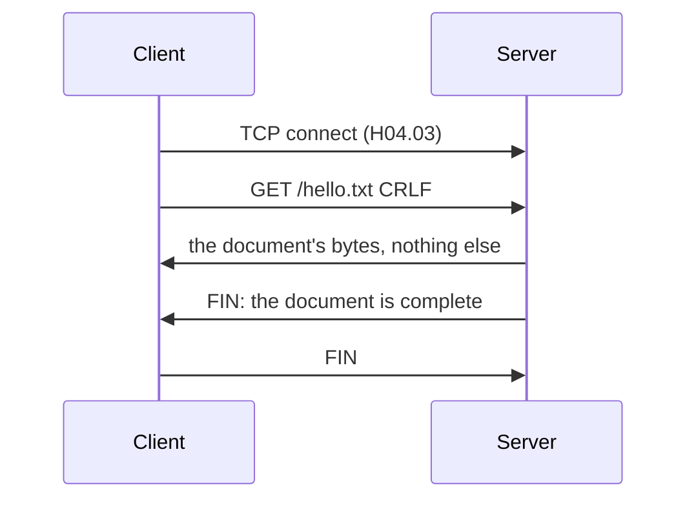
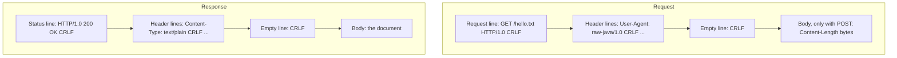
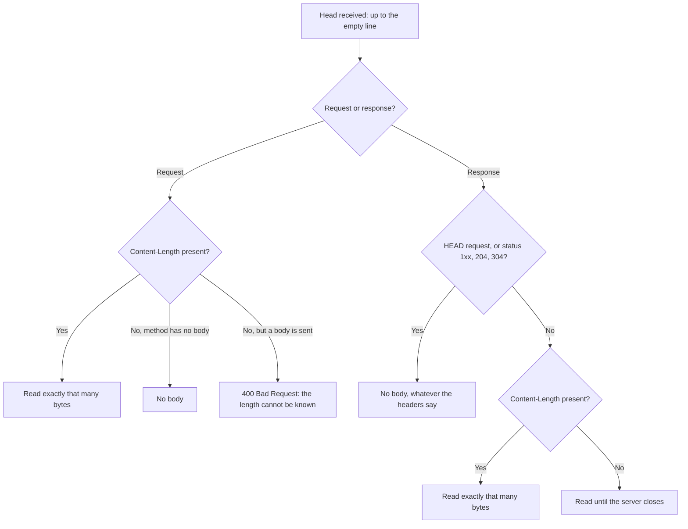
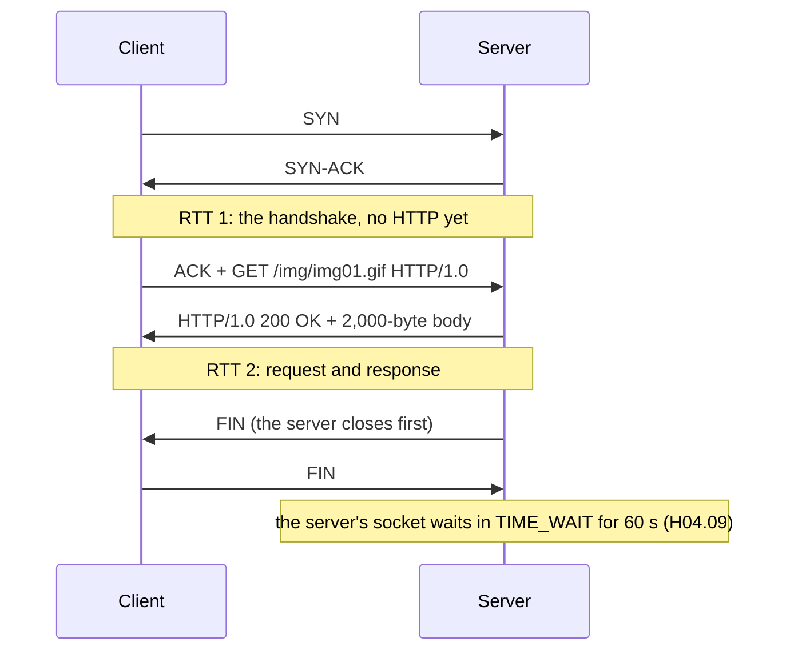
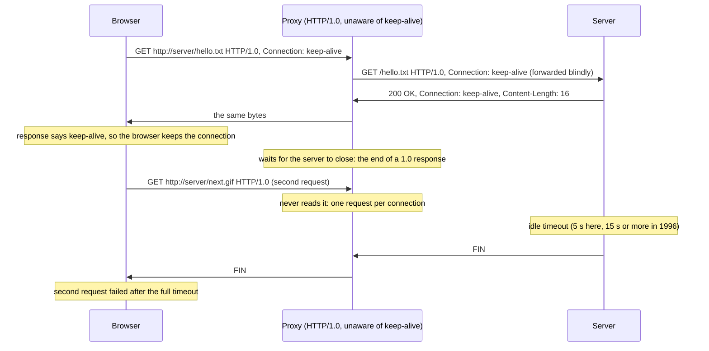
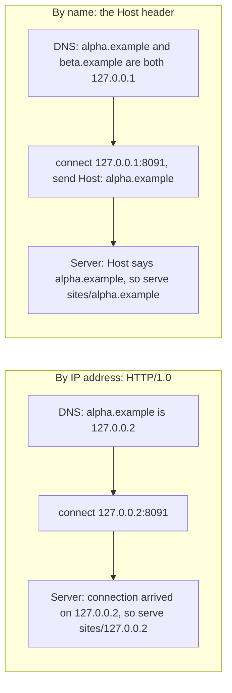
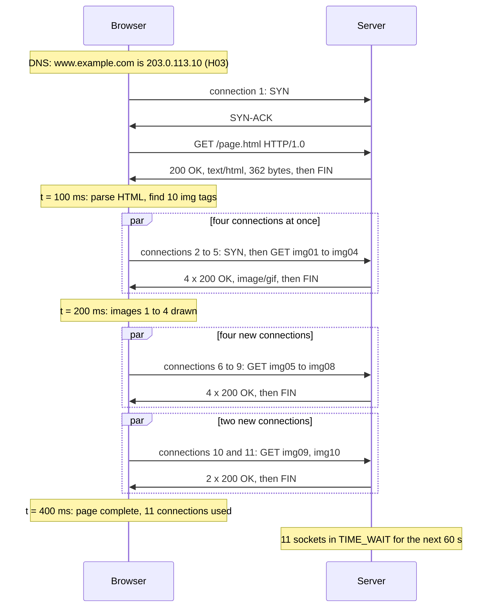
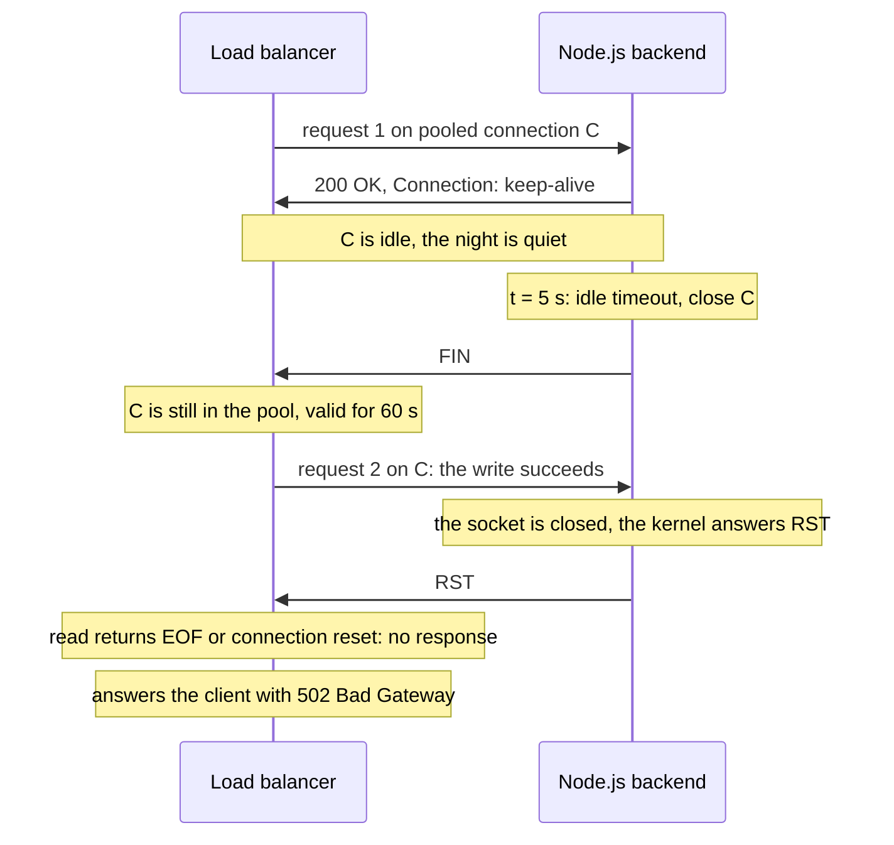

<!-- markdownlint-disable MD001 -->
<!-- markdownlint-disable MD024 -->
<!-- markdownlint-disable MD025 -->
<!-- markdownlint-disable MD026 -->
<!-- markdownlint-disable MD029 -->
<!-- markdownlint-disable MD033 -->
<!-- markdownlint-disable MD036 -->
<!-- markdownlint-disable MD040 -->
<!-- markdownlint-disable MD056 -->
<!-- markdownlint-disable MD060 -->

# H06. HTTP/0.9 and HTTP/1.0

---

## Contents

| #     | Sub-topic                                                     | Tag   |
| ----- | ------------------------------------------------------------- | ----- |
| 06.01 | HTTP/0.9: one line out, a document back                       | AWARE |
| 06.02 | HTTP/1.0 messages: request line, status line, headers         | CORE  |
| 06.03 | Where a message ends: `Content-Length` or the close           | CORE  |
| 06.04 | One connection per request, and what it cost                  | CORE  |
| 06.05 | Keep-alive: the unofficial patch, and the proxy that broke it | CORE  |
| 06.06 | No `Host` header: one IP address per site                     | DEEP  |
| 06.07 | The story: loading a 1996 home page                           | CORE  |
| 06.08 | Labs: what each one shows and how to run it                   | CORE  |
| 06.09 | Exercises                                                     |       |
| 06.10 | Solutions                                                     |       |
| 06.11 | Takeaways                                                     |       |

Terms used throughout:

- **Client** and **server**: the program that opens the TCP connection and sends a request, and the program that accepts it and answers.  
  A **user agent** is a client acting for a person, such as a browser.

- **Origin server**: the server that actually holds the resource.  
  A **proxy** is a program in between that receives the client's request and makes its own request onward, typically for a company network or a cache.

- **Resource**: anything a URL names, such as a file or the output of a program. **Document** is the 1991 word for it.

- **Message**: one request or one response. Its **head** is the text part (a first line and header lines); its **body** is the optional payload after it.  
  RFC 1945 calls the body the **entity body**.

- **Header field** (header): one `Name: value` line in the head, such as `Content-Length: 16`.

- **CRLF**: the two bytes carriage return and line feed (`\r\n`, 0x0D 0x0A) that end every line of an HTTP head (H01).

- **MIME type** (media type): a label for the format of a body, such as `text/html` or `image/gif`, borrowed from email (MIME, RFC 1521, 1993).

- **RTT**: round-trip time, the time for a packet to reach the other side and an answer to come back (H02, H04).

Outputs in this module are real: hand-written requests sent with `nc` (netcat) to five servers (nginx 1.24, Python 3.13's `http.server`, the JDK's `jwebserver`,  
and this modules's own Java and Rust servers), packets captured with `tcpdump`, on Linux 6.18 with JDK 21 and Rust 1.97.

---

## 06.01 HTTP/0.9: one line out, a document back

The protocol Tim Berners-Lee described in 1991 has one request form: the word `GET`, a space, a path, and CRLF.  
The server answers with the document itself, with no status, no headers and no length, and then closes the connection; the close is the only way the client knows the document is complete.  
It could fetch only HTML, could not report an error in a way a program could detect, and could not say anything about the document.  
It was never given a version number at the time; "HTTP/0.9" is a name applied later.

### The whole protocol



What the 1991 description (["The Original HTTP as defined in 1991"](https://www.w3.org/Protocols/HTTP/AsImplemented.html)) specifies:

| Element         | HTTP/0.9                                                                                                                                       |
| --------------- | ---------------------------------------------------------------------------------------------------------------------------------------------- |
| Request         | `GET` SP path CRLF. The host and port are not repeated: they are where the client connected                                                    |
| Methods         | `GET` only                                                                                                                                     |
| Response        | The document, as a stream of bytes; HTML was the only format foreseen                                                                          |
| End of response | The server closes the connection                                                                                                               |
| Errors          | A human-readable HTML page. "There is no way to distinguish an error response from a satisfactory response except for the content of the text" |
| Headers, status | None                                                                                                                                           |

A complete client fits in ten lines (Lab 01):

```java
try (var socket = new Socket("127.0.0.1", port)) {
    socket.getOutputStream().write(("GET " + path + "\r\n").getBytes(StandardCharsets.US_ASCII));
    byte[] document = socket.getInputStream().readAllBytes();             // the server's close ends the document
    System.out.print(new String(document, StandardCharsets.ISO_8859_1));
}
```

### Asking real servers in 2026

Lab 01 sends `GET /hello.txt` and `GET /nope.txt`, as HTTP/0.9, to five servers:

| Server                    | `GET /hello.txt`                        | `GET /nope.txt`                                            |
| ------------------------- | --------------------------------------- | ---------------------------------------------------------- |
| nginx 1.24                | `hello, http/1.0`, then close           | An HTML page titled "404 Not Found", with no status line   |
| Python 3.13 `http.server` | `hello, http/1.0`, then close           | An HTML page saying "Error code: 404", with no status line |
| JDK 21 `jwebserver`       | `HTTP/1.1 400 Bad Request` with headers | The same                                                   |
| This module's Java server | `hello, http/1.0`, then close           | `<html><body><h1>404 Not Found</h1></body></html>`         |
| This module's Rust server | `hello, http/1.0`, then close           | The same as Java                                           |

Two lessons from 1991 show up in 2026 output.  
First, the 404 pages arrive exactly like a successful document: a program fetching `/nope.txt` over HTTP/0.9 receives 162 bytes of HTML from nginx and has no way to tell, short of reading the text, that the file does not exist.  
Second, `jwebserver` does not speak HTTP/0.9 at all and answers with an HTTP/1.1 head, which a real HTTP/0.9 client would display as part of the document.  
Servers today differ: nginx and Python still answer the one-line form; others reject it.

### Why it mattered anyway

HTTP/0.9 is the smallest protocol that can fetch a document, and it worked: it carried the early web.  
Its limits are the agenda for everything after it:

| Missing in 0.9           | Consequence                                                 | Added in              |
| ------------------------ | ----------------------------------------------------------- | --------------------- |
| Status                   | Errors look like content                                    | 1.0 (06.02)           |
| Headers                  | No format label, no dates, no caching, no authentication    | 1.0 (06.02)           |
| A declared length        | A truncated document looks complete if the connection drops | 1.0, optional (06.03) |
| Methods other than `GET` | No way to send data except in the URL                       | 1.0 (`POST`)          |
| Reuse of the connection  | One TCP connection per document                             | 1.1 (06.04, 06.05)    |
| A host name              | One site per IP address                                     | 1.1 (06.06)           |

### Interview angle

"What is the minimum HTTP?" One request line, the response bytes, and the server's close as the end marker.  
Then name what is missing: status, metadata, a length (so truncation is undetectable), and connection reuse.  
Each later version is a response to one of these gaps.

---

## 06.02 HTTP/1.0 messages: request line, status line, headers

HTTP/1.0 (RFC 1945, May 1996) wrote down what browsers and servers had converged on since 1992.  
A request starts with a **request line**: method, path and version (`GET /hello.txt HTTP/1.0`).  
A response starts with a **status line**: version, a three-digit **status code** and a reason phrase (`HTTP/1.0 200 OK`).  
Both continue with **header lines** in email style, `Name: value`, then an empty line, then an optional body.  
Headers made everything else possible: `Content-Type` let the web carry images, `Content-Length` let clients detect truncation, dates enabled caching, and `Authorization` enabled logins.  
RFC 1945 is an informational RFC, a description of common practice rather than a standard.

### The message format



A real exchange with this module's Java server (Lab 02):

```text
$ printf 'GET /hello.txt HTTP/1.0\r\n\r\n' | nc -w 3 127.0.0.1 8091
HTTP/1.0 200 OK
Date: Mon, 26 Oct 2026 14:26:08 GMT
Server: h06-java/1.0
Content-Type: text/plain
Last-Modified: Mon, 26 Oct 2026 14:23:27 GMT
Content-Length: 16

hello, http/1.0
```

The request was 27 bytes: a request line and the empty line. HTTP/1.0 requires no header at all.

### The first lines, field by field

| Part          | Grammar (RFC 1945)                                          | Notes                                                                                                          |
| ------------- | ----------------------------------------------------------- | -------------------------------------------------------------------------------------------------------------- |
| Method        | `GET`, `HEAD`, `POST` defined; others allowed as extensions | `HEAD` is `GET` without the body: the same head, so a client can check a resource cheaply                      |
| Request-URI   | An absolute path, or a full URL when talking to a proxy     | `GET http://example.com/a.html HTTP/1.0` tells a proxy where to go; an origin server got only the path (06.06) |
| HTTP-Version  | `HTTP/` 1\*DIGIT `.` 1\*DIGIT                               | Major and minor are separate integers: `HTTP/1.10` would be newer than `HTTP/1.9`                              |
| Status-Code   | Three digits; the first gives the class                     | 2xx success, 3xx redirection, 4xx client error, 5xx server error (1xx defined, none used)                      |
| Reason-Phrase | Free text                                                   | For humans only; programs must use the code                                                                    |

The status codes RFC 1945 defines: 200 OK, 201 Created, 202 Accepted, 204 No Content, 300 Multiple Choices, 301 Moved Permanently, 302 Moved Temporarily, 304 Not Modified,  
400 Bad Request, 401 Unauthorized, 403 Forbidden, 404 Not Found, 500 Internal Server Error, 501 Not Implemented, 502 Bad Gateway, 503 Service Unavailable.  
Their meaning today, and the codes added since, are the subject of the REST track (R3); this module is about the wire.

**Versions in responses.** nginx and `jwebserver` answered the HTTP/1.0 request above with `HTTP/1.1 200 OK`.  
That is correct: RFC 2145 (1997) says a server sends the highest version it supports within the client's major version;  
HTTP/1.1 adds that it must not use features the client cannot understand, such as chunked encoding for a 1.0 client.  
The version on a response tells the client what the server could do, not what this message uses.

### The headers that mattered

RFC 1945 defines 16 header fields. Grouped by what they enabled:

| Purpose             | Fields                                                                      | What it enabled                                                                                          |
| ------------------- | --------------------------------------------------------------------------- | -------------------------------------------------------------------------------------------------------- |
| Describing the body | `Content-Type`, `Content-Length`, `Content-Encoding`                        | Images, downloads, compressed files; detecting truncation (06.03)                                        |
| Time and caching    | `Date`, `Last-Modified`, `If-Modified-Since`, `Expires`, `Pragma: no-cache` | Conditional requests: a client re-validates a cached copy and gets `304 Not Modified` with no body (H09) |
| Redirection         | `Location`                                                                  | 301 and 302 responses name the new URL                                                                   |
| Identity            | `User-Agent`, `Server`, `From`, `Referer`                                   | Statistics, compatibility workarounds, and the famous misspelling of "referrer"                          |
| Authentication      | `WWW-Authenticate`, `Authorization`                                         | HTTP Basic authentication: user name and password in base64, which is encoding, not encryption (H01)     |
| Capability          | `Allow`                                                                     | Lists the methods a resource supports                                                                    |

Lab 02's conditional request, against the same server:

```texts
$ printf 'GET /hello.txt HTTP/1.0\r\nIf-Modified-Since: Mon, 26 Oct 2026 14:23:27 GMT\r\n\r\n' | nc -w 3 127.0.0.1 8091
HTTP/1.0 304 Not Modified
Date: Mon, 26 Oct 2026 14:26:08 GMT
Server: h06-java/1.0
```

No body: the client keeps using its cached copy. This mechanism, from 1996, is still how browsers re-validate files today (H09 adds `ETag`).

### Rules for reading a head

RFC 1945 asks receivers to be tolerant, and its tolerance rules are still in every parser:

- **Header names are case-insensitive**: `Content-Length`, `content-length` and `Content-length` (as `jwebserver` writes it) are the same field. Parsers lower-case names on input.

- **Line endings**: the sender must use CRLF, but "we recommend that applications, when parsing such headers, recognize a single LF as a line terminator and ignore the leading CR" (RFC 1945, appendix B). nginx answered `GET /hello.txt` with a bare LF in Lab 01.

- **Dates** come in three formats (RFC 1123, RFC 850, and C's `asctime`); receivers should accept all three and senders should produce the first: `Mon, 26 Oct 2026 14:23:27 GMT`.

- **Unknown headers are ignored.** This single rule is how HTTP grew without new versions: a client could send `Host:` or `Connection: keep-alive` (06.05, 06.06) to old servers without breaking them.

Tolerance has a cost that H07 explores in depth: when two programs in a chain are tolerant in different ways, they can disagree about where a message ends, which is the root of request smuggling.

### Interview angle

"Walk me through an HTTP/1.0 request and response." Request line, headers, empty line, optional body; status line, headers, empty line, body.  
Then the details that show depth: header names are case-insensitive, unknown headers are ignored (which is how the protocol was extended),  
the response version is the server's capability, and the reason phrase is decoration.

---

## 06.03 Where a message ends: `Content-Length` or the close

TCP is a byte stream with no message boundaries (H04.01), so every application protocol must say where a message ends (H01.05).  

In HTTP/1.0 the head ends at the first empty line. A response body ends either after `Content-Length` bytes, if that header is present, or when the server closes the connection.  
A request body has no second option: the client cannot close the connection to mark the end, because it still needs the connection for the response.  
So a request with a body must carry `Content-Length`, and a server that cannot determine a request's length answers 400.

### The rules, in order



RFC 1945, section 7.2.2: "Closing the connection cannot be used to indicate the end of a request body, since it leaves no possibility for the server to send back a response.  
Therefore, HTTP/1.0 requests containing an entity body must include a valid Content-Length header field."

Lab 02's `POST` without a length, against four servers:

| Server                    | `POST /hello.txt HTTP/1.0` with a body and no `Content-Length`             |
| ------------------------- | -------------------------------------------------------------------------- |
| This module's Java server | `HTTP/1.0 400 Bad Request` (the rule above)                                |
| This module's Rust server | `HTTP/1.0 400 Bad Request`                                                 |
| Python `http.server`      | `HTTP/1.0 501 Unsupported method ('POST')`: it implements no `POST` at all |
| nginx                     | `HTTP/1.1 405 Not Allowed`: static files do not accept `POST`              |

### Why the close is a weak end marker

"Read until close" has two problems that kept growing:

- **Truncation is invisible.** If the server crashes or a network device resets the connection halfway through, the client sees a FIN or RST (H04.09) and cannot always tell an aborted body from a complete one.  
  With `Content-Length`, receiving fewer bytes than declared proves truncation.

- **The connection cannot be reused.** If the close is the end marker, every response costs a connection (06.04). Keep-alive (06.05) is only possible when the length is declared up front.

And `Content-Length` has its own limit: the server must know the length **before** sending the first body byte. A static file's size is known.  
A page generated by a program (CGI scripts in 1996, any streaming response today) usually is not, unless the whole output is buffered first. HTTP/1.0 offered no third option, so dynamic responses fell back to "read until close" and lost keep-alive.  
HTTP/1.1's **chunked** transfer coding (H07) is the third option: the body is sent in pieces, each prefixed with its own length, ending with a zero-length piece.

### Interview angle

"How does an HTTP client know a response is complete?" For HTTP/1.0: no body for `HEAD`, 204 and 304; otherwise `Content-Length` if present, else the server's close.  
Requests with bodies must declare a length, because closing would leave no way to answer.  
Then connect it forward: read-until-close prevents connection reuse and hides truncation, which is why HTTP/1.1 added chunked encoding.

---

## 06.04 One connection per request, and what it cost

In HTTP/1.0 every request uses a new TCP connection, and the server closes it after the response.  
Each object therefore pays a TCP handshake (one RTT) before its request can even be sent, and starts TCP's slow start from the beginning (H04.06).  
A 1996 page with ten images needed eleven connections: about 22 RTTs if fetched one after another.  
Browsers cut the waiting by opening several connections at once (Netscape used four), which cut latency but multiplied connections, and servers paid with a process per connection and thousands of sockets in TIME_WAIT.  
Measurements by Padmanabhan and Mogul (1994) made the case for keeping connections open, which HTTP/1.1 made the default.

### The cost of one object



So the minimum per object is **2 RTT** over a new connection, against **1 RTT** over a connection that is already open.  
For small objects (icons, buttons, small images), the handshake is half the cost.

Lab 04 measures this. A relay makes loopback behave like a path with a 50 ms RTT (it holds each new connection for one RTT, the handshake, and delays each chunk by half an RTT in each direction), and a client loads `page.html` plus the 10 images it references, in four ways:

| Strategy                                          | Connections | Model (RTT)                        | Measured, RTT 50 ms |
| ------------------------------------------------- | ----------- | ---------------------------------- | ------------------- |
| `http10`: one after another, new connection each  | 11          | 11 x 2 = **22**                    | 1,185 ms = 23.7 RTT |
| `parallel4`: page, then 4 connections at a time   | 11          | 2 + 3 rounds x 2 = **8**           | 434 ms = 8.7 RTT    |
| `keepalive`: one connection for everything        | 1           | 2 + 10 x 1 = **12**                | 645 ms = 12.9 RTT   |
| `keepalive4`: page, then 4 kept-alive connections | 4           | 2 + 1 handshake + 3 rounds = **6** | 322 ms = 6.4 RTT    |

The measured times run 0.4 to 1.7 RTT above the model; the same client through a relay with zero added delay took 76 ms in `http10` mode,  
which is the lab's own overhead (a fresh JVM and relay threads), not the protocol. Two conclusions hold regardless:

- **Parallel connections and keep-alive attack different costs.** Parallelism overlaps waiting; keep-alive removes handshakes. Combined, they beat either alone.

- **Even the best HTTP/1.0 strategy pays one RTT per object per connection**, because each connection carries one request at a time.  
  Sending all requests at once over one connection (pipelining, H07) or multiplexing them (HTTP/2, H17) was the next step.

### The costs the model leaves out

- **Slow start on every connection.** A new connection starts with a small congestion window and grows it per RTT (H04.06).  
  In 1996 the initial window was one segment (as RFC 2001 documented in 1997): a 6 KB image needed three round trips of data (1, 2, then 4 segments of 1,460 bytes), not one.  
  A reused connection keeps its grown window. Lab 04's relay does not model this, so it **understates** the HTTP/1.0 penalty.

- **TIME_WAIT on the server.** The side that closes first keeps the connection's 4-tuple in TIME_WAIT for 60 seconds (H04.09).  
  In HTTP/1.0 the server closes first, because its close marks the end of the response.  
  Lab 04 counted 11 TIME_WAIT sockets on the server's side after one `http10` page load, one per connection, and none after a `keepalive` load,  
  where the client closed the single connection and held the only one.  
  A busy 1996 server accumulated tens of thousands.

- **A process per connection.** Servers of the time, such as NCSA httpd and Apache 1.x, served each connection with a separate process.  
  More connections meant more processes, memory and context switches (H05.03).

- **The network.** Every connection costs SYN, SYN-ACK, ACK and four teardown packets (Lab 02 captured 10 packets for a 16-byte file).  
  Many short connections also compete unfairly with each other, since each runs its own congestion control.

### Interview angle

"Why did HTTP/1.1 make connections persistent?"  

Each new connection costs a handshake RTT, restarts slow start, leaves TIME_WAIT state on the server and costs server resources.  
Quantify it: for small objects, the handshake doubles the latency, and a page of N objects needs about 2N RTTs over sequential HTTP/1.0 against N + 1 with one persistent connection.

---

## 06.05 Keep-alive: the unofficial patch, and the proxy that broke it

Before HTTP/1.1, browsers and servers added persistent connections to HTTP/1.0 as an extension: the client sends `Connection: keep-alive`; a server that agrees answers with the same header (often with `Keep-Alive: timeout=15, max=100`), declares `Content-Length`, and leaves the connection open for the next request.  
A server that does not understand the header ignores it and closes, so the extension was safe between client and server.  
It was not safe through **proxies** that did not understand it: such a proxy forwarded the header to the server, the server kept the connection open, the proxy waited for a close that never came, and the browser, believing the connection was alive, sent its next request into a proxy that never read it.  
HTTP/1.1 fixed this by making `Connection` a **hop-by-hop** header that every proxy must remove.

### How the extension worked

| Step              | Client                                                                    | Server                                                                                                                                         |
| ----------------- | ------------------------------------------------------------------------- | ---------------------------------------------------------------------------------------------------------------------------------------------- |
| 01. Ask           | `Connection: keep-alive`                                                  |                                                                                                                                                |
| 02. Agree, or not |                                                                           | Agrees: `Connection: keep-alive`, `Content-Length`, optional `Keep-Alive: timeout=..., max=...`. Does not: ignores the header, closes as usual |
| 03. Reuse         | Sends the next request on the same connection only if the response agreed | Waits for the next request, up to its idle timeout                                                                                             |
| 04. End           | Either side closes when done or idle                                      | Closes after `max` requests or `timeout` seconds of idleness                                                                                   |

Lab 02's probe sends two requests with `Connection: keep-alive` over one connection:

| Server                | Request 1                                                                     | Request 2                       |
| --------------------- | ----------------------------------------------------------------------------- | ------------------------------- |
| Python `http.server`  | `HTTP/1.0 200 OK`, no `Connection` header                                     | The server had already closed   |
| nginx                 | `HTTP/1.1 200 OK`, `Connection: keep-alive`                                   | Answered on the same connection |
| `jwebserver`          | `HTTP/1.1 200 OK`, `Connection: keep-alive`, `Keep-alive: timeout=30`         | Answered on the same connection |
| This module's servers | `HTTP/1.0 200 OK`, `Connection: keep-alive`, `Keep-Alive: timeout=5, max=100` | Answered on the same connection |

Python's server shows the safe failure: it ignores the unknown header and closes, and a correct client opens a new connection.

### The dumb proxy

A proxy that does not know the `Connection` header treats it like any other header and forwards it.  
A 1996 proxy also typically relayed each response until the server closed, then closed the client's connection, and never expected a second request on a client connection.



Lab 05 reproduces it with `DumbProxy.java` and a client that behaves like a browser of the time:

```text
client +   15 ms  request 1: new connection to the proxy
client +   97 ms  request 1: HTTP/1.0 200 OK, 16 bytes, response says Connection: keep-alive
client +   99 ms  request 2: reusing the connection
client + 5070 ms  request 2: the connection closed before any response
```

The first request worked. The second waited the server's entire keep-alive timeout and then failed, because the proxy only closed the client's connection when the server,  
idle for 5 seconds, closed its own. In 1996 the hang lasted the server's keep-alive timeout, often 15 seconds or more, and then the browser showed an error or retried.

Proxy builders could not fix this alone, because old proxies were already deployed. Two responses followed:

- **`Proxy-Connection: keep-alive`.** Netscape's browsers sent this header, instead of `Connection`, when talking to a proxy.  
  A proxy that understood keep-alive converted it; an old proxy forwarded it, and servers ignored it because it was not `Connection`, so nothing broke.  
  It was never standardized, and RFC 7230 encourages clients not to send it.

- **Hop-by-hop headers in HTTP/1.1.** RFC 2068 (1997) defined `Connection` as applying to one connection only: a proxy must remove it, and must also remove every header it lists.  
  With `DumbProxy.java fixed`, which strips `Connection` and `Keep-Alive`, the server sees no keep-alive request and closes,  
  the response carries no keep-alive promise, and the client opens a new connection for request 2: correct and prompt (Lab 05).

HTTP/1.1 then made persistence the default, with `Connection: close` as the way to opt out (H08 covers proxies and hop-by-hop headers in full).

### Interview angle

"What is a hop-by-hop header, and why does it exist?" A header that describes one TCP connection rather than the message: `Connection`, `Keep-Alive`, `Proxy-Authenticate`, `Transfer-Encoding`, `Upgrade`.  
It exists because HTTP/1.0 keep-alive broke through proxies that forwarded `Connection: keep-alive` to servers; HTTP/1.1 requires every intermediary to consume and remove these headers.  
Bonus: an attacker can list an ordinary header in `Connection` to make some proxies strip it (Exercise 03).

---

## 06.06 No `Host` header: one IP address per site

An HTTP/1.0 request line carries only the path: `GET /index.html HTTP/1.0`.  
The host name the user typed was used for the DNS lookup (H03) and then thrown away, so a server listening on one IP address could not tell whether a request was meant for `alpha.example` or `beta.example`.  
Hosting two websites on one machine therefore required **one IP address per site**, with the server choosing the site by the local address the connection arrived on. Web hosting consumed IPv4 addresses by the thousand.  
Browsers began sending a `Host` header as an extension, servers used it when present, and HTTP/1.1 (RFC 2068, 1997) made it mandatory.  
HTTPS, HTTP's encrypted form, later repeated the same problem and the same fix: the client names the host at the start of the connection (SNI, defined under "What it cost" below).

### Two ways to pick a site



This module's servers do both, which is how servers handled the transition: use `Host` if present and known, otherwise fall back to the address the connection arrived on, otherwise a default site.  
Lab 06, one line per request, naming the site that answered:

```
== 127.0.0.1, no Host                ->  default site
== 127.0.0.2, no Host                ->  alpha.example
== 127.0.0.3, no Host                ->  beta.example
== 127.0.0.1, Host: alpha.example    ->  alpha.example
== 127.0.0.1, Host: beta.example:8091 -> beta.example
== 127.0.0.1, Host: www.unknown.example -> default site
```

### What it cost

Three terms for the table below, all covered in Parts C and D: **TLS** (Transport Layer Security) is the encryption layer between TCP and HTTP that turns HTTP into **HTTPS**.  
It starts with a **handshake** in which the server proves its identity with a **certificate**, a signed document that binds a host name to a key (H13).  
**SNI** (Server Name Indication) is a field in the client's first handshake message that names the host the client wants (H15).

| Era and mechanism                                                   | Addresses for 2,000 sites on one server | Notes                                                                                             |
| ------------------------------------------------------------------- | --------------------------------------- | ------------------------------------------------------------------------------------------------- |
| HTTP/1.0, IP-based virtual hosting                                  | 2,000                                   | Every site needs its own address bound on the machine and its own DNS record                      |
| `Host` header (HTTP/1.1, and 1.0 clients that sent it)              | 1                                       | The server reads the name from the request                                                        |
| HTTPS before SNI                                                    | 2,000 again                             | The server must present a certificate before any HTTP byte arrives, so it cannot see `Host` (H15) |
| HTTPS with SNI (RFC 3546, 2003; usable everywhere by the mid-2010s) | 1                                       | The client names the host in the TLS handshake                                                    |

IANA handed out its last free blocks of IPv4 addresses in February 2011.  
Name-based virtual hosting slowed the web's demand for addresses; IP-based hosting, which HTTPS still needed until SNI was universal, added to it.

### Where the gap still shows

- **Requests without `Host`, or with an unknown one, land on a default site.** Every server needs a deliberate choice for them: nginx's `default_server`, Apache's first virtual host.  
  A forgotten default can expose an internal application, or a site's origin server directly by IP address, bypassing a CDN's protections (Exercise 04).

- **`Host` is client-controlled input.** An application that builds absolute URLs from `Host` (for example in password-reset emails) can be made to send links pointing at an attacker's domain.  
  Applications should use a configured canonical host name, or check `Host` against an allowlist.

- **Absolute-form requests.** HTTP/1.0 used the full URL in the request line only for proxies (`GET http://alpha.example/ HTTP/1.0`), which is how a proxy knew where to forward.  
  HTTP/1.1 requires origin servers to accept that form too, and when both are present the URL's host wins over `Host` (H07).

### Interview angle

"Why is `Host` mandatory in HTTP/1.1?" HTTP/1.0 requests carried only the path, so a server could not tell which of its sites a request was for; virtual hosting needed one IP address per site.  
`Host` enables name-based virtual hosting on a single address; HTTP/1.1 servers must answer 400 to an HTTP/1.1 request without it.  
Bonus points: TLS had the same problem and solved it with SNI, and `Host` is untrusted input (default vhosts, password-reset poisoning).

---

## 06.07 The story: loading a 1996 home page

A browser of 1996, configured like Netscape Navigator with up to four connections per server, loads `http://www.example.com/page.html`: an HTML page of 362 bytes that references ten 2,000-byte GIF images.  
The server is 50 ms away. This is Lab 04's `parallel4` run, told step by step; the times are the model's, and the measured totals are at the end.

### The journey at a glance



### Chapter 01: the address

The browser resolves `www.example.com` (H03), takes the first address, and from now on the name exists only in the browser's memory.  
The requests it sends will carry only paths; a 1996 browser may add `Host: www.example.com` as an extension, which an old server ignores and a newer one uses to choose among the sites it hosts on that address (06.06).

### Chapter 02: the page

Connection 1 costs one RTT before any HTTP: SYN, SYN-ACK, and the ACK that travels with the request (H04.03).  
The request is a request line, `User-Agent`, `Accept` and the empty line. The server answers `HTTP/1.0 200 OK` with `Content-Type: text/html` and `Content-Length: 362`, sends the page, and closes.  
At t = 100 ms (2 RTT) the browser has the page; the close also told it the page was complete, though `Content-Length` already had.

### Chapter 03: ten more objects

The browser parses the HTML and finds ten `` tags.  
It knows nothing about the images until it fetches them: not their sizes (so the layout shifts as each arrives, unless the HTML gave `width` and `height`),  
and not whether they changed since its last visit (a cached copy needs an `If-Modified-Since` request per image, 06.02, each also costing a connection).

### Chapter 04: four at a time

The browser opens four connections at once. Each one pays its own handshake RTT and its own request RTT, and each starts TCP slow start from scratch.  
Images 1 to 4 arrive at t = 200 ms, images 5 to 8 over four brand-new connections at t = 300 ms, images 9 and 10 at t = 400 ms.  
Each response ends with the server's FIN.

### Chapter 05: what the server is left with

Eleven connections, each served by its own process on a server of the time, each closed by the server first and therefore held in TIME_WAIT on the server for 60 seconds (H04.09).  
Lab 04 counted all 11 on the server's side after one page load.  
A server with 200 such page views per second carries over 100,000 TIME_WAIT entries.

### What it cost

| Strategy                                  | Connections | Model    | Lab 04, measured |
| ----------------------------------------- | ----------- | -------- | ---------------- |
| Plain HTTP/1.0, one object at a time      | 11          | 1,100 ms | 1,185 ms         |
| Netscape style, 4 parallel connections    | 11          | 400 ms   | 434 ms           |
| Keep-alive, one connection                | 1           | 600 ms   | 645 ms           |
| Keep-alive, 4 parallel connections        | 4           | 300 ms   | 322 ms           |
| HTTP/1.1 pipelining, one connection (H07) | 1           | 150 ms   | 167 ms           |

On a real 1996 path the gap between the rows was larger than shown, because every new connection restarted slow start with a one-segment window (06.04), which Lab 04 does not model.

### What can go wrong, chapter by chapter

| Chapter | Failure                                                                          | Symptom                                                                                                          |
| ------- | -------------------------------------------------------------------------------- | ---------------------------------------------------------------------------------------------------------------- |
| 01      | The server hosts several sites on one IP address and the browser sends no `Host` | The wrong site's page (06.06)                                                                                    |
| 02      | The connection drops mid-page and the response had no `Content-Length`           | A truncated page displayed as if complete (06.03)                                                                |
| 04      | Too many parallel connections from many users                                    | Accept-queue overflows and 1 s, 3 s, 7 s SYN retries (H04.03)                                                    |
| 04      | A keep-alive request through an old proxy                                        | The next request hangs until a timeout (06.05)                                                                   |
| 05      | Tens of thousands of TIME_WAIT sockets and processes                             | Memory pressure on the server, and port exhaustion for clients behind NAT making many short connections (H02.06) |

---

## 06.08 Labs: what each one shows and how to run it

| Lab | Topic                                   | Covers                     | Needs                                    |
| --- | --------------------------------------- | -------------------------- | ---------------------------------------- |
| 00  | Setup: five servers and the tools       | All                        | Linux, Java, Rust, nginx, Python 3, `nc` |
| 01  | HTTP/0.9 by hand                        | 06.01                      | `nc`, Java or Rust                       |
| 02  | HTTP/1.0 by hand, and on the wire       | 06.02, 06.03, 06.05        | `nc`, `curl`, `tcpdump`, Python 3        |
| 03  | An HTTP/1.0 server in Java and Rust     | 06.02, 06.03, 06.05, 06.06 | Java or Rust                             |
| 04  | One connection per request: the cost    | 06.04, 06.07               | Java, `iproute2`                         |
| 05  | Keep-alive through a dumb proxy         | 06.05                      | Java                                     |
| 06  | Virtual hosting with and without `Host` | 06.06                      | `nc`, Java or Rust                       |

### Setup, once

As in H04 and H05, a disposable Linux container is the easiest place: nginx wants port 80, and Lab 06 uses the loopback addresses 127.0.0.2 and 127.0.0.3,  
which Linux answers on without configuration (macOS needs `ifconfig lo0 alias 127.0.0.2` first).

```text
docker run --rm -it --cap-add NET_ADMIN --cap-add NET_RAW -v "$PWD":/h06 -w /h06 ubuntu:24.04
apt update && apt install -y openjdk-21-jdk-headless nginx-light netcat-openbsd curl tcpdump python3 iproute2 build-essential
```

Rust 1.85 or later, installed with `rustup` as in H01.

Folder layout:

```text
h06/
  make_sites.sh           <- creates sites/ and nginx.conf (below)
  ka_probe.py             <- Lab 02 keep-alive probe
  pipeline.py             <- Lab 04 pipelining client
  idle_race.py            <- Solution 02 idle-timeout race
  vhost_lab.sh            <- Solution 04 default-server check (creates vhost/)
  sites/
    default/              hello.txt  index.html  page.html  img/img01.gif ... img10.gif
    alpha.example/        index.html
    beta.example/         index.html
    127.0.0.2 -> alpha.example     (symbolic link: the site for that address)
    127.0.0.3 -> beta.example
  nginx.conf
  java/
    Http09Client.java  Http10Server.java  LatencyRelay.java  PageLoad.java  DumbProxy.java  KeepAliveClient.java
  rust/                   <- cargo new rust (no extra crates)
    src/bin/http09_client.rs  http10_server.rs
```

`make_sites.sh`:

```bash
#!/bin/bash
# Creates the H06 lab files: three sites, a page with ten images, and an nginx configuration for port 80.
set -e
cd "$(dirname "$0")"
mkdir -p sites/default/img sites/alpha.example sites/beta.example
printf 'hello, http/1.0\n' > sites/default/hello.txt
printf '<html><body><h1>default site</h1></body></html>\n' > sites/default/index.html
printf '<html><body><h1>alpha.example</h1></body></html>\n' > sites/alpha.example/index.html
printf '<html><body><h1>beta.example</h1></body></html>\n' > sites/beta.example/index.html
{
    printf '<html>\n<head><title>A 1996 home page</title></head>\n<body>\n<h1>Welcome</h1>\n'
    for i in 01 02 03 04 05 06 07 08 09 10; do
        printf '\n' "$i"
        { printf 'GIF89a'; head -c 1994 /dev/zero; } > "sites/default/img/img$i.gif"   # 2,000 bytes each
    done
    printf '</body>\n</html>\n'
} > sites/default/page.html
ln -sfn alpha.example sites/127.0.0.2                # IP-based virtual hosting: one address per site
ln -sfn beta.example sites/127.0.0.3
cat > nginx.conf <<CONF
user root;
worker_processes 1;
error_log $PWD/nginx-error.log;
pid $PWD/nginx.pid;
events { worker_connections 1024; }
http {
    access_log $PWD/nginx-access.log;
    include /etc/nginx/mime.types;
    server {
        listen 127.0.0.1:80;
        root $PWD/sites/default;
    }
}
CONF
echo "created sites/ and nginx.conf in $PWD"
```

The servers used in this module, each started in its own terminal (or with `&`), from `h06`:

| Server                         | Port | Start                                                                                                            |
| ------------------------------ | ---- | ---------------------------------------------------------------------------------------------------------------- |
| nginx 1.24                     | 80   | `nginx -c "$PWD/nginx.conf"` (stop: `nginx -c "$PWD/nginx.conf" -s stop`)                                        |
| Python `http.server`           | 8090 | `python3 -m http.server 8090 --bind 127.0.0.1 --directory sites/default`                                         |
| JDK `jwebserver`               | 8000 | `jwebserver -b 127.0.0.1 -p 8000 -d "$PWD/sites/default"`                                                        |
| `Http10Server.java` (Lab 03)   | 8091 | `cd java && java Http10Server.java 8091 ../sites 127.0.0.1,127.0.0.2,127.0.0.3`                                  |
| `http10_server` (Rust, Lab 03) | 8092 | `cd rust && cargo build --release && ./target/release/http10_server 8092 ../sites 127.0.0.1,127.0.0.2,127.0.0.3` |

Verification note: every output in this section was produced by running the code shown, on JDK 21, Rust 1.97, Python 3.13, nginx 1.24 and Linux 6.18 with default loopback settings.  
Dates, ports and timings will differ on your machine; the shapes will not.  
Java timings for the first request in a fresh JVM include class loading.

### Lab 00: setup

```text
cd h06
./make_sites.sh
# then start the five servers from the table above
ss -tlnp | grep -E ':(80|8000|8090|8091|8092) '
```

Real output (process ids trimmed): listeners on `127.0.0.1:80` (nginx), `127.0.0.1:8000` (jwebserver), `127.0.0.1:8090` (python3),  
and on `127.0.0.1`, `127.0.0.2` and `127.0.0.3` for ports 8091 (java) and 8092 (http10_server): one listening socket per address, as a 1996 server with IP-based virtual hosts had.

`nc` (netcat) is the tool for speaking a protocol by hand: it connects, copies its standard input to the socket, and prints what comes back.  
`-w 3` makes it give up 3 seconds after the server stops sending. `printf` writes `\r\n` as the real CR LF bytes, which `echo` does not do reliably.

### Lab 01: HTTP/0.9 by hand

Goal: send the 1991 request to five servers and see who still answers, and how errors look without a status line.

```text
for port in 8090 80 8000 8091 8092; do
    echo "== port $port"
    printf 'GET /hello.txt\r\n' | nc -w 3 127.0.0.1 $port
done
```

Real output:

```text
== port 8090
hello, http/1.0
== port 80
hello, http/1.0
== port 8000
HTTP/1.1 400 Bad Request
Content-Length: 40
Content-Type: text/html
Connection: close

<h1>400 Bad Request</h1>Bad request line== port 8091
hello, http/1.0
== port 8092
hello, http/1.0
```

Four servers answered the HTTP/0.9 way: the file's 16 bytes and a close, nothing else.  
`jwebserver` rejected the request line with an HTTP/1.1 response, which a real 0.9 client would show as text. Now a file that does not exist:

```text
for port in 8090 80 8091; do
    echo "== port $port, missing file"
    printf 'GET /nope.txt\r\n' | nc -w 3 127.0.0.1 $port
done
```

Real output:

```text
== port 8090, missing file
<!DOCTYPE HTML>
<html lang="en">
    <head>
        <meta charset="utf-8">
        <title>Error response</title>
    </head>
    <body>
        <h1>Error response</h1>
        <p>Error code: 404</p>
        <p>Message: File not found.</p>
        <p>Error code explanation: 404 - Nothing matches the given URI.</p>
    </body>
</html>
== port 80, missing file
<html>
<head><title>404 Not Found</title></head>
<body>
<center><h1>404 Not Found</h1></center>
<hr><center>nginx/1.24.0 (Ubuntu)</center>
</body>
</html>
== port 8091, missing file
<html><body><h1>404 Not Found</h1></body></html>
```

Each server sent an error page and nothing else.  
A program cannot tell these from documents that happen to contain the words "404 Not Found".

The same in Java and Rust. `Http09Client.java`:

```java
import java.net.Socket;
import java.nio.charset.StandardCharsets;

// A complete HTTP/0.9 client: one line out, everything until the close back. Usage: java Http09Client.java [port] [path]
public class Http09Client {
    public static void main(String[] args) throws Exception {
        int port = args.length > 0 ? Integer.parseInt(args[0]) : 8091;
        String path = args.length > 1 ? args[1] : "/hello.txt";
        try (var socket = new Socket("127.0.0.1", port)) {
            socket.getOutputStream().write(("GET " + path + "\r\n").getBytes(StandardCharsets.US_ASCII));
            byte[] document = socket.getInputStream().readAllBytes();             // the server's close ends the document
            System.out.print(new String(document, StandardCharsets.ISO_8859_1));
            System.out.println("(" + document.length + " bytes; no status, no headers: an error page looks like any document)");
        }
    }
}
```

`http09_client.rs`:

```rust
// A complete HTTP/0.9 client. Usage: cargo run --release --bin http09_client -- [port] [path]
use std::io::{Read, Write};
use std::net::TcpStream;

fn main() -> std::io::Result<()> {
    let port = std::env::args().nth(1).unwrap_or_else(|| "8092".into());
    let path = std::env::args().nth(2).unwrap_or_else(|| "/hello.txt".into());
    let mut stream = TcpStream::connect(format!("127.0.0.1:{port}"))?;
    stream.write_all(format!("GET {path}\r\n").as_bytes())?;
    let mut document = Vec::new();
    stream.read_to_end(&mut document)?;                                  // the server's close ends the document
    print!("{}", String::from_utf8_lossy(&document));
    println!("({} bytes; no status, no headers: an error page looks like any document)", document.len());
    Ok(())
}
```

```text
$ java Http09Client.java 8091 /nope.txt
<html><body><h1>404 Not Found</h1></body></html>
(49 bytes; no status, no headers: an error page looks like any document)

$ ./target/release/http09_client 80 /nope.txt
<html>
<head><title>404 Not Found</title></head>
<body>
<center><h1>404 Not Found</h1></center>
<hr><center>nginx/1.24.0 (Ubuntu)</center>
</body>
</html>
(162 bytes; no status, no headers: an error page looks like any document)
```

Things to try:

01. `printf 'GET /hello.txt\n' | nc -w 3 127.0.0.1 80`, with a bare LF: nginx still answers (06.02, tolerant parsing).

02. `printf 'POST /hello.txt\r\n' | nc -w 3 127.0.0.1 8090`: Python answers `HTTP/1.0 400 Bad HTTP/0.9 request type ('POST')` with a full HTTP/1.0 head, because HTTP/0.9 had only `GET`.

03. Run `tcpdump -i lo -nn 'tcp port 8091'` while sending a 0.9 request: the server's FIN arrives right after the data, and that FIN is the only end marker.

### Lab 02: HTTP/1.0 by hand, and on the wire

Goal: compare how three widely used servers answer the same HTTP/1.0 requests, test conditional requests and the `POST` length rule, probe keep-alive, and capture one exchange.

**The same request to three servers:**

```text
for port in 8090 80 8000; do
    printf 'GET /hello.txt HTTP/1.0\r\n\r\n' | nc -w 3 127.0.0.1 $port
done
```

Real output:

```text
HTTP/1.0 200 OK
Server: SimpleHTTP/0.6 Python/3.13.17
Date: Mon, 26 Oct 2026 14:39:01 GMT
Content-type: text/plain
Content-Length: 16
Last-Modified: Mon, 26 Oct 2026 14:23:27 GMT

hello, http/1.0

HTTP/1.1 200 OK
Server: nginx/1.24.0 (Ubuntu)
Date: Mon, 26 Oct 2026 14:39:01 GMT
Content-Type: text/plain
Content-Length: 16
Last-Modified: Mon, 26 Oct 2026 14:23:27 GMT
Connection: close
ETag: "6adf625f-10"
Accept-Ranges: bytes

hello, http/1.0

HTTP/1.1 200 OK
Connection: close
Date: Mon, 26 Oct 2026 14:39:01 GMT
Last-modified: Mon, 26 Oct 2026 14:23:27 GMT
Content-type: text/plain
Content-length: 16

hello, http/1.0
```

What to notice:

- **Python** is an HTTP/1.0 server and says so. **nginx** and **`jwebserver`** answer `HTTP/1.1`, their own version (06.02), and add `Connection: close` because the request did not ask for keep-alive.

- **Header-name case varies**: `Content-type` (Python), `Content-Type` (nginx), `Content-length` (`jwebserver`). All are the same field.

- nginx adds `ETag` and `Accept-Ranges`, HTTP/1.1 headers that an HTTP/1.0 client ignores (H09).

**`HEAD`, conditional `GET`, and `POST` without a length:**

```text
printf 'HEAD /hello.txt HTTP/1.0\r\n\r\n' | nc -w 3 127.0.0.1 80
printf 'GET /hello.txt HTTP/1.0\r\nIf-Modified-Since: Mon, 26 Oct 2026 14:23:27 GMT\r\n\r\n' | nc -w 3 127.0.0.1 80 | head -1
printf 'POST /hello.txt HTTP/1.0\r\n\r\nx=1' | nc -w 3 127.0.0.1 80 | head -1
```

Use the `Last-Modified` value your own server printed. Real first lines, for each server:

| Server        | `HEAD`                                             | `If-Modified-Since` (same date) | `POST`, no `Content-Length`                |
| ------------- | -------------------------------------------------- | ------------------------------- | ------------------------------------------ |
| nginx (80)    | `HTTP/1.1 200 OK`, the same head as `GET`, no body | `HTTP/1.1 304 Not Modified`     | `HTTP/1.1 405 Not Allowed`                 |
| Python (8090) | `HTTP/1.0 200 OK`, no body                         | `HTTP/1.0 304 Not Modified`     | `HTTP/1.0 501 Unsupported method ('POST')` |
| Java (8091)   | `HTTP/1.0 200 OK`, no body                         | `HTTP/1.0 304 Not Modified`     | `HTTP/1.0 400 Bad Request`                 |
| Rust (8092)   | `HTTP/1.0 200 OK`, no body                         | `HTTP/1.0 304 Not Modified`     | `HTTP/1.0 400 Bad Request`                 |

**Keep-alive.** `ka_probe.py` sends two requests with `Connection: keep-alive` over one connection, reading each body by its `Content-Length`:

```python
# Sends two HTTP/1.0 requests with "Connection: keep-alive" over ONE connection and reports what the server did.
# Usage: python3 ka_probe.py <port>
import socket
import sys

port = int(sys.argv[1])
s = socket.create_connection(("127.0.0.1", port), timeout=2)
buffered = b""
for i in (1, 2):
    s.sendall(b"GET /hello.txt HTTP/1.0\r\nHost: 127.0.0.1\r\nConnection: keep-alive\r\n\r\n")
    while b"\r\n\r\n" not in buffered:                    # read until the end of the head
        chunk = s.recv(4096)
        if not chunk:
            break
        buffered += chunk
    if b"\r\n\r\n" not in buffered:
        print(f"request {i}: the server had closed the connection")
        break
    head, buffered = buffered.split(b"\r\n\r\n", 1)
    lines = head.decode("latin-1").split("\r\n")
    fields = {l.split(":", 1)[0].lower(): l for l in lines[1:]}
    length = int(fields["content-length"].split(":", 1)[1])
    while len(buffered) < length:                         # then exactly Content-Length bytes of body
        buffered += s.recv(4096)
    buffered = buffered[length:]
    shown = [fields[k] for k in ("connection", "keep-alive", "content-length") if k in fields]
    print(f"request {i}: {lines[0]} | " + " | ".join(shown))
```

```text
for port in 8090 80 8000 8091 8092; do echo "== port $port"; python3 ka_probe.py $port; done
```

Real output:

```text
== port 8090
request 1: HTTP/1.0 200 OK | Content-Length: 16
request 2: the server had closed the connection
== port 80
request 1: HTTP/1.1 200 OK | Connection: keep-alive | Content-Length: 16
request 2: HTTP/1.1 200 OK | Connection: keep-alive | Content-Length: 16
== port 8000
request 1: HTTP/1.1 200 OK | Connection: keep-alive | Keep-alive: timeout=30 | Content-length: 16
request 2: HTTP/1.1 200 OK | Connection: keep-alive | Keep-alive: timeout=30 | Content-length: 16
== port 8091
request 1: HTTP/1.0 200 OK | Connection: keep-alive | Keep-Alive: timeout=5, max=100 | Content-Length: 16
request 2: HTTP/1.0 200 OK | Connection: keep-alive | Keep-Alive: timeout=5, max=100 | Content-Length: 16
== port 8092
request 1: HTTP/1.0 200 OK | Connection: keep-alive | Keep-Alive: timeout=5, max=100 | Content-Length: 16
request 2: HTTP/1.0 200 OK | Connection: keep-alive | Keep-Alive: timeout=5, max=100 | Content-Length: 16
```

The first version of this probe read each response with a single `recv` and did not consume the body by its length.  
Against `jwebserver`, which sends head and body in separate writes, request 2's "status line" then came out as `hello, http/1.0`: the leftover body of response 1.  
It is the framing bug of H01.05 and H05.02, made by the author of this module while writing it.

**On the wire.** One HTTP/1.0 exchange with nginx, captured (root):

```text
tcpdump -i lo -nn -ttttt 'tcp port 80'          # terminal 1
curl -0 -s http://127.0.0.1/hello.txt           # terminal 2: -0 makes curl speak HTTP/1.0
```

Real output, options removed:

```text
00:00:00.000000 IP 127.0.0.1.45430 > 127.0.0.1.80: Flags [S], seq 4292694500, win 65495, length 0
00:00:00.000011 IP 127.0.0.1.80 > 127.0.0.1.45430: Flags [S.], seq 411748997, ack 4292694501, win 65483, length 0
00:00:00.000019 IP 127.0.0.1.45430 > 127.0.0.1.80: Flags [.], ack 1, win 64, length 0
00:00:00.000074 IP 127.0.0.1.45430 > 127.0.0.1.80: Flags [P.], seq 1:82, ack 1, win 64, length 81: HTTP: GET /hello.txt HTTP/1.0
00:00:00.000078 IP 127.0.0.1.80 > 127.0.0.1.45430: Flags [.], ack 82, win 64, length 0
00:00:00.000285 IP 127.0.0.1.80 > 127.0.0.1.45430: Flags [P.], seq 1:258, ack 82, win 64, length 257: HTTP: HTTP/1.1 200 OK
00:00:00.000322 IP 127.0.0.1.45430 > 127.0.0.1.80: Flags [.], ack 258, win 64, length 0
00:00:00.000366 IP 127.0.0.1.80 > 127.0.0.1.45430: Flags [F.], seq 258, ack 82, win 64, length 0
00:00:00.000410 IP 127.0.0.1.45430 > 127.0.0.1.80: Flags [F.], seq 82, ack 259, win 64, length 0
00:00:00.000420 IP 127.0.0.1.80 > 127.0.0.1.45430: Flags [.], ack 83, win 64, length 0
```

Ten packets for 16 bytes of content: three for the handshake, two for the request and its ACK, two for the response (241 bytes of head, 16 of body, in one segment) and its ACK, three for the close.  
The **server's FIN comes first** (packet 8), so the server's side holds TIME_WAIT (06.04).

Things to try:

01. Add `Host: 127.0.0.1` to the `nc` requests and compare: no server requires it for HTTP/1.0.  
  Then send `GET /hello.txt HTTP/1.1` without `Host` to nginx: `400 Bad Request`, as HTTP/1.1 requires (06.06).

02. Send `GET /hello.txt HTTP/2.0` and `GET /hello.txt HTTP/1.9` to each server. Real first lines:

| Server              | `HTTP/2.0`                                | `HTTP/1.9`                 |
| ------------------- | ----------------------------------------- | -------------------------- |
| nginx (80)          | `HTTP/1.1 505 HTTP Version Not Supported` | `HTTP/1.1 400 Bad Request` |
| Python (8090)       | `HTTP/1.0 505 Invalid HTTP version (2.0)` | `HTTP/1.0 200 OK`          |
| `jwebserver` (8000) | `HTTP/1.1 200 OK`                         | `HTTP/1.1 200 OK`          |
| Java (8091)         | `HTTP/1.0 200 OK`                         | `HTTP/1.0 200 OK`          |
| Rust (8092)         | `HTTP/1.0 200 OK`                         | `HTTP/1.0 200 OK`          |

RFC 2145's rule (06.02) is that a request with the same major version is answered in the server's own version of that major,  
sso `HTTP/1.9` deserves a normal answer and nginx's 400 is stricter than the rule. A major version the server does not implement may get 505, as nginx and Python do for 2.0;  
`jwebserver` and this module's servers accept any version.

03. Send an `If-Modified-Since` one second **later** than `Last-Modified` (`14:23:28` for the file above).  
  The Java server answers `304`, because it parses both dates and compares them. nginx and the Rust server answer `200`, because they compare the two strings (nginx's default, `if_modified_since exact`). One second **earlier**, all three answer `200`.

### Lab 03: an HTTP/1.0 server in Java and Rust

Goal: implement RFC 1945's server side in about 250 lines: Simple-Requests, `GET` and `HEAD`, status codes, `Content-Type` and `Content-Length`, `If-Modified-Since`,  
the `Content-Length` rule for request bodies, the keep-alive extension, and virtual hosts by `Host` or by local address (Lab 06). One virtual thread per connection, as in H05.

`Http10Server.java`:

```java
import java.io.BufferedInputStream;
import java.io.BufferedOutputStream;
import java.io.ByteArrayOutputStream;
import java.io.IOException;
import java.io.InputStream;
import java.io.OutputStream;
import java.net.InetAddress;
import java.net.InetSocketAddress;
import java.net.ServerSocket;
import java.net.Socket;
import java.net.SocketTimeoutException;
import java.nio.charset.StandardCharsets;
import java.nio.file.Files;
import java.nio.file.Path;
import java.time.ZoneOffset;
import java.time.ZonedDateTime;
import java.time.format.DateTimeFormatter;
import java.util.LinkedHashMap;
import java.util.Locale;
import java.util.Map;
import java.util.concurrent.atomic.AtomicInteger;

// A small HTTP/1.0 server (RFC 1945): Simple-Requests (HTTP/0.9), GET, HEAD, If-Modified-Since,
// the unofficial keep-alive extension, and virtual hosts chosen by Host header or by local IP address.
// Usage: java Http10Server.java [port] [sites-dir] [comma-separated bind addresses]
public class Http10Server {
    static final DateTimeFormatter HTTP_DATE = DateTimeFormatter.RFC_1123_DATE_TIME;  // "Mon, 26 Oct 2026 14:23:56 GMT"
    static final int KEEP_ALIVE_TIMEOUT_MS = 5_000;
    static final int KEEP_ALIVE_MAX = 100;
    static final AtomicInteger connections = new AtomicInteger();

    final Path sites;

    Http10Server(Path sites) {
        this.sites = sites;
    }

    public static void main(String[] args) throws Exception {
        int port = args.length > 0 ? Integer.parseInt(args[0]) : 8091;
        Path sites = Path.of(args.length > 1 ? args[1] : "../sites").toAbsolutePath().normalize();
        String[] addresses = (args.length > 2 ? args[2] : "127.0.0.1").split(",");
        var server = new Http10Server(sites);
        for (String address : addresses) {                                    // one listening socket per address
            var listener = new ServerSocket();
            listener.bind(new InetSocketAddress(InetAddress.getByName(address), port), 1024);
            System.out.println("HTTP/1.0 server on " + address + ":" + port + ", sites in " + sites);
            Thread.ofVirtual().start(() -> server.acceptLoop(listener));
        }
        Thread.currentThread().join();                                        // run until killed
    }

    void acceptLoop(ServerSocket listener) {
        while (true) {
            try {
                Socket s = listener.accept();
                int id = connections.incrementAndGet();
                Thread.ofVirtual().start(() -> serve(s, id));                 // one virtual thread per connection (H05)
            } catch (IOException e) {
                System.out.println("accept failed: " + e);
            }
        }
    }

    void serve(Socket s, int id) {
        int n = 1;
        try {
            InputStream in = new BufferedInputStream(s.getInputStream());
            OutputStream out = new BufferedOutputStream(s.getOutputStream(), 64 * 1024);   // head and body leave in one write (H04.07)
            for (; n <= KEEP_ALIVE_MAX; n++) {
                int idle = n == 1 ? 10_000 : KEEP_ALIVE_TIMEOUT_MS;
                s.setSoTimeout(idle);                                         // idle limit while waiting for a request
                String requestLine;
                try {
                    requestLine = readLine(in);
                } catch (SocketTimeoutException e) {
                    log(s, id, n, "idle for " + idle + " ms, closing");
                    return;
                }
                if (requestLine == null) {
                    return;                                                   // the client closed the connection
                }
                boolean keepAlive = handle(requestLine, in, out, s, id, n, n < KEEP_ALIVE_MAX);
                out.flush();
                if (!keepAlive) {
                    return;                                                   // HTTP/1.0 default: the server closes
                }
            }
        } catch (IOException e) {
            log(s, id, n, "error: " + e);                                     // e.g. a head that never ends: read timeout
        } finally {
            try {
                s.close();
            } catch (IOException ignored) {
            }
        }
    }

    // Handles one request. Returns true if the connection stays open for another one.
    boolean handle(String requestLine, InputStream in, OutputStream out, Socket s, int id, int n, boolean mayKeepAlive)
            throws IOException {
        String[] parts = requestLine.split(" ");
        if (parts.length == 2 && parts[0].equals("GET")) {                    // Simple-Request: HTTP/0.9
            Path file = resolve(defaultSite(s), parts[1]);
            byte[] body = file != null ? Files.readAllBytes(file) : errorPage(404, "Not Found");
            out.write(body);                                                  // no status line, no headers
            log(s, id, n, "\"" + requestLine + "\" HTTP/0.9 response, " + body.length + " bytes");
            return false;                                                     // the close marks the end
        }
        if (parts.length != 3 || !parts[2].matches("HTTP/\\d+\\.\\d+")) {
            return send(out, s, id, n, requestLine, 400, "Bad Request", Map.of(), errorPage(400, "Bad Request"), true, false);
        }
        Map<String, String> headers = readHeaders(in);
        if (headers == null) {
            return send(out, s, id, n, requestLine, 400, "Bad Request", Map.of(), errorPage(400, "Bad Request"), true, false);
        }
        String method = parts[0];
        boolean keepAlive = mayKeepAlive && "keep-alive".equalsIgnoreCase(headers.get("connection"));

        if (method.equals("POST")) {                                          // a request body needs Content-Length (RFC 1945, 7.2.2)
            String length = headers.get("content-length");
            if (length == null || !length.matches("\\d{1,9}")) {
                return send(out, s, id, n, requestLine, 400, "Bad Request", Map.of(), errorPage(400, "POST without Content-Length"), true, false);
            }
            in.readNBytes(Integer.parseInt(length));                         // read and discard, so the next request starts in the right place
            return send(out, s, id, n, requestLine, 501, "Not Implemented", Map.of(), errorPage(501, "Not Implemented"), true, keepAlive);
        }
        if (!method.equals("GET") && !method.equals("HEAD")) {
            return send(out, s, id, n, requestLine, 501, "Not Implemented", Map.of(), errorPage(501, "Not Implemented"), true, keepAlive);
        }

        Path site = chooseSite(headers.get("host"), s);
        Path file = resolve(site, parts[1]);
        if (file == null) {
            return send(out, s, id, n, requestLine, 404, "Not Found", Map.of(), errorPage(404, "Not Found"), !method.equals("HEAD"), keepAlive);
        }
        ZonedDateTime modified = Files.getLastModifiedTime(file).toInstant().atZone(ZoneOffset.UTC).withNano(0);
        String since = headers.get("if-modified-since");
        if (since != null && notModifiedSince(modified, since)) {
            return send(out, s, id, n, requestLine, 304, "Not Modified", Map.of(), new byte[0], false, keepAlive);
        }
        byte[] body = Files.readAllBytes(file);
        Map<String, String> extra = new LinkedHashMap<>();
        extra.put("Content-Type", contentType(file));
        extra.put("Last-Modified", HTTP_DATE.format(modified));
        return send(out, s, id, n, requestLine + " site=" + sites.relativize(site), 200, "OK", extra, body, !method.equals("HEAD"), keepAlive);
    }

    boolean send(OutputStream out, Socket s, int id, int n, String what, int status, String reason,
                 Map<String, String> extra, byte[] body, boolean includeBody, boolean keepAlive) throws IOException {
        var head = new StringBuilder();
        head.append("HTTP/1.0 ").append(status).append(' ').append(reason).append("\r\n");
        head.append("Date: ").append(HTTP_DATE.format(ZonedDateTime.now(ZoneOffset.UTC).withNano(0))).append("\r\n");
        head.append("Server: h06-java/1.0\r\n");
        extra.forEach((k, v) -> head.append(k).append(": ").append(v).append("\r\n"));
        if (status != 304) {
            if (!extra.containsKey("Content-Type")) {
                head.append("Content-Type: text/html\r\n");
            }
            head.append("Content-Length: ").append(body.length).append("\r\n");
        }
        if (keepAlive) {
            head.append("Connection: keep-alive\r\n");                        // the unofficial extension: only with a known length
            head.append("Keep-Alive: timeout=").append(KEEP_ALIVE_TIMEOUT_MS / 1000).append(", max=").append(KEEP_ALIVE_MAX).append("\r\n");
        }
        head.append("\r\n");
        out.write(head.toString().getBytes(StandardCharsets.ISO_8859_1));
        if (includeBody) {
            out.write(body);
        }
        log(s, id, n, "\"" + what + "\" " + status + " " + (includeBody ? body.length : 0) + (keepAlive ? " keep-alive" : " close"));
        return keepAlive;
    }

    // Virtual hosting: the Host header if a site of that name exists, else the local IP the client connected to.
    Path chooseSite(String host, Socket s) {
        if (host != null) {
            String name = host.replaceFirst(":\\d+$", "").toLowerCase(Locale.ROOT);
            Path byName = sites.resolve(name).normalize();
            if (byName.getParent().equals(sites) && Files.isDirectory(byName)) {
                return byName;
            }
        }
        return defaultSite(s);
    }

    Path defaultSite(Socket s) {
        Path byAddress = sites.resolve(s.getLocalAddress().getHostAddress());   // e.g. sites/127.0.0.2: one IP per site
        return Files.isDirectory(byAddress) ? byAddress : sites.resolve("default");
    }

    static Path resolve(Path site, String target) {
        if (target.startsWith("http://")) {                                   // absolute form, as sent to proxies
            int slash = target.indexOf('/', 7);
            target = slash < 0 ? "/" : target.substring(slash);
        }
        if (!target.startsWith("/")) {
            return null;
        }
        int query = target.indexOf('?');
        String path = query < 0 ? target : target.substring(0, query);
        Path file = site.resolve(path.substring(1)).normalize();
        if (!file.startsWith(site)) {
            return null;                                                      // "/../" escapes are treated as not found
        }
        if (Files.isDirectory(file)) {
            file = file.resolve("index.html");
        }
        return Files.isRegularFile(file) ? file : null;
    }

    static boolean notModifiedSince(ZonedDateTime modified, String since) {
        try {
            return !modified.isAfter(ZonedDateTime.parse(since.trim(), HTTP_DATE));
        } catch (Exception e) {
            return false;                                                     // unparseable date: send the full response
        }
    }

    static String contentType(Path file) {
        String name = file.getFileName().toString();
        if (name.endsWith(".html")) return "text/html";
        if (name.endsWith(".txt")) return "text/plain";
        if (name.endsWith(".gif")) return "image/gif";
        return "application/octet-stream";
    }

    static byte[] errorPage(int status, String reason) {
        return ("<html><body><h1>" + status + " " + reason + "</h1></body></html>\n").getBytes(StandardCharsets.US_ASCII);
    }

    // A line ends with CRLF; a bare LF is accepted too, as RFC 1945 recommends. Returns null at end of stream.
    static String readLine(InputStream in) throws IOException {
        var line = new ByteArrayOutputStream();
        int b;
        while ((b = in.read()) != -1) {
            if (b == '\n') {
                byte[] bytes = line.toByteArray();
                int len = bytes.length > 0 && bytes[bytes.length - 1] == '\r' ? bytes.length - 1 : bytes.length;
                return new String(bytes, 0, len, StandardCharsets.ISO_8859_1);
            }
            if (line.size() >= 8192) {
                throw new IOException("line longer than 8192 bytes");
            }
            line.write(b);
        }
        return line.size() == 0 ? null : line.toString(StandardCharsets.ISO_8859_1);
    }

    // Header names are case-insensitive: store them lower-cased. Returns null on a malformed line.
    static Map<String, String> readHeaders(InputStream in) throws IOException {
        Map<String, String> headers = new LinkedHashMap<>();
        for (int count = 0; count < 100; count++) {
            String line = readLine(in);
            if (line == null || line.isEmpty()) {
                return headers;                                               // the empty line ends the head
            }
            int colon = line.indexOf(':');
            if (colon <= 0) {
                return null;
            }
            headers.put(line.substring(0, colon).trim().toLowerCase(Locale.ROOT), line.substring(colon + 1).trim());
        }
        return null;                                                          // too many header lines
    }

    static void log(Socket s, int id, int n, String message) {
        System.out.printf("conn %d req %d %s -> %s  %s%n", id, n,
                s.getRemoteSocketAddress().toString().substring(1), s.getLocalAddress().getHostAddress(), message);
    }
}
```

`http10_server.rs`, the same behaviour with only the standard library, one OS thread per connection, and the HTTP date written by hand:

```rust
// A small HTTP/1.0 server (RFC 1945), the Rust twin of Http10Server.java, using only the standard library:
// Simple-Requests (HTTP/0.9), GET, HEAD, If-Modified-Since, the keep-alive extension, virtual hosts.
// Usage: cargo run --release --bin http10_server -- [port] [sites-dir] [comma-separated bind addresses]
use std::io::{BufRead, BufReader, ErrorKind, Read, Write};
use std::net::{TcpListener, TcpStream};
use std::path::{Component, Path, PathBuf};
use std::sync::atomic::{AtomicUsize, Ordering};
use std::time::{Duration, SystemTime, UNIX_EPOCH};
use std::{fs, thread};

const KEEP_ALIVE_TIMEOUT: Duration = Duration::from_secs(5);
const KEEP_ALIVE_MAX: usize = 100;
static CONNECTIONS: AtomicUsize = AtomicUsize::new(0);

struct Response {
    status: u16,
    reason: &'static str,
    headers: Vec<(String, String)>,
    body: Vec<u8>,
    send_body: bool,
}

fn main() -> std::io::Result<()> {
    let args: Vec<String> = std::env::args().collect();
    let port = args.get(1).map(String::as_str).unwrap_or("8092").to_string();
    let sites = fs::canonicalize(args.get(2).map(String::as_str).unwrap_or("../sites"))?;
    let addresses = args.get(3).map(String::as_str).unwrap_or("127.0.0.1").to_string();
    let mut accept_threads = Vec::new();
    for address in addresses.split(',') {
        let listener = TcpListener::bind(format!("{address}:{port}"))?;      // one listening socket per address
        println!("HTTP/1.0 server on {address}:{port}, sites in {}", sites.display());
        let sites = sites.clone();
        accept_threads.push(thread::spawn(move || {
            for stream in listener.incoming().flatten() {
                let id = CONNECTIONS.fetch_add(1, Ordering::Relaxed) + 1;
                let sites = sites.clone();
                thread::spawn(move || serve(stream, &sites, id));        // one thread per connection (H05)
            }
        }));
    }
    for t in accept_threads {
        let _ = t.join();
    }
    Ok(())
}

fn serve(stream: TcpStream, sites: &Path, id: usize) {
    let mut reader = BufReader::new(match stream.try_clone() {
        Ok(s) => s,
        Err(_) => return,
    });
    let mut out = stream;
    for n in 1..=KEEP_ALIVE_MAX {
        let idle = if n == 1 { Duration::from_secs(10) } else { KEEP_ALIVE_TIMEOUT };
        let _ = out.set_read_timeout(Some(idle));                         // idle limit while waiting for a request
        let request_line = match read_line(&mut reader) {
            Ok(Some(line)) => line,
            Ok(None) => return,                                          // the client closed the connection
            Err(e) if matches!(e.kind(), ErrorKind::WouldBlock | ErrorKind::TimedOut) => {
                log(&out, id, n, &format!("idle for {} ms, closing", idle.as_millis()));
                return;
            }
            Err(_) => return,
        };
        let keep_alive = match handle(&request_line, &mut reader, &out, sites, id, n, n < KEEP_ALIVE_MAX) {
            Ok(k) => k,
            Err(_) => return,
        };
        if !keep_alive {
            return;                                                      // HTTP/1.0 default: the server closes
        }
        out.flush().ok();
    }
}

// Handles one request. Returns Ok(true) if the connection stays open for another one.
fn handle(request_line: &str, reader: &mut BufReader<TcpStream>, out: &TcpStream, sites: &Path, id: usize, n: usize,
          may_keep_alive: bool) -> std::io::Result<bool> {
    let parts: Vec<&str> = request_line.split(' ').collect();
    if parts.len() == 2 && parts[0] == "GET" {                             // Simple-Request: HTTP/0.9
        let body = match resolve(&default_site(sites, out), parts[1]) {
            Some(file) => fs::read(file)?,
            None => error_page(404, "Not Found"),
        };
        (&*out).write_all(&body)?;                                       // no status line, no headers
        log(out, id, n, &format!("\"{request_line}\" HTTP/0.9 response, {} bytes", body.len()));
        return Ok(false);                                                // the close marks the end
    }
    let valid_version = parts.len() == 3 && parts[2].strip_prefix("HTTP/").is_some_and(|v| {
        v.split_once('.').is_some_and(|(a, b)| !a.is_empty() && !b.is_empty()
            && a.bytes().all(|c| c.is_ascii_digit()) && b.bytes().all(|c| c.is_ascii_digit()))
    });
    let headers = if valid_version { read_headers(reader)? } else { None };
    let Some(headers) = headers else {
        return send(out, id, n, request_line, error(400, "Bad Request", "Bad Request", true), false);
    };
    let header = |name: &str| headers.iter().find(|(k, _)| k == name).map(|(_, v)| v.as_str());
    let method = parts[0];
    let keep_alive = may_keep_alive && header("connection").is_some_and(|v| v.eq_ignore_ascii_case("keep-alive"));

    if method == "POST" {                                                  // a request body needs Content-Length (RFC 1945, 7.2.2)
        let Some(length) = header("content-length").and_then(|v| v.parse::<u64>().ok()) else {
            return send(out, id, n, request_line, error(400, "Bad Request", "POST without Content-Length", true), false);
        };
        std::io::copy(&mut reader.by_ref().take(length), &mut std::io::sink())?;   // read and discard the body
        return send(out, id, n, request_line, error(501, "Not Implemented", "Not Implemented", true), keep_alive);
    }
    if method != "GET" && method != "HEAD" {
        return send(out, id, n, request_line, error(501, "Not Implemented", "Not Implemented", true), keep_alive);
    }
    let site = choose_site(sites, header("host"), out);
    let Some(file) = resolve(&site, parts[1]) else {
        return send(out, id, n, request_line, error(404, "Not Found", "Not Found", method != "HEAD"), keep_alive);
    };
    let last_modified = http_date(fs::metadata(&file)?.modified()?);
    if header("if-modified-since") == Some(last_modified.as_str()) {       // exact match, like nginx's default
        let not_modified = Response { status: 304, reason: "Not Modified", headers: vec![], body: vec![], send_body: false };
        return send(out, id, n, request_line, not_modified, keep_alive);
    }
    let ok = Response {
        status: 200,
        reason: "OK",
        headers: vec![("Content-Type".into(), content_type(&file).into()), ("Last-Modified".into(), last_modified)],
        body: fs::read(&file)?,
        send_body: method != "HEAD",
    };
    let site_name = site.file_name().map(|s| s.to_string_lossy().into_owned()).unwrap_or_default();
    send(out, id, n, &format!("{request_line} site={site_name}"), ok, keep_alive)
}

fn send(out: &TcpStream, id: usize, n: usize, what: &str, r: Response, keep_alive: bool) -> std::io::Result<bool> {
    let mut head = format!("HTTP/1.0 {} {}\r\nDate: {}\r\nServer: h06-rust/1.0\r\n", r.status, r.reason, http_date(SystemTime::now()));
    for (k, v) in &r.headers {
        head.push_str(&format!("{k}: {v}\r\n"));
    }
    if r.status != 304 {
        if !r.headers.iter().any(|(k, _)| k == "Content-Type") {
            head.push_str("Content-Type: text/html\r\n");
        }
        head.push_str(&format!("Content-Length: {}\r\n", r.body.len()));
    }
    if keep_alive {
        head.push_str(&format!("Connection: keep-alive\r\nKeep-Alive: timeout={}, max={KEEP_ALIVE_MAX}\r\n",
                               KEEP_ALIVE_TIMEOUT.as_secs()));
    }
    head.push_str("\r\n");
    let mut message = head.into_bytes();
    if r.send_body {
        message.extend_from_slice(&r.body);
    }
    (&*out).write_all(&message)?;                                        // head and body in one write (H04.07)
    let sent = if r.send_body { r.body.len() } else { 0 };
    log(out, id, n, &format!("\"{what}\" {} {sent} {}", r.status, if keep_alive { "keep-alive" } else { "close" }));
    Ok(keep_alive)
}

fn error(status: u16, reason: &'static str, page: &str, send_body: bool) -> Response {
    Response { status, reason, headers: vec![], body: error_page(status, page), send_body }
}

fn error_page(status: u16, reason: &str) -> Vec<u8> {
    format!("<html><body><h1>{status} {reason}</h1></body></html>\n").into_bytes()
}

// Virtual hosting: the Host header if a site of that name exists, else the local IP the client connected to.
fn choose_site(sites: &Path, host: Option<&str>, conn: &TcpStream) -> PathBuf {
    if let Some(host) = host {
        let name = host.rsplit_once(':').map_or(host, |(h, p)| if p.bytes().all(|c| c.is_ascii_digit()) { h } else { host });
        let name = name.to_ascii_lowercase();
        if !name.is_empty() && !name.contains('/') && !name.starts_with('.') && sites.join(&name).is_dir() {
            return sites.join(name);
        }
    }
    default_site(sites, conn)
}

fn default_site(sites: &Path, conn: &TcpStream) -> PathBuf {
    let by_address = conn.local_addr().map(|a| sites.join(a.ip().to_string()));   // e.g. sites/127.0.0.2: one IP per site
    match by_address {
        Ok(p) if p.is_dir() => p,
        _ => sites.join("default"),
    }
}

fn resolve(site: &Path, target: &str) -> Option<PathBuf> {
    let target = match target.strip_prefix("http://") {                  // absolute form, as sent to proxies
        Some(rest) => rest.find('/').map_or("/", |i| &rest[i..]),
        None => target,
    };
    let path = target.strip_prefix('/')?.split('?').next()?;
    let relative = Path::new(path);
    if relative.components().any(|c| !matches!(c, Component::Normal(_))) {
        return None;                                                     // "/../" escapes are treated as not found
    }
    let mut file = site.join(relative);
    if file.is_dir() {
        file = file.join("index.html");
    }
    file.is_file().then_some(file)
}

fn content_type(file: &Path) -> &'static str {
    match file.extension().and_then(|e| e.to_str()) {
        Some("html") => "text/html",
        Some("txt") => "text/plain",
        Some("gif") => "image/gif",
        _ => "application/octet-stream",
    }
}

// A line ends with CRLF; a bare LF is accepted too, as RFC 1945 recommends. Ok(None) at end of stream.
fn read_line(reader: &mut BufReader<TcpStream>) -> std::io::Result<Option<String>> {
    let mut line = Vec::new();
    let n = reader.by_ref().take(8192).read_until(b'\n', &mut line)?;
    if n == 0 {
        return Ok(None);
    }
    if line.last() != Some(&b'\n') && n == 8192 {
        return Err(std::io::Error::new(ErrorKind::InvalidData, "line longer than 8192 bytes"));
    }
    while matches!(line.last(), Some(b'\n' | b'\r')) {
        line.pop();
    }
    Ok(Some(line.iter().map(|&b| b as char).collect()))                  // ISO-8859-1: one byte, one char
}

// Header names are case-insensitive: store them lower-cased. Ok(None) on a malformed line.
fn read_headers(reader: &mut BufReader<TcpStream>) -> std::io::Result<Option<Vec<(String, String)>>> {
    let mut headers = Vec::new();
    for _ in 0..100 {
        let Some(line) = read_line(reader)? else { return Ok(Some(headers)) };
        if line.is_empty() {
            return Ok(Some(headers));                                    // the empty line ends the head
        }
        let Some((name, value)) = line.split_once(':') else { return Ok(None) };
        if name.trim().is_empty() {
            return Ok(None);
        }
        headers.push((name.trim().to_ascii_lowercase(), value.trim().to_string()));
    }
    Ok(None)                                                             // too many header lines
}

// "Mon, 26 Oct 2026 14:23:56 GMT" (RFC 1123 format, as RFC 1945 prefers), without a date crate.
fn http_date(t: SystemTime) -> String {
    let secs = t.duration_since(UNIX_EPOCH).map(|d| d.as_secs()).unwrap_or(0);
    let (days, rem) = (secs / 86_400, secs % 86_400);
    let weekday = ["Thu", "Fri", "Sat", "Sun", "Mon", "Tue", "Wed"][(days % 7) as usize];   // 1970-01-01 was a Thursday
    // Civil date from days since 1970-01-01 (Howard Hinnant's algorithm).
    let z = days as i64 + 719_468;
    let era = z.div_euclid(146_097);
    let doe = z - era * 146_097;
    let yoe = (doe - doe / 1_460 + doe / 36_524 - doe / 146_096) / 365;
    let doy = doe - (365 * yoe + yoe / 4 - yoe / 100);
    let mp = (5 * doy + 2) / 153;
    let day = doy - (153 * mp + 2) / 5 + 1;
    let month = if mp < 10 { mp + 3 } else { mp - 9 };
    let year = yoe + era * 400 + if month <= 2 { 1 } else { 0 };
    let name = ["Jan", "Feb", "Mar", "Apr", "May", "Jun", "Jul", "Aug", "Sep", "Oct", "Nov", "Dec"][(month - 1) as usize];
    format!("{weekday}, {day:02} {name} {year} {:02}:{:02}:{:02} GMT", rem / 3600, rem % 3600 / 60, rem % 60)
}

fn log(conn: &TcpStream, id: usize, n: usize, message: &str) {
    let peer = conn.peer_addr().map(|a| a.to_string()).unwrap_or_default();
    let local = conn.local_addr().map(|a| a.ip().to_string()).unwrap_or_default();
    println!("conn {id} req {n} {peer} -> {local}  {message}");
}
```

Run one server, then send it requests from another terminal (port 8091 for Java, 8092 for Rust):

```text
printf 'GET /hello.txt\r\n' | nc -w 3 127.0.0.1 8091
printf 'GET /hello.txt HTTP/1.0\r\n\r\n' | nc -w 3 127.0.0.1 8091
printf 'HEAD /hello.txt HTTP/1.0\r\n\r\n' | nc -w 3 127.0.0.1 8091
printf 'GET /hello.txt HTTP/1.0\r\nIf-Modified-Since: Mon, 26 Oct 2026 14:23:27 GMT\r\n\r\n' | nc -w 3 127.0.0.1 8091
printf 'POST /form HTTP/1.0\r\n\r\nname=x' | nc -w 3 127.0.0.1 8091
printf 'POST /form HTTP/1.0\r\nContent-Length: 6\r\n\r\nname=x' | nc -w 3 127.0.0.1 8091
printf 'GARBAGE\r\n\r\n' | nc -w 3 127.0.0.1 8091
printf 'GET /nope HTTP/1.0\r\n\r\n' | nc -w 3 127.0.0.1 8091
printf 'GET /../../etc/passwd HTTP/1.0\r\n\r\n' | nc -w 3 127.0.0.1 8091
```

Real output from the Java server (the Rust server's is identical apart from `Server: h06-rust/1.0` and the dates):

```text
hello, http/1.0

HTTP/1.0 200 OK
Date: Mon, 26 Oct 2026 14:43:18 GMT
Server: h06-java/1.0
Content-Type: text/plain
Last-Modified: Mon, 26 Oct 2026 14:23:27 GMT
Content-Length: 16

hello, http/1.0

HTTP/1.0 200 OK
Date: Mon, 26 Oct 2026 14:43:18 GMT
Server: h06-java/1.0
Content-Type: text/plain
Last-Modified: Mon, 26 Oct 2026 14:23:27 GMT
Content-Length: 16

HTTP/1.0 304 Not Modified
Date: Mon, 26 Oct 2026 14:43:19 GMT
Server: h06-java/1.0

HTTP/1.0 400 Bad Request
Date: Mon, 26 Oct 2026 14:43:19 GMT
Server: h06-java/1.0
Content-Type: text/html
Content-Length: 67

<html><body><h1>400 POST without Content-Length</h1></body></html>

HTTP/1.0 501 Not Implemented
Date: Mon, 26 Oct 2026 14:43:19 GMT
Server: h06-java/1.0
Content-Type: text/html
Content-Length: 55

<html><body><h1>501 Not Implemented</h1></body></html>

HTTP/1.0 400 Bad Request
Date: Mon, 26 Oct 2026 14:43:19 GMT
Server: h06-java/1.0
Content-Type: text/html
Content-Length: 51

<html><body><h1>400 Bad Request</h1></body></html>

HTTP/1.0 404 Not Found
Date: Mon, 26 Oct 2026 14:43:19 GMT
Server: h06-java/1.0
Content-Type: text/html
Content-Length: 49

<html><body><h1>404 Not Found</h1></body></html>

HTTP/1.0 404 Not Found
Date: Mon, 26 Oct 2026 14:43:19 GMT
Server: h06-java/1.0
Content-Type: text/html
Content-Length: 49

<html><body><h1>404 Not Found</h1></body></html>
```

The server's log, one line per request (connection number, request number on that connection, client, local address, result):

```text
conn 4 req 1 127.0.0.1:52958 -> 127.0.0.1  "GET /hello.txt" HTTP/0.9 response, 16 bytes
conn 5 req 1 127.0.0.1:52966 -> 127.0.0.1  "GET /hello.txt HTTP/1.0 site=default" 200 16 close
conn 6 req 1 127.0.0.1:52978 -> 127.0.0.1  "HEAD /hello.txt HTTP/1.0 site=default" 200 0 close
conn 7 req 1 127.0.0.1:52984 -> 127.0.0.1  "GET /hello.txt HTTP/1.0" 304 0 close
conn 8 req 1 127.0.0.1:52986 -> 127.0.0.1  "POST /form HTTP/1.0" 400 67 close
conn 9 req 1 127.0.0.1:52996 -> 127.0.0.1  "POST /form HTTP/1.0" 501 55 close
conn 10 req 1 127.0.0.1:52998 -> 127.0.0.1  "GARBAGE" 400 51 close
conn 11 req 1 127.0.0.1:53008 -> 127.0.0.1  "GET /nope HTTP/1.0" 404 49 close
conn 12 req 1 127.0.0.1:53018 -> 127.0.0.1  "GET /../../etc/passwd HTTP/1.0" 404 49 close
```

What to notice in the code:

- **The 0.9 branch** writes the bytes and returns "close": with no head there is nothing else to say.

- **`POST` with a valid `Content-Length` reads and discards the body** before answering 501.  
  Without that read, on a keep-alive connection, the body bytes would be parsed as the next request line: the same framing rule as 06.03, from the server's side.

- **Keep-alive is offered only when the client asked**, always with `Content-Length`, and the connection is closed after 5 idle seconds or 100 requests.  
  The idle timeout is a read timeout (H05.06) on the wait for the next request line.

- **Path handling** rejects `..` components and serves `index.html` for directories.  
  Real servers also handle percent-encoding, symbolic links that leave the site, and many other cases; this is a teaching server, not a hardened one.

- **The Rust server compares `If-Modified-Since` by exact string**, like nginx's default; the Java server parses and compares dates. Both are allowed.

The H05 raw clients work against these servers unchanged:

```text
$ java RawHttpClient.java 127.0.0.1 8091 /hello.txt        # from h05/java
dns 0.70 ms | connect 7.81 ms | first byte 11.01 ms | total 19.55 ms | 1 read() calls
...
--- response head
HTTP/1.0 200 OK
Date: Mon, 26 Oct 2026 14:33:26 GMT
Server: h06-java/1.0
Content-Type: text/plain
Last-Modified: Mon, 26 Oct 2026 14:23:27 GMT
Content-Length: 16
--- body: 16 bytes, starts with hello, http/1.0

$ ./target/release/raw_http 127.0.0.1 8092 /hello.txt       # from h05/rust
dns 0.00 ms | connect 0.28 ms | first byte 0.43 ms | total 0.76 ms | 1 read() calls
--- response head
HTTP/1.0 200 OK
...
```

One `read` per response here, where H05's `jwebserver` needed two: these servers write the head and body in a single write (H04.07).

Things to try:

01. Remove the `BufferedOutputStream` in `serve()` so the head and the body go out in two writes, and rerun Lab 04's `keepalive` mode.  
  Three runs of such a variant measured 14.4, 13.0 and 13.7 RTT, against 12.9 to 13.4 with the buffer.  
  The second small write may wait for the ACK of the first (Nagle and delayed ACK, H04.07); whether it does depends on timing, so the cost shows in some runs and not in others,  
  which makes it hard to find in production.

02. Send a request whose header section never ends (`printf 'GET / HTTP/1.0\r\nX: y\r\n' | nc 127.0.0.1 8091` and wait): after 10 seconds the server logs a `SocketTimeoutException` and closes.  
  Then send one byte every 9 seconds instead: every read completes within the timeout, so the connection stays open as long as the sender likes.  
  A timeout per read does not bound the whole request; that needs a deadline for the entire header section (H05.06, slowloris).

03. Send 101 requests on one keep-alive connection: responses 1 to 99 carry `Connection: keep-alive`, the 100th does not, the server closes after it,  
  and the 101st request gets no response at all.

### Lab 04: one connection per request: the cost

Goal: measure 06.04's four strategies on a path with a 50 ms RTT.

`LatencyRelay.java` sits between the client and the server. Linux's `netem` delay emulator is not available in every container, so the relay emulates the delay itself:

```java
import java.io.InputStream;
import java.io.OutputStream;
import java.net.InetSocketAddress;
import java.net.ServerSocket;
import java.net.Socket;
import java.util.Arrays;
import java.util.concurrent.BlockingQueue;
import java.util.concurrent.LinkedBlockingQueue;

// A TCP relay that makes loopback behave like a long-distance path with a given round-trip time.
//   - A new connection waits one RTT before any byte moves: the cost of the TCP handshake.
//   - Every chunk of data is delayed by half an RTT in each direction.
// Bandwidth, loss and slow start are not modelled. Usage: java LatencyRelay.java [listenPort] [targetPort] [rttMs]
public class LatencyRelay {
    record Chunk(long dueNanos, byte[] data) {}                              // data == null: end of stream

    public static void main(String[] args) throws Exception {
        int listenPort = args.length > 0 ? Integer.parseInt(args[0]) : 9091;
        int targetPort = args.length > 1 ? Integer.parseInt(args[1]) : 8091;
        long rttMs = args.length > 2 ? Long.parseLong(args[2]) : 50;
        try (var listener = new ServerSocket()) {
            listener.bind(new InetSocketAddress("127.0.0.1", listenPort), 1024);
            System.out.println("relay 127.0.0.1:" + listenPort + " -> 127.0.0.1:" + targetPort + ", RTT " + rttMs + " ms");
            while (true) {
                Socket client = listener.accept();
                Thread.ofVirtual().start(() -> relay(client, targetPort, rttMs));
            }
        }
    }

    static void relay(Socket client, int targetPort, long rttMs) {
        try {
            Thread.sleep(rttMs);                                              // the handshake: one round trip
            Socket server = new Socket("127.0.0.1", targetPort);
            client.setTcpNoDelay(true);                                       // forward each chunk at once (H04.07)
            server.setTcpNoDelay(true);
            long oneWay = rttMs * 1_000_000 / 2;
            Thread up = pump(client, server, oneWay);
            Thread down = pump(server, client, oneWay);
            up.join();
            down.join();
            server.close();
            client.close();
        } catch (Exception e) {
            try {
                client.close();
            } catch (Exception ignored) {
            }
        }
    }

    // Copies from -> to, delivering each chunk delayNanos after it was read, in order.
    static Thread pump(Socket from, Socket to, long delayNanos) {
        BlockingQueue<Chunk> queue = new LinkedBlockingQueue<>();
        Thread.ofVirtual().start(() -> {                                      // reader
            try {
                InputStream in = from.getInputStream();                       // not closed here: that would close the socket
                byte[] buf = new byte[16 * 1024];
                int n;
                while ((n = in.read(buf)) != -1) {
                    queue.put(new Chunk(System.nanoTime() + delayNanos, Arrays.copyOf(buf, n)));
                }
            } catch (Exception ignored) {
            }
            queue.add(new Chunk(System.nanoTime() + delayNanos, null));
        });
        return Thread.ofVirtual().start(() -> {                               // writer
            try {
                OutputStream out = to.getOutputStream();
                while (true) {
                    Chunk c = queue.take();
                    long wait = c.dueNanos() - System.nanoTime();
                    if (wait > 0) {
                        Thread.sleep(wait / 1_000_000, (int) (wait % 1_000_000));
                    }
                    if (c.data() == null) {
                        to.shutdownOutput();                                  // pass the FIN on, also delayed
                        return;
                    }
                    out.write(c.data());
                }
            } catch (Exception ignored) {
            }
        });
    }
}
```

`PageLoad.java` fetches `/page.html`, finds the `` tags in it, fetches the images in one of four ways, and reports connections and time:

```java
import java.io.BufferedInputStream;
import java.io.ByteArrayOutputStream;
import java.io.IOException;
import java.io.InputStream;
import java.net.Socket;
import java.nio.charset.StandardCharsets;
import java.util.ArrayList;
import java.util.List;
import java.util.Locale;
import java.util.concurrent.ConcurrentLinkedQueue;
import java.util.concurrent.atomic.AtomicInteger;
import java.util.regex.Matcher;
import java.util.regex.Pattern;

// Loads /page.html and every  it references, the way 1990s browsers did, and times it.
//   http10      one new connection per object, one after another (plain HTTP/1.0)
//   parallel4   the page, then the images over 4 concurrent connections, a new one per object (Netscape, 1995)
//   keepalive   one connection for everything, Connection: keep-alive
//   keepalive4  the page, then the images over 4 concurrent keep-alive connections
// Usage: java PageLoad.java [port] [rttMs] [mode...]
public class PageLoad {
    static final AtomicInteger connectionsOpened = new AtomicInteger();

    // One HTTP/1.0 connection. Supports reuse if the server agreed to keep it alive.
    static final class Conn implements AutoCloseable {
        final Socket socket;
        final InputStream in;
        boolean reusable;

        Conn(int port) throws IOException {
            socket = new Socket("127.0.0.1", port);
            socket.setTcpNoDelay(true);
            in = new BufferedInputStream(socket.getInputStream());
            connectionsOpened.incrementAndGet();
        }

        byte[] get(String path, boolean keepAlive) throws IOException {
            String request = "GET " + path + " HTTP/1.0\r\n"
                    + "Host: 127.0.0.1\r\n"
                    + "User-Agent: pageload/1.0\r\n"
                    + (keepAlive ? "Connection: keep-alive\r\n" : "")
                    + "\r\n";
            socket.getOutputStream().write(request.getBytes(StandardCharsets.US_ASCII));
            String status = readLine();
            if (status == null || !status.startsWith("HTTP/1.0 200")) {
                throw new IOException(path + ": " + status);
            }
            int length = -1;
            reusable = false;
            for (String line; !(line = readLine()).isEmpty(); ) {
                String lower = line.toLowerCase(Locale.ROOT);
                if (lower.startsWith("content-length:")) {
                    length = Integer.parseInt(line.substring(15).trim());
                } else if (lower.startsWith("connection:") && lower.contains("keep-alive")) {
                    reusable = true;                                          // the server agreed to keep the connection
                }
            }
            if (length < 0) {
                reusable = false;
                return in.readAllBytes();                                     // no length: the body ends at the server's close
            }
            return in.readNBytes(length);
        }

        String readLine() throws IOException {
            var line = new ByteArrayOutputStream();
            for (int b; (b = in.read()) != -1 && b != '\n'; ) {
                if (b != '\r') {
                    line.write(b);
                }
            }
            return line.toString(StandardCharsets.ISO_8859_1);
        }

        @Override
        public void close() throws IOException {
            socket.close();
        }
    }

    public static void main(String[] args) throws Exception {
        int port = args.length > 0 ? Integer.parseInt(args[0]) : 9091;
        long rttMs = args.length > 1 ? Long.parseLong(args[1]) : 50;
        List<String> modes = args.length > 2 ? List.of(args).subList(2, args.length)
                : List.of("http10", "parallel4", "keepalive", "keepalive4");
        for (String mode : modes) {
            connectionsOpened.set(0);
            long start = System.nanoTime();
            int objects = load(port, mode);
            double ms = (System.nanoTime() - start) / 1e6;
            System.out.printf("%-11s %2d objects  %2d connections  %7.1f ms  = %4.1f RTT%n",
                    mode, objects, connectionsOpened.get(), ms, ms / rttMs);
        }
    }

    static int load(int port, String mode) throws Exception {
        boolean keepAlive = mode.startsWith("keepalive");
        Conn page = new Conn(port);
        String html = new String(page.get("/page.html", keepAlive), StandardCharsets.ISO_8859_1);
        List<String> images = new ArrayList<>();
        Matcher m = Pattern.compile(" fetchAll(port, new ConcurrentLinkedQueue<>(images), keepAlive, first);
            case "parallel4", "keepalive4" -> {
                var queue = new ConcurrentLinkedQueue<>(images);
                List<Thread> workers = new ArrayList<>();
                for (int i = 0; i < 4; i++) {
                    Conn reuse = i == 0 ? first : null;                       // worker 0 inherits the page's connection
                    workers.add(Thread.ofVirtual().start(() -> {
                        try {
                            fetchAll(port, queue, keepAlive, reuse);
                        } catch (Exception e) {
                            throw new RuntimeException(e);
                        }
                    }));
                }
                for (Thread t : workers) {
                    t.join();
                }
            }
            default -> throw new IllegalArgumentException(mode);
        }
        return 1 + images.size();
    }

    // Takes images from the queue until it is empty, reusing the connection whenever the server allows.
    static void fetchAll(int port, ConcurrentLinkedQueue<String> queue, boolean keepAlive, Conn conn) throws IOException {
        for (String path; (path = queue.poll()) != null; ) {
            if (conn == null) {
                conn = new Conn(port);
            }
            conn.get(path, keepAlive);
            if (!conn.reusable) {
                conn.close();
                conn = null;
            }
        }
        if (conn != null) {
            conn.close();
        }
    }
}
```

Run, from `h06/java`, with the Java server on 8091:

```text
java LatencyRelay.java 9091 8091 50 &
java PageLoad.java 9091 50
```

Real output, two consecutive runs:

```text
http10      11 objects  11 connections   1216.2 ms  = 24.3 RTT
parallel4   11 objects  11 connections    436.3 ms  =  8.7 RTT
keepalive   11 objects   1 connections    668.3 ms  = 13.4 RTT
keepalive4  11 objects   4 connections    322.7 ms  =  6.5 RTT
http10      11 objects  11 connections   1185.0 ms  = 23.7 RTT
parallel4   11 objects  11 connections    434.4 ms  =  8.7 RTT
keepalive   11 objects   1 connections    645.4 ms  = 12.9 RTT
keepalive4  11 objects   4 connections    321.9 ms  =  6.4 RTT
```

Against the Rust server (`java LatencyRelay.java 9093 8092 50 &` then `java PageLoad.java 9093 50`):

```text
http10      11 objects  11 connections   1210.2 ms  = 24.2 RTT
parallel4   11 objects  11 connections    428.3 ms  =  8.6 RTT
keepalive   11 objects   1 connections    627.3 ms  = 12.5 RTT
keepalive4  11 objects   4 connections    313.1 ms  =  6.3 RTT
```

The overhead of the lab itself, through a relay with **zero** added delay (`java LatencyRelay.java 9092 8091 0 &`, then `java PageLoad.java 9092 50`):

```text
http10      11 objects  11 connections     76.1 ms  =  1.5 RTT
parallel4   11 objects  11 connections     50.3 ms  =  1.0 RTT
keepalive   11 objects   1 connections     25.9 ms  =  0.5 RTT
keepalive4  11 objects   4 connections     21.6 ms  =  0.4 RTT
```

Subtracting it brings the measurements close to the model in 06.04 (22, 8, 12 and 6 RTT): 22.2 to 22.8, 7.7, 12.4 to 12.9, and 6.0 to 6.1.  
The `http10` overhead is the largest because every connection starts new threads, in the relay and in the client.

**A fifth strategy: pipelining.** `pipeline.py` loads the page over one keep-alive connection, then sends all ten image requests in a single write, and reads the ten responses in order:

```python
# Lab 04, a fifth strategy: pipelining (H07). One keep-alive connection; after the page, all ten image
# requests are sent at once, then the ten responses are read in order. Usage: python3 pipeline.py [port] [rttMs]
import re
import socket
import sys
import time

port = int(sys.argv[1]) if len(sys.argv) > 1 else 9091
rtt_ms = float(sys.argv[2]) if len(sys.argv) > 2 else 50
start = time.time()
s = socket.create_connection(("127.0.0.1", port))
buffered = b""


def request(path):
    return f"GET {path} HTTP/1.0\r\nConnection: keep-alive\r\n\r\n".encode()


def read_response():
    global buffered
    while b"\r\n\r\n" not in buffered:
        buffered += s.recv(65536)
    head, buffered = buffered.split(b"\r\n\r\n", 1)
    length = int(re.search(rb"Content-Length: (\d+)", head).group(1))
    while len(buffered) < length:
        buffered += s.recv(65536)
    body, buffered = buffered[:length], buffered[length:]
    return body


s.sendall(request("/page.html"))
images = re.findall(rb' 0 ? Integer.parseInt(args[0]) : 3128;
        boolean fixed = args.length > 1 && args[1].equals("fixed");
        try (var listener = new ServerSocket()) {
            listener.bind(new InetSocketAddress("127.0.0.1", port));
            System.out.println("proxy on 127.0.0.1:" + port + (fixed ? ", strips Connection and Keep-Alive" : ", forwards every header"));
            while (true) {
                Socket client = listener.accept();
                Thread.ofVirtual().start(() -> handle(client, fixed));
            }
        }
    }

    static void handle(Socket client, boolean fixed) {
        long start = System.nanoTime();
        try (client) {
            InputStream in = new BufferedInputStream(client.getInputStream());
            String requestLine = readLine(in);                               // GET http://host:port/path HTTP/1.0
            String[] parts = requestLine.split(" ");
            URI uri = URI.create(parts[1]);
            List<String> headers = new ArrayList<>();
            for (String line; !(line = readLine(in)).isEmpty(); ) {
                String name = line.substring(0, line.indexOf(':')).trim().toLowerCase(Locale.ROOT);
                if (fixed && (name.equals("connection") || name.equals("keep-alive"))) {
                    continue;                                                 // hop-by-hop: not for the next hop
                }
                headers.add(line);
            }
            try (Socket server = new Socket(uri.getHost(), uri.getPort())) {
                var request = new StringBuilder(parts[0] + " " + uri.getRawPath() + " " + parts[2] + "\r\n");
                headers.forEach(h -> request.append(h).append("\r\n"));
                request.append("\r\n");
                server.getOutputStream().write(request.toString().getBytes(StandardCharsets.ISO_8859_1));
                log(start, requestLine + " forwarded with " + headers);
                InputStream fromServer = server.getInputStream();
                OutputStream toClient = client.getOutputStream();
                fromServer.transferTo(toClient);                              // until the server closes: the 1.0 end of message
                log(start, "server closed its connection; closing the client's");
            }
        } catch (Exception e) {
            log(start, "error: " + e);
        }
    }

    static String readLine(InputStream in) throws IOException {
        var line = new ByteArrayOutputStream();
        for (int b; (b = in.read()) != -1 && b != '\n'; ) {
            if (b != '\r') {
                line.write(b);
            }
        }
        return line.toString(StandardCharsets.ISO_8859_1);
    }

    static void log(long start, String message) {
        System.out.printf("proxy +%5.0f ms  %s%n", (System.nanoTime() - start) / 1e6, message);
    }
}
```

`KeepAliveClient.java`, which behaves like a browser of the time: it asks for keep-alive, and reuses the connection only if the response says it may:

```java
import java.io.BufferedInputStream;
import java.io.ByteArrayOutputStream;
import java.io.IOException;
import java.io.InputStream;
import java.net.Socket;
import java.nio.charset.StandardCharsets;
import java.util.Locale;

// A 1996 browser through a proxy: asks for keep-alive, and reuses the connection if the response says it may.
// Usage: java KeepAliveClient.java [proxyPort] [originPort]
public class KeepAliveClient {
    static final long START = System.nanoTime();

    public static void main(String[] args) throws Exception {
        int proxyPort = args.length > 0 ? Integer.parseInt(args[0]) : 3128;
        int originPort = args.length > 1 ? Integer.parseInt(args[1]) : 8091;
        Socket socket = null;
        InputStream in = null;
        for (int i = 1; i <= 2; i++) {
            if (socket == null) {
                socket = new Socket("127.0.0.1", proxyPort);
                socket.setSoTimeout(30_000);
                in = new BufferedInputStream(socket.getInputStream());
                log("request " + i + ": new connection to the proxy");
            } else {
                log("request " + i + ": reusing the connection");
            }
            String request = "GET http://127.0.0.1:" + originPort + "/hello.txt HTTP/1.0\r\n"   // absolute form: for a proxy
                    + "Host: 127.0.0.1:" + originPort + "\r\n"
                    + "Connection: keep-alive\r\n"
                    + "\r\n";
            socket.getOutputStream().write(request.getBytes(StandardCharsets.US_ASCII));
            String status = readLine(in);
            if (status.isEmpty()) {
                log("request " + i + ": the connection closed before any response");
                return;
            }
            int length = -1;
            boolean keepAlive = false;
            for (String line; !(line = readLine(in)).isEmpty(); ) {
                String lower = line.toLowerCase(Locale.ROOT);
                if (lower.startsWith("content-length:")) {
                    length = Integer.parseInt(line.substring(15).trim());
                }
                if (lower.startsWith("connection:") && lower.contains("keep-alive")) {
                    keepAlive = true;
                }
            }
            byte[] body = length >= 0 ? in.readNBytes(length) : in.readAllBytes();
            log("request " + i + ": " + status + ", " + body.length + " bytes, response says "
                    + (keepAlive ? "Connection: keep-alive" : "nothing about keep-alive"));
            if (!keepAlive) {
                socket.close();
                socket = null;
            }
        }
        if (socket != null) {
            socket.close();
        }
    }

    static String readLine(InputStream in) throws IOException {
        var line = new ByteArrayOutputStream();
        for (int b; (b = in.read()) != -1 && b != '\n'; ) {
            if (b != '\r') {
                line.write(b);
            }
        }
        return line.toString(StandardCharsets.ISO_8859_1);
    }

    static void log(String message) {
        System.out.printf("client +%5.0f ms  %s%n", (System.nanoTime() - START) / 1e6, message);
    }
}
```

Run, from `h06/java`, with the Java server on 8091:

```text
java DumbProxy.java 3128 dumb > dumb.log &
java DumbProxy.java 3129 fixed > fixed.log &
java KeepAliveClient.java 3128 8091
java KeepAliveClient.java 3129 8091
cat dumb.log fixed.log
```

Real output through the dumb proxy:

```text
client +   15 ms  request 1: new connection to the proxy
client +   97 ms  request 1: HTTP/1.0 200 OK, 16 bytes, response says Connection: keep-alive
client +   99 ms  request 2: reusing the connection
client + 5070 ms  request 2: the connection closed before any response

proxy +   42 ms  GET http://127.0.0.1:8091/hello.txt HTTP/1.0 forwarded with [Host: 127.0.0.1:8091, Connection: keep-alive]
proxy + 5043 ms  server closed its connection; closing the client's
```

And in the server's log:

```text
conn 101 req 1 127.0.0.1:49792 -> 127.0.0.1  "GET /hello.txt HTTP/1.0 site=default" 200 16 keep-alive
conn 101 req 2 127.0.0.1:49792 -> 127.0.0.1  idle for 5000 ms, closing
```

Every party behaved correctly by its own rules. The server was asked for keep-alive and granted it.  
The client was told keep-alive and reused the connection. The proxy relayed one response until the server closed, which is how HTTP/1.0 marks the end.  
The combination hung for exactly the server's idle timeout.

Through the fixed proxy:

```text
client +   10 ms  request 1: new connection to the proxy
client +   80 ms  request 1: HTTP/1.0 200 OK, 16 bytes, response says nothing about keep-alive
client +   82 ms  request 2: new connection to the proxy
client +   87 ms  request 2: HTTP/1.0 200 OK, 16 bytes, response says nothing about keep-alive

proxy +   22 ms  GET http://127.0.0.1:8091/hello.txt HTTP/1.0 forwarded with [Host: 127.0.0.1:8091]
proxy +   32 ms  server closed its connection; closing the client's
proxy +    2 ms  GET http://127.0.0.1:8091/hello.txt HTTP/1.0 forwarded with [Host: 127.0.0.1:8091]
proxy +    4 ms  server closed its connection; closing the client's
```

Removing one header that describes the proxy's own connection, not the message, made everything correct: no keep-alive anywhere, two connections, no hang.

Things to try:

01. Use `curl` as the client: `curl -0 -v -x 127.0.0.1:3128 -H 'Connection: keep-alive' http://127.0.0.1:8091/hello.txt http://127.0.0.1:8091/hello.txt`, and see whether it reuses the connection and how long the second transfer takes.

02. Make the proxy send `Connection: close` on the client side in `fixed` mode, as HTTP/1.1 proxies do, and remove the client's dependence on the server's answer.

03. Add `Proxy-Connection: keep-alive` handling: in `dumb` mode it is forwarded and ignored by the server, so it is harmless, which is why Netscape chose it (06.05).

### Lab 06: virtual hosting with and without `Host`

Goal: serve three sites from one server process, chosen by IP address (HTTP/1.0 style) or by `Host` (HTTP/1.1 style).

```text
for ip in 127.0.0.1 127.0.0.2 127.0.0.3; do
    echo "== $ip:8091, no Host"
    printf 'GET / HTTP/1.0\r\n\r\n' | nc -w 3 $ip 8091 | tail -1
done
for h in alpha.example beta.example:8091 www.unknown.example; do
    echo "== 127.0.0.1:8091, Host: $h"
    printf "GET / HTTP/1.0\r\nHost: $h\r\n\r\n" | nc -w 3 127.0.0.1 8091 | tail -1
done
```

Real output:

```text
== 127.0.0.1:8091, no Host
<html><body><h1>default site</h1></body></html>
== 127.0.0.2:8091, no Host
<html><body><h1>alpha.example</h1></body></html>
== 127.0.0.3:8091, no Host
<html><body><h1>beta.example</h1></body></html>
== 127.0.0.1:8091, Host: alpha.example
<html><body><h1>alpha.example</h1></body></html>
== 127.0.0.1:8091, Host: beta.example:8091
<html><body><h1>beta.example</h1></body></html>
== 127.0.0.1:8091, Host: www.unknown.example
<html><body><h1>default site</h1></body></html>
```

The server's log names the site it chose and the local address each connection arrived on:

```text
conn 13 req 1 127.0.0.1:53026 -> 127.0.0.1  "GET / HTTP/1.0 site=default" 200 48 close
conn 14 req 1 127.0.0.1:43438 -> 127.0.0.2  "GET / HTTP/1.0 site=127.0.0.2" 200 49 close
conn 15 req 1 127.0.0.1:36258 -> 127.0.0.3  "GET / HTTP/1.0 site=127.0.0.3" 200 48 close
conn 16 req 1 127.0.0.1:53030 -> 127.0.0.1  "GET / HTTP/1.0 site=alpha.example" 200 49 close
conn 17 req 1 127.0.0.1:53032 -> 127.0.0.1  "GET / HTTP/1.0 site=beta.example" 200 48 close
conn 18 req 1 127.0.0.1:53040 -> 127.0.0.1  "GET / HTTP/1.0 site=default" 200 48 close
```

Without `Host`, only the address distinguishes the sites: three sites, three addresses, three listening sockets.  
With `Host`, one address serves them all, and the port in `beta.example:8091` is ignored for the choice. An unknown name falls through to the default site, which is the behaviour  
Exercise 04 asks you to think about.

Things to try:

01. Send `Host: alpha.example` to `127.0.0.3`: `Host` wins over the address. Is that the right precedence for a server that has both?

02. Send `Host: ../../etc` or `Host: .` and check that the server does not treat them as site names.

03. Point `curl` at the sites by name without DNS: `curl --resolve alpha.example:8091:127.0.0.1 http://alpha.example:8091/` sends the right `Host` to the right address, which is how to test virtual hosts before DNS exists.

---

## 06.09 Exercises

### Exercise 01: what one page cost in 1997

A shop's catalog page in 1997 is an HTML file of 12 KB that references 20 product images of about 4 KB each.  
Its visitors are on university and company networks, so bandwidth is plentiful and the round-trip time is what limits a page load.  
The server runs Apache 1.3, which serves each connection with its own process (06.04, H05.03).

Given:

| Item                                      | Value                                                                                                                     |
| ----------------------------------------- | ------------------------------------------------------------------------------------------------------------------------- |
| RTT between visitors and the server       | 100 ms                                                                                                                    |
| HTML page, with its response head         | 9 TCP segments of up to 1,460 bytes                                                                                       |
| Each image, with its response head        | 3 segments                                                                                                                |
| Each request                              | 1 segment                                                                                                                 |
| TCP congestion window on a new connection | 1 segment. Every acknowledged segment adds one segment to the window, so it doubles every round trip (slow start, H04.06) |
| Peak traffic                              | 50 page views per second, every view loading the page and all 20 images                                                   |
| TIME_WAIT duration                        | 60 s                                                                                                                      |
| Apache 1.3 configuration                  | At most 256 processes (`MaxClients 256`), about 2 MB of memory each; keep-alive idle timeout 15 s                         |
| Server memory                             | 1 GB                                                                                                                      |

01. Ignoring slow start, as 06.04's model does, compute the load time for five strategies: sequential HTTP/1.0; HTTP/1.0 with 4 parallel connections; keep-alive on 1 connection;  
  keep-alive on 4 connections; pipelining all image requests on 1 connection (Lab 04).

02. Now include slow start with the 1997 initial window and recompute all five. Which strategy loses most to slow start, and why?  
  Does the ranking between "4 parallel" and "keep-alive on 1 connection" change?

03. At peak, compare HTTP/1.0 with 4 parallel connections against keep-alive with 4 connections: new connections per second, sockets in TIME_WAIT on the server, and Apache processes needed.  
  For the last one, use **Little's law** (H05): the average number of connections open at the same time equals the rate at which they arrive multiplied by the average time each stays open on the server, from `accept` to close.

04. The administrator turns keep-alive on, and at peak the site becomes slower for new visitors.  
  Explain with your numbers from 03, then recommend a configuration for this server, and say what kind of server removed the dilemma.

### Exercise 02: the 502 errors that appear at night

Four terms first. A **reverse proxy** is a server that accepts clients' connections on behalf of one or more backend servers and forwards each request to one of them.  
A **load balancer** is a reverse proxy whose main job is to spread requests over several backends.  
To avoid a TCP handshake per request, it keeps a **connection pool**: a set of open keep-alive connections to each backend, reused for later requests.  
**502 Bad Gateway** is the status a proxy returns when it got no valid response from the server behind it.

A team runs a Node.js API behind a load balancer.

Given:

| Item                                                          | Value                                                                                                                                                               |
| ------------------------------------------------------------- | ------------------------------------------------------------------------------------------------------------------------------------------------------------------- |
| Load balancer: idle timeout of its pooled backend connections | 60 s                                                                                                                                                                |
| Node.js HTTP server: keep-alive idle timeout                  | 5 s (the default of `server.keepAliveTimeout`)                                                                                                                      |
| Traffic                                                       | 2,000 requests per second by day, 5 per second at night, over 40 pooled connections                                                                                 |
| Methods                                                       | Mostly `GET`; some `POST /orders`                                                                                                                                   |
| Symptom                                                       | A few 502 responses per 10,000 requests, mostly at night. None in load tests at 2,000 requests per second. The backend's logs have no entry for the failed requests |

01. Explain, step by step, how one of these 502 responses happens. Why does the backend log nothing, and why do the errors appear at night but never in load tests?

02. The load balancer could retry a failed request on another connection. When is that safe, and when is it not?  
  A request is **idempotent** if sending it twice has the same effect on the server as sending it once; HTTP defines `GET`, `HEAD`, `PUT` and `DELETE` as idempotent, and `POST` as not.

03. Fix the configuration. Which of the two idle timeouts must be the longer one, by how much, and why is that the rule for every client and server that keep connections open between requests?

04. Lab 03's servers send `Keep-Alive: timeout=5, max=100` (06.05). How could a client use that header to avoid the problem, and why does it not remove the race completely?

### Exercise 03: a header that makes another header disappear

HTTP/1.1 turned 06.05's lesson into a rule (RFC 9110, section 7.6.1): an intermediary must remove the `Connection` header, and every header that `Connection` lists, before it forwards a message.  
The rule exists so that a client can mark its own hop-by-hop headers, such as `Keep-Alive`, for removal.

`X-Forwarded-For` is a widely used header, never standardized, in which proxies record the client address they received a request from (RFC 7239's `Forwarded` is the standard form, H08).  
An edge proxy accepts all public traffic for `app.example`, appends the client's IP address to `X-Forwarded-For`, and forwards the request to the application.  
The application protects its administration pages like this:

```java
// Requests from the internet come through the edge proxy, which always adds X-Forwarded-For.
// No X-Forwarded-For means an internal caller (a health check, a cron job) reached us directly.
boolean internal = request.getHeader("X-Forwarded-For") == null;
if (path.startsWith("/admin") && !internal) {
    return forbidden();
}
```

01. What does a proxy that follows RFC 9110 do with a request that carries `Connection: close, X-Forwarded-For`?  
  Does the result depend on the order in which the proxy adds its own headers and processes `Connection`?

02. Write the attack request. What does the application see for each order?

03. Which component is at fault: the proxy, the application, or the design?

04. List the fixes, most important first.

### Exercise 04: the site nobody was supposed to reach

A **CDN** (content delivery network) is a provider's network of reverse proxies close to users; they cache responses, filter attacks, and forward the remaining requests to the site's own server, called the **origin**.

The setup:

- `www.shop.example` resolves in public DNS to the CDN. The CDN forwards requests to the origin at 198.51.100.20, port 80, with `Host: www.shop.example`.

- The origin's nginx also hosts `admin.internal.shop.example`, a name that exists only in the company's internal DNS, where it also points to 198.51.100.20.  
  Its `server` block is the first one in the configuration file, and no block is marked `default_server`.

- The shop's password-reset handler emails a link built from the request: the host named in `X-Forwarded-Host` if present ("the CDN sets it"), else the `Host` header, so the link is `https://<that host>/reset?token=<secret token>`.

01. Four requests reach 198.51.100.20 directly: HTTP/1.0 with no `Host`; HTTP/1.1 with `Host: 198.51.100.20`; HTTP/1.1 with `Host: www.shop.example`; HTTP/1.1 with `Host: anything.example`.  
  Which site answers each, and why?

02. The team says the admin site is safe because its name exists only in internal DNS.  
  Why is that wrong, and how might an attacker find the origin's address in the first place?

03. Show how an attacker uses the password-reset handler to take over a customer's account. Fix the code.

04. Redesign the origin's exposure. List the changes, and connect one of them to HTTP/1.0's IP-based virtual hosting.

---

## 06.10 Solutions

### Solution 01

01. **Without slow start.** A new connection costs 1 RTT for the handshake, and each request costs 1 RTT (06.04):

    | Strategy                         | Connections | RTTs                                                                                             | Time  |
    | -------------------------------- | ----------- | ------------------------------------------------------------------------------------------------ | ----- |
    | Sequential HTTP/1.0              | 21          | 21 x 2 = **42**                                                                                  | 4.2 s |
    | HTTP/1.0, 4 parallel connections | 21          | 2 for the page, then 5 waves of 4 images x 2 = **12**                                            | 1.2 s |
    | Keep-alive, 1 connection         | 1           | 2 + 20 x 1 = **22**                                                                              | 2.2 s |
    | Keep-alive, 4 connections        | 4           | 2 + 6 = **8**: the page's connection takes 5 images in 5 RTT, while 3 new connections take 1 + 5 | 0.8 s |
    | Pipelining, 1 connection         | 1           | 2 + 1 = **3**                                                                                    | 0.3 s |

02. **With slow start.** On a connection whose window is w segments, the response arrives in rounds of w, 2w, 4w and so on segments, one round per RTT:

    | Object and connection                       | Rounds of data                   | Total, with a handshake if new |
    | ------------------------------------------- | -------------------------------- | ------------------------------ |
    | HTML, new connection (w = 1)                | 1 + 2 + 4 + 2 segments: 4 rounds | 5 RTT                          |
    | Image, new connection (w = 1)               | 1 + 2 segments: 2 rounds         | 3 RTT                          |
    | Image, reused connection (w of 4 or more)   | 3 segments: 1 round              | 1 RTT                          |
    | 20 images pipelined after the HTML (w = 10) | 10 + 20 + 30 segments: 3 rounds  | 3 RTT                          |

    After the HTML's 9 segments are acknowledged, that connection's window is 1 + 9 = 10 segments; after one image on a new connection, 1 + 3 = 4.  
    Both are enough for every later image in one round.

    | Strategy                         | RTTs, no slow start | RTTs, slow start    | Time  | Added by slow start |
    | -------------------------------- | ------------------- | ------------------- | ----- | ------------------- |
    | Sequential HTTP/1.0              | 42                  | 5 + 20 x 3 = **65** | 6.5 s | +23                 |
    | HTTP/1.0, 4 parallel connections | 12                  | 5 + 5 x 3 = **20**  | 2.0 s | +8                  |
    | Keep-alive, 1 connection         | 22                  | 5 + 20 x 1 = **25** | 2.5 s | +3                  |
    | Keep-alive, 4 connections        | 8                   | 5 + 7 = **12**      | 1.2 s | +4                  |
    | Pipelining, 1 connection         | 3                   | 5 + 3 = **8**       | 0.8 s | +5                  |

    For keep-alive on 4 connections: the page's connection, already warm, takes its 5 images at 1 RTT each;  
    each of the 3 new connections needs 3 RTT for its first image and 1 RTT for each of the next 4, so 7 RTT, and the page load ends with the slowest.

    Sequential HTTP/1.0 loses most: every image pays a handshake **and** a cold window, 3 RTT instead of 1.  
    The ranking does not change: 4 parallel connections (2.0 s) still beat keep-alive on one connection (2.5 s), because they overlap four waits, while one connection waits for each object in turn.  
    Slow start narrows the gap from 1.0 s to 0.5 s, because the parallel connections are all cold.  
    This is why browsers kept several connections per server even after keep-alive arrived (H07 continues the story).

03. **Server load at 50 page views per second.** The time a connection stays open on the server runs from `accept` to close.  
    A plain HTTP/1.0 image connection is open for about 1 RTT (the request arrives with the handshake's last ACK, the second round of data follows 1 RTT later, then the close), the HTML connection for about 3 RTT: on average about **0.11 s**.  
    A keep-alive connection is in use for about 0.6 s on average (0.8 s for the page's connection, about 0.5 s for the others),  
    then idle for the full 15 s timeout, because the browser holds it open for a next page that may never come: about **15.6 s**.  
    With keep-alive, the server closes first after its idle timeout, so TIME_WAIT is still on the server's side.

    | Measure                            | HTTP/1.0, 4 parallel         | Keep-alive, 4 connections, 15 s timeout |
    | ---------------------------------- | ---------------------------- | --------------------------------------- |
    | New connections per second         | 21 x 50 = **1,050**          | 4 x 50 = **200**                        |
    | Sockets in TIME_WAIT on the server | 1,050 x 60 = **63,000**      | 200 x 60 = **12,000**                   |
    | Processes needed (Little's law)    | 1,050 x 0.11 = **about 115** | 200 x 15.6 = **about 3,120**            |
    | Memory for those processes         | about 230 MB                 | about 6.2 GB                            |

    Keep-alive cut the connections and the TIME_WAIT entries by a factor of five, and multiplied the processes needed by 27.

04. **Why the site slowed down.** The server can run only 256 processes, and keep-alive needs about 3,120. Within seconds, all 256 processes hold keep-alive connections, most of them idle, each waiting up to 15 s for a request that usually never comes.  
    A new visitor's connection completes its handshake in the kernel and then waits in the accept queue (H04.03) until a process frees up,  
    which happens only when an idle connection times out; when the queue is full, new SYNs are dropped and clients retry after 1, 3 and 7 seconds (H04.03).  
    Visitors already loading a page are fast; new visitors wait seconds.  
    Keep-alive moved the cost from handshakes, which take microseconds of CPU, to idle connections, which with this server design take a whole process each.

    The recommendation for this server: keep keep-alive on, but with an idle timeout of 1 to 2 s, which covers the gaps between requests of one page load rather than the gaps between pages.  
    Little's law gives 200 x (0.6 + 1) = 320 processes at 1 s, still more than 256, so this load needs either about 25% more capacity (more memory and a higher `MaxClients`, or a second server)  
    or keep-alive switched off for the image traffic, which many busy sites did. Keep `MaxKeepAliveRequests 100` so no connection lives forever.  
    Apache 1.3 shipped with a 15 s timeout; Apache 2.2 lowered the default to 5 s.

    What removed the dilemma was the server design of H05: an event-driven server (nginx from 2004, Apache 2.4's event module) parks idle connections in `epoll`,  
    where each costs a few kilobytes of kernel and application memory instead of a 2 MB process. 3,120 idle connections then cost on the order of 10 MB, and long idle timeouts become cheap:  
    nginx's default `keepalive_timeout` is 75 s.

### Solution 02

The failure, as a sequence:



01. **How the 502 happens.** The load balancer considers a pooled connection usable for 60 s of idleness; Node.js closes it after 5 s.

    The load balancer's write succeeds even after the FIN has arrived, because a FIN only says the other side will send nothing more; this side may still send (half-close, H04.09).  
    The failure appears only when it reads. If the request is already in flight while the server closes, the result is the same: data arriving at a closed socket gets an RST.

    Lab 03's servers have the same 5 s idle timeout, so the race can be watched directly. `idle_race.py`, run from `h06/` with the Java server on port 8091, sends a request, waits, and reuses the connection:

    ```python
    # Exercise 02: reuse a keep-alive connection after it has been idle for `wait` seconds.
    # Lab 03's servers close a keep-alive connection after 5 idle seconds. Usage: python3 idle_race.py port wait
    import socket
    import sys
    import time

    port, wait = int(sys.argv[1]), float(sys.argv[2])
    request = b"GET /hello.txt HTTP/1.0\r\nConnection: keep-alive\r\n\r\n"
    s = socket.create_connection(("127.0.0.1", port))
    s.sendall(request)
    response = b""
    while not response.endswith(b"hello, http/1.0\n"):      # the 16-byte body ends the first response
        response += s.recv(4096)
    time.sleep(wait)
    try:
        s.sendall(request)                                  # the kernel accepts the bytes: no error here
        reply = s.recv(4096)
        first_line = reply.split(b"\r\n")[0].decode() if reply else "EOF, 0 bytes"
        print(f"idle {wait:5.2f} s: send ok, then {first_line}")
    except OSError as e:
        print(f"idle {wait:5.2f} s: send ok, then {type(e).__name__}: {e}")
    ```

    ```text
    for w in 4.5 4.99 5.0 5.0 5.01 5.5; do python3 idle_race.py 8091 $w; done
    ```

    Real output:

    ```text
    idle  4.50 s: send ok, then HTTP/1.0 200 OK
    idle  4.99 s: send ok, then HTTP/1.0 200 OK
    idle  5.00 s: send ok, then HTTP/1.0 200 OK
    idle  5.00 s: send ok, then HTTP/1.0 200 OK
    idle  5.01 s: send ok, then EOF, 0 bytes
    idle  5.50 s: send ok, then EOF, 0 bytes
    ```

    The send succeeds every time; after the timeout the read returns end of file and no response. On loopback the boundary is sharp because a request arrives in microseconds.  
    Between machines, a request sent just before the timeout can arrive just after it.

    **Why the backend logs nothing**: the request never reached the application.  
    The application had closed the socket; the kernel received the bytes on a connection that no longer had an owner and answered with RST.

    **Why only at night**: by day, 2,000 requests per second over 40 connections reuse each connection every 20 ms, so none is ever idle for 5 s.  
    At night, 5 requests per second reuse each connection every 8 s on average, longer than Node's timeout, so many requests find a connection the backend has just closed.  
    A load test at full rate never lets a connection go idle, which is why it found nothing.

02. **Retrying.** After a failure, the load balancer cannot know in general whether the backend acted on the request: a connection can break after the server has processed a request and before the response arrives.  
  Retrying on a fresh connection is safe for idempotent methods (`GET`, `HEAD`, `PUT`, `DELETE`): a duplicate has no additional effect. It is not safe for `POST /orders`: a duplicate may create a second order. HTTP/1.1 states this rule (RFC 9112, section 9.3.1: no automatic retry of a non-idempotent request unless the client knows that the request is idempotent in fact, or that it was never applied), and proxies follow it; nginx, for example, stopped passing non-idempotent requests to the next server after a failure in version 1.9.13, unless configured otherwise. To make `POST /orders` safely retryable, the client sends an idempotency key that the server uses to recognize a repeat (R2). Retries also hide the problem; the fix is in 03.

03. **The rule.** The side that reuses idle connections, the client (here the load balancer), must give up on an idle connection **before** the side that accepts them, the server, does.  
  Then the server never closes a connection the client may still use. Two configurations satisfy it:

    | Option                                | Setting                                                          | Trade-off                                                                                     |
    | ------------------------------------- | ---------------------------------------------------------------- | --------------------------------------------------------------------------------------------- |
    | Lengthen the server's timeout (usual) | Node.js `server.keepAliveTimeout = 65000` (65 s, above the 60 s) | Idle connections stay open longer; cheap on an event-driven server like Node.js (Solution 01) |
    | Shorten the client's timeout          | Load balancer idle timeout below 5 s, for example 4 s            | More new connections at night; may not be configurable on a managed load balancer             |

    The margin of a few seconds covers the time a request spends in transit and the granularity of both sides' timers. The rule holds at every hop that pools connections: a Java or Go HTTP client's pool in front of a service, a service mesh proxy in front of an application, a database connection pool in front of a database with its own idle timeout.

04. **Using the hint.** A client that sees `Keep-Alive: timeout=5` can record when each response arrived and discard any pooled connection idle for more than the timeout minus a margin, for example 4 s.  
  It does not remove the race completely: the server's timer starts when the server finishes its response, the client's when the response arrives, half an RTT later;  
  the next request needs another half RTT to arrive; and the header is optional and advisory, never part of a standard (06.05).  
  A client therefore needs both: a safety margin, and one retry on a fresh connection for idempotent requests that fail before any response byte arrives.

### Solution 03

01. **What the proxy does.** It removes `Connection` and also `X-Forwarded-For`, because `Connection` lists it.  
  The result depends on the order:

    | Order inside the proxy                                         | What the application receives       |
    | -------------------------------------------------------------- | ----------------------------------- |
    | Process `Connection` first, then add its own headers           | `X-Forwarded-For: <client address>` |
    | Add its own `X-Forwarded-For` first, then process `Connection` | No `X-Forwarded-For` at all         |

    The RFC's rule is about the message the proxy received; it says nothing about how the proxy's own additions interact with it, and implementations differ.

02. **The attack.**

    ```text
    GET /admin/users HTTP/1.1
    Host: app.example
    Connection: close, X-Forwarded-For

    ```

    With "process `Connection` first", the application sees the attacker's address and answers 403. With "add first", the application sees no `X-Forwarded-For`, concludes the caller is internal,  
    and serves the admin page to the internet.

03. **Fault.** The design. The application grants trust because a header is **absent**, and both clients and intermediaries control which headers are present.  
  The proxy's order is the trigger, but a design that is secure only if every proxy, in every version, processes headers in one particular order is not secure.  
  A second weakness sits next to it: internal callers that reach the application directly, around the proxy, are the reason the shortcut exists.

04. **Fixes, most important first.**

    01. Authorize administration by identity, never by network position: an authenticated user with an administrator role, or for machine callers a credential (a token, or mutual TLS, H16).

    02. Make the application reachable only through the proxy (firewall rules), so that "came through the proxy" is always true, and internal jobs go through the proxy too.

    03. At the edge, overwrite rather than append forwarding headers (`X-Forwarded-For`, `Forwarded`), so a client cannot supply its own value; process `Connection` before adding them; and refuse to let `Connection` name any header the proxy sets or depends on.

    04. In the application, trust a forwarding header only when the TCP peer address (`getpeername`, H05.01) is the proxy's own.

    05. Add the attack request to the security test suite, and run it against every proxy in the chain after each upgrade.

    HTTP/2 and HTTP/3 go further: a message carrying `Connection` or another connection-specific header is malformed and must be rejected (H17), so this attack works only where a hop speaks HTTP/1.1.

### Solution 04

01. **Who answers.** nginx chooses the `server` block whose `server_name` matches `Host`.  
  If no block matches, or there is no `Host`, it uses the default server for that address and port, which, without `default_server`, is the **first** block in the file: here, the admin console.

    `vhost_lab.sh`, run from `h06/` as root like Lab 00's nginx, reproduces the setup on 127.0.0.1:8085, which stands in for 198.51.100.20, then repeats the requests with a catch-all default server added:

    ```bash
    #!/bin/sh
    # Exercise 04: which site answers when Host is missing or unknown? Run from h06/, as root (nginx.conf uses user root).
    set -e
    D="$PWD/vhost"
    mkdir -p "$D/admin" "$D/www"
    echo '<h1>admin console</h1>' > "$D/admin/index.html"
    echo '<h1>shop home</h1>' > "$D/www/index.html"

    write_conf() {    # $1 = file, $2 = extra server block placed first (may be empty)
        cat > "$1" <<CONF
    user root;
    pid $D/nginx.pid;
    error_log $D/error.log;
    events {}
    http {
        access_log off;
    $2
        server {
            listen 127.0.0.1:8085;
            server_name admin.internal.shop.example;
            root $D/admin;
        }
        server {
            listen 127.0.0.1:8085;
            server_name www.shop.example;
            root $D/www;
        }
    }
    CONF
    }

    ask() {    # $1 = label, $2 = request
        answer=$(printf "$2" | nc -w 3 127.0.0.1 8085 | tail -1)
        printf '%-36s%s\n' "$1" "${answer:-(nothing: closed without a response)}"
    }

    run() {
        nginx -c "$1"
        sleep 1
        ask "HTTP/1.0, no Host:"               'GET / HTTP/1.0\r\n\r\n'
        ask "HTTP/1.1, Host: 127.0.0.1:8085:"  'GET / HTTP/1.1\r\nHost: 127.0.0.1:8085\r\nConnection: close\r\n\r\n'
        ask "HTTP/1.1, Host: www.shop.example:" 'GET / HTTP/1.1\r\nHost: www.shop.example\r\nConnection: close\r\n\r\n'
        ask "HTTP/1.1, Host: anything.example:" 'GET / HTTP/1.1\r\nHost: anything.example\r\nConnection: close\r\n\r\n'
        nginx -c "$1" -s stop 2>/dev/null
        sleep 1
    }

    write_conf "$D/before.conf" ""
    write_conf "$D/after.conf" "    server {
            listen 127.0.0.1:8085 default_server;
            server_name _;
            return 444;
        }"
    echo "== before: no default_server"
    run "$D/before.conf"
    echo "== after: a default server that closes without answering"
    run "$D/after.conf"
    ```

    Real output, nginx 1.24:

    ```text
    == before: no default_server
    HTTP/1.0, no Host:                  <h1>admin console</h1>
    HTTP/1.1, Host: 127.0.0.1:8085:     <h1>admin console</h1>
    HTTP/1.1, Host: www.shop.example:   <h1>shop home</h1>
    HTTP/1.1, Host: anything.example:   <h1>admin console</h1>
    == after: a default server that closes without answering
    HTTP/1.0, no Host:                  (nothing: closed without a response)
    HTTP/1.1, Host: 127.0.0.1:8085:     (nothing: closed without a response)
    HTTP/1.1, Host: www.shop.example:   <h1>shop home</h1>
    HTTP/1.1, Host: anything.example:   (nothing: closed without a response)
    ```

    | Request                            | Site that answers                               |
    | ---------------------------------- | ----------------------------------------------- |
    | HTTP/1.0, no `Host`                | Admin console: no name to match, default server |
    | HTTP/1.1, `Host: 198.51.100.20`    | Admin console: the address matches no name      |
    | HTTP/1.1, `Host: www.shop.example` | The shop: the name matches                      |
    | HTTP/1.1, `Host: anything.example` | Admin console: no match, default server         |

    Three requests out of four, none of which needed the admin site's name, reached the admin console.

02. **DNS is not access control.** A name only helps a client find an address.  
  The server answers any connection that arrives at its address, and selects the site from whatever `Host` claims, so an attacker needs neither the internal DNS nor even the admin site's name (01).  
  Ways to find an origin's address: internet-wide scanners that connect to every IPv4 address and publish what answers; historical DNS records from before the site moved behind the CDN;  
  other names that point at the same server, such as a mail or FTP host;  
  addresses leaked in email headers or error pages; and the public logs of issued certificates (H13), which list host names such as `admin.internal.shop.example`.

03. **Password-reset poisoning.** The attacker sends a reset request for the victim's account straight to the origin:

    ```text
    POST /password-reset HTTP/1.1
    Host: www.shop.example
    X-Forwarded-Host: attacker.example
    Content-Type: application/x-www-form-urlencoded
    Content-Length: 26

    email=victim%40example.com
    ```

    `Host` matches the shop's `server_name`, so nginx routes the request to the shop; the handler prefers `X-Forwarded-Host` and emails the victim a genuine message from the shop containing `https://attacker.example/reset?token=<secret token>`.  
    When the victim clicks it, or when a mail scanner fetches it, the token arrives in the attacker's server log, and the attacker uses it on the real site to set a new password.  
    The same request may also work through the CDN, depending on whether the CDN overwrites `X-Forwarded-Host`.

    The fix: build absolute URLs from configuration, never from the request.

    ```java
    // application.properties: shop.public-url=https://www.shop.example
    String link = publicUrl + "/reset?token=" + token;
    ```

    A site that serves several host names checks the requested host against a configured allowlist, and accepts `X-Forwarded-Host` only from a proxy that sets it itself, overwriting any client value.

04. **Redesign.**

    01. **An explicit default server that answers nothing**, as in the second half of the lab output: requests without `Host`, with the bare address, or with an unknown name are closed without a response (`return 444` is nginx's way of saying "close the connection, send nothing").  
      Only the shop's exact name gets an answer.

    02. **Move the admin site off the public listener.** Bind it to an address on an internal network interface (`listen 10.0.0.5:80`) or put it on another machine.  
      A request that arrives on the public address cannot reach it, whatever `Host` says.  
      This is HTTP/1.0's IP-based virtual hosting (06.06) reused as an access boundary: the local address a connection arrives on, unlike `Host`, is not chosen by the client.  
      Add authentication to the admin site as well.

    03. **Accept connections to the origin only from the CDN**: a firewall allowing the CDN's published address ranges, plus a secret the CDN adds to every forwarded request or mutual TLS (H16), since other customers of the same CDN share those ranges.

    04. **Build absolute URLs from configuration** (03).

    05. **Test it**: as part of every release, send requests to the origin's public addresses with no `Host`, with the bare address and with random names, and fail the release if anything other than "no response" comes back.

---

## 06.11 Takeaways

01. **HTTP/0.9 is the smallest protocol that can fetch a document**: one line out, the bytes back, the server's close as the end. Everything it lacked, a version, a status, metadata and a length, is exactly what HTTP/1.0 added.

02. **HTTP/1.0 is a request line, a status line, headers and an optional body**, written down in 1996 as a description of existing practice (RFC 1945).  
  Its one extension mechanism, "ignore unknown headers", let HTTP grow without new versions, and also let a half-understood extension such as keep-alive break silently.

03. **Every protocol must say where a message ends.** HTTP/1.0 bodies end after `Content-Length` bytes or at the server's close; a request body must declare its length.  
  Ending at the close hides truncation and makes connection reuse impossible; HTTP/1.1's chunked coding (H07) fixes the case of an unknown length.

04. **The version on a response is the server's capability**, not the format of that message (RFC 2145): nginx and `jwebserver` answer an HTTP/1.0 request with `HTTP/1.1` and stay within HTTP/1.0's features.

05. **One connection per object costs at least 2 RTT per object**, plus a cold slow-start window, plus TIME_WAIT on the server, because the server closes first.  
  Lab 04 measured 23.7 RTT for a page of 11 objects loaded the HTTP/1.0 way, 6.4 with four kept-alive connections, and 3.3 pipelined.

06. **Parallel connections and persistent connections attack different costs**: the first overlaps waiting, the second removes handshakes.  
  Only sending many requests without waiting for each response, pipelining (H07) and then multiplexing (H17), removes the per-request round trip.

07. **Keep-alive moves the cost from handshakes to idle connections.** Whether that is a good trade depends on the server's I/O model (H05): ruinous with a process per connection, almost free with an event loop.  
  Idle timeouts must be ordered: the client gives up on an idle connection before the server does.

08. **Some headers describe one connection, not the message.** A proxy that forwarded `Connection: keep-alive` hung its clients (Lab 05);  
  HTTP/1.1 made intermediaries remove `Connection` and every header it names, which attackers can turn into a way to delete headers (Exercise 03).

09. **Without `Host`, only the address a connection arrives on can select a site**, so HTTP/1.0 needed one IP address per site. `Host` made name-based hosting possible;  
  HTTPS repeated the problem until SNI.

10. **`Host` is input chosen by the client.** Default servers that answer unknown names, and URLs built from `Host` or `X-Forwarded-Host`, are recurring vulnerabilities; configured names and explicit catch-all defaults close them (Exercise 04).

11. **Tolerant parsing let the early web grow and created later attacks.** When two programs in a chain are tolerant in different ways, they disagree about where a message ends: H07's request smuggling starts there.

---
