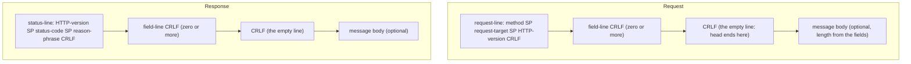
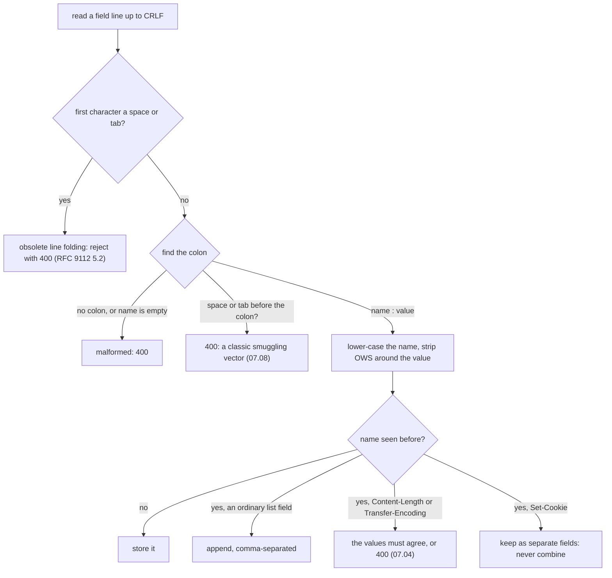
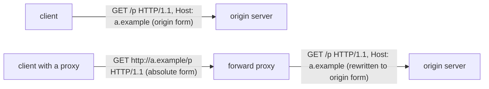
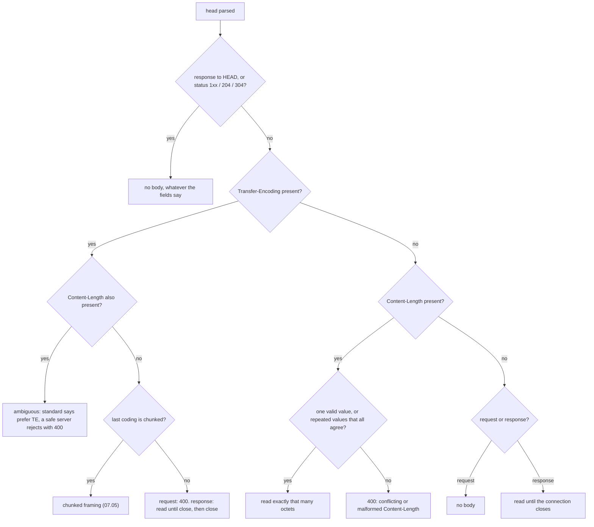
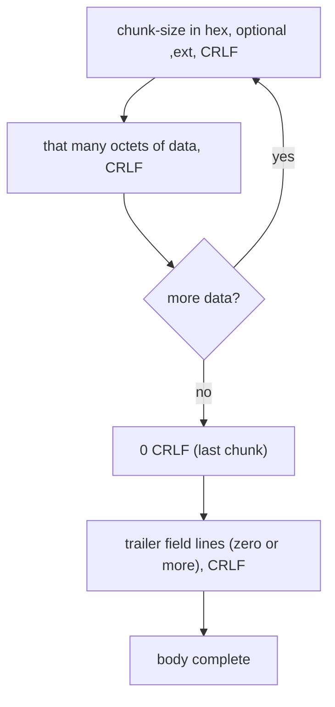
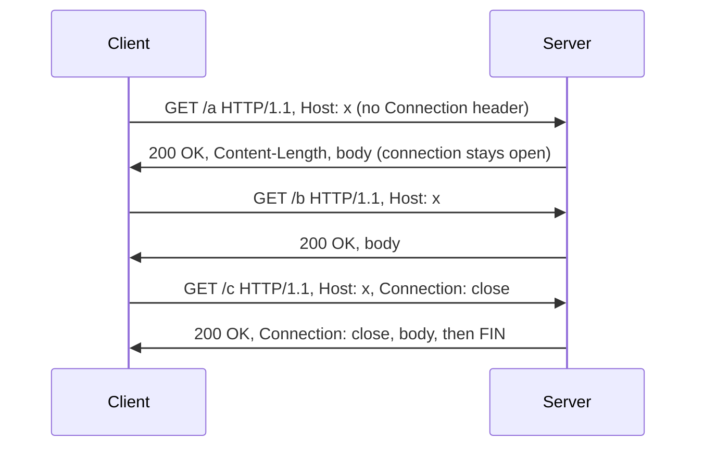
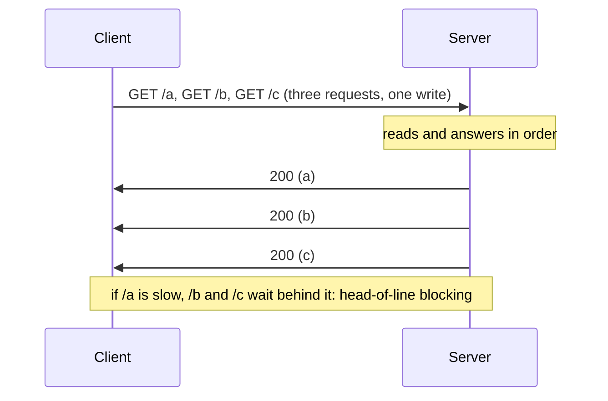
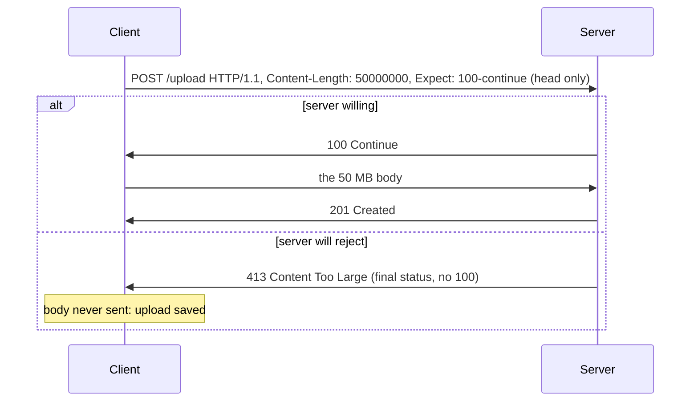
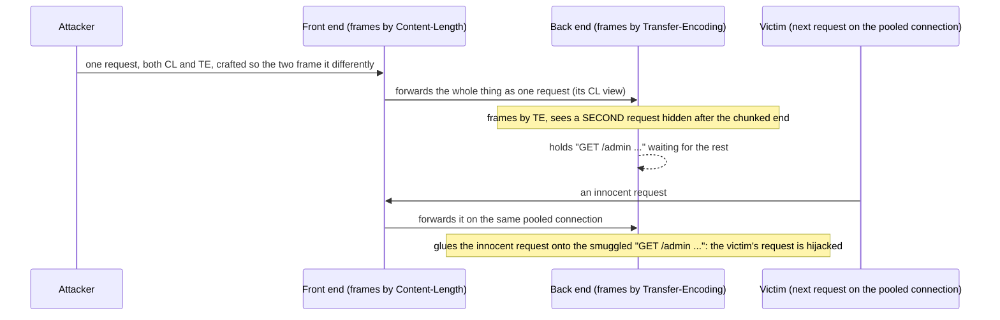
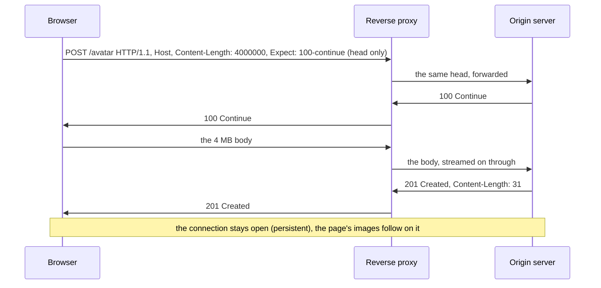

<!-- markdownlint-disable MD001 -->
<!-- markdownlint-disable MD024 -->
<!-- markdownlint-disable MD025 -->
<!-- markdownlint-disable MD026 -->
<!-- markdownlint-disable MD029 -->
<!-- markdownlint-disable MD033 -->
<!-- markdownlint-disable MD036 -->
<!-- markdownlint-disable MD040 -->
<!-- markdownlint-disable MD056 -->
<!-- markdownlint-disable MD060 -->

# H07. HTTP/1.1 message syntax and framing

## Contents

| #     | Sub-topic                                                   | Tag   |
| ----- | ----------------------------------------------------------- | ----- |
| 07.01 | The message grammar: start line, fields, body               | CORE  |
| 07.02 | Field syntax: names, whitespace, folding, duplicates        | DEEP  |
| 07.03 | `Host` and the four request-target forms                    | DEEP  |
| 07.04 | Where a body ends: the precedence rule                      | CORE  |
| 07.05 | Chunked transfer coding, byte by byte                       | CORE  |
| 07.06 | Persistent connections and pipelining                       | CORE  |
| 07.07 | `Expect: 100-continue`                                      | AWARE |
| 07.08 | When two parsers disagree: smuggling, splitting, injection  | DEEP  |
| 07.09 | Limits: line, field, body, and the status codes they map to | CORE  |
| 07.10 | The story: one request through a proxy and an origin server | CORE  |
| 07.11 | Labs: what each one shows and how to run it                 | CORE  |
| 07.12 | Exercises                                                   |       |
| 07.13 | Solutions                                                   |       |
| 07.14 | Takeaways                                                   |       |

Terms used throughout:

- **Octet**: one byte, eight bits. The RFCs say octet because "byte" was not always eight bits; in this module they are the same thing.

- **Token**: a word in an HTTP message made only of the "safe" characters (letters, digits and a fixed set of punctuation such as `-` and `.`), with no spaces or control characters.  
  Method names, header field names and transfer-coding names are tokens.

- **Field** (header field): one `Name: value` line in the head. **Field line** is the line as written on the wire; **field name** and **field value** are its two parts.  
  RFC 9110 uses "field" where older RFCs said "header".

- **Start line**: the first line of a message.  
  In a request it is the **request line** (method, target, version); in a response the **status line** (version, status code, reason phrase).

- **Request-target**: the second word of a request line. It names what the request is for, in one of four forms (07.03).

- **Transfer coding**: an encoding applied to a body so it can be carried on the connection, named in the `Transfer-Encoding` field. `chunked` is the only one this module uses.

- **Intermediary**: any program in the path between the original client and the origin server.  
  A **proxy** forwards requests; a **gateway** or **reverse proxy** stands in front of servers (H06, H08); a **cache** stores responses.  
  All three parse and re-emit messages, which is what makes 07.08 possible.

- **RFC 9112**: the 2022 standard for HTTP/1.1 message syntax, replacing RFC 7230, which replaced RFC 2616.  
  **RFC 9110** is the companion standard for HTTP semantics (methods, status codes, fields) shared by all versions. This module cites both.

- **ABNF**: Augmented Backus-Naur Form (RFC 5234), the notation the RFCs use to define grammar.  
  `=` defines a rule, `*` means "zero or more", `1*` means "one or more", and names in angle-free lowercase refer to other rules.

Outputs in this module are real.  
Requests were sent by hand with `nc`, by a Python harness, and by `curl`, to five servers: nginx 1.24, Python 3.13's `http.server`, the JDK's `jwebserver`, and this module's own strict Java and Rust servers.  
Run on Linux 6.18, JDK 21, Rust 1.97.

---

## 07.01 The message grammar: start line, fields, body

An HTTP/1.1 message is text framing around an optional binary body.  
It is a start line, then zero or more field lines, then an empty line (a bare CRLF), then an optional body.  
Every line ends with CRLF. The empty line is the one unambiguous marker in the whole format: everything before it is the head, parsed as text, and everything after it,  
if anything, is the body, whose length is determined by the fields in the head (07.04).  
A request and a response share this shape and differ only in the start line.

### The shape of a message



The ABNF, trimmed to its spine (RFC 9112 2.1):

```text
HTTP-message   = start-line CRLF *( field-line CRLF ) CRLF [ message-body ]
start-line     = request-line / status-line
request-line   = method SP request-target SP HTTP-version
status-line    = HTTP-version SP status-code SP [ reason-phrase ]
field-line     = field-name ":" OWS field-value OWS
HTTP-version   = "HTTP/" DIGIT "." DIGIT
```

`SP` is a single space, `OWS` is optional whitespace (spaces or tabs), and `CRLF` is the two octets 0x0D 0x0A.  
The grammar is strict about `SP`: exactly one space separates the three parts of a start line, and the request-target itself may contain no space,  
because a space is how the parser finds the end of the target. A space inside the target is one of the oldest parser-confusion tricks (07.08).

### The parts, compared with HTTP/1.0

HTTP/1.0 (H06) had the same skeleton. HTTP/1.1 changed the defaults and tightened the rules rather than the shape:

| Element                | HTTP/1.0 (RFC 1945)                | HTTP/1.1 (RFC 9112)                                       |
| ---------------------- | ---------------------------------- | --------------------------------------------------------- |
| `Host`                 | Optional extension                 | Mandatory in a request; its absence is 400 (07.03)        |
| Default connection     | Close after each response          | Persistent: stays open unless `Connection: close` (07.06) |
| Body of unknown length | Only "read until close"            | `Transfer-Encoding: chunked` (07.05)                      |
| Line folding           | Allowed (a value could span lines) | Deprecated; a receiver should reject it (07.02)           |
| Version in response    | The server's capability (RFC 2145) | The same rule, unchanged                                  |

### Interview angle

"Describe the structure of an HTTP message." Start line, field lines, empty line, optional body; every line CRLF-terminated; the empty line separates head from body.  
The depth signal is naming where the body's length comes from: never from scanning for a second empty line, always from the fields in the head (07.04), which is the whole reason framing is a security topic.

---

## 07.02 Field syntax: names, whitespace, folding, duplicates

A field line is a name, a colon, optional whitespace, and a value.  
The name is a token and is case-insensitive, so `Content-Length` and `content-length` are the same field.  
There must be no space between the name and the colon.  
A value may not span lines in modern HTTP: the old "line folding" that let a value continue on an indented next line is deprecated and a server should reject it.  
A field may appear more than once; for most fields that is equivalent to one field whose value is the values joined by commas, but a few fields,  
above all `Set-Cookie`, may not be combined that way, and framing fields such as `Content-Length` must never disagree when repeated (07.04).

### The rules a parser enforces



### Why each rule exists

- **Case-insensitive names.** Settled practice since HTTP/1.0 (H06). A parser lower-cases on input so later lookups are exact.

- **No space before the colon.** `Host : value` is malformed.  
  RFC 9112 5.1 requires a server to reject it, because intermediaries historically disagreed about whether the field name was `Host` or `Host` (with a trailing space),  
  and that disagreement is exploitable: a header one hop treats as `Content-Length` and another ignores is a framing difference (07.08).  
  This module's servers answer 400; so does nginx; `jwebserver` answers 400; Python's `http.server` accepts it (Lab 02).

- **No obsolete line folding.** HTTP/1.0 allowed a long value to continue on a following line that began with a space or tab (`obs-fold`).  
  RFC 9112 5.2 deprecates it: a server that is not a proxy to a legacy peer must reject it with 400, because a folded line that one parser unfolds and another treats as a new field is,  
  again, a framing disagreement. All of this module's servers and nginx reject it.

- **Duplicate fields.** RFC 9110 5.3: a recipient may combine multiple instances of a field into one by joining values with commas, **if and only if** the field is defined as a comma-separated list.  
  `Accept`, `Via` and `Cache-Control` are lists and combine cleanly. `Set-Cookie` is the explicit exception: its value can itself contain commas (in the `Expires` date),  
  so two `Set-Cookie` lines must stay two lines. For `Content-Length` and `Transfer-Encoding`, "combine" is not safe at all:  
  two different `Content-Length` values is not a list, it is a contradiction, and the only correct response is to reject (07.04).

### Interview angle

"How are repeated headers handled?" For a list-valued field, equivalent to one comma-joined value.  
For `Set-Cookie`, never combined. For `Content-Length`, repetition with different values is a fatal ambiguity and must be a 400.  
Mentioning that last case unprompted signals you have met request smuggling.

---

## 07.03 `Host` and the four request-target forms

HTTP/1.1 makes `Host` mandatory in every request, because the request-target usually carries only a path and the server needs the host name to pick a site (H06.06) and to build absolute URLs.  
A request-target comes in four forms: **origin form**, a path and optional query (`/index.html?q=1`), used for ordinary requests to a server;  
**absolute form**, a whole URL (`http://host/path`), used when talking to a proxy; **authority form**, just `host:port`, used only with the `CONNECT` method to open a tunnel (H08);  
and **asterisk form**, a single `*`, used only with `OPTIONS` to ask about the server as a whole.  
A server must accept the origin and absolute forms; when both a `Host` field and an absolute-form host are present, the absolute form wins.

### The four forms

| Form      | Example                           | Used by                                  | Where the host comes from             |
| --------- | --------------------------------- | ---------------------------------------- | ------------------------------------- |
| origin    | `GET /index.html?q=1 HTTP/1.1`    | Every normal request to an origin server | The `Host` field (mandatory)          |
| absolute  | `GET http://a.example/p HTTP/1.1` | A request to a forward proxy             | The target's own host; `Host` ignored |
| authority | `CONNECT a.example:443 HTTP/1.1`  | `CONNECT`, to open a TLS tunnel (H08)    | The target itself                     |
| asterisk  | `OPTIONS * HTTP/1.1`              | `OPTIONS`, asking about the whole server | The `Host` field                      |



### Why `Host` is mandatory, and why it is dangerous

H06.06 covered the reason it exists: without it, name-based virtual hosting is impossible and each site needs its own IP address.  
RFC 9112 3.2 turns that into a rule: a server must reject an HTTP/1.1 request that has no `Host` field, or more than one, with 400.  
This module's servers and nginx do; `jwebserver` and Python's server do not (Lab 02), which is one more parser difference an attacker can use.

`Host` is attacker-controlled, so three hazards recur, all developed in the REST and security tracks:

- **Host header injection.** An application that builds a URL from `Host` (a password-reset link, a redirect) can be made to point at an attacker's domain.  
  This was Exercise 04 of H06.

- **Routing ambiguity.** When a request carries both an absolute-form target and a `Host` field with a different host, RFC 9112 says the absolute form wins, but not every intermediary agrees,  
  so a front end may route by one and a back end by the other: a smuggle by routing (07.08).

- **The default site.** A request whose host matches no configured site lands on a default, which may be an internal application (H06, Exercise 04).

### Interview angle

"What are the request-target forms?"  
Origin (path), absolute (full URL, for proxies), authority (`CONNECT`), asterisk (`OPTIONS *`).  
Then the rule that matters for security: a server accepts origin and absolute forms, the absolute form's host overrides `Host`, and a disagreement about which host to route by between a front end and a back end is a smuggling vector.

---

## 07.04 Where a body ends: the precedence rule

This is the most important rule in the module.  
Given a parsed head, a recipient decides the body's length by a fixed precedence (RFC 9112 6.3): first, some messages never have a body regardless of their fields (any 1xx, 204 or 304 response, and any response to a `HEAD` request);  
next, if `Transfer-Encoding` is present, the body is framed by its last coding, which must be `chunked`, and `Content-Length` must then be ignored, or better, rejected if also present;  
next, if `Content-Length` is present and valid, that many octets; otherwise, for a response, read until the connection closes, and for a request, there is no body.  

The single most dangerous case is a message carrying **both** `Transfer-Encoding` and `Content-Length`: the standard says prefer `Transfer-Encoding`, but a safe server rejects the message,  
because an intermediary that chooses the other way frames it differently (07.08).

### The decision, in order



### The rules in words

- **No-body messages come first.** A `304 Not Modified` can carry a `Content-Length` echoing the resource's size, but it has no body; a response to `HEAD` carries the headers a `GET` would, length included, but no body.  
  A parser that tried to read that many octets would hang, waiting for a body that never comes, or steal the next response.  
  The method and status decide first, before any field.

- **`Transfer-Encoding` beats `Content-Length`.** When a sender uses chunked framing it must not also send a `Content-Length`; the chunk structure already marks the end.  
  RFC 9112 6.1 says a recipient that sees both must ignore `Content-Length`.  
  But it also warns this combination is a sign of an attack or a broken sender, and allows rejecting it.  
  A hardened server rejects: there is no legitimate reason to send both, and rejecting removes the disagreement.

- **`Content-Length` must be unambiguous.** One field, one non-negative integer of plain digits. No sign, no spaces, no second value that differs.  
  `Content-Length: 5, 5` (two equal values) is tolerated by the standard; `5, 6` is fatal. A hardened server treats anything but a single clean integer as 400.  
  This module's servers reject `+5`; `jwebserver` accepts it as 5 (Lab 02), a genuine difference.

- **Read-until-close is a response-only last resort.** A response with neither framing field ends at the connection close, as in HTTP/1.0 (H06.03).  
  A request can never use this, because the client needs the connection to read the response, so a request body must always be framed by `Transfer-Encoding` or `Content-Length`.

### Interview angle

"How does a server know how long a request body is?"  
Give the precedence: no-body cases first, then `Transfer-Encoding: chunked`, then `Content-Length`, then (responses only) read-until-close; requests must declare a length.  
The expert addition: both `Transfer-Encoding` and `Content-Length` present is the root of request smuggling, and the correct handling is to reject, not to pick one.

---

## 07.05 Chunked transfer coding, byte by byte

Chunked coding lets a sender start a body before it knows the total length, which `Content-Length` cannot do.  
The body is sent as a series of chunks: each is a chunk size written in hexadecimal on its own line, a CRLF, that many octets of data, and a CRLF.  
A zero-size chunk marks the end, optionally followed by a trailer section (extra header fields sent after the body, such as a checksum) and a final empty line.  
This is how HTTP/1.1 streams a response of unknown length while keeping the connection reusable, which read-until-close (H06.03) cannot.

### The structure



The ABNF (RFC 9112 7.1):

```text
chunked-body = *chunk last-chunk trailer-section CRLF
chunk        = chunk-size [ chunk-ext ] CRLF chunk-data CRLF
chunk-size   = 1*HEXDIG
last-chunk   = 1*"0" [ chunk-ext ] CRLF
```

A real chunked response from this module's server, as raw octets (Lab 05).  
The `27` is hexadecimal for 39, the length of one row line; the stream ends with a `0` chunk and an `X-Rows: 3` trailer:

```text
HTTP/1.1 200 OK
Transfer-Encoding: chunked
Trailer: X-Rows

27
row 1 at Mon, 26 Oct 2026 15:17:33 GMT
27
row 2 at Mon, 26 Oct 2026 15:17:33 GMT
27
row 3 at Mon, 26 Oct 2026 15:17:33 GMT
0
X-Rows: 3

```

### What a decoder must get right

- **The size is hexadecimal, not decimal.** `10` means sixteen octets. A decoder that reads it as decimal is off by a factor that attackers exploit.

- **Chunk extensions exist and are almost always ignored.** A `;name=value` may follow the size.  
  Few servers produce them; a decoder must skip to the CRLF.  
  They are also a place to smuggle bytes past a parser that mishandles them.

- **A leading-zero or oversized size is suspicious.** `00000001` is a valid size of 1, but padding is a known obfuscation; a size larger than a sane limit must be refused before allocating anything (07.09).

- **Trailers are optional and limited.** Only fields that make sense after the body (checksums, signatures) belong there, and a client must opt in with `TE: trailers`.  
  Framing fields may never appear in a trailer.

### Why it mattered

Chunked coding is what let dynamic pages, CGI in the 1990s and every streaming API since, keep connections alive.  
H06.03 showed that a body of unknown length under HTTP/1.0 forced read-until-close, which ended the connection and prevented reuse.  
Chunked gives the end marker that read-until-close lacked, so the connection survives for the next request.  
It is also, with `Content-Length`, one of the two ways to frame a body, and the interaction between the two is 07.08.

### Interview angle

"What problem does chunked encoding solve, and how does it work?"  
It frames a body whose length is not known when the first byte is sent, so a streaming or dynamically generated response can still be delimited and the connection reused.  
Mechanically: hex size line, data, CRLF, repeat, zero chunk, optional trailers.  
The security coda: a chunk size is hex, trailers cannot carry framing fields, and chunked-plus-Content-Length is an attack signature.

---

## 07.06 Persistent connections and pipelining

In HTTP/1.1 a connection is persistent by default: after a response the connection stays open for the next request, and either side ends it by sending `Connection: close`.  
This is H06's keep-alive promoted from an extension to the default, with `Connection` defined as a hop-by-hop header that every intermediary must consume (H06.05).  
Pipelining is the next step a client may take on a persistent connection: send several requests without waiting for each response, and read the responses back in the same order.  
It works, and this module's servers support it, but browsers never enabled it, because one slow response at the front of the queue blocks every response behind it (head-of-line blocking, H04.08), and because buggy intermediaries mishandled it.  
HTTP/2 (H17) solved the same problem properly with multiplexing.

### Persistent by default



Two consequences follow from "the connection stays open":

- **Framing must be exact.** On a connection that carries many requests, the parser must know precisely where each message ends, because the next octet is the start of the next message.  
  Under HTTP/1.0's read-until-close there was no next message, so a framing slip only truncated one response; under persistence a framing slip corrupts every message after it.  
  This is why 07.04 matters more here than it did in H06.

- **Idle connections must be timed out.** A persistent connection held open forever is a resource leak and a slowloris vector (H05.06);  
  the server closes after an idle timeout or a maximum request count, and the ordering rule of H06 (the client gives up before the server does) prevents the 502 race (H06, Exercise 02).

### Pipelining, and why it stalled



Pipelining removes the per-request round trip: ten requests cost about one round trip for all of them instead of one each.  
Lab 05 measures this through a 50 ms relay: ten sequential requests on one connection took 12.5 RTT, the same ten pipelined took 2.2 RTT.  
But it was never safe to turn on in browsers:

- **Head-of-line blocking.** Responses must come back in request order (there is no request identifier on the wire), so a slow first response delays all the rest.  
  A browser cannot know which request will be slow.

- **Broken intermediaries.** Many proxies mishandled pipelined requests, reordering or dropping them.  
  A browser could not tell a safe path from a broken one.

- **Retries are hard.** If a connection drops mid-pipeline, the client must work out which requests were processed and which to retry, with the idempotency rules of H06, Exercise 02.

So browsers kept opening parallel connections (H06) instead, and the real fix waited for HTTP/2's multiplexing (H17), where each request carries a stream identifier and responses may interleave in any order.

### Interview angle

"Why is HTTP/1.1 pipelining not used, when it clearly reduces latency?"  
Head-of-line blocking (responses are ordered, so one slow response blocks the rest), buggy intermediaries, and hard retry semantics.  
It measures well in a lab and fails in the open internet;  
HTTP/2 multiplexing gives the same latency win with per-stream ordering and no head-of-line blocking at the HTTP layer.

---

## 07.07 `Expect: 100-continue`

`Expect: 100-continue` lets a client ask permission before sending a large request body.  
The client sends the head, including `Expect: 100-continue`, and then waits.  
A server that is willing answers with an interim `100 Continue` status, and the client sends the body;  
a server that would reject the request (too large, wrong method, unauthenticated) answers with its final status instead, and the client never sends the body, saving the upload.  
It is the one place in HTTP/1.1 where a client pauses mid-request to hear from the server, and the one common use of the 1xx "informational" status class.

### The exchange



Lab 04 shows both branches against this module's server, which answers `100 Continue` for an acceptable upload and `413` straight away for one over its limit:

```text
+   5.8 ms sent the head only: Content-Length: 5000, Expect: 100-continue
+   7.0 ms got HTTP/1.1 100 Continue -> sending the body
+   8.5 ms final: HTTP/1.1 501 Not Implemented

+   5.2 ms sent the head only: Content-Length: 50000000, Expect: 100-continue
+   7.2 ms got a final status before sending anything: HTTP/1.1 413 Content Too Large -> body not sent
```

### The rules that keep it from hanging

- **The client must not wait forever.** If no `100 Continue` arrives within a short timeout, the client sends the body anyway (RFC 9110 10.1.1).  
  Otherwise a server that does not understand `Expect` would deadlock every upload: the client waiting to send, the server waiting to receive.

- **A server must not send `100 Continue` to an HTTP/1.0 client**, which does not understand it, and must not send it once the body has started to arrive.

- **`100` is interim.** It is one of the 1xx statuses; the client reads it and keeps waiting for the real response.  
  A client library that treated `100` as final would mis-frame everything after it, which is why the no-body rule of 07.04 lists 1xx first.

### Interview angle

"What is `Expect: 100-continue` for?"  
To avoid uploading a body the server would reject: the client sends headers first and waits for `100 Continue` before the body.  
The subtlety: the client falls back to sending anyway after a timeout so an unaware server cannot deadlock it, and `100` is interim, so the client still waits for the final status.

---

## 07.08 When two parsers disagree: smuggling, splitting, injection

Everything in this module serves one safety property: every program that handles a message must agree on where it ends.  
When two programs in a chain disagree, the bytes one treats as the end of a request are bytes the other treats as the start of the next, and an attacker who crafts such bytes can inject a whole request that the front end never saw.  
That is **request smuggling**.  
Its cousins are **response splitting**, where attacker-controlled data injected into a response's headers starts a second fake response, and **header injection**, where a CRLF in a field value adds headers the application never intended.  
All three come from the same root: data treated as framing.  
The defence is also one idea: parse strictly, reject ambiguity, and never build a message by pasting untrusted text into it.

### Request smuggling: the disagreement

The attack needs two servers in a chain (a front-end proxy and a back-end origin, H06, H08) that frame one request differently.  
The three classic pairings are named by which header each end trusts:

| Name  | Front end frames by | Back end frames by  | How they are made to disagree                                                                                                   |
| ----- | ------------------- | ------------------- | ------------------------------------------------------------------------------------------------------------------------------- |
| CL.TE | `Content-Length`    | `Transfer-Encoding` | Send both; the front reads the whole body, the back stops at the chunked end and reads the rest as a new request                |
| TE.CL | `Transfer-Encoding` | `Content-Length`    | Send both; the front reads the chunked body, the back reads only `Content-Length` octets and leaves the rest                    |
| TE.TE | `Transfer-Encoding` | `Transfer-Encoding` | Both support chunked, so one is tricked into ignoring it by an obfuscated `Transfer-Encoding`, falling back to `Content-Length` |



Lab 06 demonstrates all three without attacking anything: it parses one crafted byte string the two ways and shows the leftover each parser keeps, which is the smuggled request, then sends the same bytes to the strict server:

```text
=== CL.TE
  front end: first request consumes everything but b''
  back end : first request consumes everything but b'GET /admin HTTP/1.1\r\nHost: a\r\nX: '
  DISAGREEMENT: the end with more left over holds b'GET /admin HTTP/1.1\r\nHost: a\r\nX: '
  strict server: HTTP/1.1 400 Bad Request
```

The strict server answers 400 to all three, because it rejects any message carrying both `Content-Length` and `Transfer-Encoding` (07.04).  
The disagreement cannot arise if neither end tolerates the ambiguity.

### Response splitting and header injection

These are the same idea on the response side and inside a single message.  
If an application copies untrusted input into a response header, for example `Location: /go?to=<user input>`, and the input contains a CRLF,  
the attacker ends the head early and writes their own headers or body.  
Lab 07 shows a toy redirect built the wrong way and the right way:

```
=== vulnerable: the response as bytes on the wire
    'HTTP/1.1 302 Found'
    'Location: /go?to=home'
    'Set-Cookie: admin=1'          <- injected: the application never set this
    ''
    '<html>owned</html>'

=== fixed: rejects control characters in the value
    'HTTP/1.1 400 Bad Request'
```

Modern servers and frameworks block this at the library level: a field value containing CR or LF is refused when the response is built, so the injection never reaches the wire.  
The HTTP/2 binary framing (H17) removes the class entirely, because headers are length-prefixed fields, not CRLF-delimited text.

### The defences, as one list

- **Reject, do not resolve, ambiguity.** Both `Content-Length` and `Transfer-Encoding`: 400.  
  Conflicting `Content-Length` values: 400. A space before a colon, obsolete folding, a bare CR: 400.  
  The strict server does all of this.

- **Normalise at the edge.** A front end should reject or rewrite anything it will forward so the back end sees only unambiguous messages, and front and back should run the same parser where possible.

- **Never build a message from untrusted text.** Field values come from an allowlist or are escaped; a value with CR or LF is refused (the fixed reflector above).

- **Prefer a protocol without the ambiguity.** HTTP/2 and HTTP/3 frame messages in binary with explicit lengths and forbid the connection-specific headers that make smuggling possible,  
  so a message carrying `Transfer-Encoding` or `Connection` is simply malformed (H17).

### Interview angle

"What is HTTP request smuggling, and how do you prevent it?"  
Two servers in a chain frame one request differently (CL.TE, TE.CL, TE.TE), so bytes one treats as body the other treats as a new request, hijacking the next client's connection.  
Prevention: reject messages with both `Content-Length` and `Transfer-Encoding`, reject conflicting or malformed framing fields, run the same strict parser front and back,  
and move to HTTP/2 where the ambiguity cannot be expressed.  
The one-sentence root cause, which is the real signal: smuggling is what happens when data is allowed to act as framing.

---

## 07.09 Limits: line, field, body, and the status codes they map to

A parser that reads a line, a field, or a body with no upper bound is a denial-of-service waiting to happen: a client can send an endless header and exhaust memory, or a giant body and exhaust disk.  
So every HTTP server caps the request line length, each field line's length, the total header section, the number of fields, and the body size, and maps each limit to a status code: a too-long request-target is 414, an over-large header section or field is 431, a body past the limit is 413.  

These limits are not in the grammar;  
they are an operational necessity that every real server configures, and their defaults differ enough between servers to matter (a URL that works through one proxy can be rejected by the next).

### The limits and their codes

| Limit                       | Typical default      | Status when exceeded                | nginx directive               |
| --------------------------- | -------------------- | ----------------------------------- | ----------------------------- |
| Request-target (URL) length | 8 KB line            | 414 URI Too Long                    | `large_client_header_buffers` |
| One field line              | 8 KB                 | 431 Request Header Fields Too Large | `large_client_header_buffers` |
| Whole header section        | 32 to 64 KB          | 431                                 | `large_client_header_buffers` |
| Number of fields            | 100                  | 431                                 | (built in)                    |
| Request body                | 1 MB (nginx default) | 413 Content Too Large               | `client_max_body_size`        |

This module's servers set 8 KB per line, 64 KB per header section, 100 fields and 10 MB per body, and Lab 03 shows each limit producing its status:

```
17 request line of 9,000 B    414 URI Too Long
18 one field of 9,000 B       431 Request Header Fields Too Large
(too many fields)             431 Request Header Fields Too Large
(body over 10 MB)             413 Content Too Large
```

### Why the defaults differ, and why that matters

- **There is no standard number.** RFC 9110 recommends that a server support at least 8 KB request lines but sets no maximum; each server picks its own.  
  nginx rejects a header field over 8 KB; Apache's default is also 8 KB; Node.js caps the whole header block at 16 KB by default.

- **Different limits are a compatibility bug and a security seam.** A URL of 10 KB may pass a browser and a CDN but hit an origin's 8 KB limit and return 414 only in production.  
  And a body-size limit that a front end enforces but a back end does not, or vice versa, is one more place two parsers disagree (07.08).

- **The limit must be enforced before allocation.** A `Content-Length: 10000000000` or a chunk size of the same must be refused by comparing the number, not by trying to read that many octets into memory.  
  This module's servers compare `Content-Length` to the cap before reading a single body octet, and cap the running total of chunk sizes (07.05).

### Interview angle

"Why does a server limit header and body sizes, and what does it return?"  
To bound memory and prevent denial of service: 414 for the request-target, 431 for headers, 413 for the body.  
The depth signal: the limits are not standardised, so they differ between servers and a request that passes one hop can fail the next,  
and the limit must be checked against the declared length before anything is allocated.

---

## 07.10 The story: one upload through a proxy and an origin server

A user submits a form with a photo attached to `https://shop.example/avatar`.  
In front of the origin server sits a reverse proxy (H06, H08): it terminates TLS, serves static files from a cache, and forwards everything else. The photo is 4 MB.  
This section follows the request through both programs, naming the rule from this module at each step.  
Every framing decision here is the one the strict server of Lab 03 makes.

### The journey at a glance



### Chapter 01: the request line and the head

The browser opens one TLS connection (H14, still ahead) and writes the head: `POST /avatar HTTP/1.1`, then `Host: shop.example`, `Content-Type`, `Content-Length: 4000000`, `Expect: 100-continue`, and the empty line.  
It stops there.  
Every line is CRLF-terminated (07.01); the request-target is in origin form, a path (07.03); `Host` is present, as HTTP/1.1 requires.  
The proxy reads the head up to the empty line and no further, because the head is self-delimiting and the body's length is a separate decision.

### Chapter 02: the framing decision

The proxy applies the precedence rule (07.04). There is no `Transfer-Encoding`, there is one valid `Content-Length`, so the body is exactly 4,000,000 octets.  
The proxy does not read them yet, because of the next field.

### Chapter 03: `Expect: 100-continue`

The head carried `Expect: 100-continue` (07.07), so the client is waiting.  
The proxy forwards the head to the origin; the origin checks what it can decide from the head alone: the path exists, the method is allowed, 4 MB is under its `client_max_body_size`, the user's session is valid.  
It answers `100 Continue`, which the proxy relays to the browser.  
Only now does the browser send the 4 MB.  
Had the photo been 40 MB, over the limit, the origin would have answered `413` to the head and the browser would never have uploaded a byte.

### Chapter 04: streaming the body through

The proxy reads the 4,000,000 octets and writes them on to the origin as they arrive, never buffering the whole file.  
Because the length is known exactly, both programs agree where the body ends: the octet after the four-millionth is the start of the next request on this connection, if any.  
This is the property that persistence depends on (07.06): exact framing, so the connection can carry a second message cleanly.

### Chapter 05: the response, and the connection stays open

The origin stores the photo and answers `201 Created` with `Content-Length: 31` and a small JSON body.  
The proxy forwards it.  
Neither side sent `Connection: close`, so the connection stays open (07.06).  
The page's `` requests for the new avatar and other assets go out next; the browser may even send them pipelined, though in practice it opens a few parallel connections instead (07.06),  
and over HTTP/2 it would multiplex them on this one connection (H17).

### Where it would have gone wrong

| Chapter | If this were mishandled                                                 | The failure                                                                                |
| ------- | ----------------------------------------------------------------------- | ------------------------------------------------------------------------------------------ |
| 01      | A space inside the request-target, or a bare CR in a field              | One parser splits the line differently from the next: a smuggle seam (07.08)               |
| 02      | The head carried both `Content-Length` and `Transfer-Encoding`          | Proxy and origin frame the body differently: CL.TE or TE.CL smuggling (07.08)              |
| 03      | The origin did not understand `Expect` and stayed silent                | The browser waits, then uploads anyway after its timeout (07.07): no deadlock, but a delay |
| 04      | The proxy enforced a 2 MB body limit the origin did not, or the reverse | A body-size disagreement: 413 at one hop, accepted at the other (07.09)                    |
| 05      | The origin's `Content-Length` was wrong by one                          | On a persistent connection, every later response is misframed (07.06)                      |

---

## 07.11 Labs: what each one shows and how to run it

| Lab | Topic                                             | Covers              | Needs                                    |
| --- | ------------------------------------------------- | ------------------- | ---------------------------------------- |
| 00  | Setup: the two strict servers and three real ones | All                 | Linux, Java, Rust, nginx, Python 3, `nc` |
| 01  | The message grammar by hand                       | 07.01, 07.03        | `nc`                                     |
| 02  | Field syntax and framing across five servers      | 07.02, 07.04, 07.09 | Python 3                                 |
| 03  | A strict HTTP/1.1 server in Java and Rust         | 07.01 to 07.09      | Java or Rust                             |
| 04  | `Expect: 100-continue`                            | 07.07               | Python 3                                 |
| 05  | Chunked streaming and pipelining                  | 07.05, 07.06        | `nc`, Python 3, the H06 relay            |
| 06  | Request smuggling, without a victim               | 07.08               | Python 3                                 |
| 07  | Response splitting and header injection           | 07.08               | Python 3                                 |

### Setup, once

As in H06, a disposable Linux container is the easiest place.  
This module reuses H06's `sites/default` (the `hello.txt`, `index.html`, `page.html` and ten images), so build it with H06's `make_sites.sh`, or copy the `sites/default` directory across.

```text
docker run --rm -it -v "$PWD":/h07 -w /h07 ubuntu:24.04
apt update && apt install -y openjdk-21-jdk-headless nginx-light netcat-openbsd curl python3
# Rust 1.85+ via rustup, as in H01
```

Folder layout:

```text
h07/
  sites/default/           hello.txt  index.html  page.html  img/img01.gif ... img10.gif  (from H06)
  raw.py                   <- send raw bytes, print each framed response (Labs 02, 03)
  battery.py               <- 20 edge-case requests against any set of servers (Labs 02, 03)
  expect.py                <- Expect: 100-continue from the client side (Lab 04)
  timing.py                <- sequential vs pipelined timing (Lab 05)
  smuggle_demo.py          <- parse one message two ways, then send it to the strict server (Lab 06)
  crlf_demo.py             <- response-splitting reflector, wrong and right (Lab 07)
  java/
    Http11Server.java  LatencyRelay.java   (the relay is H06's, reused)
  rust/                    <- cargo project, no extra crates
    src/bin/http11_server.rs
```

The servers used in this module, each from `h07`:

| Server                         | Port | Start                                                                                      |
| ------------------------------ | ---- | ------------------------------------------------------------------------------------------ |
| `Http11Server.java` (Lab 03)   | 8081 | `cd java && java Http11Server.java 8081 ../sites/default`                                  |
| `http11_server` (Rust, Lab 03) | 8082 | `cd rust && cargo build --release && ./target/release/http11_server 8082 ../sites/default` |
| nginx 1.24                     | 80   | `nginx -c "$PWD/nginx.conf"` (H06's config)                                                |
| Python `http.server`           | 8090 | `python3 -m http.server 8090 --bind 127.0.0.1 --directory sites/default`                   |
| JDK `jwebserver`               | 8000 | `jwebserver -b 127.0.0.1 -p 8000 -d "$PWD/sites/default"`                                  |

Verification note: every output here was produced by running the code shown, on JDK 21, Rust 1.97, Python 3.13, nginx 1.24 and Linux 6.18.  
Dates, ports and thread or connection numbers will differ on your machine; the framing will not.

### Lab 01: the message grammar by hand

Goal: send a well-formed HTTP/1.1 request, and then break the grammar one rule at a time, with `nc`.

```text
printf 'GET /hello.txt HTTP/1.1\r\nHost: a\r\nConnection: close\r\n\r\n' | nc -w 3 127.0.0.1 8081
```

The response is a status line, fields, an empty line, and the 16-byte body.  
Now the four request-target forms (07.03) against the strict server:

```text
printf 'GET /hello.txt HTTP/1.1\r\nHost: a\r\nConnection: close\r\n\r\n'          | nc -w 3 127.0.0.1 8081 | head -1   # origin
printf 'GET http://a/hello.txt HTTP/1.1\r\nHost: a\r\nConnection: close\r\n\r\n'  | nc -w 3 127.0.0.1 8081 | head -1   # absolute
printf 'OPTIONS * HTTP/1.1\r\nHost: a\r\nConnection: close\r\n\r\n'               | nc -w 3 127.0.0.1 8081 | head -1   # asterisk
```

The origin and absolute forms both return `200 OK` (the server strips the absolute form down to its path); `OPTIONS *` returns `501`, because this teaching server implements only `GET` and `HEAD`.

Things to try:

01. Put a space inside the target: `printf 'GET /hel lo.txt HTTP/1.1\r\nHost: a\r\n\r\n'`.  
  The request line now has four words, and the server answers `400`: the space is how the parser finds the end of the target (07.01).

02. Omit the `Host`: `printf 'GET /hello.txt HTTP/1.1\r\n\r\n'`. `400`, as HTTP/1.1 requires (07.03).  
  Send the same with `HTTP/1.0`: `200`, because `Host` is optional there (H06).

03. Send `GET /hello.txt HTTP/1.1` with bare LF line endings instead of CRLF (`printf 'GET /hello.txt HTTP/1.1\nHost: a\nConnection: close\n\n'`):  
  the strict server, nginx and Python accept the bare LF; `jwebserver` waits for a CR and times out. A real parser difference (07.02).

### Lab 02: field syntax and framing across five servers

Goal: send twenty edge-case requests to all five servers and watch them disagree.  
This is the heart of 07.02, 07.04 and 07.09: the same bytes, different verdicts.

`battery.py` sends each case on its own connection and prints the first line of each answer:

```python
# Send each malformed or edge-case request on its own connection and print the first line of the answer.
# Usage: python3 battery.py port [port ...]
import socket
import sys

CASES = [
    ("01 valid GET",                b"GET /hello.txt HTTP/1.1\r\nHost: a\r\nConnection: close\r\n\r\n"),
    ("02 HTTP/1.1 without Host",    b"GET /hello.txt HTTP/1.1\r\nConnection: close\r\n\r\n"),
    ("03 two Host fields",          b"GET /hello.txt HTTP/1.1\r\nHost: a\r\nHost: b\r\nConnection: close\r\n\r\n"),
    ("04 obsolete line folding",    b"GET /hello.txt HTTP/1.1\r\nHost: a\r\nX-A: 1\r\n 2\r\nConnection: close\r\n\r\n"),
    ("05 space before colon",       b"GET /hello.txt HTTP/1.1\r\nHost : a\r\nConnection: close\r\n\r\n"),
    ("06 bare LF line endings",     b"GET /hello.txt HTTP/1.1\nHost: a\nConnection: close\n\n"),
    ("07 lower-case method",        b"get /hello.txt HTTP/1.1\r\nHost: a\r\nConnection: close\r\n\r\n"),
    ("08 HTTP/2.0 in request line", b"GET /hello.txt HTTP/2.0\r\nHost: a\r\nConnection: close\r\n\r\n"),
    ("09 CL and TE both",           b"POST /hello.txt HTTP/1.1\r\nHost: a\r\nContent-Length: 5\r\nTransfer-Encoding: chunked\r\nConnection: close\r\n\r\n0\r\n\r\n"),
    ("10 two different CL",         b"POST /hello.txt HTTP/1.1\r\nHost: a\r\nContent-Length: 5\r\nContent-Length: 6\r\nConnection: close\r\n\r\nhello!"),
    ("11 CL with a sign",           b"POST /hello.txt HTTP/1.1\r\nHost: a\r\nContent-Length: +5\r\nConnection: close\r\n\r\nhello"),
    ("12 TE: gzip only",            b"POST /hello.txt HTTP/1.1\r\nHost: a\r\nTransfer-Encoding: gzip\r\nConnection: close\r\n\r\n"),
    ("13 TE: chunked, then gzip",   b"POST /hello.txt HTTP/1.1\r\nHost: a\r\nTransfer-Encoding: chunked, gzip\r\nConnection: close\r\n\r\n"),
    ("14 TE: xchunked",             b"POST /hello.txt HTTP/1.1\r\nHost: a\r\nTransfer-Encoding: xchunked\r\nConnection: close\r\n\r\n"),
    ("15 bad chunk size",           b"POST /hello.txt HTTP/1.1\r\nHost: a\r\nTransfer-Encoding: chunked\r\nConnection: close\r\n\r\nzz\r\n\r\n"),
    ("16 valid chunked body",       b"POST /hello.txt HTTP/1.1\r\nHost: a\r\nTransfer-Encoding: chunked\r\nConnection: close\r\n\r\n5\r\nhello\r\n0\r\n\r\n"),
    ("17 request line of 9,000 B",  b"GET /" + b"a" * 9000 + b" HTTP/1.1\r\nHost: a\r\nConnection: close\r\n\r\n"),
    ("18 one field of 9,000 B",     b"GET /hello.txt HTTP/1.1\r\nHost: a\r\nX-Big: " + b"b" * 9000 + b"\r\nConnection: close\r\n\r\n"),
    ("19 absolute-form target",     b"GET http://a/hello.txt HTTP/1.1\r\nHost: a\r\nConnection: close\r\n\r\n"),
    ("20 asterisk-form OPTIONS",    b"OPTIONS * HTTP/1.1\r\nHost: a\r\nConnection: close\r\n\r\n"),
]

ports = [int(p) for p in sys.argv[1:]]
for name, data in CASES:
    row = []
    for port in ports:
        try:
            s = socket.create_connection(("127.0.0.1", port))
            s.settimeout(2)
            s.sendall(data)
            reply = b""
            while b"\r\n" not in reply:
                chunk = s.recv(4096)
                if not chunk:
                    break
                reply += chunk
            line = reply.split(b"\r\n")[0].decode("latin-1")
            row.append(line.replace("HTTP/1.1 ", "").replace("HTTP/1.0 ", "1.0 ") if line else "(closed, no response)")
        except socket.timeout:
            row.append("(no answer in 2 s)")
        except OSError as e:
            row.append(type(e).__name__)
        finally:
            s.close()
    print(f"{name:30}" + "".join(f"{r[:34]:36}" for r in row))
```

Against the two strict servers (Java 8081, Rust 8082):

```text
# Java (8081) and Rust (8082): the strict teaching servers
01 valid GET                  200 OK                              200 OK
02 HTTP/1.1 without Host      400 Bad Request                     400 Bad Request
03 two Host fields            400 Bad Request                     400 Bad Request
04 obsolete line folding      400 Bad Request                     400 Bad Request
05 space before colon         400 Bad Request                     400 Bad Request
06 bare LF line endings       200 OK                              200 OK
07 lower-case method          501 Not Implemented                 501 Not Implemented
08 HTTP/2.0 in request line   505 HTTP Version Not Supported      505 HTTP Version Not Supported
09 CL and TE both             400 Bad Request                     400 Bad Request
10 two different CL           400 Bad Request                     400 Bad Request
11 CL with a sign             400 Bad Request                     400 Bad Request
12 TE: gzip only              400 Bad Request                     400 Bad Request
13 TE: chunked, then gzip     400 Bad Request                     400 Bad Request
14 TE: xchunked               400 Bad Request                     400 Bad Request
15 bad chunk size             400 Bad Request                     400 Bad Request
16 valid chunked body         501 Not Implemented                 501 Not Implemented
17 request line of 9,000 B    414 URI Too Long                    414 URI Too Long
18 one field of 9,000 B       431 Request Header Fields Too Larg  431 Request Header Fields Too Larg
19 absolute-form target       200 OK                              200 OK
20 asterisk-form OPTIONS      501 Not Implemented                 501 Not Implemented
```

Against three widely used servers (nginx 80, Python 8090, `jwebserver` 8000):

```text
# nginx (80), Python http.server (8090), jwebserver (8000)
01 valid GET                  200 OK                              1.0 200 OK                          200 OK
02 HTTP/1.1 without Host      400 Bad Request                     1.0 200 OK                          200 OK
03 two Host fields            400 Bad Request                     1.0 200 OK                          200 OK
04 obsolete line folding      400 Bad Request                     1.0 200 OK                          200 OK
05 space before colon         400 Bad Request                     1.0 200 OK                          400 Bad Request
06 bare LF line endings       200 OK                              1.0 200 OK                          (no answer in 2 s)
07 lower-case method          400 Bad Request                     1.0 501 Unsupported method ('get')  501 Not Implemented
08 HTTP/2.0 in request line   505 HTTP Version Not Supported      1.0 505 Invalid HTTP version (2.0)  200 OK
09 CL and TE both             400 Bad Request                     1.0 501 Unsupported method ('POST'  400 Bad Request
10 two different CL           400 Bad Request                     1.0 501 Unsupported method ('POST'  400 Bad Request
11 CL with a sign             400 Bad Request                     1.0 501 Unsupported method ('POST'  405 Method Not Allowed
12 TE: gzip only              501 Not Implemented                 1.0 501 Unsupported method ('POST'  501 Not Implemented
13 TE: chunked, then gzip     501 Not Implemented                 1.0 501 Unsupported method ('POST'  501 Not Implemented
14 TE: xchunked               501 Not Implemented                 1.0 501 Unsupported method ('POST'  501 Not Implemented
15 bad chunk size             405 Not Allowed                     1.0 501 Unsupported method ('POST'  (closed, no response)
16 valid chunked body         405 Not Allowed                     1.0 501 Unsupported method ('POST'  405 Method Not Allowed
17 request line of 9,000 B    414 Request-URI Too Large           1.0 404 File not found              404 Not Found
18 one field of 9,000 B       400 Bad Request                     1.0 200 OK                          200 OK
19 absolute-form target       200 OK                              1.0 404 File not found              200 OK
20 asterisk-form OPTIONS      400 Bad Request                     1.0 501 Unsupported method ('OPTIO  404 Not Found
```

What to notice, reading down the two tables:

- **The strict servers agree with each other on every line.** They were written to the same rules; a differential test like this is exactly how you would check that a front end and a back end frame identically (07.08).

- **Case 02, 03, 05: `Host` and whitespace.** nginx and the strict servers reject a missing or doubled `Host` and a space before the colon;  
  Python accepts all three; `jwebserver` accepts a missing and doubled `Host` but rejects the space.  
  Three parsers, three verdicts.

- **Case 09 and 11: framing.** CL-and-TE together is `400` on the strict servers, nginx and `jwebserver`;  
  Python never reads a `POST` body so it answers `501` first. `Content-Length: +5` is `400` on the strict servers and nginx, but `jwebserver` accepts it as 5.  
  A back end that reads `+5` as 5 behind a front end that rejects it would be safe here; the reverse pairing would not be.

- **Case 17 to 18: limits.** Every server caps the request line and the header fields, but at its own size and with its own status (07.09).

Things to try:

01. Add your own case: a `Content-Length` with a leading zero (`Content-Length: 05`), a tab instead of a space after the colon, a `Transfer-Encoding: Chunked` with a capital C.  
  Predict each verdict, then check.

02. Point `battery.py` at a real site through a local proxy you control, never one you do not, and compare the edge rows: that is the first step of finding a smuggling seam, done ethically against your own systems.

### Lab 03: a strict HTTP/1.1 server in Java and Rust

Goal: implement the parser of 07.01 to 07.09, the one that rejects every ambiguity. About 300 lines each. One virtual thread per connection in Java (H05), one OS thread in Rust.

`Http11Server.java`:

```java
import java.io.BufferedOutputStream;
import java.io.ByteArrayOutputStream;
import java.io.IOException;
import java.io.InputStream;
import java.io.OutputStream;
import java.net.InetSocketAddress;
import java.net.ServerSocket;
import java.net.Socket;
import java.net.SocketTimeoutException;
import java.nio.charset.StandardCharsets;
import java.time.ZoneOffset;
import java.time.ZonedDateTime;
import java.time.format.DateTimeFormatter;
import java.util.ArrayList;
import java.util.List;
import java.util.Locale;

// A strict HTTP/1.1 server with a hand-written parser (RFC 9112): request line, field lines, Content-Length
// and chunked framing, persistent connections, pipelining, Expect: 100-continue, and the limits that map to
// 400, 413, 414 and 431. It is strict on purpose: any ambiguity about where a message ends is a 400 and a
// close, because an intermediary that guesses differently is how request smuggling begins (07.08).
// Usage: java Http11Server.java [port] [sites-dir]
public class Http11Server {
    static final DateTimeFormatter HTTP_DATE =
            DateTimeFormatter.ofPattern("EEE, dd MMM yyyy HH:mm:ss 'GMT'", Locale.US);

    static final int MAX_LINE = 8192;         // one request line or one field line
    static final int MAX_HEADER_BYTES = 65536; // the whole field section
    static final int MAX_FIELDS = 100;
    static final long MAX_BODY = 10 * 1024 * 1024;
    static final int IDLE_FIRST_MS = 10_000;
    static final int IDLE_KEEPALIVE_MS = 15_000;
    static final int MAX_REQUESTS = 100;

    static String sitesDir = "../sites/default";

    public static void main(String[] args) throws Exception {
        int port = args.length > 0 ? Integer.parseInt(args[0]) : 8081;
        if (args.length > 1) sitesDir = args[1];
        try (var listener = new ServerSocket()) {
            listener.setReuseAddress(true);
            listener.bind(new InetSocketAddress("127.0.0.1", port), 1024);
            System.out.println("HTTP/1.1 server on 127.0.0.1:" + port + ", sites in " + sitesDir);
            while (true) {
                Socket s = listener.accept();
                Thread.ofVirtual().start(() -> serve(s));
            }
        }
    }

    // One connection: a loop of requests until the client says close, the framing is ambiguous, the limits
    // are exceeded, or the connection goes idle. Everything is read from one buffered stream, so a second
    // pipelined request already in the buffer is simply the next read (07.06).
    static void serve(Socket s) {
        long id = Thread.currentThread().threadId();
        int n = 0;
        try {
            s.setTcpNoDelay(true);
            var in = new Input(s.getInputStream());
            var out = new BufferedOutputStream(s.getOutputStream(), 1 << 16);
            while (n < MAX_REQUESTS) {
                s.setSoTimeout(n == 0 ? IDLE_FIRST_MS : IDLE_KEEPALIVE_MS);
                String requestLine;
                try {
                    requestLine = in.readLine(MAX_LINE, 414, "URI Too Long");
                } catch (SocketTimeoutException e) {
                    log(id, n, "idle, closing");
                    return;
                }
                if (requestLine == null) {                 // clean EOF between requests
                    return;
                }
                n++;
                boolean keepAlive = handle(in, out, requestLine, id, n);
                out.flush();
                if (!keepAlive) {
                    return;
                }
            }
            log(id, n, "reached max requests, closing");
        } catch (LineTooLong e) {
            quickError(s, e.status, e.reason);
        } catch (Exception e) {
            log(id, n, "error: " + e);
        } finally {
            try { s.close(); } catch (IOException ignored) {}
        }
    }

    // Returns whether the connection may be kept open for another request.
    static boolean handle(Input in, OutputStream out, String requestLine, long id, int n) throws IOException {
        String[] parts = requestLine.split(" ", -1);
        if (parts.length != 3) {
            return respond(out, 400, "Bad Request", "Malformed request line", requestLine, id, n, false);
        }
        String method = parts[0], target = parts[1], version = parts[2];
        if (!version.equals("HTTP/1.1") && !version.equals("HTTP/1.0")) {
            if (version.startsWith("HTTP/")) {
                return respond(out, 505, "HTTP Version Not Supported", "This server speaks HTTP/1.1", requestLine, id, n, false);
            }
            return respond(out, 400, "Bad Request", "Not an HTTP version", requestLine, id, n, false);
        }
        boolean http11 = version.equals("HTTP/1.1");

        // --- field lines ---
        List<String[]> fields = new ArrayList<>();
        int headerBytes = 0;
        for (String line; !(line = in.requireLine(MAX_LINE, 431, "Request Header Fields Too Large")).isEmpty(); ) {
            headerBytes += line.length() + 2;
            if (headerBytes > MAX_HEADER_BYTES) {
                return respond(out, 431, "Request Header Fields Too Large", "Header section too large", requestLine, id, n, false);
            }
            if (fields.size() >= MAX_FIELDS) {
                return respond(out, 431, "Request Header Fields Too Large", "Too many header fields", requestLine, id, n, false);
            }
            if (line.charAt(0) == ' ' || line.charAt(0) == '\t') {   // obs-fold (RFC 9112 5.2): reject
                return respond(out, 400, "Bad Request", "Obsolete line folding", requestLine, id, n, false);
            }
            int colon = line.indexOf(':');
            if (colon <= 0) {
                return respond(out, 400, "Bad Request", "Field line without a name", requestLine, id, n, false);
            }
            String name = line.substring(0, colon);
            if (name.indexOf(' ') >= 0 || name.indexOf('\t') >= 0) {  // space before colon (RFC 9112 5.1)
                return respond(out, 400, "Bad Request", "Whitespace before colon", requestLine, id, n, false);
            }
            String value = line.substring(colon + 1).strip();
            fields.add(new String[]{name.toLowerCase(Locale.ROOT), value});
        }

        // --- Host: exactly one, mandatory for HTTP/1.1 (RFC 9112 3.2) ---
        List<String> hosts = valuesOf(fields, "host");
        if (http11 && hosts.size() != 1) {
            return respond(out, 400, "Bad Request",
                    hosts.isEmpty() ? "HTTP/1.1 request without Host" : "Multiple Host fields", requestLine, id, n, false);
        }

        // --- framing: Transfer-Encoding and Content-Length (RFC 9112 6.1, 6.3) ---
        List<String> te = valuesOf(fields, "transfer-encoding");
        List<String> cl = valuesOf(fields, "content-length");
        long bodyLength;      // -1 means chunked, -2 means no body
        boolean chunked = false;
        if (!te.isEmpty()) {
            // Any Transfer-Encoding alongside Content-Length is unresolvable: reject, do not guess (07.08).
            if (!cl.isEmpty()) {
                return respond(out, 400, "Bad Request", "Both Transfer-Encoding and Content-Length", requestLine, id, n, false);
            }
            String coding = String.join(",", te).toLowerCase(Locale.ROOT).replace(" ", "");
            if (!coding.equals("chunked")) {
                // The only transfer coding this server implements; anything else (or chunked not last) is 400.
                return respond(out, 400, "Bad Request", "Unsupported Transfer-Encoding: " + coding, requestLine, id, n, false);
            }
            chunked = true;
            bodyLength = -1;
        } else if (!cl.isEmpty()) {
            // Multiple values, or one value that is a list, must agree; otherwise reject (RFC 9112 6.3 step 5).
            java.util.Set<String> distinct = new java.util.HashSet<>();
            for (String v : cl) for (String one : v.split(",")) distinct.add(one.strip());
            if (distinct.size() != 1) {
                return respond(out, 400, "Bad Request", "Conflicting Content-Length values", requestLine, id, n, false);
            }
            String only = distinct.iterator().next();
            if (!only.matches("\\d{1,15}")) {
                return respond(out, 400, "Bad Request", "Content-Length is not a number", requestLine, id, n, false);
            }
            bodyLength = Long.parseLong(only);
            if (bodyLength > MAX_BODY) {
                return respond(out, 413, "Content Too Large", "Body exceeds " + MAX_BODY + " bytes", requestLine, id, n, false);
            }
        } else {
            bodyLength = -2;
        }

        // --- Expect: 100-continue (RFC 9110 10.1.1) ---
        if (http11 && valuesOf(fields, "expect").stream().anyMatch(v -> v.equalsIgnoreCase("100-continue"))
                && (chunked || bodyLength > 0)) {
            out.write("HTTP/1.1 100 Continue\r\n\r\n".getBytes(StandardCharsets.US_ASCII));
            out.flush();
        }

        // --- read and discard the body (this teaching server serves only GET/HEAD) ---
        long received;
        try {
            received = chunked ? readChunked(in) : (bodyLength >= 0 ? in.discard(bodyLength) : 0);
        } catch (BadBody e) {
            return respond(out, 400, "Bad Request", e.getMessage(), requestLine, id, n, false);
        }

        // --- persistence: HTTP/1.1 defaults to keep-alive; honour Connection: close (RFC 9112 9.1) ---
        boolean clientClose = valuesOf(fields, "connection").stream()
                .flatMap(v -> java.util.Arrays.stream(v.split(",")))
                .anyMatch(t -> t.strip().equalsIgnoreCase("close"));
        boolean keepAlive = http11 ? !clientClose
                : valuesOf(fields, "connection").stream()
                    .flatMap(v -> java.util.Arrays.stream(v.split(",")))
                    .anyMatch(t -> t.strip().equalsIgnoreCase("keep-alive"));

        String framing = chunked ? "chunked " + received + " bytes" : (bodyLength >= 0 ? "length " + received : "no body");

        // --- method and target ---
        if (!method.equals("GET") && !method.equals("HEAD")) {
            return respond(out, 501, "Not Implemented", "Only GET and HEAD; body read: " + framing, requestLine, id, n, keepAlive);
        }
        String path = originPath(target);
        if (path == null) {
            return respond(out, 400, "Bad Request", "Unsupported request-target", requestLine, id, n, keepAlive);
        }
        if (path.equals("/stream")) {
            boolean trailers = valuesOf(fields, "te").stream().anyMatch(v -> v.toLowerCase(Locale.ROOT).contains("trailers"));
            return stream(out, method.equals("HEAD"), http11, keepAlive, trailers, requestLine, id, n);
        }
        byte[] body = readFile(path);
        if (body == null) {
            return respond(out, 404, "Not Found", "No such resource", requestLine, id, n, keepAlive);
        }
        String ctype = path.endsWith(".html") ? "text/html" : path.endsWith(".gif") ? "image/gif" : "text/plain";
        var head = new StringBuilder();
        head.append("HTTP/1.1 200 OK\r\n");
        head.append("Date: ").append(now()).append("\r\n");
        head.append("Server: h07-java/1.1\r\n");
        head.append("Content-Type: ").append(ctype).append("\r\n");
        head.append("Content-Length: ").append(body.length).append("\r\n");
        if (!keepAlive) head.append("Connection: close\r\n");
        head.append("\r\n");
        out.write(head.toString().getBytes(StandardCharsets.ISO_8859_1));
        if (!method.equals("HEAD")) out.write(body);
        log(id, n, "\"" + requestLine + "\" -> 200 (" + body.length + " bytes)" + (keepAlive ? " keep-alive" : " close"));
        return keepAlive;
    }

    // A response whose length is not known in advance: three rows produced 200 ms apart. To an HTTP/1.1 client
    // it goes chunked, each row flushed as its own chunk, with an X-Rows trailer if the client sent TE: trailers.
    // To an HTTP/1.0 client, which cannot decode chunked, the only option left is to end it with a close.
    static boolean stream(OutputStream out, boolean head, boolean http11, boolean keepAlive, boolean trailers,
                          String requestLine, long id, int n) throws IOException {
        var h = new StringBuilder("HTTP/1.1 200 OK\r\nDate: " + now() + "\r\nServer: h07-java/1.1\r\nContent-Type: text/plain\r\n");
        if (http11) {
            h.append("Transfer-Encoding: chunked\r\n");
            if (trailers) h.append("Trailer: X-Rows\r\n");
        } else {
            keepAlive = false;
        }
        if (!keepAlive) h.append("Connection: close\r\n");
        h.append("\r\n");
        out.write(h.toString().getBytes(StandardCharsets.ISO_8859_1));
        if (!head) {
            for (int row = 1; row <= 3; row++) {
                byte[] data = ("row " + row + " at " + now() + "\n").getBytes(StandardCharsets.US_ASCII);
                if (http11) out.write((Integer.toHexString(data.length) + "\r\n").getBytes(StandardCharsets.US_ASCII));
                out.write(data);
                if (http11) out.write("\r\n".getBytes(StandardCharsets.US_ASCII));
                out.flush();
                try { Thread.sleep(200); } catch (InterruptedException e) { throw new IOException(e); }
            }
            if (http11) {
                out.write(("0\r\n" + (trailers ? "X-Rows: 3\r\n" : "") + "\r\n").getBytes(StandardCharsets.US_ASCII));
            }
        }
        log(id, n, "\"" + requestLine + "\" -> 200 " + (http11 ? "chunked" + (trailers ? " with trailer" : "") : "close-delimited")
                + (keepAlive ? " keep-alive" : " close"));
        return keepAlive;
    }

    // Chunked decoding (RFC 9112 7.1): size line in hex, CRLF, that many bytes, CRLF, ending with a 0 chunk
    // and an optional trailer section. Chunk extensions after a ';' are read and ignored.
    static long readChunked(Input in) throws IOException {
        long total = 0;
        while (true) {
            String sizeLine = in.requireLine(MAX_LINE, 400, "Bad Request");
            String hex = sizeLine.split(";", 2)[0].strip();
            long size;
            try {
                size = Long.parseLong(hex, 16);
            } catch (NumberFormatException e) {
                throw new BadBody("Bad chunk size: \"" + hex + "\"");
            }
            if (size < 0 || total + size > MAX_BODY) throw new BadBody("Chunked body too large");
            if (size == 0) break;
            in.discard(size);
            String crlf = in.requireLine(MAX_LINE, 400, "Bad Request");
            if (!crlf.isEmpty()) throw new BadBody("Missing CRLF after chunk");
            total += size;
        }
        for (String t; !(t = in.requireLine(MAX_LINE, 431, "Request Header Fields Too Large")).isEmpty(); ) { /* trailer fields: read and drop */ }
        return total;
    }

    static boolean respond(OutputStream out, int code, String reason, String detail,
                           String requestLine, long id, int n, boolean keepAlive) throws IOException {
        String page = "<html><body><h1>" + code + " " + reason + "</h1><p>" + detail + "</p></body></html>\n";
        byte[] bytes = page.getBytes(StandardCharsets.UTF_8);
        boolean close = !keepAlive || code >= 400 && (code == 400 || code == 413 || code == 414 || code == 431);
        var head = new StringBuilder();
        head.append("HTTP/1.1 ").append(code).append(' ').append(reason).append("\r\n");
        head.append("Date: ").append(now()).append("\r\n");
        head.append("Server: h07-java/1.1\r\n");
        head.append("Content-Type: text/html\r\n");
        head.append("Content-Length: ").append(bytes.length).append("\r\n");
        if (close) head.append("Connection: close\r\n");
        head.append("\r\n");
        out.write(head.toString().getBytes(StandardCharsets.ISO_8859_1));
        out.write(bytes);
        log(id, n, "\"" + requestLine + "\" -> " + code + " (" + detail + ")" + (close ? " close" : " keep-alive"));
        return !close;
    }

    static void quickError(Socket s, int code, String reason) {
        try (s) {
            String page = "<html><body><h1>" + code + " " + reason + "</h1></body></html>\n";
            byte[] bytes = page.getBytes(StandardCharsets.UTF_8);
            String head = "HTTP/1.1 " + code + " " + reason + "\r\nDate: " + now()
                    + "\r\nServer: h07-java/1.1\r\nContent-Type: text/html\r\nContent-Length: "
                    + bytes.length + "\r\nConnection: close\r\n\r\n";
            OutputStream out = s.getOutputStream();
            out.write(head.getBytes(StandardCharsets.ISO_8859_1));
            out.write(bytes);
            out.flush();
            log(Thread.currentThread().threadId(), 0, "-> " + code + " " + reason + " close");
        } catch (IOException ignored) {}
    }

    static List<String> valuesOf(List<String[]> fields, String name) {
        List<String> out = new ArrayList<>();
        for (String[] f : fields) if (f[0].equals(name)) out.add(f[1]);
        return out;
    }

    // The origin form (/path) and the absolute form (http://host/path), which an origin server must accept and
    // whose host then overrides Host (RFC 9112 3.2.2). The authority form (CONNECT) and the asterisk form
    // (OPTIONS *) are for proxies and server-wide requests; here they are 400 (07.03).
    static String originPath(String target) {
        String lower = target.toLowerCase(Locale.ROOT);
        if (lower.startsWith("http://") || lower.startsWith("https://")) {
            int slash = target.indexOf('/', target.indexOf("//") + 2);
            target = slash < 0 ? "/" : target.substring(slash);
        }
        if (!target.startsWith("/")) return null;
        String path = target.split("\\?", 2)[0];
        if (path.contains("..")) return null;
        return path.equals("/") ? "/index.html" : path;
    }

    static byte[] readFile(String path) {
        try {
            java.nio.file.Path p = java.nio.file.Path.of(sitesDir, path).normalize();
            if (!p.startsWith(java.nio.file.Path.of(sitesDir).normalize())) return null;
            if (!java.nio.file.Files.isRegularFile(p)) return null;
            return java.nio.file.Files.readAllBytes(p);
        } catch (IOException e) {
            return null;
        }
    }

    static String now() {
        return ZonedDateTime.now(ZoneOffset.UTC).format(HTTP_DATE);
    }

    static void log(long id, int n, String message) {
        System.out.printf("conn %d req %d  %s%n", id, n, message);
    }

    static class LineTooLong extends IOException {
        final int status; final String reason;
        LineTooLong(int status, String reason) { this.status = status; this.reason = reason; }
    }

    static class BadBody extends IOException {
        BadBody(String message) { super(message); }
    }

    // A byte-level reader: CRLF-terminated lines with a length cap, exact-count discard, all from one buffer,
    // so a pipelined request that arrived in the same packet is already here for the next readLine.
    static class Input {
        final InputStream in;
        Input(InputStream in) { this.in = in; }

        // Reads one line, stripping a trailing CRLF (a bare LF is also accepted, RFC 9112 2.2). Returns null
        // only on EOF before any byte of a line: a clean end between requests. A line longer than cap ends the
        // connection with the given status: 414 for a request line, 431 for a field line (07.09).
        String readLine(int cap, int status, String reason) throws IOException {
            var buf = new ByteArrayOutputStream(128);
            int b = in.read();
            if (b == -1) return null;
            while (b != -1 && b != '\n') {
                if (b != '\r') buf.write(b);
                if (buf.size() > cap) throw new LineTooLong(status, reason);
                b = in.read();
            }
            if (b == -1) throw new java.io.EOFException("Connection closed in the middle of a line");
            return buf.toString(StandardCharsets.ISO_8859_1);
        }

        // The same, inside a message, where EOF is never clean.
        String requireLine(int cap, int status, String reason) throws IOException {
            String line = readLine(cap, status, reason);
            if (line == null) throw new java.io.EOFException("Connection closed in the middle of a message");
            return line;
        }

        long discard(long count) throws IOException {
            long left = count;
            byte[] tmp = new byte[8192];
            while (left > 0) {
                int r = in.read(tmp, 0, (int) Math.min(tmp.length, left));
                if (r == -1) throw new BadBody("Body shorter than declared");
                left -= r;
            }
            return count;
        }
    }
}
```

`http11_server.rs`, the same rules with only the standard library and the HTTP date written by hand:

```rust
// A strict HTTP/1.1 server with a hand-written parser, standard library only: the same rules as
// Http11Server.java (RFC 9112 framing, persistence, pipelining, 100-continue, limits), one OS thread per
// connection. Usage: http11_server [port] [sites-dir]
use std::collections::HashSet;
use std::io::{self, BufRead, BufReader, BufWriter, Read, Write};
use std::net::{TcpListener, TcpStream};
use std::path::{Path, PathBuf};
use std::sync::atomic::{AtomicU64, Ordering};
use std::thread;
use std::time::{Duration, SystemTime, UNIX_EPOCH};

const MAX_LINE: usize = 8192;
const MAX_HEADER_BYTES: usize = 65536;
const MAX_FIELDS: usize = 100;
const MAX_BODY: u64 = 10 * 1024 * 1024;
const MAX_REQUESTS: u32 = 100;

static NEXT_CONN: AtomicU64 = AtomicU64::new(1);

// Why a connection must end: an error response has already been chosen, or the peer went away.
enum Stop {
    Respond(u16, &'static str, String),
    Io(io::Error),
}

impl From<io::Error> for Stop {
    fn from(e: io::Error) -> Self {
        Stop::Io(e)
    }
}

fn main() -> io::Result<()> {
    let args: Vec<String> = std::env::args().collect();
    let port = args.get(1).map(|p| p.parse().unwrap()).unwrap_or(8082u16);
    let sites = PathBuf::from(args.get(2).cloned().unwrap_or("../sites/default".into()));
    let listener = TcpListener::bind(("127.0.0.1", port))?;
    println!("HTTP/1.1 server on 127.0.0.1:{port}, sites in {}", sites.display());
    for stream in listener.incoming() {
        let stream = stream?;
        let sites = sites.clone();
        thread::spawn(move || serve(stream, &sites));
    }
    Ok(())
}

fn serve(stream: TcpStream, sites: &Path) {
    let id = NEXT_CONN.fetch_add(1, Ordering::Relaxed);
    let _ = stream.set_nodelay(true);
    let mut input = BufReader::new(stream.try_clone().expect("clone"));
    let mut out = BufWriter::with_capacity(1 << 16, stream.try_clone().expect("clone"));
    let mut n = 0u32;
    while n < MAX_REQUESTS {
        let idle = if n == 0 { 10 } else { 15 };
        let _ = stream.set_read_timeout(Some(Duration::from_secs(idle)));
        let request_line = match read_line(&mut input, MAX_LINE) {
            Ok(Some(line)) => line,
            Ok(None) => return,                                   // clean EOF between requests
            Err(Stop::Respond(code, reason, detail)) => {
                let _ = respond(&mut out, code, reason, &detail, "", id, n, false);
                let _ = out.flush();
                return;
            }
            Err(Stop::Io(e)) if e.kind() == io::ErrorKind::WouldBlock || e.kind() == io::ErrorKind::TimedOut => {
                log(id, n, "idle, closing");
                return;
            }
            Err(Stop::Io(_)) => return,
        };
        n += 1;
        let keep_alive = match handle(&mut input, &mut out, &request_line, sites, id, n) {
            Ok(k) => k,
            Err(Stop::Respond(code, reason, detail)) => {
                let _ = respond(&mut out, code, reason, &detail, &request_line, id, n, false);
                false
            }
            Err(Stop::Io(e)) => {
                log(id, n, &format!("error: {e}"));
                false
            }
        };
        if out.flush().is_err() || !keep_alive {
            return;
        }
    }
    log(id, n, "reached max requests, closing");
}

fn handle(input: &mut BufReader<TcpStream>, out: &mut BufWriter<TcpStream>, request_line: &str,
          sites: &Path, id: u64, n: u32) -> Result<bool, Stop> {
    let bad = |detail: &str| Stop::Respond(400, "Bad Request", detail.to_string());
    let parts: Vec<&str> = request_line.split(' ').collect();
    if parts.len() != 3 {
        return Err(bad("Malformed request line"));
    }
    let (method, target, version) = (parts[0], parts[1], parts[2]);
    if version != "HTTP/1.1" && version != "HTTP/1.0" {
        return Err(if version.starts_with("HTTP/") {
            Stop::Respond(505, "HTTP Version Not Supported", "This server speaks HTTP/1.1".into())
        } else {
            bad("Not an HTTP version")
        });
    }
    let http11 = version == "HTTP/1.1";

    // --- field lines ---
    let mut fields: Vec<(String, String)> = Vec::new();
    let mut header_bytes = 0;
    loop {
        let line = require_line(input, MAX_LINE, 431, "Request Header Fields Too Large")?;
        if line.is_empty() {
            break;
        }
        header_bytes += line.len() + 2;
        if header_bytes > MAX_HEADER_BYTES {
            return Err(Stop::Respond(431, "Request Header Fields Too Large", "Header section too large".into()));
        }
        if fields.len() >= MAX_FIELDS {
            return Err(Stop::Respond(431, "Request Header Fields Too Large", "Too many header fields".into()));
        }
        if line.starts_with(' ') || line.starts_with('\t') {
            return Err(bad("Obsolete line folding"));
        }
        let colon = match line.find(':') {
            Some(c) if c > 0 => c,
            _ => return Err(bad("Field line without a name")),
        };
        let name = &line[..colon];
        if name.contains(' ') || name.contains('\t') {
            return Err(bad("Whitespace before colon"));
        }
        fields.push((name.to_ascii_lowercase(), line[colon + 1..].trim().to_string()));
    }
    let values = |name: &str| -> Vec<String> {
        fields.iter().filter(|(k, _)| k == name).map(|(_, v)| v.clone()).collect()
    };
    let has_token = |name: &str, token: &str| {
        values(name).iter().flat_map(|v| v.split(',').map(|t| t.trim().to_ascii_lowercase()).collect::<Vec<_>>())
            .any(|t| t == token)
    };

    // --- Host ---
    let hosts = values("host");
    if http11 && hosts.len() != 1 {
        return Err(bad(if hosts.is_empty() { "HTTP/1.1 request without Host" } else { "Multiple Host fields" }));
    }

    // --- framing ---
    let te = values("transfer-encoding");
    let cl = values("content-length");
    let mut chunked = false;
    let mut length: Option<u64> = None;
    if !te.is_empty() {
        if !cl.is_empty() {
            return Err(bad("Both Transfer-Encoding and Content-Length"));
        }
        let coding = te.join(",").to_ascii_lowercase().replace(' ', "");
        if coding != "chunked" {
            return Err(bad(&format!("Unsupported Transfer-Encoding: {coding}")));
        }
        chunked = true;
    } else if !cl.is_empty() {
        let distinct: HashSet<String> = cl.iter().flat_map(|v| v.split(',').map(|x| x.trim().to_string()).collect::<Vec<_>>()).collect();
        if distinct.len() != 1 {
            return Err(bad("Conflicting Content-Length values"));
        }
        let only = distinct.into_iter().next().unwrap();
        if only.is_empty() || only.len() > 15 || !only.bytes().all(|b| b.is_ascii_digit()) {
            return Err(bad("Content-Length is not a number"));
        }
        let len: u64 = only.parse().unwrap();
        if len > MAX_BODY {
            return Err(Stop::Respond(413, "Content Too Large", format!("Body exceeds {MAX_BODY} bytes")));
        }
        length = Some(len);
    }

    // --- Expect: 100-continue ---
    if http11 && values("expect").iter().any(|v| v.eq_ignore_ascii_case("100-continue"))
        && (chunked || length.unwrap_or(0) > 0) {
        out.write_all(b"HTTP/1.1 100 Continue\r\n\r\n")?;
        out.flush()?;
    }

    // --- body: read and discard ---
    let received = if chunked { read_chunked(input)? } else if let Some(len) = length { discard(input, len)? } else { 0 };
    let framing = if chunked { format!("chunked {received} bytes") } else if length.is_some() { format!("length {received}") } else { "no body".into() };

    // --- persistence ---
    let keep_alive = if http11 { !has_token("connection", "close") } else { has_token("connection", "keep-alive") };

    if method != "GET" && method != "HEAD" {
        return respond(out, 501, "Not Implemented", &format!("Only GET and HEAD; body read: {framing}"), request_line, id, n, keep_alive)
            .map_err(Stop::Io);
    }
    let path = match origin_path(target) {
        Some(p) => p,
        None => return respond(out, 400, "Bad Request", "Unsupported request-target", request_line, id, n, keep_alive).map_err(Stop::Io),
    };
    if path == "/stream" {
        let trailers = values("te").iter().any(|v| v.to_ascii_lowercase().contains("trailers"));
        return stream(out, method == "HEAD", http11, keep_alive, trailers, request_line, id, n).map_err(Stop::Io);
    }
    let body = match read_file(sites, &path) {
        Some(b) => b,
        None => return respond(out, 404, "Not Found", "No such resource", request_line, id, n, keep_alive).map_err(Stop::Io),
    };
    let ctype = if path.ends_with(".html") { "text/html" } else if path.ends_with(".gif") { "image/gif" } else { "text/plain" };
    let mut head = format!("HTTP/1.1 200 OK\r\nDate: {}\r\nServer: h07-rust/1.1\r\nContent-Type: {ctype}\r\nContent-Length: {}\r\n",
                           http_date(), body.len());
    if !keep_alive {
        head.push_str("Connection: close\r\n");
    }
    head.push_str("\r\n");
    out.write_all(head.as_bytes())?;
    if method != "HEAD" {
        out.write_all(&body)?;
    }
    log(id, n, &format!("\"{request_line}\" -> 200 ({} bytes) {}", body.len(), if keep_alive { "keep-alive" } else { "close" }));
    Ok(keep_alive)
}

fn stream(out: &mut BufWriter<TcpStream>, head_only: bool, http11: bool, keep_alive: bool, trailers: bool,
          request_line: &str, id: u64, n: u32) -> io::Result<bool> {
    let keep_alive = keep_alive && http11;
    let mut h = format!("HTTP/1.1 200 OK\r\nDate: {}\r\nServer: h07-rust/1.1\r\nContent-Type: text/plain\r\n", http_date());
    if http11 {
        h.push_str("Transfer-Encoding: chunked\r\n");
        if trailers {
            h.push_str("Trailer: X-Rows\r\n");
        }
    }
    if !keep_alive {
        h.push_str("Connection: close\r\n");
    }
    h.push_str("\r\n");
    out.write_all(h.as_bytes())?;
    if !head_only {
        for row in 1..=3 {
            let data = format!("row {row} at {}\n", http_date());
            if http11 {
                write!(out, "{:x}\r\n{data}\r\n", data.len())?;
            } else {
                out.write_all(data.as_bytes())?;
            }
            out.flush()?;
            thread::sleep(Duration::from_millis(200));
        }
        if http11 {
            write!(out, "0\r\n{}\r\n", if trailers { "X-Rows: 3\r\n" } else { "" })?;
        }
    }
    log(id, n, &format!("\"{request_line}\" -> 200 {} {}",
        if http11 { if trailers { "chunked with trailer" } else { "chunked" } } else { "close-delimited" },
        if keep_alive { "keep-alive" } else { "close" }));
    Ok(keep_alive)
}

fn read_chunked(input: &mut BufReader<TcpStream>) -> Result<u64, Stop> {
    let mut total = 0u64;
    loop {
        let size_line = require_line(input, MAX_LINE, 400, "Bad Request")?;
        let hex = size_line.split(';').next().unwrap().trim();
        let size = u64::from_str_radix(hex, 16)
            .map_err(|_| Stop::Respond(400, "Bad Request", format!("Bad chunk size: \"{hex}\"")))?;
        if total + size > MAX_BODY {
            return Err(Stop::Respond(400, "Bad Request", "Chunked body too large".into()));
        }
        if size == 0 {
            break;
        }
        discard(input, size)?;
        if !require_line(input, MAX_LINE, 400, "Bad Request")?.is_empty() {
            return Err(Stop::Respond(400, "Bad Request", "Missing CRLF after chunk".into()));
        }
        total += size;
    }
    while !require_line(input, MAX_LINE, 431, "Request Header Fields Too Large")?.is_empty() {}
    Ok(total)
}

fn discard(input: &mut BufReader<TcpStream>, count: u64) -> Result<u64, Stop> {
    let copied = io::copy(&mut input.by_ref().take(count), &mut io::sink())?;
    if copied < count {
        return Err(Stop::Respond(400, "Bad Request", "Body shorter than declared".into()));
    }
    Ok(count)
}

// One line without its CRLF (a bare LF is accepted). None only on EOF before any byte.
fn read_line(input: &mut BufReader<TcpStream>, cap: usize) -> Result<Option<String>, Stop> {
    read_line_with(input, cap, 414, "URI Too Long")
}

fn read_line_with(input: &mut BufReader<TcpStream>, cap: usize, code: u16, reason: &'static str)
        -> Result<Option<String>, Stop> {
    let mut buf = Vec::with_capacity(128);
    let read = input.by_ref().take(cap as u64 + 2).read_until(b'\n', &mut buf)?;
    if read == 0 {
        return Ok(None);
    }
    if buf.last() != Some(&b'\n') {
        if buf.len() > cap {
            return Err(Stop::Respond(code, reason, "Line too long".into()));
        }
        return Err(Stop::Io(io::Error::new(io::ErrorKind::UnexpectedEof, "closed in the middle of a line")));
    }
    buf.pop();
    if buf.last() == Some(&b'\r') {
        buf.pop();
    }
    if buf.len() > cap {
        return Err(Stop::Respond(code, reason, "Line too long".into()));
    }
    Ok(Some(buf.iter().map(|&b| b as char).collect()))           // ISO-8859-1: one byte, one char
}

fn require_line(input: &mut BufReader<TcpStream>, cap: usize, code: u16, reason: &'static str) -> Result<String, Stop> {
    read_line_with(input, cap, code, reason)?
        .ok_or_else(|| Stop::Io(io::Error::new(io::ErrorKind::UnexpectedEof, "closed in the middle of a message")))
}

fn respond(out: &mut BufWriter<TcpStream>, code: u16, reason: &str, detail: &str, request_line: &str,
           id: u64, n: u32, keep_alive: bool) -> io::Result<bool> {
    let page = format!("<html><body><h1>{code} {reason}</h1><p>{detail}</p></body></html>\n");
    let close = !keep_alive || matches!(code, 400 | 413 | 414 | 431 | 505);
    let mut head = format!("HTTP/1.1 {code} {reason}\r\nDate: {}\r\nServer: h07-rust/1.1\r\nContent-Type: text/html\r\nContent-Length: {}\r\n",
                           http_date(), page.len());
    if close {
        head.push_str("Connection: close\r\n");
    }
    head.push_str("\r\n");
    out.write_all(head.as_bytes())?;
    out.write_all(page.as_bytes())?;
    let shown = if request_line.is_empty() { String::new() } else { format!("\"{request_line}\" ") };
    log(id, n, &format!("{shown}-> {code} ({detail}) {}", if close { "close" } else { "keep-alive" }));
    Ok(!close)
}

// Origin form, or absolute form reduced to its path (RFC 9112 3.2.2); other forms are 400.
fn origin_path(target: &str) -> Option<String> {
    let lower = target.to_ascii_lowercase();
    let target = if lower.starts_with("http://") || lower.starts_with("https://") {
        let after = &target[target.find("//").unwrap() + 2..];
        after.find('/').map(|i| &after[i..]).unwrap_or("/")
    } else {
        target
    };
    if !target.starts_with('/') {
        return None;
    }
    let path = target.split('?').next().unwrap();
    if path.contains("..") {
        return None;
    }
    Some(if path == "/" { "/index.html".into() } else { path.into() })
}

fn read_file(sites: &Path, path: &str) -> Option<Vec<u8>> {
    let p = sites.join(path.trim_start_matches('/'));
    if p.is_file() { std::fs::read(p).ok() } else { None }
}

// RFC 9110 IMF-fixdate from the system clock, with Howard Hinnant's days-to-civil algorithm.
fn http_date() -> String {
    let secs = SystemTime::now().duration_since(UNIX_EPOCH).unwrap().as_secs() as i64;
    let (days, rem) = (secs.div_euclid(86400), secs.rem_euclid(86400));
    let z = days + 719468;
    let era = z.div_euclid(146097);
    let doe = z - era * 146097;
    let yoe = (doe - doe / 1460 + doe / 36524 - doe / 146096) / 365;
    let doy = doe - (365 * yoe + yoe / 4 - yoe / 100);
    let mp = (5 * doy + 2) / 153;
    let d = doy - (153 * mp + 2) / 5 + 1;
    let m = if mp < 10 { mp + 3 } else { mp - 9 };
    let y = yoe + era * 400 + if m <= 2 { 1 } else { 0 };
    const WD: [&str; 7] = ["Thu", "Fri", "Sat", "Sun", "Mon", "Tue", "Wed"];
    const MO: [&str; 12] = ["Jan", "Feb", "Mar", "Apr", "May", "Jun", "Jul", "Aug", "Sep", "Oct", "Nov", "Dec"];
    format!("{}, {:02} {} {} {:02}:{:02}:{:02} GMT", WD[days.rem_euclid(7) as usize], d, MO[(m - 1) as usize], y,
            rem / 3600, rem % 3600 / 60, rem % 60)
}

fn log(id: u64, n: u32, message: &str) {
    println!("conn {id} req {n}  {message}");
}
```

`raw.py` sends raw bytes and frames each response by the rules of 07.04, so it can read a pipeline of responses correctly:

```python
# Send raw bytes to a server and print every response that comes back. Each response is framed by the
# rules of 07.04: no body for a HEAD request or a 1xx, 204 or 304 status; else chunked; else Content-Length.
# The methods of the requests sent are remembered in order, because a HEAD response looks like any other.
# Usage: python3 raw.py port 'bytes with \r\n escapes' [--heads]
import re
import socket
import sys

port = int(sys.argv[1])
data = sys.argv[2].encode().decode('unicode_escape').encode('latin-1')
show_heads = '--heads' in sys.argv
methods = re.findall(rb"(?m)^([A-Z]+) \S+ HTTP/\d\.\d\r?$", data)
s = socket.create_connection(("127.0.0.1", port))
s.settimeout(3)
s.sendall(data)
buf, chunk = b"", b"x"
try:
    while chunk:
        chunk = s.recv(65536)
        buf += chunk
except socket.timeout:
    pass
ending = "server closed the connection" if not chunk else "connection still open after 3 s"


def body_of(head, buf, method, status):
    if method == b"HEAD" or status.startswith("1") or status in ("204", "304"):
        return b"", buf, ""
    if re.search(r"(?im)^transfer-encoding:.*chunked", head):
        body = b""
        while True:
            size_line, buf = buf.split(b"\r\n", 1)
            size = int(size_line.split(b";")[0], 16)
            if size == 0:
                _, buf = buf.split(b"\r\n", 1)
                return body, buf, f"  (chunked, {len(body)} bytes)"
            body, buf = body + buf[:size], buf[size + 2:]
    m = re.search(r"(?im)^content-length:\s*(\d+)", head)
    n = int(m.group(1)) if m else len(buf)
    return buf[:n], buf[n:], f"  ({n}-byte body)" if n else ""


count, i = 0, 0
while buf:
    if b"\r\n\r\n" not in buf:
        print("leftover bytes:", buf[:60])
        break
    head_bytes, buf = buf.split(b"\r\n\r\n", 1)
    head = head_bytes.decode('latin-1')
    lines = head.split("\r\n")
    status = lines[0].split()[1]
    method = methods[i] if i < len(methods) else b"GET"
    _, buf, note = body_of(head, buf, method, status)
    count += 1
    if not status.startswith("1"):
        i += 1                                    # a 1xx is interim: the final response is still to come
    print(f"response {count}: {lines[0]}{note}")
    if show_heads:
        for l in lines[1:]:
            print("    " + l)
print(f"({count} responses; {ending})")
```

Run one server, then drive it. The limits (07.09) each produce their status:

```text
python3 raw.py 8081 "GET /$(python3 -c 'print("a"*9000)') HTTP/1.1\r\nHost: a\r\n\r\n"
python3 raw.py 8081 "GET / HTTP/1.1\r\nHost: a\r\nX-Big: $(python3 -c 'print("b"*9000)')\r\n\r\n"
python3 raw.py 8081 'POST / HTTP/1.1\r\nHost: a\r\nContent-Length: 20000000\r\n\r\n'
```

```text
response 1: HTTP/1.1 414 URI Too Long  (52-byte body)
response 1: HTTP/1.1 431 Request Header Fields Too Large  (71-byte body)
response 1: HTTP/1.1 413 Content Too Large  (91-byte body)
```

What to notice in the code:

- **One buffered reader per connection.** Every line, every body octet and every chunk is read from the same buffer, so a pipelined request that arrived in the same packet is simply the next `readLine` (07.06).  
  There is no separate "did more data arrive" check.

- **The framing decision is one block, in precedence order.** `Transfer-Encoding` and `Content-Length` are examined together; both present is a `400`; a `Content-Length` that is not a single clean integer is a `400`.  
  The ambiguity never survives to the body reader (07.04, 07.08).

- **The limits are checked before allocation.** `Content-Length` is compared to the cap before a single body octet is read; the running total of chunk sizes is capped (07.05, 07.09).

- **Errors that corrupt framing close the connection.** A `400`, `413`, `414` or `431` is sent with `Connection: close`, because after a framing error the server can no longer trust where the next message begins.

Things to try:

01. Make the Java server tolerant of both `Content-Length` and `Transfer-Encoding` by preferring `Transfer-Encoding` and dropping the `400`, as the RFC permits.  
  Then run Lab 06 against it paired with the Rust server left strict, and see the smuggle reappear.  
  Restore the `400` afterward.

02. Add a `POST` handler that echoes the body, then upload a chunked body (Lab 05's generator) and a `Content-Length` body and confirm both arrive identical.

03. Lower `MAX_FIELDS` to 5 and watch an ordinary browser request trip the `431`, to feel how tight a real limit can safely be.

### Lab 04: `Expect: 100-continue`

Goal: watch a client hold the body back until the server agrees, and watch the server decline before the body is sent.

`expect.py` sends the head, waits up to one second for `100 Continue`, and only then sends the body:

```python
# Expect: 100-continue from the client's side: send the head, wait up to 1 s for "100 Continue",
# then send the body (or not, if a final status arrives first). Usage: python3 expect.py port body-bytes
import socket
import sys
import time

port, size = int(sys.argv[1]), int(sys.argv[2])
t0 = time.time()
ms = lambda: f"+{(time.time() - t0) * 1000:6.1f} ms"
s = socket.create_connection(("127.0.0.1", port))
s.sendall(f"POST /upload HTTP/1.1\r\nHost: a\r\nContent-Length: {size}\r\n"
          f"Expect: 100-continue\r\nConnection: close\r\n\r\n".encode())
print(ms(), f"sent the head only: Content-Length: {size}, Expect: 100-continue")
s.settimeout(1.0)
try:
    first = s.recv(4096).decode('latin-1')
except socket.timeout:
    first = ""
if first.startswith("HTTP/1.1 100"):
    print(ms(), "got", first.split("\r\n")[0], "-> sending the body")
    s.sendall(b"x" * size)
    s.settimeout(5)
    final = s.recv(4096).decode('latin-1')
elif first:
    print(ms(), "got a final status before sending anything:", first.split("\r\n")[0], "-> body not sent")
    final = ""
else:
    print(ms(), "no answer within 1 s -> sending the body anyway (RFC 9110 10.1.1)")
    s.sendall(b"x" * size)
    s.settimeout(5)
    final = s.recv(4096).decode('latin-1')
if final:
    print(ms(), "final:", final.split("\r\n")[0])
```

```
python3 expect.py 8081 5000          # under the limit: 100 Continue, then the body
python3 expect.py 8081 50000000      # over the 10 MB limit: a final 413, body never sent
```

```text
== small upload (under the limit)
+   5.8 ms sent the head only: Content-Length: 5000, Expect: 100-continue
+   7.0 ms got HTTP/1.1 100 Continue -> sending the body
+   8.5 ms final: HTTP/1.1 501 Not Implemented
== upload over the 10 MB limit
+   5.2 ms sent the head only: Content-Length: 50000000, Expect: 100-continue
+   7.2 ms got a final status before sending anything: HTTP/1.1 413 Content Too Large -> body not sent
```

The small upload gets `100 Continue` and then the final status (`501`, because the server serves only `GET` and `HEAD`).  
The over-limit upload gets `413` straight from the head, and the 50 MB body is never sent.

Things to try:

01. Point `expect.py` at Python's `http.server`, which does not implement `Expect`. The client waits a second, gets nothing, and sends the body anyway (07.07): no deadlock.

02. Change the client to not wait at all and send head and body together. The `Expect` is then pointless; confirm the server still answers correctly.

### Lab 05: chunked streaming and pipelining

Goal: see chunked framing on the wire, and measure why pipelining is tempting.

The strict server's `/stream` endpoint sends three rows 200 ms apart, chunked for an HTTP/1.1 client:

```text
printf 'GET /stream HTTP/1.1\r\nHost: a\r\nTE: trailers\r\nConnection: close\r\n\r\n' | nc -w 3 127.0.0.1 8081
```

```text
$ printf "GET /stream HTTP/1.1\r\nHost: a\r\nTE: trailers\r\nConnection: close\r\n\r\n" | nc 127.0.0.1 8081
HTTP/1.1 200 OK
Date: Mon, 26 Oct 2026 15:17:33 GMT
Server: h07-java/1.1
Content-Type: text/plain
Transfer-Encoding: chunked
Trailer: X-Rows
Connection: close

27
row 1 at Mon, 26 Oct 2026 15:17:33 GMT

27
row 2 at Mon, 26 Oct 2026 15:17:33 GMT

27
row 3 at Mon, 26 Oct 2026 15:17:33 GMT

0
X-Rows: 3
```

The `27` is hex for 39, the length of one row; the stream ends with a `0` chunk and the `X-Rows: 3` trailer the client opted into with `TE: trailers` (07.05).  
An HTTP/1.0 request to the same path cannot be chunked, so the server falls back to read-until-close (H06.03).

Now pipelining, through H06's latency relay at 50 ms. `timing.py` fetches `/hello.txt` ten times on one connection, sequentially then pipelined:

```python
# Fetch /hello.txt ten times on one keep-alive connection, sequentially vs pipelined, through a 50 ms relay.
import socket, sys, time
port, rtt = int(sys.argv[1]), float(sys.argv[2])
req = b"GET /hello.txt HTTP/1.1\r\nHost: a\r\n\r\n"
last = b"GET /hello.txt HTTP/1.1\r\nHost: a\r\nConnection: close\r\n\r\n"
def read_one(s, buf):
    while b"\r\n\r\n" not in buf:
        buf += s.recv(4096)
    head, buf = buf.split(b"\r\n\r\n", 1)
    n = int([l for l in head.split(b"\r\n") if l.lower().startswith(b"content-length")][0].split(b":")[1])
    while len(buf) < n:
        buf += s.recv(4096)
    return buf[n:]
for mode in ("sequential", "pipelined"):
    s = socket.create_connection(("127.0.0.1", port)); s.settimeout(10); t = time.time(); buf = b""
    if mode == "sequential":
        for i in range(10):
            s.sendall(req if i < 9 else last); buf = read_one(s, buf)
    else:
        s.sendall(req * 9 + last)
        for i in range(10):
            buf = read_one(s, buf)
    ms = (time.time() - t) * 1000
    print(f"{mode:11} 10 requests  {ms:7.1f} ms  = {ms/rtt:4.1f} RTT")
    s.close()
```

```text
cd java && java LatencyRelay.java 9081 8081 50 &
cd .. && python3 timing.py 9081 50
```

```text
sequential  10 requests    624.2 ms  = 12.5 RTT
pipelined   10 requests    111.6 ms  =  2.2 RTT
```

Ten sequential requests cost about one round trip each; ten pipelined cost about two round trips for all ten.  
The win is real and large, and 07.06 explains why browsers still did not take it: one slow response blocks the rest, and intermediaries mishandled it.

Things to try:

01. Add `curl --raw` to decode the chunked stream and watch the three rows arrive 200 ms apart: `curl -s --raw -N http://127.0.0.1:8081/stream`.

02. In `timing.py`, make the fifth request fetch a slow resource and watch the pipelined total jump: the slow response blocks the five behind it (head-of-line blocking, H04.08).

### Lab 06: request smuggling, without a victim

Goal: understand CL.TE, TE.CL and TE.TE by parsing one crafted message the two ways two servers would, and confirm the strict server rejects all three.  
This lab attacks nothing: it is a parser, not a proxy chain.

`smuggle_demo.py` parses each crafted request by `Content-Length` and by `Transfer-Encoding`, prints the leftover each keeps (the smuggled bytes), and sends the same message to the strict server:

```python
# A request-smuggling demonstration that never attacks a real server. It parses ONE byte string the two ways
# two servers in a chain might, and shows where each thinks the first request ends and the next begins. A
# smuggle exists wherever the two disagree. The same bytes then go to a strict server (07.03 framing), which
# answers one 400 instead of two requests: the defence. Usage: python3 smuggle_demo.py port
import socket
import sys


def parse_cl(data):
    head, rest = data.split(b"\r\n\r\n", 1)
    for line in head.split(b"\r\n")[1:]:
        if line.lower().startswith(b"content-length:"):
            n = int(line.split(b":", 1)[1].strip())
            return rest[:n], rest[n:]
    return b"", rest


def read_chunked(rest):
    body = b""
    while True:
        size_line, rest = rest.split(b"\r\n", 1)
        size = int(size_line.split(b";")[0], 16)
        if size == 0:
            _, rest = rest.split(b"\r\n", 1)
            return body, rest
        body, rest = body + rest[:size], rest[size + 2:]


# A server reads chunked only if the Transfer-Encoding copy it trusts (the first, or the last) names chunked;
# otherwise it falls back to Content-Length. Two servers that trust different copies are a TE.TE pair.
def parse_te(which):
    def parse(data):
        head, rest = data.split(b"\r\n\r\n", 1)
        te = [l for l in head.split(b"\r\n") if l.lower().startswith(b"transfer-encoding:")]
        trusted = (te[0] if which == "first" else te[-1]) if te else b""
        return read_chunked(rest) if b"chunked" in trusted.lower() else parse_cl(data)
    return parse


def chunk(payload):
    return b"%x\r\n%s\r\n0\r\n\r\n" % (len(payload), payload)


def show(title, front_label, front, back_label, back, attack):
    print(f"=== {title}")
    print(f"  front end trusts {front_label}; back end trusts {back_label}")
    _, front_rest = front(attack)
    _, back_rest = back(attack)
    print(f"  front end: first request consumes everything but {front_rest!r}")
    print(f"  back end : first request consumes everything but {back_rest!r}")
    if front_rest != back_rest:
        smuggled = back_rest if len(back_rest) > len(front_rest) else front_rest
        print(f"  DISAGREEMENT: the end with more left over holds {smuggled!r}")
        print(f"  on the connection and prepends it to the next client's request: the smuggle.")
    else:
        print("  the two agree: no smuggle here")
    s = socket.create_connection(("127.0.0.1", int(sys.argv[1])))
    s.settimeout(2)
    s.sendall(attack)
    reply = b""
    try:
        while b"\r\n" not in reply:
            c = s.recv(4096)
            if not c:
                break
            reply += c
    except socket.timeout:
        pass
    s.close()
    first = reply.split(b"\r\n")[0].decode("latin-1") if reply else "(closed, no response)"
    print(f"  strict server: {first}\n")


smuggled = b"GET /admin HTTP/1.1\r\nHost: a\r\nX: "

# CL.TE: the front end honours Content-Length and reads the whole body; the back end honours chunked and stops
# at the 0-chunk, so it reads the bytes after the 0-chunk as a second request.
clte = b"POST / HTTP/1.1\r\nHost: a\r\nContent-Length: %d\r\nTransfer-Encoding: chunked\r\n\r\n0\r\n\r\n%s" \
       % (len(b"0\r\n\r\n" + smuggled), smuggled)
show("CL.TE", "Content-Length", parse_cl, "Transfer-Encoding", parse_te("first"), clte)

# TE.CL: the front end honours chunked and reads the whole chunked body; the back end honours Content-Length
# and reads only three bytes, leaving the smuggled request, carried inside a chunk, for its next read.
body = chunk(smuggled)
tecl = b"POST / HTTP/1.1\r\nHost: a\r\nContent-Length: 3\r\nTransfer-Encoding: chunked\r\n\r\n" + body
show("TE.CL", "Transfer-Encoding", parse_te("first"), "Content-Length", parse_cl, tecl)

# TE.TE: both implement chunked, but a duplicated Transfer-Encoding is read differently. The front end trusts
# the last copy ("cow", not chunked) and falls back to Content-Length; the back end trusts the first (chunked).
tete = b"POST / HTTP/1.1\r\nHost: a\r\nContent-Length: 3\r\nTransfer-Encoding: chunked\r\nTransfer-Encoding: cow\r\n\r\n" + body
show("TE.TE (duplicate header, read differently)",
     "the last Transfer-Encoding (falls back to Content-Length)", parse_te("last"),
     "the first Transfer-Encoding (chunked)", parse_te("first"), tete)
```

```text
=== CL.TE
  front end trusts Content-Length; back end trusts Transfer-Encoding
  front end: first request consumes everything but b''
  back end : first request consumes everything but b'GET /admin HTTP/1.1\r\nHost: a\r\nX: '
  DISAGREEMENT: the end with more left over holds b'GET /admin HTTP/1.1\r\nHost: a\r\nX: '
  on the connection and prepends it to the next client's request: the smuggle.
  strict server: HTTP/1.1 400 Bad Request

=== TE.CL
  front end trusts Transfer-Encoding; back end trusts Content-Length
  front end: first request consumes everything but b''
  back end : first request consumes everything but b'\nGET /admin HTTP/1.1\r\nHost: a\r\nX: \r\n0\r\n\r\n'
  DISAGREEMENT: the end with more left over holds b'\nGET /admin HTTP/1.1\r\nHost: a\r\nX: \r\n0\r\n\r\n'
  on the connection and prepends it to the next client's request: the smuggle.
  strict server: HTTP/1.1 400 Bad Request

=== TE.TE (duplicate header, read differently)
  front end trusts the last Transfer-Encoding (falls back to Content-Length); back end trusts the first Transfer-Encoding (chunked)
  front end: first request consumes everything but b'\nGET /admin HTTP/1.1\r\nHost: a\r\nX: \r\n0\r\n\r\n'
  back end : first request consumes everything but b''
  DISAGREEMENT: the end with more left over holds b'\nGET /admin HTTP/1.1\r\nHost: a\r\nX: \r\n0\r\n\r\n'
  on the connection and prepends it to the next client's request: the smuggle.
  strict server: HTTP/1.1 400 Bad Request
```

Each pairing leaves a different number of octets on the connection for the two parsers, and that difference is the smuggled request.  
The strict server answers `400` to all three, because it rejects any message with both `Content-Length` and `Transfer-Encoding`, and any malformed chunk (07.04).  
The disagreement cannot exist if neither end tolerates the ambiguity.

Things to try:

01. Apply the "tolerant" change from Lab 03 Thing-to-try 01 to one server, pair it with the other left strict, and rerun: one of the three attacks now frames differently between the pair.  
  This is the whole lesson, shown as a diff.

02. Read PortSwigger's Web Security Academy smuggling labs, which are the standard hands-on treatment, and map each of their examples onto the CL.TE / TE.CL / TE.TE table of 07.08.

### Lab 07: response splitting and header injection

Goal: see how one CRLF in a value injected into a response creates a second header the application never set, and how rejecting control characters stops it.

`crlf_demo.py` builds a redirect from a `page` parameter, the wrong way and the right way:

```python
# Header injection (a.k.a. CRLF injection), the request-side cousin of response splitting: a value copied from
# input into a header lets an attacker end the head early and inject their own headers or a body. Shown with a
# toy that builds a redirect from a "page" parameter, the wrong way and the right way. No network.
def vulnerable(page):
    return f"HTTP/1.1 302 Found\r\nLocation: /go?to={page}\r\nContent-Length: 0\r\n\r\n"


def fixed(page):
    if any(c in page for c in "\r\n"):                 # reject control characters in a value (RFC 9110 5.5)
        return "HTTP/1.1 400 Bad Request\r\nContent-Length: 0\r\n\r\n"
    return f"HTTP/1.1 302 Found\r\nLocation: /go?to={page}\r\nContent-Length: 0\r\n\r\n"


attack = "home\r\nSet-Cookie: admin=1\r\n\r\n<html>owned</html>"
for name, fn in [("vulnerable", vulnerable), ("fixed", fixed)]:
    out = fn(attack)
    lines = out.split("\r\n")
    print(f"=== {name}: the response as bytes on the wire")
    for l in lines[:6]:
        print("   ", repr(l))
    injected = [l for l in lines if l.lower().startswith("set-cookie")]
    print("   ", "INJECTED a header the application never set:" if injected else "no injected header", injected or "")
    print()
```

```
=== vulnerable: the response as bytes on the wire
    'HTTP/1.1 302 Found'
    'Location: /go?to=home'
    'Set-Cookie: admin=1'
    ''
    '<html>owned</html>'
    'Content-Length: 0'
    INJECTED a header the application never set: ['Set-Cookie: admin=1']

=== fixed: the response as bytes on the wire
    'HTTP/1.1 400 Bad Request'
    'Content-Length: 0'
    ''
    ''
    no injected header
```

The vulnerable version pastes the attacker's `home\r\nSet-Cookie: admin=1` straight into the `Location` header, and the `Set-Cookie` appears as a real header;  
the fixed version rejects any value containing CR or LF (07.08).  
Real servers block this in the library that builds responses, so the injection never reaches the wire; HTTP/2's binary framing removes the class entirely (H17).

Things to try:

01. Change the fixed version to percent-encode the CR and LF instead of rejecting the value, and decide which you prefer for a redirect target and why.

02. Find where your web framework of choice refuses a header value with a newline (Java's `HttpServletResponse`, Rust's `http` crate, Node's `http`), and confirm it throws rather than writing the bytes.

---

## 07.12 Exercises

### Exercise 01: users see each other's data, sometimes

A service runs behind a reverse proxy that pools keep-alive connections to the backend (one pool of about 40 connections, each reused for many requests, as in H06 Exercise 02).  
The backend is a Java application written in-house that speaks HTTP/1.1 on raw sockets.  
Reports arrive that, rarely, a user sees a page belonging to **another user**: a profile with the wrong name, an order list that is not theirs.  
It happens a few times per 100,000 requests, more under load, never in a single-user test. No errors are logged.  
The responses are well-formed HTML; they are simply the wrong ones.

An engineer captures the backend's raw output for one connection during an incident and finds this, two responses sent back to back:

```text
HTTP/1.1 200 OK
Content-Length: 1047

<html> ... a 1046-byte page ... </html>HTTP/1.1 200 OK
Content-Length: 892

<html> ... </html>
```

The first page is exactly 1046 bytes of HTML, and the body was built by `response.getBytes()` on a string.  
The `Content-Length` was computed separately, by a helper that counts **characters** in the string.

01. The page contains one `é` (U+00E9), encoded as UTF-8. Explain precisely how the wrong user's data reaches a client, starting from the difference between the declared length and the real body. Use the capture.

02. Why does it depend on load, never happen in a single-user test, and log no error?

03. Which component is at fault, and which is not? The proxy pools connections and frames strictly by `Content-Length`; could it have protected the users anyway?

04. Give the one-line fix, and the general rule it is an instance of. Name two ways to prevent the whole class, one in how the body is written and one in how the server is built.

### Exercise 02: a smuggling assessment of your own stack

You are asked to assess a stack you own: a CDN in front of an nginx reverse proxy in front of a fleet of backend application servers, connections pooled at each hop.  
You may test only against a staging copy. From `battery.py`-style probing you establish:

| Hop                | Both `CL` and `TE` present | Duplicate `Transfer-Encoding` | `Transfer-Encoding: chunked` with trailing junk (`chunked\r\nX: x` folded) | Space before colon |
| ------------------ | -------------------------- | ----------------------------- | -------------------------------------------------------------------------- | ------------------ |
| CDN (front)        | forwards, frames by `TE`   | trusts the first              | treats as chunked                                                          | rejects 400        |
| nginx (middle)     | rejects 400                | rejects 400                   | rejects 400                                                                | rejects 400        |
| backend (in-house) | frames by `CL`             | trusts the last               | falls back to `CL`                                                         | accepts            |

01. Trace a request with both `Content-Length` and `Transfer-Encoding` through the three hops. Where would a smuggle arise if the CDN talked straight to the backend?  
  Name the pairing (CL.TE, TE.CL or TE.TE).

02. nginx sits in the middle. Does its strictness protect the backend?  
  State the general principle that makes a strict hop between two lax ones a defence, and the condition under which it is **not** one.

03. The backend "trusts the last" `Transfer-Encoding` and the CDN "trusts the first".  
  Construct, in words and bytes, the duplicate-header message that would split them if they were adjacent, and say which classic pairing it is.

04. Write the remediation, most important first.  
  Include one change to the backend's parser, one to the topology, and one that removes the class of bug regardless of parser (cross-ref H17).

### Exercise 03: review a chunked decoder

A teammate hands you this chunked-body decoder (Python, reading from an in-memory `buf` for the test) and says it passes their one test, a single small body.

```python
def decode(buf):
    body = b""
    while True:
        line, buf = buf.split(b"\r\n", 1)
        size = int(line)
        if size == 0:
            break
        body += buf[:size]
        buf = buf[size:]
    return body
```

01. Find every defect. For each, name the line, the rule of 07.05 it breaks, and the symptom (a wrong decode, a crash, or a security hole).

02. One of the defects is not just a bug but a smuggling enabler. Which, and why?

03. The decoder has no limits. Which two inputs would exhaust memory, and what does 07.09 say to do about each?

04. Rewrite it correctly, handling chunk extensions, the CRLF after each chunk, the trailer section, hexadecimal sizes, and a size limit. Keep it readable.

### Exercise 04: limits for an API gateway

You run an API gateway (a reverse proxy, H06, H08) in front of a set of services. It must pass normal API traffic and reject abuse before it reaches a service. Given:

| Fact                                                            | Value                                                          |
| --------------------------------------------------------------- | -------------------------------------------------------------- |
| Normal request: a JSON body                                     | p50 2 KB, p99 40 KB, largest legitimate 200 KB (a bulk import) |
| One endpoint accepts file uploads                               | up to 25 MB                                                    |
| Authorization header (a signed token)                           | up to 4 KB                                                     |
| Other headers (tracing, client info)                            | about 1 KB total                                               |
| A browser sometimes sends a very long URL with query parameters | observed up to 6 KB                                            |
| The backends are Node.js (header block limit 16 KB by default)  | one of several backend stacks                                  |
| Traffic                                                         | 5,000 requests per second across the fleet                     |

01. Set five limits: request-target length, one field line, whole header section, number of fields, and body size.  
  Give a number for each, justified by the data, and say which the gateway should set per-route rather than globally.

02. For each limit, name the status code returned when it is exceeded (07.09), and whether the connection can stay open or must close.

03. The gateway's body limit and a backend's body limit can differ.  
  Describe the two failure modes (gateway stricter than backend; backend stricter than gateway) and which is worse. Relate it to 07.08.

04. The upload endpoint needs 25 MB but every other endpoint needs at most 200 KB.  
  How do you configure that without opening a 25 MB hole on every route, and how does `Expect: 100-continue` (07.07) help the gateway reject an over-limit upload cheaply?

---

## 07.13 Solutions

### Solution 01

01. **The declared length is one less than the real body.** The page has 1046 octets when encoded as UTF-8, because the `é` is two octets (0xC3 0xA9), but the length helper counts *characters* in the Java string, where `é` is one `char`, so it reports 1045... and the capture shows `Content-Length: 1047`.  
  Read the capture the other way: the helper's count and the real UTF-8 length differ by the number of multi-octet characters, and here the declared value (1047) exceeds the real body (1046) by one.  
  Whichever direction the error goes, the declaration disagrees with the bytes.  
  Follow the over-count through the proxy, which frames strictly by `Content-Length`: it reads the first response's head, then tries to read 1047 body octets, but only 1046 belong to that response.  
  The 1047th octet it consumes is the `H` of the next response's `HTTP/1.1 200 OK`.  
  The off-by-one demonstration in Lab-style form shows exactly this: the first body comes out as `hello\nH` and the second response then begins `TTP/1.1 200 OK`, corrupt.  
  Every response after the mistake is shifted by one octet, so the proxy pairs response bodies with the wrong requests,  
  and because the connection is pooled across users, one user receives the body the proxy now believes answers their request: another user's page.

    ```text
    response 1: body= b'hello\nH'        <- stole the next response's first octet
    response 2: body= b'TTP/1.1 200 OK...' <- now misframed
    ```

02. **Load and multi-user.** The corruption only matters on a connection that carries more than one user's requests,  
  which is exactly what a pooled keep-alive connection under load does: at 5 requests per second per connection the pool interleaves many users,  
  and the shifted framing hands a queued response to whoever is next.  
  A single-user test reuses the connection too, but every response belongs to the same user, so a swap is invisible.  
  And nothing logs an error because every message is syntactically valid: the lengths are self-consistent *to the proxy* once it has mis-split, and the bodies are well-formed HTML.  
  The only symptom is the wrong content, which no parser can detect.

03. **Fault.** The backend is at fault: it declared a `Content-Length` that did not match its body, violating the one rule persistent connections depend on (07.06).  
  The proxy is not at fault; it did exactly what 07.04 requires, read `Content-Length` octets.  
  It could not have protected the users, because the backend's framing error is indistinguishable from a correct message of that length; the proxy has no second signal to check against.  
  This is why the integrity of a pooled connection rests entirely on every sender framing exactly.

04. **The fix** is one line: compute `Content-Length` from the encoded octet array, not the character count: `bytes = page.getBytes(UTF_8); Content-Length = bytes.length`.  
  The general rule: **the length you declare must be the length of the octets you send**, counted the same way, after encoding. Two ways to prevent the class:

    - In how the body is written: build the body as a byte array first, then set `Content-Length` from `array.length` and write that same array.  
      Never compute the length and the body by two different paths.

    - In how the server is built: do not hand-write framing.  
      Use a server library (or the strict server of Lab 03) that sets `Content-Length` from the actual bytes it is about to write, or that uses chunked encoding,  
      where the framing is derived from the data and cannot disagree with it.

### Solution 02

01. **The trace.** A request with both `Content-Length` and `Transfer-Encoding` reaches the CDN, which forwards it and frames by `TE`.  
  If the CDN spoke straight to the backend, the backend would frame by `CL`.  
  Front frames by `TE`, back by `CL`: that is **TE.CL**.  
  The CDN reads the chunked body to its `0`-chunk and forwards everything; the backend reads only `Content-Length` octets and leaves the rest on the pooled connection as the start of the next request: a smuggle.

02. **nginx in the middle.** Yes, it protects the backend, under one condition.  
  nginx rejects the ambiguous message with 400, so the dangerous bytes never reach the backend: a strict hop between two lax ones is a defence because **smuggling needs two adjacent hops that disagree, and a hop that rejects the ambiguity is adjacent to no one on the far side of it** (it forwards only unambiguous messages).  
  The condition under which it is *not* a defence: if an attacker can reach the backend without passing through nginx (a route that bypasses the middle hop, as in H06 Exercise 04),  
  or if nginx can be made to forward something it parsed differently from how the backend will.  
  The defence holds only while every path to the backend goes through the strict hop and the strict hop forwards a normalised message.

03. **The duplicate-header split.** Message:

    ```text
    POST / HTTP/1.1
    Host: a
    Content-Length: 3
    Transfer-Encoding: chunked
    Transfer-Encoding: x

    <chunked body carrying a smuggled request>
    ```

    The CDN "trusts the first" `Transfer-Encoding` (`chunked`) and reads the chunked body;  
    the backend "trusts the last" (`x`, not chunked) and falls back to `Content-Length: 3`, reading three octets and leaving the rest.  
    Front frames by `TE`, back by `CL`: this is a **TE.CL** achieved through a **TE.TE** obfuscation (the duplicate header is how the two are split, 07.08).  
    The Lab 06 demonstration prints exactly this leftover.

04. **Remediation, most important first.**

    01. **Make the backend reject the ambiguity.** Both `CL` and `TE` present: 400. Duplicate `Transfer-Encoding`: 400.  
      Fall-back-to-`CL` on an unrecognised coding: 400, not silent fallback.  
      This removes the disagreement at the source (the strict server of Lab 03 is the model).

    02. **Normalise and converge parsers.** Have the CDN reject the same ambiguities nginx does, so no two adjacent hops differ, and keep nginx in every path to the backend, with no route that bypasses it (topology).

    03. **Remove the class.** Speak HTTP/2 between hops (H17), where framing is binary and length-prefixed and a message carrying `Transfer-Encoding` or `Connection` is malformed by definition,  
      so CL/TE disagreements cannot be expressed. Downgrade attacks (h2-to-h1 translation at a hop) move the problem rather than solving it,  
      so the strict h1 parser is still required wherever a hop still speaks h1.

### Solution 03

01. **The defects.**

    | Line                    | Rule broken (07.05)                                              | Symptom                                                                                                                                              |
    | ----------------------- | ---------------------------------------------------------------- | ---------------------------------------------------------------------------------------------------------------------------------------------------- |
    | `size = int(line)`      | The size is hexadecimal (`1*HEXDIG`)                             | Any size with a hex digit a-f crashes (`int('a')` fails); `10` is read as ten, not sixteen: a wrong, shorter decode and a framing slip               |
    | `line, buf = buf.split` | The size line may carry a `;chunk-ext`                           | A size line like `5;x=1` crashes on `int`; extensions must be cut at the `;`                                                                         |
    | `buf = buf[size:]`      | Each chunk's data is followed by a CRLF                          | The CRLF is left in `buf` and becomes the first two octets of the next size line, so the next `int(line)` parses an empty or corrupt size            |
    | `if size == 0: break`   | The last chunk is followed by a trailer section and a final CRLF | The trailer fields and the terminating CRLF are left in `buf`; on a persistent connection they are read as the start of the next message: misframing |

    The decode of a correct two-chunk body (`5\r\nhello\r\n7\r\n world!\r\n0\r\n\r\n`) fails on the no-CRLF-skip bug: after reading `hello`, `buf` still begins `\r\n7\r\n...`, so the next `split` yields an empty size line and `int(b'')` throws, as the lab run showed.

02. **The smuggling enabler** is the decimal-vs-hex bug (and, with it, the missing CRLF skip). A decoder that reads sizes differently from the peer that produced them frames the body differently,  
  which is the precondition for TE.* smuggling (07.08): the same chunked bytes, two lengths.  
  A size of `10` read as decimal by one hop and hexadecimal by another leaves six octets in dispute.

03. **Unbounded inputs.** A single chunk with a huge declared size (`fffffff...`) makes `buf[:size]` try to hold that many octets: memory exhaustion.  
And an endless stream of small chunks with no `0`-chunk makes the loop run forever, accumulating `body`: also exhaustion. 07.09 says cap both:  
refuse a chunk size above a limit before copying, and cap the running total of decoded octets, rejecting with 400 (the strict server does both).

04. **A correct decoder:**

    ```python
    def decode(buf, max_body=10 * 1024 * 1024):
        body = b""
        while True:
            size_line, buf = buf.split(b"\r\n", 1)
            size = int(size_line.split(b";", 1)[0].strip(), 16)   # hex, extensions cut at ';'
            if total_would_exceed(len(body), size, max_body):
                raise ValueError("chunked body too large")
            if size == 0:
                break
            chunk, buf = buf[:size], buf[size:]
            if buf[:2] != b"\r\n":                                 # the CRLF after the data
                raise ValueError("missing CRLF after chunk")
            body, buf = body + chunk, buf[2:]
        while True:                                                # the trailer section
            trailer, buf = buf.split(b"\r\n", 1)
            if trailer == b"":                                     # the final empty line ends the body
                break
        return body


    def total_would_exceed(have, add, cap):
        return add < 0 or have + add > cap
    ```

### Solution 04

01. **The five limits.**

    | Limit                | Value                                    | Justification                                                                                                                                                         |
    | -------------------- | ---------------------------------------- | --------------------------------------------------------------------------------------------------------------------------------------------------------------------- |
    | Request-target       | 8 KB                                     | Observed URLs reach 6 KB; 8 KB leaves headroom and matches common server defaults                                                                                     |
    | One field line       | 8 KB                                     | The 4 KB token is the largest single field; 8 KB covers it with margin                                                                                                |
    | Whole header section | 16 KB                                    | 4 KB token + about 1 KB other + headroom, and it must not exceed the Node backend's 16 KB default, or the gateway would pass headers the backend then rejects (07.09) |
    | Number of fields     | 100                                      | Normal requests have well under 50; 100 bounds abuse                                                                                                                  |
    | Body size            | 256 KB global, 25 MB on the upload route | 200 KB is the largest legitimate general body; the upload route is the exception, set per-route                                                                       |

    The body size is the one that must be **per-route**: a single global limit is either too small for uploads or too large everywhere else.  
    Request-target and header limits can be global, since they do not vary by endpoint.

02. **Status codes and connection state** (07.09):

    | Limit                | Status                              | Connection                                                                                                                                            |
    | -------------------- | ----------------------------------- | ----------------------------------------------------------------------------------------------------------------------------------------------------- |
    | Request-target       | 414 URI Too Long                    | Close: the request line is already unframable                                                                                                         |
    | Field line / section | 431 Request Header Fields Too Large | Close                                                                                                                                                 |
    | Number of fields     | 431                                 | Close                                                                                                                                                 |
    | Body size            | 413 Content Too Large               | Close if the body was already arriving (the rest of it would be read as a new request); may stay open if rejected from the head via `Expect` (see 04) |

    After any framing-affecting rejection the safe action is to close, because the server can no longer locate the next message boundary on the connection.

03. **Gateway and backend body limits differ.** Two modes:

    - **Gateway stricter** (gateway 256 KB, backend 1 MB): a 500 KB request is rejected at the edge with 413 and never reaches the backend.  
      Annoying for a legitimate large request, but safe.

    - **Backend stricter** (gateway 1 MB, backend 256 KB): the gateway accepts and forwards a 500 KB body, the backend rejects it mid-stream.  
      Worse: the backend may close the connection with part of the body unread, and on a pooled connection the unread remainder becomes the prefix of the next request the gateway sends: a framing desync of exactly the 07.08 kind, caused not by a crafted attack but by mismatched limits.  
      The rule: **the edge limit should be the smallest in the chain**, so rejection always happens before forwarding, and each hop's limit should be greater than or equal to the next hop's.

04. **Per-route body limits and `Expect`.** Configure the body limit per route: 25 MB only on the upload route's location block,  
  256 KB everywhere else (nginx `client_max_body_size` is set per `location`; an API gateway has the equivalent).  
  This opens the 25 MB hole on exactly one path.  
  `Expect: 100-continue` lets the gateway reject an over-limit upload cheaply: a well-behaved client sends `Expect: 100-continue` with the head of a large upload and waits,  
  so the gateway can read the `Content-Length` from the head, compare it to the route's limit, and answer `413` to the head alone, before a single body octet is sent (07.07, demonstrated in Lab 04).  
  Without `Expect`, the gateway must read and discard the oversized body to keep the connection in sync, or close it.

---

## 07.14 Takeaways

01. **An HTTP/1.1 message is text framing around an optional body**: a start line, field lines, an empty line, then a body.  
  The empty line is the only unambiguous marker in the format; the body's length is a separate decision made from the fields, never from scanning for another empty line.

02. **Field names are case-insensitive tokens, values carry no line breaks.**  
  Obsolete line folding, a space before the colon, and a bare CR are all rejected by a modern parser, because each is a point where two parsers historically disagreed.

03. **`Host` is mandatory and the request-target has four forms.** Origin and absolute forms a server must accept; the absolute form's host overrides `Host`;  
  authority and asterisk forms are for `CONNECT` and `OPTIONS *`. A disagreement about which host to route by is a smuggling vector.

04. **Body length follows a fixed precedence**: no-body messages first (HEAD, 1xx, 204, 304), then `Transfer-Encoding: chunked`, then `Content-Length`, then read-until-close for responses only.  
  A request must always declare a length.

05. **Both `Content-Length` and `Transfer-Encoding` in one message is the root of request smuggling.**  
  The standard says prefer `Transfer-Encoding`; a safe server rejects the message, because the only purpose the combination serves is to make two parsers disagree.

06. **Chunked coding frames a body of unknown length** with hexadecimal size lines, a zero-size last chunk, and an optional trailer section.  
  It is what let read-until-close be retired, so dynamic responses keep the connection alive.  
  A decoder must read sizes as hex, skip the CRLF after each chunk, and bound every size.

07. **HTTP/1.1 connections are persistent by default**, which is why exact framing matters far more than it did in HTTP/1.0: one off-by-one `Content-Length` corrupts every message after it on the connection,  
  and on a pooled connection that means one user receiving another's data.

08. **Pipelining works and is still unused.** It removes the per-request round trip (Lab 05 measured 12.5 RTT down to 2.2),  
  but head-of-line blocking and buggy intermediaries kept it out of browsers; HTTP/2 multiplexing (H17) is the real fix.

09. **`Expect: 100-continue` lets a client ask before uploading**, so a server can reject a large body from the head alone.  
  The client falls back to sending anyway after a timeout, so an unaware server cannot deadlock it.

10. **Smuggling, response splitting and header injection are one bug**: data allowed to act as framing.  
  The defences are one idea: parse strictly, reject ambiguity, never build a message from untrusted text, and prefer a binary protocol (H17) where the ambiguity cannot be written down.

11. **Every limit is an operational necessity, not a grammar rule**: request-target (414), header field and section (431), body (413).  
  They are not standardised, so they differ between servers, the edge limit should be the smallest in the chain, and each must be checked against the declared length before anything is allocated.

---
