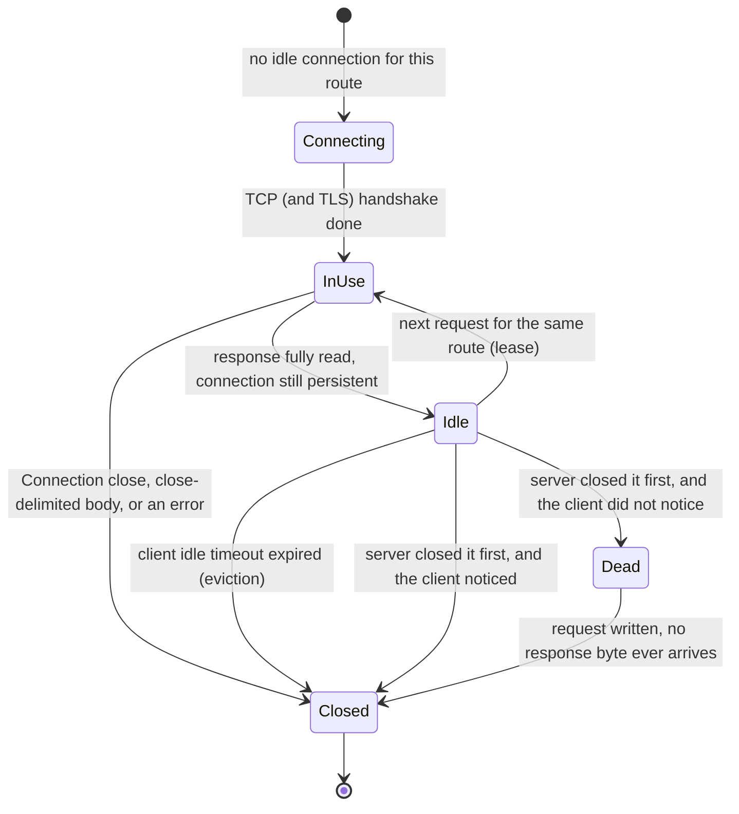
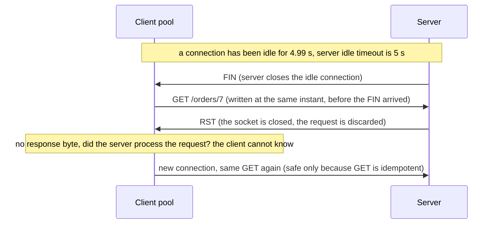
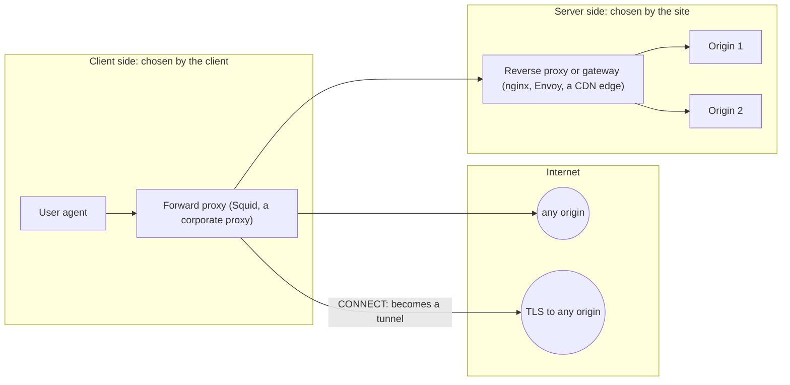
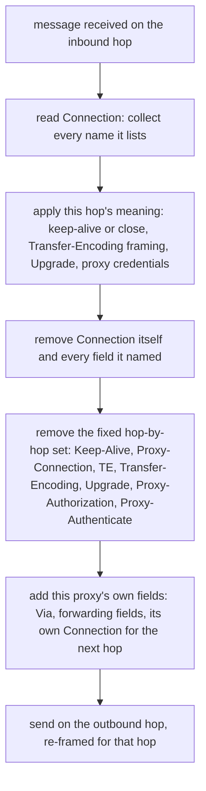
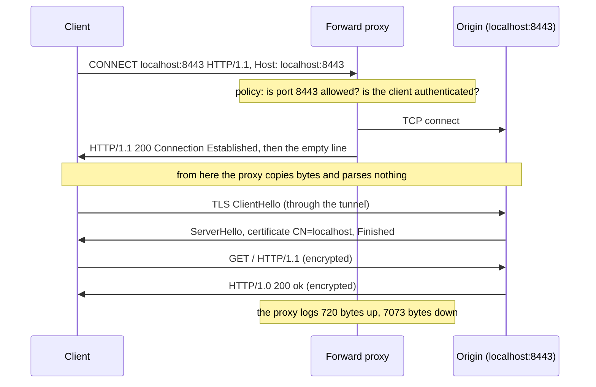
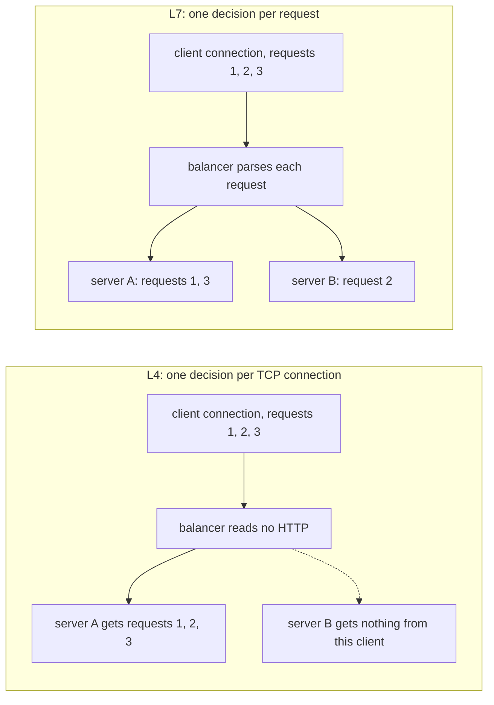
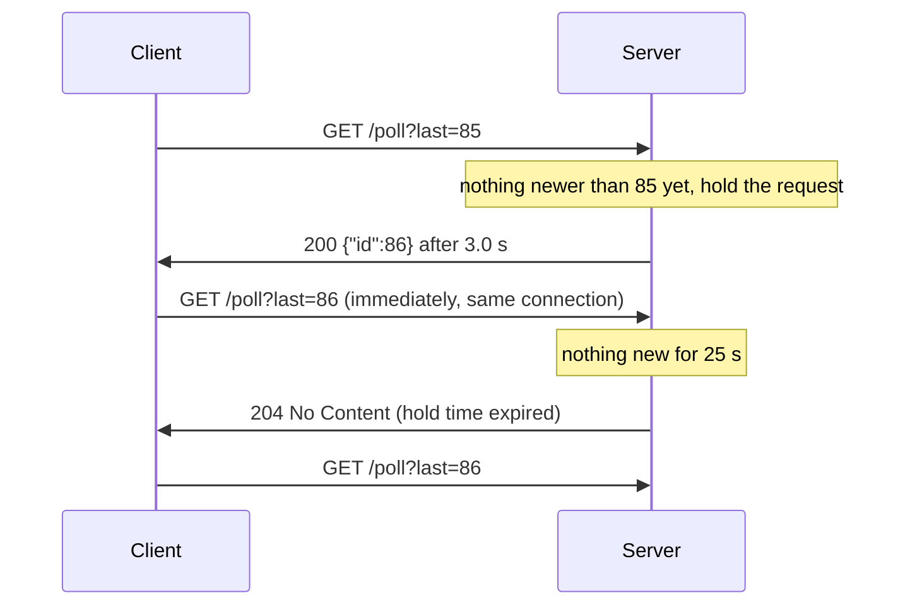
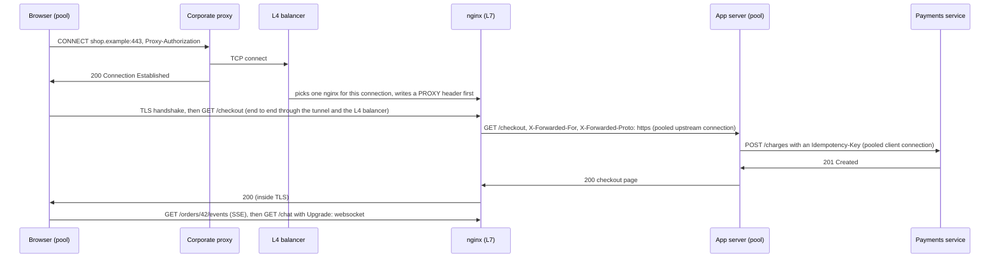
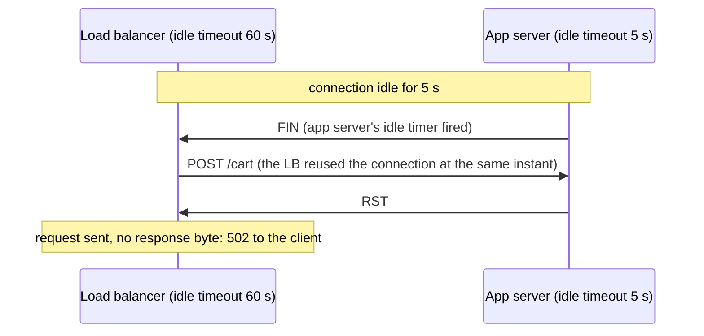

<!-- markdownlint-disable MD001 -->
<!-- markdownlint-disable MD024 -->
<!-- markdownlint-disable MD025 -->
<!-- markdownlint-disable MD026 -->
<!-- markdownlint-disable MD029 -->
<!-- markdownlint-disable MD033 -->
<!-- markdownlint-disable MD036 -->
<!-- markdownlint-disable MD040 -->
<!-- markdownlint-disable MD056 -->
<!-- markdownlint-disable MD060 -->

# H08. Connections, proxies and upgrades2

## Contents

| #     | Sub-topic                                                                  | Tag   |
| ----- | -------------------------------------------------------------------------- | ----- |
| 08.01 | Client connection pools                                                    | CORE  |
| 08.02 | Intermediaries: forward proxy, reverse proxy, gateway, tunnel              | CORE  |
| 08.03 | Hop-by-hop and end-to-end fields                                           | DEEP  |
| 08.04 | `CONNECT` tunnels: HTTPS through a forward proxy                           | DEEP  |
| 08.05 | L4 and L7 load balancers, and the client's address                         | CORE  |
| 08.06 | `Upgrade`, `101 Switching Protocols`, and WebSocket                        | CORE  |
| 08.07 | Server-Sent Events and long polling                                        | AWARE |
| 08.08 | The story: one checkout page through a corporate proxy and a load balancer | CORE  |
| 08.09 | Labs: what each one shows and how to run it                                | CORE  |
| 08.10 | Exercises                                                                  |       |
| 08.11 | Solutions                                                                  |       |
| 08.12 | Takeaways                                                                  |       |

Terms used throughout. Each is defined here, before any section uses it:

- **Connection**: one TCP connection (H04), identified by the four numbers source address, source port, destination address, destination port.  
  In this module "connection" always means a TCP connection, never an HTTP request.

- **Persistent connection** (keep-alive): a connection that carries more than one request and response in sequence, the HTTP/1.1 default (H07 07.06).  
  Everything in 08.01 depends on it.

- **Idle connection**: an open connection that is not carrying a request right now. **Idle timeout**: how long one side lets a connection sit idle before closing it.  
  Client and server each have their own.

- **Connection pool**: a client-side store of idle persistent connections, keyed by destination, so a new request can reuse one instead of opening a new connection.  
  **Pooled connection**: a connection in the pool. **Lease** or **checkout**: taking one out for a request; **release**: putting it back.

- **Route** (Apache HttpClient's word, also called a **pool key**): what a pooled connection is keyed by: scheme, host and port, plus the proxy if one is used.  
  Two requests may share a connection only if they have the same route.

- **Stale connection**: a pooled connection the client still believes is open, but which the server has already closed.  
  Sending a request on it fails.

- **Idempotent method**: a method for which sending the same request twice has the same effect on the server as sending it once (RFC 9110 9.2.2): `GET`, `HEAD`, `PUT`, `DELETE`, `OPTIONS`, `TRACE`. `POST` and `PATCH` are not.  
  Safe retries depend on this (REST track R2 covers the semantics).

- **User agent**: the client program that starts a request, such as a browser or `curl`. **Origin server**: the server that owns the resource and produces the authoritative response.

- **Intermediary**: any program between the user agent and the origin server that forwards HTTP.  
  RFC 9110 3.7 names three kinds: **proxy**, **gateway** and **tunnel**, defined properly in 08.02.

- **Inbound** and **outbound**: RFC 9110's directions. Inbound means toward the origin server; outbound means toward the user agent.  
  **Upstream** is the usual industry word for inbound (an nginx `upstream` is the set of origin servers); **downstream** means outbound.

- **Hop**: one connection between two adjacent participants in the chain. A request that goes browser, proxy, origin crosses two hops.

- **Hop-by-hop field**: a header field that describes one hop (one connection) and must not be forwarded.  
  **End-to-end field**: a field meant for the final recipient, which intermediaries forward. 08.03 is about the difference.

- **L4** and **L7**: layers 4 and 7 of the OSI model (H02). Layer 4 is the transport layer (TCP); layer 7 is the application layer (HTTP).  
  An **L4 load balancer** forwards TCP connections without reading HTTP; an **L7 load balancer** parses each HTTP request.

- **PROXY protocol**: a one-line (version 1) or binary (version 2) header that an L4 proxy writes at the start of each forwarded TCP connection, carrying the original client's address.  
  Defined by HAProxy, not by the IETF.

- **Tunnel**: an intermediary that relays bytes in both directions without parsing them. `CONNECT` (08.04) creates one.

- **WebSocket** (RFC 6455): a protocol for full-duplex messages over one TCP connection, started by an HTTP/1.1 `Upgrade` request.  
  **Frame**: one unit of WebSocket data, with a small binary header.

- **Server-Sent Events** (SSE): a one-way stream of text events from server to client inside one long HTTP response, with media type `text/event-stream`.  
  **Long polling**: a pattern where the server holds a request open until it has something to send.

Outputs in this module are real.  
They come from this module's own origin server, a teaching proxy written twice (Java and Rust), a layer-4 balancer, nginx 1.24 in two configurations, `curl` 8.5, Python 3, the JDK 21 `HttpClient`, Apache HttpClient 5.4.1 and hyper-util 0.1.21.  
Run on Linux 6.18, JDK 21, Rust 1.97. The client in most labs binds to `127.0.0.5` so its address is easy to tell apart from a proxy's `127.0.0.1`.

---

## 08.01 Client connection pools

Opening a connection costs at least one round trip for TCP (H04), more for TLS (H14, H15), plus slow start before it runs at full speed, so clients keep finished connections open in a pool and reuse them.  
A pool is a cache of open connections keyed by route, with four controls: how many connections per route and in total, how long an idle connection is kept, whether an idle connection is checked before reuse, and what happens when a reused connection turns out to be dead.  
The hard part is the last one: the server may close an idle connection at the same moment the client starts using it, and the client cannot tell whether the server saw the request.  
The safe answer, used by every serious client and proxy, is to keep the client's idle timeout shorter than the server's, to check idle connections before reuse, and to retry automatically only idempotent requests.

### What a pooled connection goes through



A connection can go back to the pool only if the response was framed exactly (H07 07.04): a `Content-Length` or chunked body that was read to its end.  
A close-delimited body, a `Connection: close`, or any error means the connection cannot be trusted for another message and is closed instead.

### The controls every pool has

| Control                    | What it limits                                      | JDK `HttpClient` 21                       | Apache HttpClient 5.4.1                                                | hyper-util 0.1.21 (legacy `Client`)       |
| -------------------------- | --------------------------------------------------- | ----------------------------------------- | ---------------------------------------------------------------------- | ----------------------------------------- |
| Connections per route      | Concurrent requests to one host over HTTP/1.1       | No limit                                  | 5 (`maxPerRoute`)                                                      | No limit                                  |
| Connections in total       | Concurrent requests to all hosts                    | No limit                                  | 25 (`maxTotal`)                                                        | No limit                                  |
| Idle connections kept      | Memory and server sockets held while quiet          | No limit (`connectionPoolSize` 0)         | Up to the limits above                                                 | No limit (`pool_max_idle_per_host`)       |
| Idle timeout               | How long an idle connection is kept                 | 30 s (`keepalive.timeout`)                | The server's `Keep-Alive: timeout`, else 3 min (`connectionKeepAlive`) | 90 s (`pool_idle_timeout`)                |
| Check before reuse         | Using a connection the server already closed        | Closed connections are noticed while idle | A stale check if idle over 2 s                                         | Closed connections are noticed while idle |
| Wait for a free connection | How long a request queues when the limit is reached | Never queues                              | 3 min (`connectionRequestTimeout`)                                     | Never queues                              |
| Automatic retry            | Failure on a reused connection                      | Idempotent requests                       | Idempotent requests, once (`DefaultHttpRequestRetryStrategy`)          | Only requests never written               |
| Order of reuse             | Which idle connection a request gets                | Oldest first (FIFO)                       | Configurable (LIFO by default)                                         | Newest first (LIFO)                       |

Every value in this table was printed by Lab 08, observed in it, or read from the library itself.  
The JDK's come from `jdk.internal.net.http.HttpClientImpl` and `ConnectionPool`: `findConnection` takes `removeFirst()` from a list that `add()` appends to, and a `CleanupTrigger` watches idle connections for the server's close.  
Apache's come from `PoolingHttpClientConnectionManager` (its default constructor passes `PoolReusePolicy.LIFO`; a `null` `validateAfterInactivity` falls back to 2 s inside `resolveValidateAfterInactivity`), `ConnectionConfig.DEFAULT` and `RequestConfig.DEFAULT`.  
hyper's come from the legacy `Client` builder defaults and its pool, a `Vec` used with `push` and `pop`.

### Measured: limits are queues

Lab 08 sends 20 concurrent requests to a server that holds each one for 300 ms, and counts on the server how many connections were opened:

| Client                                   | Wall time | New connections | Reused |
| ---------------------------------------- | --------- | --------------- | ------ |
| JDK `HttpClient`, defaults               | 454 ms    | 20              | 0      |
| JDK, at most 5 in flight (a `Semaphore`) | 1233 ms   | 5               | 15     |
| Apache 5.4.1, defaults (5 per route)     | 1290 ms   | 5               | 15     |
| Apache, `maxPerRoute` 20                 | 313 ms    | 20              | 0      |
| hyper, defaults                          | 306 ms    | 20              | 0      |
| hyper, at most 5 in flight               | 1206 ms   | 5               | 15     |

Two lessons. First, a per-route limit is a queue: Apache's default of 5 turned twenty 300 ms requests into four waves, 1.29 s in total, with no error anywhere.  
A service calling one downstream host with Apache's defaults is capped at 5 concurrent calls, and its latency grows with load long before anything fails.  
Second, the JDK and hyper have no such limit, so a burst of 10,000 concurrent requests opens 10,000 connections to one host. Neither default is right for every service; each must be chosen.  
When a request waits longer than `connectionRequestTimeout` for a free connection,  
Apache fails it with `ConnectionRequestTimeoutException` (Lab 08 shows it at 500 ms): that exception in production logs means pool exhaustion, not a slow server.

How big a pool should be follows from Little's law: connections needed equals requests per second times seconds per request.  
A service making 400 calls per second to a dependency that answers in 50 ms needs about 400 × 0.05 = 20 connections, plus headroom for latency spikes, since a spike to 500 ms needs 200.

### FIFO or LIFO

The JDK hands out the connection that has been idle longest; hyper hands out the one used most recently.  
Lab 08 sends 5 sequential requests on a client holding 20 idle connections: the JDK used 5 different connections, each for its second request; hyper used the same connection 5 times.  
FIFO spreads requests over every connection and keeps them all warm, so after a burst the pool never shrinks.  
LIFO keeps the hottest connection busy and lets the surplus sit idle until its idle timeout closes it, so the pool shrinks back to what the load needs.  
LIFO is usually the better default for a client; FIFO is what you want when the goal is to spread load over many server-side connections.

### The stale-connection race



The failure looks the same from the client whatever the cause: the request was written, and the connection ended before a single response byte arrived.  
Lab 03 and Lab 08 reproduce it exactly with an origin started with `--close-on-reuse`, which closes a connection without answering when a second request arrives on it.  
The results:

| Client                  | `GET` on the dead connection                                       | `POST` on the dead connection                                               |
| ----------------------- | ------------------------------------------------------------------ | --------------------------------------------------------------------------- |
| JDK `HttpClient`        | Retried on a new connection, `200`                                 | `IOException: HTTP/1.1 header parser received no bytes`                     |
| Apache HttpClient 5.4.1 | Retried (logged as a recoverable `NoHttpResponseException`), `200` | `NoHttpResponseException`, not retried                                      |
| hyper-util              | `Error(SendRequest, hyper::Error(IncompleteMessage))`, not retried | Not reached: the dead connection was discarded, so the `POST` got a new one |
| MiniProxy (this module) | Retried once on a new connection, `200`                            | `502 Bad Gateway`, not retried                                              |

The defences, in the order they help:

01. **Client idle timeout shorter than the server's.** Then the client always closes first and the race cannot start.  
  MiniProxy's 4 s pool timeout against the origin's 5 s is the example; Lab 03 shows the pool evicting a connection after 4.5 s of idleness.  
  The classic production failure is the reverse: a load balancer with a 60 s idle timeout in front of application servers that close idle connections after 5 s, which produces a small,  
  steady rate of `502` responses that no one can reproduce on demand.

02. **Honour the server's hint.** A server may send `Keep-Alive: timeout=5` on a response;  
  Apache HttpClient uses it as the idle timeout for that connection.

03. **Check before reuse.** A one-millisecond read on an idle connection distinguishes "open and quiet" (the read times out) from "closed by the server" (end of stream).  
  MiniProxy and Apache do this; Lab 03 shows MiniProxy discarding a connection the server closed after 2 s.  
  It narrows the window but cannot close it: the FIN can still arrive one microsecond after the check.

04. **Retry only idempotent requests, and only once.** A request that died with no response byte may or may not have been processed.  
  Repeating a `GET` is harmless; repeating a `POST /payments` may charge twice.  
  A non-idempotent request needs an idempotency key (REST track R2, DD-1 to DD-4) before any layer may retry it.

05. **Never retry on a timeout.** A request that timed out was probably received and is probably still running.  
  MiniProxy returns `504` on a timeout and never retries it.

### Interview angle

"Our service gets occasional 502s from the load balancer, no pattern, can't reproduce."  
The answer an interviewer wants: idle-timeout mismatch.  
The load balancer reuses an upstream connection the application server has just closed.  
Confirm by comparing the two idle timeouts and by checking whether the 502s cluster on connections idle for close to the server's timeout.  
Fix by making the application server's idle timeout longer than the load balancer's.  
The depth signal is explaining why the retry policy cannot simply absorb it for `POST`.

---

## 08.02 Intermediaries: forward proxy, reverse proxy, gateway, tunnel

RFC 9110 3.7 names three kinds of intermediary.  
A **proxy** is chosen by the client: the client is configured to send its requests to the proxy, which forwards them anywhere (a forward proxy).  
A **gateway**, better known as a **reverse proxy**, is chosen by the server: clients think they are talking to the origin, and the gateway forwards to the real servers behind it.  
A **tunnel** relays bytes without reading them. They differ in who configured them, whom they act for, and what they are allowed to change:  
every intermediary removes hop-by-hop fields and adds its own, a proxy must add `Via`, a reverse proxy commonly rewrites `Host` and adds forwarding fields,  
and only a tunnel changes nothing, because it understands nothing.

### Where each one sits



### The four roles compared

| Role                    | Configured by                     | Acts for                | Request-target it receives                                      | Typical software                                                  |
| ----------------------- | --------------------------------- | ----------------------- | --------------------------------------------------------------- | ----------------------------------------------------------------- |
| Forward proxy           | The client (or its network)       | The client              | Absolute form, `GET http://h/p` (H07 07.03), or `CONNECT h:443` | Squid, a corporate egress proxy, MiniProxy `forward`              |
| Reverse proxy (gateway) | The site operator                 | The origin servers      | Origin form, `GET /p`                                           | nginx, HAProxy, Envoy, a CDN, an API gateway, MiniProxy `reverse` |
| Tunnel                  | Created by `CONNECT` or `Upgrade` | Nobody: it relays bytes | Nothing after the tunnel opens                                  | Any proxy after `CONNECT` or `101`, an L4 balancer                |
| Cache                   | Either side                       | Either side             | Either form                                                     | Varnish, a CDN, a browser cache (H09)                             |

The word "gateway" collides with industry usage.  
In RFC 9110 a gateway is any reverse proxy.  
An "API gateway" in a system-design interview is a reverse proxy with extra duties: authentication, rate limits, routing by path or version, request transformation.  
Same position in the chain, more policy.

### What each one may rewrite

| Change                         | Forward proxy                                                         | Reverse proxy                                                         |
| ------------------------------ | --------------------------------------------------------------------- | --------------------------------------------------------------------- |
| Request-target                 | Must turn the absolute form into the origin form for the origin       | Usually unchanged; may rewrite the path (`/api/v1/x` to `/x`)         |
| `Host`                         | Must replace it with the host from the absolute form (RFC 9112 3.2.2) | May keep the client's or replace it; nginx replaces it by default     |
| Hop-by-hop fields              | Must remove them and send its own (08.03)                             | The same                                                              |
| `Via`                          | Must add itself (RFC 9110 7.6.3)                                      | Must add itself to requests; may add to responses. nginx adds nothing |
| `X-Forwarded-For`, `Forwarded` | May add them; privacy proxies do not                                  | Adds them so the origin learns the client's address (08.05)           |
| `Proxy-Authorization`          | Consumes it (checks it, then removes it)                              | Not applicable                                                        |
| Response `Server`, `Date`      | Usually passes them                                                   | nginx replaces both with its own (measured below)                     |
| Content                        | Not if `Cache-Control: no-transform` (RFC 9110 7.7)                   | May compress it (gzip in Lab 07), which has consequences for streams  |

### Measured: three proxies, one request

Lab 01 sends one request to each proxy carrying every kind of field a proxy must make a decision about: `Connection: keep-alive, X-Secret`, a `Keep-Alive`, an `X-Secret` named in `Connection`,  
`Proxy-Connection`, `Proxy-Authorization`, `TE`, `Upgrade: h2c`, and a forged `X-Forwarded-For: 6.6.6.6` and `Forwarded: for=6.6.6.6`.  
The origin echoes the head it received:

| Field sent by the client           | nginx, defaults               | nginx, tuned config                                    | MiniProxy (Java and Rust)                                |
| ---------------------------------- | ----------------------------- | ------------------------------------------------------ | -------------------------------------------------------- |
| Request line                       | `GET /hello?x=1 HTTP/1.0`     | `GET /hello?x=1 HTTP/1.1`                              | `GET /hello?x=1 HTTP/1.1`                                |
| `Host: shop.example`               | Replaced: `Host: origins`     | Kept (`proxy_set_header Host $host`)                   | Kept                                                     |
| `Connection`                       | Replaced: `Connection: close` | Removed (`proxy_set_header Connection ""`)             | Removed                                                  |
| `Keep-Alive`, `TE`, `Upgrade`      | Removed                       | Removed                                                | Removed                                                  |
| `X-Secret` (named in `Connection`) | Forwarded                     | Forwarded                                              | Removed                                                  |
| `Proxy-Connection`                 | Forwarded                     | Forwarded                                              | Removed                                                  |
| `Proxy-Authorization`              | Forwarded                     | Forwarded                                              | Removed                                                  |
| `X-Forwarded-For: 6.6.6.6`         | Forwarded unchanged           | Appended to: `6.6.6.6, 127.0.0.5`                      | Replaced: `127.0.0.5`                                    |
| `Forwarded: for=6.6.6.6`           | Forwarded unchanged           | Replaced: `for=127.0.0.5;proto=http;host=shop.example` | Replaced: `for=127.0.0.5;proto=http;host="shop.example"` |
| `Via`                              | Not added                     | Not added                                              | `Via: 1.1 miniproxy`                                     |
| Response `Server` and `Date`       | nginx's own                   | nginx's own                                            | The origin's                                             |

Three things in that table matter in practice. nginx's defaults speak HTTP/1.0 to the origin and send `Connection: close`, so every request opens a new upstream connection (Lab 02 counted 10 connections for 10 requests; tuned, 2).  
nginx does not remove fields named in `Connection`, which RFC 9110 requires, and it forwards `Proxy-Authorization`, so a client's proxy credentials reach the origin.  
And with `$proxy_add_x_forwarded_for`, nginx appends to whatever the client sent, so the origin sees the forged `6.6.6.6` first: 08.05 is about reading that header safely.

### Interview angle

"What is the difference between a forward and a reverse proxy?"  
Who chose it and whom it represents: the client configures a forward proxy and it acts for clients (egress control, caching, anonymity);  
the site deploys a reverse proxy and it acts for servers (TLS termination, load balancing, caching, protection).  
The depth signal is the wire difference: a forward proxy receives the absolute form or `CONNECT`, a reverse proxy receives the origin form and cannot tell it is not the origin,  
and that a forward proxy must not forward `Proxy-Authorization` while nginx, used carelessly, does.

---

## 08.03 Hop-by-hop and end-to-end fields

Some header fields describe the connection they arrive on, not the message: whether to keep it open (`Connection`, `Keep-Alive`),  
what transfer coding it uses (`Transfer-Encoding`), which codings the receiver accepts (`TE`), whether to switch protocols (`Upgrade`), and the proxy's own credentials (`Proxy-Authorization`).  
Those are hop-by-hop: every intermediary must act on them and remove them, then add its own for the next hop.  
Any other field can be made hop-by-hop for one message by naming it in `Connection`. Everything else is end-to-end and travels to the final recipient.  
HTTP/2 and HTTP/3 forbid hop-by-hop fields outright, because their framing lives in the binary layer and a connection there carries many requests at once.

### The rule, as an intermediary applies it



The fields, with the reason each one cannot travel:

| Field                                       | Describes                                                                          | Why it must stop at the next hop                                                                         |
| ------------------------------------------- | ---------------------------------------------------------------------------------- | -------------------------------------------------------------------------------------------------------- |
| `Connection`                                | Options for this connection, and names of hop-by-hop fields                        | The next connection has its own options                                                                  |
| `Keep-Alive`                                | Timeout and request limits for this connection (HTTP/1.0 era)                      | The next connection's timeouts are the proxy's business                                                  |
| `Proxy-Connection`                          | A non-standard `Connection` some clients still send to proxies (curl does, Lab 04) | Never standardised; RFC 9110 7.6.1 lists it for removal                                                  |
| `Transfer-Encoding`                         | How the body is framed on this connection (H07 07.05)                              | The proxy may re-frame: chunked in, `Content-Length` out, or the reverse                                 |
| `TE`                                        | Transfer codings the sender accepts on this connection                             | It is about this connection's framing                                                                    |
| `Trailer`                                   | Which fields follow a chunked body on this connection                              | Tied to `Transfer-Encoding`                                                                              |
| `Upgrade`                                   | A request to switch this connection to another protocol                            | Each hop decides for itself whether to switch (08.06)                                                    |
| `Proxy-Authorization`, `Proxy-Authenticate` | Credentials and challenges for the proxy itself                                    | Meant for the proxy that asked; RFC 9110 11.7 lets one proxy relay them only to a cooperating next proxy |

RFC 2616 (1999) had a fixed list of eight such fields.  
RFC 7230 and now RFC 9110 7.6.1 replaced it with the `Connection` mechanism plus a list of fields "known to require removal", which is the rule MiniProxy implements in `hopByHop`.

### Naming a field in `Connection`: a feature and a weapon

`Connection: close, X-Trace` tells the next hop: close after this message, and `X-Trace` is for you only.  
That is the extension mechanism: a new hop-by-hop field needs no RFC, only a mention in `Connection`.

The same mechanism can be turned against the origin. A client sends `Connection: close, X-Forwarded-For`.  
A front proxy that adds `X-Forwarded-For` first and then strips the names in `Connection` deletes its own field, and the origin,  
which uses that field for an IP allowlist or rate limit, sees nothing, or sees what a second proxy added.  
Researchers have used the same trick against authentication headers that a proxy adds after it checks a session.  
The defence is ordering: strip what the client named, then add your own fields, never the reverse, and never let `Connection` remove a field the proxy itself is responsible for.  
MiniProxy builds its outbound head in that order.  
nginx sidesteps the problem by ignoring `Connection`'s list entirely, which is safe for nginx's own headers but forwards fields the client meant to be hop-by-hop (Lab 01's `X-Secret`).

### Why HTTP/2 and HTTP/3 ban them

An HTTP/2 connection carries many requests at once as interleaved streams, and the end of a body is marked by a flag on a binary frame, not by `Content-Length` or chunked coding.  
A connection-level field on one request has nothing to apply to, and a framing field would contradict the frame layer.  
RFC 9113 8.2.2 therefore makes a message containing `Connection`, `Proxy-Connection`, `Keep-Alive`, `Transfer-Encoding` or `Upgrade` malformed, and allows `TE` only with the value `trailers`.  
RFC 9114 4.2 does the same for HTTP/3.  
A proxy that translates HTTP/2 to HTTP/1.1 (the usual setup behind a CDN) must reject such a request rather than translate it,  
because a `Transfer-Encoding: chunked` smuggled in an HTTP/2 request and copied into the HTTP/1.1 request is exactly the H07 07.08 disagreement, now between two protocol versions.  
H17 covers HTTP/2 in full; the REST track's R4 covers which headers an API should define and expose.

### Interview angle

"What is a hop-by-hop header?"  
A field about one connection, consumed by the next intermediary and not forwarded: `Connection` and the fields it names, `Keep-Alive`, `Transfer-Encoding`, `TE`, `Upgrade`, `Proxy-Authorization`.  
The depth signal is the `Connection`-listing attack and the order-of-operations defence, and knowing that HTTP/2 makes these fields a protocol error, which is why a downgrading proxy is a smuggling boundary.

---

## 08.04 `CONNECT` tunnels: HTTPS through a forward proxy

A forward proxy cannot forward an HTTPS request the way it forwards HTTP, because the request is encrypted end to end and the proxy is not the server named in the certificate.  
Instead the client asks the proxy to open a raw TCP connection: `CONNECT shop.example:443 HTTP/1.1`.  
The proxy checks policy, connects, and answers `200 Connection Established`; from that byte on, the connection is a tunnel and the proxy copies bytes both ways without parsing them.  
The client then runs TLS through the tunnel directly with the origin.  
The proxy learns the destination host and port, the timing and the volume, and nothing else,  
unless the organisation installs its own root certificate on the client and makes the proxy a deliberate man in the middle.

### The exchange



Lab 04 runs exactly this through MiniProxy to an `openssl s_server`.  
`curl` verified the server's certificate (`subject: CN=localhost`) against the server's own certificate file, which proves the TLS session ended at the origin, not at the proxy; the proxy's log shows only a byte count.

### The rules (RFC 9110 9.3.6)

- The request-target is in authority form: host and port, no scheme, no path (H07 07.03). A port is required.

- Any `2xx` response means the tunnel is open "immediately after the response header section".  
  A `2xx` to `CONNECT` has no body, and a client must ignore any `Content-Length` or `Transfer-Encoding` in it.

- Any other status means no tunnel, and the connection is still HTTP: `403` for a destination policy refuses, `407 Proxy Authentication Required` with a `Proxy-Authenticate` challenge,  
  `502` when the destination cannot be reached. Lab 04 shows all three.

- The tunnel closes when either side closes.  
  Each direction ends separately: when the client finishes sending, the proxy passes the end of stream on (a TCP FIN) and keeps relaying the other direction until it ends too.

### The security questions a proxy must answer

01. **Which ports?** An open `CONNECT` to any port turns the proxy into a generic TCP relay: to mail servers on port 25 (spam), to SSH, to internal databases.  
  Squid's default allows `CONNECT` only to port 443; MiniProxy allows 443 and 8443 and answers `403` otherwise (Lab 04 asked for port 9001).

02. **Which hosts?** A proxy inside a network can reach internal addresses its clients cannot.  
  A `CONNECT 10.0.0.5:443` from outside is server-side request forgery.  
  Real proxies resolve the name and check the address against a deny list before connecting.

03. **Who is asking?** `407` with `Proxy-Authenticate: Basic realm="..."`, answered with `Proxy-Authorization: Basic base64(user:pass)`.  
  The credentials are sent in clear on the proxy hop unless the client talks to the proxy itself over TLS (an `https://` proxy URL).  
  Lab 04 shows curl's header and confirms the origin never received it.

04. **What can the proxy still see?** The `CONNECT` line names the host.  
  The TLS ClientHello that follows also carries the host name in clear, in the Server Name Indication extension, unless Encrypted Client Hello is used (H15, H16).  
  Egress filters work on these two names.

05. **Interception.** A corporate "TLS inspection" proxy does not tunnel: it answers the `CONNECT`, then completes TLS with the client itself using a certificate for `shop.example` that it mints on the fly,  
  signed by a root the company installed on every laptop, and opens its own TLS connection to the real origin. Certificate pinning in apps defeats it by design (H13, H16).

`CONNECT` has grown beyond tunnelling TLS: HTTP/2 and HTTP/3 use it to carry WebSocket (RFC 8441, RFC 9220), and `CONNECT-UDP` (RFC 9298) tunnels UDP for QUIC and VPN-like relays.  
Those are AWARE-level here and return in H17 to H19.

### Interview angle

"How does HTTPS work through a corporate proxy?"  
`CONNECT host:443`, `200`, then end-to-end TLS through a byte relay; the proxy sees host and volume, not content.  
The depth signal is the policy list (ports, internal addresses, authentication), knowing the SNI is visible, and explaining TLS inspection as a separate mode that requires a trusted root on the client.

---

## 08.05 L4 and L7 load balancers, and the client's address

A load balancer spreads work across servers.  
An L4 balancer works on TCP connections: it picks a server when a connection opens and copies bytes until it closes, without reading HTTP.  
An L7 balancer is a reverse proxy: it parses each request, can route by path, header or cookie, and picks a server per request.  
The difference shows up whenever one connection carries many requests: behind L4, every request on a persistent connection (and every stream of an HTTP/2 or gRPC connection) lands on the same server.  
Both kinds hide the client's address from the server, because the server's TCP peer is the balancer.  
L7 balancers put the address in a header (`X-Forwarded-For`, or the standard `Forwarded`); L4 balancers prepend a PROXY protocol header to the connection.

### Per connection or per request



| Property                             | L4 (TCP)                                                              | L7 (HTTP)                                                       |
| ------------------------------------ | --------------------------------------------------------------------- | --------------------------------------------------------------- |
| Decision unit                        | A TCP connection                                                      | A request                                                       |
| Reads                                | Addresses and ports only                                              | The whole request head, optionally the body                     |
| TLS                                  | Passed through untouched (the server terminates it)                   | Usually terminated at the balancer, which needs the certificate |
| Can route by                         | Destination port, client address                                      | Host, path, header, cookie, method                              |
| Can retry a failed request           | No: it never knew where requests began                                | Yes, if idempotent (08.01)                                      |
| Can add or remove headers            | No                                                                    | Yes (08.02, 08.03)                                              |
| Client address reaches the server as | PROXY protocol, or the original source address kept by network tricks | `X-Forwarded-For`, `Forwarded`                                  |
| Cost per byte                        | Low: copy, or forward packets in the kernel                           | Higher: parse, buffer, re-serialise                             |
| Examples                             | AWS NLB, Linux IPVS, HAProxy `mode tcp`, nginx `stream`               | AWS ALB, nginx `http`, Envoy, HAProxy `mode http`, a CDN edge   |

### Measured: one connection, two requests

Lab 05 sends two requests on one client connection through each balancer:

| Path                               | Request 1               | Request 2               | Server's TCP peer      | Client address seen by the server                                      |
| ---------------------------------- | ----------------------- | ----------------------- | ---------------------- | ---------------------------------------------------------------------- |
| nginx (L7)                         | origin A, connection 22 | origin B, connection 16 | `127.0.0.1` (nginx)    | `X-Forwarded-For: 127.0.0.5`                                           |
| `L4Balancer` (L4)                  | origin A, connection 23 | origin A, connection 23 | `127.0.0.1` (balancer) | Nowhere                                                                |
| `L4Balancer --proxy-protocol` (L4) | origin E, connection 1  | origin E, connection 1  | `127.0.0.1` (balancer) | `127.0.0.5:37002`, from the PROXY line, equal to curl's own local port |

The L4 rows are the connection-skew problem in miniature.  
A gRPC client (HTTP/2) opens one connection and keeps it for hours; behind an L4 balancer, all of its calls go to one server, and a newly added server receives nothing until clients reconnect.  
The fixes are an L7 balancer that understands HTTP/2 streams (Envoy, or a cloud L7 balancer with gRPC support), client-side balancing across several connections,  
or capping connection lifetime so clients reconnect and redistribute.  
H17 returns to this with HTTP/2 coalescing.

### Carrying the client's address in headers

| Field                                   | Syntax                                                                    | Status                                         |
| --------------------------------------- | ------------------------------------------------------------------------- | ---------------------------------------------- |
| `X-Forwarded-For`                       | `X-Forwarded-For: client, proxy1, proxy2`                                 | De facto standard; each proxy appends its peer |
| `X-Forwarded-Proto`, `X-Forwarded-Host` | `https`, `shop.example`                                                   | De facto; the original scheme and host         |
| `X-Real-IP`                             | One address                                                               | nginx convention                               |
| `Forwarded`                             | `Forwarded: for=192.0.2.60;proto=https;host=shop.example;by=203.0.113.43` | RFC 7239 (2014): one field for all of it       |

`Forwarded` values that are not tokens must be quoted: an IPv6 address with port is written `for="[2001:db8:cafe::17]:4711"`, and a host with a port needs quotes because `:` is not a token character.  
MiniProxy always quotes `host`; the nginx config in Lab 01 does not, which is correct for `shop.example` and wrong for `shop.example:8080`.

The rule for reading `X-Forwarded-For`: the list is written left to right by each hop, and only the entries added by proxies you control can be trusted.  
Count from the right.  
If exactly one trusted proxy sits in front of the server, the rightmost entry is the client's address as that proxy saw it, and everything to its left was supplied by the client and may be forged.  
Lab 01's tuned nginx produced `6.6.6.6, 127.0.0.5`: an application that takes the leftmost entry believes the client is `6.6.6.6`.  
nginx's `realip` module (`set_real_ip_from` the trusted proxy addresses, `real_ip_header X-Forwarded-For`, `real_ip_recursive on`) implements the right-to-left walk.  
On the Java side, Tomcat's `RemoteIpValve` (what Spring Boot's `server.forward-headers-strategy=native` turns on) does the same, with `internal-proxies` naming the trusted addresses;  
Spring's `ForwardedHeaderFilter` trusts whatever arrives, so it is safe only behind an edge proxy that overwrites these fields.  
The simplest safe design is the one MiniProxy uses at the edge: the first proxy you own discards whatever the client sent and writes the field fresh.

### Carrying it in the connection: the PROXY protocol

An L4 balancer cannot add a header to HTTP it does not parse, and it may be relaying TLS it cannot read. HAProxy's PROXY protocol solves this by putting the address in front of the stream.  
Version 1 is one text line:

```text
PROXY TCP4 127.0.0.5 127.0.0.1 37002 7000\r\n
```

That is: protocol family, client address, the balancer's address, client port, the balancer's port.  
Version 2 is a binary header beginning with a fixed 12-byte signature, more compact and able to carry extra fields such as the TLS server name.  
The receiving server must be told to expect it on that port, for two reasons that Lab 05 shows from both sides: a server that does not expect it reads `PROXY TCP4 ...` as a malformed request line,  
and a server that does expect it must refuse connections without it (origin E closed the direct request) and must accept it only from the balancer's addresses,  
because anyone who can reach the port can otherwise write any address they like.  
nginx enables it with `listen 443 ssl proxy_protocol` plus `set_real_ip_from`; AWS NLB, HAProxy and Envoy can send it.

A third family of techniques keeps the client's address in the packets themselves: Direct Server Return, IPVS in tunnelling mode, and transparent proxying with Linux `TPROXY`.  
They need network-level configuration and are AWARE-level here.

### Interview angle

"L4 or L7 for this service?"  
L4 for raw throughput, non-HTTP protocols, or TLS passthrough where the balancer must not hold the keys; L7 for routing by path or header, per-request balancing, retries, and HTTP/2 or gRPC fan-out.  
The depth signal is the connection-skew problem with long-lived HTTP/2 connections behind L4, and knowing how the client address survives each kind: right-to-left `X-Forwarded-For` parsing with a trusted-proxy list for L7,  
PROXY protocol accepted only from the balancer for L4.

---

## 08.06 `Upgrade`, `101 Switching Protocols`, and WebSocket

HTTP/1.1 lets a client ask to change protocols on the connection it is using: it sends `Upgrade: <protocol>` with `Connection: Upgrade`, and if the server agrees it answers `101 Switching Protocols`.  
After the empty line ending the `101`, the bytes on that connection belong to the new protocol.  
WebSocket is the protocol that matters: the handshake is an HTTP `GET` with a random `Sec-WebSocket-Key`, the server proves it understood by returning a hash of that key,  
and afterwards both sides exchange small binary frames in both directions at any time.  
Because `Upgrade` and `Connection` are hop-by-hop, every proxy in the path must forward the upgrade deliberately; a proxy that does not drops the fields and the server sees an ordinary request.

### The upgrade mechanism (RFC 9110 7.8)

- The client lists one or more protocols it would like, in order: `Upgrade: websocket`.  
  It must also send `Connection: Upgrade`, because `Upgrade` is hop-by-hop.

- The server may ignore the request and answer normally over HTTP/1.1.  
  If it agrees, it answers `101 Switching Protocols` with an `Upgrade` field naming the protocol chosen, and switches right after the response head.

- A server that insists on another protocol for a resource answers `426 Upgrade Required` and must include an `Upgrade` field saying which.  
  Lab 06's origin does this for `/ws` when the handshake is missing.

- HTTP/2 originally had an upgrade path (`Upgrade: h2c` for cleartext HTTP/2). RFC 9113 removed it for lack of use;  
  HTTP/2 is negotiated inside TLS instead (H17).

### The WebSocket opening handshake (RFC 6455 4)

Captured in Lab 06, client then server:

```text
GET /ws HTTP/1.1
Host: 127.0.0.1:9001
Upgrade: websocket
Connection: Upgrade
Sec-WebSocket-Key: +Bca68D/xLo8ZEoWTzW8Og==
Sec-WebSocket-Version: 13

HTTP/1.1 101 Switching Protocols
Upgrade: websocket
Connection: Upgrade
Sec-WebSocket-Accept: AP8a5X2prvJYtyBGZt0a4WuRyPc=
```

| Field                       | Meaning                                                                                            |
| --------------------------- | -------------------------------------------------------------------------------------------------- |
| `Sec-WebSocket-Key`         | 16 random bytes, base64-encoded (H01): a fresh nonce per handshake                                 |
| `Sec-WebSocket-Version: 13` | The only version in use; a server that cannot speak it answers `426` with the versions it supports |
| `Sec-WebSocket-Accept`      | base64(SHA-1(key + `258EAFA5-E914-47DA-95CA-C5AB0DC85B11`)), the fixed GUID from the RFC           |
| `Origin`                    | Sent by browsers; the server must check it, because WebSocket is not covered by CORS (H10)         |
| `Sec-WebSocket-Protocol`    | Optional application subprotocols (`graphql-ws`, `mqtt`); the server picks one                     |
| `Sec-WebSocket-Extensions`  | Optional extensions, in practice `permessage-deflate` (RFC 7692)                                   |

The `Accept` hash is not security.  
It proves that the server is a WebSocket server that read this particular request, not an HTTP server or cache replaying an old `101`, and the `Sec-` prefix guarantees a web page's script cannot set these fields itself.  
Authentication happens in the handshake request like any other HTTP request: a cookie, or a token.

### Frames

After the `101`, each message travels as one or more frames:

```text
 byte 0                byte 1                 then
+-+-+-+-+-------+     +-+-------------+      +---------------------------+-------------------+-------------+
|F|R|R|R|opcode |     |M| payload len |      | extended length: 0, 2 or  | masking key: 4    | payload     |
|I|S|S|S|4 bits |     |A| 7 bits      |      | 8 bytes (len 126 or 127)  | bytes if MASK = 1 |             |
|N|V|V|V|       |     |S|             |      |                           |                   |             |
| |1|2|3|       |     |K|             |      |                           |                   |             |
+-+-+-+-+-------+     +-+-------------+      +---------------------------+-------------------+-------------+
```

| Opcode | Frame                                                 |
| ------ | ----------------------------------------------------- |
| `0x0`  | Continuation of a fragmented message                  |
| `0x1`  | Text (UTF-8)                                          |
| `0x2`  | Binary                                                |
| `0x8`  | Close, with an optional 2-byte status code and reason |
| `0x9`  | Ping                                                  |
| `0xA`  | Pong (must answer a ping)                             |

The client frame Lab 06 sent, decoded byte by byte:

| Bytes            | Bits or value  | Meaning                                                                                  |
| ---------------- | -------------- | ---------------------------------------------------------------------------------------- |
| `81`             | `1000 0001`    | FIN = 1 (last fragment), opcode 1 (text)                                                 |
| `85`             | `1000 0101`    | MASK = 1, payload length 5                                                               |
| `95 f8 09 e9`    | masking key    | 4 random bytes chosen by the client for this frame                                       |
| `fd 9d 65 85 fa` | masked payload | `fd ^ 95 = 68` h, `9d ^ f8 = 65` e, `65 ^ 09 = 6c` l, `85 ^ e9 = 6c` l, `fa ^ 95 = 6f` o |

The server's reply, `81 0b 65 63 68 6f 3a 20 68 65 6c 6c 6f`, is FIN and text, MASK = 0, length 11, and the 11 bytes of `echo: hello` in clear.  
The close, `88 02 03 e8`, is opcode 8 with the 2-byte status `0x03e8` = 1000, normal closure.

Every client-to-server frame must be masked with a fresh random key, and a server must close the connection on an unmasked one (the Lab 06 origin does).  
The reason is the intermediaries of 08.02: researchers showed in 2011 that a script able to choose the exact bytes on the wire could make a naive transparent proxy or cache read them as an HTTP request and cache a forged response.  
Masking with an unpredictable key means the attacker no longer controls the bytes on the wire.  
It is not encryption; the key travels with the frame.

### Through proxies

| Path                      | What the origin received                              | Result                                         |
| ------------------------- | ----------------------------------------------------- | ---------------------------------------------- |
| Direct                    | The handshake as sent                                 | `101`, echo, close                             |
| nginx, defaults           | `GET /ws HTTP/1.0`, no `Upgrade`, `Connection: close` | `426 Upgrade Required`                         |
| nginx, tuned              | `Upgrade: websocket`, `Connection: upgrade`, HTTP/1.1 | `101`, echo, close                             |
| MiniProxy (Java and Rust) | `Upgrade: websocket`, `Connection: Upgrade`           | `101`, then a byte relay: 19 bytes up, 17 down |

nginx forwards an upgrade only when told to, with `proxy_http_version 1.1` and `proxy_set_header Upgrade $http_upgrade` and `Connection "upgrade"`, which is the most common WebSocket deployment bug. After the `101`,  
any proxy is just a tunnel, so the rest of the connection's life is governed by idle timeouts: nginx closes a proxied connection that has been silent for `proxy_read_timeout`, 60 s by default,  
and cloud load balancers have similar limits.  
Long-lived WebSockets therefore need either a longer timeout on every hop or application heartbeats (ping and pong frames every 20 to 30 s), and in practice both.

### Interview angle

"How does a WebSocket connection start, and what breaks it in production?"  
An HTTP/1.1 `GET` with `Upgrade: websocket`, `Connection: Upgrade` and a random key; `101` with the key's SHA-1 hash; then masked frames from the client, unmasked from the server.  
The depth signal is the operations story: proxies drop the hop-by-hop `Upgrade` unless configured, idle timeouts kill quiet connections so heartbeats are required,  
L7 balancers must be told to allow long connections, and the `Origin` check is the server's job because CORS does not apply.

---

## 08.07 Server-Sent Events and long polling

Both push data from server to client using nothing but HTTP.  
Long polling sends a normal request that the server deliberately holds until it has news (or a timeout passes), answers it, and the client immediately asks again: one request per event batch.  
Server-Sent Events keep one response open and write events into it as they happen, as lines of text in `text/event-stream`, with automatic reconnection built into the browser's `EventSource`.  
Neither is full duplex like WebSocket, and both suffer from the same intermediary problem: any proxy that buffers, or any compression layer that waits for a full block, holds events back.  
Lab 07 measured an nginx with gzip and default buffering delivering four events, each due 500 ms apart, all at once at the end.

### Long polling



Lab 07 measured holds of 0.0 s (an event was already waiting), 1.2 s, 3.0 s, and then 25.0 s ending in `204`.  
The design rules: the hold time must be shorter than every intermediary's read timeout (nginx's `proxy_read_timeout` is 60 s), the client sends the last ID it saw so nothing is missed between polls,  
and each event costs a full request and response head, which is why long polling suits events that arrive seconds apart, not hundreds per second.

### Server-Sent Events

The response is ordinary HTTP with an unending body:

```text
HTTP/1.1 200 OK
Content-Type: text/event-stream
Cache-Control: no-cache
Transfer-Encoding: chunked

id: 1
data: tick 1 at +500 ms

id: 2
data: tick 2 at +1001 ms
```

| Line          | Meaning                                                                                   |
| ------------- | ----------------------------------------------------------------------------------------- |
| `data: ...`   | A line of the event's payload; several `data:` lines are joined with newlines             |
| `event: name` | An event type, dispatched to `addEventListener(name, ...)` in the browser                 |
| `id: 42`      | The event's ID; on reconnect the browser sends it back as `Last-Event-ID: 42`             |
| `retry: 5000` | How long the browser waits before reconnecting, in milliseconds                           |
| `: comment`   | Ignored; servers send one every 15 to 30 s as a heartbeat to keep proxies from timing out |
| empty line    | Ends the event and dispatches it                                                          |

SSE needs no special support anywhere: it is one long response, chunked over HTTP/1.1 or a long stream over HTTP/2.  
Its limits are that it is one-way and text-only, and that over HTTP/1.1 a browser opens at most six connections per host, so six tabs each holding an event stream exhaust them; over HTTP/2 the streams share one connection.

### Measured: who holds events back

| Path (Lab 07, 4 events due at +500, +1000, +1500, +2000 ms) | Head arrives | Events arrive                |
| ----------------------------------------------------------- | ------------ | ---------------------------- |
| Direct to the origin                                        | +5 ms        | +505, +1006, +1507, +2008 ms |
| nginx, `proxy_buffering off`                                | +3 ms        | +504, +1005, +1506, +2007 ms |
| nginx, `proxy_buffering on` (the default)                   | +506 ms      | +506, +1006, +1506, +2007 ms |
| nginx, buffering on and `gzip on`                           | +2008 ms     | all four at +2009 ms         |
| nginx, buffering off and `gzip on`                          | +3 ms        | +503, +1004, +1505, +2006 ms |
| MiniProxy                                                   | +7 ms        | +508, +1008, +1509, +2010 ms |

The result is more precise than the folklore.  
With a chunked HTTP/1.1 upstream, nginx's default buffering did not batch events: it passed each one on as it arrived, and the only cost was the response head, held until the first event.  
The real batching came from compression on top of buffering: nginx's gzip module kept all its compressed output until the response ended, so the client saw nothing for two seconds, then everything.  
With buffering off, nginx marks each piece of the upstream response to be flushed, and gzip emitted one compressed block per event.  
The lesson for any stream through any intermediary: turn off buffering for the stream's location (or send `X-Accel-Buffering: no` from the application, which nginx honours per response),  
and exclude `text/event-stream` from compression, or verify that the layer compresses with a flush per event.  
CDNs and API gateways have the same switches under other names.

### Choosing between them

| Property             | Long polling                         | Server-Sent Events                           | WebSocket (08.06)                           |
| -------------------- | ------------------------------------ | -------------------------------------------- | ------------------------------------------- |
| Direction            | Server to client (client asks again) | Server to client                             | Both ways, at any time                      |
| Protocol on the wire | Plain HTTP requests                  | One plain HTTP response                      | HTTP handshake, then WebSocket frames       |
| Data                 | Anything                             | UTF-8 text                                   | Text or binary                              |
| Through proxies      | Works everywhere                     | Works if nothing buffers or compresses it    | Needs `Upgrade` forwarded and long timeouts |
| Reconnect and resume | The client's own loop, `last` ID     | Built in: `retry:` and `Last-Event-ID`       | The application's job                       |
| Cost per event       | A full request and response          | A few bytes                                  | A 2 to 14 byte frame header                 |
| Typical use          | Legacy clients, rare events          | Notifications, live feeds, LLM token streams | Chat, games, collaborative editing          |

### Interview angle

"Design live notifications."  
Start with SSE: one-way, plain HTTP, automatic resume with `Last-Event-ID`, and it works through standard infrastructure once buffering and compression are configured for it.  
Choose WebSocket only when the client must send frequent messages on the same channel.  
Mention long polling as the fallback for hostile networks.  
The depth signal is naming the intermediary failure, buffering and compression holding events, and the heartbeat needed against idle timeouts.

---

## 08.08 The story: one checkout page through a corporate proxy and a load balancer

An employee opens `https://shop.example/checkout` on a company laptop.  
The company sends all web traffic through its forward proxy.  
\The shop runs an L4 load balancer in front of a fleet of nginx servers, which forward to application servers, which in turn call a payments service.  
The page then subscribes to live order updates and opens a support chat.  
This section follows the traffic through every intermediary in this module, naming the rule at each step.

### The journey at a glance



### Chapter 01: the browser, its pool, and the tunnel

The browser has no idle connection for this route, so it opens one to the corporate proxy (08.01).  
Because the URL is `https`, it cannot send the request itself to the proxy; it sends `CONNECT shop.example:443` with `Proxy-Authorization` (08.04).  
The proxy checks its policy: port 443 is allowed, `shop.example` is not on a deny list, the credentials are valid.  
It opens TCP to the shop's public address and answers `200 Connection Established`.  
From this byte on, the corporate proxy is a tunnel: it sees `shop.example` in the `CONNECT` line and again in the TLS ClientHello's server name, and after that only encrypted bytes and their timing.

### Chapter 02: the L4 balancer picks a server for the whole connection

The shop's public address belongs to an L4 balancer (08.05).  
It cannot read the TLS, so it does not try: it picks one nginx for this TCP connection and copies bytes.  
Before the first byte of TLS it writes a PROXY protocol header, so nginx learns the client address.  
That address is the corporate proxy's public address, not the laptop's: a `CONNECT` tunnel cannot add `X-Forwarded-For`, because the proxy never sees the HTTP inside.  
Every employee of this company appears to the shop as one address, which matters for the shop's per-address rate limits.

### Chapter 03: nginx, the L7 hop

nginx accepts PROXY protocol on this port and trusts it only from the balancer's addresses.  
It terminates TLS and now parses HTTP. Per request, it routes `/checkout` to the application pool and `/static/` to its cache.  
On each forwarded request it removes the hop-by-hop fields (08.03), writes `X-Forwarded-For` from the PROXY header's address (overwriting anything the browser sent), sets `X-Forwarded-Proto: https` so the application builds `https` links, and adds `Host` as the browser sent it.  
It speaks HTTP/1.1 to the application servers over a pool of persistent upstream connections, with an idle timeout shorter than the application servers' own (08.01).

### Chapter 04: the application calls payments, through its own pool

The application server is now a client.  
Its HTTP client keeps a pool of connections to the payments service.  
On a normal day 5 connections per route are plenty; at a sale peak, 400 calls per second at 50 ms each need about 20, and a default limit of 5 turns into a queue and then into `ConnectionRequestTimeoutException` (08.01).  
The `POST /charges` carries an `Idempotency-Key`, because a pooled connection may die between the write and the response, and a `POST` must never be retried blindly.

### Chapter 05: live updates and the support chat

The page opens `EventSource('/orders/42/events')`. The response is `text/event-stream`, one long chunked body.  
nginx's location for it has `proxy_buffering off` and no gzip for that media type, otherwise the events would arrive together at the end (08.07).  
The server writes a comment line every 15 seconds so no idle timer in the chain fires.  
The support chat opens a WebSocket: `GET /chat` with `Upgrade: websocket`.  
nginx forwards the upgrade only because its config passes `Upgrade` and `Connection` explicitly; the application answers `101`, and from then on nginx, the L4 balancer and the corporate tunnel are all byte relays.  
Ping frames every 30 seconds keep each hop's idle timeout from closing a quiet chat (08.06).

### Where it would have gone wrong

| Chapter | If this were mishandled                                                                   | The failure                                                                        |
| ------- | ----------------------------------------------------------------------------------------- | ---------------------------------------------------------------------------------- |
| 01      | The corporate proxy allowed `CONNECT` to any port                                         | The proxy becomes a relay to internal databases or mail servers (08.04)            |
| 02      | nginx accepted PROXY headers from any address                                             | Anyone reaching nginx directly can claim any client address (08.05)                |
| 03      | nginx appended to a client-supplied `X-Forwarded-For` and the app took the leftmost entry | Rate limits and allowlists keyed on a forged address (08.05)                       |
| 03      | nginx's upstream idle timeout was longer than the app servers'                            | Occasional `502`s on reused upstream connections that no one can reproduce (08.01) |
| 04      | The client retried `POST /charges` on a dead pooled connection without a key              | A double charge (08.01)                                                            |
| 05      | gzip with buffering on for `text/event-stream`                                            | Order updates arrive all at once when the stream ends (08.07)                      |
| 05      | nginx without the `Upgrade` and `Connection` settings                                     | The chat's handshake reaches the app as a plain HTTP/1.0 `GET`: `426` (08.06)      |

---

## 08.09 Labs: what each one shows and how to run it

| Lab | Topic                                                            | Covers              | Needs                                                       |
| --- | ---------------------------------------------------------------- | ------------------- | ----------------------------------------------------------- |
| 00  | Setup: the origin servers, both MiniProxies, the L4 balancer     | All                 | Linux, Java, Rust, nginx, Python 3, `curl`, `nc`, `openssl` |
| 01  | nginx in front of the origin: fields added and stripped          | 08.02, 08.03        | nginx, `nc`                                                 |
| 02  | Upstream connection reuse                                        | 08.01, 08.02        | nginx, `curl`                                               |
| 03  | MiniProxy as a reverse proxy: hop-by-hop, forwarding, the pool   | 08.01, 08.02, 08.03 | Java or Rust, `curl`                                        |
| 04  | MiniProxy as a forward proxy: absolute form, `CONNECT`, 403, 407 | 08.04               | Java or Rust, `curl`, `openssl`                             |
| 05  | L4 and L7 balancing, and the PROXY protocol                      | 08.05               | Java, nginx, `curl`                                         |
| 06  | WebSocket by hand, direct and through three proxies              | 08.06               | Python 3, nginx                                             |
| 07  | SSE and long polling, and who holds events back                  | 08.07               | Python 3, nginx                                             |
| 08  | Client pools: JDK `HttpClient`, Apache HttpClient 5, hyper       | 08.01               | Java, Rust                                                  |

Lab 01 is the track plan's item 08 ("nginx in front of the H07 server").  
The H07 strict server serves files and does not echo what it received, so this module uses an origin built to echo the request head, which shows the added and stripped fields directly.

### Setup, once

As in H06 and H07, a disposable Linux container is the easiest place:

```text
docker run --rm -it -v "$PWD":/h08 -w /h08 ubuntu:24.04
apt update && apt install -y openjdk-21-jdk-headless nginx-light netcat-openbsd curl python3 openssl
# Rust 1.85+ via rustup, as in H01
```

Two details of the environment matter.  
The labs bind the client to `127.0.0.5` (`curl --interface`, `nc -s`) so the client's address differs from every proxy's `127.0.0.1`; on Linux every `127.x.y.z` address works without setup.  
And if your shell sets `NO_PROXY` or `no_proxy` to include `127.0.0.1` or `localhost`, curl would bypass `-x`; the labs pass `--noproxy ''` to override that.

Folder layout:

```text
h08/
  start_all.sh  stop_all.sh   <- every server below, in the background, logs in logs/
  make_nginx.sh               <- writes nginx/defaults.conf and nginx/tuned.conf (Labs 01, 02, 05, 06, 07)
  hop_probe.sh                <- one request full of hop-by-hop and forged fields (Labs 01, 03)
  reuse.sh                    <- N requests, count the origin connections that served them (Lab 02)
  pool_demo.sh                <- the proxy pool under three conditions (Lab 03)
  forward_demo.sh             <- absolute form, CONNECT, 403, 407 (Lab 04)
  l4_demo.sh                  <- L7 vs L4 vs L4 with PROXY protocol (Lab 05)
  ws_raw.py                   <- a WebSocket client from the RFC, every byte printed (Lab 06)
  sse_watch.py  long_poll.py  <- event arrival times, long-poll hold times (Lab 07)
  tls/                        <- cert.pem, key.pem for the TLS server (created by start_all.sh)
  java/
    Origin.java  MiniProxy.java  L4Balancer.java  PoolJdk.java  PoolApache.java
    lib/                      <- httpclient5-5.4.1, httpcore5-5.3.1, httpcore5-h2-5.3.1, slf4j-api and slf4j-simple 1.7.36
  rust/                       <- cargo project
    Cargo.toml
    src/bin/mini_proxy.rs  src/bin/pool_hyper.rs
```

The servers, all started by `./start_all.sh` from `h08` (`IMPL=rust ./start_all.sh` uses the Rust MiniProxy instead of the Java one):

| Server             | Port       | Role                                                                        |
| ------------------ | ---------- | --------------------------------------------------------------------------- |
| `Origin.java` A, B | 9001, 9002 | Echo origins, idle timeout 5 s                                              |
| `Origin.java` C    | 9003       | Closes a reused connection without answering (`--close-on-reuse`)           |
| `Origin.java` D    | 9004       | Idle timeout 2 s                                                            |
| `Origin.java` E, F | 9011, 9012 | Expect a PROXY protocol line first (`--proxy-protocol`)                     |
| MiniProxy reverse  | 8081       | To A and B, pool idle timeout 4 s                                           |
| MiniProxy reverse  | 8082       | To C, pool idle timeout 30 s                                                |
| MiniProxy reverse  | 8083       | To D, pool idle timeout 30 s                                                |
| MiniProxy forward  | 3128       | Open forward proxy, `CONNECT` to 443 and 8443 only                          |
| MiniProxy forward  | 3129       | The same, requiring `Proxy-Authorization` for `alice:s3cret`                |
| `L4Balancer.java`  | 7001       | L4 round robin to A and B                                                   |
| `L4Balancer.java`  | 7000       | L4 round robin to E and F, with a PROXY line                                |
| `openssl s_server` | 8443       | TLS server with a self-signed certificate for `localhost`                   |
| nginx 1.24         | 8080       | Started per lab: `nginx -c "$PWD/nginx/tuned.conf"`, stopped with `-s stop` |

`start_all.sh` and `stop_all.sh`:

```sh
#!/bin/sh
# Starts every H08 server in the background, logs in logs/. Run from h08/. IMPL=rust uses the Rust MiniProxy
# (build it first: cd rust && cargo build --release). nginx is started per lab, not here.
mkdir -p logs tls
O="java java/Origin.java"
$O 9001 A 5                    > logs/originA.log 2>&1 &
$O 9002 B 5                    > logs/originB.log 2>&1 &
$O 9003 C 5 --close-on-reuse   > logs/originC.log 2>&1 &
$O 9004 D 2                    > logs/originD.log 2>&1 &
$O 9011 E 5 --proxy-protocol   > logs/originE.log 2>&1 &
$O 9012 F 5 --proxy-protocol   > logs/originF.log 2>&1 &
if [ "$IMPL" = rust ]; then P="rust/target/release/mini_proxy"; else P="java java/MiniProxy.java"; fi
$P reverse 8081 127.0.0.1:9001,127.0.0.1:9002   > logs/proxy8081.log 2>&1 &
$P reverse 8082 127.0.0.1:9003 --pool-idle 30   > logs/proxy8082.log 2>&1 &
$P reverse 8083 127.0.0.1:9004 --pool-idle 30   > logs/proxy8083.log 2>&1 &
$P forward 3128                                 > logs/proxy3128.log 2>&1 &
$P forward 3129 --auth alice:s3cret             > logs/proxy3129.log 2>&1 &
java java/L4Balancer.java 7000 127.0.0.1:9011,127.0.0.1:9012 --proxy-protocol > logs/l4_7000.log 2>&1 &
java java/L4Balancer.java 7001 127.0.0.1:9001,127.0.0.1:9002                  > logs/l4_7001.log 2>&1 &
[ -f tls/cert.pem ] || openssl req -x509 -newkey rsa:2048 -nodes -keyout tls/key.pem -out tls/cert.pem -days 30 \
    -subj /CN=localhost -addext subjectAltName=DNS:localhost 2>/dev/null
openssl s_server -accept 127.0.0.1:8443 -cert tls/cert.pem -key tls/key.pem -www -quiet > logs/s_server.log 2>&1 &
# Thirteen JVMs compiling their source at once take a while: wait up to 60 s for all 14 ports.
for i in $(seq 1 60); do
    n=$(ss -tln | grep -c -E ':(9001|9002|9003|9004|9011|9012|8081|8082|8083|3128|3129|7000|7001|8443) ')
    [ "$n" -eq 14 ] && break
    sleep 1
done
echo "$n of 14 servers listening"
```

```sh
#!/bin/sh
# Stops every H08 server that start_all.sh started, and nginx if it is running. Run from h08/.
for p in 9001 9002 9003 9004 9011 9012 8081 8082 8083 3128 3129 7000 7001 8443; do
    pid=$(ss -tlnp "sport = :$p" | grep -o 'pid=[0-9]*' | head -1 | cut -d= -f2)
    [ -n "$pid" ] && kill "$pid"
done
[ -f nginx/nginx.pid ] && nginx -c "$PWD/nginx/tuned.conf" -s stop 2>/dev/null
echo stopped
```

The origin used by every lab.  
It echoes the request head it received, the TCP peer it sees, and with `--proxy-protocol` the client named in the PROXY line; it also serves the WebSocket, SSE and long-poll routes:

```java
import java.io.BufferedInputStream;
import java.io.ByteArrayOutputStream;
import java.io.DataInputStream;
import java.io.EOFException;
import java.io.IOException;
import java.io.InputStream;
import java.io.OutputStream;
import java.net.InetSocketAddress;
import java.net.ServerSocket;
import java.net.Socket;
import java.net.SocketTimeoutException;
import java.nio.charset.StandardCharsets;
import java.security.MessageDigest;
import java.time.ZoneOffset;
import java.time.ZonedDateTime;
import java.time.format.DateTimeFormatter;
import java.util.ArrayList;
import java.util.Base64;
import java.util.List;
import java.util.Locale;
import java.util.concurrent.atomic.AtomicInteger;

// The origin server for every H08 lab. It answers with exactly what it received, so a lab can see what each
// intermediary added, removed or rewrote. Routes:
//   /ws                 WebSocket echo after an Upgrade handshake (08.06)
//   /events?n=5&ms=1000 Server-Sent Events, one event per interval (08.07)
//   /poll?last=N        long poll: waits for an event newer than N, up to 25 s (08.07)
//   /slow?ms=300        waits, then echoes (connection pools, 08.01)
//   anything else       echoes the request head, the TCP peer and, with --proxy-protocol, the real client
// Usage: java Origin.java [port] [name] [idle-seconds] [--proxy-protocol] [--close-on-reuse]
// --close-on-reuse closes a connection, without answering, when a second request arrives on it: the exact
// view a client has of the race where a server times out an idle connection as the client reuses it (08.01).
public class Origin {
    static final DateTimeFormatter HTTP_DATE = DateTimeFormatter.ofPattern("EEE, dd MMM yyyy HH:mm:ss 'GMT'", Locale.US);
    static final String WS_GUID = "258EAFA5-E914-47DA-95CA-C5AB0DC85B11";     // RFC 6455, section 1.3
    static final AtomicInteger CONNECTIONS = new AtomicInteger();
    static final Object TICK = new Object();
    static volatile int lastEvent = 0;

    static String name = "A";
    static int idleSeconds = 5;
    static boolean proxyProtocol = false;
    static boolean closeOnReuse = false;

    public static void main(String[] args) throws Exception {
        int port = args.length > 0 ? Integer.parseInt(args[0]) : 9001;
        if (args.length > 1) name = args[1];
        if (args.length > 2) idleSeconds = Integer.parseInt(args[2]);
        proxyProtocol = List.of(args).contains("--proxy-protocol");
        closeOnReuse = List.of(args).contains("--close-on-reuse");
        Thread.ofVirtual().start(Origin::ticker);
        try (var listener = new ServerSocket()) {
            listener.setReuseAddress(true);
            listener.bind(new InetSocketAddress("127.0.0.1", port), 1024);
            System.out.printf("origin %s on 127.0.0.1:%d, idle timeout %d s%s%s%n", name, port, idleSeconds,
                    proxyProtocol ? ", expects a PROXY protocol line" : "",
                    closeOnReuse ? ", closes a reused connection without answering" : "");
            while (true) {
                Socket s = listener.accept();
                Thread.ofVirtual().start(() -> serve(s));
            }
        }
    }

    // A new event every 3 seconds, for /poll and nothing else.
    static void ticker() {
        while (true) {
            try { Thread.sleep(3000); } catch (InterruptedException e) { return; }
            synchronized (TICK) {
                lastEvent++;
                TICK.notifyAll();
            }
        }
    }

    static void serve(Socket s) {
        int conn = CONNECTIONS.incrementAndGet();
        String peer = s.getInetAddress().getHostAddress() + ":" + s.getPort();
        String client = null;
        int n = 0;
        try (s) {
            s.setTcpNoDelay(true);
            InputStream in = new BufferedInputStream(s.getInputStream());
            OutputStream out = s.getOutputStream();
            if (proxyProtocol) {
                String line = readLine(in);                 // PROXY TCP4 <src> <dst> <sport> <dport>
                String[] p = line == null ? new String[0] : line.split(" ");
                if (p.length == 6 && p[0].equals("PROXY")) {
                    client = p[2] + ":" + p[4];
                } else {
                    log(conn, 0, peer, "no PROXY line, closing: " + line);
                    return;
                }
            }
            log(conn, 0, peer, "connected" + (client != null ? ", client per PROXY line " + client : ""));
            while (true) {
                s.setSoTimeout(idleSeconds * 1000);
                String requestLine;
                try {
                    requestLine = readLine(in);
                } catch (SocketTimeoutException e) {
                    log(conn, n, peer, "idle " + idleSeconds + " s, closing");
                    return;
                }
                if (requestLine == null) {
                    log(conn, n, peer, "client closed");
                    return;
                }
                n++;
                List<String> head = new ArrayList<>();
                head.add(requestLine);
                for (String line; !(line = readLine(in)).isEmpty(); ) head.add(line);
                if (closeOnReuse && n >= 2) {
                    log(conn, n, peer, requestLine + " -> closed without a response (simulated stale connection)");
                    return;
                }
                String[] rl = requestLine.split(" ");
                String target = rl.length > 1 ? rl[1] : "/";
                boolean http11 = requestLine.endsWith("HTTP/1.1");
                if (header(head, "transfer-encoding") != null) {
                    respond(out, 501, "Not Implemented", "text/plain", "chunked request bodies not implemented\n", false);
                    log(conn, n, peer, requestLine + " -> 501");
                    return;
                }
                String cl = header(head, "content-length");
                byte[] body = cl == null ? new byte[0] : in.readNBytes(Integer.parseInt(cl.trim()));
                String connection = header(head, "connection");
                boolean keepAlive = http11
                        ? connection == null || !hasToken(connection, "close")
                        : connection != null && hasToken(connection, "keep-alive");
                String path = target.split("\\?", 2)[0];
                if (path.endsWith("/ws")) {
                    websocket(s, in, out, head, conn, peer);
                    return;
                }
                if (path.endsWith("/events")) {
                    events(out, target, http11, conn, n, peer);
                    if (!http11) return;
                    continue;
                }
                if (path.endsWith("/poll")) {
                    poll(out, target, keepAlive, conn, n, peer);
                    if (!keepAlive) return;
                    continue;
                }
                if (path.endsWith("/slow")) {
                    Thread.sleep(param(target, "ms", 300));
                }
                var text = new StringBuilder();
                text.append("origin ").append(name).append(", connection ").append(conn)
                        .append(", request ").append(n).append(" on it\n");
                text.append("peer (TCP source): ").append(peer).append('\n');
                if (client != null) text.append("client (PROXY protocol): ").append(client).append('\n');
                text.append("--- request head as received\n");
                for (String line : head) text.append(line).append('\n');
                text.append("--- body: ").append(body.length).append(" bytes\n");
                respond(out, 200, "OK", "text/plain", text.toString(), keepAlive);
                log(conn, n, peer, requestLine + " -> 200" + (keepAlive ? "" : ", closing"));
                if (!keepAlive) return;
            }
        } catch (EOFException e) {
            log(conn, n, peer, "client closed mid-message");
        } catch (Exception e) {
            log(conn, n, peer, "error: " + e);
        }
    }

    // --- WebSocket (RFC 6455): the handshake is HTTP/1.1; after the 101, the connection carries frames.
    static void websocket(Socket s, InputStream in, OutputStream out, List<String> head, int conn, String peer)
            throws Exception {
        String upgrade = header(head, "upgrade");
        String connection = header(head, "connection");
        String key = header(head, "sec-websocket-key");
        if (upgrade == null || !upgrade.equalsIgnoreCase("websocket") || connection == null
                || !hasToken(connection, "upgrade") || key == null) {
            String page = "this resource speaks WebSocket only: send Upgrade: websocket and Connection: Upgrade\n";
            byte[] b = page.getBytes(StandardCharsets.UTF_8);
            out.write(("HTTP/1.1 426 Upgrade Required\r\nDate: " + now() + "\r\nServer: h08-origin\r\nUpgrade: websocket\r\n"
                    + "Connection: Upgrade, close\r\nContent-Type: text/plain\r\nContent-Length: " + b.length + "\r\n\r\n")
                    .getBytes(StandardCharsets.ISO_8859_1));
            out.write(b);
            out.flush();
            log(conn, 1, peer, head.get(0) + " -> 426 (Upgrade: " + upgrade + ", Connection: " + connection + ")");
            return;
        }
        byte[] digest = MessageDigest.getInstance("SHA-1").digest((key.trim() + WS_GUID).getBytes(StandardCharsets.US_ASCII));
        String accept = Base64.getEncoder().encodeToString(digest);
        out.write(("HTTP/1.1 101 Switching Protocols\r\nUpgrade: websocket\r\nConnection: Upgrade\r\n"
                + "Sec-WebSocket-Accept: " + accept + "\r\n\r\n").getBytes(StandardCharsets.ISO_8859_1));
        out.flush();
        log(conn, 1, peer, head.get(0) + " -> 101, Sec-WebSocket-Accept: " + accept);
        s.setSoTimeout(60_000);
        var data = new DataInputStream(in);
        while (true) {
            int b0 = data.readUnsignedByte(), b1 = data.readUnsignedByte();
            boolean fin = (b0 & 0x80) != 0;
            int opcode = b0 & 0x0F;
            boolean masked = (b1 & 0x80) != 0;
            long len = b1 & 0x7F;
            if (len == 126) len = data.readUnsignedShort();
            else if (len == 127) len = data.readLong();
            byte[] mask = masked ? data.readNBytes(4) : null;
            byte[] payload = data.readNBytes((int) len);
            if (masked) for (int i = 0; i < payload.length; i++) payload[i] ^= mask[i % 4];
            log(conn, 1, peer, String.format("frame in: fin=%s opcode=%d masked=%s length=%d%s", fin, opcode, masked, len,
                    opcode == 1 ? " text=\"" + new String(payload, StandardCharsets.UTF_8) + "\"" : ""));
            if (!masked) {                                    // RFC 6455 5.1: a server must close on an unmasked frame
                sendFrame(out, 0x8, new byte[]{0x03, (byte) 0xEA});
                return;
            }
            switch (opcode) {
                case 0x1, 0x2 -> sendFrame(out, opcode, opcode == 1
                        ? ("echo: " + new String(payload, StandardCharsets.UTF_8)).getBytes(StandardCharsets.UTF_8) : payload);
                case 0x9 -> sendFrame(out, 0xA, payload);     // ping -> pong
                case 0x8 -> {                                  // close -> close, then end the TCP connection
                    sendFrame(out, 0x8, payload);
                    log(conn, 1, peer, "close frame answered, closing");
                    return;
                }
                default -> { }
            }
        }
    }

    static void sendFrame(OutputStream out, int opcode, byte[] payload) throws IOException {
        var f = new ByteArrayOutputStream();
        f.write(0x80 | opcode);                               // FIN set, never masked from a server
        if (payload.length < 126) {
            f.write(payload.length);
        } else {
            f.write(126);
            f.write(payload.length >> 8);
            f.write(payload.length & 0xFF);
        }
        f.write(payload);
        out.write(f.toByteArray());
        out.flush();
    }

    // --- Server-Sent Events: one long response, an event per interval, flushed as it is produced.
    static void events(OutputStream out, String target, boolean http11, int conn, int n, String peer) throws Exception {
        int count = param(target, "n", 5), ms = param(target, "ms", 1000);
        String head = "HTTP/1.1 200 OK\r\nDate: " + now() + "\r\nServer: h08-origin\r\nContent-Type: text/event-stream\r\n"
                + "Cache-Control: no-cache\r\n" + (http11 ? "Transfer-Encoding: chunked\r\n" : "Connection: close\r\n") + "\r\n";
        out.write(head.getBytes(StandardCharsets.ISO_8859_1));
        out.flush();
        long t0 = System.nanoTime();
        for (int i = 1; i <= count; i++) {
            Thread.sleep(ms);
            String event = String.format("id: %d\ndata: tick %d at +%d ms\n\n", i, i, (System.nanoTime() - t0) / 1_000_000);
            byte[] e = event.getBytes(StandardCharsets.UTF_8);
            if (http11) out.write((Integer.toHexString(e.length) + "\r\n").getBytes(StandardCharsets.US_ASCII));
            out.write(e);
            if (http11) out.write("\r\n".getBytes(StandardCharsets.US_ASCII));
            out.flush();
        }
        if (http11) out.write("0\r\n\r\n".getBytes(StandardCharsets.US_ASCII));
        out.flush();
        log(conn, n, peer, "GET " + target + " -> 200 text/event-stream, " + count + " events");
    }

    // --- Long polling: hold the request until something newer than `last` exists, or answer 204 after 25 s.
    static void poll(OutputStream out, String target, boolean keepAlive, int conn, int n, String peer) throws Exception {
        int last = param(target, "last", 0);
        long deadline = System.currentTimeMillis() + 25_000;
        int got;
        synchronized (TICK) {
            while (lastEvent <= last && System.currentTimeMillis() < deadline) {
                TICK.wait(Math.max(1, deadline - System.currentTimeMillis()));
            }
            got = lastEvent;
        }
        if (got <= last) {
            out.write(("HTTP/1.1 204 No Content\r\nDate: " + now() + "\r\nServer: h08-origin\r\n"
                    + (keepAlive ? "" : "Connection: close\r\n") + "\r\n").getBytes(StandardCharsets.ISO_8859_1));
            out.flush();
            log(conn, n, peer, "GET " + target + " -> 204 after 25 s");
            return;
        }
        respond(out, 200, "OK", "application/json", "{\"id\":" + got + ",\"at\":\"" + now() + "\"}\n", keepAlive);
        log(conn, n, peer, "GET " + target + " -> 200 event " + got);
    }

    static void respond(OutputStream out, int code, String reason, String type, String text, boolean keepAlive)
            throws IOException {
        byte[] b = text.getBytes(StandardCharsets.UTF_8);
        out.write(("HTTP/1.1 " + code + " " + reason + "\r\nDate: " + now() + "\r\nServer: h08-origin\r\nX-Origin: " + name
                + "\r\nContent-Type: " + type + "\r\nContent-Length: " + b.length + "\r\n"
                + (keepAlive ? "" : "Connection: close\r\n") + "\r\n").getBytes(StandardCharsets.ISO_8859_1));
        out.write(b);
        out.flush();
    }

    static String header(List<String> head, String name) {
        for (int i = 1; i < head.size(); i++) {
            String line = head.get(i);
            int c = line.indexOf(':');
            if (c > 0 && line.substring(0, c).trim().equalsIgnoreCase(name)) return line.substring(c + 1).trim();
        }
        return null;
    }

    static boolean hasToken(String value, String token) {
        for (String t : value.split(",")) if (t.trim().equalsIgnoreCase(token)) return true;
        return false;
    }

    static int param(String target, String key, int fallback) {
        int q = target.indexOf('?');
        if (q < 0) return fallback;
        for (String kv : target.substring(q + 1).split("&")) {
            String[] p = kv.split("=", 2);
            if (p.length == 2 && p[0].equals(key)) return Integer.parseInt(p[1]);
        }
        return fallback;
    }

    // One CRLF-terminated line without its CRLF; null on EOF before any byte.
    static String readLine(InputStream in) throws IOException {
        var line = new ByteArrayOutputStream();
        int b = in.read();
        if (b == -1) return null;
        while (b != -1 && b != '\n') {
            if (b != '\r') line.write(b);
            b = in.read();
        }
        if (b == -1) throw new EOFException();
        return line.toString(StandardCharsets.ISO_8859_1);
    }

    static String now() {
        return ZonedDateTime.now(ZoneOffset.UTC).format(HTTP_DATE);
    }

    static void log(int conn, int n, String peer, String message) {
        System.out.printf("origin %s conn %d req %d from %s  %s%n", name, conn, n, peer, message);
    }
}
```

Verification note: every output here was produced by running the code shown, on JDK 21, Rust 1.97, Python 3.13, nginx 1.24, curl 8.5 and Linux 6.18.  
Ports, connection numbers and timings will differ on your machine; the fields added, removed and kept will not.

### Lab 01: nginx in front of the origin, fields added and stripped

Goal: send one request full of hop-by-hop, proxy and forged fields through nginx, in its default configuration and in a tuned one, and read what the origin received.

`make_nginx.sh` writes both configurations.  
`defaults.conf` is a bare `proxy_pass`; `tuned.conf` adds upstream keep-alive, keeps `Host`, sets the forwarding fields, and has the WebSocket and SSE locations used later:

```sh
#!/bin/sh
# Writes the two nginx configurations used in H08: defaults.conf (a bare proxy_pass) and tuned.conf
# (upstream keep-alive, Host preserved, forwarding headers, WebSocket and SSE locations). Run from h08/.
set -e
D="$PWD/nginx"
mkdir -p "$D"
common() {
    cat <<CONF
user root;
worker_processes 1;
pid $D/nginx.pid;
error_log $D/error.log;
events {}
http {
    access_log off;
CONF
}
{ common; cat <<CONF
    upstream origins { server 127.0.0.1:9001; server 127.0.0.1:9002; }
    server {
        listen 127.0.0.1:8080;
        location / {
            proxy_pass http://origins;
        }
    }
}
CONF
} > "$D/defaults.conf"
{ common; cat <<CONF
    upstream origins {
        server 127.0.0.1:9001;
        server 127.0.0.1:9002;
        keepalive 16;                                   # idle upstream connections kept per worker
    }
    server {
        listen 127.0.0.1:8080;
        proxy_http_version 1.1;                         # HTTP/1.1 to the origins, so they can stay open
        proxy_set_header Connection "";                 # do not forward the default "close"
        proxy_set_header Host \$host;                   # the client's Host, not the upstream's name
        proxy_set_header X-Forwarded-For \$proxy_add_x_forwarded_for;
        proxy_set_header X-Forwarded-Proto \$scheme;
        proxy_set_header Forwarded "for=\$remote_addr;proto=\$scheme;host=\$host";
        location / {
            proxy_pass http://origins;
        }
        location /ws {
            proxy_pass http://origins;
            proxy_set_header Upgrade \$http_upgrade;     # hop-by-hop: must be passed on explicitly
            proxy_set_header Connection "upgrade";
            proxy_read_timeout 3600s;
        }
        location /buffered/ {
            proxy_pass http://origins/;
        }
        location /events {
            proxy_pass http://origins;
            proxy_buffering off;                        # forward each event as it arrives
        }
        location /gz/ {
            proxy_pass http://origins/;
            gzip on;                                    # compress, with buffering on: the combination that batches
            gzip_types text/event-stream;
            gzip_min_length 1;
        }
        location /gzstream/ {
            proxy_pass http://origins/;
            proxy_buffering off;
            gzip on;
            gzip_types text/event-stream;
            gzip_min_length 1;
        }
    }
}
CONF
} > "$D/tuned.conf"
echo "wrote $D/defaults.conf and $D/tuned.conf"
```

`hop_probe.sh` sends the request with `nc` from `127.0.0.5` and prints the response:

```sh
#!/bin/sh
# Lab 01 and 02: send one request full of hop-by-hop, proxy and spoofed headers to $1 (host:port),
# then print the response head and the head the origin says it received. The client binds to 127.0.0.5,
# so the client's address is easy to tell apart from a proxy's 127.0.0.1.
HOST=${1%:*}; PORT=${1#*:}
printf 'GET /hello?x=1 HTTP/1.1\r\n'\
'Host: shop.example\r\n'\
'User-Agent: hop-probe\r\n'\
'Connection: keep-alive, X-Secret\r\n'\
'Keep-Alive: timeout=9\r\n'\
'X-Secret: listed in Connection, so hop-by-hop\r\n'\
'Proxy-Connection: keep-alive\r\n'\
'Proxy-Authorization: Basic dXNlcjpwYXNz\r\n'\
'TE: trailers\r\n'\
'Upgrade: h2c\r\n'\
'X-Forwarded-For: 6.6.6.6\r\n'\
'Forwarded: for=6.6.6.6\r\n'\
'\r\n' | nc -s 127.0.0.5 -w 2 "$HOST" "$PORT" | tr -d '\r'
```

Run it against each configuration:

```text
./make_nginx.sh
nginx -c "$PWD/nginx/defaults.conf"; ./hop_probe.sh 127.0.0.1:8080; nginx -c "$PWD/nginx/defaults.conf" -s stop
nginx -c "$PWD/nginx/tuned.conf";    ./hop_probe.sh 127.0.0.1:8080; nginx -c "$PWD/nginx/tuned.conf" -s stop
```

nginx with its defaults:

```text
HTTP/1.1 200 OK
Server: nginx/1.24.0 (Ubuntu)
Date: Tue, 27 Oct 2026 15:15:39 GMT
Content-Type: text/plain
Content-Length: 363
Connection: keep-alive
X-Origin: A

origin A, connection 3, request 1 on it
peer (TCP source): 127.0.0.1:51316
--- request head as received
GET /hello?x=1 HTTP/1.0
Host: origins
Connection: close
User-Agent: hop-probe
X-Secret: listed in Connection, so hop-by-hop
Proxy-Connection: keep-alive
Proxy-Authorization: Basic dXNlcjpwYXNz
X-Forwarded-For: 6.6.6.6
Forwarded: for=6.6.6.6
--- body: 0 bytes
```

nginx tuned:

```text
HTTP/1.1 200 OK
Server: nginx/1.24.0 (Ubuntu)
Date: Tue, 27 Oct 2026 15:15:44 GMT
Content-Type: text/plain
Content-Length: 416
Connection: keep-alive
X-Origin: A

origin A, connection 9, request 1 on it
peer (TCP source): 127.0.0.1:45744
--- request head as received
GET /hello?x=1 HTTP/1.1
Host: shop.example
X-Forwarded-For: 6.6.6.6, 127.0.0.5
X-Forwarded-Proto: http
Forwarded: for=127.0.0.5;proto=http;host=shop.example
User-Agent: hop-probe
X-Secret: listed in Connection, so hop-by-hop
Proxy-Connection: keep-alive
Proxy-Authorization: Basic dXNlcjpwYXNz
--- body: 0 bytes
```

What to notice:

- **Defaults: HTTP/1.0 and `Connection: close` to the origin.** nginx's default upstream protocol is HTTP/1.0, so it closes every upstream connection after one response (Lab 02 counts the cost).  
  The client-side connection is still persistent (`Connection: keep-alive` in the response): the two hops are independent.

- **`Host: origins`.** By default nginx sends the name of the `upstream` block as the `Host`.  
  An origin that serves several sites by name, or builds absolute links from `Host`, breaks. The tuned config's `proxy_set_header Host $host` keeps the client's.

- **What nginx removed: `Keep-Alive`, `TE`, `Upgrade`. What it kept: `X-Secret`, `Proxy-Connection`, `Proxy-Authorization`.**  
  The first three are on nginx's fixed list. `X-Secret` was named in `Connection` and should have been removed (08.03); `Proxy-Authorization` belongs to a proxy and should never reach an origin.

- **The forged fields.** With defaults, `X-Forwarded-For: 6.6.6.6` and `Forwarded: for=6.6.6.6` reach the origin untouched.  
  Tuned, nginx appends the real client to `X-Forwarded-For` (`6.6.6.6, 127.0.0.5`) and replaces `Forwarded`, because `proxy_set_header` for a field replaces the client's copy (08.05).

- **The response's `Server` and `Date` are nginx's**, not the origin's `h08-origin`: nginx hides those upstream fields unless told otherwise with `proxy_pass_header`.

Things to try:

01. Add `proxy_set_header Proxy-Authorization "";` to the tuned config and confirm the credentials stop at nginx.  
  Then think about where else in your stack a client's `Authorization` or cookies travel further than they should.

02. Replace `$proxy_add_x_forwarded_for` with `$remote_addr` and rerun: the forged `6.6.6.6` disappears, because nginx now overwrites the field, which is the right setting for an edge proxy.

### Lab 02: upstream connection reuse

Goal: count how many origin connections nginx (defaults and tuned) and MiniProxy use for 10 requests.

```sh
#!/bin/sh
# Lab 02: send N requests to $1 (host:port), each on its own client connection, and print which origin
# connection served each one. Fewer distinct origin connections than requests means the proxy reused them.
N=${2:-10}
for i in $(seq 1 "$N"); do
    curl -s --interface 127.0.0.5 "http://$1/r$i" | head -1
done > /tmp/reuse.$$
cat /tmp/reuse.$$
echo "requests: $N, distinct origin connections: $(sed 's/, request.*//' /tmp/reuse.$$ | sort -u | wc -l)"
rm -f /tmp/reuse.$$
```

```text
nginx -c "$PWD/nginx/defaults.conf"; ./reuse.sh 127.0.0.1:8080 10; nginx -c "$PWD/nginx/defaults.conf" -s stop
nginx -c "$PWD/nginx/tuned.conf";    ./reuse.sh 127.0.0.1:8080 10; nginx -c "$PWD/nginx/tuned.conf" -s stop
./reuse.sh 127.0.0.1:8081 10
```

nginx defaults:

```text
origin B, connection 2, request 1 on it
origin A, connection 4, request 1 on it
origin B, connection 3, request 1 on it
origin A, connection 5, request 1 on it
origin B, connection 4, request 1 on it
origin A, connection 6, request 1 on it
origin B, connection 5, request 1 on it
origin A, connection 7, request 1 on it
origin B, connection 6, request 1 on it
origin A, connection 8, request 1 on it
requests: 10, distinct origin connections: 10
```

nginx tuned (`keepalive 16`, `proxy_http_version 1.1`, `Connection ""`):

```text
origin B, connection 7, request 1 on it
origin A, connection 9, request 2 on it
origin B, connection 7, request 2 on it
origin A, connection 9, request 3 on it
origin B, connection 7, request 3 on it
origin A, connection 9, request 4 on it
origin B, connection 7, request 4 on it
origin A, connection 9, request 5 on it
origin B, connection 7, request 5 on it
origin A, connection 9, request 6 on it
requests: 10, distinct origin connections: 2
```

MiniProxy:

```text
origin B, connection 1, request 1 on it
origin A, connection 2, request 1 on it
origin B, connection 1, request 2 on it
origin A, connection 2, request 2 on it
origin B, connection 1, request 3 on it
origin A, connection 2, request 3 on it
origin B, connection 1, request 4 on it
origin A, connection 2, request 4 on it
origin B, connection 1, request 5 on it
origin A, connection 2, request 5 on it
requests: 10, distinct origin connections: 2
```

Ten requests, ten client connections in every case (each `curl` is a new process).  
nginx's defaults opened ten origin connections, one per request, alternating A and B.  
Tuned nginx and MiniProxy each used two: one to A and one to B, each carrying five requests.  
All three settings are needed in nginx: `keepalive` creates the upstream pool, and the other two stop nginx from asking the origin to close.

Things to try:

01. Remove only `proxy_set_header Connection ""` from the tuned config. nginx now forwards the client's `Connection` value, and with a client that sends `Connection: close`, reuse stops again.

02. Watch the connections themselves: `ss -tnp state established '( dport = :9001 )'` while the requests run, with defaults and tuned. Then look for `TIME-WAIT` sockets (H04) left behind by the defaults.

### Lab 03: MiniProxy as a reverse proxy

Goal: run a reverse proxy written from 08.01 to 08.03, and watch its pool evict, discard and retry.

`MiniProxy.java`, both modes in one file. One virtual thread per client connection (H05):

```java
import java.io.BufferedInputStream;
import java.io.ByteArrayOutputStream;
import java.io.EOFException;
import java.io.IOException;
import java.io.InputStream;
import java.io.OutputStream;
import java.net.InetSocketAddress;
import java.net.ServerSocket;
import java.net.Socket;
import java.net.SocketTimeoutException;
import java.nio.charset.StandardCharsets;
import java.util.ArrayDeque;
import java.util.ArrayList;
import java.util.Arrays;
import java.util.Base64;
import java.util.Deque;
import java.util.HashMap;
import java.util.HashSet;
import java.util.List;
import java.util.Map;
import java.util.Set;
import java.util.TreeSet;
import java.util.concurrent.atomic.AtomicInteger;
import java.util.stream.Collectors;

// A teaching HTTP/1.1 proxy, both kinds in one file (08.01 to 08.06).
//   reverse  stands in front of origin servers and picks one per request (round robin). It keeps a pool of
//            upstream connections, strips hop-by-hop fields, adds Via, X-Forwarded-For and Forwarded, retries an
//            idempotent request once when a reused connection turns out to be dead, and passes Upgrade through.
//   forward  serves clients going anywhere. It takes absolute-form targets and CONNECT tunnels, and with --auth
//            demands Proxy-Authorization (407).
// Request bodies: Content-Length only (a chunked request body gets 501), as in the origin.
// Usage: java MiniProxy.java reverse <port> <host:port>[,<host:port>...] [--pool-idle S]
//        java MiniProxy.java forward <port> [--auth user:pass] [--connect-ports 443,8443] [--pool-idle S]
public class MiniProxy {
    // RFC 9110 7.6.1: Connection, plus the fields known to describe one connection only. Proxy-Authorization and
    // Proxy-Authenticate are for the proxy that asked for them (RFC 9110 11.7), so they stop here too.
    static final Set<String> HOP_BY_HOP = Set.of("connection", "keep-alive", "proxy-connection", "te",
            "transfer-encoding", "upgrade", "trailer", "proxy-authorization", "proxy-authenticate");
    static final Set<String> IDEMPOTENT = Set.of("GET", "HEAD", "PUT", "DELETE", "OPTIONS", "TRACE");
    static final String VIA = "1.1 miniproxy";
    static final int MAX_IDLE_PER_HOST = 8;

    static boolean reverse;
    static List<String> upstreams = List.of();
    static final AtomicInteger NEXT_UPSTREAM = new AtomicInteger();
    static String auth;                                   // the expected "Basic ..." value, or null
    static Set<Integer> connectPorts = new TreeSet<>(List.of(443, 8443));
    static long poolIdleMs = 4000;
    static final AtomicInteger UPSTREAM_IDS = new AtomicInteger();
    static final Map<String, Deque<Upstream>> IDLE = new HashMap<>();

    public static void main(String[] args) throws Exception {
        reverse = args[0].equals("reverse");
        int port = Integer.parseInt(args[1]);
        List<String> rest = Arrays.asList(args).subList(2, args.length);
        if (reverse) upstreams = List.of(rest.get(0).split(","));
        for (int i = 0; i < rest.size(); i++) {
            switch (rest.get(i)) {
                case "--auth" -> auth = "Basic " + Base64.getEncoder()
                        .encodeToString(rest.get(++i).getBytes(StandardCharsets.UTF_8));
                case "--connect-ports" -> connectPorts = Arrays.stream(rest.get(++i).split(","))
                        .map(Integer::valueOf).collect(Collectors.toCollection(TreeSet::new));
                case "--pool-idle" -> poolIdleMs = Long.parseLong(rest.get(++i)) * 1000;
                default -> { }
            }
        }
        try (var listener = new ServerSocket()) {
            listener.setReuseAddress(true);
            listener.bind(new InetSocketAddress("127.0.0.1", port), 1024);
            System.out.printf("miniproxy %s on 127.0.0.1:%d%s, pool idle timeout %d s%s%n",
                    reverse ? "reverse" : "forward", port, reverse ? " -> " + upstreams : "", poolIdleMs / 1000,
                    reverse ? "" : ", CONNECT ports " + connectPorts + (auth != null ? ", auth required" : ""));
            while (true) {
                Socket s = listener.accept();
                Thread.ofVirtual().start(() -> serve(s));
            }
        }
    }

    // One connection to an upstream server, kept in the pool between requests.
    static final class Upstream {
        final int id = UPSTREAM_IDS.incrementAndGet();
        final String authority;
        final Socket socket;
        final InputStream in;
        final OutputStream out;
        long idleSince;
        int uses;

        Upstream(String authority, Socket socket) throws IOException {
            this.authority = authority;
            this.socket = socket;
            this.in = new BufferedInputStream(socket.getInputStream());
            this.out = socket.getOutputStream();
        }

        // A 1 ms read on an idle connection. A timeout means open and quiet. -1 means the server closed it; a
        // byte means it sent something unasked. Either way it cannot carry a request.
        boolean stillOpen() {
            try {
                socket.setSoTimeout(1);
                in.read();
                return false;
            } catch (SocketTimeoutException e) {
                return true;
            } catch (IOException e) {
                return false;
            } finally {
                try { socket.setSoTimeout(30_000); } catch (IOException ignored) { }
            }
        }

        void close() {
            try { socket.close(); } catch (IOException ignored) { }
        }
    }

    // The pool (08.01): most recently used first. A connection idle longer than poolIdleMs, or found closed by
    // the server, is discarded instead of reused.
    static Upstream acquire(String authority, String who) throws IOException {
        while (true) {
            Upstream u;
            synchronized (IDLE) {
                Deque<Upstream> q = IDLE.get(authority);
                u = q == null ? null : q.pollFirst();
            }
            if (u == null) return open(authority, who);
            long idle = System.currentTimeMillis() - u.idleSince;
            if (idle > poolIdleMs) {
                log(who, "pool: upstream conn " + u.id + " idle " + idle + " ms, over the limit, evicted");
                u.close();
            } else if (!u.stillOpen()) {
                log(who, "pool: upstream conn " + u.id + " was closed by " + authority + " while idle, discarded");
                u.close();
            } else {
                return u;
            }
        }
    }

    static Upstream open(String authority, String who) throws IOException {
        int colon = authority.lastIndexOf(':');
        var s = new Socket();
        s.connect(new InetSocketAddress(authority.substring(0, colon), Integer.parseInt(authority.substring(colon + 1))), 3000);
        s.setTcpNoDelay(true);
        s.setSoTimeout(30_000);
        var u = new Upstream(authority, s);
        log(who, "pool: opened upstream conn " + u.id + " to " + authority);
        return u;
    }

    static void release(Upstream u) {
        u.idleSince = System.currentTimeMillis();
        synchronized (IDLE) {
            Deque<Upstream> q = IDLE.computeIfAbsent(u.authority, k -> new ArrayDeque<>());
            q.addFirst(u);
            while (q.size() > MAX_IDLE_PER_HOST) q.pollLast().close();
        }
    }

    static void serve(Socket client) {
        String who = client.getInetAddress().getHostAddress() + ":" + client.getPort();
        try (client) {
            client.setTcpNoDelay(true);
            InputStream in = new BufferedInputStream(client.getInputStream());
            OutputStream out = client.getOutputStream();
            while (true) {
                client.setSoTimeout(60_000);
                List<String> head = readHead(in);
                if (head == null) return;
                String[] rl = head.get(0).split(" ");
                if (rl.length != 3) {
                    simple(out, 400, "Bad Request", "malformed request line\n");
                    return;
                }
                if (!reverse && auth != null && !auth.equals(field(head, "proxy-authorization"))) {
                    log(who, head.get(0) + " -> 407 (no valid Proxy-Authorization)");
                    byte[] b = "proxy authentication required\n".getBytes(StandardCharsets.US_ASCII);
                    out.write(("HTTP/1.1 407 Proxy Authentication Required\r\nProxy-Authenticate: Basic realm=\"miniproxy\"\r\n"
                            + "Content-Type: text/plain\r\nContent-Length: " + b.length + "\r\nConnection: close\r\n\r\n")
                            .getBytes(StandardCharsets.US_ASCII));
                    out.write(b);
                    out.flush();
                    return;
                }
                if (rl[0].equals("CONNECT")) {
                    tunnel(rl[1], in, out, client, who);
                    return;
                }
                boolean clientKeepAlive = rl[2].equals("HTTP/1.1") && !hasToken(field(head, "connection"), "close");
                if (!exchange(head, in, out, client, who, clientKeepAlive)) return;
            }
        } catch (EOFException e) {
            log(who, "client closed mid-message");
        } catch (Exception e) {
            log(who, "error: " + e);
        }
    }

    // One request and its response. Returns true when the client connection can carry another request.
    static boolean exchange(List<String> head, InputStream cin, OutputStream cout, Socket client, String who,
                            boolean clientKeepAlive) throws Exception {
        String[] rl = head.get(0).split(" ");
        String method = rl[0], target = rl[1], authority, path, host;
        if (reverse) {
            authority = upstreams.get(Math.floorMod(NEXT_UPSTREAM.getAndIncrement(), upstreams.size()));
            path = target;
            host = field(head, "host");
            if (host == null) {
                simple(cout, 400, "Bad Request", "Host is required\n");
                return false;
            }
        } else {
            if (!target.startsWith("http://")) {
                simple(cout, 400, "Bad Request", "a forward proxy needs http://host/path, or CONNECT for https\n");
                return false;
            }
            String rest = target.substring(7);
            int slash = rest.indexOf('/');
            host = slash < 0 ? rest : rest.substring(0, slash);    // RFC 9112 3.2.2: the target's host wins over Host
            path = slash < 0 ? "/" : rest.substring(slash);
            authority = host.contains(":") ? host : host + ":80";
        }
        if (field(head, "transfer-encoding") != null) {
            simple(cout, 501, "Not Implemented", "chunked request bodies not implemented\n");
            return false;
        }
        String cl = field(head, "content-length");
        byte[] body = cl == null ? new byte[0] : cin.readNBytes(Integer.parseInt(cl.trim()));
        boolean upgrade = field(head, "upgrade") != null && hasToken(field(head, "connection"), "upgrade");

        // The outbound head: origin-form target, hop-by-hop fields removed, this hop's own fields added.
        var sb = new StringBuilder(method + " " + path + " HTTP/1.1\r\nHost: " + host + "\r\n");
        Set<String> drop = hopByHop(head);
        drop.addAll(Set.of("host", "via", "content-length"));
        if (reverse) drop.addAll(Set.of("x-forwarded-for", "x-forwarded-proto", "forwarded"));  // never trust the client's
        for (String line : head.subList(1, head.size())) {
            if (!drop.contains(name(line))) sb.append(line).append("\r\n");
        }
        String via = field(head, "via");
        sb.append("Via: ").append(via == null ? VIA : via + ", " + VIA).append("\r\n");
        if (reverse) {
            String ip = client.getInetAddress().getHostAddress();
            sb.append("X-Forwarded-For: ").append(ip).append("\r\n");
            sb.append("X-Forwarded-Proto: http\r\n");
            sb.append("Forwarded: for=").append(ip).append(";proto=http;host=\"").append(host).append("\"\r\n");
        }
        if (cl != null) sb.append("Content-Length: ").append(body.length).append("\r\n");
        if (upgrade) sb.append("Connection: Upgrade\r\nUpgrade: ").append(field(head, "upgrade")).append("\r\n");
        byte[] outHead = sb.append("\r\n").toString().getBytes(StandardCharsets.ISO_8859_1);

        // Send it. If a reused connection dies before a single response byte arrives, the server may never have
        // seen the request, or may have: so only an idempotent request is sent again, once, on a new connection.
        Upstream u;
        List<String> rhead;
        for (int attempt = 1; ; attempt++) {
            try {
                u = attempt == 1 ? acquire(authority, who) : open(authority, who);
            } catch (IOException e) {
                log(who, head.get(0) + " -> 502 (cannot connect to " + authority + ": " + e.getMessage() + ")");
                simple(cout, 502, "Bad Gateway", "cannot connect to upstream\n");
                return false;
            }
            boolean reused = u.uses > 0;
            try {
                u.uses++;
                u.out.write(outHead);
                u.out.write(body);
                u.out.flush();
                rhead = readHead(u.in);
                if (rhead == null) throw new EOFException("closed before any response byte");
                break;
            } catch (SocketTimeoutException e) {
                u.close();
                log(who, head.get(0) + " -> 504 (no response from " + authority + " in 30 s, not retried)");
                simple(cout, 504, "Gateway Timeout", "upstream did not answer\n");
                return false;
            } catch (IOException e) {
                u.close();
                if (reused && attempt == 1 && IDEMPOTENT.contains(method)) {
                    log(who, "upstream conn " + u.id + " was reused and failed (" + e.getMessage() + "); "
                            + method + " is idempotent, retrying once on a new connection");
                    continue;
                }
                log(who, head.get(0) + " -> 502 (upstream conn " + u.id + " failed: " + e.getMessage() + "; "
                        + (reused ? method + " is not idempotent, not retried)" : "a new connection, not retried)"));
                simple(cout, 502, "Bad Gateway", "upstream connection failed\n");
                return false;
            }
        }

        // Interim 1xx responses other than 101 are relayed as they are, then the final response follows.
        int code = Integer.parseInt(rhead.get(0).split(" ")[1]);
        while (code >= 100 && code < 200 && code != 101) {
            cout.write((String.join("\r\n", rhead) + "\r\n\r\n").getBytes(StandardCharsets.ISO_8859_1));
            rhead = readHead(u.in);
            if (rhead == null) throw new EOFException("upstream closed after a 1xx");
            code = Integer.parseInt(rhead.get(0).split(" ")[1]);
        }
        boolean noBody = method.equals("HEAD") || code == 204 || code == 304;
        boolean chunked = hasToken(field(rhead, "transfer-encoding"), "chunked");
        String rcl = field(rhead, "content-length");
        boolean closeDelimited = code != 101 && !noBody && !chunked && rcl == null;
        boolean upstreamReusable = code != 101 && !closeDelimited && !hasToken(field(rhead, "connection"), "close");
        boolean keepClient = clientKeepAlive && !closeDelimited;

        var rb = new StringBuilder("HTTP/1.1 " + rhead.get(0).substring(9) + "\r\n");
        Set<String> rdrop = hopByHop(rhead);
        rdrop.add("via");
        for (String line : rhead.subList(1, rhead.size())) {
            if (!rdrop.contains(name(line))) rb.append(line).append("\r\n");
        }
        String rvia = field(rhead, "via");
        rb.append("Via: ").append(rvia == null ? VIA : rvia + ", " + VIA).append("\r\n");
        if (chunked) rb.append("Transfer-Encoding: chunked\r\n");     // the same coding is re-applied on this hop
        if (code == 101) rb.append("Connection: Upgrade\r\nUpgrade: ").append(field(rhead, "upgrade")).append("\r\n");
        else if (!keepClient) rb.append("Connection: close\r\n");
        cout.write(rb.append("\r\n").toString().getBytes(StandardCharsets.ISO_8859_1));
        cout.flush();

        String route = authority + " conn " + u.id + (u.uses > 1 ? " (reused, use " + u.uses + ")" : " (new)");
        if (code == 101) {
            if (!upgrade) throw new IOException("101 without an Upgrade request");
            log(who, head.get(0) + " -> " + route + " -> 101, now relaying " + field(rhead, "upgrade") + " frames");
            client.setSoTimeout(300_000);
            u.socket.setSoTimeout(300_000);
            long[] n = splice(cin, cout, client, u.in, u.out, u.socket);
            log(who, "upgraded connection closed: " + n[0] + " bytes up, " + n[1] + " bytes down");
            u.close();
            return false;
        }
        if (noBody) {
            // nothing follows the head
        } else if (chunked) {
            relayChunked(u.in, cout);
        } else if (rcl != null) {
            cout.write(u.in.readNBytes(Integer.parseInt(rcl.trim())));
        } else {
            u.in.transferTo(cout);                                  // close-delimited: the body ends at EOF
        }
        cout.flush();
        log(who, head.get(0) + " -> " + route + " -> " + code);
        if (upstreamReusable) release(u);
        else u.close();
        return keepClient;
    }

    // Copies chunks as they arrive and flushes each one, so a stream (SSE, 08.07) is not held back.
    static void relayChunked(InputStream in, OutputStream out) throws IOException {
        while (true) {
            String sizeLine = readLine(in);
            if (sizeLine == null) throw new EOFException("upstream closed inside a chunked body");
            out.write((sizeLine + "\r\n").getBytes(StandardCharsets.ISO_8859_1));
            int size = Integer.parseInt(sizeLine.split(";")[0].trim(), 16);
            if (size == 0) {
                for (String t; !(t = readLine(in)).isEmpty(); ) out.write((t + "\r\n").getBytes(StandardCharsets.ISO_8859_1));
                out.write("\r\n".getBytes(StandardCharsets.ISO_8859_1));
                out.flush();
                return;
            }
            out.write(in.readNBytes(size + 2));                     // the data and its CRLF
            out.flush();
        }
    }

    // CONNECT (08.04): check the port, open TCP to the target, answer 200, then copy bytes blindly both ways.
    static void tunnel(String target, InputStream cin, OutputStream cout, Socket client, String who) throws Exception {
        if (reverse) {
            simple(cout, 405, "Method Not Allowed", "a reverse proxy does not open tunnels\n");
            return;
        }
        int colon = target.lastIndexOf(':');
        int port = colon < 0 ? -1 : Integer.parseInt(target.substring(colon + 1));
        if (!connectPorts.contains(port)) {
            log(who, "CONNECT " + target + " -> 403 (port " + port + " is not in " + connectPorts + ")");
            simple(cout, 403, "Forbidden", "CONNECT is allowed only to ports " + connectPorts + "\n");
            return;
        }
        var up = new Socket();
        try {
            up.connect(new InetSocketAddress(target.substring(0, colon), port), 3000);
        } catch (IOException e) {
            log(who, "CONNECT " + target + " -> 502 (" + e.getMessage() + ")");
            simple(cout, 502, "Bad Gateway", "cannot reach " + target + "\n");
            return;
        }
        try (up) {
            cout.write("HTTP/1.1 200 Connection Established\r\n\r\n".getBytes(StandardCharsets.US_ASCII));
            cout.flush();
            log(who, "CONNECT " + target + " -> 200, tunnel open: from here on, bytes are copied, not parsed");
            client.setSoTimeout(300_000);
            up.setSoTimeout(300_000);
            long[] n = splice(cin, cout, client, up.getInputStream(), up.getOutputStream(), up);
            log(who, "tunnel to " + target + " closed: " + n[0] + " bytes up, " + n[1] + " bytes down");
        }
    }

    // Two pumps, one per direction. When one side ends its sending, the other side is told the same
    // (shutdownOutput, a TCP FIN), and the tunnel lives until both directions are done.
    static long[] splice(InputStream cin, OutputStream cout, Socket client, InputStream uin, OutputStream uout, Socket up)
            throws InterruptedException {
        long[] n = new long[2];
        Thread upward = Thread.ofVirtual().start(() -> n[0] = pump(cin, uout, up));
        n[1] = pump(uin, cout, client);
        upward.join();
        return n;
    }

    static long pump(InputStream from, OutputStream to, Socket toSocket) {
        long total = 0;
        byte[] buf = new byte[16384];
        try {
            for (int r; (r = from.read(buf)) != -1; ) {
                to.write(buf, 0, r);
                to.flush();
                total += r;
            }
        } catch (IOException ignored) {
        }
        try { toSocket.shutdownOutput(); } catch (IOException ignored) { }
        return total;
    }

    // The fixed hop-by-hop list plus every field name the Connection field lists (RFC 9110 7.6.1).
    static Set<String> hopByHop(List<String> head) {
        Set<String> names = new HashSet<>(HOP_BY_HOP);
        for (String line : head.subList(1, head.size())) {
            if (name(line).equals("connection")) {
                for (String t : value(line).split(",")) names.add(t.trim().toLowerCase());
            }
        }
        return names;
    }

    static List<String> readHead(InputStream in) throws IOException {
        String first = readLine(in);
        if (first == null) return null;
        List<String> head = new ArrayList<>(List.of(first));
        for (String line; ; ) {
            line = readLine(in);
            if (line == null) throw new EOFException("closed inside a message head");
            if (line.isEmpty()) return head;
            if (head.size() > 100) throw new IOException("too many fields");
            head.add(line);
        }
    }

    static String name(String line) {
        int c = line.indexOf(':');
        return c < 0 ? "" : line.substring(0, c).trim().toLowerCase();
    }

    static String value(String line) {
        return line.substring(line.indexOf(':') + 1).trim();
    }

    static String field(List<String> head, String name) {
        for (String line : head.subList(1, head.size())) if (name(line).equals(name)) return value(line);
        return null;
    }

    static boolean hasToken(String value, String token) {
        if (value == null) return false;
        for (String t : value.split(",")) if (t.trim().equalsIgnoreCase(token)) return true;
        return false;
    }

    static void simple(OutputStream out, int code, String reason, String text) throws IOException {
        byte[] b = text.getBytes(StandardCharsets.UTF_8);
        out.write(("HTTP/1.1 " + code + " " + reason + "\r\nVia: " + VIA + "\r\nContent-Type: text/plain\r\nContent-Length: "
                + b.length + "\r\nConnection: close\r\n\r\n").getBytes(StandardCharsets.ISO_8859_1));
        out.write(b);
        out.flush();
    }

    // One CRLF-terminated line without its CRLF; null on EOF before any byte.
    static String readLine(InputStream in) throws IOException {
        var line = new ByteArrayOutputStream();
        int b = in.read();
        if (b == -1) return null;
        while (b != -1 && b != '\n') {
            if (b != '\r') line.write(b);
            b = in.read();
        }
        if (b == -1) throw new EOFException("closed inside a line");
        return line.toString(StandardCharsets.ISO_8859_1);
    }

    static void log(String who, String message) {
        System.out.printf("proxy  client %-16s %s%n", who, message);
    }
}
```

`mini_proxy.rs`, the same rules with only the standard library.  
A pool connection's health check is a non-blocking `peek` instead of a 1 ms read, and a tunnel's two directions run on scoped threads that can borrow both sockets:

```rust
// The Rust port of MiniProxy.java (08.01 to 08.06), standard library only: the same two modes, flags, rules
// and log lines. One OS thread per client connection; scoped threads for the two directions of a tunnel.
// Usage: mini_proxy reverse <port> <host:port>[,<host:port>...] [--pool-idle S]
//        mini_proxy forward <port> [--auth user:pass] [--connect-ports 443,8443] [--pool-idle S]
use std::collections::{HashMap, HashSet, VecDeque};
use std::io::{self, BufRead, BufReader, ErrorKind, Read, Write};
use std::net::{Shutdown, TcpListener, TcpStream, ToSocketAddrs};
use std::sync::atomic::{AtomicUsize, Ordering};
use std::sync::{LazyLock, Mutex, OnceLock};
use std::thread;
use std::time::{Duration, Instant};

// RFC 9110 7.6.1, plus the two proxy-authentication fields, which belong to the proxy that asked (RFC 9110 11.7).
const HOP_BY_HOP: [&str; 9] = ["connection", "keep-alive", "proxy-connection", "te", "transfer-encoding", "upgrade",
                               "trailer", "proxy-authorization", "proxy-authenticate"];
const IDEMPOTENT: [&str; 6] = ["GET", "HEAD", "PUT", "DELETE", "OPTIONS", "TRACE"];
const VIA: &str = "1.1 miniproxy";
const MAX_IDLE_PER_HOST: usize = 8;

struct Config {
    reverse: bool,
    upstreams: Vec<String>,
    auth: Option<String>,          // the expected "Basic ..." value
    connect_ports: Vec<u16>,
    pool_idle: Duration,
}

static CONFIG: OnceLock<Config> = OnceLock::new();
static NEXT_UPSTREAM: AtomicUsize = AtomicUsize::new(0);
static UPSTREAM_IDS: AtomicUsize = AtomicUsize::new(0);
static IDLE: LazyLock<Mutex<HashMap<String, VecDeque<Upstream>>>> = LazyLock::new(|| Mutex::new(HashMap::new()));

fn config() -> &'static Config {
    CONFIG.get().unwrap()
}

fn main() -> io::Result<()> {
    let args: Vec<String> = std::env::args().skip(1).collect();
    let reverse = args[0] == "reverse";
    let port: u16 = args[1].parse().unwrap();
    let mut cfg = Config { reverse, upstreams: vec![], auth: None, connect_ports: vec![443, 8443],
                           pool_idle: Duration::from_secs(4) };
    if reverse {
        cfg.upstreams = args[2].split(',').map(String::from).collect();
    }
    let mut i = 2;
    while i < args.len() {
        match args[i].as_str() {
            "--auth" => { i += 1; cfg.auth = Some(format!("Basic {}", base64(args[i].as_bytes()))); }
            "--connect-ports" => { i += 1; cfg.connect_ports = args[i].split(',').map(|p| p.parse().unwrap()).collect(); }
            "--pool-idle" => { i += 1; cfg.pool_idle = Duration::from_secs(args[i].parse().unwrap()); }
            _ => {}
        }
        i += 1;
    }
    cfg.connect_ports.sort();
    let listener = TcpListener::bind(("127.0.0.1", port))?;
    println!("miniproxy {} on 127.0.0.1:{}{}, pool idle timeout {} s{}",
             if reverse { "reverse" } else { "forward" }, port,
             if reverse { format!(" -> {:?}", cfg.upstreams) } else { String::new() }, cfg.pool_idle.as_secs(),
             if reverse { String::new() } else {
                 format!(", CONNECT ports {:?}{}", cfg.connect_ports, if cfg.auth.is_some() { ", auth required" } else { "" })
             });
    CONFIG.set(cfg).ok();
    for stream in listener.incoming() {
        let stream = stream?;
        thread::spawn(move || serve(stream));
    }
    Ok(())
}

// One connection to an upstream server, kept in the pool between requests.
struct Upstream {
    id: usize,
    authority: String,
    reader: BufReader<TcpStream>,
    writer: TcpStream,
    idle_since: Instant,
    uses: u32,
}

impl Upstream {
    // A non-blocking peek on an idle connection. WouldBlock means open and quiet. Ok(0) means the server closed
    // it; Ok(n) means it sent something unasked. Either way it cannot carry a request.
    fn still_open(&self) -> bool {
        if !self.reader.buffer().is_empty() {
            return false;
        }
        let s = self.reader.get_ref();
        if s.set_nonblocking(true).is_err() {
            return false;
        }
        let open = matches!(s.peek(&mut [0u8; 1]), Err(e) if e.kind() == ErrorKind::WouldBlock);
        let _ = s.set_nonblocking(false);
        open
    }
}

// The pool (08.01): most recently used first. A connection idle longer than the limit, or found closed by the
// server, is discarded instead of reused.
fn acquire(authority: &str, who: &str) -> io::Result<Upstream> {
    loop {
        let candidate = IDLE.lock().unwrap().get_mut(authority).and_then(|q| q.pop_front());
        let Some(u) = candidate else { return open(authority, who) };
        let idle = u.idle_since.elapsed();
        if idle > config().pool_idle {
            log(who, &format!("pool: upstream conn {} idle {} ms, over the limit, evicted", u.id, idle.as_millis()));
        } else if !u.still_open() {
            log(who, &format!("pool: upstream conn {} was closed by {} while idle, discarded", u.id, authority));
        } else {
            return Ok(u);
        }
    }
}

fn open(authority: &str, who: &str) -> io::Result<Upstream> {
    let addr = authority.to_socket_addrs()?.next().ok_or_else(|| io::Error::new(ErrorKind::NotFound, "no address"))?;
    let s = TcpStream::connect_timeout(&addr, Duration::from_secs(3))?;
    s.set_nodelay(true)?;
    s.set_read_timeout(Some(Duration::from_secs(30)))?;
    let id = UPSTREAM_IDS.fetch_add(1, Ordering::SeqCst) + 1;
    log(who, &format!("pool: opened upstream conn {id} to {authority}"));
    Ok(Upstream { id, authority: authority.to_string(), writer: s.try_clone()?, reader: BufReader::new(s),
                  idle_since: Instant::now(), uses: 0 })
}

fn release(mut u: Upstream) {
    u.idle_since = Instant::now();
    let mut idle = IDLE.lock().unwrap();
    let q = idle.entry(u.authority.clone()).or_default();
    q.push_front(u);
    q.truncate(MAX_IDLE_PER_HOST);                         // dropping a TcpStream closes it
}

fn serve(client: TcpStream) {
    let who = client.peer_addr().map(|a| a.to_string()).unwrap_or_default();
    if let Err(e) = serve_inner(client, &who) {
        if e.kind() == ErrorKind::UnexpectedEof {
            log(&who, "client closed mid-message");
        } else {
            log(&who, &format!("error: {e}"));
        }
    }
}

fn serve_inner(client: TcpStream, who: &str) -> io::Result<()> {
    client.set_nodelay(true)?;
    let mut cin = BufReader::new(client.try_clone()?);
    let mut cout = client.try_clone()?;
    loop {
        client.set_read_timeout(Some(Duration::from_secs(60)))?;
        let Some(head) = read_head(&mut cin)? else { return Ok(()) };
        let rl: Vec<String> = head[0].split(' ').map(String::from).collect();
        if rl.len() != 3 {
            return simple(&mut cout, 400, "Bad Request", "malformed request line\n");
        }
        if let Some(expected) = config().auth.as_deref().filter(|_| !config().reverse) {
            if field(&head, "proxy-authorization") != Some(expected) {
                log(who, &format!("{} -> 407 (no valid Proxy-Authorization)", head[0]));
                let b = "proxy authentication required\n";
                write!(cout, "HTTP/1.1 407 Proxy Authentication Required\r\nProxy-Authenticate: Basic realm=\"miniproxy\"\r\n\
                              Content-Type: text/plain\r\nContent-Length: {}\r\nConnection: close\r\n\r\n{b}", b.len())?;
                return Ok(());
            }
        }
        if rl[0] == "CONNECT" {
            return tunnel(&rl[1], &mut cin, &mut cout, &client, who);
        }
        let client_keep_alive = rl[2] == "HTTP/1.1" && !has_token(field(&head, "connection"), "close");
        if !exchange(&head, &mut cin, &mut cout, &client, who, client_keep_alive)? {
            return Ok(());
        }
    }
}

// One request and its response. Returns true when the client connection can carry another request.
fn exchange(head: &[String], cin: &mut BufReader<TcpStream>, cout: &mut TcpStream, client: &TcpStream, who: &str,
            client_keep_alive: bool) -> io::Result<bool> {
    let rl: Vec<&str> = head[0].split(' ').collect();
    let (method, target) = (rl[0], rl[1]);
    let (authority, path, host);
    if config().reverse {
        let ups = &config().upstreams;
        authority = ups[NEXT_UPSTREAM.fetch_add(1, Ordering::SeqCst) % ups.len()].clone();
        path = target.to_string();
        match field(head, "host") {
            Some(h) => host = h.to_string(),
            None => { simple(cout, 400, "Bad Request", "Host is required\n")?; return Ok(false); }
        }
    } else {
        let Some(rest) = target.strip_prefix("http://") else {
            simple(cout, 400, "Bad Request", "a forward proxy needs http://host/path, or CONNECT for https\n")?;
            return Ok(false);
        };
        let (h, p) = match rest.find('/') { Some(i) => (&rest[..i], &rest[i..]), None => (rest, "/") };
        host = h.to_string();                              // RFC 9112 3.2.2: the target's host wins over Host
        path = p.to_string();
        authority = if h.contains(':') { h.to_string() } else { format!("{h}:80") };
    }
    if field(head, "transfer-encoding").is_some() {
        simple(cout, 501, "Not Implemented", "chunked request bodies not implemented\n")?;
        return Ok(false);
    }
    let cl = field(head, "content-length");
    let mut body = vec![0u8; cl.map(|v| v.trim().parse().unwrap_or(0)).unwrap_or(0)];
    cin.read_exact(&mut body)?;
    let upgrade = field(head, "upgrade").is_some() && has_token(field(head, "connection"), "upgrade");

    // The outbound head: origin-form target, hop-by-hop fields removed, this hop's own fields added.
    let mut sb = format!("{method} {path} HTTP/1.1\r\nHost: {host}\r\n");
    let mut drop = hop_by_hop(head);
    drop.extend(["host", "via", "content-length"].map(String::from));
    if config().reverse {
        drop.extend(["x-forwarded-for", "x-forwarded-proto", "forwarded"].map(String::from));   // never trust the client's
    }
    for line in &head[1..] {
        if !drop.contains(&name(line)) {
            sb += &format!("{line}\r\n");
        }
    }
    sb += &format!("Via: {}\r\n", field(head, "via").map_or(VIA.to_string(), |v| format!("{v}, {VIA}")));
    if config().reverse {
        let ip = client.peer_addr()?.ip();
        sb += &format!("X-Forwarded-For: {ip}\r\nX-Forwarded-Proto: http\r\nForwarded: for={ip};proto=http;host=\"{host}\"\r\n");
    }
    if cl.is_some() {
        sb += &format!("Content-Length: {}\r\n", body.len());
    }
    if upgrade {
        sb += &format!("Connection: Upgrade\r\nUpgrade: {}\r\n", field(head, "upgrade").unwrap());
    }
    sb += "\r\n";
    let out_head = latin1(&sb);

    // Send it. If a reused connection dies before a single response byte arrives, the server may never have
    // seen the request, or may have: so only an idempotent request is sent again, once, on a new connection.
    let mut attempt = 1;
    let (mut u, mut rhead) = loop {
        let got = if attempt == 1 { acquire(&authority, who) } else { open(&authority, who) };
        let mut u = match got {
            Ok(u) => u,
            Err(e) => {
                log(who, &format!("{} -> 502 (cannot connect to {authority}: {e})", head[0]));
                simple(cout, 502, "Bad Gateway", "cannot connect to upstream\n")?;
                return Ok(false);
            }
        };
        let reused = u.uses > 0;
        u.uses += 1;
        let sent = u.writer.write_all(&out_head).and_then(|_| u.writer.write_all(&body)).and_then(|_| u.writer.flush());
        let result = sent.and_then(|_| read_head(&mut u.reader)).and_then(|h| {
            h.ok_or_else(|| io::Error::new(ErrorKind::UnexpectedEof, "closed before any response byte"))
        });
        match result {
            Ok(h) => break (u, h),
            Err(e) if matches!(e.kind(), ErrorKind::WouldBlock | ErrorKind::TimedOut) => {
                log(who, &format!("{} -> 504 (no response from {authority} in 30 s, not retried)", head[0]));
                simple(cout, 504, "Gateway Timeout", "upstream did not answer\n")?;
                return Ok(false);
            }
            Err(e) => {
                if reused && attempt == 1 && IDEMPOTENT.contains(&method) {
                    log(who, &format!("upstream conn {} was reused and failed ({e}); {method} is idempotent, \
                                       retrying once on a new connection", u.id));
                    attempt += 1;
                    continue;
                }
                log(who, &format!("{} -> 502 (upstream conn {} failed: {e}; {}", head[0], u.id,
                                  if reused { format!("{method} is not idempotent, not retried)") }
                                  else { "a new connection, not retried)".to_string() }));
                simple(cout, 502, "Bad Gateway", "upstream connection failed\n")?;
                return Ok(false);
            }
        }
    };

    // Interim 1xx responses other than 101 are relayed as they are, then the final response follows.
    let mut code = status_code(&rhead[0]);
    while (100..200).contains(&code) && code != 101 {
        cout.write_all(&latin1(&(rhead.join("\r\n") + "\r\n\r\n")))?;
        rhead = read_head(&mut u.reader)?.ok_or_else(|| io::Error::new(ErrorKind::UnexpectedEof, "closed after a 1xx"))?;
        code = status_code(&rhead[0]);
    }
    let no_body = method == "HEAD" || code == 204 || code == 304;
    let chunked = has_token(field(&rhead, "transfer-encoding"), "chunked");
    let rcl = field(&rhead, "content-length").map(|v| v.trim().parse::<u64>().unwrap_or(0));
    let close_delimited = code != 101 && !no_body && !chunked && rcl.is_none();
    let upstream_reusable = code != 101 && !close_delimited && !has_token(field(&rhead, "connection"), "close");
    let keep_client = client_keep_alive && !close_delimited;

    let mut rb = format!("HTTP/1.1 {}\r\n", &rhead[0][9..]);
    let mut rdrop = hop_by_hop(&rhead);
    rdrop.insert("via".to_string());
    for line in &rhead[1..] {
        if !rdrop.contains(&name(line)) {
            rb += &format!("{line}\r\n");
        }
    }
    rb += &format!("Via: {}\r\n", field(&rhead, "via").map_or(VIA.to_string(), |v| format!("{v}, {VIA}")));
    if chunked {
        rb += "Transfer-Encoding: chunked\r\n";                // the same coding is re-applied on this hop
    }
    if code == 101 {
        rb += &format!("Connection: Upgrade\r\nUpgrade: {}\r\n", field(&rhead, "upgrade").unwrap_or(""));
    } else if !keep_client {
        rb += "Connection: close\r\n";
    }
    rb += "\r\n";
    cout.write_all(&latin1(&rb))?;
    cout.flush()?;

    let route = format!("{authority} conn {}{}", u.id,
                        if u.uses > 1 { format!(" (reused, use {})", u.uses) } else { " (new)".to_string() });
    if code == 101 {
        if !upgrade {
            return Err(io::Error::new(ErrorKind::InvalidData, "101 without an Upgrade request"));
        }
        log(who, &format!("{} -> {route} -> 101, now relaying {} frames", head[0], field(&rhead, "upgrade").unwrap_or("")));
        client.set_read_timeout(Some(Duration::from_secs(300)))?;
        u.writer.set_read_timeout(Some(Duration::from_secs(300)))?;
        let (up, down) = splice(cin, cout, &mut u.reader, &u.writer);
        log(who, &format!("upgraded connection closed: {up} bytes up, {down} bytes down"));
        return Ok(false);
    }
    if no_body {
        // nothing follows the head
    } else if chunked {
        relay_chunked(&mut u.reader, cout)?;
    } else if let Some(n) = rcl {
        io::copy(&mut (&mut u.reader).take(n), cout)?;
    } else {
        io::copy(&mut u.reader, cout)?;                      // close-delimited: the body ends at EOF
    }
    cout.flush()?;
    log(who, &format!("{} -> {route} -> {code}", head[0]));
    if upstream_reusable {
        release(u);
    }
    Ok(keep_client)
}

// Copies chunks as they arrive and flushes each one, so a stream (SSE, 08.07) is not held back.
fn relay_chunked(r: &mut BufReader<TcpStream>, out: &mut TcpStream) -> io::Result<()> {
    loop {
        let size_line = read_line(r)?.ok_or_else(|| io::Error::new(ErrorKind::UnexpectedEof, "closed inside a chunked body"))?;
        out.write_all(&latin1(&(size_line.clone() + "\r\n")))?;
        let size = usize::from_str_radix(size_line.split(';').next().unwrap().trim(), 16)
            .map_err(|_| io::Error::new(ErrorKind::InvalidData, "bad chunk size"))?;
        if size == 0 {
            loop {
                let t = read_line(r)?.unwrap_or_default();
                out.write_all(&latin1(&(t.clone() + "\r\n")))?;
                if t.is_empty() {
                    return out.flush();
                }
            }
        }
        let mut data = vec![0u8; size + 2];                  // the data and its CRLF
        r.read_exact(&mut data)?;
        out.write_all(&data)?;
        out.flush()?;
    }
}

// CONNECT (08.04): check the port, open TCP to the target, answer 200, then copy bytes blindly both ways.
fn tunnel(target: &str, cin: &mut BufReader<TcpStream>, cout: &mut TcpStream, client: &TcpStream, who: &str)
          -> io::Result<()> {
    if config().reverse {
        return simple(cout, 405, "Method Not Allowed", "a reverse proxy does not open tunnels\n");
    }
    let port: u16 = target.rsplit_once(':').and_then(|(_, p)| p.parse().ok()).unwrap_or(0);
    if !config().connect_ports.contains(&port) {
        log(who, &format!("CONNECT {target} -> 403 (port {port} is not in {:?})", config().connect_ports));
        return simple(cout, 403, "Forbidden", &format!("CONNECT is allowed only to ports {:?}\n", config().connect_ports));
    }
    let up = match target.to_socket_addrs().ok().and_then(|mut a| a.next())
        .map(|a| TcpStream::connect_timeout(&a, Duration::from_secs(3))) {
        Some(Ok(s)) => s,
        other => {
            let why = match other { Some(Err(e)) => e.to_string(), _ => "cannot resolve".to_string() };
            log(who, &format!("CONNECT {target} -> 502 ({why})"));
            return simple(cout, 502, "Bad Gateway", &format!("cannot reach {target}\n"));
        }
    };
    cout.write_all(b"HTTP/1.1 200 Connection Established\r\n\r\n")?;
    cout.flush()?;
    log(who, &format!("CONNECT {target} -> 200, tunnel open: from here on, bytes are copied, not parsed"));
    client.set_read_timeout(Some(Duration::from_secs(300)))?;
    up.set_read_timeout(Some(Duration::from_secs(300)))?;
    let mut up_reader = up.try_clone()?;
    let (n_up, n_down) = splice(cin, cout, &mut up_reader, &up);
    log(who, &format!("tunnel to {target} closed: {n_up} bytes up, {n_down} bytes down"));
    Ok(())
}

// Two pumps, one per direction. When one side ends its sending, the other side is told the same (a TCP FIN),
// and the tunnel lives until both directions are done. Scoped threads may borrow the streams.
fn splice(cin: &mut BufReader<TcpStream>, cout: &TcpStream, uin: &mut impl Read, uout: &TcpStream) -> (u64, u64) {
    thread::scope(|s| {
        let upward = s.spawn(|| pump(cin, uout));
        let down = pump(uin, cout);
        (upward.join().unwrap_or(0), down)
    })
}

fn pump(from: &mut impl Read, to: &TcpStream) -> u64 {
    let mut total = 0;
    let mut buf = [0u8; 16384];
    let mut w = to;
    loop {
        match from.read(&mut buf) {
            Ok(0) | Err(_) => break,
            Ok(n) => {
                if w.write_all(&buf[..n]).is_err() {
                    break;
                }
                total += n as u64;
            }
        }
    }
    let _ = to.shutdown(Shutdown::Write);
    total
}

// The fixed hop-by-hop list plus every field name the Connection field lists (RFC 9110 7.6.1).
fn hop_by_hop(head: &[String]) -> HashSet<String> {
    let mut names: HashSet<String> = HOP_BY_HOP.iter().map(|s| s.to_string()).collect();
    for line in &head[1..] {
        if name(line) == "connection" {
            names.extend(value(line).split(',').map(|t| t.trim().to_ascii_lowercase()));
        }
    }
    names
}

fn read_head(r: &mut BufReader<TcpStream>) -> io::Result<Option<Vec<String>>> {
    let Some(first) = read_line(r)? else { return Ok(None) };
    let mut head = vec![first];
    loop {
        let line = read_line(r)?.ok_or_else(|| io::Error::new(ErrorKind::UnexpectedEof, "closed inside a message head"))?;
        if line.is_empty() {
            return Ok(Some(head));
        }
        if head.len() > 100 {
            return Err(io::Error::new(ErrorKind::InvalidData, "too many fields"));
        }
        head.push(line);
    }
}

// One CRLF-terminated line without its CRLF, each byte read as one character (ISO-8859-1); None on EOF before
// any byte.
fn read_line(r: &mut BufReader<TcpStream>) -> io::Result<Option<String>> {
    let mut raw = Vec::new();
    if r.read_until(b'\n', &mut raw)? == 0 {
        return Ok(None);
    }
    if raw.last() != Some(&b'\n') {
        return Err(io::Error::new(ErrorKind::UnexpectedEof, "closed inside a line"));
    }
    Ok(Some(raw.iter().filter(|&&b| b != b'\r' && b != b'\n').map(|&b| b as char).collect()))
}

fn latin1(s: &str) -> Vec<u8> {
    s.chars().map(|c| c as u8).collect()
}

fn name(line: &str) -> String {
    line.split_once(':').map_or(String::new(), |(n, _)| n.trim().to_ascii_lowercase())
}

fn value(line: &str) -> &str {
    line.split_once(':').map_or("", |(_, v)| v.trim())
}

fn field<'a>(head: &'a [String], wanted: &str) -> Option<&'a str> {
    head[1..].iter().find(|l| name(l) == wanted).map(|l| value(l))
}

fn has_token(value: Option<&str>, token: &str) -> bool {
    value.is_some_and(|v| v.split(',').any(|t| t.trim().eq_ignore_ascii_case(token)))
}

fn status_code(status_line: &str) -> u16 {
    status_line.split(' ').nth(1).and_then(|c| c.parse().ok()).unwrap_or(502)
}

fn simple(out: &mut TcpStream, code: u16, reason: &str, text: &str) -> io::Result<()> {
    write!(out, "HTTP/1.1 {code} {reason}\r\nVia: {VIA}\r\nContent-Type: text/plain\r\nContent-Length: {}\r\n\
                 Connection: close\r\n\r\n{text}", text.len())?;
    out.flush()
}

fn base64(input: &[u8]) -> String {
    const T: &[u8; 64] = b"ABCDEFGHIJKLMNOPQRSTUVWXYZabcdefghijklmnopqrstuvwxyz0123456789+/";
    let mut out = String::new();
    for c in input.chunks(3) {
        let n = (c[0] as u32) << 16 | (*c.get(1).unwrap_or(&0) as u32) << 8 | *c.get(2).unwrap_or(&0) as u32;
        for i in 0..4 {
            out.push(if i <= c.len() { T[(n >> (18 - 6 * i) & 63) as usize] as char } else { '=' });
        }
    }
    out
}

fn log(who: &str, message: &str) {
    println!("proxy  client {who:<16} {message}");
}
```

`Cargo.toml` (shared with Lab 08; `mini_proxy` uses none of the dependencies):

```toml
[package]
name = "h08"
version = "0.1.0"
edition = "2021"

# mini_proxy uses only the standard library; pool_hyper needs an async runtime and hyper's pooled client.
[dependencies]
tokio = { version = "1", features = ["rt-multi-thread", "macros", "time", "sync"] }
hyper = { version = "1", features = ["client", "http1"] }
hyper-util = { version = "0.1", features = ["client-legacy", "http1", "tokio"] }
http-body-util = "0.1"

[[bin]]
name = "mini_proxy"
path = "src/bin/mini_proxy.rs"

[[bin]]
name = "pool_hyper"
path = "src/bin/pool_hyper.rs"

[profile.release]
opt-level = 2
```

First, the hop-by-hop probe of Lab 01 through MiniProxy (`./hop_probe.sh 127.0.0.1:8081`):

```text
HTTP/1.1 200 OK
Date: Tue, 27 Oct 2026 15:15:46 GMT
Server: h08-origin
X-Origin: B
Content-Type: text/plain
Content-Length: 313
Via: 1.1 miniproxy

origin B, connection 8, request 1 on it
peer (TCP source): 127.0.0.1:44454
--- request head as received
GET /hello?x=1 HTTP/1.1
Host: shop.example
User-Agent: hop-probe
Via: 1.1 miniproxy
X-Forwarded-For: 127.0.0.5
X-Forwarded-Proto: http
Forwarded: for=127.0.0.5;proto=http;host="shop.example"
--- body: 0 bytes
```

Every hop-by-hop field is gone, including `X-Secret` (named in `Connection`), `Proxy-Connection` and `Proxy-Authorization`.  
The forged forwarding fields were discarded and written fresh.  
`Via: 1.1 miniproxy` was added to the request and the response. The origin's own `Server` and `Date` came through.

Now the pool. `pool_demo.sh` drives the three reverse proxies:

```sh
#!/bin/sh
# Lab 03: the proxy's upstream pool under the three conditions of 08.01. Needs three MiniProxy instances:
#   8081 -> origins A and B (idle 5 s), pool idle 4 s         eviction by the pool's own idle timer
#   8083 -> origin D (idle 2 s), pool idle 30 s                the server closed it first: detected before reuse
#   8082 -> origin C (--close-on-reuse), pool idle 30 s        the race: dies after the request is written
c() { printf '%-46s -> %s\n' "$*" "$(curl -s --interface 127.0.0.5 -o /dev/null -w '%{http_code}' "$@")"; }
echo "--- 01. pool idle timeout shorter than the server's"
c http://127.0.0.1:8081/p1; c http://127.0.0.1:8081/p2; c http://127.0.0.1:8081/p3
sleep 4.5
c http://127.0.0.1:8081/p4
echo "--- 02. server idle timeout shorter than the pool's"
c http://127.0.0.1:8083/q1
sleep 3
c http://127.0.0.1:8083/q2
echo "--- 03. connection dies after the request is written"
c http://127.0.0.1:8082/g1; c http://127.0.0.1:8082/g2; c -X POST -d order=42 http://127.0.0.1:8082/buy
```

What the client saw:

```text
--- 01. pool idle timeout shorter than the server's
http://127.0.0.1:8081/p1                       -> 200
http://127.0.0.1:8081/p2                       -> 200
http://127.0.0.1:8081/p3                       -> 200
http://127.0.0.1:8081/p4                       -> 200
--- 02. server idle timeout shorter than the pool's
http://127.0.0.1:8083/q1                       -> 200
http://127.0.0.1:8083/q2                       -> 200
--- 03. connection dies after the request is written
http://127.0.0.1:8082/g1                       -> 200
http://127.0.0.1:8082/g2                       -> 200
-X POST -d order=42 http://127.0.0.1:8082/buy  -> 502
```

What the three proxies logged (Java):

```text
--- proxy 8081
proxy  client 127.0.0.5:51064  pool: opened upstream conn 1 to 127.0.0.1:9001
proxy  client 127.0.0.5:51064  GET /p1 HTTP/1.1 -> 127.0.0.1:9001 conn 1 (new) -> 200
proxy  client 127.0.0.5:51072  pool: opened upstream conn 2 to 127.0.0.1:9002
proxy  client 127.0.0.5:51072  GET /p2 HTTP/1.1 -> 127.0.0.1:9002 conn 2 (new) -> 200
proxy  client 127.0.0.5:51082  GET /p3 HTTP/1.1 -> 127.0.0.1:9001 conn 1 (reused, use 2) -> 200
proxy  client 127.0.0.5:53452  pool: upstream conn 2 idle 4527 ms, over the limit, evicted
proxy  client 127.0.0.5:53452  pool: opened upstream conn 3 to 127.0.0.1:9002
proxy  client 127.0.0.5:53452  GET /p4 HTTP/1.1 -> 127.0.0.1:9002 conn 3 (new) -> 200
--- proxy 8083
proxy  client 127.0.0.5:49302  pool: opened upstream conn 1 to 127.0.0.1:9004
proxy  client 127.0.0.5:49302  GET /q1 HTTP/1.1 -> 127.0.0.1:9004 conn 1 (new) -> 200
proxy  client 127.0.0.5:49312  pool: upstream conn 1 was closed by 127.0.0.1:9004 while idle, discarded
proxy  client 127.0.0.5:49312  pool: opened upstream conn 2 to 127.0.0.1:9004
proxy  client 127.0.0.5:49312  GET /q2 HTTP/1.1 -> 127.0.0.1:9004 conn 2 (new) -> 200
--- proxy 8082
proxy  client 127.0.0.5:33606  pool: opened upstream conn 1 to 127.0.0.1:9003
proxy  client 127.0.0.5:33606  GET /g1 HTTP/1.1 -> 127.0.0.1:9003 conn 1 (new) -> 200
proxy  client 127.0.0.5:33608  upstream conn 1 was reused and failed (closed before any response byte); GET is idempotent, retrying once on a new connection
proxy  client 127.0.0.5:33608  pool: opened upstream conn 2 to 127.0.0.1:9003
proxy  client 127.0.0.5:33608  GET /g2 HTTP/1.1 -> 127.0.0.1:9003 conn 2 (new) -> 200
proxy  client 127.0.0.5:33612  POST /buy HTTP/1.1 -> 502 (upstream conn 2 failed: closed before any response byte; POST is not idempotent, not retried)
```

The Rust proxy on 8082 (`IMPL=rust ./start_all.sh`), the same decisions word for word:

```text
proxy  client 127.0.0.5:56824  pool: opened upstream conn 1 to 127.0.0.1:9003
proxy  client 127.0.0.5:56824  GET /g1 HTTP/1.1 -> 127.0.0.1:9003 conn 1 (new) -> 200
proxy  client 127.0.0.5:56828  upstream conn 1 was reused and failed (closed before any response byte); GET is idempotent, retrying once on a new connection
proxy  client 127.0.0.5:56828  pool: opened upstream conn 2 to 127.0.0.1:9003
proxy  client 127.0.0.5:56828  GET /g2 HTTP/1.1 -> 127.0.0.1:9003 conn 2 (new) -> 200
proxy  client 127.0.0.5:56844  POST /buy HTTP/1.1 -> 502 (upstream conn 2 failed: closed before any response byte; POST is not idempotent, not retried)
```

What to notice, one condition at a time:

- **01: the proxy's idle timeout (4 s) is shorter than the server's (5 s).**  
  Requests `p1` to `p3` reuse connections; after 4.5 s idle, the pool evicts the connection itself and opens a new one.  
  The server never closed anything, so the race of 08.01 never had a chance to start.  
  This is the configuration to aim for.

- **02: the server's idle timeout (2 s) is shorter than the proxy's (30 s).** Origin D closed the connection after 2 s.  
  On the next request the pool's 1 ms check read end-of-stream and discarded the connection before using it. No error reached the client.

- **03: the connection dies after the request is written.**  
  Origin C closes a reused connection without answering, which the check cannot see coming.  
  The `GET` failed with no response byte, and because `GET` is idempotent the proxy sent it again on a new connection: the client saw a plain `200`.  
  The `POST` failed the same way and was not retried: the client got `502`, which is the correct answer when the proxy cannot know whether the origin acted.

Things to try:

01. Start a fourth proxy with `--pool-idle 30` in front of origin A (idle 5 s) and repeat condition 01 with a 6 s pause: the pool's check catches it, as in condition 02.  
  Then remove the check from `acquire` and watch the first request after a pause fail and retry.

02. Make the retry unconditional (drop the `IDEMPOTENT` test) and rerun condition 03.  
  The `POST` now succeeds, and origin C's log shows `POST /buy` received twice, on two connections: the double charge of 08.01, reproduced.

03. Add the WebSocket and SSE checks from Labs 06 and 07 against 8081: the `101` path splices bytes, and the chunked relay flushes per chunk.

### Lab 04: MiniProxy as a forward proxy, `CONNECT` and authentication

Goal: use MiniProxy the way a browser uses a corporate proxy: plain HTTP in the absolute form, HTTPS through `CONNECT`, a refused port, and proxy authentication.

```sh
#!/bin/sh
# Lab 04: the forward proxy. Needs MiniProxy forward on 3128 (open) and on 3129 (--auth alice:s3cret), origin A
# on 9001, and a TLS server on 8443 whose certificate is tls/cert.pem. --noproxy '' makes curl use -x even for
# loopback addresses that a NO_PROXY environment variable might exclude.
echo "--- 01. plain http: the client sends the absolute form to the proxy"
curl -sv --noproxy '' -x http://127.0.0.1:3128 http://127.0.0.1:9001/fwd?x=1 2>&1 | tr -d '\r' | grep -E '^> [A-Z]'
echo "    what the origin received:"
curl -s --noproxy '' -x http://127.0.0.1:3128 http://127.0.0.1:9001/fwd?x=1 | sed -n '/^--- request head/,/^--- body/p' | sed 's/^/    /'
echo "--- 02. https: CONNECT, then TLS end to end through the tunnel"
curl -sv --noproxy '' -x http://127.0.0.1:3128 --cacert tls/cert.pem -o /dev/null https://localhost:8443/ 2>&1 | tr -d '\r' \
    | grep -E '^(> [A-Z]|< HTTP|\* (CONNECT tunnel established|SSL connection|  subject|  issuer))'
echo "--- 03. CONNECT to a port that is not allowed"
curl -sv --noproxy '' -x http://127.0.0.1:3128 https://localhost:9001/ 2>&1 | tr -d '\r' | grep -E '^(> CONNECT|< HTTP|\* CONNECT tunnel failed)'
echo "--- 04. a proxy that demands credentials"
curl -s --noproxy '' -x http://127.0.0.1:3129 -D - -o /dev/null http://127.0.0.1:9001/a | tr -d '\r' | grep -E '^(HTTP|Proxy-Authenticate)'
curl -s --noproxy '' -x http://127.0.0.1:3129 -U alice:s3cret -o /dev/null -w 'with -U alice:s3cret: %{http_code}\n' http://127.0.0.1:9001/a
curl -sv --noproxy '' -x http://127.0.0.1:3129 -U alice:s3cret http://127.0.0.1:9001/a 2>&1 | tr -d '\r' | grep -E '^> Proxy-Authorization'
curl -s --noproxy '' -x http://127.0.0.1:3129 -U alice:s3cret http://127.0.0.1:9001/a | grep -c Proxy-Authorization | sed 's/^/Proxy-Authorization lines the origin received: /'
```

```text
--- 01. plain http: the client sends the absolute form to the proxy
> GET http://127.0.0.1:9001/fwd?x=1 HTTP/1.1
> Host: 127.0.0.1:9001
> User-Agent: curl/8.5.0
> Accept: */*
> Proxy-Connection: Keep-Alive
    what the origin received:
    --- request head as received
    GET /fwd?x=1 HTTP/1.1
    Host: 127.0.0.1:9001
    User-Agent: curl/8.5.0
    Accept: */*
    Via: 1.1 miniproxy
    --- body: 0 bytes
--- 02. https: CONNECT, then TLS end to end through the tunnel
> CONNECT localhost:8443 HTTP/1.1
> Host: localhost:8443
> User-Agent: curl/8.5.0
> Proxy-Connection: Keep-Alive
< HTTP/1.1 200 Connection Established
* CONNECT tunnel established, response 200
* SSL connection using TLSv1.3 / TLS_AES_256_GCM_SHA384 / X25519 / RSASSA-PSS
> GET / HTTP/1.1
> Host: localhost:8443
> User-Agent: curl/8.5.0
> Accept: */*
< HTTP/1.0 200 ok
--- 03. CONNECT to a port that is not allowed
> CONNECT localhost:9001 HTTP/1.1
< HTTP/1.1 403 Forbidden
* CONNECT tunnel failed, response 403
--- 04. a proxy that demands credentials
HTTP/1.1 407 Proxy Authentication Required
Proxy-Authenticate: Basic realm="miniproxy"
with -U alice:s3cret: 200
> Proxy-Authorization: Basic YWxpY2U6czNjcmV0
Proxy-Authorization lines the origin received: 0
```

The proxies' logs:

```text
--- proxy 3128
proxy  client 127.0.0.1:42752  pool: opened upstream conn 1 to 127.0.0.1:9001
proxy  client 127.0.0.1:42752  GET http://127.0.0.1:9001/fwd?x=1 HTTP/1.1 -> 127.0.0.1:9001 conn 1 (new) -> 200
proxy  client 127.0.0.1:42758  GET http://127.0.0.1:9001/fwd?x=1 HTTP/1.1 -> 127.0.0.1:9001 conn 1 (reused, use 2) -> 200
proxy  client 127.0.0.1:42764  CONNECT localhost:8443 -> 200, tunnel open: from here on, bytes are copied, not parsed
proxy  client 127.0.0.1:42778  CONNECT localhost:9001 -> 403 (port 9001 is not in [443, 8443])
proxy  client 127.0.0.1:42764  tunnel to localhost:8443 closed: 720 bytes up, 7073 bytes down
--- proxy 3129
proxy  client 127.0.0.1:36422  GET http://127.0.0.1:9001/a HTTP/1.1 -> 407 (no valid Proxy-Authorization)
proxy  client 127.0.0.1:36428  pool: opened upstream conn 1 to 127.0.0.1:9001
proxy  client 127.0.0.1:36428  GET http://127.0.0.1:9001/a HTTP/1.1 -> 127.0.0.1:9001 conn 1 (new) -> 200
proxy  client 127.0.0.1:36442  GET http://127.0.0.1:9001/a HTTP/1.1 -> 127.0.0.1:9001 conn 1 (reused, use 2) -> 200
proxy  client 127.0.0.1:36446  GET http://127.0.0.1:9001/a HTTP/1.1 -> 127.0.0.1:9001 conn 1 (reused, use 3) -> 200
```

What to notice:

- **01: the absolute form in, the origin form out.** curl sent `GET http://127.0.0.1:9001/fwd?x=1` and `Proxy-Connection: Keep-Alive` to the proxy.  
  The origin received `GET /fwd?x=1`, the `Host` from the target, `Via`, and no `Proxy-Connection`.

- **02: `CONNECT`, then TLS from end to end.**  
  The proxy answered `200 Connection Established`; curl then ran TLS 1.3 through the tunnel and verified the certificate `CN=localhost` against `tls/cert.pem`, the origin's own certificate,  
  so the TLS session could only have ended at the origin. The proxy's log shows 720 bytes up and 7,073 down, and nothing else.

- **03: a refused port.** `CONNECT localhost:9001` got `403`, and curl reports the tunnel failed. Without this check, the proxy would relay to any TCP service it can reach.

- **04: `407` and the challenge.** Without credentials the proxy answers `407` with `Proxy-Authenticate: Basic realm="miniproxy"`.  
  With `-U alice:s3cret`, curl sends `Proxy-Authorization: Basic YWxpY2U6czNjcmV0`, which is base64 of `alice:s3cret` (H01), not encryption.  
  The origin received no `Proxy-Authorization` line: the proxy consumed it.

Things to try:

01. Use `openssl s_client -proxy 127.0.0.1:3128 -connect localhost:8443 -servername localhost` to see the certificate chain through the tunnel,  
  then capture the proxy hop with `tcpdump -i lo -A port 3128` and find the server name in clear in the ClientHello.

02. Point a browser or `curl` at `http://127.0.0.1:3128` for a real site you are allowed to test, such as your own, and read the `CONNECT` lines in the proxy log:  
  that is the whole of what a corporate proxy learns about HTTPS browsing without interception.

### Lab 05: L4 and L7 balancing, and the PROXY protocol

Goal: see the decision unit of each balancer type and how the client's address reaches the server.

`L4Balancer.java`:

```java
import java.io.IOException;
import java.io.InputStream;
import java.io.OutputStream;
import java.net.InetSocketAddress;
import java.net.ServerSocket;
import java.net.Socket;
import java.nio.charset.StandardCharsets;
import java.util.List;
import java.util.concurrent.atomic.AtomicInteger;

// A layer-4 load balancer (08.05). It never parses HTTP: each new TCP connection goes to the next backend
// (round robin), and bytes are copied both ways until both sides have finished. With --proxy-protocol it
// first writes one PROXY protocol v1 line, so the backend learns the client's address, which TCP alone hides.
// Usage: java L4Balancer.java <port> <host:port>[,<host:port>...] [--proxy-protocol]
public class L4Balancer {
    static final AtomicInteger NEXT = new AtomicInteger();
    static final AtomicInteger IDS = new AtomicInteger();

    public static void main(String[] args) throws Exception {
        int port = Integer.parseInt(args[0]);
        List<String> backends = List.of(args[1].split(","));
        boolean proxyProtocol = List.of(args).contains("--proxy-protocol");
        try (var listener = new ServerSocket()) {
            listener.setReuseAddress(true);
            listener.bind(new InetSocketAddress("127.0.0.1", port), 1024);
            System.out.printf("l4 balancer on 127.0.0.1:%d -> %s%s%n", port, backends,
                    proxyProtocol ? ", sends a PROXY v1 line first" : "");
            while (true) {
                Socket client = listener.accept();
                String backend = backends.get(Math.floorMod(NEXT.getAndIncrement(), backends.size()));
                Thread.ofVirtual().start(() -> relay(client, backend, proxyProtocol));
            }
        }
    }

    static void relay(Socket client, String backend, boolean proxyProtocol) {
        int id = IDS.incrementAndGet();
        String who = client.getInetAddress().getHostAddress() + ":" + client.getPort();
        int colon = backend.lastIndexOf(':');
        try (client; var up = new Socket()) {
            up.connect(new InetSocketAddress(backend.substring(0, colon), Integer.parseInt(backend.substring(colon + 1))), 3000);
            System.out.printf("l4 conn %d  client %s -> backend %s (from %s)%n", id, who, backend,
                    up.getLocalAddress().getHostAddress() + ":" + up.getLocalPort());
            if (proxyProtocol) {
                // PROXY TCP4 <client ip> <balancer ip> <client port> <balancer port>, then CRLF (haproxy spec, v1)
                String line = "PROXY TCP4 " + client.getInetAddress().getHostAddress() + " "
                        + client.getLocalAddress().getHostAddress() + " " + client.getPort() + " " + client.getLocalPort() + "\r\n";
                up.getOutputStream().write(line.getBytes(StandardCharsets.US_ASCII));
            }
            long[] n = new long[2];
            InputStream fromClient = client.getInputStream();
            Thread upward = Thread.ofVirtual().start(() -> n[0] = pump(fromClient, up));
            n[1] = pump(up.getInputStream(), client);
            upward.join();
            System.out.printf("l4 conn %d  closed: %d bytes up, %d bytes down%n", id, n[0], n[1]);
        } catch (Exception e) {
            System.out.printf("l4 conn %d  client %s -> backend %s failed: %s%n", id, who, backend, e.getMessage());
        }
    }

    // Copies one direction until EOF, then passes the EOF on (shutdownOutput sends a FIN).
    static long pump(InputStream from, Socket to) {
        long total = 0;
        byte[] buf = new byte[16384];
        try {
            OutputStream out = to.getOutputStream();
            for (int r; (r = from.read(buf)) != -1; ) {
                out.write(buf, 0, r);
                total += r;
            }
            to.shutdownOutput();
        } catch (IOException ignored) {
        }
        return total;
    }
}
```

`l4_demo.sh` sends two requests on one client connection through each path (start nginx with `tuned.conf` first):

```sh
#!/bin/sh
# Lab 05: L4 vs L7, and how the client's address survives each. Needs: nginx tuned.conf on 8080 (L7),
# L4Balancer on 7001 (to A and B, no PROXY line) and on 7000 (to E and F, --proxy-protocol), and origins E, F
# started with --proxy-protocol. Each curl sends two requests on ONE client connection.
two() {
    curl -s --interface 127.0.0.5 -w 'curl local address %{local_ip}:%{local_port}\n' "http://$1/x" "http://$1/y" \
        | grep -E '^(origin|peer|client|X-Forwarded-For|curl)' | sed 's/^/    /'
}
echo "--- 01. L7 (nginx, 8080): the balancer parses each request and picks a backend per request"
two 127.0.0.1:8080
echo "--- 02. L4 (7001): one backend per TCP connection, and the backend sees only the balancer's address"
two 127.0.0.1:7001
echo "--- 03. L4 with PROXY protocol (7000): the first line tells the backend who the client is"
two 127.0.0.1:7000
echo "--- 04. a PROXY-protocol backend reached directly, without the line"
curl -s --interface 127.0.0.5 http://127.0.0.1:9011/direct; echo "    curl exit code $? (52: empty reply, the server closed)"
```

```text
--- 01. L7 (nginx, 8080): the balancer parses each request and picks a backend per request
    origin A, connection 22, request 1 on it
    peer (TCP source): 127.0.0.1:41068
    X-Forwarded-For: 127.0.0.5
    curl local address 127.0.0.5:34392
    origin B, connection 16, request 1 on it
    peer (TCP source): 127.0.0.1:40122
    X-Forwarded-For: 127.0.0.5
    curl local address 127.0.0.5:34392
--- 02. L4 (7001): one backend per TCP connection, and the backend sees only the balancer's address
    origin A, connection 23, request 1 on it
    peer (TCP source): 127.0.0.1:41084
    curl local address 127.0.0.5:35308
    origin A, connection 23, request 2 on it
    peer (TCP source): 127.0.0.1:41084
    curl local address 127.0.0.5:35308
--- 03. L4 with PROXY protocol (7000): the first line tells the backend who the client is
    origin E, connection 1, request 1 on it
    peer (TCP source): 127.0.0.1:56216
    client (PROXY protocol): 127.0.0.5:37002
    curl local address 127.0.0.5:37002
    origin E, connection 1, request 2 on it
    peer (TCP source): 127.0.0.1:56216
    client (PROXY protocol): 127.0.0.5:37002
    curl local address 127.0.0.5:37002
--- 04. a PROXY-protocol backend reached directly, without the line
    curl exit code 52 (52: empty reply, the server closed)
```

The balancers and origin E logged:

```text
--- balancer 7001
l4 balancer on 127.0.0.1:7001 -> [127.0.0.1:9001, 127.0.0.1:9002]
l4 conn 1  client 127.0.0.5:35308 -> backend 127.0.0.1:9001 (from 127.0.0.1:41084)
l4 conn 1  closed: 156 bytes up, 662 bytes down
--- balancer 7000
l4 balancer on 127.0.0.1:7000 -> [127.0.0.1:9011, 127.0.0.1:9012], sends a PROXY v1 line first
l4 conn 1  client 127.0.0.5:37002 -> backend 127.0.0.1:9011 (from 127.0.0.1:56216)
l4 conn 1  closed: 156 bytes up, 742 bytes down
--- origin E
origin E on 127.0.0.1:9011, idle timeout 5 s, expects a PROXY protocol line
origin E conn 1 req 0 from 127.0.0.1:56216  connected, client per PROXY line 127.0.0.5:37002
origin E conn 1 req 1 from 127.0.0.1:56216  GET /x HTTP/1.1 -> 200
origin E conn 1 req 2 from 127.0.0.1:56216  GET /y HTTP/1.1 -> 200
origin E conn 1 req 2 from 127.0.0.1:56216  client closed
origin E conn 2 req 0 from 127.0.0.5:43184  no PROXY line, closing: GET /direct HTTP/1.1
```

What to notice:

- **L7 split one connection's two requests between A and B; L4 sent both to A**, because an L4 balancer decides once per TCP connection. With a long-lived HTTP/2 or gRPC connection that is every request for hours (08.05).

- **Behind L4, the origin's TCP peer is the balancer** (`127.0.0.1`), and nothing tells it about `127.0.0.5`. With the PROXY line, origin E reports `127.0.0.5:37002`, the exact address and port curl used.

- **The PROXY-protocol origin refused a request without the line** (curl exit 52, an empty reply).  
  That strictness is required: a server that accepted connections both with and without the line would let a direct client write a PROXY line naming any address.

Things to try:

01. Start origin A with `--proxy-protocol` and send it a plain request: its log shows `no PROXY line, closing: GET / HTTP/1.1`.  
  Then send a request through `L4Balancer` 7000 to an origin started without the flag: the origin parses `PROXY TCP4 ...` as a request line, the mismatch that breaks deployments when one side is configured and the other is not.

02. Add a `--stick` option to `L4Balancer` that hashes the client address to pick the backend, and compare with round robin: source-address affinity, the L4 form of sticky sessions.

### Lab 06: WebSocket by hand, direct and through three proxies

Goal: perform the RFC 6455 handshake and exchange frames with a raw socket, so every byte is visible, then repeat through nginx (both configurations) and MiniProxy.

```python
# A WebSocket client written from the RFC with a raw socket, so every byte is visible (08.06).
# Usage: python3 ws_raw.py host:port [path]
import base64
import hashlib
import os
import socket
import sys

host, port = sys.argv[1].rsplit(":", 1)
path = sys.argv[2] if len(sys.argv) > 2 else "/ws"
key = base64.b64encode(os.urandom(16)).decode()                # 16 random bytes, base64: the nonce
expected = base64.b64encode(hashlib.sha1((key + "258EAFA5-E914-47DA-95CA-C5AB0DC85B11").encode()).digest()).decode()
s = socket.create_connection((host, int(port)))
s.settimeout(5)
request = (f"GET {path} HTTP/1.1\r\nHost: {host}:{port}\r\nUpgrade: websocket\r\nConnection: Upgrade\r\n"
           f"Sec-WebSocket-Key: {key}\r\nSec-WebSocket-Version: 13\r\n\r\n")
s.sendall(request.encode())
print("--- handshake request\n" + request.replace("\r\n", "\n").rstrip())
head = b""
while b"\r\n\r\n" not in head:
    chunk = s.recv(1)
    if not chunk:
        break
    head += chunk
print("--- handshake response\n" + head.decode().replace("\r\n", "\n").rstrip())
if not head.startswith(b"HTTP/1.1 101"):
    print("--- no upgrade: still HTTP, stopping")
    sys.exit(0)
accept = [l.split(":", 1)[1].strip() for l in head.decode().split("\r\n") if l.lower().startswith("sec-websocket-accept")]
print(f"--- Sec-WebSocket-Accept {'matches' if accept and accept[0] == expected else 'DOES NOT match'} "
      f"base64(SHA-1(key + GUID)) = {expected}")


def send(opcode, payload):
    mask = os.urandom(4)                                         # every client frame is masked (RFC 6455 5.3)
    frame = bytes([0x80 | opcode, 0x80 | len(payload)]) + mask + bytes(b ^ mask[i % 4] for i, b in enumerate(payload))
    print(f"client frame ({len(frame)} bytes): {frame.hex(' ')}")
    s.sendall(frame)


def receive():
    b0, b1 = s.recv(1)[0], s.recv(1)[0]
    n = b1 & 0x7F
    payload = b""
    while len(payload) < n:
        payload += s.recv(n - len(payload))
    print(f"server frame ({2 + n} bytes): {bytes([b0, b1]).hex(' ')} {payload.hex(' ')}"
          f"  fin={b0 >> 7} opcode={b0 & 0x0F} masked={b1 >> 7} payload={payload!r}")


send(0x1, b"hello")
receive()
send(0x8, b"\x03\xe8")                                           # close, status 1000 (normal)
receive()
```

```
python3 ws_raw.py 127.0.0.1:9001 /ws
nginx -c "$PWD/nginx/defaults.conf"; python3 ws_raw.py 127.0.0.1:8080 /ws; nginx -c "$PWD/nginx/defaults.conf" -s stop
nginx -c "$PWD/nginx/tuned.conf";    python3 ws_raw.py 127.0.0.1:8080 /ws; nginx -c "$PWD/nginx/tuned.conf" -s stop
python3 ws_raw.py 127.0.0.1:8081 /ws
```

Direct:

```text
--- handshake request
GET /ws HTTP/1.1
Host: 127.0.0.1:9001
Upgrade: websocket
Connection: Upgrade
Sec-WebSocket-Key: +Bca68D/xLo8ZEoWTzW8Og==
Sec-WebSocket-Version: 13
--- handshake response
HTTP/1.1 101 Switching Protocols
Upgrade: websocket
Connection: Upgrade
Sec-WebSocket-Accept: AP8a5X2prvJYtyBGZt0a4WuRyPc=
--- Sec-WebSocket-Accept matches base64(SHA-1(key + GUID)) = AP8a5X2prvJYtyBGZt0a4WuRyPc=
client frame (11 bytes): 81 85 95 f8 09 e9 fd 9d 65 85 fa
server frame (13 bytes): 81 0b 65 63 68 6f 3a 20 68 65 6c 6c 6f  fin=1 opcode=1 masked=0 payload=b'echo: hello'
client frame (8 bytes): 88 82 3b 75 d9 fe 38 9d
server frame (4 bytes): 88 02 03 e8  fin=1 opcode=8 masked=0 payload=b'\x03\xe8'
```

Through nginx with its defaults:

```text
--- handshake request
GET /ws HTTP/1.1
Host: 127.0.0.1:8080
Upgrade: websocket
Connection: Upgrade
Sec-WebSocket-Key: 0azCncrSiTLuiM6lqp1pTw==
Sec-WebSocket-Version: 13
--- handshake response
HTTP/1.1 426 Upgrade Required
Server: nginx/1.24.0 (Ubuntu)
Date: Tue, 27 Oct 2026 15:30:06 GMT
Content-Type: text/plain
Content-Length: 85
Connection: keep-alive
Upgrade: websocket
--- no upgrade: still HTTP, stopping
```

Through nginx tuned:

```text
--- handshake request
GET /ws HTTP/1.1
Host: 127.0.0.1:8080
Upgrade: websocket
Connection: Upgrade
Sec-WebSocket-Key: vjtY8TQdBeG85oi5oeTN+w==
Sec-WebSocket-Version: 13
--- handshake response
HTTP/1.1 101 Switching Protocols
Server: nginx/1.24.0 (Ubuntu)
Date: Tue, 27 Oct 2026 15:30:09 GMT
Connection: upgrade
Upgrade: websocket
Sec-WebSocket-Accept: mQ0zD8ck4FDaQ2DnS+xTBZ5+otw=
--- Sec-WebSocket-Accept matches base64(SHA-1(key + GUID)) = mQ0zD8ck4FDaQ2DnS+xTBZ5+otw=
client frame (11 bytes): 81 85 bc 7b 19 89 d4 1e 75 e5 d3
server frame (13 bytes): 81 0b 65 63 68 6f 3a 20 68 65 6c 6c 6f  fin=1 opcode=1 masked=0 payload=b'echo: hello'
client frame (8 bytes): 88 82 d2 d2 62 47 d1 3a
server frame (4 bytes): 88 02 03 e8  fin=1 opcode=8 masked=0 payload=b'\x03\xe8'
```

Through MiniProxy:

```text
--- handshake request
GET /ws HTTP/1.1
Host: 127.0.0.1:8081
Upgrade: websocket
Connection: Upgrade
Sec-WebSocket-Key: vC62nGvu3xGFORL/YK3B8w==
Sec-WebSocket-Version: 13
--- handshake response
HTTP/1.1 101 Switching Protocols
Sec-WebSocket-Accept: SeLuSAFtH8Ao4DWu4LCbzBWNF24=
Via: 1.1 miniproxy
Connection: Upgrade
Upgrade: websocket
--- Sec-WebSocket-Accept matches base64(SHA-1(key + GUID)) = SeLuSAFtH8Ao4DWu4LCbzBWNF24=
client frame (11 bytes): 81 85 ff 66 b8 2e 97 03 d4 42 90
server frame (13 bytes): 81 0b 65 63 68 6f 3a 20 68 65 6c 6c 6f  fin=1 opcode=1 masked=0 payload=b'echo: hello'
client frame (8 bytes): 88 82 0c 4a 91 7b 0f a2
server frame (4 bytes): 88 02 03 e8  fin=1 opcode=8 masked=0 payload=b'\x03\xe8'
```

What origin A logged for the three nginx and direct attempts, in order (defaults, tuned, direct):

```text
origin A conn 218 req 1 from 127.0.0.1:53398  GET /ws HTTP/1.0 -> 426 (Upgrade: null, Connection: close)
origin A conn 219 req 1 from 127.0.0.1:53410  GET /ws HTTP/1.1 -> 101, Sec-WebSocket-Accept: mQ0zD8ck4FDaQ2DnS+xTBZ5+otw=
origin A conn 219 req 1 from 127.0.0.1:53410  frame in: fin=true opcode=1 masked=true length=5 text="hello"
origin A conn 219 req 1 from 127.0.0.1:53410  frame in: fin=true opcode=8 masked=true length=2
origin A conn 219 req 1 from 127.0.0.1:53410  close frame answered, closing
origin A conn 220 req 1 from 127.0.0.1:53420  GET /ws HTTP/1.1 -> 101, Sec-WebSocket-Accept: AP8a5X2prvJYtyBGZt0a4WuRyPc=
origin A conn 220 req 1 from 127.0.0.1:53420  frame in: fin=true opcode=1 masked=true length=5 text="hello"
origin A conn 220 req 1 from 127.0.0.1:53420  frame in: fin=true opcode=8 masked=true length=2
origin A conn 220 req 1 from 127.0.0.1:53420  close frame answered, closing
```

What to notice:

- **The `Accept` value is computed, not chosen.** The client checks it against base64(SHA-1(key + GUID)) before trusting the upgrade; each run uses a new random key, so each `Accept` differs.

- **Client frames are masked, server frames are not.** `81 85` then four key bytes then five masked bytes from the client; `81 0b` and the plain text `echo: hello` from the server (08.06 decodes them byte by byte).

- **nginx's defaults break the handshake.** The origin received `GET /ws HTTP/1.0` with no `Upgrade` and `Connection: close` (its log line shows `Upgrade: null`), and answered `426 Upgrade Required`, which nginx relayed.  
  Tuned, nginx forwarded both fields and relayed frames after the `101`.

Things to try:

01. Send a frame with the mask bit cleared (change `0x80 | len(payload)` to `len(payload)` in `send`).  
  The origin answers with a close frame, status 1002 (`03 ea`), and drops the connection, as RFC 6455 5.1 requires.

02. Send a ping (opcode `0x9`) with a payload and read the pong (`0xA`) carrying the same payload.  
  Then hold the connection idle through nginx with `proxy_read_timeout 5s` and see nginx close it: the reason heartbeats exist.

### Lab 07: SSE and long polling, and who holds events back

Goal: measure when each event reaches the client, direct and through every proxy configuration, and run a long-polling loop.

`sse_watch.py` timestamps the head and each `data:` line, decompressing gzip as it arrives when asked to:

```python
# Print when each Server-Sent Event arrives at the client, to see whether something in the path is holding
# events back (08.07). With --gzip the client offers gzip, and a compressed stream is decompressed as it
# arrives, so the timing is still per event.
# Usage: python3 sse_watch.py url [--gzip]
import http.client
import sys
import time
import urllib.parse
import zlib

url = urllib.parse.urlsplit(sys.argv[1])
gzip = "--gzip" in sys.argv
t0 = time.time()
conn = http.client.HTTPConnection(url.hostname, url.port, timeout=30)
conn.request("GET", url.path + "?" + url.query, headers={"Accept-Encoding": "gzip"} if gzip else {})
r = conn.getresponse()
encoding = r.getheader("Content-Encoding")
print(f"+{(time.time() - t0) * 1000:5.0f} ms  head: {r.status}, Content-Type: {r.getheader('Content-Type')}"
      + (f", Content-Encoding: {encoding}" if encoding else ""))
inflate = zlib.decompressobj(31) if encoding == "gzip" else None     # 31: expect a gzip header
pending = b""
while True:
    piece = r.read1(65536)                                             # whatever has arrived, chunked framing removed
    if not piece:
        break
    pending += inflate.decompress(piece) if inflate else piece
    while b"\n" in pending:
        line, pending = pending.split(b"\n", 1)
        if line.startswith(b"data:"):
            print(f"+{(time.time() - t0) * 1000:5.0f} ms  {line.decode()}")
```

```text
nginx -c "$PWD/nginx/tuned.conf"
E='events?n=4&ms=500'
python3 sse_watch.py "http://127.0.0.1:9001/$E"
python3 sse_watch.py "http://127.0.0.1:8080/$E"
python3 sse_watch.py "http://127.0.0.1:8080/buffered/$E"
python3 sse_watch.py "http://127.0.0.1:8080/gz/$E" --gzip
python3 sse_watch.py "http://127.0.0.1:8080/gzstream/$E" --gzip
python3 sse_watch.py "http://127.0.0.1:8081/$E"
nginx -c "$PWD/nginx/tuned.conf" -s stop
```

```text
--- 01. direct to the origin
+    5 ms  head: 200, Content-Type: text/event-stream
+  505 ms  data: tick 1 at +500 ms
+ 1006 ms  data: tick 2 at +1001 ms
+ 1507 ms  data: tick 3 at +1502 ms
+ 2008 ms  data: tick 4 at +2003 ms
--- 02. nginx, proxy_buffering off (/events)
+    3 ms  head: 200, Content-Type: text/event-stream
+  504 ms  data: tick 1 at +500 ms
+ 1005 ms  data: tick 2 at +1001 ms
+ 1506 ms  data: tick 3 at +1502 ms
+ 2007 ms  data: tick 4 at +2003 ms
--- 03. nginx, proxy_buffering on, the default (/buffered/)
+  506 ms  head: 200, Content-Type: text/event-stream
+  506 ms  data: tick 1 at +500 ms
+ 1006 ms  data: tick 2 at +1001 ms
+ 1506 ms  data: tick 3 at +1502 ms
+ 2007 ms  data: tick 4 at +2002 ms
--- 04. nginx, buffering on and gzip on (/gz/), client accepts gzip
+ 2008 ms  head: 200, Content-Type: text/event-stream, Content-Encoding: gzip
+ 2009 ms  data: tick 1 at +500 ms
+ 2009 ms  data: tick 2 at +1001 ms
+ 2009 ms  data: tick 3 at +1502 ms
+ 2009 ms  data: tick 4 at +2002 ms
--- 05. nginx, buffering off and gzip on (/gzstream/), client accepts gzip
+    3 ms  head: 200, Content-Type: text/event-stream, Content-Encoding: gzip
+  503 ms  data: tick 1 at +500 ms
+ 1004 ms  data: tick 2 at +1001 ms
+ 1505 ms  data: tick 3 at +1502 ms
+ 2006 ms  data: tick 4 at +2002 ms
--- 06. MiniProxy reverse (8081)
+    7 ms  head: 200, Content-Type: text/event-stream
+  508 ms  data: tick 1 at +500 ms
+ 1008 ms  data: tick 2 at +1001 ms
+ 1509 ms  data: tick 3 at +1501 ms
+ 2010 ms  data: tick 4 at +2002 ms
```

What to notice:

- **Buffering alone delayed only the head.** With `proxy_buffering on` (row 03), nginx held the response head until the first event arrived (+506 ms) and then passed each event on as it came.  
  With a chunked HTTP/1.1 upstream, it did not batch.

- **gzip plus buffering held everything.** Row 04: nothing for two seconds, then the head and all four events together.  
  The same gzip with buffering off (row 05) streamed normally.  
  That combination, the default buffering plus a site-wide `gzip on` that includes `text/event-stream`, is how live updates end up arriving in bursts in production.

- **MiniProxy streams** because it flushes each chunk as soon as it has copied it (`relayChunked`).

`long_poll.py` keeps one connection and polls with the last ID it saw:

```python
# A long-polling client (08.07): each request is held by the server until an event newer than `last` exists,
# then the client immediately asks again. The last request asks for an event that will not come in time,
# to show the empty answer (204) the server gives when its hold time runs out.
# Usage: python3 long_poll.py host:port
import http.client
import json
import sys
import time

host, port = sys.argv[1].rsplit(":", 1)
conn = http.client.HTTPConnection(host, int(port), timeout=60)     # one connection, reused for every poll
last = 0
for target in ["/poll?last=0", None, None, "/poll?last=1000000"]:
    target = target or f"/poll?last={last}"
    t0 = time.time()
    conn.request("GET", target)
    r = conn.getresponse()
    body = r.read().decode().strip()
    print(f"GET {target:<22} held {time.time() - t0:5.1f} s -> {r.status} {body}")
    if r.status == 200:
        last = json.loads(body)["id"]
```

```text
GET /poll?last=0           held   0.0 s -> 200 {"id":84,"at":"Tue, 27 Oct 2026 15:19:34 GMT"}
GET /poll?last=84          held   1.2 s -> 200 {"id":85,"at":"Tue, 27 Oct 2026 15:19:36 GMT"}
GET /poll?last=85          held   3.0 s -> 200 {"id":86,"at":"Tue, 27 Oct 2026 15:19:39 GMT"}
GET /poll?last=1000000     held  25.0 s -> 204 
```

The first poll returned at once (events already existed), the next two were held 1.2 s and 3.0 s until the origin's 3-second ticker produced an event,  
and the last asked for an event that could not come in time and got `204` after the server's 25 s hold.

Things to try:

01. Run the long poll through nginx with `proxy_read_timeout 10s`: the 25 s hold becomes a `504` from nginx, the reason the hold time must be shorter than every hop's read timeout.

02. Have the origin send `X-Accel-Buffering: no` on `/events` and rerun row 04 against `/gz/`: nginx honours the header per response and stops buffering, and observe whether gzip still holds the events.

### Lab 08: client pools, JDK `HttpClient`, Apache HttpClient 5, hyper

Goal: measure the three pools of 08.01 from the server's side: concurrency limits, reuse order, idle handling, and what each does with a connection that dies after the request is written.

`PoolJdk.java`:

```java
import java.net.URI;
import java.net.http.HttpClient;
import java.net.http.HttpRequest;
import java.net.http.HttpResponse;
import java.time.Duration;
import java.util.ArrayList;
import java.util.List;
import java.util.concurrent.CompletableFuture;
import java.util.concurrent.ExecutorService;
import java.util.concurrent.Executors;
import java.util.concurrent.Semaphore;

// Lab 08 (Java, JDK): the JDK HttpClient's connection pool, measured from the server's side. Every origin
// response begins "origin X, connection N, request M on it": M = 1 means the client opened a new connection
// for this request, M > 1 means it reused one from its pool.
// Needs origin A on 9001 (idle timeout 5 s) and origin C on 9003 (--close-on-reuse).
// Usage: java PoolJdk.java
public class PoolJdk {
    static final ExecutorService THREADS = Executors.newVirtualThreadPerTaskExecutor();

    static HttpClient newClient() {
        return HttpClient.newBuilder().version(HttpClient.Version.HTTP_1_1).connectTimeout(Duration.ofSeconds(3)).build();
    }

    public static void main(String[] args) throws Exception {
        System.out.println("jdk.httpclient.keepalive.timeout = "
                + System.getProperty("jdk.httpclient.keepalive.timeout", "(unset: 30 s in JDK 21)"));
        System.out.println("jdk.httpclient.connectionPoolSize = "
                + System.getProperty("jdk.httpclient.connectionPoolSize", "(unset: 0, no cap on idle connections)"));

        System.out.println("--- 01. a new client, 20 concurrent requests, each held 300 ms by the server");
        HttpClient client = newClient();
        wave(client, 20, null);
        System.out.println("--- 02. another new client, the same 20, at most 5 in flight (a Semaphore in the caller)");
        wave(newClient(), 20, new Semaphore(5));
        System.out.println("--- 03. back on the first client (20 idle connections): 5 sequential requests");
        for (int i = 0; i < 5; i++) System.out.println("    " + get(client, "http://127.0.0.1:9001/seq"));
        System.out.println("--- 04. idle 6 s, past the server's 5 s idle timeout, then a POST, which no client here retries");
        Thread.sleep(6000);
        System.out.println("    " + attempt(client, "POST", "http://127.0.0.1:9001/after-idle"));

        System.out.println("--- 05. a server that closes a reused connection without answering (origin C)");
        System.out.println("    GET  #1: " + attempt(client, "GET", "http://127.0.0.1:9003/g1"));
        System.out.println("    GET  #2: " + attempt(client, "GET", "http://127.0.0.1:9003/g2"));
        System.out.println("    POST #3: " + attempt(client, "POST", "http://127.0.0.1:9003/buy"));
        THREADS.shutdown();
    }

    // n requests at once to /slow?ms=300; prints the wall time and how many connections were new or reused.
    static void wave(HttpClient client, int n, Semaphore limit) throws Exception {
        long t0 = System.nanoTime();
        List<CompletableFuture<String>> all = new ArrayList<>();
        for (int i = 0; i < n; i++) {
            all.add(CompletableFuture.supplyAsync(() -> {
                try {
                    if (limit != null) limit.acquire();
                    try {
                        return get(client, "http://127.0.0.1:9001/slow?ms=300");
                    } finally {
                        if (limit != null) limit.release();
                    }
                } catch (Exception e) {
                    return "error: " + e;
                }
            }, THREADS));
        }
        int opened = 0;
        for (var f : all) if (f.get().endsWith(", request 1 on it")) opened++;
        System.out.printf("    %d requests in %d ms: %d new connections, %d reused%n",
                n, (System.nanoTime() - t0) / 1_000_000, opened, n - opened);
    }

    static String get(HttpClient client, String url) throws Exception {
        var r = client.send(HttpRequest.newBuilder(URI.create(url)).build(), HttpResponse.BodyHandlers.ofString());
        return r.body().lines().findFirst().orElse("");
    }

    static String attempt(HttpClient client, String method, String url) {
        try {
            var b = HttpRequest.newBuilder(URI.create(url));
            if (method.equals("POST")) b.POST(HttpRequest.BodyPublishers.ofString("order=42"));
            var r = client.send(b.build(), HttpResponse.BodyHandlers.ofString());
            return r.statusCode() + " " + r.body().lines().findFirst().orElse("");
        } catch (Exception e) {
            return "failed: " + e;
        }
    }
}
```

```text
java java/PoolJdk.java
```

```text
jdk.httpclient.keepalive.timeout = (unset: 30 s in JDK 21)
jdk.httpclient.connectionPoolSize = (unset: 0, no cap on idle connections)
--- 01. a new client, 20 concurrent requests, each held 300 ms by the server
    20 requests in 454 ms: 20 new connections, 0 reused
--- 02. another new client, the same 20, at most 5 in flight (a Semaphore in the caller)
    20 requests in 1233 ms: 5 new connections, 15 reused
--- 03. back on the first client (20 idle connections): 5 sequential requests
    origin A, connection 1, request 2 on it
    origin A, connection 20, request 2 on it
    origin A, connection 16, request 2 on it
    origin A, connection 17, request 2 on it
    origin A, connection 4, request 2 on it
--- 04. idle 6 s, past the server's 5 s idle timeout, then a POST, which no client here retries
    200 origin A, connection 26, request 1 on it
--- 05. a server that closes a reused connection without answering (origin C)
    GET  #1: 200 origin C, connection 1, request 1 on it
    GET  #2: 200 origin C, connection 2, request 1 on it
    POST #3: failed: java.io.IOException: HTTP/1.1 header parser received no bytes
```

`PoolApache.java`, run with the jars on the class path (`slf4j-simple` makes the retry visible):

```java
import java.util.ArrayList;
import java.util.List;
import java.util.concurrent.ExecutorService;
import java.util.concurrent.Executors;
import java.util.concurrent.Future;
import java.util.concurrent.TimeUnit;
import org.apache.hc.client5.http.classic.methods.HttpGet;
import org.apache.hc.client5.http.classic.methods.HttpPost;
import org.apache.hc.client5.http.classic.methods.HttpUriRequestBase;
import org.apache.hc.client5.http.config.ConnectionConfig;
import org.apache.hc.client5.http.config.RequestConfig;
import org.apache.hc.client5.http.impl.classic.CloseableHttpClient;
import org.apache.hc.client5.http.impl.classic.HttpClients;
import org.apache.hc.client5.http.impl.io.PoolingHttpClientConnectionManager;
import org.apache.hc.core5.http.io.entity.EntityUtils;
import org.apache.hc.core5.http.io.entity.StringEntity;
import org.apache.hc.core5.util.Timeout;

// Lab 08 (Java, Apache HttpClient 5): a pool with a per-route limit, measured from the server's side, as in
// PoolJdk. "request 1 on it" in a response means a new connection; a higher number means a reused one.
// Needs origin A on 9001 (idle timeout 5 s) and origin C on 9003 (--close-on-reuse), and the four jars in lib/.
// Usage: java -cp 'lib/*' PoolApache.java
public class PoolApache {
    static final ExecutorService THREADS = Executors.newVirtualThreadPerTaskExecutor();

    public static void main(String[] args) throws Exception {
        var defaults = new PoolingHttpClientConnectionManager();
        System.out.printf("defaults: maxPerRoute %d, maxTotal %d%n", defaults.getDefaultMaxPerRoute(), defaults.getMaxTotal());
        System.out.println("ConnectionConfig.DEFAULT: " + ConnectionConfig.DEFAULT);
        var rc = RequestConfig.DEFAULT;
        System.out.printf("RequestConfig.DEFAULT: connectionRequestTimeout=%s, connectionKeepAlive=%s, responseTimeout=%s%n",
                rc.getConnectionRequestTimeout(), rc.getConnectionKeepAlive(), rc.getResponseTimeout());
        defaults.close();

        System.out.println("--- 01. default pool, 20 concurrent requests, each held 300 ms by the server");
        try (CloseableHttpClient client = HttpClients.createDefault()) {
            wave(client, 20);
        }
        System.out.println("--- 02. maxPerRoute 20, maxTotal 50: the same 20");
        var wide = new PoolingHttpClientConnectionManager();
        wide.setDefaultMaxPerRoute(20);
        wide.setMaxTotal(50);
        try (CloseableHttpClient client = HttpClients.custom().setConnectionManager(wide).build()) {
            wave(client, 20);
        }
        System.out.println("--- 03. maxPerRoute 1 and a 500 ms wait for a pooled connection: 3 concurrent 1 s requests");
        var narrow = new PoolingHttpClientConnectionManager();
        narrow.setDefaultMaxPerRoute(1);
        var waitBriefly = RequestConfig.custom().setConnectionRequestTimeout(Timeout.ofMilliseconds(500)).build();
        try (CloseableHttpClient client = HttpClients.custom().setConnectionManager(narrow)
                .setDefaultRequestConfig(waitBriefly).build()) {
            List<Future<String>> all = new ArrayList<>();
            for (int i = 0; i < 3; i++) all.add(THREADS.submit(() -> run(client, new HttpGet("http://127.0.0.1:9001/slow?ms=1000"))));
            for (var f : all) System.out.println("    " + f.get());
        }

        try (CloseableHttpClient client = HttpClients.createDefault()) {
            System.out.println("--- 04. idle 6 s, past the server's 5 s idle timeout, then a POST, which no client here retries");
            System.out.println("    " + run(client, new HttpGet("http://127.0.0.1:9001/before-idle")));
            Thread.sleep(6000);
            var late = new HttpPost("http://127.0.0.1:9001/after-idle");
            late.setEntity(new StringEntity("order=41"));
            System.out.println("    " + run(client, late));
            System.out.println("--- 05. a server that closes a reused connection without answering (origin C)");
            System.out.println("    GET  #1: " + run(client, new HttpGet("http://127.0.0.1:9003/g1")));
            System.out.println("    GET  #2: " + run(client, new HttpGet("http://127.0.0.1:9003/g2")));
            var post = new HttpPost("http://127.0.0.1:9003/buy");
            post.setEntity(new StringEntity("order=42"));
            System.out.println("    POST #3: " + run(client, post));
        }
        THREADS.shutdown();
        THREADS.awaitTermination(5, TimeUnit.SECONDS);
    }

    static void wave(CloseableHttpClient client, int n) throws Exception {
        long t0 = System.nanoTime();
        List<Future<String>> all = new ArrayList<>();
        for (int i = 0; i < n; i++) all.add(THREADS.submit(() -> run(client, new HttpGet("http://127.0.0.1:9001/slow?ms=300"))));
        int opened = 0;
        for (var f : all) if (f.get().contains(", request 1 on it")) opened++;
        System.out.printf("    %d requests in %d ms: %d new connections, %d reused%n",
                n, (System.nanoTime() - t0) / 1_000_000, opened, n - opened);
    }

    // Sends one request; returns the status and the first body line, or the exception, with the time taken.
    static String run(CloseableHttpClient client, HttpUriRequestBase request) {
        long t0 = System.nanoTime();
        String result;
        try {
            result = client.execute(request, r -> r.getCode() + " " + EntityUtils.toString(r.getEntity()).lines().findFirst().orElse(""));
        } catch (Exception e) {
            result = "failed: " + e;
        }
        return String.format("%-62s (%d ms)", result, (System.nanoTime() - t0) / 1_000_000);
    }
}
```

```text
cd java && java -Dorg.slf4j.simpleLogger.showThreadName=false -Dorg.slf4j.simpleLogger.showShortLogName=true -cp 'lib/*' PoolApache.java
```

```text
defaults: maxPerRoute 5, maxTotal 25
ConnectionConfig.DEFAULT: [connectTimeout=3 MINUTES, socketTimeout=null, validateAfterInactivity=null, timeToLive=null]
RequestConfig.DEFAULT: connectionRequestTimeout=3 MINUTES, connectionKeepAlive=3 MINUTES, responseTimeout=null
--- 01. default pool, 20 concurrent requests, each held 300 ms by the server
    20 requests in 1290 ms: 5 new connections, 15 reused
--- 02. maxPerRoute 20, maxTotal 50: the same 20
    20 requests in 313 ms: 20 new connections, 0 reused
--- 03. maxPerRoute 1 and a 500 ms wait for a pooled connection: 3 concurrent 1 s requests
    200 origin A, connection 52, request 1 on it                   (1003 ms)
    failed: org.apache.hc.core5.http.ConnectionRequestTimeoutException: Timeout deadline: 500 MILLISECONDS, actual: 500 MILLISECONDS (501 ms)
    failed: org.apache.hc.core5.http.ConnectionRequestTimeoutException: Timeout deadline: 500 MILLISECONDS, actual: 501 MILLISECONDS (502 ms)
--- 04. idle 6 s, past the server's 5 s idle timeout, then a POST, which no client here retries
    200 origin A, connection 53, request 1 on it                   (2 ms)
    200 origin A, connection 54, request 1 on it                   (4 ms)
--- 05. a server that closes a reused connection without answering (origin C)
    GET  #1: 200 origin C, connection 3, request 1 on it                    (2 ms)
INFO HttpRequestRetryExec - Recoverable I/O exception (org.apache.hc.core5.http.NoHttpResponseException) caught when processing request to {}->[http://127.0.0.1:9003]
    GET  #2: 200 origin C, connection 4, request 1 on it                    (5 ms)
    POST #3: failed: org.apache.hc.core5.http.NoHttpResponseException: 127.0.0.1:9003 failed to respond (1 ms)
```

`pool_hyper.rs`:

```rust
// Lab 08 (Rust): hyper's pooled client (hyper-util's legacy Client), measured from the server's side as in
// PoolJdk.java. "request 1 on it" in a response means a new connection; a higher number means a reused one.
// Needs origin A on 9001 (idle timeout 5 s) and origin C on 9003 (--close-on-reuse).
// Usage: cargo run --release --bin pool_hyper
use std::sync::Arc;
use std::time::{Duration, Instant};

use http_body_util::{BodyExt, Full};
use hyper::body::Bytes;
use hyper::{Method, Request};
use hyper_util::client::legacy::connect::HttpConnector;
use hyper_util::client::legacy::Client;
use hyper_util::rt::{TokioExecutor, TokioTimer};
use tokio::sync::Semaphore;

type HttpClient = Client<HttpConnector, Full<Bytes>>;

// The builder's pool defaults are kept: idle timeout 90 s, no cap on idle connections per host. The timer is
// what lets the pool expire idle connections in the background.
fn new_client() -> HttpClient {
    Client::builder(TokioExecutor::new()).pool_timer(TokioTimer::new()).build_http()
}

#[tokio::main]
async fn main() {
    println!("--- 01. a new client, 20 concurrent requests, each held 300 ms by the server");
    let client = new_client();
    wave(&client, 20, None).await;
    println!("--- 02. another new client, the same 20, at most 5 in flight (a Semaphore in the caller)");
    wave(&new_client(), 20, Some(Arc::new(Semaphore::new(5)))).await;
    println!("--- 03. back on the first client (20 idle connections): 5 sequential requests");
    for _ in 0..5 {
        println!("    {}", send(&client, Method::GET, "http://127.0.0.1:9001/seq").await);
    }
    println!("--- 04. idle 6 s, past the server's 5 s idle timeout, then a POST, which no client here retries");
    tokio::time::sleep(Duration::from_secs(6)).await;
    println!("    {}", send(&client, Method::POST, "http://127.0.0.1:9001/after-idle").await);
    println!("--- 05. a server that closes a reused connection without answering (origin C)");
    println!("    GET  #1: {}", send(&client, Method::GET, "http://127.0.0.1:9003/g1").await);
    println!("    GET  #2: {}", send(&client, Method::GET, "http://127.0.0.1:9003/g2").await);
    println!("    POST #3: {}", send(&client, Method::POST, "http://127.0.0.1:9003/buy").await);
}

// n requests at once to /slow?ms=300; prints the wall time and how many connections were new or reused.
async fn wave(client: &HttpClient, n: usize, limit: Option<Arc<Semaphore>>) {
    let t0 = Instant::now();
    let mut tasks = Vec::new();
    for _ in 0..n {
        let (client, limit) = (client.clone(), limit.clone());
        tasks.push(tokio::spawn(async move {
            let _permit = match &limit {
                Some(s) => Some(s.acquire().await.unwrap()),
                None => None,
            };
            send(&client, Method::GET, "http://127.0.0.1:9001/slow?ms=300").await
        }));
    }
    let mut opened = 0;
    for t in tasks {
        if t.await.unwrap().ends_with(", request 1 on it") {
            opened += 1;
        }
    }
    println!("    {n} requests in {} ms: {opened} new connections, {} reused", t0.elapsed().as_millis(), n - opened);
}

// Sends one request; returns the status and the first body line, or the error.
async fn send(client: &HttpClient, method: Method, url: &str) -> String {
    let body = if method == Method::POST { "order=42" } else { "" };
    let req = Request::builder().method(method).uri(url).body(Full::new(Bytes::from(body))).unwrap();
    match client.request(req).await {
        Ok(res) => {
            let status = res.status().as_u16();
            let bytes = res.into_body().collect().await.map(|b| b.to_bytes()).unwrap_or_default();
            format!("{status} {}", String::from_utf8_lossy(&bytes).lines().next().unwrap_or(""))
        }
        Err(e) => format!("failed: {e:?}"),
    }
}
```

```text
cd rust && cargo build --release && ./target/release/pool_hyper
```

```text
--- 01. a new client, 20 concurrent requests, each held 300 ms by the server
    20 requests in 306 ms: 20 new connections, 0 reused
--- 02. another new client, the same 20, at most 5 in flight (a Semaphore in the caller)
    20 requests in 1206 ms: 5 new connections, 15 reused
--- 03. back on the first client (20 idle connections): 5 sequential requests
    200 origin A, connection 72, request 2 on it
    200 origin A, connection 72, request 3 on it
    200 origin A, connection 72, request 4 on it
    200 origin A, connection 72, request 5 on it
    200 origin A, connection 72, request 6 on it
--- 04. idle 6 s, past the server's 5 s idle timeout, then a POST, which no client here retries
    200 origin A, connection 80, request 1 on it
--- 05. a server that closes a reused connection without answering (origin C)
    GET  #1: 200 origin C, connection 5, request 1 on it
    GET  #2: failed: hyper_util::client::legacy::Error(SendRequest, hyper::Error(IncompleteMessage))
    POST #3: 200 origin C, connection 6, request 1 on it
```

What to notice, across the three:

- **Concurrency.** The JDK and hyper opened 20 connections for 20 concurrent requests; a limit came only from the caller's `Semaphore`.  
  Apache's default of 5 per route queued the same burst into four waves (1.29 s instead of 0.31 s), and with `maxPerRoute` 1 and a 500 ms wait,  
  two of three requests failed with `ConnectionRequestTimeoutException` without ever reaching the server.

- **Reuse order.** Five sequential requests on a client holding 20 idle connections: the JDK used five different connections (FIFO), hyper used one connection five times (LIFO). Apache's default is LIFO as well.

- **Idle past the server's timeout.** All three sent the `POST` on a new connection and got `200`.  
  None of them retries a `POST` (step 05 proves it), so each must have learned before sending that the server had closed the idle connection: the JDK and hyper notice a server's close while a connection sits idle in the pool,  
  and Apache's lease-time check ran because the connection had been idle for more than 2 s.

- **The dead connection.** The JDK and Apache retried the `GET` on a new connection (Apache logs it as a recoverable `NoHttpResponseException`) and failed the `POST`.  
hyper returned `IncompleteMessage` for the `GET` and retried nothing; its `retry_canceled_requests` covers only a request that was never written.  
The `POST` then succeeded only because hyper had already discarded the dead connection and opened a fresh one.

Things to try:

01. Run `PoolJdk` with `-Djdk.httpclient.keepalive.timeout=2` and repeat step 04 with a 3 s pause instead of 6: the client now closes first, as in Lab 03's condition 01.

02. In `PoolApache`, set `ConnectionConfig.custom().setValidateAfterInactivity(TimeValue.ofSeconds(10))` on the manager and repeat step 04 against origin D (port 9004, 2 s idle timeout) with a 3 s pause.  
  A connection idle for only 3 s is no longer checked, so the `POST` goes out on a connection the server has closed and fails with `NoHttpResponseException`.  
  Change it to a `GET` and the retry line appears in the log instead.

03. In `pool_hyper`, wrap `send` in a retry loop that resends only `GET` and `HEAD` when the error `is_incomplete_message()`, and rerun step 05: the application-level version of what the JDK and Apache do internally.

---

## 08.10 Exercises

### Exercise 01: the 502s nobody can reproduce

A team moved its service behind a cloud L7 load balancer.  
Since then, about 1 request in 10,000 fails with `502 Bad Gateway` generated by the load balancer, not by the application.  
The facts they have collected:

- The load balancer keeps idle connections to the application servers open for 60 s. The application servers' HTTP server closes a connection after 5 s without a request.

- The 502s are about five times more frequent between 01:00 and 05:00, when traffic is lowest.

- A load test at ten times peak traffic produced no 502s at all.

- The load balancer's access log marks every failed request as sent on a reused backend connection, with no response bytes received.

- The application's own logs show no error and no record of the failed requests.

Questions:

01. Explain, step by step, how one of these 502s happens.

02. Why are they more frequent at night, and why did the load test produce none?

03. What is the fix? State it as an inequality between two settings.

04. The team proposes "just enable retries on the load balancer". Which requests would that fix, and which would it make dangerous?

05. Design a small experiment that proves the diagnosis before anyone changes production.

### Exercise 02: size and configure a client pool

The checkout service calls the inventory service through an internal L7 load balancer whose idle timeout is 60 s. At peak, checkout makes 600 calls per second to inventory.  
Inventory's latency is 40 ms on average and 120 ms at p99; during incidents its p99 has reached 2 s.  
Checkout uses Apache HttpClient 5 with the defaults. Inventory is scaled out by adding instances behind the load balancer during sales.

Questions:

01. What happens to checkout at peak with the default pool, and what will its logs and latency graphs show?

02. Choose `maxPerRoute` and `maxTotal`, with the arithmetic.

03. Choose the time a request may wait for a pooled connection, and justify a value far below the default.

04. Choose the idle settings and a maximum connection lifetime, and explain why the lifetime matters for this deployment in particular.

05. What should be retried automatically, and what must happen before `POST /reservations` can be retried?

06. Which pool metrics should checkout export, and what does each one tell you?

### Exercise 03: review a proxy's header handling

A colleague wrote this core of a reverse proxy. Each request is forwarded on a pooled connection:

```java
// head: the request line and field lines from the client, as received
List<String> out = new ArrayList<>(head);
out.add("X-Forwarded-For: " + client.getInetAddress().getHostAddress());       // (a)
for (String name : namesListedIn(head, "Connection")) removeField(out, name);   // (b)
removeField(out, "Connection");
removeField(out, "Upgrade");                                                     // (c)
Response r = sendWithRetry(upstream, out, body, 3);    // (d) up to 3 retries on any IOException, any method
byte[] whole = r.readWholeBody();                      // (e) read the response to its end
clientOut.write(r.headBytes());
clientOut.write(whole);
```

Questions:

01. Find every defect in lines (a) to (e), and say for each what a client or the origin would observe.

02. Name at least two things the code does not do at all that 08.02 and 08.03 require.

03. Rewrite the outline in the correct order, in words or code.

### Exercise 04: who is the client?

Requests reach the application through a CDN, whose edge servers use addresses in `198.51.100.0/24`, then through an internal load balancer in `10.0.1.0/24`.  
Both append the address of their TCP peer to `X-Forwarded-For`.  
The application must rate-limit by client address. One request arrives with:

```
TCP peer:          10.0.1.12
X-Forwarded-For:   6.6.6.6, 203.0.113.9, 198.51.100.20
```

Questions:

01. Who wrote each of the three entries, and what is the client's address?

02. Write a function that returns the client's address given the TCP peer, the `X-Forwarded-For` value and a list of trusted networks. It must never perform a DNS lookup.

03. A client finds the load balancer's public address and sends requests to it directly, skipping the CDN, with `X-Forwarded-For: 1.2.3.4`.  
  What does your function return, and what does a naive "leftmost entry" rule return?

04. The team replaces the CDN with an L4 load balancer that sends the PROXY protocol. What changes in the chain, and what must the application's server be configured to do?

05. A developer proposes "trust `X-Forwarded-For` whenever the TCP peer has a private address". Why is that weaker than a list of trusted networks?

---

## 08.11 Solutions

### Solution 01

01. **The mechanism.** A backend connection serves a request and goes back to the load balancer's pool.  
  No request arrives for five seconds, so the application server's idle timer fires and it closes the connection: it sends a FIN.  
  At almost the same moment, a new request arrives at the load balancer, which picks that connection (to the load balancer it is idle and healthy, since its own timeout is 60 s) and writes the request before the FIN has been processed.  
  The application server's socket is closed, so its kernel answers the data with a reset.  
  The load balancer has sent a request and received no response byte, so it reports `502`.  
  The application never parsed the request, which is why its logs show nothing.



02. **Night and load tests.** The race needs a connection that has been idle for almost exactly the application's 5 s timeout when a request picks it.  
  Under heavy load no connection is idle that long, so the window never opens: the load test could not reproduce it.  
  At night, requests are sparse, many connections sit idle for seconds, and many requests land on a connection that is just reaching 5 s.

03. **The fix:** the idle timeout of the side that reuses connections must be shorter than the idle timeout of the side that closes them.  
  Here: load balancer idle timeout < application server keep-alive timeout.  
  Raise the application server's to, say, 65 s, above the load balancer's 60 s, so the load balancer always closes first and the race cannot start.  
  Lowering the load balancer's timeout below 5 s also satisfies the inequality, but it throws away most of the benefit of pooling.

04. **Retries.** A load balancer retry on "no response byte" is safe for idempotent requests, and it would hide the 502s for `GET`, `PUT` and `DELETE`.  
  For `POST` and `PATCH` it is dangerous: the failure looks the same whether the application never saw the request or processed it and then crashed, so a retry can create two orders or two payments.  
  Most load balancers therefore do not retry non-idempotent requests by default, and the 502s on `POST` remain.  
  Retries treat the symptom; the inequality removes the cause.

05. **An experiment.**  
  In a staging copy: set the application's keep-alive timeout to 2 s, send one request every 1.9 to 2.1 s (jittered) through the load balancer for ten minutes, and count 502s; then set the timeout to 65 s and repeat.  
  A clear rate in the first run and zero in the second proves the diagnosis. Lab 03's origin D (2 s idle) and condition 02 are this experiment in miniature, and origin C reproduces the exact failure deterministically.

### Solution 02

01. **With defaults:** Apache allows 5 connections per route.  
  Little's law gives 600 × 0.04 = 24 requests in flight at average latency, so most requests queue for a connection inside checkout.  
  Latency rises long before inventory is slow, throughput is capped at about 5 / 0.04 = 125 calls per second, and the queue grows without bound.  
  The default wait for a connection is 3 minutes (`connectionRequestTimeout`), so threads pile up and checkout itself falls over.  
  The logs eventually show `ConnectionRequestTimeoutException` (Lab 08 shows it), while inventory's own graphs look healthy: the classic sign of a client-side pool limit.

02. **Size.** In flight at average latency: 600 × 0.04 = 24. At p99 latency sustained for a while: 600 × 0.12 = 72. Choose `maxPerRoute` 80.  
  During an incident at 2 s, 600 × 2 = 1,200 connections would be "needed", and the right answer is not to provide them: a cap of 80 plus a short wait turns an inventory incident into fast failures in checkout instead of 1,200 connections piling onto a sick service.  
  `maxTotal` is the sum over all routes this client serves; 160 leaves room for a second route.

03. **Wait for a pooled connection:** 100 to 200 ms. If no connection frees up in that time, the pool is saturated and waiting longer only adds latency and threads.  
  Failing fast lets checkout return a clear error, fall back (for example, to "availability unknown"), or shed load, and the exception rate becomes an alertable signal.

04. **Idle and lifetime.** Keep-alive and idle eviction at 50 s, below the load balancer's 60 s, the inequality from Solution 01, now on the client side.  
  Keep `validateAfterInactivity` at 2 s as a second line of defence.  
  A maximum lifetime (time to live) of about 5 minutes matters because inventory scales out during sales: pooled connections stay pinned to the instances that existed when they were opened, and a long-lived pool sends nothing to new instances, the connection-skew problem of 08.05 at the client.  
  A lifetime forces reconnection, and each new connection is balanced onto the current set of instances.

05. **Retries.** Automatic retries only for idempotent methods, at most once, and only on "no response byte", never on a timeout (Apache's default strategy retries idempotent requests once).  
  `POST /reservations` can be retried only after the request carries an idempotency key that inventory stores with the result, so a repeated key returns the first result instead of reserving twice (REST track R2, DD-1 to DD-4).

06. **Metrics.** From `getTotalStats()` and per route: `leased` (in use: compare with `maxPerRoute` to see saturation), `pending` (requests waiting for a connection: any sustained value means the pool is the bottleneck),  
  `available` (idle connections: high with low traffic is normal), plus the rate of `ConnectionRequestTimeoutException` and of retries.  
  Alert on sustained `pending` above zero and on the exception rate.

The configuration, compiled and run against the lab's origin:

```java
import java.util.ArrayList;
import java.util.List;
import java.util.concurrent.ExecutorService;
import java.util.concurrent.Executors;
import java.util.concurrent.Future;
import org.apache.hc.client5.http.classic.methods.HttpGet;
import org.apache.hc.client5.http.config.ConnectionConfig;
import org.apache.hc.client5.http.config.RequestConfig;
import org.apache.hc.client5.http.impl.DefaultHttpRequestRetryStrategy;
import org.apache.hc.client5.http.impl.classic.CloseableHttpClient;
import org.apache.hc.client5.http.impl.classic.HttpClients;
import org.apache.hc.client5.http.impl.io.PoolingHttpClientConnectionManager;
import org.apache.hc.client5.http.impl.io.PoolingHttpClientConnectionManagerBuilder;
import org.apache.hc.core5.http.io.entity.EntityUtils;
import org.apache.hc.core5.util.TimeValue;
import org.apache.hc.core5.util.Timeout;

// Solution 02: the checkout service's client for the inventory service, every pool setting chosen on purpose.
// It then runs a burst (50 callers, 400 requests, 40 ms each at the server) and prints the pool's counters.
// Needs origin A on 9001. Usage: java -cp 'lib/*' PoolConfig.java
public class PoolConfig {
    static CloseableHttpClient inventoryClient(PoolingHttpClientConnectionManager pool) {
        return HttpClients.custom()
                .setConnectionManager(pool)
                .setDefaultRequestConfig(RequestConfig.custom()
                        .setConnectionRequestTimeout(Timeout.ofMilliseconds(200))  // fail fast, never queue 3 min
                        .setResponseTimeout(Timeout.ofSeconds(1))                  // p99 is 120 ms
                        .setConnectionKeepAlive(TimeValue.ofSeconds(50))           // below the LB's 60 s idle timeout
                        .build())
                .evictIdleConnections(TimeValue.ofSeconds(50))                     // a background thread closes them
                .setRetryStrategy(new DefaultHttpRequestRetryStrategy(1, TimeValue.ZERO_MILLISECONDS))  // idempotent only
                .build();
    }

    static PoolingHttpClientConnectionManager inventoryPool() {
        return PoolingHttpClientConnectionManagerBuilder.create()
                .setMaxConnPerRoute(80)                                            // 600 rps x 0.12 s = 72, plus headroom
                .setMaxConnTotal(160)                                              // room for a second route
                .setDefaultConnectionConfig(ConnectionConfig.custom()
                        .setConnectTimeout(Timeout.ofMilliseconds(500))
                        .setSocketTimeout(Timeout.ofSeconds(1))
                        .setValidateAfterInactivity(TimeValue.ofSeconds(2))       // the default, stated
                        .setTimeToLive(TimeValue.ofMinutes(5))                     // reconnect, so new servers get load
                        .build())
                .build();
    }

    public static void main(String[] args) throws Exception {
        var pool = inventoryPool();
        try (var client = inventoryClient(pool); ExecutorService callers = Executors.newFixedThreadPool(50)) {
            long t0 = System.nanoTime();
            List<Future<Integer>> all = new ArrayList<>();
            for (int i = 0; i < 400; i++) {
                all.add(callers.submit(() -> client.execute(new HttpGet("http://127.0.0.1:9001/slow?ms=40"), r -> {
                    EntityUtils.consume(r.getEntity());
                    return r.getCode();
                })));
            }
            int ok = 0;
            for (var f : all) if (f.get() == 200) ok++;
            System.out.printf("400 requests, 50 callers: %d ok in %d ms%n", ok, (System.nanoTime() - t0) / 1_000_000);
            System.out.println("pool after the burst: " + pool.getTotalStats());
        }
    }
}
```

```text
400 requests, 50 callers: 400 ok in 497 ms
pool after the burst: [leased: 0; pending: 0; available: 50; max: 160]
```

Fifty callers needed fifty connections, all of them returned to the pool after the burst, and no request waited or failed.

### Solution 03

01. **Defects.**

    - **(a) before (b).** `X-Forwarded-For` is added before the names in `Connection` are removed.  
      A client that sends `Connection: X-Forwarded-For` makes the proxy delete the field it just added (08.03), and the origin's rate limiter sees no address.  
      It also appends a second `X-Forwarded-For` line instead of replacing the client's: the origin receives the client's forged line first, and many frameworks read only the first.

    - **(b) incomplete.** Only `Connection` and the names it lists are removed.  
      `Keep-Alive`, `Proxy-Connection`, `TE`, `Transfer-Encoding`, `Trailer` and `Proxy-Authorization` go through: the client's proxy credentials reach the origin, and a client-chosen `Transfer-Encoding` reaches a parser on the other side of the hop, which is the H07 smuggling setup.

    - **(c) unconditional.** Removing `Upgrade` is right for a normal request, but done always, it breaks WebSocket: the origin receives a plain `GET` and answers `426` (Lab 06 with nginx's defaults).  
      When the client asked for an upgrade, the proxy must forward `Upgrade` with `Connection: Upgrade`, and after a `101` relay bytes both ways.

    - **(d) retries.** Three retries on any `IOException` for any method: a `POST` that reached the origin before the connection died is executed up to four times.  
      A timeout also counts as an `IOException`, so a slow origin receives four copies of every slow request, which quadruples its load exactly when it is struggling: a retry storm.

    - **(e) buffering.** The proxy reads the whole body before sending a byte.  
      A Server-Sent Events response never ends, so the client never receives anything (08.07); a 2 GB download is held in memory; and every client waits for the full response before the first byte.

02. **Missing entirely.** No `Via` (a gateway must add it to requests, 08.02). No decision about `Host` (kept or replaced, deliberately).  
  No processing of the response: its hop-by-hop fields (`Connection`, `Keep-Alive`) are passed to the client.  
  No check that the response was framed exactly before the upstream connection goes back to the pool, so a close-delimited response would poison the next request on that connection.

03. **The correct order**, as MiniProxy implements it:

    01. Read the head; decide the body length by H07's precedence rule, and reject what is ambiguous.
    02. Collect the names listed in `Connection`; remove them, `Connection`, and the fixed hop-by-hop set.
    03. Remove any client-supplied `X-Forwarded-For`, `X-Forwarded-Proto` and `Forwarded` (at the edge), then add this proxy's own, and `Via`.
    04. If the client asked to upgrade, add `Upgrade` and `Connection: Upgrade` back for the next hop.
    05. Send; on a failure with no response byte, retry once on a new connection only if the method is idempotent; never retry after a timeout.
    06. Process the response head the same way (hop-by-hop out, `Via` in), stream the body to the client chunk by chunk with a flush, and return the upstream connection to the pool only if the response was framed by `Content-Length` or chunked coding and did not say `close`. On `101`, relay bytes in both directions.

### Solution 04

01. **The entries, right to left.** The load balancer appended `198.51.100.20`, the CDN edge it received the connection from.  
  The CDN appended `203.0.113.9`, the address that connected to the CDN: the client. `6.6.6.6` was already in the header when the request reached the CDN, so the client wrote it: forged.  
  The TCP peer `10.0.1.12` is the load balancer. The client is `203.0.113.9`.

02. **The function.** Walk from the right, starting with the TCP peer, and stop at the first address that is not a trusted proxy.  
  Accept only IP literals, so no entry can cause a DNS lookup:

    ```java
    import java.net.InetAddress;
    import java.util.ArrayList;
    import java.util.List;
    import java.util.regex.Pattern;

    // Solution 04: the client's address from the TCP peer and X-Forwarded-For, trusting only known proxies.
    // Walk from the right: first the TCP peer, then each X-Forwarded-For entry from last to first. The first
    // address that is not a trusted proxy is the client; everything to its left was written by the client itself.
    // Usage: java ClientAddress.java
    public class ClientAddress {
        static final Pattern IPV4 = Pattern.compile("\\d{1,3}(\\.\\d{1,3}){3}");
        static final Pattern IPV6 = Pattern.compile("[0-9a-fA-F:.]*:[0-9a-fA-F:.]*");

        record Cidr(byte[] network, int bits) {
            static Cidr parse(String s) {
                String[] p = s.split("/");
                return new Cidr(literal(p[0]), Integer.parseInt(p[1]));
            }

            boolean contains(byte[] address) {
                if (address == null || address.length != network.length) return false;
                for (int i = 0; i < bits; i++) {
                    int bit = 0x80 >> (i % 8);
                    if ((address[i / 8] & bit) != (network[i / 8] & bit)) return false;
                }
                return true;
            }
        }

        // An IP literal's bytes, or null. Only literals are accepted, so no entry can trigger a DNS lookup.
        static byte[] literal(String s) {
            if (!IPV4.matcher(s).matches() && !IPV6.matcher(s).matches()) return null;
            try {
                return InetAddress.getByName(s).getAddress();
            } catch (Exception e) {
                return null;
            }
        }

        static String clientAddress(String peer, String xff, List<Cidr> trusted) {
            List<String> chain = new ArrayList<>();
            if (xff != null) {
                for (String entry : xff.split(",")) if (!entry.isBlank()) chain.add(entry.trim());
            }
            chain.add(peer);
            for (int i = chain.size() - 1; i >= 0; i--) {
                byte[] a = literal(chain.get(i));
                if (a == null) return "unknown (malformed entry \"" + chain.get(i) + "\")";
                if (trusted.stream().noneMatch(c -> c.contains(a))) return chain.get(i);
            }
            return chain.get(0);                                    // every hop is trusted: an internal caller
        }

        public static void main(String[] args) {
            List<Cidr> trusted = List.of(Cidr.parse("10.0.1.0/24"), Cidr.parse("198.51.100.0/24"));
            String[][] cases = {
                    {"10.0.1.12", "6.6.6.6, 203.0.113.9, 198.51.100.20", "client forged an entry, then CDN, then LB"},
                    {"10.0.1.12", "203.0.113.9, 198.51.100.20", "CDN, then LB, nothing forged"},
                    {"203.0.113.50", "1.2.3.4", "a client reaching the app directly, with a forged header"},
                    {"10.0.1.12", "10.0.1.5", "an internal caller behind the LB"},
                    {"10.0.1.12", "203.0.113.9, bogus", "a malformed entry right of the client"},
            };
            System.out.printf("%-14s %-38s %-36s %-15s %s%n", "TCP peer", "X-Forwarded-For", "client (right to left)", "leftmost entry", "case");
            for (String[] c : cases) {
                String leftmost = c[1].split(",")[0].trim();
                System.out.printf("%-14s %-38s %-36s %-15s %s%n", c[0], c[1], clientAddress(c[0], c[1], trusted), leftmost, c[2]);
            }
        }
    }
    ```

    ```text
    TCP peer       X-Forwarded-For                        client (right to left)               leftmost entry  case
    10.0.1.12      6.6.6.6, 203.0.113.9, 198.51.100.20    203.0.113.9                          6.6.6.6         client forged an entry, then CDN, then LB
    10.0.1.12      203.0.113.9, 198.51.100.20             203.0.113.9                          203.0.113.9     CDN, then LB, nothing forged
    203.0.113.50   1.2.3.4                                203.0.113.50                         1.2.3.4         a client reaching the app directly, with a forged header
    10.0.1.12      10.0.1.5                               10.0.1.5                             10.0.1.5        an internal caller behind the LB
    10.0.1.12      203.0.113.9, bogus                     unknown (malformed entry "bogus")    203.0.113.9     a malformed entry right of the client
    ```

03. **The direct client.** The TCP peer `203.0.113.50` is not a trusted network, so the walk stops at once and returns `203.0.113.50`, ignoring the header entirely (row 3).  
  The leftmost-entry rule returns `1.2.3.4`, whatever the client chose to write.  
  Better still, the load balancer should accept traffic only from the CDN's ranges, so the direct path does not exist.

04. **PROXY protocol instead of a CDN.** The L4 balancer does not parse HTTP and adds no `X-Forwarded-For` entry.  
  It writes `PROXY TCP4 <client> <balancer> <ports>` at the start of each connection.  
  The next hop (the internal L7 load balancer, or the application's server) must be configured to expect the PROXY header on that listener, to accept it only from the L4 balancer's addresses,  
  and to use its address as the TCP peer for the rest of the chain.  
  From there the L7 hop appends to `X-Forwarded-For` as before.  
  Any `X-Forwarded-For` that arrives from the client through the L4 balancer is now entirely client-written and must be discarded or treated as untrusted.

05. **"Private means trusted" is weaker** because private addresses include every other workload in the same network: a compromised or misconfigured internal service, a developer's port-forward, another tenant's pod in a shared cluster.  
  Any of them can send a request with a forged header and be believed.  
  A list of the specific networks the proxies live in (`10.0.1.0/24` here, not `10.0.0.0/8`) shrinks that set to the proxies themselves.

---

## 08.12 Takeaways

- A connection pool is a cache of open connections keyed by route.  
  Its four controls are limits, idle timeout, a check before reuse, and a retry policy.  
  Defaults differ widely: Apache allows 5 connections per route and queues the rest; the JDK and hyper have no limit at all.

- A per-route limit is a queue.  
  Size it with Little's law, cap the wait for a connection at a few hundred milliseconds, and treat `ConnectionRequestTimeoutException` as pool exhaustion, not a slow server.

- The stale-connection race cannot be prevented by checking alone.  
  Make the reusing side's idle timeout shorter than the closing side's, check idle connections before reuse, and retry automatically only idempotent requests that received no response byte, never after a timeout.

- A forward proxy is chosen by the client and receives the absolute form or `CONNECT`; a reverse proxy (RFC 9110's gateway) is chosen by the site and receives the origin form.  
  A tunnel relays bytes and understands nothing.

- Hop-by-hop fields describe one connection: `Connection` and every name it lists, `Keep-Alive`, `Proxy-Connection`, `TE`, `Transfer-Encoding`, `Upgrade`, `Proxy-Authorization`.  
  Strip them first, then add your own fields, never the other way round. HTTP/2 and HTTP/3 make them a protocol error.

- nginx's defaults are not a transparent proxy: HTTP/1.0 and `Connection: close` upstream, `Host` replaced with the upstream name, `Connection`-listed fields and `Proxy-Authorization` forwarded, the client's `X-Forwarded-For` kept.

- HTTPS crosses a forward proxy as `CONNECT host:443`, `200`, then end-to-end TLS.  
  The proxy sees the host name twice (the `CONNECT` line and the SNI) and nothing else, and must restrict ports and destinations.

- L4 balancers decide per connection, L7 per request.  
  Long-lived HTTP/2 and gRPC connections behind L4 pin all their traffic to one server.

- The client's address survives an L7 proxy in `X-Forwarded-For` or `Forwarded`, read from the right with a list of trusted proxies, and an L4 proxy in the PROXY protocol, accepted only from the balancer.

- `Upgrade` plus `101` turns an HTTP/1.1 connection into another protocol.  
  A WebSocket handshake proves understanding with base64(SHA-1(key + GUID)); client frames are masked so attacker-chosen bytes never appear on the wire.  
  Every proxy must forward the upgrade explicitly, and heartbeats keep idle timeouts away.

- SSE is one long `text/event-stream` response with built-in resume; long polling is one held request per event.  
  Anything that buffers or compresses the stream holds events back: Lab 07's nginx with gzip and buffering delivered four events, due 500 ms apart, all at once after 2 s.

---
