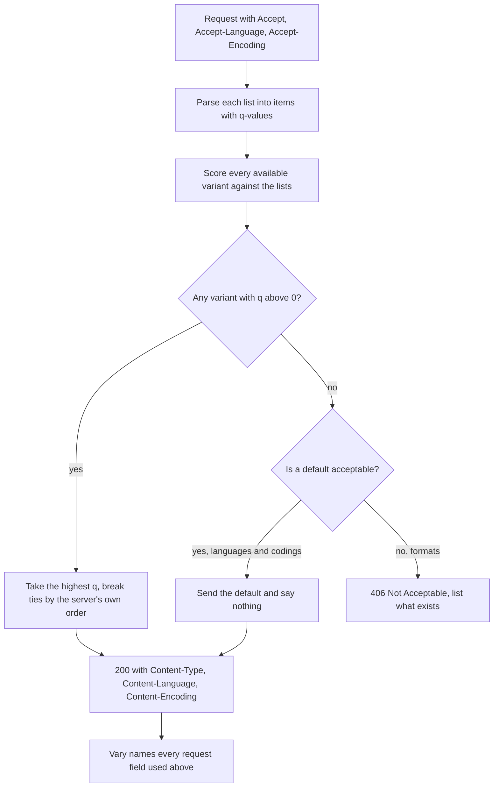
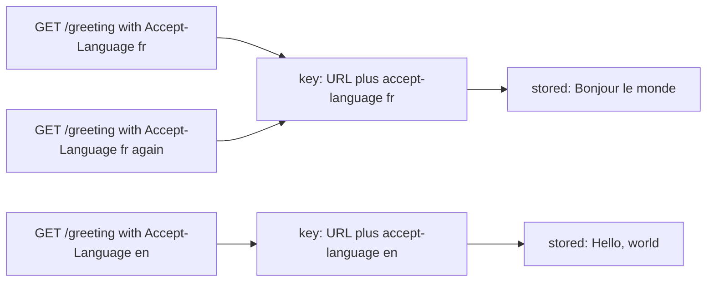
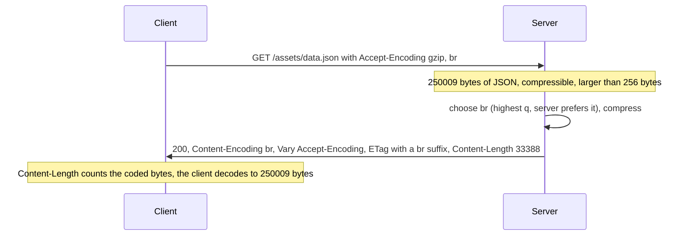
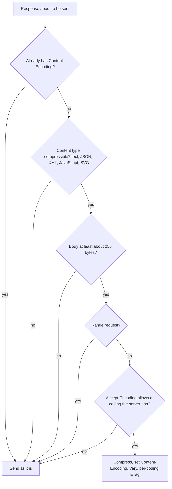
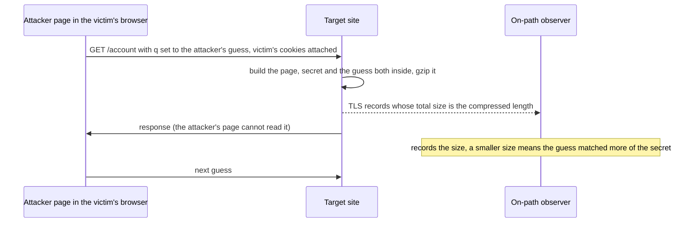
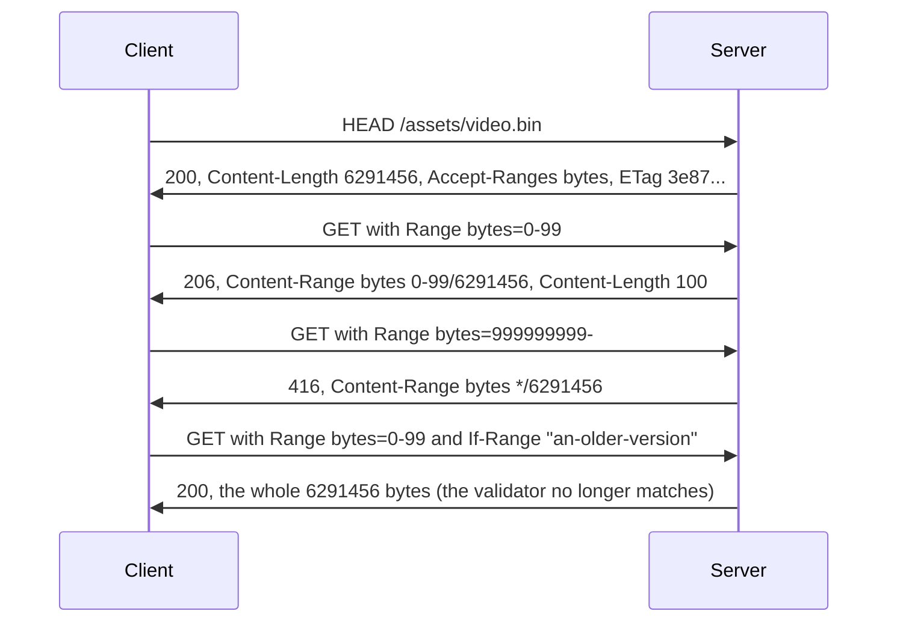
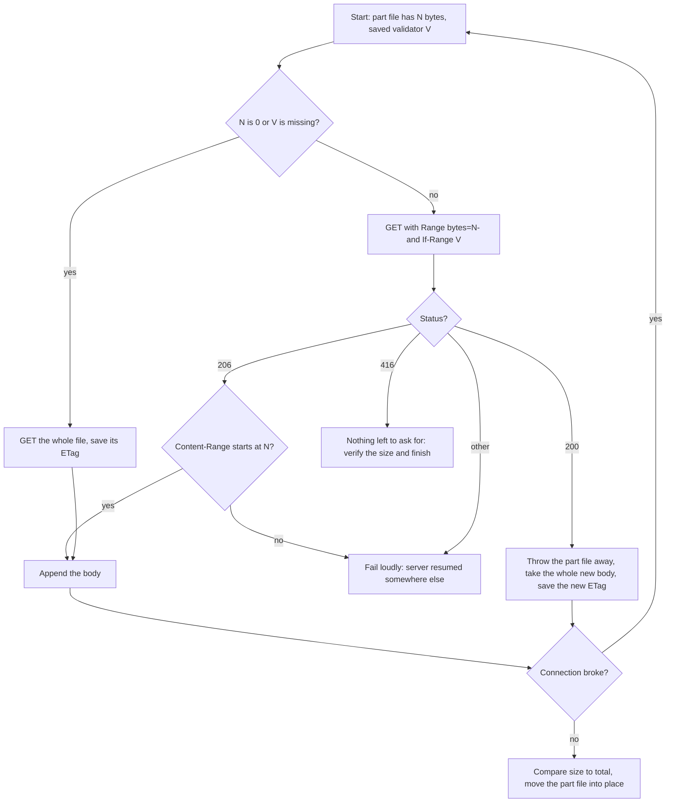
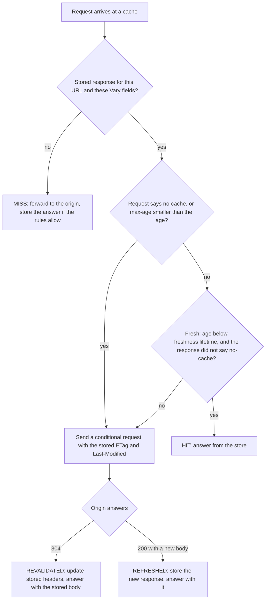
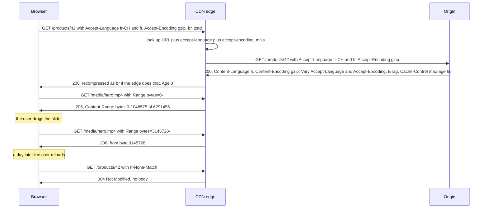

<!-- markdownlint-disable MD001 -->
<!-- markdownlint-disable MD024 -->
<!-- markdownlint-disable MD025 -->
<!-- markdownlint-disable MD026 -->
<!-- markdownlint-disable MD029 -->
<!-- markdownlint-disable MD033 -->
<!-- markdownlint-disable MD036 -->
<!-- markdownlint-disable MD040 -->
<!-- markdownlint-disable MD056 -->
<!-- markdownlint-disable MD060 -->

# H09. Semantics bridge: negotiation, ranges, caching

---

## Contents

| #     | Sub-topic                                                                     | Tag  |
| ----- | ----------------------------------------------------------------------------- | ---- |
| 09.01 | Content negotiation: `Accept`, `Accept-Language`, `Accept-Encoding`, `Vary`   | CORE |
| 09.02 | Content coding: gzip, deflate, Brotli, zstd                                   | CORE |
| 09.03 | Compression side channels: CRIME and BREACH                                   | DEEP |
| 09.04 | Range requests: `Range`, `206`, `Accept-Ranges`, resumable downloads, seeking | CORE |
| 09.05 | Caching mechanics in one page: freshness, validators, `304`                   | CORE |
| 09.06 | The story: one product page, four ways its bytes change                       | CORE |
| 09.07 | Labs: what each one shows and how to run it                                   | CORE |
| 09.08 | Exercises                                                                     |      |
| 09.09 | Solutions                                                                     |      |
| 09.10 | Takeaways                                                                     |      |

Terms used throughout. Each is defined here, before any section uses it:

- **Resource** and **representation**: a resource is the thing a URL names (a product, a report, a video).  
  A representation is one concrete byte sequence that stands for it at a moment in time, together with the fields that describe those bytes (`Content-Type`, `Content-Language`, `Content-Encoding`).  
  One resource can have many representations: the same report as JSON or as CSV, the same page in English or in French, the same file gzip-compressed or not.  
  RFC 9110 calls the alternatives for one URL **variants**.

- **Content negotiation**: choosing among the variants of one URL.  
  In **proactive** (server-driven) negotiation the client lists its preferences in request fields and the server decides.  
  In **reactive** (agent-driven) negotiation the server returns a list of alternatives and the client chooses; it is rare and not covered here.

- **Media type** and **media range**: a media type names a format as `type/subtype`, such as `text/csv` or `application/json`.  
  A media range is a pattern for media types: `text/*` means every `text/` type, `*/*` means any type. **Language tag** and **language range** are the same idea for languages:  
  the tag `fr-CH` names Swiss French, the tag `fr` all French, and a range may be `*`.

- **Quality value** (**q-value**): a weight from 0 to 1 with up to three decimals, attached to one item of a list as `;q=0.8`.  
  Items without one have weight 1. Weight 0 means "not acceptable".

- **Content coding**: a reversible transformation of the representation's bytes, named in `Content-Encoding`, applied by the sender and undone by the recipient.  
  `identity` means none.  
  In this module "coding" is always a *content* coding; the *transfer* coding `chunked` (H07) belongs to one connection and is a different thing.

- **Compression ratio**: coded size divided by original size, written as a percentage.  
  Lower is better: 34 % means the coded body is a third of the original.

- **DEFLATE**, **LZ77**, **Huffman coding**: DEFLATE (RFC 1951) is the compression algorithm inside gzip and `deflate`. It combines two ideas.  
  LZ77 replaces a string that already occurred earlier in the input with a back-reference of the form (distance back, length), about three bytes instead of the string.  
  Huffman coding then gives frequent byte values and back-reference fields short bit codes and rare ones long codes.

- **Side channel** and **oracle**: a side channel is information that leaks through something other than the intended output, here the *size* of an encrypted message.  
  An oracle is something an attacker can query repeatedly with inputs of their choice and learn a little from every answer.  
  In 09.03 the compressed length is the answer and the guess is the input.

- **Secret**, **CSRF token** and **reflected input**: a secret is a value the attacker must not learn.  
  A **CSRF token** (cross-site request forgery token) is a random value a site puts into its forms and checks when they are submitted, so that a request forged by another site,  
  which cannot read the page, is rejected; R10 covers CSRF itself.  
  A session identifier is another typical secret.  
  Reflected input is attacker-chosen text that the server copies into a response, such as a search term echoed in the page.

- **TLS record**: the unit in which TLS (H11 to H16) sends encrypted data.  
  A record's header is not encrypted, so its length is visible to anyone on the network path even though its contents are not.

- **Range request**: a request for part of a representation, using the unit `bytes`. **Partial content** is the response, status `206`.  
  A **byte range** `a-b` means byte `a` through byte `b` inclusive, counting from 0.

- **Validator**: a field that identifies a version of a representation: `ETag` (an opaque tag) or `Last-Modified` (a date).  
  A **strong** validator changes whenever the bytes change; a **weak** one (an ETag written `W/"..."`) changes only when the meaning changes, so two byte-different representations may share it.  
  A **conditional request** carries a validator the client already holds in an `If-` field, and the server's answer depends on whether it still matches.

- **Origin**, **CDN**, **cache**, **shared cache**, **private cache**: the origin is the origin server of H08, the program that owns the resource.  
  A cache stores responses to reuse them for later requests. A private cache serves one user (a browser's cache).  
  A shared cache serves many users: a reverse proxy, a corporate proxy, or a **CDN** (content delivery network), a fleet of caching servers placed near users that answers for a site's origin.  
  A request answered from the store is a **hit**, one that must go to the origin is a **miss**.

- **Freshness lifetime**, **age**, **stale**: the freshness lifetime is how long a stored response may be reused without asking the origin.  
  Its age is how long ago the origin generated it.  
  It is **fresh** while age is below the lifetime and **stale** afterwards. **Revalidation** is asking the origin whether a stale response is still good, with a conditional request.

Outputs in this module are real.  
They come from this module's own origin server and teaching cache, each written twice (Java and Rust), `curl` 8.5, Python 3, the JDK 21 zlib, the Rust crates `flate2`, `brotli` and `zstd`, and nginx 1.24.  
Run on Linux 6.18, JDK 21, Rust 1.97. File sizes and hashes are the same on every run because the lab files are generated from fixed random seeds; times,  
connection numbers and the dates in `Last-Modified` will differ on your machine.

---

## 09.01 Content negotiation: `Accept`, `Accept-Language`, `Accept-Encoding`, `Vary`

A URL names a resource, and the resource can be available as several variants: JSON or CSV, English or French, gzip or uncompressed.  
In proactive negotiation the client states its preferences in `Accept` (format), `Accept-Language` (language) and `Accept-Encoding` (compression), each a list of items with optional q-values, and the server chooses one variant and reports the choice in `Content-Type`, `Content-Language` and `Content-Encoding`.  
Three rules carry almost everything: the highest q-value wins and a more specific range overrides a less specific one; if nothing matches, the server may answer `406 Not Acceptable` or, better for languages, send a default;  
and every request field that influenced the choice must be listed in the response's `Vary`, because that is the only thing that stops a cache from handing one client's variant to another.

### What each field carries

| Request field     | What it selects     | Example                                  | The response field that reports the choice |
| ----------------- | ------------------- | ---------------------------------------- | ------------------------------------------ |
| `Accept`          | Media type (format) | `text/csv;q=0.9, application/json;q=0.5` | `Content-Type`                             |
| `Accept-Language` | Natural language    | `fr-CH, fr;q=0.9, en;q=0.8`              | `Content-Language`                         |
| `Accept-Encoding` | Content coding      | `gzip, br;q=0.8, zstd;q=0.7`             | `Content-Encoding`                         |
| `Accept-Charset`  | Character set       | `utf-8, iso-8859-1;q=0.5`                | The `charset` parameter of `Content-Type`  |

`Accept-Charset` is deprecated (RFC 9110 12.5.2): UTF-8 is the answer everywhere, and browsers no longer send it.  
A fifth family, `Accept-Ranges`, is not negotiation at all; it is a response field and belongs to 09.04.



### q-values and specificity

A q-value is written `;q=` followed by a number from 0 to 1 with at most three decimals (RFC 9110 12.4.2).  
Items without a q-value count as 1, and `q=0` means "do not send this".  
The server scores each variant it has and sends the highest. Two details decide most disputes:

- **The most specific range wins**, not the highest q-value in the list.  
  For `Accept: application/json;q=0.2, */*;q=0.1`, JSON scores 0.2 because `application/json` is more specific than `*/*`, and CSV scores 0.1.  
  Specificity order is: `type/subtype` (with parameters) over `type/*` over `*/*` (RFC 9110 12.5.1). Lab 01 sends exactly this and gets JSON.

- **Ties are the server's decision.** `Accept: text/*` gives CSV and HTML the same score 1; the lab server picks the first one in its own list, CSV.  
  A real framework does the same with its list of producers, so the order in which they are registered is part of the contract.

For languages, a range matches a tag by prefix: `fr-CH` can be satisfied by an available `fr` (RFC 4647 describes two schemes, *filtering*, which returns every tag that matches,  
and *lookup*, which returns the single best one by trimming the range from the right until something matches;  
a server with one body to send uses lookup). When nothing matches, RFC 9110 15.5.7 allows `406`, but a browser user who reads only Japanese is better served by an English page than by an error, so most sites send a default.  
The lab's `/greeting` does; its `/report` sends `406`, to show what one looks like.

An absent `Accept-Encoding` is a special case. RFC 9110 12.5.3 says that without the field every coding is acceptable, but servers send `identity` in practice,  
because clients that omit it (scripts, old tools, health checkers) usually cannot decode anything.  
A field that is present but empty means "no coding at all", and `identity;q=0` means "anything but identity", which a server holding only an uncompressed copy can answer only with `406`. Lab 02 shows both.

### `Vary`: the part that keeps caches honest

Whenever the server's choice depended on a request field, the response must say so with `Vary` (RFC 9110 12.5.5), a list of request field names.  
A cache that stores the response must later reuse it only for a request whose listed fields have the same values as the request that produced it (RFC 9111 4.1).  
That is the whole mechanism: the cache key is the URL *plus* the values of the fields named in `Vary`.



What goes wrong, in the order production teams meet it:

| Mistake                                                 | What happens                                                                                                                                                   | Lab evidence                                            |
| ------------------------------------------------------- | -------------------------------------------------------------------------------------------------------------------------------------------------------------- | ------------------------------------------------------- |
| The server negotiates but sends no `Vary`               | The first client's variant is served to everyone until it expires                                                                                              | Lab 05, scenario `vary`: `fr` served to an `en` request |
| `Vary: Accept-Encoding` on some responses of a URL only | A cache that stores a response without it serves that variant to every client: the gzip body to a client that cannot decode it, or the large plain body to all | 09.02 and Lab 05                                        |
| `Vary: User-Agent`                                      | One stored copy per browser build: the cache fills with identical bodies and the hit ratio collapses                                                           | Lab 05: four user agents, four misses                   |
| `Vary: Cookie` or `Vary: Authorization`                 | One stored copy per user: a shared cache is effectively disabled for that URL                                                                                  | Same mechanism as `User-Agent`                          |
| `Vary: *`                                               | The response can never be reused, so storing it is pointless                                                                                                   | The lab cache's code refuses to store it                |

Caches and CDNs usually soften the fragmentation cases by normalising: many collapse `Accept-Encoding` into a handful of buckets before building the key, and CDN products let you list which request fields enter the key at all.  
The origin's own `Vary` stays the contract that makes this safe.  
When the choice is expensive to key on, the usual escape is to move it out of the headers and into the URL: `/report.csv`, `/fr/checkout`, `?format=csv`.  
A URL is visible in logs, shareable, cacheable by every component with no special support, and cannot be forgotten in `Vary` because it is the key.  
Header negotiation stays the right tool for what cannot live in a URL: the coding, and formats an API must change without changing links.

### Interview angle

- *"What does `Vary` do and what happens without it?"*  
  It lists the request fields that selected this variant; caches key on them.  
  Without it a shared cache serves the first requester's variant to all (wrong language, wrong format, a compressed body to a client that cannot decode it).

- *"Why is `Vary: User-Agent` a bad idea for serving mobile pages?"*  
  Thousands of distinct values mean thousands of entries holding identical bytes.  
  Serve the mobile page from a different URL, or make the page responsive, or normalise the field to two values at the edge.

- *"`Accept: */*` and a `406`: when is a `406` right?"*  
  When a client names a format and the server really cannot produce it and a wrong format would be worse than an error: an API client asking for `application/xml` from a JSON-only API.  
  For languages and codings, send a default.

---

## 09.02 Content coding: gzip, deflate, Brotli, zstd

A content coding compresses the representation so fewer bytes cross the network.  
The client lists the codings it can decode in `Accept-Encoding`; the server picks one, sends the coded bytes, and names it in `Content-Encoding` (plus `Vary: Accept-Encoding`).  
Text compresses to between a seventh and a third of its size; images, video, archives and anything else already compressed gain nothing, and compressing them again spends CPU to make them slightly larger.  
Four codings matter. `gzip` works everywhere. `deflate` is a misnamed variant of it that nobody should send.  
`br` (Brotli) compresses text best and is slow at its best settings, which makes it the choice for files compressed once at build time.  
`zstd` compresses about as well as gzip at ten times the speed, which makes it attractive for responses compressed on the fly.

### How a coding is negotiated and applied



Four properties follow from "the coding is part of the representation":

- **`Content-Length` counts coded bytes.** Framing (H07) works on what is sent, not on what it decodes to.  
  A client that decodes while reading must stop at the coded length, and a log line that prints `Content-Length` is reporting the compressed size.

- **`Content-Encoding` is end to end; `Transfer-Encoding` is hop by hop.** `Content-Encoding: gzip` describes the representation and survives caches and proxies, so a cache can store the gzip bytes and send them to the next client.  
  `Transfer-Encoding: chunked` (H07) is the framing of one connection and is removed and re-added at each hop (H08).  
  A gzip applied as a *transfer* coding exists in the RFCs and nobody uses it.

- **Each coded variant is a different representation, so it needs its own validator.** The gzip body and the identity body cannot share a strong `ETag`, because strong validators change whenever the bytes change.  
  The lab origin appends the coding to the tag: `"e3224611b4e23974"` for identity, `"e3224611b4e23974-gzip"` for gzip.  
  nginx 1.24 makes the tag weak when it compresses on the fly (`W/"6ae0c8af-61aa2"`);  
  Lab 02 shows both.

- **A coded response and a `Range` request clash.** Offsets in `Range` count bytes of the selected representation, so on a coded response they would count compressed bytes, which no client can predict.  
  09.04 returns to this.

### The four codings

| Coding    | Algorithm and wrapper                                                                                      | Defined in                        | Where it stands                                                                                                                                             |
| --------- | ---------------------------------------------------------------------------------------------------------- | --------------------------------- | ----------------------------------------------------------------------------------------------------------------------------------------------------------- |
| `gzip`    | DEFLATE, 10-byte header, CRC-32 and length trailer (18 bytes of overhead)                                  | RFC 1952                          | Universal. Every client, server, proxy and CDN. The baseline.                                                                                               |
| `deflate` | DEFLATE inside the **zlib** wrapper: 2-byte header, Adler-32 trailer (6 bytes)                             | RFC 1950, named in RFC 9110 8.4.1 | Misnamed: despite the name it is zlib, not raw DEFLATE (RFC 1951). Some old servers and clients disagreed about that, so clients had to guess. Send `gzip`. |
| `br`      | Brotli: LZ77 and Huffman plus a built-in dictionary of about 120 KB of words and phrases common on the web | RFC 7932                          | Best ratio on text at high quality, slow to compress there. Browsers send `br` only over HTTPS.                                                             |
| `zstd`    | Zstandard: LZ77 with finite-state entropy coding, levels 1 to 22                                           | RFC 8878, window cap in RFC 9659  | Fast at every level, decompression faster still. Chrome and Firefox send it over HTTPS since 2024; check your audience before relying on it.                |

Current Chrome and Firefox send `Accept-Encoding: gzip, deflate, br, zstd` on HTTPS.  
A fifth, `compress` (LZW), is historical and should be refused.  
Shared dictionaries, where the server compresses against a file the client downloaded earlier, are the next step beyond all four and a topic of their own.

Lab 02 prints the first bytes of both wrappers for the same input: gzip starts `1f 8b 08 00 00 00 00 00 00 ff`, the 10-byte header; `deflate` starts `78 9c`, the 2-byte zlib header, followed by the identical compressed stream.  
For `book.txt` the two responses are 137,555 and 137,543 bytes.  
That 12-byte difference is the only advantage `deflate` has, and it is not worth the interoperability risk.

### Measured: ratio against CPU

Lab 02 compresses the five lab files at three levels of each codec, on one core, from memory, and times compression and decompression (median of nine runs after ten warm-ups).  
The Rust results for the two compressible files, with sizes in bytes:

| File        | Codec and level | Coded size | Ratio  | Compress | Decompress |
| ----------- | --------------- | ---------- | ------ | -------- | ---------- |
| `book.txt`  | gzip-1          | 190,614    | 47.6 % | 3.6 ms   | 2.2 ms     |
| `book.txt`  | gzip-6          | 137,676    | 34.4 % | 37.5 ms  | 1.5 ms     |
| `book.txt`  | gzip-9          | 136,065    | 34.0 % | 62.3 ms  | 1.5 ms     |
| `book.txt`  | br-5            | 138,403    | 34.6 % | 23.6 ms  | 2.8 ms     |
| `book.txt`  | br-11           | 119,475    | 29.9 % | 916.7 ms | 1.5 ms     |
| `book.txt`  | zstd-3          | 139,384    | 34.8 % | 2.7 ms   | 0.5 ms     |
| `book.txt`  | zstd-19         | 120,006    | 30.0 % | 178.9 ms | 0.4 ms     |
| `data.json` | gzip-6          | 34,672     | 13.9 % | 4.8 ms   | 0.4 ms     |
| `data.json` | br-5            | 33,388     | 13.4 % | 5.9 ms   | 0.5 ms     |
| `data.json` | br-11           | 26,649     | 10.7 % | 521.4 ms | 0.5 ms     |
| `data.json` | zstd-3          | 38,474     | 15.4 % | 0.6 ms   | 0.2 ms     |
| `data.json` | zstd-19         | 28,041     | 11.2 % | 174.5 ms | 0.2 ms     |

Reading the table:

- **Past the default level, bytes cost CPU.** gzip-9 saves 1.2 % of the gzip-6 size on the book at 1.7 times the time.  
  Going from Brotli 5 to Brotli 11 saves 13.7 % of the size and costs 39 times the time.  
  Whether that trade is good depends entirely on how many times the compressed bytes are served: a bundle compressed once at build time and served ten million times should use the slowest setting;  
  a dynamic response compressed for one user should not.

- **Compression is the expensive direction; decompression is nearly free.** Every codec decoded 400 KB in 0.4 to 2.8 ms.  
  The client never pays much, which is why the whole design pushes cost onto the sender.

- **zstd at level 3 matches gzip at level 6 on ratio and beats it by a factor of 8 to 14 on compression time.**  
  On `book.txt` zstd-3 is 139,384 bytes in 2.7 ms against gzip-6's 137,676 in 37.5 ms. On `data.json` the sizes differ the other way (zstd-3 38,474 against gzip-6 34,672), so test with your own payloads before swapping codecs.  
  zstd-3 is even larger than zstd-1 on that file (36,912): a real result, reproduced with the `zstd` command-line tool, not an error.  
  Levels are not monotonic on every input.

- **Brotli at a middle level is gzip with a dictionary.** br-5 lands within a few percent of gzip-6 (0.5 % larger on the book, 3.7 % smaller on the JSON) in the same time range.  
  The dictionary pays most on small text responses, where gzip has little history to refer back to.

The JDK ships only gzip and `deflate` encoders (the Java table of Lab 02 shows the same shape: gzip-1 162,722, gzip-6 137,555, gzip-9 136,005 bytes on `book.txt`);  
Brotli and zstd need a library or a proxy in front. Also note that Java's gzip-6 and Rust's differ by 121 bytes on the same input.  
DEFLATE has many valid encodings, so the compressed bytes depend on the implementation, and the same representation can have different compressed bytes on two servers.  
This matters for caches and validators: never derive a strong validator for the identity representation from the coded bytes.

### Already-compressed data

The last three files in the table are the point of this paragraph.  
`photo.jpg` (a JPEG), `bundle.gz` (a gzip file) and `video.bin` (pseudorandom bytes, standing in for encrypted or video data) have already been through a compressor that left no redundancy for a second pass to find:

| File        | Original  | gzip-6 output | Ratio   | Compress time |
| ----------- | --------- | ------------- | ------- | ------------- |
| `photo.jpg` | 146,901   | 141,983       | 96.7 %  | 4.9 ms        |
| `bundle.gz` | 137,555   | 137,598       | 100.0 % | 4.4 ms        |
| `video.bin` | 6,291,456 | 6,292,469     | 100.0 % | 209.0 ms      |

The JPEG shrinks by 3 %, the gzip file and the random data grow.  
This is why every server decides *whether* to compress before it decides *how*:



This is, line for line, what the lab origin does: `photo.jpg` and `bundle.gz` come back with no `Content-Encoding` and no `Vary` (Lab 02). nginx uses an allowlist of media types (`gzip_types`; `text/html` is always on) and a minimum length (`gzip_min_length`).  
Compress text formats, JSON, XML, JavaScript, CSS and SVG. Do not compress JPEG, PNG, WebP, AVIF, MP4, WOFF2, ZIP or GZ files.  
The minimum size exists because the 18-byte gzip wrapper alone can make a 20-byte body larger.  
And never compress twice: a framework that gzips its output and a proxy in front that gzips again produce a body the client decodes once into another gzip stream.

### Where compression happens

| Place                                                            | Cost                                                 | Fits                                                                                                                                |
| ---------------------------------------------------------------- | ---------------------------------------------------- | ----------------------------------------------------------------------------------------------------------------------------------- |
| At build time (`app.js.br`, `app.js.gz` stored next to `app.js`) | Paid once, any level, including Brotli-11 or zstd-19 | Versioned static assets. nginx `gzip_static`, `brotli_static`, or any file server that picks the sibling file by `Accept-Encoding`. |
| In the origin, per response                                      | CPU on every miss; a fast level only                 | Dynamic HTML and JSON. gzip-1 to gzip-6, zstd-1 to zstd-3, br-4 or lower.                                                           |
| At the edge (CDN or reverse proxy)                               | Paid by the proxy, cached per variant                | Everything else. The origin sends one coding; the edge recompresses for each client.                                                |

The arithmetic for the middle row is Exercise 03.  
A one-line version: a service sending 2,000 responses of 40 KB per second needs gzip-6 at about 3.75 ms each, which is 7.5 cores of compression work, against 0.7 core for gzip-1 and 0.5 core for zstd-3,  
while gzip-6 sends only 85 Mbit/s less than gzip-1 out of 305.

### Interview angle

- *"Why does `Content-Encoding` need `Vary: Accept-Encoding`?"*  
  The same URL yields different bytes depending on a request field; without `Vary` a cache may send gzip bytes to a client that did not ask for them, or send the full-size body to everyone after one client without gzip support filled the cache.

- *"Brotli at 11 or at 4: which do you pick?"*  
  At 11 for files compressed once and served many times (build-time assets); at 4 or 5 for dynamic responses, where it compresses like gzip-6 in about the same time.

- *"A load test shows 70 % CPU in `Deflater.deflate`. What do you do?"*  
  Lower the level (the table shows most of the ratio comes in the first levels), stop compressing what is already compressed or too small, cache compressed variants (static assets, hot API responses), move it to the edge.

---

## 09.03 Compression side channels: CRIME and BREACH

Compression makes the output length depend on the content: text that repeats compresses well, text that does not compresses poorly.  
If a response puts a secret (a CSRF token, a session identifier) and attacker-chosen text (a reflected search term) into the same compressed body,  
then when the attacker's text repeats part of the secret the output becomes shorter.  

TLS hides the bytes but not their length, so an attacker who can make the victim's browser send requests and who can see the sizes of the encrypted responses tests guesses at the secret, a few characters at a time,  
and keeps the ones that shrink the response.  

CRIME (2012) did this to compression inside TLS and to SPDY header compression;  
BREACH (2013) does it to ordinary HTTP body compression, which survives TLS and is still exploitable.  

The defences are to keep secrets and reflected input out of one compressed body, mask the secret differently in every response, or not compress such responses.

### The three conditions



All three must hold:

01. **The attacker can make the victim's browser send authenticated requests with chosen content.**  
  Any web page can do this with an image tag or `fetch`, and cookies are attached unless the cookie's `SameSite` attribute blocks cross-site requests (H10).

02. **The response contains both the secret and reflected input, in the same compressed body, and the secret is the same every time.**  
  A CSRF token that is the same on every page view of a session, a reflected `?q=` or error message, nothing that makes the two apart.

03. **The attacker can see the size of the encrypted response.**  
  A network position (Wi-Fi, a malicious router) is enough: TLS record lengths are visible. Later work (HEIST, 2016) showed that script in the victim's browser can sometimes infer sizes without any network position,  
  so this condition is weaker than it looks.

### Why the length leaks

DEFLATE, inside gzip, finds a string that already appeared earlier in the input and replaces the second occurrence with a short back-reference. The page in the lab contains, in this order:

```text
<input type="hidden" name="csrf_token" value="Zx7qL9aKd2Wm4PbE">
   ...
<p>You searched for: csrf_token" value="Zx7qL9aKd2Wm4PbE</p>
```

When the attacker's text repeats `csrf_token" value="Zx7qL9aKd2Wm4PbE`, the whole 35-character string appears twice and the second copy costs a few bytes.  
If the guess ends in a wrong character, the match stops before that character and the rest is spelled out.  
The more characters of the guess that are right, the longer the match, the shorter the output.  
Huffman coding adds a little noise at the edges, because different byte values get codes of different bit lengths, so one correct character does not always change the length by a whole byte.  
Real attacks handle that noise with extra requests and by padding guesses so that a character falls on the right side of a byte boundary; none of it changes the principle.

### Measured: what the length reveals

Lab 03 asks the lab origin's `/account` page for a 16-character guess prefixed with `csrf_token" value="` and reads only the response's `Content-Length` (which is the compressed size, because the client asked for gzip).  
It measures the signal; it does not recover the token. Java origin:

| Experiment                                                                     | Result                                                                                  |
| ------------------------------------------------------------------------------ | --------------------------------------------------------------------------------------- |
| The right guess against 60 random wrong guesses                                | 373 bytes against 385 to 388 (median 386); right was shorter in 60 of 60                |
| The right guess against 60 *shuffles* of the same 16 characters                | 373 against 384 to 386; shorter in 60 of 60, median gap 13 bytes                        |
| Mean length as more of the guess is right (0, 2, 4, 8, 12, 16 characters)      | 386.3, 384.3, 383.4, 380.0, 376.4, 373.0                                                |
| The same, with the token masked by a fresh random pad per response (`mask=on`) | right 422.9 mean, shuffled 423.0: no difference (+0.2 byte); random wrong guesses 421.4 |
| The same, with `compress=off` for the response                                 | 627 bytes for every guess                                                               |

The shuffle control matters.  
The shuffled guess has exactly the same characters as the secret in a different order, so any difference between it and the right guess can only come from the order, which is what the compressor sees.  
Unmasked, the order is worth 13 bytes.  
Masked, it is worth nothing, because the token in the page is different on every response and the guess can never repeat it.  
(The random wrong guesses come out 1.4 bytes shorter than the right guess when masked.  
That is the character mix of those particular strings, not the secret: the shuffles, which have the secret's own characters, sit level with it.)

The progression row shows what makes an attack practical: the length falls steadily, about 1 byte for every 1.2 correct characters, so an attacker adding one character at a time sees the right one pull ahead on average.  
The spread within a row (min to max about 3 bytes) is why a real attack repeats and averages.

### CRIME and BREACH side by side

| Aspect             | CRIME (Rizzo and Duong, 2012)                                                                                                                      | BREACH (Gluck, Harris, Prado, 2013)                                                          |
| ------------------ | -------------------------------------------------------------------------------------------------------------------------------------------------- | -------------------------------------------------------------------------------------------- |
| What is compressed | The request: TLS-level compression, or SPDY header compression, with the `Cookie` header and the attacker's URL in one stream                      | The response body, by HTTP content coding, inside TLS                                        |
| The secret         | Session cookie                                                                                                                                     | CSRF token, session identifiers, any secret in the HTML or JSON                              |
| Fixed by           | Turning off TLS compression (TLS 1.3 has no compression); HTTP/2 replaced the header compression of SPDY, its experimental predecessor, with HPACK | Nothing at the protocol level: it is a property of compressing secrets next to attacker text |
| Status             | Gone from the web                                                                                                                                  | Alive; mitigated page by page                                                                |

The header compression schemes of HTTP/2 and HTTP/3, HPACK (H17) and QPACK (H19), were designed with this in mind:  
they compress header fields by looking up *whole* field values in a table and never find partial matches inside a value, so a guess can only help the attacker if it equals an entire value.

### Defences, in the order to reach for them

01. **Keep secrets and reflected input apart.** Do not echo user input into pages that carry tokens.  
  Where the page must echo input, serve the token from a different response (a JSON endpoint that is not compressed, or a header). This removes condition 02 and is the only complete fix.

02. **Mask the secret per response.** Generate a random pad for each response and send the pad together with the secret XORed with it; the client XORs them back.  
  The page then holds different bytes every time, so a guess cannot repeat them.  
  This is what the lab does with `mask=on`, and what mainstream frameworks do for CSRF tokens (Spring Security 6 ships it as `XorCsrfTokenRequestAttributeHandler`, and other frameworks do the same under different names).

03. **Turn compression off for the responses that mix the two.** It always works and costs the bandwidth saved, so use it narrowly: a single route, not the site.

04. **Remove the attacker's ability to send authenticated cross-site requests.**  
  `SameSite=Lax` or `Strict` on the session cookie (H10) takes condition 01 away for most requests, and a Content Security Policy and CSRF defences do the rest.  
  A good defence in depth, not a replacement for the first three.

05. **Rate-limit and watch.** An extraction needs hundreds to thousands of near-identical requests from one victim browser; a limit on requests per session per page is cheap.  
  It slows the attack and does not stop it.

Random padding of response lengths is on lists of mitigations and is weak: an attacker averages the padding away with more requests.  
Do not rely on it.

### Interview angle

- *"Explain BREACH in one minute."* Compression makes length depend on content; a page that contains a secret and reflects attacker input leaks the secret through the compressed length;  
  the attacker needs a way to trigger requests and to see lengths;  
  fix by masking the secret or not compressing those responses.

- *"We moved to TLS 1.3. Are we safe from BREACH?"* No. TLS 1.3 removed TLS-level compression (CRIME), not HTTP-level compression, and TLS never hides lengths.

- *"Why is the masked token safe, given it is still in the compressed page?"* Because it is different in every response, the compressor never sees a repeat of what the attacker guessed.  
  The guess has to equal bytes that the server will never send again.

---

## 09.04 Range requests: `Range`, `206`, `Accept-Ranges`, resumable downloads, seeking

A client that wants only part of a representation sends `Range: bytes=500-999`.  
A server that supports it answers `206 Partial Content` with just those bytes and a `Content-Range: bytes 500-999/6291456` that says which bytes and how big the whole is.  
It advertises support with `Accept-Ranges: bytes` on ordinary responses.  
If no requested range lies inside the representation the answer is `416 Range Not Satisfiable` with `Content-Range: bytes */6291456`.  
The server may also ignore the header and send `200` with everything, so a client must handle both.  
Ranges make three things possible: resuming a broken download, seeking inside a video or a PDF, and downloading one file over several connections at once.  
Resuming is only safe with `If-Range`, which makes the server send the range only if the file is still the version the client started with;  
without it a client can splice two versions of a file into one corrupt file, and Lab 04 produces that corruption on purpose.

### The vocabulary

The only range unit that matters is `bytes` (RFC 9110 14.1). Offsets count from 0 and are inclusive at both ends.  
The lab file `video.bin` has 6,291,456 bytes, so the valid offsets are 0 to 6,291,455. Lab 04 sends each form and prints the answer:

| `Range` value           | Asks for                                | Answer from the lab origin             | `Content-Range` in the answer   |
| ----------------------- | --------------------------------------- | -------------------------------------- | ------------------------------- |
| `bytes=0-99`            | The first 100 bytes                     | `206`, 100 bytes                       | `bytes 0-99/6291456`            |
| `bytes=6291356-`        | From offset 6,291,356 to the end        | `206`, 100 bytes                       | `bytes 6291356-6291455/6291456` |
| `bytes=-100`            | The last 100 bytes (a **suffix** range) | `206`, 100 bytes                       | `bytes 6291356-6291455/6291456` |
| `bytes=0-99, 1000-1099` | Two ranges                              | `206`, one `multipart/byteranges` body | In each part                    |
| `bytes=999999999-`      | Starts past the end                     | `416`, no body                         | `bytes */6291456`               |
| `bytes=0-10, 5-15`      | Two overlapping ranges                  | `200`, everything (ignored)            | none                            |
| `bytes=10-5`            | Last before first: invalid              | `200`, everything (ignored)            | none                            |
| `items=1-2`             | An unknown unit                         | `200`, everything (ignored)            | none                            |

Four rules sit behind the last four rows.  
A server must ignore a `Range` it cannot parse or a unit it does not know and answer as if the header were absent (RFC 9110 14.2).  
It may also ignore or reject a header with overlapping ranges or very many small ones (14.2 again),  
because those are signs of an attack: the 2011 "Apache Killer" request (CVE-2011-3192) asked for hundreds of overlapping ranges of a large compressed file in one header  
and made the server build a response many times the size of the file; httpd now caps the number of ranges it honours.  

The lab origin is stricter than the RFC requires: it ignores any overlap and any request for more than five ranges.  
And a range whose *first* byte is beyond the end is unsatisfiable, but one that starts inside and ends beyond is simply clipped to the end.

### Requests and responses



The status codes in play:

| Status | Meaning here                                                                     | What the client does                                     |
| ------ | -------------------------------------------------------------------------------- | -------------------------------------------------------- |
| `200`  | The server ignored `Range`, or `If-Range` did not match: the whole current body  | Discard what it had; take the new body                   |
| `206`  | The requested part, with `Content-Range` (or a multipart body)                   | Check that `Content-Range` starts where it asked; append |
| `304`  | A conditional header said the client's copy is current; ranges are not evaluated | Keep its copy                                            |
| `412`  | `If-Match` failed: the file changed                                              | Start over                                               |
| `416`  | No requested range exists in the representation                                  | The file is shorter than expected, or already complete   |

The order in which a server evaluates conditions is fixed (RFC 9110 13.2.2): `If-Match`, `If-Unmodified-Since`, `If-None-Match`, `If-Modified-Since`, and only then `Range` together with `If-Range`.  
So a request that carries both `If-None-Match` and `Range` gets a `304` with no range processing if the tag matches.

### Several ranges at once

A request for two ranges gets a single response whose media type is `multipart/byteranges` (RFC 9110 14.6): a boundary string chosen by the server, and one part per range, each with its own `Content-Type` and `Content-Range`.  
Lab 04 asks for bytes 0 to 19 and 100 to 119 of the text file:

```text
--h09-boundary-3f9a
Content-Type: text/plain; charset=utf-8
Content-Range: bytes 0-19/400034

Of in time the and u
--h09-boundary-3f9a
Content-Type: text/plain; charset=utf-8
Content-Range: bytes 100-119/400034

d or their the of of
--h09-boundary-3f9a--
```

Few clients ask for several ranges (PDF viewers do, to fetch a document's index and one page's objects in one round trip), and servers are free to answer with one combined range or with the whole body.

### Resumable downloads

The download is a loop around three facts: how many bytes are safely on disk, which version of the file they belong to, and what the server answers when asked for the rest.



Lab 04 runs the Java client `ResumeDownload` against the origin's `cut=2500000` knob, which closes the connection after 2.5 million body bytes on every response.  
Three attempts finish the 6,291,456-byte file: attempt 1 is a plain `200` that breaks after 2,500,000 bytes, attempt 2 sends `Range: bytes=2500000-` with the saved `ETag` in `If-Range` and gets `206` for another 2,500,000, attempt 3 gets the last 1,291,456.  
The result has the same SHA-256 prefix, `3e8772b307ce5f51`, as the file on the server.

**`If-Range` is what makes this safe.** It carries the validator saved from the first response, and the server evaluates it before the range (RFC 9110 13.1.5).  
  If it still names the current version, the server answers `206`.  
  If not, the server ignores `Range` and sends `200` with the whole new file.  
  Lab 04 case B starts from a leftover partial file with the stored tag `"an-older-version"`; the client's first request is answered `200, whole body (If-Range did not match)`, and it saves a correct file.  
  The rules for the validator are strict: a client must not send a weak ETag in `If-Range`, and a date works only if it equals `Last-Modified` exactly and `Last-Modified` is at least a second older than the response's `Date`, so that it is a strong validator.

**Not every tool does this.** Lab 04 case C resumes with `curl -C -` a file whose first 1,000,000 bytes are zeros, standing for a partial download of an older version.  
  curl sends `Range: bytes=1000000-` with no `If-Range`; the server, which cannot know, answers `206`; curl appends.  
  The result is a file of the right length, 6,291,456 bytes, with SHA-256 prefix `ee3364cd137af667` instead of `3e8772b307ce5f51`, and no error from anyone.  
  `wget -c` behaves the same way. Browsers' download managers send `If-Range`.

### Seeking in video and audio

A media player is a client that asks for ranges on purpose.  
An MP4 file holds an index (the `moov` box) mapping each moment in time to a byte offset, and the media data (`mdat`). A file with the index first ("fast start") lets a player begin after one small request.  
A file with the index last forces a second request for the tail.  
To seek, the player converts the target time to a byte offset through the index, abandons the open connection, and sends `Range: bytes=<offset>-`.  
Lab 04's last script sends the same pattern at the lab file (random bytes standing in for media): a probe of the first 64 KB, the last 64 KB, then two consecutive 64 KB reads from the middle (offset 3,145,728):

```text
origin conn 460  GET /assets/video.bin  [range: bytes=0-65535] -> 206 (206 bytes 0-65535/6291456)
origin conn 461  GET /assets/video.bin  [range: bytes=-65536] -> 206 (206 bytes 6225920-6291455/6291456)
origin conn 462  GET /assets/video.bin  [range: bytes=3145728-3211263] -> 206 (206 bytes 3145728-3211263/6291456)
origin conn 463  GET /assets/video.bin  [range: bytes=3211264-3276799] -> 206 (206 bytes 3211264-3276799/6291456)
```

Consequences worth knowing: a server or proxy that does not answer `206` makes video seeking fail or restart from zero (Safari will not play media from a server that does not support ranges);  
a CDN must either cache ranges or fetch the whole file;  
and adaptive streaming (HLS and DASH) avoids the dependence by cutting the video into many small files, or into byte ranges of one file listed in a playlist.

### Ranges meet compression and caching

- **Ranges and content coding.** Range offsets count the bytes of the selected representation.  
  If that is a gzip body, offsets count compressed bytes, which a client cannot know in advance.  
  Servers resolve it in one of two legal ways.  
  The lab origin sees a `Range` header, picks the identity representation, and serves the range of the original bytes (Lab 04: `book.txt` with both `Accept-Encoding: gzip` and `Range: bytes=0-99` returns a `206` of 100 plain bytes).  
  nginx 1.24 does the opposite: it compresses on the fly, removes `Accept-Ranges` from the compressed response, and answers the same request with `200` and the whole gzip body (Lab 02).  
  A client that asks for ranges must treat either as correct.

- **Ranges and shared caches.** RFC 9111 lets a cache answer a `Range` request from a complete stored response, and store and combine partial responses with matching strong validators.  
  Most caches do less. The lab's teaching cache sends every `Range` request straight to the origin and stores nothing (`X-Cache: BYPASS`, Lab 05).  
  For large files, CDNs and nginx's `slice` module fetch and cache fixed-size slices (for example 1 MB) so that any range is served from a few cached pieces.

- **Ranges and framing.** The `206` body is exactly as long as the range, so `Content-Length` says so (H07), and a real server does not hold the file in memory: it reads it from an offset, usually with the `sendfile` system call, which copies file bytes to a socket inside the kernel.  
  Ranges are HTTP/1.1 semantics and are identical in HTTP/2 and HTTP/3.

- **Ranges are for `GET`.** Uploads cannot resume with `Content-Range` on `PUT`: RFC 9110 9.3.4 requires a server that allows `PUT` to answer a request carrying `Content-Range` with `400`, since the body is probably partial content mistaken for a whole representation.  
  Resumable-upload protocols (tus, the cloud providers' own, and an IETF draft) define their own conventions, usually `PATCH` with an offset.

### Interview angle

- *"Design resumable downloads."* Save the `ETag`; on retry send `Range: bytes=N-` and `If-Range: <ETag>`; accept `206` only if `Content-Range` starts at N; on `200` start again; verify length and a checksum at the end.  
  Mention that a weak ETag cannot be used.

- *"Why won't my video seek in Safari?"* The server does not answer `Range` requests with `206` and `Content-Range` (a proxy or a framework that streams the file as `200`, or a missing `Accept-Ranges`).

- *"How does a download manager use four connections?"* One `HEAD` for size, `ETag` and `Accept-Ranges`; four `Range` requests with `If-Range` (Exercise 05); write each piece at its offset; one checksum at the end.

---

## 09.05 Caching mechanics in one page: freshness, validators, `304`

A cache stores a response and later reuses it, if two questions have good answers.  
Is the stored copy still *fresh* (its age is below its freshness lifetime)? If it is stale, is it still *valid* (the origin, asked with a conditional request, says `304 Not Modified`)?  
Freshness comes from `Cache-Control: max-age` if present, else `Expires`, else a heuristic of 10 % of the time since `Last-Modified`.  
Validity is checked with the response's own validators: `ETag` returned as `If-None-Match`, `Last-Modified` returned as `If-Modified-Since`.  
`Vary` (09.01) decides which stored variant is eligible. A `304` has no body, so a successful revalidation costs a round trip but almost no bytes.  
The directives that confuse people (`no-cache` means "revalidate before reuse", `no-store` means "do not keep it", `private` excludes shared caches) are variations on these two questions.  
R9 covers the engineering built on top (CDN strategies, cache busting, invalidation design); this section is the mechanism and the evidence.

### The decision



### Freshness lifetime and age

The lifetime is taken from the first of these that exists (RFC 9111 4.2.1):

01. `s-maxage` in `Cache-Control`, for shared caches only.

02. `max-age` in `Cache-Control`.

03. `Expires` minus `Date`. A date in the past or an invalid date means "already stale".

04. A heuristic, when the status is one that may be cached by default (RFC 9110 15.1: 200, 203, 204, 206, 300, 301, 308, 404, 405, 410, 414 and 501): a fraction of the time since `Last-Modified`, with 10 % suggested (RFC 9111 4.2.2).  
  A resource last changed 10 days ago may be reused for 24 hours without a word from the origin.  
  Lab 05's `/plain` has a `Last-Modified` ten days before the origin started and no `Cache-Control` at all;  
  the teaching cache stores it with a heuristic lifetime of about 86,400 seconds (a tenth of the ten days, plus a tenth of however long the origin has been running).

05. Nothing: a response with no freshness information and no validator is not worth storing; one with a validator is stored and revalidated on every use.

The **age** of a stored response is the time since the origin generated it, and each cache on the path adds the time it held the response (RFC 9111 4.2.3).  
With the values the cache knows:

```text
apparent_age          = max(0, response_time - date_value)
response_delay        = response_time - request_time
corrected_age_value   = age_value + response_delay
corrected_initial_age = max(apparent_age, corrected_age_value)
resident_time         = now - response_time
current_age           = corrected_initial_age + resident_time
```

`date_value` is the response's `Date`, `age_value` its `Age` header (0 if absent: every cache adds one), `request_time` and `response_time` are when the cache sent the request and received the response.  
The response is fresh while `current_age < freshness_lifetime`.  
The `Age` header the cache sends to the next client is `current_age` in whole seconds. Exercise 06 does the arithmetic by hand.

Lab 05 `freshness` scenario sends `GET /item` to the teaching cache (the origin says `Cache-Control: max-age=3`) and then changes the item at the origin while the cached copy is still fresh.  
The client reads `item version 1` from the cache as a `HIT` with `Age: 1`, while the origin already holds version 2.  
That is the price of freshness: for up to the lifetime a cache serves data the origin has already replaced, and no protocol feature changes that; only the choice of lifetime does.  
When the copy expires, the cache revalidates; because the tag changed, the origin answers `200` with version 2 (`X-Cache: REFRESHED`).  
The next expiry gets `304` (`X-Cache: REVALIDATED`).

### Validators and `304`

A validator names a version.  
`ETag` is an opaque string chosen by the server (a hash of the content, a version number, a file's modification time and size); `Last-Modified` is a date with one-second resolution.  
A client that holds a stored response sends one or both back:

```text
GET /assets/video.bin HTTP/1.1
If-None-Match: "3e8772b307ce5f51"
If-Modified-Since: Sat, 17 Oct 2026 16:28:49 GMT
```

The server compares them to the current representation, and a match produces:

```text
HTTP/1.1 304 Not Modified
Cache-Control: public, max-age=60
ETag: "3e8772b307ce5f51"
Last-Modified: Sat, 17 Oct 2026 16:28:49 GMT
```

with no body and no `Content-Length` (the lab prints exactly this; Lab 05 part A).  
A `304` must carry the fields that would update the cache's stored copy: `ETag`, `Cache-Control`, `Expires`, `Date`, `Vary` and `Content-Location` (RFC 9110 15.4.5),  
and the cache replaces the stored values with them (RFC 9111 3.2).  

That is how a revalidation extends a response's life without moving the body: the teaching cache logs `origin answered 304, stored headers updated, new lifetime 3 s`. The comparison rules:

| Rule                                                            | Why                                                                                   |
| --------------------------------------------------------------- | ------------------------------------------------------------------------------------- |
| `If-None-Match` uses **weak** comparison: `W/"x"` matches `"x"` | A cache only needs to know the content is equivalent, not byte-identical              |
| `If-Match` and `If-Range` use **strong** comparison             | They guard operations (a write, a splice) that need identical bytes                   |
| `If-None-Match` present: `If-Modified-Since` is ignored         | The tag is exact; the date has one-second resolution (RFC 9110 13.1.3)                |
| `If-None-Match: "a", "b"` or `*`                                | Any listed tag matching is a match; `*` matches any current representation            |
| Each coded variant has its own tag, or a weak shared one        | A client holding the gzip copy must not be told the identity copy is "the same bytes" |

Lab 05 part A runs all of these: the tag, the tag as weak, a list, a date after and before `Last-Modified`, both validators with the tag wrong and the date right (`200`: the tag decides),  
and the identity tag against a gzip request (`200`) against the gzip tag (`304` with `Vary`).

### The directives you will meet

| Directive                  | Direction | What it means                                                                                         | Common mistake                                                                          |
| -------------------------- | --------- | ----------------------------------------------------------------------------------------------------- | --------------------------------------------------------------------------------------- |
| `max-age=N`                | Response  | Fresh for N seconds from generation                                                                   | Forgetting that the clock starts at the origin, not at the client                       |
| `s-maxage=N`               | Response  | Like `max-age` for shared caches only, which also may not serve it stale without revalidating         | Using it and expecting browsers to obey it                                              |
| `no-cache`                 | Response  | Store it, but revalidate before every reuse                                                           | Reading it as "do not cache"                                                            |
| `no-store`                 | Response  | Do not keep it anywhere                                                                               | Using `no-cache` where this is meant, for sensitive data                                |
| `private`                  | Response  | Only a private cache (one user's browser) may store it                                                | Putting it on a response a CDN could have served to everyone                            |
| `public`                   | Response  | Any cache may store it, including a response to a request with `Authorization`                        | Adding it to personalised pages                                                         |
| `must-revalidate`          | Response  | Once stale, never reuse without a successful revalidation                                             | Not knowing that without it a cache may serve stale data when the origin is unreachable |
| `no-cache`, `max-age=0`    | Request   | The client asks for a revalidated or fresh copy                                                       | Expecting a body: the origin may answer `304`, and the cache then sends its stored copy |
| `stale-while-revalidate=N` | Response  | After expiry, serve the stale copy for N more seconds while revalidating in the background (RFC 5861) | Not setting it, then paying the revalidation latency on every expiry                    |
| `immutable`                | Response  | The body will not change during its lifetime: skip revalidation on reload (RFC 8246)                  | Using it on URLs that are not versioned                                                 |

A shared cache has one more rule (RFC 9111 3.5): it must not reuse a response to a request that carried `Authorization` unless the response says `public`, `s-maxage` or `must-revalidate`.  
Lab 05 sends an `Authorization` header to the same resource twice with different response directives and shows the cache storing only the one that says `public`.

Lab 05 `directives` runs the rest through the teaching cache.  
A request with `Cache-Control: no-cache` or `max-age=0` on a fresh copy makes the cache revalidate (`REVALIDATED`, with the reason in the cache log: `request said no-cache`, `request max-age=0 is stricter`).  
That is what a browser's reload button does: a normal reload typically sends `Cache-Control: max-age=0` plus the stored validators, a hard reload sends `no-cache`.  
A client's own `If-None-Match` for the current tag is answered by the cache with `304` and no trip to the origin.  
`no-store` and `private` are `MISS` every time; `max-age=1, s-maxage=60` gives a lifetime of 60 s in the shared cache.

### What changes the store besides time

- **Unsafe methods.** A successful `POST`, `PUT`, `DELETE` or `PATCH` to a URL invalidates what the cache holds for that URL, and for the URLs in the response's `Location` and `Content-Location` (RFC 9111 4.4).  
  Lab 05 `invalidate`: `POST /item` removes the cached `/item` (`1 stored entries for /item invalidated`) and the next `GET` is a `MISS` with the new version.  
  A `POST` to `/item/bump`, which changes the same item, does not: the cache cannot know, and keeps serving the old version until it expires.  
  This is the cache's version of the problem every caching design has: the only invalidation a cache performs by itself is for the URL it saw changed.

- **`Vary`.** A different value of a listed field is a different stored variant (09.01).

- **Range.** The teaching cache does not use the store for range requests (09.04).

### Interview angle

- *"`no-cache` versus `no-store`?"* `no-cache`: may store, must revalidate before use. `no-store`: must not store at all.  
  Use `no-store` for sensitive responses, `no-cache` for "always check, but a `304` is fine".

- *"A page changed on the server and users still see the old version. Walk through why."* Freshness: the copy has not expired, so no cache asks; the browser may also use heuristic freshness if there was no `Cache-Control`.  
  Fixes: a lower `max-age` with validators, versioned URLs for assets (R9), purging at the CDN.

- *"What does a `304` save?"* The body, not the round trip.  
  For the lab's 250,009-byte JSON file, `curl` counts 284 header bytes and 250,009 body bytes for the `200`, and 216 header bytes and no body for the `304` (Lab 05 part A).

---

## 09.06 The story: one product page, four ways its bytes change

A customer in Zurich opens `https://shop.example/products/42` on a phone. The shop is an origin server behind a CDN.  
The page is an HTML document with a search box and a CSRF token, it pulls a JSON catalogue snippet, and it plays a 6 MB hero video.  
The lab files stand in for those pieces: `data.json` for the JSON (250,009 bytes), `video.bin` for the video (6,291,456 bytes), `/account` for the HTML with the token and the echoed search.  
Numbers that come from a lab are marked with it; the rest of the story is a plausible deployment, not a measurement.

### The journey at a glance



### Chapter 01: the request states its preferences

The browser sends `Accept-Language: fr-CH, fr;q=0.9, en;q=0.8` and `Accept-Encoding: gzip, deflate, br, zstd` (09.01).  
The page's two language variants are `fr` and `en`, so `fr-CH` finds the `fr` body by prefix (Lab 01: `Bonjour le monde`, `Content-Language: fr`).  
The origin writes `Vary: Accept-Language, Accept-Encoding`, so the edge stores one variant per pair of values.  
Had the shop forgotten `Vary: Accept-Language`, the first visitor's language would be served to everyone for the next 60 seconds (Lab 05, `vary` scenario: a French body served to an English request).

### Chapter 02: the bytes are compressed once, at the right place

The origin sends the JSON to the edge as gzip-6 (09.02: 250,009 bytes become 35,706 in Java, 34,672 in Rust, about 14 %), with a tag that says which variant it is, `"21a59cec60d58654-gzip"`.  
The edge, which can afford a slower level because it compresses once and serves thousands, stores the Brotli version for browsers that ask for it (26,649 bytes at Brotli-11, 10.7 %).  
The hero video and the product photos are not compressed by anyone: `photo.jpg` would have shrunk by 3 % for 4.9 ms of CPU, and the video by nothing.  
The static JavaScript was compressed at build time at the highest level and sits on the edge as `app.js.br`.

### Chapter 03: the page that leaks

The HTML page contains a CSRF token and echoes the search term.  
Compressed with gzip next to each other (09.03), the token leaks through the length: a guess that matches the token's 16 characters is 13 bytes shorter than any wrong guess, in 60 of 60 trials (Lab 03).  
An attacker's page that makes the victim's browser load `/products/42?q=csrf_token%22%20value%3D%22A...` repeatedly, plus a position on the shop's Wi-Fi, can recover the token a few characters at a time.  
The shop fixes it by masking the token with a fresh pad per response, which flattens the signal to noise (Lab 03: +0.2 byte between right and shuffled),  
and by setting `SameSite=Lax` on the session cookie (H10) so that the attacker's cross-site requests do not carry the victim's session at all.

### Chapter 04: the video is read in pieces

The player probes with `Range: bytes=0-`, reads the MP4 index, and serves the first seconds from the first megabyte.  
The edge has the file in 1 MB slices, so a request for one megabyte is answered from one or two slices.  
When the user drags the slider to 50 %, the player closes the connection and sends `Range: bytes=3145728-` (Lab 04, seek).  
On a flaky mobile connection the download of a 6 MB offline copy is cut off after 2.5 MB; the app saves the `ETag`, retries with `Range: bytes=2500000-` and  
`If-Range` (Lab 04, resume), and a deploy that replaced the video in between makes the next attempt a `200` from byte 0 instead of a corrupt mixture.

### Chapter 05: the next day

The user opens the page again.  
The browser holds the HTML with `max-age=60`, long stale, and sends `If-None-Match: "..."` for the main document; the edge, whose copy has also expired, revalidates with the origin, gets `304`,  
and answers the browser with a `304` (Lab 05: `X-Cache: REVALIDATED`).  

The 250 KB JSON catalogue arrives the same way: 216 bytes of headers instead of 250,009 bytes of body (Lab 05 part A).  
The fingerprinted JavaScript, `app.4f9c2e.js` with `Cache-Control: max-age=31536000, immutable`, is not requested at all.

### Where it would have gone wrong

| Chapter | If this were mishandled                                                    | The failure                                                                             |
| ------- | -------------------------------------------------------------------------- | --------------------------------------------------------------------------------------- |
| 01      | No `Vary: Accept-Language` at the origin                                   | One visitor's language served to all until expiry (Lab 05)                              |
| 01      | `Vary: User-Agent` to serve a "mobile" page                                | Thousands of stored copies of identical bytes; hit ratio near zero                      |
| 02      | The origin gzips `photo.jpg` and the proxy gzips it again                  | CPU burned twice, 97 % of the size left, and a client that decodes once sees gzip       |
| 02      | `Accept-Encoding` ignored by the origin; responses compressed for everyone | A client without gzip support (a script, a health checker) receives unreadable bytes    |
| 03      | The CSRF token and the echoed search term share a compressed body          | The token leaks through the length to anyone who can trigger requests and see sizes     |
| 04      | A proxy streams the video as `200` and drops `Accept-Ranges`               | Seeking restarts from zero, or fails entirely in Safari                                 |
| 04      | A resume with `Range` but without `If-Range`                               | A file that is the right size and the wrong content (Lab 04 case C)                     |
| 05      | A weak or missing validator, and no freshness                              | Every page view is a full-size response; or, with a long lifetime, stale data for hours |

---

## 09.07 Labs: what each one shows and how to run it

| Lab | Topic                                                                            | Covers | Needs                               |
| --- | -------------------------------------------------------------------------------- | ------ | ----------------------------------- |
| 00  | Setup: the lab files, both origins, both teaching caches                         | All    | Linux, Java, Rust, Python 3, `curl` |
| 01  | Negotiation: languages, media types, `406`, `Vary`                               | 09.01  | `curl`                              |
| 02  | Content coding: four codings, per-coding tags, nginx, ratio against CPU          | 09.02  | `curl`, nginx, Java, Rust           |
| 03  | The compression side channel, measured                                           | 09.03  | Python 3                            |
| 04  | Ranges: every form, multipart, `If-Range`, resumable download, seeking           | 09.04  | `curl`, Java                        |
| 05  | Caching: conditional requests at the origin, the teaching cache in six scenarios | 09.05  | `curl`, Python 3, Java, Rust        |

The track plan lists no lab for H09. These five make each sub-topic visible on the wire.  
Labs 01 to 04 run against the Java origin on port 9100 unless a command names 9101 (the Rust origin, which also has Brotli and zstd).

### Setup, once

As in H06 to H08, a disposable Linux container is the easiest place:

```text
docker run --rm -it -v "$PWD":/h09 -w /h09 ubuntu:24.04
apt update && apt install -y openjdk-21-jdk-headless nginx-light curl python3 iproute2
# Rust 1.85+ via rustup, as in H01
java -Djava.awt.headless=true java/MakeAssets.java assets
(cd rust && cargo build --release)
./start_all.sh
```

If your shell sets `NO_PROXY` or `no_proxy` to include `127.0.0.1`, curl would bypass a proxy; no lab here uses one, and the scripts pass `--noproxy ''` anyway.  
The `JAVA_TOOL_OPTIONS` variable, if set by your environment, prints a banner on every JVM start; the scripts unset it for the servers.

Folder layout:

```text
h09/
  start_all.sh  stop_all.sh        <- the four servers in the background, logs in logs/, pids in run/
  run_all_labs.sh                  <- every lab in order against fresh servers, transcripts in out/
  play.sh                          <- runs a commands file, printing each command with its output
  hdrs.sh  show.sh                 <- response headers only; response headers and body
  lab01.cmds  lab02.cmds  lab02_nginx.cmds  lab04.cmds  lab05_origin.cmds   <- the commands each lab runs
  length_oracle.py                 <- Lab 03
  lab04_resume.sh  lab04_seek.sh   <- Lab 04
  cache_lab.py  run_cache_labs.sh  <- Lab 05
  parity.sh                        <- the same 31 requests to the Java and the Rust origin, compared
  assets/                          <- book.txt data.json photo.jpg bundle.gz video.bin, made by MakeAssets.java
  nginx/gzip.conf  nginx/run/tmp/  <- Lab 02, part B
  java/
    MakeAssets.java  Semantics.java  CompressBench.java  ResumeDownload.java  ParallelDownload.java  CacheProxy.java
  rust/
    Cargo.toml
    src/bin/semantics_server.rs  compress_bench.rs  cache_proxy.rs
  out/  logs/  run/  dl/           <- created by the scripts
```

The servers, all started by `./start_all.sh` from `h09`:

| Server                    | Port | Role                                                                                   |
| ------------------------- | ---- | -------------------------------------------------------------------------------------- |
| `Semantics.java`          | 9100 | The Java origin: negotiation, gzip and deflate, ranges, validators, the `/account` toy |
| `semantics_server` (Rust) | 9101 | The Rust twin, with Brotli and zstd added                                              |
| `CacheProxy.java`         | 9200 | The Java teaching cache, in front of 9100                                              |
| `cache_proxy` (Rust)      | 9201 | The Rust teaching cache, in front of 9101                                              |
| nginx 1.24                | 9300 | Lab 02 part B only, started by hand                                                    |

The routes of both origins, and the lab-only knobs in the query string:

| Route            | What it is for                                                                            | Section             |
| ---------------- | ----------------------------------------------------------------------------------------- | ------------------- |
| `/greeting`      | The same text in English, French and German, chosen by `Accept-Language`; default English | 09.01               |
| `/report`        | The same data as JSON, CSV or HTML, chosen by `Accept`; `406` if none is acceptable       | 09.01               |
| `/assets/<name>` | The five lab files: coding by `Accept-Encoding`, validators, ranges, `304`                | 09.02, 09.04, 09.05 |
| `/item`          | A resource whose version changes (`POST /item/bump`); `max-age=3`, an `ETag` per version  | 09.05               |
| `/plain`         | A `Last-Modified` and no `Cache-Control`: heuristic freshness                             | 09.05               |
| `/account`       | A page with a secret and reflected input in one compressed body                           | 09.03               |

| Knob           | Effect                                                                           |
| -------------- | -------------------------------------------------------------------------------- |
| `cc=<value>`   | Replaces the response's `Cache-Control`                                          |
| `vary=<field>` | Adds a field to `Vary`; `vary=none` removes `Vary` altogether (the bug of 09.01) |
| `cut=<n>`      | Closes the connection after `n` body bytes (a broken download)                   |
| `mask=on`      | `/account`: masks the token with a fresh random pad                              |
| `compress=off` | `/account`: sends the page uncompressed                                          |

The lab files, generated from fixed random seeds so that every machine gets the same bytes.  
`book.txt` is a word salad with realistic word frequencies (400,034 bytes), `data.json` is API-style records (250,009), `photo.jpg` a JPEG (146,901),  
`bundle.gz` the book compressed with gzip (137,555), `video.bin` 6 MB of pseudorandom bytes (6,291,456):

```java
import java.awt.image.BufferedImage;
import java.io.ByteArrayOutputStream;
import java.io.IOException;
import java.nio.charset.StandardCharsets;
import java.nio.file.Files;
import java.nio.file.Path;
import java.util.Iterator;
import java.util.Random;
import java.util.zip.GZIPOutputStream;
import javax.imageio.IIOImage;
import javax.imageio.ImageIO;
import javax.imageio.ImageWriteParam;
import javax.imageio.ImageWriter;

// Writes the five files every H09 lab serves and compresses, with fixed random seeds so every run produces the
// same bytes. Usage: java MakeAssets.java <output-dir>
//   book.txt    ~400 KB of English-like prose (a seeded word salad with realistic word frequencies)
//   data.json   ~250 KB of API-style records
//   photo.jpg   an 800 x 600 JPEG: already compressed by its own codec
//   bundle.gz   book.txt, gzip-compressed: already compressed by a general-purpose codec
//   video.bin   6 MB of pseudorandom bytes: incompressible, large enough to resume and seek in
public class MakeAssets {
    static final String[] WORDS = ("the of and to a in that is was he for it with as his on be at by i this had not are but from or have an "
            + "they which one you were her all she there would their we him been has when who will more no if out so said what up its about "
            + "into than them can only other new some could time these two may then do first any my now such like our over man me even most "
            + "made after also did many before must through back years where much your way well down should because each just those people "
            + "mr how too little state good very make world still own see men work long get here between both life being under never day "
            + "same another know while last might us great old year off come since against go came right used take three server request "
            + "response header client connection message body cache proxy origin resource network protocol byte stream").split(" ");

    public static void main(String[] args) throws IOException {
        Path dir = Path.of(args[0]);
        Files.createDirectories(dir);
        byte[] book = book();
        Files.write(dir.resolve("book.txt"), book);
        Files.write(dir.resolve("data.json"), json());
        Files.write(dir.resolve("photo.jpg"), jpeg());
        var gz = new ByteArrayOutputStream();
        try (var out = new GZIPOutputStream(gz)) { out.write(book); }
        Files.write(dir.resolve("bundle.gz"), gz.toByteArray());
        byte[] video = new byte[6 * 1024 * 1024];
        new Random(7).nextBytes(video);
        Files.write(dir.resolve("video.bin"), video);
        for (var f : dir.toFile().listFiles()) System.out.printf("%-10s %9d bytes%n", f.getName(), f.length());
    }

    // Word frequencies fall off as in natural text: word i is drawn with weight about 1/(i+1).
    static byte[] book() {
        var r = new Random(1);
        var sb = new StringBuilder();
        while (sb.length() < 400_000) {
            int sentence = 6 + r.nextInt(14);
            for (int i = 0; i < sentence; i++) {
                int w = (int) (WORDS.length * Math.pow(r.nextDouble(), 2.2));
                String word = WORDS[w];
                sb.append(i == 0 ? Character.toUpperCase(word.charAt(0)) + word.substring(1) : word);
                sb.append(i == sentence - 1 ? ". " : (r.nextInt(12) == 0 ? ", " : " "));
            }
            if (r.nextInt(5) == 0) sb.append("\n\n");
        }
        return sb.toString().getBytes(StandardCharsets.UTF_8);
    }

    static byte[] json() {
        var r = new Random(2);
        String[] status = {"active", "pending", "suspended", "closed"};
        String[] tags = {"alpha", "beta", "gamma", "delta", "internal", "external", "priority", "archive"};
        var sb = new StringBuilder("[\n");
        for (int i = 1; sb.length() < 250_000; i++) {
            if (i > 1) sb.append(",\n");
            sb.append(String.format("  {\"id\": %d, \"name\": \"user%04d\", \"email\": \"user%04d@example.com\", "
                            + "\"status\": \"%s\", \"balance\": %d.%02d, \"tags\": [\"%s\", \"%s\"], \"created\": \"2026-%02d-%02dT%02d:%02d:00Z\"}",
                    i, r.nextInt(10000), r.nextInt(10000), status[r.nextInt(4)], r.nextInt(5000), r.nextInt(100),
                    tags[r.nextInt(8)], tags[r.nextInt(8)], 1 + r.nextInt(12), 1 + r.nextInt(28), r.nextInt(24), r.nextInt(60)));
        }
        return sb.append("\n]\n").toString().getBytes(StandardCharsets.UTF_8);
    }

    static byte[] jpeg() throws IOException {
        var r = new Random(3);
        var img = new BufferedImage(800, 600, BufferedImage.TYPE_INT_RGB);
        for (int y = 0; y < 600; y++) {
            for (int x = 0; x < 800; x++) {
                int n = r.nextInt(48) - 24;
                int red = clamp(x * 255 / 800 + n), green = clamp(y * 255 / 600 + n), blue = clamp(((x + y) % 256) + n);
                img.setRGB(x, y, red << 16 | green << 8 | blue);
            }
        }
        Iterator<ImageWriter> writers = ImageIO.getImageWritersByFormatName("jpeg");
        ImageWriter writer = writers.next();
        var param = writer.getDefaultWriteParam();
        param.setCompressionMode(ImageWriteParam.MODE_EXPLICIT);
        param.setCompressionQuality(0.8f);
        var out = new ByteArrayOutputStream();
        try (var ios = ImageIO.createImageOutputStream(out)) {
            writer.setOutput(ios);
            writer.write(null, new IIOImage(img, null, null), param);
        }
        writer.dispose();
        return out.toByteArray();
    }

    static int clamp(int v) { return Math.max(0, Math.min(255, v)); }
}
```

`start_all.sh` and `stop_all.sh`:

```sh
#!/bin/bash
# Starts the four servers of the module in the background, logs under logs/, pids under run/.
#   9100 Java origin   9101 Rust origin   9200 Java cache (-> 9100)   9201 Rust cache (-> 9101)
# Run from the h09/ folder after:  java -Djava.awt.headless=true java/MakeAssets.java assets
#                                  (cd rust && cargo build --release)
mkdir -p logs run
(cd java && exec env -u JAVA_TOOL_OPTIONS java Semantics.java 9100 ../assets) > logs/origin_java.log 2>&1 &
echo $! > run/origin_java.pid
rust/target/release/semantics_server 9101 assets > logs/origin_rust.log 2>&1 &
echo $! > run/origin_rust.pid
(cd java && exec env -u JAVA_TOOL_OPTIONS java CacheProxy.java 9200 127.0.0.1:9100) > logs/cache_java.log 2>&1 &
echo $! > run/cache_java.pid
rust/target/release/cache_proxy 9201 127.0.0.1:9101 > logs/cache_rust.log 2>&1 &
echo $! > run/cache_rust.pid
for p in 9100 9101 9200 9201; do
    until (exec 3<>/dev/tcp/127.0.0.1/$p) 2>/dev/null; do sleep 0.3; done
    echo "port $p up"
done
```

```sh
#!/bin/bash
# Stops what start_all.sh started, and waits until the four ports are free.
for f in run/*.pid; do [ -f "$f" ] && kill "$(cat "$f")" 2>/dev/null; done
rm -f run/*.pid
for p in 9100 9101 9200 9201; do
    while ss -tln "sport = :$p" | grep -q LISTEN; do sleep 0.2; done
done
```

Three small helpers used by every lab.  
`play.sh` runs a file of commands and prints each one after a `$` prompt, so a transcript shows what was typed; `hdrs.sh` prints the status line and the response fields without `Date` and `Server`;  
`show.sh` also prints the body:

```sh
#!/bin/bash
# Runs a commands file: every non-comment line is echoed with a "$ " prompt, executed, and followed by a blank line.
# Usage: ./play.sh <commands-file>
while IFS= read -r line; do
    case "$line" in
        '' | '#'*) echo "$line" ;;
        *) echo "\$ $line"; eval "$line" 2>&1; echo ;;
    esac
done < "$1"
```

```sh
#!/bin/sh
# Prints the status line and the response fields that matter for negotiation, coding, ranges and caching.
# Usage: ./hdrs.sh <url> [curl options]      Date and Server are left out; the body is discarded.
url=$1; shift
curl -s --noproxy '' -o /dev/null -D - "$@" "$url" | tr -d '\r' | grep -v -E '^(Date|Server):' | sed '/^$/d'
```

```sh
#!/bin/sh
# Prints the response headers (Date and Server left out) and then the body, for small text responses.
# Usage: ./show.sh <url> [curl options]
url=$1; shift
curl -s --noproxy '' -D - "$@" "$url" | tr -d '\r' | grep -v -E '^(Date|Server):'
```

The Java origin, used by every lab.  
Read the section comments: each of 09.01 to 09.05 has its own part of the file, and the `Resp` and `cacheable` plumbing is shared:

```java
import java.io.BufferedInputStream;
import java.io.ByteArrayOutputStream;
import java.io.EOFException;
import java.io.IOException;
import java.io.InputStream;
import java.io.OutputStream;
import java.net.InetSocketAddress;
import java.net.ServerSocket;
import java.net.Socket;
import java.net.URLDecoder;
import java.nio.charset.StandardCharsets;
import java.nio.file.Files;
import java.nio.file.Path;
import java.security.MessageDigest;
import java.security.SecureRandom;
import java.time.Duration;
import java.time.LocalDateTime;
import java.time.ZoneOffset;
import java.time.ZonedDateTime;
import java.time.format.DateTimeFormatter;
import java.time.temporal.ChronoUnit;
import java.util.ArrayList;
import java.util.HexFormat;
import java.util.LinkedHashMap;
import java.util.List;
import java.util.Locale;
import java.util.Map;
import java.util.concurrent.ConcurrentHashMap;
import java.util.concurrent.atomic.AtomicInteger;
import java.util.zip.Deflater;
import java.util.zip.DeflaterOutputStream;
import java.util.zip.GZIPOutputStream;

// The origin server for every H09 lab. One file, standard library only; the Rust twin is semantics_server.rs.
//   /greeting            language negotiation (Accept-Language), Vary
//   /report              media-type negotiation (Accept), 406
//   /assets/<name>       compression (Accept-Encoding), validators, 304, Range, 206, 416, If-Range
//   /item, POST /item/bump   a resource whose version changes, for freshness and revalidation
//   /plain               Last-Modified but no Cache-Control: heuristic freshness
//   /account             a page that holds a secret and reflects input, for the compression side channel
// Lab-only knobs in the query string: cc=<Cache-Control>, vary=<header>, cut=<bytes> (drop the connection after
// that many body bytes), mask=on and compress=off (for /account).
// Usage: java Semantics.java <port> <assets-dir>
public class Semantics {
    static final DateTimeFormatter HTTP_DATE = DateTimeFormatter.ofPattern("EEE, dd MMM yyyy HH:mm:ss 'GMT'", Locale.US);
    static final String[] CODINGS = {"gzip", "deflate"};            // the JDK has no Brotli or zstd encoder
    static final String BOUNDARY = "h09-boundary-3f9a";
    static final String SECRET = "Zx7qL9aKd2Wm4PbE";                // a fake CSRF token for the /account toy
    static final int MIN_COMPRESS = 256;
    static final AtomicInteger CONNECTIONS = new AtomicInteger();
    static final AtomicInteger ITEM_VERSION = new AtomicInteger(1);
    static final SecureRandom RANDOM = new SecureRandom();
    static final Map<String, Resource> ASSETS = new LinkedHashMap<>();
    static ZonedDateTime lastModified;

    record Resource(String name, byte[] bytes, String type, boolean compressible, String etag,
                    Map<String, byte[]> encoded) { }

    record Item(String value, double q) { }

    // One response, built by a route and written by write().
    static final class Resp {
        int status = 200;
        String reason = "OK";
        final Map<String, String> h = new LinkedHashMap<>();
        byte[] body = new byte[0];
        boolean sendLength = true;       // false for 304 and 1xx
        long cut = -1;                   // if >= 0, close the connection after this many body bytes
        String note = "";                // for the log line
        Resp status(int s, String r) { status = s; reason = r; return this; }
        Resp header(String k, String v) { h.put(k, v); return this; }
    }

    public static void main(String[] args) throws Exception {
        int port = Integer.parseInt(args[0]);
        Path dir = Path.of(args[1]);
        lastModified = ZonedDateTime.now(ZoneOffset.UTC).truncatedTo(ChronoUnit.SECONDS).minusDays(10);
        load(dir, "book.txt", "text/plain; charset=utf-8", true);
        load(dir, "data.json", "application/json", true);
        load(dir, "photo.jpg", "image/jpeg", false);
        load(dir, "bundle.gz", "application/gzip", false);
        load(dir, "video.bin", "application/octet-stream", false);
        try (var listener = new ServerSocket()) {
            listener.setReuseAddress(true);
            listener.bind(new InetSocketAddress("127.0.0.1", port), 1024);
            System.out.printf("semantics origin (Java) on 127.0.0.1:%d, codings %s, Last-Modified %s%n", port,
                    String.join(", ", CODINGS), lastModified.format(HTTP_DATE));
            while (true) {
                Socket s = listener.accept();
                Thread.ofVirtual().start(() -> serve(s));
            }
        }
    }

    static void load(Path dir, String name, String type, boolean compressible) throws Exception {
        byte[] bytes = Files.readAllBytes(dir.resolve(name));
        String etag = "\"" + HexFormat.of().formatHex(MessageDigest.getInstance("SHA-256").digest(bytes), 0, 8) + "\"";
        ASSETS.put(name, new Resource(name, bytes, type, compressible, etag, new ConcurrentHashMap<>()));
    }

    static void serve(Socket s) {
        int conn = CONNECTIONS.incrementAndGet();
        try (s) {
            s.setTcpNoDelay(true);
            s.setSoTimeout(30_000);
            InputStream in = new BufferedInputStream(s.getInputStream());
            OutputStream out = s.getOutputStream();
            while (true) {
                String requestLine = readLine(in);
                if (requestLine == null) return;
                List<String> head = new ArrayList<>(List.of(requestLine));
                for (String line; !(line = readLine(in)).isEmpty(); ) head.add(line);
                String cl = header(head, "content-length");
                if (cl != null) in.readNBytes(Integer.parseInt(cl.trim()));
                String[] rl = requestLine.split(" ");
                String method = rl[0], target = rl[1];
                boolean keepAlive = rl[2].equals("HTTP/1.1") && !hasToken(header(head, "connection"), "close");
                Resp r = route(method, target, head);
                r.h.putIfAbsent("Server", "h09-origin");
                write(out, r, method.equals("HEAD"), keepAlive);
                System.out.printf("origin conn %d  %s -> %d%s%n", conn, describe(head), r.status, r.note);
                if (!keepAlive || r.cut >= 0) return;
            }
        } catch (EOFException e) {
            // client closed mid-message
        } catch (Exception e) {
            System.out.printf("origin conn %d  error: %s%n", conn, e);
        }
    }

    // The request as the log shows it: method, target and the headers that decide the response.
    static String describe(List<String> head) {
        var sb = new StringBuilder(head.get(0).replaceFirst(" HTTP/1\\.[01]$", ""));
        for (String n : List.of("accept", "accept-language", "accept-encoding", "range", "if-range", "if-none-match", "if-modified-since")) {
            String v = header(head, n);
            if (v != null) sb.append("  [").append(n).append(": ").append(v).append(']');
        }
        return sb.toString();
    }

    static Resp route(String method, String target, List<String> head) throws Exception {
        String path = target.split("\\?", 2)[0];
        boolean getOrHead = method.equals("GET") || method.equals("HEAD");
        if ((path.equals("/item/bump") || path.equals("/item")) && method.equals("POST")) {
            return text("item is now version " + ITEM_VERSION.incrementAndGet() + "\n").header("Cache-Control", "no-store");
        }
        if (!getOrHead) return error(405, "Method Not Allowed", "GET and HEAD only\n").header("Allow", "GET, HEAD");
        return switch (path) {
            case "/greeting" -> greeting(target, head);
            case "/report" -> report(target, head);
            case "/item" -> item(target, head);
            case "/plain" -> plain(target, head);
            case "/account" -> account(target, head);
            default -> {
                if (path.startsWith("/assets/") && ASSETS.containsKey(path.substring(8))) yield asset(ASSETS.get(path.substring(8)), target, head);
                yield error(404, "Not Found", "no such resource\n");
            }
        };
    }

    // --- 09.01 content negotiation: the server chooses, the request headers are the inputs ---

    static Resp greeting(String target, List<String> head) {
        Map<String, String> bodies = Map.of("en", "Hello, world\n", "fr", "Bonjour le monde\n", "de", "Hallo Welt\n");
        List<String> available = List.of("en", "fr", "de");               // server preference order, used for ties
        String chosen = "en";
        String al = header(head, "accept-language");
        double best = 0;
        if (al != null) {
            for (String lang : available) {
                double q = languageQ(parseList(al), lang);
                if (q > best) { best = q; chosen = lang; }
            }
            if (best == 0) chosen = "en";                                // no match: a default beats a 406 for languages
        }
        Resp r = text(bodies.get(chosen)).header("Content-Language", chosen);
        r.note = "  (chose " + chosen + (al == null ? ", no Accept-Language" : best == 0 ? ", no match, default" : ", q=" + best) + ")";
        return cacheable(r, target, "Accept-Language", "public, max-age=60", etagOf(r.body), null, head);
    }

    // The q-value a list of language ranges gives to one available language: an exact or prefix match, else "*".
    static double languageQ(List<Item> ranges, String lang) {
        double star = 0, match = -1;
        for (Item i : ranges) {
            String v = i.value().toLowerCase(Locale.ROOT);
            if (v.equals("*")) star = i.q();
            else if (v.equals(lang) || v.startsWith(lang + "-")) match = Math.max(match, i.q());
        }
        return match >= 0 ? match : star;
    }

    static Resp report(String target, List<String> head) {
        record Rep(String type, String body) { }
        List<Rep> available = List.of(
                new Rep("application/json", "{\"orders\": 42, \"revenue\": 1234.5}\n"),
                new Rep("text/csv", "orders,revenue\n42,1234.5\n"),
                new Rep("text/html", "<table><tr><td>orders</td><td>42</td></tr><tr><td>revenue</td><td>1234.5</td></tr></table>\n"));
        String accept = header(head, "accept");
        Rep chosen = available.get(0);
        double best = accept == null ? 1 : 0;
        if (accept != null) {
            List<Item> ranges = parseList(accept);
            for (Rep rep : available) {
                double q = mediaQ(ranges, rep.type());
                if (q > best) { best = q; chosen = rep; }
            }
        }
        if (best == 0) {
            Resp r = error(406, "Not Acceptable", "available: application/json, text/csv, text/html\n");
            r.note = "  (no acceptable representation)";
            return r.header("Vary", "Accept");
        }
        Resp r = new Resp();
        r.body = chosen.body().getBytes(StandardCharsets.UTF_8);
        r.header("Content-Type", chosen.type() + (chosen.type().startsWith("text/") ? "; charset=utf-8" : ""));
        r.note = "  (chose " + chosen.type() + ", q=" + best + ")";
        return cacheable(r, target, "Accept", "public, max-age=60", etagOf(r.body), null, head);
    }

    // The q-value for one media type: the most specific matching range wins (RFC 9110 12.5.1).
    static double mediaQ(List<Item> ranges, String type) {
        String main = type.substring(0, type.indexOf('/'));
        int bestSpecificity = 0;
        double q = 0;
        for (Item i : ranges) {
            String v = i.value().toLowerCase(Locale.ROOT);
            int specificity = v.equals(type) ? 3 : v.equals(main + "/*") ? 2 : v.equals("*/*") ? 1 : 0;
            if (specificity > bestSpecificity) { bestSpecificity = specificity; q = i.q(); }
        }
        return q;
    }

    // --- 09.02 content coding: choose by Accept-Encoding, compress once, validate each coded variant separately ---

    static Resp asset(Resource res, String target, List<String> head) throws Exception {
        String coding = null;
        boolean offered = res.compressible() && res.bytes().length >= MIN_COMPRESS;
        String ae = header(head, "accept-encoding");
        boolean rangeRequested = header(head, "range") != null;
        if (offered && !rangeRequested) {
            coding = chooseCoding(ae == null ? List.of() : parseList(ae));
            if (coding != null && coding.equals("406")) {
                return error(406, "Not Acceptable", "identity is refused and no coding is supported\n").header("Vary", "Accept-Encoding");
            }
        }
        byte[] body = coding == null ? res.bytes() : res.encoded().computeIfAbsent(coding, c -> encode(c, res.bytes()));
        String etag = coding == null ? res.etag() : res.etag().substring(0, res.etag().length() - 1) + "-" + coding + "\"";
        Resp r = new Resp();
        r.header("Content-Type", res.type());
        if (coding != null) r.header("Content-Encoding", coding);
        if (offered) r.header("Vary", "Accept-Encoding");
        if (coding == null) r.h.put("Accept-Ranges", "bytes");           // a coded body is not offered as ranges
        r.body = body;
        r.note = coding == null ? "" : "  (" + coding + ": " + res.bytes().length + " -> " + body.length + " bytes)";
        cacheable(r, target, null, "public, max-age=60", etag, lastModified, head);
        if (r.status == 304) return r;
        if (rangeRequested) applyRange(r, res, head);
        long cut = param(target, "cut", -1);
        if (cut >= 0) r.cut = cut;
        return r;
    }

    // The coding to use, or null for identity, or "406" when identity is refused and nothing else fits.
    static String chooseCoding(List<Item> accepted) {
        Map<String, Double> q = new LinkedHashMap<>();
        for (Item i : accepted) q.put(i.value().toLowerCase(Locale.ROOT), i.q());
        String best = null;
        double bestQ = 0;
        for (String c : CODINGS) {
            double cq = q.containsKey(c) ? q.get(c) : q.getOrDefault("*", 0.0);
            if (cq > bestQ) { bestQ = cq; best = c; }
        }
        double identityQ = q.containsKey("identity") ? q.get("identity") : q.containsKey("*") ? q.get("*") : 1.0;
        if (best == null) return identityQ > 0 || accepted.isEmpty() ? null : "406";
        return best;
    }

    static byte[] encode(String coding, byte[] data) {
        try {
            var bos = new ByteArrayOutputStream();
            // gzip is RFC 1952, "deflate" is the zlib format of RFC 1950 (not raw RFC 1951), as RFC 9110 defines it
            try (var out = coding.equals("gzip") ? new GZIPOutputStream(bos) : new DeflaterOutputStream(bos, new Deflater(6))) {
                out.write(data);
            }
            return bos.toByteArray();
        } catch (IOException e) {
            throw new IllegalStateException(e);
        }
    }

    // --- 09.04 ranges: Range, If-Range, 206, 416, multipart/byteranges ---

    static void applyRange(Resp r, Resource res, List<String> head) {
        long total = res.bytes().length;
        String range = header(head, "range");
        String ifRange = header(head, "if-range");
        if (ifRange != null) {
            // If-Range: send the range only if the validator still matches (strong comparison for an ETag)
            boolean current = ifRange.startsWith("\"") ? ifRange.equals(res.etag())
                    : !ifRange.startsWith("W/") && parseDate(ifRange) != null && parseDate(ifRange).equals(lastModified);
            if (!current) { r.note += "  (If-Range no longer matches: full 200)"; return; }
        }
        if (!range.toLowerCase(Locale.ROOT).startsWith("bytes=")) return;       // unknown unit: ignore the header
        List<long[]> spans = new ArrayList<>();
        boolean unsatisfiable = true;
        for (String spec : range.substring(6).split(",")) {
            spec = spec.trim();
            int dash = spec.indexOf('-');
            if (dash < 0) return;                                                // syntax error: ignore the header
            try {
                long start, end;
                if (dash == 0) {                                                 // suffix: the last N bytes
                    long n = Long.parseLong(spec.substring(1));
                    if (n == 0) { continue; }
                    start = Math.max(0, total - n);
                    end = total - 1;
                } else {
                    start = Long.parseLong(spec.substring(0, dash));
                    boolean open = dash == spec.length() - 1;                    // "500-" means to the end
                    end = open ? Long.MAX_VALUE : Long.parseLong(spec.substring(dash + 1));
                    if (end < start) return;                                     // syntax error: ignore the header
                    if (start >= total) continue;                                // not satisfiable
                    end = Math.min(end, total - 1);
                }
                spans.add(new long[]{start, end});
                unsatisfiable = false;
            } catch (NumberFormatException e) {
                return;
            }
        }
        if (unsatisfiable) {
            r.status(416, "Range Not Satisfiable");
            r.h.put("Content-Range", "bytes */" + total);
            r.body = new byte[0];
            r.note += "  (416: no range inside 0-" + (total - 1) + ")";
            return;
        }
        // Many or overlapping ranges are a known amplification attack (CVE-2011-3192): ignore the header instead
        spans.sort((a, b) -> Long.compare(a[0], b[0]));
        for (int i = 1; i < spans.size(); i++) if (spans.get(i)[0] <= spans.get(i - 1)[1]) { r.note += "  (overlapping ranges ignored)"; return; }
        if (spans.size() > 5) { r.note += "  (more than 5 ranges ignored)"; return; }
        r.status(206, "Partial Content");
        if (spans.size() == 1) {
            long[] s = spans.get(0);
            r.body = java.util.Arrays.copyOfRange(res.bytes(), (int) s[0], (int) s[1] + 1);
            r.h.put("Content-Range", "bytes " + s[0] + "-" + s[1] + "/" + total);
            r.note += "  (206 bytes " + s[0] + "-" + s[1] + "/" + total + ")";
        } else {
            var bos = new ByteArrayOutputStream();
            for (long[] s : spans) {
                bos.writeBytes(("--" + BOUNDARY + "\r\nContent-Type: " + res.type() + "\r\nContent-Range: bytes " + s[0] + "-" + s[1]
                        + "/" + total + "\r\n\r\n").getBytes(StandardCharsets.ISO_8859_1));
                bos.write(res.bytes(), (int) s[0], (int) (s[1] - s[0] + 1));
                bos.writeBytes("\r\n".getBytes(StandardCharsets.ISO_8859_1));
            }
            bos.writeBytes(("--" + BOUNDARY + "--\r\n").getBytes(StandardCharsets.ISO_8859_1));
            r.body = bos.toByteArray();
            r.h.put("Content-Type", "multipart/byteranges; boundary=" + BOUNDARY);
            r.note += "  (206 multipart, " + spans.size() + " ranges)";
        }
    }

    // --- 09.05 caching: validators, Cache-Control, 304 ---

    // Adds Cache-Control, ETag, Last-Modified and Vary; turns the response into a 304 if the request's
    // conditional headers say the client's copy is current (RFC 9110 13.2.2: If-None-Match wins over If-Modified-Since).
    static Resp cacheable(Resp r, String target, String vary, String defaultCc, String etag, ZonedDateTime modified, List<String> head) {
        String cc = param(target, "cc", defaultCc);
        r.h.put("Cache-Control", cc);
        if (etag != null) r.h.put("ETag", etag);
        if (modified != null) r.h.put("Last-Modified", modified.format(HTTP_DATE));
        String extraVary = param(target, "vary", null);
        String merged = vary == null ? r.h.get("Vary") : (r.h.containsKey("Vary") ? r.h.get("Vary") + ", " + vary : vary);
        if (extraVary != null) merged = extraVary.equals("none") ? null : merged == null ? extraVary : merged + ", " + extraVary;
        if (merged != null) r.h.put("Vary", merged);
        else r.h.remove("Vary");
        String inm = header(head, "if-none-match"), ims = header(head, "if-modified-since");
        boolean notModified = false;
        if (inm != null) {
            notModified = etagMatches(inm, etag);
        } else if (ims != null && modified != null) {
            ZonedDateTime since = parseDate(ims);
            notModified = since != null && !modified.isAfter(since);
        }
        if (notModified) {
            r.status(304, "Not Modified");
            r.body = new byte[0];
            r.sendLength = false;
            r.h.remove("Content-Type");
            r.h.remove("Content-Encoding");
            r.h.remove("Content-Language");
            r.h.remove("Accept-Ranges");
            r.note = "  (validators match: no body)";
        }
        return r;
    }

    // Weak comparison (RFC 9110 8.8.3.2), which is what If-None-Match uses: W/ prefixes are ignored.
    static boolean etagMatches(String list, String etag) {
        if (etag == null) return false;
        if (list.trim().equals("*")) return true;
        for (String t : list.split(",")) {
            if (t.trim().replaceFirst("^W/", "").equals(etag.replaceFirst("^W/", ""))) return true;
        }
        return false;
    }

    static Resp item(String target, List<String> head) {
        int v = ITEM_VERSION.get();
        Resp r = text("item version " + v + "\n");
        return cacheable(r, target, null, "max-age=3", "\"v" + v + "\"", null, head);
    }

    static Resp plain(String target, List<String> head) {
        Resp r = text("a resource with a Last-Modified date and no Cache-Control\n");
        r.header("Last-Modified", lastModified.format(HTTP_DATE));
        String inm = header(head, "if-none-match"), ims = header(head, "if-modified-since");
        ZonedDateTime since = ims == null ? null : parseDate(ims);
        if (inm == null && since != null && !lastModified.isAfter(since)) {
            r.status(304, "Not Modified");
            r.body = new byte[0];
            r.sendLength = false;
            r.h.remove("Content-Type");
            r.note = "  (If-Modified-Since: no body)";
        }
        return r;
    }

    // --- 09.03 the compression side channel: a page with a secret and reflected input in one compressed body ---

    static Resp account(String target, List<String> head) throws Exception {
        String q = param(target, "q", "").replace("<", "&lt;").replace(">", "&gt;");     // escapes tags, not quotes: a toy
        boolean mask = param(target, "mask", "off").equals("on");
        boolean compress = !param(target, "compress", "on").equals("off");
        String token = SECRET;
        if (mask) {                                  // a fresh random pad per response: hex(pad) + hex(token XOR pad)
            byte[] pad = new byte[SECRET.length()];
            RANDOM.nextBytes(pad);
            byte[] t = SECRET.getBytes(StandardCharsets.US_ASCII);
            byte[] x = new byte[t.length];
            for (int i = 0; i < t.length; i++) x[i] = (byte) (t[i] ^ pad[i]);
            token = HexFormat.of().formatHex(pad) + HexFormat.of().formatHex(x);
        }
        String page = """
                <!doctype html>
                <html lang="en"><head><meta charset="utf-8"><title>Account settings</title></head>
                <body>
                <h1>Account settings</h1>
                <nav><a href="/home">Home</a> <a href="/orders">Orders</a> <a href="/settings">Settings</a> <a href="/help">Help</a></nav>
                <form action="/transfer" method="post">
                <input type="hidden" name="csrf_token" value="%s">
                <label>Amount <input name="amount"></label>
                <label>To <input name="to"></label>
                <button type="submit">Send</button>
                </form>
                <p>You searched for: %s</p>
                <footer>Copyright 2026 Example Bank. All rights reserved.</footer>
                </body></html>
                """.formatted(token, q);
        Resp r = new Resp();
        r.header("Content-Type", "text/html; charset=utf-8").header("Cache-Control", "no-store");
        byte[] raw = page.getBytes(StandardCharsets.UTF_8);
        String coding = compress ? chooseCoding(parseList(header(head, "accept-encoding") == null ? "" : header(head, "accept-encoding"))) : null;
        if (coding != null && !coding.equals("406")) {
            r.body = encode(coding, raw);
            r.header("Content-Encoding", coding);
            r.note = "  (" + raw.length + " -> " + r.body.length + " bytes " + coding + (mask ? ", token masked" : "") + ")";
        } else {
            r.body = raw;
            r.note = "  (" + raw.length + " bytes, not compressed" + (mask ? ", token masked" : "") + ")";
        }
        return r.header("Vary", "Accept-Encoding");
    }

    // --- plumbing ---

    static Resp text(String body) {
        Resp r = new Resp();
        r.body = body.getBytes(StandardCharsets.UTF_8);
        return r.header("Content-Type", "text/plain; charset=utf-8");
    }

    static Resp error(int code, String reason, String body) {
        return text(body).status(code, reason).header("Cache-Control", "no-store");
    }

    static String etagOf(byte[] bytes) {
        try {
            return "\"" + HexFormat.of().formatHex(MessageDigest.getInstance("SHA-256").digest(bytes), 0, 8) + "\"";
        } catch (Exception e) {
            throw new IllegalStateException(e);
        }
    }

    static void write(OutputStream out, Resp r, boolean headOnly, boolean keepAlive) throws IOException {
        var sb = new StringBuilder("HTTP/1.1 " + r.status + " " + r.reason + "\r\n");
        sb.append("Date: ").append(ZonedDateTime.now(ZoneOffset.UTC).format(HTTP_DATE)).append("\r\n");
        for (var e : r.h.entrySet()) sb.append(e.getKey()).append(": ").append(e.getValue()).append("\r\n");
        if (r.sendLength) sb.append("Content-Length: ").append(r.body.length).append("\r\n");
        if (!keepAlive || r.cut >= 0) sb.append("Connection: close\r\n");
        out.write(sb.append("\r\n").toString().getBytes(StandardCharsets.ISO_8859_1));
        if (!headOnly) {
            if (r.cut >= 0) out.write(r.body, 0, (int) Math.min(r.cut, r.body.length));
            else out.write(r.body);
        }
        out.flush();
    }

    // "a, b;q=0.5, c" -> items with q defaulting to 1; a malformed q counts as 1
    static List<Item> parseList(String value) {
        List<Item> items = new ArrayList<>();
        for (String part : value.split(",")) {
            String[] fields = part.trim().split(";");
            if (fields[0].isBlank()) continue;
            double q = 1;
            for (int i = 1; i < fields.length; i++) {
                String f = fields[i].trim().toLowerCase(Locale.ROOT);
                if (f.startsWith("q=")) {
                    try { q = Double.parseDouble(f.substring(2)); } catch (NumberFormatException ignored) { }
                }
            }
            items.add(new Item(fields[0].trim(), q));
        }
        return items;
    }

    static ZonedDateTime parseDate(String s) {
        try {
            return LocalDateTime.parse(s.trim(), HTTP_DATE).atZone(ZoneOffset.UTC);
        } catch (Exception e) {
            return null;
        }
    }

    static String header(List<String> head, String name) {
        String found = null;
        for (int i = 1; i < head.size(); i++) {
            String line = head.get(i);
            int c = line.indexOf(':');
            if (c > 0 && line.substring(0, c).trim().equalsIgnoreCase(name)) {
                String v = line.substring(c + 1).trim();
                found = found == null ? v : found + ", " + v;
            }
        }
        return found;
    }

    static boolean hasToken(String value, String token) {
        if (value == null) return false;
        for (String t : value.split(",")) if (t.trim().equalsIgnoreCase(token)) return true;
        return false;
    }

    static String param(String target, String key, String fallback) {
        int q = target.indexOf('?');
        if (q < 0) return fallback;
        for (String kv : target.substring(q + 1).split("&")) {
            String[] p = kv.split("=", 2);
            if (p.length == 2 && p[0].equals(key)) return URLDecoder.decode(p[1], StandardCharsets.UTF_8);
        }
        return fallback;
    }

    static long param(String target, String key, long fallback) {
        String v = param(target, key, (String) null);
        return v == null ? fallback : Long.parseLong(v);
    }

    static String readLine(InputStream in) throws IOException {
        var line = new ByteArrayOutputStream();
        int b = in.read();
        if (b == -1) return null;
        while (b != -1 && b != '\n') {
            if (b != '\r') line.write(b);
            b = in.read();
        }
        if (b == -1) throw new EOFException();
        return line.toString(StandardCharsets.ISO_8859_1);
    }
}
```

The Rust twin. The routes, headers, decisions and log lines are the same; the codings are `br`, `zstd`, `gzip` and `deflate`, and the quality levels are Brotli 5, zstd 3, gzip 6 and zlib 6:

```toml
[package]
name = "h09"
version = "0.1.0"
edition = "2021"

[dependencies]
flate2 = "1"
brotli = "8"
zstd = "0.13"
sha2 = "0.10"
httpdate = "1"

[[bin]]
name = "compress_bench"
path = "src/bin/compress_bench.rs"

[[bin]]
name = "semantics_server"
path = "src/bin/semantics_server.rs"

[[bin]]
name = "cache_proxy"
path = "src/bin/cache_proxy.rs"

[profile.release]
opt-level = 3
```

```rust
// The Rust twin of Semantics.java: the same routes, headers, decisions and log lines, with Brotli and zstd added
// to gzip and deflate (the JDK has no encoder for them). One OS thread per connection.
//   /greeting            language negotiation (Accept-Language), Vary
//   /report              media-type negotiation (Accept), 406
//   /assets/<name>       compression (Accept-Encoding), validators, 304, Range, 206, 416, If-Range
//   /item, POST /item/bump   a resource whose version changes, for freshness and revalidation
//   /plain               Last-Modified but no Cache-Control: heuristic freshness
//   /account             a page that holds a secret and reflects input, for the compression side channel
// Lab-only knobs in the query string: cc=<Cache-Control>, vary=<header>, cut=<bytes> (drop the connection after
// that many body bytes), mask=on and compress=off (for /account).
// Usage: semantics_server <port> <assets-dir>
use std::collections::HashMap;
use std::io::{BufRead, BufReader, Read, Write};
use std::net::{TcpListener, TcpStream};
use std::sync::atomic::{AtomicU32, Ordering};
use std::sync::{Arc, Mutex, OnceLock};
use std::thread;
use std::time::{Duration, SystemTime, UNIX_EPOCH};

use sha2::{Digest, Sha256};

const CODINGS: [&str; 4] = ["br", "zstd", "gzip", "deflate"];     // server preference order, used for ties
const BOUNDARY: &str = "h09-boundary-3f9a";
const SECRET: &str = "Zx7qL9aKd2Wm4PbE";                          // a fake CSRF token for the /account toy
const MIN_COMPRESS: usize = 256;

struct Resource {
    bytes: Vec<u8>,
    content_type: &'static str,
    compressible: bool,
    etag: String,
    encoded: Mutex<HashMap<&'static str, Arc<Vec<u8>>>>,
}

static ASSETS: OnceLock<HashMap<String, Resource>> = OnceLock::new();
static LAST_MODIFIED: OnceLock<u64> = OnceLock::new();           // seconds since the epoch
static CONNECTIONS: AtomicU32 = AtomicU32::new(0);
static ITEM_VERSION: AtomicU32 = AtomicU32::new(1);
static PAD_COUNTER: AtomicU32 = AtomicU32::new(0);

struct Item {
    value: String,
    q: f64,
}

// One response, built by a route and written by write().
struct Resp {
    status: u16,
    reason: &'static str,
    h: Vec<(String, String)>,       // insertion-ordered; set() replaces in place
    body: Vec<u8>,
    send_length: bool,              // false for 304
    cut: Option<usize>,             // close the connection after this many body bytes
    note: String,                   // for the log line
}

impl Resp {
    fn new() -> Resp {
        Resp { status: 200, reason: "OK", h: vec![], body: vec![], send_length: true, cut: None, note: String::new() }
    }
    fn status(mut self, s: u16, r: &'static str) -> Resp { self.status = s; self.reason = r; self }
    fn header(mut self, k: &str, v: &str) -> Resp { self.set(k, v); self }
    fn set(&mut self, k: &str, v: &str) {
        match self.h.iter_mut().find(|(n, _)| n == k) {
            Some(e) => e.1 = v.to_string(),
            None => self.h.push((k.to_string(), v.to_string())),
        }
    }
    fn get(&self, k: &str) -> Option<&str> { self.h.iter().find(|(n, _)| n == k).map(|(_, v)| v.as_str()) }
    fn remove(&mut self, k: &str) { self.h.retain(|(n, _)| n != k); }
}

fn main() -> std::io::Result<()> {
    let args: Vec<String> = std::env::args().collect();
    let port: u16 = args[1].parse().unwrap();
    let dir = &args[2];
    let lm = SystemTime::now().duration_since(UNIX_EPOCH).unwrap().as_secs() - 10 * 86400;
    LAST_MODIFIED.set(lm).unwrap();
    let mut assets = HashMap::new();
    for (name, ty, compressible) in [("book.txt", "text/plain; charset=utf-8", true), ("data.json", "application/json", true),
                                     ("photo.jpg", "image/jpeg", false), ("bundle.gz", "application/gzip", false),
                                     ("video.bin", "application/octet-stream", false)] {
        let bytes = std::fs::read(format!("{dir}/{name}"))?;
        let etag = etag_of(&bytes);
        assets.insert(name.to_string(), Resource { bytes, content_type: ty, compressible, etag, encoded: Mutex::new(HashMap::new()) });
    }
    ASSETS.set(assets).ok();
    let listener = TcpListener::bind(("127.0.0.1", port))?;
    println!("semantics origin (Rust) on 127.0.0.1:{port}, codings {}, Last-Modified {}", CODINGS.join(", "), http_date(lm));
    for stream in listener.incoming() {
        let s = stream?;
        thread::spawn(move || serve(s));
    }
    Ok(())
}

fn serve(s: TcpStream) {
    let conn = CONNECTIONS.fetch_add(1, Ordering::SeqCst) + 1;
    let _ = s.set_nodelay(true);
    let _ = s.set_read_timeout(Some(Duration::from_secs(30)));
    let mut out = match s.try_clone() { Ok(c) => c, Err(_) => return };
    let mut input = BufReader::new(s);
    loop {
        let Some(request_line) = read_line(&mut input) else { return };
        let mut head = vec![request_line.clone()];
        loop {
            match read_line(&mut input) {
                Some(l) if l.is_empty() => break,
                Some(l) => head.push(l),
                None => return,
            }
        }
        if let Some(cl) = header(&head, "content-length") {
            let mut sink = vec![0u8; cl.trim().parse().unwrap_or(0)];
            if input.read_exact(&mut sink).is_err() { return; }
        }
        let rl: Vec<&str> = request_line.split(' ').collect();
        if rl.len() != 3 { return; }
        let (method, target) = (rl[0], rl[1]);
        let keep_alive = rl[2] == "HTTP/1.1" && !has_token(header(&head, "connection").as_deref(), "close");
        let mut r = route(method, target, &head);
        if r.get("Server").is_none() { r.set("Server", "h09-origin"); }
        if write(&mut out, &r, method == "HEAD", keep_alive).is_err() { return; }
        println!("origin conn {conn}  {} -> {}{}", describe(&head), r.status, r.note);
        if !keep_alive || r.cut.is_some() { return; }
    }
}

// The request as the log shows it: method, target and the headers that decide the response.
fn describe(head: &[String]) -> String {
    let mut sb = head[0].trim_end_matches(" HTTP/1.1").trim_end_matches(" HTTP/1.0").to_string();
    for n in ["accept", "accept-language", "accept-encoding", "range", "if-range", "if-none-match", "if-modified-since"] {
        if let Some(v) = header(head, n) {
            sb += &format!("  [{n}: {v}]");
        }
    }
    sb
}

fn route(method: &str, target: &str, head: &[String]) -> Resp {
    let path = target.split('?').next().unwrap();
    if (path == "/item/bump" || path == "/item") && method == "POST" {
        let v = ITEM_VERSION.fetch_add(1, Ordering::SeqCst) + 1;
        return text(&format!("item is now version {v}\n")).header("Cache-Control", "no-store");
    }
    if method != "GET" && method != "HEAD" {
        return error(405, "Method Not Allowed", "GET and HEAD only\n").header("Allow", "GET, HEAD");
    }
    match path {
        "/greeting" => greeting(target, head),
        "/report" => report(target, head),
        "/item" => item(target, head),
        "/plain" => plain(head),
        "/account" => account(target, head),
        _ => match path.strip_prefix("/assets/").and_then(|n| ASSETS.get().unwrap().get(n)) {
            Some(res) => asset(res, target, head),
            None => error(404, "Not Found", "no such resource\n"),
        },
    }
}

// --- 09.01 content negotiation ---

fn greeting(target: &str, head: &[String]) -> Resp {
    let bodies = [("en", "Hello, world\n"), ("fr", "Bonjour le monde\n"), ("de", "Hallo Welt\n")];
    let al = header(head, "accept-language");
    let (mut chosen, mut best) = ("en", 0.0);
    if let Some(al) = &al {
        let ranges = parse_list(al);
        for (lang, _) in bodies {
            let q = language_q(&ranges, lang);
            if q > best { best = q; chosen = lang; }
        }
        if best == 0.0 { chosen = "en"; }
    }
    let body = bodies.iter().find(|(l, _)| *l == chosen).unwrap().1;
    let mut r = text(body).header("Content-Language", chosen);
    r.note = format!("  (chose {chosen}{})", match &al {
        None => ", no Accept-Language".to_string(),
        Some(_) if best == 0.0 => ", no match, default".to_string(),
        Some(_) => format!(", q={}", fmt_q(best)),
    });
    let etag = etag_of(&r.body);
    cacheable(r, target, Some("Accept-Language"), "public, max-age=60", Some(etag), None, head)
}

fn language_q(ranges: &[Item], lang: &str) -> f64 {
    let (mut star, mut matched) = (0.0, -1.0f64);
    for i in ranges {
        let v = i.value.to_lowercase();
        if v == "*" { star = i.q; }
        else if v == lang || v.starts_with(&format!("{lang}-")) { matched = matched.max(i.q); }
    }
    if matched >= 0.0 { matched } else { star }
}

fn report(target: &str, head: &[String]) -> Resp {
    let available = [
        ("application/json", "{\"orders\": 42, \"revenue\": 1234.5}\n"),
        ("text/csv", "orders,revenue\n42,1234.5\n"),
        ("text/html", "<table><tr><td>orders</td><td>42</td></tr><tr><td>revenue</td><td>1234.5</td></tr></table>\n"),
    ];
    let accept = header(head, "accept");
    let mut chosen = available[0];
    let mut best = if accept.is_none() { 1.0 } else { 0.0 };
    if let Some(a) = &accept {
        let ranges = parse_list(a);
        for rep in available {
            let q = media_q(&ranges, rep.0);
            if q > best { best = q; chosen = rep; }
        }
    }
    if best == 0.0 {
        let mut r = error(406, "Not Acceptable", "available: application/json, text/csv, text/html\n");
        r.note = "  (no acceptable representation)".to_string();
        return r.header("Vary", "Accept");
    }
    let mut r = Resp::new();
    r.body = chosen.1.as_bytes().to_vec();
    r.set("Content-Type", &format!("{}{}", chosen.0, if chosen.0.starts_with("text/") { "; charset=utf-8" } else { "" }));
    r.note = format!("  (chose {}, q={})", chosen.0, fmt_q(best));
    let etag = etag_of(&r.body);
    cacheable(r, target, Some("Accept"), "public, max-age=60", Some(etag), None, head)
}

// The most specific matching range gives the q-value (RFC 9110 12.5.1).
fn media_q(ranges: &[Item], ty: &str) -> f64 {
    let main = &ty[..ty.find('/').unwrap()];
    let (mut best_spec, mut q) = (0, 0.0);
    for i in ranges {
        let v = i.value.to_lowercase();
        let spec = if v == ty { 3 } else if v == format!("{main}/*") { 2 } else if v == "*/*" { 1 } else { 0 };
        if spec > best_spec { best_spec = spec; q = i.q; }
    }
    q
}

// --- 09.02 content coding ---

fn asset(res: &Resource, target: &str, head: &[String]) -> Resp {
    let offered = res.compressible && res.bytes.len() >= MIN_COMPRESS;
    let ae = header(head, "accept-encoding");
    let range_requested = header(head, "range").is_some();
    let mut coding: Option<&'static str> = None;
    if offered && !range_requested {
        match choose_coding(&ae.as_deref().map(parse_list).unwrap_or_default()) {
            Choice::NotAcceptable => {
                return error(406, "Not Acceptable", "identity is refused and no coding is supported\n").header("Vary", "Accept-Encoding");
            }
            Choice::Coding(c) => coding = Some(c),
            Choice::Identity => {}
        }
    }
    let body: Arc<Vec<u8>> = match coding {
        None => Arc::new(res.bytes.clone()),
        Some(c) => {
            let mut cache = res.encoded.lock().unwrap();
            cache.entry(c).or_insert_with(|| Arc::new(encode(c, &res.bytes))).clone()
        }
    };
    let etag = match coding {
        None => res.etag.clone(),
        Some(c) => format!("{}-{c}\"", &res.etag[..res.etag.len() - 1]),
    };
    let mut r = Resp::new();
    r.set("Content-Type", res.content_type);
    if let Some(c) = coding { r.set("Content-Encoding", c); }
    if offered { r.set("Vary", "Accept-Encoding"); }
    if coding.is_none() { r.set("Accept-Ranges", "bytes"); }        // a coded body is not offered as ranges
    r.body = (*body).clone();
    r.note = match coding {
        None => String::new(),
        Some(c) => format!("  ({c}: {} -> {} bytes)", res.bytes.len(), r.body.len()),
    };
    let mut r = cacheable(r, target, None, "public, max-age=60", Some(etag), Some(*LAST_MODIFIED.get().unwrap()), head);
    if r.status == 304 { return r; }
    if range_requested { apply_range(&mut r, res, head); }
    if let Some(cut) = param(target, "cut").and_then(|v| v.parse().ok()) { r.cut = Some(cut); }
    r
}

enum Choice { Identity, Coding(&'static str), NotAcceptable }

fn choose_coding(accepted: &[Item]) -> Choice {
    let q_of = |name: &str| accepted.iter().find(|i| i.value.eq_ignore_ascii_case(name)).map(|i| i.q);
    let (mut best, mut best_q) = (None, 0.0);
    for c in CODINGS {
        let cq = q_of(c).or_else(|| q_of("*")).unwrap_or(0.0);
        if cq > best_q { best_q = cq; best = Some(c); }
    }
    let identity_q = q_of("identity").or_else(|| q_of("*")).unwrap_or(1.0);
    match best {
        Some(c) => Choice::Coding(c),
        None if identity_q > 0.0 || accepted.is_empty() => Choice::Identity,
        None => Choice::NotAcceptable,
    }
}

fn encode(coding: &str, data: &[u8]) -> Vec<u8> {
    match coding {
        "gzip" => {
            let mut e = flate2::write::GzEncoder::new(Vec::new(), flate2::Compression::new(6));
            e.write_all(data).unwrap();
            e.finish().unwrap()
        }
        "deflate" => {                                              // the zlib format of RFC 1950, as RFC 9110 defines it
            let mut e = flate2::write::ZlibEncoder::new(Vec::new(), flate2::Compression::new(6));
            e.write_all(data).unwrap();
            e.finish().unwrap()
        }
        "br" => {
            let mut out = Vec::new();
            {
                let mut w = brotli::CompressorWriter::new(&mut out, 4096, 5, 22);
                w.write_all(data).unwrap();
            }
            out
        }
        "zstd" => zstd::encode_all(data, 3).unwrap(),
        _ => unreachable!(),
    }
}

// --- 09.04 ranges ---

fn apply_range(r: &mut Resp, res: &Resource, head: &[String]) {
    let total = res.bytes.len() as i64;
    let range = header(head, "range").unwrap();
    if let Some(if_range) = header(head, "if-range") {
        let current = if if_range.starts_with('"') { if_range == res.etag }
                      else { !if_range.starts_with("W/") && parse_http_date(&if_range) == Some(*LAST_MODIFIED.get().unwrap()) };
        if !current { r.note += "  (If-Range no longer matches: full 200)"; return; }
    }
    if !range.to_lowercase().starts_with("bytes=") { return; }      // unknown unit: ignore the header
    let mut spans: Vec<(i64, i64)> = vec![];
    let mut unsatisfiable = true;
    for spec in range[6..].split(',') {
        let spec = spec.trim();
        let Some(dash) = spec.find('-') else { return };            // syntax error: ignore the header
        let (start, end);
        if dash == 0 {                                              // suffix: the last N bytes
            let Ok(n) = spec[1..].parse::<i64>() else { return };
            if n == 0 { continue; }
            start = (total - n).max(0);
            end = total - 1;
        } else {
            let Ok(s) = spec[..dash].parse::<i64>() else { return };
            let open = dash == spec.len() - 1;                      // "500-" means to the end
            let e = if open { i64::MAX } else { match spec[dash + 1..].parse::<i64>() { Ok(e) => e, Err(_) => return } };
            if e < s { return; }                                    // syntax error: ignore the header
            if s >= total { continue; }                             // not satisfiable
            start = s;
            end = e.min(total - 1);
        }
        spans.push((start, end));
        unsatisfiable = false;
    }
    if unsatisfiable {
        r.status = 416;
        r.reason = "Range Not Satisfiable";
        r.set("Content-Range", &format!("bytes */{total}"));
        r.body = vec![];
        r.note += &format!("  (416: no range inside 0-{})", total - 1);
        return;
    }
    // Many or overlapping ranges are a known amplification attack (CVE-2011-3192): ignore the header instead
    spans.sort();
    for i in 1..spans.len() {
        if spans[i].0 <= spans[i - 1].1 { r.note += "  (overlapping ranges ignored)"; return; }
    }
    if spans.len() > 5 { r.note += "  (more than 5 ranges ignored)"; return; }
    r.status = 206;
    r.reason = "Partial Content";
    if spans.len() == 1 {
        let (s, e) = spans[0];
        r.body = res.bytes[s as usize..=e as usize].to_vec();
        r.set("Content-Range", &format!("bytes {s}-{e}/{total}"));
        r.note += &format!("  (206 bytes {s}-{e}/{total})");
    } else {
        let mut body = Vec::new();
        for (s, e) in &spans {
            body.extend(format!("--{BOUNDARY}\r\nContent-Type: {}\r\nContent-Range: bytes {s}-{e}/{total}\r\n\r\n", res.content_type).bytes());
            body.extend(&res.bytes[*s as usize..=*e as usize]);
            body.extend(b"\r\n");
        }
        body.extend(format!("--{BOUNDARY}--\r\n").bytes());
        r.body = body;
        r.set("Content-Type", &format!("multipart/byteranges; boundary={BOUNDARY}"));
        r.note += &format!("  (206 multipart, {} ranges)", spans.len());
    }
}

// --- 09.05 caching ---

// Adds Cache-Control, ETag, Last-Modified and Vary; turns the response into a 304 if the request's conditional
// headers say the client's copy is current (RFC 9110 13.2.2: If-None-Match wins over If-Modified-Since).
fn cacheable(mut r: Resp, target: &str, vary: Option<&str>, default_cc: &str, etag: Option<String>, modified: Option<u64>,
             head: &[String]) -> Resp {
    r.set("Cache-Control", &param(target, "cc").unwrap_or(default_cc.to_string()));
    if let Some(e) = &etag { r.set("ETag", e); }
    if let Some(m) = modified { r.set("Last-Modified", &http_date(m)); }
    let mut merged: Option<String> = match vary {
        None => r.get("Vary").map(String::from),
        Some(v) => Some(match r.get("Vary") { Some(old) => format!("{old}, {v}"), None => v.to_string() }),
    };
    if let Some(extra) = param(target, "vary") {
        merged = if extra == "none" { None } else { Some(match merged { Some(m) => format!("{m}, {extra}"), None => extra }) };
    }
    match merged { Some(m) => r.set("Vary", &m), None => r.remove("Vary") }
    let (inm, ims) = (header(head, "if-none-match"), header(head, "if-modified-since"));
    let not_modified = if let Some(inm) = inm {
        etag_matches(&inm, etag.as_deref())
    } else if let (Some(ims), Some(m)) = (ims, modified) {
        parse_http_date(&ims).is_some_and(|since| m <= since)
    } else {
        false
    };
    if not_modified {
        r.status = 304;
        r.reason = "Not Modified";
        r.body = vec![];
        r.send_length = false;
        for h in ["Content-Type", "Content-Encoding", "Content-Language", "Accept-Ranges"] { r.remove(h); }
        r.note = "  (validators match: no body)".to_string();
    }
    r
}

// Weak comparison (RFC 9110 8.8.3.2), which is what If-None-Match uses: W/ prefixes are ignored.
fn etag_matches(list: &str, etag: Option<&str>) -> bool {
    let Some(etag) = etag else { return false };
    if list.trim() == "*" { return true; }
    let strip = |s: &str| s.trim().trim_start_matches("W/").to_string();
    list.split(',').any(|t| strip(t) == strip(etag))
}

fn item(target: &str, head: &[String]) -> Resp {
    let v = ITEM_VERSION.load(Ordering::SeqCst);
    let r = text(&format!("item version {v}\n"));
    cacheable(r, target, None, "max-age=3", Some(format!("\"v{v}\"")), None, head)
}

fn plain(head: &[String]) -> Resp {
    let lm = *LAST_MODIFIED.get().unwrap();
    let mut r = text("a resource with a Last-Modified date and no Cache-Control\n").header("Last-Modified", &http_date(lm));
    let since = header(head, "if-modified-since").and_then(|v| parse_http_date(&v));
    if header(head, "if-none-match").is_none() && since.is_some_and(|s| lm <= s) {
        r.status = 304;
        r.reason = "Not Modified";
        r.body = vec![];
        r.send_length = false;
        r.remove("Content-Type");
        r.note = "  (If-Modified-Since: no body)".to_string();
    }
    r
}

// --- 09.03 the compression side channel: a page with a secret and reflected input in one compressed body ---

fn account(target: &str, head: &[String]) -> Resp {
    let q = param(target, "q").unwrap_or_default().replace('<', "&lt;").replace('>', "&gt;");   // escapes tags, not quotes: a toy
    let mask = param(target, "mask").as_deref() == Some("on");
    let compress = param(target, "compress").as_deref() != Some("off");
    let mut token = SECRET.to_string();
    if mask {                                       // a fresh pad per response: hex(pad) + hex(token XOR pad)
        let pad = toy_random(SECRET.len());
        token = hex(&pad) + &hex(&SECRET.bytes().zip(&pad).map(|(t, p)| t ^ p).collect::<Vec<u8>>());
    }
    let page = [
        "<!doctype html>",
        "<html lang=\"en\"><head><meta charset=\"utf-8\"><title>Account settings</title></head>",
        "<body>",
        "<h1>Account settings</h1>",
        "<nav><a href=\"/home\">Home</a> <a href=\"/orders\">Orders</a> <a href=\"/settings\">Settings</a> <a href=\"/help\">Help</a></nav>",
        "<form action=\"/transfer\" method=\"post\">",
        &format!("<input type=\"hidden\" name=\"csrf_token\" value=\"{token}\">"),
        "<label>Amount <input name=\"amount\"></label>",
        "<label>To <input name=\"to\"></label>",
        "<button type=\"submit\">Send</button>",
        "</form>",
        &format!("<p>You searched for: {q}</p>"),
        "<footer>Copyright 2026 Example Bank. All rights reserved.</footer>",
        "</body></html>",
        "",
    ].join("\n");
    let mut r = Resp::new().header("Content-Type", "text/html; charset=utf-8").header("Cache-Control", "no-store");
    let raw = page.into_bytes();
    let accept = header(head, "accept-encoding").unwrap_or_default();
    let coding = if compress { match choose_coding(&parse_list(&accept)) { Choice::Coding(c) => Some(c), _ => None } } else { None };
    match coding {
        Some(c) => {
            r.body = encode(c, &raw);
            r.set("Content-Encoding", c);
            r.note = format!("  ({} -> {} bytes {c}{})", raw.len(), r.body.len(), if mask { ", token masked" } else { "" });
        }
        None => {
            r.note = format!("  ({} bytes, not compressed{})", raw.len(), if mask { ", token masked" } else { "" });
            r.body = raw;
        }
    }
    r.header("Vary", "Accept-Encoding")
}

// Not cryptographic: a toy generator for the masking pad, seeded from the clock and a counter.
fn toy_random(n: usize) -> Vec<u8> {
    let mut x = SystemTime::now().duration_since(UNIX_EPOCH).unwrap().as_nanos() as u64
        ^ (PAD_COUNTER.fetch_add(1, Ordering::SeqCst) as u64).wrapping_mul(0x9E37_79B9_7F4A_7C15);
    (0..n).map(|_| { x ^= x << 13; x ^= x >> 7; x ^= x << 17; (x >> 24) as u8 }).collect()
}

// --- plumbing ---

fn text(body: &str) -> Resp {
    let mut r = Resp::new();
    r.body = body.as_bytes().to_vec();
    r.header("Content-Type", "text/plain; charset=utf-8")
}

fn error(code: u16, reason: &'static str, body: &str) -> Resp {
    text(body).status(code, reason).header("Cache-Control", "no-store")
}

fn etag_of(bytes: &[u8]) -> String {
    format!("\"{}\"", hex(&Sha256::digest(bytes)[..8]))
}

fn hex(b: &[u8]) -> String {
    b.iter().map(|x| format!("{x:02x}")).collect()
}

fn write(out: &mut TcpStream, r: &Resp, head_only: bool, keep_alive: bool) -> std::io::Result<()> {
    let mut sb = format!("HTTP/1.1 {} {}\r\nDate: {}\r\n", r.status, r.reason, http_date(now()));
    for (k, v) in &r.h { sb += &format!("{k}: {v}\r\n"); }
    if r.send_length { sb += &format!("Content-Length: {}\r\n", r.body.len()); }
    if !keep_alive || r.cut.is_some() { sb += "Connection: close\r\n"; }
    sb += "\r\n";
    out.write_all(sb.as_bytes())?;
    if !head_only {
        match r.cut {
            Some(n) => out.write_all(&r.body[..n.min(r.body.len())])?,
            None => out.write_all(&r.body)?,
        }
    }
    out.flush()
}

// "a, b;q=0.5, c" -> items with q defaulting to 1; a malformed q counts as 1
fn parse_list(value: &str) -> Vec<Item> {
    value.split(',').filter_map(|part| {
        let mut fields = part.trim().split(';');
        let v = fields.next().unwrap().trim();
        if v.is_empty() { return None; }
        let mut q = 1.0;
        for f in fields {
            if let Some(n) = f.trim().to_lowercase().strip_prefix("q=") {
                if let Ok(x) = n.parse::<f64>() { q = x; }
            }
        }
        Some(Item { value: v.to_string(), q })
    }).collect()
}

fn fmt_q(q: f64) -> String {                                    // Java prints 1.0 and 0.9; so does this
    if q.fract() == 0.0 { format!("{q:.1}") } else { format!("{q}") }
}

fn now() -> u64 { SystemTime::now().duration_since(UNIX_EPOCH).unwrap().as_secs() }

fn http_date(secs: u64) -> String { httpdate::fmt_http_date(UNIX_EPOCH + Duration::from_secs(secs)) }

fn parse_http_date(s: &str) -> Option<u64> {
    httpdate::parse_http_date(s.trim()).ok()?.duration_since(UNIX_EPOCH).ok().map(|d| d.as_secs())
}

fn header(head: &[String], name: &str) -> Option<String> {
    let mut found: Option<String> = None;
    for line in &head[1..] {
        if let Some((n, v)) = line.split_once(':') {
            if n.trim().eq_ignore_ascii_case(name) {
                let v = v.trim();
                found = Some(match found { Some(f) => format!("{f}, {v}"), None => v.to_string() });
            }
        }
    }
    found
}

fn has_token(value: Option<&str>, token: &str) -> bool {
    value.is_some_and(|v| v.split(',').any(|t| t.trim().eq_ignore_ascii_case(token)))
}

fn param(target: &str, key: &str) -> Option<String> {
    let (_, query) = target.split_once('?')?;
    query.split('&').filter_map(|kv| kv.split_once('=')).find(|(k, _)| *k == key).map(|(_, v)| url_decode(v))
}

fn url_decode(s: &str) -> String {
    let b = s.as_bytes();
    let (mut out, mut i) = (Vec::new(), 0);
    while i < b.len() {
        match b[i] {
            b'+' => { out.push(b' '); i += 1; }
            b'%' if i + 2 < b.len() => {
                match u8::from_str_radix(&s[i + 1..i + 3], 16) {
                    Ok(x) => { out.push(x); i += 3; }
                    Err(_) => { out.push(b'%'); i += 1; }
                }
            }
            c => { out.push(c); i += 1; }
        }
    }
    String::from_utf8_lossy(&out).into_owned()
}

// One CRLF-terminated line without its CRLF; None on EOF or a timeout.
fn read_line(r: &mut BufReader<TcpStream>) -> Option<String> {
    let mut raw = Vec::new();
    match r.read_until(b'\n', &mut raw) {
        Ok(0) | Err(_) => None,
        Ok(_) if raw.last() != Some(&b'\n') => None,
        Ok(_) => Some(raw.iter().filter(|&&b| b != b'\r' && b != b'\n').map(|&b| b as char).collect()),
    }
}
```

`parity.sh` sends 31 requests to both origins and compares status, a hash of the body and the response fields.  
The only differences are the compressed bytes themselves, because two DEFLATE implementations produce different, equally valid output (09.02):

```sh
#!/bin/sh
# Sends the same requests to two origins and compares status, body hash and the headers that matter.
# Usage: ./parity.sh <port-a> <port-b>
A=$1; B=$2
digest() { curl -s --noproxy '' -D /tmp/parity.h$$ "$@" | sha256sum | cut -c1-12 | tr '\n' ' '; tr -d '\r' < /tmp/parity.h$$ | grep -v -E '^(Date|Server|Last-Modified):' | tr '\n' '|'; echo; }
n=0; bad=0
check() {
    n=$((n+1)); path=$1; shift
    a=$(digest "$@" "http://127.0.0.1:$A$path"); b=$(digest "$@" "http://127.0.0.1:$B$path")
    if [ "$a" = "$b" ]; then echo "same    $path $*"; else bad=$((bad+1)); echo "DIFFERS $path $*"; echo "   $a"; echo "   $b"; fi
}
check /greeting -H 'Accept-Language: fr-CH, fr;q=0.9, en;q=0.8'
check /greeting -H 'Accept-Language: de;q=0.5, *;q=0.1'
check /greeting -H 'Accept-Language: ja'
check /greeting
check /greeting?vary=none
check "/greeting?vary=User-Agent&cc=max-age%3D5"
check /report -H 'Accept: text/csv;q=0.9, application/json;q=0.5'
check /report -H 'Accept: text/*'
check /report -H 'Accept: image/png'
check /report
check /assets/book.txt
check /assets/book.txt -H 'Accept-Encoding: identity;q=0'
check /assets/photo.jpg -H 'Accept-Encoding: gzip'
check /assets/video.bin -H 'Range: bytes=0-99'
check /assets/video.bin -H 'Range: bytes=-50'
check /assets/video.bin -H 'Range: bytes=9999999-'
check /assets/video.bin -H 'Range: bytes=10-5'
check /assets/video.bin -H 'Range: bytes=0-10, 5-15'
check /assets/video.bin -H 'Range: bytes=0-3, 100-103'
check /assets/video.bin -H 'Range: items=1-2'
check /assets/video.bin -H 'Range: bytes=0-9' -H 'If-Range: "old"'
check /assets/video.bin -H 'If-None-Match: "3e8772b307ce5f51"'
check /assets/book.txt -H 'Accept-Encoding: gzip' -H 'If-None-Match: "e3224611b4e23974-gzip"'
check /assets/book.txt -H 'Accept-Encoding: gzip' -H 'If-None-Match: W/"e3224611b4e23974-gzip"'
check /assets/book.txt -H 'Accept-Encoding: gzip' -H 'If-None-Match: "e3224611b4e23974"'
check /item
check /item -H 'If-None-Match: "v1"'
check "/item?cc=no-store"
check /nothing-here
check /account?q=hello -H 'Accept-Encoding: gzip'
check "/account?q=hello&compress=off"
echo "$n requests compared, $bad differ"
```

```
same    /greeting -H Accept-Language: fr-CH, fr;q=0.9, en;q=0.8
same    /greeting -H Accept-Language: de;q=0.5, *;q=0.1
same    /greeting -H Accept-Language: ja
same    /greeting 
same    /greeting?vary=none 
same    /greeting?vary=User-Agent&cc=max-age%3D5 
same    /report -H Accept: text/csv;q=0.9, application/json;q=0.5
same    /report -H Accept: text/*
same    /report -H Accept: image/png
same    /report 
same    /assets/book.txt 
same    /assets/book.txt -H Accept-Encoding: identity;q=0
same    /assets/photo.jpg -H Accept-Encoding: gzip
same    /assets/video.bin -H Range: bytes=0-99
same    /assets/video.bin -H Range: bytes=-50
same    /assets/video.bin -H Range: bytes=9999999-
same    /assets/video.bin -H Range: bytes=10-5
same    /assets/video.bin -H Range: bytes=0-10, 5-15
same    /assets/video.bin -H Range: bytes=0-3, 100-103
same    /assets/video.bin -H Range: items=1-2
same    /assets/video.bin -H Range: bytes=0-9 -H If-Range: "old"
same    /assets/video.bin -H If-None-Match: "3e8772b307ce5f51"
same    /assets/book.txt -H Accept-Encoding: gzip -H If-None-Match: "e3224611b4e23974-gzip"
same    /assets/book.txt -H Accept-Encoding: gzip -H If-None-Match: W/"e3224611b4e23974-gzip"
DIFFERS /assets/book.txt -H Accept-Encoding: gzip -H If-None-Match: "e3224611b4e23974"
   56b60fc7d623 HTTP/1.1 200 OK|Content-Type: text/plain; charset=utf-8|Content-Encoding: gzip|Vary: Accept-Encoding|Cache-Control: public, max-age=60|ETag: "e3224611b4e23974-gzip"|Content-Length: 137555||
   812ebdf53cb4 HTTP/1.1 200 OK|Content-Type: text/plain; charset=utf-8|Content-Encoding: gzip|Vary: Accept-Encoding|Cache-Control: public, max-age=60|ETag: "e3224611b4e23974-gzip"|Content-Length: 137676||
same    /item 
same    /item -H If-None-Match: "v1"
same    /item?cc=no-store 
same    /nothing-here 
DIFFERS /account?q=hello -H Accept-Encoding: gzip
   17ce401b70ce HTTP/1.1 200 OK|Content-Type: text/html; charset=utf-8|Cache-Control: no-store|Content-Encoding: gzip|Vary: Accept-Encoding|Content-Length: 370||
   145700cd4168 HTTP/1.1 200 OK|Content-Type: text/html; charset=utf-8|Cache-Control: no-store|Content-Encoding: gzip|Vary: Accept-Encoding|Content-Length: 370||
same    /account?q=hello&compress=off 
31 requests compared, 2 differ
```

Verification note: every output in this module was produced by running the code shown, on JDK 21, Rust 1.97, Python 3.13, nginx 1.24, curl 8.5 and Linux 6.18, by `run_all_labs.sh` against freshly started servers.  
The sizes, the tags and the hashes will be the same on your machine; times, connection numbers, the dates in `Last-Modified` (the origin sets them to ten days before it started) and the exact ages in the cache logs will not.

### Lab 01: negotiation

Goal: send the lists of 09.01 and read which variant the origin picks.

`lab01.cmds`, run with `./play.sh lab01.cmds`:

```sh
# language negotiation: a prefix match, a q-value ranking, a wildcard, and a default
./show.sh http://127.0.0.1:9100/greeting -H 'Accept-Language: fr-CH, fr;q=0.9, en;q=0.8'
./show.sh http://127.0.0.1:9100/greeting -H 'Accept-Language: de;q=0.5, *;q=0.1'
./show.sh http://127.0.0.1:9100/greeting -H 'Accept-Language: ja'
./show.sh http://127.0.0.1:9100/greeting

# media-type negotiation: q-values, a type wildcard, specificity, and a 406
./show.sh http://127.0.0.1:9100/report -H 'Accept: text/csv;q=0.9, application/json;q=0.5'
./show.sh http://127.0.0.1:9100/report -H 'Accept: text/*'
./show.sh http://127.0.0.1:9100/report -H 'Accept: application/json;q=0.2, */*;q=0.1'
./show.sh http://127.0.0.1:9100/report -H 'Accept: image/png'
```

```text
# language negotiation: a prefix match, a q-value ranking, a wildcard, and a default
$ ./show.sh http://127.0.0.1:9100/greeting -H 'Accept-Language: fr-CH, fr;q=0.9, en;q=0.8'
HTTP/1.1 200 OK
Content-Type: text/plain; charset=utf-8
Content-Language: fr
Cache-Control: public, max-age=60
ETag: "11ea0b16552ca03b"
Vary: Accept-Language
Content-Length: 17

Bonjour le monde

$ ./show.sh http://127.0.0.1:9100/greeting -H 'Accept-Language: de;q=0.5, *;q=0.1'
HTTP/1.1 200 OK
Content-Type: text/plain; charset=utf-8
Content-Language: de
Cache-Control: public, max-age=60
ETag: "f950375066d74787"
Vary: Accept-Language
Content-Length: 11

Hallo Welt

$ ./show.sh http://127.0.0.1:9100/greeting -H 'Accept-Language: ja'
HTTP/1.1 200 OK
Content-Type: text/plain; charset=utf-8
Content-Language: en
Cache-Control: public, max-age=60
ETag: "37980c33951de6b0"
Vary: Accept-Language
Content-Length: 13

Hello, world

$ ./show.sh http://127.0.0.1:9100/greeting
HTTP/1.1 200 OK
Content-Type: text/plain; charset=utf-8
Content-Language: en
Cache-Control: public, max-age=60
ETag: "37980c33951de6b0"
Vary: Accept-Language
Content-Length: 13

Hello, world


# media-type negotiation: q-values, a type wildcard, specificity, and a 406
$ ./show.sh http://127.0.0.1:9100/report -H 'Accept: text/csv;q=0.9, application/json;q=0.5'
HTTP/1.1 200 OK
Content-Type: text/csv; charset=utf-8
Cache-Control: public, max-age=60
ETag: "df868c19d9abb41c"
Vary: Accept
Content-Length: 25

orders,revenue
42,1234.5

$ ./show.sh http://127.0.0.1:9100/report -H 'Accept: text/*'
HTTP/1.1 200 OK
Content-Type: text/csv; charset=utf-8
Cache-Control: public, max-age=60
ETag: "df868c19d9abb41c"
Vary: Accept
Content-Length: 25

orders,revenue
42,1234.5

$ ./show.sh http://127.0.0.1:9100/report -H 'Accept: application/json;q=0.2, */*;q=0.1'
HTTP/1.1 200 OK
Content-Type: application/json
Cache-Control: public, max-age=60
ETag: "ce663e672c0d9403"
Vary: Accept
Content-Length: 34

{"orders": 42, "revenue": 1234.5}

$ ./show.sh http://127.0.0.1:9100/report -H 'Accept: image/png'
HTTP/1.1 406 Not Acceptable
Content-Type: text/plain; charset=utf-8
Cache-Control: no-store
Vary: Accept
Content-Length: 49

available: application/json, text/csv, text/html
```

What to notice:

- **`fr-CH, fr;q=0.9, en;q=0.8` gives French.** The origin has `fr`, not `fr-CH`; the range `fr-CH` matches it by trimming (lookup). `Content-Language: fr` says which one was sent.

- **`de;q=0.5, *;q=0.1` gives German**, the highest explicit q-value. `ja` matches nothing and gets the default English with a `200`; there is no `406` for languages.

- **`Vary: Accept-Language` is on every `/greeting` response, including the defaulted ones.** The default is itself a decision made from the request, so a cache must key on it.

- **`text/*` gives CSV**, a tie between CSV and HTML broken by the server's order (JSON is excluded by the range).  
  `application/json;q=0.2, */*;q=0.1` gives JSON because the specific range outranks `*/*` for JSON, and CSV and HTML get only 0.1.

- **`image/png` gives `406`** with `Vary: Accept` and `Cache-Control: no-store`: the error also depends on the request field, and must not be cached as if it were the answer.

Things to try:

01. `curl --noproxy '' -s -H 'Accept-Language: fr;q=0, en;q=0' http://127.0.0.1:9100/greeting`: every language excluded. The origin falls back to English instead of a `406`.

02. `curl --noproxy '' -s -i -H 'Accept: application/json;q=0' http://127.0.0.1:9100/report`: only JSON excluded, and nothing else named. Why is the answer `406` and not CSV?  
  (A range that names nothing else says nothing in favour of CSV.)

03. `./show.sh 'http://127.0.0.1:9100/greeting?vary=none' -H 'Accept-Language: fr'` and compare with the same request without `?vary=none`: the `Vary` field disappears.  
  Lab 05 shows what that costs.

### Lab 02: content coding

Goal: see the four codings, the wrappers, the tags, an already-compressed file, nginx's different choices, and the ratio-against-CPU table.

**Part A: requests.** `lab02.cmds` against the Java origin (gzip, deflate) and the Rust origin (also Brotli, zstd):

```sh
# one resource, four Accept-Encoding values (Java origin: gzip and deflate)
./hdrs.sh http://127.0.0.1:9100/assets/book.txt
./hdrs.sh http://127.0.0.1:9100/assets/book.txt -H 'Accept-Encoding: gzip'
./hdrs.sh http://127.0.0.1:9100/assets/book.txt -H 'Accept-Encoding: gzip;q=0, deflate;q=0.5'
./hdrs.sh http://127.0.0.1:9100/assets/book.txt -H 'Accept-Encoding: identity;q=0'

# the first bytes of each coded body: gzip has a 10-byte header, "deflate" is a 2-byte zlib header
curl -s --noproxy '' -H 'Accept-Encoding: gzip' http://127.0.0.1:9100/assets/book.txt | head -c 16 | od -An -tx1
curl -s --noproxy '' -H 'Accept-Encoding: deflate' http://127.0.0.1:9100/assets/book.txt | head -c 16 | od -An -tx1

# already-compressed content is sent as it is: no Content-Encoding, no Vary
./hdrs.sh http://127.0.0.1:9100/assets/photo.jpg -H 'Accept-Encoding: gzip'
./hdrs.sh http://127.0.0.1:9100/assets/bundle.gz -H 'Accept-Encoding: gzip'

# bytes on the wire against bytes after decoding (curl --compressed decodes before it writes)
curl -s --noproxy '' -H 'Accept-Encoding: gzip' http://127.0.0.1:9100/assets/data.json | wc -c
curl -s --noproxy '' --compressed http://127.0.0.1:9100/assets/data.json | wc -c

# the Rust origin adds Brotli and zstd; the client's list decides, ties go to the server's order
./hdrs.sh http://127.0.0.1:9101/assets/data.json -H 'Accept-Encoding: gzip, br'
./hdrs.sh http://127.0.0.1:9101/assets/data.json -H 'Accept-Encoding: gzip;q=0.8, zstd;q=0.9, br;q=0.5'
./hdrs.sh http://127.0.0.1:9101/assets/data.json -H 'Accept-Encoding: gzip'
```

```text
# one resource, four Accept-Encoding values (Java origin: gzip and deflate)
$ ./hdrs.sh http://127.0.0.1:9100/assets/book.txt
HTTP/1.1 200 OK
Content-Type: text/plain; charset=utf-8
Vary: Accept-Encoding
Accept-Ranges: bytes
Cache-Control: public, max-age=60
ETag: "e3224611b4e23974"
Last-Modified: Sat, 17 Oct 2026 16:21:29 GMT
Content-Length: 400034

$ ./hdrs.sh http://127.0.0.1:9100/assets/book.txt -H 'Accept-Encoding: gzip'
HTTP/1.1 200 OK
Content-Type: text/plain; charset=utf-8
Content-Encoding: gzip
Vary: Accept-Encoding
Cache-Control: public, max-age=60
ETag: "e3224611b4e23974-gzip"
Last-Modified: Sat, 17 Oct 2026 16:21:29 GMT
Content-Length: 137555

$ ./hdrs.sh http://127.0.0.1:9100/assets/book.txt -H 'Accept-Encoding: gzip;q=0, deflate;q=0.5'
HTTP/1.1 200 OK
Content-Type: text/plain; charset=utf-8
Content-Encoding: deflate
Vary: Accept-Encoding
Cache-Control: public, max-age=60
ETag: "e3224611b4e23974-deflate"
Last-Modified: Sat, 17 Oct 2026 16:21:29 GMT
Content-Length: 137543

$ ./hdrs.sh http://127.0.0.1:9100/assets/book.txt -H 'Accept-Encoding: identity;q=0'
HTTP/1.1 406 Not Acceptable
Content-Type: text/plain; charset=utf-8
Cache-Control: no-store
Vary: Accept-Encoding
Content-Length: 47


# the first bytes of each coded body: gzip has a 10-byte header, "deflate" is a 2-byte zlib header
$ curl -s --noproxy '' -H 'Accept-Encoding: gzip' http://127.0.0.1:9100/assets/book.txt | head -c 16 | od -An -tx1
 1f 8b 08 00 00 00 00 00 00 ff 64 7d 5b 92 db 58

$ curl -s --noproxy '' -H 'Accept-Encoding: deflate' http://127.0.0.1:9100/assets/book.txt | head -c 16 | od -An -tx1
 78 9c 64 7d 5b 92 db 58 92 e5 bf 56 c1 05 c0 72


# already-compressed content is sent as it is: no Content-Encoding, no Vary
$ ./hdrs.sh http://127.0.0.1:9100/assets/photo.jpg -H 'Accept-Encoding: gzip'
HTTP/1.1 200 OK
Content-Type: image/jpeg
Accept-Ranges: bytes
Cache-Control: public, max-age=60
ETag: "254277a0db5035d8"
Last-Modified: Sat, 17 Oct 2026 16:21:29 GMT
Content-Length: 146901

$ ./hdrs.sh http://127.0.0.1:9100/assets/bundle.gz -H 'Accept-Encoding: gzip'
HTTP/1.1 200 OK
Content-Type: application/gzip
Accept-Ranges: bytes
Cache-Control: public, max-age=60
ETag: "56b60fc7d623d3e7"
Last-Modified: Sat, 17 Oct 2026 16:21:29 GMT
Content-Length: 137555


# bytes on the wire against bytes after decoding (curl --compressed decodes before it writes)
$ curl -s --noproxy '' -H 'Accept-Encoding: gzip' http://127.0.0.1:9100/assets/data.json | wc -c
35706

$ curl -s --noproxy '' --compressed http://127.0.0.1:9100/assets/data.json | wc -c
250009


# the Rust origin adds Brotli and zstd; the client's list decides, ties go to the server's order
$ ./hdrs.sh http://127.0.0.1:9101/assets/data.json -H 'Accept-Encoding: gzip, br'
HTTP/1.1 200 OK
Content-Type: application/json
Content-Encoding: br
Vary: Accept-Encoding
Cache-Control: public, max-age=60
ETag: "21a59cec60d58654-br"
Last-Modified: Sat, 17 Oct 2026 16:21:28 GMT
Content-Length: 33388

$ ./hdrs.sh http://127.0.0.1:9101/assets/data.json -H 'Accept-Encoding: gzip;q=0.8, zstd;q=0.9, br;q=0.5'
HTTP/1.1 200 OK
Content-Type: application/json
Content-Encoding: zstd
Vary: Accept-Encoding
Cache-Control: public, max-age=60
ETag: "21a59cec60d58654-zstd"
Last-Modified: Sat, 17 Oct 2026 16:21:28 GMT
Content-Length: 38474

$ ./hdrs.sh http://127.0.0.1:9101/assets/data.json -H 'Accept-Encoding: gzip'
HTTP/1.1 200 OK
Content-Type: application/json
Content-Encoding: gzip
Vary: Accept-Encoding
Cache-Control: public, max-age=60
ETag: "21a59cec60d58654-gzip"
Last-Modified: Sat, 17 Oct 2026 16:21:28 GMT
Content-Length: 34672
```

What to notice:

- **Plain, gzip and deflate of `book.txt`:** 400,034, 137,555 and 137,543 bytes.  
  `Content-Length` is the coded length, `Vary: Accept-Encoding` is on all three, and the tags are `"e3224611b4e23974"`, `"e3224611b4e23974-gzip"` and `"e3224611b4e23974-deflate"`: three representations, three validators.

- **`gzip;q=0, deflate;q=0.5` gives deflate**; **`identity;q=0` gives `406`**, with `Vary: Accept-Encoding` and `no-store`.

- **The first bytes.** gzip: `1f 8b 08 00 00 00 00 00 00 ff`, the 10-byte header. deflate: `78 9c`, the 2-byte zlib header. The next bytes (`64 7d 5b 92 ...`) are the same in both: it is one DEFLATE stream in two wrappers.

- **`photo.jpg` and `bundle.gz` come back unchanged** with no `Content-Encoding`, no `Vary`, and `Accept-Ranges: bytes` (a coded response would have none).

- **Wire against decoded:** 35,706 bytes with `Accept-Encoding: gzip`, 250,009 after `curl --compressed` decodes them.

- **Rust, `gzip, br`:** Brotli (33,388 bytes), because both have q=1 and the server prefers `br`.  
  With `gzip;q=0.8, zstd;q=0.9, br;q=0.5`, zstd; with only `gzip`, gzip (34,672 bytes, against the Java origin's 35,706 for the same input).

**Part B: nginx.** The same questions to nginx 1.24 with `gzip on`. Its configuration:

```text
# nginx 1.24 serving the lab assets with on-the-fly gzip, for comparison with the lab origins (Lab 02).
# Started from the h09/ folder:  nginx -p "$PWD/nginx/run" -c "$PWD/nginx/gzip.conf"
# Relative paths below are relative to the prefix given with -p. "user root" is for a throwaway container;
# delete it if you run nginx as an ordinary user and make sure that user can read assets/.
user root;
daemon off;
pid nginx.pid;
error_log nginx-error.log;
events { }
http {
    include /etc/nginx/mime.types;
    access_log off;
    client_body_temp_path tmp/body;  proxy_temp_path tmp/proxy;  fastcgi_temp_path tmp/fcgi;
    uwsgi_temp_path tmp/uwsgi;  scgi_temp_path tmp/scgi;
    server {
        listen 127.0.0.1:9300;
        root ../../assets;
        gzip on;
        gzip_types text/plain application/json;
        gzip_min_length 256;
        gzip_vary on;
    }
}
```

```
mkdir -p nginx/run/tmp
nginx -p "$PWD/nginx/run" -c "$PWD/nginx/gzip.conf" &
./play.sh lab02_nginx.cmds
kill $(cat nginx/run/nginx.pid)
```

```sh
# nginx 1.24 with "gzip on": the same file with and without Accept-Encoding
./hdrs.sh http://127.0.0.1:9300/book.txt
./hdrs.sh http://127.0.0.1:9300/book.txt -H 'Accept-Encoding: gzip'

# a Range request that also accepts gzip: nginx ignores the Range and sends the whole coded body
./hdrs.sh http://127.0.0.1:9300/book.txt -H 'Accept-Encoding: gzip' -H 'Range: bytes=0-99'

# a client that holds the identity copy asks about the gzip variant: the weak tag lets nginx answer 304
etag=$(curl -s --noproxy '' -I http://127.0.0.1:9300/book.txt | tr -d '\r' | sed -n 's/^ETag: //p'); ./hdrs.sh http://127.0.0.1:9300/book.txt -H 'Accept-Encoding: gzip' -H "If-None-Match: $etag"

# a type that is not in gzip_types is sent as it is
./hdrs.sh http://127.0.0.1:9300/photo.jpg -H 'Accept-Encoding: gzip'
```

```text
# nginx 1.24 with "gzip on": the same file with and without Accept-Encoding
$ ./hdrs.sh http://127.0.0.1:9300/book.txt
HTTP/1.1 200 OK
Content-Type: text/plain
Content-Length: 400034
Last-Modified: Tue, 27 Oct 2026 15:52:15 GMT
Connection: keep-alive
Vary: Accept-Encoding
ETag: "6ae0c8af-61aa2"
Accept-Ranges: bytes

$ ./hdrs.sh http://127.0.0.1:9300/book.txt -H 'Accept-Encoding: gzip'
HTTP/1.1 200 OK
Content-Type: text/plain
Last-Modified: Tue, 27 Oct 2026 15:52:15 GMT
Transfer-Encoding: chunked
Connection: keep-alive
Vary: Accept-Encoding
ETag: W/"6ae0c8af-61aa2"
Content-Encoding: gzip


# a Range request that also accepts gzip: nginx ignores the Range and sends the whole coded body
$ ./hdrs.sh http://127.0.0.1:9300/book.txt -H 'Accept-Encoding: gzip' -H 'Range: bytes=0-99'
HTTP/1.1 200 OK
Content-Type: text/plain
Last-Modified: Tue, 27 Oct 2026 15:52:15 GMT
Transfer-Encoding: chunked
Connection: keep-alive
Vary: Accept-Encoding
ETag: W/"6ae0c8af-61aa2"
Content-Encoding: gzip


# a client that holds the identity copy asks about the gzip variant: the weak tag lets nginx answer 304
$ etag=$(curl -s --noproxy '' -I http://127.0.0.1:9300/book.txt | tr -d '\r' | sed -n 's/^ETag: //p'); ./hdrs.sh http://127.0.0.1:9300/book.txt -H 'Accept-Encoding: gzip' -H "If-None-Match: $etag"
HTTP/1.1 304 Not Modified
Last-Modified: Tue, 27 Oct 2026 15:52:15 GMT
Connection: keep-alive
ETag: "6ae0c8af-61aa2"


# a type that is not in gzip_types is sent as it is
$ ./hdrs.sh http://127.0.0.1:9300/photo.jpg -H 'Accept-Encoding: gzip'
HTTP/1.1 200 OK
Content-Type: image/jpeg
Content-Length: 146901
Last-Modified: Tue, 27 Oct 2026 15:52:15 GMT
Connection: keep-alive
ETag: "6ae0c8af-23dd5"
Accept-Ranges: bytes
```

What to notice, and how it differs from the lab origin:

- **The tag becomes weak** when nginx compresses: `ETag: W/"6ae0c8af-61aa2"` against the strong `"6ae0c8af-61aa2"` of the plain response.  
One opaque tag for two byte-different bodies is exactly what a weak validator is for.

- **No `Content-Length`, `Transfer-Encoding: chunked`.** nginx starts sending while it compresses, so it cannot know the length (H07).

- **`Accept-Ranges` is gone** from the compressed response, and a `Range` request that also accepts gzip gets `200` with the whole coded body.  
  The lab origin chose the other legal route (a `206` of the plain bytes). A client written for ranges must cope with both.

- **The client's plain tag is accepted by the compressed variant:** `If-None-Match: "6ae0c8af-61aa2"` plus `Accept-Encoding: gzip` gives `304`, because `If-None-Match` uses weak comparison.  
  The `304` carries no `Vary`, though the `200` does; RFC 9110 15.4.5 asks for it. A small thing to know about nginx 1.24, and a reason to test a CDN or proxy configuration instead of trusting its documentation.

- **`photo.jpg` is sent as it is**, because `image/jpeg` is not in `gzip_types`.

**Part C: ratio against CPU.** `CompressBench.java` times the JDK's gzip at levels 1, 6 and 9 on all five files, `compress_bench.rs` does gzip, Brotli and zstd at three levels each.  
  Each reports the median of nine timed runs after ten warm-ups.

```java
import java.io.ByteArrayInputStream;
import java.io.ByteArrayOutputStream;
import java.io.IOException;
import java.nio.file.Files;
import java.nio.file.Path;
import java.util.Arrays;
import java.util.zip.Deflater;
import java.util.zip.DeflaterOutputStream;
import java.util.zip.GZIPInputStream;
import java.util.zip.GZIPOutputStream;

// Lab 02 (Java): what the JDK's own codecs do to each of the five assets at levels 1, 6 and 9: compressed size,
// ratio, and time to compress and to decompress. Median of 9 timed runs after 10 warm-up runs.
// Usage: java CompressBench.java <assets-dir>
public class CompressBench {
    public static void main(String[] args) throws Exception {
        System.out.printf("%-10s %-8s %9s %9s %7s %12s %12s%n", "file", "codec", "original", "coded", "ratio", "compress ms", "decompress ms");
        for (String name : new String[]{"book.txt", "data.json", "photo.jpg", "bundle.gz", "video.bin"}) {
            byte[] data = Files.readAllBytes(Path.of(args[0]).resolve(name));
            for (int level : new int[]{1, 6, 9}) {
                final int lv = level;
                byte[][] coded = new byte[1][];
                double c = median(() -> coded[0] = gzip(data, lv));
                double d = median(() -> gunzip(coded[0]));
                System.out.printf("%-10s gzip-%-3d %9d %9d %6.1f%% %12.1f %12.1f%n", name, level, data.length, coded[0].length,
                        100.0 * coded[0].length / data.length, c, d);
            }
        }
        // the one fact that explains "deflate": its output is the zlib wrapper around the same stream as gzip
        byte[] sample = Files.readAllBytes(Path.of(args[0]).resolve("data.json"));
        var z = new ByteArrayOutputStream();
        try (var out = new DeflaterOutputStream(z, new Deflater(6))) { out.write(sample); }
        System.out.printf("%ndata.json at level 6: gzip %d bytes, deflate (zlib) %d bytes, header+trailer %d vs %d bytes%n",
                gzip(sample, 6).length, z.size(), 18, 6);
    }

    static byte[] gzip(byte[] data, int level) {
        try {
            var bos = new ByteArrayOutputStream();
            try (var out = new GZIPOutputStream(bos) {{ def.setLevel(level); }}) { out.write(data); }
            return bos.toByteArray();
        } catch (IOException e) {
            throw new IllegalStateException(e);
        }
    }

    static byte[] gunzip(byte[] coded) {
        try (var in = new GZIPInputStream(new ByteArrayInputStream(coded))) {
            return in.readAllBytes();
        } catch (IOException e) {
            throw new IllegalStateException(e);
        }
    }

    static double median(Runnable r) {
        for (int i = 0; i < 10; i++) r.run();
        double[] ms = new double[9];
        for (int i = 0; i < ms.length; i++) {
            long t0 = System.nanoTime();
            r.run();
            ms[i] = (System.nanoTime() - t0) / 1e6;
        }
        Arrays.sort(ms);
        return ms[ms.length / 2];
    }
}
```

```rust
// Lab 02 (Rust): the same five assets through gzip, Brotli and zstd at fast, default-for-the-web and
// maximum settings: compressed size, ratio, and time to compress and decompress. Median of 9 timed runs after
// 2 warm-up runs. Usage: compress_bench <assets-dir>
use std::io::{Read, Write};
use std::time::Instant;

use flate2::read::GzDecoder;
use flate2::write::GzEncoder;
use flate2::Compression;

type Encode = Box<dyn Fn(&[u8]) -> Vec<u8>>;
type Decode = Box<dyn Fn(&[u8]) -> Vec<u8>>;

fn main() {
    let dir = std::env::args().nth(1).expect("usage: compress_bench <assets-dir>");
    let codecs: Vec<(&str, Encode, Decode)> = vec![
        ("gzip-1", Box::new(|d| gzip(d, 1)), Box::new(gunzip)),
        ("gzip-6", Box::new(|d| gzip(d, 6)), Box::new(gunzip)),
        ("gzip-9", Box::new(|d| gzip(d, 9)), Box::new(gunzip)),
        ("br-1", Box::new(|d| brotli_encode(d, 1)), Box::new(brotli_decode)),
        ("br-5", Box::new(|d| brotli_encode(d, 5)), Box::new(brotli_decode)),
        ("br-11", Box::new(|d| brotli_encode(d, 11)), Box::new(brotli_decode)),
        ("zstd-1", Box::new(|d| zstd::encode_all(d, 1).unwrap()), Box::new(|c| zstd::decode_all(c).unwrap())),
        ("zstd-3", Box::new(|d| zstd::encode_all(d, 3).unwrap()), Box::new(|c| zstd::decode_all(c).unwrap())),
        ("zstd-19", Box::new(|d| zstd::encode_all(d, 19).unwrap()), Box::new(|c| zstd::decode_all(c).unwrap())),
    ];
    println!("{:<10} {:<8} {:>9} {:>9} {:>7} {:>12} {:>13}", "file", "codec", "original", "coded", "ratio", "compress ms", "decompress ms");
    for name in ["book.txt", "data.json", "photo.jpg", "bundle.gz", "video.bin"] {
        let data = std::fs::read(format!("{dir}/{name}")).unwrap();
        for (label, enc, dec) in &codecs {
            let coded = enc(&data);
            assert_eq!(dec(&coded), data, "{label} must round-trip {name}");
            let c = median(|| { enc(&data); });
            let d = median(|| { dec(&coded); });
            println!("{:<10} {:<8} {:>9} {:>9} {:>6.1}% {:>12.1} {:>13.1}", name, label, data.len(), coded.len(),
                     100.0 * coded.len() as f64 / data.len() as f64, c, d);
        }
    }
}

fn gzip(data: &[u8], level: u32) -> Vec<u8> {
    let mut e = GzEncoder::new(Vec::new(), Compression::new(level));
    e.write_all(data).unwrap();
    e.finish().unwrap()
}

fn gunzip(coded: &[u8]) -> Vec<u8> {
    let mut out = Vec::new();
    GzDecoder::new(coded).read_to_end(&mut out).unwrap();
    out
}

fn brotli_encode(data: &[u8], quality: u32) -> Vec<u8> {
    let mut out = Vec::new();
    {
        let mut w = brotli::CompressorWriter::new(&mut out, 4096, quality, 22);
        w.write_all(data).unwrap();
    }
    out
}

fn brotli_decode(coded: &[u8]) -> Vec<u8> {
    let mut out = Vec::new();
    brotli::Decompressor::new(coded, 4096).read_to_end(&mut out).unwrap();
    out
}

fn median(mut f: impl FnMut()) -> f64 {
    for _ in 0..2 {
        f();
    }
    let mut ms: Vec<f64> = (0..9).map(|_| { let t = Instant::now(); f(); t.elapsed().as_secs_f64() * 1e3 }).collect();
    ms.sort_by(|a, b| a.partial_cmp(b).unwrap());
    ms[4]
}
```

```text
(cd java && java CompressBench.java ../assets)
rust/target/release/compress_bench assets
```

Java (JDK zlib):

```text
file       codec     original     coded   ratio  compress ms decompress ms
book.txt   gzip-1      400034    162722   40.7%          5.8          3.1
book.txt   gzip-6      400034    137555   34.4%         34.2          2.1
book.txt   gzip-9      400034    136005   34.0%         69.8          2.4
data.json  gzip-1      250009     46710   18.7%          1.5          1.0
data.json  gzip-6      250009     35706   14.3%          3.0          0.6
data.json  gzip-9      250009     33829   13.5%         11.4          0.6
photo.jpg  gzip-1      146901    142728   97.2%          4.4          1.2
photo.jpg  gzip-6      146901    142379   96.9%          5.0          1.0
photo.jpg  gzip-9      146901    142379   96.9%          5.4          1.1
bundle.gz  gzip-1      137555    137618  100.0%          4.3          0.2
bundle.gz  gzip-6      137555    137618  100.0%          3.6          0.3
bundle.gz  gzip-9      137555    137618  100.0%          3.6          0.1
video.bin  gzip-1     6291456   6293389  100.0%        165.5          6.0
video.bin  gzip-6     6291456   6293394  100.0%        177.9          6.1
video.bin  gzip-9     6291456   6293394  100.0%        163.9          6.7

data.json at level 6: gzip 35706 bytes, deflate (zlib) 35694 bytes, header+trailer 18 vs 6 bytes
```

Rust (`flate2`, `brotli`, `zstd`):

```text
file       codec     original     coded   ratio  compress ms decompress ms
book.txt   gzip-1      400034    190614   47.6%          3.6           2.2
book.txt   gzip-6      400034    137676   34.4%         37.5           1.5
book.txt   gzip-9      400034    136065   34.0%         62.3           1.5
book.txt   br-1        400034    147953   37.0%          4.1           2.4
book.txt   br-5        400034    138403   34.6%         23.6           2.8
book.txt   br-11       400034    119475   29.9%        916.7           1.5
book.txt   zstd-1      400034    152172   38.0%          1.9           0.4
book.txt   zstd-3      400034    139384   34.8%          2.7           0.5
book.txt   zstd-19     400034    120006   30.0%        178.9           0.4
data.json  gzip-1      250009     48169   19.3%          0.9           0.5
data.json  gzip-6      250009     34672   13.9%          4.8           0.4
data.json  gzip-9      250009     34191   13.7%         12.0           0.4
data.json  br-1        250009     40496   16.2%          1.3           1.0
data.json  br-5        250009     33388   13.4%          5.9           0.5
data.json  br-11       250009     26649   10.7%        521.4           0.5
data.json  zstd-1      250009     36912   14.8%          0.5           0.2
data.json  zstd-3      250009     38474   15.4%          0.6           0.2
data.json  zstd-19     250009     28041   11.2%        174.5           0.2
photo.jpg  gzip-1      146901    144212   98.2%          0.9           0.6
photo.jpg  gzip-6      146901    141983   96.7%          4.9           0.6
photo.jpg  gzip-9      146901    141983   96.7%          4.9           0.6
photo.jpg  br-1        146901    145422   99.0%          0.8           1.5
photo.jpg  br-5        146901    144364   98.3%          3.0           2.2
photo.jpg  br-11       146901    140449   95.6%        150.0           2.1
photo.jpg  zstd-1      146901    146913  100.0%          0.4           0.0
photo.jpg  zstd-3      146901    146913  100.0%          0.4           0.0
photo.jpg  zstd-19     146901    141331   96.2%         69.8           0.2
bundle.gz  gzip-1      137555    137681  100.1%          0.8           0.4
bundle.gz  gzip-6      137555    137598  100.0%          4.4           0.0
bundle.gz  gzip-9      137555    137598  100.0%          3.9           0.0
bundle.gz  br-1        137555    137560  100.0%          0.2           0.2
bundle.gz  br-5        137555    137560  100.0%          0.8           0.2
bundle.gz  br-11       137555    137560  100.0%         75.4           0.2
bundle.gz  zstd-1      137555    137567  100.0%          0.1           0.0
bundle.gz  zstd-3      137555    137567  100.0%          0.1           0.0
bundle.gz  zstd-19     137555    137567  100.0%         64.2           0.0
video.bin  gzip-1     6291456   6297308  100.1%         36.1          24.9
video.bin  gzip-6     6291456   6292469  100.0%        209.0           1.1
video.bin  gzip-9     6291456   6292469  100.0%        209.1           1.2
video.bin  br-1       6291456   6291465  100.0%          4.2           1.7
video.bin  br-5       6291456   6291476  100.0%         52.0           1.1
video.bin  br-11      6291456   6291476  100.0%       5537.8           1.2
video.bin  zstd-1     6291456   6291609  100.0%          2.2           1.2
video.bin  zstd-3     6291456   6291609  100.0%          3.6           1.1
video.bin  zstd-19    6291456   6291609  100.0%        953.6           7.7
```

What to notice: the table in 09.02 is a selection of these rows.  
Also: Java's gzip-6 of `data.json` is 35,706 bytes and Rust's is 34,672, because the two implementations choose different matches;  
the line under the Java table shows the `deflate` wrapper saves 12 bytes (18 against 6 bytes of overhead); on `video.bin` Brotli-11 spends about five seconds to add 20 bytes;  
times are one run on a shared 4-core machine, so only the shape is reliable.

Things to try:

01. `curl --noproxy '' -s -H 'Accept-Encoding: gzip' http://127.0.0.1:9100/assets/book.txt | gunzip | wc -c` prints 400034;  
  with `Accept-Encoding: deflate` use `python3 -c "import sys,zlib; print(len(zlib.decompress(sys.stdin.buffer.read())))"` instead (gunzip will refuse the zlib wrapper).

02. Send `-H 'Accept-Encoding;'` (curl's syntax for an empty field) and `-H 'Accept-Encoding: *;q=0'` to `book.txt`.  
  The first gets identity, the second `406`.

03. Compare with the command-line tools: `gzip -6 -c assets/book.txt | wc -c`, and, if installed, `zstd -3 -c assets/book.txt | wc -c` and `brotli -q 5 -c assets/book.txt | wc -c`.

### Lab 03: the compression side channel

Goal: measure what a party who sees only the length of a compressed response learns, with the token unmasked, masked, and with compression off.

`length_oracle.py` asks `/account` for `q = csrf_token" value="` followed by a 16-character guess, with `Accept-Encoding: gzip`, and records the response's `Content-Length`.  
It does not try to recover the token:

```python
# Lab 03: what an attacker who can only see the LENGTH of a compressed response learns from /account.
# The page holds a CSRF token (the secret) and reflects the q parameter (attacker-chosen text) in the same body.
# This script measures; it does not recover the token. Usage: python3 length_oracle.py <origin-port>
import http.client
import random
import statistics
import sys

PORT = int(sys.argv[1])
SECRET = "Zx7qL9aKd2Wm4PbE"                 # known here only so the experiment can say "right" and "wrong"
ALPHABET = "ABCDEFGHIJKLMNOPQRSTUVWXYZabcdefghijklmnopqrstuvwxyz0123456789"
LEAD = 'csrf_token" value="'                # the text that sits in front of the token in the page
rng = random.Random(7)


def wire_length(guess, extra="", accept="gzip"):
    """Content-Length of the response to /account?q=<LEAD><guess>: the only thing the attacker sees."""
    conn = http.client.HTTPConnection("127.0.0.1", PORT, timeout=10)
    conn.putrequest("GET", "/account?q=" + (LEAD + guess).replace('"', "%22").replace(" ", "%20") + extra, skip_accept_encoding=True)
    conn.putheader("Accept-Encoding", accept)
    conn.endheaders()
    r = conn.getresponse()
    r.read()
    n = int(r.getheader("Content-Length"))
    conn.close()
    return n


def wrong_guess(n=len(SECRET), keep=0):
    """A guess that keeps the first `keep` characters of the secret and is random after that."""
    tail = "".join(rng.choice([c for c in ALPHABET]) for _ in range(n - keep))
    return SECRET[:keep] + tail


def shuffled_guess():
    """The right characters in a wrong order: same letters as the secret, so only the order can matter."""
    chars = list(SECRET)
    while "".join(chars) == SECRET:
        rng.shuffle(chars)
    return "".join(chars)


def row(label, sizes):
    print(f"  {label:<34} min {min(sizes):4d}   median {statistics.median(sizes):7.1f}   max {max(sizes):4d}")


print("01  the right guess against 60 random wrong guesses and 60 shuffles of the right guess (gzip)")
right = wire_length(SECRET)
wrong = [wire_length(wrong_guess()) for _ in range(60)]
shuffles = [wire_length(shuffled_guess()) for _ in range(60)]
print(f"  right guess                        {right:4d} bytes")
row("60 random wrong guesses", wrong)
row("60 shuffles of the right guess", shuffles)
print(f"  the right guess is shorter than {sum(w > right for w in wrong)} of 60 random guesses and {sum(w > right for w in shuffles)} of 60 shuffles;"
      f" median gaps {statistics.median(wrong) - right:.1f} and {statistics.median(shuffles) - right:.1f} bytes")
print()

print("02  how the length falls as more of the guess is right (mean of 30 guesses per row, random tail)")
for keep in (0, 2, 4, 8, 12, 16):
    sizes = [wire_length(wrong_guess(keep=keep)) for _ in range(30)]
    print(f"  first {keep:2d} characters right  mean {statistics.mean(sizes):6.2f} bytes   (min {min(sizes)}, max {max(sizes)})")
print()

print("03  the same test with the token masked (mask=on): a fresh random pad in every response")
right_m = [wire_length(SECRET, "&mask=on") for _ in range(60)]
wrong_m = [wire_length(wrong_guess(), "&mask=on") for _ in range(60)]
shuffled_m = [wire_length(shuffled_guess(), "&mask=on") for _ in range(60)]
row("60 right guesses", right_m)
row("60 random wrong guesses", wrong_m)
row("60 shuffles of the right guess", shuffled_m)
print(f"  mean right {statistics.mean(right_m):.2f}   mean random {statistics.mean(wrong_m):.2f}   mean shuffled {statistics.mean(shuffled_m):.2f}"
      f"   (shuffled minus right {statistics.mean(shuffled_m) - statistics.mean(right_m):+.2f} bytes)")
print()

print("04  the same test with compression off for this response (compress=off)")
right_c = wire_length(SECRET, "&compress=off")
wrong_c = [wire_length(wrong_guess(), "&compress=off") for _ in range(60)]
print(f"  right guess {right_c} bytes; 60 wrong guesses min {min(wrong_c)} max {max(wrong_c)}")
```

```text
python3 length_oracle.py 9100
python3 length_oracle.py 9101
```

Java origin:

```text
01  the right guess against 60 random wrong guesses and 60 shuffles of the right guess (gzip)
  right guess                         373 bytes
  60 random wrong guesses            min  385   median   386.0   max  388
  60 shuffles of the right guess     min  384   median   386.0   max  386
  the right guess is shorter than 60 of 60 random guesses and 60 of 60 shuffles; median gaps 13.0 and 13.0 bytes

02  how the length falls as more of the guess is right (mean of 30 guesses per row, random tail)
  first  0 characters right  mean 386.27 bytes   (min 384, max 389)
  first  2 characters right  mean 384.33 bytes   (min 382, max 386)
  first  4 characters right  mean 383.43 bytes   (min 381, max 385)
  first  8 characters right  mean 380.00 bytes   (min 379, max 382)
  first 12 characters right  mean 376.37 bytes   (min 375, max 377)
  first 16 characters right  mean 373.00 bytes   (min 373, max 373)

03  the same test with the token masked (mask=on): a fresh random pad in every response
  60 right guesses                   min  420   median   423.0   max  425
  60 random wrong guesses            min  414   median   422.0   max  425
  60 shuffles of the right guess     min  420   median   423.0   max  425
  mean right 422.85   mean random 421.43   mean shuffled 423.03   (shuffled minus right +0.18 bytes)

04  the same test with compression off for this response (compress=off)
  right guess 627 bytes; 60 wrong guesses min 627 max 627
```

Rust origin (different gzip bytes, same signal):

```
01  the right guess against 60 random wrong guesses and 60 shuffles of the right guess (gzip)
  right guess                         371 bytes
  60 random wrong guesses            min  383   median   385.0   max  388
  60 shuffles of the right guess     min  382   median   386.0   max  386
  the right guess is shorter than 60 of 60 random guesses and 60 of 60 shuffles; median gaps 14.0 and 15.0 bytes

02  how the length falls as more of the guess is right (mean of 30 guesses per row, random tail)
  first  0 characters right  mean 385.07 bytes   (min 382, max 388)
  first  2 characters right  mean 383.23 bytes   (min 381, max 386)
  first  4 characters right  mean 382.73 bytes   (min 381, max 385)
  first  8 characters right  mean 378.60 bytes   (min 377, max 380)
  first 12 characters right  mean 374.83 bytes   (min 373, max 376)
  first 16 characters right  mean 371.00 bytes   (min 371, max 371)

03  the same test with the token masked (mask=on): a fresh random pad in every response
  60 right guesses                   min  420   median   423.0   max  425
  60 random wrong guesses            min  417   median   421.0   max  425
  60 shuffles of the right guess     min  420   median   422.0   max  425
  mean right 422.70   mean random 421.08   mean shuffled 422.32   (shuffled minus right -0.38 bytes)

04  the same test with compression off for this response (compress=off)
  right guess 627 bytes; 60 wrong guesses min 627 max 627
```

What to notice:

- **Experiment 01:** the right guess is shorter than all 60 random wrong guesses and all 60 shuffles of its own characters, by 13 bytes at the median.  
  The 18-byte gzip wrapper and the whole page are the same in every response; the gap comes entirely from how much of the guess repeats earlier text.

- **Experiment 02:** the mean falls from 386 to 373 bytes as the correct prefix grows from 0 to 16 characters.  
  Each row is the mean of 30 guesses; the min and max show a spread of about 3 bytes, which is why a real attack averages many requests.

- **Experiment 03:** masked, the right guess and its shuffles are indistinguishable (+0.2 byte).  
  The responses are about 36 bytes longer than the unmasked wrong guesses (the token grows from 16 characters to 64 hex digits, which do not compress) and vary by about 5 bytes from the random pad alone.

- **Experiment 04:** with compression off every response is 627 bytes whatever was guessed.

Things to try:

01. Change `accept="gzip"` to `accept="deflate"` in `wire_length`.  
  The gap is the same 13 bytes and every page is 12 bytes shorter (the right guess measures 361 bytes): the leak is in DEFLATE, not in the wrapper.

02. Change `ALPHABET` to the ten digits and compare the spread of the random wrong guesses with the table above.  
  Then change `LEAD` to just `value="` and see whether the gap survives a shorter shared prefix.

03. Change the guess length (`len(SECRET)`) to 4 and to 32, with a matching change of the secret in `Semantics.java`, and see how the gap between right and wrong moves.

### Lab 04: ranges

Goal: send every form of `Range`, then break a download, resume it correctly, and resume it incorrectly.

**Part A: requests.** `lab04.cmds`:

```sh
# what a HEAD request says about ranges, then a first range, an open-ended range, and a suffix range
./hdrs.sh http://127.0.0.1:9100/assets/video.bin -I
./hdrs.sh http://127.0.0.1:9100/assets/video.bin -H 'Range: bytes=0-99'
./hdrs.sh http://127.0.0.1:9100/assets/video.bin -H 'Range: bytes=6291356-'
./hdrs.sh http://127.0.0.1:9100/assets/video.bin -H 'Range: bytes=-100'

# a range that starts past the end: 416 with the size in Content-Range
./hdrs.sh http://127.0.0.1:9100/assets/video.bin -H 'Range: bytes=999999999-'

# two ranges: one multipart/byteranges body, readable on a text file
./hdrs.sh http://127.0.0.1:9100/assets/book.txt -H 'Range: bytes=0-19, 100-119'
curl -s --noproxy '' -H 'Range: bytes=0-19, 100-119' http://127.0.0.1:9100/assets/book.txt | tr -d '\r'

# ranges the server declines to honour: overlapping, unknown unit, malformed (all answered with the whole body)
./hdrs.sh http://127.0.0.1:9100/assets/video.bin -H 'Range: bytes=0-10, 5-15'
./hdrs.sh http://127.0.0.1:9100/assets/video.bin -H 'Range: items=1-2'
./hdrs.sh http://127.0.0.1:9100/assets/video.bin -H 'Range: bytes=10-5'

# If-Range: the range is honoured only while the validator still names the current representation
./hdrs.sh http://127.0.0.1:9100/assets/video.bin -H 'Range: bytes=0-9' -H 'If-Range: "3e8772b307ce5f51"'
./hdrs.sh http://127.0.0.1:9100/assets/video.bin -H 'Range: bytes=0-9' -H 'If-Range: "an-older-version"'

# a Range request and a compressible file: the server skips the compression, so the offsets mean identity bytes
./hdrs.sh http://127.0.0.1:9100/assets/book.txt -H 'Accept-Encoding: gzip' -H 'Range: bytes=0-99'
```

```text
# what a HEAD request says about ranges, then a first range, an open-ended range, and a suffix range
$ ./hdrs.sh http://127.0.0.1:9100/assets/video.bin -I
HTTP/1.1 200 OK
Content-Type: application/octet-stream
Accept-Ranges: bytes
Cache-Control: public, max-age=60
ETag: "3e8772b307ce5f51"
Last-Modified: Sat, 17 Oct 2026 16:21:29 GMT
Content-Length: 6291456

$ ./hdrs.sh http://127.0.0.1:9100/assets/video.bin -H 'Range: bytes=0-99'
HTTP/1.1 206 Partial Content
Content-Type: application/octet-stream
Accept-Ranges: bytes
Cache-Control: public, max-age=60
ETag: "3e8772b307ce5f51"
Last-Modified: Sat, 17 Oct 2026 16:21:29 GMT
Content-Range: bytes 0-99/6291456
Content-Length: 100

$ ./hdrs.sh http://127.0.0.1:9100/assets/video.bin -H 'Range: bytes=6291356-'
HTTP/1.1 206 Partial Content
Content-Type: application/octet-stream
Accept-Ranges: bytes
Cache-Control: public, max-age=60
ETag: "3e8772b307ce5f51"
Last-Modified: Sat, 17 Oct 2026 16:21:29 GMT
Content-Range: bytes 6291356-6291455/6291456
Content-Length: 100

$ ./hdrs.sh http://127.0.0.1:9100/assets/video.bin -H 'Range: bytes=-100'
HTTP/1.1 206 Partial Content
Content-Type: application/octet-stream
Accept-Ranges: bytes
Cache-Control: public, max-age=60
ETag: "3e8772b307ce5f51"
Last-Modified: Sat, 17 Oct 2026 16:21:29 GMT
Content-Range: bytes 6291356-6291455/6291456
Content-Length: 100


# a range that starts past the end: 416 with the size in Content-Range
$ ./hdrs.sh http://127.0.0.1:9100/assets/video.bin -H 'Range: bytes=999999999-'
HTTP/1.1 416 Range Not Satisfiable
Content-Type: application/octet-stream
Accept-Ranges: bytes
Cache-Control: public, max-age=60
ETag: "3e8772b307ce5f51"
Last-Modified: Sat, 17 Oct 2026 16:21:29 GMT
Content-Range: bytes */6291456
Content-Length: 0


# two ranges: one multipart/byteranges body, readable on a text file
$ ./hdrs.sh http://127.0.0.1:9100/assets/book.txt -H 'Range: bytes=0-19, 100-119'
HTTP/1.1 206 Partial Content
Content-Type: multipart/byteranges; boundary=h09-boundary-3f9a
Vary: Accept-Encoding
Accept-Ranges: bytes
Cache-Control: public, max-age=60
ETag: "e3224611b4e23974"
Last-Modified: Sat, 17 Oct 2026 16:21:29 GMT
Content-Length: 266

$ curl -s --noproxy '' -H 'Range: bytes=0-19, 100-119' http://127.0.0.1:9100/assets/book.txt | tr -d '\r'
--h09-boundary-3f9a
Content-Type: text/plain; charset=utf-8
Content-Range: bytes 0-19/400034

Of in time the and u
--h09-boundary-3f9a
Content-Type: text/plain; charset=utf-8
Content-Range: bytes 100-119/400034

d or their the of of
--h09-boundary-3f9a--


# ranges the server declines to honour: overlapping, unknown unit, malformed (all answered with the whole body)
$ ./hdrs.sh http://127.0.0.1:9100/assets/video.bin -H 'Range: bytes=0-10, 5-15'
HTTP/1.1 200 OK
Content-Type: application/octet-stream
Accept-Ranges: bytes
Cache-Control: public, max-age=60
ETag: "3e8772b307ce5f51"
Last-Modified: Sat, 17 Oct 2026 16:21:29 GMT
Content-Length: 6291456

$ ./hdrs.sh http://127.0.0.1:9100/assets/video.bin -H 'Range: items=1-2'
HTTP/1.1 200 OK
Content-Type: application/octet-stream
Accept-Ranges: bytes
Cache-Control: public, max-age=60
ETag: "3e8772b307ce5f51"
Last-Modified: Sat, 17 Oct 2026 16:21:29 GMT
Content-Length: 6291456

$ ./hdrs.sh http://127.0.0.1:9100/assets/video.bin -H 'Range: bytes=10-5'
HTTP/1.1 200 OK
Content-Type: application/octet-stream
Accept-Ranges: bytes
Cache-Control: public, max-age=60
ETag: "3e8772b307ce5f51"
Last-Modified: Sat, 17 Oct 2026 16:21:29 GMT
Content-Length: 6291456


# If-Range: the range is honoured only while the validator still names the current representation
$ ./hdrs.sh http://127.0.0.1:9100/assets/video.bin -H 'Range: bytes=0-9' -H 'If-Range: "3e8772b307ce5f51"'
HTTP/1.1 206 Partial Content
Content-Type: application/octet-stream
Accept-Ranges: bytes
Cache-Control: public, max-age=60
ETag: "3e8772b307ce5f51"
Last-Modified: Sat, 17 Oct 2026 16:21:29 GMT
Content-Range: bytes 0-9/6291456
Content-Length: 10

$ ./hdrs.sh http://127.0.0.1:9100/assets/video.bin -H 'Range: bytes=0-9' -H 'If-Range: "an-older-version"'
HTTP/1.1 200 OK
Content-Type: application/octet-stream
Accept-Ranges: bytes
Cache-Control: public, max-age=60
ETag: "3e8772b307ce5f51"
Last-Modified: Sat, 17 Oct 2026 16:21:29 GMT
Content-Length: 6291456


# a Range request and a compressible file: the server skips the compression, so the offsets mean identity bytes
$ ./hdrs.sh http://127.0.0.1:9100/assets/book.txt -H 'Accept-Encoding: gzip' -H 'Range: bytes=0-99'
HTTP/1.1 206 Partial Content
Content-Type: text/plain; charset=utf-8
Vary: Accept-Encoding
Accept-Ranges: bytes
Cache-Control: public, max-age=60
ETag: "e3224611b4e23974"
Last-Modified: Sat, 17 Oct 2026 16:21:29 GMT
Content-Range: bytes 0-99/400034
Content-Length: 100
```

What to notice:

- **A HEAD request** (`-I`) gives the size and `Accept-Ranges: bytes` without a body.

- **`bytes=6291356-` and `bytes=-100` return the same bytes**, `bytes 6291356-6291455/6291456`: an open end and a suffix are two ways to say "the last 100".

- **`416`** has `Content-Range: bytes */6291456` and `Content-Length: 0`.

- **Two ranges give `Content-Type: multipart/byteranges; boundary=h09-boundary-3f9a`** and a 266-byte body, readable on a text file: two parts of 20 bytes, each with its own `Content-Range`.

- **Overlapping ranges, an unknown unit and an invalid range all give `200` and the whole body.**

- **`If-Range` with the current tag gives `206`; with another tag, `200`.**

- **A `Range` with `Accept-Encoding: gzip` on `book.txt` gives `206` of 100 plain bytes**, no `Content-Encoding`.

**Part B: resumable downloads.** `ResumeDownload.java` keeps the bytes it has in `<file>.part` and the `ETag` in `<file>.etag`, and after every failure asks for the rest with `Range` and `If-Range`:

```java
import java.io.IOException;
import java.io.InputStream;
import java.io.RandomAccessFile;
import java.net.URI;
import java.net.http.HttpClient;
import java.net.http.HttpRequest;
import java.net.http.HttpResponse;
import java.nio.file.Files;
import java.nio.file.Path;
import java.security.MessageDigest;
import java.util.HexFormat;
import java.util.regex.Pattern;

// Lab 04 (Java): a download that survives a flaky connection. It keeps the bytes it has in <file>.part and the
// ETag in <file>.etag. After every failure it asks for the rest with "Range: bytes=<have>-" and "If-Range: <etag>",
// so the server resumes only if the resource is still the same one: otherwise it answers 200 with the whole new
// body and the client starts again from zero instead of splicing two different files.
// Usage: java ResumeDownload.java <url> <file>
public class ResumeDownload {
    static final Pattern CONTENT_RANGE = Pattern.compile("bytes (\\d+)-(\\d+)/(\\d+)");

    public static void main(String[] args) throws Exception {
        Path target = Path.of(args[1]);
        Path part = Path.of(args[1] + ".part"), etagFile = Path.of(args[1] + ".etag");
        var client = HttpClient.newBuilder().version(HttpClient.Version.HTTP_1_1).build();
        long total = -1;
        for (int attempt = 1; attempt <= 12; attempt++) {
            long have = Files.exists(part) ? Files.size(part) : 0;
            String etag = Files.exists(etagFile) ? Files.readString(etagFile) : null;
            var request = HttpRequest.newBuilder(URI.create(args[0]));
            if (have > 0 && etag != null) request.header("Range", "bytes=" + have + "-").header("If-Range", etag);
            HttpResponse<InputStream> r = client.send(request.build(), HttpResponse.BodyHandlers.ofInputStream());
            String how;
            boolean askedToResume = have > 0 && etag != null;
            if (r.statusCode() == 206) {
                var m = CONTENT_RANGE.matcher(r.headers().firstValue("Content-Range").orElse(""));
                if (!m.matches() || Long.parseLong(m.group(1)) != have) throw new IOException("206 does not start at byte " + have);
                total = Long.parseLong(m.group(3));
                how = "206, server resumes at byte " + have;
            } else if (r.statusCode() == 200) {
                have = 0;                                   // a whole new body: whatever we held is not part of it
                Files.deleteIfExists(part);
                total = r.headers().firstValueAsLong("Content-Length").orElse(-1);
                r.headers().firstValue("ETag").ifPresent(e -> { try { Files.writeString(etagFile, e); } catch (IOException x) { throw new RuntimeException(x); } });
                how = "200, whole body" + (askedToResume ? " (If-Range did not match)" : "");
            } else if (r.statusCode() == 416) {
                System.out.printf("attempt %2d: 416, nothing left to ask for%n", attempt);
                break;
            } else {
                throw new IOException("unexpected status " + r.statusCode());
            }
            long got = 0;
            try (InputStream in = r.body(); var file = new RandomAccessFile(part.toFile(), "rw")) {
                file.seek(have);
                byte[] buf = new byte[65536];
                try {
                    for (int n; (n = in.read(buf)) != -1; ) { file.write(buf, 0, n); got += n; }
                } catch (IOException e) {
                    System.out.printf("attempt %2d: %-45s got %8d bytes, then the connection broke%n", attempt, how, got);
                    continue;
                }
            }
            System.out.printf("attempt %2d: %-45s got %8d bytes, complete%n", attempt, how, got);
            break;
        }
        if (Files.exists(part) && Files.size(part) == total) {
            Files.move(part, target, java.nio.file.StandardCopyOption.REPLACE_EXISTING);
            Files.deleteIfExists(etagFile);
            System.out.printf("saved %s: %d bytes, sha-256 %s%n", target, Files.size(target),
                    HexFormat.of().formatHex(MessageDigest.getInstance("SHA-256").digest(Files.readAllBytes(target))).substring(0, 16));
        } else {
            System.out.println("incomplete: have " + (Files.exists(part) ? Files.size(part) : 0) + " of " + total);
        }
    }
}
```

`lab04_resume.sh` runs three cases:

```sh
#!/bin/bash
# Lab 04, resumable downloads, three ways. Run from the h09/ folder with the Java origin on 9100.
URL=http://127.0.0.1:9100/assets/video.bin
mkdir -p dl
rm -f dl/flaky.bin dl/flaky.bin.part dl/flaky.bin.etag dl/stale.bin dl/stale.bin.part dl/stale.bin.etag dl/curl.bin
echo "the origin's file: $(stat -c %s assets/video.bin) bytes, sha-256 $(sha256sum assets/video.bin | cut -c1-16)"
echo
echo "== A. the connection breaks after every 2500000 body bytes (cut=2500000) =="
(cd java && env -u JAVA_TOOL_OPTIONS java ResumeDownload.java "$URL?cut=2500000" ../dl/flaky.bin)
echo
echo "== B. a leftover partial file from an older version of the resource (stored ETag no longer matches) =="
head -c 1000000 /dev/urandom > dl/stale.bin.part
printf '"an-older-version"' > dl/stale.bin.etag
(cd java && env -u JAVA_TOOL_OPTIONS java ResumeDownload.java "$URL" ../dl/stale.bin)
echo
echo "== C. curl -C - on a leftover partial file of 1000000 wrong bytes: Range without If-Range =="
head -c 1000000 /dev/zero > dl/curl.bin
curl -s --noproxy '' -C - -o dl/curl.bin "$URL"
echo "dl/curl.bin: $(stat -c %s dl/curl.bin) bytes, sha-256 $(sha256sum dl/curl.bin | cut -c1-16)"
```

```
the origin's file: 6291456 bytes, sha-256 3e8772b307ce5f51

== A. the connection breaks after every 2500000 body bytes (cut=2500000) ==
attempt  1: 200, whole body                               got  2500000 bytes, then the connection broke
attempt  2: 206, server resumes at byte 2500000           got  2500000 bytes, then the connection broke
attempt  3: 206, server resumes at byte 5000000           got  1291456 bytes, complete
saved ../dl/flaky.bin: 6291456 bytes, sha-256 3e8772b307ce5f51

== B. a leftover partial file from an older version of the resource (stored ETag no longer matches) ==
attempt  1: 200, whole body (If-Range did not match)      got  6291456 bytes, complete
saved ../dl/stale.bin: 6291456 bytes, sha-256 3e8772b307ce5f51

== C. curl -C - on a leftover partial file of 1000000 wrong bytes: Range without If-Range ==
dl/curl.bin: 6291456 bytes, sha-256 ee3364cd137af667
```

What to notice:

- **Case A:** the first attempt is a plain `200` that breaks after 2,500,000 bytes.  
  Attempts 2 and 3 are `206` and begin exactly where the last one ended. The final SHA-256 prefix equals the server file's.

- **Case B:** the client holds a partial file from an "older version" and says so with `If-Range`.  
  The server answers `200` with the whole file, the client throws the partial file away, and the result is correct.

- **Case C:** `curl -C -` appends the tail of the new file to 1,000,000 wrong bytes and succeeds.  
  The file has the right size and a different hash, `ee3364cd137af667` against `3e8772b307ce5f51`. Nothing reported an error.

**Part C: seeking.** `lab04_seek.sh` sends what a player sends: the start, the tail, then a jump to the middle and the next block:

```sh
#!/bin/bash
# Lab 04, what a video player sends: probe the start, read the index at the end, then seek. Run from h09/.
URL=http://127.0.0.1:9100/assets/video.bin
LOG=logs/origin_java.log
before=$(wc -l < "$LOG")
for r in 'bytes=0-65535' 'bytes=-65536' 'bytes=3145728-3211263' 'bytes=3211264-3276799'; do
    curl -s --noproxy '' -o /dev/null -w "client: Range: $r  ->  %{http_code}, %{size_download} bytes\n" -H "Range: $r" "$URL"
done
sleep 0.3
echo
echo "origin log:"
tail -n +$((before + 1)) "$LOG"
```

```
client: Range: bytes=0-65535  ->  206, 65536 bytes
client: Range: bytes=-65536  ->  206, 65536 bytes
client: Range: bytes=3145728-3211263  ->  206, 65536 bytes
client: Range: bytes=3211264-3276799  ->  206, 65536 bytes

origin log:
origin conn 580  GET /assets/video.bin  [accept: */*]  [range: bytes=0-65535] -> 206  (206 bytes 0-65535/6291456)
origin conn 581  GET /assets/video.bin  [accept: */*]  [range: bytes=-65536] -> 206  (206 bytes 6225920-6291455/6291456)
origin conn 582  GET /assets/video.bin  [accept: */*]  [range: bytes=3145728-3211263] -> 206  (206 bytes 3145728-3211263/6291456)
origin conn 583  GET /assets/video.bin  [accept: */*]  [range: bytes=3211264-3276799] -> 206  (206 bytes 3211264-3276799/6291456)
```

The origin log shows the offsets that the client asked for and the `Content-Range` that came back. The connection numbers will differ on your machine.

Things to try:

01. `./hdrs.sh http://127.0.0.1:9100/assets/video.bin -H 'Range: bytes=0-'`: a `206` with `Content-Range: bytes 0-6291455/6291456`.  
  Players send exactly this first.

02. In case A, change `cut=2500000` in `lab04_resume.sh` to `cut=100000`.  
  The file needs 63 attempts but the client allows 12, so it stops with `incomplete: have 1200000 of 6291456`; raise the limit in `ResumeDownload.java` to 70 and it finishes.  
  Then use `cut=0`: every attempt is a `200` that delivers nothing, and after twelve the client reports `incomplete: have 0 of 6291456`.

03. Delete the `If-Range` header from `ResumeDownload.java` and rerun case B: the same corrupt result as `curl -C -`.

### Lab 05: caching

Goal: see conditional requests at the origin, then watch a cache that implements 09.05 make decisions, with its reasons in a log.

**Part A: conditional requests at the origin.** `lab05_origin.cmds`:

```sh
# a validator, and conditional requests that match it: 304, no body
./hdrs.sh http://127.0.0.1:9100/assets/video.bin -H 'If-None-Match: "3e8772b307ce5f51"'
./hdrs.sh http://127.0.0.1:9100/assets/video.bin -H 'If-None-Match: W/"3e8772b307ce5f51"'
./hdrs.sh http://127.0.0.1:9100/assets/video.bin -H 'If-None-Match: "0000000000000000", "3e8772b307ce5f51"'
./hdrs.sh http://127.0.0.1:9100/assets/video.bin -H 'If-None-Match: "0000000000000000"'

# If-Modified-Since: a date later than Last-Modified gives 304, an earlier one gives 200
./hdrs.sh http://127.0.0.1:9100/assets/video.bin -H 'If-Modified-Since: Fri, 01 Jan 2100 00:00:00 GMT'
./hdrs.sh http://127.0.0.1:9100/assets/video.bin -H 'If-Modified-Since: Mon, 01 Jan 2001 00:00:00 GMT'

# both validators: If-None-Match decides, and If-Modified-Since is ignored
./hdrs.sh http://127.0.0.1:9100/assets/video.bin -H 'If-None-Match: "0000000000000000"' -H 'If-Modified-Since: Fri, 01 Jan 2100 00:00:00 GMT'

# a coded variant has its own tag: the identity tag does not match the gzip variant
./hdrs.sh http://127.0.0.1:9100/assets/book.txt -H 'Accept-Encoding: gzip' -H 'If-None-Match: "e3224611b4e23974"'
./hdrs.sh http://127.0.0.1:9100/assets/book.txt -H 'Accept-Encoding: gzip' -H 'If-None-Match: "e3224611b4e23974-gzip"'

# what a 304 saves on the 250 KB JSON file: header bytes and body bytes as curl counts them
curl -s --noproxy '' -o /dev/null -w 'status %{http_code}  header %{size_header} bytes  body %{size_download} bytes\n' http://127.0.0.1:9100/assets/data.json
curl -s --noproxy '' -o /dev/null -w 'status %{http_code}  header %{size_header} bytes  body %{size_download} bytes\n' -H 'If-None-Match: "21a59cec60d58654"' http://127.0.0.1:9100/assets/data.json
```

```text
# a validator, and conditional requests that match it: 304, no body
$ ./hdrs.sh http://127.0.0.1:9100/assets/video.bin -H 'If-None-Match: "3e8772b307ce5f51"'
HTTP/1.1 304 Not Modified
Cache-Control: public, max-age=60
ETag: "3e8772b307ce5f51"
Last-Modified: Sat, 17 Oct 2026 16:28:49 GMT

$ ./hdrs.sh http://127.0.0.1:9100/assets/video.bin -H 'If-None-Match: W/"3e8772b307ce5f51"'
HTTP/1.1 304 Not Modified
Cache-Control: public, max-age=60
ETag: "3e8772b307ce5f51"
Last-Modified: Sat, 17 Oct 2026 16:28:49 GMT

$ ./hdrs.sh http://127.0.0.1:9100/assets/video.bin -H 'If-None-Match: "0000000000000000", "3e8772b307ce5f51"'
HTTP/1.1 304 Not Modified
Cache-Control: public, max-age=60
ETag: "3e8772b307ce5f51"
Last-Modified: Sat, 17 Oct 2026 16:28:49 GMT

$ ./hdrs.sh http://127.0.0.1:9100/assets/video.bin -H 'If-None-Match: "0000000000000000"'
HTTP/1.1 200 OK
Content-Type: application/octet-stream
Accept-Ranges: bytes
Cache-Control: public, max-age=60
ETag: "3e8772b307ce5f51"
Last-Modified: Sat, 17 Oct 2026 16:28:49 GMT
Content-Length: 6291456


# If-Modified-Since: a date later than Last-Modified gives 304, an earlier one gives 200
$ ./hdrs.sh http://127.0.0.1:9100/assets/video.bin -H 'If-Modified-Since: Fri, 01 Jan 2100 00:00:00 GMT'
HTTP/1.1 304 Not Modified
Cache-Control: public, max-age=60
ETag: "3e8772b307ce5f51"
Last-Modified: Sat, 17 Oct 2026 16:28:49 GMT

$ ./hdrs.sh http://127.0.0.1:9100/assets/video.bin -H 'If-Modified-Since: Mon, 01 Jan 2001 00:00:00 GMT'
HTTP/1.1 200 OK
Content-Type: application/octet-stream
Accept-Ranges: bytes
Cache-Control: public, max-age=60
ETag: "3e8772b307ce5f51"
Last-Modified: Sat, 17 Oct 2026 16:28:49 GMT
Content-Length: 6291456


# both validators: If-None-Match decides, and If-Modified-Since is ignored
$ ./hdrs.sh http://127.0.0.1:9100/assets/video.bin -H 'If-None-Match: "0000000000000000"' -H 'If-Modified-Since: Fri, 01 Jan 2100 00:00:00 GMT'
HTTP/1.1 200 OK
Content-Type: application/octet-stream
Accept-Ranges: bytes
Cache-Control: public, max-age=60
ETag: "3e8772b307ce5f51"
Last-Modified: Sat, 17 Oct 2026 16:28:49 GMT
Content-Length: 6291456


# a coded variant has its own tag: the identity tag does not match the gzip variant
$ ./hdrs.sh http://127.0.0.1:9100/assets/book.txt -H 'Accept-Encoding: gzip' -H 'If-None-Match: "e3224611b4e23974"'
HTTP/1.1 200 OK
Content-Type: text/plain; charset=utf-8
Content-Encoding: gzip
Vary: Accept-Encoding
Cache-Control: public, max-age=60
ETag: "e3224611b4e23974-gzip"
Last-Modified: Sat, 17 Oct 2026 16:28:49 GMT
Content-Length: 137555

$ ./hdrs.sh http://127.0.0.1:9100/assets/book.txt -H 'Accept-Encoding: gzip' -H 'If-None-Match: "e3224611b4e23974-gzip"'
HTTP/1.1 304 Not Modified
Vary: Accept-Encoding
Cache-Control: public, max-age=60
ETag: "e3224611b4e23974-gzip"
Last-Modified: Sat, 17 Oct 2026 16:28:49 GMT


# what a 304 saves on the 250 KB JSON file: header bytes and body bytes as curl counts them
$ curl -s --noproxy '' -o /dev/null -w 'status %{http_code}  header %{size_header} bytes  body %{size_download} bytes\n' http://127.0.0.1:9100/assets/data.json
status 200  header 284 bytes  body 250009 bytes

$ curl -s --noproxy '' -o /dev/null -w 'status %{http_code}  header %{size_header} bytes  body %{size_download} bytes\n' -H 'If-None-Match: "21a59cec60d58654"' http://127.0.0.1:9100/assets/data.json
status 304  header 216 bytes  body 0 bytes
```

What to notice:

- **A `304` has no body and no `Content-Length`,** and carries `Cache-Control`, `ETag`, `Last-Modified` and, for a negotiated resource, `Vary`.

- **`W/"..."` matches the strong tag** (weak comparison), and a list with one match matches.

- **A date after `Last-Modified` gives `304`; before it, `200`.**

- **With both headers, the tag decides:** a wrong tag and a date that would give `304` yields `200`.

- **The coded variant has its own tag:** the identity tag does not match the gzip variant (`200`); the `-gzip` tag does (`304`, with `Vary`).

- **Cost:** the `304` for `data.json` is 216 header bytes and no body, the `200` 284 header bytes and 250,009 body bytes.

**Part B: the teaching cache.** `CacheProxy.java` is a reverse proxy in front of one origin that implements the rules of 09.05: storing, freshness, age, `Vary`, validation, request directives and invalidation.  
  The log line for each request says what it decided and why:

```java
import java.io.BufferedInputStream;
import java.io.ByteArrayOutputStream;
import java.io.EOFException;
import java.io.IOException;
import java.io.InputStream;
import java.io.OutputStream;
import java.net.InetSocketAddress;
import java.net.Socket;
import java.net.ServerSocket;
import java.nio.charset.StandardCharsets;
import java.time.LocalDateTime;
import java.time.ZoneOffset;
import java.time.format.DateTimeFormatter;
import java.util.ArrayList;
import java.util.HashMap;
import java.util.LinkedHashMap;
import java.util.List;
import java.util.Locale;
import java.util.Map;
import java.util.Set;

// A teaching shared cache (RFC 9111), one file, standard library only; the Rust twin is cache_proxy.rs. It is a
// reverse proxy in front of one origin that stores GET responses and decides, for each request, whether to answer
// from the store (HIT), ask the origin whether the stored copy is still good (REVALIDATED or REFRESHED), or forward
// (MISS, BYPASS). Every response carries X-Cache and Age. What it implements:
//   storing:     200 and 404; not no-store, not private; not when the request had Authorization unless the
//                response says public, s-maxage or must-revalidate; Vary: * is never reused
//   freshness:   s-maxage, then max-age, then Expires - Date, then 10 % of (Date - Last-Modified) (heuristic)
//   age:         the RFC 9111 4.2.3 formula, in milliseconds, shown in seconds
//   vary:        a stored response is reused only for a request whose Vary-listed headers match the stored ones
//   validation:  If-None-Match and If-Modified-Since to the origin; a 304 updates the stored headers
//   requests:    no-cache and max-age=N from the client are honoured; Range requests bypass the store
//   invalidation: a successful POST, PUT, DELETE or PATCH removes the entries stored for the URL it was sent to
//   lab aid:     any request for /__purge empties the store
// Usage: java CacheProxy.java <port> <origin-host:port>
public class CacheProxy {
    static final DateTimeFormatter HTTP_DATE = DateTimeFormatter.ofPattern("EEE, dd MMM yyyy HH:mm:ss 'GMT'", Locale.US);
    static final Set<String> HOP_BY_HOP = Set.of("connection", "keep-alive", "proxy-connection", "te", "transfer-encoding",
            "upgrade", "trailer", "proxy-authorization", "proxy-authenticate");

    static String originHost;
    static int originPort;
    static final Map<String, List<Entry>> STORE = new HashMap<>();

    // A stored response. Header lines are kept as received so the cache can replay them.
    static final class Entry {
        int status;
        String reason;
        List<String> headers = new ArrayList<>();
        byte[] body = new byte[0];
        Map<String, String> varyValues = new LinkedHashMap<>();      // lower-case request header name -> value at store time
        long requestTime, responseTime, dateMs, ageSeconds, lifetimeMs;
        String lifetimeSource = "";
        boolean noCache, mustRevalidate, varyStar;
        String etag, lastModified;
    }

    // What the origin answered, before the cache decides what to do with it.
    record Upstream(int status, String reason, List<String> headers, byte[] body, long requestTime, long responseTime) { }

    public static void main(String[] args) throws Exception {
        int port = Integer.parseInt(args[0]);
        originHost = args[1].substring(0, args[1].lastIndexOf(':'));
        originPort = Integer.parseInt(args[1].substring(args[1].lastIndexOf(':') + 1));
        try (var listener = new ServerSocket()) {
            listener.setReuseAddress(true);
            listener.bind(new InetSocketAddress("127.0.0.1", port), 1024);
            System.out.printf("cache proxy (Java) on 127.0.0.1:%d -> %s:%d%n", port, originHost, originPort);
            while (true) {
                Socket s = listener.accept();
                Thread.ofVirtual().start(() -> serve(s));
            }
        }
    }

    static void serve(Socket s) {
        try (s) {
            s.setTcpNoDelay(true);
            s.setSoTimeout(30_000);
            InputStream in = new BufferedInputStream(s.getInputStream());
            OutputStream out = s.getOutputStream();
            while (true) {
                String line = readLine(in);
                if (line == null) return;
                List<String> head = new ArrayList<>(List.of(line));
                for (String l; !(l = readLine(in)).isEmpty(); ) head.add(l);
                String cl = field(head, "content-length");
                byte[] body = cl == null ? new byte[0] : in.readNBytes(Integer.parseInt(cl.trim()));
                String[] rl = line.split(" ");
                boolean keepAlive = rl[2].equals("HTTP/1.1") && !hasToken(field(head, "connection"), "close");
                handle(rl[0], rl[1], head, body, out, keepAlive);
                if (!keepAlive) return;
            }
        } catch (EOFException e) {
            // client closed
        } catch (Exception e) {
            System.out.println("cache  error: " + e);
        }
    }

    static void handle(String method, String target, List<String> head, byte[] body, OutputStream out, boolean keepAlive)
            throws Exception {
        String host = field(head, "host");
        String key = host + target;
        if (target.equals("/__purge")) {                              // lab convenience: empty the store
            int dropped;
            synchronized (STORE) { dropped = STORE.values().stream().mapToInt(List::size).sum(); STORE.clear(); }
            byte[] note = ("purged " + dropped + " entries\n").getBytes(StandardCharsets.US_ASCII);
            reply(out, 200, "OK", List.of("Content-Type: text/plain"), note, "PURGE", -1, keepAlive, false);
            return;
        }
        Map<String, String> cc = directives(field(head, "cache-control"));
        String label = method + " " + target + requestNote(head);

        if (!method.equals("GET")) {                                  // everything but GET is forwarded; unsafe methods invalidate (RFC 9111 4.4)
            Upstream u = fetch(method, target, head, body, null);
            if (u.status() < 400 && Set.of("POST", "PUT", "DELETE", "PATCH").contains(method)) {
                int dropped;
                synchronized (STORE) { var gone = STORE.remove(key); dropped = gone == null ? 0 : gone.size(); }
                log(label, "PASS", "upstream " + u.status() + (dropped > 0 ? ", " + dropped + " stored entries for " + target + " invalidated" : ""));
            } else {
                log(label, "PASS", "upstream " + u.status());
            }
            reply(out, u.status(), u.reason(), u.headers(), u.body(), "PASS", -1, keepAlive, false);
            return;
        }
        if (cc.containsKey("no-store") || field(head, "range") != null) {
            Upstream u = fetch(method, target, head, body, null);
            log(label, "BYPASS", cc.containsKey("no-store") ? "request says no-store" : "Range request: not served from or added to the store");
            reply(out, u.status(), u.reason(), u.headers(), u.body(), "BYPASS", -1, keepAlive, false);
            return;
        }

        Entry hit = lookup(key, head);
        if (hit != null) {
            long now = System.currentTimeMillis();
            long age = currentAge(hit, now);
            boolean fresh = !hit.noCache && age < hit.lifetimeMs && !cc.containsKey("no-cache")
                    && !(cc.containsKey("max-age") && age >= 1000 * parseLong(cc.get("max-age"), 0));
            String detail = "age " + age / 1000 + " s, lifetime " + hit.lifetimeMs / 1000 + " s (" + hit.lifetimeSource + ")";
            if (fresh) {
                log(label, "HIT", detail);
                answerFromStore(out, hit, head, "HIT", age, keepAlive);
                return;
            }
            String why = hit.noCache ? "response said no-cache" : cc.containsKey("no-cache") ? "request said no-cache"
                    : cc.containsKey("max-age") && age < hit.lifetimeMs ? "request max-age=" + cc.get("max-age") + " is stricter" : "stale";
            Upstream u = fetch(method, target, head, body, hit);
            if (u.status() == 304) {
                refresh(hit, u);
                log(label, "REVALIDATED", why + ": " + detail + "; origin answered 304, stored headers updated, new lifetime "
                        + hit.lifetimeMs / 1000 + " s");
                answerFromStore(out, hit, head, "REVALIDATED", currentAge(hit, System.currentTimeMillis()), keepAlive);
                return;
            }
            String stored = store(key, head, u);
            log(label, "REFRESHED", why + ": " + detail + "; origin answered " + u.status() + ", " + stored);
            reply(out, u.status(), u.reason(), u.headers(), u.body(), "REFRESHED", -1, keepAlive, false);
            return;
        }
        Upstream u = fetch(method, target, head, body, null);
        String stored = store(key, head, u);
        log(label, "MISS", "origin answered " + u.status() + ", " + stored);
        reply(out, u.status(), u.reason(), u.headers(), u.body(), "MISS", -1, keepAlive, false);
    }

    // The stored response whose Vary-listed request headers equal this request's (RFC 9111 4.1).
    static Entry lookup(String key, List<String> head) {
        synchronized (STORE) {
            for (Entry e : STORE.getOrDefault(key, List.of())) {
                if (e.varyStar) continue;
                boolean match = true;
                for (var v : e.varyValues.entrySet()) {
                    String now = field(head, v.getKey());
                    if (!(now == null ? v.getValue() == null : now.equals(v.getValue()))) match = false;
                }
                if (match) return e;
            }
        }
        return null;
    }

    // Decides whether to store the response, and does. Returns the sentence the log shows.
    static String store(String key, List<String> head, Upstream u) {
        Map<String, String> cc = directives(join(u.headers(), "cache-control"));
        if (u.status() != 200 && u.status() != 404) return "not stored: status " + u.status() + " is not cached here";
        if (cc.containsKey("no-store")) return "not stored: Cache-Control no-store";
        if (cc.containsKey("private")) return "not stored: Cache-Control private (this is a shared cache)";
        if (field(head, "authorization") != null && !(cc.containsKey("public") || cc.containsKey("s-maxage") || cc.containsKey("must-revalidate"))) {
            return "not stored: the request had Authorization and the response does not allow sharing";
        }
        Entry e = new Entry();
        e.status = u.status();
        e.reason = u.reason();
        e.body = u.body();
        e.headers = new ArrayList<>(u.headers());
        e.requestTime = u.requestTime();
        e.responseTime = u.responseTime();
        meta(e);
        if (e.varyStar) return "not stored: Vary: * can never match a later request";
        if (e.lifetimeMs == 0 && !e.noCache && e.etag == null && e.lastModified == null) return "not stored: no freshness and no validator";
        String vary = join(u.headers(), "vary");
        if (vary != null) {
            for (String name : vary.split(",")) e.varyValues.put(name.trim().toLowerCase(Locale.ROOT), field(head, name.trim()));
        }
        synchronized (STORE) {
            List<Entry> list = STORE.computeIfAbsent(key, k -> new ArrayList<>());
            list.removeIf(old -> old.varyValues.equals(e.varyValues));       // same variant: replace it
            list.add(e);
        }
        return "stored: lifetime " + e.lifetimeMs / 1000 + " s (" + e.lifetimeSource + ")"
                + (e.varyValues.isEmpty() ? "" : ", varies on " + e.varyValues.keySet())
                + (e.noCache ? ", must revalidate every time" : "");
    }

    // Reads Cache-Control, Expires, Date, Age and the validators into the entry (RFC 9111 4.2.1).
    static void meta(Entry e) {
        Map<String, String> cc = directives(join(e.headers, "cache-control"));
        String date = join(e.headers, "date"), expires = join(e.headers, "expires");
        e.etag = join(e.headers, "etag");
        e.lastModified = join(e.headers, "last-modified");
        e.dateMs = date == null || parse(date) == null ? e.responseTime : parse(date);
        e.ageSeconds = parseLong(join(e.headers, "age"), 0);
        e.noCache = cc.containsKey("no-cache");
        e.mustRevalidate = cc.containsKey("must-revalidate");
        e.varyStar = "*".equals(join(e.headers, "vary") == null ? null : join(e.headers, "vary").trim());
        if (cc.containsKey("s-maxage")) {
            e.lifetimeMs = 1000 * parseLong(cc.get("s-maxage"), 0);
            e.lifetimeSource = "s-maxage";
        } else if (cc.containsKey("max-age")) {
            e.lifetimeMs = 1000 * parseLong(cc.get("max-age"), 0);
            e.lifetimeSource = "max-age";
        } else if (expires != null) {
            Long x = parse(expires);
            e.lifetimeMs = x == null ? 0 : Math.max(0, x - e.dateMs);
            e.lifetimeSource = "Expires";
        } else if (e.lastModified != null && parse(e.lastModified) != null) {
            e.lifetimeMs = (e.dateMs - parse(e.lastModified)) / 10 / 1000 * 1000;          // 10 % of the age, whole seconds
            e.lifetimeSource = "heuristic: 10 % of Date - Last-Modified";
        } else {
            e.lifetimeMs = 0;
            e.lifetimeSource = "no freshness information";
        }
    }

    // RFC 9111 4.2.3: apparent age, corrected age value, then time spent in this cache.
    static long currentAge(Entry e, long now) {
        long apparent = Math.max(0, e.responseTime - e.dateMs);
        long responseDelay = e.responseTime - e.requestTime;
        long corrected = e.ageSeconds * 1000 + responseDelay;
        return Math.max(apparent, corrected) + (now - e.responseTime);
    }

    // A 304 carries the up-to-date metadata for the stored body: replace the stored fields it names (RFC 9111 3.2).
    static void refresh(Entry e, Upstream u) {
        for (String line : u.headers()) {
            String n = name(line);
            if (Set.of("content-length", "content-encoding", "content-range", "transfer-encoding", "connection").contains(n)) continue;
            e.headers.removeIf(h -> name(h).equals(n));
            e.headers.add(line);
        }
        e.requestTime = u.requestTime();
        e.responseTime = u.responseTime();
        meta(e);
    }

    // Answer from the store, evaluating the client's own conditional headers against the stored validators.
    static void answerFromStore(OutputStream out, Entry e, List<String> head, String xcache, long ageMs, boolean keepAlive) throws IOException {
        String inm = field(head, "if-none-match"), ims = field(head, "if-modified-since");
        boolean notModified = false;
        if (inm != null) {
            notModified = e.etag != null && (inm.trim().equals("*") || java.util.Arrays.stream(inm.split(",")).anyMatch(
                    t -> t.trim().replaceFirst("^W/", "").equals(e.etag.replaceFirst("^W/", ""))));
        } else if (ims != null && e.lastModified != null && parse(ims) != null && parse(e.lastModified) != null) {
            notModified = parse(e.lastModified) <= parse(ims);
        }
        if (notModified) {
            List<String> keep = new ArrayList<>();
            for (String h : e.headers) if (Set.of("etag", "cache-control", "vary", "date", "last-modified", "expires").contains(name(h))) keep.add(h);
            reply(out, 304, "Not Modified", keep, new byte[0], xcache, ageMs, keepAlive, true);
        } else {
            reply(out, e.status, e.reason, e.headers, e.body, xcache, ageMs, keepAlive, false);
        }
    }

    static void reply(OutputStream out, int status, String reason, List<String> headers, byte[] body, String xcache, long ageMs,
                      boolean keepAlive, boolean noLength) throws IOException {
        var sb = new StringBuilder("HTTP/1.1 " + status + " " + reason + "\r\n");
        for (String h : headers) {
            String n = name(h);
            if (HOP_BY_HOP.contains(n) || n.equals("content-length") || n.equals("age")) continue;
            sb.append(h).append("\r\n");
        }
        if (ageMs >= 0) sb.append("Age: ").append(ageMs / 1000).append("\r\n");
        sb.append("X-Cache: ").append(xcache).append("\r\nVia: 1.1 cacheproxy\r\n");
        if (status != 304 && !noLength) sb.append("Content-Length: ").append(body.length).append("\r\n");
        if (!keepAlive) sb.append("Connection: close\r\n");
        out.write(sb.append("\r\n").toString().getBytes(StandardCharsets.ISO_8859_1));
        if (status != 304) out.write(body);
        out.flush();
    }

    // One request to the origin on its own connection. With `stale` set, this is a conditional request that
    // revalidates it: the client's own conditional headers are dropped and the stored validators go instead.
    static Upstream fetch(String method, String target, List<String> head, byte[] body, Entry stale) throws IOException {
        var sb = new StringBuilder(method + " " + target + " HTTP/1.1\r\n");
        for (String line : head.subList(1, head.size())) {
            String n = name(line);
            if (HOP_BY_HOP.contains(n) || n.equals("content-length")) continue;
            if (stale != null && (n.equals("if-none-match") || n.equals("if-modified-since") || n.equals("cache-control"))) continue;
            sb.append(line).append("\r\n");
        }
        if (stale != null) {
            if (stale.etag != null) sb.append("If-None-Match: ").append(stale.etag).append("\r\n");
            if (stale.lastModified != null) sb.append("If-Modified-Since: ").append(stale.lastModified).append("\r\n");
        }
        if (body.length > 0) sb.append("Content-Length: ").append(body.length).append("\r\n");
        sb.append("Connection: close\r\n\r\n");
        long requestTime = System.currentTimeMillis();
        try (var s = new Socket(originHost, originPort)) {
            s.setSoTimeout(30_000);
            s.getOutputStream().write(sb.toString().getBytes(StandardCharsets.ISO_8859_1));
            s.getOutputStream().write(body);
            s.getOutputStream().flush();
            InputStream in = new BufferedInputStream(s.getInputStream());
            String status = readLine(in);
            if (status == null) throw new EOFException("origin closed without a response");
            List<String> headers = new ArrayList<>();
            for (String l; !(l = readLine(in)).isEmpty(); ) headers.add(l);
            long responseTime = System.currentTimeMillis();
            int code = Integer.parseInt(status.split(" ")[1]);
            String cl = join(headers, "content-length");
            byte[] data = code == 304 || method.equals("HEAD") ? new byte[0] : cl != null ? in.readNBytes(Integer.parseInt(cl.trim())) : in.readAllBytes();
            String[] parts = status.split(" ", 3);
            return new Upstream(code, parts.length > 2 ? parts[2] : "", headers, data, requestTime, responseTime);
        }
    }

    // --- helpers ---

    static String requestNote(List<String> head) {
        var sb = new StringBuilder();
        for (String n : List.of("accept-language", "accept-encoding", "accept", "if-none-match", "if-modified-since", "cache-control", "authorization", "user-agent")) {
            String v = field(head, n);
            if (v == null || (n.equals("accept") && v.equals("*/*")) || (n.equals("user-agent") && v.startsWith("curl/"))) continue;
            sb.append("  [").append(n).append(": ").append(v.length() > 40 ? v.substring(0, 40) + "..." : v).append(']');
        }
        return sb.toString();
    }

    static void log(String request, String result, String detail) {
        System.out.printf("cache  %s -> %-11s %s%n", request, result, detail);
    }

    static Map<String, String> directives(String value) {
        Map<String, String> m = new LinkedHashMap<>();
        if (value == null) return m;
        for (String d : value.split(",")) {
            String[] kv = d.trim().split("=", 2);
            if (!kv[0].isBlank()) m.put(kv[0].toLowerCase(Locale.ROOT), kv.length > 1 ? kv[1].replace("\"", "") : "");
        }
        return m;
    }

    static Long parse(String httpDate) {
        try {
            return LocalDateTime.parse(httpDate.trim(), HTTP_DATE).toInstant(ZoneOffset.UTC).toEpochMilli();
        } catch (Exception e) {
            return null;
        }
    }

    static long parseLong(String s, long fallback) {
        try { return Long.parseLong(s.trim()); } catch (Exception e) { return fallback; }
    }

    static String name(String line) {
        int c = line.indexOf(':');
        return c < 0 ? "" : line.substring(0, c).trim().toLowerCase(Locale.ROOT);
    }

    static String join(List<String> headers, String name) {
        String found = null;
        for (String line : headers) {
            if (name(line).equals(name)) {
                String v = line.substring(line.indexOf(':') + 1).trim();
                found = found == null ? v : found + ", " + v;
            }
        }
        return found;
    }

    static String field(List<String> head, String name) {
        return join(head.subList(1, head.size()), name.toLowerCase(Locale.ROOT));
    }

    static boolean hasToken(String value, String token) {
        if (value == null) return false;
        for (String t : value.split(",")) if (t.trim().equalsIgnoreCase(token)) return true;
        return false;
    }

    static String readLine(InputStream in) throws IOException {
        var line = new ByteArrayOutputStream();
        int b = in.read();
        if (b == -1) return null;
        while (b != -1 && b != '\n') {
            if (b != '\r') line.write(b);
            b = in.read();
        }
        if (b == -1) throw new EOFException();
        return line.toString(StandardCharsets.ISO_8859_1);
    }
}
```

The Rust twin has the same logic and the same log lines:

```rust
// The Rust twin of CacheProxy.java: a teaching shared cache (RFC 9111), standard library plus httpdate. It is a
// reverse proxy in front of one origin that stores GET responses and decides, for each request, whether to answer
// from the store (HIT), ask the origin whether the stored copy is still good (REVALIDATED or REFRESHED), or forward
// (MISS, BYPASS). Every response carries X-Cache and Age. What it implements:
//   storing:     200 and 404; not no-store, not private; not when the request had Authorization unless the
//                response says public, s-maxage or must-revalidate; Vary: * is never reused
//   freshness:   s-maxage, then max-age, then Expires - Date, then 10 % of (Date - Last-Modified) (heuristic)
//   age:         the RFC 9111 4.2.3 formula, in milliseconds, shown in seconds
//   vary:        a stored response is reused only for a request whose Vary-listed headers match the stored ones
//   validation:  If-None-Match and If-Modified-Since to the origin; a 304 updates the stored headers
//   requests:    no-cache and max-age=N from the client are honoured; Range requests bypass the store
//   invalidation: a successful POST, PUT, DELETE or PATCH removes the entries stored for the URL it was sent to
//   lab aid:     any request for /__purge empties the store
// Usage: cache_proxy <port> <origin-host:port>
use std::collections::HashMap;
use std::io::{BufRead, BufReader, Read, Write};
use std::net::{TcpListener, TcpStream};
use std::sync::{LazyLock, Mutex, OnceLock};
use std::thread;
use std::time::{Duration, SystemTime, UNIX_EPOCH};

const HOP_BY_HOP: [&str; 9] = ["connection", "keep-alive", "proxy-connection", "te", "transfer-encoding", "upgrade", "trailer",
                               "proxy-authorization", "proxy-authenticate"];

static ORIGIN: OnceLock<(String, u16)> = OnceLock::new();
static STORE: LazyLock<Mutex<HashMap<String, Vec<Entry>>>> = LazyLock::new(|| Mutex::new(HashMap::new()));

// A stored response. Header lines are kept as received so the cache can replay them.
#[derive(Clone, Default)]
struct Entry {
    status: u16,
    reason: String,
    headers: Vec<String>,
    body: Vec<u8>,
    vary_values: Vec<(String, Option<String>)>,       // lower-case request header name -> value at store time
    request_time: i64,
    response_time: i64,
    date_ms: i64,
    age_seconds: i64,
    lifetime_ms: i64,
    lifetime_source: String,
    no_cache: bool,
    vary_star: bool,
    etag: Option<String>,
    last_modified: Option<String>,
}

// What the origin answered, before the cache decides what to do with it.
struct Upstream {
    status: u16,
    reason: String,
    headers: Vec<String>,
    body: Vec<u8>,
    request_time: i64,
    response_time: i64,
}

fn main() -> std::io::Result<()> {
    let args: Vec<String> = std::env::args().collect();
    let port: u16 = args[1].parse().unwrap();
    let (host, p) = args[2].rsplit_once(':').unwrap();
    ORIGIN.set((host.to_string(), p.parse().unwrap())).unwrap();
    let listener = TcpListener::bind(("127.0.0.1", port))?;
    println!("cache proxy (Rust) on 127.0.0.1:{port} -> {host}:{p}");
    for stream in listener.incoming() {
        let s = stream?;
        thread::spawn(move || serve(s));
    }
    Ok(())
}

fn serve(s: TcpStream) {
    let _ = s.set_nodelay(true);
    let _ = s.set_read_timeout(Some(Duration::from_secs(30)));
    let mut out = match s.try_clone() { Ok(c) => c, Err(_) => return };
    let mut input = BufReader::new(s);
    loop {
        let Some(request_line) = read_line(&mut input) else { return };
        let mut head = vec![request_line.clone()];
        loop {
            match read_line(&mut input) {
                Some(l) if l.is_empty() => break,
                Some(l) => head.push(l),
                None => return,
            }
        }
        let mut body = Vec::new();
        if let Some(cl) = field(&head, "content-length") {
            body = vec![0u8; cl.trim().parse().unwrap_or(0)];
            if input.read_exact(&mut body).is_err() { return; }
        }
        let rl: Vec<&str> = request_line.split(' ').collect();
        if rl.len() != 3 { return; }
        let keep_alive = rl[2] == "HTTP/1.1" && !has_token(field(&head, "connection").as_deref(), "close");
        if let Err(e) = handle(rl[0], rl[1], &head, &body, &mut out, keep_alive) {
            println!("cache  error: {e}");
            return;
        }
        if !keep_alive { return; }
    }
}

fn handle(method: &str, target: &str, head: &[String], body: &[u8], out: &mut TcpStream, keep_alive: bool) -> std::io::Result<()> {
    let key = format!("{}{}", field(head, "host").unwrap_or_default(), target);
    if target == "/__purge" {                                      // lab convenience: empty the store
        let dropped: usize = {
            let mut store = STORE.lock().unwrap();
            let n = store.values().map(|l| l.len()).sum();
            store.clear();
            n
        };
        let note = format!("purged {dropped} entries\n");
        return reply(out, 200, "OK", &["Content-Type: text/plain".to_string()], note.as_bytes(), "PURGE", -1, keep_alive, false);
    }
    let cc = directives(field(head, "cache-control").as_deref());
    let label = format!("{method} {target}{}", request_note(head));

    if method != "GET" {                                           // everything but GET is forwarded; unsafe methods invalidate (RFC 9111 4.4)
        let u = fetch(method, target, head, body, None)?;
        if u.status < 400 && ["POST", "PUT", "DELETE", "PATCH"].contains(&method) {
            let dropped = STORE.lock().unwrap().remove(&key).map_or(0, |l| l.len());
            let extra = if dropped > 0 { format!(", {dropped} stored entries for {target} invalidated") } else { String::new() };
            log(&label, "PASS", &format!("upstream {}{extra}", u.status));
        } else {
            log(&label, "PASS", &format!("upstream {}", u.status));
        }
        return reply(out, u.status, &u.reason, &u.headers, &u.body, "PASS", -1, keep_alive, false);
    }
    if cc.contains_key("no-store") || field(head, "range").is_some() {
        let u = fetch(method, target, head, body, None)?;
        let why = if cc.contains_key("no-store") { "request says no-store" } else { "Range request: not served from or added to the store" };
        log(&label, "BYPASS", why);
        return reply(out, u.status, &u.reason, &u.headers, &u.body, "BYPASS", -1, keep_alive, false);
    }

    if let Some(mut hit) = lookup(&key, head) {
        let age = current_age(&hit, now_ms());
        let req_max_age = cc.get("max-age");
        let fresh = !hit.no_cache && age < hit.lifetime_ms && !cc.contains_key("no-cache")
            && !(req_max_age.is_some() && age >= 1000 * parse_long(req_max_age.map(|s| s.as_str()), 0));
        let detail = format!("age {} s, lifetime {} s ({})", age / 1000, hit.lifetime_ms / 1000, hit.lifetime_source);
        if fresh {
            log(&label, "HIT", &detail);
            return answer_from_store(out, &hit, head, "HIT", age, keep_alive);
        }
        let why = if hit.no_cache { "response said no-cache".to_string() }
            else if cc.contains_key("no-cache") { "request said no-cache".to_string() }
            else if req_max_age.is_some() && age < hit.lifetime_ms { format!("request max-age={} is stricter", req_max_age.unwrap()) }
            else { "stale".to_string() };
        let u = fetch(method, target, head, body, Some(&hit))?;
        if u.status == 304 {
            let before = hit.vary_values.clone();
            refresh(&mut hit, &u);
            replace_entry(&key, &before, &hit);
            log(&label, "REVALIDATED", &format!("{why}: {detail}; origin answered 304, stored headers updated, new lifetime {} s",
                hit.lifetime_ms / 1000));
            let age = current_age(&hit, now_ms());
            return answer_from_store(out, &hit, head, "REVALIDATED", age, keep_alive);
        }
        let stored = store(&key, head, &u);
        log(&label, "REFRESHED", &format!("{why}: {detail}; origin answered {}, {stored}", u.status));
        return reply(out, u.status, &u.reason, &u.headers, &u.body, "REFRESHED", -1, keep_alive, false);
    }
    let u = fetch(method, target, head, body, None)?;
    let stored = store(&key, head, &u);
    log(&label, "MISS", &format!("origin answered {}, {stored}", u.status));
    reply(out, u.status, &u.reason, &u.headers, &u.body, "MISS", -1, keep_alive, false)
}

// The stored response whose Vary-listed request headers equal this request's (RFC 9111 4.1).
fn lookup(key: &str, head: &[String]) -> Option<Entry> {
    let store = STORE.lock().unwrap();
    for e in store.get(key)? {
        if e.vary_star { continue; }
        if e.vary_values.iter().all(|(n, v)| field(head, n) == *v) { return Some(e.clone()); }
    }
    None
}

// The cache updated a stored entry in place: put the new version where the old one was.
fn replace_entry(key: &str, old_vary: &[(String, Option<String>)], e: &Entry) {
    let mut store = STORE.lock().unwrap();
    if let Some(list) = store.get_mut(key) {
        if let Some(slot) = list.iter_mut().find(|x| same_vary(&x.vary_values, old_vary)) { *slot = e.clone(); }
    }
}

fn same_vary(a: &[(String, Option<String>)], b: &[(String, Option<String>)]) -> bool {
    a.len() == b.len() && a.iter().all(|x| b.contains(x))
}

// Decides whether to store the response, and does. Returns the sentence the log shows.
fn store(key: &str, head: &[String], u: &Upstream) -> String {
    let cc = directives(join(&u.headers, "cache-control").as_deref());
    if u.status != 200 && u.status != 404 { return format!("not stored: status {} is not cached here", u.status); }
    if cc.contains_key("no-store") { return "not stored: Cache-Control no-store".to_string(); }
    if cc.contains_key("private") { return "not stored: Cache-Control private (this is a shared cache)".to_string(); }
    if field(head, "authorization").is_some() && !(cc.contains_key("public") || cc.contains_key("s-maxage") || cc.contains_key("must-revalidate")) {
        return "not stored: the request had Authorization and the response does not allow sharing".to_string();
    }
    let mut e = Entry {
        status: u.status, reason: u.reason.clone(), body: u.body.clone(), headers: u.headers.clone(),
        request_time: u.request_time, response_time: u.response_time, ..Default::default()
    };
    meta(&mut e);
    if e.vary_star { return "not stored: Vary: * can never match a later request".to_string(); }
    if e.lifetime_ms == 0 && !e.no_cache && e.etag.is_none() && e.last_modified.is_none() { return "not stored: no freshness and no validator".to_string(); }
    if let Some(vary) = join(&u.headers, "vary") {
        for name in vary.split(',') {
            let n = name.trim().to_lowercase();
            let v = field(head, name.trim());
            match e.vary_values.iter_mut().find(|(k, _)| *k == n) {
                Some(slot) => slot.1 = v,
                None => e.vary_values.push((n, v)),
            }
        }
    }
    let summary = format!("stored: lifetime {} s ({}){}{}", e.lifetime_ms / 1000, e.lifetime_source,
        if e.vary_values.is_empty() { String::new() } else { format!(", varies on [{}]", e.vary_values.iter().map(|(n, _)| n.as_str()).collect::<Vec<_>>().join(", ")) },
        if e.no_cache { ", must revalidate every time" } else { "" });
    let mut s = STORE.lock().unwrap();
    let list = s.entry(key.to_string()).or_default();
    list.retain(|old| !same_vary(&old.vary_values, &e.vary_values));        // same variant: replace it
    list.push(e);
    summary
}

// Reads Cache-Control, Expires, Date, Age and the validators into the entry (RFC 9111 4.2.1).
fn meta(e: &mut Entry) {
    let cc = directives(join(&e.headers, "cache-control").as_deref());
    let date = join(&e.headers, "date");
    let expires = join(&e.headers, "expires");
    e.etag = join(&e.headers, "etag");
    e.last_modified = join(&e.headers, "last-modified");
    e.date_ms = date.as_deref().and_then(parse_date).unwrap_or(e.response_time);
    e.age_seconds = parse_long(join(&e.headers, "age").as_deref(), 0);
    e.no_cache = cc.contains_key("no-cache");
    e.vary_star = join(&e.headers, "vary").map_or(false, |v| v.trim() == "*");
    let lm = e.last_modified.as_deref().and_then(parse_date);
    if let Some(v) = cc.get("s-maxage") {
        e.lifetime_ms = 1000 * parse_long(Some(v), 0);
        e.lifetime_source = "s-maxage".to_string();
    } else if let Some(v) = cc.get("max-age") {
        e.lifetime_ms = 1000 * parse_long(Some(v), 0);
        e.lifetime_source = "max-age".to_string();
    } else if let Some(x) = expires {
        e.lifetime_ms = parse_date(&x).map_or(0, |x| (x - e.date_ms).max(0));
        e.lifetime_source = "Expires".to_string();
    } else if let Some(lm) = lm {
        e.lifetime_ms = (e.date_ms - lm) / 10 / 1000 * 1000;                 // 10 % of the age, whole seconds
        e.lifetime_source = "heuristic: 10 % of Date - Last-Modified".to_string();
    } else {
        e.lifetime_ms = 0;
        e.lifetime_source = "no freshness information".to_string();
    }
}

// RFC 9111 4.2.3: apparent age, corrected age value, then time spent in this cache.
fn current_age(e: &Entry, now: i64) -> i64 {
    let apparent = (e.response_time - e.date_ms).max(0);
    let response_delay = e.response_time - e.request_time;
    let corrected = e.age_seconds * 1000 + response_delay;
    apparent.max(corrected) + (now - e.response_time)
}

// A 304 carries the up-to-date metadata for the stored body: replace the stored fields it names (RFC 9111 3.2).
fn refresh(e: &mut Entry, u: &Upstream) {
    for line in &u.headers {
        let n = name(line);
        if ["content-length", "content-encoding", "content-range", "transfer-encoding", "connection"].contains(&n.as_str()) { continue; }
        e.headers.retain(|h| name(h) != n);
        e.headers.push(line.clone());
    }
    e.request_time = u.request_time;
    e.response_time = u.response_time;
    meta(e);
}

// Answer from the store, evaluating the client's own conditional headers against the stored validators.
fn answer_from_store(out: &mut TcpStream, e: &Entry, head: &[String], xcache: &str, age_ms: i64, keep_alive: bool) -> std::io::Result<()> {
    let inm = field(head, "if-none-match");
    let ims = field(head, "if-modified-since");
    let mut not_modified = false;
    if let Some(inm) = inm {
        not_modified = match &e.etag {
            Some(etag) => inm.trim() == "*" || inm.split(',').any(|t| strip_weak(t.trim()) == strip_weak(etag)),
            None => false,
        };
    } else if let (Some(ims), Some(lm)) = (ims.as_deref().and_then(parse_date), e.last_modified.as_deref().and_then(parse_date)) {
        not_modified = lm <= ims;
    }
    if not_modified {
        let keep: Vec<String> = e.headers.iter()
            .filter(|h| ["etag", "cache-control", "vary", "date", "last-modified", "expires"].contains(&name(h).as_str()))
            .cloned().collect();
        reply(out, 304, "Not Modified", &keep, &[], xcache, age_ms, keep_alive, true)
    } else {
        reply(out, e.status, &e.reason, &e.headers, &e.body, xcache, age_ms, keep_alive, false)
    }
}

fn strip_weak(tag: &str) -> &str { tag.strip_prefix("W/").unwrap_or(tag) }

#[allow(clippy::too_many_arguments)]
fn reply(out: &mut TcpStream, status: u16, reason: &str, headers: &[String], body: &[u8], xcache: &str, age_ms: i64,
         keep_alive: bool, no_length: bool) -> std::io::Result<()> {
    let mut sb = format!("HTTP/1.1 {status} {reason}\r\n");
    for h in headers {
        let n = name(h);
        if HOP_BY_HOP.contains(&n.as_str()) || n == "content-length" || n == "age" { continue; }
        sb.push_str(h);
        sb.push_str("\r\n");
    }
    if age_ms >= 0 { sb.push_str(&format!("Age: {}\r\n", age_ms / 1000)); }
    sb.push_str(&format!("X-Cache: {xcache}\r\nVia: 1.1 cacheproxy\r\n"));
    if status != 304 && !no_length { sb.push_str(&format!("Content-Length: {}\r\n", body.len())); }
    if !keep_alive { sb.push_str("Connection: close\r\n"); }
    sb.push_str("\r\n");
    out.write_all(&latin1(&sb))?;
    if status != 304 { out.write_all(body)?; }
    out.flush()
}

// One request to the origin on its own connection. With `stale` set, this is a conditional request that
// revalidates it: the client's own conditional headers are dropped and the stored validators go instead.
fn fetch(method: &str, target: &str, head: &[String], body: &[u8], stale: Option<&Entry>) -> std::io::Result<Upstream> {
    let mut sb = format!("{method} {target} HTTP/1.1\r\n");
    for line in &head[1..] {
        let n = name(line);
        if HOP_BY_HOP.contains(&n.as_str()) || n == "content-length" { continue; }
        if stale.is_some() && (n == "if-none-match" || n == "if-modified-since" || n == "cache-control") { continue; }
        sb.push_str(line);
        sb.push_str("\r\n");
    }
    if let Some(s) = stale {
        if let Some(t) = &s.etag { sb.push_str(&format!("If-None-Match: {t}\r\n")); }
        if let Some(t) = &s.last_modified { sb.push_str(&format!("If-Modified-Since: {t}\r\n")); }
    }
    if !body.is_empty() { sb.push_str(&format!("Content-Length: {}\r\n", body.len())); }
    sb.push_str("Connection: close\r\n\r\n");
    let (host, port) = ORIGIN.get().unwrap();
    let request_time = now_ms();
    let s = TcpStream::connect((host.as_str(), *port))?;
    s.set_read_timeout(Some(Duration::from_secs(30)))?;
    let mut w = s.try_clone()?;
    w.write_all(&latin1(&sb))?;
    w.write_all(body)?;
    w.flush()?;
    let mut input = BufReader::new(s);
    let status_line = read_line(&mut input).ok_or_else(|| std::io::Error::new(std::io::ErrorKind::UnexpectedEof, "origin closed without a response"))?;
    let mut headers = Vec::new();
    loop {
        match read_line(&mut input) {
            Some(l) if l.is_empty() => break,
            Some(l) => headers.push(l),
            None => break,
        }
    }
    let response_time = now_ms();
    let mut parts = status_line.splitn(3, ' ');
    parts.next();
    let code: u16 = parts.next().and_then(|c| c.parse().ok()).unwrap_or(502);
    let reason = parts.next().unwrap_or("").to_string();
    let mut data = Vec::new();
    if code != 304 && method != "HEAD" {
        match join(&headers, "content-length").and_then(|c| c.trim().parse::<usize>().ok()) {
            Some(n) => { data = vec![0u8; n]; input.read_exact(&mut data)?; }
            None => { input.read_to_end(&mut data)?; }
        }
    }
    Ok(Upstream { status: code, reason, headers, body: data, request_time, response_time })
}

// --- helpers ---

fn request_note(head: &[String]) -> String {
    let mut sb = String::new();
    for n in ["accept-language", "accept-encoding", "accept", "if-none-match", "if-modified-since", "cache-control", "authorization", "user-agent"] {
        let Some(v) = field(head, n) else { continue };
        if (n == "accept" && v == "*/*") || (n == "user-agent" && v.starts_with("curl/")) { continue; }
        let shown = if v.chars().count() > 40 { format!("{}...", v.chars().take(40).collect::<String>()) } else { v };
        sb.push_str(&format!("  [{n}: {shown}]"));
    }
    sb
}

fn log(request: &str, result: &str, detail: &str) {
    println!("cache  {request} -> {result:<11} {detail}");
}

fn directives(value: Option<&str>) -> HashMap<String, String> {
    let mut m = HashMap::new();
    let Some(value) = value else { return m };
    for d in value.split(',') {
        let mut kv = d.trim().splitn(2, '=');
        let k = kv.next().unwrap_or("");
        if !k.trim().is_empty() { m.insert(k.to_lowercase(), kv.next().map_or(String::new(), |v| v.replace('"', ""))); }
    }
    m
}

fn now_ms() -> i64 { SystemTime::now().duration_since(UNIX_EPOCH).unwrap().as_millis() as i64 }

fn parse_date(s: &str) -> Option<i64> {
    httpdate::parse_http_date(s.trim()).ok()?.duration_since(UNIX_EPOCH).ok().map(|d| d.as_millis() as i64)
}

fn parse_long(s: Option<&str>, fallback: i64) -> i64 { s.and_then(|s| s.trim().parse().ok()).unwrap_or(fallback) }

fn name(line: &str) -> String {
    line.split_once(':').map_or(String::new(), |(n, _)| n.trim().to_lowercase())
}

fn join(headers: &[String], wanted: &str) -> Option<String> {
    let mut found: Option<String> = None;
    for line in headers {
        if let Some((n, v)) = line.split_once(':') {
            if n.trim().to_lowercase() == wanted {
                let v = v.trim();
                found = Some(match found { Some(f) => format!("{f}, {v}"), None => v.to_string() });
            }
        }
    }
    found
}

fn field(head: &[String], wanted: &str) -> Option<String> { join(&head[1..], &wanted.to_lowercase()) }

fn has_token(value: Option<&str>, token: &str) -> bool {
    value.map_or(false, |v| v.split(',').any(|t| t.trim().eq_ignore_ascii_case(token)))
}

fn latin1(s: &str) -> Vec<u8> { s.chars().map(|c| c as u32 as u8).collect() }

fn read_line<R: Read>(r: &mut BufReader<R>) -> Option<String> {
    let mut raw = Vec::new();
    match r.read_until(b'\n', &mut raw) {
        Ok(0) | Err(_) => None,
        Ok(_) if raw.last() != Some(&b'\n') => None,
        Ok(_) => Some(raw.iter().filter(|&&b| b != b'\r' && b != b'\n').map(|&b| b as char).collect()),
    }
}
```

`cache_lab.py` sends the requests of six scenarios through the cache and prints what the client saw.  
`run_cache_labs.sh` saves that output next to the cache's own log lines for the scenario:

```python
# Lab 05 driver: sends scenario requests through the cache proxy and prints what the client sees. The cache's own
# log, read alongside, says why. Usage: python3 cache_lab.py <cache-port> <origin-port> <scenario>
import http.client
import sys
import time

cache, origin, scenario = int(sys.argv[1]), int(sys.argv[2]), sys.argv[3]


def send(conn, method, path, headers):
    conn.putrequest(method, path, skip_accept_encoding=True)       # http.client would add Accept-Encoding: identity
    for k, v in (headers or {}).items():
        conn.putheader(k, v)
    if method == "POST":
        conn.putheader("Content-Length", "0")
    conn.endheaders()


def get(path, headers=None, port=None, method="GET", label=None):
    conn = http.client.HTTPConnection("127.0.0.1", port or cache, timeout=10)
    send(conn, method, path, headers)
    r = conn.getresponse()
    raw = r.read()
    if r.getheader("Content-Encoding") or not (r.getheader("Content-Type") or "").startswith("text/"):
        body = f"{len(raw)} bytes"                       # a coded or binary body is not worth printing
    else:
        body = raw.decode("utf-8", "replace").strip().split("\n")[0][:34]
    extra = "".join(f"  {k}: {r.getheader(k)}" for k in ("X-Cache", "Age", "Content-Language", "Content-Encoding", "ETag") if r.getheader(k))
    shown = "".join(f" {k}={v}" for k, v in (headers or {}).items())
    print(f"{label or method + ' ' + path:<44} -> {r.status}{extra}  body: {body!r}  {shown}".rstrip())
    conn.close()
    return r


def purge():
    conn = http.client.HTTPConnection("127.0.0.1", cache, timeout=10)
    send(conn, "GET", "/__purge", None)
    conn.getresponse().read()
    time.sleep(0.2)


def at_origin(path, method="POST"):
    get(path, method=method, port=origin, label=f"(directly at the origin) {method} {path}")


purge()
if scenario == "freshness":
    print("# /item has Cache-Control: max-age=3 and an ETag")
    get("/item"); get("/item"); time.sleep(1.1); get("/item")
    print("# the origin's item changes while the cached copy is still fresh")
    at_origin("/item/bump")
    get("/item", label="GET /item (copy still fresh: stale data)")
    time.sleep(2.2)
    get("/item", label="GET /item (expired: revalidate, copy changed)")
    time.sleep(3.2)
    get("/item", label="GET /item (expired: revalidate, copy unchanged)")
elif scenario == "heuristic":
    print("# /plain has Last-Modified (10 days old) and no Cache-Control at all")
    get("/plain"); get("/plain")
elif scenario == "vary":
    print("# Vary: Accept-Language (correct): one stored variant per language")
    get("/greeting", {"Accept-Language": "fr"}); get("/greeting", {"Accept-Language": "en"})
    get("/greeting", {"Accept-Language": "fr"}); get("/greeting", {"Accept-Language": "en"})
    print("# the same resource with its Vary header removed (the bug)")
    get("/greeting?vary=none&bug=1", {"Accept-Language": "fr"}); get("/greeting?vary=none&bug=1", {"Accept-Language": "en"})
    print("# Vary: Accept-Encoding on a compressible file: gzip and identity are separate variants")
    get("/assets/data.json", {"Accept-Encoding": "gzip"}); get("/assets/data.json", {"Accept-Encoding": "identity"})
    get("/assets/data.json", {"Accept-Encoding": "gzip"})
    print("# Vary: User-Agent (a header with thousands of values) splits the cache into one entry per browser build")
    for ua in ["Chrome/118.0.0.1", "Chrome/118.0.0.2", "Firefox/119.0", "Safari/17.1", "Chrome/118.0.0.1"]:
        get("/greeting?vary=User-Agent&ua=1", {"User-Agent": ua})
elif scenario == "directives":
    print("# the client can ask for a fresh copy: Cache-Control: no-cache, or max-age=0")
    get("/item"); get("/item")
    get("/item", {"Cache-Control": "no-cache"}); get("/item", {"Cache-Control": "max-age=0"})
    print("# a client's own conditional request, answered by the cache with no trip to the origin")
    r = get("/item"); get("/item", {"If-None-Match": r.getheader("ETag")}, label="GET /item (If-None-Match: current ETag)")
    print("# what the origin forbids or restricts")
    get("/item?cc=no-store"); get("/item?cc=no-store")
    get("/item?cc=private%2C%20max-age%3D60"); get("/item?cc=private%2C%20max-age%3D60")
    get("/item?cc=max-age%3D1%2C%20s-maxage%3D60"); time.sleep(1.2); get("/item?cc=max-age%3D1%2C%20s-maxage%3D60")
    get("/item?cc=no-cache"); get("/item?cc=no-cache")
    print("# a response to a request that carried Authorization is stored only if it says it may be shared")
    get("/item?a=1", {"Authorization": "Bearer t"}); get("/item?a=1", {"Authorization": "Bearer t"})
    get("/item?a=2&cc=public%2C%20max-age%3D60", {"Authorization": "Bearer t"}); get("/item?a=2&cc=public%2C%20max-age%3D60", {"Authorization": "Bearer t"})
elif scenario == "invalidate":
    print("# an unsafe method on a URL removes what the cache holds for that URL (RFC 9111 4.4)")
    get("/item"); get("/item")
    get("/item", method="POST", label="POST /item")
    get("/item")
    print("# but a POST to another URL changes the origin and leaves the cached /item alone")
    get("/item")
    get("/item/bump", method="POST", label="POST /item/bump")
    get("/item", label="GET /item (stale until it expires)")
elif scenario == "range":
    print("# a Range request is neither served from nor added to the store")
    get("/assets/video.bin", {"Range": "bytes=0-9"}, label="GET video.bin Range 0-9")
    get("/assets/video.bin", {"Range": "bytes=0-9"}, label="GET video.bin Range 0-9 (again)")
```

```sh
#!/bin/sh
# Runs every cache scenario against a cache and origin that are already running, saving what the client saw and
# what the cache logged, per scenario. Usage: ./run_cache_labs.sh <cache-port> <origin-port> <cache-log> <prefix>
CACHE=$1; ORIGIN=$2; LOG=$3; PREFIX=$4
for sc in freshness heuristic vary directives invalidate range; do
    before=$(wc -l < "$LOG")
    python3 cache_lab.py "$CACHE" "$ORIGIN" $sc > "${PREFIX}_${sc}_client.txt"
    sleep 0.3
    tail -n +$((before + 1)) "$LOG" > "${PREFIX}_${sc}_cache.txt"    # the lines this scenario added
done
```

```text
./run_cache_labs.sh 9200 9100 logs/cache_java.log out/lab05_java
./run_cache_labs.sh 9201 9101 logs/cache_rust.log out/lab05_rust
```

**Scenario `freshness`.** `/item` has `max-age=3`. The origin's item changes while the cached copy is still fresh:

```text
# /item has Cache-Control: max-age=3 and an ETag
GET /item                                    -> 200  X-Cache: MISS  ETag: "v1"  body: 'item version 1'
GET /item                                    -> 200  X-Cache: HIT  Age: 0  ETag: "v1"  body: 'item version 1'
GET /item                                    -> 200  X-Cache: HIT  Age: 1  ETag: "v1"  body: 'item version 1'
# the origin's item changes while the cached copy is still fresh
(directly at the origin) POST /item/bump     -> 200  body: 'item is now version 2'
GET /item (copy still fresh: stale data)     -> 200  X-Cache: HIT  Age: 1  ETag: "v1"  body: 'item version 1'
GET /item (expired: revalidate, copy changed) -> 200  X-Cache: REFRESHED  ETag: "v2"  body: 'item version 2'
GET /item (expired: revalidate, copy unchanged) -> 200  X-Cache: REVALIDATED  Age: 0  ETag: "v2"  body: 'item version 2'
```

The cache's log for the scenario:

```text
cache  GET /item -> MISS        origin answered 200, stored: lifetime 3 s (max-age)
cache  GET /item -> HIT         age 0 s, lifetime 3 s (max-age)
cache  GET /item -> HIT         age 1 s, lifetime 3 s (max-age)
cache  GET /item -> HIT         age 1 s, lifetime 3 s (max-age)
cache  GET /item -> REFRESHED   stale: age 3 s, lifetime 3 s (max-age); origin answered 200, stored: lifetime 3 s (max-age)
cache  GET /item -> REVALIDATED stale: age 4 s, lifetime 3 s (max-age); origin answered 304, stored headers updated, new lifetime 3 s
```

The first request is a `MISS`, the next two are `HIT`s with `Age` rising.  
After `POST /item/bump` at the origin, the cache still serves `item version 1` (`HIT`, `Age: 1`): the copy is fresh, nobody asks.  
When it expires the cache sends a conditional request; the tag changed, so the origin sends a full `200` (`REFRESHED`).  
After the next expiry the tag is unchanged and the origin answers `304` (`REVALIDATED`, `Age: 0`).

**Scenario `heuristic`.** `/plain` has `Last-Modified` and nothing else:

```text
# /plain has Last-Modified (10 days old) and no Cache-Control at all
GET /plain                                   -> 200  X-Cache: MISS  body: 'a resource with a Last-Modified da'
GET /plain                                   -> 200  X-Cache: HIT  Age: 0  body: 'a resource with a Last-Modified da'
```

```text
cache  GET /plain -> MISS        origin answered 200, stored: lifetime 86414 s (heuristic: 10 % of Date - Last-Modified)
cache  GET /plain -> HIT         age 0 s, lifetime 86414 s (heuristic: 10 % of Date - Last-Modified)
```

The cache invents a lifetime of one tenth of `Date - Last-Modified`: about 86,400 seconds, a day.  
The second request is a `HIT` that the origin was never asked about.

**Scenario `vary`.**

```text
# Vary: Accept-Language (correct): one stored variant per language
GET /greeting                                -> 200  X-Cache: MISS  Content-Language: fr  ETag: "11ea0b16552ca03b"  body: 'Bonjour le monde'   Accept-Language=fr
GET /greeting                                -> 200  X-Cache: MISS  Content-Language: en  ETag: "37980c33951de6b0"  body: 'Hello, world'   Accept-Language=en
GET /greeting                                -> 200  X-Cache: HIT  Age: 0  Content-Language: fr  ETag: "11ea0b16552ca03b"  body: 'Bonjour le monde'   Accept-Language=fr
GET /greeting                                -> 200  X-Cache: HIT  Age: 0  Content-Language: en  ETag: "37980c33951de6b0"  body: 'Hello, world'   Accept-Language=en
# the same resource with its Vary header removed (the bug)
GET /greeting?vary=none&bug=1                -> 200  X-Cache: MISS  Content-Language: fr  ETag: "11ea0b16552ca03b"  body: 'Bonjour le monde'   Accept-Language=fr
GET /greeting?vary=none&bug=1                -> 200  X-Cache: HIT  Age: 0  Content-Language: fr  ETag: "11ea0b16552ca03b"  body: 'Bonjour le monde'   Accept-Language=en
# Vary: Accept-Encoding on a compressible file: gzip and identity are separate variants
GET /assets/data.json                        -> 200  X-Cache: MISS  Content-Encoding: gzip  ETag: "21a59cec60d58654-gzip"  body: '35706 bytes'   Accept-Encoding=gzip
GET /assets/data.json                        -> 200  X-Cache: MISS  ETag: "21a59cec60d58654"  body: '250009 bytes'   Accept-Encoding=identity
GET /assets/data.json                        -> 200  X-Cache: HIT  Age: 0  Content-Encoding: gzip  ETag: "21a59cec60d58654-gzip"  body: '35706 bytes'   Accept-Encoding=gzip
# Vary: User-Agent (a header with thousands of values) splits the cache into one entry per browser build
GET /greeting?vary=User-Agent&ua=1           -> 200  X-Cache: MISS  Content-Language: en  ETag: "37980c33951de6b0"  body: 'Hello, world'   User-Agent=Chrome/118.0.0.1
GET /greeting?vary=User-Agent&ua=1           -> 200  X-Cache: MISS  Content-Language: en  ETag: "37980c33951de6b0"  body: 'Hello, world'   User-Agent=Chrome/118.0.0.2
GET /greeting?vary=User-Agent&ua=1           -> 200  X-Cache: MISS  Content-Language: en  ETag: "37980c33951de6b0"  body: 'Hello, world'   User-Agent=Firefox/119.0
GET /greeting?vary=User-Agent&ua=1           -> 200  X-Cache: MISS  Content-Language: en  ETag: "37980c33951de6b0"  body: 'Hello, world'   User-Agent=Safari/17.1
GET /greeting?vary=User-Agent&ua=1           -> 200  X-Cache: HIT  Age: 0  Content-Language: en  ETag: "37980c33951de6b0"  body: 'Hello, world'   User-Agent=Chrome/118.0.0.1
```

```text
cache  GET /greeting  [accept-language: fr] -> MISS        origin answered 200, stored: lifetime 60 s (max-age), varies on [accept-language]
cache  GET /greeting  [accept-language: en] -> MISS        origin answered 200, stored: lifetime 60 s (max-age), varies on [accept-language]
cache  GET /greeting  [accept-language: fr] -> HIT         age 0 s, lifetime 60 s (max-age)
cache  GET /greeting  [accept-language: en] -> HIT         age 0 s, lifetime 60 s (max-age)
cache  GET /greeting?vary=none&bug=1  [accept-language: fr] -> MISS        origin answered 200, stored: lifetime 60 s (max-age)
cache  GET /greeting?vary=none&bug=1  [accept-language: en] -> HIT         age 0 s, lifetime 60 s (max-age)
cache  GET /assets/data.json  [accept-encoding: gzip] -> MISS        origin answered 200, stored: lifetime 60 s (max-age), varies on [accept-encoding]
cache  GET /assets/data.json  [accept-encoding: identity] -> MISS        origin answered 200, stored: lifetime 60 s (max-age), varies on [accept-encoding]
cache  GET /assets/data.json  [accept-encoding: gzip] -> HIT         age 0 s, lifetime 60 s (max-age)
cache  GET /greeting?vary=User-Agent&ua=1  [user-agent: Chrome/118.0.0.1] -> MISS        origin answered 200, stored: lifetime 60 s (max-age), varies on [accept-language, user-agent]
cache  GET /greeting?vary=User-Agent&ua=1  [user-agent: Chrome/118.0.0.2] -> MISS        origin answered 200, stored: lifetime 60 s (max-age), varies on [accept-language, user-agent]
cache  GET /greeting?vary=User-Agent&ua=1  [user-agent: Firefox/119.0] -> MISS        origin answered 200, stored: lifetime 60 s (max-age), varies on [accept-language, user-agent]
cache  GET /greeting?vary=User-Agent&ua=1  [user-agent: Safari/17.1] -> MISS        origin answered 200, stored: lifetime 60 s (max-age), varies on [accept-language, user-agent]
cache  GET /greeting?vary=User-Agent&ua=1  [user-agent: Chrome/118.0.0.1] -> HIT         age 0 s, lifetime 60 s (max-age)
```

Four blocks. With `Vary: Accept-Language`, French and English are separate entries, each a `HIT` the second time.  
With the `Vary` removed (`vary=none`), the English request is a `HIT` that returns the French body: the bug.  
With `Vary: Accept-Encoding`, the gzip (35,706 bytes) and identity (250,009 bytes) copies of `data.json` are separate entries.  
With `Vary: User-Agent`, four user agents give four `MISS`es and only a repeat of the first is a `HIT`.

**Scenario `directives`.**

```text
# the client can ask for a fresh copy: Cache-Control: no-cache, or max-age=0
GET /item                                    -> 200  X-Cache: MISS  ETag: "v2"  body: 'item version 2'
GET /item                                    -> 200  X-Cache: HIT  Age: 0  ETag: "v2"  body: 'item version 2'
GET /item                                    -> 200  X-Cache: REVALIDATED  Age: 0  ETag: "v2"  body: 'item version 2'   Cache-Control=no-cache
GET /item                                    -> 200  X-Cache: REVALIDATED  Age: 0  ETag: "v2"  body: 'item version 2'   Cache-Control=max-age=0
# a client's own conditional request, answered by the cache with no trip to the origin
GET /item                                    -> 200  X-Cache: HIT  Age: 0  ETag: "v2"  body: 'item version 2'
GET /item (If-None-Match: current ETag)      -> 304  X-Cache: HIT  Age: 0  ETag: "v2"  body: '0 bytes'   If-None-Match="v2"
# what the origin forbids or restricts
GET /item?cc=no-store                        -> 200  X-Cache: MISS  ETag: "v2"  body: 'item version 2'
GET /item?cc=no-store                        -> 200  X-Cache: MISS  ETag: "v2"  body: 'item version 2'
GET /item?cc=private%2C%20max-age%3D60       -> 200  X-Cache: MISS  ETag: "v2"  body: 'item version 2'
GET /item?cc=private%2C%20max-age%3D60       -> 200  X-Cache: MISS  ETag: "v2"  body: 'item version 2'
GET /item?cc=max-age%3D1%2C%20s-maxage%3D60  -> 200  X-Cache: MISS  ETag: "v2"  body: 'item version 2'
GET /item?cc=max-age%3D1%2C%20s-maxage%3D60  -> 200  X-Cache: HIT  Age: 2  ETag: "v2"  body: 'item version 2'
GET /item?cc=no-cache                        -> 200  X-Cache: MISS  ETag: "v2"  body: 'item version 2'
GET /item?cc=no-cache                        -> 200  X-Cache: REVALIDATED  Age: 0  ETag: "v2"  body: 'item version 2'
# a response to a request that carried Authorization is stored only if it says it may be shared
GET /item?a=1                                -> 200  X-Cache: MISS  ETag: "v2"  body: 'item version 2'   Authorization=Bearer t
GET /item?a=1                                -> 200  X-Cache: MISS  ETag: "v2"  body: 'item version 2'   Authorization=Bearer t
GET /item?a=2&cc=public%2C%20max-age%3D60    -> 200  X-Cache: MISS  ETag: "v2"  body: 'item version 2'   Authorization=Bearer t
GET /item?a=2&cc=public%2C%20max-age%3D60    -> 200  X-Cache: HIT  Age: 0  ETag: "v2"  body: 'item version 2'   Authorization=Bearer t
```

```text
cache  GET /item -> MISS        origin answered 200, stored: lifetime 3 s (max-age)
cache  GET /item -> HIT         age 0 s, lifetime 3 s (max-age)
cache  GET /item  [cache-control: no-cache] -> REVALIDATED request said no-cache: age 0 s, lifetime 3 s (max-age); origin answered 304, stored headers updated, new lifetime 3 s
cache  GET /item  [cache-control: max-age=0] -> REVALIDATED request max-age=0 is stricter: age 0 s, lifetime 3 s (max-age); origin answered 304, stored headers updated, new lifetime 3 s
cache  GET /item -> HIT         age 0 s, lifetime 3 s (max-age)
cache  GET /item  [if-none-match: "v2"] -> HIT         age 0 s, lifetime 3 s (max-age)
cache  GET /item?cc=no-store -> MISS        origin answered 200, not stored: Cache-Control no-store
cache  GET /item?cc=no-store -> MISS        origin answered 200, not stored: Cache-Control no-store
cache  GET /item?cc=private%2C%20max-age%3D60 -> MISS        origin answered 200, not stored: Cache-Control private (this is a shared cache)
cache  GET /item?cc=private%2C%20max-age%3D60 -> MISS        origin answered 200, not stored: Cache-Control private (this is a shared cache)
cache  GET /item?cc=max-age%3D1%2C%20s-maxage%3D60 -> MISS        origin answered 200, stored: lifetime 60 s (s-maxage)
cache  GET /item?cc=max-age%3D1%2C%20s-maxage%3D60 -> HIT         age 2 s, lifetime 60 s (s-maxage)
cache  GET /item?cc=no-cache -> MISS        origin answered 200, stored: lifetime 0 s (no freshness information), must revalidate every time
cache  GET /item?cc=no-cache -> REVALIDATED response said no-cache: age 0 s, lifetime 0 s (no freshness information); origin answered 304, stored headers updated, new lifetime 0 s
cache  GET /item?a=1  [authorization: Bearer t] -> MISS        origin answered 200, not stored: the request had Authorization and the response does not allow sharing
cache  GET /item?a=1  [authorization: Bearer t] -> MISS        origin answered 200, not stored: the request had Authorization and the response does not allow sharing
cache  GET /item?a=2&cc=public%2C%20max-age%3D60  [authorization: Bearer t] -> MISS        origin answered 200, stored: lifetime 60 s (max-age)
cache  GET /item?a=2&cc=public%2C%20max-age%3D60  [authorization: Bearer t] -> HIT         age 0 s, lifetime 60 s (max-age)
```

The cache log gives the reason for every decision.  
A request `Cache-Control: no-cache` or `max-age=0` on a fresh copy is `REVALIDATED` (`request said no-cache`, `request max-age=0 is stricter`);  
a request with the current `If-None-Match` is answered `304` from the cache (`HIT`) without asking the origin;  
`no-store` and `private` responses are not stored (`MISS` twice); `max-age=1, s-maxage=60` is stored for 60 s; `no-cache` is stored but revalidated on every use;  
a response to a request with `Authorization` is stored only when it says `public`.

**Scenario `invalidate`.**

```text
# an unsafe method on a URL removes what the cache holds for that URL (RFC 9111 4.4)
GET /item                                    -> 200  X-Cache: MISS  ETag: "v2"  body: 'item version 2'
GET /item                                    -> 200  X-Cache: HIT  Age: 0  ETag: "v2"  body: 'item version 2'
POST /item                                   -> 200  X-Cache: PASS  body: 'item is now version 3'
GET /item                                    -> 200  X-Cache: MISS  ETag: "v3"  body: 'item version 3'
# but a POST to another URL changes the origin and leaves the cached /item alone
GET /item                                    -> 200  X-Cache: HIT  Age: 0  ETag: "v3"  body: 'item version 3'
POST /item/bump                              -> 200  X-Cache: PASS  body: 'item is now version 4'
GET /item (stale until it expires)           -> 200  X-Cache: HIT  Age: 0  ETag: "v3"  body: 'item version 3'
```

```text
cache  GET /item -> MISS        origin answered 200, stored: lifetime 3 s (max-age)
cache  GET /item -> HIT         age 0 s, lifetime 3 s (max-age)
cache  POST /item -> PASS        upstream 200, 1 stored entries for /item invalidated
cache  GET /item -> MISS        origin answered 200, stored: lifetime 3 s (max-age)
cache  GET /item -> HIT         age 0 s, lifetime 3 s (max-age)
cache  POST /item/bump -> PASS        upstream 200
cache  GET /item -> HIT         age 0 s, lifetime 3 s (max-age)
```

`POST /item` through the cache passes to the origin and removes the cached `/item` (`1 stored entries for /item invalidated`), so the next `GET` is a `MISS` with the new version.  
`POST /item/bump` also changes the item at the origin but names a different URL; the cache cannot know, and the next `GET /item` is a `HIT` with the old version.

**Scenario `range`.**

```text
# a Range request is neither served from nor added to the store
GET video.bin Range 0-9                      -> 206  X-Cache: BYPASS  ETag: "3e8772b307ce5f51"  body: '10 bytes'   Range=bytes=0-9
GET video.bin Range 0-9 (again)              -> 206  X-Cache: BYPASS  ETag: "3e8772b307ce5f51"  body: '10 bytes'   Range=bytes=0-9
```

```text
cache  GET /assets/video.bin -> BYPASS      Range request: not served from or added to the store
cache  GET /assets/video.bin -> BYPASS      Range request: not served from or added to the store
```

Range requests bypass the store (`BYPASS`) and are not added to it.

**Java against Rust.** The Rust cache against the Rust origin made the same decisions in the same order.  
`diff` of every pair of files shows only timing and compression:

```text
== freshness client
identical
== freshness cache
5,6c5,6
< cache  GET /item -> REFRESHED   stale: age 3 s, lifetime 3 s (max-age); origin answered 200, stored: lifetime 3 s (max-age)
< cache  GET /item -> REVALIDATED stale: age 4 s, lifetime 3 s (max-age); origin answered 304, stored headers updated, new lifetime 3 s
---
> cache  GET /item -> REFRESHED   stale: age 4 s, lifetime 3 s (max-age); origin answered 200, stored: lifetime 3 s (max-age)
> cache  GET /item -> REVALIDATED stale: age 3 s, lifetime 3 s (max-age); origin answered 304, stored headers updated, new lifetime 3 s
== heuristic client
identical
== heuristic cache
1,2c1,2
< cache  GET /plain -> MISS        origin answered 200, stored: lifetime 86414 s (heuristic: 10 % of Date - Last-Modified)
< cache  GET /plain -> HIT         age 0 s, lifetime 86414 s (heuristic: 10 % of Date - Last-Modified)
---
> cache  GET /plain -> MISS        origin answered 200, stored: lifetime 86415 s (heuristic: 10 % of Date - Last-Modified)
> cache  GET /plain -> HIT         age 0 s, lifetime 86415 s (heuristic: 10 % of Date - Last-Modified)
== vary client
10c10
< GET /assets/data.json                        -> 200  X-Cache: MISS  Content-Encoding: gzip  ETag: "21a59cec60d58654-gzip"  body: '35706 bytes'   Acc
---
> GET /assets/data.json                        -> 200  X-Cache: MISS  Content-Encoding: gzip  ETag: "21a59cec60d58654-gzip"  body: '34672 bytes'   Acc
12c12
< GET /assets/data.json                        -> 200  X-Cache: HIT  Age: 0  Content-Encoding: gzip  ETag: "21a59cec60d58654-gzip"  body: '35706 bytes
---
> GET /assets/data.json                        -> 200  X-Cache: HIT  Age: 0  Content-Encoding: gzip  ETag: "21a59cec60d58654-gzip"  body: '34672 bytes
== vary cache
identical
== directives client
15c15
< GET /item?cc=max-age%3D1%2C%20s-maxage%3D60  -> 200  X-Cache: HIT  Age: 2  ETag: "v2"  body: 'item version 2'
---
> GET /item?cc=max-age%3D1%2C%20s-maxage%3D60  -> 200  X-Cache: HIT  Age: 1  ETag: "v2"  body: 'item version 2'
== directives cache
12c12
< cache  GET /item?cc=max-age%3D1%2C%20s-maxage%3D60 -> HIT         age 2 s, lifetime 60 s (s-maxage)
---
> cache  GET /item?cc=max-age%3D1%2C%20s-maxage%3D60 -> HIT         age 1 s, lifetime 60 s (s-maxage)
== invalidate client
identical
== invalidate cache
identical
== range client
identical
== range cache
identical
```

The lines that differ are an age that fell on a different side of a second boundary, a heuristic lifetime that depends on how long each origin had been running, and the size of the gzip body.

Things to try:

01. In the `freshness` scenario, change the origin's `max-age=3` with `?cc=max-age%3D1` and watch how often `REVALIDATED` appears. Then use `?cc=no-cache`: every use is a conditional request.

02. Send `GET /item?cc=max-age%3D60` with `Cache-Control: max-age=0` and with `Cache-Control: max-age=120`. The first revalidates; the second, which allows an age up to 120, is a `HIT`.

03. Send a `HEAD` and a `PUT` through the cache. Which are stored? Which invalidate? Compare with RFC 9111 4.4.

### Running everything

`run_all_labs.sh` stops and starts the servers, runs every lab in order, and writes the transcripts to `out/`:

```sh
#!/bin/bash
# Runs every lab in order against freshly started servers and writes each transcript to out/. Run from h09/.
# Takes a few minutes: the benchmarks compress a 6 MB file at the slowest settings.
mkdir -p out nginx/run/tmp
./stop_all.sh
./start_all.sh
./play.sh lab01.cmds > out/lab01.txt
./play.sh lab02.cmds > out/lab02_requests.txt
(nginx -p "$PWD/nginx/run" -c "$PWD/nginx/gzip.conf" > nginx/run/out.log 2>&1 &)
sleep 1
./play.sh lab02_nginx.cmds > out/lab02_nginx.txt
kill "$(cat nginx/run/nginx.pid)"
(cd java && env -u JAVA_TOOL_OPTIONS java CompressBench.java ../assets) > out/lab02_java.txt
rust/target/release/compress_bench assets > out/lab02_rust.txt
python3 length_oracle.py 9100 > out/lab03_oracle.txt
python3 length_oracle.py 9101 > out/lab03_oracle_rust.txt
./play.sh lab04.cmds > out/lab04_requests.txt
./lab04_resume.sh > out/lab04_resume.txt
./lab04_seek.sh > out/lab04_seek.txt
./play.sh lab05_origin.cmds > out/lab05_origin.txt
./run_cache_labs.sh 9200 9100 logs/cache_java.log out/lab05_java
./run_cache_labs.sh 9201 9101 logs/cache_rust.log out/lab05_rust
./parity.sh 9100 9101 > out/parity.txt
for sc in freshness heuristic vary directives invalidate range; do
    for k in client cache; do
        echo "== $sc $k"
        if diff -q out/lab05_java_${sc}_$k.txt out/lab05_rust_${sc}_$k.txt > /dev/null; then echo identical
        else diff out/lab05_java_${sc}_$k.txt out/lab05_rust_${sc}_$k.txt | sed 's/^\(.\{150\}\).*/\1/'; fi
    done
done > out/lab05_diff.txt
./stop_all.sh
echo "done: $(ls out | wc -l) transcripts in out/"
```

---

## 09.08 Exercises

### Exercise 01: the French page served to everyone

A company serves its marketing site from an origin behind a CDN.  
The origin picks the page language from `Accept-Language` and answers with `Cache-Control: public, max-age=300` and `Content-Language`.  
It sends no `Vary`. Since a recent CDN rollout, users report that the site is in French for several minutes at a time, then in English, then in German.  
The marketing team in Paris has noticed that the French periods begin right after they test the site.

Questions:

01. Explain exactly how this happens, naming the stored object and what decides who sees which language.

02. State the smallest origin fix. What does the CDN's cache key look like afterwards?

03. After the fix, the cache hit ratio is much lower than before. Why, and what two changes would raise it again without returning to the bug?

04. A colleague proposes `Vary: *` as the "safe" option. What would it do?

05. A second team wants to serve a lighter page to mobile devices and adds `Vary: User-Agent`. Predict the effect on the hit ratio and give two better designs.

06. Write three `curl` commands that would have caught the original bug before release, and say what each should print.

### Exercise 02: review a compression handler

A colleague wrote the core of a response handler. `h` is a map of lower-cased request header names to values; `body` is the original representation; `contentType` is its type.

```java
String ae = h.getOrDefault("accept-encoding", "");
byte[] out = body;
Map<String, String> resp = new LinkedHashMap<>();
resp.put("Content-Type", contentType);
resp.put("ETag", "\"" + sha256Hex(body).substring(0, 16) + "\"");                     // (a)
if (ae.contains("gzip")) {                                                              // (b)
    out = gzip(body);                                                                   // (c)
    resp.put("Content-Encoding", "gzip");
}
resp.put("Content-Length", String.valueOf(body.length));                                // (d)
resp.put("Accept-Ranges", "bytes");                                                     // (e)
int status = 200;
if (h.containsKey("range")) { out = slice(out, h.get("range")); status = 206; }         // (f)
resp.put("Cache-Control", "public, max-age=3600");                                      // (g)
```

Questions:

01. Find every defect in (a) to (g), and say for each what a client, a cache, or the network would observe.

02. Name two things the handler does not do at all that 09.01 and 09.02 require.

03. Rewrite the sequence of decisions in the right order, in words.

### Exercise 03: a compression budget

A news site's origin server has 16 cores and sends 2,000 dynamic HTML responses of 40 KB each per second, running at 40 % CPU. Today it sends them uncompressed.

Questions:

01. Use Lab 02's Rust numbers for `book.txt` (scaled to 40 KB) to compute, for gzip-1, gzip-6, gzip-9, br-5, br-11 and zstd-3, the CPU cores needed for compression and the outgoing bandwidth.

02. Which setting would you choose for the origin, and what stops you choosing the best ratio?

03. The site also serves a 2 MB JavaScript bundle at 200 requests per second at the edge, versioned by filename, and a 12 MB CSV export a few times a minute. Choose a coding, a level and a place to compress for each.

04. Real HTML compresses differently from the lab's word salad. Say in which direction, and what you would do before committing to a setting.

05. Image responses (JPEG, WebP, AVIF) are 60 % of the bytes. What policy do you set for them and why?

### Exercise 04: is this page BREACH-able?

For each design, say whether it is exposed to a BREACH-style attack, and what the attacker needs.

A. A JSON endpoint `GET /api/session?next=...` returns `{"csrf": "...", "next": "<the next parameter>"}`, gzip-compressed, with a session cookie that has no `SameSite` attribute.

B. A public marketing page reflects the search term and contains a per-site analytics key, the same for all visitors, which is also in the page's JavaScript on every other page.

C. An account page contains the CSRF token, masked with a fresh pad per response, and the user's numeric account id (unmasked), and it reflects the `?msg=` parameter.

D. An account page contains the CSRF token and a "recent searches" list. Searches are stored per user. An attacker's page can submit a search for the victim through a form post to the shop.

E. A static JavaScript bundle contains an API key, the same for everyone and also sent in an `X-Api-Key` header by every client.

Questions:

01. Classify A to E, with one sentence of reasoning each.

02. For each exposed design give the cheapest correct fix.

03. A teammate proposes adding 0 to 32 random bytes of padding to every compressed response as the fix for all of them. Evaluate it with the numbers of Lab 03.

04. Another proposes serving the site over HTTP/2 only. Does that help?

05. What property of each leaked value (token, account id, API key) determines whether leaking it matters?

### Exercise 05: resumable and parallel downloads

A mobile app downloads firmware images of 40 to 200 MB over unreliable links. The server is a CDN in front of object storage; responses carry a strong `ETag`, `Last-Modified` and `Accept-Ranges: bytes`.

Questions:

01. Specify the client's resume algorithm as a numbered list, including what it saves on disk and what it checks in every response.

02. The firmware is replaced on the server once a week, under the same URL. Show how the algorithm in 01 behaves if the file is replaced between two attempts, and what would happen without `If-Range`.

03. The app should use four parallel connections. For a file of 6,291,456 bytes give the four `Range` headers. For a file of 6,291,457 bytes give them again.

04. In the parallel case the app sends `If-Range` with each part. What goes wrong if the file is replaced while the four downloads are in progress, and how does the client notice? Would `If-Match` be better, and what status would it produce?

05. The CDN answers a `Range` request with `200` and the whole file for one particular edge location. What must the client do?

06. Implement the parallel case in Java and run it against the lab origin.

### Exercise 06: cache arithmetic

A shared cache stores these responses. All times are on 27 October 2026, in seconds after 10:00:00 GMT.

```text
R1   Date: 10:00:00   Age: 120   Cache-Control: public, max-age=600   ETag: "a1"
     the cache sent its request at 0.0 s and received the response at 1.5 s

R2   Date: 10:00:00   Expires: 10:30:00   Last-Modified: 26 Oct 10:00:00     (no Cache-Control)

R3   Date: 10:00:00   Last-Modified: 19 Oct 10:00:00                           (nothing else)

R4   Cache-Control: max-age=60, s-maxage=3600
```

Questions:

01. For R1, compute the current age at 10:05:00, and the clock time at which it becomes stale.

02. For R2 and R3, give the freshness lifetime and name the rule that produced it.

03. For R4, give the lifetime in a shared cache and in a browser's cache.

04. At 10:09:00 R1 is stale. The cache sends a conditional request. Write its validation headers.  
  The origin answers `304` received at 540.4 s with `Date` 540 and `Cache-Control: public, max-age=300`.  
  Compute the current age at 10:10:00 and the time R1 becomes stale again.

05. At 10:10:00 a client sends `Cache-Control: max-age=30`. What does the cache do with R1?

06. Check your answers with a short program.

---

## 09.09 Solutions

### Solution 01

01. **The mechanism.** The CDN's cache key is the URL.  
  The origin's response carries `Cache-Control: public, max-age=300` and no `Vary`, so the CDN stores the response of whichever request arrived first after the entry expired and serves it, for 300 seconds, to every visitor.  
  If the Paris team's request refreshed the entry, everybody gets French; at the next expiry the next visitor decides.  
  The language a user sees depends on who came first, not on what they asked for.  
  The origin is not at fault in any way that shows in its own logs: for each request it sees, it picks the right language.

02. **The fix:** add `Vary: Accept-Language` to every response of the negotiated URLs, including the default, and including error pages that depend on the language.  
  The cache key becomes the URL plus the value of `Accept-Language`, one stored entry per distinct header value.  
  Lab 05, scenario `vary`, shows the two behaviours side by side.

03. **Why the ratio fell, and what to do.** `Accept-Language` values are free text: `fr-CH, fr;q=0.9, en;q=0.8`, `fr-FR,fr;q=0.9,en-US;q=0.8,en;q=0.7`, and hundreds more, each now a separate entry holding the same three bodies.  
  Two fixes: normalise at the edge, so that the CDN maps the header to one of the three supported languages (`fr`, `en`, `de`) before building the key (many CDNs let you do this in an edge rule),  
  or move the language into the URL (`/fr/...`) and stop negotiating at all; the second also makes the page linkable in a specific language.

04. **`Vary: *`** says that the response depends on something other than request fields, so no stored copy may ever be reused.  
  The CDN would stop caching the pages, which removes the symptom and also the CDN's whole benefit.

05. **`Vary: User-Agent`** has thousands of values (every browser build on every platform), so the cache holds thousands of copies of two page versions, and most requests are misses (Lab 05: four user agents, four misses).  
  Better: serve a responsive page from one URL, or separate URLs for the two versions (`m.example.com`), or normalise `User-Agent` to `mobile` and `desktop` at the edge and key on that.

06. **Three tests:**

    ```text
    curl -sI -H 'Accept-Language: fr' https://site/ | grep -i -E 'content-language|vary'
    curl -sI -H 'Accept-Language: en' https://site/ | grep -i -E 'content-language|vary'
    curl -s -H 'Accept-Language: fr' https://site/ -o /dev/null; curl -s -D - -o /dev/null -H 'Accept-Language: en' https://site/ | grep -i -E 'content-language|x-cache|age'
    ```

    Run against your own site, the first two must print `Vary: Accept-Language` (the original bug prints no `Vary`) and different `Content-Language` values.  
    The third primes the cache with French and then asks in English: it must print `Content-Language: en`; with the bug it prints `fr` and a non-zero `Age`.

### Solution 02

01. **The defects.**

    | Line | Defect                                                                                         | What is observed                                                                                                                                                                                                      |
    | ---- | ---------------------------------------------------------------------------------------------- | --------------------------------------------------------------------------------------------------------------------------------------------------------------------------------------------------------------------- |
    | (a)  | One strong tag for both the gzip and the identity bodies                                       | A cache or client that stored the gzip body treats the identity body as byte-identical; `If-None-Match` revalidation across variants gives `304` where the bytes differ; strong validators must change with the bytes |
    | (b)  | `ae.contains("gzip")` ignores q-values, and `identity` and `*`                                 | `gzip;q=0` ("never send gzip") gets gzip; a client that lists `x-gzip` or a header that merely contains the letters is handled by accident                                                                            |
    | (c)  | Compresses everything, whatever the type and the size                                          | JPEGs, ZIPs and 20-byte bodies are compressed for no gain, sometimes growing (09.02)                                                                                                                                  |
    | (d)  | `Content-Length` is the original size, but the body sent is the coded one                      | The client waits for bytes that never come and times out, or, on a keep-alive connection, desynchronises (H07)                                                                                                        |
    | (e)  | `Accept-Ranges: bytes` on a response that may be gzip                                          | Clients attempt ranges against a body whose offsets they cannot know                                                                                                                                                  |
    | (f)  | The range is cut from `out`, which may be the compressed bytes, and no `Content-Range` is sent | A `206` without `Content-Range` is invalid; offsets count compressed bytes; a resume splices garbage                                                                                                                  |
    | (g)  | `public, max-age=3600` with no `Vary: Accept-Encoding`                                         | A shared cache stores the first response for an hour and serves gzip to clients that did not ask, or the large body to all                                                                                            |

02. **Missing entirely:** `Vary: Accept-Encoding` (09.01), on the compressed responses and on the ones where identity was chosen. Also missing: the `406` case (`identity;q=0` with nothing else acceptable), the size and type checks of 09.02, and, because the handler accepts `Range`, the `If-Range` and `416` handling of 09.04.

03. **The order:**  
  (1) parse `Accept-Encoding` into items with q-values;  
  (2) decide whether the response is eligible at all: no existing `Content-Encoding`, a compressible type, a size above the minimum, not a `Range` request;  
  (3) choose the best coding the server has with a positive q-value, or identity, or `406` if identity is forbidden and nothing fits;  
  (4) compress (or fetch the precompressed variant) and set `Content-Encoding`;  
  (5) derive a tag per coding;  
  (6) set `Vary: Accept-Encoding` whenever the eligibility decision or the choice looked at the header, including when identity was sent;  
  (7) set `Content-Length` from the bytes actually sent;  
  (8) set `Accept-Ranges` only for the identity representation, and compute ranges against the identity bytes;  
  (9) set `Cache-Control` last.

### Solution 03

01. **The arithmetic.** Scaling Lab 02's `book.txt` times (400,034 bytes) down to 40,000 bytes and up to 2,000 responses per second gives (`sol03_budget.py`):

    ```python
    # Exercise 03, solution: what compressing 2,000 responses of 40 KB per second costs in CPU and saves in bandwidth.
    # Ratios and times are Lab 02's Rust numbers for book.txt (400,034 bytes) scaled to a 40 KB response.
    RPS, SIZE = 2000, 40_000
    lab_size = 400_034
    codecs = [                     # name, ratio, compress ms for the 400,034-byte file
        ("gzip-1", 0.476, 3.6), ("gzip-6", 0.344, 37.5), ("gzip-9", 0.340, 62.3),
        ("br-5", 0.346, 23.6), ("br-11", 0.299, 916.7), ("zstd-3", 0.348, 2.7),
    ]
    print(f"{'codec':<8} {'ms per 40 KB':>12} {'cores at 2000 rps':>18} {'coded KB':>9} {'Mbit/s out':>11} {'saved vs identity':>18}")
    identity = RPS * SIZE * 8 / 1e6
    print(f"{'identity':<8} {'':>12} {'':>18} {SIZE/1000:>9.1f} {identity:>11.0f} {'':>18}")
    for name, ratio, ms in codecs:
        per = ms * SIZE / lab_size
        cores = per * RPS / 1000
        out = RPS * SIZE * ratio * 8 / 1e6
        print(f"{name:<8} {per:>12.2f} {cores:>18.1f} {SIZE*ratio/1000:>9.1f} {out:>11.0f} {identity - out:>13.0f} Mbit/s")
    ```

    ```text
    codec    ms per 40 KB  cores at 2000 rps  coded KB  Mbit/s out  saved vs identity
    identity                                      40.0         640                   
    gzip-1           0.36                0.7      19.0         305           335 Mbit/s
    gzip-6           3.75                7.5      13.8         220           420 Mbit/s
    gzip-9           6.23               12.5      13.6         218           422 Mbit/s
    br-5             2.36                4.7      13.8         221           419 Mbit/s
    br-11           91.66              183.3      12.0         191           449 Mbit/s
    zstd-3           0.27                0.5      13.9         223           417 Mbit/s
    ```

02. **The choice.** gzip-1 or zstd-3: the first costs 0.7 core for 335 Mbit/s saved, the second 0.5 core for 417 Mbit/s.  
  gzip-6 buys a further 85 Mbit/s over gzip-1 for 6.8 more cores (7.5 against 0.7), which on 16-core machines at 40 % load is 7.5 of the 9.6 cores that are free.  
  The best ratio (br-11) needs 183 cores and is out of the question for dynamic content.  
  Where zstd is not available to the browsers you serve, gzip-1 to gzip-4 is the safe choice; where it is, zstd at level 1 to 3.  
  The origin can also leave compression to the edge, which turns the question into a bill.

03. **The bundle:** compressed at build time, once, at Brotli-11 (and gzip-9 as a fallback), served by the edge from stored `.br` and `.gz` files; the CPU cost is paid once per release.  
  Measured on `data.json`, Brotli-11 is 10.7 % of the original against gzip-6's 13.9 %, 23 % fewer bytes on a file served 200 times per second.  
  **The CSV** is a rarely requested, large, very compressible response: compress on the fly at a middle level (zstd-3, br-5 or gzip-6), streaming, with `Transfer-Encoding: chunked` since the length is not known in advance.

04. **Real HTML** is more repetitive than word salad (tags, attribute names, inline scripts and CSS), so it compresses better in ratio terms, but the lab's `data.json` shows how much the ratio varies with structure (13.9 % for gzip-6 against 34.4 % for the text).  
  Before committing, replay a sample of real responses through each candidate setting and measure ratio, CPU time and p99 latency, not only the mean.

05. **Images:** do not compress. JPEG, WebP and AVIF are already entropy-coded;  
  Lab 02 shows 96.7 % for a JPEG at 4.9 ms for no benefit.  
  The effective policy is an allowlist of compressible types, and the work on images belongs in the image pipeline (format, quality, size), where gains are 30 to 80 % rather than 3 %.

### Solution 04

01. **The classification.**

    | Design | Exposed?                | Reasoning                                                                                                                                                                                          |
    | ------ | ----------------------- | -------------------------------------------------------------------------------------------------------------------------------------------------------------------------------------------------- |
    | A      | Yes                     | The CSRF token (the same on every response in the session) and the attacker-chosen `next` are in one gzip body; no `SameSite` means the victim's cookie travels with cross-site requests           |
    | B      | No                      | The reflected term sits next to a value that is not a secret: the analytics key is the same for every visitor and visible in the JavaScript. Nothing is learned that the attacker lacks            |
    | C      | Yes, for the account id | The token is masked, but the account id is not, and `?msg=` reflects attacker text next to it. The account id may be low-value, but it is the same BREACH oracle                                   |
    | D      | Yes                     | The attacker needs no reflection in the URL: a stored search term is attacker-chosen text inside the same body as the token. The attacker submits guesses as searches and measures the page length |
    | E      | No                      | No attacker input in the body, and the "secret" is known to every client                                                                                                                           |

02. **The cheapest fixes.** A: mask the token (or stop returning it next to reflected input) and set `SameSite=Lax` on the cookie.  
  B: nothing. C: mask the id, or move `msg` out of the page into a separate response.  
  D: separate the secret from the list, serve the list from another response, or mask the token and treat the stored list as input.  
  E: nothing to fix; but remember the key is public.

03. **Random padding** appends 0 to 32 random bytes. Lab 03's right guess is 13 bytes shorter than a wrong one, with a spread of 3 bytes in the unpadded measurement.  
  Uniform padding of 0 to 32 bytes has a standard deviation of about 9.5 bytes, which hides the 1-byte step that one more correct character makes (Lab 03: 13 bytes over 16 characters).  
  But the attacker repeats: the mean of N padded measurements has a standard deviation of 9.5 divided by the square root of N, and getting that below 0.3 byte takes about 1,000 requests per candidate.  
  The padding costs the attacker a factor of about 1,000 in requests and costs the site bandwidth on every response.  
  It slows the attack and does not stop it; masking removes the signal.

04. **HTTP/2 does not help.** The attack uses body compression, which h2 leaves alone; h2's header compression (HPACK) is designed not to leak (H17) but the body is a separate matter.  
  Lengths are visible in TLS records under HTTP/2 as under HTTP/1.1.

05. **What matters is whether the value is a secret that grants something**, and whether it is stable across responses.  
  The CSRF token grants the ability to forge requests, and unmasked it is stable for the session.  
  The account id is stable but might grant little.  
  The API key in E is not secret from anyone.  
  A value that changes in every response (a masked token, a one-time nonce) cannot be learned this way.

### Solution 05

01. **The algorithm.**

    01. Send `HEAD` or the first `GET`; record `Content-Length`, `ETag` (strong only), `Accept-Ranges`.  
      If the tag is weak or missing and `Last-Modified` is at least a second older than `Date`, fall back to the date; otherwise do not resume, restart on failure.

    02. Save the tag and the final size next to the partial file.

    03. After a failure send `Range: bytes=<size of the partial file>-` with `If-Range: <saved tag>`.

    04. Accept `206` only if `Content-Range` starts at the partial file's size and gives the same total; append the body.

    05. On `200`, discard the partial file, start from the new body, replace the saved tag.

    06. On `416` compare sizes: equal means the file is complete (verify a checksum); otherwise start again.

    07. At the end compare the size to the total and verify a checksum published with the firmware.

02. **Replaced between attempts.** The saved tag no longer matches, the server ignores `Range` and sends `200` with the new firmware, and step 05 discards the old bytes: Lab 04 case B.  
  Without `If-Range`, the server sends `206` of the new file from the old offset, the client appends it to the old head, and the result is a firmware image of the right size and wrong content: Lab 04 case C.  
  For a firmware image, the checksum in step 07 is the last defence.

03. **Four parts.** 6,291,456 / 4 = 1,572,864 each: `bytes=0-1572863`, `bytes=1572864-3145727`, `bytes=3145728-4718591`, `bytes=4718592-6291455`.  
  For 6,291,457 bytes: the part size is ceil(6,291,457 / 4) = 1,572,865, giving `bytes=0-1572864`, `bytes=1572865-3145729`, `bytes=3145730-4718594`, `bytes=4718595-6291456`.  
  The last part holds 1,572,862 bytes, three fewer than the others; the last offset is the file size minus one, never beyond it.

04. **Replacement during the downloads.** Each part carries `If-Range: <tag>`. A part sent after the replacement gets `200` instead of `206`.  
  The client sees a status that is not `206`, abandons the whole download (parts already written belong to the old file), and restarts.  
  `If-Match: <tag>` would produce `412 Precondition Failed` instead, which is a clearer signal than a `200` with a large body the client has to discard; it is also cheaper for the server and the network.  
  The lab origin implements `If-Range` only, which is why the program below uses it.

05. **A `200` for a `Range` request** means the server or CDN ignored the range.  
  The client must not append: it either treats the response as a new full download, or (if it is part 3 of 4) fails, since writing a whole file at an offset is wrong.  
  It should also stop sending ranges to that host for the session.

06. **The program** `ParallelDownload.java` asks `HEAD` for the size and tag, refuses weak tags and servers without `Accept-Ranges: bytes`, starts one request per part with `Range` and `If-Range`,  
  requires `206` and the exact `Content-Range` for each, writes each part at its offset, and prints the hash:

    ```java
    import java.io.IOException;
    import java.net.URI;
    import java.net.http.HttpClient;
    import java.net.http.HttpRequest;
    import java.net.http.HttpResponse;
    import java.nio.ByteBuffer;
    import java.nio.channels.FileChannel;
    import java.nio.file.Files;
    import java.nio.file.Path;
    import java.nio.file.StandardOpenOption;
    import java.security.MessageDigest;
    import java.util.ArrayList;
    import java.util.HexFormat;
    import java.util.List;
    import java.util.concurrent.Callable;
    import java.util.concurrent.Executors;
    import java.util.concurrent.Future;
    import java.util.regex.Pattern;

    // Exercise 04: one file, N parallel Range requests, one connection each, all guarded by If-Range with the ETag
    // that HEAD returned. A part is accepted only as 206 with exactly the Content-Range it asked for: a 200 means the
    // server ignored the range or the file changed, and the download fails instead of mixing two versions.
    // Usage: java ParallelDownload.java <url> <file> <parts>
    public class ParallelDownload {
        static final Pattern CONTENT_RANGE = Pattern.compile("bytes (\\d+)-(\\d+)/(\\d+)");

        public static void main(String[] args) throws Exception {
            var client = HttpClient.newBuilder().version(HttpClient.Version.HTTP_1_1).build();
            var head = client.send(HttpRequest.newBuilder(URI.create(args[0])).method("HEAD", HttpRequest.BodyPublishers.noBody()).build(),
                    HttpResponse.BodyHandlers.discarding());
            long size = head.headers().firstValueAsLong("Content-Length").orElseThrow();
            String etag = head.headers().firstValue("ETag").orElseThrow(() -> new IOException("no ETag: cannot guard the parts"));
            if (etag.startsWith("W/")) throw new IOException("weak ETag: If-Range needs a strong one");
            if (!head.headers().firstValue("Accept-Ranges").orElse("none").equals("bytes")) throw new IOException("server does not offer byte ranges");
            int parts = Integer.parseInt(args[2]);
            long chunk = (size + parts - 1) / parts;
            System.out.printf("size %d, ETag %s, %d parts of up to %d bytes%n", size, etag, parts, chunk);

            Path target = Path.of(args[1]);
            try (FileChannel out = FileChannel.open(target, StandardOpenOption.CREATE, StandardOpenOption.WRITE, StandardOpenOption.TRUNCATE_EXISTING);
                 var pool = Executors.newVirtualThreadPerTaskExecutor()) {
                List<Future<String>> results = new ArrayList<>();
                for (int i = 0; i < parts; i++) {
                    final int part = i;
                    final long start = i * chunk, end = Math.min(size, start + chunk) - 1;
                    Callable<String> task = () -> {
                        var request = HttpRequest.newBuilder(URI.create(args[0])).header("Range", "bytes=" + start + "-" + end).header("If-Range", etag).build();
                        var r = client.send(request, HttpResponse.BodyHandlers.ofByteArray());
                        var m = CONTENT_RANGE.matcher(r.headers().firstValue("Content-Range").orElse(""));
                        if (r.statusCode() != 206 || !m.matches() || Long.parseLong(m.group(1)) != start || Long.parseLong(m.group(2)) != end)
                            throw new IOException("part " + part + ": expected 206 for " + start + "-" + end + ", got " + r.statusCode());
                        out.write(ByteBuffer.wrap(r.body()), start);                // positional write: parts do not share a file offset
                        return String.format("part %d: bytes %d-%d  %d  %d bytes", part, start, end, r.statusCode(), r.body().length);
                    };
                    results.add(pool.submit(task));
                }
                for (var f : results) System.out.println(f.get());
            }
            System.out.printf("saved %s: %d bytes, sha-256 %s%n", target, Files.size(target),
                    HexFormat.of().formatHex(MessageDigest.getInstance("SHA-256").digest(Files.readAllBytes(target))).substring(0, 16));
        }
    }
    ```

    ```text
    cd java && java ParallelDownload.java http://127.0.0.1:9100/assets/video.bin ../dl/parallel.bin 4
    ```

    ```text
    size 6291456, ETag "3e8772b307ce5f51", 4 parts of up to 1572864 bytes
    part 0: bytes 0-1572863  206  1572864 bytes
    part 1: bytes 1572864-3145727  206  1572864 bytes
    part 2: bytes 3145728-4718591  206  1572864 bytes
    part 3: bytes 4718592-6291455  206  1572864 bytes
    saved ../dl/parallel.bin: 6291456 bytes, sha-256 3e8772b307ce5f51
    ```

    The four ranges are the ones computed in 03, and the SHA-256 prefix is the server file's, `3e8772b307ce5f51`.

### Solution 06

01. **R1 at 10:05:00.** `apparent_age = max(0, 1.5 - 0) = 1.5`; `response_delay = 1.5 - 0.0 = 1.5`; `corrected_age_value = 120 + 1.5 = 121.5`; `corrected_initial_age = max(1.5, 121.5) = 121.5`; `resident_time = 300 - 1.5 = 298.5`; `current_age = 121.5 + 298.5 = 420 s`.  
  Lifetime 600 s, so fresh with 180 s left. It becomes stale when `current_age = 600`, at 10:08:00.

02. **R2:** `Expires - Date` = 1,800 s. The heuristic (10 % of one day, 8,640 s) is not used because `Expires` outranks it. **R3:** no `Cache-Control`, no `Expires`;  
  `Last-Modified` is 8 days before `Date`, so the heuristic gives 10 % of 691,200 s = 69,120 s, 19.2 hours.

03. **R4:** in a shared cache `s-maxage` wins: 3,600 s. In a browser's (private) cache `s-maxage` is ignored and `max-age` gives 60 s.

04. **Revalidation.** The conditional request carries `If-None-Match: "a1"` (and `If-Modified-Since` if R1 had a `Last-Modified`; it has none).  
  After the `304`: `apparent_age = max(0, 540.4 - 540) = 0.4`; `response_delay = 540.4 - 540.0 = 0.4`; `corrected_age_value = 0 + 0.4` (no `Age` header on the `304`); `corrected_initial_age = 0.4`.  
  At 10:10:00: `resident_time = 600 - 540.4 = 59.6`; `current_age = 60 s`, fresh (lifetime 300 s).  
  It becomes stale when `current_age = 300`, at 10:14:00.

05. **A request with `max-age=30`** at 10:10:00: R1's age is 60 s, which exceeds 30, so the cache must not answer from the store without validating: it sends another conditional request.  
  If the origin answers `304` the cache serves the stored body again, with the freshness refreshed.

06. **The check:**

    ```python
    # Exercise 06, solution: RFC 9111 4.2.3 current age and 4.2.1 freshness lifetime, checked by code.
    # All times are seconds after 10:00:00 GMT on 27 October 2026.
    def current_age(date, age_header, request_time, response_time, now):
        apparent = max(0.0, response_time - date)
        delay = response_time - request_time
        corrected_initial = max(apparent, age_header + delay)
        return corrected_initial + (now - response_time)

    HOUR, DAY = 3600, 86400
    print("R1  Date 0, Age 120, max-age=600, request sent at 0.0 s, response received at 1.5 s")
    for label, now in (("10:05:00", 300), ("10:07:59", 479), ("10:08:00", 480)):
        age = current_age(0, 120, 0.0, 1.5, now)
        print(f"    at {label}: current age {age:6.1f} s  -> {'fresh' if age < 600 else 'stale'}")
    print()
    print("R2  Date 0, Expires 1800 s later, Last-Modified 1 day before Date, no Cache-Control")
    print(f"    lifetime from Expires - Date = 1800 s; the heuristic would have been {DAY // 10} s but is not used")
    print()
    print("R3  Date 0, Last-Modified 8 days before Date, nothing else")
    print(f"    heuristic lifetime = 10 % of {8 * DAY} s = {8 * DAY // 10} s = {8 * DAY / 10 / HOUR:.1f} hours")
    print()
    print("R1 revalidated: request sent at 540.0 s (10:09:00), 304 received at 540.4 s with Date 540 and max-age=300")
    for label, now in (("10:10:00", 600), ("10:13:59", 839), ("10:14:00", 840)):
        age = current_age(540, 0, 540.0, 540.4, now)
        print(f"    at {label}: current age {age:6.1f} s  -> {'fresh' if age < 300 else 'stale'}")
    print("    a request at 10:10:00 with Cache-Control: max-age=30 has age 60.0 s > 30 s: revalidate again")
    ```

    ```text
    R1  Date 0, Age 120, max-age=600, request sent at 0.0 s, response received at 1.5 s
        at 10:05:00: current age  420.0 s  -> fresh
        at 10:07:59: current age  599.0 s  -> fresh
        at 10:08:00: current age  600.0 s  -> stale

    R2  Date 0, Expires 1800 s later, Last-Modified 1 day before Date, no Cache-Control
        lifetime from Expires - Date = 1800 s; the heuristic would have been 8640 s but is not used

    R3  Date 0, Last-Modified 8 days before Date, nothing else
        heuristic lifetime = 10 % of 691200 s = 69120 s = 19.2 hours

    R1 revalidated: request sent at 540.0 s (10:09:00), 304 received at 540.4 s with Date 540 and max-age=300
        at 10:10:00: current age   60.0 s  -> fresh
        at 10:13:59: current age  299.0 s  -> fresh
        at 10:14:00: current age  300.0 s  -> stale
        a request at 10:10:00 with Cache-Control: max-age=30 has age 60.0 s > 30 s: revalidate again
    ```

---

## 09.10 Takeaways

- Proactive content negotiation is request fields in, `Content-Type`, `Content-Language` and `Content-Encoding` out.  
  The highest q-value wins, the most specific range outranks a less specific one, ties go to the server, and `q=0` forbids. For formats a `406` is right; for languages and codings send a default.

- Every request field that influenced a response belongs in `Vary`, including when the default was chosen.  
  Without it a shared cache serves one client's variant to all (Lab 05: French to an English request).  
  `Vary: User-Agent` and `Vary: Cookie` shatter the cache. Put what can live in a URL into the URL.

- A content coding is part of the representation: `Content-Length` counts coded bytes, each coded variant needs its own validator, and `Content-Encoding` is end to end where `Transfer-Encoding` is hop by hop.  
  `deflate` is zlib and best avoided; gzip is the baseline;  
  Brotli at 11 is for files compressed once; zstd-3 lands within 1.5 percentage points of gzip-6's ratio at about ten times the speed.

- Compression is expensive to send and nearly free to receive.  
  Gains past the middle levels cost multiples of the time.  
  Never compress what is already compressed (a JPEG shrank by 3 %, a gzip file and random bytes grew), never compress below a minimum size, and never compress twice.

- Compressing a secret next to attacker-controlled text leaks the secret through the length (CRIME in TLS, BREACH in HTTP bodies).  
  Lab 03: the right 16-character guess was 13 bytes shorter than any wrong one, in 60 of 60 trials.  
  Fix by separating the two, masking the secret per response (the signal vanished), or not compressing the route. TLS 1.3 and HTTP/2 do not help.

- `Range: bytes=a-b` gives `206` with `Content-Range`; `416` carries `bytes */total`; the server may ignore the header, so a client must handle `200`.  
  Invalid, overlapping and unknown-unit ranges are ignored; many ranges are an attack.

- A resume must carry `If-Range` with a strong validator.  
  Without it the file is spliced from two versions: Lab 04's `curl -C -` produced a file of the right size and the wrong hash.  
  Compression and ranges clash; servers either serve ranges of the plain bytes or send the whole coded body.

- A cache reuses a response when it is fresh (`current_age < lifetime`) or when revalidation returns `304`.  
  Lifetime comes from `s-maxage`, `max-age`, `Expires - Date`, or a heuristic of 10 % of the age of `Last-Modified`.  
  A `304` saves the body, not the round trip: 216 header bytes against a 250,009-byte body in the lab.

- `If-None-Match` uses weak comparison and outranks `If-Modified-Since`. `no-cache` means revalidate, `no-store` means do not keep.  
  A cache invalidates only the URL it saw changed, so a write to another URL leaves the old copy until it expires.

---
