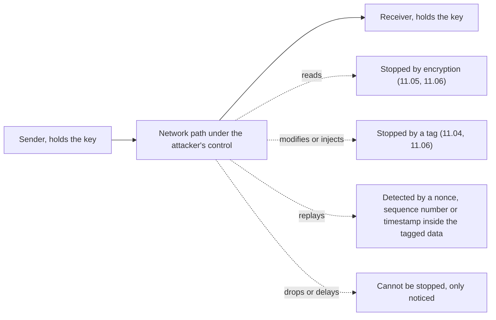
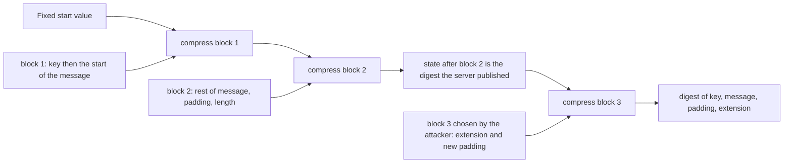
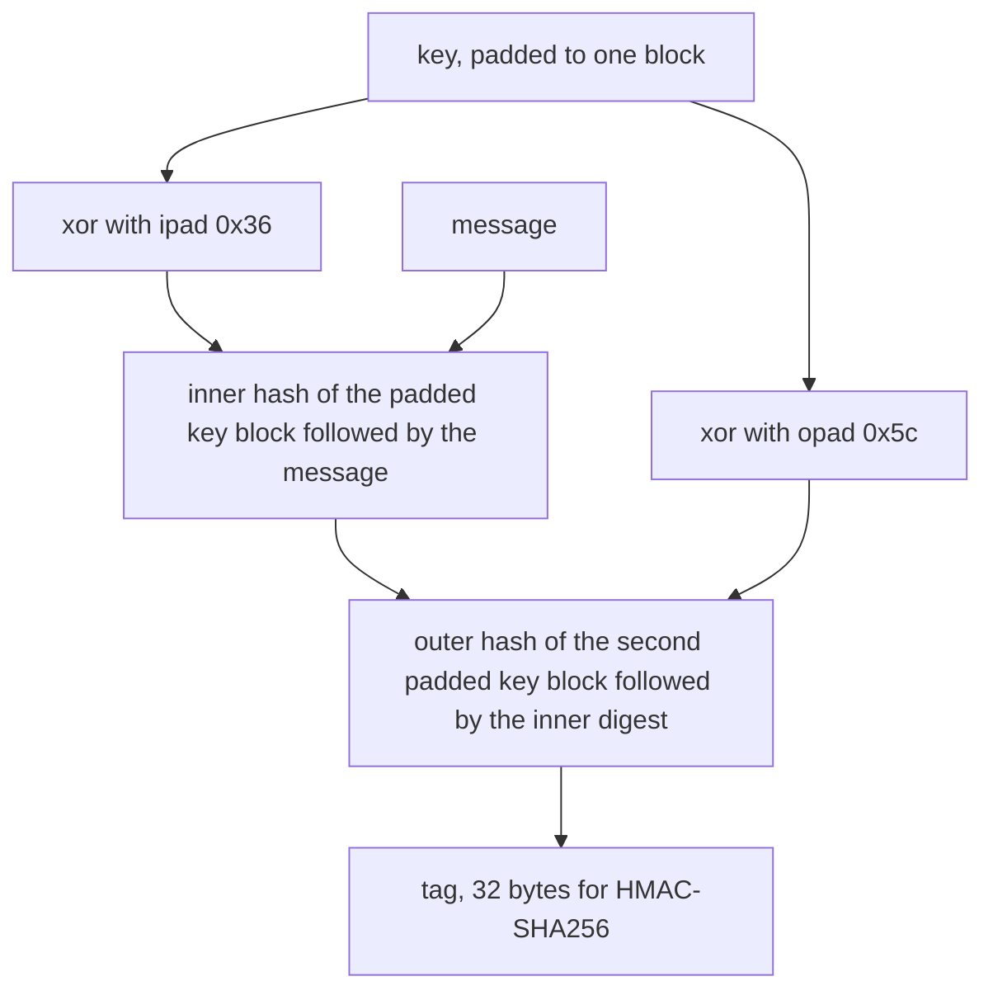
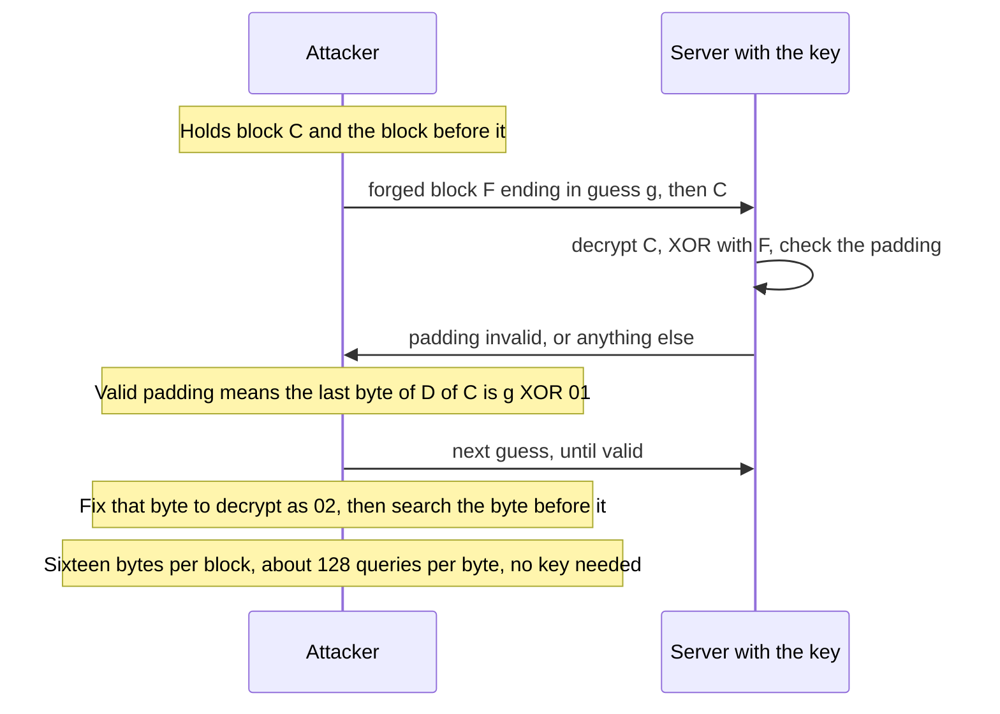
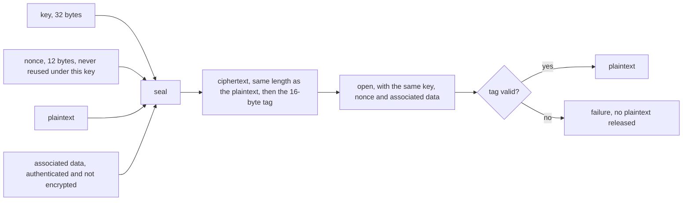
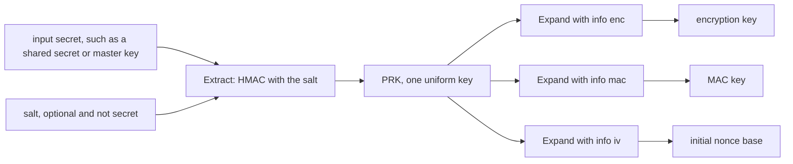
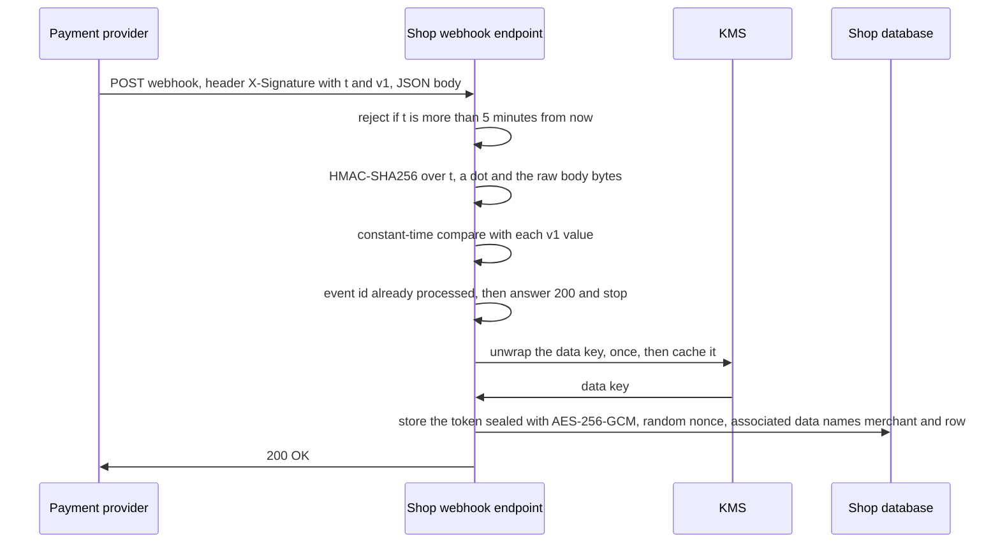

<!-- markdownlint-disable MD001 -->
<!-- markdownlint-disable MD024 -->
<!-- markdownlint-disable MD025 -->
<!-- markdownlint-disable MD026 -->
<!-- markdownlint-disable MD029 -->
<!-- markdownlint-disable MD033 -->
<!-- markdownlint-disable MD036 -->
<!-- markdownlint-disable MD040 -->
<!-- markdownlint-disable MD056 -->
<!-- markdownlint-disable MD060 -->

# H11. Symmetric crypto, hashes, MACs, AEAD

---

## Contents

| #     | Sub-topic                                                                         | Tag  |
| ----- | --------------------------------------------------------------------------------- | ---- |
| 11.01 | Security goals, the attacker model, Kerckhoffs's principle                        | CORE |
| 11.02 | Randomness: pseudo-random, CSPRNG, how bad randomness breaks everything           | CORE |
| 11.03 | Hash functions: three resistances, birthday bound, SHA-2, SHA-3, length extension | CORE |
| 11.04 | Message authentication codes: HMAC, constant-time comparison                      | CORE |
| 11.05 | Symmetric ciphers: AES, ECB, CBC and padding oracles, CTR, ChaCha20               | CORE |
| 11.06 | AEAD: AES-GCM, ChaCha20-Poly1305, nonces                                          | CORE |
| 11.07 | Key derivation: HKDF, and password hashing as a different problem                 | DEEP |
| 11.08 | The story: a payment webhook, card tokens and passwords, and a review checklist   | CORE |
| 11.09 | Labs: one Java program, its Rust twin, six experiments                            | CORE |
| 11.10 | Exercises                                                                         |      |
| 11.11 | Solutions                                                                         |      |
| 11.12 | Takeaways                                                                         |      |

Terms used throughout. Each is defined here, before any section uses it:

- **Bit**, **byte**, **hex**, **XOR**: a byte is 8 bits and hex writes it as two characters (`ff` is 255), as in H01.  
  XOR (written ⊕) combines two bit strings position by position and gives 1 where the bits differ and 0 where they are equal. `a ⊕ b ⊕ b` is `a` again,  
  so XOR with a secret stream of bits is a lock that the same stream unlocks, and two messages XORed with the *same* stream give an attacker the XOR of the two messages (11.05, 11.06).

- **Plaintext**, **ciphertext**, **key**, **cipher**, **symmetric**: plaintext is data in its readable form and ciphertext is the scrambled form.  
  A key is a secret string of bits that selects one transformation out of an astronomically large family.  
  A cipher is a pair of algorithms, encrypt and decrypt, parameterised by a key.  
  It is symmetric when the *same* key does both, so both parties must already hold it.

- **Confidentiality**, **integrity**, **authenticity**: confidentiality means only the intended parties can read the data.  
  Integrity means a change to the data is detected.  
  Authenticity means the data really came from the party it claims to come from. 11.01 shows how they relate.

- **Attacker model**, **passive**, **active**: the attacker model states what an adversary is assumed able to do, and a design is judged against it.  
  A passive attacker only reads. An active attacker also drops, delays, reorders, modifies, injects and replays messages.  
  All of this module assumes an active attacker who controls the network path and knows every algorithm used.

- **Replay**: re-sending a message that was genuine when first sent.  
  The message is valid; sending it again is the attack.

- **Primitive**: a small cryptographic building block with a precisely stated guarantee: a hash, a MAC, a block cipher.  
  Protocols such as TLS combine primitives, and most failures come from combining them wrongly.

- **Entropy**, **bits of security**, **brute force**: entropy measures unpredictability in bits: a value chosen uniformly from 2^n possibilities has n bits.  
  A primitive has *b bits of security* if the best known attack needs about 2^b operations.  
  Brute force is trying every possibility, so a key with b bits of entropy falls to about 2^b tries at most.

- **Hash function**, **digest**: a function that maps input of any length to a fixed-size output, the digest (also called hash or fingerprint). SHA-256 gives 32 bytes.  
  Anyone can compute it, since there is no key. **Preimage**, **second preimage** and **collision** are the three ways of attacking it; 11.03 defines each precisely.

- **CSPRNG** (cryptographically secure pseudo-random number generator): a generator whose output cannot be predicted by anyone who lacks its secret seed,  
  and whose seed comes from the operating system's physical entropy sources. It is the only legitimate source of keys, nonces, salts and tokens.

- **MAC**, **tag**, **HMAC**: a message authentication code (MAC) is a function of a key and a message that produces a short **tag**.  
  Without the key, an attacker cannot produce a valid tag for a message of their choice.  
  HMAC is the standard MAC built from a hash function. A receiver who holds the key recomputes the tag and compares.

- **Block cipher**, **block**, **mode of operation**: a block cipher encrypts one fixed-size block (16 bytes for AES) under a key.  
  A *mode of operation* is the recipe for encrypting data longer than one block with it. The mode matters as much as the cipher.

- **IV** (initialisation vector), **nonce**, **keystream**, **stream cipher**: an IV and a nonce are both a per-message value fed to a cipher alongside the key so that the same plaintext does not encrypt to the same ciphertext twice.  
  A **nonce** (number used once) must never repeat under one key. An IV for some modes must additionally be unpredictable.  
  A stream cipher turns key and nonce into a long **keystream** of pseudo-random bytes and XORs it with the data.

- **Padding**: bytes appended to a message so that its length is a whole number of blocks.

- **AEAD** (authenticated encryption with associated data): one primitive that encrypts and authenticates in a single step.  
  The **associated data** (AAD) is extra data that is authenticated but not encrypted, such as a header, which the receiver needs in the clear and must be able to trust.

- **Oracle**: any service an attacker can query that answers a question about secret data, even indirectly, such as an error message that differs for "bad padding" and "bad signature".  
  Each answer leaks a little; enough answers leak everything.

- **Constant-time**: taking the same time whatever the secret values are, so that timing reveals nothing.

- **Malleable**: a ciphertext is malleable if an attacker can change it so that the plaintext changes in a *predictable* way, without knowing the key.

- **KDF** (key derivation function), **salt**, **work factor**, **memory-hard**: a KDF turns one secret into one or more keys.  
  A salt is a non-secret random value mixed in so identical inputs give different outputs.  \
  The work factor is how much computation one evaluation costs, and *memory-hard* means that cost includes a large amount of memory, which blunts specialised hardware.

- **KMS** (key management service), **envelope encryption**: a KMS is a hosted or hardware-backed vault that holds master keys and performs encrypt and decrypt operations for you without ever handing the master key out.  
  Envelope encryption protects data with a *data key* and protects the data key with the KMS's master key, so the bulk data never goes to the KMS and the master key never leaves it.

- **Webhook**: a URL on one service that another service calls to tell it that something happened.  
  Anyone on the internet can send a request to it, which is why the call must be authenticated (11.04, 11.08).

- **TLS**: the protocol under `https://` that protects HTTP on the wire (H14 and H15).  
  Here it only motivates the kit: every TLS 1.3 connection uses an AEAD from 11.06, hashes from 11.03 and HKDF from 11.07.

Outputs in this module are real. They come from one Java program and its Rust twin (11.09) that run every demonstration: the attacks on hashes, MACs, CBC and nonces, the RFC test vectors, and the numbers behind the exercises. Run on Linux 6.18, JDK 21.0.12, Rust 1.97, RustCrypto crates.  
The Rust program prints the same text as the Java one except for three kinds of line: the random bytes, the timings, and the name of the error a failed AEAD decryption raises.  
Everything else is the same on every run, including every attack result.

---

## 11.01 Security goals, the attacker model, Kerckhoffs's principle

Cryptography on a wire delivers three goals: *confidentiality* (only the key holders read it), *integrity* (a change is detected) and *authenticity* (it came from a key holder).  
A fourth, *forward secrecy*, is a property of key exchange and waits for H12. The attacker is assumed to control the network: reading, dropping, delaying, modifying, injecting and replaying.  
Cryptography stops the reading with encryption and the modifying and injecting with tags, and it can only *detect* the dropping and the replaying, which needs sequence numbers or timestamps inside the authenticated data.  
Kerckhoffs's principle says the design must stay safe when everything except the key is public, so the key is the only secret, and keys are the one thing you can rotate.

### The goals

| Goal            | Question it answers                     | Violated when                                      | What delivers it                                  | Section      |
| --------------- | --------------------------------------- | -------------------------------------------------- | ------------------------------------------------- | ------------ |
| Confidentiality | Who can read this?                      | An observer on the path reads a card number        | Encryption                                        | 11.05, 11.06 |
| Integrity       | Was this changed on the way?            | A proxy rewrites `amount=100` to `amount=900`      | A MAC or the tag of an AEAD                       | 11.04, 11.06 |
| Authenticity    | Who made this?                          | An attacker injects a message in the sender's name | The same tag, which only a key holder can compute | 11.04, 11.06 |
| Forward secrecy | Does a stolen key expose *old* traffic? | A server key leaks and last year's recordings open | Short-lived keys from an ephemeral exchange       | H12, H15     |

Integrity and authenticity are one guarantee when the key is shared: a tag that shows the message is unchanged since a key holder produced it shows both at once.  
With a shared key the proof stops at "some holder".  
Either holder could have written the message, so a third party cannot be told which one did.  
That is *non-repudiation*, and it needs the signatures of H12.

Confidentiality without integrity is a trap, and the lab shows the shape of it (11.05): a ciphertext that hides the plaintext perfectly can still be edited in place.  
An attacker who cannot read `amount=100` can turn it into `amount=900` by flipping bits.  
Encrypt *and* authenticate, always, and treat a bare cipher as a component that has no use on its own.

What cryptography does **not** hide: the length of messages, their timing, and who talks to whom.  
Traffic analysis works on a perfectly encrypted channel, and the TLS handshake normally still shows the server name (H14, H15).

### The attacker

The model used by nearly all protocol design, named after Dolev and Yao (1983), gives the attacker the network and nothing else: the attacker cannot break the primitives and does not have the keys, and everything else is theirs.  
Against that attacker:

| The attacker                      | Example                                                 | What stops or detects it                                                      |
| --------------------------------- | ------------------------------------------------------- | ----------------------------------------------------------------------------- |
| Reads                             | Captures a request with a card token                    | Encryption                                                                    |
| Modifies                          | Changes `to=bob` to `to=mallory` in flight              | A tag over the whole message                                                  |
| Injects                           | Sends a fabricated "order paid" notification            | A tag the attacker cannot compute                                             |
| Replays                           | Re-sends yesterday's valid "refund 100" a hundred times | A timestamp, a nonce or a sequence number *inside* the authenticated data     |
| Drops, delays, reorders           | Withholds the "cancel" message                          | Cannot be prevented. Sequence numbers show a gap, timeouts show a stall       |
| Chooses plaintext, asks questions | Submits inputs and watches the responses                | Primitives proved secure against it, and no oracle in the application (11.05) |



Replay deserves its own sentence because a MAC does not stop it.  
A tag proves the message is genuine, and a replayed message *is* genuine.  
The defence is to put something in the authenticated data that makes each message unique and checkable: a counter the receiver must see increase, a timestamp the receiver checks against a window,  
a nonce the receiver remembers. H10's signed tokens carried `exp` for this reason, and the webhook in 11.08 carries a timestamp.

### Kerckhoffs's principle

A cryptosystem must stay secure even if everything about it except the key is public knowledge (Auguste Kerckhoffs, 1883).  
Three reasons it is a rule and not a taste. The algorithm is in thousands of devices and gets reverse-engineered, so a secret algorithm is a secret with a countdown.  
A public algorithm is attacked by the whole world for years, and one that has survived that is better evidence than any claim by its author. And a leaked key can be replaced by generating another,  
while a leaked algorithm cannot be replaced without redesigning the product. The practical corollary: never invent a cipher or a protocol.  
Use AES-GCM, ChaCha20-Poly1305, HMAC-SHA256 and HKDF, from a maintained library, with the parameters in this module.

### Bits of security

A key of 128 random bits has 2^128 (about 3.4 × 10^38) possibilities.  
If every one of ten billion computers tried ten billion keys per second, a search would take about 1.1 × 10^11 years, eight times the age of the universe.  
That is why 128 bits is the working standard of strength and 256 bits is the margin.  
A figure around 2^64 is within reach of a large organisation with specialised hardware, and 2^40 is a laptop afternoon.  
The number only means anything if the key really is uniform over all those possibilities, which is 11.02's subject.

### Interview angle

- *"What are the security goals of TLS?"* Confidentiality, integrity and authenticity of the channel, with forward secrecy as a property of the key exchange.  
  Add the one that is easy to miss: the server's identity (H13).

- *"Does encryption give you integrity?"* No. Encryption hides content and a plain cipher mode is malleable: an attacker flips ciphertext bits and the plaintext changes predictably (11.05).  
  You need a MAC or, better, an AEAD.

- *"What does an attacker who controls the network not get?"* The keys, and a break of the primitives.  
  If a design needs the attacker to be unable to read a *public* value or to be passive, it is relying on something the model does not grant.

- *"Why not keep the algorithm secret too?"* It cannot be rotated, it leaks, and it has not been reviewed. Kerckhoffs: only the key is secret.

---

## 11.02 Randomness: pseudo-random, CSPRNG, how bad randomness breaks everything

Every secret in this module is a random number: keys, nonces, salts, session ids, reset tokens.  
"Random" here means *unpredictable to an attacker who knows everything except the secret*.  
The source is the **operating system's CSPRNG**, which collects physical noise into a pool and stretches it with a cryptographic algorithm into as many bytes as asked: `getrandom(2)` on Linux, wrapped by Java's `SecureRandom` and Rust's `OsRng`.  
General-purpose generators (`java.util.Random`, `Math.random()`, a Rust `StdRng` seeded from a number) are fully determined by their seed,  
and a seed made of the clock or a counter has so little entropy that the whole stream can be recovered by trying every possible seed.  
The lab does it in 1,235 tries.

### True and pseudo-random

| Kind                    | Source                                                               | Speed        | Use                                              |
| ----------------------- | -------------------------------------------------------------------- | ------------ | ------------------------------------------------ |
| True random (physical)  | Interrupt timings, hardware noise, CPU instructions such as `RDRAND` | Slow, scarce | Seed material only                               |
| Pseudo-random (general) | An algorithm and a seed. Same seed gives the same stream             | Very fast    | Simulations, tests, shuffling. **Never secrets** |
| CSPRNG                  | A cryptographic algorithm seeded from true random sources            | Fast         | Keys, nonces, salts, tokens                      |

A CSPRNG is a pseudo-random generator with two extra properties: its seed carries at least 128 bits of true entropy, and its output is computationally indistinguishable from random,  
so knowing any amount of past output gives no help in predicting the next byte.  

The Linux generator behind `getrandom(2)` is such a design (ChaCha20-based since kernel 4.8, reseeded from fresh entropy).  
Since kernel 5.6, `/dev/random` and `/dev/urandom` behave alike once the pool is initialised, and the old advice to fear `/dev/urandom` is obsolete.  
Call the interface your language gives you and do not read device files yourself.

| Language | The call                                         | Notes                                                                                                                                                                      |
| -------- | ------------------------------------------------ | -------------------------------------------------------------------------------------------------------------------------------------------------------------------------- |
| Java     | `new SecureRandom().nextBytes(buf)`              | On Linux it reads the OS generator. Do not call `setSeed` with a value you chose. `SecureRandom.getInstanceStrong()` may block on a server, do not use it for routine keys |
| Java     | `java.util.Random`, `Math.random()`              | A linear congruential generator. Fully predictable from one output. Not for secrets                                                                                        |
| Rust     | `rand::rngs::OsRng.fill_bytes(&mut buf)`         | `getrandom` underneath. `rand::thread_rng()` is a CSPRNG too, reseeded from the OS                                                                                         |
| Rust     | `StdRng::seed_from_u64(n)`                       | Deterministic by design, for reproducible tests. Never for secrets                                                                                                         |
| Both     | Any generator seeded with time, pid or a counter | The seed is guessable, so the output is. See the attack below                                                                                                              |

### The attack on a guessable seed

A server seeds a general generator with the clock in seconds when it starts and uses it to issue tokens.  
An attacker who sees one token and knows roughly when the server started tries each second in the window, seeds a copy of the generator, and compares its first output with the token.  
The lab does exactly that: the victim's seed is `T0 + 1234` and the attacker, knowing only `T0`, finds it after 1,235 tries (11.09, section 11.02). A window of a whole day is 86,400 tries, which is under a second of work.

The Rust twin uses `StdRng::seed_from_u64`, whose algorithm is a modern cryptographic one, and the attack is exactly as easy, with the same result.  
The algorithm is not the point: the *seed* has about 12 bits of entropy to an attacker who knows the start time to within an hour, and the output has at most as many bits of unpredictability as the seed, whatever happens after.  
A strong generator fed a weak seed is a weak generator.  
This is the general failure of randomness, and the rest follow from it: a 256-bit key made from a 20-bit seed has 20 bits of security.

### How bad randomness broke real systems

[AWARE] These are the standard case studies, and each is one of the three failures above (low-entropy seed, repeated value, a generator that was not what it claimed).

| Year         | What                                          | Failure                                                                                                                                                                                |
| ------------ | --------------------------------------------- | -------------------------------------------------------------------------------------------------------------------------------------------------------------------------------------- |
| 2006 to 2008 | Debian's OpenSSL package (CVE-2008-0166)      | A patch removed a line that fed entropy to the generator, leaving only the process id (32,767 values). Every key generated on the affected systems was one of a short, enumerable list |
| 2010         | Sony PlayStation 3 signing keys               | An ECDSA signature scheme (H12) that needs a fresh random value per signature was given a constant. The private key fell out of two signatures                                         |
| 2013         | Android `SecureRandom` bug                    | Some apps' generators were not seeded properly, signatures repeated their random value, and Bitcoin wallets were emptied                                                               |
| 2013 to 2015 | `Dual_EC_DRBG`, a NIST-standardised generator | Constants of unexplained origin that, if their creator knew a secret, let that party predict the output. NIST advised against it in 2013 and removed it in 2015                        |

### Rules

Generate every secret from the OS generator, at least 128 bits for anything an attacker must not guess (a 22-character URL-safe string is 128 bits).  
Do not seed it. Do not use a generator from a library that cannot say where its entropy comes from. In tests, inject a deterministic source *as a test double*, so production code never has a seeding option.  
A cloned virtual machine or a restored snapshot can duplicate the state of a user-space generator and produce the same "random" values twice;  
the OS generator is designed to survive that on current kernels, which is one more reason to call it and not to cache a generator of your own.

### Interview angle

- *"Why is `Random` unsafe for a session id?"* It is a deterministic function of a small seed and its outputs reveal its state, so an attacker who sees a few ids predicts the next.  
  Use `SecureRandom`, 128 bits or more.

- *"What is the difference between a PRNG and a CSPRNG?"* The CSPRNG is seeded from real entropy and is unpredictable without the seed.  
  A PRNG is only statistically random-looking. The key difference is the threat model: the CSPRNG assumes an attacker who sees all other output.

- *"A service generates 256-bit keys from `SecureRandom` seeded with the current time. How strong are they?"*  
  As strong as the seed: if the seed has 20 bits, then 20 bits.

- *"What does a nonce reuse have to do with randomness?"* A generator that repeats (or collides, 11.06) hands out the same nonce twice, and nonce reuse is catastrophic for GCM and ChaCha20.

---

## 11.03 Hash functions: three resistances, the birthday bound, SHA-2, SHA-3, length extension

A hash function turns any input into a fixed-size digest (SHA-256: 32 bytes).  
Three attacks define a good one: finding an input for a given digest (**preimage**, costs 2^n for an n-bit digest), finding a second input with the same digest as a given one (**second preimage**, 2^n),  
and finding *any* two inputs with the same digest (**collision**, only 2^(n/2) because of the birthday bound).  
SHA-256 therefore offers 256 bits against the first two and 128 against collisions, which is why it is the default.  
MD5 and SHA-1 have practical collisions and are dead for security.  
A hash is not a cipher (it cannot be reversed) and not a MAC (anyone can compute it, so it proves nothing about *who* made the data),  
and the Merkle-Damgård design of SHA-2 has a structural weakness, **length extension**, that makes `SHA-256(key + message)` a broken authenticator.  
The lab forges one.

### What a hash promises

| Property                   | The attacker's task                                            | Generic cost for an n-bit digest | SHA-256 (n = 256) |
| -------------------------- | -------------------------------------------------------------- | -------------------------------- | ----------------- |
| Preimage resistance        | Given digest `d`, find any `m` with `H(m) = d`                 | 2^n                              | 2^256             |
| Second-preimage resistance | Given `m1`, find `m2` different from `m1` with `H(m2) = H(m1)` | 2^n                              | 2^256             |
| Collision resistance       | Find any pair `m1` different from `m2` with `H(m1) = H(m2)`    | 2^(n/2)                          | 2^128             |

Two more properties come with the design and are worth knowing.  
It is *deterministic* (same input, same digest), and it has the **avalanche** effect: changing one bit of input changes about half the output bits.  
The lab changes `dog` to `cog` in a sentence and 123 of the 256 output bits flip (the expected value is 128, give or take 8).

Preimage resistance is about *one* target digest and collision resistance is about the attacker's *free choice* of both inputs,  
which is why collisions are so much cheaper and why they break signatures and certificates: an attacker prepares two documents, one harmless and one malicious,  
with the same digest, gets the harmless one signed, and swaps (the MD5 and SHA-1 history below).

### The birthday bound, measured

Draw messages one after another and wait for any two to share a digest.  
After k messages there are about k²/2 pairs, each matching with probability 2^-n, so a match is expected when k²/2 is about 2^n, that is at k about 2^(n/2).  
The precise expected value is about 1.25 × 2^(n/2).  
The lab truncates SHA-256 to its first n bits and hashes `msg-0`, `msg-1`, ... until two prefixes agree:

| Prefix bits n | Messages until the first collision (this run) | Expected, 1.25 × 2^(n/2) |
| ------------- | --------------------------------------------- | ------------------------ |
| 16            | 172                                           | 321                      |
| 24            | 8,434                                         | 5,134                    |
| 32            | 114,807                                       | 82,137                   |

The inputs are deterministic, so every run prints the same numbers; one run is one sample of a random quantity, and the spread is large (172 against an expectation of 321 is ordinary).  
The *scaling* is the lesson: each extra 8 bits multiplies the work by 16, not by 256.  
The same arithmetic drives 11.06's nonce table and the exercises.

A preimage search has no birthday shortcut.  
The lab looks for a message whose digest starts with 20 zero bits and needs `pre-3445162`, 3.3 times the expected 2^20 = 1,048,576 tries.  
The tries to a first success are geometrically distributed with that mean, so a run three times longer than average happens about once in twenty-seven (e^-3.3, 3.7 per cent): unlucky, not wrong.  
This is the proof-of-work idea behind some blockchains, and it shows what "work" a preimage costs.

### SHA-2 and SHA-3

| Algorithm            | Digest             | Internal block   | Status                                    | Length extension? |
| -------------------- | ------------------ | ---------------- | ----------------------------------------- | ----------------- |
| MD5                  | 16 bytes           | 64 bytes         | Broken: collisions in seconds             | Yes               |
| SHA-1                | 20 bytes           | 64 bytes         | Broken: collisions demonstrated           | Yes               |
| SHA-256              | 32 bytes           | 64 bytes         | Sound. The default                        | Yes               |
| SHA-512              | 64 bytes           | 128 bytes        | Sound. Faster than SHA-256 on 64-bit CPUs | Yes               |
| SHA-384, SHA-512/256 | 48, 32 bytes       | 128 bytes        | Sound (truncated SHA-512)                 | No                |
| SHA3-256             | 32 bytes           | 136 bytes (rate) | Sound. Different design                   | No                |
| BLAKE2b, BLAKE3      | up to 64, 32 bytes | -                | Sound, very fast. [AWARE]                 | No                |

**SHA-2** (2001, FIPS 180-4) is a family: SHA-224 and SHA-256 work on 32-bit words and 64-byte blocks, SHA-384 and SHA-512 on 64-bit words and 128-byte blocks.  
It has no practical attack and is what TLS and certificates use, and Git's SHA-256 object format. **SHA-3** (2015, FIPS 202) is the Keccak design that won an open NIST competition.  
It exists as insurance: its internal structure, a *sponge*, shares nothing with SHA-2, so a break of one is unlikely to be a break of both. It also offers the extendable-output functions SHAKE128 and SHAKE256.  
Neither is broken, and SHA-256 remains the default choice because it is universal, hardware-accelerated and well understood.

HTTP uses digests in several places: Subresource Integrity (`integrity="sha384-..."` on a script tag), certificate fingerprints (H13), content-based `ETag` values (H09),  
and the `Content-Digest` field (RFC 9530, 2024),  which carries a SHA-256 or SHA-512 digest of the body.  
A digest field is only an integrity check against accidental corruption unless a signature covers it (HTTP Message Signatures, RFC 9421), because an attacker who can alter the body can alter the digest.

### Why MD5 and SHA-1 are dead

[AWARE]

| Year         | Event                                                                                                                                                            |
| ------------ | ---------------------------------------------------------------------------------------------------------------------------------------------------------------- |
| 2004         | Wang and colleagues find MD5 collisions in hours. Today they take seconds on a laptop                                                                            |
| 2008         | Researchers use a *chosen-prefix* MD5 collision (two documents with prefixes of their choosing and the same digest) to forge a certificate authority certificate |
| 2012         | The Flame malware uses an MD5 collision to pass as a Microsoft-signed code component                                                                             |
| 2017         | **SHAttered**: Google and CWI publish the first SHA-1 collision, two different PDFs with one SHA-1, at about 2^63 computations                                   |
| 2019 to 2020 | The "SHA-1 is a Shambles" chosen-prefix collision brings the cost within reach of a modest budget, and demonstrates an attack on PGP key signatures              |

Browsers stopped accepting SHA-1 certificates in 2017.  
MD5 and SHA-1 are acceptable only where no adversary is involved, and even there SHA-256 costs nothing more.  
The pattern to remember: a hash's collision resistance weakens first (2^(n/2) is the smaller target), preimage resistance follows much later, and the first sign is a signature forgery.

### Length extension

SHA-256, like MD5 and SHA-1, is built by the **Merkle-Damgård** construction.  
The message is padded (a `0x80` byte, zeros, then the length in bits as 8 bytes) to a whole number of 64-byte blocks.  
A **state** of 32 bytes starts at a fixed value, and each block is mixed into it by a compression function: `state = compress(state, block)`.  
The digest is the **final state**, in full. Nothing hidden remains.

That last sentence is the weakness.  
Anyone who holds the digest of `m` holds the state after `m` and its padding, and can keep going: feed more blocks into the same state and obtain the digest of `m`, the padding, and the extra data, *without knowing `m`*.  
Only the length of `m` is needed, because the padding depends on it.



Consider an API that authenticates requests as `tag = SHA-256(secret + message)`.  
An attacker sees `amount=100&to=bob` and its tag.  
The key length is unknown, so the attacker tries each length from 1 to 32;  
for each, builds `message + padding + "&to=mallory"` and computes the tag by continuing from the state in the tag; and the server, which computes `SHA-256(secret + forged message)`, accepts exactly the right guess.  
The lab does this with a SHA-256 written out in about 45 lines of Java (the compression function, because the JDK does not expose its state; Rust calls `sha2::compress256`):

```text
tag = SHA-256(key || msg)              70ebf0e6890e8c674cc4dec742a33c68c4beab3123edefbe6a0f5bfd75704164
length extension                       key length 16 accepted after 16 guesses, forged message amount=100&to=bob\x80\x00{28}\x01\x08&to=mallory
```

The forged message is the original, the padding (`0x80`, 28 zero bytes, and the 8-byte length `0x0108` = 264 bits = 33 bytes, the 16-byte key plus the 17-byte message), and the attacker's addition.  
The attacker never saw the key.  
Whether the server then *acts* on it depends on how its parser treats duplicate parameters (most frameworks let the last one win, so `to=mallory` wins; the stray bytes land in the first `to` value).  
The attack is real: Duong and Rizzo's 2009 forgery of Flickr's API signatures was exactly this.  
Experiment 01 (11.09) makes the key 40 bytes, which the guesses of 1 to 32 miss, and then widens the range and finds it.

Which hashes are immune: those that do not expose their whole state.  
SHA-3's sponge reveals only part of its state (the rest, the *capacity*, stays hidden),  
the truncated SHA-2 variants SHA-384 and SHA-512/256 drop part of the state so the attacker would have to guess the missing bits, and BLAKE2 has a finalisation step.  

The right fix is not to switch hashes but to stop using a bare hash as a MAC: HMAC (11.04), whose structure defeats the attack for SHA-256 too.  
The lab shows the same forged message against HMAC and it does not verify.

### Interview angle

- *"Preimage, second preimage, collision: which is easiest and why?"* Collision, at 2^(n/2) by the birthday bound.  
  That is why a 256-bit hash gives only 128 bits of collision resistance and why a 128-bit hash like MD5 is within reach of everyone.

- *"Can you encrypt with a hash? Store passwords with SHA-256?"* No to both. A hash has no key and no inverse.  
  For passwords a fast hash is the wrong tool because it lets an attacker try billions of guesses per second (11.07).

- *"What is a length extension attack and which hashes are affected?"*  
  With `H(secret + message)` and the message, an attacker computes `H(secret + message + padding + extra)` without the secret. SHA-1, SHA-2 and MD5 are affected, SHA-3 and truncated SHA-2 are not. Use HMAC.

- *"Why is SHA-1 deprecated if no one has found a preimage?"*  
  Collisions are enough to forge signed documents and certificates, and SHAttered made them practical.

---

## 11.04 Message authentication codes: HMAC and constant-time comparison

A MAC takes a secret key and a message and returns a short tag.  
The receiver, who holds the same key, recomputes the tag and compares.  
Without the key an attacker cannot produce a valid tag for any message they like, even after seeing tags for many messages of their choosing.  
That gives integrity and authenticity between key holders, and nothing else: the message is not hidden, a replayed message still verifies, and neither holder can prove to a third party who wrote it.  
The standard MAC is **HMAC**, built from a hash function in a shape that is proven secure and immune to length extension. `hash(key + message)` is not a MAC and the lab forges it.  
Two implementation rules complete the picture: compare tags in **constant time**, and put anything that must be unique (a timestamp, a nonce) *inside* the tagged bytes.

### What a tag gives and what it does not

| Guarantee                                             | A MAC? | Comment                                                                                                             |
| ----------------------------------------------------- | ------ | ------------------------------------------------------------------------------------------------------------------- |
| The message is unchanged since a key holder tagged it | Yes    | Integrity and authenticity are the same fact here                                                                   |
| An outsider cannot forge a tag                        | Yes    | For any message, after any number of chosen examples. The formal name is unforgeability under chosen-message attack |
| The message is secret                                 | No     | The message travels in clear. Encrypt as well (11.06)                                                               |
| A message is not accepted twice                       | No     | A replay carries a genuine tag. Put a counter, timestamp or nonce inside the tagged data                            |
| Proof of authorship to a third party                  | No     | Both holders can compute the tag. Signatures (H12) are for that                                                     |

### Why `hash(key + message)` is wrong

| Construction             | What breaks                                                                                                                                                 |
| ------------------------ | ----------------------------------------------------------------------------------------------------------------------------------------------------------- |
| `H(key + message)`       | Length extension (11.03): from a tag and the message length, anyone appends data and computes the new tag. Lab: forged after 16 guesses                     |
| `H(message + key)`       | Safe from extension, but secure only as long as `H` is collision resistant: two messages with the same digest then have the same tag. It dies with the hash |
| `H(key + message + key)` | Better, but a hand-made shape with no proof. HMAC is the shape with the proof                                                                               |
| `H(message)`, no key     | Not a MAC at all: anyone computes it, including the attacker, for their forged message                                                                      |

A fifth mistake sits outside the formula: **ambiguous concatenation**.  
A tag over `user + amount` is the same for `bob` + `1000` and for `bo` + `b1000`, because the concatenated bytes are the same.  
When a tag covers several fields, tag a single unambiguous encoding (length prefixes, a separator that cannot occur inside a field, or the exact bytes that were sent).  
H10's token signs the exact base64 text of its payload, and 11.08's webhook signs `timestamp + "." + body`, a timestamp of digits and a body that the sender transmits verbatim.

### HMAC

```text
HMAC(K, m) = H( (K' xor opad) + H( (K' xor ipad) + m ) )

K'    the key padded with zeros to the hash's block size (64 bytes for SHA-256),
      or hashed first if it is longer than a block
ipad  the byte 0x36 repeated for a block
opad  the byte 0x5c repeated for a block
```

Two hashes: an inner one over the message under one derived key, and an outer one over the inner digest under another.  
The attacker sees only the outer digest, and the outer hash starts from a state that depends on a key block they do not know, so there is nothing to continue from and no length extension.



HMAC is proved secure (Bellare, Canetti and Krawczyk 1996, with a tighter proof by Bellare in 2006) on the assumption that the hash's compression function behaves as a pseudo-random function, an assumption much weaker than collision resistance.  
That is why HMAC-MD5 survived the MD5 collisions. New designs should still use HMAC-SHA256.  
It is standardised in RFC 2104 and FIPS 198-1, and RFC 4231 publishes test vectors.  
The lab runs the first one (key of twenty `0x0b` bytes, message `Hi There`) and prints `true` for `equals the RFC's value`;  
it then feeds the length-extension forgery of 11.03 to HMAC and the tag is `rejected`.

Keys and tags, practically:

- The key is random bytes, at least 32 for HMAC-SHA256, from the CSPRNG (11.02) or from HKDF (11.07).  
  A key longer than the 64-byte block is hashed down to 32 bytes first and gains nothing, and a short or human-chosen key gives only its own entropy.

- Use the full 32-byte tag. RFC 2104 allows truncation to no less than half the hash length and no less than 80 bits, and shorter tags make forgery by luck feasible.  
  The lab truncates to 4 bytes *on purpose* in the next part, to make an attack finish quickly.

- One key, one purpose. A key used for HMAC is not also an encryption key (11.07).

Other MACs, [AWARE]: CMAC (RFC 4493) builds a MAC from AES. **Poly1305** is a very fast one-time MAC whose key must never be reused, and it is half of ChaCha20-Poly1305 (11.06).  
**GMAC**, the authentication half of GCM, is also a one-time-key construction.  
KMAC is the SHA-3 family's native keyed mode: because SHA-3 has no length extension, a keyed hash is safe there.

### Constant-time comparison

Verifying means computing the expected tag and comparing it with the received one.  
The ordinary comparison (`==` on strings, `Arrays.equals`, `memcmp`, Rust `==` on slices) returns at the **first differing byte**, so it takes longer when more leading bytes match.  
An attacker who can time the response guesses the first byte of the tag by trying 256 values and keeping the slowest, then the second, and so on.  
Recovering an n-byte tag costs at most n × 256 queries, not the 2^(8n) of guessing.  
The tag need not be secret for the attack to matter: it is what stands between the attacker and a forged message.

The lab models the timing with a count instead of a clock, so that the result is the same on every run: a naive comparison reports how many leading bytes matched, and the attacker keeps the byte value that increases the count.  
Against a 4-byte truncated tag of `HMAC("GET /orders/17")`:

```text
early-exit compare leaks the tag       16cfaef9 recovered in 656 queries (at most 4 x 256 = 1024; brute force is 2^32)
MessageDigest.isEqual                  inspects every byte whatever the answer
```

A real attacker measures nanoseconds across a network and needs many samples per guess,  
but it works: Crosby, Wallach and Riedi (2009) distinguished differences as small as 20 microseconds across the internet and 100 nanoseconds on a local network.  
Real libraries have shipped the bug (Google's Keyczar, 2009).

| Language | Constant-time comparison                                                                     |
| -------- | -------------------------------------------------------------------------------------------- |
| Java     | `MessageDigest.isEqual(a, b)`, or `Mac` verification in a library that uses it               |
| Rust     | `subtle::ConstantTimeEq::ct_eq`, or `Mac::verify_slice` in the `hmac` crate                  |
| Others   | Python `hmac.compare_digest`, Node `crypto.timingSafeEqual`, Go `subtle.ConstantTimeCompare` |

Compare the raw bytes (decode hex or base64 first, or compare the encoded strings with the same function),  
and use it for every secret that an attacker can probe with chosen input: MAC tags, API keys, reset tokens, session ids compared in application code.  

Comparing the tag's *length* may return early, because the length is public.  
Looking a session up by `SHA-256(token)` in a database index is safe in practice, since the attacker cannot steer a comparison byte by byte through a hash they cannot predict.

The lab ends with the token of H10 made explicit: `payload.tag`, where the payload is base64url of the claims and the tag is the base64url of HMAC-SHA256 over the payload text.

```text
token = payload.tag                    eyJzdWIiOiJhbGljZSIsImV4cCI6MTc5MzE5MjQwMH0.uCOBOwvRiZON3ttC2eFoei-0-f8MHT5lW1ZZrD2XIsw
verify unchanged                       true
verify with payload changed            false
```

Changing `alice` to `admin` in the payload leaves the old tag, and verification fails.  
What the check does *not* cover is everything H10 listed that a verifier must also do: pick the algorithm itself (never trust an `alg` field in the token), check `exp` (the replay window), and keep a way to revoke.

### Interview angle

- *"Why not `SHA-256(secret + message)` as a signature?"* Length extension: from the tag and the length, anyone forges a tag for the message extended with chosen bytes.  
  HMAC's nested structure prevents it.

- *"What does a MAC not protect against?"* Replay, and reading: the message is in the clear and a valid message can be sent again.  
  Include a timestamp or nonce in the tagged data and encrypt separately, or use AEAD.

- *"How do you verify an HMAC?"* Recompute it over the exact bytes received, then compare with a constant-time function, because an early-exit comparison leaks the tag one byte at a time.

- *"What is the difference between a MAC and a digital signature?"* Both authenticate. A MAC uses a shared key, so either party could have produced it.  
  A signature uses a private key only one party holds, so a third party can verify and the signer cannot deny it (H12).

---

## 11.05 Symmetric ciphers: AES, ECB, CBC and padding oracles, CTR, ChaCha20

A **block cipher** such as AES scrambles exactly one 16-byte block under a key and is reversible with the key.  
To encrypt a message of any length you need a **mode**, and the mode is where nearly all the failures are. **ECB** encrypts every block alone,  
so equal plaintext blocks give equal ciphertext blocks and the structure of the data shows through (the lab draws a picture with it).  

**CBC** chains blocks with a random IV and pads the last one, and when a server reveals whether the padding was valid, an attacker decrypts everything without the key (the lab recovers a message in 5,104 queries).  
**CTR** and **ChaCha20** turn the cipher into a keystream XORed with the data, which is fast and needs no padding, and needs a never-repeating nonce. **None of them detects tampering.**  
The lab flips a digit in a CTR ciphertext without the key.  
For that reason you should reach for AEAD (11.06) and treat the rest of this section as the knowledge that explains why.

### AES

AES (Rijndael, standardised in 2001, FIPS 197) is a block cipher with a 128-bit block and a key of 128, 192 or 256 bits.  
Inside, 10, 12 or 14 rounds of four steps (substitute bytes, shift rows, mix columns, add the round key) turn the block into another block, and each key defines a different pseudo-random permutation of all 2^128 blocks.  
There is no practical attack on full AES better than brute force (the best published key-recovery attacks gain about two bits).  
Hardware helps twice: x86 CPUs have AES instructions (AES-NI) and ARM has equivalents, which makes AES very fast *and* constant-time, while software table-lookup AES leaks through cache timing.  
Block size matters too: ciphers with a 64-bit block (3DES, Blowfish) become unsafe after about 2^32 blocks, 32 GiB, by the birthday bound of 11.03, which is the Sweet32 attack of 2016 [AWARE].

### ECB: the mode you must not use

Electronic codebook mode applies the cipher to each block separately: `C[i] = E(K, P[i])`.  
Identical plaintext blocks always give identical ciphertext blocks, whatever the key, and an attacker can also cut, reorder and splice blocks between messages.

The lab encrypts a picture. A 16 by 7 grid of pixels spells `H11`, each pixel one 16-byte block (black is sixteen `0xff` bytes, white sixteen zeros),  
so that equal pixels are equal blocks, like the runs of equal pixels in a real bitmap.  

The program encrypts it three ways, then draws the ECB ciphertext by marking each block that equals the ciphertext block of a known black pixel.  
The attacker needed no key:

```text
each pixel is one 16-byte block; the ECB ciphertext, drawn by block equality:
   ................
   .#..#..#...#....
   .#..#.##..##....
   .####..#...#....
   .#..#..#...#....
   .#..#.###.###...
   ................
distinct blocks of 112: CBC            112
distinct blocks of 112: CTR            112
distinct blocks of 112: ECB            2
```

Under ECB the 112 blocks of ciphertext contain **2** distinct values (one for black, one for white), under CBC and CTR all 112 are distinct.  
Changing the key (Experiment 02) changes every byte of ciphertext and leaves the picture exactly the same: the leak is in the mode, not the key.  
The famous version of this is the Tux penguin, whose outline remains visible in the ECB ciphertext of its bitmap.

### CBC: chaining, the IV, padding

Cipher block chaining XORs each plaintext block with the previous ciphertext block before encrypting it, so identical blocks no longer match.  
The first block uses an initialisation vector.

```text
ECB   C[i] = E(K, P[i])
CBC   C[i] = E(K, P[i] xor C[i-1])      with C[0] = IV       P[i] = D(K, C[i]) xor C[i-1]
CTR   C[i] = P[i] xor E(K, nonce + counter i)                 P[i] = C[i] xor E(K, nonce + counter i)
```

The IV must be **unpredictable** and fresh for every message, not just unique.  
A predictable IV let the BEAST attack (2011) test guesses about earlier plaintext against TLS 1.0, which chained IVs from the previous record.  
The IV is not secret and travels with the ciphertext.

CBC needs whole blocks, so the last block is padded.  
**PKCS#7** appends N bytes each of value N, with N between 1 and 16, and a message that already fills its blocks gets a whole extra block of `0x10`.  
The lab's 21-byte `transfer 250 to carol` gets eleven `0x0b` bytes to reach 32.

CBC has *no integrity* and a specific malleability: flipping bit j of ciphertext block i flips bit j of plaintext block i+1 and turns block i into garbage.  
An attacker who can edit and does not mind one garbled block edits a field in the next block at will.

### The padding oracle

[CORE] The decryptor must remove the padding, so it checks it, and the check has two outcomes: valid or invalid.  
If a server lets the client tell them apart (a different error message, status code, or even a different response time), it has become an **oracle**, and Vaudenay showed in 2002 that this single bit decrypts the whole message.  
The ciphertext, not the key, is what the attacker works on.

The attacker takes two consecutive blocks, the previous block B and the target C, and sends a forged previous block F followed by C.  
The server decrypts C, XORs the result D(C) with F, and inspects the end of the result.  
With the last byte of F set to a guess g, the padding is valid when D(C) [15] XOR g equals `0x01` (almost always; the lab rules out the rare `02 02` case by flipping the byte before and asking again).  
So when the server says "valid", the attacker knows D(C) [15] = g XOR 1, and the real plaintext byte is that XOR the real previous block's last byte, B[15].  
At most 256 guesses, 128 on average.  
Then the attacker sets F so the last byte decrypts to `0x02`, searches the byte before it for `02 02`, and so on, a byte at a time.



The lab implements the server's leak (`validPadding` returns the one bit) and the attack (`recoverBlock`), and decrypts a ciphertext it holds without the key.  
First, one byte by hand, so that the arithmetic is visible, then the whole message:

```text
ciphertext                             32 bytes = 2 blocks, key unknown to the attacker
by hand, last byte: valid padding at   guess 2e, the 47th query
  so the cipher's output byte is       2e xor 01 = 2f
  and the plaintext byte is            2f xor 24 = 0b (the previous ciphertext byte is 24)
plaintext recovered                    "transfer 250 to carol" (the padding bytes stripped)
oracle queries                         5104 for 32 bytes, 159 per byte (128 on average; a key search would need 2^128)
```

The three indented lines are the first byte of the attack, worked.  
With a forged previous block of zeros except its last byte, the server answered "padding valid" on the 47th guess, `2e`.  
Valid padding means the forged decryption ended in `01`, so the cipher's output byte `D(C)[15]` is `2e xor 01 = 2f`.  
The real previous ciphertext block ends in `24`, so the real plaintext byte is `2f xor 24 = 0b`: the padding byte for eleven bytes of padding, as it must be.  
The attacker learned a plaintext byte from a yes or no answer and never saw the key.  
The same step repeats for each of the 16 bytes of a block, each time with the already-known bytes forced to the next padding value.

5,104 queries for 32 bytes, against an expected 4,100 or so; this run drew a high count, and Experiment 04 shows another IV and a 48-byte message at 146 per byte.  
Either way: seconds, against 2^128 for a key search.  
The history is long. ASP.NET fell to it in 2010, Lucky13 (2013) was a timing variant on TLS's CBC, and POODLE (2014) exploited SSL 3.0's padding, which a MAC did not cover.  
The defences are to authenticate before decrypting (encrypt-then-MAC, verifying the tag first), to make *every* failure look the same in message *and* time (hard to do, so do not depend on it),  
or to use AEAD, where there is no padding and no plaintext is released before the tag verifies.

### CTR: a stream from a block cipher

Counter mode never runs the cipher on the data. It encrypts a sequence of counter blocks, `nonce + 0`, `nonce + 1`, `nonce + 2`, ..., and XORs the resulting **keystream** with the message.  
Decryption is the same operation.  
There is no padding and no padding oracle, blocks can be encrypted and decrypted in parallel and at random offsets, and the ciphertext is as long as the plaintext.

Two properties follow from XOR, and both are failures the moment they are ignored:

- **A nonce must never repeat under one key.** The same keystream applied to two messages gives `C1 xor C2 = P1 xor P2`, so neither message protects the other,  
  and a known or guessed message gives away the other (the two-time pad; lab in 11.06).

- **It is perfectly malleable.** Flipping a bit of ciphertext flips exactly that bit of plaintext.  
  The lab encrypts `amount=100&to=bob`, XORs byte 7 with `'1' xor '9'` and decrypts, and without the key the amount is nine times bigger:

```text
CTR, one ciphertext byte flipped       amount=900&to=bob
```

Experiment 05 turns `bob` into `eve` with three more bytes.  
A cipher with no authentication gives the attacker a pencil.

### ChaCha20: a stream cipher by design

ChaCha20 (Daniel Bernstein, 2008, a refinement of his Salsa20; RFC 8439) takes a 256-bit key, a 96-bit nonce and a 32-bit block counter, and produces a 64-byte keystream block per counter value.  
It runs 20 rounds of additions, rotations and XORs on a 4 by 4 matrix of 32-bit words and uses no lookup tables, so it is fast in plain software and naturally constant-time.  
It encrypts like CTR does (XOR the keystream) and has the same nonce rule and the same malleability.  
At most 2^32 blocks (256 GiB) may be used per key and nonce.  
TLS offers it as ChaCha20-Poly1305 for the devices without AES hardware (many phones, in the years it was introduced), and WireGuard and SSH use it too.  
Java has had it since JDK 11 (`ChaCha20-Poly1305`, JEP 329).

### The modes side by side

| Mode          | Needs                     | Integrity? | Main failure                                         | Verdict                                     |
| ------------- | ------------------------- | ---------- | ---------------------------------------------------- | ------------------------------------------- |
| ECB           | Nothing                   | No         | Equal blocks leak. Blocks can be rearranged          | Never                                       |
| CBC           | Unpredictable IV, padding | No         | Padding oracle, malleable, BEAST with predictable IV | Legacy only, and only with encrypt-then-MAC |
| CTR           | Unique nonce              | No         | Nonce reuse leaks plaintext XOR. Malleable           | Only inside an AEAD                         |
| ChaCha20      | Unique nonce              | No         | The same                                             | Only inside an AEAD                         |
| GCM, Poly1305 | Unique nonce              | Yes        | Nonce reuse breaks both secrecy and authentication   | **The standard** (11.06)                    |

### Interview angle

- *"Why is ECB insecure?"* Deterministic per block: equal plaintext blocks give equal ciphertext blocks, so patterns survive (the penguin), and blocks can be cut and pasted between messages.

- *"Explain a padding oracle attack."* A server that reveals whether CBC padding was valid lets the attacker forge the previous block,  
  learn the intermediate decryption byte by byte, and recover the plaintext in about 128 queries per byte with no key.  
  Fix with AEAD or verify a MAC before decrypting.

- *"CBC against CTR?"* CBC needs padding and an unpredictable IV, is sequential to encrypt, and is exposed to padding oracles.  
  CTR is parallel and padding-free and breaks on a repeated nonce. Neither authenticates.

- *"Does encrypting a cookie with AES-CTR stop a user editing it?"* No. They flip bits in the ciphertext and flip the same bits in the plaintext. Authenticate it.

---

## 11.06 AEAD: AES-GCM, ChaCha20-Poly1305, nonces

AEAD does encryption and authentication as one primitive with one key.  
`seal(key, nonce, plaintext, aad)` returns the ciphertext with a 16-byte tag attached, and `open(key, nonce, aad, ciphertext)` returns the plaintext *only if* the tag verifies, and returns nothing, only a failure, otherwise.  
The **associated data** is covered by the tag but not encrypted, which is the place for headers and context the receiver must be able to trust.  
The two standard choices are **AES-GCM** and **ChaCha20-Poly1305**, and TLS 1.3 allows nothing else.  
Their sharp edge is the **nonce**: 12 bytes, not secret, and unique for every message under a key.  
A repeat leaks the XOR of the two plaintexts and lets the attacker forge tags, and the lab shows both.  
The rest of this section is how to guarantee uniqueness.

### The interface



This is the interface of RFC 5116.  
It is hard to misuse in the ways that broke CBC: there is no padding and so no padding oracle, and a failed tag releases no plaintext, so there is nothing to flip and observe.  
Using **encrypt-then-MAC** by hand (encrypt, then HMAC the IV and ciphertext with an independent key, verify the tag *first* and in constant time) is also sound.  
TLS 1.2's mac-then-encrypt CBC suites, which verified the MAC after decrypting, are the design the Lucky13 attack broke.  
An AEAD makes the right composition the only one on offer.

The lab seals `pay 100 to bob` under key `00 01 02 ... 1f`, nonce `00 00 00 00 01 02 03 04 05 06 07 08` and associated data `v1|user=alice`, with both algorithms, and then attacks each ciphertext three ways:

```text
AES-256-GCM output                     74301c2eecd139be77f0dd8d710502ad9b970a6dac4a7aca1684bb0b9467 (14 bytes + 16-byte tag)
  opened                               pay 100 to bob
  one ciphertext bit flipped           rejected (AEADBadTagException)
  associated data changed              rejected (AEADBadTagException)
  tag cut to 15 bytes                  rejected (AEADBadTagException)
```

The 30-byte output is 14 bytes of ciphertext and the 16-byte tag.  
Flip one bit, change the associated data from `alice` to `mallory`, or truncate the tag: `open` refuses each, and for ChaCha20-Poly1305 the three results are the same (11.09 prints both).  
Rust raises a generic `aead::Error` where Java names the exception.

What the associated data is for: **binding the ciphertext to its context**.  
A ciphertext sealed with `v1|user=alice` does not open under `v1|user=bob`, so an attacker cannot copy `alice`'s encrypted field into `bob`'s row, replay it in another table, or present a version 1 message as version 2.  
Put the user id, the field name and the format version there.  
TLS puts the record header and sequence number there (H14, H15).

### AES-GCM

GCM (Galois/Counter Mode, NIST SP 800-38D) is CTR mode for the encryption (11.05) plus **GHASH**, a polynomial hash over the associated data and the ciphertext,  
computed in a finite field and keyed with `H = E(K, 0)`, and masked by one more block of keystream to give the tag.  

The 12-byte nonce plus a 32-bit counter form the counter blocks.  
Parameters to know: a 96-bit nonce, a 128-bit tag, at most about 64 GiB of plaintext per message (2^39 - 256 bits), and, for random nonces, at most 2^32 messages per key (the reason follows).  
It is fast wherever there are AES and carry-less multiply instructions, which is nearly every server CPU.

Java: `Cipher.getInstance("AES/GCM/NoPadding")`, initialised with a `GCMParameterSpec(128, nonce)` (the number is the tag length in *bits*), `updateAAD(aad)` before `doFinal`.  
The output is ciphertext followed by the tag.  
On decryption the JDK buffers the whole message until the tag verifies, which is the safe behaviour and a memory cost: do not seal a multi-gigabyte file in one message,  
split it into chunks, each with its own nonce (TLS's records of at most 16 KiB are that idea).  
Rust: the `aes-gcm` crate, `Aes256Gcm::new_from_slice`, `encrypt(nonce, Payload { msg, aad })` (11.09).

### ChaCha20-Poly1305

The same shape with different parts (RFC 8439).  
The first ChaCha20 keystream block (counter 0) is not used to encrypt: it supplies the one-time key for **Poly1305**, a polynomial MAC modulo 2^130 - 5.  
Encryption starts at counter 1, and the tag covers the associated data, the ciphertext and their lengths.  
The same 12-byte nonce and 16-byte tag, no tables and no special instructions: it is faster than AES-GCM where there is no AES hardware, and slower where there is.  
Which to choose: AES-GCM on servers with AES-NI, ChaCha20-Poly1305 when clients may lack it.  
Both are safe, and TLS lets the two ends agree (H14).

### The nonce: what reuse destroys

[CORE] The nonce is not secret and need not be unpredictable.  
It must be **unique for every message under one key**.  
The lab seals two 16-byte messages under the *same* key and nonce, `attack at dawn!!` and `retreat at nine!`, and looks only at the ciphertexts:

```
nonce reused: c1 XOR c2 equals p1 XOR p2 true
attacker who knows p1 recovers         "retreat at nine!"
```

The keystream cancels (11.05), so the XOR of the two ciphertexts is the XOR of the two plaintexts, and an attacker who knows or guesses one message, such as a fixed header or a template, reads the other.  
Experiment 03 repeats the demonstration with ChaCha20-Poly1305 and it holds.  
In GCM it is worse: two messages under one nonce also reveal `H`, the key of the GHASH authenticator (Joux's *forbidden attack*, 2006), after which the attacker can alter any message they observe and recompute its tag.  
Secrecy and authenticity are both gone, from one repeated 12-byte value.  
The JDK guards one case: a second `init` for encryption with the same key and nonce on the same `Cipher` object throws `InvalidAlgorithmParameterException: Cannot reuse iv for GCM encryption` (Experiment 06),  
and a fresh `Cipher` object with the same values is accepted, which is what the lab does to demonstrate the break.  
The guard is a seatbelt, not a design.

### Choosing nonces

| Strategy                 | How                                                                                  | Safe when                                                                            | Danger                                                                               |
| ------------------------ | ------------------------------------------------------------------------------------ | ------------------------------------------------------------------------------------ | ------------------------------------------------------------------------------------ |
| Random 96-bit            | `SecureRandom` per message, stored with the ciphertext                               | Fewer than about 2^32 messages per key, then rotate the key                          | Birthday collisions (table below)                                                    |
| Counter                  | One counter per key, incremented per message, persisted                              | Exactly one sender per key, and the counter survives restarts and crashes            | Restart resets it. Two writers share it. A restored backup replays old values        |
| Instance id plus counter | 4 bytes naming the sender, 8 bytes of counter                                        | Each sender has a distinct id that is never reassigned, and its counter is persisted | A reused id after a restart, or an id collision                                      |
| Derived key per message  | Random salt, HKDF (11.07) to a one-time key, then any nonce                          | Salt collisions are negligible at 256 bits                                           | Extra work per message                                                               |
| Misuse-resistant AEAD    | AES-GCM-SIV (RFC 8452) or XChaCha20-Poly1305 (192-bit nonce, safe to pick at random) | You cannot guarantee uniqueness                                                      | Less widely available. GCM-SIV still leaks *whether* the same message was sent twice |

The birthday arithmetic of 11.03 applies.  
For n random 96-bit nonces, the probability that some two are equal is about n squared over 2^97.  
The lab computes it:

```text
random 96-bit nonces under one key: probability that two messages share a nonce
  2^20 messages                        6.94e-18
  2^28 messages                        4.55e-13
  2^32 messages                        1.16e-10
  2^36 messages                        2.98e-08
  2^48 messages                        3.93e-01
```

A million messages (2^20) are safe by any measure.  
NIST SP 800-38D caps random nonces at 2^32 invocations per key, which keeps the probability near 2^-33, and by 2^48 messages a collision is more likely than not.  
A busy service sealing a million records per hour reaches 2^32 in about 4,300 hours (180 days): rotate keys on that schedule at the latest, and as often as operations allows.  
The counter strategies trade that limit for an *operational* hazard, which the third table row and Exercise 05 work through.

Two last points. The nonce travels with the ciphertext, as a prefix (`nonce + ciphertext + tag`), since the receiver needs it.  
And [AWARE] GCM and ChaCha20-Poly1305 are not *key-committing*: a crafted ciphertext can open under two different keys,  
which matters when the key comes from a password and an attacker can try several (partitioning oracle attacks, 2021).  
Where that matters, derive the key with a KDF (11.07) and add a key-check value or use a committing construction.

### What to call

| Need                       | Java                                                                                      | Rust                                                   |
| -------------------------- | ----------------------------------------------------------------------------------------- | ------------------------------------------------------ |
| Random bytes               | `new SecureRandom().nextBytes(b)`                                                         | `OsRng.fill_bytes(&mut b)` (`rand`)                    |
| SHA-256, SHA3-256          | `MessageDigest.getInstance("SHA-256")`, `"SHA3-256"`                                      | `sha2::Sha256`, `sha3::Sha3_256` with `Digest::digest` |
| HMAC-SHA256                | `Mac.getInstance("HmacSHA256")`                                                           | `hmac::Hmac<Sha256>`                                   |
| Constant-time comparison   | `MessageDigest.isEqual`                                                                   | `subtle::ConstantTimeEq`, `Mac::verify_slice`          |
| AES-256-GCM                | `Cipher.getInstance("AES/GCM/NoPadding")` with `GCMParameterSpec(128, nonce)`             | `aes_gcm::Aes256Gcm`                                   |
| ChaCha20-Poly1305          | `Cipher.getInstance("ChaCha20-Poly1305")` with `IvParameterSpec(nonce)`, JDK 11 and later | `chacha20poly1305::ChaCha20Poly1305`                   |
| HKDF                       | Not in JDK 21 (later JDKs add a KDF API). The lab writes it over HMAC in six lines        | The `hkdf` crate                                       |
| PBKDF2                     | `SecretKeyFactory.getInstance("PBKDF2WithHmacSHA256")`                                    | The `pbkdf2` crate                                     |
| Argon2id, bcrypt           | A library: Bouncy Castle, or Spring Security's password encoders                          | The `argon2` crate                                     |
| All of the above, composed | Google Tink: `Aead` and `Mac` primitives with key rotation built in                       | `ring`, whose API offers only the safe combinations    |

Prefer the highest-level interface that does the job.  
A library that hands you a sealed envelope with a key id and rotation (Tink, or a cloud KMS client) removes the nonce and key-lifecycle decisions that this section spent its length on.

### Interview angle

- *"What does AEAD give that AES-CBC plus a hash does not?"*  
  Authenticated encryption as one correct composition: no padding, tag checked before any plaintext is released, associated data bound in.  
  CBC plus an unkeyed hash gives no authentication at all.

- *"What is the nonce for and what happens if it repeats?"*  
  It makes each message's keystream unique.  
  Reuse gives the attacker the XOR of the plaintexts and, in GCM, the authentication key, so they forge tags.

- *"How do you pick GCM nonces for a service with many instances?"*  
  Random 96-bit is fine below about 2^32 messages per key, rotating the key before that.  
  Counters need unique per-instance prefixes and persistence across restarts, which is fragile.  
  Or a misuse-resistant mode.

- *"What goes in the associated data?"*  
  Whatever must be bound but need not be hidden: version, key id, user or row id, the record header.  
  A copied ciphertext then fails in the wrong context.

---

## 11.07 Key derivation: HKDF, and password hashing as a different problem

Two problems have the same name and opposite solutions.  
If you hold a **strong** secret (a random master key, or the shared secret that a key exchange produces in H12) and need several independent keys of exact lengths,  
use **HKDF** (RFC 5869): *extract* concentrates the entropy into a uniform key, *expand* produces as many keys as you like, each tagged with a label so that the encryption key and the MAC key are unrelated.  

If you hold a **weak** secret, a password with perhaps 30 to 40 bits of entropy, and must store something that verifies it, a fast hash is exactly wrong,  
because the attacker who steals the database guesses billions of passwords per second.  

Use a deliberately slow, memory-hard function with a per-user salt: **Argon2id**, scrypt, bcrypt, or PBKDF2 where a standard demands it.

### HKDF

HKDF is two HMAC-based steps (11.04):

```text
Extract:  PRK = HMAC(salt, IKM)                         IKM is the input keying material
Expand:   T(1) = HMAC(PRK, info + 0x01)
          T(2) = HMAC(PRK, T(1) + info + 0x02)          output = the first L bytes of T(1) + T(2) + ...
          T(3) = HMAC(PRK, T(2) + info + 0x03)          L is at most 255 hash lengths, 8,160 bytes for SHA-256
```



- **Extract** exists because real secrets are not uniform bytes: a Diffie-Hellman result (H12) has structure.  
  HMAC with the salt compresses that into 32 uniform-looking bytes.  
  If the input is already a uniformly random key, you can skip it and run Expand alone.  
  With no salt, RFC 5869 uses a block of zeros (the lab does the same, since the JDK refuses an empty HMAC key).

- **Expand**'s `info` is a **label** that separates purposes.  
  The same master with `enc` and `mac` yields unrelated keys.  
  One key must never serve two purposes (an AES key must not also be an HMAC key), and deriving each from a labelled master is how you avoid it without managing many secrets.

The lab runs RFC 5869's first test vector (PRK `077709...b3e5`, a 42-byte output) and its code matches, then derives two 16-byte keys from one 32-byte master:

```text
HKDF-Extract: PRK                      077709362c2e32df0ddc3f0dc47bba6390b6c73bb50f9c3122ec844ad7c2b3e5
HKDF-Expand: OKM (42 bytes)            3cb25f25faacd57a90434f64d0362f2a2d2d0a90cf1a5a4c5db02d56ecc4c5bf34007208d5b887185865
equals RFC 5869 test case 1            true
one master, label "enc"                deee87114e0b821974d6b75acaabcb13
one master, label "mac"                c242b5a09ac23e19ccf7134a16fcc437
```

HKDF is everywhere keys are derived: **TLS 1.3's entire key schedule is HKDF** (H15), and so are Signal, Noise-based protocols, and envelope encryption schemes that derive a key per object.  
It is not a password hash.

### Password hashing

The threat is different.  
A password is guessable, and the server stores something derived from it so that it can check a login.  
When the database leaks, the attacker works *offline*, with no rate limit and no server watching, against that stored value.  
The defence is to make each guess expensive:

| Property                                   | What it defeats                                                                                                                   |
| ------------------------------------------ | --------------------------------------------------------------------------------------------------------------------------------- |
| Per-user random **salt**, 16 bytes or more | Precomputed tables, and attacking all users at once: equal passwords give different hashes, and each user costs a separate search |
| A tunable **work factor**                  | Raw speed. Raise it as hardware improves                                                                                          |
| **Memory-hardness**                        | GPUs and custom chips, which have thousands of cores and little memory each                                                       |
| A **pepper** (optional)                    | A secret key, held outside the database, applied with HMAC, so a stolen database alone is not enough [AWARE]                      |

A plain `SHA-256(password)` has no salt, no work factor and no memory cost.  
A GPU computes billions of SHA-256 per second, so most human-chosen passwords fall quickly.  
Salting alone only stops tables.

| Function           | Status                                       | Parameters recommended by the OWASP Password Storage Cheat Sheet                   |
| ------------------ | -------------------------------------------- | ---------------------------------------------------------------------------------- |
| **Argon2id**       | First choice. Memory-hard, RFC 9106          | At least 19 MiB of memory, 2 iterations, 1 degree of parallelism (or 46 MiB, 1, 1) |
| scrypt             | Memory-hard, RFC 7914                        | N = 2^17 (128 MiB), r = 8, p = 1                                                   |
| bcrypt             | Old, still sound. Not memory-hard            | Cost 10 or more. Input limited to 72 bytes, so hash long passwords first           |
| PBKDF2-HMAC-SHA256 | Acceptable where FIPS compliance is required | 600,000 iterations                                                                 |

The JDK includes PBKDF2 (`SecretKeyFactory.getInstance("PBKDF2WithHmacSHA256")`) and nothing else from this table, so Argon2id and bcrypt come from a library (Bouncy Castle, or Spring Security's password encoders).  
Rust has the `argon2`, `scrypt` and `pbkdf2` crates.  
The lab verifies PBKDF2-HMAC-SHA256 with one iteration against the published value and then times it:

```text
PBKDF2-HMAC-SHA256, 1 iteration        120fb6cffcf8b32c43e7225256c4f837a86548c92ccc35480805987cb70be17b
equals the published value             true
time: PBKDF2, 1000 iterations          7 ms (varies by machine)
time: PBKDF2, 100000 iterations        172 ms (varies by machine)
time: PBKDF2, 600000 iterations        552 ms (varies by machine)
```

Roughly linear in the iteration count, as designed (the first figure includes the JVM's warm-up).  
The server pays that for each login, the attacker for each *guess*, and the attacker's hardware is far faster than the server's CPU, which is why the memory-hard functions are preferred.

Store the result in a self-describing string (the PHC format, `$argon2id$v=19$m=19456,t=2,p=1$<salt>$<hash>`), which keeps the algorithm and its parameters with the hash.  
Verify by recomputing with the stored parameters and comparing in constant time (11.04).  
When a login succeeds against a hash with old parameters, recompute with the current ones and store that, so the work factor rises over time without forcing resets.  
Slow hashing is for *low-entropy* secrets. A 128-bit random reset token needs only a fast `SHA-256` before storing, since guessing 2^128 is impossible whatever the speed.

### Interview angle

- *"How do you store passwords?"*  
  Argon2id (or bcrypt, scrypt, PBKDF2 where required), a unique random salt per user, parameters stored with the hash, compare in constant time, and rehash at login when the parameters are old.  
  Never encrypt them, never a fast hash.

- *"Why is salting not enough?"* It defeats precomputation and mass cracking but not a fast offline search of one user's hash.  
  The work factor and memory cost are what slow that.

- *"What is HKDF for and how is it different from a password hash?"*  
  It derives several independent keys from one strong secret, and is fast and deterministic.  
  A password hash is slow on purpose, to protect a weak secret.

- *"You have one shared secret and need an encryption key and a MAC key."*  
  HKDF with distinct `info` labels.  
  Never use the raw secret directly, and never one key for both purposes.

---

## 11.08 The story: a payment webhook, card tokens and passwords, and a review checklist

A shop integrates a payment provider.  
Three things must work, and each uses a different part of the kit.  
The provider tells the shop that an order was paid by calling a public URL, the **webhook** (a URL on the shop that the provider calls), so the shop must know the call is really the provider's.  
The shop stores the provider's *token* for each customer's card, which is not the card number and is still worth stealing, so it must be unreadable if the database leaks.  
Merchants log in to a dashboard with passwords.  
Each chapter is a decision a team makes, the common first draft, and the lab section that shows what the draft costs.  
Chapters 01 to 04 are in the order the work arrives.



### Chapter 01: the webhook

Anyone can `POST` to a public URL, so the shop must verify the sender.  
The provider and the shop share a secret and the provider signs every call: `X-Signature: t=1793192400,v1=<hex>`, where `v1` is HMAC-SHA256 over the timestamp `t`, a dot and the raw body.  
The common first draft is `sha256(secret + body)`, compared with `==`.  
The first is forged without the secret by length extension (Lab 01, section 11.03: forged after 16 guesses), the second leaks the tag a byte at a time (section 11.04: 656 queries for four bytes).  
The finished verifier does six things in order:

- Reads the **raw body bytes**, before any JSON parser.  
  A parser that re-serialises changes whitespace and key order, the tag fails, and the cheap "fix" of comparing parsed fields makes the signature cover less than what the shop acts on.
- Checks that `t` is within five minutes of the shop's clock. Without it, a captured genuine "payment succeeded" call is valid forever, and an attacker replays it.
- Recomputes `HMAC-SHA256(secret, t + "." + body)` and compares it, with a constant-time function, against every `v1` value in the header.  
  During a secret rotation the provider sends two (old and new) and the shop holds two secrets, so neither side needs a flag day.
- Looks up the **event id** in the body, which the provider repeats on every redelivery, and ignores an id it has already processed.  
  The timestamp window leaves five minutes of replay and the event id closes it; it also makes the provider's own retries harmless.
- Answers `2xx` quickly and does the slow work afterwards, so the provider does not time out and retry.
- Treats the secret as a key, not a password: 32 random bytes from the CSPRNG, stored in a secret manager, never in the repository, never logged.

TLS (H14, H15) protects the wire.  
The signature does something TLS does not: it stays valid after the shop's load balancer has terminated TLS (H08, H16), and it proves *who* sent the body to code that never saw the connection.

### Chapter 02: the card tokens at rest

A database backup leaks. The tokens in it must be unreadable and also unmovable.  
The common first draft is AES-CBC with a fixed IV and the key in the application's configuration file.  
A fixed IV makes equal prefixes equal (11.05), CBC without a MAC is malleable and, with distinct error messages, a padding oracle (Lab 01, section 11.05: 32 bytes recovered in 5,104 queries),  
and a key beside the data is no protection from a leaked backup.

The finished design is **envelope encryption**. A KMS (see the terms at the top) wraps a data key.  
The shop unwraps the data key once at startup, caches it in memory, and seals each token with AES-256-GCM, a fresh random 96-bit nonce, and associated data `v1|merchant=<id>|row=<id>`.  
The stored value is `key id + nonce + ciphertext + tag`.  
The key id lets the shop rotate: new rows use the new key, old rows name the old one.  
The associated data is what stops a rogue operator copying `merchant 7`'s sealed token into `merchant 9`'s row: it opens under the first context and fails under the second (Lab 01, section 11.06: changed associated data, `rejected`).  
Random nonces are safe for this volume.  
A shop that seals a million tokens under one key has a collision probability near 10^-18 (the table in 11.06), and the key rotates long before 2^32.

### Chapter 03: merchant passwords

The first draft stores `SHA-256(password)`, perhaps salted.  
At billions of guesses per second on one GPU, a leaked table gives up every password that a wordlist with rules can reach.  
The finished version is Argon2id (19 MiB of memory, 2 iterations, 1 lane), a 16-byte random salt per user, the algorithm and parameters stored in the PHC string beside the hash,  
a constant-time comparison, and a rehash at the next successful login whenever the stored parameters are older than the current ones.  
Nothing is encrypted: the server never needs the password back. (Section 11.07.)

### Chapter 04: the keys themselves

The shop now holds a webhook secret, an encryption key, and a key that signs its own API tokens (H10, 10.03).  
The first draft reuses one value for all three because it is easier to manage.  
The finished version keeps them apart: one master key per environment, from which `HKDF(master, info = "webhook-v1")`, `"data-v1"` and `"api-token-v1"` derive the three (11.07).  
A leak of one purpose does not open the others, and a nonce-safety or forgery problem in one cannot compromise another.  
Every random value (keys, nonces, salts, event secrets) comes from `SecureRandom` or `OsRng`; nothing is seeded (section 11.02).

### Where it would have gone wrong

| Chapter | If this were mishandled                                  | The failure                                                              | Evidence                          |
| ------- | -------------------------------------------------------- | ------------------------------------------------------------------------ | --------------------------------- |
| 01      | Webhook signed with `sha256(secret + body)`              | An attacker appends parameters and forges a valid tag without the secret | Lab 01 section 11.03, Exercise 03 |
| 01      | Tag compared with `==`                                   | The tag is recovered one byte per 256 guesses                            | Lab 01 section 11.04              |
| 01      | No timestamp or event id                                 | A captured "paid" call is replayed at will                               | 11.01, replay                     |
| 01      | Signature checked over the parsed and re-serialised JSON | Valid calls fail, and a "fix" signs less than the shop acts on           | Chapter 01                        |
| 02      | AES-ECB for tokens                                       | Equal tokens give equal ciphertexts, and patterns show                   | Lab 01 section 11.05              |
| 02      | AES-CBC, fixed IV, no MAC                                | Bit flipping, equal prefixes visible, a padding oracle decrypts the lot  | Lab 01 section 11.05, Exercise 04 |
| 02      | GCM nonce from a counter that restarts at zero           | Nonce reuse: plaintext XOR leaks and tags can be forged                  | Lab 01 section 11.06, Exercise 05 |
| 02      | No associated data                                       | Sealed tokens are copied between rows and still open                     | Lab 01 section 11.06              |
| 03      | `SHA-256(password)`                                      | A fast offline search cracks most of the table                           | 11.07                             |
| 04      | One key for signing, encryption and the webhook          | A leak or a weakness in one purpose breaks all of them                   | 11.07, Exercise 04                |
| 04      | Keys or tokens from a seeded generator                   | The seed is brute-forced and every key with it                           | Lab 01 section 11.02              |

### Where the kit goes next: TLS 1.3 uses every piece

Nothing in this module is specific to a payment provider. TLS 1.3 (H15) is the same parts, assembled once and for everyone:

| Piece from this module | Where TLS 1.3 uses it                                                                                                                                                                                                                  |
| ---------------------- | -------------------------------------------------------------------------------------------------------------------------------------------------------------------------------------------------------------------------------------- |
| CSPRNG (11.02)         | 32 random bytes in each hello message, and the generation of the ephemeral keys (H12)                                                                                                                                                  |
| Hash (11.03)           | The transcript hash over every handshake message, and the hash inside certificate signatures (H13)                                                                                                                                     |
| HMAC (11.04)           | The `Finished` message: an HMAC over the transcript hash, under a derived key, proving that both sides saw the same handshake                                                                                                          |
| AEAD (11.06)           | Every record after the hellos, with AES-128-GCM, AES-256-GCM or ChaCha20-Poly1305. The nonce is the record's sequence number XORed with a derived 12-byte IV, so it is unique and never sent. The associated data is the record header |
| HKDF (11.07)           | The key schedule: every handshake key and traffic key is an HKDF output under its own label                                                                                                                                            |
| Removed                | CBC with a MAC, RC4, and the MD5 and SHA-1 based constructions of TLS 1.2. Only AEAD ciphers remain                                                                                                                                    |

### A review checklist

Fourteen questions to put to any code that touches a key, derived from the table above. A "no" or a shrug to any of them is a finding.

- 01. Where does every secret come from? It must be the OS generator, with no seed. Search for `Random`, `Math.random`, `seed` and `Date`.
- 02. How long is each key, and is it uniform random bytes, or derived from a password by a KDF? A key made of a phrase has the strength of the phrase.
- 03. Is a bare hash standing in for a MAC? Look for `sha256(secret + ...)`.
- 04. Is every tag, token, key and digest of a secret compared in constant time?
- 05. Does the tag cover everything the code acts on, as one unambiguous encoding, with a timestamp or nonce for freshness?
- 06. Which mode? ECB: reject. CBC: it needs a MAC checked first and identical failures. CTR or ChaCha20 without a tag: reject.
- 07. Is it an AEAD, and is the plaintext used only after `open` succeeds?
- 08. How is nonce uniqueness guaranteed across instances, restarts, restored backups and the whole life of the key?
- 09. What is in the associated data? Version, key id, and the context (user, row, purpose) the ciphertext belongs to.
- 10. One key, one purpose? Are encryption, MAC and signing keys derived apart, with labels?
- 11. Can the key rotate? There must be a key id in the format and a retirement path for old keys.
- 12. Do all failures look alike, in message and in time? Does any error say "bad padding", "bad MAC" or "unknown user" differently?
- 13. Passwords: Argon2id or similar, a salt per user, parameters stored with the hash, rehash on login.
- 14. Is anything on the dead list? MD5 and SHA-1 for security, DES and 3DES, RC4, ECB, unauthenticated CBC.

---

## 11.09 Labs: one Java program, its Rust twin, six experiments

| Lab | Topic                                                                                 | Covers                    | Needs                        |
| --- | ------------------------------------------------------------------------------------- | ------------------------- | ---------------------------- |
| 00  | Setup and folder layout                                                               | All                       | Linux or macOS, JDK 21, Rust |
| 01  | `Crypto.java`: every attack and every vector of this module, seven sections, JDK only | 11.02 to 11.07, exercises | JDK 21                       |
| 02  | `crypto.rs`: the same program in Rust, and a `diff` that proves the outputs match     | 11.02 to 11.07, exercises | Rust (run with 1.97)         |
| 03  | Six experiments: one edit each, with the result                                       | 11.03 to 11.06            | Lab 01                       |

The track plan's lab is one AES-GCM program with a signed token.  
This one is wider, because every section of the module has something to *do*: forge a hash tag, recover a tag by timing, draw a picture through ECB, decrypt without the key, break a nonce, derive keys.  
It uses only the JDK (and in Rust only the RustCrypto crates), so there are no servers, no ports, and nothing to clean up.  
The program prints the same text on every run apart from the random bytes in the first section and the timings in the last.

### Lab 00: setup

```text
docker run --rm -it -v "$PWD":/h11 -w /h11 ubuntu:24.04
apt update && apt install -y openjdk-21-jdk-headless curl ca-certificates build-essential
# Rust via rustup, as in H01 (the lab was run with Rust 1.97). The crates download on the first build
mkdir -p out
```

Folder layout:

```text
h11/
  java/Crypto.java          <- Lab 01
  java/Reuse.java           <- Experiment 06
  rust/Cargo.toml           <- Lab 02
  rust/src/bin/crypto.rs
  out/java.txt  out/rust.txt
```

If your environment sets `JAVA_TOOL_OPTIONS`, the JVM prints a banner on every start. `env -u JAVA_TOOL_OPTIONS` in front of `java`, as the commands below do, removes it.

### Lab 01: `Crypto.java`

One class, seven sections that print under the headings `11.02` to `11.07`, in the order of the module.  
It contains its own SHA-256 (the compression function, so a digest can be used as a starting state for length extension), the length-extension forger, the padding oracle and its attack, and the helpers.  
Running it with the argument `exercises` prints the numbers used in 11.11 instead.  
Run it with `java java/Crypto.java`.

```java
import java.nio.charset.StandardCharsets;
import java.security.MessageDigest;
import java.security.SecureRandom;
import java.util.Arrays;
import java.util.Base64;
import java.util.HashMap;
import java.util.HashSet;
import java.util.Map;
import java.util.Random;
import java.util.Set;
import javax.crypto.Cipher;
import javax.crypto.Mac;
import javax.crypto.SecretKeyFactory;
import javax.crypto.spec.GCMParameterSpec;
import javax.crypto.spec.IvParameterSpec;
import javax.crypto.spec.PBEKeySpec;
import javax.crypto.spec.SecretKeySpec;

// The H11 lab: seven sections, one per sub-topic of 11.02 to 11.07, using only the JDK. "java Crypto.java" runs them
// all; "java Crypto.java exercises" runs the checks behind the solutions. The Rust twin (crypto.rs) prints the same.
public class Crypto {
    static String hex(byte[] b) { StringBuilder s = new StringBuilder(); for (byte x : b) s.append(String.format("%02x", x)); return s.toString(); }
    static byte[] unhex(String s) { byte[] b = new byte[s.length() / 2]; for (int i = 0; i < b.length; i++) b[i] = (byte) Integer.parseInt(s.substring(2 * i, 2 * i + 2), 16); return b; }
    static byte[] utf8(String s) { return s.getBytes(StandardCharsets.UTF_8); }
    static byte[] cat(byte[]... parts) { int n = 0; for (byte[] p : parts) n += p.length; byte[] r = new byte[n]; int o = 0; for (byte[] p : parts) { System.arraycopy(p, 0, r, o, p.length); o += p.length; } return r; }
    static byte[] xor(byte[] a, byte[] b) { byte[] r = new byte[a.length]; for (int i = 0; i < r.length; i++) r[i] = (byte) (a[i] ^ b[i]); return r; }
    static byte[] fill(int n, int v) { byte[] b = new byte[n]; Arrays.fill(b, (byte) v); return b; }
    static String b64u(byte[] b) { return Base64.getUrlEncoder().withoutPadding().encodeToString(b); }
    static void line(String label, Object value) { System.out.printf("%-38s %s%n", label, value); }
    static void head(String s) { System.out.println("\n== " + s + " =="); }

    static byte[] sha256(byte[] b) throws Exception { return MessageDigest.getInstance("SHA-256").digest(b); }
    static byte[] hmac(byte[] key, byte[] data) throws Exception { Mac m = Mac.getInstance("HmacSHA256"); m.init(new SecretKeySpec(key, "HmacSHA256")); return m.doFinal(data); }
    static Cipher aes(String mode, int op, byte[] key, byte[] iv) throws Exception {
        Cipher c = Cipher.getInstance(mode);
        if (iv == null) c.init(op, new SecretKeySpec(key, "AES")); else c.init(op, new SecretKeySpec(key, "AES"), new IvParameterSpec(iv));
        return c;
    }

    // ---------------------------------------------------------------- SHA-256, written out (section 02)
    // The compression function, so that a digest can be used as a starting state. K and H0 are the fractional parts
    // of the cube and square roots of the first primes, computed instead of listed.
    static final int[] K = new int[64], H0 = new int[8];
    static {
        for (int n = 0, p = 2; n < 64; p++) {
            boolean prime = true;
            for (int d = 2; d * d <= p; d++) if (p % d == 0) prime = false;
            if (!prime) continue;
            K[n] = (int) (long) ((Math.cbrt(p) - Math.floor(Math.cbrt(p))) * 4294967296.0);
            if (n < 8) H0[n] = (int) (long) ((Math.sqrt(p) - Math.floor(Math.sqrt(p))) * 4294967296.0);
            n++;
        }
    }
    static void compress(int[] h, byte[] blk, int off) {
        int[] w = new int[64];
        for (int i = 0; i < 16; i++) w[i] = ((blk[off + 4 * i] & 255) << 24) | ((blk[off + 4 * i + 1] & 255) << 16) | ((blk[off + 4 * i + 2] & 255) << 8) | (blk[off + 4 * i + 3] & 255);
        for (int i = 16; i < 64; i++) {
            int s0 = Integer.rotateRight(w[i - 15], 7) ^ Integer.rotateRight(w[i - 15], 18) ^ (w[i - 15] >>> 3);
            int s1 = Integer.rotateRight(w[i - 2], 17) ^ Integer.rotateRight(w[i - 2], 19) ^ (w[i - 2] >>> 10);
            w[i] = w[i - 16] + s0 + w[i - 7] + s1;
        }
        int a = h[0], b = h[1], c = h[2], d = h[3], e = h[4], f = h[5], g = h[6], hh = h[7];
        for (int i = 0; i < 64; i++) {
            int t1 = hh + (Integer.rotateRight(e, 6) ^ Integer.rotateRight(e, 11) ^ Integer.rotateRight(e, 25)) + ((e & f) ^ (~e & g)) + K[i] + w[i];
            int t2 = (Integer.rotateRight(a, 2) ^ Integer.rotateRight(a, 13) ^ Integer.rotateRight(a, 22)) + ((a & b) ^ (a & c) ^ (b & c));
            hh = g; g = f; f = e; e = d + t1; d = c; c = b; b = a; a = t1 + t2;
        }
        h[0] += a; h[1] += b; h[2] += c; h[3] += d; h[4] += e; h[5] += f; h[6] += g; h[7] += hh;
    }
    // The padding SHA-256 appends to a message of len bytes: 0x80, zeros, the bit length as 8 bytes
    static byte[] pad(long len) {
        byte[] p = new byte[1 + (int) ((55 - len % 64 + 64) % 64) + 8];
        p[0] = (byte) 0x80;
        for (int i = 0; i < 8; i++) p[p.length - 1 - i] = (byte) ((len * 8) >>> (8 * i));
        return p;
    }
    // SHA-256 of `data`, continuing from `state` after `done` bytes (a multiple of 64) have been absorbed
    static byte[] sha256From(int[] state, long done, byte[] data) {
        int[] h = state.clone();
        byte[] all = cat(data, pad(done + data.length));
        for (int off = 0; off < all.length; off += 64) compress(h, all, off);
        byte[] out = new byte[32];
        for (int i = 0; i < 32; i++) out[i] = (byte) (h[i / 4] >>> (24 - 8 * (i % 4)));
        return out;
    }
    static int[] stateOf(byte[] digest) { int[] s = new int[8]; for (int i = 0; i < 32; i++) s[i / 4] |= (digest[i] & 255) << (24 - 8 * (i % 4)); return s; }

    // The attack of 11.03: from H(key || msg) and msg alone, forge a tag for msg || padding || ext. The key length is
    // unknown, so try 1 to 32; a verifier that computes H(key || message) says which guess was right.
    record Forgery(int keyLen, byte[] msg, byte[] tag) {}
    static Forgery forge(byte[] key, byte[] msg, byte[] ext, byte[] tag) throws Exception {
        for (int keyLen = 1; keyLen <= 32; keyLen++) {
            byte[] glue = pad(keyLen + msg.length);
            byte[] forgedTag = sha256From(stateOf(tag), keyLen + msg.length + glue.length, ext);
            byte[] forgedMsg = cat(msg, glue, ext);
            if (Arrays.equals(sha256(cat(key, forgedMsg)), forgedTag)) return new Forgery(keyLen, forgedMsg, forgedTag);
        }
        return null;
    }
    static String show(byte[] b) {
        StringBuilder s = new StringBuilder();
        for (int i = 0; i < b.length; i++) {
            int run = 0; while (i + run < b.length && b[i + run] == 0) run++;
            if (run >= 4) { s.append("\\x00{").append(run).append("}"); i += run - 1; continue; }
            int c = b[i] & 255; if (c >= 32 && c < 127) s.append((char) c); else s.append(String.format("\\x%02x", c));
        }
        return s.toString();
    }
    static String describe(Forgery f) { return f == null ? "no key length from 1 to 32 was accepted" : "key length " + f.keyLen() + " accepted after " + f.keyLen() + " guesses, forged message " + show(f.msg()); }

    // ---------------------------------------------------------------- the sections
    static void randomness() throws Exception {
        head("11.02 randomness");
        byte[] id = new byte[16];
        new SecureRandom().nextBytes(id);
        line("SecureRandom, 16 bytes", id.length * 8 + " bits from the operating system, e.g. " + hex(id).substring(0, 8) + "... (differs every run)");
        long t0 = 1793188800L, victim = t0 + 1234;                 // the server seeded its generator with the clock, in seconds
        long token = new Random(victim).nextLong();                // and issued this token
        long tries = 0;
        for (long s = t0; ; s++) { tries++; if (new Random(s).nextLong() == token) { line("seed guessed from one token", "T0+" + (s - t0) + " after " + tries + " tries"); break; } }
    }

    static void hashes() throws Exception {
        head("11.03 hash functions");
        line("SHA-256(\"abc\")", hex(sha256(utf8("abc"))));
        line("SHA3-256(\"abc\")", hex(MessageDigest.getInstance("SHA3-256").digest(utf8("abc"))));
        line("own SHA-256 equals the library's", Arrays.equals(sha256From(H0, 0, utf8("abc")), sha256(utf8("abc"))));
        byte[] a = sha256(utf8("The quick brown fox jumps over the lazy dog")), b = sha256(utf8("The quick brown fox jumps over the lazy cog"));
        int diff = 0; for (int i = 0; i < 32; i++) diff += Integer.bitCount((a[i] ^ b[i]) & 255);
        line("avalanche: dog -> cog changes", diff + " of 256 output bits");
        for (int n : new int[]{16, 24, 32}) {                       // birthday: hash msg-0, msg-1, ... until two share their first n bits
            Map<Long, Integer> seen = new HashMap<>();
            for (int i = 0; ; i++) {
                byte[] d = sha256(utf8("msg-" + i));
                long prefix = ((d[0] & 255L) << 24 | (d[1] & 255L) << 16 | (d[2] & 255L) << 8 | (d[3] & 255L)) >>> (32 - n);
                if (seen.containsKey(prefix)) { line("collision on the first " + n + " bits", "after " + (i + 1) + " messages (2^" + n / 2 + " = " + (1L << (n / 2)) + ")"); break; }
                seen.put(prefix, i);
            }
        }
        for (int i = 0; ; i++) {                                    // preimage: a message whose hash starts with 20 zero bits
            byte[] d = sha256(utf8("pre-" + i));
            if (d[0] == 0 && d[1] == 0 && (d[2] & 0xf0) == 0) { line("preimage of 20 zero bits", "message pre-" + i + " (about 2^20 = 1048576 tries expected)"); break; }
        }
        byte[] key = utf8("s3cr3t-key-16byt"), msg = utf8("amount=100&to=bob"), ext = utf8("&to=mallory");
        byte[] tag = sha256(cat(key, msg));
        line("tag = SHA-256(key || msg)", hex(tag));
        line("length extension", describe(forge(key, msg, ext, tag)));
    }

    static byte[] naiveTarget;
    static int matched;                                             // the "time" of a naive comparison: bytes compared before giving up
    static boolean naiveEquals(byte[] a, byte[] b) { matched = 0; for (int i = 0; i < a.length; i++) { if (a[i] != b[i]) return false; matched++; } return true; }

    static void macs() throws Exception {
        head("11.04 message authentication codes");
        byte[] mac = hmac(fill(20, 0x0b), utf8("Hi There"));
        line("HMAC-SHA256, RFC 4231 test case 1", hex(mac));
        line("equals the RFC's value", hex(mac).equals("b0344c61d8db38535ca8afceaf0bf12b881dc200c9833da726e9376c2e32cff7"));
        byte[] key = utf8("s3cr3t-key-16byt"), msg = utf8("amount=100&to=bob");
        Forgery f = forge(key, msg, utf8("&to=mallory"), sha256(cat(key, msg)));
        line("HMAC over the forged message", MessageDigest.isEqual(hmac(key, f.msg()), f.tag()) ? "accepted" : "rejected: the extension tag does not verify");
        naiveTarget = Arrays.copyOf(hmac(key, utf8("GET /orders/17")), 4);
        byte[] guess = new byte[4]; int queries = 0;
        for (int pos = 0; pos < 4; pos++) for (int v = 0; v < 256; v++) { guess[pos] = (byte) v; queries++; naiveEquals(naiveTarget, guess); if (matched > pos) break; }
        line("early-exit compare leaks the tag", hex(guess) + " recovered in " + queries + " queries (at most 4 x 256 = 1024; brute force is 2^32)");
        line("MessageDigest.isEqual", "inspects every byte whatever the answer");
        byte[] k2 = utf8("h11-lab-signing-key");
        String payload = b64u(utf8("{\"sub\":\"alice\",\"exp\":1793192400}")), token = payload + "." + b64u(hmac(k2, utf8(payload)));
        line("token = payload.tag", token);
        String[] parts = token.split("\\.");
        line("verify unchanged", MessageDigest.isEqual(hmac(k2, utf8(parts[0])), Base64.getUrlDecoder().decode(parts[1])));
        String tampered = b64u(utf8("{\"sub\":\"admin\",\"exp\":1793192400}"));
        line("verify with payload changed", MessageDigest.isEqual(hmac(k2, utf8(tampered)), Base64.getUrlDecoder().decode(parts[1])));
    }

    static final byte[] KEY16 = unhex("000102030405060708090a0b0c0d0e0f");
    static void ciphers() throws Exception {
        head("11.05 block cipher modes");
        String[] art = {"................", ".#..#..#...#....", ".#..#.##..##....", ".####..#...#....", ".#..#..#...#....", ".#..#.###.###...", "................"};
        byte[] plain = new byte[art.length * 16 * 16];
        for (int r = 0; r < art.length; r++) for (int c = 0; c < 16; c++) Arrays.fill(plain, (r * 16 + c) * 16, (r * 16 + c) * 16 + 16, (byte) (art[r].charAt(c) == '#' ? 0xff : 0));
        byte[] iv = fill(16, 0x24);
        byte[] ecb = aes("AES/ECB/NoPadding", Cipher.ENCRYPT_MODE, KEY16, null).doFinal(plain);
        byte[] cbc = aes("AES/CBC/NoPadding", Cipher.ENCRYPT_MODE, KEY16, iv).doFinal(plain);
        byte[] ctr = aes("AES/CTR/NoPadding", Cipher.ENCRYPT_MODE, KEY16, iv).doFinal(plain);
        String black = hex(Arrays.copyOfRange(ecb, (1 * 16 + 1) * 16, (1 * 16 + 1) * 16 + 16));
        System.out.println("each pixel is one 16-byte block; the ECB ciphertext, drawn by block equality:");
        for (int r = 0; r < art.length; r++) { StringBuilder s = new StringBuilder("   "); for (int c = 0; c < 16; c++) s.append(hex(Arrays.copyOfRange(ecb, (r * 16 + c) * 16, (r * 16 + c) * 16 + 16)).equals(black) ? '#' : '.'); System.out.println(s); }
        for (Map.Entry<String, byte[]> e : Map.of("ECB", ecb, "CBC", cbc, "CTR", ctr).entrySet().stream().sorted(Map.Entry.comparingByKey()).toList()) {
            Set<String> distinct = new HashSet<>(); for (int i = 0; i < e.getValue().length; i += 16) distinct.add(hex(Arrays.copyOfRange(e.getValue(), i, i + 16)));
            line("distinct blocks of " + e.getValue().length / 16 + ": " + e.getKey(), distinct.size());
        }
        byte[] ct = aes("AES/CTR/NoPadding", Cipher.ENCRYPT_MODE, KEY16, fill(16, 1)).doFinal(utf8("amount=100&to=bob"));
        ct[7] ^= '1' ^ '9';                                          // no key: flip the bit pattern that turns '1' into '9'
        line("CTR, one ciphertext byte flipped", new String(aes("AES/CTR/NoPadding", Cipher.DECRYPT_MODE, KEY16, fill(16, 1)).doFinal(ct), StandardCharsets.UTF_8));
    }

    static int oracleQueries;
    static boolean validPadding(byte[] prev, byte[] blk) throws Exception {   // the server's leak: "bad padding" against anything else
        oracleQueries++;
        byte[] p = xor(aes("AES/ECB/NoPadding", Cipher.DECRYPT_MODE, KEY16, null).doFinal(blk), prev);
        int n = p[15] & 255;
        if (n < 1 || n > 16) return false;
        for (int i = 16 - n; i < 16; i++) if ((p[i] & 255) != n) return false;
        return true;
    }
    static byte[] recoverBlock(byte[] prev, byte[] blk) throws Exception {
        byte[] inter = new byte[16];                                  // the block cipher's output, before the XOR with the previous block
        for (int pos = 15; pos >= 0; pos--) {
            int padValue = 16 - pos;
            byte[] forged = new byte[16];
            for (int j = pos + 1; j < 16; j++) forged[j] = (byte) (inter[j] ^ padValue);
            for (int g = 0; g < 256; g++) {
                forged[pos] = (byte) g;
                if (!validPadding(forged, blk)) continue;
                if (pos == 15) { forged[14] ^= 1; boolean still = validPadding(forged, blk); forged[14] ^= 1; if (!still) continue; }   // rule out 02 02
                inter[pos] = (byte) (g ^ padValue);
                break;
            }
        }
        return xor(inter, prev);
    }
    static void paddingOracle() throws Exception {
        head("11.05 CBC padding oracle");
        byte[] iv = fill(16, 0xa0);
        byte[] ct = aes("AES/CBC/PKCS5Padding", Cipher.ENCRYPT_MODE, KEY16, iv).doFinal(utf8("transfer 250 to carol"));
        line("ciphertext", ct.length + " bytes = " + ct.length / 16 + " blocks, key unknown to the attacker");
        byte[] last = Arrays.copyOfRange(ct, ct.length - 16, ct.length), before = Arrays.copyOfRange(ct, ct.length - 32, ct.length - 16), f = new byte[16];
        for (int g = 0; g < 256; g++) {                                // one byte by hand: the last byte of the last block
            f[15] = (byte) g;
            if (!validPadding(f, last)) continue;
            line("by hand, last byte: valid padding at", "guess " + hex(new byte[]{(byte) g}) + ", the " + (g + 1) + "th query");
            line("  so the cipher's output byte is", String.format("%02x xor 01 = %02x", g, g ^ 1));
            line("  and the plaintext byte is", String.format("%02x xor %02x = %02x (the previous ciphertext byte is %02x)", g ^ 1, before[15] & 255, (g ^ 1) ^ (before[15] & 255), before[15] & 255));
            break;
        }
        oracleQueries = 0;
        StringBuilder out = new StringBuilder();
        byte[] prev = iv;
        for (int off = 0; off < ct.length; off += 16) { byte[] blk = Arrays.copyOfRange(ct, off, off + 16); out.append(new String(recoverBlock(prev, blk), StandardCharsets.ISO_8859_1)); prev = blk; }
        line("plaintext recovered", "\"" + out.toString().replaceAll("[\\x01-\\x10]+$", "") + "\" (the padding bytes stripped)");
        line("oracle queries", oracleQueries + " for " + ct.length + " bytes, " + oracleQueries / ct.length + " per byte (128 on average; a key search would need 2^128)");
    }

    static final byte[] KEY32 = unhex("000102030405060708090a0b0c0d0e0f101112131415161718191a1b1c1d1e1f"), NONCE = unhex("000000000102030405060708");
    static byte[] gcm(int mode, byte[] nonce, byte[] aad, byte[] in) throws Exception {
        Cipher c = Cipher.getInstance("AES/GCM/NoPadding"); c.init(mode, new SecretKeySpec(KEY32, "AES"), new GCMParameterSpec(128, nonce)); c.updateAAD(aad); return c.doFinal(in);
    }
    static byte[] chacha(int mode, byte[] nonce, byte[] aad, byte[] in) throws Exception {
        Cipher c = Cipher.getInstance("ChaCha20-Poly1305"); c.init(mode, new SecretKeySpec(KEY32, "ChaCha20"), new IvParameterSpec(nonce)); c.updateAAD(aad); return c.doFinal(in);
    }
    static String tryOpen(boolean gcmMode, byte[] nonce, byte[] aad, byte[] ct) {
        try { return new String(gcmMode ? gcm(Cipher.DECRYPT_MODE, nonce, aad, ct) : chacha(Cipher.DECRYPT_MODE, nonce, aad, ct), StandardCharsets.UTF_8); }
        catch (Exception e) { return "rejected (" + e.getClass().getSimpleName() + ")"; }
    }
    static void aead() throws Exception {
        head("11.06 authenticated encryption");
        byte[] aad = utf8("v1|user=alice"), pt = utf8("pay 100 to bob");
        for (boolean useGcm : new boolean[]{true, false}) {
            String name = useGcm ? "AES-256-GCM" : "ChaCha20-Poly1305";
            byte[] ct = useGcm ? gcm(Cipher.ENCRYPT_MODE, NONCE, aad, pt) : chacha(Cipher.ENCRYPT_MODE, NONCE, aad, pt);
            line(name + " output", hex(ct) + " (" + pt.length + " bytes + 16-byte tag)");
            line("  opened", tryOpen(useGcm, NONCE, aad, ct));
            byte[] bad = ct.clone(); bad[3] ^= 1;
            line("  one ciphertext bit flipped", tryOpen(useGcm, NONCE, aad, bad));
            line("  associated data changed", tryOpen(useGcm, NONCE, utf8("v1|user=mallory"), ct));
            line("  tag cut to 15 bytes", tryOpen(useGcm, NONCE, aad, Arrays.copyOf(ct, ct.length - 1)));
        }
        byte[] p1 = utf8("attack at dawn!!"), p2 = utf8("retreat at nine!");
        byte[] c1 = Arrays.copyOf(gcm(Cipher.ENCRYPT_MODE, NONCE, aad, p1), 16), c2 = Arrays.copyOf(gcm(Cipher.ENCRYPT_MODE, NONCE, aad, p2), 16);
        line("nonce reused: c1 XOR c2 equals p1 XOR p2", Arrays.equals(xor(c1, c2), xor(p1, p2)));
        line("attacker who knows p1 recovers", "\"" + new String(xor(xor(c1, c2), p1), StandardCharsets.UTF_8) + "\"");
        System.out.println("random 96-bit nonces under one key: probability that two messages share a nonce");
        for (int e : new int[]{20, 28, 32, 36, 48}) { double n = Math.pow(2, e); line("  2^" + e + " messages", String.format("%.2e", -Math.expm1(-n * n / Math.pow(2, 97)))); }
    }

    static byte[] hkdf(byte[] salt, byte[] ikm, byte[] info, int len, boolean printPrk) throws Exception {
        byte[] prk = hmac(salt, ikm);                                // extract
        if (printPrk) line("HKDF-Extract: PRK", hex(prk));
        byte[] okm = new byte[0], t = new byte[0];
        for (int i = 1; okm.length < len; i++) { t = hmac(prk, cat(t, info, new byte[]{(byte) i})); okm = cat(okm, t); }   // expand
        return Arrays.copyOf(okm, len);
    }
    static byte[] pbkdf2(String password, byte[] salt, int iterations) throws Exception {
        return SecretKeyFactory.getInstance("PBKDF2WithHmacSHA256").generateSecret(new PBEKeySpec(password.toCharArray(), salt, iterations, 256)).getEncoded();
    }
    static void kdf() throws Exception {
        head("11.07 key derivation");
        byte[] ikm = fill(22, 0x0b), salt = new byte[13], info = new byte[10];
        for (int i = 0; i < 13; i++) salt[i] = (byte) i;
        for (int i = 0; i < 10; i++) info[i] = (byte) (0xf0 + i);
        byte[] okm = hkdf(salt, ikm, info, 42, true);
        line("HKDF-Expand: OKM (42 bytes)", hex(okm));
        line("equals RFC 5869 test case 1", hex(okm).equals("3cb25f25faacd57a90434f64d0362f2a2d2d0a90cf1a5a4c5db02d56ecc4c5bf34007208d5b887185865"));
        byte[] master = fill(32, 0x42);
        line("one master, label \"enc\"", hex(hkdf(new byte[32], master, utf8("enc"), 16, false)));
        line("one master, label \"mac\"", hex(hkdf(new byte[32], master, utf8("mac"), 16, false)));
        byte[] pb = pbkdf2("password", utf8("salt"), 1);
        line("PBKDF2-HMAC-SHA256, 1 iteration", hex(pb));
        line("equals the published value", hex(pb).equals("120fb6cffcf8b32c43e7225256c4f837a86548c92ccc35480805987cb70be17b"));
        for (int it : new int[]{1_000, 100_000, 600_000}) { long t = System.nanoTime(); pbkdf2("correct horse", utf8("per-user-salt-16b"), it); line("time: PBKDF2, " + it + " iterations", (System.nanoTime() - t) / 1_000_000 + " ms (varies by machine)"); }
    }

    // ---------------------------------------------------------------- the checks behind the solutions of 11.11
    static void exercises() throws Exception {
        head("exercise 02: birthday arithmetic");
        for (int n : new int[]{16, 24, 32}) line("expected messages, " + n + "-bit collision", String.format("%.0f", Math.sqrt(Math.PI / 2) * Math.pow(2, n / 2.0)));
        line("96-bit nonces: n with p = 2^-32", String.format("%.2e messages (2^%.1f)", Math.sqrt(Math.pow(2, 97 - 32)), (97 - 32) / 2.0));
        line("p for 2^30 messages", String.format("%.2e", -Math.expm1(-Math.pow(2, 60) / Math.pow(2, 97))));
        line("64-bit ids: n for p = 50%", String.format("%.2e (2^%.1f)", Math.sqrt(2 * Math.log(2) * Math.pow(2, 64)), Math.log(Math.sqrt(2 * Math.log(2) * Math.pow(2, 64))) / Math.log(2)));
        line("10^9 random 64-bit ids: p", String.format("%.2e", -Math.expm1(-1e18 / Math.pow(2, 65))));
        head("exercise 03: forge a tag for a 12-byte key");
        byte[] key = utf8("k3y-of-12-ch"), msg = utf8("user=bob&role=viewer");
        line("forge", describe(forge(key, msg, utf8("&role=admin"), sha256(cat(key, msg)))));
        head("exercise 05: eight instances, one key");
        Set<String> seen = new HashSet<>(); long dups = 0;
        for (int instance = 0; instance < 8; instance++) for (int counter = 0; counter < 100_000; counter++) { if (!seen.add(instance + ":" + counter)) dups++; }
        line("nonce = instance || counter", seen.size() + " messages, " + dups + " repeated nonces");
        line("random nonces, same 800000 messages", String.format("p = %.2e", -Math.expm1(-800000.0 * 800000.0 / Math.pow(2, 97))));
        line("counter space per instance", "2^64 messages");
    }

    public static void main(String[] args) throws Exception {
        if (args.length > 0 && args[0].equals("exercises")) { exercises(); return; }
        randomness(); hashes(); macs(); ciphers(); paddingOracle(); aead(); kdf();
    }
}
```

Run it, and read the output against 11.02 to 11.07.  
Every line was discussed in its section; the checks to make here are that the vectors say `true` (SHA-256 of `abc`, RFC 4231 test case 1, RFC 5869 test case 1, PBKDF2)  
and that each attack ends in success while its defence ends in `rejected`.

```text
env -u JAVA_TOOL_OPTIONS java java/Crypto.java | tee out/java.txt
```

```text
== 11.02 randomness ==
SecureRandom, 16 bytes                 128 bits from the operating system, e.g. 2d091c56... (differs every run)
seed guessed from one token            T0+1234 after 1235 tries

== 11.03 hash functions ==
SHA-256("abc")                         ba7816bf8f01cfea414140de5dae2223b00361a396177a9cb410ff61f20015ad
SHA3-256("abc")                        3a985da74fe225b2045c172d6bd390bd855f086e3e9d525b46bfe24511431532
own SHA-256 equals the library's       true
avalanche: dog -> cog changes          123 of 256 output bits
collision on the first 16 bits         after 172 messages (2^8 = 256)
collision on the first 24 bits         after 8434 messages (2^12 = 4096)
collision on the first 32 bits         after 114807 messages (2^16 = 65536)
preimage of 20 zero bits               message pre-3445162 (about 2^20 = 1048576 tries expected)
tag = SHA-256(key || msg)              70ebf0e6890e8c674cc4dec742a33c68c4beab3123edefbe6a0f5bfd75704164
length extension                       key length 16 accepted after 16 guesses, forged message amount=100&to=bob\x80\x00{28}\x01\x08&to=mallory

== 11.04 message authentication codes ==
HMAC-SHA256, RFC 4231 test case 1      b0344c61d8db38535ca8afceaf0bf12b881dc200c9833da726e9376c2e32cff7
equals the RFC's value                 true
HMAC over the forged message           rejected: the extension tag does not verify
early-exit compare leaks the tag       16cfaef9 recovered in 656 queries (at most 4 x 256 = 1024; brute force is 2^32)
MessageDigest.isEqual                  inspects every byte whatever the answer
token = payload.tag                    eyJzdWIiOiJhbGljZSIsImV4cCI6MTc5MzE5MjQwMH0.uCOBOwvRiZON3ttC2eFoei-0-f8MHT5lW1ZZrD2XIsw
verify unchanged                       true
verify with payload changed            false

== 11.05 block cipher modes ==
each pixel is one 16-byte block; the ECB ciphertext, drawn by block equality:
   ................
   .#..#..#...#....
   .#..#.##..##....
   .####..#...#....
   .#..#..#...#....
   .#..#.###.###...
   ................
distinct blocks of 112: CBC            112
distinct blocks of 112: CTR            112
distinct blocks of 112: ECB            2
CTR, one ciphertext byte flipped       amount=900&to=bob

== 11.05 CBC padding oracle ==
ciphertext                             32 bytes = 2 blocks, key unknown to the attacker
by hand, last byte: valid padding at   guess 2e, the 47th query
  so the cipher's output byte is       2e xor 01 = 2f
  and the plaintext byte is            2f xor 24 = 0b (the previous ciphertext byte is 24)
plaintext recovered                    "transfer 250 to carol" (the padding bytes stripped)
oracle queries                         5104 for 32 bytes, 159 per byte (128 on average; a key search would need 2^128)

== 11.06 authenticated encryption ==
AES-256-GCM output                     74301c2eecd139be77f0dd8d710502ad9b970a6dac4a7aca1684bb0b9467 (14 bytes + 16-byte tag)
  opened                               pay 100 to bob
  one ciphertext bit flipped           rejected (AEADBadTagException)
  associated data changed              rejected (AEADBadTagException)
  tag cut to 15 bytes                  rejected (AEADBadTagException)
ChaCha20-Poly1305 output               9f87dcd894bc98bc64d0c8b4e58e9496973e5fb689d1f10d92249661c9e6 (14 bytes + 16-byte tag)
  opened                               pay 100 to bob
  one ciphertext bit flipped           rejected (AEADBadTagException)
  associated data changed              rejected (AEADBadTagException)
  tag cut to 15 bytes                  rejected (AEADBadTagException)
nonce reused: c1 XOR c2 equals p1 XOR p2 true
attacker who knows p1 recovers         "retreat at nine!"
random 96-bit nonces under one key: probability that two messages share a nonce
  2^20 messages                        6.94e-18
  2^28 messages                        4.55e-13
  2^32 messages                        1.16e-10
  2^36 messages                        2.98e-08
  2^48 messages                        3.93e-01

== 11.07 key derivation ==
HKDF-Extract: PRK                      077709362c2e32df0ddc3f0dc47bba6390b6c73bb50f9c3122ec844ad7c2b3e5
HKDF-Expand: OKM (42 bytes)            3cb25f25faacd57a90434f64d0362f2a2d2d0a90cf1a5a4c5db02d56ecc4c5bf34007208d5b887185865
equals RFC 5869 test case 1            true
one master, label "enc"                deee87114e0b821974d6b75acaabcb13
one master, label "mac"                c242b5a09ac23e19ccf7134a16fcc437
PBKDF2-HMAC-SHA256, 1 iteration        120fb6cffcf8b32c43e7225256c4f837a86548c92ccc35480805987cb70be17b
equals the published value             true
time: PBKDF2, 1000 iterations          7 ms (varies by machine)
time: PBKDF2, 100000 iterations        172 ms (varies by machine)
time: PBKDF2, 600000 iterations        552 ms (varies by machine)
```

### Lab 02: the Rust twin

The same seven sections and the same output, from `sha2`, `sha3`, `hmac`, `pbkdf2`, `aes`, `aes-gcm`, `chacha20poly1305`, `rand`, `subtle` and `base64`.  
Differences worth reading in the code: Rust has no one-call CBC or CTR in the crates used, so the program builds ECB, CBC and CTR from the single-block `aes` operations in about 25 lines,  
which is also a short demonstration that the modes of 11.05 *are* those three formulas;  

length extension calls `sha2::compress256` directly, so there is no hand-written SHA-256 (only the `h0` start value is computed, to compare with the library);  
the seed attack in 11.02 uses `StdRng`, which differs from `java.util.Random` and gives the same result.

`Cargo.toml`:

```toml
[package]
name = "h11"
version = "0.1.0"
edition = "2021"

[dependencies]
aes = "0.8"
aes-gcm = "0.10"
base64 = "0.22"
chacha20poly1305 = "0.10"
hmac = "0.12"
pbkdf2 = "0.12"
rand = "0.8"
sha2 = { version = "0.10", features = ["compress"] }
sha3 = "0.10"
subtle = "2"

[[bin]]
name = "crypto"
path = "src/bin/crypto.rs"

[profile.release]
opt-level = 3
```

`src/bin/crypto.rs`:

```rust
use aes::cipher::{generic_array::GenericArray, BlockDecrypt, BlockEncrypt, KeyInit};
use aes::Aes128;
use aes_gcm::aead::Payload;
use aes_gcm::Aes256Gcm;
use base64::{engine::general_purpose::URL_SAFE_NO_PAD, Engine};
use chacha20poly1305::ChaCha20Poly1305;
use hmac::{Hmac, Mac};
use rand::{rngs::OsRng, rngs::StdRng, RngCore, SeedableRng};
use sha2::{compress256, Digest, Sha256};
use sha3::Sha3_256;
use std::collections::{BTreeMap, HashMap, HashSet};
use std::time::Instant;
use subtle::ConstantTimeEq;

// The H11 lab, Rust twin of Crypto.java: same seven sections, same output apart from the lines that are random or timed.
// "cargo run --release --bin crypto" runs them all; "... -- exercises" runs the checks behind the solutions.
fn hex(b: &[u8]) -> String { b.iter().map(|x| format!("{x:02x}")).collect() }
fn unhex(s: &str) -> Vec<u8> { (0..s.len() / 2).map(|i| u8::from_str_radix(&s[2 * i..2 * i + 2], 16).unwrap()).collect() }
fn cat(parts: &[&[u8]]) -> Vec<u8> { parts.concat() }
fn xor(a: &[u8], b: &[u8]) -> Vec<u8> { a.iter().zip(b).map(|(x, y)| x ^ y).collect() }
fn fill(n: usize, v: u8) -> Vec<u8> { vec![v; n] }
fn b64u(b: &[u8]) -> String { URL_SAFE_NO_PAD.encode(b) }
fn line(label: &str, value: impl std::fmt::Display) { println!("{label:<38} {value}"); }
fn head(s: &str) { println!("\n== {s} =="); }
fn sci(x: f64) -> String {                                         // Java's %.2e: 6.94e-18, 3.93e-01, 6.07e+09
    let s = format!("{x:.2e}");
    let (m, e) = s.split_once('e').unwrap();
    let e: i32 = e.parse().unwrap();
    format!("{m}e{}{:02}", if e < 0 { '-' } else { '+' }, e.abs())
}

fn sha256(b: &[u8]) -> Vec<u8> { Sha256::digest(b).to_vec() }
fn hmac(key: &[u8], data: &[u8]) -> Vec<u8> { let mut m = <Hmac<Sha256> as Mac>::new_from_slice(key).unwrap(); m.update(data); m.finalize().into_bytes().to_vec() }

// ---------------------------------------------------------------- AES modes from the block cipher (section 11.05)
fn blocks_of(len: usize) -> usize { len / 16 }
fn ecb(key: &[u8], data: &[u8], encrypt: bool) -> Vec<u8> {
    let c = Aes128::new(GenericArray::from_slice(key));
    let mut out = data.to_vec();
    for blk in out.chunks_mut(16) { let g = GenericArray::from_mut_slice(blk); if encrypt { c.encrypt_block(g) } else { c.decrypt_block(g) } }
    out
}
fn cbc_encrypt(key: &[u8], iv: &[u8], data: &[u8]) -> Vec<u8> {
    let c = Aes128::new(GenericArray::from_slice(key));
    let mut prev = iv.to_vec();
    let mut out = Vec::new();
    for blk in data.chunks(16) { let mut x = xor(blk, &prev); c.encrypt_block(GenericArray::from_mut_slice(&mut x)); out.extend_from_slice(&x); prev = x; }
    out
}
fn ctr(key: &[u8], iv: &[u8], data: &[u8]) -> Vec<u8> {            // the counter block is the IV as a 128-bit big-endian number, plus one per block
    let c = Aes128::new(GenericArray::from_slice(key));
    let start = u128::from_be_bytes(iv.try_into().unwrap());
    let mut out = Vec::new();
    for (i, blk) in data.chunks(16).enumerate() {
        let mut k = (start + i as u128).to_be_bytes();
        c.encrypt_block(GenericArray::from_mut_slice(&mut k));
        out.extend(blk.iter().zip(k.iter()).map(|(a, b)| a ^ b));
    }
    out
}

// ---------------------------------------------------------------- SHA-256 as a starting state (section 11.03)
fn h0() -> [u32; 8] {                                              // the fractional parts of the square roots of the first 8 primes
    let mut h = [0u32; 8];
    for (n, p) in [2.0f64, 3.0, 5.0, 7.0, 11.0, 13.0, 17.0, 19.0].iter().enumerate() { h[n] = (p.sqrt().fract() * 4294967296.0) as u64 as u32; }
    h
}
fn pad(len: u64) -> Vec<u8> {                                      // 0x80, zeros, the bit length as 8 bytes
    let zeros = ((55 - (len % 64) as i64 + 64) % 64) as usize;
    let mut p = vec![0u8; 1 + zeros + 8];
    p[0] = 0x80;
    let n = p.len();
    p[n - 8..].copy_from_slice(&(len * 8).to_be_bytes());
    p
}
fn sha256_from(state: [u32; 8], done: u64, data: &[u8]) -> Vec<u8> {   // continue from `state` after `done` bytes (a multiple of 64)
    let mut h = state;
    let all = cat(&[data, &pad(done + data.len() as u64)]);
    let blocks: Vec<_> = all.chunks(64).map(|b| *GenericArray::from_slice(b)).collect();
    compress256(&mut h, &blocks);
    h.iter().flat_map(|w| w.to_be_bytes()).collect()
}
fn state_of(digest: &[u8]) -> [u32; 8] {
    let mut s = [0u32; 8];
    for i in 0..8 { s[i] = u32::from_be_bytes(digest[4 * i..4 * i + 4].try_into().unwrap()); }
    s
}
struct Forgery { key_len: usize, msg: Vec<u8>, tag: Vec<u8> }
// The attack of 11.03: from H(key || msg) and msg alone, forge a tag for msg || padding || ext. The key length is
// unknown, so try 1 to 32; a verifier that computes H(key || message) says which guess was right.
fn forge(key: &[u8], msg: &[u8], ext: &[u8], tag: &[u8]) -> Option<Forgery> {
    for key_len in 1..=32usize {
        let glue = pad((key_len + msg.len()) as u64);
        let forged_tag = sha256_from(state_of(tag), (key_len + msg.len() + glue.len()) as u64, ext);
        let forged_msg = cat(&[msg, &glue, ext]);
        if sha256(&cat(&[key, &forged_msg])) == forged_tag { return Some(Forgery { key_len, msg: forged_msg, tag: forged_tag }); }
    }
    None
}
fn show(b: &[u8]) -> String {
    let mut s = String::new();
    let mut i = 0;
    while i < b.len() {
        let run = b[i..].iter().take_while(|&&x| x == 0).count();
        if run >= 4 { s += &format!("\\x00{{{run}}}"); i += run; continue; }
        let c = b[i];
        if (32..127).contains(&c) { s.push(c as char) } else { s += &format!("\\x{c:02x}") }
        i += 1;
    }
    s
}
fn describe(f: Option<Forgery>) -> String {
    match f { None => "no key length from 1 to 32 was accepted".into(), Some(f) => format!("key length {0} accepted after {0} guesses, forged message {1}", f.key_len, show(&f.msg)) }
}

// ---------------------------------------------------------------- the sections
fn randomness() {
    head("11.02 randomness");
    let mut id = [0u8; 16];
    OsRng.fill_bytes(&mut id);
    line("SecureRandom, 16 bytes", format!("{} bits from the operating system, e.g. {}... (differs every run)", id.len() * 8, &hex(&id)[..8]));
    let (t0, victim) = (1793188800u64, 1793188800u64 + 1234);      // the server seeded its generator with the clock, in seconds
    let token = StdRng::seed_from_u64(victim).next_u64();           // and issued this token
    let mut tries = 0;
    let mut s = t0;
    loop { tries += 1; if StdRng::seed_from_u64(s).next_u64() == token { line("seed guessed from one token", format!("T0+{} after {tries} tries", s - t0)); break; } s += 1; }
}

fn hashes() {
    head("11.03 hash functions");
    line("SHA-256(\"abc\")", hex(&sha256(b"abc")));
    line("SHA3-256(\"abc\")", hex(&Sha3_256::digest(b"abc")));
    line("own SHA-256 equals the library's", sha256_from(h0(), 0, b"abc") == sha256(b"abc"));
    let a = sha256(b"The quick brown fox jumps over the lazy dog");
    let b = sha256(b"The quick brown fox jumps over the lazy cog");
    line("avalanche: dog -> cog changes", format!("{} of 256 output bits", a.iter().zip(&b).map(|(x, y)| (x ^ y).count_ones()).sum::<u32>()));
    for n in [16u32, 24, 32] {                                     // birthday: hash msg-0, msg-1, ... until two share their first n bits
        let mut seen: HashMap<u32, usize> = HashMap::new();
        for i in 0.. {
            let d = sha256(format!("msg-{i}").as_bytes());
            let prefix = u32::from_be_bytes(d[..4].try_into().unwrap()) >> (32 - n);
            if seen.contains_key(&prefix) { line(&format!("collision on the first {n} bits"), format!("after {} messages (2^{} = {})", i + 1, n / 2, 1u64 << (n / 2))); break; }
            seen.insert(prefix, i);
        }
    }
    for i in 0.. {                                                 // preimage: a message whose hash starts with 20 zero bits
        let d = sha256(format!("pre-{i}").as_bytes());
        if d[0] == 0 && d[1] == 0 && (d[2] & 0xf0) == 0 { line("preimage of 20 zero bits", format!("message pre-{i} (about 2^20 = 1048576 tries expected)")); break; }
    }
    let (key, msg, ext) = (b"s3cr3t-key-16byt".as_slice(), b"amount=100&to=bob".as_slice(), b"&to=mallory".as_slice());
    let tag = sha256(&cat(&[key, msg]));
    line("tag = SHA-256(key || msg)", hex(&tag));
    line("length extension", describe(forge(key, msg, ext, &tag)));
}

fn naive_equals(a: &[u8], b: &[u8]) -> usize {                     // the "time" of a naive comparison: bytes compared before giving up
    let mut matched = 0;
    for i in 0..a.len() { if a[i] != b[i] { break; } matched += 1; }
    matched
}

fn macs() {
    head("11.04 message authentication codes");
    let mac = hmac(&fill(20, 0x0b), b"Hi There");
    line("HMAC-SHA256, RFC 4231 test case 1", hex(&mac));
    line("equals the RFC's value", hex(&mac) == "b0344c61d8db38535ca8afceaf0bf12b881dc200c9833da726e9376c2e32cff7");
    let (key, msg) = (b"s3cr3t-key-16byt".as_slice(), b"amount=100&to=bob".as_slice());
    let f = forge(key, msg, b"&to=mallory", &sha256(&cat(&[key, msg]))).unwrap();
    line("HMAC over the forged message", if bool::from(hmac(key, &f.msg).ct_eq(&f.tag)) { "accepted" } else { "rejected: the extension tag does not verify" });
    let target = hmac(key, b"GET /orders/17")[..4].to_vec();
    let mut guess = [0u8; 4];
    let mut queries = 0;
    for pos in 0..4 { for v in 0..=255u8 { guess[pos] = v; queries += 1; if naive_equals(&target, &guess) > pos { break; } } }
    line("early-exit compare leaks the tag", format!("{} recovered in {queries} queries (at most 4 x 256 = 1024; brute force is 2^32)", hex(&guess)));
    line("MessageDigest.isEqual", "inspects every byte whatever the answer");
    let k2 = b"h11-lab-signing-key";
    let payload = b64u(b"{\"sub\":\"alice\",\"exp\":1793192400}");
    let token = format!("{payload}.{}", b64u(&hmac(k2, payload.as_bytes())));
    line("token = payload.tag", &token);
    let (p0, p1) = token.split_once('.').unwrap();
    let tag = URL_SAFE_NO_PAD.decode(p1).unwrap();
    line("verify unchanged", bool::from(hmac(k2, p0.as_bytes()).ct_eq(&tag)));
    let tampered = b64u(b"{\"sub\":\"admin\",\"exp\":1793192400}");
    line("verify with payload changed", bool::from(hmac(k2, tampered.as_bytes()).ct_eq(&tag)));
}

fn key16() -> Vec<u8> { unhex("000102030405060708090a0b0c0d0e0f") }
fn ciphers() {
    head("11.05 block cipher modes");
    let art = ["................", ".#..#..#...#....", ".#..#.##..##....", ".####..#...#....", ".#..#..#...#....", ".#..#.###.###...", "................"];
    let mut plain = vec![0u8; art.len() * 16 * 16];
    for (r, row) in art.iter().enumerate() { for (c, ch) in row.bytes().enumerate() { let o = (r * 16 + c) * 16; plain[o..o + 16].fill(if ch == b'#' { 0xff } else { 0 }); } }
    let iv = fill(16, 0x24);
    let (k, e) = (key16(), ecb(&key16(), &plain, true));
    let (c_cbc, c_ctr) = (cbc_encrypt(&k, &iv, &plain), ctr(&k, &iv, &plain));
    let black = hex(&e[(16 + 1) * 16..(16 + 1) * 16 + 16]);
    println!("each pixel is one 16-byte block; the ECB ciphertext, drawn by block equality:");
    for r in 0..art.len() {
        let row: String = (0..16).map(|c| if hex(&e[(r * 16 + c) * 16..(r * 16 + c) * 16 + 16]) == black { '#' } else { '.' }).collect();
        println!("   {row}");
    }
    for (name, ct) in [("CBC", &c_cbc), ("CTR", &c_ctr), ("ECB", &e)] {
        let distinct: HashSet<String> = ct.chunks(16).map(hex).collect();
        line(&format!("distinct blocks of {}: {name}", blocks_of(ct.len())), distinct.len());
    }
    let mut ct = ctr(&k, &fill(16, 1), b"amount=100&to=bob");
    ct[7] ^= b'1' ^ b'9';                                          // no key: flip the bit pattern that turns '1' into '9'
    line("CTR, one ciphertext byte flipped", String::from_utf8(ctr(&k, &fill(16, 1), &ct)).unwrap());
}

fn valid_padding(queries: &mut usize, prev: &[u8], blk: &[u8]) -> bool {   // the server's leak: "bad padding" against anything else
    *queries += 1;
    let p = xor(&ecb(&key16(), blk, false), prev);
    let n = p[15] as usize;
    if n < 1 || n > 16 { return false; }
    p[16 - n..].iter().all(|&x| x as usize == n)
}
fn recover_block(queries: &mut usize, prev: &[u8], blk: &[u8]) -> Vec<u8> {
    let mut inter = [0u8; 16];                                     // the block cipher's output, before the XOR with the previous block
    for pos in (0..16).rev() {
        let pad_value = (16 - pos) as u8;
        let mut forged = [0u8; 16];
        for j in pos + 1..16 { forged[j] = inter[j] ^ pad_value; }
        for g in 0..=255u8 {
            forged[pos] = g;
            if !valid_padding(queries, &forged, blk) { continue; }
            if pos == 15 { forged[14] ^= 1; let still = valid_padding(queries, &forged, blk); forged[14] ^= 1; if !still { continue; } }   // rule out 02 02
            inter[pos] = g ^ pad_value;
            break;
        }
    }
    xor(&inter, prev)
}
fn padding_oracle() {
    head("11.05 CBC padding oracle");
    let iv = fill(16, 0xa0);
    let mut padded = b"transfer 250 to carol".to_vec();               // PKCS#7: 11 bytes of 0x0b bring 21 bytes to 32
    let pad_len = 16 - padded.len() % 16;
    padded.resize(padded.len() + pad_len, pad_len as u8);
    let ct = cbc_encrypt(&key16(), &iv, &padded);
    line("ciphertext", format!("{} bytes = {} blocks, key unknown to the attacker", ct.len(), ct.len() / 16));
    let (last, before) = (&ct[ct.len() - 16..], &ct[ct.len() - 32..ct.len() - 16]);
    let mut f = [0u8; 16];
    let mut by_hand = 0usize;
    for g in 0..=255u8 {                                           // one byte by hand: the last byte of the last block
        f[15] = g;
        if !valid_padding(&mut by_hand, &f, last) { continue; }
        line("by hand, last byte: valid padding at", format!("guess {}, the {}th query", hex(&[g]), g as usize + 1));
        line("  so the cipher's output byte is", format!("{g:02x} xor 01 = {:02x}", g ^ 1));
        line("  and the plaintext byte is", format!("{:02x} xor {:02x} = {:02x} (the previous ciphertext byte is {:02x})", g ^ 1, before[15], (g ^ 1) ^ before[15], before[15]));
        break;
    }
    let (mut out, mut prev, mut queries) = (Vec::new(), iv.clone(), 0usize);
    for blk in ct.chunks(16) { out.extend(recover_block(&mut queries, &prev, blk)); prev = blk.to_vec(); }
    while matches!(out.last(), Some(1..=16)) { out.pop(); }
    line("plaintext recovered", format!("\"{}\" (the padding bytes stripped)", String::from_utf8_lossy(&out)));
    line("oracle queries", format!("{queries} for {} bytes, {} per byte (128 on average; a key search would need 2^128)", ct.len(), queries / ct.len()));
}

fn key32() -> Vec<u8> { unhex("000102030405060708090a0b0c0d0e0f101112131415161718191a1b1c1d1e1f") }
fn aead() {
    use aes_gcm::aead::Aead;
    head("11.06 authenticated encryption");
    let nonce = unhex("000000000102030405060708");
    let n = GenericArray::from_slice(&nonce);
    let gcm = Aes256Gcm::new_from_slice(&key32()).unwrap();
    let cha = ChaCha20Poly1305::new_from_slice(&key32()).unwrap();
    let (aad, pt) = (b"v1|user=alice".as_slice(), b"pay 100 to bob".as_slice());
    let seal = |g: bool, aad: &[u8], pt: &[u8]| if g { gcm.encrypt(n, Payload { msg: pt, aad }).unwrap() } else { cha.encrypt(n, Payload { msg: pt, aad }).unwrap() };
    let open = |g: bool, aad: &[u8], ct: &[u8]| -> String {
        let r = if g { gcm.decrypt(n, Payload { msg: ct, aad }) } else { cha.decrypt(n, Payload { msg: ct, aad }) };
        match r { Ok(p) => String::from_utf8(p).unwrap(), Err(_) => "rejected (aead::Error)".into() }
    };
    for use_gcm in [true, false] {
        let name = if use_gcm { "AES-256-GCM" } else { "ChaCha20-Poly1305" };
        let ct = seal(use_gcm, aad, pt);
        line(&format!("{name} output"), format!("{} ({} bytes + 16-byte tag)", hex(&ct), pt.len()));
        line("  opened", open(use_gcm, aad, &ct));
        let mut bad = ct.clone(); bad[3] ^= 1;
        line("  one ciphertext bit flipped", open(use_gcm, aad, &bad));
        line("  associated data changed", open(use_gcm, b"v1|user=mallory", &ct));
        line("  tag cut to 15 bytes", open(use_gcm, aad, &ct[..ct.len() - 1]));
    }
    let (p1, p2) = (b"attack at dawn!!".as_slice(), b"retreat at nine!".as_slice());
    let (c1, c2) = (seal(true, aad, p1)[..16].to_vec(), seal(true, aad, p2)[..16].to_vec());
    line("nonce reused: c1 XOR c2 equals p1 XOR p2", xor(&c1, &c2) == xor(p1, p2));
    line("attacker who knows p1 recovers", format!("\"{}\"", String::from_utf8(xor(&xor(&c1, &c2), p1)).unwrap()));
    println!("random 96-bit nonces under one key: probability that two messages share a nonce");
    for e in [20, 28, 32, 36, 48] { let n = 2f64.powi(e); line(&format!("  2^{e} messages"), sci(-(-n * n / 2f64.powi(97)).exp_m1())); }
}

fn hkdf(salt: &[u8], ikm: &[u8], info: &[u8], len: usize, print_prk: bool) -> Vec<u8> {
    let prk = hmac(salt, ikm);                                     // extract
    if print_prk { line("HKDF-Extract: PRK", hex(&prk)); }
    let (mut okm, mut t) = (Vec::new(), Vec::new());
    let mut i = 1u8;
    while okm.len() < len { t = hmac(&prk, &cat(&[&t, info, &[i]])); okm.extend_from_slice(&t); i += 1; }   // expand
    okm.truncate(len);
    okm
}
fn pbkdf2(password: &str, salt: &[u8], iterations: u32) -> [u8; 32] {
    let mut out = [0u8; 32];
    pbkdf2::pbkdf2_hmac::<Sha256>(password.as_bytes(), salt, iterations, &mut out);
    out
}
fn kdf() {
    head("11.07 key derivation");
    let ikm = fill(22, 0x0b);
    let salt: Vec<u8> = (0..13).collect();
    let info: Vec<u8> = (0..10).map(|i| 0xf0 + i).collect();
    let okm = hkdf(&salt, &ikm, &info, 42, true);
    line("HKDF-Expand: OKM (42 bytes)", hex(&okm));
    line("equals RFC 5869 test case 1", hex(&okm) == "3cb25f25faacd57a90434f64d0362f2a2d2d0a90cf1a5a4c5db02d56ecc4c5bf34007208d5b887185865");
    let master = fill(32, 0x42);
    line("one master, label \"enc\"", hex(&hkdf(&[0u8; 32], &master, b"enc", 16, false)));
    line("one master, label \"mac\"", hex(&hkdf(&[0u8; 32], &master, b"mac", 16, false)));
    let pb = pbkdf2("password", b"salt", 1);
    line("PBKDF2-HMAC-SHA256, 1 iteration", hex(&pb));
    line("equals the published value", hex(&pb) == "120fb6cffcf8b32c43e7225256c4f837a86548c92ccc35480805987cb70be17b");
    for it in [1_000u32, 100_000, 600_000] { let t = Instant::now(); pbkdf2("correct horse", b"per-user-salt-16b", it); line(&format!("time: PBKDF2, {it} iterations"), format!("{} ms (varies by machine)", t.elapsed().as_millis())); }
}

// ---------------------------------------------------------------- the checks behind the solutions of 11.11
fn exercises() {
    head("exercise 02: birthday arithmetic");
    for n in [16, 24, 32] { line(&format!("expected messages, {n}-bit collision"), format!("{:.0}", (std::f64::consts::PI / 2.0).sqrt() * 2f64.powf(n as f64 / 2.0))); }
    line("96-bit nonces: n with p = 2^-32", format!("{} messages (2^{:.1})", sci(2f64.powi(97 - 32).sqrt()), (97 - 32) as f64 / 2.0));
    line("p for 2^30 messages", sci(-(-2f64.powi(60) / 2f64.powi(97)).exp_m1()));
    let half = (2.0 * 2f64.ln() * 2f64.powi(64)).sqrt();
    line("64-bit ids: n for p = 50%", format!("{} (2^{:.1})", sci(half), half.log2()));
    line("10^9 random 64-bit ids: p", sci(-(-1e18 / 2f64.powi(65)).exp_m1()));
    head("exercise 03: forge a tag for a 12-byte key");
    let (key, msg) = (b"k3y-of-12-ch".as_slice(), b"user=bob&role=viewer".as_slice());
    line("forge", describe(forge(key, msg, b"&role=admin", &sha256(&cat(&[key, msg])))));
    head("exercise 05: eight instances, one key");
    let mut seen = BTreeMap::new();
    let mut dups = 0u64;
    for instance in 0..8 { for counter in 0..100_000 { if seen.insert((instance, counter), ()).is_some() { dups += 1; } } }
    line("nonce = instance || counter", format!("{} messages, {dups} repeated nonces", seen.len()));
    line("random nonces, same 800000 messages", format!("p = {}", sci(-(-800000f64 * 800000f64 / 2f64.powi(97)).exp_m1())));
    line("counter space per instance", "2^64 messages");
}

fn main() {
    if std::env::args().nth(1).as_deref() == Some("exercises") { exercises(); return; }
    randomness(); hashes(); macs(); ciphers(); padding_oracle(); aead(); kdf();
}
```

Run it, and then prove that the two programs agree. The three kinds of line that differ are filtered out first: the random bytes (`SecureRandom`), the name of the failure of an AEAD decryption (`rejected`, since Java prints `AEADBadTagException` and Rust `aead::Error`), and the timings:

```
(cd rust && cargo run --release --quiet --bin crypto) > out/rust.txt
diff <(grep -v -e SecureRandom -e rejected -e 'time: PBKDF2' out/java.txt) \
     <(grep -v -e SecureRandom -e rejected -e 'time: PBKDF2' out/rust.txt) && echo identical
```

```text
identical
```

`java java/Crypto.java exercises` and `cargo run --release --quiet --bin crypto -- exercises` print byte-for-byte the same text, which 11.11 quotes.

### Lab 03: experiments

Each is one edit to a copy of `Crypto.java`, and the result shown was produced by running that edit.

**Experiment 01. The forger needs the key length.**  
In `hashes()`, change the key on the `byte[] key = ...` line to a 40-byte string such as `"s3cr3t-key-of-forty-bytes-0123456789ABCD"` (leave `macs()` alone).  
The forger tries lengths 1 to 32:

```text
length extension                       no key length from 1 to 32 was accepted
```

Now widen `keyLen <= 32` to `keyLen <= 64` in `forge`:

```text
length extension                       key length 40 accepted after 40 guesses, forged message amount=100&to=bob\x80\x00{68}\x01\xc8&to=mallory
```

A hidden key length is no defence: the attacker tries every plausible one and the server's own verification names the right one.

**Experiment 02. ECB leaks through any key.** Replace the `KEY16` bytes (`000102...0f`) with `ffeeddccbbaa99887766554433221100`.  
Every byte of ciphertext changes, and the drawing and the count are the same:

```text
distinct blocks of 112: ECB            2
```

**Experiment 03. ChaCha20-Poly1305 has the same nonce rule.** In `aead()`, change the two `gcm(` calls on the `c1`, `c2` line to `chacha(`:

```text
nonce reused: c1 XOR c2 equals p1 XOR p2 true
attacker who knows p1 recovers         "retreat at nine!"
```

**Experiment 04. The padding oracle scales linearly.**  
In `paddingOracle()`, change the IV to `fill(16, 0xb1)` and the plaintext to `"transfer 250 to carol, invoice 7731, ref A-17"`:

```text
ciphertext                             48 bytes = 3 blocks, key unknown to the attacker
by hand, last byte: valid padding at   guess ec, the 237th query
  so the cipher's output byte is       ec xor 01 = ed
  and the plaintext byte is            ed xor ee = 03 (the previous ciphertext byte is ee)
plaintext recovered                    "transfer 250 to carol, invoice 7731, ref A-17" (the padding bytes stripped)
oracle queries                         7020 for 48 bytes, 146 per byte (128 on average; a key search would need 2^128)
```

The worked byte is now `03`: 45 bytes of text need three bytes of padding.

**Experiment 05. Malleability is targeted.** After `ct[7] ^= '1' ^ '9';` add `ct[14] ^= 'b' ^ 'e'; ct[15] ^= 'o' ^ 'v'; ct[16] ^= 'b' ^ 'e';`:

```text
CTR, one ciphertext byte flipped       amount=900&to=eve
```

**Experiment 06. What the JDK guards.** `Reuse.java` reuses a GCM nonce on one `Cipher` object, and on a new one:

```java
import javax.crypto.Cipher;
import javax.crypto.spec.GCMParameterSpec;
import javax.crypto.spec.SecretKeySpec;

public class Reuse {
    public static void main(String[] args) throws Exception {
        SecretKeySpec key = new SecretKeySpec(new byte[32], "AES");
        GCMParameterSpec nonce = new GCMParameterSpec(128, new byte[12]);
        Cipher c = Cipher.getInstance("AES/GCM/NoPadding");
        c.init(Cipher.ENCRYPT_MODE, key, nonce);
        c.doFinal("first".getBytes());
        System.out.println("first message sealed");
        try { c.init(Cipher.ENCRYPT_MODE, key, nonce); System.out.println("second init accepted"); }
        catch (Exception e) { System.out.println("second init on the same Cipher: " + e.getClass().getSimpleName() + ": " + e.getMessage()); }
        Cipher fresh = Cipher.getInstance("AES/GCM/NoPadding");
        fresh.init(Cipher.ENCRYPT_MODE, key, nonce);
        System.out.println("a new Cipher object with the same key and nonce: accepted");
    }
}
```

```text
first message sealed
second init on the same Cipher: InvalidAlgorithmParameterException: Cannot reuse iv for GCM encryption
a new Cipher object with the same key and nonce: accepted
```

The guard catches an accident inside one object, which is not the case that matters.  
Two instances, or one restarted, are never stopped.

---

## 11.10 Exercises

Do each on paper before opening 11.11.  
Every number in the solutions comes from running the lab (`exercises` mode) or from the figures quoted in the module.

### Exercise 01: pick the primitive

For each scenario, name the primitive, how the key or nonce is produced, and the one failure the choice avoids.

- (a) A release page publishes a SHA-256 checksum for an installer that you download.
- (b) A webhook receiver must trust that a call came from the sender they share a secret with.
- (c) An application encrypts a customer's phone number before it stores the column.
- (d) A site stores user passwords.
- (e) A key exchange (H12) ends in a 32-byte shared secret, and the two sides need an encryption key and a MAC key.
- (f) A password-reset link carries a token, and the server stores something to recognise it.
- (g) A backup tool must detect that a 10 GB file was damaged in transit. There is no adversary.
- (h) A cookie holds `cart=17` and the user must not be able to change it, and need not be unable to read it.

### Exercise 02: birthday arithmetic

- (a) How many messages until the first collision, in expectation, when a hash is truncated to 16, 24 and 32 bits? Compare with the measured 172, 8,434 and 114,807 of 11.03.
- (b) With random 96-bit nonces, how many messages before the collision probability reaches 2^-32?
- (c) What is the probability for 2^30 messages?
- (d) A system uses the first 64 bits of SHA-256 as an id. After how many items is a collision as likely as not?
- (e) One billion random 64-bit ids are generated. What is the probability that two are equal?

### Exercise 03: forge a tag

A service authenticates `user=bob&role=viewer` with `tag = SHA-256(key + message)`, and the key is a secret of unknown length.  
You hold the message and its tag.  
Produce a message and tag that the service accepts and that ends in `&role=admin`, say how many guesses you need for a 12-byte key, and give the fix.

### Exercise 04: review a design

A team encrypts its session cookies as `base64(AES-128-CBC(key, iv, "user=alice;role=viewer;exp=1793192400"))`.  
The key is the first 16 bytes of `SHA-256("company-secret")`.  
The IV is sixteen zero bytes for every cookie.  
A cookie that fails to decrypt gets `400 bad padding`, and one that decrypts but names no user gets `403 unknown user`.  
The same key signs the site's CSRF tokens with HMAC-SHA256.  
A second feature, exports, uses AES-GCM with a nonce from an in-memory counter that starts at zero when the process starts.  
List every defect, what an attacker does with it, and the replacement.

### Exercise 05: nonces for eight instances

Eight instances of a service share one AES-256-GCM key and each seals about 100,000 records a day.

- (a) With random 96-bit nonces, what is the probability of a repeat in a day, and how long until the key reaches NIST's limit of 2^32 messages?
- (b) Design a counter-based nonce for the eight instances, and check that 800,000 of them do not repeat.
- (c) A deployment restarts instances. What goes wrong with the counter design, and what are two ways to prevent it?

---

## 11.11 Solutions

### Solution 01

| Scenario | Primitive                                                            | Key or nonce                                                                                         | Failure avoided                                                                                                  |
| -------- | -------------------------------------------------------------------- | ---------------------------------------------------------------------------------------------------- | ---------------------------------------------------------------------------------------------------------------- |
| (a)      | SHA-256                                                              | No key. The checksum must come over HTTPS, or be signed                                              | A corrupted or substituted file. The hash alone proves nothing if the attacker can change the page that shows it |
| (b)      | HMAC-SHA256 over `timestamp + "." + body`                            | 32 random bytes from the CSPRNG. Two secrets during rotation                                         | Forgery, length extension, replay. Compare in constant time                                                      |
| (c)      | AES-256-GCM                                                          | Data key from a KMS, random 96-bit nonce stored with the ciphertext, AAD names table, column and row | Reading, editing, and copying the value to another row                                                           |
| (d)      | Argon2id                                                             | A random 16-byte salt per user, parameters kept in the hash string                                   | A fast offline search over a leaked table                                                                        |
| (e)      | HKDF                                                                 | `info` labels `"enc"` and `"mac"` (or just an AEAD key, so no MAC key at all)                        | One key used for two purposes                                                                                    |
| (f)      | CSPRNG token of 128 bits or more; store `SHA-256` of it              | None                                                                                                 | Database theft turning into account takeover. A fast hash is fine here, since a 128-bit input cannot be guessed  |
| (g)      | Any cryptographic hash, or a fast non-cryptographic checksum         | No key                                                                                               | Accidental damage. Without an adversary, speed decides                                                           |
| (h)      | HMAC-SHA256 with a server key, or a random id into server-side state | 32 random bytes                                                                                      | Editing. Encryption is not needed, and a bare cipher would not even stop the edit (11.05)                        |

### Solution 02

- (a) The expected number is about 1.25 × 2^(n/2): 321 for 16 bits, 5,134 for 24 bits and 82,137 for 32 bits (`exercises` mode).  
  The lab drew 172, 8,434 and 114,807, one sample each, within the ordinary spread of a quantity whose standard deviation is about half its mean.  
  What holds on every run is the *scaling*: 8 more bits cost 16 times more.

- (b) p = n² / 2^97 gives n = 2^32.5, 6.07 × 10^9 messages (`96-bit nonces: n with p = 2^-32`). NIST's cap of 2^32 messages per key corresponds to p = 2^-33.

- (c) 2^30 messages: p = 2^60 / 2^97 = 2^-37 = 7.28 × 10^-12.

- (d) The 50 per cent point is n = sqrt(2 ln 2 × 2^64) = 1.177 × 2^32, which is 5.06 × 10^9 items.  
  At 10^9 items the chance is already 2.7 per cent (next part), which is too high for an id that must never collide. Use 128 bits.

- (e) p = 1 - exp(-n² / 2^65) = 1 - exp(-10^18 / 3.69 × 10^19) = 2.67 × 10^-2, which is 2.7 per cent.

```text
64-bit ids: n for p = 50%              5.06e+09 (2^32.2)
10^9 random 64-bit ids: p              2.67e-02
```

### Solution 03

The program is `forge`, from Lab 01, run with the 12-byte key `k3y-of-12-ch` and the message `user=bob&role=viewer`:

```text
forge                                  key length 12 accepted after 12 guesses, forged message user=bob&role=viewer\x80\x00{29}\x01\x00&role=admin
```

Twelve guesses, one per candidate key length: for each, the attacker builds the padding for `key length + 20` bytes, continues the SHA-256 state held in the published tag over `&role=admin` and the new padding, and submits.  
The service computes `SHA-256(key + forged message)` and the digest matches for the correct length, so the service accepts.  
The forged message is the original, `0x80`, 29 zero bytes, `01 00` (the 8-byte length field `0x0100` is 256 bits, 32 bytes, which is the key plus the 20-byte message) and `&role=admin`.  
Whether the role becomes `admin` depends on the service's treatment of the repeated `role` parameter: most frameworks take the last, so it does.

The fix is HMAC-SHA256 with a random key (11.04), compared in constant time.  
The lab's section 11.04 sends the same forgery to HMAC and the answer is `rejected`.  
Changing the hash to SHA-3 or SHA-384 would also stop this one attack, but fixing the construction is the correct response,  
and it also covers the ambiguous-concatenation issue (tag a clear encoding of the fields).

### Solution 04

| Defect                                                    | What the attacker does with it                                                                                                                      | Fix                                                                                       |
| --------------------------------------------------------- | --------------------------------------------------------------------------------------------------------------------------------------------------- | ----------------------------------------------------------------------------------------- |
| Key is `SHA-256` of a phrase                              | Guesses the phrase offline (11.07) and decrypts and forges every cookie                                                                             | A random 256-bit key from the CSPRNG, kept in a secret store or KMS                       |
| CBC with no authentication                                | Flips ciphertext bits to change the next block's plaintext predictably (11.05)                                                                      | AEAD (AES-256-GCM)                                                                        |
| A fixed zero IV                                           | Equal first 16 bytes give equal first ciphertext blocks, so every cookie of one user starts alike, and a chosen-plaintext attacker can test guesses | A fresh random nonce per cookie, stored in the cookie                                     |
| `400 bad padding` against `403 unknown user`              | A padding oracle: recovers any cookie in about 128 queries per byte, no key (Lab 01, section 11.05)                                                 | AEAD, and one response for every failure, in message and in time                          |
| One key for encryption and for the CSRF HMAC              | Breaking or leaking one purpose spills into the other                                                                                               | Separate keys derived with HKDF labels (11.07)                                            |
| Exports sealed with a counter nonce that restarts at zero | After a restart the nonces repeat: plaintext XOR leaks and the authentication key falls (11.06)                                                     | Random nonces with key rotation, or persisted counters with unique prefixes (Solution 05) |
| The role and user live in the cookie                      | Whoever holds a valid cookie keeps it until `exp`, and the server cannot revoke it                                                                  | A random session id with server-side state (H10, 10.03), or a short-lived sealed token    |
| No associated data, no key id                             | Cookies are accepted in a context they were not made for, and the key cannot be rotated                                                             | `kid` as a prefix, associated data `session-cookie/v1`                                    |

The replacement cookie is `v1 + kid + nonce (12 random bytes) + AES-256-GCM(key[kid], nonce, plaintext, aad = "session-cookie/v1")`, with `key[kid]` derived from a KMS master with HKDF and the label `cookie-seal-v1`.  
Any failure, whatever the cause, returns the same `401` after the same work.  
The better design is to put no data in the cookie at all and send a 128-bit random id (H10).

### Solution 05

- (a) 800,000 messages in a day give p = 4.04 × 10^-18 (`random nonces, same 800000 messages`).  
  The key reaches 2^32 messages after 2^32 / 800,000 = 5,369 days, about 14.7 years.  
  Random nonces are comfortable for this load. Rotate the key yearly for other reasons and the nonce question never arises.

- (b) A 12-byte nonce of `instance id (4 bytes) + counter (8 bytes)`.  
  Different instances have different prefixes and no two nonces from one instance repeat, so no nonce repeats anywhere.  
  `exercises` mode generates the nonces for 8 instances of 100,000 messages each and counts repeats:

```text
nonce = instance || counter            800000 messages, 0 repeated nonces
counter space per instance             2^64 messages
```

- (c) A restart resets the counter to zero with the same instance id, so the process seals its first message with the nonce its predecessor used: nonce reuse, with every consequence of 11.06.  
  Two prevention methods. Persist a **high-water mark**: before using counters up to N, durably record N + 1000, and after a restart start from the recorded value, accepting a gap.  
  Or give each process start a fresh instance id from a source that never repeats (a database sequence or a coordinator lease): a *random* 4-byte id is not safe,  
  since 8,000 ids (8 instances restarted 1,000 times each) collide with probability about 0.74 per cent.  
  A third way avoids the problem completely: each process derives its own key at start, `HKDF(master, salt = random 16 bytes, info = "seal-v1")`, stores the salt beside what it seals,  
  and counts from zero under a key nobody else uses.

---

## 11.12 Takeaways

- The attacker **reads, drops, delays, modifies, injects and replays**.  
  Encryption stops the reading, a tag stops the modifying and injecting, and replay is stopped by a nonce, counter or timestamp *inside the authenticated data*.  
  Only the key is secret (Kerckhoffs). Never invent a primitive.

- Every secret comes from the **OS CSPRNG** (`SecureRandom`, `OsRng`), at least 128 bits.  
  A seeded or clock-based generator has the entropy of its seed, which is a handful of bits: the lab breaks one in 1,235 tries.

- A **hash** has preimage, second-preimage and collision resistance. Collisions cost only 2^(n/2) (the birthday bound), so SHA-256 has 128 bits of collision resistance.  
  MD5 and SHA-1 are dead for security. Use SHA-256 or SHA-3.

- **`hash(key + message)` is not a MAC.** SHA-2 hands out its whole state as the digest, so length extension forges tags.  
  Use **HMAC-SHA256**, 32-byte random key, full tag, and compare with a **constant-time** function.

- **ECB** leaks structure. **CBC** needs an unpredictable IV and, when the server leaks whether padding was valid, falls to a padding oracle at about 128 queries per byte.  
  **CTR** and **ChaCha20** need a nonce that never repeats.  
  None of them detects tampering: a bit flipped in the ciphertext is flipped in the plaintext.

- Use an **AEAD**: **AES-256-GCM** or **ChaCha20-Poly1305**. `open` releases no plaintext unless the tag verifies, and the **associated data** binds the ciphertext to its context (user, row, version).

- The **nonce** is 12 bytes, not secret, and must be **unique per key**.  
  A repeat leaks the XOR of the plaintexts and, in GCM, the authentication key.  
  Random 96-bit nonces are safe below about 2^32 messages per key (p is about n² / 2^97).  
  Counters need unique prefixes and persistence across restarts, or a per-process derived key.

- **HKDF** turns one strong secret into several independent keys, labelled by `info`.  
  One key, one purpose. **Passwords** are a different problem: **Argon2id** (or scrypt, bcrypt, PBKDF2), a per-user salt, a work factor that rises over time, parameters stored with the hash.

- Fixing one piece does not fix a protocol.  
  Each failure in 11.08 is a *combination* error: a good hash used as a MAC, a good cipher without a tag, a good AEAD with a repeating nonce.  
  TLS 1.3 (H15) dropped CBC and every other non-AEAD cipher for exactly this reason.

---
