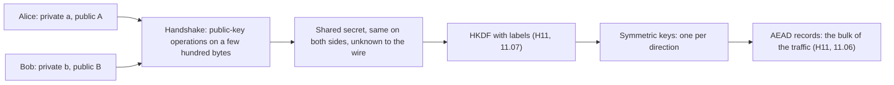
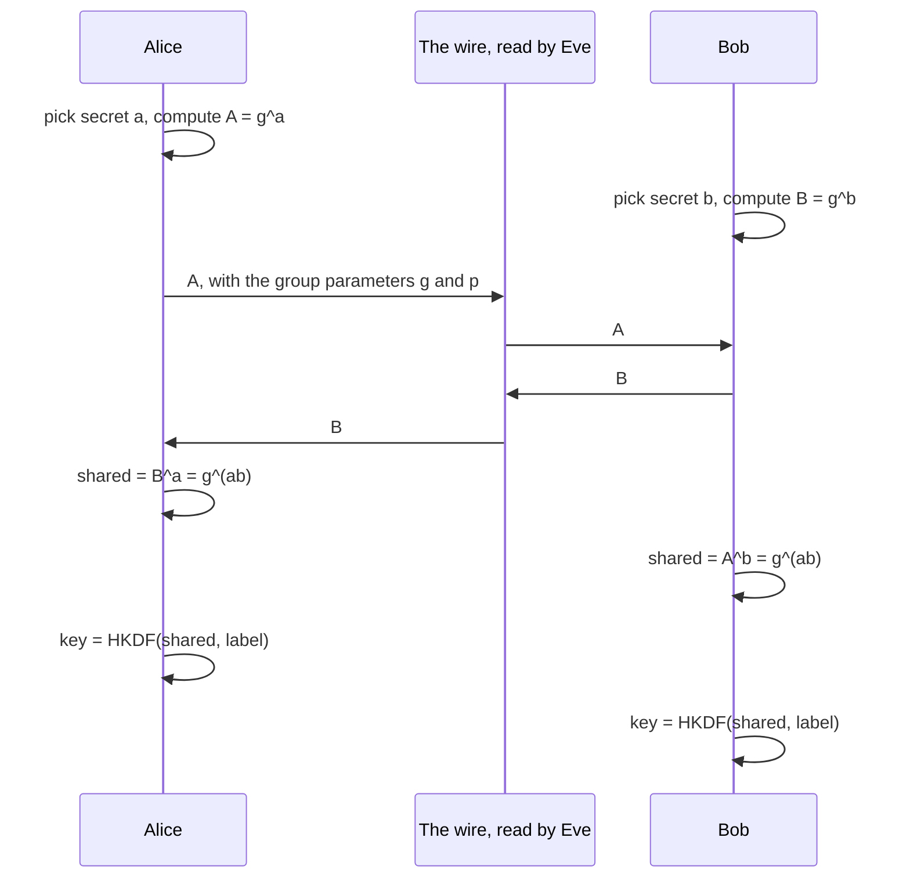
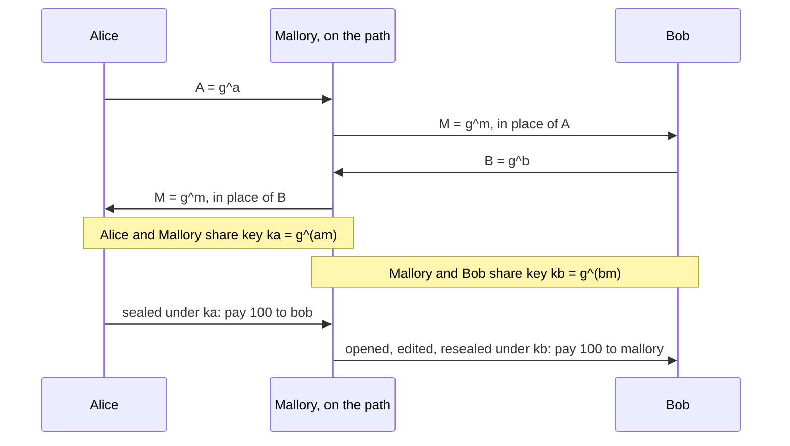
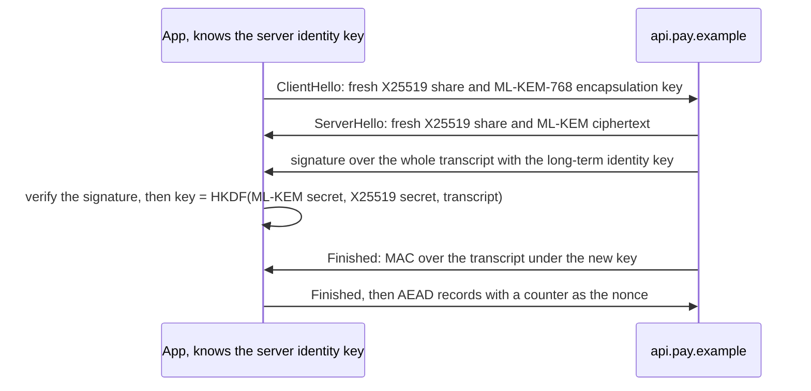

<!-- markdownlint-disable MD001 -->
<!-- markdownlint-disable MD024 -->
<!-- markdownlint-disable MD025 -->
<!-- markdownlint-disable MD026 -->
<!-- markdownlint-disable MD029 -->
<!-- markdownlint-disable MD033 -->
<!-- markdownlint-disable MD036 -->
<!-- markdownlint-disable MD040 -->
<!-- markdownlint-disable MD056 -->
<!-- markdownlint-disable MD060 -->

# H12. Public-key crypto and key exchange

---

## Contents

| #     | Sub-topic                                                                           | Tag  |
| ----- | ----------------------------------------------------------------------------------- | ---- |
| 12.01 | The key distribution problem and what public-key cryptography offers                | CORE |
| 12.02 | The minimum mathematics: modular arithmetic, one-way functions, discrete logarithms | DEEP |
| 12.03 | RSA: key generation, encryption, signatures, padding, Bleichenbacher                | CORE |
| 12.04 | Diffie-Hellman: finite field, elliptic curve, X25519 and P-256                      | CORE |
| 12.05 | The man in the middle: why an exchange must be authenticated                        | CORE |
| 12.06 | Digital signatures: ECDSA and its nonce, Ed25519                                    | CORE |
| 12.07 | Ephemeral keys and forward secrecy                                                  | CORE |
| 12.08 | Post-quantum: Shor, harvest now decrypt later, ML-KEM, hybrid exchange, ML-DSA      | DEEP |
| 12.09 | The story: building a secure channel one decision at a time                         | CORE |
| 12.10 | Labs: two Java programs, their Rust twins, five experiments                         | CORE |
| 12.11 | Exercises                                                                           |      |
| 12.12 | Solutions                                                                           |      |
| 12.13 | Takeaways                                                                           |      |

Tags: **CORE** is what an architect is expected to explain unprompted, **DEEP** is the mechanism underneath it, **AWARE** (used inside sections) is a fact to know exists and not to derive.

Terms used throughout.  
Each is defined here, before any section uses it.  
Terms from H11 (nonce, AEAD, HKDF, CSPRNG, MAC, oracle, constant-time) keep their H11 meaning.

- **Asymmetric**, **key pair**, **public key**, **private key**: a symmetric scheme (H11) uses one key that both parties hold.  
  An asymmetric scheme uses a *key pair* made of two mathematically linked keys.  
  The **public key** may be shown to the whole world. The **private key** (also called the secret key) never leaves its owner.  
  What one key of the pair does, only the other can undo or check.

- **Key distribution**: the problem of getting the right secret key to the right parties, and only to them, before they can use symmetric cryptography.  
  12.01 shows why it is the hard part.

- **Key agreement**, **key exchange**: a protocol in which two parties each contribute a value and both compute the same shared secret, while an eavesdropper who sees every message cannot.  
  Diffie-Hellman (12.04) is the example.

- **Public-key encryption**, **KEM** (key encapsulation mechanism): with public-key encryption a sender encrypts a message to a public key and only the private key opens it.  
  A KEM is the cleaner interface used for key setup: `encapsulate(public key)` returns a fresh random secret and a *ciphertext* that carries it, and `decapsulate(private key, ciphertext)` returns the same secret.  
  RSA (12.03) and ML-KEM (12.08) are used this way.

- **Digital signature**, **verify**, **non-repudiation**: the owner of a private key *signs* a message and produces a signature that anyone holding the public key can *verify*.  
  A valid signature shows that the message is unchanged and that the signer held the private key.  
  Because the verifier cannot have produced it (unlike a MAC tag, H11), the signer cannot plausibly deny it: that is non-repudiation.

- **Modulus**, **modular arithmetic**, **prime**: `a mod n` is the remainder of `a` divided by `n`.  
  Arithmetic modulo `n` is arithmetic on a clock face with `n` positions: after `n - 1` it wraps to 0.  
  A prime is a number greater than 1 whose only divisors are 1 and itself.  
  A **composite** has other divisors, and **factoring** finds them.

- **Inverse**: the inverse of `a` modulo `n` is the number `b` with `a * b mod n = 1`, written `a^-1`.  
  It exists exactly when `a` and `n` share no factor, and it is found with the extended Euclidean algorithm.

- **One-way function**, **trapdoor**: a function that is easy to compute and infeasible to invert.  
  A **trapdoor** one-way function becomes easy to invert for whoever holds one extra secret, the trapdoor.  
  A public key is the "easy direction" published, and the private key is the trapdoor.

- **Group**, **generator**, **order**: for this module a group is a set of numbers with a multiplication (or, for curves, an addition) under which repeated operation stays inside the set.  
  A **generator** `g` is an element whose repeated products reach every other element.  
  The **order** is the number of elements. Exponent arithmetic in a group of order `q` wraps at `q`.

- **Discrete logarithm**: given `g`, a modulus `p` and `h = g^x mod p`, find `x`.  
  Computing `h` from `x` is fast and the reverse is believed infeasible for large `p`, which makes `g^x mod p` a one-way function. 12.02 measures it.

- **Elliptic curve**, **point**, **scalar multiplication**, **base point**: an elliptic curve is the set of pairs `(x, y)` that satisfy an equation such as `y^2 = x^3 + ax + b` modulo a prime `p`, plus one extra point called the **point at infinity**.  
  Points can be added to each other by a geometric rule, which makes the curve a group.  
  **Scalar multiplication** `d * G` adds the **base point** `G` to itself `d` times.  
  Recovering `d` from `d * G` is the elliptic-curve discrete logarithm problem.

- **Certificate**: a signed statement that binds a public key to a name, issued by a party the verifier already trusts.  
  Mentioned here only as the answer to a question 12.05 asks, and defined fully in H13.

- **Man in the middle** (MITM), **active attacker**: an attacker who sits on the path and relays, reads and rewrites every message between two parties who think they talk to each other, as in the attacker model of H11 (11.01).

- **Static**, **ephemeral**, **forward secrecy**: a *static* key is long-lived and reused across many sessions.  
  An *ephemeral* key is generated for one session and deleted afterwards.  
  **Forward secrecy** (also *perfect* forward secrecy) is the property that a later theft of long-term keys does not reveal the traffic of earlier sessions (12.07).

- **Handshake**, **transcript**: the opening exchange of a secure channel in which keys are agreed and the parties are checked.  
  The *transcript* is the full list of messages exchanged so far.

- **Padding scheme**: a rule for expanding a message into the exact size and shape a raw public-key operation needs, with randomness and structure the receiver can check.  
  OAEP and PSS (12.03) are padding schemes for encryption and signing.

- **Quantum computer**, **Shor's algorithm**, **CRQC**: a quantum computer computes with quantum states instead of bits.  
  Shor's algorithm, run on a large enough *error-corrected* quantum computer, factors integers and solves discrete logarithms, including on curves, in polynomial time.  
  A **CRQC** (cryptographically relevant quantum computer) is a machine big enough to do that at real key sizes.  
  None is known to exist. 12.08 covers the consequences.

- **Harvest now, decrypt later**, **post-quantum**, **hybrid**: recording encrypted traffic today to decrypt it once a CRQC exists.  
  *Post-quantum* algorithms are classical algorithms, running on ordinary computers, that are believed to resist quantum attack.  
  A *hybrid* exchange runs a classical and a post-quantum algorithm side by side and uses both results.

- **Lattice**: a regular grid of points in many dimensions.  
  Finding the grid point closest to a given point is believed hard even for quantum computers when the dimension is in the hundreds, and it is the problem under ML-KEM and ML-DSA (12.08).

Outputs in this module are real.  
They come from two Java programs and their Rust twins (12.10) that run every demonstration: the mathematics, RSA, Diffie-Hellman, the man in the middle,  
ECDSA and Ed25519 against the RFC test vectors, nonce reuse, forward secrecy, and a hybrid post-quantum exchange.  

Run on Linux 6.18, JDK 21.0.12, Rust 1.97, RustCrypto crates and Bouncy Castle 1.86.  
Every demonstration with a key uses a *fixed* key, so the Java and Rust programs print the same text on every run.  
The one difference is that the Rust post-quantum program has no ML-DSA lines.  
The RSA keys are random, so their lines print only sizes and true or false.

---

## 12.01 The key distribution problem and what public-key cryptography offers

Symmetric cryptography (H11) is fast and strong, but it needs both ends to hold the same secret already, and handing that secret over needs a channel that is already secure.  
For `n` parties who all need to talk privately, the number of keys grows as `n(n-1)/2`, and every one of them has to travel somewhere.  
Public-key cryptography breaks the circle: each party holds a key pair, publishes the public half, keeps the private half, and can then set up a shared symmetric key with a stranger over an open wire.  
It provides three tools: **key agreement** (Diffie-Hellman), **public-key encryption or a KEM** (RSA, ML-KEM) and **digital signatures** (RSA, ECDSA, Ed25519).  
These tools are slow beside AES, so they never carry bulk data.  
They set up a key and prove identity, and an AEAD from H11 carries the traffic.  
What public keys do *not* solve is whose key it is, which is the subject of 12.05 and H13.

### The problem, with numbers

Take `n` parties who must each talk privately to every other.  
With symmetric keys, each pair needs its own secret, because a key shared by three parties lets any of them read what the other two say.

| Parties `n` | Symmetric keys, one per pair | Key pairs, one per party |
| ----------- | ---------------------------- | ------------------------ |
| 10          | 45                           | 10                       |
| 1,000       | 499,500                      | 1,000                    |
| 100,000     | 4,999,950,000                | 100,000                  |

(The lab computes these in `exercises` mode.) The count is only the start.  
Each of those keys was generated somewhere and delivered somehow, and delivery by courier, by phone call or by a printed code book does not work for a browser that meets a new server every few seconds.  
Before 1976 the only scalable answer was a **key distribution centre**: a trusted server holds a key shared with each party and hands out session keys on request, which is how Kerberos still works inside an enterprise.  
It makes the centre a single point of failure and a single point of compromise, and it needs a prior relationship with every party.  
That cannot be the model of the web.

### What public-key cryptography changes

Whitfield Diffie and Martin Hellman published the idea of a key pair in 1976 and the key-exchange protocol that bears their names.  
Rivest, Shamir and Adleman devised the first public-key encryption and signature scheme in 1977.  
The same ideas had been found a few years earlier at GCHQ by Ellis, Cocks and Williamson and were kept secret until 1997.  
The structure is this: a key pair `(public, private)` is generated together;  
the public half can be copied to anyone, and what it allows (encrypt to the owner, check the owner's signature, run a key exchange with the owner) cannot be reversed without the private half.

| Tool                         | Question it answers                            | Who uses which key                                                          | Examples                            | Section             |
| ---------------------------- | ---------------------------------------------- | --------------------------------------------------------------------------- | ----------------------------------- | ------------------- |
| Key agreement                | How do we end up with the same secret?         | Each side combines its own private key with the other's public key          | X25519, P-256 ECDH, finite-field DH | 12.04               |
| Public-key encryption or KEM | How do I send a secret to someone I never met? | The sender uses the receiver's public key, the receiver's private key opens | RSA-OAEP, ML-KEM                    | 12.03, 12.08        |
| Digital signature            | Who produced this, and was it changed?         | The signer uses the private key, anyone verifies with the public key        | RSA-PSS, ECDSA, Ed25519, ML-DSA     | 12.03, 12.06, 12.08 |

### The hybrid pattern

Public-key operations cost microseconds to milliseconds each and work on a few hundred bytes, against nanoseconds per 16-byte block for AES-GCM.  
Every real protocol therefore uses the same pattern, and TLS is exactly this (H15).



The shared secret is never used as a key directly.  
It goes through HKDF with a label, as in H11 (11.07), and the lab does that in every exchange.  
One exchange costs a fraction of a millisecond and then pays for gigabytes of traffic.

### What public keys do not solve

A public key is a number. If an attacker can substitute *their* number for Bob's when Alice fetches it, then everything that follows is perfectly secure and goes to the wrong party. Public-key cryptography moves the problem from "how do I deliver a secret key" to "how do I know this public key is Bob's". The answer is a certificate chain (H13) or a key learned out of band, and 12.05 shows the attack that makes the question unavoidable.

### Interview angle

- *"Why not just use RSA for everything?"*  
  It is orders of magnitude slower than AES, it can only encrypt a message shorter than its modulus, and RSA key transport gives no forward secrecy (12.07).  
  Use public-key operations to agree a key, then an AEAD.

- *"What problem does Diffie-Hellman solve and what does it not?"*  
  It lets two parties who have never met derive a shared secret over a public channel.  
  It does not tell either party who the other is (12.05).

- *"How many keys does a company of 10,000 need for pairwise symmetric encryption?"* 10,000 * 9,999 / 2 = 49,995,000, against 10,000 key pairs.

- *"Public key or private key, which one do I sign with?"* The private key signs and the public key verifies.  
  For encryption it is the other way round: the public key encrypts and the private key decrypts.  
  A frequent slip in interviews is to say a signature "encrypts the hash with the private key".  
  That describes textbook RSA only, and it is not how ECDSA or Ed25519 work (12.06).

---

## 12.02 The minimum mathematics: modular arithmetic, one-way functions, discrete logarithms

All the public-key schemes in this module run on arithmetic on a clock face of size `n` ("modulo `n`"). Two facts do the work.  
First, raising a number to a huge power modulo `n` is *fast*: about two multiplications per bit of the exponent, so 4,091 multiplications for a 2,048-bit exponent.  
Second, undoing it is believed *infeasible* when `n` is large: finding the exponent (the discrete logarithm) or splitting `n` into its two prime factors has no known fast algorithm on classical computers.  

RSA rests on factoring, Diffie-Hellman and DSA-style signatures on the discrete logarithm, and the elliptic-curve variants on the same problem in a different group,  
which is harder per bit and lets keys be 12 times shorter. Quantum computers change the second fact, which is 12.08.

### Modular arithmetic in five lines

- `a mod n` is the remainder after dividing by `n`.  
  Sums and products can be reduced at any step: `(a * b) mod n = ((a mod n) * (b mod n)) mod n`.  
  The numbers never grow beyond `n`.

- An **inverse** `a^-1 mod n` exists when `a` and `n` share no factor.  
  The extended Euclidean algorithm finds it with a handful of divisions.  
  The lab finds `17^-1 mod 3120 = 2753`, because `17 * 2753 = 46801 = 15 * 3120 + 1`.

- **Fermat and Euler.** For a prime `p` and any `a` not divisible by `p`, `a^(p-1) = 1 mod p`.  
  For `n = p * q` with `p` and `q` prime and any `a` that shares no factor with `n`, `a^((p-1)(q-1)) = 1 mod n`.  
  The exponent `(p-1)(q-1)` is written `phi(n)`, and it is computable only by someone who knows `p` and `q`.  
  That single sentence is the whole of RSA (12.03).

- A prime modulus `p` has a **generator** `g`: the powers `g^1, g^2, ..., g^(p-1)` visit every nonzero residue exactly once.  
  Not every `g` is one.  
  The lab's first attempt at a discrete-logarithm search used `g = 2`, which has a tiny order modulo some primes and made the search finish in 11 tries, so the lab now picks a true generator first.

- Exponents wrap at the group order.  
  In a group of order `q`, `g^x` and `g^(x + q)` are the same element, so exponents are arithmetic modulo `q`.

### Fast exponentiation

Computing `g^x mod p` for a 2,048-bit `x` does not multiply `g` by itself `x` times, which would take about `2^2048` steps.  
It squares repeatedly and multiplies only on the set bits of `x` (**square and multiply**):

```text
r = 1
for each bit of x, from the most significant:
    r = r * r mod p
    if the bit is 1:  r = r * g mod p
```

For a 2,048-bit exponent this is about 2,048 squarings and about 2,043 multiplications on average, and the lab counts them:

```text
7^e mod p, e of 2048 bits                    4091 multiplications (a search would need about 2^2048)
equals BigInteger.modPow                     true
```

On a curve the same loop is **double and add**, adding a point to itself instead of squaring.

### One-way and trapdoor functions

A function is *one-way* when forward is cheap and backward is infeasible.  
Each public-key family is one such function, packaged with a way for the right party to get the answer.

| Hard problem                      | Easy direction                          | Hard direction                              | Trapdoor?                                       | Used by                                     |
| --------------------------------- | --------------------------------------- | ------------------------------------------- | ----------------------------------------------- | ------------------------------------------- |
| Integer factoring                 | Multiply two large primes `p * q`       | Recover `p` and `q` from `n`                | Yes: knowing `p` and `q` gives `phi(n)` and `d` | RSA (12.03)                                 |
| Discrete logarithm in `Z_p*`      | `g^x mod p`                             | Recover `x` from `g^x mod p`                | No trapdoor needed: `(g^a)^b = (g^b)^a`         | Finite-field DH, DSA (12.04)                |
| Elliptic-curve discrete logarithm | `d * G` on a curve                      | Recover `d` from `d * G`                    | No trapdoor needed: `b(aG) = a(bG)`             | ECDH, X25519, ECDSA, Ed25519 (12.04, 12.06) |
| Short-vector problem on lattices  | Combine lattice points plus small noise | Remove the noise and find the lattice point | Yes: the secret is a short basis                | ML-KEM, ML-DSA (12.08)                      |

### The discrete logarithm, felt

The lab searches for the exponent the only way the program can without cleverness: try `x = 1, 2, 3, ...` until `g^x` hits the target.  
For a prime of `b` bits the group has about `2^b` elements, and the target is two thirds of the way round:

```text
g^x = h mod a 16-bit prime (g = 3)           x found after 43691 tries
g^x = h mod a 20-bit prime (g = 5)           x found after 699055 tries
g^x = h mod a 24-bit prime (g = 2)           x found after 11184839 tries
```

Each 4 extra bits multiply the work by 16: it doubles per bit.  
Experiment 01 (12.10) runs 28 bits and gets 178,956,972 tries in about 12 seconds on the lab machine.  
At 2,048 bits the same search needs about `2^2048` steps, a number with 617 digits, and no hardware that can be imagined changes that.  
The honest qualification: this is the *naive* attack. Real attacks do better, and how much better is what sets key sizes.

| Group                        | Best known classical attack                            | Cost                       | What it means for key sizes                              |
| ---------------------------- | ------------------------------------------------------ | -------------------------- | -------------------------------------------------------- |
| Any group, generic           | Baby-step giant-step, Pollard's rho                    | About `sqrt(group order)`  | A group of order `2^256` gives about 128 bits            |
| Multiplicative group mod `p` | Index calculus, number field sieve                     | Sub-exponential in `log p` | Needs a much larger `p`: 3,072 bits for 128-bit security |
| Integer factoring (RSA)      | General number field sieve                             | Sub-exponential in `log n` | Needs a 3,072-bit modulus for 128-bit security           |
| Well-chosen elliptic curve   | Pollard's rho only. No sub-exponential attack is known | About `sqrt(group order)`  | 256-bit keys for 128-bit security                        |

That last row is the reason elliptic curves won. NIST's long-standing equivalence table (SP 800-57) puts the pieces side by side:

| Security level | Symmetric key | RSA or finite-field DH modulus | Elliptic curve key |
| -------------- | ------------- | ------------------------------ | ------------------ |
| 112 bits       | 3-key 3DES    | 2,048 bits                     | 224 bits           |
| 128 bits       | AES-128       | 3,072 bits                     | 256 bits           |
| 192 bits       | AES-192       | 7,680 bits                     | 384 bits           |
| 256 bits       | AES-256       | 15,360 bits                    | 512 bits (P-521)   |

### Elliptic curves on one page

A curve `y^2 = x^3 + a x + b` taken modulo a prime `p` is a scatter of points, not a smooth line, but the same algebra works on it.  
Two points `P = (x1, y1)` and `Q = (x2, y2)` add to a third point `R = (x3, y3)` by:

```text
if P != Q:  slope = (y2 - y1) / (x2 - x1)          if P = Q:  slope = (3 * x1^2 + a) / (2 * y1)
x3 = slope^2 - x1 - x2
y3 = slope * (x1 - x3) - y1                          (all arithmetic modulo p, division by an inverse)
```

Adding a point to its mirror image `(x, -y)` gives the **point at infinity**, which plays the part of zero.  
The lab's toy curve is the textbook `y^2 = x^3 + 2x + 2` modulo 17 with base point `G = (5, 1)`:

```text
toy curve, G, 2G .. 6G                       (5,1) (6,3) (10,6) (3,1) (9,16) (16,13)
toy curve, order of G                        19 (so 19G is the point at infinity)
```

Scalar multiplication `d * G` walks that list `d` places.  
The point group has 19 elements, so `d` is only meaningful modulo 19, and it can be recovered by trying 18 values.  
On a real curve the order is about `2^256`. The two notations line up one to one:

| Multiplicative group (finite-field DH) | Elliptic curve (additive notation)        |
| -------------------------------------- | ----------------------------------------- |
| Prime `p`, generator `g`               | Prime `p`, curve equation, base point `G` |
| Private exponent `x`                   | Private scalar `d`                        |
| Public value `g^x mod p`               | Public point `d * G`                      |
| `g^a * g^b = g^(a+b)`                  | `a * G + b * G = (a + b) * G`             |
| `(g^a)^b = g^(ab)`                     | `b * (a * G) = (ab) * G`                  |
| Square and multiply                    | Double and add                            |

Two curves matter for HTTPS. **P-256** (also named `secp256r1` and `prime256v1`), a NIST curve with `p = 2^256 - 2^224 + 2^192 + 2^96 - 1`, is the one in most certificates and hardware.  
**Curve25519**, designed by Daniel Bernstein around the prime `p = 2^255 - 19`, is the one behind X25519 (key exchange) and Ed25519 (signatures, as a related curve form).  
Both have a group order close to `2^256` and give about 128 bits of security.

The lab's curve code is for teaching only: it branches on the secret bits, so it leaks through timing, and it must never hold a real key.  
Real code uses the library's constant-time implementation, which the lab checks the toy code against (12.06).

### Interview angle

- *"Why is a 256-bit elliptic-curve key as strong as a 3,072-bit RSA key?"*  
  The best attacks on a well-chosen curve are generic: about the square root of the group order, so `2^128` for a 256-bit group.  
  RSA and finite-field DH have a sub-exponential attack, the number field sieve, so the numbers must be far larger for the same strength.

- *"What is a trapdoor function?"* A one-way function that has a secret making the reverse direction easy.  
  RSA's trapdoor is the factorisation of `n`.  
  Diffie-Hellman needs no trapdoor: its security is that `g^(ab)` is easy given `a` and `g^b` and hard given only `g^a` and `g^b`.

- *"Why can RSA be used with 2,048-bit numbers when an exponent search is `2^2048`?"*  
  Because encryption and decryption use square and multiply, which is linear in the bit length (4,091 multiplications in the lab), while the attack has to invert, which has no shortcut of that kind.

---

## 12.03 RSA: key generation, encryption, signatures, padding, Bleichenbacher

RSA's public key is a product of two secret primes, `n = p * q`, and an exponent `e` (nearly always 65,537).  
To encrypt a number `m` smaller than `n`, compute `c = m^e mod n`.  
The private exponent `d` is the inverse of `e` modulo `phi(n)`, so `c^d mod n = m`, and only someone who knows `p` and `q` can compute `d`.  
Signing is the same operation run backwards: raise a hash to the power `d`, and anyone can undo it with `e`.  
The *textbook* version is unsafe: it is deterministic, it can be multiplied (malleable), and it fails for messages longer than `n`.  
The versions to use are **RSA-OAEP** for encryption (if you must) and **RSA-PSS** for signatures, both of which add randomness and structure.  
**PKCS#1 v1.5 encryption** is the format that Bleichenbacher's 1998 oracle attack, and its descendants up to ROBOT in 2017, broke in real servers, which is why TLS 1.3 removed RSA key transport entirely.  
RSA survives today mostly as a *signature* algorithm in certificates.

### Key generation, with the textbook numbers

| Step | Operation                                       | Textbook values    | Real values (RSA-2048)           |
| ---- | ----------------------------------------------- | ------------------ | -------------------------------- |
| 01   | Choose two large random primes `p` and `q`      | `p = 61`, `q = 53` | Two 1,024-bit primes             |
| 02   | `n = p * q`                                     | `n = 3233`         | A 2,048-bit modulus              |
| 03   | `phi = (p - 1)(q - 1)`                          | `phi = 3120`       | Computable only with `p` and `q` |
| 04   | Choose a public exponent `e` coprime to `phi`   | `e = 17`           | `e = 65537`                      |
| 05   | `d = e^-1 mod phi`                              | `d = 2753`         | A 2,048-bit number               |
| 06   | Publish `(n, e)`. Keep `d`, `p` and `q` private |                    |                                  |

`e = 65537 = 2^16 + 1` is chosen because it is prime, large enough to avoid the small-exponent attacks that break `e = 3`, and has only two set bits, so verification takes 17 multiplications.  
A signature check is therefore cheap, while signing uses the large exponent `d` and costs far more.  
Generating the primes is the slow part of key generation: the program tries random odd candidates and tests each for primality, which takes from tens of milliseconds to a few seconds for a 2,048-bit key.

### Encrypt, decrypt, and why it works

```text
encrypt:  c = m^e mod n          decrypt:  m = c^d mod n
```

It works because `e * d = 1 + k * phi(n)` for some `k`, and by Euler's theorem `m^phi(n) = 1 mod n`, so `m^(e d) = m * (m^phi)^k = m`.  
The lab runs the textbook numbers:

```text
textbook key                                 n = 3233, e = 17, d = 2753
textbook: 65 encrypts to                     2790, decrypts to 65
```

### Why textbook RSA is not enough

| Flaw                              | Demonstration                                                                             | Consequence                                                                   |
| --------------------------------- | ----------------------------------------------------------------------------------------- | ----------------------------------------------------------------------------- |
| Deterministic                     | The same `m` always gives the same `c`                                                    | An attacker confirms a guess ("is it `yes`?") by encrypting it                |
| Malleable (multiplicative)        | `E(2) * E(3) mod n` decrypts to 6 (lab output below)                                      | An attacker edits a plaintext they cannot read, by multiplying the ciphertext |
| Messages must be smaller than `n` | With `m = 3300` and `n = 3233`, the result decrypts to 67 = 3300 mod 3233 (Experiment 02) | Silent corruption                                                             |
| Small `m` and small `e`           | If `m^e < n` there is no wrap, and an ordinary integer root recovers `m`                  | Short messages fall without any factoring                                     |

```text
textbook: 2 and 3 multiplied                 E(2) * E(3) decrypts to 6
```

### Padding schemes

The fix is to turn the message into a full-width, randomised, structured block before the exponentiation, and to check the structure after decrypting.

| Scheme            | Use     | Randomised? | Standard | Status                                                                          |
| ----------------- | ------- | ----------- | -------- | ------------------------------------------------------------------------------- |
| Textbook RSA      | Either  | No          | None     | Never                                                                           |
| RSAES-PKCS1-v1_5  | Encrypt | Yes         | RFC 8017 | Bleichenbacher-vulnerable in practice. Avoid                                    |
| RSAES-OAEP        | Encrypt | Yes         | RFC 8017 | The correct choice if RSA encryption is needed                                  |
| RSASSA-PKCS1-v1_5 | Sign    | No          | RFC 8017 | Still most certificate signatures. Not allowed for TLS 1.3 handshake signatures |
| RSASSA-PSS        | Sign    | Yes (salt)  | RFC 8017 | Preferred. The only RSA scheme TLS 1.3 uses for its own handshake signature     |

**OAEP** mixes the message with a random seed through two hash-based masks (MGF1, a hash used as a mask generator) so that the block is random-looking, and the decryptor checks a hash of the label.  
Its message limit for a key of `k` bytes and a hash of `h` bytes is `k - 2h - 2`: for RSA-2048 with SHA-256 it is `256 - 64 - 2 = 190` bytes.  
The lab confirms the boundary and the randomisation:

```text
RSA-2048 public key                          2048-bit modulus, e = 65537
OAEP-SHA-256                                 256-byte ciphertext, opens to "pay 100 to bob"
OAEP, same message twice                     ciphertexts differ: true
OAEP, one bit flipped                        rejected
OAEP-SHA-256 message limit                   190 bytes ok, 191 rejected (256 - 2 x 32 - 2)
```

Java detail the lab hits: `Cipher.getInstance("RSA/ECB/OAEPPadding")` with no parameters uses SHA-1 inside MGF1 while the main hash is SHA-256.  
The program passes an explicit `OAEPParameterSpec("SHA-256", "MGF1", MGF1ParameterSpec.SHA256, PSource.PSpecified.DEFAULT)`, which is what other libraries (and the Rust `Oaep::new::<Sha256>()`) expect.

**Signatures** hash the message first, because RSA only handles a block, then pad the digest and raise it to `d`. **PKCS#1 v1.5** signing is deterministic, so signing twice gives byte-identical output.  
**PSS** adds a random salt, so signing twice gives different signatures that both verify:

```text
PSS signature                                256 bytes, verifies: true, two signatures differ: true
PSS, message changed                         verifies: false
PKCS#1 v1.5 signature, twice                 identical: true
```

### Bleichenbacher, in one paragraph

In 1998 Daniel Bleichenbacher showed that a server which decrypts PKCS#1 v1.5 ciphertexts and reveals whether the result *looks valid* (starts with the bytes `00 02`, through a distinct error message, an alert or a timing difference) is a padding oracle (H11, 11.05).  
The attacker takes a captured ciphertext `c`, multiplies it by `s^e` for a chosen `s`, which by malleability multiplies the hidden plaintext by `s`, sends the result and learns one bit: is the product still in the valid range? Each "yes" shrinks the interval that must contain the plaintext.  
After some thousands to millions of queries the attacker has the plaintext of `c`, for example a TLS session's pre-master secret, **without ever having the private key**.  
The attack came back in 2016 (DROWN), in 2017 as ROBOT (products from F5, Citrix, Cisco, Palo Alto Networks and others, and some large web sites, were still vulnerable 19 years later) and, in a timing form, in 2023 as the Marvin attack.  
The structural fix is to stop using RSA for key transport: **TLS 1.3 removed it**.  
The local fix is OAEP, uniform error handling and implicit rejection (return a random value instead of an error).

### Sizes, speed and where RSA lives now

| Property                | RSA-2048                                                                                                  | RSA-3072               | Remark                                              |
| ----------------------- | --------------------------------------------------------------------------------------------------------- | ---------------------- | --------------------------------------------------- |
| Security level          | About 112 bits                                                                                            | About 128 bits         | NIST deprecates 112-bit strength after 2030         |
| Public key (raw)        | 256-byte modulus, 3-byte exponent                                                                         | 384 bytes              | An X.509 public key is about 294 bytes in DER       |
| Signature or ciphertext | 256 bytes                                                                                                 | 384 bytes              | Always the modulus size                             |
| Cost of signing         | High: exponent `d` has 2,048 bits (the Chinese remainder theorem shortcut makes it about 4 times cheaper) | About 3 times RSA-2048 | Grows with the cube of the modulus size             |
| Cost of verifying       | Low: exponent 65,537 needs 17 multiplications                                                             | Low                    | Why RSA signatures are cheap for the many verifiers |

**[AWARE] The Rust `rsa` crate** carries a published advisory (RUSTSEC-2023-0071, the Marvin timing attack): its private-key operations are not constant-time, so a networked service that decrypts attacker-chosen ciphertext with it can leak the key through timing.  
The lab uses it for sizes and round trips on local data only.  
A production RSA private-key operation belongs in a vetted library (`aws-lc-rs`, `ring`, OpenSSL) or an HSM.

### Interview angle

- *"How does RSA work?"*  
  Two secret primes make `n`. Encryption is `m^e mod n`.  
  The private exponent is `e^-1 mod phi(n)`, which requires knowing `p` and `q`.  
  Security is the difficulty of factoring `n`.  
  Then volunteer that raw RSA is unsafe and real use pads with OAEP or PSS.

- *"Why is RSA with PKCS#1 v1.5 padding dangerous?"*  
  Bleichenbacher: a server that tells you whether padding was valid is an oracle, and the malleability of RSA turns each answer into information about the plaintext.  
  2017's ROBOT showed it alive in production.

- *"RSA or ECDSA for a new service?"* ECDSA or Ed25519: shorter keys, shorter signatures, faster signing.  
  Choose RSA only for compatibility with systems that cannot do better.  
  If RSA, use at least 2,048 bits (3,072 for a long horizon) and PSS.

- *"Why e = 65537?"* Prime, large enough to avoid the small-exponent attacks, and two set bits so that verification is cheap.

- *"Can I encrypt a 1 KB JSON with an RSA-2048 public key?"*  
  No: the limit is 190 bytes with OAEP-SHA-256.  
  Generate a random AES key, encrypt the JSON with an AEAD, encrypt the 32-byte key with RSA-OAEP.  
  That is a hand-made KEM, which is why HPKE (RFC 9180, 12.04) exists.

---

## 12.04 Diffie-Hellman: finite field, elliptic curve, X25519 and P-256

Alice picks a secret `a` and sends `A = g^a`.  
Bob picks a secret `b` and sends `B = g^b`.  
Alice computes `B^a = g^(ab)` and Bob computes `A^b = g^(ab)`: the same number, which neither ever transmitted.  
An eavesdropper sees `g`, `A` and `B` and would have to solve a discrete logarithm to get `a` or `b`.  
Doing the same on an elliptic curve, with `a * G` instead of `g^a`, gives the form used in practice: **X25519** (32-byte keys, 128-bit security, designed to be hard to implement wrongly) and **ECDH on P-256**.  
The shared value is not uniformly random, so it goes through HKDF before it becomes a key.  
And the exchange as described is *unauthenticated*: it defends against someone who only listens (12.05 handles the rest).

### The exchange



The lab's smallest case: modulus 23, generator 5, Alice's secret 6, Bob's secret 15.

```text
finite field, p = 23, g = 5                  A = 8, B = 19, shared = 2 and 2
```

`5^6 mod 23 = 8`, `5^15 mod 23 = 19`, then `19^6 mod 23 = 2` and `8^15 mod 23 = 2`.  
Eve holds 23, 5, 8 and 19 and must find 6 or 15, which here is a table lookup and in a real group is infeasible.  
Neither party chose the final value alone, which is a useful property: each secret contributes, so a party that wants a *particular* shared key cannot force it.

### Finite-field Diffie-Hellman in practice

The group parameters must be chosen so the discrete logarithm is hard: `p` a **safe prime** (`p = 2q + 1` with `q` prime, so the group has no small subgroups to attack), and large.  
Standardised groups exist (RFC 7919: `ffdhe2048` to `ffdhe8192`) so that nobody invents their own.  
The 2015 **Logjam** attack showed two ways to get this wrong: servers that accepted 512-bit "export-grade" groups could be downgraded to them by a man in the middle,  
and one precomputation against a widely shared 1,024-bit prime made every exchange with that prime cheap to break afterwards.  
A 2,048-bit key share is 256 bytes each way, and the exponentiation costs far more than on a curve.  
TLS 1.3 keeps finite-field groups for compatibility, and nearly everything negotiates curves.

### Elliptic-curve Diffie-Hellman

The same protocol with the curve notation of 12.02: Alice sends `A = a * G`, Bob sends `B = b * G`, and both compute `a * B = b * A = (ab) * G`.  
The shared secret is the x-coordinate of that point.  
The lab's toy case on the curve of 12.02 (secrets 3 and 7, base point `(5, 1)`):

```text
toy curve, a = 3, b = 7                      aG = (10,6), bG = (0,6), shared = (6,3) and (6,3)
```

`3G = (10,6)` and `7G = (0,6)`, and both sides land on `21G`, which is `2G = (6,3)` because the group order is 19.

### X25519

X25519 (RFC 7748) is ECDH on Curve25519 with every design decision aimed at making implementation mistakes hard:

- **Keys are 32 bytes**, for both the private and the public value.  
  Every 32-byte string is a valid public key, so there is no "is this point on the curve" check to forget.

- **The private scalar is clamped** before use: the low three bits are cleared (so the scalar is a multiple of 8, which removes a small subgroup that the curve has),  
  the top bit is cleared and the second-highest set, so the multiplication takes the same number of steps for every key.  
  Any 32 random bytes are a valid private key.

- **The arithmetic is x-only** and runs on a Montgomery ladder, a fixed sequence of operations that does not depend on the secret bits, which is the core of constant-time implementation.

- **Test vectors** (RFC 7748 section 6.1) pin the behaviour.  
  The lab uses them as its fixed Alice and Bob:

```text
X25519 Alice public key                      8520f0098930a754748b7ddcb43ef75a0dbf3a0d26381af4eba4a98eaa9b4e6a
X25519 Bob public key                        de9edb7d7b7dc1b4d35b61c2ece435373f8343c85b78674dadfc7e146f882b4f
X25519 shared secret                         4a5d9d5ba4ce2de1728e3bf480350f25e07e21c947d19e3376f09b3c1e161742
equals RFC 7748 section 6.1                  true
```

- **One check remains: reject an all-zero result.** A malicious peer can send a public value of *small order*, such as `u = 0` or `u = 1`, which forces the shared secret to a value the attacker knows (all zero bytes).  
  RFC 7748 describes the check and TLS 1.3 requires aborting on it.  
  Libraries differ: the JDK refuses (`InvalidKeyException: Point has small order`), and Rust's `x25519-dalek` returns the zero secret and offers `was_contributory()` to check it.  
  Experiment 05 shows both.

### P-256 (secp256r1)

ECDH on the NIST curve P-256 is what hardware tokens, smart cards, TPMs, enterprise PKI and FIPS-constrained systems provide.  
Differences from X25519 that matter in practice:

- A public key is a *point*: 65 bytes in the usual uncompressed encoding (`04`, then the 32-byte `x`, then the 32-byte `y`).  
  The receiver **must validate that the point is on the curve**, otherwise an **invalid-curve attack** feeds the receiver a point from a weaker curve and learns the private key piece by piece.  
  The JDK validates.  
  A hand-written parser often does not.

- The formulas have exceptional cases (doubling, the point at infinity), which makes fast constant-time code harder to write than for Curve25519.  
  Good libraries do it. A home-grown implementation like the lab's toy code does not.

- The security level is the same (128 bits).  
  Both curves are in TLS 1.3 (`x25519` and `secp256r1`) and in the JDK.

| Property                | Finite-field `ffdhe2048` | X25519                 | ECDH P-256                       | X25519MLKEM768 (12.08)             |
| ----------------------- | ------------------------ | ---------------------- | -------------------------------- | ---------------------------------- |
| Public value, bytes     | 256                      | 32                     | 65 (uncompressed)                | 1,216 client, 1,120 server         |
| Security level          | About 112 bits           | About 126 bits         | 128 bits                         | 128-bit classical, post-quantum    |
| Peer validation         | Range check on the value | Reject all-zero output | Point must be on the curve       | Ciphertext length, library handles |
| Implementation pitfalls | Weak groups, Logjam      | Very few               | Invalid-curve, non-constant-time | Young implementations              |

### The shared secret is not yet a key

The output of Diffie-Hellman is a group element: an x-coordinate or a residue with structure (for X25519, always a 255-bit value, never covering the whole 256-bit range).  
Protocols pass it through a KDF with a label, and the lab uses the HKDF of H11 (11.07):

```text
HKDF(shared) as an AES-256-GCM key           05a82614f5476f837527a16cbcfb96a15b03173c12b873fd277232ca62322cc8
Alice seals, Bob opens                       a793911ea8426daff00aca3f0e8aaafae8f6c2e6993f91de48113934325e -> "pay 100 to bob"
```

In a full protocol the HKDF input also includes both public values and a protocol name, so that the key depends on the whole conversation and cannot be reused in another (TLS 1.3 does this, H15).

**[AWARE] HPKE (RFC 9180)** packages "encrypt a message to someone's public key" the way it should be done today: a KEM (X25519 or P-256), HKDF, and an AEAD, in one specified construction.  
Where 12.03 would have used RSA-OAEP for a 190-byte message, HPKE handles any size and is what TLS Encrypted Client Hello (the extension that hides the server name, H14) and Messaging Layer Security use.

### Interview angle

- *"Walk through Diffie-Hellman."* `A = g^a`, `B = g^b`, both compute `g^(ab)`. Security is the discrete logarithm.  
  Then volunteer the two caveats: the output goes through a KDF, and nothing in the protocol says who the other party is.

- *"Why X25519 over P-256?"* Same security, 32-byte keys, no point validation to forget, a ladder that is constant-time by construction, and no suspicion about the curve constants.  
  P-256 wins where hardware, FIPS or existing PKI dictate it.

- *"Does Diffie-Hellman give you forward secrecy?"* Only if the keys are ephemeral: fresh per session and deleted (12.07).  
  A static DH key reused across sessions does not.

- *"What goes wrong if you skip validating the peer's public key?"*  
  On P-256, invalid-curve attacks recover the private key.  
  On X25519, a small-order input forces a known shared secret, so check for all zeros.

---

## 12.05 The man in the middle: why an exchange must be authenticated

Diffie-Hellman defeats an attacker who only *reads*.  
An attacker who can also *modify* messages defeats it completely: Mallory intercepts Alice's public value and Bob's, substitutes her own for each, and runs one exchange with Alice and another with Bob.  
Each victim now shares a perfectly good key, and it is a key *with Mallory*.  
She decrypts what Alice sends, reads it, edits it, re-encrypts it for Bob, and neither victim sees anything wrong.  
The exchange is secure and goes to the wrong person.  
The fix is to make each side prove it holds a private key whose public half the other side already trusts:  
Bob **signs** the transcript of the exchange (both public values, at minimum) with a long-term identity key, and Alice verifies the signature before using the key.  
How Alice learns that identity key is the job of certificates (H13).

### The attack



The lab runs it with the real X25519 and the same AES-256-GCM seal as 12.04. Mallory's private key is a fixed 32 bytes of `0x42`:

```text
Alice's key equals Mallory's key with her    true
Bob's key equals Mallory's key with him      true
Alice's key equals Bob's key                 false
Mallory reads what Alice sent                "pay 100 to bob"
Bob receives, resealed by Mallory            "pay 100 to mallory"
```

Nothing in this attack breaks Diffie-Hellman, X25519 or AES-GCM.  
The primitives all did their job. The failure is that **an exchange gives you a key shared with someone, and says nothing about who**.

### The fix: sign the transcript

Bob holds a long-term *identity* key pair (here Ed25519, 12.06). Alice already knows its public half.  
Bob's reply carries his ephemeral value `B` and a signature over what was exchanged, `sig = Sign(identity_private, A || B)`.  
Alice verifies `sig` against the identity key she trusts and only then derives the session key.  
Mallory, to pass the check, needs a signature over `A || M`, and she cannot make one:

```text
signed handshake, genuine                    Alice verifies: true
signed handshake, Mallory in the middle      Alice verifies: false
Mallory signs with her own key               Alice verifies: false
```

The second line is Bob's real signature presented with Mallory's value substituted: the signed bytes no longer match.  
The third is Mallory signing correctly with *her* key: it fails because Alice pins *Bob's* identity public key.  
This is the structure of TLS, in which the server's `CertificateVerify` message is a signature over a hash of the whole transcript (H15).

Two details that matter for the real protocol:

- **Sign the transcript, not just your own share.**  
  The signature must cover both public values, and in TLS 1.3 every handshake message so far.  
  That binds the signature to this one conversation, so it cannot be lifted into another one, and it makes tampering with any earlier message (such as a downgrade of the offered algorithms) visible.

- **A signature alone does not identify a person.** It identifies a *key*. The statement "this key is Bob's" is the missing piece.

### How a key becomes trusted

| Method                          | How Alice comes to trust Bob's identity key                                                        | Used by                                     | Weakness                                           |
| ------------------------------- | -------------------------------------------------------------------------------------------------- | ------------------------------------------- | -------------------------------------------------- |
| Pre-shared key (PSK)            | Both hold a secret in advance                                                                      | IoT fleets, TLS resumption (H15)            | Distribution is the original problem again         |
| Pinned key or fingerprint       | The key (or its hash) is compiled into the client or configured by an operator                     | Mobile apps with pinning, internal services | Rotation is painful. A wrong pin locks users out   |
| Trust on first use (TOFU)       | Accept the key the first time, alert if it ever changes                                            | SSH `known_hosts`                           | The first contact is unprotected                   |
| Out-of-band comparison          | Compare a fingerprint or safety number by phone, in person, by QR code                             | Signal, WhatsApp, PGP key signing           | Users skip it                                      |
| Certificate chain               | A certificate authority that the client already trusts signed "this key belongs to `shop.example`" | HTTPS (H13)                                 | The whole system depends on the authorities (H13)  |
| Password-authenticated exchange | A low-entropy password is the shared secret, without exposing it to guessing                       | SRP, OPAQUE, WPA3 (**[AWARE]**)             | More complex protocol, patents and library support |

The browser web uses the fifth row because no other row scales to a client meeting a million servers.  
That is the subject of H13: what a certificate says, who may issue one, how a client checks the chain, and what happens when an authority errs.

### Interview angle

- *"Diffie-Hellman is secure against eavesdroppers. Is it secure on the internet?"* Not by itself: an active attacker runs two exchanges.  
  It becomes secure when the exchange is authenticated, in TLS by a certificate-backed signature over the transcript.

- *"Why do both sides not just sign their own public value?"* Then a signature from one conversation can be replayed in another, and tampering with other handshake fields goes unseen.  
  The signature covers the transcript.

- *"Where does the client get the server's identity key?"* From a certificate that chains to an authority in its trust store (H13), or from a pin or a first-use record.

---

## 12.06 Digital signatures: ECDSA and its nonce, Ed25519

A signature proves that a message is unchanged and was produced by the holder of a private key, and anyone with the public key can check it.  
It is the tool that authenticates a key exchange (12.05), a certificate (H13) and a token (H10).  
Signing hashes the message first, then performs a private-key operation on the digest. **RSA-PSS** (12.03), **ECDSA** and **Ed25519** are the three you meet.  
ECDSA signs with a fresh random number `k` per signature, and if `k` ever repeats or leaks even a few bits, the private key falls out: this broke the PlayStation 3's code signing and drained Bitcoin wallets.  
**Ed25519** removes the problem by deriving the nonce deterministically from the key and the message, and is faster, shorter and harder to misuse, which is why it is the default for new designs that are free to choose.

### Signature against MAC

| Property                    | MAC (H11, 11.04)                      | Digital signature                                           |
| --------------------------- | ------------------------------------- | ----------------------------------------------------------- |
| Key                         | One shared secret                     | A key pair: private signs, public verifies                  |
| Who can produce a valid tag | Either holder                         | Only the private-key holder                                 |
| Who can check it            | Only a key holder                     | Anyone who has the public key                               |
| Non-repudiation             | No: the verifier could have forged it | Yes                                                         |
| Cost                        | Nanoseconds                           | Tens of microseconds (EC) to milliseconds (RSA signing)     |
| Right for                   | Two parties who already share a key   | Many verifiers, or strangers, or evidence for a third party |

### ECDSA

ECDSA works on the group of 12.02.  
The signer has private scalar `d` and public point `Q = d * G`.  
The group order is `n`, and `z` is the hash of the message, truncated to the size of `n`.

```text
sign:    pick a random k in [1, n-1]
         R = k * G            r = x(R) mod n
         s = k^-1 * (z + r * d) mod n            signature = (r, s)

verify:  u1 = z * s^-1 mod n      u2 = r * s^-1 mod n
         P = u1 * G + u2 * Q      accept if x(P) mod n = r
```

Verification works because `u1 * G + u2 * Q = (z + r d) s^-1 * G = k * G`.  
The lab implements both halves from the formulas above on the P-256 curve and checks them against the standard and against the JDK.  
It signs the string `sample` with the private key and nonce of RFC 6979 appendix A.2.5 and reproduces the published signature:

```text
own x(d G) equals the library's              true
ECDSA P-256, r                               efd48b2aacb6a8fd1140dd9cd45e81d69d2c877b56aaf991c34d0ea84eaf3716
ECDSA P-256, s                               f7cb1c942d657c41d436c7a1b6e29f65f3e900dbb9aff4064dc4ab2f843acda8
equals RFC 6979 section A.2.5                true
own verify accepts; message changed          true; false
library verifies the hand-made signature     true
```

### The nonce is the private key

The scalar `k` plays the role of a one-time pad for the private key.  
Two signatures `(r, s1)` on `z1` and `(r, s2)` on `z2` made with the *same* `k` have the same `r`, since `r` depends only on `k`.  
Subtracting the two `s` equations eliminates `d`:

```text
s1 - s2 = k^-1 * (z1 - z2)      so   k = (z1 - z2) / (s1 - s2)  mod n
s1 = k^-1 * (z1 + r * d)        so   d = (s1 * k - z1) / r      mod n
```

Anyone who sees two such signatures can compute the private key with two modular inversions.  
The lab signs `sample` and `test` with the same `k`:

```text
two signatures with the same k, r equal      true
recovered nonce equals k                     true
recovered private key                        c9afa9d845ba75166b5c215767b1d6934e50c3db36e89b127b8a622b120f6721
recovered private key equals d               true
```

Experiment 03 changes the second `k` to `k + 1`: the two `r` values differ, the formula returns a wrong number and the private key is not recovered.  
The key falls only on *repetition*, and it can also fall to a milder defect: if the generator is biased so that a few bits of each `k` are predictable, a few hundred signatures are enough for a lattice attack (12.08) to recover `d`.  
That is how the 2019 *Minerva* attack on smart-card implementations worked, from timing information about nonce length (**[AWARE]**).

| Year | Event                                                                                                                                                                    |
| ---- | ------------------------------------------------------------------------------------------------------------------------------------------------------------------------ |
| 2010 | Sony's PlayStation 3 signed all firmware with ECDSA using one constant `k`. At a conference, a group derived the private key from two signatures and could sign any code |
| 2013 | A flaw in the Android `SecureRandom` initialisation produced repeated `r` values in Bitcoin transactions, and the wallets involved were emptied                          |
| 2019 | Minerva: timing leaks of nonce bit-length in several libraries and smart cards allowed key recovery with lattice methods                                                 |

The defences, in order of preference: use a scheme where the problem cannot arise (Ed25519); use **deterministic ECDSA** (RFC 6979), where `k` is derived from `d` and the message with HMAC,  
so the same message gives the same signature and no random source is trusted;  
or use the **hedged** variant, which mixes fresh randomness into the deterministic derivation so that a fault attack or a bad generator alone does not leak `d`.  

JDK 21 `SHA256withECDSA` draws a fresh random `k` from `SecureRandom` on every call, which is safe as long as the generator is.

Two smaller ECDSA facts.  
The signature is a pair `(r, s)`: 64 bytes raw, or 70 to 72 bytes in the ASN.1 DER form that Java, X.509 and JWT-style libraries differ on (JWS `ES256` uses the raw 64-byte form,  
Java's `Signature` produces DER, and confusing the two is a classic bug).  

And `(r, n - s)` verifies as well as `(r, s)`, so ECDSA signatures are malleable: a transaction identifier derived from the signature bytes can be changed by a third party,  
and Bitcoin eventually required the lower value of `s` for that reason.

### Ed25519

Ed25519 (RFC 8032) is the signature scheme on the Edwards form of Curve25519.  
A 32-byte secret seed is hashed with SHA-512.  
The first half, clamped, is the private scalar `a`, and the second half is a secret **prefix**.  
The public key is `A = a * B`, 32 bytes. Signing a message `M`:

```text
r = SHA-512(prefix || M)  mod L          the nonce: derived from the secret and the message
R = r * B
k = SHA-512(R || A || M)  mod L
S = r + k * a  mod L                     signature = R || S, 64 bytes
verify: S * B = R + k * A
```

The nonce `r` is a hash of a *secret* prefix and the message, so it is unique per message, unpredictable without the key and needs no random number generator at signing time.  
The same message always gives the same signature, and no two different messages share a nonce.  
Other design choices: the arithmetic uses complete formulas with no exceptional cases, so constant-time implementations are simple; the hash of `A` is part of `k`, which blocks some related-key tricks;  
verification is fast and supports batching.

```text
Ed25519, RFC 8032 test 1, empty message      e5564300c360ac729086e2cc806e828a84877f1eb8e5d974d873e065224901555fb8821590a33bacc61e39701cf9b46bd25bf5f0595bbe24655141438e7a100b
equals the RFC's signature                   true
sizes                                        public key 32 bytes, signature 64 bytes
verifies; one byte of message changed        true; false
```

Experiment 04 flips one byte of the signature itself: verification fails.  
**[AWARE]** Ed25519 implementations disagree on corner cases (non-canonical encodings, points of small order).  
Two libraries can accept different sets of signatures, which matters when consensus systems verify signatures from untrusted sources.  
Use one library for both signing and verifying where it counts, and a strict verification mode where available.

### Putting them side by side

| Scheme               | Public key  | Signature      | Nonce                        | Same message, same signature? | Notes                                                     |
| -------------------- | ----------- | -------------- | ---------------------------- | ----------------------------- | --------------------------------------------------------- |
| RSA-2048 PKCS#1 v1.5 | 256 bytes   | 256 bytes      | None                         | Yes                           | Most certificate signatures today (12.03)                 |
| RSA-2048 PSS         | 256 bytes   | 256 bytes      | Random salt                  | No                            | Preferred RSA scheme, required in TLS 1.3 handshakes      |
| ECDSA P-256          | 65 bytes    | 64 bytes (raw) | Random `k`: the fragile part | Only with RFC 6979            | Ubiquitous: certificates, JWT `ES256`, WebAuthn, hardware |
| Ed25519              | 32 bytes    | 64 bytes       | Derived from key and message | Yes                           | Default for SSH keys, new protocols, JWT `EdDSA`          |
| ML-DSA-44 (12.08)    | 1,312 bytes | 2,420 bytes    | Hedged (optional randomness) | Configurable                  | Post-quantum, bigger by 20 to 40 times                    |

### Where signatures appear in HTTPS and in this track

- In a TLS 1.3 handshake the server signs a hash of the transcript (`CertificateVerify`, H15) with the key in its certificate, and the certificate itself carries the authority's signature over the server's public key (H13).  
  The allowed schemes include `ecdsa_secp256r1_sha256`, `rsa_pss_rsae_sha256` and `ed25519`;  
  PKCS#1 v1.5 is not allowed for the handshake signature itself.

- A signed token (H10, R10) is a MAC when the issuer and verifier are the same party (`HS256`) and a signature when verifiers should not be able to issue tokens (`RS256`, `ES256`, `EdDSA`).  
  The classic implementation mistake is **algorithm confusion**: a verifier that takes the `alg` field from the token and, told `HS256`, uses the *public key* it holds for `RS256` as the HMAC secret.  
  Anyone knows the public key, so anyone can forge.  
  The fix is for the verifier to pin the algorithm in its own configuration.

### Interview angle

- *"How does ECDSA fail?"* Nonce reuse or bias reveals the private key: two signatures with the same `k` give `k` and then `d`.  
  PS3 and Android Bitcoin wallets. Use Ed25519, or RFC 6979 deterministic nonces, or hedged nonces.

- *"Why is Ed25519 considered safer to use than ECDSA?"*  
  Deterministic nonce from the key and the message, complete formulas, a fixed encoding, no parameter choices, a 64-byte signature and a 32-byte key.  
  Fewer places to go wrong.

- *"What is the difference between a signature and a MAC?"*  
  Asymmetric versus shared key, and therefore who can verify and whether the signer can deny it.  
  Choose the MAC when both ends are yours.

- *"Where do you need RSA or ECDSA instead of Ed25519?"*  
  Where the verifier does not support it: some certificate ecosystems (the public web PKI is only starting to), HSMs and cloud KMS products that offer only RSA and P-256, FIPS-validated modules.

---

## 12.07 Ephemeral keys and forward secrecy

A session has *forward secrecy* if stealing every long-term key afterwards still cannot decrypt a recording of it.  
It is achieved by using **ephemeral** key-exchange keys: both sides generate a fresh key pair for each session, derive the session key, and delete the private halves.  
The long-term key then has only one job, signing the handshake (12.05), and a signing key cannot decrypt anything.  
The alternative design, where the client encrypts the session key to the server's long-term public key (RSA key transport) or both sides use static Diffie-Hellman keys,  
ties every past session to one secret that sits on a disk or in a backup.  
TLS 1.3 allows only ephemeral exchange, which is the main reason it is the better protocol.

### Static against ephemeral

```mermaid
flowchart TB
    subgraph S["Static server key: no forward secrecy"]
        S1["Client encrypts or derives the session key against the server's long-term key"] --> S2["Attacker records all traffic for years"]
        S2 --> S3["Server key leaks once: backup, insider, Heartbleed-style bug, court order"]
        S3 --> S4["Every recorded session is decrypted"]
    end
    subgraph E["Ephemeral keys: forward secrecy"]
        E1["Each session: fresh key pair on both sides, private halves deleted at the end"] --> E2["Attacker records all traffic for years"]
        E2 --> E3["Long-term signing key leaks"]
        E3 --> E4["Recordings stay sealed: the needed private halves no longer exist"]
    end
```



The lab builds both cases with the keys of 12.04.  
In the first, the client uses a fresh key but the server's X25519 key is long-lived.  
An attacker records the traffic, which includes the client's public value, and later obtains the server's private key:

```text
static server key: recorded traffic          a793911ea8426daff00aca3f0e8aaafae8f6c2e6993f91de48113934325e
  later, the server key leaks                "pay 100 to bob"
```

In the second, the server also uses a fresh key for this session and deletes the private half.  
The long-term key leaks later, and it is only an Ed25519 identity key, which has nothing to do with the session key:

```text
ephemeral keys: recorded traffic             1eadd8bc80d284d2f5f75ccdfb3c14a8f96e1ab738a1eb5e748d80b669a5
  later, the long-term key leaks             "rejected"
  the only way in is the deleted key         "pay 100 to bob"
```

The last line is the point: the key that opens the recording exists nowhere.  
`"rejected"` is the AEAD refusing a wrong key (H11, 11.06).

### Where each design stands

| Key exchange                                   | Forward secrecy? | Notes                                                                                                  |
| ---------------------------------------------- | ---------------- | ------------------------------------------------------------------------------------------------------ |
| TLS 1.2 RSA key transport                      | No               | Client encrypts the pre-master secret to the server's certificate key. Removed in TLS 1.3              |
| TLS 1.2 static (EC)DH                          | No               | Server's certificate holds a DH key. Rare, removed in TLS 1.3                                          |
| TLS 1.2 ECDHE with an RSA or ECDSA certificate | Yes              | The certificate key signs, the ephemeral key agrees                                                    |
| TLS 1.3, every full handshake                  | Yes              | Only ephemeral (EC)DHE and hybrid groups are defined                                                   |
| TLS session resumption (tickets, H15)          | Weakened         | A ticket key on the server can decrypt resumed sessions until it rotates. Keep ticket keys short-lived |
| TLS 1.3 early data (0-RTT, H15)                | No for that data | Encrypted under a key from an earlier session, and replayable                                          |
| SSH, WireGuard, Signal                         | Yes              | Ephemeral exchange per session. Signal also ratchets the key per message                               |

The cost is one extra scalar multiplication on each side per handshake, tens of microseconds for X25519, and the work of generating real randomness (H11, 11.02).  
In exchange, the value of the server's private key drops: a stolen certificate key lets an attacker impersonate the server *from then on*, but not read yesterday's traffic.

### What forward secrecy does not do

- **It does not protect a live session** whose endpoint is compromised: the attacker reads the session keys from memory.

- **It does not stop impersonation** with a stolen signing key. Revoke the certificate and rotate the key (H13).

- **It depends on deletion.** The ephemeral private value must be erased when the handshake ends.  
  In a garbage-collected runtime the JVM can copy the bytes around before the application zeroes them, which is one of the reasons to leave this to a TLS library instead of implementing it in application code.

- **It does not defend against a future quantum computer** that has *recorded* the public values: the ephemeral keys are discrete-log problems, and a recorded X25519 handshake can be broken later by Shor's algorithm (12.08).  
  Forward secrecy against that adversary needs a post-quantum exchange.

**[AWARE]** Signal-style protocols add *post-compromise* security: after a key compromise, the double ratchet mixes a fresh Diffie-Hellman value into every message turn, so the conversation heals.  
TLS does not do that within a connection (it can update traffic keys, but from the old ones).

### Interview angle

- *"What is forward secrecy and how do you get it?"*  
  A later key theft cannot decrypt recorded sessions.  
  Use ephemeral (EC)DHE for the exchange and use the long-term key only to sign. TLS 1.3 requires it.

- *"Our private key leaked last month. What is exposed?"*  
  With ECDHE: impersonation from now on, until the certificate is revoked and rotated, and nothing about past traffic.  
  With RSA key transport: every session you ever recorded.

- *"Why is RSA key exchange attractive to an adversary who records traffic?"*  
  One key, obtained once by any means, opens years of recordings.  
  Ephemeral exchange turns that into a separate attack on every session, which is not affordable.

- *"Does TLS session resumption break forward secrecy?"*  
  It weakens it: whoever obtains the ticket-encryption key within its lifetime can open the resumed sessions.  
  Rotate ticket keys often, and prefer resumption modes that mix in a fresh (EC)DHE value.

---

## 12.08 Post-quantum: Shor, harvest now decrypt later, ML-KEM, hybrid exchange, ML-DSA

A large, error-corrected quantum computer running **Shor's algorithm** (1994) factors integers and computes discrete logarithms, including on elliptic curves, in polynomial time.  
That breaks every public-key primitive in 12.03 to 12.06: RSA, finite-field DH, ECDH, X25519, ECDSA and Ed25519, and doubling the key size does not rescue them.  
Symmetric cryptography and hashes survive: **Grover's algorithm** only halves the effective key length, so AES-256 and SHA-256 are fine.  
No such quantum computer exists, but traffic recorded today can be decrypted the day one does (**harvest now, decrypt later**), so key exchange is the urgent part and signatures follow.  
NIST standardised the replacements in 2024: **ML-KEM** (a lattice KEM, FIPS 203) for key establishment, **ML-DSA** (FIPS 204) and **SLH-DSA** (FIPS 205) for signatures.  
Browsers and large CDNs already negotiate a **hybrid** of X25519 and ML-KEM-768 by default.  
The price is bytes: keys and signatures are 10 to 40 times larger.

Status as checked on 2026-10-29: standards and RFC numbers below are from the published documents, and the resource estimates are published *estimates* by research groups, not machines.

### What a quantum computer breaks and what it does not

| Primitive                      | Quantum attack | Effect                                                                                                      | Action                                        |
| ------------------------------ | -------------- | ----------------------------------------------------------------------------------------------------------- | --------------------------------------------- |
| RSA (encryption and signature) | Shor           | Broken at any practical size                                                                                | Replace                                       |
| Finite-field DH, ECDH, X25519  | Shor           | Broken. Recorded handshakes become readable                                                                 | Replace the exchange first (ML-KEM, hybrid)   |
| ECDSA, Ed25519                 | Shor           | Broken: forgery becomes possible                                                                            | Replace (ML-DSA, SLH-DSA), after the exchange |
| AES-128                        | Grover         | About `2^64` quantum steps in theory, impractical in practice because the steps cannot be parallelised well | Prefer AES-256 for long-lived data            |
| AES-256, ChaCha20              | Grover         | About `2^128` steps: no practical change                                                                    | Keep                                          |
| SHA-256, SHA-3, HMAC, HKDF     | Grover         | Preimage search `2^128`: no practical change                                                                | Keep                                          |

### How soon, and why the date matters even if it is far

Nobody knows when a cryptographically relevant machine will exist, and published *resource estimates* keep falling.  
For breaking RSA-2048, the estimate was about 20 million noisy physical qubits in 2019 (Gidney and Ekera), under one million in May 2025 (Gidney), and a 2026 estimate from Iceberg Quantum claims under 100,000.  
For the 256-bit elliptic curves of 12.04 and 12.06, a Google estimate of March 2026 puts the need below 500,000 qubits, running for minutes.  
These are claims about future error-corrected hardware, and to public knowledge no machine near those figures has been demonstrated.  
Read them as the trend (the bar is dropping about an order of magnitude every few years) and not as a date.

What makes this a present-day engineering problem is **Mosca's inequality**.  
Let `x` be the number of years the data must stay secret, `y` the number of years the migration will take, and `z` the number of years until a CRQC exists.  
If `x + y > z`, the data is already exposed to an adversary who records now.  
A health record that must stay private for 25 years, behind a system that needs 5 years to migrate, is exposed unless `z` exceeds 30.  
Nobody can state `z`, so the planning answer is to start while it is cheap.

Confidentiality and authenticity differ here.  
**Confidentiality** is threatened *retroactively*: recordings are made now and read later.  
**Authentication** is not: a signature is checked at the time of the connection, and a forged one only works if the forger has a CRQC at that time.  
Hence the order of migration: key exchange now, signatures next, with the exception of anything signed that must stay trustworthy for decades (firmware roots, code-signing roots, long-lived certificates).

NIST's transition document (IR 8547, still labelled a draft when last checked) proposes deprecating quantum-vulnerable algorithms of 112-bit strength, such as RSA-2048, after 2030, and disallowing all of them after 2035.

### The new primitives

| Standard | Name    | Formerly  | Job                        | Built on                               | Status                                                                                     |
| -------- | ------- | --------- | -------------------------- | -------------------------------------- | ------------------------------------------------------------------------------------------ |
| FIPS 203 | ML-KEM  | Kyber     | Key encapsulation          | Module lattices (learning with errors) | Final, August 2024                                                                         |
| FIPS 204 | ML-DSA  | Dilithium | Signatures                 | Module lattices                        | Final, August 2024                                                                         |
| FIPS 205 | SLH-DSA | SPHINCS+  | Signatures                 | Hash functions only                    | Final, August 2024                                                                         |
| Pending  | FN-DSA  | Falcon    | Signatures (smaller)       | NTRU lattices                          | Standard in preparation at NIST. Check its status                                          |
| Pending  | HQC     | HQC       | Key encapsulation (backup) | Error-correcting codes                 | Selected in March 2025 as a second KEM with different mathematics. Standard in preparation |

Why several: a lattice break would take down both ML-KEM and ML-DSA, so NIST also standardised a signature built only on hash functions (SLH-DSA, slow and with large signatures but with the most conservative assumption) and picked a code-based KEM as a backup.  
The caution is earned: SIKE, a NIST round-four candidate based on elliptic-curve isogenies, was broken on a single laptop in 2022, and Rainbow, a round-three finalist signature scheme, was broken the same year, both after years of public analysis.

### ML-KEM: a different shape from Diffie-Hellman

ML-KEM is a KEM (see the terms), not a symmetric exchange. Three functions: `keygen()` returns `(ek, dk)`, an encapsulation (public) key and a decapsulation (private) key; `encapsulate(ek)` returns `(ct, K)`,  
a ciphertext and a fresh 32-byte secret; `decapsulate(dk, ct)` returns `K`.  

The client sends `ek`, the server answers with `ct`, and both hold `K`.  
The lab runs it through the standard JDK `KEM` API (with Bouncy Castle as the provider, because JDK 21 has no ML-KEM):

```text
ML-KEM-768 encapsulation key                 1184 bytes
ML-KEM-768 ciphertext                        1088 bytes
ML-KEM-768 shared secret                     32 bytes
decapsulated secret equals encapsulated      true
one ciphertext bit flipped                   no error, secret differs: true
```

The last line shows **implicit rejection**: a modified ciphertext does not produce an error.  
Decapsulation returns a different, pseudo-random secret that depends on the private key, so an attacker who submits modified ciphertexts learns nothing from error behaviour (the oracle lesson of 12.03 and H11, built in).  
The mismatch surfaces later, when the AEAD refuses the first record.  
ML-KEM is also *fast*: key generation, encapsulation and decapsulation each take tens of microseconds, comparable to X25519. The cost is bytes:

| Parameter set           | Security category (like) | Encapsulation key | Ciphertext  | Shared secret |
| ----------------------- | ------------------------ | ----------------- | ----------- | ------------- |
| X25519 (for comparison) | About 128 bits           | 32 bytes          | 32 bytes    | 32 bytes      |
| ML-KEM-512              | 1 (AES-128)              | 800 bytes         | 768 bytes   | 32 bytes      |
| ML-KEM-768              | 3 (AES-192)              | 1,184 bytes       | 1,088 bytes | 32 bytes      |
| ML-KEM-1024             | 5 (AES-256)              | 1,568 bytes       | 1,568 bytes | 32 bytes      |

All sizes in the table are printed by the lab (Lab 03).

### The hybrid exchange used in TLS

ML-KEM-768 is standardised, thoroughly analysed and young.  
A hybrid exchange hedges: run X25519 and ML-KEM-768 side by side and derive the key from both secrets.  
An attacker has to break **both** to recover the key, so it is at least as strong as the stronger one.  
If ML-KEM falls to a cryptanalytic surprise, X25519 still protects against today's attackers; if a quantum computer arrives, ML-KEM still protects.  
The TLS 1.3 named group `X25519MLKEM768` (defined in RFC 10024, August 2026) is built like this:

| Message       | Contents                                             | Size                     |
| ------------- | ---------------------------------------------------- | ------------------------ |
| Client share  | ML-KEM-768 encapsulation key, then X25519 public key | 1,184 + 32 = 1,216 bytes |
| Server share  | ML-KEM-768 ciphertext, then X25519 public key        | 1,088 + 32 = 1,120 bytes |
| Shared secret | ML-KEM secret, then X25519 secret, concatenated      | 32 + 32 = 64 bytes       |

The 64-byte concatenation is the input to the TLS key schedule (HKDF, H15).  
The lab builds exactly this exchange, with the client and the server in one program, and checks that both sides reach the same HKDF output:

```text
X25519 public key                            32 bytes
hybrid client key share                      1216 bytes (1184 + 32)
hybrid server key share                      1120 bytes (1088 + 32)
hybrid shared secret                         64 bytes (32 + 32)
both sides derive the same key               true
```

Deployment, as checked on 2026-10-29: Chrome and Firefox offer `X25519MLKEM768` by default (Chrome from version 131, November 2024), as do the large CDNs and several server stacks; OpenSSL 3.5 and Go 1.24 support it by default.  
A measurable fraction of web traffic is therefore already protected against harvest now, decrypt later.  
The JDK added ML-KEM and ML-DSA to its standard APIs in JDK 24 (JEP 496 and 497);  
JDK 21 has neither, which is why the lab uses Bouncy Castle, and the hybrid key exchange inside the JDK's own TLS is a JEP candidate (JEP 527), not a release.  

For a Java service behind a TLS-terminating proxy or CDN (H08, H16), post-quantum protection of the public hop arrives when the proxy is upgraded, with no application change.  
The Rust lab uses the RustCrypto `ml-kem` crate, whose README states that it has never been independently audited: fine for learning, and a reason to use a TLS library such as rustls with an audited provider for production.

A deployment lesson: the hybrid client share makes the TLS ClientHello about 1,500 bytes, over one network packet (about 1,460 bytes of payload fit, H04).  
Some middleboxes that assumed the whole ClientHello arrives in the first packet broke when it was split.  
Post-quantum rollout has been partly a story of fixing the network's assumptions.

### Signatures: bigger, and harder to migrate

An exchange needs one KEM operation per connection.  
Authentication needs signatures *and* public keys, on every certificate in the chain (H13) and on the handshake itself.

| Scheme    | Security category | Public key  | Signature   |
| --------- | ----------------- | ----------- | ----------- |
| Ed25519   | About 128 bits    | 32 bytes    | 64 bytes    |
| ML-DSA-44 | 2                 | 1,312 bytes | 2,420 bytes |
| ML-DSA-65 | 3                 | 1,952 bytes | 3,309 bytes |
| ML-DSA-87 | 5                 | 2,592 bytes | 4,627 bytes |

The lab sizes from Bouncy Castle (Lab 03).  
A TLS 1.3 handshake with a two-certificate chain carries three signatures (two in the certificates, one in `CertificateVerify`) and two public keys.  
Exercise 05 computes it: 256 bytes with Ed25519, 9,884 bytes with ML-DSA-44, 38.6 times more, against an initial TCP congestion window of about 14,600 bytes (10 segments, H04).  
A post-quantum chain does not fit in the first flight and costs extra round trips on every new connection.  
A signed token is affected the same way: a JWT carrying a 2,420-byte signature is about 3,200 characters once base64url-encoded,  
which on its own nearly fills a 4 KB cookie (H10) and the default header limits of many servers and proxies (H07).

The industry's response is to change the shape of certificates rather than only the algorithm.  
**Merkle Tree Certificates** (**[AWARE]**, experimental as of this writing, being developed in the IETF PLANTS working group with browser vendors and  
Let's Encrypt among those involved) have an authority sign one tree head covering many certificates, and a server present a short inclusion proof instead of a long chain of large signatures.  

**SLH-DSA** and the stateful hash-based schemes LMS and XMSS are used where signatures are rare and must be trusted for decades (firmware roots),  
accepting slow signing and large signatures for the most conservative security assumption.

### What an architect does now

- **01. Inventory.** List where RSA and elliptic curves appear: TLS endpoints, VPNs, SSH, signed JWTs, code signing, internal PKI, S/MIME, and keys *wrapped* with RSA in a KMS or HSM.  
  Data encrypted under an RSA-wrapped key inherits the exposure.

- **02. Protect confidentiality first.** Enable the hybrid group on every TLS endpoint you control (upgrade the library, the proxy, the load balancer), and on VPNs.  
  This is a configuration change on current stacks.

- **03. Use 256-bit symmetric keys** (AES-256, ChaCha20) for data that must last, and keep SHA-256 or SHA-384.

- **04. Build in agility.** Store an algorithm identifier and a key id with every signature and ciphertext (the `kid` of H11 and H10), never hard-code a size, and make field and column widths,  
  header limits and buffer sizes survive signatures of 2.4 to 4.6 KB.

- **05. Do not invent hybrids.** Use the standardised combination for the protocol (TLS, SSH, HPKE) and let the library choose.

- **06. Rehearse the rotation.** The migration risk is operational: expired roots, pinned keys, and devices that cannot be updated.  
  A fleet that cannot rotate a certificate cannot migrate an algorithm.

### Interview angle

- *"What does a quantum computer break?"*  
  Anything built on factoring or discrete logarithms, via Shor: RSA, DH, ECDH, ECDSA, Ed25519. Symmetric ciphers and hashes lose a square root of their strength, so use AES-256 and keep SHA-256.

- *"What is harvest now, decrypt later and why does it matter before the machine exists?"*  
  An adversary records encrypted traffic today and decrypts it when a quantum computer arrives.  
  Data with a long secrecy lifetime is exposed now, and the Mosca inequality (`x + y > z`) says when you are late.  
  It is why key exchange moves first.

- *"What is X25519MLKEM768?"*  
  A hybrid TLS 1.3 key exchange: X25519 and ML-KEM-768 run together, the two secrets are concatenated and fed to the key schedule. Secure if either component holds.  
  The cost is key shares of 1,216 and 1,120 bytes against 32 each.

- *"Why not just switch to post-quantum algorithms alone?"*  
  They are young, and cryptanalysis has recently ended serious NIST candidates (SIKE, Rainbow).  
  The hybrid keeps the classical guarantee while the new algorithms accumulate scrutiny.

- *"What is the hardest part of the post-quantum migration?"*  
  Signatures and certificates: sizes grow 20 to 40 times, chains no longer fit the first flight, and anything pinned or embedded has to be rotated.

---

## 12.09 The story: building a secure channel one decision at a time

A mobile banking app talks to the payments API at `api.pay.example`.  
The app has never seen the server's session, and users are on hotel Wi-Fi, so the network belongs to the attacker (H11, 11.01).  
The channel must carry `pay 100 to bob` and nothing may be readable, changeable or replayable by anyone on the path.  
The team works through six designs, each the common first draft that the previous chapter's flaw forces them to improve, and each flaw has a line in the lab.  
This is TLS 1.3 reinvented in miniature, which is the point: every part of the handshake in H15 is there because one of the chapters below went wrong somewhere.



### Chapter 01: a key inside the app

The first draft embeds one AES key in the app and uses it to seal every message.  
It is fast and has no handshake.  
The key is in every copy of the app, so anyone who unpacks the installer holds the key for every user, forever, and nothing ever rotates.  
This is the key distribution problem of 12.01 solved by pretending it is not there.  
The conclusion is that keys must be created per session, between the two ends, on the wire.

### Chapter 02: encrypt a random key to the server's RSA key

The client generates 32 random bytes, encrypts them with the server's RSA public key (compiled in), and sends them.  
Both sides now share a key, and a passive observer sees nothing useful.  
Three problems. If the team used PKCS#1 v1.5 padding, a server that reveals padding errors is a Bleichenbacher oracle (12.03).  
There is **no forward secrecy**: the server's one private key opens every recorded session ever made, so stealing it once, or subpoenaing it, is enough (12.07, first lab case).  
And the message limit and the speed of RSA tie the design to one operation.  
TLS 1.3 removed this mode.

### Chapter 03: Diffie-Hellman, unauthenticated

The client and the server each generate a fresh X25519 key pair and exchange the public halves (12.04).  
The shared secret goes through HKDF.  
Both problems of Chapter 02 are gone: no key is encrypted to anything, and the private halves are fresh. But Mallory, on the Wi-Fi, runs two exchanges,  
one with the app and one with the server, and the app is talking securely to her (12.05, lab).  
Nothing in the protocol told the client who answered.

### Chapter 04: sign the transcript with an identity key

The server has a long-lived Ed25519 identity key, whose public half is built into the app (a pin) or reached through a certificate chain (H13).  
The server's reply carries a signature over the full transcript: both shares, the protocol name, the algorithm lists.  
The app verifies it before deriving anything. Mallory can neither forge the signature nor reuse a real one with her share substituted (12.05, lab: `false` and `false`).  
The identity key now only signs, so forward secrecy follows from Chapter 03: the long-term key can be stolen without opening old sessions (12.07, second lab case).  
If the team signed *only the server's share*, a signature from one conversation could be lifted into another.  
If the app skipped the check, the whole exchange would be decoration.

### Chapter 05: derive keys properly and confirm them

The shared secret is not a key (12.04).  
The team feeds it to HKDF (H11, 11.07) with a label and the transcript hash, and derives *separate* keys for client-to-server and server-to-client traffic, so that a message cannot be reflected back to its sender.  
Records are sealed with an AEAD (H11, 11.06) using a per-direction counter as the nonce, which guarantees uniqueness without trusting a random source.  
Each side then sends a `Finished` message, a MAC over the transcript under the new key (H11, 11.04), which shows that both sides derived the same key from the same conversation,  
and catches any tampering that the signature did not cover.  

A pre-existing design shortcut, reusing one key for both directions with a counter nonce starting at zero on both ends, would have produced the same nonce twice under one key, which is the nonce-reuse failure of H11.

### Chapter 06: add ML-KEM

A bank's records have a long secrecy lifetime, so a recording made today must still be unreadable when quantum computers exist (12.08, Mosca).  
The team adds an ML-KEM-768 encapsulation key to the client's share and a ciphertext to the server's, concatenates the two secrets and feeds both to HKDF.  
Handshake size grows by about 2,300 bytes.  
The signature remains Ed25519 for now: forging it needs a quantum computer *at connection time*, and the identity key can be replaced later by rotating the pin.

### Where it would have gone wrong

| Chapter | If this were done differently                                                         | The failure                                                           | Evidence                          |
| ------- | ------------------------------------------------------------------------------------- | --------------------------------------------------------------------- | --------------------------------- |
| 01      | One AES key shipped in the app                                                        | Everyone holds everyone's key, with no rotation                       | 12.01, key distribution           |
| 02      | RSA key transport                                                                     | One stolen server key decrypts all recorded sessions                  | Lab 01 section 12.07, static case |
| 02      | PKCS#1 v1.5 padding with visible padding errors                                       | Bleichenbacher: the key is recovered by repeated queries              | 12.03                             |
| 03      | Exchange with no authentication                                                       | Mallory holds a key with each side and edits the payment              | Lab 01 section 12.05              |
| 04      | Signature over the server's own share only                                            | A signature is lifted from one session into another                   | 12.05, sign the transcript        |
| 04      | Client skips the signature check or the identity key is fetched from the same channel | The attacker supplies their own key and signature                     | 12.05, how a key becomes trusted  |
| 04      | Long-term key also used for the exchange                                              | A single leak opens past sessions                                     | Lab 01 section 12.07              |
| 05      | Raw DH output used as the AES key                                                     | Non-uniform key material and no binding to the conversation           | 12.04                             |
| 05      | One key and a counter from zero in both directions                                    | Nonce reuse: plaintext XOR leaks and the GCM authentication key falls | H11, 11.06                        |
| 06      | Classical exchange only, traffic recorded now                                         | Decrypted after a quantum computer exists                             | 12.08, Mosca                      |
| 06      | ML-KEM alone, without a classical partner                                             | A cryptanalytic break of the young scheme exposes everything          | 12.08, SIKE and Rainbow           |
| 06      | ECDSA with a weak nonce source on the server                                          | Signing key leaks from two signatures                                 | Lab 01 section 12.06              |

### Where the toy goes next: TLS 1.3

| This chapter's piece                            | In TLS 1.3 (H15)                                                                                                    |
| ----------------------------------------------- | ------------------------------------------------------------------------------------------------------------------- |
| Fresh X25519 share and ML-KEM encapsulation key | The `key_share` extension in `ClientHello`, with named groups `x25519`, `secp256r1`, `X25519MLKEM768`               |
| Server share and ciphertext                     | The `key_share` in `ServerHello`. After it, everything is encrypted                                                 |
| Signature over the transcript                   | `CertificateVerify`: a signature over a hash of the transcript with a context string, by the key in the certificate |
| The pinned or certified identity key            | `Certificate`: a chain to an authority in the client's trust store (H13)                                            |
| HKDF with the transcript                        | The key schedule: every key is an HKDF output labelled by purpose and bound to the transcript (H11, 11.07)          |
| `Finished` MAC                                  | `Finished`: an HMAC over the transcript under a key derived from the handshake secret                               |
| AEAD with a counter nonce                       | Record protection: AES-GCM or ChaCha20-Poly1305, nonce from the sequence number                                     |
| Removed                                         | RSA key transport, static DH, CBC suites, compression, renegotiation                                                |

### A review checklist

Questions to put to any code or design that uses public-key cryptography. A "no" or a shrug is a finding.

- 01. Which algorithms, with which parameters: RSA at least 2,048 bits with OAEP or PSS, curves P-256 or X25519, Ed25519, never textbook RSA, never a home-made group?
- 02. Is every key exchange ephemeral, so that a stolen long-term key opens no recorded session?
- 03. Is every exchange authenticated: what signs it, over which transcript, and how does the verifier know the signer's key?
- 04. Is the shared secret passed through a KDF with a label and the transcript, and are keys separated by direction and purpose?
- 05. Where does the peer's public key come from, and is it validated (on the curve, not small order, expected length)?
- 06. Where does randomness come from for key generation and for ECDSA nonces? Is Ed25519 or deterministic ECDSA an option?
- 07. Do errors from decryption, unpadding or verification look the same to the caller, in message and in time?
- 08. How are long-term keys stored: HSM, KMS, file permissions, and can they rotate with an identifier in the format?
- 09. Is the signature algorithm pinned by the verifier, not read from the token or the message?
- 10. What is the secrecy lifetime of the data, and is the exchange post-quantum hybrid if that lifetime is long?
- 11. Are sizes (keys, signatures, chains, tokens) free to grow to 2 to 5 KB in headers, cookies, columns and buffers?
- 12. Is the implementation a maintained library, not hand-written, and is the RSA code path free of known timing advisories?

---

## 12.10 Labs: two Java programs, their Rust twins, five experiments

| Lab | Topic                                                                                                             | Covers                    | Needs                                      |
| --- | ----------------------------------------------------------------------------------------------------------------- | ------------------------- | ------------------------------------------ |
| 00  | Setup and folder layout                                                                                           | All                       | Linux or macOS, JDK 21, Rust               |
| 01  | `PubKey.java`: the mathematics, RSA, Diffie-Hellman, the man in the middle, signatures, forward secrecy. JDK only | 12.02 to 12.07, exercises | JDK 21                                     |
| 02  | `pubkey.rs`: the same program in Rust, and a `diff` that proves the outputs match                                 | 12.02 to 12.07, exercises | Rust (run with 1.97)                       |
| 03  | `PostQuantum.java` and `pq.rs`: a hybrid X25519 plus ML-KEM-768 exchange, ML-KEM and ML-DSA sizes                 | 12.08                     | Bouncy Castle jar for Java, `ml-kem` crate |
| 04  | Five experiments: one edit each, with the result                                                                  | 12.02 to 12.06            | Labs 01 and 03                             |

Like H11 these labs have no servers, no ports and nothing to clean up.  
Every demonstration with a key uses a *fixed* key (the RFC test vectors, or a constant such as 32 bytes of `0x42`), so the output is identical on every run and across the two languages.  
The only random keys are the RSA ones, and for those the programs print sizes and true or false.  
The tests against published vectors (RFC 7748 for X25519, RFC 8032 for Ed25519, RFC 6979 for ECDSA) are in the program, so a wrong implementation prints `false`.

### Lab 00: setup

```text
docker run --rm -it -v "$PWD":/h12 -w /h12 ubuntu:24.04
apt update && apt install -y openjdk-21-jdk-headless curl ca-certificates build-essential
# Rust via rustup, as in H01 (the lab was run with Rust 1.97). The crates download on the first build
mkdir -p lib out
curl -L -o lib/bcprov-jdk18on-1.86.jar \
  https://repo1.maven.org/maven2/org/bouncycastle/bcprov-jdk18on/1.86/bcprov-jdk18on-1.86.jar
```

Folder layout:

```text
h12/
  java/PubKey.java           <- Lab 01
  java/PostQuantum.java      <- Lab 03
  java/LowOrder.java         <- Experiment 05
  lib/bcprov-jdk18on-1.86.jar
  rust/Cargo.toml            <- Lab 02
  rust/src/bin/pubkey.rs
  rust/src/bin/pq.rs
  rust/src/bin/loworder.rs
  out/java.txt  out/rust.txt  out/java_pq.txt  out/rust_pq.txt
```

If your environment sets `JAVA_TOOL_OPTIONS`, the JVM prints a banner on every start. `env -u JAVA_TOOL_OPTIONS` in front of `java`, as the commands below do, removes it.  
The Rust build prints four deprecation warnings about `generic-array` from the RustCrypto crates.  
They are harmless.

### Lab 01: `PubKey.java`

One class, six sections that print under the headings `12.02` to `12.07` in the order of the module.  
Everything is in the JDK: `BigInteger` for the arithmetic, `KeyPairGenerator` and `Cipher` for RSA, `KeyAgreement("X25519")` for Diffie-Hellman, `Signature("Ed25519")` and `Signature("SHA256withECDSA")` for the library side of the signature checks.  
Written by hand, to show the mechanism: square and multiply, the extended Euclidean inverse, the affine elliptic-curve group law, and ECDSA signing, verifying and key recovery on P-256.  
A small `hkdf` and `seal` and `open` (AES-256-GCM) from H11 keep the key exchange honest.  
Two JDK details the code works around, both worth knowing: the JDK has no way to derive an Ed25519 public key from a private seed, so the program uses the known public keys of the RFC vectors;  
and the X25519 public key is computed with `KeyAgreement` against the base point `u = 9`.

Running it with the argument `exercises` prints the numbers behind 12.12 instead.  
Run with `java java/PubKey.java`.

```java
import java.math.BigInteger;
import java.nio.charset.StandardCharsets;
import java.security.*;
import java.security.interfaces.ECPublicKey;
import java.security.interfaces.RSAPublicKey;
import java.security.spec.*;
import java.util.Arrays;
import javax.crypto.Cipher;
import javax.crypto.KeyAgreement;
import javax.crypto.Mac;
import javax.crypto.spec.GCMParameterSpec;
import javax.crypto.spec.OAEPParameterSpec;
import javax.crypto.spec.PSource;
import javax.crypto.spec.SecretKeySpec;

// The H12 lab: one section per sub-topic of 12.02 to 12.07, JDK only. "java PubKey.java" runs them all;
// "java PubKey.java exercises" runs the checks behind the solutions. The Rust twin (pubkey.rs) prints the same text.
public class PubKey {
    static String hex(byte[] b) { StringBuilder s = new StringBuilder(); for (byte x : b) s.append(String.format("%02x", x)); return s.toString(); }
    static byte[] unhex(String s) { byte[] b = new byte[s.length() / 2]; for (int i = 0; i < b.length; i++) b[i] = (byte) Integer.parseInt(s.substring(2 * i, 2 * i + 2), 16); return b; }
    static byte[] utf8(String s) { return s.getBytes(StandardCharsets.UTF_8); }
    static byte[] cat(byte[]... parts) { int n = 0; for (byte[] p : parts) n += p.length; byte[] r = new byte[n]; int o = 0; for (byte[] p : parts) { System.arraycopy(p, 0, r, o, p.length); o += p.length; } return r; }
    static byte[] fill(int n, int v) { byte[] b = new byte[n]; Arrays.fill(b, (byte) v); return b; }
    static BigInteger big(long v) { return BigInteger.valueOf(v); }
    static BigInteger big(String hex) { return new BigInteger(hex, 16); }
    static void line(String label, Object value) { System.out.printf("%-44s %s%n", label, value); }
    static void head(String s) { System.out.println("\n== " + s + " =="); }

    static byte[] sha256(byte[] b) throws Exception { return MessageDigest.getInstance("SHA-256").digest(b); }
    static byte[] hmac(byte[] key, byte[] data) throws Exception { Mac m = Mac.getInstance("HmacSHA256"); m.init(new SecretKeySpec(key, "HmacSHA256")); return m.doFinal(data); }
    // HKDF (H11, 11.07) with an all-zero salt, and one expand block, which is all that 32 bytes of output need
    static byte[] hkdf(byte[] ikm, String info) throws Exception { return hmac(hmac(new byte[32], ikm), cat(utf8(info), new byte[]{1})); }
    // One message under a one-off key, so a fixed all-zero nonce is safe here (H11, 11.06)
    static byte[] seal(byte[] key, String text) throws Exception { Cipher c = Cipher.getInstance("AES/GCM/NoPadding"); c.init(Cipher.ENCRYPT_MODE, new SecretKeySpec(key, "AES"), new GCMParameterSpec(128, new byte[12])); return c.doFinal(utf8(text)); }
    static String open(byte[] key, byte[] ct) {
        try { Cipher c = Cipher.getInstance("AES/GCM/NoPadding"); c.init(Cipher.DECRYPT_MODE, new SecretKeySpec(key, "AES"), new GCMParameterSpec(128, new byte[12])); return new String(c.doFinal(ct), StandardCharsets.UTF_8); }
        catch (Exception e) { return "rejected"; }
    }

    // ---------------------------------------------------------------- number theory (12.02)
    static BigInteger inv(BigInteger a, BigInteger m) {              // extended Euclid: x with a * x = 1 mod m
        BigInteger[] r = {m, a}, t = {BigInteger.ZERO, BigInteger.ONE};
        while (r[1].signum() != 0) {
            BigInteger q = r[0].divide(r[1]);
            r = new BigInteger[]{r[1], r[0].subtract(q.multiply(r[1]))};
            t = new BigInteger[]{t[1], t[0].subtract(q.multiply(t[1]))};
        }
        return t[0].mod(m);
    }
    static BigInteger primitiveRoot(BigInteger q) {                 // smallest g whose powers reach every nonzero residue
        long n = q.longValue() - 1, m = n;
        java.util.List<Long> factors = new java.util.ArrayList<>();
        for (long f = 2; f * f <= m; f++) if (m % f == 0) { factors.add(f); while (m % f == 0) m /= f; }
        if (m > 1) factors.add(m);
        for (long g = 2; ; g++) { boolean ok = true; for (long f : factors) if (big(g).modPow(big(n / f), q).equals(BigInteger.ONE)) ok = false; if (ok) return big(g); }
    }
    static long ops;                                                 // multiplications counted by pow
    static BigInteger pow(BigInteger b, BigInteger e, BigInteger m) {   // square and multiply, most significant bit first
        BigInteger r = BigInteger.ONE;
        for (int i = e.bitLength() - 1; i >= 0; i--) { r = r.multiply(r).mod(m); ops++; if (e.testBit(i)) { r = r.multiply(b).mod(m); ops++; } }
        return r;
    }

    // ---------------------------------------------------------------- elliptic curves (12.02, 12.04, 12.06)
    // y^2 = x^3 + a x + b over the integers mod p, affine points {x, y}, null for the point at infinity. A teaching
    // implementation: it branches on secret bits and is not constant-time, so it must never hold a real key.
    record Curve(BigInteger p, BigInteger a) {}
    static BigInteger[] add(Curve c, BigInteger[] P, BigInteger[] Q) {
        if (P == null) return Q;
        if (Q == null) return P;
        BigInteger l;
        if (P[0].equals(Q[0])) {
            if (!P[1].equals(Q[1]) || P[1].signum() == 0) return null;                          // P + (-P) = infinity
            l = P[0].pow(2).multiply(big(3)).add(c.a()).multiply(inv(P[1].shiftLeft(1), c.p())).mod(c.p());   // tangent
        } else l = Q[1].subtract(P[1]).multiply(inv(Q[0].subtract(P[0]).mod(c.p()), c.p())).mod(c.p());        // chord
        BigInteger x = l.pow(2).subtract(P[0]).subtract(Q[0]).mod(c.p());
        return new BigInteger[]{x, l.multiply(P[0].subtract(x)).subtract(P[1]).mod(c.p())};
    }
    static BigInteger[] mul(Curve c, BigInteger k, BigInteger[] P) {      // double and add
        BigInteger[] r = null;
        for (int i = k.bitLength() - 1; i >= 0; i--) { r = add(c, r, r); if (k.testBit(i)) r = add(c, r, P); }
        return r;
    }
    static final BigInteger P256_P = big("ffffffff00000001000000000000000000000000ffffffffffffffffffffffff");
    static final Curve P256 = new Curve(P256_P, P256_P.subtract(big(3)));
    static final BigInteger[] G = {big("6b17d1f2e12c4247f8bce6e563a440f277037d812deb33a0f4a13945d898c296"), big("4fe342e2fe1a7f9b8ee7eb4a7c0f9e162bce33576b315ececbb6406837bf51f5")};
    static final BigInteger N = big("ffffffff00000000ffffffffffffffffbce6faada7179e84f3b9cac2fc632551");
    static byte[] b32(BigInteger v) { byte[] r = new byte[32], t = v.toByteArray(); for (int i = 0; i < Math.min(32, t.length); i++) r[31 - i] = t[t.length - 1 - i]; return r; }
    static byte[] reverse(byte[] b) { byte[] r = new byte[b.length]; for (int i = 0; i < b.length; i++) r[i] = b[b.length - 1 - i]; return r; }

    // ECDSA (12.06): the whole algorithm. k is the per-signature secret, which must be fresh and unpredictable.
    static BigInteger[] sign(BigInteger d, BigInteger k, byte[] msg) throws Exception {
        BigInteger z = new BigInteger(1, sha256(msg)), r = mul(P256, k, G)[0].mod(N);
        return new BigInteger[]{r, inv(k, N).multiply(z.add(r.multiply(d))).mod(N)};
    }
    static boolean verify(BigInteger[] Q, BigInteger r, BigInteger s, byte[] msg) throws Exception {
        BigInteger z = new BigInteger(1, sha256(msg)), w = inv(s, N);
        BigInteger[] X = add(P256, mul(P256, z.multiply(w).mod(N), G), mul(P256, r.multiply(w).mod(N), Q));
        return X != null && X[0].mod(N).equals(r);
    }
    static byte[] der(BigInteger r, BigInteger s) {
        byte[] a = r.toByteArray(), b = s.toByteArray();
        return cat(new byte[]{0x30, (byte) (4 + a.length + b.length), 2, (byte) a.length}, a, new byte[]{2, (byte) b.length}, b);
    }
    static ECParameterSpec p256Params() throws Exception { AlgorithmParameters ap = AlgorithmParameters.getInstance("EC"); ap.init(new ECGenParameterSpec("secp256r1")); return ap.getParameterSpec(ECParameterSpec.class); }

    // ---------------------------------------------------------------- X25519 and Ed25519 through the JDK
    static final byte[] BASE9 = cat(new byte[]{9}, new byte[31]);
    static byte[] x25519(byte[] priv, byte[] pub) throws Exception {      // pub = BASE9 turns this into the public key of priv
        KeyFactory kf = KeyFactory.getInstance("XDH");
        KeyAgreement ka = KeyAgreement.getInstance("XDH");
        ka.init(kf.generatePrivate(new XECPrivateKeySpec(NamedParameterSpec.X25519, priv)));
        ka.doPhase(kf.generatePublic(new XECPublicKeySpec(NamedParameterSpec.X25519, new BigInteger(1, reverse(pub)))), true);
        return ka.generateSecret();
    }
    static byte[] edSign(byte[] secret, byte[] msg) throws Exception {
        Signature s = Signature.getInstance("Ed25519");
        s.initSign(KeyFactory.getInstance("Ed25519").generatePrivate(new EdECPrivateKeySpec(NamedParameterSpec.ED25519, secret)));
        s.update(msg);
        return s.sign();
    }
    static boolean edVerify(byte[] pub, byte[] msg, byte[] sig) throws Exception {
        byte[] y = reverse(pub);
        boolean xOdd = (y[0] & 0x80) != 0;
        y[0] &= 0x7f;
        Signature s = Signature.getInstance("Ed25519");
        s.initVerify(KeyFactory.getInstance("Ed25519").generatePublic(new EdECPublicKeySpec(NamedParameterSpec.ED25519, new EdECPoint(xOdd, new BigInteger(1, y)))));
        s.update(msg);
        try { return s.verify(sig); } catch (SignatureException e) { return false; }
    }
    static final byte[] ALICE = unhex("77076d0a7318a57d3c16c17251b26645df4c2f87ebc0992ab177fba51db92c2a"), BOB = unhex("5dab087e624a8a4b79e17f8b83800ee66f3bb1292618b6fd1c2f8b27ff88e0eb");
    static final byte[] MALLORY = fill(32, 0x42), SERVER_EPH = fill(32, 0x24);
    static final byte[] ID_SECRET = unhex("9d61b19deffd5a60ba844af492ec2cc44449c5697b326919703bac031cae7f60"), ID_PUBLIC = unhex("d75a980182b10ab7d54bfed3c964073a0ee172f3daa62325af021a68f707511a");
    static byte[] sessionKey(byte[] mine, byte[] theirPublic) throws Exception { return hkdf(x25519(mine, theirPublic), "h12 demo session"); }

    // ---------------------------------------------------------------- the sections
    static void math() throws Exception {
        head("12.02 the mathematics");
        BigInteger p = BigInteger.TWO.pow(2048).subtract(big(1942289)), e = BigInteger.TWO.pow(2048).subtract(big(12345));
        line("2^2048 - 1942289 is prime", p.isProbablePrime(40));
        ops = 0;
        BigInteger r = pow(big(7), e, p);
        line("7^e mod p, e of 2048 bits", ops + " multiplications (a search would need about 2^2048)");
        line("equals BigInteger.modPow", r.equals(big(7).modPow(e, p)));
        line("17^-1 mod 3120 by extended Euclid", inv(big(17), big(3120)));
        for (int bits : new int[]{16, 20, 24}) {                    // the discrete logarithm problem, solved by trying every exponent
            BigInteger q = BigInteger.ONE.shiftLeft(bits).nextProbablePrime(), g0 = primitiveRoot(q), h = g0.modPow(q.multiply(big(2)).divide(big(3)), q), x = BigInteger.ONE;
            long tries = 0;
            do { x = x.multiply(g0).mod(q); tries++; } while (!x.equals(h));
            line("g^x = h mod a " + bits + "-bit prime (g = " + g0 + ")", "x found after " + tries + " tries");
        }
        Curve toy = new Curve(big(17), big(2));                       // y^2 = x^3 + 2x + 2 mod 17, the textbook curve
        BigInteger[] g = {big(5), big(1)}, q = g;
        StringBuilder s = new StringBuilder("(5,1)");
        int order = 1;
        for (; q != null; order++) { q = add(toy, q, g); if (q != null && order < 6) s.append(" (").append(q[0]).append(",").append(q[1]).append(")"); }
        line("toy curve, G, 2G .. 6G", s);
        line("toy curve, order of G", order + " (so " + order + "G is the point at infinity)");
    }

    static void rsa() throws Exception {
        head("12.03 RSA");
        BigInteger n = big(61 * 53), phi = big(60 * 52), e = big(17), d = inv(e, phi), m = big(65), c = m.modPow(e, n);
        line("textbook key", "n = " + n + ", e = " + e + ", d = " + d);
        line("textbook: 65 encrypts to", c + ", decrypts to " + c.modPow(d, n));
        line("textbook: 2 and 3 multiplied", "E(2) * E(3) decrypts to " + big(2).modPow(e, n).multiply(big(3).modPow(e, n)).mod(n).modPow(d, n));
        KeyPairGenerator kpg = KeyPairGenerator.getInstance("RSA");
        kpg.initialize(2048);
        KeyPair kp = kpg.generateKeyPair();
        line("RSA-2048 public key", ((RSAPublicKey) kp.getPublic()).getModulus().bitLength() + "-bit modulus, e = " + ((RSAPublicKey) kp.getPublic()).getPublicExponent());
        OAEPParameterSpec oaep = new OAEPParameterSpec("SHA-256", "MGF1", MGF1ParameterSpec.SHA256, PSource.PSpecified.DEFAULT);
        Cipher enc = Cipher.getInstance("RSA/ECB/OAEPPadding");
        enc.init(Cipher.ENCRYPT_MODE, kp.getPublic(), oaep);
        byte[] ct = enc.doFinal(utf8("pay 100 to bob")), ct2 = enc.doFinal(utf8("pay 100 to bob"));
        Cipher dec = Cipher.getInstance("RSA/ECB/OAEPPadding");
        dec.init(Cipher.DECRYPT_MODE, kp.getPrivate(), oaep);
        line("OAEP-SHA-256", ct.length + "-byte ciphertext, opens to \"" + new String(dec.doFinal(ct)) + "\"");
        line("OAEP, same message twice", "ciphertexts differ: " + !Arrays.equals(ct, ct2));
        ct[10] ^= 1;
        String flipped;
        try { dec.doFinal(ct); flipped = "opened"; } catch (GeneralSecurityException ex) { flipped = "rejected"; }
        line("OAEP, one bit flipped", flipped);
        String longest;
        try { enc.doFinal(new byte[190]); enc.doFinal(new byte[191]); longest = "accepted"; } catch (GeneralSecurityException ex) { longest = "190 bytes ok, 191 rejected"; }
        line("OAEP-SHA-256 message limit", longest + " (256 - 2 x 32 - 2)");
        byte[] msg = utf8("transfer 250 to carol");
        Signature pss = Signature.getInstance("RSASSA-PSS");
        pss.setParameter(new PSSParameterSpec("SHA-256", "MGF1", MGF1ParameterSpec.SHA256, 32, 1));
        pss.initSign(kp.getPrivate()); pss.update(msg); byte[] s1 = pss.sign();
        pss.initSign(kp.getPrivate()); pss.update(msg); byte[] s2 = pss.sign();
        pss.initVerify(kp.getPublic()); pss.update(msg);
        line("PSS signature", s1.length + " bytes, verifies: " + pss.verify(s1) + ", two signatures differ: " + !Arrays.equals(s1, s2));
        pss.initVerify(kp.getPublic()); pss.update(utf8("transfer 250 to carold"));
        line("PSS, message changed", "verifies: " + pss.verify(s1));
        Signature v15 = Signature.getInstance("SHA256withRSA");
        v15.initSign(kp.getPrivate()); v15.update(msg); byte[] t1 = v15.sign();
        v15.initSign(kp.getPrivate()); v15.update(msg); byte[] t2 = v15.sign();
        line("PKCS#1 v1.5 signature, twice", "identical: " + Arrays.equals(t1, t2));
    }

    static void dh() throws Exception {
        head("12.04 Diffie-Hellman");
        BigInteger p = big(23), g = big(5), a = big(6), b = big(15), A = g.modPow(a, p), B = g.modPow(b, p);
        line("finite field, p = 23, g = 5", "A = " + A + ", B = " + B + ", shared = " + B.modPow(a, p) + " and " + A.modPow(b, p));
        Curve toy = new Curve(big(17), big(2));
        BigInteger[] g2 = {big(5), big(1)}, TA = mul(toy, big(3), g2), TB = mul(toy, big(7), g2), S1 = mul(toy, big(3), TB), S2 = mul(toy, big(7), TA);
        line("toy curve, a = 3, b = 7", "aG = (" + TA[0] + "," + TA[1] + "), bG = (" + TB[0] + "," + TB[1] + "), shared = (" + S1[0] + "," + S1[1] + ") and (" + S2[0] + "," + S2[1] + ")");
        byte[] aPub = x25519(ALICE, BASE9), bPub = x25519(BOB, BASE9), shared = x25519(ALICE, bPub);
        line("X25519 Alice public key", hex(aPub));
        line("X25519 Bob public key", hex(bPub));
        line("X25519 shared secret", hex(shared));
        line("equals RFC 7748 section 6.1", hex(shared).equals("4a5d9d5ba4ce2de1728e3bf480350f25e07e21c947d19e3376f09b3c1e161742") && Arrays.equals(shared, x25519(BOB, aPub)));
        byte[] key = sessionKey(ALICE, bPub), ct = seal(key, "pay 100 to bob");
        line("HKDF(shared) as an AES-256-GCM key", hex(key));
        line("Alice seals, Bob opens", hex(ct) + " -> \"" + open(sessionKey(BOB, aPub), ct) + "\"");
    }

    static void mitm() throws Exception {
        head("12.05 man in the middle");
        byte[] aPub = x25519(ALICE, BASE9), bPub = x25519(BOB, BASE9), mPub = x25519(MALLORY, BASE9);
        byte[] ka = sessionKey(ALICE, mPub), kb = sessionKey(BOB, mPub);             // each side was handed Mallory's key
        byte[] kma = sessionKey(MALLORY, aPub), kmb = sessionKey(MALLORY, bPub);
        line("Alice's key equals Mallory's key with her", Arrays.equals(ka, kma));
        line("Bob's key equals Mallory's key with him", Arrays.equals(kb, kmb));
        line("Alice's key equals Bob's key", Arrays.equals(ka, kb));
        String read = open(kma, seal(ka, "pay 100 to bob"));
        line("Mallory reads what Alice sent", "\"" + read + "\"");
        line("Bob receives, resealed by Mallory", "\"" + open(kb, seal(kmb, read.replace("bob", "mallory"))) + "\"");
        byte[] sig = edSign(ID_SECRET, cat(aPub, bPub));                            // Bob signs both public keys with a long-term key Alice already trusts
        line("signed handshake, genuine", "Alice verifies: " + edVerify(ID_PUBLIC, cat(aPub, bPub), sig));
        line("signed handshake, Mallory in the middle", "Alice verifies: " + edVerify(ID_PUBLIC, cat(aPub, mPub), sig));
        line("Mallory signs with her own key", "Alice verifies: " + edVerify(ID_PUBLIC, cat(aPub, mPub), edSign(MALLORY, cat(aPub, mPub))));
    }

    static void signatures() throws Exception {
        head("12.06 signatures");
        byte[] sig = edSign(ID_SECRET, new byte[0]);
        line("Ed25519, RFC 8032 test 1, empty message", hex(sig));
        line("equals the RFC's signature", hex(sig).equals("e5564300c360ac729086e2cc806e828a84877f1eb8e5d974d873e065224901555fb8821590a33bacc61e39701cf9b46bd25bf5f0595bbe24655141438e7a100b"));
        line("sizes", "public key " + ID_PUBLIC.length + " bytes, signature " + sig.length + " bytes");
        line("verifies; one byte of message changed", edVerify(ID_PUBLIC, new byte[0], sig) + "; " + edVerify(ID_PUBLIC, new byte[]{1}, sig));
        BigInteger d = big("c9afa9d845ba75166b5c215767b1d6934e50c3db36e89b127b8a622b120f6721"), k = big("a6e3c57dd01abe90086538398355dd4c3b17aa873382b0f24d6129493d8aad60");
        BigInteger[] Q = mul(P256, d, G);
        byte[] msg1 = utf8("sample"), msg2 = utf8("test");
        // the library derives x(d G) by ECDH against the generator, so own arithmetic is checked against the JDK's
        ECParameterSpec params = p256Params();
        KeyFactory kf = KeyFactory.getInstance("EC");
        KeyAgreement ka = KeyAgreement.getInstance("ECDH");
        ka.init(kf.generatePrivate(new ECPrivateKeySpec(d, params)));
        ka.doPhase(kf.generatePublic(new ECPublicKeySpec(new ECPoint(G[0], G[1]), params)), true);
        line("own x(d G) equals the library's", Arrays.equals(ka.generateSecret(), b32(Q[0])));
        BigInteger[] s1 = sign(d, k, msg1);
        line("ECDSA P-256, r", hex(b32(s1[0])));
        line("ECDSA P-256, s", hex(b32(s1[1])));
        line("equals RFC 6979 section A.2.5", hex(b32(s1[0])).equals("efd48b2aacb6a8fd1140dd9cd45e81d69d2c877b56aaf991c34d0ea84eaf3716") && hex(b32(s1[1])).equals("f7cb1c942d657c41d436c7a1b6e29f65f3e900dbb9aff4064dc4ab2f843acda8"));
        line("own verify accepts; message changed", verify(Q, s1[0], s1[1], msg1) + "; " + verify(Q, s1[0], s1[1], msg2));
        Signature lib = Signature.getInstance("SHA256withECDSA");
        lib.initVerify(kf.generatePublic(new ECPublicKeySpec(new ECPoint(Q[0], Q[1]), params)));
        lib.update(msg1);
        line("library verifies the hand-made signature", lib.verify(der(s1[0], s1[1])));
        BigInteger[] s2 = sign(d, k, msg2);                                         // the same k a second time
        BigInteger z1 = new BigInteger(1, sha256(msg1)), z2 = new BigInteger(1, sha256(msg2));
        line("two signatures with the same k, r equal", s1[0].equals(s2[0]));
        BigInteger kRec = z1.subtract(z2).multiply(inv(s1[1].subtract(s2[1]).mod(N), N)).mod(N);
        BigInteger dRec = s1[1].multiply(kRec).subtract(z1).multiply(inv(s1[0], N)).mod(N);
        line("recovered nonce equals k", kRec.equals(k));
        line("recovered private key", hex(b32(dRec)));
        line("recovered private key equals d", dRec.equals(d));
    }

    static void forwardSecrecy() throws Exception {
        head("12.07 forward secrecy");
        byte[] cPub = x25519(ALICE, BASE9), sPub = x25519(BOB, BASE9), ePub = x25519(SERVER_EPH, BASE9);
        // A: the client uses a fresh key, the server's long-term key is used for the exchange itself
        byte[] recorded = seal(sessionKey(ALICE, sPub), "pay 100 to bob");
        line("static server key: recorded traffic", hex(recorded));
        line("  later, the server key leaks", "\"" + open(sessionKey(BOB, cPub), recorded) + "\"");
        // B: both sides use fresh keys, the long-term key only signs, and the server's fresh private key is deleted
        byte[] recordedB = seal(sessionKey(ALICE, ePub), "pay 100 to bob");
        line("ephemeral keys: recorded traffic", hex(recordedB));
        line("  later, the long-term key leaks", "\"" + open(sessionKey(ID_SECRET, cPub), recordedB) + "\"");
        line("  the only way in is the deleted key", "\"" + open(sessionKey(SERVER_EPH, cPub), recordedB) + "\"");
    }

    // ---------------------------------------------------------------- the checks behind the solutions of 12.12
    static void exercises() throws Exception {
        head("exercise 01: how many keys");
        for (long n : new long[]{10, 1000, 100000}) line("symmetric keys for " + n + " parties", n * (n - 1) / 2 + " pairs, against " + n + " key pairs");
        head("exercise 02: RSA by hand");
        BigInteger n = big(47 * 59), phi = big(46 * 58), e = big(17), d = inv(e, phi), m = big(1234), c = m.modPow(e, n), sg = m.modPow(d, n);
        line("n, phi, e, d", n + ", " + phi + ", " + e + ", " + d);
        line("1234 encrypts to; decrypts to", c + "; " + c.modPow(d, n));
        line("signature of 1234; verifies", sg + "; " + sg.modPow(e, n).equals(m));
        head("exercise 03: Diffie-Hellman by hand");
        BigInteger p = big(47), g = big(5), a = big(11), b = big(29), mm = big(7);
        line("A = g^a, B = g^b", g.modPow(a, p) + ", " + g.modPow(b, p));
        line("shared secret", g.modPow(a.multiply(b), p));
        line("Mallory's M; keys with Alice and Bob", g.modPow(mm, p) + "; " + g.modPow(a.multiply(mm), p) + " and " + g.modPow(b.multiply(mm), p));
        head("exercise 05: sizes");
        line("X25519 key shares, client + server", (32 + 32) + " bytes");
        line("X25519MLKEM768 key shares", (1216 + 1120) + " bytes, " + (1216 + 1120 - 64) + " more");
        line("ML-DSA-44 signature against Ed25519", "2420 bytes against 64: " + String.format("%.1f", 2420 / 64.0) + " times");
        int ed = 3 * 64 + 2 * 32, ml = 3 * 2420 + 2 * 1312;
        line("chain: 3 signatures + 2 keys, Ed25519", ed + " bytes");
        line("chain: 3 signatures + 2 keys, ML-DSA-44", ml + " bytes, " + String.format("%.1f", ml / (double) ed) + " times");
        line("initial congestion window, 10 x 1460", 10 * 1460 + " bytes");
    }

    public static void main(String[] args) throws Exception {
        if (args.length > 0 && args[0].equals("exercises")) { exercises(); return; }
        math(); rsa(); dh(); mitm(); signatures(); forwardSecrecy();
    }
}
```

Output:

```text
== 12.02 the mathematics ==
2^2048 - 1942289 is prime                    true
7^e mod p, e of 2048 bits                    4091 multiplications (a search would need about 2^2048)
equals BigInteger.modPow                     true
17^-1 mod 3120 by extended Euclid            2753
g^x = h mod a 16-bit prime (g = 3)           x found after 43691 tries
g^x = h mod a 20-bit prime (g = 5)           x found after 699055 tries
g^x = h mod a 24-bit prime (g = 2)           x found after 11184839 tries
toy curve, G, 2G .. 6G                       (5,1) (6,3) (10,6) (3,1) (9,16) (16,13)
toy curve, order of G                        19 (so 19G is the point at infinity)

== 12.03 RSA ==
textbook key                                 n = 3233, e = 17, d = 2753
textbook: 65 encrypts to                     2790, decrypts to 65
textbook: 2 and 3 multiplied                 E(2) * E(3) decrypts to 6
RSA-2048 public key                          2048-bit modulus, e = 65537
OAEP-SHA-256                                 256-byte ciphertext, opens to "pay 100 to bob"
OAEP, same message twice                     ciphertexts differ: true
OAEP, one bit flipped                        rejected
OAEP-SHA-256 message limit                   190 bytes ok, 191 rejected (256 - 2 x 32 - 2)
PSS signature                                256 bytes, verifies: true, two signatures differ: true
PSS, message changed                         verifies: false
PKCS#1 v1.5 signature, twice                 identical: true

== 12.04 Diffie-Hellman ==
finite field, p = 23, g = 5                  A = 8, B = 19, shared = 2 and 2
toy curve, a = 3, b = 7                      aG = (10,6), bG = (0,6), shared = (6,3) and (6,3)
X25519 Alice public key                      8520f0098930a754748b7ddcb43ef75a0dbf3a0d26381af4eba4a98eaa9b4e6a
X25519 Bob public key                        de9edb7d7b7dc1b4d35b61c2ece435373f8343c85b78674dadfc7e146f882b4f
X25519 shared secret                         4a5d9d5ba4ce2de1728e3bf480350f25e07e21c947d19e3376f09b3c1e161742
equals RFC 7748 section 6.1                  true
HKDF(shared) as an AES-256-GCM key           05a82614f5476f837527a16cbcfb96a15b03173c12b873fd277232ca62322cc8
Alice seals, Bob opens                       a793911ea8426daff00aca3f0e8aaafae8f6c2e6993f91de48113934325e -> "pay 100 to bob"

== 12.05 man in the middle ==
Alice's key equals Mallory's key with her    true
Bob's key equals Mallory's key with him      true
Alice's key equals Bob's key                 false
Mallory reads what Alice sent                "pay 100 to bob"
Bob receives, resealed by Mallory            "pay 100 to mallory"
signed handshake, genuine                    Alice verifies: true
signed handshake, Mallory in the middle      Alice verifies: false
Mallory signs with her own key               Alice verifies: false

== 12.06 signatures ==
Ed25519, RFC 8032 test 1, empty message      e5564300c360ac729086e2cc806e828a84877f1eb8e5d974d873e065224901555fb8821590a33bacc61e39701cf9b46bd25bf5f0595bbe24655141438e7a100b
equals the RFC's signature                   true
sizes                                        public key 32 bytes, signature 64 bytes
verifies; one byte of message changed        true; false
own x(d G) equals the library's              true
ECDSA P-256, r                               efd48b2aacb6a8fd1140dd9cd45e81d69d2c877b56aaf991c34d0ea84eaf3716
ECDSA P-256, s                               f7cb1c942d657c41d436c7a1b6e29f65f3e900dbb9aff4064dc4ab2f843acda8
equals RFC 6979 section A.2.5                true
own verify accepts; message changed          true; false
library verifies the hand-made signature     true
two signatures with the same k, r equal      true
recovered nonce equals k                     true
recovered private key                        c9afa9d845ba75166b5c215767b1d6934e50c3db36e89b127b8a622b120f6721
recovered private key equals d               true

== 12.07 forward secrecy ==
static server key: recorded traffic          a793911ea8426daff00aca3f0e8aaafae8f6c2e6993f91de48113934325e
  later, the server key leaks                "pay 100 to bob"
ephemeral keys: recorded traffic             1eadd8bc80d284d2f5f75ccdfb3c14a8f96e1ab738a1eb5e748d80b669a5
  later, the long-term key leaks             "rejected"
  the only way in is the deleted key         "pay 100 to bob"
```

Everything above is deterministic.  
The RSA lines print only sizes and booleans, because the RSA key is random.

### Lab 02: the Rust twin

The same six sections and the same output, from `num-bigint` (arithmetic), `x25519-dalek`, `ed25519-dalek`, `p256` and `rsa` (library checks), `aes-gcm`, `hmac` and `sha2`.  
Differences worth reading in the code: Rust has no `modPow` that accepts the lab's operation counter, so the square-and-multiply loop is written out and counted in both languages;  
the primality test is Miller-Rabin with twelve fixed bases (the JDK offers `isProbablePrime`); and the library check of the hand-made ECDSA signature goes through `p256::ecdsa::VerifyingKey`.  
Cargo needs the `oid` feature of `sha2` for PKCS#1 v1.5 signing.

`Cargo.toml`:

```toml
[package]
name = "h12"
version = "0.1.0"
edition = "2021"

[dependencies]
aes-gcm = "0.10"
ed25519-dalek = "2"
hkdf = "0.12"
hmac = "0.12"
num-bigint = "0.4"
num-traits = "0.2"
p256 = { version = "0.13", features = ["ecdsa"] }
rand = "0.8"
rsa = "0.9"
sha2 = { version = "0.10", features = ["oid"] }
x25519-dalek = { version = "2", features = ["static_secrets"] }
ml-kem = { version = "0.3", features = ["getrandom"] }

[[bin]]
name = "pubkey"
path = "src/bin/pubkey.rs"

[[bin]]
name = "pq"
path = "src/bin/pq.rs"

[[bin]]
name = "loworder"
path = "src/bin/loworder.rs"

[profile.release]
opt-level = 3
```

`src/bin/pubkey.rs`:

```rust
use aes_gcm::aead::{Aead, KeyInit};
use aes_gcm::Aes256Gcm;
use ed25519_dalek::{Signer, SigningKey, Verifier, VerifyingKey};
use hmac::{Hmac, Mac};
use num_bigint::{BigInt, Sign};
use num_traits::{One, Zero};
use p256::elliptic_curve::sec1::ToEncodedPoint;
use rand::rngs::OsRng;
use rsa::signature::{RandomizedSigner, SignatureEncoding};
use rsa::traits::PublicKeyParts;
use rsa::{pkcs1v15, pss, Oaep, RsaPrivateKey, RsaPublicKey};
use sha2::{Digest, Sha256};
use x25519_dalek::{PublicKey, StaticSecret};

// The H12 lab, Rust twin of PubKey.java: same sections, same output apart from nothing that is random.
// "cargo run --release --bin pubkey" runs them all; "... -- exercises" runs the checks behind the solutions.
fn hex(b: &[u8]) -> String { b.iter().map(|x| format!("{x:02x}")).collect() }
fn unhex(s: &str) -> Vec<u8> { (0..s.len() / 2).map(|i| u8::from_str_radix(&s[2 * i..2 * i + 2], 16).unwrap()).collect() }
fn cat(parts: &[&[u8]]) -> Vec<u8> { parts.concat() }
fn big(v: i64) -> BigInt { BigInt::from(v) }
fn bigh(s: &str) -> BigInt { BigInt::parse_bytes(s.as_bytes(), 16).unwrap() }
fn line(label: &str, value: impl std::fmt::Display) { println!("{label:<44} {value}"); }
fn head(s: &str) { println!("\n== {s} =="); }

fn sha256(b: &[u8]) -> Vec<u8> { Sha256::digest(b).to_vec() }
fn hmac(key: &[u8], data: &[u8]) -> Vec<u8> { let mut m = <Hmac<Sha256> as Mac>::new_from_slice(key).unwrap(); m.update(data); m.finalize().into_bytes().to_vec() }
// HKDF (H11, 11.07) with an all-zero salt, and one expand block, which is all that 32 bytes of output need
fn hkdf(ikm: &[u8], info: &str) -> Vec<u8> { hmac(&hmac(&[0u8; 32], ikm), &cat(&[info.as_bytes(), &[1]])) }
// One message under a one-off key, so a fixed all-zero nonce is safe here (H11, 11.06)
fn seal(key: &[u8], text: &str) -> Vec<u8> { Aes256Gcm::new_from_slice(key).unwrap().encrypt(&[0u8; 12].into(), text.as_bytes()).unwrap() }
fn open(key: &[u8], ct: &[u8]) -> String {
    match Aes256Gcm::new_from_slice(key).unwrap().decrypt(&[0u8; 12].into(), ct) { Ok(p) => String::from_utf8(p).unwrap(), Err(_) => "rejected".into() }
}

// ---------------------------------------------------------------- number theory (12.02)
fn md(x: BigInt, m: &BigInt) -> BigInt { ((x % m) + m) % m }
fn inv(a: &BigInt, m: &BigInt) -> BigInt {                         // extended Euclid: x with a * x = 1 mod m
    let (mut r0, mut r1, mut t0, mut t1) = (m.clone(), md(a.clone(), m), BigInt::zero(), BigInt::one());
    while !r1.is_zero() {
        let q = &r0 / &r1;
        let r2 = &r0 - &q * &r1; r0 = r1; r1 = r2;
        let t2 = &t0 - &q * &t1; t0 = t1; t1 = t2;
    }
    md(t0, m)
}
fn pow(b: &BigInt, e: &BigInt, m: &BigInt, ops: &mut u64) -> BigInt {   // square and multiply, most significant bit first
    let mut r = BigInt::one();
    for i in (0..e.bits()).rev() { r = &r * &r % m; *ops += 1; if e.bit(i) { r = &r * b % m; *ops += 1; } }
    r
}
fn is_prime(n: &BigInt) -> bool {                                   // Miller-Rabin with twelve fixed bases
    if n < &big(2) { return false; }
    for p in [2, 3, 5, 7, 11, 13, 17, 19, 23, 29, 31, 37] { if n == &big(p) { return true; } if (n % big(p)).is_zero() { return false; } }
    let n1: BigInt = n - BigInt::one();
    let s = n1.trailing_zeros().unwrap();
    let d = &n1 >> s;
    'bases: for a in [2, 3, 5, 7, 11, 13, 17, 19, 23, 29, 31, 37] {
        let mut x = big(a).modpow(&d, n);
        if x.is_one() || x == n1 { continue; }
        for _ in 1..s { x = &x * &x % n; if x == n1 { continue 'bases; } }
        return false;
    }
    true
}
fn primitive_root(q: u64) -> u64 {                                  // smallest g whose powers reach every nonzero residue
    let (n, mut m, mut factors) = (q - 1, q - 1, Vec::new());
    let mut f = 2;
    while f * f <= m { if m % f == 0 { factors.push(f); while m % f == 0 { m /= f; } } f += 1; }
    if m > 1 { factors.push(m); }
    (2..).find(|&g| factors.iter().all(|&f| !big(g as i64).modpow(&big((n / f) as i64), &big(q as i64)).is_one())).unwrap()
}

// ---------------------------------------------------------------- elliptic curves (12.02, 12.04, 12.06)
// y^2 = x^3 + a x + b over the integers mod p, affine points, None for the point at infinity. A teaching
// implementation: it branches on secret bits and is not constant-time, so it must never hold a real key.
struct Curve { p: BigInt, a: BigInt }
type Pt = Option<(BigInt, BigInt)>;
fn add(c: &Curve, p: &Pt, q: &Pt) -> Pt {
    let (a, b) = match (p, q) { (None, _) => return q.clone(), (_, None) => return p.clone(), (Some(a), Some(b)) => (a, b) };
    let l = if a.0 == b.0 {
        if a.1 != b.1 || a.1.is_zero() { return None; }                                    // P + (-P) = infinity
        md((&a.0 * &a.0 * 3 + &c.a) * inv(&(&a.1 * 2), &c.p), &c.p)                         // tangent
    } else { md((&b.1 - &a.1) * inv(&md(&b.0 - &a.0, &c.p), &c.p), &c.p) };                // chord
    let x = md(&l * &l - &a.0 - &b.0, &c.p);
    let y = md(&l * (&a.0 - &x) - &a.1, &c.p);
    Some((x, y))
}
fn mul(c: &Curve, k: &BigInt, p: &Pt) -> Pt {                      // double and add
    let mut r: Pt = None;
    for i in (0..k.bits()).rev() { r = add(c, &r, &r); if k.bit(i) { r = add(c, &r, p); } }
    r
}
fn p256() -> (Curve, Pt, BigInt) {
    let p = bigh("ffffffff00000001000000000000000000000000ffffffffffffffffffffffff");
    let g = Some((bigh("6b17d1f2e12c4247f8bce6e563a440f277037d812deb33a0f4a13945d898c296"), bigh("4fe342e2fe1a7f9b8ee7eb4a7c0f9e162bce33576b315ececbb6406837bf51f5")));
    (Curve { a: &p - 3, p }, g, bigh("ffffffff00000000ffffffffffffffffbce6faada7179e84f3b9cac2fc632551"))
}
fn b32(v: &BigInt) -> Vec<u8> { let (_, b) = v.to_bytes_be(); let mut r = vec![0u8; 32 - b.len()]; r.extend(b); r }
fn zint(msg: &[u8]) -> BigInt { BigInt::from_bytes_be(Sign::Plus, &sha256(msg)) }

// ECDSA (12.06): the whole algorithm. k is the per-signature secret, which must be fresh and unpredictable.
fn ecdsa_sign(d: &BigInt, k: &BigInt, msg: &[u8]) -> (BigInt, BigInt) {
    let (c, g, n) = p256();
    let r = md(mul(&c, k, &g).unwrap().0, &n);
    let s = md(inv(k, &n) * (zint(msg) + &r * d), &n);
    (r, s)
}
fn ecdsa_verify(q: &Pt, r: &BigInt, s: &BigInt, msg: &[u8]) -> bool {
    let (c, g, n) = p256();
    let w = inv(s, &n);
    match add(&c, &mul(&c, &md(zint(msg) * &w, &n), &g), &mul(&c, &md(r * &w, &n), q)) { Some(x) => md(x.0, &n) == *r, None => false }
}

// ---------------------------------------------------------------- X25519 and Ed25519
fn base9() -> Vec<u8> { let mut b = vec![0u8; 32]; b[0] = 9; b }
fn x25519(secret: &[u8], public: &[u8]) -> Vec<u8> {                 // public = base9() turns this into the public key of secret
    let s = StaticSecret::from(<[u8; 32]>::try_from(secret).unwrap());
    s.diffie_hellman(&PublicKey::from(<[u8; 32]>::try_from(public).unwrap())).as_bytes().to_vec()
}
fn ed_sign(secret: &[u8], msg: &[u8]) -> Vec<u8> { SigningKey::from_bytes(&<[u8; 32]>::try_from(secret).unwrap()).sign(msg).to_bytes().to_vec() }
fn ed_verify(public: &[u8], msg: &[u8], sig: &[u8]) -> bool {
    let vk = VerifyingKey::from_bytes(&<[u8; 32]>::try_from(public).unwrap()).unwrap();
    vk.verify(msg, &ed25519_dalek::Signature::from_bytes(&<[u8; 64]>::try_from(sig).unwrap())).is_ok()
}
fn alice() -> Vec<u8> { unhex("77076d0a7318a57d3c16c17251b26645df4c2f87ebc0992ab177fba51db92c2a") }
fn bob() -> Vec<u8> { unhex("5dab087e624a8a4b79e17f8b83800ee66f3bb1292618b6fd1c2f8b27ff88e0eb") }
fn id_secret() -> Vec<u8> { unhex("9d61b19deffd5a60ba844af492ec2cc44449c5697b326919703bac031cae7f60") }
fn id_public() -> Vec<u8> { unhex("d75a980182b10ab7d54bfed3c964073a0ee172f3daa62325af021a68f707511a") }
fn session_key(mine: &[u8], their_public: &[u8]) -> Vec<u8> { hkdf(&x25519(mine, their_public), "h12 demo session") }

// ---------------------------------------------------------------- the sections
fn math() {
    head("12.02 the mathematics");
    let (p, e) = ((BigInt::one() << 2048u32) - 1942289, (BigInt::one() << 2048u32) - 12345);
    line("2^2048 - 1942289 is prime", is_prime(&p));
    let mut ops = 0;
    let r = pow(&big(7), &e, &p, &mut ops);
    line("7^e mod p, e of 2048 bits", format!("{ops} multiplications (a search would need about 2^2048)"));
    line("equals BigInteger.modPow", r == big(7).modpow(&e, &p));
    line("17^-1 mod 3120 by extended Euclid", inv(&big(17), &big(3120)));
    for bits in [16u32, 20, 24] {                                    // the discrete logarithm problem, solved by trying every exponent
        let mut q = (1u64 << bits) + 1;
        while !is_prime(&big(q as i64)) { q += 1; }
        let g = primitive_root(q);
        let h = big(g as i64).modpow(&big((q * 2 / 3) as i64), &big(q as i64));
        let (mut x, mut tries) = (1u64, 0u64);
        loop { x = x * g % q; tries += 1; if big(x as i64) == h { break; } }
        line(&format!("g^x = h mod a {bits}-bit prime (g = {g})"), format!("x found after {tries} tries"));
    }
    let toy = Curve { p: big(17), a: big(2) };                        // y^2 = x^3 + 2x + 2 mod 17, the textbook curve
    let g: Pt = Some((big(5), big(1)));
    let (mut q, mut s, mut order) = (g.clone(), String::from("(5,1)"), 1);
    while q.is_some() {
        q = add(&toy, &q, &g);
        if let Some(pt) = &q { if order < 6 { s += &format!(" ({},{})", pt.0, pt.1); } }
        order += 1;
    }
    line("toy curve, G, 2G .. 6G", s);
    line("toy curve, order of G", format!("{order} (so {order}G is the point at infinity)"));
}

fn rsa_section() {
    head("12.03 RSA");
    let (n, phi, e) = (big(61 * 53), big(60 * 52), big(17));
    let (d, m) = (inv(&e, &phi), big(65));
    let c = m.modpow(&e, &n);
    line("textbook key", format!("n = {n}, e = {e}, d = {d}"));
    line("textbook: 65 encrypts to", format!("{c}, decrypts to {}", c.modpow(&d, &n)));
    let prod = md(big(2).modpow(&e, &n) * big(3).modpow(&e, &n), &n);
    line("textbook: 2 and 3 multiplied", format!("E(2) * E(3) decrypts to {}", prod.modpow(&d, &n)));
    let mut rng = OsRng;
    let key = RsaPrivateKey::new(&mut rng, 2048).unwrap();
    let public = RsaPublicKey::from(&key);
    line("RSA-2048 public key", format!("{}-bit modulus, e = {}", public.n().bits(), public.e()));
    let mut ct = public.encrypt(&mut rng, Oaep::new::<Sha256>(), b"pay 100 to bob").unwrap();
    let ct2 = public.encrypt(&mut rng, Oaep::new::<Sha256>(), b"pay 100 to bob").unwrap();
    let opened = String::from_utf8(key.decrypt(Oaep::new::<Sha256>(), &ct).unwrap()).unwrap();
    line("OAEP-SHA-256", format!("{}-byte ciphertext, opens to \"{opened}\"", ct.len()));
    line("OAEP, same message twice", format!("ciphertexts differ: {}", ct != ct2));
    ct[10] ^= 1;
    line("OAEP, one bit flipped", if key.decrypt(Oaep::new::<Sha256>(), &ct).is_ok() { "opened" } else { "rejected" });
    let limit = public.encrypt(&mut rng, Oaep::new::<Sha256>(), &[0u8; 190]).is_ok() && public.encrypt(&mut rng, Oaep::new::<Sha256>(), &[0u8; 191]).is_err();
    line("OAEP-SHA-256 message limit", format!("{} (256 - 2 x 32 - 2)", if limit { "190 bytes ok, 191 rejected" } else { "unexpected" }));
    let msg = b"transfer 250 to carol";
    let (sk, vk) = (pss::SigningKey::<Sha256>::new(key.clone()), pss::VerifyingKey::<Sha256>::new(public.clone()));
    let (s1, s2) = (sk.sign_with_rng(&mut rng, msg), sk.sign_with_rng(&mut rng, msg));
    line("PSS signature", format!("{} bytes, verifies: {}, two signatures differ: {}", s1.to_bytes().len(), vk.verify(msg, &s1).is_ok(), s1.to_bytes() != s2.to_bytes()));
    line("PSS, message changed", format!("verifies: {}", vk.verify(b"transfer 250 to carold", &s1).is_ok()));
    let v15 = pkcs1v15::SigningKey::<Sha256>::new(key.clone());
    line("PKCS#1 v1.5 signature, twice", format!("identical: {}", v15.sign(msg).to_bytes() == v15.sign(msg).to_bytes()));
}

fn dh() {
    head("12.04 Diffie-Hellman");
    let (p, g, a, b) = (big(23), big(5), big(6), big(15));
    let (ka, kb) = (g.modpow(&a, &p), g.modpow(&b, &p));
    line("finite field, p = 23, g = 5", format!("A = {ka}, B = {kb}, shared = {} and {}", kb.modpow(&a, &p), ka.modpow(&b, &p)));
    let toy = Curve { p: big(17), a: big(2) };
    let g2: Pt = Some((big(5), big(1)));
    let (ta, tb) = (mul(&toy, &big(3), &g2).unwrap(), mul(&toy, &big(7), &g2).unwrap());
    let (s1, s2) = (mul(&toy, &big(3), &Some(tb.clone())).unwrap(), mul(&toy, &big(7), &Some(ta.clone())).unwrap());
    line("toy curve, a = 3, b = 7", format!("aG = ({},{}), bG = ({},{}), shared = ({},{}) and ({},{})", ta.0, ta.1, tb.0, tb.1, s1.0, s1.1, s2.0, s2.1));
    let (a_pub, b_pub) = (x25519(&alice(), &base9()), x25519(&bob(), &base9()));
    let shared = x25519(&alice(), &b_pub);
    line("X25519 Alice public key", hex(&a_pub));
    line("X25519 Bob public key", hex(&b_pub));
    line("X25519 shared secret", hex(&shared));
    line("equals RFC 7748 section 6.1", hex(&shared) == "4a5d9d5ba4ce2de1728e3bf480350f25e07e21c947d19e3376f09b3c1e161742" && shared == x25519(&bob(), &a_pub));
    let key = session_key(&alice(), &b_pub);
    let ct = seal(&key, "pay 100 to bob");
    line("HKDF(shared) as an AES-256-GCM key", hex(&key));
    line("Alice seals, Bob opens", format!("{} -> \"{}\"", hex(&ct), open(&session_key(&bob(), &a_pub), &ct)));
}

fn mitm() {
    head("12.05 man in the middle");
    let mallory = vec![0x42u8; 32];
    let (a_pub, b_pub, m_pub) = (x25519(&alice(), &base9()), x25519(&bob(), &base9()), x25519(&mallory, &base9()));
    let (ka, kb) = (session_key(&alice(), &m_pub), session_key(&bob(), &m_pub));           // each side was handed Mallory's key
    let (kma, kmb) = (session_key(&mallory, &a_pub), session_key(&mallory, &b_pub));
    line("Alice's key equals Mallory's key with her", ka == kma);
    line("Bob's key equals Mallory's key with him", kb == kmb);
    line("Alice's key equals Bob's key", ka == kb);
    let read = open(&kma, &seal(&ka, "pay 100 to bob"));
    line("Mallory reads what Alice sent", format!("\"{read}\""));
    line("Bob receives, resealed by Mallory", format!("\"{}\"", open(&kb, &seal(&kmb, &read.replace("bob", "mallory")))));
    let sig = ed_sign(&id_secret(), &cat(&[&a_pub, &b_pub]));                                // Bob signs both public keys with a long-term key Alice already trusts
    line("signed handshake, genuine", format!("Alice verifies: {}", ed_verify(&id_public(), &cat(&[&a_pub, &b_pub]), &sig)));
    line("signed handshake, Mallory in the middle", format!("Alice verifies: {}", ed_verify(&id_public(), &cat(&[&a_pub, &m_pub]), &sig)));
    let own = ed_sign(&mallory, &cat(&[&a_pub, &m_pub]));
    line("Mallory signs with her own key", format!("Alice verifies: {}", ed_verify(&id_public(), &cat(&[&a_pub, &m_pub]), &own)));
}

fn signatures() {
    head("12.06 signatures");
    let sig = ed_sign(&id_secret(), b"");
    line("Ed25519, RFC 8032 test 1, empty message", hex(&sig));
    line("equals the RFC's signature", hex(&sig) == "e5564300c360ac729086e2cc806e828a84877f1eb8e5d974d873e065224901555fb8821590a33bacc61e39701cf9b46bd25bf5f0595bbe24655141438e7a100b");
    line("sizes", format!("public key {} bytes, signature {} bytes", id_public().len(), sig.len()));
    line("verifies; one byte of message changed", format!("{}; {}", ed_verify(&id_public(), b"", &sig), ed_verify(&id_public(), &[1], &sig)));
    let (c, g, n) = p256();
    let d = bigh("c9afa9d845ba75166b5c215767b1d6934e50c3db36e89b127b8a622b120f6721");
    let k = bigh("a6e3c57dd01abe90086538398355dd4c3b17aa873382b0f24d6129493d8aad60");
    let q = mul(&c, &d, &g);
    let (qx, qy) = q.clone().unwrap();
    let (msg1, msg2) = (b"sample".as_slice(), b"test".as_slice());
    // the library derives the public key from d, so own arithmetic is checked against p256's
    let lib = p256::SecretKey::from_bytes(p256::FieldBytes::from_slice(&b32(&d))).unwrap().public_key().to_encoded_point(false);
    line("own x(d G) equals the library's", lib.x().unwrap().as_slice() == b32(&qx).as_slice());
    let (r1, s1) = ecdsa_sign(&d, &k, msg1);
    line("ECDSA P-256, r", hex(&b32(&r1)));
    line("ECDSA P-256, s", hex(&b32(&s1)));
    line("equals RFC 6979 section A.2.5", hex(&b32(&r1)) == "efd48b2aacb6a8fd1140dd9cd45e81d69d2c877b56aaf991c34d0ea84eaf3716" && hex(&b32(&s1)) == "f7cb1c942d657c41d436c7a1b6e29f65f3e900dbb9aff4064dc4ab2f843acda8");
    line("own verify accepts; message changed", format!("{}; {}", ecdsa_verify(&q, &r1, &s1, msg1), ecdsa_verify(&q, &r1, &s1, msg2)));
    let vk = p256::ecdsa::VerifyingKey::from_sec1_bytes(&cat(&[&[4], &b32(&qx), &b32(&qy)])).unwrap();
    let sig = p256::ecdsa::Signature::from_scalars(p256::FieldBytes::clone_from_slice(&b32(&r1)), p256::FieldBytes::clone_from_slice(&b32(&s1))).unwrap();
    line("library verifies the hand-made signature", p256::ecdsa::signature::Verifier::verify(&vk, msg1, &sig).is_ok());
    let (r2, s2) = ecdsa_sign(&d, &k, msg2);                                                 // the same k a second time
    line("two signatures with the same k, r equal", r1 == r2);
    let k_rec = md((zint(msg1) - zint(msg2)) * inv(&md(&s1 - &s2, &n), &n), &n);
    let d_rec = md((&s1 * &k_rec - zint(msg1)) * inv(&r1, &n), &n);
    line("recovered nonce equals k", k_rec == k);
    line("recovered private key", hex(&b32(&d_rec)));
    line("recovered private key equals d", d_rec == d);
}

fn forward_secrecy() {
    head("12.07 forward secrecy");
    let server_eph = vec![0x24u8; 32];
    let (c_pub, s_pub, e_pub) = (x25519(&alice(), &base9()), x25519(&bob(), &base9()), x25519(&server_eph, &base9()));
    // A: the client uses a fresh key, the server's long-term key is used for the exchange itself
    let recorded = seal(&session_key(&alice(), &s_pub), "pay 100 to bob");
    line("static server key: recorded traffic", hex(&recorded));
    line("  later, the server key leaks", format!("\"{}\"", open(&session_key(&bob(), &c_pub), &recorded)));
    // B: both sides use fresh keys, the long-term key only signs, and the server's fresh private key is deleted
    let recorded_b = seal(&session_key(&alice(), &e_pub), "pay 100 to bob");
    line("ephemeral keys: recorded traffic", hex(&recorded_b));
    line("  later, the long-term key leaks", format!("\"{}\"", open(&session_key(&id_secret(), &c_pub), &recorded_b)));
    line("  the only way in is the deleted key", format!("\"{}\"", open(&session_key(&server_eph, &c_pub), &recorded_b)));
}

// ---------------------------------------------------------------- the checks behind the solutions of 12.12
fn exercises() {
    head("exercise 01: how many keys");
    for n in [10i64, 1000, 100000] { line(&format!("symmetric keys for {n} parties"), format!("{} pairs, against {n} key pairs", n * (n - 1) / 2)); }
    head("exercise 02: RSA by hand");
    let (n, phi, e, m) = (big(47 * 59), big(46 * 58), big(17), big(1234));
    let d = inv(&e, &phi);
    let (c, sg) = (m.modpow(&e, &n), m.modpow(&d, &n));
    line("n, phi, e, d", format!("{n}, {phi}, {e}, {d}"));
    line("1234 encrypts to; decrypts to", format!("{c}; {}", c.modpow(&d, &n)));
    line("signature of 1234; verifies", format!("{sg}; {}", sg.modpow(&e, &n) == m));
    head("exercise 03: Diffie-Hellman by hand");
    let (p, g, a, b, mm) = (big(47), big(5), big(11), big(29), big(7));
    line("A = g^a, B = g^b", format!("{}, {}", g.modpow(&a, &p), g.modpow(&b, &p)));
    line("shared secret", g.modpow(&(&a * &b), &p));
    line("Mallory's M; keys with Alice and Bob", format!("{}; {} and {}", g.modpow(&mm, &p), g.modpow(&(&a * &mm), &p), g.modpow(&(&b * &mm), &p)));
    head("exercise 05: sizes");
    line("X25519 key shares, client + server", format!("{} bytes", 32 + 32));
    line("X25519MLKEM768 key shares", format!("{} bytes, {} more", 1216 + 1120, 1216 + 1120 - 64));
    line("ML-DSA-44 signature against Ed25519", format!("2420 bytes against 64: {:.1} times", 2420.0 / 64.0));
    let (ed, ml) = (3 * 64 + 2 * 32, 3 * 2420 + 2 * 1312);
    line("chain: 3 signatures + 2 keys, Ed25519", format!("{ed} bytes"));
    line("chain: 3 signatures + 2 keys, ML-DSA-44", format!("{ml} bytes, {:.1} times", ml as f64 / ed as f64));
    line("initial congestion window, 10 x 1460", format!("{} bytes", 10 * 1460));
}

fn main() {
    if std::env::args().nth(1).as_deref() == Some("exercises") { exercises(); return; }
    math(); rsa_section(); dh(); mitm(); signatures(); forward_secrecy();
}
```

Run it, and prove that the two programs agree. No line needs filtering, because nothing random is printed:

```
(cd rust && cargo run --release --quiet --bin pubkey) > out/rust.txt
env -u JAVA_TOOL_OPTIONS java java/PubKey.java > out/java.txt
diff out/java.txt out/rust.txt && echo identical
```

```text
identical
```

`java java/PubKey.java exercises` and `cargo run --release --quiet --bin pubkey -- exercises` also print byte-for-byte the same text, which 12.12 quotes.

### Lab 03: the post-quantum exchange

`PostQuantum.java` runs ML-KEM-768 by itself and then the hybrid exchange of 12.08 with a client and a server in one program, and prints the sizes of ML-KEM and ML-DSA from the same provider.  
JDK 21 has no ML-KEM, so the program uses Bouncy Castle 1.86 through the *standard* APIs: `KeyPairGenerator.getInstance("ML-KEM-768", provider)` and `javax.crypto.KEM` (the KEM interface that the JDK has had since 21).  
Bouncy Castle writes a key as a DER wrapper of 22 bytes around the raw key, so the program strips and re-adds that prefix to move the raw 1,184-byte key through the key share.  
JDK 24 and later ship ML-KEM and ML-DSA in the JDK itself (JEP 496 and 497), so there the provider and the jar are unnecessary.  
This lab was run on JDK 21 only.

```
java -cp lib/bcprov-jdk18on-1.86.jar java/PostQuantum.java
```

```java
import java.math.BigInteger;
import java.security.*;
import java.security.interfaces.XECPublicKey;
import java.security.spec.*;
import java.util.Arrays;
import javax.crypto.KEM;
import javax.crypto.KeyAgreement;
import javax.crypto.Mac;
import javax.crypto.spec.SecretKeySpec;
import org.bouncycastle.jce.provider.BouncyCastleProvider;

// The H12 post-quantum lab. Run: java -cp bcprov-jdk18on-1.86.jar PostQuantum.java
// JDK 21 has no ML-KEM, so Bouncy Castle supplies it through the standard KeyPairGenerator and javax.crypto.KEM APIs.
// A hybrid exchange as in X25519MLKEM768: run ML-KEM-768 and X25519 side by side, concatenate both secrets, then HKDF.
public class PostQuantum {
    static final Provider BC = new BouncyCastleProvider();
    static final int SPKI_PREFIX = 22;                                   // DER header BC puts before the raw ML-KEM / ML-DSA key

    static String hex(byte[] b) { StringBuilder s = new StringBuilder(); for (byte x : b) s.append(String.format("%02x", x)); return s.toString(); }
    static byte[] cat(byte[]... p) { int n = 0; for (byte[] x : p) n += x.length; byte[] r = new byte[n]; int o = 0; for (byte[] x : p) { System.arraycopy(x, 0, r, o, x.length); o += x.length; } return r; }
    static void line(String label, Object value) { System.out.printf("%-44s %s%n", label, value); }
    static byte[] hmac(byte[] key, byte[] data) throws Exception { Mac m = Mac.getInstance("HmacSHA256"); m.init(new SecretKeySpec(key, "HmacSHA256")); return m.doFinal(data); }
    static byte[] hkdf(byte[] ikm, String info) throws Exception { return hmac(hmac(new byte[32], ikm), cat(info.getBytes("UTF-8"), new byte[]{1})); }

    static byte[] raw(PublicKey k) { byte[] e = k.getEncoded(); return Arrays.copyOfRange(e, SPKI_PREFIX, e.length); }
    static byte[] xRaw(PublicKey k) {                                      // X25519 public key as 32 little-endian bytes
        byte[] be = ((XECPublicKey) k).getU().toByteArray(), le = new byte[32];
        for (int i = 0; i < be.length && i < 32; i++) le[i] = be[be.length - 1 - i];
        return le;
    }
    static PublicKey xPublic(byte[] le) throws Exception {
        byte[] be = new byte[32]; for (int i = 0; i < 32; i++) be[i] = le[31 - i];
        return KeyFactory.getInstance("X25519").generatePublic(new XECPublicKeySpec(NamedParameterSpec.X25519, new BigInteger(1, be)));
    }
    static byte[] x25519(PrivateKey mine, PublicKey theirs) throws Exception {
        KeyAgreement ka = KeyAgreement.getInstance("X25519"); ka.init(mine); ka.doPhase(theirs, true); return ka.generateSecret();
    }

    public static void main(String[] args) throws Exception {
        System.out.println("== 12.08 post-quantum ==");

        // ML-KEM-768 alone: encapsulate to a public key, decapsulate with the private key.
        KeyPair kem = KeyPairGenerator.getInstance("ML-KEM-768", BC).generateKeyPair();
        KEM api = KEM.getInstance("ML-KEM", BC);
        KEM.Encapsulated enc = api.newEncapsulator(kem.getPublic()).encapsulate();
        byte[] back = api.newDecapsulator(kem.getPrivate()).decapsulate(enc.encapsulation()).getEncoded();
        line("ML-KEM-768 encapsulation key", raw(kem.getPublic()).length + " bytes");
        line("ML-KEM-768 ciphertext", enc.encapsulation().length + " bytes");
        line("ML-KEM-768 shared secret", enc.key().getEncoded().length + " bytes");
        line("decapsulated secret equals encapsulated", Arrays.equals(back, enc.key().getEncoded()));
        byte[] bad = enc.encapsulation().clone(); bad[5] ^= 1;
        byte[] other = api.newDecapsulator(kem.getPrivate()).decapsulate(bad).getEncoded();
        line("one ciphertext bit flipped", "no error, secret differs: " + !Arrays.equals(other, enc.key().getEncoded()));

        // Hybrid: client share = ML-KEM encapsulation key | X25519 public key; server share = ML-KEM ciphertext | X25519 public key.
        KeyPair cx = KeyPairGenerator.getInstance("X25519").generateKeyPair();
        byte[] clientShare = cat(raw(kem.getPublic()), xRaw(cx.getPublic()));

        byte[] ekRaw = Arrays.copyOfRange(clientShare, 0, 1184), cxPub = Arrays.copyOfRange(clientShare, 1184, 1216);
        byte[] prefix = Arrays.copyOf(kem.getPublic().getEncoded(), SPKI_PREFIX);
        PublicKey ek = KeyFactory.getInstance("ML-KEM-768", BC).generatePublic(new X509EncodedKeySpec(cat(prefix, ekRaw)));
        KeyPair sx = KeyPairGenerator.getInstance("X25519").generateKeyPair();
        KEM.Encapsulated e2 = api.newEncapsulator(ek).encapsulate();
        byte[] serverShare = cat(e2.encapsulation(), xRaw(sx.getPublic()));
        byte[] serverSecret = cat(e2.key().getEncoded(), x25519(sx.getPrivate(), xPublic(cxPub)));

        byte[] ct = Arrays.copyOfRange(serverShare, 0, 1088), sxPub = Arrays.copyOfRange(serverShare, 1088, 1120);
        byte[] clientSecret = cat(api.newDecapsulator(kem.getPrivate()).decapsulate(ct).getEncoded(), x25519(cx.getPrivate(), xPublic(sxPub)));

        line("X25519 public key", xRaw(cx.getPublic()).length + " bytes");
        line("hybrid client key share", clientShare.length + " bytes (1184 + 32)");
        line("hybrid server key share", serverShare.length + " bytes (1088 + 32)");
        line("hybrid shared secret", clientSecret.length + " bytes (32 + 32)");
        line("both sides derive the same key", Arrays.equals(hkdf(clientSecret, "h12 hybrid"), hkdf(serverSecret, "h12 hybrid")));

        // Sizes of the signature side, from the same provider. Ed25519 and ML-KEM-512/1024 for the tables in the text.
        for (String alg : new String[]{"ML-KEM-512", "ML-KEM-768", "ML-KEM-1024"}) {
            KeyPair kp = KeyPairGenerator.getInstance(alg, BC).generateKeyPair();
            byte[] c = KEM.getInstance("ML-KEM", BC).newEncapsulator(kp.getPublic()).encapsulate().encapsulation();
            line(alg + " key | ciphertext", raw(kp.getPublic()).length + " | " + c.length + " bytes");
        }
        for (String alg : new String[]{"ML-DSA-44", "ML-DSA-65", "ML-DSA-87"}) {
            KeyPair kp = KeyPairGenerator.getInstance(alg, BC).generateKeyPair();
            Signature s = Signature.getInstance(alg, BC); s.initSign(kp.getPrivate()); s.update(new byte[]{1});
            byte[] sig = s.sign();
            s.initVerify(kp.getPublic()); s.update(new byte[]{1});
            line(alg + " key | signature", raw(kp.getPublic()).length + " | " + sig.length + " bytes, verifies: " + s.verify(sig));
        }
    }
}
```

Output:

```text
== 12.08 post-quantum ==
ML-KEM-768 encapsulation key                 1184 bytes
ML-KEM-768 ciphertext                        1088 bytes
ML-KEM-768 shared secret                     32 bytes
decapsulated secret equals encapsulated      true
one ciphertext bit flipped                   no error, secret differs: true
X25519 public key                            32 bytes
hybrid client key share                      1216 bytes (1184 + 32)
hybrid server key share                      1120 bytes (1088 + 32)
hybrid shared secret                         64 bytes (32 + 32)
both sides derive the same key               true
ML-KEM-512 key | ciphertext                  800 | 768 bytes
ML-KEM-768 key | ciphertext                  1184 | 1088 bytes
ML-KEM-1024 key | ciphertext                 1568 | 1568 bytes
ML-DSA-44 key | signature                    1312 | 2420 bytes, verifies: true
ML-DSA-65 key | signature                    1952 | 3309 bytes, verifies: true
ML-DSA-87 key | signature                    2592 | 4627 bytes, verifies: true
```

The Rust twin uses the RustCrypto `ml-kem` crate (the `getrandom` feature supplies the randomness) and `x25519-dalek`.  
It has no ML-DSA, so its output is the Java output without the three ML-DSA lines (14 lines against 17):

```rust
use hmac::{Hmac, Mac};
use ml_kem::kem::{Decapsulate, Encapsulate, Kem, KeyExport};
use ml_kem::{EncapsulationKey768, MlKem1024, MlKem512, MlKem768};
use rand::rngs::OsRng;
use sha2::Sha256;
use x25519_dalek::{PublicKey, StaticSecret};

// The H12 post-quantum lab, Rust twin of PostQuantum.java: ML-KEM-768 alone, then the X25519MLKEM768 hybrid.
// "cargo run --release --bin pq". The ml-kem crate has no ML-DSA, so the ML-DSA size lines exist in the Java program only.
fn cat(parts: &[&[u8]]) -> Vec<u8> { parts.concat() }
fn line(label: &str, value: impl std::fmt::Display) { println!("{label:<44} {value}"); }
fn hmac(key: &[u8], data: &[u8]) -> Vec<u8> { let mut m = <Hmac<Sha256> as Mac>::new_from_slice(key).unwrap(); m.update(data); m.finalize().into_bytes().to_vec() }
fn hkdf(ikm: &[u8], info: &str) -> Vec<u8> { hmac(&hmac(&[0u8; 32], ikm), &cat(&[info.as_bytes(), &[1]])) }

fn sizes<K: Kem>(name: &str) {
    let (_dk, ek) = K::generate_keypair();
    let (ct, _) = ek.encapsulate();
    line(&format!("{name} key | ciphertext"), format!("{} | {} bytes", ek.to_bytes().len(), ct.len()));
}

fn main() {
    println!("== 12.08 post-quantum ==");

    // ML-KEM-768 alone
    let (dk, ek) = MlKem768::generate_keypair();
    let (ct, secret) = ek.encapsulate();
    line("ML-KEM-768 encapsulation key", format!("{} bytes", ek.to_bytes().len()));
    line("ML-KEM-768 ciphertext", format!("{} bytes", ct.len()));
    line("ML-KEM-768 shared secret", format!("{} bytes", secret.len()));
    line("decapsulated secret equals encapsulated", dk.decapsulate(&ct) == secret);
    let mut bad = ct.clone();
    bad[5] ^= 1;
    line("one ciphertext bit flipped", format!("no error, secret differs: {}", dk.decapsulate(&bad) != secret));

    // Hybrid: client share = ML-KEM encapsulation key | X25519 public key; server share = ML-KEM ciphertext | X25519 public key
    let cx = StaticSecret::random_from_rng(OsRng);
    let client_share = cat(&[&ek.to_bytes(), PublicKey::from(&cx).as_bytes()]);

    let ek_peer = EncapsulationKey768::new(&client_share[..1184].try_into().unwrap()).unwrap();
    let cx_pub: [u8; 32] = client_share[1184..].try_into().unwrap();
    let sx = StaticSecret::random_from_rng(OsRng);
    let (ct2, pq_secret) = ek_peer.encapsulate();
    let server_share = cat(&[&ct2, PublicKey::from(&sx).as_bytes()]);
    let server_secret = cat(&[&pq_secret, sx.diffie_hellman(&PublicKey::from(cx_pub)).as_bytes()]);

    let ct_peer = ml_kem::kem::Ciphertext::<MlKem768>::try_from(&server_share[..1088]).unwrap();
    let sx_pub: [u8; 32] = server_share[1088..].try_into().unwrap();
    let client_secret = cat(&[&dk.decapsulate(&ct_peer), cx.diffie_hellman(&PublicKey::from(sx_pub)).as_bytes()]);

    line("X25519 public key", format!("{} bytes", PublicKey::from(&cx).as_bytes().len()));
    line("hybrid client key share", format!("{} bytes (1184 + 32)", client_share.len()));
    line("hybrid server key share", format!("{} bytes (1088 + 32)", server_share.len()));
    line("hybrid shared secret", format!("{} bytes (32 + 32)", client_secret.len()));
    line("both sides derive the same key", hkdf(&client_secret, "h12 hybrid") == hkdf(&server_secret, "h12 hybrid"));

    sizes::<MlKem512>("ML-KEM-512");
    sizes::<MlKem768>("ML-KEM-768");
    sizes::<MlKem1024>("ML-KEM-1024");
}
```

```text
(cd rust && cargo run --release --quiet --bin pq) > out/rust_pq.txt
diff <(grep -v ML-DSA out/java_pq.txt) out/rust_pq.txt && echo identical
```

```text
identical
```

Two things in the output to read carefully.  
The ciphertext with one flipped bit decapsulates *without an error* to a different secret (implicit rejection, 12.08).  
And the secret of the hybrid is 64 bytes: it is the concatenation of the ML-KEM secret and the X25519 secret, and only then goes through HKDF.

### Lab 04: experiments

Experiments 01 to 04 are one edit each to a copy of `PubKey.java`, and the result shown was produced by running that edit.  
Experiment 05 is a new, small program in both languages.

**Experiment 01. The discrete logarithm doubles per bit.** In `math()`, change `new int[]{16, 20, 24}` to `new int[]{28}`:

```text
g^x = h mod a 28-bit prime (g = 2)           x found after 178956972 tries
```

That is 16 times the 24-bit result (11,184,839), as every 4 bits predict, and the run takes about 12 seconds of the program's 15.  
Extend the line to 2,048 bits and it is `2^2048` tries.

**Experiment 02. Textbook RSA wraps around the modulus.** In `rsa()`, change `m = big(65)` to `m = big(3300)` and the label `"textbook: 65 encrypts to"` to `"textbook: 3300 encrypts to"`:

```text
textbook: 3300 encrypts to                   641, decrypts to 67
```

`n = 3233`, so the message was reduced to `3300 mod 3233 = 67` before it was encrypted, and decryption returns 67.  
A scheme that returns a different message and no error is the reason padding schemes check structure after decrypting (12.03).

**Experiment 03. The ECDSA key falls only on a repeated nonce.** In `signatures()`, change `BigInteger[] s2 = sign(d, k, msg2);` to `BigInteger[] s2 = sign(d, k.add(big(1)), msg2);`:

```text
two signatures with the same k, r equal      false
recovered nonce equals k                     false
recovered private key                        d4a4c898e87d24ad4a2243a1831f43a4b348c07ce59de7b235a2e9acfa1a81d7
recovered private key equals d               false
```

Two different nonces give two different `r` values, and the algebra of 12.06 returns a number that is not the key.  
The repeated `k` is the vulnerability, and one signature in a million with a repeat is enough for an attacker who watches them all.

**Experiment 04. Flip a byte in the signature.** In `signatures()`, add two lines before the line that starts `BigInteger d = big("c9afa9d8`:

```java
        sig[10] ^= 1;
        line("one signature byte changed", edVerify(ID_PUBLIC, new byte[0], sig));
```

```text
one signature byte changed                   false
```

**Experiment 05. A public value of small order.**  
A peer that sends `u = 0` or `u = 1` as its X25519 public key forces the shared secret to a known value (12.04).  
`LowOrder.java` runs both against a fresh key:

```java
import java.math.BigInteger;
import java.security.*;
import java.security.spec.*;
import javax.crypto.KeyAgreement;

public class LowOrder {
    public static void main(String[] args) throws Exception {
        KeyPair mine = KeyPairGenerator.getInstance("X25519").generateKeyPair();
        for (long u : new long[]{0, 1}) {                       // u = 0 and u = 1 are points of small order
            PublicKey evil = KeyFactory.getInstance("X25519").generatePublic(new XECPublicKeySpec(NamedParameterSpec.X25519, BigInteger.valueOf(u)));
            KeyAgreement ka = KeyAgreement.getInstance("X25519");
            ka.init(mine.getPrivate());
            try { ka.doPhase(evil, true); System.out.println("u = " + u + ": secret " + new BigInteger(1, ka.generateSecret()).toString(16)); }
            catch (Exception e) { System.out.println("u = " + u + ": " + e.getClass().getSimpleName() + ": " + e.getMessage()); }
        }
    }
}
```

```text
u = 0: InvalidKeyException: Point has small order
u = 1: InvalidKeyException: Point has small order
```

The Rust twin, `loworder.rs`:

```rust
use rand::rngs::OsRng;
use x25519_dalek::{PublicKey, StaticSecret};

// A peer public key of small order forces the shared secret to a known value. x25519-dalek computes it anyway and reports it.
fn main() {
    let mine = StaticSecret::random_from_rng(OsRng);
    for u in [0u8, 1u8] {
        let mut bytes = [0u8; 32];
        bytes[0] = u;
        let shared = mine.diffie_hellman(&PublicKey::from(bytes));
        println!("u = {u}: secret {}, contributory: {}", shared.as_bytes().iter().map(|b| format!("{b:02x}")).collect::<String>(), shared.was_contributory());
    }
}
```

```text
u = 0: secret 0000000000000000000000000000000000000000000000000000000000000000, contributory: false
u = 1: secret 0000000000000000000000000000000000000000000000000000000000000000, contributory: false
```

The JDK refuses the key.  
The Rust library computes the all-zero secret and tells you that the contribution of the other party was zero: it is the caller's job to check `was_contributory()` and abort.  
Code that ignores the flag and goes on to derive a session key from an all-zero secret has a key the attacker can compute.

---

## 12.11 Exercises

Do each on paper before opening 12.12. Every number in the solutions comes from running the lab (`exercises` mode) or from the figures quoted in the module.

### Exercise 01: how many keys, and which primitive

- (a) How many pairwise symmetric keys do 10, 1,000 and 100,000 parties need, and how many key pairs?
- (b) For each scenario, name the primitive and the one failure the choice avoids.
  - (i) A client that holds a server's RSA public key must send it a 32-byte session key.
  - (ii) Two services that have never met must agree a key, and both have certificates.
  - (iii) A vendor signs firmware that millions of devices verify, with the verifier key in ROM.
  - (iv) A release pipeline signs artifacts with a key in a cloud KMS that offers only RSA and P-256.
  - (v) An application encrypts a 5 MB file to a recipient's public key.
  - (vi) An authorisation server issues tokens that many services verify, and those services must not be able to issue them.
  - (vii) Two microservices share a secret and want to authenticate calls between them.

### Exercise 02: RSA by hand

Take `p = 47`, `q = 59`, `e = 17`.  
(a) Compute `n`, `phi(n)` and the private exponent `d` with the extended Euclidean algorithm.  
(b) Encrypt `m = 1234`. (c) Decrypt the result.  
(d) Sign `m = 1234` (textbook, without a hash) and verify.  
Use square and multiply: `17 = 10001` in binary, so `m^17 = ((((m^2)^2)^2)^2) * m`.

### Exercise 03: Diffie-Hellman by hand

Take `p = 47`, `g = 5`, Alice's secret `a = 11` and Bob's secret `b = 29`.  
(a) Compute `A` and `B`.  
(b) Compute the shared secret both ways.  
(c) Mallory sits between them with secret `m = 7`.  

What does she send each side, which keys does each side end up with, and which keys does Mallory compute?

### Exercise 04: review a design

A team designs a channel for a fleet of devices.  
The device fetches the server's RSA-2048 public key from `http://keys.pay.example/pub.pem`.  
It generates a 16-byte session key with `new Random(System.currentTimeMillis())`, encrypts it with `RSA/ECB/PKCS1Padding` and posts it.  
The server decrypts and answers `400 bad padding` when the padding is wrong and `403 bad key length` when the plaintext is not 16 bytes.  
Both directions then use the 16 bytes as an AES-128-CBC key with an all-zero IV, for as long as the device stays connected (weeks).  
The device signs telemetry with ECDSA P-256 using `k` drawn from `Math.random()`.  
The server's private key is a file on the web servers and in the nightly backups, replaced every three years. List every defect, what an attacker does with it, and the replacement.

### Exercise 05: sizes and timing

- (a) How many bytes do the two key shares of an X25519 exchange and of an `X25519MLKEM768` exchange total, and what is the difference?
- (b) A TLS 1.3 handshake has a two-certificate chain: three signatures and two public keys. How many bytes is that with Ed25519 and with ML-DSA-44?  
  How does the second compare with an initial TCP congestion window of 10 segments of 1,460 bytes?
- (c) How many characters is a 2,420-byte signature in a JWT (base64url, no padding)? Compare with the 4,096-byte limit of a cookie (H10).
- (d) A bank's records must stay confidential for 25 years.  
  Migrating its systems takes 6 years. Using Mosca's inequality, up to which year-count `z` until a CRQC is the bank already late?

---

## 12.12 Solutions

### Solution 01

(a) From the lab (`exercises` mode):

```text
symmetric keys for 10 parties                45 pairs, against 10 key pairs
symmetric keys for 1000 parties              499500 pairs, against 1000 key pairs
symmetric keys for 100000 parties            4999950000 pairs, against 100000 key pairs
```

The formula is `n(n-1)/2`. The ratio is `(n-1)/2`, so the advantage grows with the size of the population.

(b)

| Scenario | Primitive                                                                                                  | Failure avoided                                                                                      |
| -------- | ---------------------------------------------------------------------------------------------------------- | ---------------------------------------------------------------------------------------------------- |
| (i)      | RSA-OAEP with SHA-256 for 32 bytes (limit 190). Better: an ephemeral X25519 exchange, signed by the server | Padding oracle of PKCS#1 v1.5. With a static RSA key there is no forward secrecy at all              |
| (ii)     | Ephemeral X25519 (or hybrid) plus HKDF, authenticated by signatures over the transcript: mutual TLS        | Man in the middle, and a stolen certificate key opening past sessions                                |
| (iii)    | Ed25519 (ML-DSA, SLH-DSA or LMS if the device lives for decades). Private key in an HSM, public key in ROM | Forgery. Fast verification on weak hardware. A hash-based scheme if quantum forgery must be excluded |
| (iv)     | RSA-PSS 3072 or ECDSA P-256, signed inside the KMS                                                         | The nonce and the key never leave the KMS, so nonce handling is not the pipeline's problem           |
| (v)      | A random AES-256-GCM key for the file, wrapped to the recipient with HPKE (or RSA-OAEP if only RSA exists) | A 5 MB payload does not fit an RSA block. Bulk data belongs to the AEAD                              |
| (vi)     | An asymmetric signature (`EdDSA` or `ES256`). The verifiers hold only the public key and pin the algorithm | A verifier that can also mint tokens, and algorithm confusion                                        |
| (vii)    | HMAC-SHA256 with a 32-byte random key (H11, 11.04), or mutual TLS                                          | Public-key cost with no benefit. Both ends are inside the same trust boundary                        |

### Solution 02

The numbers come from `exercises` mode:

```text
n, phi, e, d                                 2773, 2668, 17, 157
1234 encrypts to; decrypts to                1793; 1234
signature of 1234; verifies                  726; true
```

(a) `n = 47 * 59 = 2773` and `phi = 46 * 58 = 2668`.  
The extended Euclidean algorithm on `(2668, 17)`: `2668 = 17 * 156 + 16`, then `17 = 16 * 1 + 1`.  
Back-substituting, `1 = 17 - 16 = 17 - (2668 - 17 * 156) = 17 * 157 - 2668`, so `d = 157`.  
Check: `17 * 157 = 2669 = 2668 + 1`.

(b) Square and multiply with `m = 1234` and `n = 2773`: `m^2 = 379`, `m^4 = 2218`, `m^8 = 222`, `m^16 = 2143` and `m^17 = 2143 * 1234 mod 2773 = 1793`.  
The ciphertext is 1793.

(c) `1793^157 mod 2773 = 1234`, with the same loop on the 8-bit exponent 157.

(d) The signature is `1234^157 mod 2773 = 726`. The verifier computes `726^17 mod 2773 = 1234` and accepts.  
Sign and decrypt are the same operation with the same exponent, which is why a signature in real RSA is never the raw message: the hash is padded with PSS first, so a signature cannot be used as a decryption oracle.

### Solution 03

```text
A = g^a, B = g^b                             13, 26
shared secret                                44
Mallory's M; keys with Alice and Bob         11; 39 and 10
```

(a) `A = 5^11 mod 47 = 13` and `B = 5^29 mod 47 = 26`.  
(b) Alice computes `B^11 = 26^11 mod 47 = 44`, Bob computes `A^29 = 13^29 mod 47 = 44`.  
(c) Mallory's value is `M = 5^7 mod 47 = 11`, and she sends it to both sides instead of `A` and `B`.  

Alice computes `M^11 = 11^11 mod 47 = 39`, and Bob computes `M^29 = 11^29 mod 47 = 10`.  
Mallory computes the same two numbers from the other side, `A^7 = 13^7 = 39` and `B^7 = 26^7 = 10`.  
Alice holds 39, Bob holds 10, and Mallory holds both: she can read, edit and reseal every message.  
The real shared secret, 44, never exists on the wire in this attack.

### Solution 04

| Defect                                                     | What the attacker does with it                                                                       | Replacement                                                                    |
| ---------------------------------------------------------- | ---------------------------------------------------------------------------------------------------- | ------------------------------------------------------------------------------ |
| The server key is fetched over plain `http`                | Substitutes their own public key. Every later step is "secure" and goes to them (12.05)              | HTTPS to a certificate chain (H13), or a key pinned in the device firmware     |
| Session key from `Random(currentTimeMillis())`             | The seed is within seconds of the connection time, so a few thousand tries give the key (H11, 11.02) | `SecureRandom`, 32 bytes. Better, derive it from an exchange                   |
| RSA key transport with PKCS#1 v1.5 and distinct errors     | Bleichenbacher oracle: `400` against `403` tells the attacker whether the padding was valid (12.03)  | No RSA transport. Ephemeral X25519, authenticated by a signature               |
| No forward secrecy, key in backups, replaced every 3 years | One leaked backup opens every session of three years (12.07)                                         | Ephemeral exchange. Rotate long-term keys yearly or faster                     |
| The 16 raw bytes are the cipher key in both directions     | Reflection: a message from the device is replayed to it. No key separation (12.04, H11)              | HKDF with labels, one key per direction                                        |
| AES-128-CBC, zero IV, no authentication                    | Equal prefixes visible, bit flipping, and a padding oracle on the next message (H11, 11.05)          | AEAD (AES-256-GCM or ChaCha20-Poly1305) with a counter nonce                   |
| One key for weeks                                          | A counter wraps or a nonce repeats. A compromise has an unbounded window                             | Rekey on a schedule (TLS has a `KeyUpdate` message, H15)                       |
| ECDSA with `k` from `Math.random()`                        | Predictable or repeated `k`: the device's private key follows from signatures (12.06)                | Ed25519, or RFC 6979, with a CSPRNG                                            |
| Nothing authenticates the device to the server             | Anyone who can post a key can claim to be any device                                                 | Mutual authentication: a per-device certificate, signature over the transcript |
| Classical exchange only for long-lived data                | Recorded today, decrypted when a CRQC exists (12.08)                                                 | Hybrid `X25519MLKEM768`                                                        |

The replacement for the whole design is TLS 1.3 with mutual authentication and a device certificate, from a maintained library.  
The exercise is the case for not writing the protocol.

### Solution 05

```text
X25519 key shares, client + server           64 bytes
X25519MLKEM768 key shares                    2336 bytes, 2272 more
ML-DSA-44 signature against Ed25519          2420 bytes against 64: 37.8 times
chain: 3 signatures + 2 keys, Ed25519        256 bytes
chain: 3 signatures + 2 keys, ML-DSA-44      9884 bytes, 38.6 times
initial congestion window, 10 x 1460         14600 bytes
```

(a) 32 + 32 = 64 bytes against 1,216 + 1,120 = 2,336 bytes: 2,272 bytes more, in the first two flights.

(b) Ed25519: `3 * 64 + 2 * 32 = 256` bytes. ML-DSA-44: `3 * 2,420 + 2 * 1,312 = 9,884` bytes, 38.6 times more.  
  The initial window is `10 * 1,460 = 14,600` bytes.  
  The chain alone is 68 per cent of the window, and with the 2,336 bytes of key shares, the certificate subject names,  
  extensions and `Finished` messages, a post-quantum handshake does not fit in the first flight,  
  so the server waits for an acknowledgement before it can send the rest: at least one extra round trip on a fresh connection (H04).

(c) Base64url writes 4 characters for every 3 bytes, and without padding the last group of 2 bytes takes 3 characters: 2,420 bytes are 806 groups of 3 bytes plus 2 bytes, which is `806 * 4 + 3 = 3,227` characters.  
  The header and payload add several hundred, so a post-quantum JWT in a cookie sits close to the 4,096-byte limit before any claim is added.  
  Header size limits in servers and proxies, often 8 KB for the whole request, bite next (H07).

(d) `x = 25`, `y = 6`: the bank is late whenever `z < x + y = 31`, which is any machine arriving within 31 years.  
  Nobody can state `z` with confidence, so the answer is to move the exchange to a hybrid now.

---

## 12.13 Takeaways

- A shared key cannot be delivered over the channel it is meant to protect.  
  **Public-key cryptography** breaks the circle: a key pair per party, `n` pairs instead of `n(n-1)/2` shared keys.  
  It provides **key agreement**, **encryption or key encapsulation** and **signatures**, is slow, and so sets up an AEAD key (H11) and then gets out of the way.

- Everything rests on **one-way functions**: factoring (RSA), discrete logarithm (Diffie-Hellman, DSA), the elliptic-curve version of it (ECDH, X25519, ECDSA, Ed25519) and lattices (ML-KEM, ML-DSA).  
  Square and multiply makes the forward direction cheap (4,091 multiplications for 2,048 bits), and the best attacks make the reverse infeasible.  
  A 256-bit curve matches a 3,072-bit RSA modulus.

- **Textbook RSA is broken by design**: deterministic, malleable, silent when the message is too long.  
  Use **OAEP** to encrypt and **PSS** to sign. **PKCS#1 v1.5 encryption** gave Bleichenbacher, DROWN and ROBOT, and TLS 1.3 dropped RSA key transport.  
  RSA lives on as a signature scheme in certificates.

- **Diffie-Hellman** gives both sides `g^(ab)` over an open wire. Prefer **X25519**: 32-byte keys, no point validation, a constant-time ladder.  
  Check for the all-zero result, **validate P-256 points**, and **pass the shared secret through HKDF** with the transcript.

- An unauthenticated exchange loses to an **active attacker**: Mallory runs two exchanges, and each victim shares a key with her.  
  The cure is a **signature over the whole transcript** by an identity key whose owner the peer already trusts, by pin, first use, out-of-band check or **certificate** (H13).

- **ECDSA** needs a fresh secret nonce per signature, and a repeated or biased `k` reveals the private key from two signatures (PS3, Android wallets).  
  Use **Ed25519**, or RFC 6979, for new designs, and let the verifier pin the algorithm.

- **Forward secrecy** comes from ephemeral keys deleted after the handshake.  
  The long-term key only signs, so leaking it exposes the future and not the past.  
  TLS 1.3 allows nothing else. RSA key transport and static DH have none.

- **Shor's algorithm** breaks every public-key scheme in this module, and **Grover's** merely halves symmetric strengths (use AES-256).  
  The threat to confidentiality is **harvest now, decrypt later**, so **key exchange moves first**: hybrid **X25519MLKEM768** is already the default in major browsers and CDNs.  
  Signatures follow, at 20 to 40 times the size, which changes the shape of certificate chains. Mosca's inequality (`x + y > z`) says when you are late.

- Primitives are not the failure point.  
  Each failure in 12.09 is a *combination* error: a good exchange with no authentication, a good signature with a bad nonce, a good KEM with a weak partner or none.  
  The practical rule is the one from H11, with more force: use TLS from a maintained library, and do not assemble your own.

- Next: **H13** answers the question this module left open: how a client knows that the public key in front of it belongs to the server it meant to reach.  
  Certificates, authorities, chains and revocation.  
  H14 and H15 then build TLS 1.3 out of every piece so far.

---
