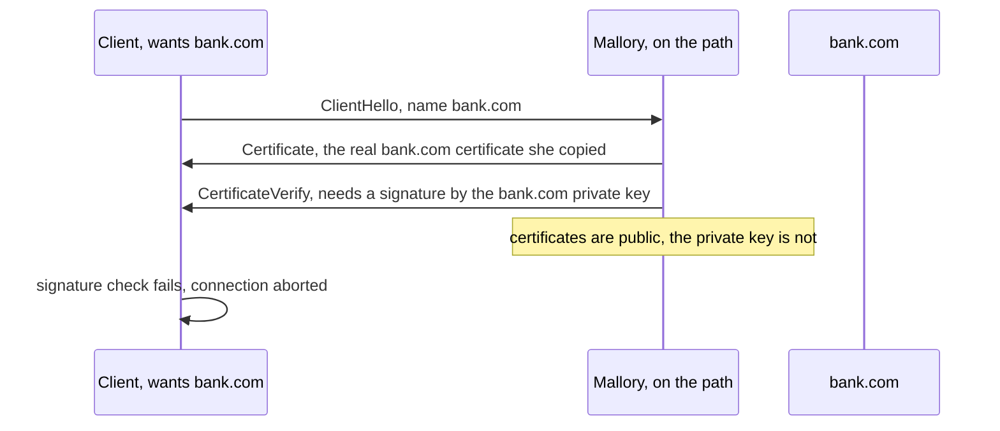
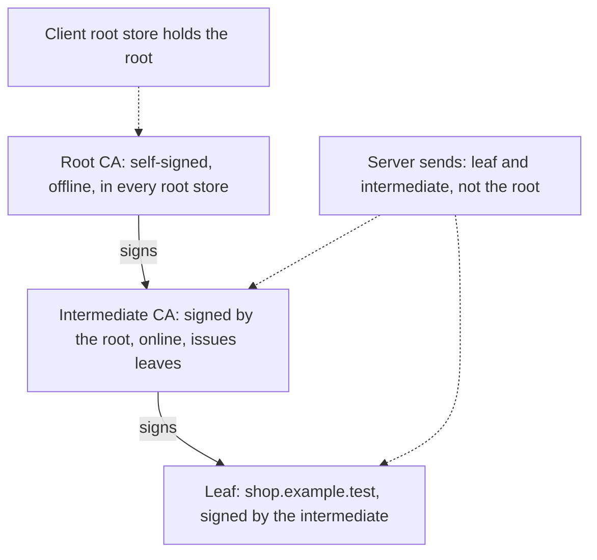
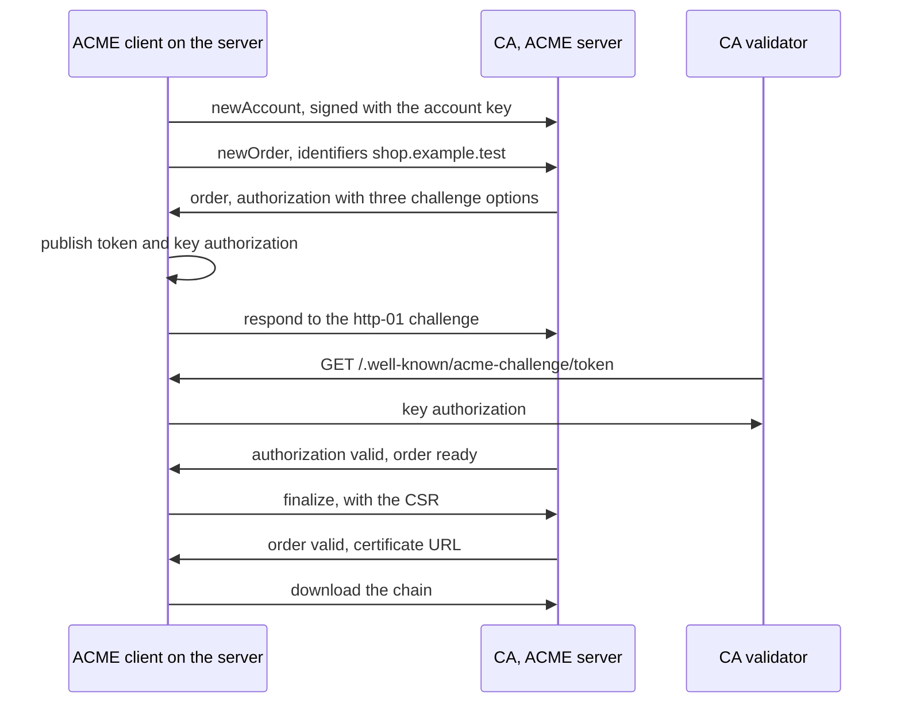
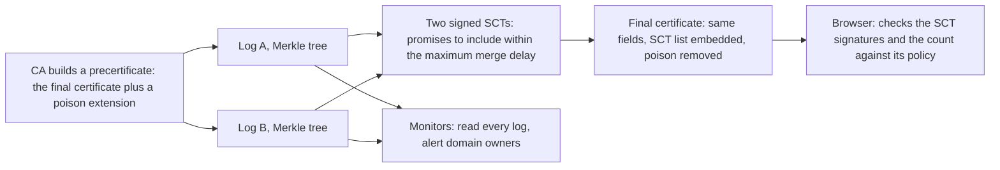
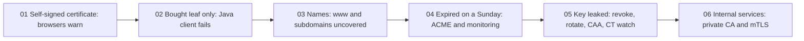

<!-- markdownlint-disable MD001 -->
<!-- markdownlint-disable MD024 -->
<!-- markdownlint-disable MD025 -->
<!-- markdownlint-disable MD026 -->
<!-- markdownlint-disable MD029 -->
<!-- markdownlint-disable MD033 -->
<!-- markdownlint-disable MD036 -->
<!-- markdownlint-disable MD040 -->
<!-- markdownlint-disable MD056 -->
<!-- markdownlint-disable MD060 -->

# H13. Certificates and PKI

---

## Contents

| #     | Sub-topic                                                                       | Tag   |
| ----- | ------------------------------------------------------------------------------- | ----- |
| 13.01 | The binding problem and trust anchors                                           | CORE  |
| 13.02 | X.509 v3: what a certificate says                                               | CORE  |
| 13.03 | Encodings: ASN.1, DER, PEM, PKCS#12, Java keystores and truststores             | CORE  |
| 13.04 | Chains, intermediates, cross-signing and root stores                            | CORE  |
| 13.05 | Path validation, name matching and "PKIX path building failed" decoded          | CORE  |
| 13.06 | Issuance: CSR, DV, OV and EV, ACME and its challenges                           | CORE  |
| 13.07 | Revocation: CRL, OCSP, stapling, soft fail, CRLite and short-lived certificates | DEEP  |
| 13.08 | Certificate Transparency and CAA                                                | DEEP  |
| 13.09 | The CA/Browser Forum and shrinking lifetimes: why automation is mandatory       | DEEP  |
| 13.10 | Private PKI, mutual TLS and SPIFFE                                              | AWARE |
| 13.11 | The story: one shop's certificate, from request to rotation                     | CORE  |
| 13.12 | Labs: a private CA, two validators, an ACME client, command-line tools          | CORE  |
| 13.13 | Exercises                                                                       |       |
| 13.14 | Solutions                                                                       |       |
| 13.15 | Takeaways                                                                       |       |

Tags: **CORE** is what an architect is expected to explain unprompted, **DEEP** is the mechanism underneath it, **AWARE** is a fact to know exists and not to derive.

Terms used throughout. Each is defined here, before any section uses it.  
Terms from H11 and H12 (key pair, signature, transcript, hash, MITM, forward secrecy) keep their meaning.

- **Certificate**, **X.509**, **subject**, **issuer**: a certificate is a data structure that binds a public key to a name and is signed by another party.  
  X.509 is the standard format (version 3 is the one in use).  
  The **subject** is who the certificate is about, the **issuer** is who signed it.

- **Certificate authority** (CA), **root**, **intermediate**, **leaf**: a CA is an organisation that issues certificates.  
  A **root** is a CA certificate that signs itself. An **intermediate** is a CA certificate signed by another CA.  
  A **leaf** (also *end-entity* certificate) belongs to a server, a person or a device and cannot sign other certificates.  
  A **chain** (or *path*) is the list leaf, intermediates, root.

- **Trust anchor**, **root store** (also *trust store*): a trust anchor is a public key or certificate that a verifier trusts without proof, because it was installed by the operating system, browser, runtime or administrator.
  The root store is the set of them.

- **Extension**, **critical**: a certificate carries a list of extensions, each a labelled field with its own meaning.  
  An extension marked *critical* must be understood by the verifier, which rejects the certificate if it does not.

- **Subject alternative name** (SAN), **common name** (CN): the SAN extension lists the names the certificate is valid for (DNS names, IP addresses, e-mail addresses).  
  The CN is an older free-text field inside the subject, no longer used by browsers for matching.

- **Key usage**, **extended key usage** (EKU), **basic constraints**, **path length**, **name constraints**: restrictions on what the key may do. Key usage lists operations (sign, certificate signing).  
  EKU names purposes (TLS server, TLS client, code signing).  
  Basic constraints say whether the subject is a CA and, with path length, how many CA levels may follow.  
  Name constraints limit which names a CA may issue for.

- **ASN.1**, **DER**, **PEM**, **PKCS#12**: ASN.1 is a notation for describing structured data.  
  DER is one fixed binary encoding of it, used so that every party hashes and signs identical bytes.  
  PEM is a text wrapper around DER. PKCS#12 is a password-protected container for keys and certificates.

- **Keystore**, **truststore**: in Java, a file of keys and certificates.  
  A keystore holds *my* identity (private key and chain).  
  A truststore holds the certificates *I trust* to authenticate others.  
  The file format is the same.

- **CSR** (certificate signing request): a message that carries a public key and the requested names, signed by the matching private key, which a CA turns into a certificate.

- **DV**, **OV**, **EV**: levels of vetting.  
  *Domain validated*: the CA checked that the applicant controls the name.  
  *Organisation validated* and *extended validation*: the CA also checked who the organisation is.

- **ACME**, **challenge**: the protocol (RFC 8555) by which software proves control of a name to a CA and fetches a certificate without a human.  
  A challenge is one way of proving control.

- **Revocation**, **CRL**, **OCSP**, **stapling**: revocation withdraws a certificate before it expires.  
  A **CRL** (certificate revocation list) is a signed list of revoked serial numbers.  
  **OCSP** (online certificate status protocol) asks a CA's server about one certificate.  
  **Stapling** is the server attaching a recent signed OCSP answer to its own handshake.

- **Certificate Transparency** (CT), **log**, **SCT**, **Merkle tree**: CT is a system of public append-only logs of issued certificates.  
  A log answers a submission with an **SCT** (signed certificate timestamp), a promise to include it.  
  A **Merkle tree** is a tree of hashes in which one short root hash commits to every entry and a short proof shows that one entry is inside.

- **CAA**: a DNS record naming which CAs may issue for a domain.

- **CA/Browser Forum**, **Baseline Requirements**: the body of CAs and browser vendors that writes the rules every publicly trusted CA must follow.  
  The Baseline Requirements (BR) are the main document.

- **mTLS**, **SPIFFE**: mutual TLS, in which the client also presents a certificate.  
  SPIFFE is a standard for naming workloads and issuing them short-lived certificates.

- **TLS interception**: a middlebox that terminates the client's TLS connection with a certificate it minted on the fly from a private CA the client was made to trust, then opens its own connection to the real server.

Outputs in this module are real.  
They come from a private CA built with `openssl` and fixed dates, a Java program and its Rust twin that run every validation scenario against it,  
a JDK-only ACME client that talks to Pebble (the test CA of Let's Encrypt), and `openssl`, `keytool` and `curl` transcripts (13.12).  

Run on Linux 6.18, JDK 21.0.12, OpenSSL 3.0.13, curl 8.5.0, Rust 1.97 and Pebble v2.10.1.  
The lab certificates carry fixed validity dates (10 years) so the lab keeps working.  
Production certificates are far shorter (13.09), and Pebble's are 90 days.  
Statements about industry rules and dates were re-checked on 2026-10-29.  
Several come from secondary sources, which the text says, and rules in this area change every year, so check the CA/Browser Forum and the root programs before relying on a date.

---

## 13.01 The binding problem and trust anchors

A public key is a number. Nothing in it says who owns it, and H12 (12.05) showed that an exchange with an unidentified peer is worthless against an attacker on the path.  
A **certificate** closes the gap with a signed statement: "this public key belongs to this name", signed by a CA.  
The client does not believe the statement because the server sent it.  
It believes it because the signature verifies under a CA key the client already holds, a **trust anchor** installed with the operating system, browser or runtime.  
Trust is not removed, it is moved: from billions of servers to about a hundred root-store organisations (the JDK in the lab has 122 roots, 13.04).  
Everything in this module is the machinery that makes that move safe:  

- how the statement is formatted (13.02, 13.03),  
- how trust is carried down a chain (13.04),  
- how it is checked (13.05),  
- how it is obtained (13.06),  
- how it is withdrawn (13.07), and  
- how a wrong statement is detected (13.08).

### Why a signature on the handshake is not enough

In H12 the server proves possession of a private key by signing the transcript.  
The client still needs to know *whose* key that is.  
Without a certificate the client has only the public key the server announced, and Mallory announces her own.  
With one, the handshake does two separate jobs: the **certificate** says "the key K belongs to bank.com" (checked against the root store),  
and a **signature by K over the transcript** says "the party talking to you holds K right now" (H15 calls this `CertificateVerify`).



A certificate is public by design, so copying one gains nothing. The attacker needs the **private key**, or a certificate for her *own* key under the victim's name. The second is why issuance (13.06), transparency (13.08) and the root store (13.04) matter.

### Ways to bind a name to a key

| Model                     | Who vouches                                          | Used by                                   | Weakness                                              |
| ------------------------- | ---------------------------------------------------- | ----------------------------------------- | ----------------------------------------------------- |
| Hierarchical PKI (CAs)    | Any CA in the verifier's root store                  | Web TLS, code signing, e-mail             | Any trusted CA can issue for any name                 |
| Trust on first use (TOFU) | Nobody: the first key seen is believed and kept      | SSH `known_hosts`                         | The first contact is unprotected, changes cause alarm |
| Web of trust              | Other users sign each other's keys                   | PGP                                       | Does not scale, hard to use                           |
| DNSSEC with DANE          | The DNS hierarchy publishes the key in a TLSA record | Some mail server to mail server transport | Few domains signed, browsers do not use it            |
| Pinning, out of band      | The developer ships the expected key or fingerprint  | Mobile apps, internal services            | Rotation is hard, a stale pin bricks the client (H16) |

The web uses the first row because it works for strangers: a browser can reach any site with no prior contact.  
Its price is the last cell of the row, which is why the rest of the module is about reducing the damage a single wrong CA can do.

### What an attacker needs to impersonate a name

| Route                                  | What it takes                                      | Main defences                             | Section      |
| -------------------------------------- | -------------------------------------------------- | ----------------------------------------- | ------------ |
| Steal the server's private key         | A leaked backup, a compromised host                | HSM or KMS, short lifetimes, revocation   | 13.07, H16   |
| Get a CA to issue for the name         | A validation bug, a hijacked route, a negligent CA | CAA, multi-location validation, CT        | 13.06, 13.08 |
| Compromise a CA's signing key          | A breach of the CA (DigiNotar, 2011)               | Removal from root stores, CT, constraints | 13.04, 13.08 |
| Add a root to the victim's trust store | Malware, device management, a corporate proxy      | Device policy, pinning in apps            | 13.04, H16   |
| Remove TLS altogether                  | Rewrite `https://` links, block port 443           | HSTS, preload lists                       | H16          |

The fourth row is not hypothetical in this very sandbox: its egress proxy re-signs every site with a private CA that the sandbox was configured to trust, and 13.04 reads the chain it presents.

### Interview angle

- *"What does a certificate prove?"*  
  That an issuer the verifier trusts signed a statement binding a key to a name, within a validity window and under stated constraints.  
  It proves nothing about the site's honesty, and by itself it does not prove the peer holds the key.

- *"If certificates are public, why can't I just copy bank.com's?"*  
  The handshake requires a signature by the matching private key over fresh data (H12, 12.06).  
  The certificate is only a label for the key.

- *"Where does trust start?"*  
  In the root store: a list shipped with the OS, browser or runtime, curated by their vendors through root programs with audit and policy requirements (13.04).  
  There is no mathematical root of trust, only a social and contractual one.

- *"Why not use SSH-style trust on first use for the web?"*  
  A browser meets new sites constantly, so most visits would be a first contact, and the user cannot judge a changed key.  
  TOFU suits few, long-lived relationships.

---

## 13.02 X.509 v3: what a certificate says

A certificate is one signed record, `Certificate = { tbsCertificate, signatureAlgorithm, signatureValue }`, where `tbsCertificate` ("to be signed") holds version, serial number, signature algorithm, issuer, validity, subject, the subject's public key and a list of extensions.  
The issuer signs the exact DER bytes of `tbsCertificate` (13.03).  
The fields identify the parties and the time window, and the **extensions** carry the real policy: whether the subject may be a CA, what the key may be used for, which names the certificate covers, and where to check revocation.  
A verifier that skips an extension skips a rule, which is why 13.05 spends a section on the checks.

### The structure, with the lab's leaf

| Field                  | Meaning                                                                             | Lab leaf (`server.pem`)              |
| ---------------------- | ----------------------------------------------------------------------------------- | ------------------------------------ |
| `version`              | `2` means v3. Extensions exist only in v3                                           | 3                                    |
| `serialNumber`         | Unique among the issuer's certificates. Public CAs must use at least 64 random bits | `0x1000` (a counter, fine for a lab) |
| `signature`            | Algorithm the issuer signed with, repeated in the outer `signatureAlgorithm`        | `ecdsa-with-SHA256`                  |
| `issuer`               | Distinguished name of the signer                                                    | `CN=Lab Intermediate CA`             |
| `validity`             | `notBefore` and `notAfter`. `UTCTime` through 2049, `GeneralizedTime` from 2050     | 2026-01-01 to 2036-01-01             |
| `subject`              | Distinguished name of the owner. May be empty if a SAN is present                   | `CN=shop.example.test`               |
| `subjectPublicKeyInfo` | Key algorithm, curve or modulus, and the key bits                                   | EC, P-256, 91 bytes of DER           |
| `extensions`           | Ordered list of (OID, critical flag, value)                                         | 8, listed below                      |
| `signatureValue`       | The issuer's signature over the DER of `tbsCertificate`                             | 72 bytes of ECDSA                    |

### The extensions that matter

| Extension                | OID                     | Critical | Meaning                                                    | Lab leaf                                 |
| ------------------------ | ----------------------- | -------- | ---------------------------------------------------------- | ---------------------------------------- |
| `basicConstraints`       | 2.5.29.19               | yes      | Is the subject a CA, and how many CA levels may follow     | `CA:FALSE`                               |
| `keyUsage`               | 2.5.29.15               | yes      | Operations allowed: `digitalSignature`, `keyCertSign`, ... | `digitalSignature`                       |
| `extKeyUsage`            | 2.5.29.37               | no       | Purposes: `serverAuth`, `clientAuth`, `codeSigning`, ...   | `serverAuth`                             |
| `subjectAltName`         | 2.5.29.17               | no       | Names covered: DNS, IP, e-mail, URI                        | two DNS names and `127.0.0.1`            |
| `subjectKeyIdentifier`   | 2.5.29.14               | no       | Hash of this certificate's key                             | present                                  |
| `authorityKeyIdentifier` | 2.5.29.35               | no       | Identifier of the issuer's key, a hint for path building   | equals the issuer's SKI: true            |
| `authorityInfoAccess`    | 1.3.6.1.5.5.7.1.1       | no       | Where to ask OCSP, where to fetch the issuer certificate   | OCSP and `caIssuers` URLs                |
| `cRLDistributionPoints`  | 2.5.29.31               | no       | Where the CRL is                                           | one URL                                  |
| `nameConstraints`        | 2.5.29.30               | yes      | Names a CA may or may not issue for. CA certificates only  | on `int2`: permitted `shop.example.test` |
| `certificatePolicies`    | 2.5.29.32               | no       | Policy OIDs, which is how DV, OV and EV are marked         | none in the lab                          |
| SCT list                 | 1.3.6.1.4.1.11129.2.4.2 | no       | Embedded Certificate Transparency proofs (13.08)           | none, the lab is not logged              |

The **critical** flag is a rule about unknown extensions: a verifier that does not understand a critical one must reject the certificate, and may ignore an unknown non-critical one.  
`basicConstraints` and `keyUsage` are marked critical so that no old implementation can skip the rule that a leaf cannot sign certificates.

### Names live in the SAN

A TLS client matches the host it meant to reach against the **SAN** list, and nothing else (RFC 9110 and RFC 9525).  
The subject's `CN` was once used, and is a historical leftover: Chrome stopped reading it in version 58.  
Two lab results make it concrete (13.05): a certificate with the name only in the `CN` is **accepted by the JDK** (which falls back to the CN when no SAN exists) and **rejected by rustls**.  
Code that works on one stack and fails on the next is the usual outcome of relying on the CN.

An empty subject is legal when a SAN exists, and then RFC 5280 requires the SAN to be critical.  
The certificates that Pebble issues in 13.06 are exactly that: no subject, one critical SAN.

### Authority and subject key identifiers

Two certificates can carry the same issuer name when a CA changes its key.  
The **AKI** in a certificate and the **SKI** of the issuer let a verifier pick the right issuer among several candidates, which matters in the cross-signing cases of 13.04.  
The lab prints `authority key id equals issuer's subject key id: true`.

### Interview angle

- *"What is in a certificate?"* Serial, issuer, validity, subject, public key, extensions, and the issuer's signature over all of that.  
  Then name the extensions: SAN, key usage, EKU, basic constraints, AIA.

- *"Why SAN and not CN?"* The CN is free text with no type, so `CN=bank.com` cannot say whether it is a DNS name, an e-mail or a person. The SAN is typed and is the matching rule of RFC 9525.

- *"What does `critical` do?"* It forbids a verifier from ignoring the extension. An implementation that does not know it must fail closed.

- *"What stops a leaf certificate from signing other certificates?"* `basicConstraints CA:FALSE` and the absence of `keyCertSign` in `keyUsage`.  
  The lab signs a certificate with a leaf key and every validator refuses it (13.05).

---

## 13.03 Encodings: ASN.1, DER, PEM, PKCS#12, Java keystores and truststores

A certificate is described in **ASN.1** (a schema notation) and serialised with **DER** (Distinguished Encoding Rules), a binary encoding with exactly one valid form per value.  
DER matters because a signature is over bytes: if two encoders could write the same fields differently, a certificate might re-encode to different bytes and fail to verify.  
Each element is **tag, length, value** (TLV), nested. On disk the DER is usually wrapped as **PEM**, base64 text between `-----BEGIN CERTIFICATE-----` lines, about 4/3 the size.  
A private key with its chain travels in **PKCS#12** (`.p12`, `.pfx`), an encrypted container.  
Java keeps keys and certificates in **keystores** (a role: my identity) and **truststores** (a role: whom I trust), using PKCS#12 by default since JDK 9.

### TLV in ten minutes

An element is a tag byte, a length, then the value. The tag holds a class, a constructed bit and a number.  
The length is one byte below 128 and otherwise `0x80 + n` followed by `n` length bytes.

| Tag    | Type              | Tag    | Type                   |
| ------ | ----------------- | ------ | ---------------------- |
| `0x01` | BOOLEAN           | `0x0C` | UTF8String             |
| `0x02` | INTEGER           | `0x13` | PrintableString        |
| `0x03` | BIT STRING        | `0x17` | UTCTime                |
| `0x04` | OCTET STRING      | `0x18` | GeneralizedTime        |
| `0x05` | NULL              | `0x30` | SEQUENCE (constructed) |
| `0x06` | OBJECT IDENTIFIER | `0xA0` | context tag `[0]`      |

Three hand examples, produced by the lab's `exercises` mode (13.14): `INTEGER 4096` inside a `SEQUENCE` is `30 04 02 02 10 00`, a 200-byte OCTET STRING starts `04 81 c8`, and a 300-byte one starts `04 82 01 2c`.  
The first byte of a long length says how many length bytes follow.

An **OID** is a path in a registry written `1.2.840.10045.4.3.2`, the first two numbers packed in one byte.  
OIDs name algorithms (`ecdsa-with-SHA256`), attributes (`commonName`, `2.5.4.3`) and extensions.  
DER fixes the details that a signature needs: lengths use the shortest form, sets are sorted, booleans are `0xFF` for true.  
The lab dumps `server.pem` with a small DER reader of its own and the outer lengths agree with `openssl asn1parse` (624 for the certificate, 533 for the signed part).

### The file formats

| Name         | What it is                                                                     | Typical extensions             |
| ------------ | ------------------------------------------------------------------------------ | ------------------------------ |
| DER          | Raw binary ASN.1. One certificate                                              | `.der`, `.cer`                 |
| PEM          | Base64 of DER with BEGIN and END lines. Several blocks may follow one another  | `.pem`, `.crt`, `.key`, `.csr` |
| PKCS#8       | Private key container. PEM label `PRIVATE KEY` (or `ENCRYPTED PRIVATE KEY`)    | `.key`                         |
| PKCS#1, SEC1 | Older RSA and EC private key forms. Labels `RSA PRIVATE KEY`, `EC PRIVATE KEY` | `.key`                         |
| PKCS#10      | A certificate request. Label `CERTIFICATE REQUEST`                             | `.csr`                         |
| PKCS#12      | Password-protected bag of private keys and certificate chains                  | `.p12`, `.pfx`                 |
| JKS          | Java's older keystore format. The JDK's `cacerts` here is still JKS            | `.jks`, `cacerts`              |

The lab reads the same certificate three ways and checks that PEM decodes to the DER (908 bytes of PEM text against 628 of DER),  
that `server.p12` holds one private-key entry with a chain of two, and that the JDK's default keystore type is `pkcs12`.

### Keystore against truststore

The two are the same file format used in two roles, and mixing them up is a classic Java mistake.

| Role       | Holds                                   | Used for                                                                  | System properties                                                  |
| ---------- | --------------------------------------- | ------------------------------------------------------------------------- | ------------------------------------------------------------------ |
| Keystore   | My private key and my certificate chain | Proving my identity: a server's certificate, a client certificate in mTLS | `javax.net.ssl.keyStore`, `keyStorePassword`, `keyStoreType`       |
| Truststore | Certificates (anchors) I trust          | Verifying the peer's chain                                                | `javax.net.ssl.trustStore`, `trustStorePassword`, `trustStoreType` |

When no truststore is set the JVM loads its default `cacerts` (122 roots in this lab's JDK, located through `JAVA_TOOL_OPTIONS` in this sandbox).  
Setting `javax.net.ssl.trustStore` **replaces** the default: a service pointed at a truststore that holds only the company's root then rejects every public site, a common production surprise.  
The `keytool` commands used in the lab: `-list` to see entries, `-printcert` to read a certificate file, `-importcert` to add a trust anchor, `-genkeypair` to make a key, `-exportcert` to extract.  
Rust has no keystore concept: `rustls` takes DER or PEM bytes through `rustls-pki-types`, and builds a `RootCertStore` from anchors the program chooses, such as the embedded Mozilla list in the `webpki-roots` crate or the OS store through `rustls-native-certs`.

### Interview angle

- *"What is the difference between PEM and DER?"* Same bytes, DER is binary and PEM is DER in base64 with header lines.  
  A PEM file may hold several certificates, which is how a chain file is made.

- *"I get `unable to load private key`. Why?"* Three usual causes: the label does not match the format (`EC PRIVATE KEY` against `PRIVATE KEY`), the key is encrypted and no password was given, or a DER file was read as PEM.

- *"What is the difference between a keystore and a truststore?"* The role: keystore authenticates me, truststore authenticates others. Both can be PKCS#12 files.

- *"Why must certificates be DER and not any ASN.1 encoding?"* The signature covers the bytes. DER gives each value one encoding, so every party computes the same hash.

---

## 13.04 Chains, intermediates, cross-signing and root stores

A server sends its **leaf** plus the **intermediates** that link it to a **root**, and the client builds a path from the leaf to an anchor in its root store.  
Roots are kept offline and sign only intermediates, so that the key that all trust depends on is rarely used and easy to protect.  
Intermediates are online and issue leaves, so that a compromised intermediate can be revoked and replaced without touching the root.  
The root is only self-signed data: it is trusted because it is **in the store**, not because of its signature.  
The most common production failure is a server that forgets to send an intermediate.  
Browsers can sometimes repair it by fetching the missing certificate, and Java, curl and Android cannot, so a site that "works in Chrome" fails in the API client.

### The shape



The server omits the root because the client has it or does not trust it anyway.  
The lab's `server-chain.pem` is leaf then intermediate, and `intermediate not sent` is the scenario in which the second block is missing:  
Java says `unable to find valid certification path to requested target`, rustls says `UnknownIssuer`, `openssl verify` says `unable to get local issuer certificate`.

### Why more than one level

- **Root key protection.** The root key signs a few intermediates in a rare ceremony and then stays in an HSM in a vault.  
  Losing it means every device must update its store, which takes years.

- **Blast radius.** Each intermediate can be limited by `pathlen`, by name constraints (13.05), by EKU, and by policy (one for DV, another for EV).  
  If it is compromised the CA revokes that intermediate alone.

- **Rotation.** New intermediates are cheap to issue and deploy. New roots must reach the root stores of every client first.

### Cross-signing and why old clients break

A CA key can have more than one certificate. A new root, unknown to old devices, gets an extra certificate signed by an older, widely trusted root.  
Servers send the cross-signed chain and old clients reach their old anchor, while new clients stop at the new root.  
Let's Encrypt used this with ISRG Root X1 (its own root, 2015) cross-signed by IdenTrust's DST Root CA X3 so that its certificates worked on older devices (notably Android) before its root had spread.  
When DST Root CA X3 expired on 2021-09-30, clients that insisted on the expired path (notably OpenSSL 1.0.2 builds) failed even though a valid second path existed.  
The lesson is that **path building has to try alternatives, and a root has an expiry date too**.  
In the lab's JDK, 8 of the 122 roots expire before 2030.

### Root stores

| Store             | Run by             | Used by                                                            |
| ----------------- | ------------------ | ------------------------------------------------------------------ |
| Mozilla (NSS)     | Mozilla CA program | Firefox, most Linux `ca-certificates`, `webpki-roots` for Rust     |
| Chrome Root Store | Google             | Chrome on most desktop platforms (it left the OS stores in stages) |
| Apple             | Apple              | Safari, every Apple OS                                             |
| Microsoft         | Microsoft          | Edge, Windows applications                                         |
| JDK `cacerts`     | The JDK vendor     | Every JVM that does not set a truststore                           |

Each program sets its own requirements (audits, disclosure, CT, behaviour) and can remove a CA, as happened to Symantec's roots in 2017 to 2018 after repeated misissuance.  
The stores overlap heavily and differ at the margins, so "trusted" always means "trusted by this store".  
Measured in the lab's JDK (`Pki.java`, section 13.04): 122 roots, all self-signed, 83 RSA and 39 EC, key sizes 256 (3), 384 (35), 521 (1), 2,048 (23) and 4,096 (60) bits, earliest expiry 2028-12-06, latest 2049-01-14.  
A real one is on the screen in Lab 06: **ISRG Root X1** is a self-signed RSA-4096 certificate valid 2015-06-04 to 2035-06-04, with `CA:TRUE` and `keyCertSign` and `cRLSign` only.  
It has no SAN, no AIA and no CRL pointer: nothing above it can say anything about it.

### Missing intermediates and AIA chasing

The `authorityInfoAccess` extension can carry a `caIssuers` URL where the issuer's certificate can be downloaded.  
Chrome, Safari and Edge follow it ("AIA chasing"), Firefox keeps a preloaded list of intermediates, and Java, OpenSSL, curl, Go and Android do not.  
A server that sends only the leaf therefore appears fine in a desktop browser and fails in an API client, a mobile app or a JVM.  
The cure is operational, not a client setting: **serve the full chain minus the root**, and test with the strictest client (`openssl s_client`, the lab's Java program).

### A trust anchor does not have to be a root

A verifier may be given an intermediate as its only anchor, and then validates paths that end at it.  
The lab confirms this for the JDK and for rustls (`an intermediate as the only trust anchor: accepted`) and for `curl`, while plain `openssl verify` refuses it unless `-partial_chain` is given (Lab 05).  
Uses: trusting one subordinate CA of a partner without trusting their root, or pinning an intermediate (H16).

### When the anchor is not a public CA: interception

Lab 06 shows the chain this sandbox's proxy presents for `github.com`: a leaf for `github.com` (RSA 2,048, valid one year,  
minted by the proxy on demand) signed by `CCR agent-proxy interception CA (production) 2026-08`, a self-signed RSA-4,096 certificate valid to 2036.  

`openssl` prints `Verification: OK` only because that CA was added to this machine's trust bundle.  
Three consequences worth knowing: a party that can add one root to your store can impersonate every site to you; the CA/Browser Forum limits on lifetime (13.09) bind only publicly trusted CAs,  
so this leaf's one-year lifetime breaks no rule; and it has no SCTs, since no public log saw it. Corporate TLS inspection works exactly this way (H16).

### Interview angle

- *"Why does the server not send the root?"* The client either has it already or cannot be made to trust it by receiving it. Sending it only wastes bytes.

- *"The site works in Chrome and fails in my Java client. What happened?"* An intermediate is missing and Chrome fetched it through AIA while Java did not. Fix the server's chain, not the client.

- *"What is cross-signing?"* One CA key with two certificates from different issuers, so new roots keep working on old trust stores. It adds paths, and path building must try all of them.

- *"Why use an intermediate at all?"* To keep the root key offline, to limit blast radius, and to be able to rotate and revoke the signing key.

---

## 13.05 Path validation, name matching and "PKIX path building failed" decoded

A client verifies a server certificate in two stages.  
**Path building** finds a candidate chain from the leaf to a trust anchor, using the certificates the server sent, the issuer names and key identifiers, and sometimes the AIA URL (13.04).  
**Path validation** (RFC 5280, section 6) then checks every link of that chain.  
The TLS client adds two checks of its own that are not part of the path: the certificate's **purpose** (EKU) and the **name** (SAN) against the host it meant to reach.  
Each stack words the failures differently, and reading them is most of the debugging skill.  
The lab runs 18 real TLS handshakes over loopback against certificates that are broken in one specific way each, in the JDK and in rustls, and the table below is read from them.

### The checks, in the order a verifier applies them

- 01. **Signature.** Every certificate verifies under the public key of the next one up, and the last under a trust anchor.
- 02. **Validity.** The current time lies inside `notBefore` and `notAfter` of **every** certificate in the path.  
  The client's clock decides, so a device with a wrong clock fails with "expired" or "not yet valid" against perfectly good certificates.
- 03. **Naming and keys.** Each issuer name matches the subject of the certificate above it, and the AKI matches the SKI when both exist.
- 04. **CA status.** Every certificate that signs another has `CA:TRUE`, and `keyCertSign` if it has `keyUsage`.  
  Its `pathLenConstraint`, if any, is not exceeded: the lab's intermediate has `pathlen:0`, so it may sign leaves and nothing that signs.
- 05. **Name constraints.** Names in lower certificates stay inside the permitted subtrees and outside the excluded ones of every CA above.
- 06. **Critical extensions** are all understood. **Policies** are processed if the verifier asks for any.
- 07. **Revocation** status, if the client checks it (13.07).
- 08. **Purpose.** The leaf's EKU allows `serverAuth` (or `clientAuth` for a client certificate in mTLS).  
  A certificate without an EKU extension is accepted for any purpose.
- 09. **Name.** The host the client dialled appears in the SAN (rules below).

### One failure, three vocabularies

| Scenario in the lab                      | JDK 21 (deepest cause)                                                 | rustls                                | `openssl verify`                            |
| ---------------------------------------- | ---------------------------------------------------------------------- | ------------------------------------- | ------------------------------------------- |
| Intermediate not sent                    | `unable to find valid certification path to requested target`          | `UnknownIssuer`                       | `20 unable to get local issuer certificate` |
| Root not in the client's store           | the same message                                                       | `UnknownIssuer`                       | not run                                     |
| Self-signed leaf                         | the same message                                                       | `Other(CaUsedAsEndEntity)`, see note  | not run                                     |
| Name not in the SAN                      | `No subject alternative DNS name matching bank.example.test found.`    | `NotValidForName`                     | `62 hostname mismatch`                      |
| Expired leaf                             | `NotAfter: Thu Feb 01 00:00:00 UTC 2024`                               | `Expired`, with the verification time | `10 certificate has expired`                |
| Leaf not yet valid                       | `NotBefore: Sun Jan 01 00:00:00 UTC 2040`                              | `NotValidYet`                         | not run                                     |
| Leaf signed by a non-CA                  | `CA key usage check failed: keyCertSign bit is not set`                | `Other(EndEntityUsedAsCa)`            | not run                                     |
| Client-only certificate used as a server | `Extended key usage does not permit use for TLS server authentication` | `InvalidPurpose`                      | `26 unsuitable certificate purpose`         |
| Name outside a CA's constraints          | `name constraints check failed`                                        | `Other(NameConstraintViolation)`      | `47 permitted subtree violation`            |
| Revoked leaf (13.07)                     | `Certificate has been revoked, reason: KEY_COMPROMISE`                 | `Revoked`                             | `23 certificate revoked`                    |

Notes.  
The rustls errors are the variants of `InvalidCertificate`, printed by the lab as `invalid peer certificate: ...`.  
The self-signed leaf comes out as `CaUsedAsEndEntity` only because `openssl req -x509` writes `CA:TRUE` into it, and rustls refuses a CA certificate used as a leaf before it looks at trust.  
The rustls expiry message contains the verification time as a UNIX number, which differs on every run.

### "PKIX path building failed", decoded

The Java message `javax.net.ssl.SSLHandshakeException: PKIX path building failed: sun.security.provider.certpath.SunCertPathBuilderException: unable to find valid certification path to requested target` means one thing: **no chain from the server's certificates reached any anchor in the truststore the JVM used**.  
It says nothing about expiry or names, which Java reports with other messages (the table, and `PKIX path validation failed` for a path that was built and then failed a check).  
The causes, in the order to try them:

- 01. **The server did not send an intermediate.** Check with `openssl s_client -showcerts` (Lab 05). Fix the server.

- 02. **The root is private or unknown.** An internal CA, a self-signed certificate, or a TLS-intercepting proxy whose root is not in the truststore.  
  Import the root into the truststore the JVM really loads (`keytool -importcert`).  
  This sandbox hit the same wall for its proxy, and its fix is the `JAVA_TOOL_OPTIONS` that points the JVM at a truststore holding the proxy CA.

- 03. **The JVM loads a different truststore than you think.** A `javax.net.ssl.trustStore` property replaces the default, a container image ships an old `cacerts`, or two JDKs are installed.  
  `-Djavax.net.debug=ssl:trustmanager` prints which file was loaded and `-Djava.security.debug=certpath` prints the path attempts.

- 04. **An anchor expired or was removed.** Old JDKs lack newer roots, and a root past its `notAfter` is silently useless (13.04).

### Name matching

RFC 9525 (the successor of RFC 6125) fixes how a client matches the host it dialled against the SAN.  
The lab implements the rule in `matches()` and checks it in a handshake each time.

- 01. If the SAN has DNS names, **only they are used**. The CN is not consulted.  
  (The JDK is lenient here: with no SAN at all it falls back to the CN. rustls does not.)

- 02. Comparison is **case-insensitive**. Internationalised names compare in their `xn--` form.

- 03. A wildcard is allowed only as the **whole leftmost label** (`*.shop.example.test`), and stands for **exactly one label**. It matches `api.shop.example.test`.  
  It does not match `a.b.shop.example.test` or the bare `shop.example.test`.  
  Partial-label wildcards such as `f*.shop...` are not matched.

- 04. An **IP address** is matched only against `iPAddress` entries, never against a DNS name.

- 05. A CA must not issue a wildcard over a public suffix such as `*.co.uk` (Baseline Requirements).  
  Clients do not check this, the CA must.

| Pattern in the SAN     | Host dialled            | Result | Pattern in the SAN    | Host dialled            | Result |
| ---------------------- | ----------------------- | ------ | --------------------- | ----------------------- | ------ |
| `shop.example.test`    | `SHOP.Example.TEST`     | true   | `*.shop.example.test` | `api.shop.example.test` | true   |
| `shop.example.test`    | `www.shop.example.test` | false  | `*.shop.example.test` | `a.b.shop.example.test` | false  |
| `*.shop.example.test`  | `shop.example.test`     | false  | `*.shop.example.test` | `evilshop.example.test` | false  |
| `f*.shop.example.test` | `foo.shop.example.test` | false  | `*.example.test`      | `shop.example.test`     | true   |

The same rows run as handshakes in the lab: the wildcard with one label is accepted, with two labels or with the bare name it is rejected, and the IP SAN `127.0.0.1` is accepted.

### Name constraints as a safety belt

A CA certificate may carry `nameConstraints` that limit every name below it.  
The lab's second intermediate (`int2`) may sign only for `shop.example.test` and its subdomains: its `api.shop.example.test` certificate is accepted and its `evil.example.net` certificate is rejected by all three validators, although both signatures are genuine.  
This is the right tool for a private CA: even if the intermediate leaks, the attacker cannot mint `google.com`.  
Most modern verifiers enforce it, so test the clients you actually run.

### Interview angle

- *"Walk me through how a client validates a server certificate."* The nine checks above, with the split between path validation and the TLS-level purpose and name checks.

- *"What does `PKIX path building failed` mean, and what doesn't it mean?"* No path to an anchor in the loaded truststore. It does not mean expired, wrong name or revoked.

- *"Does a wildcard certificate for `*.example.com` cover `example.com`? `a.b.example.com`?"* No to both. It covers exactly one label, so the bare name needs its own SAN entry.

- *"Why did it work in the browser and fail in curl, Java or Python?"* Missing intermediate (AIA chasing in the browser), a different trust store, or the CN-only fallback.

---

## 13.06 Issuance: CSR, DV, OV and EV, ACME and its challenges

The owner of a name generates a key pair, keeps the private key, and sends a **CSR** to a CA.  
The CA checks control of the name (and, for OV and EV, the organisation), builds the certificate itself and signs it.  
For the web the check is automated by **ACME** (RFC 8555): the client creates an account, places an **order** for names, proves control through a **challenge** (a file served over HTTP,  
a DNS record, or a special TLS certificate), submits the CSR to **finalize**, and downloads the chain.  
Let's Encrypt made this free and automatic, and the CA/Browser Forum is now making it compulsory in effect by shortening lifetimes (13.09).

### The CSR

A CSR (PKCS#10) holds the subject, the public key, and requested attributes such as extensions, **signed with the matching private key**.  
The signature proves the requester holds the key (*proof of possession*) and nothing else: the CA reads the key and the names, and takes everything else from its own policy.  
Lab 05 prints the CSR that the ACME client submits: subject `CN=shop.example.test`, a P-256 key, one requested extension (a SAN for the same name) and `Certificate request self-signature verify OK`.  
The private key never leaves the server, and the CA never sees it.

### What the CA verifies

| Level | Checked by the CA                                        | Policy OID       | Typical time       | Notes                                                                      |
| ----- | -------------------------------------------------------- | ---------------- | ------------------ | -------------------------------------------------------------------------- |
| DV    | Control of each DNS name (HTTP, DNS or e-mail challenge) | `2.23.140.1.2.1` | Seconds to minutes | What ACME issues. Most of the web                                          |
| OV    | DV plus the legal existence of the organisation          | `2.23.140.1.2.2` | Hours to days      | The organisation name is in the subject                                    |
| EV    | OV plus stricter identity and operational checks         | `2.23.140.1.1`   | Days               | Browsers dropped the special address-bar indicator (Chrome 77, Firefox 70) |

The levels change what the CA checked and what appears in the certificate, not the cryptography or the way the browser validates it.  
Users cannot see the difference any more, which is why most sites use DV.

### ACME in one picture



Every ACME request is a **JWS**, a signed JSON message, carrying three protected fields: the URL it is for, a **nonce** and the account (`jwk`, the public key itself, in the first request that creates the account, and `kid`, the account URL, afterwards).  
A nonce is single use and is supplied by the server in the `Replay-Nonce` header of each response, which stops a captured request from being replayed.  
Reading the protocol is easiest in code, and Lab 04 is a complete client in about 190 lines of JDK-only Java.

### The three challenges

The client holds an **account key**.  
A challenge has a random `token`, and the client must answer with the **key authorization** `token + "." + base64url(SHA-256(account key as canonical JSON))` (RFC 7638 thumbprint).  
Binding the token to the account key means that nobody else can answer a challenge that was issued to this account.

| Challenge     | Proof                                                                                                     | Where               | Wildcards | Needs                                              |
| ------------- | --------------------------------------------------------------------------------------------------------- | ------------------- | --------- | -------------------------------------------------- |
| `http-01`     | The key authorization served at `/.well-known/acme-challenge/token`                                       | Port 80 of the name | No        | The name reachable from the internet on port 80    |
| `dns-01`      | A TXT record `_acme-challenge.name` holding `base64url(SHA-256(key authorization))`                       | The DNS zone        | **Yes**   | An API that can write the zone                     |
| `tls-alpn-01` | A self-signed certificate with the key authorization digest in an extension, offered on ALPN `acme-tls/1` | Port 443            | No        | Control of port 443, port 80 not needed (RFC 8737) |

Trade-offs worth knowing.  
`http-01` is the simplest and works for any web server, but cannot prove a wildcard, and cannot reach a machine behind a private network.  
`dns-01` is the only way to get a wildcard and the only one that works for internal hosts with public names, and its cost is a **credential that can rewrite your DNS**.  
Scope it narrowly, or delegate `_acme-challenge` with a CNAME to a zone that only the issuing system can write.  
`dns-persist-01`, announced by Let's Encrypt on 2026-02-18, replaces the per-issuance TXT write with one standing record that names the ACME account.  
It was targeted for 2026, and whether it has shipped was not verified on 2026-10-29.

CAs also validate from several network locations and compare the answers (*multi-perspective issuance corroboration*,  
mandatory for publicly trusted CAs since September 2025, ballot SC-067), which makes it much harder to pass a challenge by hijacking one route.  
They check CAA records first (13.08).

### What Lab 04 shows

The client runs against Pebble, which behaves like Let's Encrypt but runs on loopback with a fake DNS server and a test CA.

| Step                 | Observed line of the lab output                                                            | Meaning                                                          |
| -------------------- | ------------------------------------------------------------------------------------------ | ---------------------------------------------------------------- |
| Directory            | `[keyChange, newAccount, newNonce, newOrder, renewalInfo, revokeCert]`                     | The URLs of every operation, fetched from one well-known address |
| Nonce replay         | `400 urn:ietf:params:acme:error:badNonce`                                                  | A request that reuses a nonce is refused                         |
| Challenge validation | `GET /.well-known/acme-challenge/<token>, Host shop.example.test`                          | The CA connects back and asks for the key authorization          |
| Order and finalize   | `authorization valid`, `order valid`, 2 certificates in the chain                          | The CSR was accepted and the chain downloaded                    |
| Lifetime             | 90 days, 7,775,999 seconds on the default profile; 6 days, 518,399 seconds on `shortlived` | The CA chooses the lifetime, not the CSR                         |
| Renewal window (ARI) | `from 66% to 68% of the lifetime` (varies per run, another gave `50% to 83%`)              | The CA tells the client when to renew                            |
| A name with no proof | `authorization invalid, error urn:ietf:params:acme:error:unauthorized`                     | No file at the token URL, no certificate                         |

The certificate Pebble issues has an **empty subject** and a critical SAN with the name, EKU `serverAuth` only and `CA:FALSE`, which is what a modern DV certificate looks like: the identity is the SAN and nothing else.  
Pebble also deliberately rejects about one request in twenty with a `badNonce` to test clients, so the client retries with the fresh nonce from the error response.  
Production clients must do the same.

**Renewal information (ARI, RFC 9773).** The CA publishes a suggested renewal *window* for each certificate.  
A client that polls it renews inside the window, and the CA can pull the window forward to cause early renewal, for example after a mass revocation.  
Without ARI, clients renew at a fixed fraction of the lifetime, usually two thirds.

### Running it in production

| Option                                                           | What it is                                                             | Typical use                                             |
| ---------------------------------------------------------------- | ---------------------------------------------------------------------- | ------------------------------------------------------- |
| certbot, acme.sh, lego                                           | A client on each host that issues, installs and renews                 | A few VMs                                               |
| Caddy, Traefik                                                   | A server with the client built in                                      | Small services, edge proxies                            |
| cert-manager                                                     | A Kubernetes controller that turns `Certificate` objects into Secrets  | Clusters (ingress, internal mTLS with a private issuer) |
| Cloud-managed (for example AWS ACM, Google-managed certificates) | The provider issues and renews, certificates cannot leave the platform | Load balancers and CDNs                                 |

The failures are operational.  
A renewal job fails silently, the old certificate expires and the site goes down: so **monitor the certificate the world sees**, with a probe from outside that alerts at,  
say, 14 days before `notAfter`, in addition to the renewal job's own alerts.  
Renew at two thirds of the lifetime and retry with backoff, reload the server without dropping connections, and use the CA's **staging** environment while testing,  
because production rate limits (per domain, per duplicate set, per failed validation) lock you out for days.  
Commercial CAs that need an account tied to a contract use **External Account Binding**: a one-time MAC key that links the ACME account to a customer account.

### Interview angle

- *"What does a CA actually check for a DV certificate?"* Control of the DNS name at the moment of the challenge. Not who the owner is, not that the site is honest.

- *"Explain ACME HTTP-01 end to end."* Account key, order, token, key authorization with the account thumbprint, the CA fetches it over port 80, finalize with a CSR, download.  
  Mention nonces and CAA.

- *"How do you get a wildcard?"* DNS-01, because only DNS control proves the whole zone. Then explain how you protect that credential.

- *"A certificate expired in production. What do you change?"* Automate issuance, monitor from outside with a margin, renew at two thirds, alert on the renewal job, and never depend on a person's calendar.

---

## 13.07 Revocation: CRL, OCSP, stapling, soft fail, CRLite and short-lived certificates

A certificate is valid until it expires, unless the CA **revokes** it, for example because the private key leaked or the certificate was issued wrongly.  
The hard part is not the record but the **delivery**: a client must learn about the revocation at connection time, without making the CA a single point of failure for every site and without telling the CA which sites the client visits.  
Each mechanism gives up something. **CRLs** are big. **OCSP** leaks browsing and needs the CA's server up. **Stapling** needs a cooperating server.  
And browsers, because a blocked query cannot be told from an attack, **soft-fail**, which means an attacker who can block the check can usually do the rest.  
The practical answer of 2026 is to make revocation matter less: certificates that live days or weeks, plus compact lists that browsers ship (CRLite in Firefox, CRLSets in Chrome).

### Mechanisms

| Mechanism         | How it works                                                                                                                                                  | Cost                                                              | Where it stands in 2026                                                               |
| ----------------- | ------------------------------------------------------------------------------------------------------------------------------------------------------------- | ----------------------------------------------------------------- | ------------------------------------------------------------------------------------- |
| CRL               | The CA signs a list of revoked serial numbers and reasons, with `thisUpdate` and `nextUpdate`, and publishes it at the URL in `cRLDistributionPoints`         | Grows with revocations, so CAs shard it. Stale until `nextUpdate` | Required of CAs, used by Java, rustls (caller-supplied) and as input to browser lists |
| OCSP              | The client sends the hash of the issuer and the serial, and the responder returns `good`, `revoked` or `unknown`, signed, with a validity window              | A round trip per site, and the CA sees which sites you visit      | Optional for CAs since ballot SC-063. Let's Encrypt ended its service on 2025-08-06   |
| OCSP stapling     | The server fetches a fresh response and sends it in the handshake (the `status_request` extension)                                                            | The server must fetch and cache correctly                         | Works, but a server that does not staple falls back to a client query                 |
| OCSP Must-Staple  | A certificate extension (RFC 7633) that tells clients to require a stapled response                                                                           | Hard fail if the server breaks                                    | Depends on the CA still running OCSP, so it is fading                                 |
| CRLSets           | Chrome ships a curated list of revoked certificates and keys inside the browser                                                                               | Covers only a selection (urgent cases)                            | In use in Chrome                                                                      |
| CRLite            | The browser downloads a compact filter (a cascade of Bloom filters) that encodes **all** revocations of publicly logged certificates, updated by small deltas | About 300 kB a day in Firefox, and no query per connection        | Default in Firefox from version 137                                                   |
| Short-lived certs | The certificate expires so soon that there is nothing to revoke                                                                                               | Needs fully automated issuance                                    | Let's Encrypt offers a 6-day profile, and lifetimes are falling (13.09)               |

(The dates and sizes in the last column were checked on 2026-10-29 against Let's Encrypt's announcements and secondary reports.)

### Why every browser soft-fails

If the browser asked the responder and the answer did not come, it must choose. **Hard fail** (refuse the connection) means that an outage at the CA takes the whole web down,  
and that captive portals and corporate proxies that block the CA's host break every site.  
**Soft fail** (go on) keeps the web working, and gives nothing against an active attacker: the attacker who can intercept the connection can also drop the OCSP request.  
The lab shows both decisions side by side in the JDK, which exposes them as options:

| Scenario (Java, `PKIXRevocationChecker`)                  | Result                                                           |
| --------------------------------------------------------- | ---------------------------------------------------------------- |
| CRL, good certificate                                     | accepted                                                         |
| CRL, revoked certificate                                  | rejected, `Certificate has been revoked, reason: KEY_COMPROMISE` |
| OCSP responder up, good certificate                       | accepted                                                         |
| OCSP responder up, revoked certificate                    | rejected, the same reason                                        |
| OCSP responder **down**, good certificate, hard fail      | rejected, `Connection refused`                                   |
| OCSP responder **down**, revoked certificate, `SOFT_FAIL` | **accepted**                                                     |

The last row is the whole argument in one line: the revoked certificate is accepted because nobody could tell the client.  
The rustls half of the lab is CRL only, because rustls has no OCSP client.  
It checks revocation against CRLs that the **caller supplies**, and the revoked certificate fails with `Revoked`.

### What the artifacts look like

Lab 05 shows an OCSP response from the lab's responder: `Cert Status: good` with `This Update` and `Next Update` one day apart,  
signed by the intermediate (`Responder Id: CN = Lab Intermediate CA`), and for the revoked certificate `revoked`, `Reason: keyCompromise` and the revocation time.  
It then runs `openssl s_server -status_file` to **staple** that response, and `openssl s_client -status` receives it inside the handshake, so the CA is not contacted by the client at all.  
RFC 5280 lists the revocation reasons: `unspecified`, `keyCompromise`, `cACompromise`, `affiliationChanged`, `superseded`, `cessationOfOperation`, `certificateHold`, `privilegeWithdrawn` and `aACompromise`. `certificateHold` is a reversible revocation, which public CAs do not use for TLS certificates.

### What an architect does about it

- **Public web.** Treat revocation as best effort and design for **rotation**: automated issuance (13.06), lifetimes in weeks, the ability to replace every certificate within hours.  
  Heartbleed (2014) is the lesson: a large share of servers had to assume their private keys had leaked, revocations surged, and most clients never checked them.

- **Key compromise runbook.** Revoke through the CA (ACME has `revokeCert`), generate a **new key pair** (never reissue for the compromised key), deploy, search CT for certificates you did not request (13.08), and find out how the key left.

- **Internal mTLS where you control both ends.** Choose hard-fail checking or, better, certificates that live for hours (13.10), so that revocation is replaced by expiry and nothing depends on a responder.

- **Enable it when you want it.** The JDK does not check revocation for TLS by default.  
  It is switched on with `-Dcom.sun.net.ssl.checkRevocation=true` and, for CRLs, `-Dcom.sun.security.enableCRLDP=true`, or with the `PKIXRevocationChecker` API used in the lab.

### Interview angle

- *"How does a browser know a certificate was revoked?"* Increasingly from a list it already has (CRLite, CRLSets) rather than by asking the CA.  
  OCSP queries are fading, stapling helps if the server does it, and a failed check is usually ignored.

- *"Why is soft-fail considered broken?"* The attacker who can intercept the connection can drop the status request, so soft-fail gives no protection against exactly the attacker revocation is for.

- *"OCSP against CRL?"* OCSP is small and current but leaks the sites you visit and needs a live responder. A CRL is bulk, static, and private to fetch.

- *"What replaces revocation?"* Short lifetimes and automation: a stolen key is useful for days, not for a year.

---

## 13.08 Certificate Transparency and CAA

Anyone can ask a CA for a certificate, and CAs make mistakes or are compromised (DigiNotar issued rogue certificates for `*.google.com` in 2011 and was found because Chrome's built-in pin for Google rejected one).  
**Certificate Transparency** (RFC 6962) makes every publicly trusted certificate **publicly visible**: the CA submits it to append-only **logs**, gets back a signed promise (an **SCT**), and browsers reject certificates without enough SCTs.  
A domain owner can then watch the logs and see certificates issued for their names that they did not ask for.  
CT does not prevent misissuance, it makes it detectable, and detection is what lets root programs remove bad CAs.  
**CAA** is the preventive complement: a DNS record in which the domain owner lists the CAs allowed to issue.

### How a certificate gets its SCTs



The precertificate carries a *poison* extension (`1.3.6.1.4.1.11129.2.4.3`) so that it can never be used as a real certificate, and the final certificate has the same content plus the **SCT list** extension (`1.3.6.1.4.1.11129.2.4.2`).  
SCTs can also be delivered by a TLS extension or in a stapled OCSP response, though Chrome has announced that it will stop accepting the OCSP route (version 148, per secondary sources).  
The **maximum merge delay** (typically 24 hours) is how long a log has to actually put the entry in the tree after promising to.

Browser policy: Chrome requires SCTs from at least two different log operators, and more (three) when the certificate lives longer than 180 days.  
Other browsers follow similar rules.  
Let's Encrypt retired its RFC 6962 logs on 2026-02-28 in favour of logs built on the **Static CT API** (a read-only tile format that CDNs can serve, implemented by Sunlight and Trillian Tessera)  
which is cheaper to run and lets the logs scale with certificate volume (per Let's Encrypt and secondary sources, checked on 2026-10-29).

### Why a Merkle tree

The log must be append-only and must not be able to show different histories to different people. A **Merkle tree** gives both with a small proof:

- **Leaf hash** `SHA-256(0x00 || entry)` and **node hash** `SHA-256(0x01 || left || right)`. The different prefix bytes stop a leaf being passed off as an inner node.

- The **signed tree head** (size, root hash, time, signature) commits the log to everything inside.

- An **inclusion proof** shows an entry is in the tree with about `log2(n)` hashes.  
  The lab builds the 8-entry reference test tree that CT implementations use and checks the root `5dc9da79...4328` against its published value,  
  then proves entry 5 with **3 hashes** (96 bytes), a 1,000-entry tree with **10 hashes**, and shows that the same proof fails for another entry or another root and  
  that rewriting one entry changes the root.

- A **consistency proof** shows that an older tree head is a prefix of a newer one, so the log cannot quietly rewrite history.  
  Monitors and auditors fetch both.

Java and Rust print the same hashes. Each implementation is about 25 lines (Lab 02 and Lab 03).

### What CT is used for

- **Detection of misissuance.** Monitors (crt.sh, Cert Spotter and similar services, or your own that follows the logs) alert when a certificate for your domain appears from a CA you did not use.

- **Inventory.** Every public name your organisation has ever put on a certificate is visible, which finds forgotten hosts.  
  The same is true for attackers: **do not put secrets or confidential project names in a public certificate's hostnames.**  
  Use a wildcard or a private CA for internal names.

- **Enforcement on CAs.** When a CA misbehaves the evidence is in the log.  
  This is how Symantec's practices were documented before its roots were distrusted.

### CAA: say who may issue

CAA (RFC 8659) is a DNS record type. A CA **must** look up the CAA records of a name, and of its parents up the tree, before issuing, and must refuse if the records exist and do not name it:

| Record                                                         | Meaning                                          |
| -------------------------------------------------------------- | ------------------------------------------------ |
| `example.com. CAA 0 issue "letsencrypt.org"`                   | Only this CA may issue certificates for the name |
| `example.com. CAA 0 issuewild ";"`                             | Nobody may issue wildcards                       |
| `example.com. CAA 0 iodef "mailto:sec@example.com"`            | Where a CA reports a refused request             |
| `... issue "letsencrypt.org; accounturi=https://.../acct/123"` | Only this ACME account at that CA (RFC 8657)     |
| `... issue "letsencrypt.org; validationmethods=dns-01"`        | Only this challenge may be used                  |

CAA is only as strong as the DNS it lives in (DNSSEC helps), and it is checked by the CA, not by clients, so it prevents a compliant CA from issuing and does nothing about a rogue one.  
It is cheap and worth setting for every domain.

### Interview angle

- *"How would you find out a CA issued a certificate for your domain without your knowledge?"* Monitor CT logs for your names, and publish CAA to narrow who can issue in the first place.

- *"Does CT prevent misissuance?"* No. It makes it public and provable, which is what enables consequences for the CA.

- *"What is an SCT?"* A log's signed promise to include a certificate within the maximum merge delay.  
  Browsers require them, normally embedded in the certificate.

- *"Why a Merkle tree?"* A short proof (logarithmic) that an entry is in the log, and that the log only appended.

---

## 13.09 The CA/Browser Forum and shrinking lifetimes: why automation is mandatory

The rules that every publicly trusted CA must follow, the **Baseline Requirements**, are written by the CA/Browser Forum, in which the browser vendors hold the leverage because they control the root stores.  
Ballot **SC-081v3** (adopted in 2025) shrinks the maximum lifetime of a public TLS certificate in steps to **47 days** in 2029, and shrinks the period for which a domain validation can be reused to **10 days**.  
The reasoning is that revocation does not work well (13.07), so expiry is the real revocation, and that a population that renews every few weeks can also change algorithms quickly (H12, 12.08, post-quantum).  
The consequence for an architect is simple: **a certificate that a human renews is a future outage**, and the only design is automation.

### The schedule

| From              | Maximum certificate lifetime | Reuse of a domain validation |
| ----------------- | ---------------------------- | ---------------------------- |
| Before 2026-03-15 | 398 days                     | 398 days                     |
| 2026-03-15        | 200 days                     | 200 days                     |
| 2027-03-15        | 100 days                     | 100 days                     |
| 2029-03-15        | 47 days                      | 10 days                      |

(Third-party summaries of the ballot, checked on 2026-10-29. The first row is what browsers enforced until this year, and we are between the second and third rows.) Individual CAs go faster:  
Let's Encrypt issues 90-day certificates by default and has announced a default of 64 days from 2027-02-10 and 45 days in 2028, and offers a **6-day** (160-hour) profile.

### What the numbers mean for a fleet

A certificate renewed at two thirds of its lifetime leaves a third of it as slack for failures. The lab's `exercises` mode computes the rest (13.14, Solution 04):

| Lifetime         | Renew after | Slack left | Issuances per name per year |
| ---------------- | ----------- | ---------- | --------------------------- |
| 398 days         | 265.3 days  | 132.7 days | 1.4                         |
| 200 days         | 133.3 days  | 66.7 days  | 2.7                         |
| 100 days         | 66.7 days   | 33.3 days  | 5.5                         |
| 90 days          | 60.0 days   | 30.0 days  | 6.1                         |
| 47 days          | 31.3 days   | 15.7 days  | 11.6                        |
| 6.7 days (160 h) | 4.4 days    | 2.2 days   | 82.1                        |

At 47 days, a company with 500 public names makes 5,824 issuances a year, 16 a day.  
Nobody does that by hand, and a calendar reminder will not survive it either.

### Rules that change what you can build

- **No client authentication from public CAs.** From 2026-06-15 the Chrome root program requires the hierarchies it trusts for TLS servers to issue `serverAuth` only, so a certificate from a public CA can no longer be used as a client certificate in mTLS.  
  Use a private CA for client identity (13.10). (Chrome policy, per secondary reports checked on 2026-10-29.)

- **No internal names and addresses on public certificates.** Since 2015 a public CA must not issue for names that cannot be globally resolved.  
  Internal services need a private CA or a public name with `dns-01`.

- **Automation hygiene.** Everything in the fleet needs an ACME client or an agent: appliances, vendors' devices, legacy load balancers.  
  The honest inventory of what cannot be automated is the first project.

### Interview angle

- *"Why is the industry moving to 47-day certificates?"* Revocation is unreliable, so the window of a compromise or a stale validation is the lifetime.  
  A short life also makes algorithm changes feasible.

- *"What breaks when lifetimes shrink?"* Anything with a manual step: appliances, pinned leaves, copies of the certificate in config management, and renewal jobs nobody watches.

- *"How would you prepare a fleet?"* Inventory, one issuance path (ACME or cert-manager), no leaf pinning, external expiry monitoring, a tested rollover.

---

## 13.10 Private PKI, mutual TLS and SPIFFE

Inside a company, a public CA is the wrong tool: the names are internal, public CAs no longer issue client certificates (13.09), and every issuance is public (13.08).  
A **private PKI** is your own CA hierarchy whose root you install on your own machines.  
The sound shape is the public one in miniature: an **offline root** with a long life, **online intermediates** per environment, name-constrained (13.05), issuing **leaf certificates that live for hours or days** so that revocation is mostly unnecessary.  
**Mutual TLS** (mTLS) uses it in both directions: the server also demands a client certificate, which authenticates the caller to a service by its workload identity instead of by a bearer token.  
**SPIFFE** standardises the identity and its issuance.

### The shape of an internal PKI

| Layer                  | Life           | Where the key lives                | Role                                                       |
| ---------------------- | -------------- | ---------------------------------- | ---------------------------------------------------------- |
| Root CA                | 10 to 20 years | Offline, in an HSM, signing rarely | Signs intermediates only. Installed in every trust store   |
| Intermediate CA        | 1 to 5 years   | Online, in a KMS or HSM            | One per environment or team. `pathlen:0`, name constraints |
| Leaf, service identity | Hours to days  | In the workload's memory or disk   | A server and client certificate, renewed automatically     |

Trust distribution is the other half: the root must reach every JVM truststore, container image, OS bundle and mobile app that talks to the services,  
and rotating a root means shipping a **bundle** with both the old and new root for an overlap period.  
Lab 01 builds exactly this, with `int` and `int2` as intermediates, and the Java and Rust programs trust only `root.pem`.  
For the Java truststore the work is `keytool -importcert` (Lab 05).

### mTLS in the lab

A server asks for a client certificate (`setNeedClientAuth(true)` in the JDK, `WebPkiClientVerifier` in rustls),  
validates it with the same path rules as in 13.05 against its own trust anchors, and checks that the EKU allows `clientAuth`.

| Client                                        | JDK 21                                                                 | rustls                                                                    |
| --------------------------------------------- | ---------------------------------------------------------------------- | ------------------------------------------------------------------------- |
| Certificate with `clientAuth` from the lab CA | accepted                                                               | accepted                                                                  |
| Certificate for servers only (`serverAuth`)   | `Extended key usage does not permit use for TLS client authentication` | `certificate does not allow extended key usage for client authentication` |
| No certificate                                | `(certificate_required) Empty client certificate chain`                | `peer sent no certificates`                                               |

Authorisation is a separate step: validation proves the caller holds a certificate from your CA, and the service must still decide *which* identity may call *which* endpoint.  
Take the identity from the **SAN** (a URI, DNS name or e-mail), never from the CN, and avoid a single certificate shared by many clients.

### SPIFFE and SPIRE, in brief

**SPIFFE** names a workload with an ID such as `spiffe://prod.example/payments/api` and carries it as a **URI SAN** in an X.509 certificate (an *X.509-SVID*).  
**SPIRE** is the reference implementation: an agent on each node attests which workload is asking (from the platform's metadata, such as the Kubernetes service account),  
and a server issues the workload a short-lived SVID with its trust bundle, renewing it automatically.  

Service meshes (Istio, Linkerd) do the same job under other names, and issue workload certificates that live hours to a day.  
The model replaces long-lived shared secrets with identity that is **issued to what the workload is**, and expires by itself.

### Typical mistakes

- 01. The root key online, in the cluster, in a CI secret.
- 02. No name constraints, so one leaked intermediate can mint any public name.
- 03. Certificates valid for years with no rotation, and revocation as the only plan.
- 04. Identity read from the CN, or one client certificate shared by every instance.
- 05. A truststore that contains the public CAs *and* the private root, so a public certificate is accepted where only internal identities should be.
- 06. A private CA leaf used for a public hostname, which the browsers of customers reject.

### Interview angle

- *"Design the certificates for 40 internal services."*  
  Offline root, one online intermediate with name constraints, workload certificates of hours to a day issued by an agent (SPIFFE/SPIRE or cert-manager),  
  mTLS with identity from the SAN, trust bundle distributed by configuration, no revocation dependency. Exercise 06 puts numbers on it.

- *"Why not use the public CA for internal mTLS?"*  
  Names appear in CT, internal names are not allowed, client authentication is no longer issued, and you lose control of the policy.

- *"What is the risk of a TLS-inspecting proxy?"*  
  It holds a CA that every client trusts, so it can read and alter everything.  
  It is a private PKI whose users did not choose it (13.04, H16).

---

## 13.11 The story: one shop's certificate, from request to rotation

A small shop sells on `shop.example` (the lab uses `shop.example.test`, the same names under a reserved test suffix).  
The team starts with the simplest thing that makes a padlock appear and improves it each time something breaks.  
Every failure has a line in the lab.



### Chapter 01: a self-signed certificate

The shop generates a key and certificate for itself with one `openssl` command.  
The padlock appears for the person who installed it, because their machine now trusts it.  
Every other browser shows a warning, and the support answer "click through" trains customers to ignore real warnings.  
In the lab a self-signed leaf is rejected with `unable to find valid certification path` in Java and an error in rustls: nothing in the client's store vouches for it.

### Chapter 02: a purchased certificate, installed as the leaf only

The shop buys a certificate and installs only the leaf file. Desktop browsers work, because they fetch the missing intermediate from the AIA URL.  
The mobile app's Java backend and the partner's `curl` fail with `PKIX path building failed`.  
The lab's `intermediate not sent` is this exact case, in three tools. The fix is to serve the chain file, leaf then intermediate.

### Chapter 03: names

The certificate lists `shop.example` only, and `www.shop.example` shows an error.  
The shop buys a wildcard `*.shop.example`, and then `shop.example` itself fails, because the wildcard covers one label and not the bare name. `a.b.shop.example` fails for the same reason.  
The lab runs all three cases. The corrected certificate has `shop.example` and `*.shop.example` in the SAN list.

### Chapter 04: the Sunday expiry

The certificate lasted two years, and the person who renewed it left. It expires on a Sunday and the shop is down.  
The team moves to ACME with `http-01` for the bare name and `dns-01` for the wildcard, renews at two thirds of the lifetime, and adds an external probe that alerts at 14 days.  
Lab 04 is that flow. They also learn why lifetimes are shrinking (13.09): next year's maximum is shorter than this year's.

### Chapter 05: the leaked key

A backup of the web server goes to a contractor with the private key inside.  
The team requests revocation through the CA, issues a **new key and certificate**, rotates all servers, and checks CT for certificates they did not order.  
They publish CAA so that only their CA may issue. The lab shows what the clients do with the revocation:  
Java rejects the certificate when it checks a CRL or OCSP and accepts it when the check cannot complete and soft-fail is on.  
The long-term fix is lifetimes of days, which make the leaked key worth little.

### Chapter 06: internal services

The shop's checkout, inventory and email services call each other over the network, and the team wants to know who is calling.  
They run a private CA: an offline root, an intermediate that may sign only `*.internal.shop.example`, and certificates of hours issued to each service by an agent.  
Services require client certificates. The lab's `int2` shows the name constraint doing its work, and the mTLS table shows the three outcomes.

### Where it would have gone wrong

| Chapter | If this were done differently                            | The failure                                                | Evidence in the lab                                               |
| ------- | -------------------------------------------------------- | ---------------------------------------------------------- | ----------------------------------------------------------------- |
| 01      | Self-signed leaf, users told to click through            | Warnings become normal, and a real attack looks the same   | `self-signed leaf, not trusted` rejected                          |
| 02      | Only the leaf installed on the server                    | Fails in Java, curl and phones, passes in Chrome           | `intermediate not sent`, `openssl verify` error 20                |
| 03      | Certificate for `shop.example` only                      | `www` and every subdomain fail                             | `name not in the SAN`                                             |
| 03      | A wildcard assumed to cover the bare name and depth      | Bare name and `a.b.` fail                                  | wildcard rows (one label, two labels, bare name)                  |
| 03      | Name only in the CN                                      | Works in the JDK, fails in rustls and browsers             | `name only in the CN, no SAN`                                     |
| 04      | Two-year certificate renewed by hand                     | Outage on the expiry day                                   | `expired leaf` rejected, lifetime arithmetic                      |
| 04      | Renewal job without outside monitoring                   | The job fails quietly and the certificate lapses           | Lab 04: a client that does not retry a `badNonce` fails at random |
| 05      | Leaked key, certificate only re-issued with the same key | The attacker keeps the key                                 | CRL: `KEY_COMPROMISE` revocation                                  |
| 05      | Relying on soft-fail revocation                          | The attacker who blocks the check keeps working            | `responder down, soft fail` accepted                              |
| 06      | Intermediate without name constraints                    | A leaked intermediate mints `google.com`                   | `name constraints, name outside` rejected                         |
| 06      | A serverAuth certificate used as a client certificate    | Rejected, or worse accepted by a lax verifier              | `client presents a serverAuth certificate`                        |
| 06      | Public CA used for client certificates                   | Impossible after 2026-06-15, and internal names are public | 13.09 and the CA/B rules                                          |

### A review checklist

Questions to put to any service that terminates or verifies TLS. A "no" or a shrug is a finding.

- 01. Does the server send the leaf and every intermediate, and no root, and is that tested with `openssl s_client` and a Java client?
- 02. Are all hostnames in the SAN, including the bare name and the wildcard where wanted, and is the CN not relied on?
- 03. Who issues, how is it renewed, and at what fraction of the lifetime? Is there ARI support or a fixed fraction?
- 04. What alerts first: the renewal job or an external probe? Is the margin at least 14 days?
- 05. Is CAA set to the CAs actually used, and is a CT monitor watching the domain?
- 06. What is the key compromise procedure, and how long does it take to replace every certificate?
- 07. Which truststore does each runtime load, and what happens if it holds only the private root?
- 08. Is client authentication done with a private CA and identities in the SAN, with short lifetimes?
- 09. Are private CA roots offline, intermediates name-constrained, and leaf lifetimes in days or less?
- 10. Is any client pinning a leaf certificate, and what happens at the next rotation?

---

## 13.12 Labs: a private CA, two validators, an ACME client, command-line tools

| Lab | Topic                                                                                                 | Covers                              | Needs                                       |
| --- | ----------------------------------------------------------------------------------------------------- | ----------------------------------- | ------------------------------------------- |
| 00  | Setup and folder layout                                                                               | All                                 | Linux or macOS, JDK 21, OpenSSL 3, Rust, Go |
| 01  | `make-pki.sh`: a root, two intermediates and a dozen leaves, good and broken in one way each          | 13.02, 13.04, 13.05, 13.07          | OpenSSL                                     |
| 02  | `Pki.java`: DER dump, JDK root store, 18 TLS handshakes, name matching, revocation, Merkle tree, mTLS | 13.02 to 13.05, 13.07, 13.08, 13.10 | JDK 21                                      |
| 03  | `pki.rs`: the Rust twin, and a `diff` of the two outputs                                              | the same                            | Rust (run with 1.97)                        |
| 04  | `AcmeClient.java`: a complete ACME client against Pebble                                              | 13.06                               | JDK 21, Go to build Pebble                  |
| 05  | `openssl`, `keytool` and `curl` against the lab PKI                                                   | 13.02 to 13.07                      | the three tools                             |
| 06  | Real chains: a public root, and the chain of this sandbox's TLS-intercepting proxy                    | 13.04                               | `openssl`                                   |
| 07  | Four experiments, with the results                                                                    | 13.03, 13.04, 13.05                 | Labs 01 to 05                               |

Servers do start in this module, and all of them are stopped by the scripts:  
Pebble and its DNS helper (Lab 04), an OpenSSL OCSP responder that `Pki.java` starts and stops itself, and short-lived `openssl s_server` processes.  
Everything listens on loopback.  
The lab certificates have fixed dates so the lab keeps working.  
The one exception is the lab root, which is created with `-days 7300` from the day `make-pki.sh` runs (Experiment 01 depends on this).  
Outputs that depend on the run are named in the text: serials and key bytes of the ACME certificate, the ARI window, nonces, the timestamps in the OCSP and proxy transcripts,  
and the verification time inside the rustls expiry message.  
Long hex values (serial numbers, keys, signatures) are cut from the `openssl` transcripts.

### Lab 00: setup

```text
docker run --rm -it -v "$PWD":/h13 -w /h13 ubuntu:24.04
apt update && apt install -y openjdk-21-jdk-headless openssl curl ca-certificates build-essential python3
# Rust via rustup as in H01 (run with 1.97) and Go from go.dev (run with 1.24.7, needed only to build Pebble)
mkdir -p out acme bin try
GOBIN=$PWD/bin go install github.com/letsencrypt/pebble/v2/cmd/pebble@v2.10.1
GOBIN=$PWD/bin go install github.com/letsencrypt/pebble/v2/cmd/pebble-challtestsrv@v2.10.1
P=$(go env GOMODCACHE)/github.com/letsencrypt/pebble/v2@v2.10.1/test/certs
cp $P/pebble.minica.pem acme/ && cp $P/localhost/cert.pem acme/localhost.pem && cp $P/localhost/key.pem acme/localhost.key
```

Folder layout:

```text
h13/
  make-pki.sh                <- Lab 01, writes pki/
  java/Pki.java              <- Lab 02
  java/AcmeClient.java       <- Lab 04
  java/Fetch.java            <- Experiment 03
  rust/Cargo.toml            <- Lab 03
  rust/src/bin/pki.rs
  acme/pebble-config.json  acme/start.sh  acme/stop.sh   <- Lab 04
  pki/                       <- generated: keys, certificates, CRL, server.p12
  try/                       <- scratch files of Labs 05 and 07 (OCSP response, truststore, tampered certificate)
  out/java.txt  out/rust.txt  out/java_exercises.txt  out/rust_exercises.txt  out/acme.txt
```

If your environment sets `JAVA_TOOL_OPTIONS`, the JVM prints a banner on every start, and the commands below use `env -u JAVA_TOOL_OPTIONS` in front of `java` to remove it.  
In this sandbox the variable also points the JVM at the proxy's truststore.  
`curl` here would use the egress proxy for any name that is not on `no_proxy`, so the lab's `curl` commands pass `--noproxy '*'`.

### Lab 01: `make-pki.sh`

One script, about 150 lines, builds the whole lab PKI with `openssl ca` (which, unlike `openssl x509 -req`, can set exact validity dates).  
Every key is ECDSA P-256. The tree is `Lab Root CA` (offline in spirit), `Lab Intermediate CA` (`pathlen:0`, signs most leaves) and `Lab Constrained Intermediate CA` (name constraint `shop.example.test`).  
The leaves are the cases the labs need: `server` (three names, AIA with OCSP and `caIssuers`, a CRL pointer), `wild`, `clientonly`, `client`, `expired`, `future`, `revoked`,  
`api` and `evil` (under the constrained intermediate), `cnonly`, a self-signed `selfsigned`, and `child`, a leaf signed by another leaf.  
It then revokes `revoked` with reason `keyCompromise` and writes the CRL.

```bash
#!/usr/bin/env bash
# Builds the lab PKI in ./pki: a root CA, two intermediate CAs, and leaf certificates, good and bad.
# Every key is ECDSA P-256. Validity dates are fixed, so the lab keeps working for years.
set -euo pipefail
rm -rf pki && mkdir pki && cd pki

cat > openssl.cnf <<'CNF'
[req]
distinguished_name = dn
[dn]
[ca_root]
dir = root
database = $dir/index.txt
serial = $dir/serial
crlnumber = $dir/crlnumber
new_certs_dir = $dir
certificate = $dir/cert.pem
private_key = $dir/key.pem
default_md = sha256
policy = any
unique_subject = no
[ca_int]
dir = int
database = $dir/index.txt
serial = $dir/serial
crlnumber = $dir/crlnumber
new_certs_dir = $dir
certificate = $dir/cert.pem
private_key = $dir/key.pem
default_md = sha256
policy = any
unique_subject = no
[ca_int2]
dir = int2
database = $dir/index.txt
serial = $dir/serial
crlnumber = $dir/crlnumber
new_certs_dir = $dir
certificate = $dir/cert.pem
private_key = $dir/key.pem
default_md = sha256
policy = any
unique_subject = no
[any]
commonName = optional
[v3_root]
basicConstraints = critical, CA:TRUE
keyUsage = critical, keyCertSign, cRLSign
subjectKeyIdentifier = hash
[v3_int]
basicConstraints = critical, CA:TRUE, pathlen:0
keyUsage = critical, keyCertSign, cRLSign
subjectKeyIdentifier = hash
authorityKeyIdentifier = keyid
[v3_int_constrained]
basicConstraints = critical, CA:TRUE, pathlen:0
keyUsage = critical, keyCertSign, cRLSign
subjectKeyIdentifier = hash
authorityKeyIdentifier = keyid
nameConstraints = critical, permitted;DNS:shop.example.test
[v3_server]
basicConstraints = critical, CA:FALSE
keyUsage = critical, digitalSignature
extendedKeyUsage = serverAuth
subjectKeyIdentifier = hash
authorityKeyIdentifier = keyid
subjectAltName = DNS:shop.example.test, DNS:www.shop.example.test, IP:127.0.0.1
authorityInfoAccess = OCSP;URI:http://127.0.0.1:18888, caIssuers;URI:http://127.0.0.1:18889/int.cer
crlDistributionPoints = URI:http://127.0.0.1:18889/int.crl
[v3_wild]
basicConstraints = critical, CA:FALSE
keyUsage = critical, digitalSignature
extendedKeyUsage = serverAuth
subjectAltName = DNS:*.shop.example.test
[v3_clientonly]
basicConstraints = critical, CA:FALSE
keyUsage = critical, digitalSignature
extendedKeyUsage = clientAuth
subjectAltName = DNS:shop.example.test
[v3_client]
basicConstraints = critical, CA:FALSE
keyUsage = critical, digitalSignature
extendedKeyUsage = clientAuth
subjectAltName = email:alice@shop.example.test
[v3_api]
basicConstraints = critical, CA:FALSE
keyUsage = critical, digitalSignature
extendedKeyUsage = serverAuth
subjectAltName = DNS:api.shop.example.test
[v3_cnonly]
basicConstraints = critical, CA:FALSE
keyUsage = critical, digitalSignature
extendedKeyUsage = serverAuth
[v3_evil]
basicConstraints = critical, CA:FALSE
keyUsage = critical, digitalSignature
extendedKeyUsage = serverAuth
subjectAltName = DNS:evil.example.net
CNF

key() { openssl genpkey -algorithm EC -pkeyopt ec_paramgen_curve:P-256 -out "$1" 2>/dev/null; }
for d in root int int2; do mkdir $d; : > $d/index.txt; echo 1000 > $d/serial; echo 1000 > $d/crlnumber; done
FROM=20260101000000Z; TO=20360101000000Z

# Root: self-signed
key root/key.pem
openssl req -new -x509 -key root/key.pem -subj "/O=Lab PKI/CN=Lab Root CA" -days 7300 -sha256 \
  -config openssl.cnf -extensions v3_root -out root/cert.pem

# Intermediates, signed by the root
issue_int() {   # dir common-name extension-section
  key $1/key.pem
  openssl req -new -key $1/key.pem -subj "/O=Lab PKI/CN=$2" -config openssl.cnf -out $1/csr.pem
  openssl ca -batch -config openssl.cnf -name ca_root -extfile openssl.cnf -extensions $3 \
    -startdate $FROM -enddate 20350101000000Z -notext -in $1/csr.pem -out $1/cert.pem 2>/dev/null
}
issue_int int  "Lab Intermediate CA"             v3_int
issue_int int2 "Lab Constrained Intermediate CA" v3_int_constrained

# Leaves: file, subject, extension section, issuing CA section, start, end
issue() {
  local ca=${4:-ca_int} s=${5:-$FROM} e=${6:-$TO}
  key $1.key
  openssl req -new -key $1.key -subj "$2" -config openssl.cnf -out $1.csr
  openssl ca -batch -config openssl.cnf -name $ca -extfile openssl.cnf -extensions $3 \
    -startdate $s -enddate $e -notext -in $1.csr -out $1.pem 2>/dev/null
}
issue server     "/CN=shop.example.test"     v3_server
issue wild       "/CN=*.shop.example.test"   v3_wild
issue clientonly "/CN=shop.example.test"     v3_clientonly
issue client     "/CN=alice"                 v3_client
issue expired    "/CN=shop.example.test"     v3_server ca_int 20240101000000Z 20240201000000Z
issue future     "/CN=shop.example.test"     v3_server ca_int 20400101000000Z 20401201000000Z
issue revoked    "/CN=shop.example.test"     v3_server
issue api        "/CN=api.shop.example.test" v3_api    ca_int2
issue evil       "/CN=evil.example.net"      v3_evil   ca_int2
issue cnonly     "/CN=shop.example.test"     v3_cnonly

# A self-signed leaf, and a leaf that "issues" another leaf (its issuer is not a CA)
openssl req -x509 -newkey ec -pkeyopt ec_paramgen_curve:P-256 -nodes -keyout selfsigned.key -out selfsigned.pem \
  -subj "/CN=shop.example.test" -addext "subjectAltName=DNS:shop.example.test" -days 3650 2>/dev/null
key child.key
openssl req -new -key child.key -subj "/CN=shop.example.test" -config openssl.cnf -out child.csr
printf 'basicConstraints=CA:FALSE\nextendedKeyUsage=serverAuth\nsubjectAltName=DNS:shop.example.test\n' > child.ext
openssl x509 -req -in child.csr -CA server.pem -CAkey server.key -CAcreateserial -days 3650 -extfile child.ext -out child.pem 2>/dev/null

# Revocation: revoke one leaf, publish a CRL
openssl ca -config openssl.cnf -name ca_int -revoke revoked.pem -crl_reason keyCompromise 2>/dev/null
openssl ca -config openssl.cnf -name ca_int -gencrl -crldays 3650 -out int.crl.pem 2>/dev/null

# Convenience files: the chain a server should send, a PKCS#12 bundle, a CSR
cat server.pem int/cert.pem > server-chain.pem
cp root/cert.pem root.pem; cp int/cert.pem int.pem; cp int2/cert.pem int2.pem
openssl pkcs12 -export -inkey server.key -in server.pem -certfile int.pem -name shop -out server.p12 -passout pass:changeit 2>/dev/null
echo "pki built: $(ls | wc -l) entries"
```

Run `bash make-pki.sh`. It writes 47 entries into `pki/`, and the other labs read only that folder.

### Lab 02: `Pki.java`

One class, eight sections that print under the headings `13.02` to `13.10`. It is JDK only.  
The parts worth reading in the code: a **DER reader** of about 50 lines (`tlv`, `dump`, an OID-name table) that prints the structure of `server.pem` field by field;  
the **18 handshakes** in `validation()`, each a real `SSLServerSocket` and `SSLSocket` pair over loopback, with `setEndpointIdentificationAlgorithm("HTTPS")`  
so that the JDK also checks the name, and with the *deepest cause* of the exception shown because `SSLHandshakeException` wraps the useful message three levels down; `matches()`,  
the RFC 9525 rule in four lines; `revocation()`, which uses `PKIXRevocationChecker` with the options `ONLY_END_ENTITY`, `SOFT_FAIL`, `PREFER_CRLS` and `NO_FALLBACK`,  
and starts `openssl ocsp` as a subprocess for the responder; `transparency()`, the RFC 6962 hashes and an inclusion proof; and `mtls()`.

Run with `env -u JAVA_TOOL_OPTIONS java java/Pki.java`, about 4 seconds.  
The argument `exercises` prints the numbers behind 13.14 instead.

```java
import java.io.ByteArrayInputStream;
import java.io.FileInputStream;
import java.math.BigInteger;
import java.net.InetAddress;
import java.net.Socket;
import java.nio.charset.StandardCharsets;
import java.nio.file.Files;
import java.nio.file.Path;
import java.security.*;
import java.security.cert.Certificate;
import java.security.cert.*;
import java.security.interfaces.ECPublicKey;
import java.security.spec.PKCS8EncodedKeySpec;
import java.util.*;
import java.util.concurrent.CompletableFuture;
import java.util.concurrent.TimeUnit;
import javax.net.ssl.*;

// The H13 lab, Java side. Run from the folder that holds pki/ (make-pki.sh builds it): java java/Pki.java
// Sections: 13.03 encodings, 13.02 anatomy, 13.04 the JDK root store, 13.05 validation by real TLS handshakes and
// name matching, 13.07 revocation (OCSP and CRL, hard fail and soft fail), 13.08 a Certificate Transparency Merkle proof.
public class Pki {
    // ---------------------------------------------------------------- helpers
    static String hex(byte[] b) { StringBuilder s = new StringBuilder(); for (byte x : b) s.append(String.format("%02x", x)); return s.toString(); }
    static byte[] unhex(String s) { byte[] r = new byte[s.length() / 2]; for (int i = 0; i < r.length; i++) r[i] = (byte) Integer.parseInt(s.substring(2 * i, 2 * i + 2), 16); return r; }
    static void line(String label, Object value) { System.out.printf("%-44s %s%n", label, value); }
    static void head(String s) { System.out.println("\n== " + s + " =="); }
    static byte[] sha256(byte[]... parts) throws Exception { MessageDigest m = MessageDigest.getInstance("SHA-256"); for (byte[] p : parts) m.update(p); return m.digest(); }

    static List<X509Certificate> certs(String... files) throws Exception {
        CertificateFactory cf = CertificateFactory.getInstance("X.509");
        List<X509Certificate> out = new ArrayList<>();
        for (String f : files) for (Certificate c : cf.generateCertificates(new FileInputStream("pki/" + f))) out.add((X509Certificate) c);
        return out;
    }
    static X509Certificate cert(String file) throws Exception { return certs(file).get(0); }
    static PrivateKey key(String file) throws Exception {
        String pem = Files.readString(Path.of("pki/" + file)).replaceAll("-----[A-Z ]+-----|\\s", "");
        return KeyFactory.getInstance("EC").generatePrivate(new PKCS8EncodedKeySpec(Base64.getDecoder().decode(pem)));
    }
    static KeyStore trustStore(String... files) throws Exception {
        KeyStore ks = KeyStore.getInstance("PKCS12"); ks.load(null);
        int i = 0; for (X509Certificate c : certs(files)) ks.setCertificateEntry("ca" + i++, c);
        return ks;
    }

    // ---------------------------------------------------------------- a small DER reader: tag, length, value
    static final Map<String, String> OIDS = new HashMap<>();
    static {
        String[] kv = {"1.2.840.10045.4.3.2", "ecdsa-with-SHA256", "1.2.840.10045.4.3.3", "ecdsa-with-SHA384", "1.2.840.10045.2.1", "id-ecPublicKey",
            "1.2.840.10045.3.1.7", "prime256v1", "1.3.132.0.34", "secp384r1", "1.2.840.113549.1.1.1", "rsaEncryption", "1.2.840.113549.1.1.11", "sha256WithRSAEncryption",
            "2.5.4.3", "commonName", "2.5.4.10", "organizationName", "2.5.29.19", "basicConstraints", "2.5.29.15", "keyUsage", "2.5.29.37", "extKeyUsage",
            "2.5.29.14", "subjectKeyIdentifier", "2.5.29.35", "authorityKeyIdentifier", "2.5.29.17", "subjectAltName", "1.3.6.1.5.5.7.1.1", "authorityInfoAccess",
            "2.5.29.31", "cRLDistributionPoints", "2.5.29.30", "nameConstraints", "1.3.6.1.5.5.7.3.1", "serverAuth", "1.3.6.1.5.5.7.3.2", "clientAuth",
            "1.3.6.1.5.5.7.48.1", "ocsp", "1.3.6.1.5.5.7.48.2", "caIssuers"};
        for (int i = 0; i < kv.length; i += 2) OIDS.put(kv[i], kv[i + 1]);
    }
    record Tlv(int tag, int start, int len) { int end() { return start + len; } }   // start is the first byte of the value
    static Tlv tlv(byte[] d, int off) {
        int tag = d[off] & 0xff, p = off + 1, len = d[p++] & 0xff;
        if (len >= 0x80) { int n = len & 0x7f; len = 0; for (int i = 0; i < n; i++) len = (len << 8) | (d[p++] & 0xff); }
        return new Tlv(tag, p, len);
    }
    static String tagName(int t) {
        return switch (t) {
            case 0x01 -> "BOOLEAN"; case 0x02 -> "INTEGER"; case 0x03 -> "BIT STRING"; case 0x04 -> "OCTET STRING"; case 0x05 -> "NULL"; case 0x06 -> "OID";
            case 0x0c -> "UTF8String"; case 0x13 -> "PrintableString"; case 0x16 -> "IA5String"; case 0x17 -> "UTCTime"; case 0x18 -> "GeneralizedTime";
            case 0x30 -> "SEQUENCE"; case 0x31 -> "SET";
            default -> ((t & 0xc0) == 0x80 ? "[" + (t & 0x1f) + "]" : String.format("tag 0x%02x", t));
        };
    }
    static String oid(byte[] d, int s, int n) {
        StringBuilder b = new StringBuilder(); long v = 0;
        for (int i = 0; i < n; i++) {
            v = (v << 7) | (d[s + i] & 0x7f);
            if ((d[s + i] & 0x80) == 0) { if (b.length() == 0) b.append(v / 40 > 2 ? 2 : v / 40).append('.').append(v / 40 > 2 ? v - 80 : v % 40); else b.append('.').append(v); v = 0; }
        }
        return b.toString();
    }
    static String summary(byte[] d, Tlv t) {
        switch (t.tag()) {
            case 0x01: return d[t.start()] != 0 ? "TRUE" : "FALSE";
            case 0x02: return "0x" + hex(Arrays.copyOfRange(d, t.start(), t.end())).replaceFirst("^(?!$)0+(?=.)", "");
            case 0x06: { String o = oid(d, t.start(), t.len()); return o + (OIDS.containsKey(o) ? " (" + OIDS.get(o) + ")" : ""); }
            case 0x0c: case 0x13: case 0x16: case 0x17: case 0x18: return "\"" + new String(d, t.start(), t.len(), StandardCharsets.US_ASCII) + "\"";
            case 0x03: return (t.len() - 1) * 8 + " bits";
            case 0x04: return t.len() + " bytes";
            default: return "";
        }
    }
    static void dump(byte[] d, int off, int end, int depth, int max) {
        while (off < end) {
            Tlv t = tlv(d, off);
            boolean constructed = (t.tag() & 0x20) != 0;
            System.out.println("  ".repeat(depth) + tagName(t.tag()) + " len " + t.len() + (constructed ? "" : " " + summary(d, t)));
            if (constructed && depth < max) dump(d, t.start(), t.end(), depth + 1, max);
            off = t.end();
        }
    }
    static List<String> uris(byte[] extValue) {            // every [6] uniformResourceIdentifier inside an extension value
        List<String> out = new ArrayList<>();
        walk(extValue, 0, extValue.length, out);
        return out;
    }
    static void walk(byte[] d, int off, int end, List<String> out) {
        while (off < end) {
            Tlv t = tlv(d, off);
            if (t.tag() == 0x86) out.add(new String(d, t.start(), t.len(), StandardCharsets.US_ASCII));
            else if ((t.tag() & 0x20) != 0) walk(d, t.start(), t.end(), out);
            off = t.end();
        }
    }
    static byte[] ext(X509Certificate c, String oid) {       // the DER inside the extension's OCTET STRING, or null
        byte[] w = c.getExtensionValue(oid);
        if (w == null) return null;
        Tlv t = tlv(w, 0);
        return Arrays.copyOfRange(w, t.start(), t.end());
    }

    // ---------------------------------------------------------------- 13.03 encodings
    static void encodings() throws Exception {
        head("13.03 encodings: PEM, DER, PKCS#12");
        String pem = Files.readString(Path.of("pki/server.pem"));
        byte[] der = cert("server.pem").getEncoded();
        line("server.pem as text", pem.length() + " bytes, first line " + pem.lines().findFirst().get());
        line("the same certificate as DER", der.length + " bytes (the PEM body is its base64: about 4/3 of that)");
        line("PEM body decodes to the DER", Arrays.equals(Base64.getMimeDecoder().decode(pem.replaceAll("-----[A-Z ]+-----", "")), der));
        Tlv top = tlv(der, 0), tbs = tlv(der, top.start());
        System.out.println("Certificate  SEQUENCE len " + top.len());
        System.out.println("  tbsCertificate  SEQUENCE len " + tbs.len());
        String[] fields = {"version", "serialNumber", "signature", "issuer", "validity", "subject", "subjectPublicKeyInfo", "extensions"};
        int off = tbs.start(), i = 0;
        while (off < tbs.end()) {
            Tlv f = tlv(der, off);
            System.out.println("    " + fields[i++] + ":");
            dump(der, off, f.end(), 3, f.tag() == 0xa3 ? 6 : 7);
            off = f.end();
        }
        System.out.println("  signatureAlgorithm and signatureValue:");
        dump(der, tbs.end(), top.end(), 2, 3);
        char[] pw = "changeit".toCharArray();
        KeyStore p12 = KeyStore.getInstance("PKCS12");
        try (FileInputStream in = new FileInputStream("pki/server.p12")) { p12.load(in, pw); }
        String alias = p12.aliases().nextElement();
        line("server.p12 alias", alias + ", private key entry: " + p12.isKeyEntry(alias));
        line("server.p12 chain length", p12.getCertificateChain(alias).length);
        line("the JDK's default keystore type", KeyStore.getDefaultType());
    }

    // ---------------------------------------------------------------- 13.02 anatomy of one certificate
    static void anatomy() throws Exception {
        head("13.02 anatomy of the leaf");
        X509Certificate c = cert("server.pem"), issuer = cert("int.pem");
        line("version", c.getVersion());
        line("serial number", "0x" + c.getSerialNumber().toString(16));
        line("signature algorithm", c.getSigAlgName());
        line("issuer", c.getIssuerX500Principal().getName());
        line("subject", c.getSubjectX500Principal().getName());
        line("not before", c.getNotBefore().toInstant());
        line("not after", c.getNotAfter().toInstant());
        ECPublicKey pub = (ECPublicKey) c.getPublicKey();
        line("public key", pub.getAlgorithm() + ", " + pub.getParams().getOrder().bitLength() + "-bit curve");
        StringBuilder san = new StringBuilder();
        for (List<?> n : c.getSubjectAlternativeNames()) san.append(n.get(0).equals(2) ? "DNS:" : "IP:").append(n.get(1)).append(' ');
        line("subject alternative names", san.toString().trim());
        line("basic constraints", c.getBasicConstraints() == -1 ? "CA:FALSE" : "CA:TRUE, pathlen " + c.getBasicConstraints());
        boolean[] ku = c.getKeyUsage();
        line("key usage", ku[0] ? "digitalSignature" : "none of the signing bits");
        StringBuilder eku = new StringBuilder();
        for (String o : c.getExtendedKeyUsage()) eku.append(OIDS.getOrDefault(o, o)).append(' ');
        line("extended key usage", eku.toString().trim());
        line("authority information access", String.join(" ", uris(ext(c, "1.3.6.1.5.5.7.1.1"))));
        line("CRL distribution points", String.join(" ", uris(ext(c, "2.5.29.31"))));
        byte[] aki = ext(c, "2.5.29.35"), ski = ext(issuer, "2.5.29.14");
        line("authority key id equals issuer's subject key id", hex(aki).endsWith(hex(ski).substring(4)));
        line("critical extensions", new TreeSet<>(c.getCriticalExtensionOIDs()).stream().map(o -> OIDS.getOrDefault(o, o)).toList());
        line("issuer is a CA: basic constraints, key usage", issuer.getBasicConstraints() + ", keyCertSign " + issuer.getKeyUsage()[5]);
        line("verifies with the issuer's key", verifies(c, issuer));
        line("verifies with its own key", verifies(c, c));
        line("the root is self-signed", verifies(cert("root.pem"), cert("root.pem")) + ", issuer equals subject: " + cert("root.pem").getIssuerX500Principal().equals(cert("root.pem").getSubjectX500Principal()));
    }
    static boolean verifies(X509Certificate c, X509Certificate by) { try { c.verify(by.getPublicKey()); return true; } catch (Exception e) { return false; } }

    // ---------------------------------------------------------------- 13.04 the JDK root store
    static void store() throws Exception {
        head("13.04 the JDK root store");
        KeyStore ks = KeyStore.getInstance("JKS");
        try (FileInputStream in = new FileInputStream("/etc/ssl/certs/java/cacerts")) { ks.load(in, "changeit".toCharArray()); }
        int n = 0, rsa = 0, ec = 0, before2030 = 0, selfSigned = 0;
        Date min = null, max = null, y2030 = new GregorianCalendar(2030, 0, 1).getTime();
        Map<Integer, Integer> sizes = new TreeMap<>();
        for (Enumeration<String> e = ks.aliases(); e.hasMoreElements(); ) {
            X509Certificate c = (X509Certificate) ks.getCertificate(e.nextElement());
            n++;
            if (c.getPublicKey() instanceof ECPublicKey k) { ec++; sizes.merge(k.getParams().getOrder().bitLength(), 1, Integer::sum); }
            else { rsa++; sizes.merge(((java.security.interfaces.RSAPublicKey) c.getPublicKey()).getModulus().bitLength(), 1, Integer::sum); }
            if (c.getNotAfter().before(y2030)) before2030++;
            if (c.getIssuerX500Principal().equals(c.getSubjectX500Principal())) selfSigned++;
            if (min == null || c.getNotAfter().before(min)) min = c.getNotAfter();
            if (max == null || c.getNotAfter().after(max)) max = c.getNotAfter();
        }
        line("trusted roots in cacerts", n);
        line("RSA, EC", rsa + ", " + ec);
        line("key sizes in bits and counts", sizes);
        line("self-signed", selfSigned);
        line("earliest expiry, latest expiry", min.toInstant().toString().substring(0, 10) + ", " + max.toInstant().toString().substring(0, 10));
        line("roots that expire before 2030", before2030);
    }

    // ---------------------------------------------------------------- 13.05 validation by real handshakes
    static SSLContext serverContext(String keyFile, String chainFile, String... clientTrust) throws Exception {
        KeyStore ks = KeyStore.getInstance("PKCS12"); ks.load(null);
        ks.setKeyEntry("k", key(keyFile), new char[0], certs(chainFile.split(",")).toArray(new Certificate[0]));
        KeyManagerFactory kmf = KeyManagerFactory.getInstance("SunX509"); kmf.init(ks, new char[0]);
        SSLContext c = SSLContext.getInstance("TLS");
        TrustManager[] tms = null;
        if (clientTrust.length > 0) { TrustManagerFactory tmf = TrustManagerFactory.getInstance("PKIX"); tmf.init(trustStore(clientTrust)); tms = tmf.getTrustManagers(); }
        c.init(kmf.getKeyManagers(), tms, null);
        return c;
    }
    static SSLContext clientContext(String[] trust, String clientKey, String clientChain) throws Exception {
        TrustManagerFactory tmf = TrustManagerFactory.getInstance("PKIX"); tmf.init(trustStore(trust));
        KeyManager[] kms = null;
        if (clientKey != null) {
            KeyStore ks = KeyStore.getInstance("PKCS12"); ks.load(null);
            ks.setKeyEntry("k", key(clientKey), new char[0], certs(clientChain.split(",")).toArray(new Certificate[0]));
            KeyManagerFactory kmf = KeyManagerFactory.getInstance("SunX509"); kmf.init(ks, new char[0]); kms = kmf.getKeyManagers();
        }
        SSLContext c = SSLContext.getInstance("TLS"); c.init(kms, tmf.getTrustManagers(), null);
        return c;
    }
    // The message of the deepest cause, except that a socket symptom ("Broken pipe") never hides the TLS error above it.
    static String deepest(Throwable t) {
        String m = String.valueOf(t.getMessage());
        while (t.getCause() != null && t.getCause() != t) { t = t.getCause(); String x = String.valueOf(t.getMessage()); if (!x.contains("Broken pipe")) m = x; }
        return m.length() > 100 ? m.substring(0, 100) : m;
    }

    // One TLS handshake over loopback. host is the name the client wants: it goes into SNI and into the name check.
    static String[] handshake(SSLContext server, SSLContext client, String host, boolean clientAuth) throws Exception {
        try (SSLServerSocket ss = (SSLServerSocket) server.getServerSocketFactory().createServerSocket(0, 1, InetAddress.getLoopbackAddress())) {
            ss.setNeedClientAuth(clientAuth);
            CompletableFuture<Throwable> serverResult = CompletableFuture.supplyAsync(() -> {
                try (SSLSocket s = (SSLSocket) ss.accept()) { s.setSoTimeout(3000); s.startHandshake(); s.getInputStream().read(); return null; }
                catch (Throwable t) { return t; }
            });
            Throwable clientError = null;
            try (Socket raw = new Socket(InetAddress.getLoopbackAddress(), ss.getLocalPort());
                 SSLSocket c = (SSLSocket) client.getSocketFactory().createSocket(raw, host, ss.getLocalPort(), true)) {
                SSLParameters p = c.getSSLParameters(); p.setEndpointIdentificationAlgorithm("HTTPS"); c.setSSLParameters(p);
                c.setSoTimeout(3000);
                c.startHandshake();
                c.getOutputStream().write(1); c.getOutputStream().flush();
                try { c.getInputStream().read(); } catch (Exception e) { clientError = e; }   // a late alert from the server surfaces here
            } catch (Exception e) { clientError = e; }
            Throwable serverError = serverResult.get(5, TimeUnit.SECONDS);
            boolean transport = clientError != null && deepest(clientError).matches(".*(alert|Broken pipe|reset|closed).*");   // a symptom, not the cause
            Throwable shown = clientError != null && !transport ? clientError : (serverError != null ? serverError : clientError);
            return shown == null ? new String[]{"accepted", ""} : new String[]{"rejected", deepest(shown)};
        }
    }

    record Case(String label, String key, String chain, String[] trust, String host, String clientKey, String clientChain) {}
    static Case c(String l, String k, String ch, String[] t, String h) { return new Case(l, k, ch, t, h, null, null); }

    static void validation() throws Exception {
        head("13.05 path validation by real TLS handshakes");
        String[] root = {"root.pem"}, none = {"selfsigned.pem"};
        List<Case> cases = List.of(
            c("good chain, name in the SAN", "server.key", "server.pem,int.pem", root, "shop.example.test"),
            c("good chain, the www name in the SAN", "server.key", "server.pem,int.pem", root, "www.shop.example.test"),
            c("good chain, the IP address in the SAN", "server.key", "server.pem,int.pem", root, "127.0.0.1"),
            c("intermediate not sent", "server.key", "server.pem", root, "shop.example.test"),
            c("root not trusted by the client", "server.key", "server.pem,int.pem", none, "shop.example.test"),
            c("an intermediate as the only trust anchor", "server.key", "server.pem", new String[]{"int.pem"}, "shop.example.test"),
            c("self-signed leaf, not trusted", "selfsigned.key", "selfsigned.pem", root, "shop.example.test"),
            c("name not in the SAN", "server.key", "server.pem,int.pem", root, "bank.example.test"),
            c("expired leaf", "expired.key", "expired.pem,int.pem", root, "shop.example.test"),
            c("leaf not yet valid", "future.key", "future.pem,int.pem", root, "shop.example.test"),
            c("leaf issued by a non-CA", "child.key", "child.pem,server.pem,int.pem", root, "shop.example.test"),
            c("certificate for clients used as a server", "clientonly.key", "clientonly.pem,int.pem", root, "shop.example.test"),
            c("wildcard *.shop, one label", "wild.key", "wild.pem,int.pem", root, "api.shop.example.test"),
            c("wildcard *.shop, two labels", "wild.key", "wild.pem,int.pem", root, "a.b.shop.example.test"),
            c("wildcard *.shop, the bare name", "wild.key", "wild.pem,int.pem", root, "shop.example.test"),
            c("name only in the CN, no SAN", "cnonly.key", "cnonly.pem,int.pem", root, "shop.example.test"),
            c("name constraints, name inside", "api.key", "api.pem,int2.pem", root, "api.shop.example.test"),
            c("name constraints, name outside", "evil.key", "evil.pem,int2.pem", root, "evil.example.net"));
        for (Case k : cases) {
            String[] r = handshake(serverContext(k.key(), k.chain()), clientContext(k.trust(), null, null), k.host(), false);
            line(k.label(), r[0] + "  " + r[1]);
        }
    }

    static void mtls() throws Exception {
        head("13.10 mutual TLS");
        String[] r = {"root.pem"};
        String[] a = handshake(serverContext("server.key", "server.pem,int.pem", "root.pem"), clientContext(r, "client.key", "client.pem,int.pem"), "shop.example.test", true);
        line("client presents a clientAuth certificate", a[0] + "  " + a[1]);
        a = handshake(serverContext("server.key", "server.pem,int.pem", "root.pem"), clientContext(r, "server.key", "server.pem,int.pem"), "shop.example.test", true);
        line("client presents a serverAuth certificate", a[0] + "  " + a[1]);
        a = handshake(serverContext("server.key", "server.pem,int.pem", "root.pem"), clientContext(r, null, null), "shop.example.test", true);
        line("client presents no certificate", a[0] + "  " + a[1]);
    }

    // The matching rule of RFC 6125 as browsers apply it: a wildcard is the whole leftmost label and stands for exactly one label.
    static boolean matches(String pattern, String host) {
        pattern = pattern.toLowerCase(); host = host.toLowerCase();
        if (!pattern.startsWith("*.")) return pattern.equals(host);
        int dot = host.indexOf('.');
        return dot > 0 && host.substring(dot + 1).equals(pattern.substring(2));
    }
    static void names() {
        head("13.05 name matching");
        String[][] cases = {
            {"shop.example.test", "shop.example.test"}, {"shop.example.test", "SHOP.Example.TEST"}, {"shop.example.test", "www.shop.example.test"},
            {"*.shop.example.test", "api.shop.example.test"}, {"*.shop.example.test", "a.b.shop.example.test"}, {"*.shop.example.test", "shop.example.test"},
            {"*.shop.example.test", "evilshop.example.test"}, {"*.example.test", "shop.example.test"}, {"f*.shop.example.test", "foo.shop.example.test"}};
        for (String[] k : cases) line(k[0] + "  vs  " + k[1], matches(k[0], k[1]));
    }

    // ---------------------------------------------------------------- 13.07 revocation
    static String revocation(String leaf, boolean ocspUp, boolean soft, boolean crl) {
        try {
            CertificateFactory cf = CertificateFactory.getInstance("X.509");
            CertPath path = cf.generateCertPath(certs(leaf, "int.pem"));
            PKIXParameters pp = new PKIXParameters(Set.of(new TrustAnchor(cert("root.pem"), null)));
            CertPathValidator v = CertPathValidator.getInstance("PKIX");
            PKIXRevocationChecker rc = (PKIXRevocationChecker) v.getRevocationChecker();
            EnumSet<PKIXRevocationChecker.Option> o = EnumSet.of(PKIXRevocationChecker.Option.ONLY_END_ENTITY);
            if (soft) o.add(PKIXRevocationChecker.Option.SOFT_FAIL);
            if (crl) { o.add(PKIXRevocationChecker.Option.PREFER_CRLS); o.add(PKIXRevocationChecker.Option.NO_FALLBACK); pp.addCertStore(CertStore.getInstance("Collection", new CollectionCertStoreParameters(List.of(crlFile())))); }
            rc.setOptions(o);
            pp.addCertPathChecker(rc);
            pp.setRevocationEnabled(false);
            v.validate(path, pp);
            return "accepted";
        } catch (Exception e) { return "rejected  " + deepest(e).replaceAll(", revocation date.*", ""); }
    }
    static X509CRL crlFile() throws Exception { return (X509CRL) CertificateFactory.getInstance("X.509").generateCRL(new FileInputStream("pki/int.crl.pem")); }
    static void revocation() throws Exception {
        head("13.07 revocation");
        X509CRL crl = crlFile();
        line("CRL issuer, entries", crl.getIssuerX500Principal().getName() + ", " + crl.getRevokedCertificates().size());
        line("revoked serial matches revoked.pem", crl.isRevoked(cert("revoked.pem")) + ", and server.pem listed: " + crl.isRevoked(cert("server.pem")));
        line("revocation reason", crl.getRevokedCertificate(cert("revoked.pem")).getRevocationReason());
        line("CRL by the good certificate", revocation("server.pem", false, false, true));
        line("CRL by the revoked certificate", revocation("revoked.pem", false, false, true));
        Process responder = new ProcessBuilder("openssl", "ocsp", "-index", "pki/int/index.txt", "-port", "18888", "-rsigner", "pki/int.pem", "-rkey", "pki/int/key.pem", "-CA", "pki/int.pem", "-ndays", "1")
            .redirectErrorStream(true).redirectOutput(ProcessBuilder.Redirect.DISCARD).start();
        try {
            Thread.sleep(1500);
            line("OCSP, good certificate, responder up", revocation("server.pem", true, false, false));
            line("OCSP, revoked certificate, responder up", revocation("revoked.pem", true, false, false));
        } finally { responder.destroy(); responder.waitFor(); }
        line("OCSP, good certificate, responder down, hard fail", revocation("server.pem", false, false, false));
        line("OCSP, revoked certificate, responder down, soft fail", revocation("revoked.pem", false, true, false));
    }

    // ---------------------------------------------------------------- 13.08 Certificate Transparency: a Merkle tree (RFC 6962 hashing)
    static byte[] leafHash(byte[] entry) throws Exception { return sha256(new byte[]{0}, entry); }
    static byte[] nodeHash(byte[] l, byte[] r) throws Exception { return sha256(new byte[]{1}, l, r); }
    static int split(int n) { int k = 1; while (k * 2 < n) k *= 2; return k; }                 // the largest power of two below n
    static byte[] root(List<byte[]> e, int lo, int hi) throws Exception {
        if (hi - lo == 1) return leafHash(e.get(lo));
        int k = split(hi - lo);
        return nodeHash(root(e, lo, lo + k), root(e, lo + k, hi));
    }
    static void proof(List<byte[]> e, int lo, int hi, int m, List<byte[]> out) throws Exception {     // audit path, deepest sibling first
        if (hi - lo == 1) return;
        int k = split(hi - lo);
        if (m < lo + k) { proof(e, lo, lo + k, m, out); out.add(root(e, lo + k, hi)); }
        else { proof(e, lo + k, hi, m, out); out.add(root(e, lo, lo + k)); }
    }
    static boolean verifyInclusion(byte[] leaf, int index, int size, List<byte[]> path, byte[] expected) throws Exception {   // RFC 9162 section 2.1.3.2
        int fn = index, sn = size - 1; byte[] r = leafHash(leaf);
        for (byte[] p : path) {
            if (sn == 0) return false;
            if ((fn & 1) == 1 || fn == sn) { r = nodeHash(p, r); if ((fn & 1) == 0) while ((fn & 1) == 0 && fn != 0) { fn >>= 1; sn >>= 1; } }
            else r = nodeHash(r, p);
            fn >>= 1; sn >>= 1;
        }
        return sn == 0 && Arrays.equals(r, expected);
    }
    static void transparency() throws Exception {
        head("13.08 a transparency log is a Merkle tree");
        String[] vec = {"", "00", "10", "2021", "3031", "40414243", "5051525354555657", "606162636465666768696a6b6c6d6e6f"};
        List<byte[]> e = new ArrayList<>(); for (String v : vec) e.add(unhex(v));
        line("hash of an empty leaf", hex(leafHash(new byte[0])));
        byte[] rootHash = root(e, 0, 8);
        line("root of the 8-entry CT reference test tree", hex(rootHash));
        line("equals the value published for that tree", hex(rootHash).equals("5dc9da79a70659a9ad559cb701ded9a2ab9d823aad2f4960cfe370eff4604328"));
        List<byte[]> p = new ArrayList<>(); proof(e, 0, 8, 5, p);
        line("inclusion proof for entry 5", p.size() + " hashes, " + p.size() * 32 + " bytes");
        line("proof verifies against the root", verifyInclusion(e.get(5), 5, 8, p, rootHash));
        line("same proof, a different entry", verifyInclusion(e.get(4), 5, 8, p, rootHash));
        line("same proof, a different root", verifyInclusion(e.get(5), 5, 8, p, sha256(rootHash)));
        List<byte[]> big = new ArrayList<>(); for (int i = 0; i < 1000; i++) big.add(("certificate " + i).getBytes(StandardCharsets.UTF_8));
        byte[] bigRoot = root(big, 0, 1000); List<byte[]> bp = new ArrayList<>(); proof(big, 0, 1000, 733, bp);
        line("1000 entries, proof for entry 733", bp.size() + " hashes, verifies: " + verifyInclusion(big.get(733), 733, 1000, bp, bigRoot));
        big.set(100, "certificate for evil.example.net".getBytes(StandardCharsets.UTF_8));
        line("one entry rewritten, new root differs", !Arrays.equals(bigRoot, root(big, 0, 1000)));
    }

    // ---------------------------------------------------------------- the checks behind the solutions of 13.14
    static byte[] enc(int tag, byte[]... parts) {                         // the smallest DER encoder: tag, length, value
        int n = 0; for (byte[] x : parts) n += x.length;
        byte[] len = n < 128 ? new byte[]{(byte) n} : n < 256 ? new byte[]{(byte) 0x81, (byte) n} : new byte[]{(byte) 0x82, (byte) (n >> 8), (byte) n};
        byte[] out = new byte[1 + len.length + n]; out[0] = (byte) tag; System.arraycopy(len, 0, out, 1, len.length);
        int o = 1 + len.length; for (byte[] x : parts) { System.arraycopy(x, 0, out, o, x.length); o += x.length; }
        return out;
    }
    static int maxProof(int n) throws Exception {
        List<byte[]> e = new ArrayList<>(); for (int i = 0; i < n; i++) e.add(new byte[]{(byte) i});
        int max = 0; for (int m = 0; m < n; m++) { List<byte[]> p = new ArrayList<>(); proof(e, 0, n, m, p); max = Math.max(max, p.size()); }
        return max;
    }
    static void exercises() throws Exception {
        head("exercise 01: read and write DER");
        for (String h : new String[]{"300a06082a8648ce3d040302", "310f300d06035504031306" + hex("Lab CA".getBytes(StandardCharsets.US_ASCII)), "30060101ff020100"}) {
            System.out.println(h);
            byte[] d = unhex(h); dump(d, 0, d.length, 1, 5);
        }
        line("INTEGER 4096 in a SEQUENCE", hex(enc(0x30, enc(0x02, new byte[]{0x10, 0x00}))));
        line("header of a 200-byte OCTET STRING", hex(Arrays.copyOf(enc(0x04, new byte[200]), 3)));
        line("header of a 300-byte OCTET STRING", hex(Arrays.copyOf(enc(0x04, new byte[300]), 4)));
        head("exercise 02: name matching");
        for (String[] k : new String[][]{{"*.example.test", "a.example.test"}, {"*.example.test", "example.test"}, {"*.example.test", "a.b.example.test"},
            {"a.example.test", "A.EXAMPLE.TEST"}, {"*.example.test", "xn--bcher-kva.example.test"}, {"*.example.test", ".example.test"}})
            line(k[0] + "  vs  " + k[1], matches(k[0], k[1]));
        List<String> san = List.of("example.test", "*.example.test");
        for (String h : new String[]{"example.test", "www.example.test", "a.b.example.test"}) line("SAN {example.test, *.example.test}  vs  " + h, san.stream().anyMatch(x -> matches(x, h)));
        head("exercise 04: certificate lifetimes");
        for (double days : new double[]{398, 200, 100, 90, 64, 47, 160 / 24.0}) {
            double renew = days * 2 / 3;
            line(String.format("lifetime %.1f days", days), String.format("renew at %.1f days, %.1f days of slack, %.1f issuances a year per name", renew, days - renew, 365 / renew));
        }
        line("500 names, 47-day lifetime, a year", Math.round(500 * 365 / (47.0 * 2 / 3)) + " issuances, " + String.format("%.1f", 500 * 365 / (47.0 * 2 / 3) / 365) + " a day");
        head("exercise 05: transparency logs");
        for (int n : new int[]{1, 2, 3, 5, 8, 1000}) line("entries " + n + ", longest audit path", maxProof(n) + " hashes");
        for (long n : new long[]{1_000_000L, 1_000_000_000L}) { int k = 64 - Long.numberOfLeadingZeros(n - 1); line("entries " + n + ", audit path of at most", k + " hashes, " + k * 32 + " bytes"); }
        head("exercise 06: an internal CA");
        line("40 services x 3 replicas, 1-hour certificates", 40 * 3 * 24 * 2 + " issuances a day, renewing every 30 minutes");
        line("the same with 90-day certificates", String.format("%.1f a day", 40 * 3 / 45.0));
    }

    public static void main(String[] args) throws Exception {
        if (args.length > 0 && args[0].equals("exercises")) { exercises(); return; }
        encodings(); anatomy(); store(); validation(); names(); revocation(); transparency(); mtls();
    }
}
```

Output:

```text
== 13.03 encodings: PEM, DER, PKCS#12 ==
server.pem as text                           908 bytes, first line -----BEGIN CERTIFICATE-----
the same certificate as DER                  628 bytes (the PEM body is its base64: about 4/3 of that)
PEM body decodes to the DER                  true
Certificate  SEQUENCE len 624
  tbsCertificate  SEQUENCE len 533
    version:
      [0] len 3
        INTEGER len 1 0x2
    serialNumber:
      INTEGER len 2 0x1000
    signature:
      SEQUENCE len 10
        OID len 8 1.2.840.10045.4.3.2 (ecdsa-with-SHA256)
    issuer:
      SEQUENCE len 30
        SET len 28
          SEQUENCE len 26
            OID len 3 2.5.4.3 (commonName)
            UTF8String len 19 "Lab Intermediate CA"
    validity:
      SEQUENCE len 30
        UTCTime len 13 "260101000000Z"
        UTCTime len 13 "360101000000Z"
    subject:
      SEQUENCE len 28
        SET len 26
          SEQUENCE len 24
            OID len 3 2.5.4.3 (commonName)
            UTF8String len 17 "shop.example.test"
    subjectPublicKeyInfo:
      SEQUENCE len 89
        SEQUENCE len 19
          OID len 7 1.2.840.10045.2.1 (id-ecPublicKey)
          OID len 8 1.2.840.10045.3.1.7 (prime256v1)
        BIT STRING len 66 520 bits
    extensions:
      [3] len 323
        SEQUENCE len 319
          SEQUENCE len 12
            OID len 3 2.5.29.19 (basicConstraints)
            BOOLEAN len 1 TRUE
            OCTET STRING len 2 2 bytes
          SEQUENCE len 14
            OID len 3 2.5.29.15 (keyUsage)
            BOOLEAN len 1 TRUE
            OCTET STRING len 4 4 bytes
          SEQUENCE len 19
            OID len 3 2.5.29.37 (extKeyUsage)
            OCTET STRING len 12 12 bytes
          SEQUENCE len 29
            OID len 3 2.5.29.14 (subjectKeyIdentifier)
            OCTET STRING len 22 22 bytes
          SEQUENCE len 31
            OID len 3 2.5.29.35 (authorityKeyIdentifier)
            OCTET STRING len 24 24 bytes
          SEQUENCE len 57
            OID len 3 2.5.29.17 (subjectAltName)
            OCTET STRING len 50 50 bytes
          SEQUENCE len 94
            OID len 8 1.3.6.1.5.5.7.1.1 (authorityInfoAccess)
            OCTET STRING len 82 82 bytes
          SEQUENCE len 47
            OID len 3 2.5.29.31 (cRLDistributionPoints)
            OCTET STRING len 40 40 bytes
  signatureAlgorithm and signatureValue:
    SEQUENCE len 10
      OID len 8 1.2.840.10045.4.3.2 (ecdsa-with-SHA256)
    BIT STRING len 73 576 bits
server.p12 alias                             shop, private key entry: true
server.p12 chain length                      2
the JDK's default keystore type              pkcs12

== 13.02 anatomy of the leaf ==
version                                      3
serial number                                0x1000
signature algorithm                          SHA256withECDSA
issuer                                       CN=Lab Intermediate CA
subject                                      CN=shop.example.test
not before                                   2026-01-01T00:00:00Z
not after                                    2036-01-01T00:00:00Z
public key                                   EC, 256-bit curve
subject alternative names                    DNS:shop.example.test DNS:www.shop.example.test IP:127.0.0.1
basic constraints                            CA:FALSE
key usage                                    digitalSignature
extended key usage                           serverAuth
authority information access                 http://127.0.0.1:18888 http://127.0.0.1:18889/int.cer
CRL distribution points                      http://127.0.0.1:18889/int.crl
authority key id equals issuer's subject key id true
critical extensions                          [keyUsage, basicConstraints]
issuer is a CA: basic constraints, key usage 0, keyCertSign true
verifies with the issuer's key               true
verifies with its own key                    false
the root is self-signed                      true, issuer equals subject: true

== 13.04 the JDK root store ==
trusted roots in cacerts                     122
RSA, EC                                      83, 39
key sizes in bits and counts                 {256=3, 384=35, 521=1, 2048=23, 4096=60}
self-signed                                  122
earliest expiry, latest expiry               2028-12-06, 2049-01-14
roots that expire before 2030                8

== 13.05 path validation by real TLS handshakes ==
good chain, name in the SAN                  accepted
good chain, the www name in the SAN          accepted
good chain, the IP address in the SAN        accepted
intermediate not sent                        rejected  unable to find valid certification path to requested target
root not trusted by the client               rejected  unable to find valid certification path to requested target
an intermediate as the only trust anchor     accepted
self-signed leaf, not trusted                rejected  unable to find valid certification path to requested target
name not in the SAN                          rejected  No subject alternative DNS name matching bank.example.test found.
expired leaf                                 rejected  NotAfter: Thu Feb 01 00:00:00 UTC 2024
leaf not yet valid                           rejected  NotBefore: Sun Jan 01 00:00:00 UTC 2040
leaf issued by a non-CA                      rejected  CA key usage check failed: keyCertSign bit is not set
certificate for clients used as a server     rejected  Extended key usage does not permit use for TLS server authentication
wildcard *.shop, one label                   accepted
wildcard *.shop, two labels                  rejected  No subject alternative DNS name matching a.b.shop.example.test found.
wildcard *.shop, the bare name               rejected  No subject alternative DNS name matching shop.example.test found.
name only in the CN, no SAN                  accepted
name constraints, name inside                accepted
name constraints, name outside               rejected  name constraints check failed

== 13.05 name matching ==
shop.example.test  vs  shop.example.test     true
shop.example.test  vs  SHOP.Example.TEST     true
shop.example.test  vs  www.shop.example.test false
*.shop.example.test  vs  api.shop.example.test true
*.shop.example.test  vs  a.b.shop.example.test false
*.shop.example.test  vs  shop.example.test   false
*.shop.example.test  vs  evilshop.example.test false
*.example.test  vs  shop.example.test        true
f*.shop.example.test  vs  foo.shop.example.test false

== 13.07 revocation ==
CRL issuer, entries                          CN=Lab Intermediate CA, 1
revoked serial matches revoked.pem           true, and server.pem listed: false
revocation reason                            KEY_COMPROMISE
CRL by the good certificate                  accepted
CRL by the revoked certificate               rejected  Certificate has been revoked, reason: KEY_COMPROMISE
OCSP, good certificate, responder up         accepted
OCSP, revoked certificate, responder up      rejected  Certificate has been revoked, reason: KEY_COMPROMISE
OCSP, good certificate, responder down, hard fail rejected  Connection refused
OCSP, revoked certificate, responder down, soft fail accepted

== 13.08 a transparency log is a Merkle tree ==
hash of an empty leaf                        6e340b9cffb37a989ca544e6bb780a2c78901d3fb33738768511a30617afa01d
root of the 8-entry CT reference test tree   5dc9da79a70659a9ad559cb701ded9a2ab9d823aad2f4960cfe370eff4604328
equals the value published for that tree     true
inclusion proof for entry 5                  3 hashes, 96 bytes
proof verifies against the root              true
same proof, a different entry                false
same proof, a different root                 false
1000 entries, proof for entry 733            10 hashes, verifies: true
one entry rewritten, new root differs        true

== 13.10 mutual TLS ==
client presents a clientAuth certificate     accepted
client presents a serverAuth certificate     rejected  Extended key usage does not permit use for TLS client authentication
client presents no certificate               rejected  (certificate_required) Empty client certificate chain
```

Read the output against the sections:  
`13.03` has the DER dump and the sizes (908 bytes of PEM, 628 of DER),  
`13.04` the root store,  
`13.05` the 18 handshakes and the matcher,  
`13.07` the CRL and OCSP outcomes,  
`13.08` the Merkle tree and  
`13.10` mTLS.  

The outer lengths of the dump (624 and 533) are the ones `openssl asn1parse` prints in Lab 05.

### Lab 03: the Rust twin

The same eight sections with `rustls` 0.23 and `x509-parser` 0.17.  
Handshakes run in memory: the program moves the bytes between a `ClientConnection` and a `ServerConnection`, which needs no sockets.  
Differences worth reading in the code: the trust anchors are built by hand from the PEM files (`RootCertStore`), the name check is part of `WebPkiServerVerifier`,  
revocation uses `with_crls(...)` and `only_check_end_entity_revocation()` because rustls has no OCSP client, and mTLS uses `WebPkiClientVerifier`.  
There is no PKCS#12 reader in this program because rustls has no keystore concept.

`Cargo.toml`:

```toml
[package]
name = "h13"
version = "0.1.0"
edition = "2021"

[dependencies]
rustls = { version = "0.23", default-features = false, features = ["ring", "std", "tls12"] }
rustls-pki-types = "1"
base64 = "0.22"
sha2 = "0.10"
x509-parser = { version = "0.17", features = ["verify"] }

[[bin]]
name = "pki"
path = "src/bin/pki.rs"

[profile.release]
opt-level = 3
```

`src/bin/pki.rs`:

```rust
use base64::Engine;
use rustls::client::WebPkiServerVerifier;
use rustls::crypto::ring::default_provider;
use rustls::server::WebPkiClientVerifier;
use rustls::{ClientConfig, ClientConnection, RootCertStore, ServerConfig, ServerConnection};
use rustls_pki_types::pem::PemObject;
use rustls_pki_types::{CertificateDer, CertificateRevocationListDer, PrivateKeyDer, ServerName};
use sha2::{Digest, Sha256};
use std::collections::BTreeMap;
use std::sync::Arc;
use x509_parser::prelude::*;
use x509_parser::public_key::PublicKey;

// The H13 lab, Rust twin of Pki.java. Run from the folder that holds pki/: cargo run --release --bin pki
// Same sections and the same output where the two libraries agree. It has no PKCS#12 reader and no OCSP client
// (rustls checks revocation only against CRLs that the caller supplies), so those lines exist in the Java program only.
fn hex(b: &[u8]) -> String { b.iter().map(|x| format!("{x:02x}")).collect() }
fn unhex(s: &str) -> Vec<u8> { (0..s.len() / 2).map(|i| u8::from_str_radix(&s[2 * i..2 * i + 2], 16).unwrap()).collect() }
fn line(label: &str, value: impl std::fmt::Display) { println!("{label:<44} {value}"); }
fn head(s: &str) { println!("\n== {s} =="); }
fn sha256(parts: &[&[u8]]) -> Vec<u8> { let mut h = Sha256::new(); for p in parts { h.update(p); } h.finalize().to_vec() }

fn certs(files: &[&str]) -> Vec<CertificateDer<'static>> {
    files.iter().flat_map(|f| CertificateDer::pem_file_iter(format!("pki/{f}")).unwrap().map(|c| c.unwrap())).collect()
}
fn key(file: &str) -> PrivateKeyDer<'static> { PrivateKeyDer::from_pem_file(format!("pki/{file}")).unwrap() }
fn roots(files: &[&str]) -> RootCertStore { let mut r = RootCertStore::empty(); for c in certs(files) { r.add(c).unwrap(); } r }

// ---------------------------------------------------------------- a small DER reader: tag, length, value
fn oid_name(o: &str) -> Option<&'static str> {
    Some(match o {
        "1.2.840.10045.4.3.2" => "ecdsa-with-SHA256", "1.2.840.10045.4.3.3" => "ecdsa-with-SHA384", "1.2.840.10045.2.1" => "id-ecPublicKey",
        "1.2.840.10045.3.1.7" => "prime256v1", "1.3.132.0.34" => "secp384r1", "1.2.840.113549.1.1.1" => "rsaEncryption", "1.2.840.113549.1.1.11" => "sha256WithRSAEncryption",
        "2.5.4.3" => "commonName", "2.5.4.10" => "organizationName", "2.5.29.19" => "basicConstraints", "2.5.29.15" => "keyUsage", "2.5.29.37" => "extKeyUsage",
        "2.5.29.14" => "subjectKeyIdentifier", "2.5.29.35" => "authorityKeyIdentifier", "2.5.29.17" => "subjectAltName", "1.3.6.1.5.5.7.1.1" => "authorityInfoAccess",
        "2.5.29.31" => "cRLDistributionPoints", "2.5.29.30" => "nameConstraints", "1.3.6.1.5.5.7.3.1" => "serverAuth", "1.3.6.1.5.5.7.3.2" => "clientAuth",
        "1.3.6.1.5.5.7.48.1" => "ocsp", "1.3.6.1.5.5.7.48.2" => "caIssuers",
        _ => return None,
    })
}
struct Tlv { tag: u8, start: usize, len: usize }
impl Tlv { fn end(&self) -> usize { self.start + self.len } }
fn tlv(d: &[u8], off: usize) -> Tlv {
    let tag = d[off];
    let mut p = off + 1;
    let mut len = d[p] as usize;
    p += 1;
    if len >= 0x80 { let n = len & 0x7f; len = 0; for _ in 0..n { len = (len << 8) | d[p] as usize; p += 1; } }
    Tlv { tag, start: p, len }
}
fn tag_name(t: u8) -> String {
    match t {
        0x01 => "BOOLEAN".into(), 0x02 => "INTEGER".into(), 0x03 => "BIT STRING".into(), 0x04 => "OCTET STRING".into(), 0x05 => "NULL".into(), 0x06 => "OID".into(),
        0x0c => "UTF8String".into(), 0x13 => "PrintableString".into(), 0x16 => "IA5String".into(), 0x17 => "UTCTime".into(), 0x18 => "GeneralizedTime".into(),
        0x30 => "SEQUENCE".into(), 0x31 => "SET".into(),
        _ if t & 0xc0 == 0x80 => format!("[{}]", t & 0x1f),
        _ => format!("tag 0x{t:02x}"),
    }
}
fn oid(d: &[u8]) -> String {
    let (mut b, mut v) = (String::new(), 0u64);
    for &x in d {
        v = (v << 7) | (x & 0x7f) as u64;
        if x & 0x80 == 0 {
            if b.is_empty() { let first = if v / 40 > 2 { 2 } else { v / 40 }; b = format!("{first}.{}", if v / 40 > 2 { v - 80 } else { v % 40 }); } else { b += &format!(".{v}"); }
            v = 0;
        }
    }
    b
}
fn summary(d: &[u8], t: &Tlv) -> String {
    let v = &d[t.start..t.end()];
    match t.tag {
        0x01 => if v[0] != 0 { "TRUE".into() } else { "FALSE".into() },
        0x02 => { let h = hex(v); let s = h.trim_start_matches('0'); format!("0x{}", if s.is_empty() { "0" } else { s }) }
        0x06 => { let o = oid(v); match oid_name(&o) { Some(n) => format!("{o} ({n})"), None => o } }
        0x0c | 0x13 | 0x16 | 0x17 | 0x18 => format!("\"{}\"", String::from_utf8_lossy(v)),
        0x03 => format!("{} bits", (t.len - 1) * 8),
        0x04 => format!("{} bytes", t.len),
        _ => String::new(),
    }
}
fn dump(d: &[u8], mut off: usize, end: usize, depth: usize, max: usize) {
    while off < end {
        let t = tlv(d, off);
        let constructed = t.tag & 0x20 != 0;
        println!("{}{} len {}{}", "  ".repeat(depth), tag_name(t.tag), t.len, if constructed { String::new() } else { format!(" {}", summary(d, &t)) });
        if constructed && depth < max { dump(d, t.start, t.end(), depth + 1, max); }
        off = t.end();
    }
}

// ---------------------------------------------------------------- 13.03 encodings
fn encodings() {
    head("13.03 encodings: PEM, DER, PKCS#12");
    let pem = std::fs::read_to_string("pki/server.pem").unwrap();
    let der = certs(&["server.pem"]).remove(0);
    let der = der.as_ref();
    line("server.pem as text", format!("{} bytes, first line {}", pem.len(), pem.lines().next().unwrap()));
    line("the same certificate as DER", format!("{} bytes (the PEM body is its base64: about 4/3 of that)", der.len()));
    let body: String = pem.lines().filter(|l| !l.starts_with("-----")).collect();
    line("PEM body decodes to the DER", base64::engine::general_purpose::STANDARD.decode(body).unwrap() == der);
    let top = tlv(der, 0);
    let tbs = tlv(der, top.start);
    println!("Certificate  SEQUENCE len {}", top.len);
    println!("  tbsCertificate  SEQUENCE len {}", tbs.len);
    let fields = ["version", "serialNumber", "signature", "issuer", "validity", "subject", "subjectPublicKeyInfo", "extensions"];
    let (mut off, mut i) = (tbs.start, 0);
    while off < tbs.end() {
        let f = tlv(der, off);
        println!("    {}:", fields[i]);
        i += 1;
        dump(der, off, f.end(), 3, if f.tag == 0xa3 { 6 } else { 7 });
        off = f.end();
    }
    println!("  signatureAlgorithm and signatureValue:");
    dump(der, tbs.end(), top.end(), 2, 3);
}

// ---------------------------------------------------------------- 13.02 anatomy of one certificate
fn iso(t: &ASN1Time) -> String {
    let d = t.to_datetime();
    format!("{:04}-{:02}-{:02}T{:02}:{:02}:{:02}Z", d.year(), d.month() as u8, d.day(), d.hour(), d.minute(), d.second())
}
fn names_of(gn: &[GeneralName]) -> Vec<String> {
    gn.iter().map(|g| match g {
        GeneralName::DNSName(s) => format!("DNS:{s}"),
        GeneralName::IPAddress(b) => format!("IP:{}.{}.{}.{}", b[0], b[1], b[2], b[3]),
        GeneralName::URI(u) => u.to_string(),
        other => format!("{other:?}"),
    }).collect()
}
fn parse(der: &[u8]) -> X509Certificate<'_> { X509Certificate::from_der(der).unwrap().1 }
fn anatomy() {
    head("13.02 anatomy of the leaf");
    let (d, id) = (certs(&["server.pem"]).remove(0), certs(&["int.pem"]).remove(0));
    let (c, issuer) = (parse(&d), parse(&id));
    line("version", c.version().0 + 1);
    line("serial number", format!("0x{}", c.serial.to_str_radix(16)));
    line("signature algorithm", if c.signature_algorithm.algorithm.to_id_string() == "1.2.840.10045.4.3.2" { "SHA256withECDSA".to_string() } else { c.signature_algorithm.algorithm.to_id_string() });
    line("issuer", c.issuer().to_string());
    line("subject", c.subject().to_string());
    line("not before", iso(&c.validity().not_before));
    line("not after", iso(&c.validity().not_after));
    let bits = match c.public_key().parsed().unwrap() { PublicKey::EC(p) => match p.data().len() { 65 => 256, 97 => 384, _ => 521 }, _ => 0 };
    line("public key", format!("EC, {bits}-bit curve"));
    let san = c.subject_alternative_name().unwrap().unwrap();
    line("subject alternative names", names_of(&san.value.general_names).join(" "));
    let bc = c.basic_constraints().unwrap().unwrap().value;
    line("basic constraints", if bc.ca { format!("CA:TRUE, pathlen {}", bc.path_len_constraint.unwrap_or(0)) } else { "CA:FALSE".to_string() });
    line("key usage", if c.key_usage().unwrap().unwrap().value.digital_signature() { "digitalSignature" } else { "none of the signing bits" });
    let eku = c.extended_key_usage().unwrap().unwrap().value;
    line("extended key usage", if eku.server_auth { "serverAuth" } else { "other" });
    let (mut aia, mut crl, mut aki, mut ski) = (vec![], vec![], vec![], vec![]);
    for e in c.extensions() {
        match e.parsed_extension() {
            ParsedExtension::AuthorityInfoAccess(a) => for ad in &a.accessdescs { aia.extend(names_of(std::slice::from_ref(&ad.access_location))); },
            ParsedExtension::CRLDistributionPoints(p) => for dp in &p.points { if let Some(DistributionPointName::FullName(n)) = &dp.distribution_point { crl.extend(names_of(n)); } },
            ParsedExtension::AuthorityKeyIdentifier(a) => aki = a.key_identifier.as_ref().unwrap().0.to_vec(),
            _ => {}
        }
    }
    for e in issuer.extensions() { if let ParsedExtension::SubjectKeyIdentifier(k) = e.parsed_extension() { ski = k.0.to_vec(); } }
    line("authority information access", aia.join(" "));
    line("CRL distribution points", crl.join(" "));
    line("authority key id equals issuer's subject key id", aki == ski);
    let mut crit: Vec<String> = c.extensions().iter().filter(|e| e.critical).map(|e| e.oid.to_id_string()).collect();
    crit.sort();
    line("critical extensions", format!("[{}]", crit.iter().map(|o| oid_name(o).unwrap_or("?")).collect::<Vec<_>>().join(", ")));
    let ib = issuer.basic_constraints().unwrap().unwrap().value;
    line("issuer is a CA: basic constraints, key usage", format!("{}, keyCertSign {}", ib.path_len_constraint.unwrap_or(0), issuer.key_usage().unwrap().unwrap().value.key_cert_sign()));
    line("verifies with the issuer's key", c.verify_signature(Some(issuer.public_key())).is_ok());
    line("verifies with its own key", c.verify_signature(Some(c.public_key())).is_ok());
    let rd = certs(&["root.pem"]).remove(0);
    let root = parse(&rd);
    line("the root is self-signed", format!("{}, issuer equals subject: {}", root.verify_signature(Some(root.public_key())).is_ok(), root.issuer() == root.subject()));
}

// ---------------------------------------------------------------- 13.04 the system root store
fn store() {
    head("13.04 the JDK root store");
    let (mut n, mut rsa, mut ec, mut before2030, mut self_signed) = (0, 0, 0, 0, 0);
    let (mut min, mut max) = (i64::MAX, i64::MIN);
    let mut sizes: BTreeMap<usize, usize> = BTreeMap::new();
    for d in CertificateDer::pem_file_iter("/etc/ssl/certs/ca-certificates.crt").unwrap() {
        let d = d.unwrap();
        let c = parse(&d);
        n += 1;
        match c.public_key().parsed().unwrap() {
            PublicKey::EC(p) => { ec += 1; *sizes.entry(match p.data().len() { 65 => 256, 97 => 384, _ => 521 }).or_default() += 1; }
            PublicKey::RSA(r) => { rsa += 1; *sizes.entry(r.key_size()).or_default() += 1; }
            _ => {}
        }
        let na = c.validity().not_after.timestamp();
        if na < 1893456000 { before2030 += 1; }
        if c.issuer() == c.subject() { self_signed += 1; }
        min = min.min(na);
        max = max.max(na);
    }
    let day = |t: i64| iso(&ASN1Time::from_timestamp(t).unwrap())[..10].to_string();
    line("trusted roots in cacerts", n);
    line("RSA, EC", format!("{rsa}, {ec}"));
    line("key sizes in bits and counts", format!("{{{}}}", sizes.iter().map(|(k, v)| format!("{k}={v}")).collect::<Vec<_>>().join(", ")));
    line("self-signed", self_signed);
    line("earliest expiry, latest expiry", format!("{}, {}", day(min), day(max)));
    line("roots that expire before 2030", before2030);
}

// ---------------------------------------------------------------- 13.05 validation by TLS handshakes, in memory
fn provider() -> Arc<rustls::crypto::CryptoProvider> { Arc::new(default_provider()) }
fn client_config(trust: &[&str], client: Option<(&str, &str)>, crl: Option<&str>) -> Arc<ClientConfig> {
    let builder = ClientConfig::builder_with_provider(provider()).with_safe_default_protocol_versions().unwrap();
    let builder = match crl {
        None => builder.with_root_certificates(roots(trust)),
        Some(f) => {
            let verifier = WebPkiServerVerifier::builder_with_provider(Arc::new(roots(trust)), provider())
                .with_crls(vec![CertificateRevocationListDer::from_pem_file(format!("pki/{f}")).unwrap()])
                .only_check_end_entity_revocation().build().unwrap();
            builder.dangerous().with_custom_certificate_verifier(verifier)
        }
    };
    Arc::new(match client { Some((k, chain)) => builder.with_client_auth_cert(certs(&chain.split(',').collect::<Vec<_>>()), key(k)).unwrap(), None => builder.with_no_client_auth() })
}
fn server_config(k: &str, chain: &str, client_trust: &[&str]) -> Arc<ServerConfig> {
    let builder = ServerConfig::builder_with_provider(provider()).with_safe_default_protocol_versions().unwrap();
    let builder = if client_trust.is_empty() { builder.with_no_client_auth() } else {
        builder.with_client_cert_verifier(WebPkiClientVerifier::builder_with_provider(Arc::new(roots(client_trust)), provider()).build().unwrap())
    };
    Arc::new(builder.with_single_cert(certs(&chain.split(',').collect::<Vec<_>>()), key(k)).unwrap())
}
fn shown(e: rustls::Error) -> String { let s = e.to_string(); s.chars().take(110).collect() }
// Moves the bytes between the two ends until both finish the handshake or one of them refuses.
fn handshake(sc: Arc<ServerConfig>, cc: Arc<ClientConfig>, host: &str) -> String {
    let mut client = ClientConnection::new(cc, ServerName::try_from(host.to_string()).unwrap()).unwrap();
    let mut server = ServerConnection::new(sc).unwrap();
    for _ in 0..50 {
        let mut moved = false;
        while client.wants_write() {
            let mut buf = Vec::new();
            client.write_tls(&mut buf).unwrap();
            server.read_tls(&mut &buf[..]).unwrap();
            moved = true;
            if let Err(e) = server.process_new_packets() { return format!("rejected  {}", shown(e)); }
        }
        while server.wants_write() {
            let mut buf = Vec::new();
            server.write_tls(&mut buf).unwrap();
            client.read_tls(&mut &buf[..]).unwrap();
            moved = true;
            if let Err(e) = client.process_new_packets() { return format!("rejected  {}", shown(e)); }
        }
        if !client.is_handshaking() && !server.is_handshaking() { return "accepted  ".to_string(); }
        if !moved { break; }
    }
    "rejected  stalled".to_string()
}
fn validation() {
    head("13.05 path validation by real TLS handshakes");
    let (root, none) = (["root.pem"], ["selfsigned.pem"]);
    let cases: Vec<(&str, &str, &str, &[&str], &str)> = vec![
        ("good chain, name in the SAN", "server.key", "server.pem,int.pem", &root, "shop.example.test"),
        ("good chain, the www name in the SAN", "server.key", "server.pem,int.pem", &root, "www.shop.example.test"),
        ("good chain, the IP address in the SAN", "server.key", "server.pem,int.pem", &root, "127.0.0.1"),
        ("intermediate not sent", "server.key", "server.pem", &root, "shop.example.test"),
        ("root not trusted by the client", "server.key", "server.pem,int.pem", &none, "shop.example.test"),
        ("an intermediate as the only trust anchor", "server.key", "server.pem", &["int.pem"], "shop.example.test"),
        ("self-signed leaf, not trusted", "selfsigned.key", "selfsigned.pem", &root, "shop.example.test"),
        ("name not in the SAN", "server.key", "server.pem,int.pem", &root, "bank.example.test"),
        ("expired leaf", "expired.key", "expired.pem,int.pem", &root, "shop.example.test"),
        ("leaf not yet valid", "future.key", "future.pem,int.pem", &root, "shop.example.test"),
        ("leaf issued by a non-CA", "child.key", "child.pem,server.pem,int.pem", &root, "shop.example.test"),
        ("certificate for clients used as a server", "clientonly.key", "clientonly.pem,int.pem", &root, "shop.example.test"),
        ("wildcard *.shop, one label", "wild.key", "wild.pem,int.pem", &root, "api.shop.example.test"),
        ("wildcard *.shop, two labels", "wild.key", "wild.pem,int.pem", &root, "a.b.shop.example.test"),
        ("wildcard *.shop, the bare name", "wild.key", "wild.pem,int.pem", &root, "shop.example.test"),
        ("name only in the CN, no SAN", "cnonly.key", "cnonly.pem,int.pem", &root, "shop.example.test"),
        ("name constraints, name inside", "api.key", "api.pem,int2.pem", &root, "api.shop.example.test"),
        ("name constraints, name outside", "evil.key", "evil.pem,int2.pem", &root, "evil.example.net"),
    ];
    for (label, k, chain, trust, host) in cases { line(label, handshake(server_config(k, chain, &[]), client_config(trust, None, None), host)); }
}

fn matches(pattern: &str, host: &str) -> bool {
    let (pattern, host) = (pattern.to_lowercase(), host.to_lowercase());
    match pattern.strip_prefix("*.") {
        None => pattern == host,
        Some(rest) => host.find('.').is_some_and(|dot| dot > 0 && &host[dot + 1..] == rest),
    }
}
fn names() {
    head("13.05 name matching");
    for (p, h) in [("shop.example.test", "shop.example.test"), ("shop.example.test", "SHOP.Example.TEST"), ("shop.example.test", "www.shop.example.test"),
        ("*.shop.example.test", "api.shop.example.test"), ("*.shop.example.test", "a.b.shop.example.test"), ("*.shop.example.test", "shop.example.test"),
        ("*.shop.example.test", "evilshop.example.test"), ("*.example.test", "shop.example.test"), ("f*.shop.example.test", "foo.shop.example.test")] {
        line(&format!("{p}  vs  {h}"), matches(p, h));
    }
}

// ---------------------------------------------------------------- 13.07 revocation: rustls checks the CRLs the caller supplies
fn revocation() {
    head("13.07 revocation");
    let root = ["root.pem"];
    line("CRL by the good certificate", handshake(server_config("server.key", "server.pem,int.pem", &[]), client_config(&root, None, Some("int.crl.pem")), "shop.example.test"));
    line("CRL by the revoked certificate", handshake(server_config("revoked.key", "revoked.pem,int.pem", &[]), client_config(&root, None, Some("int.crl.pem")), "shop.example.test"));
}

// ---------------------------------------------------------------- 13.08 Certificate Transparency: a Merkle tree (RFC 6962 hashing)
fn leaf_hash(e: &[u8]) -> Vec<u8> { sha256(&[&[0], e]) }
fn node_hash(l: &[u8], r: &[u8]) -> Vec<u8> { sha256(&[&[1], l, r]) }
fn split(n: usize) -> usize { let mut k = 1; while k * 2 < n { k *= 2; } k }
fn root_of(e: &[Vec<u8>]) -> Vec<u8> {
    if e.len() == 1 { return leaf_hash(&e[0]); }
    let k = split(e.len());
    node_hash(&root_of(&e[..k]), &root_of(&e[k..]))
}
fn proof(e: &[Vec<u8>], m: usize, out: &mut Vec<Vec<u8>>) {
    if e.len() == 1 { return; }
    let k = split(e.len());
    if m < k { proof(&e[..k], m, out); out.push(root_of(&e[k..])); } else { proof(&e[k..], m - k, out); out.push(root_of(&e[..k])); }
}
fn verify_inclusion(leaf: &[u8], index: usize, size: usize, path: &[Vec<u8>], expected: &[u8]) -> bool {
    let (mut fn_, mut sn) = (index, size - 1);
    let mut r = leaf_hash(leaf);
    for p in path {
        if sn == 0 { return false; }
        if fn_ & 1 == 1 || fn_ == sn {
            r = node_hash(p, &r);
            if fn_ & 1 == 0 { while fn_ & 1 == 0 && fn_ != 0 { fn_ >>= 1; sn >>= 1; } }
        } else { r = node_hash(&r, p); }
        fn_ >>= 1;
        sn >>= 1;
    }
    sn == 0 && r == expected
}
fn transparency() {
    head("13.08 a transparency log is a Merkle tree");
    let e: Vec<Vec<u8>> = ["", "00", "10", "2021", "3031", "40414243", "5051525354555657", "606162636465666768696a6b6c6d6e6f"].iter().map(|v| unhex(v)).collect();
    line("hash of an empty leaf", hex(&leaf_hash(&[])));
    let r = root_of(&e);
    line("root of the 8-entry CT reference test tree", hex(&r));
    line("equals the value published for that tree", hex(&r) == "5dc9da79a70659a9ad559cb701ded9a2ab9d823aad2f4960cfe370eff4604328");
    let mut p = vec![];
    proof(&e, 5, &mut p);
    line("inclusion proof for entry 5", format!("{} hashes, {} bytes", p.len(), p.len() * 32));
    line("proof verifies against the root", verify_inclusion(&e[5], 5, 8, &p, &r));
    line("same proof, a different entry", verify_inclusion(&e[4], 5, 8, &p, &r));
    line("same proof, a different root", verify_inclusion(&e[5], 5, 8, &p, &sha256(&[&r])));
    let mut big: Vec<Vec<u8>> = (0..1000).map(|i| format!("certificate {i}").into_bytes()).collect();
    let big_root = root_of(&big);
    let mut bp = vec![];
    proof(&big, 733, &mut bp);
    line("1000 entries, proof for entry 733", format!("{} hashes, verifies: {}", bp.len(), verify_inclusion(&big[733], 733, 1000, &bp, &big_root)));
    big[100] = b"certificate for evil.example.net".to_vec();
    line("one entry rewritten, new root differs", big_root != root_of(&big));
}

// ---------------------------------------------------------------- 13.10 mutual TLS
fn mtls() {
    head("13.10 mutual TLS");
    let root = ["root.pem"];
    line("client presents a clientAuth certificate", handshake(server_config("server.key", "server.pem,int.pem", &root), client_config(&root, Some(("client.key", "client.pem,int.pem")), None), "shop.example.test"));
    line("client presents a serverAuth certificate", handshake(server_config("server.key", "server.pem,int.pem", &root), client_config(&root, Some(("server.key", "server.pem,int.pem")), None), "shop.example.test"));
    line("client presents no certificate", handshake(server_config("server.key", "server.pem,int.pem", &root), client_config(&root, None, None), "shop.example.test"));
}

// ---------------------------------------------------------------- the checks behind the solutions of 13.14
fn enc(tag: u8, parts: &[&[u8]]) -> Vec<u8> {
    let content: Vec<u8> = parts.concat();
    let n = content.len();
    let len: Vec<u8> = if n < 128 { vec![n as u8] } else if n < 256 { vec![0x81, n as u8] } else { vec![0x82, (n >> 8) as u8, n as u8] };
    [vec![tag], len, content].concat()
}
fn max_proof(n: usize) -> usize {
    let e: Vec<Vec<u8>> = (0..n).map(|i| vec![i as u8]).collect();
    (0..n).map(|m| { let mut p = vec![]; proof(&e, m, &mut p); p.len() }).max().unwrap()
}
fn exercises() {
    head("exercise 01: read and write DER");
    for h in ["300a06082a8648ce3d040302".to_string(), format!("310f300d06035504031306{}", hex(b"Lab CA")), "30060101ff020100".to_string()] {
        println!("{h}");
        let d = unhex(&h);
        dump(&d, 0, d.len(), 1, 5);
    }
    line("INTEGER 4096 in a SEQUENCE", hex(&enc(0x30, &[&enc(0x02, &[&[0x10, 0x00]])])));
    line("header of a 200-byte OCTET STRING", hex(&enc(0x04, &[&[0u8; 200]])[..3]));
    line("header of a 300-byte OCTET STRING", hex(&enc(0x04, &[&[0u8; 300]])[..4]));
    head("exercise 02: name matching");
    for (p, h) in [("*.example.test", "a.example.test"), ("*.example.test", "example.test"), ("*.example.test", "a.b.example.test"), ("a.example.test", "A.EXAMPLE.TEST"),
        ("*.example.test", "xn--bcher-kva.example.test"), ("*.example.test", ".example.test")] { line(&format!("{p}  vs  {h}"), matches(p, h)); }
    for h in ["example.test", "www.example.test", "a.b.example.test"] { line(&format!("SAN {{example.test, *.example.test}}  vs  {h}"), matches("example.test", h) || matches("*.example.test", h)); }
    head("exercise 04: certificate lifetimes");
    for days in [398.0, 200.0, 100.0, 90.0, 64.0, 47.0, 160.0 / 24.0] {
        let renew = days * 2.0 / 3.0;
        line(&format!("lifetime {days:.1} days"), format!("renew at {renew:.1} days, {:.1} days of slack, {:.1} issuances a year per name", days - renew, 365.0 / renew));
    }
    let per_year: f64 = 500.0 * 365.0 / (47.0 * 2.0 / 3.0);
    line("500 names, 47-day lifetime, a year", format!("{} issuances, {:.1} a day", per_year.round(), per_year / 365.0));
    head("exercise 05: transparency logs");
    for n in [1usize, 2, 3, 5, 8, 1000] { line(&format!("entries {n}, longest audit path"), format!("{} hashes", max_proof(n))); }
    for n in [1_000_000u64, 1_000_000_000u64] { let k = 64 - (n - 1).leading_zeros() as u64; line(&format!("entries {n}, audit path of at most"), format!("{k} hashes, {} bytes", k * 32)); }
    head("exercise 06: an internal CA");
    line("40 services x 3 replicas, 1-hour certificates", format!("{} issuances a day, renewing every 30 minutes", 40 * 3 * 24 * 2));
    line("the same with 90-day certificates", format!("{:.1} a day", 40.0 * 3.0 / 45.0));
}

fn main() {
    if std::env::args().nth(1).as_deref() == Some("exercises") { exercises(); return; }
    encodings(); anatomy(); store(); validation(); names(); revocation(); transparency(); mtls();
}
```

Build and run, then prove that the two programs agree where they should.  
The filter removes the lines that exist in one program only and the error texts after `rejected`:

```text
(cd rust && cargo build --release) && ./rust/target/release/pki > out/rust.txt
norm() { sed 's/\(rejected\).*/\1/' "$1" | grep -Ev 'server.p12|keystore type|CRL issuer|revoked serial|revocation reason|OCSP|name only in the CN|^Certificate|^  '; }
diff <(norm out/java.txt) <(norm out/rust.txt) && echo identical
```

```
identical
```

`java java/Pki.java exercises` and `./rust/target/release/pki exercises` print byte-for-byte the same text, which 13.14 quotes.  
The differences that the filter hides are real, and they are the interesting part:

| Line of the output              | JDK                                       | rustls                                                              | Why                                                             |
| ------------------------------- | ----------------------------------------- | ------------------------------------------------------------------- | --------------------------------------------------------------- |
| `name only in the CN, no SAN`   | accepted                                  | `certificate is not valid for any names`                            | The JDK falls back to the CN when there is no SAN               |
| `self-signed leaf, not trusted` | `unable to find valid certification path` | `Other(CaUsedAsEndEntity)`                                          | The certificate carries `CA:TRUE`, and rustls checks that first |
| Error texts in general          | JSSE messages                             | `InvalidCertificate` variants, cut at 120 characters by the program | Two libraries, two vocabularies (13.05)                         |
| PKCS#12 and keystore lines      | present                                   | absent                                                              | rustls has no keystore                                          |
| OCSP lines                      | present                                   | absent                                                              | rustls has no OCSP client, only caller-supplied CRLs            |

### Lab 04: an ACME client against Pebble

Pebble is the small test CA that Let's Encrypt publishes.  
It speaks full ACME, issues from a throwaway root and intermediate, and can be pointed at a fake DNS server so that `shop.example.test` resolves to loopback and the validation request comes to a port the client controls.  
The config adds two profiles, `default` (90 days) and `shortlived` (6 days):

```json
{
  "pebble": {
    "listenAddress": "127.0.0.1:14000",
    "managementListenAddress": "127.0.0.1:15000",
    "certificate": "acme/localhost.pem",
    "privateKey": "acme/localhost.key",
    "httpPort": 5002,
    "tlsPort": 5001,
    "ocspResponderURL": "",
    "externalAccountBindingRequired": false,
    "domainBlocklist": ["blocked.example.test"],
    "retryAfter": { "authz": 1, "order": 1 },
    "keyAlgorithm": "ecdsa",
    "profiles": {
      "default": { "description": "The default profile", "validityPeriod": 7776000 },
      "shortlived": { "description": "Six-day certificates", "validityPeriod": 518400 }
    }
  }
}
```

```bash
#!/usr/bin/env bash
# Starts the two test servers: a DNS server that answers for shop.example.test (challtestsrv) and the ACME CA (Pebble).
set -euo pipefail
./bin/pebble-challtestsrv -http01 "" -https01 "" -tlsalpn01 "" -dnsserver 127.0.0.1:8053 -defaultIPv6 "" -doh "" -management 127.0.0.1:8055 > acme/challtestsrv.log 2>&1 &
echo $! > acme/challtestsrv.pid
sleep 1
curl -s -X POST -d '{"host":"shop.example.test","addresses":["127.0.0.1"]}' http://127.0.0.1:8055/add-a
curl -s -X POST -d '{"host":"nope.example.test","addresses":["127.0.0.1"]}' http://127.0.0.1:8055/add-a
PEBBLE_VA_NOSLEEP=1 ./bin/pebble -config acme/pebble-config.json -dnsserver 127.0.0.1:8053 > acme/pebble.log 2>&1 &
echo $! > acme/pebble.pid
sleep 2
```

`acme/stop.sh` is three lines: it kills the two processes whose ids `start.sh` saved in `acme/*.pid` and deletes the files.

The CSR is made once with `openssl`, and the client signs and submits it:

```text
openssl req -new -newkey ec -pkeyopt ec_paramgen_curve:P-256 -nodes -keyout acme/shop.key \
  -subj "/CN=shop.example.test" -addext "subjectAltName=DNS:shop.example.test" -outform DER -out acme/shop.csr.der
```

`AcmeClient.java` is a **complete ACME client in about 190 lines of JDK-only code**: the JWS signing with ES256, the account JWK and its thumbprint, nonce handling and retry,  
the order and authorization, an HTTP-01 responder built on `com.sun.net.httpserver`, the finalize with the CSR, polling, the chain download and its validation against Pebble's root,  
the renewal window, and a second order that fails on purpose.  

JSON is picked apart with regular expressions to keep the code short, which production code must never do.

```java
import com.sun.net.httpserver.HttpServer;
import java.io.FileInputStream;
import java.math.BigInteger;
import java.net.InetSocketAddress;
import java.net.URI;
import java.net.http.HttpClient;
import java.net.http.HttpRequest;
import java.net.http.HttpResponse;
import java.nio.charset.StandardCharsets;
import java.nio.file.Files;
import java.nio.file.Path;
import java.security.*;
import java.security.cert.Certificate;
import java.security.cert.*;
import java.security.interfaces.ECPublicKey;
import java.time.Duration;
import java.time.OffsetDateTime;
import java.util.*;
import java.util.regex.Matcher;
import java.util.regex.Pattern;
import javax.net.ssl.SSLContext;
import javax.net.ssl.TrustManagerFactory;

// The H13 ACME lab: a complete ACME client (RFC 8555) written against the JDK only, talking to Pebble, Let's Encrypt's test CA.
// It registers an account, orders a certificate for shop.example.test, proves control with HTTP-01, finalizes with a CSR made by
// openssl, downloads the chain and validates it. Run from the folder that holds acme/ and pki/ with Pebble running (acme/start.sh).
// Teaching code: JSON is picked apart with regular expressions, which production code must never do.
public class AcmeClient {
    static final String DIRECTORY = "https://localhost:14000/dir";
    static HttpClient http;
    static String nonce;
    static KeyPair account;
    static String kid;                                    // the account URL, once registered
    static final Map<String, String> challenges = new HashMap<>();   // token -> key authorization served by the HTTP-01 responder

    static void line(String label, Object value) { System.out.printf("%-44s %s%n", label, value); }
    static String b64u(byte[] b) { return Base64.getUrlEncoder().withoutPadding().encodeToString(b); }
    static String b64u(String s) { return b64u(s.getBytes(StandardCharsets.UTF_8)); }
    static String str(String json, String key) { Matcher m = Pattern.compile("\"" + key + "\"\\s*:\\s*\"([^\"]*)\"").matcher(json); return m.find() ? m.group(1) : null; }
    static byte[] fixed32(BigInteger v) { byte[] b = v.toByteArray(), r = new byte[32]; System.arraycopy(b, Math.max(0, b.length - 32), r, Math.max(0, 32 - b.length), Math.min(32, b.length)); return r; }

    // ---------------------------------------------------------------- JWS: every ACME request is a signed message with a single-use nonce
    static String jwk() {
        ECPublicKey k = (ECPublicKey) account.getPublic();
        return "{\"crv\":\"P-256\",\"kty\":\"EC\",\"x\":\"" + b64u(fixed32(k.getW().getAffineX())) + "\",\"y\":\"" + b64u(fixed32(k.getW().getAffineY())) + "\"}";
    }
    static byte[] derToRaw(byte[] der) {                                           // ECDSA DER (r, s) to the 64 bytes JWS wants
        int p = 3, rl = der[p++]; byte[] r = Arrays.copyOfRange(der, p, p + rl); p += rl + 1;
        int sl = der[p++]; byte[] s = Arrays.copyOfRange(der, p, p + sl);
        byte[] out = new byte[64];
        System.arraycopy(fixed32(new BigInteger(1, r)), 0, out, 0, 32); System.arraycopy(fixed32(new BigInteger(1, s)), 0, out, 32, 32);
        return out;
    }
    static HttpResponse<String> post(String url, String payload) throws Exception {   // payload null means POST-as-GET
        HttpResponse<String> r = send(url, payload);
        // a server may refuse a valid nonce (Pebble does, about one request in twenty, to test clients): retry with the nonce it hands back
        for (int i = 0; i < 3 && r.statusCode() == 400 && r.body().contains("badNonce"); i++) r = send(url, payload);
        return r;
    }
    static HttpResponse<String> send(String url, String payload) throws Exception {
        String header = "{\"alg\":\"ES256\",\"nonce\":\"" + nonce + "\",\"url\":\"" + url + "\"," + (kid == null ? "\"jwk\":" + jwk() : "\"kid\":\"" + kid + "\"") + "}";
        String protectedB64 = b64u(header), payloadB64 = payload == null ? "" : b64u(payload);
        Signature sig = Signature.getInstance("SHA256withECDSA"); sig.initSign(account.getPrivate());
        sig.update((protectedB64 + "." + payloadB64).getBytes(StandardCharsets.US_ASCII));
        String body = "{\"protected\":\"" + protectedB64 + "\",\"payload\":\"" + payloadB64 + "\",\"signature\":\"" + b64u(derToRaw(sig.sign())) + "\"}";
        HttpResponse<String> r = http.send(HttpRequest.newBuilder(URI.create(url)).header("Content-Type", "application/jose+json").POST(HttpRequest.BodyPublishers.ofString(body)).build(), HttpResponse.BodyHandlers.ofString());
        r.headers().firstValue("Replay-Nonce").ifPresent(n -> nonce = n);
        return r;
    }
    static String poll(String url, String done) throws Exception {                 // POST-as-GET until the status leaves pending and processing
        for (int i = 0; i < 40; i++) {
            String body = post(url, null).body(), status = str(body, "status");
            if (status == null) throw new IllegalStateException(body);
            if (!status.equals("pending") && !status.equals("processing")) return body;
            Thread.sleep(250);
        }
        throw new IllegalStateException("timeout waiting for " + done);
    }

    public static void main(String[] args) throws Exception {
        // TLS to Pebble: trust only its test CA
        KeyStore ks = KeyStore.getInstance("PKCS12"); ks.load(null);
        ks.setCertificateEntry("pebble", CertificateFactory.getInstance("X.509").generateCertificate(new FileInputStream("acme/pebble.minica.pem")));
        TrustManagerFactory tmf = TrustManagerFactory.getInstance("PKIX"); tmf.init(ks);
        SSLContext ssl = SSLContext.getInstance("TLS"); ssl.init(null, tmf.getTrustManagers(), null);
        http = HttpClient.newBuilder().sslContext(ssl).connectTimeout(Duration.ofSeconds(5)).build();

        System.out.println("== 13.06 an ACME client against Pebble ==");
        String dir = http.send(HttpRequest.newBuilder(URI.create(DIRECTORY)).build(), HttpResponse.BodyHandlers.ofString()).body();
        line("directory entries", new TreeSet<>(Set.of("newNonce", "newAccount", "newOrder", "revokeCert", "keyChange", "renewalInfo").stream().filter(dir::contains).toList()));
        String newNonce = str(dir, "newNonce"), newAccount = str(dir, "newAccount"), newOrder = str(dir, "newOrder");
        nonce = http.send(HttpRequest.newBuilder(URI.create(newNonce)).method("HEAD", HttpRequest.BodyPublishers.noBody()).build(), HttpResponse.BodyHandlers.ofString()).headers().firstValue("Replay-Nonce").get();
        line("a fresh nonce", nonce.length() + " characters, single use");

        // the account is an EC P-256 key pair; its public half goes into the first request as a JWK
        KeyPairGenerator g = KeyPairGenerator.getInstance("EC"); g.initialize(256); account = g.generateKeyPair();
        String thumbprint = b64u(MessageDigest.getInstance("SHA-256").digest(jwk().getBytes(StandardCharsets.UTF_8)));   // RFC 7638: the canonical JWK, hashed
        HttpResponse<String> acct = post(newAccount, "{\"termsOfServiceAgreed\":true}");
        kid = acct.headers().firstValue("Location").get();
        line("account created", acct.statusCode() + ", status " + str(acct.body(), "status") + ", the account id is a URL: " + kid.replaceAll("^https://localhost:14000", "").replaceAll("[0-9a-f]{6,}$", "<id>"));

        // a signed request must carry a nonce that was never used: replay one and see what the server says
        String used = nonce;
        post(newOrder, "{\"identifiers\":[]}");
        nonce = used;
        HttpResponse<String> replay = send(newOrder, "{\"identifiers\":[{\"type\":\"dns\",\"value\":\"shop.example.test\"}]}");
        line("a request that reuses a nonce", replay.statusCode() + " " + str(replay.body(), "type"));

        // an order names the identifiers wanted. The server answers with one authorization per identifier
        String profile = args.length > 0 ? args[0] : "default";                    // Pebble offers "default" and "shortlived"
        HttpResponse<String> order = post(newOrder, "{\"identifiers\":[{\"type\":\"dns\",\"value\":\"shop.example.test\"}],\"profile\":\"" + profile + "\"}");
        String orderUrl = order.headers().firstValue("Location").get();
        Matcher am = Pattern.compile("\"authorizations\"\\s*:\\s*\\[\\s*\"([^\"]+)\"").matcher(order.body()); am.find();
        String authzUrl = am.group(1);
        String finalizeUrl = str(order.body(), "finalize");
        line("order created", order.statusCode() + ", status " + str(order.body(), "status") + ", one authorization, a finalize URL");

        // the authorization lists the ways to prove control of the name: pick HTTP-01
        String authz = post(authzUrl, null).body();
        List<String> types = new ArrayList<>(); Matcher tm = Pattern.compile("\"type\"\\s*:\\s*\"(http-01|dns-01|tls-alpn-01)\"").matcher(authz); while (tm.find()) types.add(tm.group(1));
        Collections.sort(types);
        line("challenge types offered", types);
        Matcher cm = Pattern.compile("\\{[^{}]*\"type\"\\s*:\\s*\"http-01\"[^{}]*\\}").matcher(authz); cm.find();
        String token = str(cm.group(), "token"), challengeUrl = str(cm.group(), "url");
        String keyAuthorization = token + "." + thumbprint;
        line("key authorization", "token (" + token.length() + " chars) + \".\" + account key thumbprint (" + thumbprint.length() + " chars)");
        challenges.put(token, keyAuthorization);

        // the HTTP-01 responder: the CA fetches http://<name>:5002/.well-known/acme-challenge/<token> and compares
        List<String> seen = Collections.synchronizedList(new ArrayList<>());
        HttpServer server = HttpServer.create(new InetSocketAddress("127.0.0.1", 5002), 0);
        server.createContext("/.well-known/acme-challenge/", ex -> {
            String t = ex.getRequestURI().getPath().substring("/.well-known/acme-challenge/".length());
            seen.add("GET /.well-known/acme-challenge/<token>, Host " + ex.getRequestHeaders().getFirst("Host").replaceAll(":.*", ""));
            byte[] body = challenges.getOrDefault(t, "").getBytes(StandardCharsets.US_ASCII);
            ex.sendResponseHeaders(body.length == 0 ? 404 : 200, body.length == 0 ? -1 : body.length);
            if (body.length > 0) ex.getResponseBody().write(body);
            ex.close();
        });
        server.start();
        try {
            post(challengeUrl, "{}");                                              // tell the CA we are ready
            String done = poll(authzUrl, "the authorization");
            line("the CA's validation request", seen.isEmpty() ? "none" : seen.get(0));
            line("authorization status", str(done, "status"));

            // finalize: the CSR (made with openssl, key stays with us) asks for a certificate for the names that were validated
            byte[] csr = Files.readAllBytes(Path.of("acme/shop.csr.der"));
            post(finalizeUrl, "{\"csr\":\"" + b64u(csr) + "\"}");
            String finished = poll(orderUrl, "the order");
            line("order status after finalize", str(finished, "status"));
            String certUrl = str(finished, "certificate");
            Files.writeString(Path.of("acme/shop-chain.pem"), post(certUrl, null).body());
        } finally { server.stop(0); }

        // the issued chain
        CertificateFactory cf = CertificateFactory.getInstance("X.509");
        List<X509Certificate> chain = new ArrayList<>();
        for (Certificate c : cf.generateCertificates(new FileInputStream("acme/shop-chain.pem"))) chain.add((X509Certificate) c);
        X509Certificate leaf = chain.get(0);
        line("certificates in the downloaded chain", chain.size() + ": " + String.join(" | ", chain.stream().map(c -> c.getSubjectX500Principal().getName().isEmpty() ? "(empty subject)" : c.getSubjectX500Principal().getName().replaceAll("[0-9a-f]{6}$", "<id>")).toList()));
        line("leaf subject, names", (leaf.getSubjectX500Principal().getName().isEmpty() ? "(empty)" : leaf.getSubjectX500Principal().getName()) + ", " + leaf.getSubjectAlternativeNames().stream().map(n -> "" + n.get(1)).toList());
        long seconds = Duration.between(leaf.getNotBefore().toInstant(), leaf.getNotAfter().toInstant()).toSeconds();
        line("lifetime of the issued certificate", String.format("%d days, %,d seconds (profile %s)", Math.round(seconds / 86400.0), seconds, profile));
        HttpResponse<String> rootPem = http.send(HttpRequest.newBuilder(URI.create("https://localhost:15000/roots/0")).build(), HttpResponse.BodyHandlers.ofString());
        X509Certificate root = (X509Certificate) cf.generateCertificate(new java.io.ByteArrayInputStream(rootPem.body().getBytes(StandardCharsets.US_ASCII)));
        PKIXParameters pp = new PKIXParameters(Set.of(new TrustAnchor(root, null))); pp.setRevocationEnabled(false);
        CertPathValidator.getInstance("PKIX").validate(cf.generateCertPath(chain.subList(0, chain.size() - (chain.get(chain.size() - 1).equals(root) ? 1 : 0))), pp);
        line("chain validates against Pebble's root", "true");

        // renewal information (ARI): the CA tells the client when to renew
        byte[] aki = leaf.getExtensionValue("2.5.29.35");
        byte[] keyId = Arrays.copyOfRange(aki, 6, 6 + (aki[5] & 0xff));              // OCTET STRING { SEQUENCE { [0] keyIdentifier } }: skip 04 len 30 len 80 len
        String certId = b64u(keyId) + "." + b64u(leaf.getSerialNumber().toByteArray());
        String ari = http.send(HttpRequest.newBuilder(URI.create(str(dir, "renewalInfo") + "/" + certId)).build(), HttpResponse.BodyHandlers.ofString()).body();
        OffsetDateTime start = OffsetDateTime.parse(str(ari, "start")), end = OffsetDateTime.parse(str(ari, "end"));
        double span = Duration.between(leaf.getNotBefore().toInstant(), leaf.getNotAfter().toInstant()).toSeconds();
        line("suggested renewal window", String.format("from %.0f%% to %.0f%% of the lifetime", 100 * Duration.between(leaf.getNotBefore().toInstant(), start.toInstant()).toSeconds() / span, 100 * Duration.between(leaf.getNotBefore().toInstant(), end.toInstant()).toSeconds() / span));

        // a failed proof: the responder serves nothing for this name's token
        HttpResponse<String> order2 = post(newOrder, "{\"identifiers\":[{\"type\":\"dns\",\"value\":\"nope.example.test\"}]}");
        Matcher am2 = Pattern.compile("\"authorizations\"\\s*:\\s*\\[\\s*\"([^\"]+)\"").matcher(order2.body()); am2.find();
        String authz2 = post(am2.group(1), null).body();
        Matcher cm2 = Pattern.compile("\\{[^{}]*\"type\"\\s*:\\s*\"http-01\"[^{}]*\\}").matcher(authz2); cm2.find();
        HttpServer empty = HttpServer.create(new InetSocketAddress("127.0.0.1", 5002), 0);
        empty.createContext("/", ex -> { ex.sendResponseHeaders(404, -1); ex.close(); });
        empty.start();
        try {
            post(str(cm2.group(), "url"), "{}");
            String bad = poll(am2.group(1), "the failed authorization");
            line("HTTP-01 with nothing served", "authorization " + str(bad, "status") + ", error " + Pattern.compile("\"error\"\\s*:\\s*\\{\\s*\"type\"\\s*:\\s*\"([^\"]+)\"").matcher(bad).results().map(m -> m.group(1)).findFirst().orElse("none"));
        } finally { empty.stop(0); }
    }
}
```

Run it with Pebble up (an optional argument chooses the profile), then stop the servers:

```text
bash acme/start.sh
env -u JAVA_TOOL_OPTIONS java java/AcmeClient.java > out/acme.txt
env -u JAVA_TOOL_OPTIONS java java/AcmeClient.java shortlived | grep -E '^(lifetime|suggested)'
bash acme/stop.sh
```

```text
== 13.06 an ACME client against Pebble ==
directory entries                            [keyChange, newAccount, newNonce, newOrder, renewalInfo, revokeCert]
a fresh nonce                                22 characters, single use
account created                              201, status valid, the account id is a URL: /my-account/<id>
a request that reuses a nonce                400 urn:ietf:params:acme:error:badNonce
order created                                201, status pending, one authorization, a finalize URL
challenge types offered                      [dns-01, http-01, tls-alpn-01]
key authorization                            token (43 chars) + "." + account key thumbprint (43 chars)
the CA's validation request                  GET /.well-known/acme-challenge/<token>, Host shop.example.test
authorization status                         valid
order status after finalize                  valid
certificates in the downloaded chain         2: (empty subject) | CN=Pebble Intermediate CA <id>
leaf subject, names                          (empty), [shop.example.test]
lifetime of the issued certificate           90 days, 7,775,999 seconds (profile default)
chain validates against Pebble's root        true
suggested renewal window                     from 66% to 68% of the lifetime
HTTP-01 with nothing served                  authorization invalid, error urn:ietf:params:acme:error:unauthorized
```

The second run, with `shortlived`, prints these two lines (the rest is the same):

```text
lifetime of the issued certificate           6 days, 518,399 seconds (profile shortlived)
suggested renewal window                     from 50% to 83% of the lifetime
```

The lifetime is one second less than the profile (7,776,000 and 518,400 seconds) because Pebble sets `notAfter` to `notBefore + validity - 1s`.  
The renewal window differs on every run, and Pebble picks it at random.

### Lab 05: `openssl`, `keytool` and `curl` against the lab PKI

The transcripts below use three servers, started in the background from the lab folder and stopped with `kill` when a block is done:

```text
openssl ocsp -index pki/int/index.txt -port 18888 -rsigner pki/int.pem -rkey pki/int/key.pem -CA pki/int.pem -ndays 1 &
openssl s_server -accept 14443 -cert pki/server.pem -key pki/server.key -cert_chain pki/int.pem -status_file try/server.ocsp -quiet &
openssl s_server -accept 14443 -cert pki/server.pem -key pki/server.key -cert_chain pki/int.pem -www -quiet &
```

(The first is the OCSP responder. The second staples the response that `openssl ocsp -respout try/server.ocsp` saved.  
The third answers HTTP for `curl` and for Experiment 03. The second and third use the same port, so run one at a time.)

**Read a certificate, then the same bytes as ASN.1.**  
`openssl x509 -text` is the everyday tool.  
The `asn1parse` view shows the TLV skeleton of 13.03 and agrees with the lengths of Lab 02.

```text
$ openssl x509 -in pki/server.pem -noout -text
Certificate:
    Data:
        Version: 3 (0x2)
        Serial Number: 4096 (0x1000)
        Signature Algorithm: ecdsa-with-SHA256
        Issuer: CN = Lab Intermediate CA
        Validity
            Not Before: Jan  1 00:00:00 2026 GMT
            Not After : Jan  1 00:00:00 2036 GMT
        Subject: CN = shop.example.test
        X509v3 extensions:
            X509v3 Basic Constraints: critical
                CA:FALSE
            X509v3 Key Usage: critical
                Digital Signature
            X509v3 Extended Key Usage:
                TLS Web Server Authentication
            X509v3 Subject Key Identifier:
                C9:76:9B:D9:9F:63:0A:09:28:A2:5C:82:53:0F:27:0F:C1:03:51:52
            X509v3 Authority Key Identifier:
                CE:05:39:35:F6:1F:97:4E:E0:D0:46:F9:E1:0A:38:28:80:D4:91:EF
            X509v3 Subject Alternative Name:
                DNS:shop.example.test, DNS:www.shop.example.test, IP Address:127.0.0.1
            Authority Information Access:
                OCSP - URI:http://127.0.0.1:18888
                CA Issuers - URI:http://127.0.0.1:18889/int.cer
            X509v3 CRL Distribution Points:
                Full Name:
                  URI:http://127.0.0.1:18889/int.crl
    Signature Algorithm: ecdsa-with-SHA256
```

```
$ openssl asn1parse -in pki/server.pem | head -n 7
    0:d=0  hl=4 l= 624 cons: SEQUENCE
    4:d=1  hl=4 l= 533 cons: SEQUENCE
    8:d=2  hl=2 l=   3 cons: cont [ 0 ]
   10:d=3  hl=2 l=   1 prim: INTEGER           :02
   13:d=2  hl=2 l=   2 prim: INTEGER           :1000
   17:d=2  hl=2 l=  10 cons: SEQUENCE
   19:d=3  hl=2 l=   8 prim: OBJECT            :ecdsa-with-SHA256
```

**Verify chains.** `openssl verify` reports a numbered error at a depth (0 is the leaf).  
The last two commands show that a trust anchor does not have to be a root: an intermediate is refused by default and accepted with `-partial_chain`. The final one checks a CRL.

```text
$ openssl verify -CAfile pki/root.pem -untrusted pki/int.pem pki/server.pem
pki/server.pem: OK
$ openssl verify -CAfile pki/root.pem pki/server.pem
CN = shop.example.test
error 20 at 0 depth lookup: unable to get local issuer certificate
error pki/server.pem: verification failed
$ openssl verify -CAfile pki/root.pem -untrusted pki/int.pem pki/expired.pem
CN = shop.example.test
error 10 at 0 depth lookup: certificate has expired
error pki/expired.pem: verification failed
$ openssl verify -CAfile pki/root.pem -untrusted pki/int.pem -verify_hostname bank.example.test pki/server.pem
CN = shop.example.test
error 62 at 0 depth lookup: hostname mismatch
error pki/server.pem: verification failed
$ openssl verify -CAfile pki/root.pem -untrusted pki/int.pem -purpose sslclient pki/server.pem
CN = shop.example.test
error 26 at 0 depth lookup: unsuitable certificate purpose
error pki/server.pem: verification failed
$ openssl verify -CAfile pki/root.pem -untrusted pki/int2.pem pki/evil.pem
CN = evil.example.net
error 47 at 0 depth lookup: permitted subtree violation
error pki/evil.pem: verification failed
$ openssl verify -CAfile pki/int.pem pki/server.pem
CN = Lab Intermediate CA
error 2 at 1 depth lookup: unable to get issuer certificate
error pki/server.pem: verification failed
$ openssl verify -partial_chain -CAfile pki/int.pem pki/server.pem
pki/server.pem: OK
$ openssl verify -crl_check -CAfile try/rootcrl.pem -untrusted pki/int.pem pki/revoked.pem
CN = shop.example.test
error 23 at 0 depth lookup: certificate revoked
error pki/revoked.pem: verification failed
```

**The CSR from the ACME lab**, with the proof-of-possession signature checked and the requested SAN:

```text
$ openssl req -in acme/shop.csr.der -inform DER -noout -text -verify
Certificate request self-signature verify OK
Certificate Request:
    Data:
        Version: 1 (0x0)
        Subject: CN = shop.example.test
        Subject Public Key Info:
            Public Key Algorithm: id-ecPublicKey
                Public-Key: (256 bit)
                ASN1 OID: prime256v1
                NIST CURVE: P-256
        Attributes:
            Requested Extensions:
                X509v3 Subject Alternative Name:
                    DNS:shop.example.test
    Signature Algorithm: ecdsa-with-SHA256
```

**OCSP, then stapling.**  
The first command asks the lab's responder (an `openssl ocsp` process on port 18888) about the good and the revoked certificate.  
The second pair starts a server that **staples** the saved answer (`openssl s_server -status_file`) and a client that asks for it (`-status`) and verifies the chain and the name.  
Without `-CAfile` the client does not know the lab root.

```text
$ openssl ocsp -issuer pki/int.pem -cert pki/server.pem -url http://127.0.0.1:18888 -CAfile pki/root.pem -respout try/server.ocsp -resp_text
Response verify OK
OCSP Response Data:
    OCSP Response Status: successful (0x0)
    Response Type: Basic OCSP Response
    Version: 1 (0x0)
    Responder Id: CN = Lab Intermediate CA
    Produced At: Oct 29 16:02:59 2026 GMT
    Responses:
    Certificate ID:
      Hash Algorithm: sha1
      Serial Number: 1000
    Cert Status: good
    This Update: Oct 29 16:02:59 2026 GMT
    Next Update: Oct 30 16:02:59 2026 GMT
    Signature Algorithm: ecdsa-with-SHA256
$ openssl ocsp -issuer pki/int.pem -cert pki/revoked.pem -url http://127.0.0.1:18888 -CAfile pki/root.pem
Response verify OK
pki/revoked.pem: revoked
    This Update: Oct 29 16:02:59 2026 GMT
    Next Update: Oct 30 16:02:59 2026 GMT
    Reason: keyCompromise
    Revocation Time: Oct 29 15:22:39 2026 GMT
```

```text
$ openssl s_client -connect 127.0.0.1:14443 -servername shop.example.test -CAfile pki/root.pem -verify_hostname shop.example.test -status -showcerts
    OCSP Response Status: successful (0x0)
    Responder Id: CN = Lab Intermediate CA
    Cert Status: good
    Next Update: Oct 30 16:02:59 2026 GMT
Certificate chain
 0 s:CN = shop.example.test
   i:CN = Lab Intermediate CA
   a:PKEY: id-ecPublicKey, 256 (bit); sigalg: ecdsa-with-SHA256
   v:NotBefore: Jan  1 00:00:00 2026 GMT; NotAfter: Jan  1 00:00:00 2036 GMT
 1 s:CN = Lab Intermediate CA
   i:O = Lab PKI, CN = Lab Root CA
   a:PKEY: id-ecPublicKey, 256 (bit); sigalg: ecdsa-with-SHA256
   v:NotBefore: Jan  1 00:00:00 2026 GMT; NotAfter: Jan  1 00:00:00 2035 GMT
Verification: OK
Verified peername: shop.example.test
Verify return code: 0 (ok)
$ openssl s_client -connect 127.0.0.1:14443 -servername shop.example.test -verify_hostname shop.example.test      (no -CAfile)
verify error:num=20:unable to get local issuer certificate
Verification error: unable to get local issuer certificate
Verify return code: 20 (unable to get local issuer certificate)
```

**`curl` on the same server.**  
The shell function `c` below fixes the options that every call needs: no proxy, the names pointed at loopback, only the status code printed.  
The transcript shows the arguments passed to `c`.

```text
c() { curl --noproxy '*' --resolve shop.example.test:14443:127.0.0.1 --resolve bank.example.test:14443:127.0.0.1 -sS -o /dev/null -w '%{http_code}\n' "$@"; }
```

The unknown root fails, the lab root works, the IP address works through its SAN, a name that is not in the SAN fails, and an intermediate as the only anchor works (`curl` allows partial chains with OpenSSL).

```text
$ c https://shop.example.test:14443/
curl: (60) SSL certificate problem: unable to get local issuer certificate
000
$ c --cacert pki/root.pem https://shop.example.test:14443/
200
$ c --cacert pki/root.pem https://127.0.0.1:14443/
200
$ c --cacert pki/root.pem https://bank.example.test:14443/
curl: (60) SSL: no alternative certificate subject name matches target host name 'bank.example.test'
000
$ c --cacert pki/int.pem https://shop.example.test:14443/
200
```

**`keytool`.** The PKCS#12 file the lab made, the JDK's `cacerts` (the 122 entries that `Pki.java` counted), and a new truststore that holds only the lab root.

```text
$ keytool -list -keystore pki/server.p12 -storepass changeit
Keystore type: PKCS12
Keystore provider: SUN

Your keystore contains 1 entry

shop, Oct 29, 2026, PrivateKeyEntry,
Certificate fingerprint (SHA-256): AC:1C:D7:5E:20:47:15:52:90:BE:FA:24:62:20:97:A8:C7:A3:52:D3:31:C7:EF:27:70:FC:4D:14:04:31:55:2E
$ keytool -list -cacerts -storepass changeit | head -n 5
Keystore type: JKS
Keystore provider: SUN

Your keystore contains 122 entries

$ keytool -importcert -noprompt -alias labroot -file pki/root.pem -keystore try/trust.p12 -storepass changeit
Certificate was added to keystore
$ keytool -list -keystore try/trust.p12 -storepass changeit

labroot, Oct 29, 2026, trustedCertEntry,
Certificate fingerprint (SHA-256): D4:B0:FD:99:25:D0:69:3A:7C:5C:54:F7:D3:B1:BD:DF:09:4B:57:21:D6:55:14:C3:F3:8B:DD:8D:7E:5A:E7:0F
```

### Lab 06: real chains

**A public root.** `ISRG Root X1`, Let's Encrypt's root, from this machine's store. It is self-signed, 4,096-bit RSA, valid 2015-06-04 to 2035-06-04, and says only `CA:TRUE`, `Certificate Sign` and `CRL Sign`:

```text
$ openssl x509 -in /etc/ssl/certs/ISRG_Root_X1.pem -noout -text
Certificate:
    Data:
        Version: 3 (0x2)
        Serial Number:
        Signature Algorithm: sha256WithRSAEncryption
        Issuer: C = US, O = Internet Security Research Group, CN = ISRG Root X1
        Validity
            Not Before: Jun  4 11:04:38 2015 GMT
            Not After : Jun  4 11:04:38 2035 GMT
        Subject: C = US, O = Internet Security Research Group, CN = ISRG Root X1
        Subject Public Key Info:
            Public Key Algorithm: rsaEncryption
                Public-Key: (4096 bit)
        X509v3 extensions:
            X509v3 Key Usage: critical
                Certificate Sign, CRL Sign
            X509v3 Basic Constraints: critical
                CA:TRUE
            X509v3 Subject Key Identifier:
                79:B4:59:E6:7B:B6:E5:E4:01:73:80:08:88:C8:1A:58:F6:E9:9B:6E
    Signature Algorithm: sha256WithRSAEncryption
```

**The chain this sandbox presents for `github.com`.** A public leaf cannot be fetched here, because the egress proxy terminates TLS and signs a leaf for the requested name with its own CA.  
That is a live example of a TLS-intercepting private CA (13.04).  
The leaf is for `github.com`, RSA 2,048, one year, `serverAuth`, a SAN with the name only, and no AIA, no CRL pointer, no policies and no SCTs.  
The CA above it is self-signed and valid to 2036:

```text
$ openssl s_client -proxy 127.0.0.1:34507 -connect github.com:443 -servername github.com -showcerts
Certificate chain
 0 s:CN = github.com
   i:CN = CCR agent-proxy interception CA (production) 2026-08, O = Anthropic
   a:PKEY: rsaEncryption, 2048 (bit); sigalg: RSA-SHA256
   v:NotBefore: Oct 29 10:44:58 2026 GMT; NotAfter: Oct 29 11:44:58 2027 GMT
 1 s:CN = CCR agent-proxy interception CA (production) 2026-08, O = Anthropic
   i:CN = CCR agent-proxy interception CA (production) 2026-08, O = Anthropic
   a:PKEY: rsaEncryption, 4096 (bit); sigalg: RSA-SHA256
   v:NotBefore: Aug  5 23:00:04 2026 GMT; NotAfter: Aug  2 23:00:04 2036 GMT
Verification: OK
Verify return code: 0 (ok)
```

```
$ openssl x509 -in try/proxy-leaf.pem -noout -text
Certificate:
    Data:
        Issuer: CN = CCR agent-proxy interception CA (production) 2026-08, O = Anthropic
        Validity
            Not Before: Oct 29 10:47:46 2026 GMT
            Not After : Oct 29 11:47:46 2027 GMT
        Subject: CN = github.com
        X509v3 extensions:
            X509v3 Key Usage: critical
                Digital Signature, Key Encipherment
            X509v3 Extended Key Usage:
                TLS Web Server Authentication
            X509v3 Authority Key Identifier:
                9F:E7:A9:2D:61:9C:74:5E:C8:DC:8B:FB:14:0C:63:69:93:E9:4B:CC
            X509v3 Subject Alternative Name:
                DNS:github.com
```

The `-proxy` address is this sandbox's own, so on a machine without an intercepting proxy drop it and connect directly.  
`Verification: OK` appears only because this machine trusts the proxy's CA (`SSL_CERT_FILE` points at a bundle that holds it).  
The leaf's start time differs from run to run: it is minted on demand.

### Lab 07: experiments

**Experiment 01. Validity is checked for every certificate, at one moment.** `expired.pem` was valid from 2024-01-01 to 2024-02-01.  
Ask `openssl` to verify it at a time inside that window (`-attime 1706000000` is 2024-01-23):

```text
$ openssl verify -CAfile pki/root.pem -untrusted pki/int.pem -attime 1706000000 pki/expired.pem
O = Lab PKI, CN = Lab Root CA
error 9 at 2 depth lookup: certificate is not yet valid
error pki/expired.pem: verification failed
$ openssl x509 -in pki/root.pem -noout -startdate -enddate
notBefore=Oct 29 15:22:38 2026 GMT
notAfter=Oct 24 15:22:38 2046 GMT
```

The leaf was fine at that time. The failure is at **depth 2**, the root, which `make-pki.sh` created on the day of the run, so it did not exist yet.  
The root's own dates are printed below the error. A path is valid only at moments when *all* of its certificates are.

**Experiment 02. The signature covers every byte.**  
Change one byte of the subject in the DER (save the script as `flip.py` and run it from the lab folder), then re-encode the result as PEM:

```python
import subprocess
der = bytearray(subprocess.check_output(["openssl", "x509", "-in", "pki/server.pem", "-outform", "DER"]))
i = der.index(b"shop.example.test")
der[i + 3] ^= 1
open("try/tampered.der", "wb").write(der)
```

```text
$ python3 flip.py   (changes the 4th byte of the subject name: shop -> shoq)
$ openssl x509 -inform DER -in try/tampered.der -noout -subject
subject=CN = shoq.example.test
$ openssl x509 -inform DER -in try/tampered.der -out try/tampered.pem
$ openssl verify -CAfile pki/root.pem -untrusted pki/int.pem try/tampered.pem
CN = shoq.example.test
error 7 at 0 depth lookup: certificate signature failure
error try/tampered.pem: verification failed
```

The certificate still parses (the subject is now `shoq.example.test`), the issuer is still found, and the signature no longer verifies: `certificate signature failure`.  
This is why DER's single encoding matters (13.03) and why a certificate cannot be edited by anyone but its issuer.

**Experiment 03. A truststore property replaces the default.** `Fetch.java` fetches one URL with the JDK's default trust settings:

```java
import java.net.URI;
import java.net.http.HttpClient;
import java.net.http.HttpRequest;
import java.net.http.HttpResponse;

// Fetches one URL with the JDK's default trust settings, so that -Djavax.net.ssl.trustStore changes the outcome.
public class Fetch {
    public static void main(String[] args) throws Exception {
        try {
            var request = HttpRequest.newBuilder(URI.create(args[0])).build();
            System.out.println("status " + HttpClient.newHttpClient().send(request, HttpResponse.BodyHandlers.discarding()).statusCode());
        } catch (Exception e) {
            System.out.println(e.getClass().getSimpleName() + ": " + e.getMessage());
            for (Throwable c = e.getCause(); c != null; c = c.getCause()) System.out.println("  caused by " + c.getClass().getSimpleName() + ": " + c.getMessage());
        }
    }
}
```

Against an `openssl s_server` that serves the lab certificate (the test starts and stops it): with the default `cacerts` the lab root is unknown and the connection fails with the message of 13.05.  
With `-Djavax.net.ssl.trustStore` pointing at the truststore of Lab 05, which holds only the lab root, the same call returns `status 200`.  
And the same property against a public site (here `api.github.com`, through the proxy) now **fails**, because the public roots are no longer there:

```text
$ java java/Fetch.java https://127.0.0.1:14443/
SSLHandshakeException: (certificate_unknown) PKIX path building failed: sun.security.provider.certpath.SunCertPathBuilderException: unable to find valid certification path to requested target
  caused by SunCertPathBuilderException: unable to find valid certification path to requested target
$ java -Djavax.net.ssl.trustStore=try/trust.p12 -Djavax.net.ssl.trustStorePassword=changeit -Djavax.net.ssl.trustStoreType=PKCS12 java/Fetch.java https://127.0.0.1:14443/
status 200
$ java -Djavax.net.ssl.trustStore=try/trust.p12 -Djavax.net.ssl.trustStorePassword=changeit -Djavax.net.ssl.trustStoreType=PKCS12 java/Fetch.java https://api.github.com/
SSLHandshakeException: (certificate_unknown) PKIX path building failed: sun.security.provider.certpath.SunCertPathBuilderException: unable to find valid certification path to requested target
  caused by SunCertPathBuilderException: unable to find valid certification path to requested target
```

The first and third failures are the same exception from opposite causes, which is why 13.05 puts "which truststore is loaded" third on its list.

**Experiment 04. Trust a public root only, through an intercepting proxy.**  
This one reproduces only behind a TLS-inspecting proxy, as in this sandbox. By default `curl` trusts this sandbox's bundle, which holds the proxy's CA, and succeeds.  
Trust only a real public root (`DigiCert Global Root G2`, which GitHub's real chain leads to) and `curl` fails: what the proxy presents does not lead to it.  
Trusting the proxy's bundle alone succeeds again. `--capath` points at an empty directory because `curl` adds `/etc/ssl/certs` by default, and the sandbox's installer put the proxy CA there.

```text
$ curl -sS -o /dev/null -w '%{http_code}\n' https://api.github.com/
200
$ curl -sS -o /dev/null -w '%{http_code}\n' --capath try/emptydir --cacert /etc/ssl/certs/DigiCert_Global_Root_G2.pem https://api.github.com/
curl: (60) SSL certificate problem: self-signed certificate in certificate chain
curl failed to verify the legitimacy of the server and therefore could not
establish a secure connection to it. To learn more about this situation and
how to fix it, please visit the web page mentioned above.
000
$ curl -sS -o /dev/null -w '%{http_code}\n' --capath try/emptydir --cacert /root/.ccr/ca-bundle.crt https://api.github.com/
200
```

The padlock only ever says that the chain leads to *a* root you trust.  
Here the root is not the one GitHub's real certificate leads to.

---

## 13.13 Exercises

Do each on paper before opening 13.14.  
Every number in the solutions comes from running the labs (`exercises` mode, the handshakes and the transcripts) or from the figures quoted in the module.

### Exercise 01: read and write DER by hand

- (a) Decode these byte strings into their ASN.1 structure: `300a06082a8648ce3d040302`, `310f300d060355040313064c6162204341` and `30060101ff020100`. Use the tag table of 13.03.
- (b) Write the DER of `INTEGER 4096` inside a `SEQUENCE`, and the header (tag and length bytes) of an OCTET STRING of 200 bytes and one of 300 bytes.

### Exercise 02: name matching

Decide for each pair whether the certificate name matches the host: `*.example.test` against `a.example.test`, `example.test`, `a.b.example.test`, `xn--bcher-kva.example.test`, `.example.test`;  
`a.example.test` against `A.EXAMPLE.TEST`;  
and a certificate whose SAN is `{example.test, *.example.test}` against `example.test`, `www.example.test` and `a.b.example.test`.

### Exercise 03: triage

For each message, name the most likely cause, one check that proves it and the fix.

- (a) A Java service gets `PKIX path building failed ... unable to find valid certification path to requested target` calling a partner API. A browser opens the partner's site without a warning.
- (b) A Rust client that worked yesterday gets `invalid peer certificate: UnknownIssuer` for every external site after the company enabled a security product.
- (c) A Java client gets `No subject alternative DNS name matching a.b.shop.example.test found.` against a certificate issued for `*.shop.example.test`.
- (d) At 03:00 on a Monday clients report `NotAfter: ...`, and the certificate was ordered two weeks earlier.
- (e) A new internal certificate is rejected by every client with `CA key usage check failed: keyCertSign bit is not set`.
- (f) An mTLS client using a certificate from a public CA is rejected with `certificate does not allow extended key usage for client authentication`, and it worked last year.

### Exercise 04: lifetimes

- (a) A 47-day certificate is renewed at two thirds of its lifetime. After how many days, with how much slack, and how many issuances a year per name?
- (b) A company with 500 public names moves to 47-day certificates. How many issuances a year and a day?
- (c) A 90-day certificate has an ARI window of 66% to 68%. Between which days of its life should the client renew?
- (d) The reuse period for a domain validation falls to 10 days in 2029. How often must a name be validated again with a 47-day certificate renewed at two thirds, and what does that imply for `dns-01` credentials?
- (e) For the 6-day profile (160 hours), how many issuances a year, and what does the renewal job's failure tolerance look like?

### Exercise 05: transparency logs

- (a) The longest inclusion proof, in hashes, for logs of 1, 2, 3, 5, 8 and 1,000 entries.
- (b) How many hashes and bytes for a log of a million entries, and of a billion?
- (c) Why do leaf and node hashes use different prefix bytes?
- (d) A log operator rewrites one old entry. What happens to the tree head, and who can notice?

### Exercise 06: an internal PKI

A platform runs 40 services with 3 replicas each, in one trust domain.  
Design the certificate layout: the hierarchy and lifetimes, how identity is expressed, what constraints go on the intermediate, how trust is distributed, and what happens when the intermediate key is compromised.  
Then compute the issuances per day for leaf certificates of 1 hour renewed every 30 minutes and for 90 days renewed at half the lifetime.

---

## 13.14 Solutions

### Solution 01

(a) From the lab (`exercises` mode):

```text
300a06082a8648ce3d040302
  SEQUENCE len 10
    OID len 8 1.2.840.10045.4.3.2 (ecdsa-with-SHA256)
310f300d060355040313064c6162204341
  SET len 15
    SEQUENCE len 13
      OID len 3 2.5.4.3 (commonName)
      PrintableString len 6 "Lab CA"
30060101ff020100
  SEQUENCE len 6
    BOOLEAN len 1 TRUE
    INTEGER len 1 0x0
INTEGER 4096 in a SEQUENCE                   300402021000
header of a 200-byte OCTET STRING            0481c8
header of a 300-byte OCTET STRING            0482012c
```

The first is a `SEQUENCE` of length 10 holding the OID `ecdsa-with-SHA256`: `30 0a` is the header, `06 08` is an OID of 8 bytes.  
The second is a `SET` holding a `SEQUENCE` of the OID `commonName` (`2.5.4.3`, bytes `55 04 03`) and a `PrintableString` (`13 06`) with the six characters `Lab CA`, which is how a one-field distinguished name is encoded.  
The third is a `SEQUENCE` of a `BOOLEAN` `TRUE` (`01 01 ff`, in DER true is `ff`) and the `INTEGER` 0 (`02 01 00`).

(b) `4096` is `0x1000`: two bytes, and the top bit of `0x10` is clear so no leading zero is needed, which gives `02 02 10 00` inside a `SEQUENCE` of length 4: `30 04 02 02 10 00`.  
A length below 128 is one byte. 200 does not fit, so the long form is `81 c8` (`0x81`: one length byte follows, `0xc8` = 200) and the header is `04 81 c8`. 300 is `0x012c`, two bytes, so `82 01 2c` and the header is `04 82 01 2c`.  
The lab prints the same three strings.

### Solution 02

```text
*.example.test  vs  a.example.test           true
*.example.test  vs  example.test             false
*.example.test  vs  a.b.example.test         false
a.example.test  vs  A.EXAMPLE.TEST           true
*.example.test  vs  xn--bcher-kva.example.test true
*.example.test  vs  .example.test            false
SAN {example.test, *.example.test}  vs  example.test true
SAN {example.test, *.example.test}  vs  www.example.test true
SAN {example.test, *.example.test}  vs  a.b.example.test false
```

A wildcard is one whole label: `a.example.test` matches, the bare `example.test` and the two-label `a.b.example.test` do not, and neither does `.example.test` (nothing before the dot).  
Case does not matter, and an internationalised name compares in its `xn--` form, so `xn--bcher-kva.example.test` matches.  
A SAN with both `example.test` and `*.example.test` covers the apex and one level and no more, so `a.b.example.test` fails.  
That list is what the "wildcard and apex" certificate of most sites contains.

### Solution 03

- (a) **A missing intermediate**, not a trust problem with the partner: the browser fetched it through AIA, Java does not.  
  Proof: `openssl s_client -showcerts -connect host:443` shows a chain of one. Fix the partner's server to send the chain (13.04).  
  A second cause with the same message is a custom `trustStore` (Experiment 03).
- (b) **TLS interception**: the security product re-signs sites with its own CA, which rustls does not know because the client reads its own root list.  
  Proof: `openssl s_client` shows an unfamiliar issuer for every site.  
  Fix: add the interception CA to this client's trust anchors if policy allows, and expect pinned clients to stay broken (H16).
- (c) **The wildcard covers exactly one label**: `*.shop.example.test` matches `api.shop.example.test` and not `a.b.shop.example.test` or the bare `shop.example.test`.  
  Proof: `openssl x509 -noout -ext subjectAltName` and compare it with the exact host the client dialled, including any redirect to another name. Lab: the two wildcard rows.  
  Fix: add the dialled name, or a wildcard at the right level (`*.b.shop.example.test`), or flatten the names.
- (d) **The renewal did not deploy**: the job issued the certificate on the CA side and the server kept serving the old one.  
  Proof: compare `notAfter` of the served certificate with the file on disk.  
  Fix: reload after renewal, and alert on the *served* certificate's expiry from outside (13.06).
- (e) **The issuer is not a CA**: a leaf signed another certificate. Lab: `leaf issued by a non-CA`.  
  Fix: issue from a real intermediate that has `CA:TRUE` and `keyCertSign`.
- (f) **Public CAs no longer issue client authentication certificates** (Chrome root program, from 2026-06-15; 13.09), and the replacement certificate has only `serverAuth`.  
  Lab: `client presents a serverAuth certificate`. Fix: client identities from a private CA (13.10).

### Solution 04

```text
lifetime 398.0 days                          renew at 265.3 days, 132.7 days of slack, 1.4 issuances a year per name
lifetime 200.0 days                          renew at 133.3 days, 66.7 days of slack, 2.7 issuances a year per name
lifetime 100.0 days                          renew at 66.7 days, 33.3 days of slack, 5.5 issuances a year per name
lifetime 90.0 days                           renew at 60.0 days, 30.0 days of slack, 6.1 issuances a year per name
lifetime 64.0 days                           renew at 42.7 days, 21.3 days of slack, 8.6 issuances a year per name
lifetime 47.0 days                           renew at 31.3 days, 15.7 days of slack, 11.6 issuances a year per name
lifetime 6.7 days                            renew at 4.4 days, 2.2 days of slack, 82.1 issuances a year per name
500 names, 47-day lifetime, a year           5824 issuances, 16.0 a day
```

(a) The 47-day row: renew at 31.3 days, with 15.7 days of slack, and 11.6 issuances a year per name.

(b) 5,824 issuances a year, 16.0 a day, from `500 * 365 / 31.33`.

(c) `90 * 0.66 = 59.4` and `90 * 0.68 = 61.2`: renew between day 59.4 and day 61.2, which is close to the fixed two-thirds point of 60 days.

(d) A renewal every 31.3 days is longer than the 10-day reuse period, so **every renewal needs a fresh validation**: 11.6 a year per name.  
  With `dns-01` the DNS credential is used on each issuance, so it has to be automated, scoped to `_acme-challenge` (by CNAME delegation) and treated as a production secret.  
  It cannot be a person's login.

(e) A 6.7-day lifetime renewed at two thirds gives 82.1 issuances a year per name, a renewal every 4.4 days, and only 2.2 days of slack.  
  A renewal job that has been down for three days is an outage. Such certificates need monitoring that alerts within hours, and they only make sense where issuance is fully automatic.

### Solution 05

```text
entries 1, longest audit path                0 hashes
entries 2, longest audit path                1 hashes
entries 3, longest audit path                2 hashes
entries 5, longest audit path                3 hashes
entries 8, longest audit path                3 hashes
entries 1000, longest audit path             10 hashes
entries 1000000, audit path of at most       20 hashes, 640 bytes
entries 1000000000, audit path of at most    30 hashes, 960 bytes
```

(a) 0, 1, 2, 3, 3 and 10 hashes: the longest proof is `ceil(log2 n)`.

(b) 20 hashes for a million entries (640 bytes at 32 bytes each) and 30 for a billion (960 bytes).  
  A tree that grows a thousand-fold adds ten hashes, which is why a browser can check inclusion in a log of billions of entries from a short proof.

(c) The prefix `0x00` for a leaf and `0x01` for a node is *domain separation*.  
  Without it, an attacker could present an inner node's two children as a "leaf" whose content hashes to the same value as a real subtree,  
  and forge an inclusion proof for data that was never logged. The lab hashes with the prefixes, and its root equals the published one.

(d) The rewritten entry changes its leaf hash, every hash on the path to the root, and so the signed tree head, which the lab shows (`one entry rewritten, new root differs: true`).  
  Anyone who holds an older tree head and asks for a **consistency proof** between the two sees that the new tree is not an extension of the old one.  
  A log that shows different trees to different observers (a *split view*) is caught when monitors and auditors compare the tree heads they were given.

### Solution 06

One workable design:

- **Hierarchy.** An offline root (20 years, in an HSM, used a few times a year), signs one intermediate per environment (5 years, online in a KMS).  
  The intermediate has `pathlen:0` and a **name constraint** permitting only the trust domain's names, for example `*.svc.prod.internal`, as `int2` does in the lab. Leaves live for 1 hour to 1 day.
- **Identity.** A URI SAN `spiffe://prod.internal/ns/payments/sa/api`, issued after the workload is attested (SPIRE or the mesh), `clientAuth` and `serverAuth` both in the EKU.  
  Services authorise on the SAN, never on the CN.
- **Trust distribution.** The root goes into every truststore by configuration (a bundle with old and new root during a rotation), and not into the public store of any machine that talks to the outside.
- **Compromise of the intermediate.** Stop the issuer, mint a new intermediate under the root, ship it, wait one leaf lifetime for the old leaves to die.  
  The name constraint limits what the attacker could have minted in the meantime. If leaves live for hours, the exposure ends on its own.

```text
40 services x 3 replicas, 1-hour certificates 5760 issuances a day, renewing every 30 minutes
the same with 90-day certificates            2.7 a day
```

40 services times 3 replicas times 48 renewals a day is **5,760 issuances a day** for 1-hour certificates, or one every 15 seconds,  
which a local issuer handles easily and a public CA's rate limit would not. For 90-day certificates renewed at 45 days, 120 replicas give **2.7 a day**.  
The expiry-based design pays about 2,100 times more issuances to stop depending on revocation, and removes the CRL and OCSP infrastructure.

---

## 13.15 Takeaways

- A public key says nothing about its owner.  
  A **certificate** is a signed statement binding a key to a name, and a client believes it because the signature chains to a **trust anchor** it already holds.  
  Trust is moved to about a hundred root-store organisations, not removed. A copied certificate is useless without the **private key**.

- An **X.509** certificate holds serial, issuer, validity, subject, key and **extensions**, signed over the exact **DER** bytes.  
  The extensions carry the rules: `basicConstraints`, `keyUsage`, EKU, **SAN** (the only place a TLS name is matched), AKI and SKI, AIA, CRL pointers, name constraints, SCTs.  
  A critical extension that a verifier does not know must make it fail.

- **PEM** is base64 DER with header lines, **PKCS#12** a password-protected key and chain bag, and a Java **keystore** is *my* identity while a **truststore** is *whom I trust*.  
  Setting `javax.net.ssl.trustStore` **replaces** the default store.

- Servers send the leaf and the **intermediates**, never the root.  
  A missing intermediate works in browsers (AIA chasing) and fails in Java, curl and Android.  
  Roots stay offline, intermediates sign leaves, **cross-signing** extends reach to old clients, and a trust anchor may be an intermediate.

- **Validation** checks signature, validity of every certificate at one moment, CA status and path length, name constraints, critical extensions, revocation, **EKU** and **name**.  
  `PKIX path building failed` means *no path to any anchor in the loaded truststore*, and nothing else.  
  The JDK falls back to the CN, rustls does not, and wildcards cover exactly one label.

- **Issuance** is a CSR (a proof-of-possession signature over a key and names) and a CA's policy.  
  **ACME** automates it: account, order, challenge (`http-01`, `dns-01` for wildcards, `tls-alpn-01`), finalize with a CSR.  
  The CA validates from several network locations. Renew at two thirds of the lifetime or in the **ARI** window, and monitor the *served* certificate from outside.

- **Revocation** is hard to deliver: CRLs are large, OCSP leaks and depends on the CA, stapling needs the server, and browsers **soft-fail**, so a blocked check protects against nothing.  
  The answer is short lifetimes plus browser-shipped lists (CRLite, CRLSets).  
  Let's Encrypt ended OCSP on 2025-08-06.

- **Certificate Transparency** makes every public certificate visible in append-only Merkle-tree logs.  
  Browsers require **SCTs**, monitors watch names, inclusion proofs are about `log2(n)` hashes. **CAA** says which CAs may issue.  
  Neither stops a rogue CA; both make it visible and constrained.

- **Lifetimes fall to 47 days by 2029** (SC-081v3) and domain-validation reuse to 10 days.  
  A certificate that a person renews is a future outage.  
  Public CAs will not issue client-authentication certificates after 2026-06-15, so mTLS identities need a **private CA**.

- An internal PKI is an **offline root**, an **online name-constrained intermediate** and **leaves of hours or days**, with identity in the SAN (SPIFFE) and trust distributed by configuration.  
  A TLS-intercepting proxy is the same machinery run on someone else's behalf, and the padlock only says the chain leads to a root *you* trust.

---
