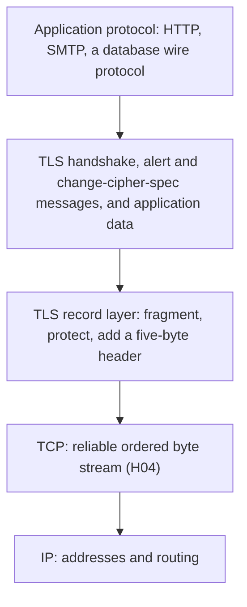
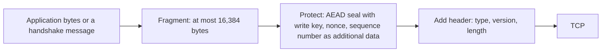
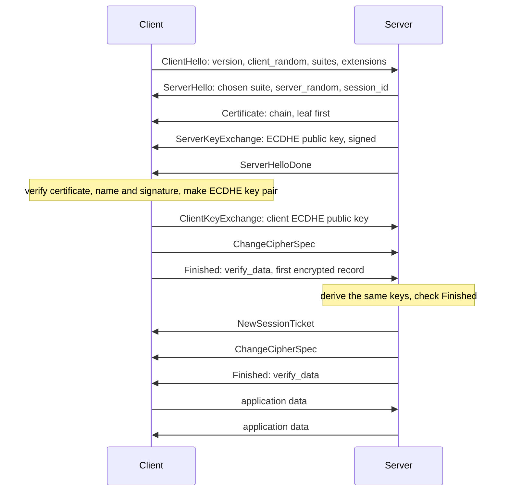
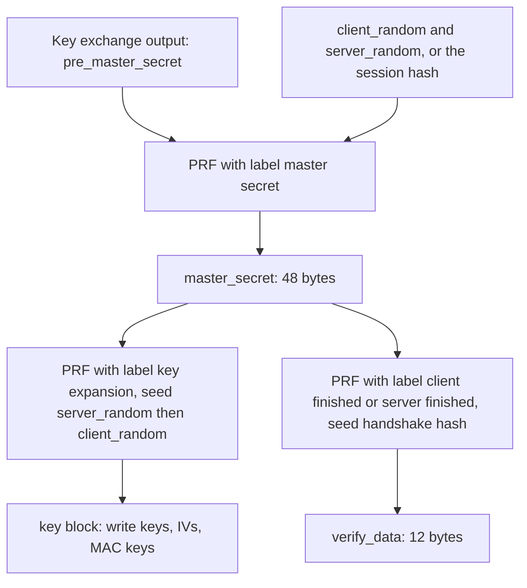
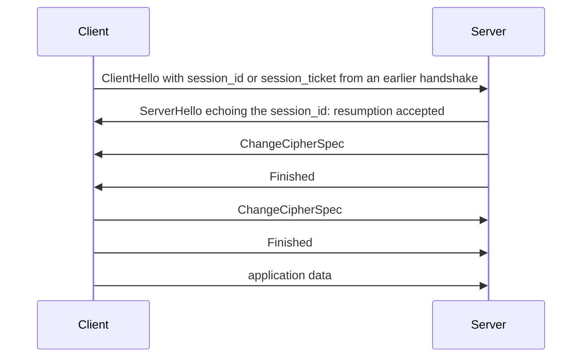
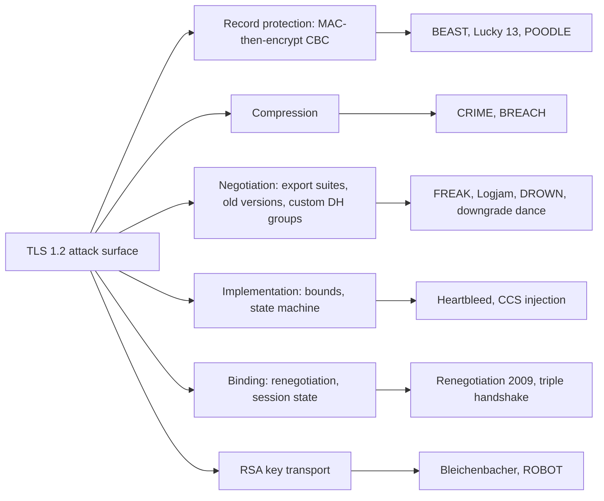
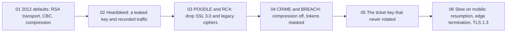

<!-- markdownlint-disable MD001 -->
<!-- markdownlint-disable MD024 -->
<!-- markdownlint-disable MD025 -->
<!-- markdownlint-disable MD026 -->
<!-- markdownlint-disable MD029 -->
<!-- markdownlint-disable MD033 -->
<!-- markdownlint-disable MD036 -->
<!-- markdownlint-disable MD040 -->
<!-- markdownlint-disable MD056 -->
<!-- markdownlint-disable MD060 -->

# H14. TLS 1.2 and the record layer

---

## Contents

| #     | Sub-topic                                                           | Tag  |
| ----- | ------------------------------------------------------------------- | ---- |
| 14.01 | Where TLS sits, what it protects and what stays visible             | CORE |
| 14.02 | The record layer: header, fragmentation, AEAD and CBC records       | DEEP |
| 14.03 | The full handshake, message by message                              | CORE |
| 14.04 | Cipher suite anatomy: key exchange, authentication, cipher, hash    | CORE |
| 14.05 | Key derivation: pre-master, master secret, PRF, key block           | DEEP |
| 14.06 | Resumption: session IDs, session tickets and their cost             | DEEP |
| 14.07 | A history of attacks as design lessons                              | DEEP |
| 14.08 | The story: one shop's TLS configuration, 2012 to 2026               | CORE |
| 14.09 | Labs: a TLS 1.2 client in Java and Rust, a recorded session, tshark | CORE |
| 14.10 | Exercises                                                           |      |
| 14.11 | Solutions                                                           |      |
| 14.12 | Takeaways                                                           |      |

Tags: **CORE** is what an architect is expected to explain unprompted, **DEEP** is the mechanism underneath it, **AWARE** is a fact to know exists and not to derive.

Terms used throughout.  
Each is defined here, before any section uses it.  
Terms from H11 to H13 (AEAD, nonce, MAC, HMAC, key pair, forward secrecy, certificate, trust anchor, transcript) keep their meaning.

- **TLS**, **SSL**, **protocol version**: TLS (transport layer security) is the protocol that gives a byte stream confidentiality, integrity and an authenticated peer.  
  SSL is its predecessor, and the name survives in tools and in speech.  
  Each version is a number: TLS 1.2 is written `3.3` on the wire, because TLS 1.0 was `3.1` and SSL 3.0 was `3.0`.

- **Record**, **record layer**: a record is the unit TLS sends: a five-byte header and a payload of at most 16,384 bytes, protected with the session keys.  
  The record layer is the part of TLS that cuts a stream into records and protects them.  
  Every byte TLS puts on the TCP connection is inside a record.

- **Handshake**, **handshake message**: the handshake is the opening conversation in which client and server agree on parameters, authenticate and derive keys.  
  It is made of numbered handshake messages (ClientHello, ServerHello and so on), which travel inside records of type `handshake`.

- **Round trip** (RTT): the time for a message to reach the other side and for the reply to come back.  
  A round trip is the unit in which handshake latency is counted.  
  A **flight** is a group of messages one side sends without waiting for the other.

- **Cipher suite**: a named set of algorithms for one connection: how the keys are exchanged, how the server is authenticated,  
  which cipher encrypts the records and which hash the key derivation uses. A two-byte number identifies each.

- **Pre-master secret**, **master secret**, **key block**: the pre-master secret is the raw output of the key exchange.  
  The master secret is 48 bytes derived from it.  
  The key block is a longer byte string derived from the master secret and cut into the encryption keys and IVs for the two directions.  
  14.05 gives the formulas.

- **PRF** (pseudorandom function): the function TLS 1.2 uses to stretch a secret and some public inputs into as many bytes as needed, built from HMAC (H11).

- **Extension**, **SNI**, **ALPN**: an extension is an optional, labelled field in the hello messages.  
  SNI (server name indication) carries the host name the client wants, so that one address can serve many certificates.  
  ALPN (application-layer protocol negotiation) carries the application protocols the client speaks, for example `h2` or `http/1.1`.

- **Alert**: a two-byte record that reports an error or announces the end of the connection.  
  A **fatal** alert ends the connection at once, and a **warning** such as `close_notify` is a polite close.

- **Session**, **resumption**, **session ticket**: a session is the state left by a completed handshake (mainly the master secret).  
  Resumption starts a new connection from that state and skips most of the handshake.  
  A session ticket is the state encrypted by the server and stored by the client.

- **Export suites**, **SCSV**: export suites are cipher suites with deliberately weak keys (40 to 512 bits) that 1990s United States export rules required,  
  and that stayed in libraries for two decades. An SCSV (signalling cipher suite value) is a number in the ClientHello's suite list that is not a real suite but carries a message,  
  such as `TLS_FALLBACK_SCSV`: "I am retrying with a lower version".

- **Downgrade**, **oracle**: a downgrade is an attack that makes both sides choose an older, weaker option than they both support.  
  An oracle is any system that answers a yes or no question about a secret, through an error message, a timing difference or a length,  
  so that an attacker can ask many questions and learn the secret (H11, 11.05).

Outputs in this module are real.  
They come from a TLS 1.2 client written for this module in Java (about 430 lines, JDK only) and in Rust, run against an `openssl s_server`;  
from `openssl s_client`, `tcpdump` and `tshark` on the same sessions; and from small programs that list what each stack offers.  

Run on Linux 6.18, JDK 21.0.12, OpenSSL 3.0.13, tshark 4.2.2 and Rust 1.97.  
Random values (nonces, keys, signatures) differ on every run, and the text says when a number is run-dependent.  
The rules quoted from RFC 9325 (2022), RFC 10015 (2026) and RFC 5246 were read in the RFC text on 2026-10-30.  
Other RFC numbers, attack names and dates come from the RFC index and from the papers' own announcements, and were not re-fetched.

---

## 14.01 Where TLS sits, what it protects and what stays visible

TLS sits between TCP and the application protocol.  
It takes the reliable byte stream that TCP provides (H04) and gives the application above it (HTTP, H07) a stream with three properties:  
**confidentiality** (an observer cannot read the data),  
**integrity** (a change is detected) and  
**authentication** of the server, and optionally of the client.  

It does this with the parts of H11 to H13: a key exchange (H12) authenticated by a certificate (H13), then a symmetric AEAD (H11) for the data.  
TLS protects the bytes in transit and nothing else. It does not hide who is talking to whom, it does not hide how much is said and when,  
in TLS 1.2 it does not even hide the server's certificate, and the application that receives the plaintext still has to be trusted.



The same layering explains a common confusion: TLS is not an HTTP feature.  
The `https` scheme means HTTP over TLS over TCP, and SMTP, IMAP, MQTT and PostgreSQL use the same protocol on other ports.  
Where the TLS connection **ends** is where the keys live, so a load balancer that terminates TLS sees the plaintext (H16).

### A short history, because the names confuse

| Version | Specified in | Year | Status today                                                             |
| ------- | ------------ | ---- | ------------------------------------------------------------------------ |
| SSL 2.0 | Netscape     | 1995 | Broken, prohibited                                                       |
| SSL 3.0 | RFC 6101     | 1996 | Prohibited by RFC 7568 (2015) after POODLE                               |
| TLS 1.0 | RFC 2246     | 1999 | Deprecated by RFC 8996 (2021)                                            |
| TLS 1.1 | RFC 4346     | 2006 | Deprecated by RFC 8996 (2021)                                            |
| TLS 1.2 | RFC 5246     | 2008 | Current floor. Use rules in RFC 9325 (2022), updated by RFC 10015 (2026) |
| TLS 1.3 | RFC 8446     | 2018 | Preferred. H15                                                           |

TLS 1.2 is therefore both the oldest version you may still negotiate and the one every library supports.  
Knowing it is what lets an architect read a packet capture, judge a configuration and see why TLS 1.3 made the choices it did.

### What an observer on the path sees

The lab records one connection on the loopback interface and decodes it (14.09, Lab 04).  
Everything in the left column below is readable by anyone who can see the packets.

| Item                                           | Visible to a passive observer in TLS 1.2? | Evidence in the lab                                                            |
| ---------------------------------------------- | ----------------------------------------- | ------------------------------------------------------------------------------ |
| IP addresses and TCP ports                     | Yes                                       | The capture is of `tcp port 14443`                                             |
| The server name the client asked for (SNI)     | Yes, in the ClientHello                   | `tshark` prints `shop.example.test` with no key                                |
| Protocol version, supported suites, extensions | Yes                                       | The ClientHello decodes in full (used to fingerprint clients)                  |
| The chosen cipher suite                        | Yes                                       | The ServerHello                                                                |
| The server's whole certificate chain           | Yes, **in clear** in TLS 1.2              | The Certificate record is 458 bytes of readable DER                            |
| A client certificate (mutual TLS)              | Yes, **in clear** in TLS 1.2              | Same mechanism: the client's Certificate message precedes its ChangeCipherSpec |
| Session tickets                                | Yes, but opaque                           | The NewSessionTicket record (186 bytes)                                        |
| Record types and lengths                       | Yes                                       | `17 03 03 00 4d`: application data, TLS 1.2, 77 bytes                          |
| Timing, direction and size of each record      | Yes                                       | Request record 77 bytes, response record 88 bytes                              |
| HTTP method, path, headers, body               | **No**                                    | Without the key log `tshark` prints nothing                                    |

Three consequences follow.  
First, a network operator knows which **site** you visit through the SNI (TLS 1.3 encrypts more, and Encrypted Client Hello hides the name, H15), though not which page.  
Second, sizes and timing leak: a response of 88 bytes against 40,045 bytes tells an observer which resource was fetched, and compression turns lengths into a secret oracle (14.07).  
Third, TLS 1.2 shows a passive observer the server's identity, because the certificate travels before the encrypted part begins.  
TLS 1.3 moves it under encryption.

What TLS does not do belongs on the same list: it does not protect the data once the server has decrypted it,  
it does not authenticate the *user* (that is the application's job: cookies, tokens, H10), and it does not make a malicious server honest.

### Interview angle

- *"What does TLS give you, and what does it not?"*  
  Confidentiality, integrity and peer authentication of a byte stream between two endpoints.  
  Not anonymity, not hiding of addresses, names, sizes or timing, not protection beyond the endpoints.

- *"My traffic is HTTPS. What can my ISP still see?"*  
  The destination address, the server name in the SNI, the TLS version and suites, and the size and timing of what flows, and in TLS 1.2 the server's certificate.  
  Not the path, headers, cookies or body.

- *"Where does TLS fit in the OSI model?"*  
  It does not map cleanly.  
  It runs on top of the transport layer and below the application protocol, which is why it is described as a layer between 4 and 7.

---

## 14.02 The record layer: header, fragmentation, AEAD and CBC records

The record layer is the framing and protection layer.  
It takes data from above (a handshake message, an alert, or application bytes), cuts it into **fragments of at most 2^14 = 16,384 bytes**,  
protects each fragment with the keys from the handshake, and puts a **five-byte header** in front: a one-byte **content type**, a two-byte **version** and a two-byte **length**.  

Before the handshake finishes, records are plaintext.  
After the ChangeCipherSpec message, each record is encrypted and authenticated, and a 64-bit **sequence number** that is never transmitted but is authenticated binds each record to its position in  
the stream, so a record cannot be replayed, reordered or dropped without detection.  
For an AEAD suite the record body is an 8-byte explicit nonce, the ciphertext, and a 16-byte tag.



### The header

| Offset | Size | Field        | Values in TLS 1.2                                                                  |
| ------ | ---- | ------------ | ---------------------------------------------------------------------------------- |
| 0      | 1    | Content type | 20 change_cipher_spec, 21 alert, 22 handshake, 23 application_data                 |
| 1      | 2    | Version      | `03 03` for TLS 1.2. The first record of a connection often carries `03 01`        |
| 3      | 2    | Length       | Bytes that follow: at most 2^14 for plaintext, at most 2^14 + 2,048 once protected |

The lab captures the real bytes of both ends of a connection:

```text
$ od -An -tx1 -N5 cap/java-ecdhe.c2s.bin                  (the first five bytes the client sent)
 16 03 01 00 72
$ tail -c 82 cap/java-ecdhe.c2s.bin | od -An -tx1 -N13   (the request record: header, then the 8-byte explicit nonce)
 17 03 03 00 4d 00 00 00 00 00 00 00 01
$ tail -c 31 cap/java-ecdhe.s2c.bin | od -An -tx1 -N5    (the last record the server sent: type 0x15 = alert, length 26)
 15 03 03 00 1a
```

`16 03 01 00 72` is a handshake record (`0x16` is 22), legacy version 1.0, 114 bytes long.  
The ClientHello announces `03 01` in the record header and `03 03` in its own body (the `client_version` field),  
a compatibility habit: some old servers rejected a record header with a version they did not know.  
Version negotiation really happens in the hello messages, and the record version is mostly ignored.  
The second line is the request record of the lab client: `17` is application data, `00 4d` is 77 bytes, and the first eight bytes of its body are `00 00 00 00 00 00 00 01`,  
the **explicit nonce**, which the sender chose to be the record's sequence number (the first encrypted record, the Finished message, was number 0).  
The third line is the last record the server sent, `15`, an alert of 26 bytes, which is the encrypted `close_notify`.

### Fragmentation and coalescing

A record holds at most 16,384 bytes of plaintext, whatever the sender writes.  
The reverse also holds: records do not line up with messages. A handshake message can be larger than one record, and one record can hold several handshake messages.  
Application records do not line up with HTTP messages.  
The lab fetches a 40,000-byte file, and the 40,045-byte response (45 bytes of HTTP header) arrives as:

```text
c>s record 23 application_data   v1.2 len   74  (encrypted)
s>c record 23 application_data   v1.2 len 16408  (encrypted)
s>c record 23 application_data   v1.2 len 16408  (encrypted)
s>c record 23 application_data   v1.2 len 7301  (encrypted)
        application data back: HTTP/1.0 200 ok | Content-type: text/plain |  | catalogue li... (40045 bytes)
```

`16,408 = 16,384 + 8 + 16`: two full records and a third of 7,301 bytes.  
A receiver cannot use any part of a record until the whole of it has arrived and its tag has verified, so large records delay the first byte of a response on a slow link.  
Servers therefore often start a connection with small records and grow them (nginx exposes `ssl_buffer_size` for this).  
The sender, not the protocol, decides how it writes; the cap of 16 KiB is only the upper bound.

### How a record is protected

TLS 1.2 defines three families, and the differences are the root of most of the attacks in 14.07.

| Family           | Record body                                            | Authenticated how                                                          | Status                                                   |
| ---------------- | ------------------------------------------------------ | -------------------------------------------------------------------------- | -------------------------------------------------------- |
| Stream cipher    | `RC4(plaintext, MAC)`                                  | HMAC over header fields and plaintext                                      | RC4 prohibited by RFC 7465 (2015)                        |
| Block cipher CBC | `IV, CBC-encrypt(plaintext, MAC, padding)`             | **MAC then encrypt**: HMAC of the plaintext, padded and encrypted together | Legacy. Behind Lucky 13 and POODLE, and BEAST in TLS 1.0 |
| AEAD             | `explicit nonce (8), ciphertext, tag (16)` for AES-GCM | The AEAD tag covers the ciphertext and the additional data                 | The only family to use                                   |

**AEAD records.** The nonce for AES-GCM is 12 bytes: a 4-byte **implicit salt** taken from the key block (never sent) followed by the 8-byte explicit nonce from the record (RFC 5288).  
The additional data that the tag also covers is

```text
additional_data = seq_num (8 bytes) | type (1) | version (2) | length of the plaintext (2)
```

so a tag does not verify if a record is moved to another position (different `seq_num`), relabelled (different `type`) or resized.  
The sequence number counts records in one direction, starts at 0 after the ChangeCipherSpec and is not sent, since both sides count.  
The cost per record is 29 bytes (5 header, 8 nonce, 16 tag): about 0.2 percent for full records (Exercise 01). ChaCha20-Poly1305 (RFC 7905) is the same shape without the explicit nonce:  
the 12-byte nonce is the sequence number XORed into a 12-byte IV from the key block, which removes the temptation to pick explicit nonces badly.  
H11 (11.06) showed that a repeated GCM nonce under one key leaks the authentication key, which is why every implementation derives the nonce from a counter.

**CBC records.** The sender computes `HMAC(mac_key, seq_num | type | version | length | plaintext)`, appends it, pads to the block size and encrypts the lot with an IV.  
  The receiver must **decrypt first**, then check the padding, then check the MAC.  
  That order is the flaw: the receiver acts on unauthenticated data, and any difference in how it reports or times a padding failure against a MAC failure is a padding oracle (H11, 11.05).  
  TLS 1.2 implementations could only hide the difference with extremely careful constant-time code, and Lucky 13 showed that even that leaked.  
  The fix, `encrypt_then_mac` (RFC 7366), reverses the order, and AEAD removes the question.

### Alerts and the end of a connection

An alert record carries two bytes: a level (1 warning, 2 fatal) and a description. The ones that appear in logs:

| Code  | Name                               | Meaning                                                                     |
| ----- | ---------------------------------- | --------------------------------------------------------------------------- |
| 0     | `close_notify`                     | The sender is done writing. A clean close                                   |
| 10    | `unexpected_message`               | A message arrived out of order                                              |
| 20    | `bad_record_mac`                   | A record failed authentication. Fatal. Also used for any decryption problem |
| 40    | `handshake_failure`                | No acceptable parameters (no common suite, for example)                     |
| 42-48 | `bad_certificate` ... `unknown_ca` | Certificate problems (H13)                                                  |
| 70    | `protocol_version`                 | No common version                                                           |
| 86    | `inappropriate_fallback`           | A downgrade attempt was detected (14.07)                                    |
| 112   | `unrecognized_name`                | The SNI names no site this server has                                       |

A **fatal** alert ends the connection at once on both sides, and a session that ended with one must not be resumed.  
The `close_notify` matters because a TCP FIN alone proves nothing: an attacker who can inject a FIN can cut a stream short, and without `close_notify` the receiver cannot tell a complete response from a truncated one.  
HTTP/1.1 with `Content-Length` or chunked framing (H07) detects the cut, but a response delimited by connection close does not, which is why the lab's HTTP/1.0 responses end with an alert.

The lab damages one ciphertext byte of the request (Lab 06, experiment 01). The server replies, in an encrypted record, with `fatal(2) bad_record_mac(20)` and closes.  
Nothing was decrypted, nothing was parsed.

### Interview angle

- *"What is in a TLS record?"*  
  A five-byte header (type, version, length) and a payload of at most 16 KiB, which after the handshake is an AEAD ciphertext with its explicit nonce and tag.  
  The type says whether it is handshake, alert, change-cipher-spec or application data.

- *"How does TLS stop an attacker from reordering or replaying records?"*  
  Each direction has a 64-bit sequence number, authenticated in the additional data of every record and never transmitted.  
  A replayed or moved record carries the wrong number and fails its tag.

- *"Why was CBC in TLS a problem?"*  
  MAC-then-encrypt makes the receiver process unauthenticated padding before it can check the MAC, so error handling and timing become an oracle (padding oracle, Lucky 13, POODLE).  
  AEAD authenticates before it reveals anything.

- *"Is a record limited to 16 KiB because of the cipher?"*  
  No, it is a protocol limit chosen so that a receiver never buffers much before it can verify and use a record.

---

## 14.03 The full handshake, message by message

The handshake does four jobs in order:  
**negotiate** (agree on the version, cipher suite and extensions),  
**authenticate** (the server proves its identity with a certificate and a signature over the key exchange),  
**exchange** (both sides contribute to a shared secret), and  
**confirm** (each side proves that it computed the same keys and saw the same messages).  

In TLS 1.2 this takes **four flights and two round trips** before the first application byte can be protected: ClientHello; ServerHello, Certificate, ServerKeyExchange, ServerHelloDone; ClientKeyExchange, ChangeCipherSpec, Finished; ChangeCipherSpec, Finished.  
Add the TCP handshake and the request, and the first response byte arrives after four round trips (Exercise 04).



### The messages

Handshake messages share a four-byte header: a one-byte type and a three-byte length.  
The lab's decoded run (Lab 01) shows every row.

| Message              | No. | From   | Carries                                                                                                               | Lab record length     |
| -------------------- | --- | ------ | --------------------------------------------------------------------------------------------------------------------- | --------------------- |
| ClientHello          | 1   | Client | Highest version, 32-byte `client_random`, a session ID, the suites it offers, compression methods, extensions         | 114                   |
| ServerHello          | 2   | Server | The version and **one suite** chosen, `server_random`, session ID, extensions it accepts                              | 65                    |
| Certificate          | 11  | Server | The chain, leaf first (H13). In clear                                                                                 | 458                   |
| ServerKeyExchange    | 12  | Server | For ECDHE and DHE only: the named curve, the server's ephemeral public key and a **signature** by the certificate key | about 148             |
| CertificateRequest   | 13  | Server | Optional: asks the client for a certificate (mutual TLS)                                                              | not sent              |
| ServerHelloDone      | 14  | Server | Nothing. Marks the end of the server's flight                                                                         | 4                     |
| Certificate (client) | 11  | Client | Only if requested                                                                                                     | not sent              |
| ClientKeyExchange    | 16  | Client | For ECDHE: the client's public key. For RSA transport: the pre-master secret encrypted to the server                  | 70 (ECDHE), 262 (RSA) |
| CertificateVerify    | 15  | Client | Only with a client certificate: a signature over the transcript                                                       | not sent              |
| ChangeCipherSpec     | -   | Both   | One byte, `01`: "my records are encrypted from the next one". A record type, not a handshake message                  | 1                     |
| Finished             | 20  | Both   | 12 bytes of `verify_data`, the first message under the new keys                                                       | 40 (16 + 8 + 16)      |
| NewSessionTicket     | 4   | Server | Optional: a ticket for resumption (14.06)                                                                             | 186                   |

**ClientHello** is the only message sent before the client knows anything about the server, so it is a menu.  
  The lab's offers its two suites, a key exchange curve, signature algorithms, and the extensions `server_name`, `supported_groups`, `ec_point_formats`, `signature_algorithms`, `session_ticket`, `extended_master_secret` and `renegotiation_info`.  
  Real browsers add ALPN (so that the server can pick `h2`, H17), `status_request` (OCSP stapling, H13) and dozens of others.  
  The `client_random` was once a clock reading plus random bytes. Modern stacks send random bytes throughout, because a clock leaks the host's time.

**ServerHello** answers with exactly one of everything: one version, one suite, one compression method (null), and only extensions the client offered.  
  The server's choice rule is its own (some servers follow the client's order, most strong configurations follow the server's).

**ServerKeyExchange** is where TLS 1.2 binds ephemeral keys to identity.  
  The server generates a fresh key pair for this connection and signs `client_random | server_random | parameters` with the private key that matches its certificate.  
  The client verifies the signature with the leaf's public key. The two randoms in the signed data make the signature specific to this connection, so it cannot be replayed on another.  
  The lab client does this check and prints `verifies with the leaf key: true`. With **RSA key transport** this message does not exist, since the server's certificate key is the key exchange (14.04).

**ClientKeyExchange** completes the exchange. Both sides now hold the **pre-master secret** and can derive keys (14.05).

**ChangeCipherSpec** is not a handshake message at all. It has its own record type and a single byte.  
  It is a marker that flips the sender to the new keys, and it is **not** part of the transcript hash.  
  Its odd status is a historic accident, and an early-CCS bug in OpenSSL (14.07) shows what happens when it is handled loosely.

**Finished** is the confirmation. Each side computes

```text
verify_data = PRF(master_secret, "client finished" or "server finished", Hash(all handshake messages so far))[0..12]
```

and sends it as the first encrypted message. A correct `verify_data` shows two things at once.  
The sender holds the master secret (so the key exchange worked and no one substituted keys), and it saw exactly the same sequence of handshake messages as the receiver, so no message was altered on the way.  

That second property is what defeats a downgrade that only edits the hello messages:  
if Mallory removes the strong suites from the ClientHello, the client's transcript and the server's transcript differ and the Finished messages do not match.  

The lab prints the recomputation: `recomputed from the transcript: match`.  
The attacks of 14.07 that still downgrade (Logjam, FREAK) work because the weakened parameters let the attacker compute the keys in time to forge the Finished.

### Flights and round trips

`tshark` groups the lab connection by TCP segment (Lab 04 prints the raw fields, regrouped here with the message names):

```text
frame 4    client  ClientHello                                  114
frame 6    server  ServerHello, Certificate, ServerKeyExchange, ServerHelloDone
frame 8    client  ClientKeyExchange                             70
frame 10   client  ChangeCipherSpec, Finished
frame 12   server  NewSessionTicket, ChangeCipherSpec, Finished
frame 14   client  application data (the request)
frame 15   server  application data (the response)
```

Counted in round trips from the first SYN: TCP handshake (1), ClientHello to server flight (2), client flight to server Finished (3), request to response (4).  
**False Start** (RFC 7918) lets the client send its request right after its own Finished, without waiting for the server's, which saves one round trip when the suite is forward-secret and AEAD.  
Resumption (14.06) saves the same round trip. TLS 1.3 (H15) puts the full handshake into one round trip by sending the client's key share in the first message.

### Client authentication and renegotiation

For mutual TLS (H13, 13.10) the server adds a `CertificateRequest`, and the client answers with its `Certificate` and a `CertificateVerify` signature.  
In TLS 1.2 the client certificate crosses the network **in clear**, so an observer learns the client's identity.  
A TLS 1.2 connection can also run a **new handshake inside the existing one** (renegotiation), which servers used to ask for a client certificate only on some URLs.  
It was attacked in 2009 and needed a protocol patch (14.07), and TLS 1.3 deleted it.

### Interview angle

- *"Walk me through a TLS 1.2 handshake."*  
  The four flights above, with the point of each: negotiate, authenticate (certificate plus a signature over the ephemeral key), exchange (ECDHE), confirm (Finished over the transcript).  
  Say the cost: two round trips.

- *"Why does the server sign the key exchange?"*  
  Because an ephemeral public key has no identity.  
  The signature, made with the key in the certificate over both randoms and the parameters, ties this connection's key to the certificate.  
  Without it, Mallory substitutes her own key (H12, 12.05).

- *"What does Finished protect?"*  
  The whole handshake.  
  It proves possession of the master secret and, because it is computed over every earlier message, that nothing was changed in transit, including any attempt to weaken the negotiation.

- *"What can a passive observer learn from the handshake?"*  
  Everything up to ChangeCipherSpec, which includes the SNI, the offered and chosen suites, both randoms, the certificate chain and the public key shares, and the ticket.  
  None of it gives the keys.

---

## 14.04 Cipher suite anatomy: key exchange, authentication, cipher, hash

A TLS 1.2 cipher suite is one two-byte number naming four decisions:  
how the keys are **exchanged**, how the server is **authenticated**, which **cipher** protects the records (with its mode), and which **hash** the key derivation and Finished use.  

`TLS_ECDHE_ECDSA_WITH_AES_128_GCM_SHA256` reads: exchange keys with ephemeral elliptic-curve Diffie-Hellman, authenticate by an ECDSA signature, encrypt with AES-128 in Galois/Counter mode, and use SHA-256 in the PRF.  
The choice that matters most is the key exchange: **ephemeral** exchange (ECDHE) gives forward secrecy, and **RSA key transport** does not.

| Part of the name           | Decides                                                      | Examples                                                             |
| -------------------------- | ------------------------------------------------------------ | -------------------------------------------------------------------- |
| `ECDHE` (before `_`)       | Key exchange                                                 | `ECDHE`, `DHE`, `RSA` (transport), `PSK`, `DH`/`ECDH` (static, dead) |
| `ECDSA` (second)           | Which certificate key signs                                  | `ECDSA`, `RSA`. For `TLS_RSA_*` the name has one word: RSA does both |
| `AES_128_GCM` (after WITH) | Bulk cipher and mode                                         | `AES_128_GCM`, `AES_256_GCM`, `CHACHA20_POLY1305`, `AES_128_CBC`     |
| `SHA256`                   | Hash for the PRF (AEAD suites), or for the HMAC (CBC suites) | `SHA256`, `SHA384`, `SHA` (SHA-1)                                    |

In an AEAD suite the final hash is **not** a MAC (the AEAD authenticates).  
It selects the hash inside the PRF and in Finished, which is why `AES_256_GCM_SHA384` uses SHA-384 there.  
In a CBC suite it is the HMAC hash.

The numbers on the wire come from an IANA registry: `C0 2B` is the lab's `TLS_ECDHE_ECDSA_WITH_AES_128_GCM_SHA256` (RFC 5289),  
`00 9C` is `TLS_RSA_WITH_AES_128_GCM_SHA256` (RFC 5288), `C0 2F` is the ECDHE-RSA twin, `CC A8` and `CC A9` are the ChaCha20-Poly1305 suites (RFC 7905),  
and `00 FF` is a signalling value for secure renegotiation.  

TLS 1.3 shrank the list to five suites with different names (H15).

### The key exchange decides forward secrecy

| Key exchange          | What the client does                                                                         | ServerKeyExchange? | Forward secrecy | Notes                                                                                                   |
| --------------------- | -------------------------------------------------------------------------------------------- | ------------------ | --------------- | ------------------------------------------------------------------------------------------------------- |
| `ECDHE`               | Makes an ephemeral EC key pair, sends the public half                                        | Yes, signed        | **Yes**         | The default. P-256 and X25519 dominate                                                                  |
| `DHE`                 | The same with finite-field groups                                                            | Yes, signed        | Yes             | Slow; group negotiation was the Logjam hole. Deprecated for 1.2 by RFC 10015                            |
| `RSA` (key transport) | Picks a random 48-byte pre-master secret and **encrypts it to the server's certificate key** | No                 | **No**          | One long-term key decrypts every recorded session. Bleichenbacher oracle (H12). Deprecated by RFC 10015 |
| Static `DH`, `ECDH`   | Uses the DH key inside the server's certificate                                              | No                 | No              | Practically extinct                                                                                     |
| `PSK` variants        | Uses a key shared in advance                                                                 | Varies             | Varies          | Embedded and IoT                                                                                        |

The lab shows the difference in bytes (Lab 03). The same client talks to a server that picks RSA transport.  
The ClientKeyExchange is a 256-byte ciphertext and there is no ServerKeyExchange:

```text
        ServerHello: version 1.2, session_id 0 bytes, suite TLS_RSA_WITH_AES_128_GCM_SHA256,
        extensions [renegotiation_info, session_ticket, extended_master_secret]
s>c record 22 handshake          v1.2 len  660
        Certificate: 1 certificate, CN=shop.example.test signed by CN=H14 Lab CA: signature ok, dates ok, name in SAN
        ServerHelloDone
c>s record 22 handshake          v1.2 len  262
        ClientKeyExchange: RSA-encrypted pre_master_secret, 256 bytes
        pre_master_secret 48 bytes -> master_secret fde2b1687c3afdd5... (extended derivation)
        key block 40 bytes: client_write_key c1aade25..., server_write_key 7775c055..., IV salts 2846bf93 / 9817aa96
```

Anyone who recorded that connection and later obtains the server's private key recovers the session, using nothing from the client:

```text
recorded: 5 client records, 8 server records; suite TLS_RSA_WITH_AES_128_GCM_SHA256, extended master secret
RSA-decrypted the ClientKeyExchange with the server's private key: pre_master_secret 48 bytes, starts 0303
master_secret fde2b1687c3afdd5... key block derived from public randoms and that secret
c>s encrypted record #0 (seq 0): handshake type 20 (Finished), verify_data 1e6969d029a433ed8ff7989d
c>s encrypted record #1 (seq 1): application_data: GET /index.html HTTP/1.0 | Host: shop.example.test |  |
s>c encrypted record #0 (seq 0): handshake type 20 (Finished), verify_data fa992757d9752cfe86aeba9c
s>c encrypted record #1 (seq 1): application_data: HTTP/1.0 200 ok | Content-type: text/html |  | hello from the shop\n
s>c encrypted record #2 (seq 2): alert warning(1) close_notify
```

The same program run on a recorded ECDHE session ends with:

```text
recorded: 5 client records, 9 server records; suite TLS_ECDHE_ECDSA_WITH_AES_128_GCM_SHA256, extended master secret
ClientKeyExchange holds a 65-byte ECDHE public point. The server key only signed the key exchange; the private half of the
exchange was ephemeral and is gone. The server key cannot recover this session.
```

That contrast is the argument for ephemeral exchange.  
**Heartbleed** (14.07) is the realistic trigger: a server whose key may have leaked once, and an adversary who stores ciphertext for years.  
With RSA transport the leak retroactively exposes everything.  
With ECDHE it exposes only what the leaked key could still forge in the future, not the past. (Session tickets weaken this, 14.06.)

### Bulk ciphers and what to use

| Cipher                   | Type             | Status in TLS 1.2                                                        |
| ------------------------ | ---------------- | ------------------------------------------------------------------------ |
| AES-128-GCM, AES-256-GCM | AEAD             | Use. The hardware-accelerated default                                    |
| ChaCha20-Poly1305        | AEAD             | Use. Fast on devices without AES instructions                            |
| AES-CBC with HMAC        | MAC-then-encrypt | Legacy. RFC 9325 says SHOULD NOT unless `encrypt_then_mac` is negotiated |
| 3DES-CBC                 | 64-bit blocks    | Disable (Sweet32, 14.07)                                                 |
| RC4                      | Stream           | Prohibited (RFC 7465)                                                    |
| NULL, export, anonymous  | None / weak      | Never. They exist only as attack targets                                 |

### What each stack offers by default

The lab asks three stacks what they would negotiate (Lab 05). OpenSSL 3.0.13 on this machine:

```text
$ openssl ciphers -v DEFAULT | awk (TLS 1.2 suites by key exchange)
TLS 1.2 suites: 29  DH 5  RSAPSK 3  DHEPSK 3  PSK 3  ECDH 10  RSA 4  ECDHEPSK 1
$ openssl ciphers -v DEFAULT | awk (AEAD against CBC-with-HMAC among TLS 1.2 suites)
AEAD 21, CBC with HMAC 8
```

The JDK 21.0.12 lists 28 TLS 1.2 values (27 suites and a signalling value) and offers **no** `TLS_RSA_*` suite, because `jdk.tls.disabledAlgorithms` contains `TLS_RSA_*` (OpenJDK bug JDK-8344257, whether a given update has it depends on the build).  
`rustls`, the Rust library of H13, implements **six** TLS 1.2 suites and no others:

```text
$ cargo run --release --bin suites
TLS 1.2 suites implemented: 6
  TLS_ECDHE_ECDSA_WITH_AES_256_GCM_SHA384
  TLS_ECDHE_ECDSA_WITH_AES_128_GCM_SHA256
  TLS_ECDHE_ECDSA_WITH_CHACHA20_POLY1305_SHA256
  TLS_ECDHE_RSA_WITH_AES_256_GCM_SHA384
  TLS_ECDHE_RSA_WITH_AES_128_GCM_SHA256
  TLS_ECDHE_RSA_WITH_CHACHA20_POLY1305_SHA256
TLS 1.3 suites implemented: 3
```

All six are ECDHE with AEAD.  
`rustls` has no RSA transport, no finite-field DH, no CBC, no RC4, no renegotiation and no compression, by design: it is a library that deleted the options 14.07 describes.  
Where Ubuntu's OpenSSL still lists four RSA-transport suites, the standards have caught up.  
RFC 9325 (November 2022, the current best practice for TLS 1.2) recommends four suites, all ECDHE with GCM, and says implementations SHOULD NOT negotiate RSA key transport.  
RFC 10015 (July 2026) makes it a requirement: clients MUST NOT offer and servers MUST NOT select RSA cipher suites or finite-field DHE suites in TLS 1.2.

### Interview angle

- *"Decode `TLS_ECDHE_RSA_WITH_AES_256_GCM_SHA384`."*  
  Ephemeral elliptic-curve Diffie-Hellman for the key exchange, authenticated by an RSA signature with the server's RSA certificate;  
  AES-256 in GCM for records; SHA-384 in the PRF and Finished.

- *"Why must a suite name both ECDHE and RSA or ECDSA?"*  
  They are two independent jobs.  
  The key exchange makes the secret.  
  The signature algorithm proves the key exchange came from the certificate holder, so it must match the certificate's key type.

- *"What is forward secrecy and which suites have it?"*  
  A later key compromise cannot decrypt earlier sessions (H12, 12.07). The ephemeral ones: ECDHE and DHE.  
  Not RSA transport, and not session tickets with a long-lived ticket key (14.06).

- *"ECDSA or RSA certificate?"*  
  ECDSA P-256 has smaller keys and signatures, so a smaller Certificate message, and it signs much faster, which matters for handshakes per second.  
  RSA verifies fast but signs slowly, and RSA certificates are universally accepted. Many CDNs serve both and pick by client capability.

---

## 14.05 Key derivation: pre-master, master secret, PRF, key block

The key exchange produces one secret, the **pre-master secret**.  
Both sides then run the PRF (a function built from HMAC, H11) three times, with public labels and public inputs, and get everything else:  
the 48-byte **master secret**, a **key block** that is cut into the encryption keys and IVs for each direction, and the 12-byte `verify_data` of each Finished message.  
Nothing in the later steps is transmitted.  
The master secret is the only secret that matters after the exchange: with it and the two public random values anyone can compute every key of the connection,  
which is why the debugging format `SSLKEYLOGFILE` is one line holding the client random and the master secret.



### The PRF

TLS 1.2 defines one function and uses it everywhere:

```text
PRF(secret, label, seed) = P_hash(secret, label | seed)

P_hash(secret, seed) = HMAC(secret, A(1) | seed) | HMAC(secret, A(2) | seed) | ...
A(0) = seed        A(i) = HMAC(secret, A(i-1))
```

It produces as many bytes as asked by running the chain long enough and cutting.  
The hash is SHA-256 unless the cipher suite names another (the `SHA384` suites use SHA-384).  
The `label` is ASCII text, a **domain separator**: the same secret and seed with a different label give unrelated output, so a value derived for one purpose cannot be mistaken for another.  
TLS 1.0 and 1.1 used a clumsy MD5-and-SHA-1 combination instead.  
TLS 1.3 replaces the PRF with HKDF (H11, 11.07 and H15), which separates "extract" from "expand" more cleanly.

The lab's PRF is 8 lines in each language.  
`exercises` mode checks it against a widely circulated P_SHA256 test vector (secret `9bbe436b...`, seed `a0ba9f93...`, label `test label`, first output bytes `e3f229ba...`) and prints `matches: true`.

### The three derivations

| Output        | Formula                                                                         | Bytes | Notice                                                        |
| ------------- | ------------------------------------------------------------------------------- | ----- | ------------------------------------------------------------- |
| master secret | `PRF(pms, "master secret", client_random \| server_random)`                     | 48    | Classic form                                                  |
| master secret | `PRF(pms, "extended master secret", session_hash)`                              | 48    | **Extended** form (RFC 7627, 2015). Used by every lab session |
| key block     | `PRF(master, "key expansion", server_random \| client_random)`                  | n     | The seed order is **reversed** relative to the master secret  |
| `verify_data` | `PRF(master, "client finished" or "server finished", Hash(handshake messages))` | 12    | Hash covers every handshake message before this one           |

The reversed seed order is a classic slip for people writing their own implementation, and the lab's Java and Rust code follow RFC 5246 here.  
The pre-master secret depends on the exchange:

| Key exchange | Pre-master secret                                                                                         | Lab value                 |
| ------------ | --------------------------------------------------------------------------------------------------------- | ------------------------- |
| ECDHE        | The x coordinate of the shared point                                                                      | 32 bytes (P-256)          |
| DHE          | The shared value `g^(ab) mod p`, with leading zero bytes stripped (the Raccoon attack of 2020 timed that) | n/a                       |
| RSA          | 48 bytes: the client's version `03 03` and 46 random bytes, encrypted to the server                       | 48 bytes, starting `0303` |

### Classic and extended master secret

The classic master secret depends only on the pre-master secret and the two randoms.  
In the 2014 **triple handshake** attack a malicious server made two connections, one with the client and one with an honest server,  
share the *same* master secret and keys, and then used resumption and renegotiation to splice an authenticated client into a session it did not intend.  

The cause was that the master secret did not depend on the certificates or the key exchange parameters, only on values an attacker could steer.  
RFC 7627 fixes this by replacing the two randoms with the **session hash**, the hash of all handshake messages through ClientKeyExchange.  

That includes the certificate, the parameters and both randoms, so two connections that differ in any of them now get unrelated master secrets.  
Both hellos carry an empty `extended_master_secret` extension to opt in, and RFC 9325 requires TLS 1.2 implementations to support it.  

In the lab, every session negotiates it and the client prints `(extended derivation)`.  
TLS 1.3 builds the transcript into every derived secret by design.

### The key block

The key block is cut in a fixed order: client MAC key, server MAC key, client write key, server write key, client write IV, server write IV, where a field that the suite does not need has length 0.  
For the lab's AES-128-GCM suite it is 40 bytes:

| Bytes   | Field            | Use                                                 |
| ------- | ---------------- | --------------------------------------------------- |
| 00 - 15 | client write key | Client encrypts, server decrypts                    |
| 16 - 31 | server write key | Server encrypts, client decrypts                    |
| 32 - 35 | client write IV  | The 4-byte implicit salt of the client's GCM nonces |
| 36 - 39 | server write IV  | The salt of the server's nonces                     |

Each direction has its own key and its own salt, so the two sequence-number spaces never share a nonce (H11, 11.06).  
A CBC suite such as `TLS_RSA_WITH_AES_128_CBC_SHA` instead needs two 20-byte MAC keys and two 16-byte keys (72 bytes), and no fixed IV, because each CBC record carries its own.  
`AES_256_GCM_SHA384` needs 72 bytes, and ChaCha20-Poly1305 needs 88 (Exercise 02).

### The key log

`SSLKEYLOGFILE` is a text format, one line per connection: `CLIENT_RANDOM <32 bytes hex> <48 bytes hex>`, the client random that appears in the ClientHello and the master secret.  
Browsers, `curl`, OpenSSL (`-keylogfile`), Wireshark and the lab client all speak it. It is enough to decrypt a capture precisely because everything else is derived from public values.  
The lab client writes it, `openssl s_server -keylogfile` writes it independently, and the two files are **byte-identical**, which is the proof that this module's PRF,  
session hash and key block are the standard's and not merely self-consistent (Lab 01).  

Treat a key log like a private key: it decrypts the sessions it names.

### What a leak costs

| Leaked value                                 | Exposed                                                                        |
| -------------------------------------------- | ------------------------------------------------------------------------------ |
| One write key                                | One direction of one connection                                                |
| Master secret (or the pre-master secret)     | Both directions of that connection, and any connection resumed from it (14.06) |
| The server's RSA private key (RSA transport) | The pre-master secret of **every** recorded session (14.04)                    |
| The server's signing key (ECDHE)             | Nothing in the past; future impersonation until the certificate is replaced    |

### Interview angle

- *"How are the encryption keys derived in TLS 1.2?"*  
  Key exchange gives the pre-master secret.  
  PRF with the label `master secret` and the two randoms (or the session hash) gives a 48-byte master secret.  
  PRF with `key expansion` gives a key block, cut into per-direction keys and IVs.

- *"What is the extended master secret and what did it fix?"*  
  The master secret bound to the hash of the handshake so far instead of the two randoms.  
  It stops an attacker from making different connections share a master secret (triple handshake).

- *"Why do I only need the client random and the master secret to decrypt a capture?"*  
  Because the server random, the suite and all the other inputs are visible on the wire, and everything else is a deterministic function of them.

---

## 14.06 Resumption: session IDs, session tickets and their cost

A full handshake costs two round trips, a certificate chain on the wire and public-key work on both sides.  
A client that has connected before can skip most of that, by reusing the master secret of the earlier handshake and deriving fresh keys from it with new randoms.  
TLS 1.2 has two ways to hold that state. With **session IDs** (RFC 5246) the server keeps the state in a cache and gives the client an ID.  
With **session tickets** (RFC 5077) the server encrypts the state with a secret **ticket key** and hands the opaque blob to the client,  
which stores it and presents it later, so the server keeps nothing.  

The abbreviated handshake takes one round trip.  
The price is subtler: the master secret now exists in more places for longer, and a ticket key that lives for weeks quietly turns a forward-secret exchange back into a recoverable one.



### What the lab shows

Lab 01's second connection presents the ticket from the first.  
The shape of the exchange changes in four ways, all visible in the trace:

```text
== connection 2: resumed with the session ticket ==
c>s record 22 handshake          v1.0 len  322
        ClientHello: version 1.2, session_id 32 bytes, suites [TLS_ECDHE_ECDSA_WITH_AES_128_GCM_SHA256, TLS_RSA_WITH_AES_128_GCM_SHA256],
        extensions [server_name, supported_groups, ec_point_formats, signature_algorithms, session_ticket, extended_master_secret, renegotiation_info]
s>c record 22 handshake          v1.2 len   85
        ServerHello: version 1.2, session_id 32 bytes, suite TLS_ECDHE_ECDSA_WITH_AES_128_GCM_SHA256,
        extensions [renegotiation_info, extended_master_secret]
        the server echoed our session_id: abbreviated handshake, no Certificate, no key exchange
        key block 40 bytes: client_write_key c5956b7a..., server_write_key 14ed9771..., IV salts a9a800b1 / f51675d0
s>c record 20 change_cipher_spec v1.2 len    1
        server ChangeCipherSpec: its records are encrypted from here
s>c record 22 handshake          v1.2 len   40  (encrypted)
        Finished: verify_data 5b326eaffbdaa9b57b81347b
        recomputed from the transcript: match
c>s record 20 change_cipher_spec v1.2 len    1
c>s record 22 handshake          v1.2 len   40  (encrypted)
        Finished: verify_data f18bf4b2e773fa40c36719ee
c>s record 23 application_data   v1.2 len   77  (encrypted)
s>c record 23 application_data   v1.2 len   88  (encrypted)
s>c record 21 alert              v1.2 len   26  (encrypted)
        alert warning(1) close_notify
        application data back: HTTP/1.0 200 ok | Content-type: text/html |  | hello from the shop\n
```

- There is **no Certificate, no ServerKeyExchange and no ClientKeyExchange**.  
  The server's ServerHello echoes the client's 32-byte `session_id`, which is how the client learns that the offer was accepted.
- The **server's Finished comes first** (the opposite of the full handshake), because the server is the one that can verify the ticket and has the keys immediately.
- The request goes out in the same flight as the client's Finished: three round trips from SYN to the first response byte, against four (Exercise 04).
- The keys are **new**. The key block (the `client_write_key` line above) is derived from the old master secret with the new randoms.  
  The key log shows the same master secret under two different client randoms:

```text
$ awk '{print $1, substr($2, 1, 16) "...", substr($3, 1, 16) "..."}' try/java-keys.txt      (client_random, master_secret)
CLIENT_RANDOM efc14af090df20af... 0e4b45c2f4172836...
CLIENT_RANDOM 7134fa1c04a6f09a... 0e4b45c2f4172836...
```

If the server cannot use the ticket (it has expired, the ticket key rotated away, or a byte was damaged), it does not fail.  
It ignores the ticket and runs a full handshake.  
Lab 06, experiment 03 flips one byte of the ticket and the connection still succeeds, with a Certificate and a key exchange in the trace.

### Session IDs against tickets

| Aspect                        | Session ID                                                                    | Session ticket                                                                          |
| ----------------------------- | ----------------------------------------------------------------------------- | --------------------------------------------------------------------------------------- |
| Where the state lives         | In the server's cache, keyed by the ID                                        | In the ticket, on the client, encrypted by the server                                   |
| Scaling a server fleet        | A request must reach a server with the entry (shared cache or sticky routing) | Any server that holds the ticket key can resume                                         |
| Memory on the server          | One entry per session (nginx documents about 4,000 per megabyte)              | None                                                                                    |
| What an eavesdropper sees     | A random ID                                                                   | An opaque ticket (about 180 bytes in the lab) sent **in clear** before ChangeCipherSpec |
| Secret that must be protected | The cache contents                                                            | The **ticket key**, for the life of every ticket it ever sealed                         |
| Lab                           | `openssl s_client -no_ticket` shows `Reused` with a Session-ID                | The Java and Rust clients; `s_client` shows `Reused` with a ticket                      |

RFC 5077 suggests a ticket format of `key_name (16) | IV (16) | encrypted_state | MAC (32)`, where the state holds the protocol version, the suite, the **master secret**, client identity and a timestamp.  
The `key_name` lets the server choose among several ticket keys, so rotation does not break outstanding tickets.

### The forward-secrecy cost

Suppose a connection used ECDHE, so the exchange is forward-secret.  
The server nevertheless issues a ticket, and the ticket contains the master secret, encrypted under the ticket key.  
The `NewSessionTicket` message is sent **before** ChangeCipherSpec, so it crosses the network unencrypted.  
An adversary who recorded the connection therefore holds the encrypted master secret already.  
If that adversary later gets the ticket key (from a memory dump, a backup of the server's configuration, a key shared by many sites), they decrypt the ticket,  
read the master secret, derive the key block from the public randoms and decrypt the **original session and every resumed session**.  

Forward secrecy now lasts only as long as the ticket key does.  
Exercise 05 puts numbers on it: a key rotated daily and kept for three days exposes 72 hours of traffic, while one never rotated on a server that stayed up for 200 days exposes 4,800 hours.

RFC 9325 (section 3.4) is explicit: ticket-encryption keys MUST be changed regularly, for example once a week, old keys destroyed when their period ends,  
and ticket validity limited to about half of the key's validity period.  

In practice that means a **rotation schedule** (generate a new ticket key, seal new tickets with it, accept the previous ones for a limited overlap, then destroy),  
and a way to distribute keys across a fleet so that every server can open every other server's tickets.  

Several measurement studies found servers that reused a ticket key for long periods and shared one key across many domains, which is the risk made concrete.  
`nginx` generates a random ticket key at start-up by default and keeps it until a reload, which on a quiet server can be months;  

sharing a key file across servers (`ssl_session_ticket_key`) needs the rotation procedure to be written down.

### Other costs and limits

- **A resumed session is not re-validated.**  
  The abbreviated handshake sends no certificate, so a certificate revoked or expired after the original handshake still resumes until the session or ticket expires (the lab ticket's lifetime hint is 7,200 seconds).  
  A client-certificate identity carries over to the resumed session in the same way.
- **State must match.**  
  A session resumes only with the same suite family and the same `extended_master_secret` setting it was created with (RFC 7627),  
  so a server that enables the extension later invalidates old sessions.
- **Fatal alerts end a session.** A connection that closed with a fatal alert must not be resumed.
- **TLS 1.3 replaced both mechanisms** with pre-shared-key resumption, in which the ticket carries a key derived from the session rather than the master secret,  
  and a fresh Diffie-Hellman exchange can still be mixed in (H15).  
  It also adds 0-RTT early data, with its own replay problem.

### Interview angle

- *"What is TLS session resumption and why use it?"*  
  Reusing the master secret of an earlier handshake to skip the certificate and key exchange, saving a round trip and the public-key work.  
  Two forms: server-side cache (session ID) and client-held encrypted state (ticket).

- *"What is the security downside of session tickets?"*  
  The ticket holds the master secret under a server-wide key.  
  Anyone who has recorded the ticket and later gets the ticket key can decrypt the session, even if it used ECDHE.  
  Rotate ticket keys often (days, not months) and never share one across unrelated services.

- *"How does a fleet of servers support tickets?"*  
  All servers need the current ticket key, and the previous one for an overlap, distributed by a secure process and rotated on a schedule.

---

## 14.07 A history of attacks as design lessons

TLS 1.2 broke repeatedly because it was a **negotiation among many options, each designed in the 1990s, with the pieces composed by hand**.  
Almost every well-known attack between 2009 and 2017 abuses one of five weaknesses: MAC-then-encrypt CBC records (BEAST, Lucky 13, POODLE), compression of secrets next to attacker-chosen text (CRIME, BREACH),  
old or export-grade options that a downgrade can force (FREAK, Logjam, DROWN), implementation bugs in the parsing or state machine (Heartbleed, CCS injection),  
and protocol logic that did not bind the connection to its context (renegotiation, triple handshake), plus RSA key transport with a padding oracle (Bleichenbacher, ROBOT).  

The cure was seldom a patch. TLS 1.3 **deleted the feature** behind each family.  
The attacks are worth knowing as a list of what a protocol designer must not leave in.



### The attacks in one table

| Attack           | Year | Weakness                                                                                                                    | Fix in a TLS 1.2 deployment                                                         | TLS 1.3                                       |
| ---------------- | ---- | --------------------------------------------------------------------------------------------------------------------------- | ----------------------------------------------------------------------------------- | --------------------------------------------- |
| Renegotiation    | 2009 | A new handshake inside a connection was not bound to the old one: an attacker prefixed chosen bytes to the victim's request | `renegotiation_info` (RFC 5746, 2010)                                               | Renegotiation removed                         |
| BEAST            | 2011 | TLS 1.0 CBC chained the IV from the previous record, so it was predictable (H11, 11.05)                                     | Prefer TLS 1.1 or later, or split records (1/n-1); then GCM                         | AEAD only                                     |
| CRIME            | 2012 | TLS compression leaks the length of secret plus chosen text                                                                 | Disable TLS compression                                                             | Compression removed                           |
| BREACH           | 2013 | The same through HTTP response compression (gzip)                                                                           | Application changes: per-response masked tokens, no secrets next to reflected input | Not a TLS issue; still applies                |
| Lucky 13         | 2013 | Timing difference in MAC-then-encrypt padding checks                                                                        | Constant-time code, `encrypt_then_mac` (RFC 7366), or AEAD                          | CBC removed                                   |
| Heartbleed       | 2014 | OpenSSL's heartbeat handler trusted a length field and returned up to 64 KiB of memory                                      | Patch, then replace keys and certificates and revoke the old ones                   | Not a protocol flaw; no heartbeat in 1.3      |
| CCS injection    | 2014 | OpenSSL accepted ChangeCipherSpec too early and derived keys from an empty secret                                           | Patch                                                                               | CCS is a compatibility no-op                  |
| POODLE           | 2014 | SSL 3.0 padding is not covered by the MAC. Clients also retried with lower versions, so a downgrade was possible            | Disable SSL 3.0, `TLS_FALLBACK_SCSV` (RFC 7507)                                     | SSL 3.0 gone, downgrade sentinel in the hello |
| Triple handshake | 2014 | The master secret did not depend on the certificates, so connections could share it                                         | Extended master secret (RFC 7627, 2015)                                             | Transcript bound into every secret            |
| FREAK            | 2015 | Clients accepted a weak export RSA key even when they had not asked for an export suite                                     | Patch, remove export suites                                                         | No export suites                              |
| Logjam           | 2015 | A man in the middle downgrades DHE to 512-bit export groups. Shared 1,024-bit primes allow precomputation                   | Remove export, use ECDHE or 2,048-bit groups, or RFC 7919 named groups              | Named groups only                             |
| ROBOT            | 2017 | Bleichenbacher padding oracles survived in many TLS stacks 19 years later                                                   | Do not offer RSA key transport                                                      | No RSA key transport                          |

Others in the same mould:  
**RC4** keystream biases (2013, prohibited by RFC 7465),  
**Sweet32** (2016: 64-bit-block ciphers such as 3DES repeat blocks after about 2^32 blocks of traffic),  
**DROWN** (2016: a server that still speaks SSL 2.0, on any port, with the same RSA key as its TLS endpoint lets an attacker decrypt TLS sessions),  
**Raccoon** (2020: timing of the stripped DH pre-master secret). RFC 7457 collects the 2015 list.

### Family 01: record protection

H11 covered the mechanics of the padding oracle, and 14.02 showed why MAC-then-encrypt invites it.  
BEAST needed a predictable IV and attacker-chosen plaintext in the same connection (a script in the victim's browser).  
Lucky 13 needed nothing more than the observation that the MAC computation takes a few nanoseconds longer or shorter depending on how much padding was stripped.  
POODLE showed that the weakest version you still support sets the security of the strongest, because a client that retries downward on failure can be pushed there.  
The lesson is the one H11 closed with: **verify before you decrypt, and give an AEAD the job of getting the composition right**.

### Family 02: compression, with a lab

Compression replaces a repeated string with a short back-reference.  
If the attacker can place a guess in the same message as a secret, the message is shorter when the guess repeats part of the secret, and the record length (visible to anyone, 14.01) tells them.  
CRIME applied this to TLS compression, where the repeated string was a session cookie in the request header and the guess came from a script that made the victim's browser send requests.  
The attacker confirms one character at a time. The lab builds the oracle with the same `Deflater` the JDK ships:

```text
position 00: one request per candidate leaves 16 of 16 candidates tied at 134 bytes; summed over 16 paddings the best three are [7=2160, 6=2170, 8=2170]
position 08: one request per candidate leaves 1 of 16 candidates tied at 134 bytes; summed over 16 paddings the best three are [4=2146, 5=2154, 6=2154]
recovered 7f3a9c2b41d65e08 using 4096 requests; the secret is 7f3a9c2b41d65e08: true
```

The first line is the lesson about noise.  
With **one request per candidate**, at position 00 all 16 candidates compress to the same 134 bytes, because a gain smaller than a byte vanishes in rounding.  
The lab sums the lengths over 16 variants of the request that differ only in a padding character, which averages the rounding out,  
and the right candidate then stands out: its total is 10 bytes below the runner-up's (`7=2160` against `6=2170`, sums over 16 requests).  

16 positions times 16 candidates times 16 paddings is 4,096 requests, and the secret is recovered. Real attacks use fewer and smarter requests, but the principle is the same.

The oracle is only as sharp as the compressor.  
Lab 06, experiment 04 runs the identical scoring in Rust with three DEFLATE implementations:

```text
backend: system zlib (libz-sys)
recovered 7f3a9c2b41d65e08 using 4096 requests; the secret is 7f3a9c2b41d65e08: true
backend: zlib-rs
recovered 761eeeee1ee10e1e using 4096 requests; the secret is 7f3a9c2b41d65e08: false
backend: miniz_oxide
recovered 7f26a2e000000000 using 4096 requests; the secret is 7f3a9c2b41d65e08: false
```

The system zlib (the same library the JDK uses) recovers the secret.  
The two pure-Rust compressors, which find matches differently, recover the first one or two characters and then guess wrongly.  
A defender must not read that as safety: it means the attacker must tune the attack to the target's compressor, and attackers do.  
**Defences.** TLS compression was disabled everywhere within a year, OpenSSL turned it off by default in 1.1.0 and TLS 1.3 has none.  
The HTTP-level variant, **BREACH**, cannot be fixed in TLS, because the application compresses the response before TLS sees it.  
The mitigations live in the application: do not put a secret and reflected user input in the same compressed response,  
mask secrets such as the anti-forgery (CSRF) token of H10 with a fresh random value on every response, and limit request rates (HTTP/2's header compression, HPACK, was designed to avoid CRIME-style leaks, H17).

### Family 03: downgrade and export cryptography

The 1990s export rules that created the export suites (keys of 512 bits for RSA and DH, 40 bits for symmetric ciphers) were dropped, but the code stayed in libraries and in server defaults.  
**FREAK** found clients that would accept a weak export RSA key in the ServerKeyExchange even though they had never offered an export suite, and servers that kept a 512-bit key for months.  
**Logjam** let a man in the middle replace the DHE suite by its export version in flight, giving a 512-bit group that the attacker solved in time to forge Finished.  

The defences that stuck: delete the legacy options, require large named groups, use ECDHE, and add a **fallback signal**.  
`TLS_FALLBACK_SCSV` (RFC 7507, the value `0x5600` in the suite list) tells a server "I am retrying with a lower version", so a server that supports something higher answers with the fatal alert `inappropriate_fallback` (86).  
TLS 1.3 goes further and puts a marker in the server random when it has been asked to speak an older version (H15).  
The Finished message protects the negotiation only as long as the keys cannot be broken during the handshake, which is exactly what weak parameters destroy.

### Family 04: implementation bugs, with a lab

**Heartbleed** (disclosed 2014-04-07, CVE-2014-0160) was not a flaw in the protocol or the cryptography.  
TLS has an optional **heartbeat** extension (RFC 6520), in which one side sends a payload and the other echoes it back.  
The request carries a type, a 16-bit payload length and the payload.  
OpenSSL 1.0.1 through 1.0.1f read the length field and copied that many bytes from the request buffer into the reply, without checking it against the size of the record actually received.  
A request with a 4-byte payload that claimed 60,000 bytes got 60,000 bytes back, **the rest taken from whatever lay next to the buffer in the process's memory**: session keys, passwords, cookies, and the server's private key.  
The attack left no log entry.  
The lab reproduces the bug class, not the exploit, with a byte array standing in for process memory:

```text
vulnerable: payload 4 bytes, claimed 60; echo of 60 bytes: bird.........session_key=9f1c4be7;user=alice;cookie=a8d2....
fixed:      claimed length exceeds the request, discarded silently
```

The vulnerable handler copies the claimed 60 bytes and echoes `session_key=9f1c4be7;user=alice;cookie=a8d2` from the neighbouring buffer.  
The fix is one comparison: if `3 + claimed` exceeds the received record, **discard the message silently** (RFC 6520 asks for exactly that).  
The consequences were operational and large: every affected server had to assume its private key had leaked, so tens of thousands of certificates were replaced and revoked, and, as H13 (13.07) noted, most clients never checked revocation.  
Because RSA transport servers had no forward secrecy, a leaked key also meant years of recorded traffic was at risk (the first lab case).  
The same year's **CCS injection** (CVE-2014-0224) was a state-machine bug: OpenSSL accepted a ChangeCipherSpec before the key exchange had finished, so a man in the middle could make both sides derive keys from an empty master secret.  
The lessons are the unglamorous ones: bounds-check every length that comes from the wire, use memory-safe languages for parsers where you can (`rustls` and the lab's own code cannot overread),  
keep the set of features small (heartbeat gave nothing a TCP connection needed), and make **key replacement fast** because someday it will be needed.

### Family 05: protocol logic and oracles

**Renegotiation** (2009): a man in the middle connected to the server, sent the start of a request (`GET /transfer?to=mallory&ignore=`),  
then let the victim's handshake run *inside that connection* as a renegotiation, so the server concatenated the victim's authenticated request onto the attacker's prefix.  

The handshake was not bound to the connection it replaced. `renegotiation_info` (RFC 5746) ties a renegotiation to the Finished values of the previous handshake.  
Both lab hellos carry the extension, and the output `Secure Renegotiation IS supported` in Lab 04 is the same fact.  
The **triple handshake** and the **Bleichenbacher oracle** (H12, 12.03) belong here: TLS 1.2's own RFC suggested a defence against the oracle (treat a bad padding as a random pre-master secret,  
not an error) and ROBOT found that many implementations got it subtly wrong.

### Lessons

- 01. **Authenticate before you decrypt or parse.** Padding oracles, Lucky 13 and POODLE are all work done on unauthenticated bytes.
- 02. **Do not compress secrets next to attacker-controlled data.** Any length that depends on a secret is an output.
- 03. **A negotiation is only as strong as the weakest thing you still accept.** Delete legacy options instead of ranking them last.
- 04. **Bind every key and every state to its whole context.** Extended master secret, renegotiation_info and the TLS 1.3 transcript all repair the same gap.
- 05. **Make every error path look the same** (message, alert, timing), or better, remove the oracle.
- 06. **Every feature is attack surface.** Heartbeat, renegotiation, compression and export suites each cost an incident.
- 07. **Plan for key replacement.** Heartbleed was survivable because keys could be replaced, and painful because it took weeks.

A TLS 1.2 deployment that avoids every item above is, in effect, RFC 9325:  
ECDHE with AEAD suites only, extended master secret, no compression, no renegotiation, rotated ticket keys, and a maintained library.  

That is also close to what TLS 1.3 requires of everyone.  
So the answer to this module's question is: **TLS 1.2 did what it was designed to do, but its design kept options that later proved unsafe, left the choice to the connection, and made the safe configuration something each deployer had to find.**  
TLS 1.3 made the safe configuration the only one.

### Interview angle

- *"Which TLS attack taught the most?"*  
  A good answer names a family, not a logo: CRIME (compression and secrets), Heartbleed (a bounds check, and key replacement), or Logjam (downgrade to weak parameters), and says what TLS 1.3 changed.

- *"What is the difference between CRIME and BREACH?"*  
  The same compression-length oracle at two layers.  
  CRIME hit TLS compression and was cured by disabling it.  
  BREACH hits HTTP compression of a response and has to be handled by the application.

- *"Heartbleed: what was the bug, and what did operators have to do?"*  
  A missing bounds check on a length in the heartbeat handler leaked adjacent memory.  
  Operators had to patch, replace the private key and certificate, revoke the old one, and invalidate sessions and credentials.

- *"Why did POODLE matter beyond SSL 3.0?"*  
  Because a client that falls back to a lower version after a failure lets an attacker force the downgrade,  
  which is why fallback signalling (`TLS_FALLBACK_SCSV`) and removing old versions both exist.

---

## 14.08 The story: one shop's TLS configuration, 2012 to 2026

A small shop runs its site on a TLS 1.2 stack and changes the configuration each time the news or an incident forces it.  
Each step is an attack or a measurement from this module, and each failure has a line in the lab.



### Chapter 01: the defaults

The shop installs a web server with its distribution's defaults and one RSA certificate.  
The configuration allows SSL 3.0 "for old clients", lists `RC4-SHA` and `AES128-SHA` first (common advice in 2011 to 2013 as a BEAST workaround),  
uses RSA key transport because the certificate is RSA, leaves TLS compression on and runs with a random ticket key generated at start-up.  
Every setting is a line in 14.07's table.  
Nothing breaks, which is how it stays.

### Chapter 02: Heartbleed

In April 2014 the shop's OpenSSL is one of the versions that leaks memory.  
The team patches within a day, but the security review asks a second question: could anyone have **recorded** last year's traffic and decrypt it now?  
With RSA key transport the answer is yes, for anyone who got the private key, because the key transport suite encrypts every pre-master secret to that one key.  
Lab 03 does this with the server key and a recorded session and prints the plaintext request.  
The team replaces the key and certificate, revokes the old certificate, and moves ECDHE suites to the top of the list.  
With ephemeral keys the same leak would expose only what was in memory at the time.

### Chapter 03: POODLE and the RC4 retreat

In October the shop disables SSL 3.0, and a partner's very old client stops working.  
The team accepts the loss.  
Over the next year RC4 goes the same way (biases, then RFC 7465), and the suite list shrinks to AES-GCM with ECDHE and ChaCha20-Poly1305.  
`TLS_FALLBACK_SCSV` support in the library covers clients that still retry downward.

### Chapter 04: CRIME and BREACH

TLS compression is switched off in the configuration and, later, by the library's default.  
The shop's gzip stays on for HTML, and a penetration test shows the BREACH variant: a search page reflects the query inside a page that also contains the CSRF token.  
The fix is in the application: a per-response random mask on the token, and no reflection of long user input into pages with secrets.  
Lab 06, experiment 04 is the oracle.

### Chapter 05: the ticket key that never rotated

The server has been up for 200 days, and its session ticket key was generated at start-up.  
A core dump from a crash is attached to a support ticket that a vendor's engineer reads.  
The ticket key is in it.  
Every connection recorded in the past 200 days has a `NewSessionTicket` in clear on the wire; with the key the master secret of each is recoverable.  
This is the 4,800 hours of Exercise 05.  
The team writes a procedure: a new ticket key every 24 hours, the previous two kept to decrypt tickets already issued,  
all others destroyed, and the keys pushed to every server from a secrets manager instead of generated locally.

### Chapter 06: slow on mobile

Customers on mobile networks complain about first-load time.  
A trace shows the handshake costs four round trips at 80 ms before the first byte (Exercise 04: 320 ms).  
The team does what is available inside TLS 1.2.  
It turns on resumption (tickets, with the rotation of chapter 05) so returning visitors need three round trips, switches the certificate to ECDSA so the Certificate message shrinks,  
staples OCSP (H13) so the client does not fetch the status itself, serves ECDHE with AEAD and ALPN so that browsers can use False Start, and moves TLS termination to an edge node 20 ms away.  
Then it plans TLS 1.3 (H15), which makes one round trip the norm.

### Where it would have gone wrong

| Chapter | If this were done differently                                               | The failure                                                      | Evidence in the lab                                                     |
| ------- | --------------------------------------------------------------------------- | ---------------------------------------------------------------- | ----------------------------------------------------------------------- |
| 01      | RSA key transport kept after the key leaked                                 | Years of recorded traffic decrypted with one stolen key          | Lab 03: `decrypt` prints the request and response in plaintext          |
| 02      | ECDHE for key exchange                                                      | The same leak exposes no past session                            | Lab 03: `decrypt` on the ECDHE capture refuses                          |
| 03      | A fallback to older versions allowed                                        | An attacker forces the weakest version a client will try         | 14.07: POODLE and `TLS_FALLBACK_SCSV`                                   |
| 04      | Compression on, secret cookie next to reflected input                       | One character at a time, the cookie leaks through record lengths | Lab 06: the oracle recovers 16 of 16 characters in 4,096 requests       |
| 05      | A ticket key generated at start-up and never rotated                        | A single memory dump exposes months of recorded sessions         | Lab 01: the ticket is in clear and holds the master secret; Exercise 05 |
| 05      | One ticket key shared across unrelated sites                                | Compromise of one site opens sessions of all                     | 14.06                                                                   |
| 06      | A request sent before the server's Finished with a non-forward-secret suite | The request is exposed if the key leaks                          | 14.03: False Start requires an ephemeral, AEAD suite                    |
| 06      | A resumption cache that outlives a revoked certificate                      | A revoked identity keeps working until the ticket expires        | 14.06: no certificate in the abbreviated handshake                      |

### A review checklist

Questions to put to any service that terminates TLS 1.2. A "no" or a shrug is a finding.

- 01. Which protocol versions and suites does it negotiate, and is the list ECDHE with AEAD only, checked with `openssl s_client` and a scanner rather than read from a config file?
- 02. Is extended master secret negotiated, TLS compression off, renegotiation off or restricted?
- 03. Is the library patched and maintained, and can every key and certificate be replaced within a day?
- 04. Are session ticket keys rotated at least daily, shared only within one trust domain, and destroyed after use?
- 05. Is there a resumption cache or ticket lifetime longer than the revocation response time you have promised?
- 06. Do HTTP responses that carry secrets avoid compression with reflected input, or mask the secret per response?
- 07. Does mutual TLS use the resumption behaviour you expect, and is the client certificate acceptable to see in clear in TLS 1.2?
- 08. Where does TLS terminate, and who can see the plaintext after that point (H16)?

---

## 14.09 Labs: a TLS 1.2 client in Java and Rust, a recorded session, tshark

| Lab | Topic                                                                                            | Covers                     | Needs                                   |
| --- | ------------------------------------------------------------------------------------------------ | -------------------------- | --------------------------------------- |
| 00  | Setup, folder layout, certificates, the lab server                                               | All                        | Linux or macOS, JDK 21, OpenSSL 3, Rust |
| 01  | `Tls12.java`: a TLS 1.2 client written from the RFC. Full and resumed handshakes against OpenSSL | 14.02, 14.03, 14.05, 14.06 | JDK 21, OpenSSL                         |
| 02  | `tls12.rs`: the Rust twin, and a comparison of the two outputs                                   | The same                   | Rust (run with 1.97), `zlib1g-dev`      |
| 03  | RSA key transport against ECDHE: record a session and decrypt it with the server's key           | 14.04, 14.07               | Lab 01                                  |
| 04  | `openssl s_client -trace`, `tcpdump` and `tshark` on the same session                            | 14.01, 14.02, 14.03        | `openssl`, `tcpdump`, `tshark`          |
| 05  | What each stack offers: OpenSSL, the JDK and rustls                                              | 14.04                      | The three                               |
| 06  | Five experiments, with the results                                                               | 14.02, 14.06, 14.07        | Labs 01 to 02                           |

Servers do start in this module, and the scripts stop them.  
The only one is a short-lived `openssl s_server` on `127.0.0.1:14443`, started and stopped by `srv.sh`. Everything else is client-side or reads files.  
`tcpdump` needs root for the loopback capture.  
The certificates are made once and valid for 825 days, so check their dates if you come back to this lab later.  
Outputs that depend on the run are named in the text: every random byte (client and server randoms, keys, the pre-master secret, signatures and their lengths, tickets)  
and with them the record lengths that depend on a signature's size (the ServerKeyExchange record is 147 to 149 bytes).  
`run-all.sh` compares the Java and Rust outputs after replacing these.

### Lab 00: setup

```text
docker run --rm -it -v "$PWD":/h14 -w /h14 ubuntu:24.04
apt update && apt install -y openjdk-21-jdk-headless openssl build-essential zlib1g-dev python3 tcpdump tshark
# Rust via rustup as in H01 (run with 1.97)
mkdir -p java rust/src/bin certs cap out www try labs/t
```

Folder layout:

```text
h14/
  make-certs.sh              <- Lab 00, writes certs/ and www/
  srv.sh                     <- Lab 00, starts and stops the OpenSSL TLS 1.2 server
  java/Tls12.java            <- Lab 01 (client, decrypt, crime, heartbeat, exercises)
  java/Suites.java           <- Lab 05
  rust/Cargo.toml            <- Lab 02
  rust/src/bin/tls12.rs      <- Lab 02, the twin
  rust/src/bin/suites.rs     <- Lab 05
  run-all.sh                 <- Lab 02, runs everything in both languages and compares
  labs/transcripts.sh  labs/excerpts.sh  labs/backends.sh   <- the commands behind the transcripts
  certs/                     <- generated: a CA, an ECDSA leaf and an RSA leaf for shop.example.test
  cap/                       <- generated: the bytes of each recorded connection
  out/  labs/t/              <- generated: the frozen outputs quoted in this module
```

`make-certs.sh` creates a CA and two leaves for `shop.example.test` and `127.0.0.1`: ECDSA P-256 (for the ECDHE suite) and RSA 2048 (for RSA key transport).  
It also writes the two small files the server serves.

```bash
#!/usr/bin/env bash
# Lab certificates for H14: one CA, an ECDSA P-256 leaf and an RSA 2048 leaf, both for shop.example.test and 127.0.0.1.
set -euo pipefail
cd "$(dirname "$0")"
mkdir -p certs www
printf 'subjectAltName=DNS:shop.example.test,IP:127.0.0.1\nbasicConstraints=CA:FALSE\nextendedKeyUsage=serverAuth\n' > certs/leaf.ext
openssl ecparam -name prime256v1 -genkey -noout -out certs/ca.key
openssl req -x509 -new -key certs/ca.key -days 3650 -subj "/CN=H14 Lab CA" \
  -addext basicConstraints=critical,CA:TRUE -addext keyUsage=critical,keyCertSign -out certs/ca.pem
openssl ecparam -name prime256v1 -genkey -noout -out certs/ec.key
openssl genpkey -algorithm RSA -pkeyopt rsa_keygen_bits:2048 -out certs/rsa.key 2>/dev/null
for k in ec rsa; do
  openssl req -new -key certs/$k.key -subj "/CN=shop.example.test" -out certs/$k.csr
  openssl x509 -req -in certs/$k.csr -CA certs/ca.pem -CAkey certs/ca.key -CAcreateserial -days 825 \
    -extfile certs/leaf.ext -out certs/$k.pem 2>/dev/null
done
echo "hello from the shop" > www/index.html
yes "catalogue line" | head -c 40000 > www/big.txt
ls certs
```

`srv.sh` starts `openssl s_server` restricted to TLS 1.2 and one suite: `ECDHE-ECDSA-AES128-GCM-SHA256` for the EC certificate,  
`AES128-GCM-SHA256` (RSA key transport) for the RSA one. `-WWW` makes it serve files from `www/` over HTTP/1.0.

```bash
#!/usr/bin/env bash
# Starts or stops the lab's OpenSSL TLS 1.2 server on 127.0.0.1:14443.   usage: srv.sh start ec|rsa [extra s_server args]   srv.sh stop
cd "$(dirname "$0")" || exit 1
case "$1" in
  start)
    k=$2; shift 2; suite=ECDHE-ECDSA-AES128-GCM-SHA256; [ "$k" = rsa ] && suite=AES128-GCM-SHA256
    (cd www && exec openssl s_server -accept 14443 -tls1_2 -cert ../certs/$k.pem -key ../certs/$k.key -cipher $suite -WWW -quiet "$@" >../try/srv.log 2>&1) &
    echo $! > try/srv.pid; sleep 1 ;;
  stop) kill "$(cat try/srv.pid)" 2>/dev/null; rm -f try/srv.pid ;;
esac
```

If your environment sets `JAVA_TOOL_OPTIONS`, the JVM prints a banner on every start, and the commands below use `env -u JAVA_TOOL_OPTIONS` in front of `java` to remove it.

### Lab 01: `Tls12.java`

One file, about 420 lines, JDK only. It contains the whole protocol of 14.02 to 14.06:

- **The record layer**: `Conn.send` and `Conn.recv` frame records, `seal` and `open` apply AES-128-GCM with the nonce (4-byte salt from the key block plus the 8-byte sequence number) and the additional data of 14.02.
- **The handshake**: `clientHello` builds the message in bytes, `Client.run` reads ServerHello, Certificate and ServerKeyExchange,  
  checks the certificate chain (signature, dates, name in the SAN) and the **ServerKeyExchange signature**, makes an ECDHE key pair (or encrypts a pre-master secret for RSA transport),  
  sends ClientKeyExchange, ChangeCipherSpec and Finished, then verifies the server's Finished.
- **The derivation**: `prf`, `keyBlock`, and the extended master secret, written as in 14.05.
- **Resumption**: an old `Sess` makes the client present the ticket and take the abbreviated path.
- **`decrypt`**: the observer of 14.04, which reads two recorded byte streams and the server's private key and recovers the session.
- **`crime`**, **`heartbeat`** and **`exercises`**: the oracle and the bug class of 14.07 and the numbers behind 14.11.

The client checks three things about the certificate, and no more: the leaf is signed by `certs/ca.pem`, it is valid now and `shop.example.test` is in its SAN.  
For full path validation, revocation and name rules see H13.  
It speaks two suites and one curve (P-256), so real servers that insist on X25519 or on ECDHE-RSA would refuse it.  
It sends no ALPN and no OCSP request.

```java
import java.io.*;
import java.math.BigInteger;
import java.net.Socket;
import java.nio.ByteBuffer;
import java.nio.file.*;
import java.security.*;
import java.security.cert.*;
import java.security.interfaces.ECPublicKey;
import java.security.spec.*;
import java.util.*;
import javax.crypto.*;
import javax.crypto.spec.*;
import static java.nio.charset.StandardCharsets.US_ASCII;

/** TLS 1.2 from the RFC: a client, an offline decryptor for recorded sessions, and a compression oracle (H14). */
public class Tls12 {
    static final String HOST = "shop.example.test";
    static final SecureRandom RND = new SecureRandom();
    static final int ECDHE_ECDSA = 0xC02B, RSA_TRANSPORT = 0x009C;     // the two suites this client speaks, both AES-128-GCM
    static final Map<Integer, String> SUITE = Map.of(ECDHE_ECDSA, "TLS_ECDHE_ECDSA_WITH_AES_128_GCM_SHA256", RSA_TRANSPORT, "TLS_RSA_WITH_AES_128_GCM_SHA256");
    static final Map<Integer, String> EXT = Map.of(0, "server_name", 10, "supported_groups", 11, "ec_point_formats", 13, "signature_algorithms",
        23, "extended_master_secret", 35, "session_ticket", 0xff01, "renegotiation_info");
    static final String[] TYPES = {"change_cipher_spec", "alert", "handshake", "application_data"};

    // ---- byte helpers -------------------------------------------------------------------------------------------------
    static byte[] cat(byte[]... p) { ByteArrayOutputStream o = new ByteArrayOutputStream(); for (byte[] x : p) o.writeBytes(x); return o.toByteArray(); }
    static byte[] u16(int v) { return new byte[]{(byte) (v >> 8), (byte) v}; }
    static byte[] u24(int v) { return new byte[]{(byte) (v >> 16), (byte) (v >> 8), (byte) v}; }
    static byte[] u64(long v) { return ByteBuffer.allocate(8).putLong(v).array(); }
    static byte[] vec8(byte[] b) { return cat(new byte[]{(byte) b.length}, b); }
    static byte[] vec16(byte[] b) { return cat(u16(b.length), b); }
    static byte[] rnd(int n) { byte[] b = new byte[n]; RND.nextBytes(b); return b; }
    static String hex(byte[] b) { return HexFormat.of().formatHex(b); }
    static String ver(int v) { return v == 0x0301 ? "1.0" : v == 0x0303 ? "1.2" : String.format("%04x", v); }
    static byte[] sha256(byte[] b) throws Exception { return MessageDigest.getInstance("SHA-256").digest(b); }

    /** Reads TLS "vectors": big-endian integers and length-prefixed byte strings. */
    static final class R {
        final byte[] b; int p;
        R(byte[] b) { this.b = b; }
        int u8() { return b[p++] & 255; }
        int u16() { return u8() << 8 | u8(); }
        int u24() { return u16() << 8 | u8(); }
        byte[] take(int n) { byte[] r = Arrays.copyOfRange(b, p, p + n); p += n; return r; }
        byte[] vec8() { return take(u8()); }
        byte[] vec16() { return take(u16()); }
        byte[] vec24() { return take(u24()); }
        boolean more() { return p < b.length; }
    }

    // ---- the PRF, the key block, and the record protection ------------------------------------------------------------
    /** PRF(secret, label, seed) = P_SHA256: A(0) = label+seed, A(i) = HMAC(secret, A(i-1)), output = HMAC(secret, A(i) + label+seed) ... */
    static byte[] prf(byte[] secret, String label, byte[] seed, int n) throws Exception {
        Mac m = Mac.getInstance("HmacSHA256"); m.init(new SecretKeySpec(secret, "HmacSHA256"));
        byte[] ls = cat(label.getBytes(US_ASCII), seed), a = ls, out = new byte[0];
        while (out.length < n) { a = m.doFinal(a); out = cat(out, m.doFinal(cat(a, ls))); }
        return Arrays.copyOf(out, n);
    }
    /** 40 bytes for AES-128-GCM: client_write_key 16, server_write_key 16, client_write_IV 4, server_write_IV 4 (no MAC keys). */
    static byte[] keyBlock(byte[] master, byte[] sr, byte[] cr) throws Exception { return prf(master, "key expansion", cat(sr, cr), 40); }
    static byte[] aad(long seq, int type, int len) { return cat(u64(seq), new byte[]{(byte) type, 3, 3}, u16(len)); }
    static byte[] seal(byte[] key, byte[] salt, long seq, int type, byte[] pt) throws Exception {
        byte[] explicit = u64(seq);                                    // the 8-byte explicit nonce travels in the record
        Cipher c = Cipher.getInstance("AES/GCM/NoPadding");
        c.init(Cipher.ENCRYPT_MODE, new SecretKeySpec(key, "AES"), new GCMParameterSpec(128, cat(salt, explicit)));
        c.updateAAD(aad(seq, type, pt.length));
        return cat(explicit, c.doFinal(pt));
    }
    static byte[] open(byte[] key, byte[] salt, long seq, int type, byte[] frag) throws Exception {
        Cipher c = Cipher.getInstance("AES/GCM/NoPadding");
        c.init(Cipher.DECRYPT_MODE, new SecretKeySpec(key, "AES"), new GCMParameterSpec(128, cat(salt, Arrays.copyOf(frag, 8))));
        c.updateAAD(aad(seq, type, frag.length - 24));                 // 8 explicit nonce + 16 tag
        return c.doFinal(frag, 8, frag.length - 8);
    }

    // ---- records on a socket ------------------------------------------------------------------------------------------
    record Rec(int type, int ver, int len, byte[] body) {}
    record Msg(int type, byte[] body, byte[] raw) {}                   // type -1 is a ChangeCipherSpec record
    record Sess(byte[] master, byte[] ticket, int suite, boolean ems) {}

    static final class Conn {
        final Socket s; final InputStream in; final OutputStream out;
        final ByteArrayOutputStream tx = new ByteArrayOutputStream(), rx = new ByteArrayOutputStream();   // what crossed the wire
        byte[] wKey, wIv, rKey, rIv; long wSeq, rSeq; boolean flip;
        Conn(Socket s) throws IOException { this.s = s; in = s.getInputStream(); out = s.getOutputStream(); }
        void setWrite(byte[] key, byte[] iv) { wKey = key; wIv = iv; wSeq = 0; }
        void setRead(byte[] key, byte[] iv) { rKey = key; rIv = iv; rSeq = 0; }
        void send(int type, byte[] body, int ver) throws Exception {
            byte[] frag = wKey == null ? body : seal(wKey, wIv, wSeq++, type, body);
            if (flip && type == 23) frag[frag.length - 1] ^= 1;        // experiment: damage one ciphertext byte
            byte[] rec = cat(new byte[]{(byte) type}, u16(ver), u16(frag.length), frag);
            out.write(rec); out.flush(); tx.writeBytes(rec);
            System.out.printf("c>s record %d %-18s v%s len %4d%s%n", type, TYPES[type - 20], ver(ver), frag.length, wKey == null ? "" : "  (encrypted)");
        }
        Rec recv() throws Exception {
            byte[] h = in.readNBytes(5);
            if (h.length < 5) return null;
            int type = h[0] & 255, v = (h[1] & 255) << 8 | (h[2] & 255), len = (h[3] & 255) << 8 | (h[4] & 255);
            byte[] frag = in.readNBytes(len); rx.writeBytes(h); rx.writeBytes(frag);
            boolean enc = rKey != null && type != 20;
            System.out.printf("s>c record %d %-18s v%s len %4d%s%n", type, TYPES[type - 20], ver(v), len, enc ? "  (encrypted)" : "");
            return new Rec(type, v, len, enc ? open(rKey, rIv, rSeq++, type, frag) : frag);
        }
    }

    // ---- describing handshake messages --------------------------------------------------------------------------------
    static List<String> exts(byte[] e) {
        R r = new R(e); List<String> l = new ArrayList<>();
        while (r.more()) { int t = r.u16(); r.take(r.u16()); l.add(EXT.getOrDefault(t, "ext" + t)); }
        return l;
    }
    static boolean hasExt(byte[] e, int type) { R r = new R(e); while (r.more()) { int t = r.u16(); r.take(r.u16()); if (t == type) return true; } return false; }
    static String describe(int type, byte[] b) {
        R r = new R(b);
        switch (type) {
            case 1: {
                int v = r.u16(); r.take(32); int sid = r.vec8().length; R cs = new R(r.vec16()); List<String> s = new ArrayList<>();
                while (cs.more()) s.add(SUITE.getOrDefault(cs.u16(), "?"));
                r.vec8();
                return "ClientHello: version " + ver(v) + ", session_id " + sid + " bytes, suites " + s + ",\n        extensions " + exts(r.vec16());
            }
            case 2: {
                int v = r.u16(); r.take(32); int sid = r.vec8().length; int suite = r.u16(); r.u8();
                return "ServerHello: version " + ver(v) + ", session_id " + sid + " bytes, suite " + SUITE.getOrDefault(suite, "?") + ",\n        extensions " + exts(r.vec16());
            }
            case 4: { long life = ((long) r.u16() << 16) | r.u16(); return "NewSessionTicket: lifetime hint " + life + " s, ticket " + r.vec16().length + " bytes"; }
            case 12: { r.u8(); int g = r.u16(); int pt = r.vec8().length; int sa = r.u16(); return "ServerKeyExchange: named_curve " + (g == 23 ? "secp256r1" : g) + ", public point " + pt + " bytes, signature algorithm 0x" + Integer.toHexString(sa) + " (ecdsa_secp256r1_sha256), signature " + r.vec16().length + " bytes"; }
            case 14: return "ServerHelloDone";
            case 16: return "ClientKeyExchange: " + (b[0] == 65 ? "ECDHE public point, " + (b.length - 1) + " bytes" : "RSA-encrypted pre_master_secret, " + (b.length - 2) + " bytes");
            case 20: return "Finished: verify_data " + hex(b);
            default: return "message type " + type;
        }
    }

    // ---- the client ---------------------------------------------------------------------------------------------------
    static final class Client {
        final String host; final int port; final Map<String, String> o;
        Conn c; final ByteArrayOutputStream th = new ByteArrayOutputStream(), buf = new ByteArrayOutputStream();
        Client(String host, int port, Map<String, String> o) { this.host = host; this.port = port; this.o = o; }

        byte[] clientHello(byte[] cr, byte[] sid, byte[] ticket) {
            byte[] ext = cat(
                ext(0, vec16(cat(new byte[]{0}, vec16(HOST.getBytes(US_ASCII))))),          // server_name
                ext(10, vec16(u16(23))),                                                    // supported_groups: secp256r1
                ext(11, vec8(new byte[]{0})),                                               // ec_point_formats: uncompressed
                ext(13, vec16(cat(u16(0x0403), u16(0x0804), u16(0x0401)))),                 // signature_algorithms
                ext(35, ticket),                                                            // session_ticket: empty, or the ticket to resume
                ext(23, new byte[0]),                                                       // extended_master_secret
                ext(0xff01, new byte[]{0}));                                                // renegotiation_info
            return cat(u16(0x0303), cr, vec8(sid), vec16(cat(u16(ECDHE_ECDSA), u16(RSA_TRANSPORT))), vec8(new byte[]{0}), vec16(ext));
        }
        static byte[] ext(int type, byte[] data) { return cat(u16(type), vec16(data)); }

        void sendHs(int type, byte[] body, int recVer) throws Exception {
            byte[] msg = cat(new byte[]{(byte) type}, u24(body.length), body);
            th.writeBytes(msg);
            c.send(22, msg, recVer);
            System.out.println("        " + describe(type, body));
        }
        Msg next() throws Exception {
            while (true) {
                byte[] b = buf.toByteArray();
                if (b.length >= 4) {
                    int n = 4 + (b[1] & 255) * 65536 + (b[2] & 255) * 256 + (b[3] & 255);
                    if (b.length >= n) { buf.reset(); buf.write(b, n, b.length - n); return new Msg(b[0] & 255, Arrays.copyOfRange(b, 4, n), Arrays.copyOf(b, n)); }
                }
                Rec r = c.recv();
                if (r == null) throw new EOFException("connection closed during the handshake");
                if (r.type == 22) buf.writeBytes(r.body);
                else if (r.type == 20) return new Msg(-1, r.body, r.body);
                else throw new IllegalStateException("alert " + alert(r.body));
            }
        }
        static String alert(byte[] b) { return (b[0] == 2 ? "fatal" : "warning") + "(" + b[0] + ") " + (b[1] == 0 ? "close_notify" : b[1] == 20 ? "bad_record_mac" : b[1] == 40 ? "handshake_failure" : "description " + b[1]); }

        Sess run(Sess old, String title, String rec) throws Exception {
            System.out.println("== connection " + title + " ==");
            c = new Conn(new Socket(host, port)); th.reset(); buf.reset();
            byte[] cr = rnd(32), sid = old == null ? new byte[0] : rnd(32);
            sendHs(1, clientHello(cr, sid, old == null ? new byte[0] : old.ticket), 0x0301);   // legacy record version 1.0, as real clients send
            Msg m = next(); th.writeBytes(m.raw);
            System.out.println("        " + describe(2, m.body));
            R sh = new R(m.body); sh.u16(); byte[] sr = sh.take(32); byte[] ssid = sh.vec8(); int suite = sh.u16(); sh.u8();
            boolean ems = sh.more() && hasExt(sh.vec16(), 23), resumed = old != null && Arrays.equals(ssid, sid);
            byte[] master, ticket = old == null ? null : old.ticket, kb;
            if (resumed) {                                              // abbreviated handshake: the server's Finished comes first
                master = old.master; kb = keyBlock(master, sr, cr);
                System.out.println("        the server echoed our session_id: abbreviated handshake, no Certificate, no key exchange");
            } else {
                m = next(); th.writeBytes(m.raw);
                R cert = new R(m.body); R certs = new R(cert.vec24()); X509Certificate leaf = null; int n = 0;
                CertificateFactory cf = CertificateFactory.getInstance("X.509");
                while (certs.more()) { X509Certificate x = (X509Certificate) cf.generateCertificate(new ByteArrayInputStream(certs.vec24())); if (leaf == null) leaf = x; n++; }
                X509Certificate ca = (X509Certificate) cf.generateCertificate(Files.newInputStream(Path.of("certs/ca.pem")));
                leaf.verify(ca.getPublicKey()); leaf.checkValidity();
                boolean san = leaf.getSubjectAlternativeNames().stream().anyMatch(e -> HOST.equals(e.get(1)));
                System.out.println("        Certificate: " + n + " certificate, " + leaf.getSubjectX500Principal() + " signed by " + leaf.getIssuerX500Principal()
                    + ": signature ok, dates ok, name " + (san ? "in SAN" : "NOT in SAN"));
                if (!san) throw new CertificateException("name mismatch");
                byte[] kx = null, ske = null;
                m = next(); th.writeBytes(m.raw);
                if (m.type == 12) {
                    ske = m.body; System.out.println("        " + describe(12, ske));
                    R r = new R(ske); byte[] params = r.take(1 + 2 + 1 + 65); int sigAlg = r.u16(); byte[] sig = r.vec16();   // curve_type, named_curve, point
                    Signature v = Signature.getInstance("SHA256withECDSA"); v.initVerify(leaf.getPublicKey()); v.update(cat(cr, sr, params));
                    System.out.println("        signature over client_random + server_random + params verifies with the leaf key: " + v.verify(sig));
                    kx = Arrays.copyOfRange(params, 4, params.length);
                    m = next(); th.writeBytes(m.raw);
                }
                System.out.println("        " + describe(14, m.body));
                byte[] pms, cke;
                if (kx != null) {                                       // ECDHE: a fresh key pair, shared secret = x coordinate of the product
                    KeyPairGenerator g = KeyPairGenerator.getInstance("EC"); g.initialize(new ECGenParameterSpec("secp256r1"));
                    KeyPair kp = g.generateKeyPair();
                    KeyAgreement ka = KeyAgreement.getInstance("ECDH"); ka.init(kp.getPrivate()); ka.doPhase(parsePoint(kx), true);
                    pms = ka.generateSecret(); cke = vec8(point((ECPublicKey) kp.getPublic()));
                } else {                                                // RSA key transport: 0x0303 + 46 random bytes, encrypted to the server's key
                    pms = cat(u16(0x0303), rnd(46));
                    Cipher rsa = Cipher.getInstance("RSA/ECB/PKCS1Padding"); rsa.init(Cipher.ENCRYPT_MODE, leaf.getPublicKey());
                    cke = vec16(rsa.doFinal(pms));
                }
                byte[] ckeMsg = cat(new byte[]{16}, u24(cke.length), cke);
                th.writeBytes(ckeMsg); c.send(22, ckeMsg, 0x0303); System.out.println("        " + describe(16, cke));
                master = ems ? prf(pms, "extended master secret", sha256(th.toByteArray()), 48) : prf(pms, "master secret", cat(cr, sr), 48);
                kb = keyBlock(master, sr, cr);
                System.out.println("        pre_master_secret " + pms.length + " bytes -> master_secret " + hex(master).substring(0, 16) + "... (" + (ems ? "extended" : "classic") + " derivation)");
            }
            System.out.println("        key block 40 bytes: client_write_key " + hex(Arrays.copyOfRange(kb, 0, 4)) + "..., server_write_key " + hex(Arrays.copyOfRange(kb, 16, 20)) + "..., IV salts " + hex(Arrays.copyOfRange(kb, 32, 36)) + " / " + hex(Arrays.copyOfRange(kb, 36, 40)));
            if (o.get("keylog") != null)
                Files.writeString(Path.of(o.get("keylog")), "CLIENT_RANDOM " + hex(cr) + " " + hex(master) + "\n", StandardOpenOption.CREATE, StandardOpenOption.APPEND);
            if (!resumed) clientFinished(master, kb);
            while (true) {                                              // the server's flight: [NewSessionTicket] ChangeCipherSpec Finished
                m = next();
                if (m.type == -1) { c.setRead(Arrays.copyOfRange(kb, 16, 32), Arrays.copyOfRange(kb, 36, 40)); System.out.println("        server ChangeCipherSpec: its records are encrypted from here"); }
                else if (m.type == 4) { th.writeBytes(m.raw); System.out.println("        " + describe(4, m.body)); R t = new R(m.body); t.take(4); ticket = t.vec16(); }
                else if (m.type == 20) {
                    boolean ok = Arrays.equals(m.body, prf(master, "server finished", sha256(th.toByteArray()), 12)); th.writeBytes(m.raw);
                    System.out.println("        " + describe(20, m.body) + "\n        recomputed from the transcript: " + (ok ? "match" : "MISMATCH"));
                    if (!ok) throw new SecurityException("bad server Finished");
                    break;
                }
            }
            if (resumed) clientFinished(master, kb);
            byte[] req = ("GET " + o.getOrDefault("path", "/index.html") + " HTTP/1.0\r\nHost: " + HOST + "\r\n\r\n").getBytes(US_ASCII);
            c.flip = o.containsKey("flip");
            c.send(23, req, 0x0303);
            ByteArrayOutputStream resp = new ByteArrayOutputStream();
            try {
                for (Rec r; (r = c.recv()) != null; ) {
                    if (r.type == 23) resp.writeBytes(r.body);
                    else if (r.type == 21) { System.out.println("        alert " + alert(r.body)); break; }
                }
            } catch (IOException e) { System.out.println("        " + e.getMessage()); }
            String back = resp.toString(US_ASCII).replace("\r\n", " | ").replace("\n", "\\n");
            System.out.println("        application data back: " + (resp.size() > 100 ? back.substring(0, 60) + "... (" + resp.size() + " bytes)" : back));
            if (rec != null) { Files.write(Path.of(rec + ".c2s.bin"), c.tx.toByteArray()); Files.write(Path.of(rec + ".s2c.bin"), c.rx.toByteArray()); }
            c.s.close();
            return new Sess(master, ticket, suite, ems);
        }
        /** ChangeCipherSpec, then Finished = PRF(master, "client finished", Hash(all handshake messages so far))[0..12], now encrypted. */
        void clientFinished(byte[] master, byte[] kb) throws Exception {
            byte[] vd = prf(master, "client finished", sha256(th.toByteArray()), 12);
            c.send(20, new byte[]{1}, 0x0303);
            c.setWrite(Arrays.copyOfRange(kb, 0, 16), Arrays.copyOfRange(kb, 32, 36));
            sendHs(20, vd, 0x0303);
        }
    }

    // ---- P-256 helpers ------------------------------------------------------------------------------------------------
    static ECParameterSpec p256() throws Exception { AlgorithmParameters ap = AlgorithmParameters.getInstance("EC"); ap.init(new ECGenParameterSpec("secp256r1")); return ap.getParameterSpec(ECParameterSpec.class); }
    static byte[] fix32(BigInteger v) { byte[] b = v.toByteArray(); return b.length == 32 ? b : b.length > 32 ? Arrays.copyOfRange(b, b.length - 32, b.length) : cat(new byte[32 - b.length], b); }
    static byte[] point(ECPublicKey k) { return cat(new byte[]{4}, fix32(k.getW().getAffineX()), fix32(k.getW().getAffineY())); }
    static PublicKey parsePoint(byte[] p) throws Exception {
        ECPoint w = new ECPoint(new BigInteger(1, Arrays.copyOfRange(p, 1, 33)), new BigInteger(1, Arrays.copyOfRange(p, 33, 65)));
        return KeyFactory.getInstance("EC").generatePublic(new ECPublicKeySpec(w, p256()));
    }

    // ---- the observer with the server's key: decrypt a recorded session ---------------------------------------------------
    static List<Rec> records(byte[] s) {
        List<Rec> l = new ArrayList<>();
        for (int p = 0; p + 5 <= s.length; ) { int len = (s[p + 3] & 255) << 8 | (s[p + 4] & 255); l.add(new Rec(s[p] & 255, (s[p + 1] & 255) << 8 | (s[p + 2] & 255), len, Arrays.copyOfRange(s, p + 5, p + 5 + len))); p += 5 + len; }
        return l;
    }
    /** The plaintext handshake messages of one direction, i.e. those before its ChangeCipherSpec. */
    static List<byte[]> plainMsgs(List<Rec> rs) {
        ByteArrayOutputStream b = new ByteArrayOutputStream(); List<byte[]> l = new ArrayList<>();
        for (Rec r : rs) { if (r.type == 20) break; if (r.type == 22) b.writeBytes(r.body); }
        byte[] x = b.toByteArray();
        for (int p = 0; p + 4 <= x.length; ) { int n = 4 + ((x[p + 1] & 255) << 16 | (x[p + 2] & 255) << 8 | (x[p + 3] & 255)); l.add(Arrays.copyOfRange(x, p, p + n)); p += n; }
        return l;
    }
    static void dump(String who, List<Rec> rs, byte[] key, byte[] iv) throws Exception {
        int i = 0; while (rs.get(i).type != 20) i++;
        long seq = 0;
        for (i++; i < rs.size(); i++) {
            Rec r = rs.get(i); byte[] pt = open(key, iv, seq, r.type, r.body);
            String what = r.type == 22 ? "handshake type " + (pt[0] & 255) + " (Finished), verify_data " + hex(Arrays.copyOfRange(pt, 4, pt.length))
                : r.type == 23 ? "application_data: " + new String(pt, US_ASCII).replace("\r\n", " | ").replace("\n", "\\n") : "alert " + Client.alert(pt);
            System.out.printf("%s encrypted record #%d (seq %d): %s%n", who, seq, seq, what); seq++;
        }
    }
    static void decrypt(String c2sFile, String s2cFile, String keyFile) throws Exception {
        List<Rec> cs = records(Files.readAllBytes(Path.of(c2sFile))), ss = records(Files.readAllBytes(Path.of(s2cFile)));
        List<byte[]> cm = plainMsgs(cs), sm = plainMsgs(ss);
        byte[] ch = cm.get(0), cke = cm.get(1), sh = sm.get(0);
        byte[] cr = Arrays.copyOfRange(ch, 6, 38), sr = Arrays.copyOfRange(sh, 6, 38);
        R s = new R(sh); s.take(6 + 32); s.vec8(); int suite = s.u16(); s.u8(); boolean ems = hasExt(s.vec16(), 23);
        System.out.println("recorded: " + cs.size() + " client records, " + ss.size() + " server records; suite " + SUITE.get(suite) + ", " + (ems ? "extended" : "classic") + " master secret");
        if (suite != RSA_TRANSPORT) {
            System.out.println("ClientKeyExchange holds a 65-byte ECDHE public point. The server key only signed the key exchange; the private half of the");
            System.out.println("exchange was ephemeral and is gone. The server key cannot recover this session.");
            return;
        }
        String pem = Files.readString(Path.of(keyFile)).replaceAll("-----[A-Z ]+-----|\\s", "");
        PrivateKey key = KeyFactory.getInstance("RSA").generatePrivate(new PKCS8EncodedKeySpec(Base64.getDecoder().decode(pem)));
        Cipher rsa = Cipher.getInstance("RSA/ECB/PKCS1Padding"); rsa.init(Cipher.DECRYPT_MODE, key);
        byte[] pms = rsa.doFinal(new R(Arrays.copyOfRange(cke, 4, cke.length)).vec16());
        System.out.println("RSA-decrypted the ClientKeyExchange with the server's private key: pre_master_secret " + pms.length + " bytes, starts " + hex(Arrays.copyOf(pms, 2)));
        ByteArrayOutputStream th = new ByteArrayOutputStream(); th.writeBytes(ch);
        for (byte[] m : sm) if (m[0] != 4) th.writeBytes(m);                  // ServerHello .. ServerHelloDone, not NewSessionTicket
        th.writeBytes(cke);
        byte[] master = ems ? prf(pms, "extended master secret", sha256(th.toByteArray()), 48) : prf(pms, "master secret", cat(cr, sr), 48);
        byte[] kb = keyBlock(master, sr, cr);
        System.out.println("master_secret " + hex(master).substring(0, 16) + "... key block derived from public randoms and that secret");
        dump("c>s", cs, Arrays.copyOfRange(kb, 0, 16), Arrays.copyOfRange(kb, 32, 36));
        dump("s>c", ss, Arrays.copyOfRange(kb, 16, 32), Arrays.copyOfRange(kb, 36, 40));
    }

    // ---- a compression oracle (CRIME): the length of the compressed request leaks a secret -------------------------------
    static byte[] request(String secret, String body) {
        return ("POST /search HTTP/1.1\r\nHost: bank.example.test\r\nUser-Agent: Mozilla/5.0\r\nCookie: session=" + secret
            + "\r\nContent-Length: " + body.length() + "\r\n\r\n" + body).getBytes(US_ASCII);
    }
    static int clen(byte[] b) {                                         // what an observer sees, minus 24 bytes of record overhead
        java.util.zip.Deflater d = new java.util.zip.Deflater(6); d.setInput(b); d.finish();
        int n = d.deflate(new byte[4096]); d.end(); return n;
    }
    static void crime() {
        String secret = "7f3a9c2b41d65e08", alpha = "0123456789abcdef", pads = "~!@#^&*()_+={}[]", known = "";
        int requests = 0;
        for (int pos = 0; pos < secret.length(); pos++) {
            Map<Character, Integer> single = new TreeMap<>(), score = new TreeMap<>();
            for (char ch : alpha.toCharArray()) {
                single.put(ch, clen(request(secret, "session=" + known + ch)));
                int sum = 0;
                for (char pad : pads.toCharArray()) { sum += clen(request(secret, "session=" + known + ch + pad)); requests++; }
                score.put(ch, sum);
            }
            int bestSingle = Collections.min(single.values()), ties = (int) single.values().stream().filter(v -> v == bestSingle).count();
            char best = Collections.min(score.entrySet(), Map.Entry.comparingByValue()).getKey();
            if (pos == 0 || pos == 8) {
                List<Map.Entry<Character, Integer>> top = new ArrayList<>(score.entrySet()); top.sort(Map.Entry.comparingByValue());
                System.out.printf("position %02d: one request per candidate leaves %d of 16 candidates tied at %d bytes; summed over 16 paddings the best three are %s%n",
                    pos, ties, bestSingle, top.subList(0, 3));
            }
            known += best;
        }
        System.out.println("recovered " + known + " using " + requests + " requests; the secret is " + secret + ": " + known.equals(secret));
    }

    // ---- Heartbleed as a bug class: a length field that is trusted ---------------------------------------------------------
    static void heartbeat() {
        byte[] arena = new byte[96];                                      // "process memory": the request buffer, then a neighbour the allocator placed after it
        byte[] request = cat(new byte[]{1}, u16(60), "bird".getBytes(US_ASCII));    // heartbeat_request: type 1, CLAIMED payload length 60, real payload 4 bytes
        System.arraycopy(request, 0, arena, 0, request.length);
        byte[] neighbour = "session_key=9f1c4be7;user=alice;cookie=a8d2".getBytes(US_ASCII);
        System.arraycopy(neighbour, 0, arena, 16, neighbour.length);
        int claimed = (arena[1] & 255) << 8 | (arena[2] & 255);
        byte[] reply = Arrays.copyOfRange(arena, 3, 3 + claimed);          // vulnerable: copies as many bytes as the sender claimed
        System.out.println("vulnerable: payload 4 bytes, claimed " + claimed + "; echo of " + reply.length + " bytes: " + new String(reply, US_ASCII).replaceAll("[^ -~]", "."));
        System.out.println("fixed:      " + (3 + claimed > request.length ? "claimed length exceeds the request, discarded silently" : "echo"));
    }

    // ---- the arithmetic of the exercises ------------------------------------------------------------------------------
    static void exercises() throws Exception {
        System.out.println("== 01 records for 100,000 bytes over AES-128-GCM ==");
        int total = 100_000, max = 16384, recs = (total + max - 1) / max, per = 5 + 8 + 16;
        System.out.printf("records %d (%d full of %d, last %d), overhead per record %d bytes, on the wire %d bytes, overhead %.3f%%%n",
            recs, total / max, max, total % max, per, total + recs * per, 100.0 * recs * per / total);
        int cbcWire = 0, aeadWire = 0;                                    // AES-128-CBC with HMAC-SHA1 (IV 16, MAC 20, padding of at least 1 byte) against ChaCha20-Poly1305 (tag 16)
        for (int left = total; left > 0; left -= max) {
            int n = Math.min(left, max);
            cbcWire += 5 + 16 + (n + 20 + 1 + 15) / 16 * 16;
            aeadWire += 5 + n + 16;
        }
        System.out.printf("same data with AES-128-CBC + HMAC-SHA1: %d bytes on the wire (%d overhead); with ChaCha20-Poly1305: %d bytes (%d overhead)%n", cbcWire, cbcWire - total, aeadWire, aeadWire - total);
        System.out.println("== 02 key block size = 2 * (mac_key + enc_key + fixed_iv); PRF rounds = ceil(size / hash output) ==");
        Object[][] t = {{"TLS_RSA_WITH_AES_128_CBC_SHA", 20, 16, 0, 32}, {"TLS_ECDHE_RSA_WITH_AES_128_GCM_SHA256", 0, 16, 4, 32},
            {"TLS_ECDHE_RSA_WITH_AES_256_GCM_SHA384", 0, 32, 4, 48}, {"TLS_ECDHE_RSA_WITH_CHACHA20_POLY1305_SHA256", 0, 32, 12, 32}, {"TLS_DHE_RSA_WITH_AES_256_CBC_SHA256", 32, 32, 0, 32}};
        for (Object[] r : t) {
            int size = 2 * ((int) r[1] + (int) r[2] + (int) r[3]), hash = (int) r[4];
            System.out.printf("%-46s mac %2d key %2d iv %2d -> %3d bytes, %d rounds of a %d-byte hash%n", r[0], r[1], r[2], r[3], size, (size + hash - 1) / hash, hash);
        }
        System.out.println("== 03 known-answer test for P_SHA256 ==");
        byte[] out = prf(HexFormat.of().parseHex("9bbe436ba940f017b17652849a71db35"), "test label", HexFormat.of().parseHex("a0ba9f936cda311827a6f796ffd5198c"), 100);
        System.out.println(hex(out).substring(0, 32) + "... matches e3f229ba727be17b8d122620557cd453: " + hex(out).startsWith("e3f229ba727be17b8d122620557cd453"));
        System.out.println("== 04 time to the first response byte at 80 ms round trip, in round trips (RTT) ==");
        int rtt = 80, tcp = 1, request = 1;                             // a TCP handshake and a request/response are one round trip each
        int plain = tcp + request, full = tcp + 2 + request, resumed = tcp + 1 + request, falseStart = full - 1;   // False Start: the request rides the client's Finished flight
        System.out.printf("plain HTTP: %d RTT = %d ms; TLS 1.2 full: %d RTT = %d ms; resumed: %d RTT = %d ms; full with False Start: %d RTT = %d ms%n",
            plain, plain * rtt, full, full * rtt, resumed, resumed * rtt, falseStart, falseStart * rtt);
        System.out.println("== 05 session-ticket key exposure: keys kept * rotation period ==");
        System.out.printf("rotate every 24 h, keep 3 keys: %d h; weekly, keep 2: %d h; never rotated, 200 days up: %,d h%n", 3 * 24, 2 * 168, 200 * 24);
    }

    public static void main(String[] a) throws Exception {
        switch (a[0]) {
            case "client" -> {
                Map<String, String> o = new HashMap<>();
                for (int i = 3; i < a.length; i++) { String[] kv = a[i].split("=", 2); o.put(kv[0], kv.length > 1 ? kv[1] : ""); }
                String rec = o.get("record");
                Sess s = new Client(a[1], Integer.parseInt(a[2]), o).run(null, "1: full handshake", rec);
                if (o.containsKey("badticket")) s.ticket()[5] ^= 1;      // experiment: the server cannot decrypt this ticket
                if (o.containsKey("resume")) new Client(a[1], Integer.parseInt(a[2]), o).run(s, "2: resumed with the session ticket", rec == null ? null : rec + "-resumed");
            }
            case "decrypt" -> decrypt(a[1], a[2], a[3]);
            case "crime" -> crime();
            case "heartbeat" -> heartbeat();
            case "exercises" -> exercises();
            default -> throw new IllegalArgumentException(a[0]);
        }
    }
}
```

Run it against the ECDSA server, asking for a resumed second connection, a record of the bytes and a key log:

```text
./make-certs.sh
./srv.sh start ec -keylogfile "$PWD/try/srv-keylog.txt"
env -u JAVA_TOOL_OPTIONS java java/Tls12.java client 127.0.0.1 14443 resume record=cap/java-ecdhe keylog=try/java-keys.txt
./srv.sh stop
```

The first connection (the second is quoted in 14.06):

```text
== connection 1: full handshake ==
c>s record 22 handshake          v1.0 len  114
        ClientHello: version 1.2, session_id 0 bytes, suites [TLS_ECDHE_ECDSA_WITH_AES_128_GCM_SHA256, TLS_RSA_WITH_AES_128_GCM_SHA256],
        extensions [server_name, supported_groups, ec_point_formats, signature_algorithms, session_ticket, extended_master_secret, renegotiation_info]
s>c record 22 handshake          v1.2 len   65
        ServerHello: version 1.2, session_id 0 bytes, suite TLS_ECDHE_ECDSA_WITH_AES_128_GCM_SHA256,
        extensions [renegotiation_info, ec_point_formats, session_ticket, extended_master_secret]
s>c record 22 handshake          v1.2 len  458
        Certificate: 1 certificate, CN=shop.example.test signed by CN=H14 Lab CA: signature ok, dates ok, name in SAN
s>c record 22 handshake          v1.2 len  147
        ServerKeyExchange: named_curve secp256r1, public point 65 bytes, signature algorithm 0x403 (ecdsa_secp256r1_sha256), signature 70 bytes
        signature over client_random + server_random + params verifies with the leaf key: true
s>c record 22 handshake          v1.2 len    4
        ServerHelloDone
c>s record 22 handshake          v1.2 len   70
        ClientKeyExchange: ECDHE public point, 65 bytes
        pre_master_secret 32 bytes -> master_secret 0e4b45c2f4172836... (extended derivation)
        key block 40 bytes: client_write_key 9f63b2fb..., server_write_key 0d375680..., IV salts 1ae62010 / 0c29b95a
c>s record 20 change_cipher_spec v1.2 len    1
c>s record 22 handshake          v1.2 len   40  (encrypted)
        Finished: verify_data 425c9ffbd8b6ea539b240bda
s>c record 22 handshake          v1.2 len  186
        NewSessionTicket: lifetime hint 7200 s, ticket 176 bytes
s>c record 20 change_cipher_spec v1.2 len    1
        server ChangeCipherSpec: its records are encrypted from here
s>c record 22 handshake          v1.2 len   40  (encrypted)
        Finished: verify_data db60b99b8630afa779d2c15d
        recomputed from the transcript: match
c>s record 23 application_data   v1.2 len   77  (encrypted)
s>c record 23 application_data   v1.2 len   88  (encrypted)
s>c record 21 alert              v1.2 len   26  (encrypted)
        alert warning(1) close_notify
        application data back: HTTP/1.0 200 ok | Content-type: text/html |  | hello from the shop\n
```

What to notice:

- 01. The ClientHello record is 114 bytes and ends the client's first flight. The server answers with **four messages**, which `tshark` shows arriving in one TCP segment (Lab 04).
- 02. The `ServerKeyExchange` line ends with `verifies with the leaf key: true`. This is the signature of 14.03 checked against the certificate's key, with `client_random | server_random | params` as the signed data.
- 03. The Finished record is **40 bytes**: 16 bytes of plaintext (the 4-byte handshake header plus 12 bytes of `verify_data`), the 8-byte explicit nonce and the 16-byte tag.
- 04. `recomputed from the transcript: match` is the server's Finished checked by this client's own PRF over the handshake messages. A mistake in any derivation step (the seed order, the label, the hash input) makes this line say `MISMATCH` and the server sends `bad_record_mac`.
- 05. The server's `NewSessionTicket` precedes its ChangeCipherSpec, so it is **in clear** (14.06).
- 06. The application data records are 77 bytes (53 of HTTP request plus 24) and 88 bytes (64 plus 24), then an encrypted `close_notify`.
- 07. The key log written by the client is **byte-identical** to the one `openssl s_server -keylogfile` wrote on its side, for the full and the resumed connection (the check is in `run-all.sh` below, and its output in Lab 02).

### Lab 02: `tls12.rs`, the Rust twin

The same program in Rust, about 460 lines, with the RustCrypto crates (`aes-gcm`, `hmac`, `sha2`, `p256`, `rsa`), `x509-parser` for the certificate and `flate2` for the compression oracle.  
It prints the same lines in the same format. The `flate2` feature `zlib` links the system zlib, which matters for the CRIME oracle (Lab 06, experiment 04). `suites.rs` (Lab 05) needs `rustls`, so it lives in the same `Cargo.toml`.

```toml
[package]
name = "h14"
version = "0.1.0"
edition = "2021"

[dependencies]
aes-gcm = "0.10"
flate2 = { version = "1", default-features = false, features = ["zlib"] }
hmac = "0.12"
p256 = { version = "0.13", features = ["ecdh", "ecdsa"] }
rand = "0.8"
rsa = { version = "0.9", features = ["pem", "sha2"] }
sha2 = "0.10"
x509-parser = { version = "0.17", features = ["verify"] }
rustls = { version = "0.23", default-features = false, features = ["ring", "std", "tls12"] }
```

```rust
//! TLS 1.2 from the RFC: a client, an offline decryptor for recorded sessions, and a compression oracle (H14). Twin of Tls12.java.
use aes_gcm::aead::{Aead, KeyInit, Payload};
use aes_gcm::{Aes128Gcm, Nonce};
use flate2::{write::ZlibEncoder, Compression};
use hmac::{Hmac, Mac};
use p256::ecdh::EphemeralSecret;
use p256::ecdsa::{signature::Verifier, Signature, VerifyingKey};
use p256::elliptic_curve::sec1::ToEncodedPoint;
use p256::PublicKey;
use rand::{rngs::OsRng, RngCore};
use rsa::pkcs8::{DecodePrivateKey, DecodePublicKey};
use rsa::{Pkcs1v15Encrypt, RsaPrivateKey, RsaPublicKey};
use sha2::{Digest, Sha256};
use std::collections::{BTreeMap, HashMap};
use std::error::Error;
use std::io::{Read, Write};
use std::net::TcpStream;
use x509_parser::prelude::*;

type Res<T> = Result<T, Box<dyn Error>>;
const HOST: &str = "shop.example.test";
const ECDHE_ECDSA: u16 = 0xC02B; // the two suites this client speaks, both AES-128-GCM
const RSA_TRANSPORT: u16 = 0x009C;
const TYPES: [&str; 4] = ["change_cipher_spec", "alert", "handshake", "application_data"];

// ---- byte helpers ---------------------------------------------------------------------------------------------------
fn cat(p: &[&[u8]]) -> Vec<u8> { p.concat() }
fn u16b(v: usize) -> Vec<u8> { vec![(v >> 8) as u8, v as u8] }
fn u24b(v: usize) -> Vec<u8> { vec![(v >> 16) as u8, (v >> 8) as u8, v as u8] }
fn vec8(b: &[u8]) -> Vec<u8> { cat(&[&[b.len() as u8], b]) }
fn vec16(b: &[u8]) -> Vec<u8> { cat(&[&u16b(b.len()), b]) }
fn rnd(n: usize) -> Vec<u8> { let mut v = vec![0u8; n]; OsRng.fill_bytes(&mut v); v }
fn hex(b: &[u8]) -> String { b.iter().map(|x| format!("{x:02x}")).collect() }
fn unhex(s: &str) -> Vec<u8> { (0..s.len() / 2).map(|i| u8::from_str_radix(&s[2 * i..2 * i + 2], 16).unwrap()).collect() }
fn ver(v: u16) -> String { match v { 0x0301 => "1.0".into(), 0x0303 => "1.2".into(), _ => format!("{v:04x}") } }
fn sha256(b: &[u8]) -> Vec<u8> { Sha256::digest(b).to_vec() }
fn suite_name(s: u16) -> &'static str { match s { ECDHE_ECDSA => "TLS_ECDHE_ECDSA_WITH_AES_128_GCM_SHA256", RSA_TRANSPORT => "TLS_RSA_WITH_AES_128_GCM_SHA256", _ => "?" } }
fn text(b: &[u8]) -> String { String::from_utf8_lossy(b).replace("\r\n", " | ").replace('\n', "\\n") }

/// Reads TLS "vectors": big-endian integers and length-prefixed byte strings.
struct R<'a> { b: &'a [u8], p: usize }
impl<'a> R<'a> {
    fn new(b: &'a [u8]) -> Self { R { b, p: 0 } }
    fn u8(&mut self) -> usize { self.p += 1; self.b[self.p - 1] as usize }
    fn u16(&mut self) -> usize { self.u8() << 8 | self.u8() }
    fn u24(&mut self) -> usize { self.u16() << 8 | self.u8() }
    fn take(&mut self, n: usize) -> &'a [u8] { self.p += n; &self.b[self.p - n..self.p] }
    fn vec8(&mut self) -> &'a [u8] { let n = self.u8(); self.take(n) }
    fn vec16(&mut self) -> &'a [u8] { let n = self.u16(); self.take(n) }
    fn vec24(&mut self) -> &'a [u8] { let n = self.u24(); self.take(n) }
    fn more(&self) -> bool { self.p < self.b.len() }
}

// ---- the PRF, the key block, and the record protection --------------------------------------------------------------
/// PRF(secret, label, seed) = P_SHA256: A(0) = label+seed, A(i) = HMAC(secret, A(i-1)), output = HMAC(secret, A(i) + label+seed) ...
fn prf(secret: &[u8], label: &str, seed: &[u8], n: usize) -> Vec<u8> {
    let ls = cat(&[label.as_bytes(), seed]);
    let hm = |d: &[u8]| { let mut m = <Hmac<Sha256> as Mac>::new_from_slice(secret).unwrap(); m.update(d); m.finalize().into_bytes().to_vec() };
    let (mut a, mut out) = (ls.clone(), Vec::new());
    while out.len() < n { a = hm(&a); out.extend(hm(&cat(&[&a, &ls]))); }
    out.truncate(n);
    out
}
/// 40 bytes for AES-128-GCM: client_write_key 16, server_write_key 16, client_write_IV 4, server_write_IV 4 (no MAC keys).
fn key_block(master: &[u8], sr: &[u8], cr: &[u8]) -> Vec<u8> { prf(master, "key expansion", &cat(&[sr, cr]), 40) }
fn aad(seq: u64, t: u8, len: usize) -> Vec<u8> { cat(&[&seq.to_be_bytes(), &[t, 3, 3], &u16b(len)]) }
fn seal(key: &[u8], salt: &[u8], seq: u64, t: u8, pt: &[u8]) -> Res<Vec<u8>> {
    let ex = seq.to_be_bytes(); // the 8-byte explicit nonce travels in the record
    let nonce = cat(&[salt, &ex]);
    let ct = Aes128Gcm::new_from_slice(key)?.encrypt(&Nonce::from(<[u8; 12]>::try_from(&nonce[..])?), Payload { msg: pt, aad: &aad(seq, t, pt.len()) }).map_err(|_| "seal")?;
    Ok(cat(&[&ex, &ct]))
}
fn open(key: &[u8], salt: &[u8], seq: u64, t: u8, frag: &[u8]) -> Res<Vec<u8>> {
    let nonce = cat(&[salt, &frag[..8]]);
    Ok(Aes128Gcm::new_from_slice(key)?.decrypt(&Nonce::from(<[u8; 12]>::try_from(&nonce[..])?), Payload { msg: &frag[8..], aad: &aad(seq, t, frag.len() - 24) }).map_err(|_| "bad_record_mac")?)
}

// ---- records on a socket --------------------------------------------------------------------------------------------
struct Rec { t: u8, body: Vec<u8> }
struct Msg { t: i32, body: Vec<u8>, raw: Vec<u8> } // t = -1 is a ChangeCipherSpec record
struct Sess { master: Vec<u8>, ticket: Vec<u8> }
type Keys = Option<(Vec<u8>, Vec<u8>)>;

struct Conn { s: TcpStream, tx: Vec<u8>, rx: Vec<u8>, w: Keys, r: Keys, wseq: u64, rseq: u64, flip: bool }
impl Conn {
    fn send(&mut self, t: u8, body: &[u8], v: u16) -> Res<()> {
        let mut frag = match &self.w { None => body.to_vec(), Some((k, iv)) => { let f = seal(k, iv, self.wseq, t, body)?; self.wseq += 1; f } };
        if self.flip && t == 23 { *frag.last_mut().unwrap() ^= 1; } // experiment: damage one ciphertext byte
        let rec = cat(&[&[t], &v.to_be_bytes(), &u16b(frag.len()), &frag]);
        self.s.write_all(&rec)?;
        self.tx.extend(&rec);
        println!("c>s record {t} {:<18} v{} len {:4}{}", TYPES[(t - 20) as usize], ver(v), frag.len(), if self.w.is_some() { "  (encrypted)" } else { "" });
        Ok(())
    }
    fn recv(&mut self) -> Res<Option<Rec>> {
        let mut h = [0u8; 5];
        if self.s.read_exact(&mut h).is_err() { return Ok(None); }
        let (t, v, len) = (h[0], (h[1] as u16) << 8 | h[2] as u16, (h[3] as usize) << 8 | h[4] as usize);
        let mut frag = vec![0u8; len];
        self.s.read_exact(&mut frag)?;
        self.rx.extend(&h);
        self.rx.extend(&frag);
        let enc = self.r.is_some() && t != 20;
        println!("s>c record {t} {:<18} v{} len {:4}{}", TYPES[(t - 20) as usize], ver(v), len, if enc { "  (encrypted)" } else { "" });
        let body = match (&self.r, enc) { (Some((k, iv)), true) => { let b = open(k, iv, self.rseq, t, &frag)?; self.rseq += 1; b } _ => frag };
        Ok(Some(Rec { t, body }))
    }
}

// ---- describing handshake messages ----------------------------------------------------------------------------------
fn ext_name(t: usize) -> String {
    match t { 0 => "server_name", 10 => "supported_groups", 11 => "ec_point_formats", 13 => "signature_algorithms", 23 => "extended_master_secret", 35 => "session_ticket", 0xff01 => "renegotiation_info", _ => return format!("ext{t}") }.to_string()
}
fn exts(e: &[u8]) -> String {
    let (mut r, mut l) = (R::new(e), Vec::new());
    while r.more() { let t = r.u16(); r.vec16(); l.push(ext_name(t)); }
    format!("[{}]", l.join(", "))
}
fn has_ext(e: &[u8], want: usize) -> bool { let mut r = R::new(e); while r.more() { let t = r.u16(); r.vec16(); if t == want { return true; } } false }
fn describe(t: u8, b: &[u8]) -> String {
    let mut r = R::new(b);
    match t {
        1 => {
            let v = r.u16(); r.take(32); let sid = r.vec8().len(); let mut cs = R::new(r.vec16()); let mut s = Vec::new();
            while cs.more() { s.push(suite_name(cs.u16() as u16)); }
            r.vec8();
            format!("ClientHello: version {}, session_id {sid} bytes, suites [{}],\n        extensions {}", ver(v as u16), s.join(", "), exts(r.vec16()))
        }
        2 => {
            let v = r.u16(); r.take(32); let sid = r.vec8().len(); let suite = r.u16(); r.u8();
            format!("ServerHello: version {}, session_id {sid} bytes, suite {},\n        extensions {}", ver(v as u16), suite_name(suite as u16), exts(r.vec16()))
        }
        4 => { let life = r.u16() << 16 | r.u16(); format!("NewSessionTicket: lifetime hint {life} s, ticket {} bytes", r.vec16().len()) }
        12 => { r.u8(); let g = r.u16(); let pt = r.vec8().len(); let sa = r.u16(); format!("ServerKeyExchange: named_curve {}, public point {pt} bytes, signature algorithm 0x{sa:x} (ecdsa_secp256r1_sha256), signature {} bytes", if g == 23 { "secp256r1".into() } else { g.to_string() }, r.vec16().len()) }
        14 => "ServerHelloDone".into(),
        16 => format!("ClientKeyExchange: {}", if b[0] == 65 { format!("ECDHE public point, {} bytes", b.len() - 1) } else { format!("RSA-encrypted pre_master_secret, {} bytes", b.len() - 2) }),
        20 => format!("Finished: verify_data {}", hex(b)),
        _ => format!("message type {t}"),
    }
}
fn alert(b: &[u8]) -> String {
    format!("{}({}) {}", if b[0] == 2 { "fatal" } else { "warning" }, b[0], match b[1] { 0 => "close_notify".into(), 20 => "bad_record_mac".into(), 40 => "handshake_failure".into(), d => format!("description {d}") })
}

// ---- the client -----------------------------------------------------------------------------------------------------
struct Client { host: String, port: u16, o: HashMap<String, String>, c: Option<Conn>, th: Vec<u8>, buf: Vec<u8> }
fn ext(t: usize, data: &[u8]) -> Vec<u8> { cat(&[&u16b(t), &vec16(data)]) }
fn client_hello(cr: &[u8], sid: &[u8], ticket: &[u8]) -> Vec<u8> {
    let e = cat(&[
        &ext(0, &vec16(&cat(&[&[0], &vec16(HOST.as_bytes())]))), // server_name
        &ext(10, &vec16(&u16b(23))),                             // supported_groups: secp256r1
        &ext(11, &vec8(&[0])),                                   // ec_point_formats: uncompressed
        &ext(13, &vec16(&cat(&[&u16b(0x0403), &u16b(0x0804), &u16b(0x0401)]))), // signature_algorithms
        &ext(35, ticket),                                        // session_ticket: empty, or the ticket to resume
        &ext(23, &[]),                                           // extended_master_secret
        &ext(0xff01, &[0]),                                      // renegotiation_info
    ]);
    cat(&[&u16b(0x0303), cr, &vec8(sid), &vec16(&cat(&[&u16b(ECDHE_ECDSA as usize), &u16b(RSA_TRANSPORT as usize)])), &vec8(&[0]), &vec16(&e)])
}
impl Client {
    fn c(&mut self) -> &mut Conn { self.c.as_mut().unwrap() }
    fn send_hs(&mut self, t: u8, body: &[u8], rec_ver: u16) -> Res<()> {
        let msg = cat(&[&[t], &u24b(body.len()), body]);
        self.th.extend(&msg);
        self.c().send(22, &msg, rec_ver)?;
        println!("        {}", describe(t, body));
        Ok(())
    }
    fn next(&mut self) -> Res<Msg> {
        loop {
            if self.buf.len() >= 4 {
                let n = 4 + ((self.buf[1] as usize) << 16 | (self.buf[2] as usize) << 8 | self.buf[3] as usize);
                if self.buf.len() >= n {
                    let raw: Vec<u8> = self.buf.drain(..n).collect();
                    return Ok(Msg { t: raw[0] as i32, body: raw[4..].to_vec(), raw });
                }
            }
            let r = self.c().recv()?.ok_or("connection closed during the handshake")?;
            match r.t { 22 => self.buf.extend(&r.body), 20 => return Ok(Msg { t: -1, body: r.body.clone(), raw: r.body }), _ => return Err(format!("alert {}", alert(&r.body)).into()) }
        }
    }
    /// ChangeCipherSpec, then Finished = PRF(master, "client finished", Hash(all handshake messages so far))[0..12], now encrypted.
    fn client_finished(&mut self, master: &[u8], kb: &[u8]) -> Res<()> {
        let vd = prf(master, "client finished", &sha256(&self.th), 12);
        self.c().send(20, &[1], 0x0303)?;
        let c = self.c();
        c.w = Some((kb[0..16].to_vec(), kb[32..36].to_vec()));
        c.wseq = 0;
        self.send_hs(20, &vd, 0x0303)
    }

    fn run(&mut self, old: Option<&Sess>, title: &str, rec: Option<String>) -> Res<Sess> {
        println!("== connection {title} ==");
        self.c = Some(Conn { s: TcpStream::connect((self.host.as_str(), self.port))?, tx: vec![], rx: vec![], w: None, r: None, wseq: 0, rseq: 0, flip: false });
        self.th.clear();
        self.buf.clear();
        let cr = rnd(32);
        let sid = if old.is_some() { rnd(32) } else { vec![] };
        let hello = client_hello(&cr, &sid, old.map_or(&[][..], |s| &s.ticket));
        self.send_hs(1, &hello, 0x0301)?; // legacy record version 1.0, as real clients send
        let m = self.next()?;
        self.th.extend(&m.raw);
        println!("        {}", describe(2, &m.body));
        let mut sh = R::new(&m.body);
        sh.u16(); let sr = sh.take(32).to_vec(); let ssid = sh.vec8().to_vec(); sh.u16(); sh.u8();
        let ems = sh.more() && has_ext(sh.vec16(), 23);
        let resumed = old.is_some() && ssid == sid;
        let (master, kb);
        let mut ticket = old.map_or(vec![], |s| s.ticket.clone());
        if resumed { // abbreviated handshake: the server's Finished comes first
            master = old.unwrap().master.clone();
            kb = key_block(&master, &sr, &cr);
            println!("        the server echoed our session_id: abbreviated handshake, no Certificate, no key exchange");
        } else {
            let m = self.next()?;
            self.th.extend(&m.raw);
            let mut cert = R::new(&m.body);
            let mut certs = R::new(cert.vec24());
            let leaf_der = certs.vec24().to_vec();
            let mut n = 1;
            while certs.more() { certs.vec24(); n += 1; }
            let (_, leaf) = X509Certificate::from_der(&leaf_der)?;
            let ca_pem = std::fs::read("certs/ca.pem")?;
            let (_, ca_pem) = parse_x509_pem(&ca_pem)?;
            let ca = ca_pem.parse_x509()?;
            leaf.verify_signature(Some(ca.public_key()))?;
            if !leaf.validity().is_valid() { return Err("expired".into()); }
            let san = leaf.subject_alternative_name()?.map_or(false, |e| e.value.general_names.iter().any(|g| matches!(g, GeneralName::DNSName(d) if *d == HOST)));
            println!("        Certificate: {n} certificate, {} signed by {}: signature ok, dates ok, name {}", leaf.subject(), leaf.issuer(), if san { "in SAN" } else { "NOT in SAN" });
            if !san { return Err("name mismatch".into()); }
            let mut kx: Option<Vec<u8>> = None;
            let mut m = self.next()?;
            self.th.extend(&m.raw);
            if m.t == 12 {
                println!("        {}", describe(12, &m.body));
                let mut r = R::new(&m.body);
                let params = r.take(1 + 2 + 1 + 65); // curve_type, named_curve, point
                r.u16();
                let sig = Signature::from_der(r.vec16())?;
                let vk = VerifyingKey::from_sec1_bytes(leaf.public_key().subject_public_key.as_ref())?;
                println!("        signature over client_random + server_random + params verifies with the leaf key: {}", vk.verify(&cat(&[&cr, &sr, params]), &sig).is_ok());
                kx = Some(params[4..].to_vec());
                m = self.next()?;
                self.th.extend(&m.raw);
            }
            println!("        {}", describe(14, &m.body));
            let (pms, cke) = match kx { // ECDHE: a fresh key pair, shared secret = x coordinate of the product
                Some(point) => {
                    let secret = EphemeralSecret::random(&mut OsRng);
                    let shared = secret.diffie_hellman(&PublicKey::from_sec1_bytes(&point)?);
                    (shared.raw_secret_bytes().to_vec(), vec8(secret.public_key().to_encoded_point(false).as_bytes()))
                }
                None => { // RSA key transport: 0x0303 + 46 random bytes, encrypted to the server's key
                    let pms = cat(&[&u16b(0x0303), &rnd(46)]);
                    let key = RsaPublicKey::from_public_key_der(leaf.public_key().raw)?;
                    (pms.clone(), vec16(&key.encrypt(&mut OsRng, Pkcs1v15Encrypt, &pms)?))
                }
            };
            let cke_msg = cat(&[&[16], &u24b(cke.len()), &cke]);
            self.th.extend(&cke_msg);
            self.c().send(22, &cke_msg, 0x0303)?;
            println!("        {}", describe(16, &cke));
            master = if ems { prf(&pms, "extended master secret", &sha256(&self.th), 48) } else { prf(&pms, "master secret", &cat(&[&cr, &sr]), 48) };
            kb = key_block(&master, &sr, &cr);
            println!("        pre_master_secret {} bytes -> master_secret {}... ({} derivation)", pms.len(), &hex(&master)[..16], if ems { "extended" } else { "classic" });
        }
        println!("        key block 40 bytes: client_write_key {}..., server_write_key {}..., IV salts {} / {}", hex(&kb[0..4]), hex(&kb[16..20]), hex(&kb[32..36]), hex(&kb[36..40]));
        if let Some(path) = self.o.get("keylog") {
            let mut f = std::fs::OpenOptions::new().create(true).append(true).open(path)?;
            writeln!(f, "CLIENT_RANDOM {} {}", hex(&cr), hex(&master))?;
        }
        if !resumed { self.client_finished(&master, &kb)?; }
        loop { // the server's flight: [NewSessionTicket] ChangeCipherSpec Finished
            let m = self.next()?;
            if m.t == -1 {
                let c = self.c();
                c.r = Some((kb[16..32].to_vec(), kb[36..40].to_vec()));
                c.rseq = 0;
                println!("        server ChangeCipherSpec: its records are encrypted from here");
            } else if m.t == 4 {
                self.th.extend(&m.raw);
                println!("        {}", describe(4, &m.body));
                let mut t = R::new(&m.body);
                t.take(4);
                ticket = t.vec16().to_vec();
            } else if m.t == 20 {
                let ok = m.body == prf(&master, "server finished", &sha256(&self.th), 12);
                self.th.extend(&m.raw);
                println!("        {}\n        recomputed from the transcript: {}", describe(20, &m.body), if ok { "match" } else { "MISMATCH" });
                if !ok { return Err("bad server Finished".into()); }
                break;
            }
        }
        if resumed { self.client_finished(&master, &kb)?; }
        let req = format!("GET {} HTTP/1.0\r\nHost: {HOST}\r\n\r\n", self.o.get("path").map_or("/index.html", |p| p.as_str()));
        let flip = self.o.contains_key("flip");
        self.c().flip = flip;
        self.c().send(23, req.as_bytes(), 0x0303)?;
        let mut resp = Vec::new();
        while let Ok(Some(r)) = self.c().recv() {
            if r.t == 23 { resp.extend(&r.body); } else if r.t == 21 { println!("        alert {}", alert(&r.body)); break; }
        }
        let back = text(&resp);
        println!("        application data back: {}", if resp.len() > 100 { format!("{}... ({} bytes)", &back[..60], resp.len()) } else { back });
        if let Some(p) = rec {
            std::fs::write(format!("{p}.c2s.bin"), &self.c().tx)?;
            std::fs::write(format!("{p}.s2c.bin"), &self.c().rx)?;
        }
        self.c = None; // closes the socket
        Ok(Sess { master, ticket })
    }
}

// ---- the observer with the server's key: decrypt a recorded session ---------------------------------------------------
fn records(s: &[u8]) -> Vec<Rec> {
    let (mut l, mut p) = (vec![], 0);
    while p + 5 <= s.len() { let len = (s[p + 3] as usize) << 8 | s[p + 4] as usize; l.push(Rec { t: s[p], body: s[p + 5..p + 5 + len].to_vec() }); p += 5 + len; }
    l
}
/// The plaintext handshake messages of one direction, i.e. those before its ChangeCipherSpec.
fn plain_msgs(rs: &[Rec]) -> Vec<Vec<u8>> {
    let mut x = vec![];
    for r in rs { if r.t == 20 { break; } if r.t == 22 { x.extend(&r.body); } }
    let (mut l, mut p) = (vec![], 0);
    while p + 4 <= x.len() { let n = 4 + ((x[p + 1] as usize) << 16 | (x[p + 2] as usize) << 8 | x[p + 3] as usize); l.push(x[p..p + n].to_vec()); p += n; }
    l
}
fn dump(who: &str, rs: &[Rec], key: &[u8], iv: &[u8]) -> Res<()> {
    let i = rs.iter().position(|r| r.t == 20).unwrap();
    for (seq, r) in rs[i + 1..].iter().enumerate() {
        let pt = open(key, iv, seq as u64, r.t, &r.body)?;
        let what = match r.t { 22 => format!("handshake type {} (Finished), verify_data {}", pt[0], hex(&pt[4..])), 23 => format!("application_data: {}", text(&pt)), _ => format!("alert {}", alert(&pt)) };
        println!("{who} encrypted record #{seq} (seq {seq}): {what}");
    }
    Ok(())
}
fn decrypt(c2s: &str, s2c: &str, key_file: &str) -> Res<()> {
    let (cs, ss) = (records(&std::fs::read(c2s)?), records(&std::fs::read(s2c)?));
    let (cm, sm) = (plain_msgs(&cs), plain_msgs(&ss));
    let (ch, cke, sh) = (&cm[0], &cm[1], &sm[0]);
    let (cr, sr) = (&ch[6..38], &sh[6..38]);
    let mut s = R::new(sh);
    s.take(6 + 32); s.vec8(); let suite = s.u16() as u16; s.u8();
    let ems = has_ext(s.vec16(), 23);
    println!("recorded: {} client records, {} server records; suite {}, {} master secret", cs.len(), ss.len(), suite_name(suite), if ems { "extended" } else { "classic" });
    if suite != RSA_TRANSPORT {
        println!("ClientKeyExchange holds a 65-byte ECDHE public point. The server key only signed the key exchange; the private half of the");
        println!("exchange was ephemeral and is gone. The server key cannot recover this session.");
        return Ok(());
    }
    let key = RsaPrivateKey::from_pkcs8_pem(&std::fs::read_to_string(key_file)?)?;
    let pms = key.decrypt(Pkcs1v15Encrypt, R::new(&cke[4..]).vec16())?;
    println!("RSA-decrypted the ClientKeyExchange with the server's private key: pre_master_secret {} bytes, starts {}", pms.len(), hex(&pms[..2]));
    let mut th = ch.clone();
    for m in &sm { if m[0] != 4 { th.extend(m); } } // ServerHello .. ServerHelloDone, not NewSessionTicket
    th.extend(cke);
    let master = if ems { prf(&pms, "extended master secret", &sha256(&th), 48) } else { prf(&pms, "master secret", &cat(&[cr, sr]), 48) };
    let kb = key_block(&master, sr, cr);
    println!("master_secret {}... key block derived from public randoms and that secret", &hex(&master)[..16]);
    dump("c>s", &cs, &kb[0..16], &kb[32..36])?;
    dump("s>c", &ss, &kb[16..32], &kb[36..40])
}

// ---- a compression oracle (CRIME): the length of the compressed request leaks a secret ---------------------------------
fn request(secret: &str, body: &str) -> Vec<u8> {
    format!("POST /search HTTP/1.1\r\nHost: bank.example.test\r\nUser-Agent: Mozilla/5.0\r\nCookie: session={secret}\r\nContent-Length: {}\r\n\r\n{body}", body.len()).into_bytes()
}
fn clen(b: &[u8]) -> usize { let mut e = ZlibEncoder::new(Vec::new(), Compression::new(6)); e.write_all(b).unwrap(); e.finish().unwrap().len() }
fn crime() {
    let (secret, alpha, pads) = ("7f3a9c2b41d65e08", "0123456789abcdef", "~!@#^&*()_+={}[]");
    let (mut known, mut requests) = (String::new(), 0);
    for pos in 0..secret.len() {
        let (mut single, mut score) = (BTreeMap::new(), BTreeMap::new());
        for ch in alpha.chars() {
            single.insert(ch, clen(&request(secret, &format!("session={known}{ch}"))));
            let mut sum = 0;
            for pad in pads.chars() { sum += clen(&request(secret, &format!("session={known}{ch}{pad}"))); requests += 1; }
            score.insert(ch, sum);
        }
        let best_single = *single.values().min().unwrap();
        let ties = single.values().filter(|&&v| v == best_single).count();
        let best = *score.iter().min_by_key(|(_, &v)| v).unwrap().0;
        if pos == 0 || pos == 8 {
            let mut top: Vec<_> = score.iter().collect();
            top.sort_by_key(|(_, &v)| v);
            let top3: Vec<String> = top[..3].iter().map(|(c, v)| format!("{c}={v}")).collect();
            println!("position {pos:02}: one request per candidate leaves {ties} of 16 candidates tied at {best_single} bytes; summed over 16 paddings the best three are [{}]", top3.join(", "));
        }
        known.push(best);
    }
    println!("recovered {known} using {requests} requests; the secret is {secret}: {}", known == secret);
}

// ---- Heartbleed as a bug class: a length field that is trusted -------------------------------------------------------------
fn heartbeat() {
    let mut arena = [0u8; 96]; // "process memory": the request buffer, then a neighbour the allocator placed after it
    let request = cat(&[&[1], &u16b(60), b"bird"]); // heartbeat_request: type 1, CLAIMED payload length 60, real payload 4 bytes
    arena[..request.len()].copy_from_slice(&request);
    let neighbour = b"session_key=9f1c4be7;user=alice;cookie=a8d2";
    arena[16..16 + neighbour.len()].copy_from_slice(neighbour);
    let claimed = (arena[1] as usize) << 8 | arena[2] as usize;
    let reply = &arena[3..3 + claimed]; // vulnerable: copies as many bytes as the sender claimed
    let shown: String = reply.iter().map(|&b| if (32..127).contains(&b) { b as char } else { '.' }).collect();
    println!("vulnerable: payload 4 bytes, claimed {claimed}; echo of {} bytes: {shown}", reply.len());
    println!("fixed:      {}", if 3 + claimed > request.len() { "claimed length exceeds the request, discarded silently" } else { "echo" });
}

// ---- the arithmetic of the exercises --------------------------------------------------------------------------------
fn commas(n: usize) -> String { let s = n.to_string(); let mut o = String::new(); for (i, c) in s.chars().enumerate() { if i > 0 && (s.len() - i) % 3 == 0 { o.push(','); } o.push(c); } o }
fn exercises() {
    println!("== 01 records for 100,000 bytes over AES-128-GCM ==");
    let (total, max, per) = (100_000usize, 16384usize, 5 + 8 + 16);
    let recs = (total + max - 1) / max;
    println!("records {recs} ({} full of {max}, last {}), overhead per record {per} bytes, on the wire {} bytes, overhead {:.3}%", total / max, total % max, total + recs * per, 100.0 * (recs * per) as f64 / total as f64);
    let (mut cbc_wire, mut aead_wire, mut left) = (0, 0, total); // AES-128-CBC with HMAC-SHA1 (IV 16, MAC 20, padding of at least 1 byte) against ChaCha20-Poly1305 (tag 16)
    while left > 0 {
        let n = left.min(max);
        cbc_wire += 5 + 16 + (n + 20 + 1 + 15) / 16 * 16;
        aead_wire += 5 + n + 16;
        left -= n;
    }
    println!("same data with AES-128-CBC + HMAC-SHA1: {cbc_wire} bytes on the wire ({} overhead); with ChaCha20-Poly1305: {aead_wire} bytes ({} overhead)", cbc_wire - total, aead_wire - total);
    println!("== 02 key block size = 2 * (mac_key + enc_key + fixed_iv); PRF rounds = ceil(size / hash output) ==");
    for (name, mac, key, iv, hash) in [("TLS_RSA_WITH_AES_128_CBC_SHA", 20, 16, 0, 32), ("TLS_ECDHE_RSA_WITH_AES_128_GCM_SHA256", 0, 16, 4, 32),
        ("TLS_ECDHE_RSA_WITH_AES_256_GCM_SHA384", 0, 32, 4, 48), ("TLS_ECDHE_RSA_WITH_CHACHA20_POLY1305_SHA256", 0, 32, 12, 32), ("TLS_DHE_RSA_WITH_AES_256_CBC_SHA256", 32, 32, 0, 32)] {
        let size = 2 * (mac + key + iv);
        println!("{name:<46} mac {mac:2} key {key:2} iv {iv:2} -> {size:3} bytes, {} rounds of a {hash}-byte hash", (size + hash - 1) / hash);
    }
    println!("== 03 known-answer test for P_SHA256 ==");
    let out = hex(&prf(&unhex("9bbe436ba940f017b17652849a71db35"), "test label", &unhex("a0ba9f936cda311827a6f796ffd5198c"), 100));
    println!("{}... matches e3f229ba727be17b8d122620557cd453: {}", &out[..32], out.starts_with("e3f229ba727be17b8d122620557cd453"));
    println!("== 04 time to the first response byte at 80 ms round trip, in round trips (RTT) ==");
    let (rtt, tcp, request) = (80, 1, 1); // a TCP handshake and a request/response are one round trip each
    let (plain, full, resumed) = (tcp + request, tcp + 2 + request, tcp + 1 + request);
    let fs = full - 1; // False Start: the request rides the client's Finished flight
    println!("plain HTTP: {plain} RTT = {} ms; TLS 1.2 full: {full} RTT = {} ms; resumed: {resumed} RTT = {} ms; full with False Start: {fs} RTT = {} ms", plain * rtt, full * rtt, resumed * rtt, fs * rtt);
    println!("== 05 session-ticket key exposure: keys kept * rotation period ==");
    println!("rotate every 24 h, keep 3 keys: {} h; weekly, keep 2: {} h; never rotated, 200 days up: {} h", 3 * 24, 2 * 168, commas(200 * 24));
}

fn main() -> Res<()> {
    let a: Vec<String> = std::env::args().skip(1).collect();
    match a[0].as_str() {
        "client" => {
            let o: HashMap<String, String> = a[3..].iter().map(|x| { let (k, v) = x.split_once('=').unwrap_or((x, "")); (k.to_string(), v.to_string()) }).collect();
            let rec = o.get("record").cloned();
            let mut cl = Client { host: a[1].clone(), port: a[2].parse()?, o: o.clone(), c: None, th: vec![], buf: vec![] };
            let mut s = cl.run(None, "1: full handshake", rec.clone())?;
            if o.contains_key("badticket") { s.ticket[5] ^= 1; } // experiment: the server cannot decrypt this ticket
            if o.contains_key("resume") {
                let mut cl2 = Client { host: a[1].clone(), port: a[2].parse()?, o, c: None, th: vec![], buf: vec![] };
                cl2.run(Some(&s), "2: resumed with the session ticket", rec.map(|r| format!("{r}-resumed")))?;
            }
        }
        "decrypt" => decrypt(&a[1], &a[2], &a[3])?,
        "crime" => crime(),
        "heartbeat" => heartbeat(),
        "exercises" => exercises(),
        _ => return Err(a[0].clone().into()),
    }
    Ok(())
}
```

`run-all.sh` runs everything in both languages against the lab server, checks the key logs against OpenSSL's,  
makes each program decrypt the other's recording and compares the outputs after masking what differs by run (hex values, signature sizes, record lengths):

```bash
#!/usr/bin/env bash
# Runs every H14 lab for Java and for Rust and freezes the outputs in out/. Run from h14/ after make-certs.sh.
cd "$(dirname "$0")" || exit 1
H=$PWD; mkdir -p out cap try; rm -f try/*-keys.txt try/srv-keylog.txt cap/*.bin
J() { env -u JAVA_TOOL_OPTIONS java java/Tls12.java "$@"; }
RS=rust/target/release/tls12
(cd rust && cargo build --release -q 2>&1 | grep -v warning)
for L in java rust; do
  if [ $L = java ]; then run() { J "$@"; }; else run() { $RS "$@"; }; fi
  rm -f try/srv-keylog.txt
  ./srv.sh start ec -keylogfile $H/try/srv-keylog.txt
  run client 127.0.0.1 14443 resume record=cap/$L-ecdhe keylog=try/$L-keys.txt > out/$L-ecdhe.txt 2>&1
  run client 127.0.0.1 14443 flip > out/$L-flip.txt 2>&1
  run client 127.0.0.1 14443 path=/big.txt > out/$L-big.txt 2>&1
  run client 127.0.0.1 14443 resume badticket > out/$L-badticket.txt 2>&1
  ./srv.sh stop
  tail -n +2 try/srv-keylog.txt | head -n 2 | cmp - try/$L-keys.txt && echo "$L: keylog identical to OpenSSL's (full and resumed)"
  rm -f try/srv-keylog.txt
  ./srv.sh start rsa -keylogfile $H/try/srv-keylog.txt
  run client 127.0.0.1 14443 record=cap/$L-rsa keylog=try/$L-rsa-keys.txt > out/$L-rsa.txt 2>&1
  ./srv.sh stop
  tail -n +2 try/srv-keylog.txt | cmp - try/$L-rsa-keys.txt && echo "$L: RSA keylog identical to OpenSSL's"
  run decrypt cap/$L-rsa.c2s.bin cap/$L-rsa.s2c.bin certs/rsa.key > out/$L-decrypt-rsa.txt 2>&1
  run decrypt cap/$L-ecdhe.c2s.bin cap/$L-ecdhe.s2c.bin certs/rsa.key > out/$L-decrypt-ecdhe.txt 2>&1
  run crime > out/$L-crime.txt 2>&1
  run heartbeat > out/$L-heartbeat.txt 2>&1
  run exercises > out/$L-exercises.txt 2>&1
done
# each program decrypts the other's recording
J decrypt cap/rust-rsa.c2s.bin cap/rust-rsa.s2c.bin certs/rsa.key | grep -o 'hello from the shop' | sed 's/^/Java decrypts the Rust recording: /'
$RS decrypt cap/java-rsa.c2s.bin cap/java-rsa.s2c.bin certs/rsa.key | grep -o 'hello from the shop' | sed 's/^/Rust decrypts the Java recording: /'
# normalise what differs by run (random bytes, signature sizes) and diff
norm() { sed -E 's/[0-9a-f]{8,}/HEX/g; s/signature [0-9]+ bytes/signature N bytes/; s/len +[0-9]+/len N/; s/session_id (0|32) bytes/session_id S bytes/' "$1"; }
for f in ecdhe rsa flip big badticket decrypt-rsa decrypt-ecdhe exercises heartbeat; do
  if diff <(norm out/java-$f.txt) <(norm out/rust-$f.txt) > try/diff-$f.txt; then echo "$f: identical after normalisation"; else echo "$f: DIFFERS"; cat try/diff-$f.txt | head -10; fi
done
echo; head -n 3 out/rust-crime.txt
```

Its output, after the build:

```text
java: keylog identical to OpenSSL's (full and resumed)
java: RSA keylog identical to OpenSSL's
rust: keylog identical to OpenSSL's (full and resumed)
rust: RSA keylog identical to OpenSSL's
Java decrypts the Rust recording: hello from the shop
Rust decrypts the Java recording: hello from the shop
ecdhe: identical after normalisation
rsa: identical after normalisation
flip: identical after normalisation
big: identical after normalisation
badticket: identical after normalisation
decrypt-rsa: identical after normalisation
decrypt-ecdhe: identical after normalisation
exercises: identical after normalisation
heartbeat: identical after normalisation

position 00: one request per candidate leaves 16 of 16 candidates tied at 134 bytes; summed over 16 paddings the best three are [7=2160, 6=2170, 8=2170]
position 08: one request per candidate leaves 1 of 16 candidates tied at 134 bytes; summed over 16 paddings the best three are [4=2146, 5=2154, 6=2154]
recovered 7f3a9c2b41d65e08 using 4096 requests; the secret is 7f3a9c2b41d65e08: true
```

The first four lines are the check of Lab 01: the key log of each client equals OpenSSL's.  
The next two are the cross-decryptions: each program decrypts the other's recorded RSA session and recovers the response.  
The nine `identical after normalisation` lines compare Java and Rust for the full and resumed ECDHE run, the RSA run, the tamper run,  
the large response, the damaged ticket, both `decrypt` cases, the exercises and the heartbeat.  

The last three lines are the Rust CRIME oracle, which uses the system zlib and so agrees with Java exactly.

A note on the `rsa` crate: it documents a timing side channel in private-key operations (the Marvin attack).  
That does not matter for a lab tool that decrypts one recorded session, and it is one more reason not to run RSA decryption in a production service.

### Lab 03: RSA key transport against ECDHE

Run the client against the RSA server, record the connection, then decrypt the recording with the server's private key, with nothing from the client:

```text
./srv.sh start rsa
env -u JAVA_TOOL_OPTIONS java java/Tls12.java client 127.0.0.1 14443 record=cap/java-rsa
./srv.sh stop
env -u JAVA_TOOL_OPTIONS java java/Tls12.java decrypt cap/java-rsa.c2s.bin cap/java-rsa.s2c.bin certs/rsa.key
env -u JAVA_TOOL_OPTIONS java java/Tls12.java decrypt cap/java-ecdhe.c2s.bin cap/java-ecdhe.s2c.bin certs/rsa.key
```

The outputs are quoted in 14.04: the RSA handshake with its 256-byte ClientKeyExchange and no ServerKeyExchange,  
the decryption that recovers the request and the response in plaintext (the observer needs only the two byte streams and `certs/rsa.key`), and the refusal on the ECDHE recording.  

The decryptor works exactly as 14.05 describes.  
It decrypts the pre-master secret, takes `client_random` and `server_random` from the two hellos, computes the session hash over the plaintext handshake messages,  
derives the master secret and the key block, and opens each encrypted record with its sequence number.

### Lab 04: `openssl s_client`, `tcpdump` and `tshark`

The same protocol seen by tools other than ours. `s_client -trace` prints OpenSSL's decoding of every record and message.  
Here it is cut to the record types and message names (the full trace also prints every field):

```text
$ SC='openssl s_client -connect 127.0.0.1:14443 -tls1_2 -servername shop.example.test -CAfile certs/ca.pem'
$ $SC -trace -ign_eof
  Content Type = Handshake (22)
    ClientHello, Length=205
  Content Type = Handshake (22)
    ServerHello, Length=61
      cipher_suite {0xC0, 0x2B} TLS_ECDHE_ECDSA_WITH_AES_128_GCM_SHA256
  Content Type = Handshake (22)
    Certificate, Length=454
  Content Type = Handshake (22)
    ServerKeyExchange, Length=110
  Content Type = Handshake (22)
    ServerHelloDone, Length=0
  Content Type = Handshake (22)
    ClientKeyExchange, Length=33
  Content Type = ChangeCipherSpec (20)
  Content Type = Handshake (22)
    Finished, Length=12
  Content Type = Handshake (22)
    NewSessionTicket, Length=182
  Content Type = ChangeCipherSpec (20)
  Content Type = Handshake (22)
    Finished, Length=12
  Content Type = ApplicationData (23)
  Content Type = ApplicationData (23)
  Content Type = Alert (21)
  Content Type = Alert (21)
```

The connection summary shows what OpenSSL concluded: `Verification: OK`, the suite, extended master secret, and the key exchange it picked.  
OpenSSL offers X25519 first, so its `Server Temp Key` is X25519 (253 bits) where the Java client, which offers only P-256, gets P-256:

```text
$ $SC -ign_eof | grep -E 'Protocol|Cipher is|Server Temp Key|Extended master|Verification|Peer signing|Secure Renegotiation'
Peer signing digest: SHA256
Server Temp Key: X25519, 253 bits
Verification: OK
New, TLSv1.2, Cipher is ECDHE-ECDSA-AES128-GCM-SHA256
Secure Renegotiation IS supported
    Protocol  : TLSv1.2
    Extended master secret: yes
```

`tcpdump` records packets on the loopback interface and `tshark` (the command-line form of Wireshark, same dissectors) decodes them.  
The key log written by the Java client lets it decrypt the traffic, and without the log the request stays unreadable:

```text
$ tcpdump -i lo -w cap/ecdhe.pcap 'tcp port 14443'      (while Tls12 connects)
$ tshark -r cap/ecdhe.pcap -o tls.keylog_file:try/pcap-keys.txt -Y tls -T fields -e frame.number -e tcp.srcport -e tls.record.content_type -e tls.handshake.type -e tls.record.length
4 client 22 1 114
6 server 22,22,22,22 2,11,12,14 65,458,148,4
8 client 22 16 70
10 client 20,22 20 1,40
12 server 22,20,22 4,20 186,1,40
14 client 23 77
15 server 23 88
$ tshark -r cap/ecdhe.pcap -o tls.keylog_file:try/pcap-keys.txt -Y http -T fields -e frame.number -e http.request.full_uri
14 https://shop.example.test/index.html
$ tshark -r cap/ecdhe.pcap -Y http -T fields -e frame.number -e http.request.full_uri      (same, without the key log)
(no output: the request is ciphertext without the key log)
$ tshark -r cap/ecdhe.pcap -Y tls.handshake.type==1 -T fields -e tls.handshake.extensions_server_name      (no key log needed)
SNI in the ClientHello: shop.example.test
```

In the first listing, frame 6 is the whole server flight in one segment (four records, four handshake messages: 2, 11, 12 and 14),  
frame 10 holds the client's ChangeCipherSpec and Finished, and frame 12 the server's ticket, ChangeCipherSpec and Finished.  

This is the four-flight shape of 14.03, now seen in an independent tool.  
With the key log `tshark` decrypts the request and reconstructs `https://shop.example.test/index.html`. Without it, nothing.  
The SNI is readable either way.  
In the Wireshark GUI the steps are Edit, Preferences, Protocols, TLS, "(Pre)-Master-Secret log filename", then the filter `tls`.  
No GUI was available here, so those steps are described, not run.

### Lab 05: what each stack offers

The OpenSSL and rustls lists are in 14.04.  
The JDK one, from `Suites.java` (DHE suites removed from the printout to save space):

```java
import java.security.Security;
import java.util.Arrays;
import javax.net.ssl.SSLContext;
import javax.net.ssl.SSLParameters;

/** Which TLS 1.2 cipher suites this JDK offers by default, and what it refuses. */
public class Suites {
    public static void main(String[] a) throws Exception {
        SSLParameters p = SSLContext.getDefault().getDefaultSSLParameters();
        System.out.println("default protocols: " + Arrays.toString(p.getProtocols()));
        String[] suites = Arrays.stream(p.getCipherSuites()).filter(s -> !s.startsWith("TLS_AES") && !s.startsWith("TLS_CHACHA20")).toArray(String[]::new);
        System.out.println("TLS 1.2 suites offered by default: " + suites.length);
        for (String s : suites) System.out.println("  " + s);
        System.out.println("key exchange by prefix: ECDHE " + Arrays.stream(suites).filter(s -> s.startsWith("TLS_ECDHE_")).count()
            + ", DHE " + Arrays.stream(suites).filter(s -> s.startsWith("TLS_DHE_")).count()
            + ", RSA transport " + Arrays.stream(suites).filter(s -> s.startsWith("TLS_RSA_")).count());
        System.out.println("jdk.tls.disabledAlgorithms = " + Security.getProperty("jdk.tls.disabledAlgorithms"));
    }
}
```

```rust
//! Which TLS 1.2 cipher suites rustls (ring provider) implements. It has no RSA key transport and no CBC.
use rustls::crypto::ring::ALL_CIPHER_SUITES;
use rustls::SupportedCipherSuite;

fn main() {
    let tls12: Vec<_> = ALL_CIPHER_SUITES.iter().filter_map(|s| match s { SupportedCipherSuite::Tls12(t) => Some(format!("{:?}", t.common.suite)), _ => None }).collect();
    println!("TLS 1.2 suites implemented: {}", tls12.len());
    for s in &tls12 { println!("  {s}"); }
    println!("TLS 1.3 suites implemented: {}", ALL_CIPHER_SUITES.len() - tls12.len());
}
```

```text
$ java Suites.java
default protocols: [TLSv1.3, TLSv1.2]
TLS 1.2 suites offered by default: 28
  TLS_ECDHE_ECDSA_WITH_AES_256_GCM_SHA384
  TLS_ECDHE_ECDSA_WITH_AES_128_GCM_SHA256
  TLS_ECDHE_ECDSA_WITH_CHACHA20_POLY1305_SHA256
  TLS_ECDHE_RSA_WITH_AES_256_GCM_SHA384
  TLS_ECDHE_RSA_WITH_CHACHA20_POLY1305_SHA256
  TLS_ECDHE_RSA_WITH_AES_128_GCM_SHA256
  TLS_ECDHE_ECDSA_WITH_AES_256_CBC_SHA384
  TLS_ECDHE_RSA_WITH_AES_256_CBC_SHA384
  TLS_ECDHE_ECDSA_WITH_AES_128_CBC_SHA256
  TLS_ECDHE_RSA_WITH_AES_128_CBC_SHA256
  TLS_ECDHE_ECDSA_WITH_AES_256_CBC_SHA
  TLS_ECDHE_RSA_WITH_AES_256_CBC_SHA
  TLS_ECDHE_ECDSA_WITH_AES_128_CBC_SHA
  TLS_ECDHE_RSA_WITH_AES_128_CBC_SHA
  TLS_EMPTY_RENEGOTIATION_INFO_SCSV
key exchange by prefix: ECDHE 14, DHE 13, RSA transport 0
jdk.tls.disabledAlgorithms = SSLv3, TLSv1, TLSv1.1, DTLSv1.0, RC4, DES, MD5withRSA, DH keySize < 1024, EC keySize < 224, 3DES_EDE_CBC, anon, NULL, ECDH, TLS_RSA_*, rsa_pkcs1_sha1 usage HandshakeSignature, ecdsa_sha1 usage HandshakeSignature, dsa_sha1 usage HandshakeSignature
```

The JDK enables TLS 1.3 and 1.2 only, and `TLS_RSA_*` appears in `jdk.tls.disabledAlgorithms`, so it offers no RSA key transport (OpenJDK bug JDK-8344257, in this JDK 21 update).  
It still offers 16 CBC suites and 13 DHE suites by default, which RFC 9325 and RFC 10015 would remove.  
The `rustls` list had six suites, all ECDHE with AEAD, and it offers nothing to remove.

### Lab 06: experiments

**Experiment 01. A damaged record is a fatal alert, and nothing is parsed.** The client flips the last byte of its encrypted request (`flip`), after sealing it:

```text
env -u JAVA_TOOL_OPTIONS java java/Tls12.java client 127.0.0.1 14443 flip
```

```text
c>s record 23 application_data   v1.2 len   77  (encrypted)
s>c record 21 alert              v1.2 len   26  (encrypted)
        alert fatal(2) bad_record_mac
        application data back:
```

The server answers with an encrypted alert, `fatal(2) bad_record_mac(20)`, and no HTTP response.  
The AEAD tag did not verify, so no byte of the request was released to the HTTP layer.

**Experiment 02. Record sizes follow the writer.** A 40,000-byte file (`path=/big.txt`): records of 16,408 bytes (16,384 plus the 24 bytes of nonce and tag) and a last one of 7,301. Output in 14.02.

**Experiment 03. A damaged ticket is not an error.** The client flips one byte of the ticket before presenting it:

```text
env -u JAVA_TOOL_OPTIONS java java/Tls12.java client 127.0.0.1 14443 resume badticket
```

```text
== connection 2: resumed with the session ticket ==
        ServerHello: version 1.2, session_id 0 bytes, suite TLS_ECDHE_ECDSA_WITH_AES_128_GCM_SHA256,
        Certificate: 1 certificate, CN=shop.example.test signed by CN=H14 Lab CA: signature ok, dates ok, name in SAN
        ServerHelloDone
        pre_master_secret 32 bytes -> master_secret e4d5e4a5d8f9ab2f... (extended derivation)
        recomputed from the transcript: match
        application data back: HTTP/1.0 200 ok | Content-type: text/html |  | hello from the shop\n
```

The server cannot open the ticket, ignores it and runs a **full handshake**: the ServerHello carries a fresh empty `session_id` (not the echo),  
and the Certificate and key exchange appear again with a new pre-master secret.  

The client is not told why. A ticket that the server rejects, for any reason (expired, rotated away, damaged), just costs the round trip.

**Experiment 04. The compression oracle, with three compressors.** `java Tls12.java crime` (output in 14.07) recovers the 16-character secret in 4,096 requests.  
`labs/backends.sh` runs the identical scoring in Rust with three DEFLATE implementations by switching the `flate2` feature and rebuilding:

```bash
#!/usr/bin/env bash
# Experiment: the same CRIME oracle with three DEFLATE implementations in Rust. Run from h14/. Restores Cargo.toml afterwards.
cd "$(dirname "$0")/../rust" || exit 1
cp Cargo.toml Cargo.toml.keep
for backend in "zlib:system zlib (libz-sys)" "zlib-rs:zlib-rs" "rust_backend:miniz_oxide"; do
  feat=${backend%%:*}; name=${backend#*:}
  if [ "$feat" = rust_backend ]; then spec='flate2 = { version = "1", default-features = false, features = ["rust_backend"] }'
  else spec="flate2 = { version = \"1\", default-features = false, features = [\"$feat\"] }"; fi
  sed -i "s|^flate2 = .*|$spec|" Cargo.toml
  cargo build --release -q 2>&1 | grep -E '^error'
  printf '%s\n' "backend: $name"
  target/release/tls12 crime | tail -n 1
done > ../out/rust-crime-backends.txt
mv Cargo.toml.keep Cargo.toml
cargo build --release -q 2>&1 | grep -E '^error'
cat ../out/rust-crime-backends.txt
```

The results are in 14.07: only the system zlib recovers the whole secret.  
The number to remember is what the experiment does *not* prove: a compressor that blurs this particular score is not a defence, only a different implementation to tune for.

**Experiment 05. The bug class of Heartbleed.** `java Tls12.java heartbeat` (output in 14.07) is a byte array, a claimed length and an unchecked copy.  
It is deliberately not a TLS stack: the point is that the fix is a single comparison, and that the leak is whatever sits next to the buffer.

---

## 14.10 Exercises

Do each on paper before opening 14.11.  
Every number in the solutions comes from running the labs (`exercises` mode, the handshakes, the transcripts) or from the figures quoted in the module.

### Exercise 01: records

- (a) Decode these record headers (hex): `16 03 03 00 28`, `17 03 03 40 18`, `15 03 03 00 1a` and `14 03 03 00 01 01`. Say what each record is and, where you can, what it contains.
- (b) A server sends a 100,000-byte response over AES-128-GCM. How many records, how many bytes on the wire and what fraction is overhead?
- (c) The same response over ChaCha20-Poly1305, and over AES-128-CBC with HMAC-SHA1 (IV 16 bytes, MAC 20 bytes, padding of at least one byte to a 16-byte block).

### Exercise 02: suites and key blocks

- (a) Key block size and number of PRF rounds for `TLS_RSA_WITH_AES_128_CBC_SHA`, `TLS_ECDHE_RSA_WITH_AES_128_GCM_SHA256`, `TLS_ECDHE_RSA_WITH_AES_256_GCM_SHA384`, `TLS_ECDHE_RSA_WITH_CHACHA20_POLY1305_SHA256` and `TLS_DHE_RSA_WITH_AES_256_CBC_SHA256`.
- (b) For the last suite and for `TLS_ECDHE_ECDSA_WITH_CHACHA20_POLY1305_SHA256`: what is the key exchange, which certificate key type does the server need, is there a ServerKeyExchange, is the exchange forward-secret, and which is a record-protection design to avoid?

### Exercise 03: triage

For each symptom, name the most likely cause, one check that proves it, and the fix.

- (a) A hardened server answers a ClientHello from an old Java 7 client with the fatal alert `handshake_failure(40)`.
- (b) A client connects to a server that has set TLS 1.2 as its minimum, and receives `protocol_version(70)`.
- (c) Every connection from one office fails with `bad_record_mac(20)` right after the Finished, while other offices work.
- (d) A browser shows the wrong site's certificate for `shop.example.test`, and the server log contains `unrecognized_name(112)` for some clients.
- (e) The resumption rate is 90 percent on nine servers and 0 percent on the tenth, which was added last week.
- (f) A client that retries with a lower version after failures receives `inappropriate_fallback(86)`.

### Exercise 04: latency

- (a) At an 80 ms round trip, how long until the first response byte for plain HTTP, a full TLS 1.2 handshake, a resumed one, and a full one with False Start?
- (b) The same site is served by an edge node 20 ms from the client. How long with the response in the edge's cache, full handshake?
- (c) The edge does not have the response and fetches it over a warm connection to an origin 80 ms from the edge. How long?

### Exercise 05: ticket keys

- (a) Compute how many hours of recorded traffic are exposed if the ticket key leaks, for a key rotated every 24 hours with three keys kept, a weekly rotation with two kept, and a key never rotated on a server up for 200 days.
- (b) Design the ticket-key lifecycle for 40 servers that must resume each other's tickets: generation, distribution, rotation, overlap and destruction.
- (c) Why is the attack passive, and why does it work against a forward-secret suite?

### Exercise 06: review a configuration

```text
ssl_protocols             SSLv3 TLSv1 TLSv1.1 TLSv1.2;
ssl_ciphers               RC4-SHA:AES128-SHA:DES-CBC3-SHA:ECDHE-RSA-AES128-GCM-SHA256;
ssl_prefer_server_ciphers on;
ssl_session_tickets       on;
ssl_session_ticket_key    /etc/nginx/ticket.key;    # created in 2019, copied to every server
ssl_session_timeout       30d;
ssl_dhparam               /etc/nginx/dh512.pem;
gzip                      on;                       # HTML pages carry the CSRF token and echo the search term
```

List every problem, the attack or weakness it enables, and the minimal fix.

---

## 14.11 Solutions

### Solution 01

(a) `16 03 03 00 28`: a handshake record, TLS 1.2, 40 bytes. Forty is 8 (explicit nonce) + 16 (plaintext) + 16 (tag): an encrypted Finished (4-byte header and 12-byte `verify_data`). `17 03 03 40 18`: application data, `0x4018` = 16,408 = 16,384 + 24, a full-size record (the lab's large response).  
`15 03 03 00 1a`: an alert, 26 bytes = 8 + 2 + 16: an encrypted two-byte alert, in the lab the `close_notify`. `14 03 03 00 01 01`: ChangeCipherSpec, one byte of body, `01`.

(b) and (c) From the lab (`exercises` mode):

```text
== 01 records for 100,000 bytes over AES-128-GCM ==
records 7 (6 full of 16384, last 1696), overhead per record 29 bytes, on the wire 100203 bytes, overhead 0.203%
same data with AES-128-CBC + HMAC-SHA1: 100371 bytes on the wire (371 overhead); with ChaCha20-Poly1305: 100147 bytes (147 overhead)
```

Seven records (six full of 16,384 and one of 1,696).  
AES-128-GCM adds 29 bytes per record (5 header, 8 explicit nonce, 16 tag), 203 bytes, 0.203 percent. ChaCha20-Poly1305 has no explicit nonce, so 21 bytes per record, 147 in all.  
The CBC suite adds a 16-byte IV, a 20-byte MAC and 1 to 16 bytes of padding, which comes to 53 bytes on every record here (the two kinds of record both pad by 12), 371 in all.  
The difference between the families is small in bytes.  
The point of AEAD is correctness, not size.

### Solution 02

(a) From the lab:

```text
== 02 key block size = 2 * (mac_key + enc_key + fixed_iv); PRF rounds = ceil(size / hash output) ==
TLS_RSA_WITH_AES_128_CBC_SHA                   mac 20 key 16 iv  0 ->  72 bytes, 3 rounds of a 32-byte hash
TLS_ECDHE_RSA_WITH_AES_128_GCM_SHA256          mac  0 key 16 iv  4 ->  40 bytes, 2 rounds of a 32-byte hash
TLS_ECDHE_RSA_WITH_AES_256_GCM_SHA384          mac  0 key 32 iv  4 ->  72 bytes, 2 rounds of a 48-byte hash
TLS_ECDHE_RSA_WITH_CHACHA20_POLY1305_SHA256    mac  0 key 32 iv 12 ->  88 bytes, 3 rounds of a 32-byte hash
TLS_DHE_RSA_WITH_AES_256_CBC_SHA256            mac 32 key 32 iv  0 -> 128 bytes, 4 rounds of a 32-byte hash
```

Each key block is `2 * (mac_key + enc_key + fixed_iv)`: the CBC suite has two 20-byte MAC keys, two 16-byte keys and no IV (each CBC record carries its own), which is 72.  
The GCM suites need only keys and 4-byte salts (40 and 72).  
ChaCha20-Poly1305 needs 32-byte keys and 12-byte IVs (88).  
The SHA-384 suite makes the PRF produce 48 bytes per round, so 72 bytes take two rounds where a SHA-256 suite needs three.  
`DHE_RSA_AES_256_CBC_SHA256` needs 32-byte MAC keys (HMAC-SHA256) and 32-byte keys: 128 bytes and four rounds.

(b) `TLS_DHE_RSA_WITH_AES_256_CBC_SHA256`: finite-field Diffie-Hellman; an RSA certificate (the RSA key signs the DH parameters); a ServerKeyExchange carrying the group,  
  the public value and the signature; forward-secret; but MAC-then-encrypt CBC, the design to avoid (and DHE is deprecated for TLS 1.2 by RFC 10015).  
  `TLS_ECDHE_ECDSA_WITH_CHACHA20_POLY1305_SHA256`: elliptic-curve DH; an ECDSA certificate; a signed ServerKeyExchange; forward-secret;  
  AEAD records. This is one of the sound choices.

### Solution 03

- (a) **No common cipher suite or version.** Java 7 offered TLS 1.0 and old suites (often only RSA transport and CBC) and the server refuses all of them. Check: `openssl s_client -connect host:443 -tls1_2 -cipher ...` or the server log; compare the client's list with the server's. Fix: update the client runtime. Loosening the server undoes what the hardening gained.
- (b) **The client's highest version is below the server's minimum.** Check: capture the ClientHello and read its version, or `openssl s_client -tls1 -connect ...`. Fix: upgrade the client. Re-enabling TLS 1.0 on the server is the wrong direction (RFC 8996).
- (c) **Something on that path modifies bytes after the keys are in use**, or the two ends derive different keys. A middlebox (a device on the path that inspects or rewrites traffic: a firewall, a proxy, a load balancer) that rewrites bytes, or a transparent proxy with a broken TLS stack, is typical. Check: `tcpdump` at both ends and compare the records bit for bit. Fix: remove or repair the device, or bypass it.
- (d) **No SNI, or the SNI does not match any configured site**, so the server falls back to its default certificate, or rejects with `unrecognized_name`. Check: `openssl s_client -servername shop.example.test` against the same address, with and without the name; the lab's trace shows the SNI in the ClientHello. Fix: configure a default site deliberately and make all clients send SNI.
- (e) **The tenth server does not share the ticket key** (it is missing from the distribution list, or its key differs). Its tickets are unreadable to the others and theirs to it, so resumption falls back to a full handshake silently. Check: `s_client -sess_out` against one server and `-sess_in` against another. Fix: add the server to the key distribution.
- (f) **A downgrade attempt, or a client bug.** The client retries with a lower version after an earlier failure, and the server, which supports a higher one, answers with `inappropriate_fallback` (RFC 7507). Check: why the first attempt failed (often a flaky network, not an attack). Fix: stop the client from falling back (RFC 9325 forbids it).

### Solution 04

(a) From the lab (RTT 80 ms):

```text
== 04 time to the first response byte at 80 ms round trip, in round trips (RTT) ==
plain HTTP: 2 RTT = 160 ms; TLS 1.2 full: 4 RTT = 320 ms; resumed: 3 RTT = 240 ms; full with False Start: 3 RTT = 240 ms
```

Plain HTTP is a TCP handshake and a request: two round trips, 160 ms.  
TLS 1.2 adds two for the full handshake: four, 320 ms. Resumption needs one: three, 240 ms.  
False Start lets the request ride the client's Finished and removes one: three, 240 ms.

(b) Four round trips at 20 ms: 80 ms.  
(c) The client side costs 80 ms as before, and the edge then waits one round trip to the origin: 80 + 80 = **160 ms**.  
  Moving termination close to the client cut a 320 ms cost to 160 ms even when the content is not cached, because the multi-round-trip handshake now runs over the short leg.  
  The same argument explains why CDNs terminate TLS at the edge (H16).

### Solution 05

(a) From the lab:

```text
== 05 session-ticket key exposure: keys kept * rotation period ==
rotate every 24 h, keep 3 keys: 72 h; weekly, keep 2: 336 h; never rotated, 200 days up: 4,800 h
```

Three daily keys expose up to **72 hours**, two weekly keys **336 hours** (two weeks), and a key on a server that stayed up for 200 days **4,800 hours**, all of the traffic since the server started.

(b) A central secrets service (not each server) generates a new random ticket key every 24 hours. Every server fetches the current key and the previous two.  
  It **seals** new tickets with the newest key and **opens** tickets sealed with any of the three, using the `key_name` in the ticket to pick.  
  After the overlap the oldest key is deleted everywhere, and no ticket key is ever written to disk, logged or backed up.  
  Keys are never shared across trust domains (the key for the shop is not the key for the bank).  
  Ticket lifetime is limited to about half a key period (RFC 9325).  
  Monitor the resumption rate: a drop means a server is missing a key.

(c) The ticket is sent in clear in the `NewSessionTicket` message, so an eavesdropper stores it as part of the capture.  
  Nothing is done to the connection. When the ticket key leaks, even years later, the attacker decrypts the stored ticket, takes the master secret from it, derives the key block from the public randoms and opens the stored session.  
  It works against a forward-secret suite because the forward secrecy of ECDHE protects the pre-master secret, and the ticket carries the master secret that is derived from it.  
  That is the forward-secrecy cost of 14.06.

### Solution 06

| Line                                                   | Problem                                                                           | Fix                                                         |
| ------------------------------------------------------ | --------------------------------------------------------------------------------- | ----------------------------------------------------------- |
| `ssl_protocols SSLv3 TLSv1 TLSv1.1 ...`                | SSL 3.0 (POODLE), TLS 1.0 and 1.1 (BEAST, deprecated by RFC 8996) are enabled     | `TLSv1.2 TLSv1.3`                                           |
| `RC4-SHA`                                              | RC4 is broken and prohibited (RFC 7465)                                           | Remove                                                      |
| `AES128-SHA`                                           | RSA key transport (no forward secrecy, Bleichenbacher) with MAC-then-encrypt CBC  | Remove                                                      |
| `DES-CBC3-SHA`                                         | 3DES with 64-bit blocks (Sweet32) and CBC                                         | Remove                                                      |
| The only good suite is last                            | Order lets weak suites win when the client offers them                            | ECDHE with GCM and ChaCha20 only, listed first              |
| `ssl_session_ticket_key` fixed since 2019              | A ticket key that lives for years exposes all recorded sessions on a leak (14.06) | Generate and rotate daily, or turn tickets off              |
| `ssl_session_timeout 30d`                              | A resumed session skips certificate and revocation checks for a month             | Hours, not days                                             |
| `dh512.pem`                                            | A 512-bit group is breakable in minutes (Logjam)                                  | Drop DHE, or a 2,048-bit named group (RFC 7919)             |
| `gzip on` for HTML with CSRF token and reflected input | BREACH: response length leaks the token                                           | Mask the token per response, or do not compress those pages |

Two things the file cannot show and the review should still ask: whether the library negotiates the extended master secret and refuses TLS compression and renegotiation (a current OpenSSL does),  
and whether the key and certificate could be replaced in a day.

---

## 14.12 Takeaways

- **TLS sits between TCP and the application protocol** and gives confidentiality, integrity and an authenticated peer.  
  It leaves visible the addresses, the SNI, the version and suite, the record sizes and timing, and in TLS 1.2 the server's **whole certificate**, sent in clear.

- The **record layer** cuts data into records of at most 16,384 bytes, each with a five-byte header (type, version, length).  
  With an AEAD suite a record is an 8-byte explicit nonce, the ciphertext and a 16-byte tag, and the **sequence number**, authenticated and never sent, prevents replay and reordering.  
  CBC suites hash, pad and encrypt in the wrong order, which produced BEAST, Lucky 13 and POODLE.

- The **handshake** negotiates, authenticates (certificate plus a **signature over the ephemeral key share**), exchanges (ECDHE) and confirms (**Finished**, a MAC of the whole transcript).  
  It takes **two round trips**, so a first response byte after TCP costs four. ChangeCipherSpec is a marker, not a handshake message.

- A **cipher suite** names key exchange, authentication, cipher with mode, and PRF hash.  
  The key exchange decides **forward secrecy**: ECDHE has it, **RSA key transport does not** (one stolen key opens every recorded session, as the lab shows) and is now forbidden by RFC 10015.  
  Use ECDHE with AES-GCM or ChaCha20-Poly1305.

- Keys come from the **PRF**: pre-master secret, then a 48-byte **master secret** (bound to the **session hash** by the extended master secret, RFC 7627), then the key block with per-direction keys and IV salts.  
  Anyone with the client random and the master secret can decrypt a capture, which is what `SSLKEYLOGFILE` records.

- **Resumption** reuses the master secret: session IDs keep state on the server, **tickets** keep it on the client under a ticket key.  
  It saves a round trip. The ticket travels in clear and contains the master secret, so a **long-lived ticket key undoes forward secrecy**.  
  Rotate ticket keys at least daily and never share them across trust domains (RFC 9325 asks for at most weekly).

- TLS 1.2's attacks come in families: **record protection** (BEAST, Lucky 13, POODLE), **compression** (CRIME, BREACH), **downgrade and export crypto** (FREAK, Logjam, DROWN),  
  **implementation bugs** (Heartbleed, CCS injection), **context binding** (renegotiation, triple handshake) and **RSA padding oracles** (ROBOT).  
  The lasting lessons: authenticate before decrypting, never compress a secret next to attacker input, delete legacy options, bind keys to the whole transcript, and be able to replace keys quickly.

- The module's answer to **why TLS 1.2 kept breaking**: it was a menu of options from the 1990s, composed by hand, where the safe configuration was something each deployer had to assemble.  
  The safe subset is RFC 9325: ECDHE with AEAD, extended master secret, no compression, no renegotiation, rotated ticket keys.

- Next: **H15** builds TLS 1.3, which removes RSA key transport, CBC, compression, renegotiation and custom groups, puts the handshake into one round trip, and encrypts the certificate.  
  **H16** returns to production: termination, HSTS, mutual TLS, rotation and debugging.  
  The lab client of this module is reused in H15.

---
