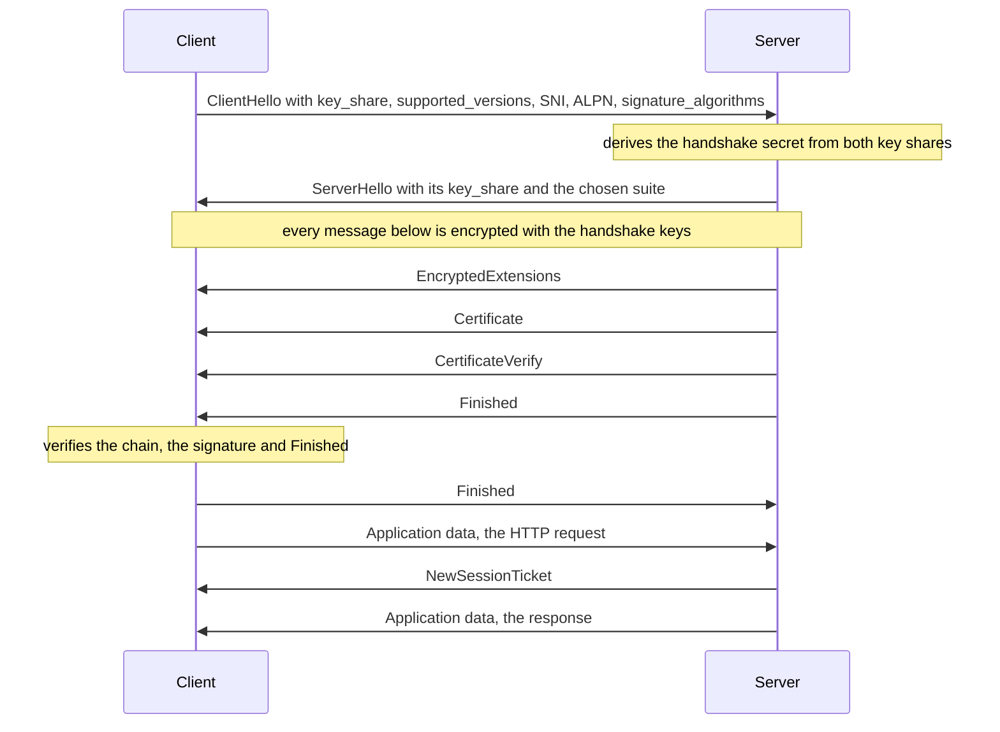
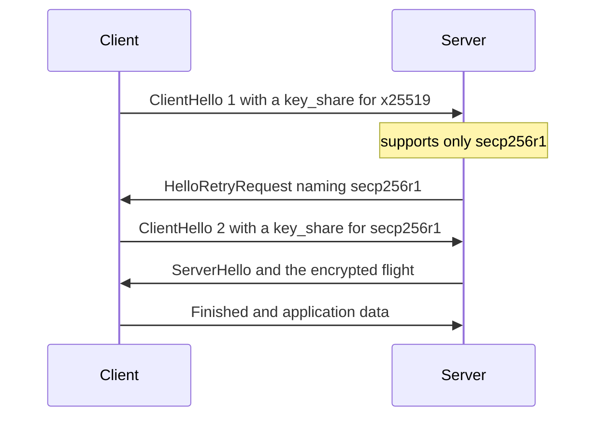
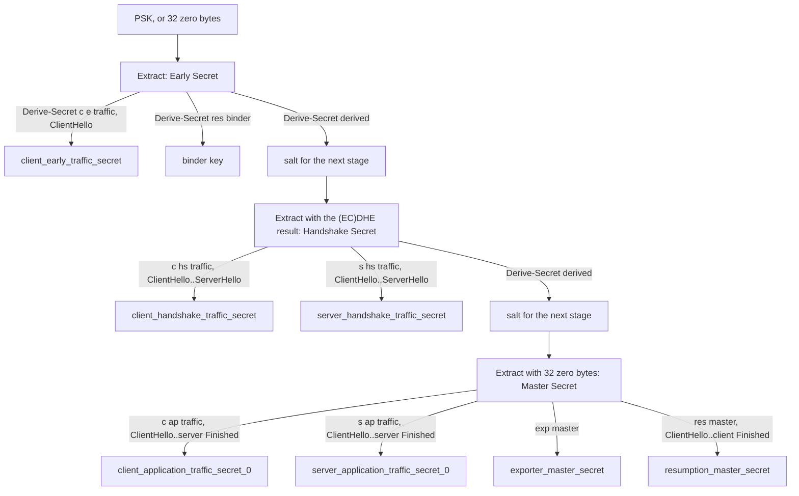
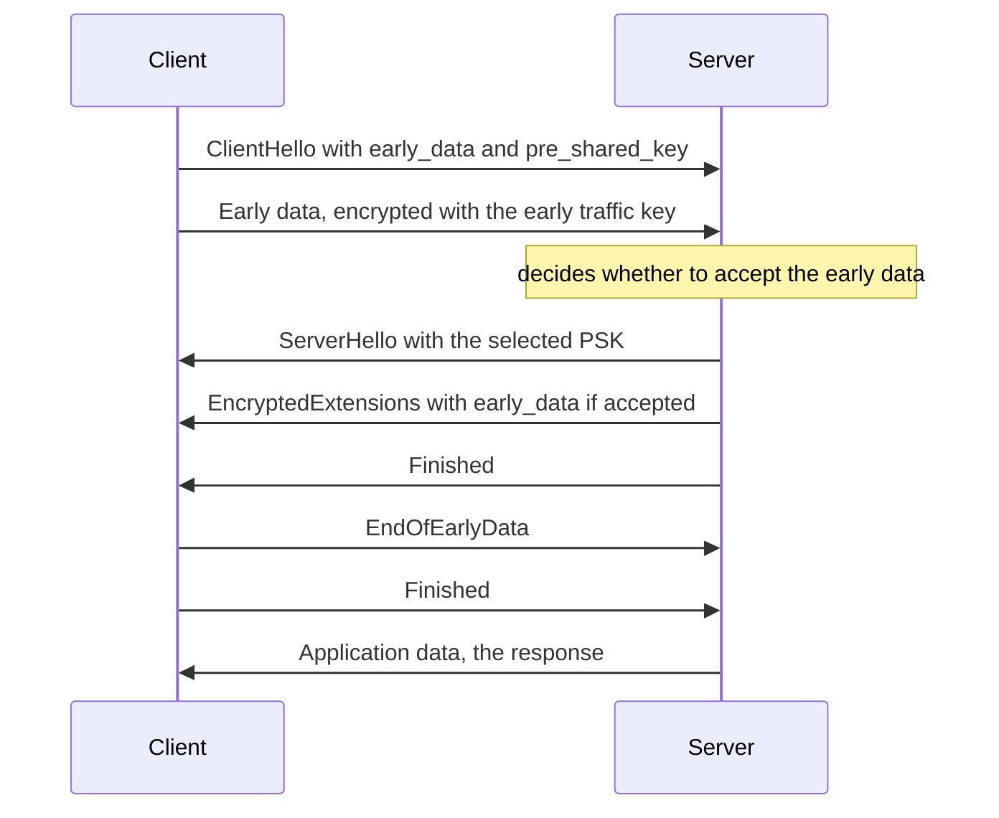
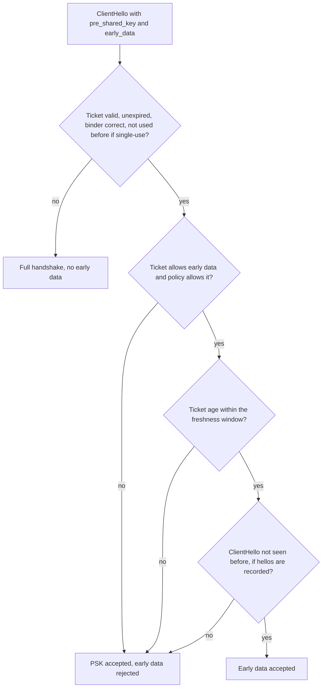
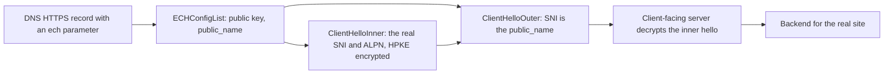
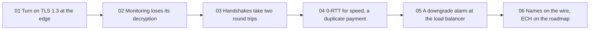

<!-- markdownlint-disable MD001 -->
<!-- markdownlint-disable MD010 -->
<!-- markdownlint-disable MD024 -->
<!-- markdownlint-disable MD025 -->
<!-- markdownlint-disable MD026 -->
<!-- markdownlint-disable MD029 -->
<!-- markdownlint-disable MD033 -->
<!-- markdownlint-disable MD036 -->
<!-- markdownlint-disable MD040 -->
<!-- markdownlint-disable MD056 -->
<!-- markdownlint-disable MD060 -->

# H15. TLS 1.3

---

## Contents

| #     | Sub-topic                                                                | Tag   |
| ----- | ------------------------------------------------------------------------ | ----- |
| 15.01 | What was removed and why                                                 | CORE  |
| 15.02 | The 1-RTT handshake and what is encrypted earlier                        | CORE  |
| 15.03 | HelloRetryRequest                                                        | DEEP  |
| 15.04 | The key schedule: HKDF, the secrets, key update                          | DEEP  |
| 15.05 | Resumption with PSK, 0-RTT early data, replay and `425 Too Early`        | CORE  |
| 15.06 | Downgrade protection, `supported_versions`, middlebox compatibility      | DEEP  |
| 15.07 | Extensions every engineer meets: SNI, ALPN, groups, signature algorithms | CORE  |
| 15.08 | Encrypted Client Hello                                                   | AWARE |
| 15.09 | The story: one shop moves to TLS 1.3                                     | CORE  |
| 15.10 | Labs: a TLS 1.3 client in Java and Rust, key logs, tshark, JSSE, rustls  | CORE  |
| 15.11 | Exercises                                                                |       |
| 15.12 | Solutions                                                                |       |
| 15.13 | Takeaways                                                                |       |

Tags: **CORE** is what an architect is expected to explain unprompted, **DEEP** is the mechanism underneath it, **AWARE** is a fact to know exists and not to derive.

Terms used throughout. Each is defined here, before any section uses it.  
Terms from H11 to H14 (AEAD, nonce, HMAC, key pair, forward secrecy, certificate, transcript, record, handshake message, flight, round trip, cipher suite, extension, SNI, ALPN, alert, session, resumption, session ticket, downgrade) keep their meaning.

- **Key share**, **named group**: a key share is one party's public value for a key exchange, sent inside a hello message.  
  A named group is a standardised curve or finite field for that exchange, identified by a number, for example `x25519` (29) or `secp256r1` (23).  
  The client lists every group it supports and sends key shares for the one or two it expects the server to accept.

- **(EC)DHE**: Diffie-Hellman (H12) over a finite field (DHE) or an elliptic curve (ECDHE), with a fresh key pair for every connection.  
  "Ephemeral" is what gives forward secrecy.

- **HKDF**, **extract**, **expand**, **PRK**: HKDF is the key derivation function built on HMAC (H11).  
  Extract mixes input key material (a Diffie-Hellman result, say) and a salt into one fixed-size pseudorandom key, the PRK.  
  Expand turns a PRK and a label into as many output bytes as needed.  
  TLS 1.3 derives every key with these two steps.

- **Key schedule**, **traffic secret**, **traffic key**: the key schedule is the fixed chain of HKDF steps that turns the handshake's inputs into named secrets (15.04).  
  A traffic secret belongs to one direction and one phase of the connection, and the key and IV that protect its records are derived from it.

- **Transcript hash**: the hash of all handshake messages exchanged so far.  
  Keys and signatures include it, so they commit to everything both sides saw.

- **Handshake keys**, **application keys**: the handshake keys protect the handshake messages after the ServerHello.  
  The application keys protect the data after the handshake. They are different keys derived from different secrets.

- **PSK** (pre-shared key), **binder**: a secret both sides already hold.  
  In TLS 1.3 it is usually produced by an earlier connection and named by a ticket.  
  A binder is an HMAC inside the ClientHello that proves the client holds the PSK and ties it to that exact hello.

- **Early data**, **0-RTT**: application data the client sends in its first flight, before the handshake finishes, under keys derived from a PSK.  
  "0-RTT" (zero round trips) means it adds no wait.

- **Replay**: sending a recorded message again so that the receiver acts on it again.  
  The attacker needs no key, only a copy of the bytes.

- **HelloRetryRequest** (HRR): a server message that rejects the client's key share and asks for a different group (15.03).

- **KeyUpdate**: a post-handshake message that makes the sender switch to the next generation of its application traffic keys.

- **Inner content type**: in TLS 1.3 the real type of a protected record travels encrypted at the end of its payload.  
  The outer type on the wire is always `application_data` (23).

- **Middlebox**: a device on the path that inspects or alters traffic, for example a firewall, proxy or load balancer.  
  Some reject traffic that does not look like the protocols they know.

- **Sentinel**: a fixed value placed in a field to signal a condition.  
  In 15.06 the last eight bytes of the server's random value signal a downgrade.

- **ECH**, **HPKE**: Encrypted Client Hello hides the real ClientHello inside an outer one.  
  HPKE (hybrid public key encryption, RFC 9180) is the scheme that encrypts it to a key the server published.

Outputs in this module are real.  
They come from a TLS 1.3 client written for this module in Java (about 480 lines, JDK only) and in Rust, run against an `openssl s_server`;  
from `tcpdump` and `tshark` on the same sessions; and from the JDK's own TLS stack (JSSE) and `rustls`.  

Run on Linux 6.18, JDK 21.0.12, OpenSSL 3.0.13, tshark 4.2.2 and Rust 1.97.  
Random values differ on every run and the text says when a number is run-dependent.  
What was read in the source on 2026-10-31: the key-schedule test vectors of RFC 8448 (all 14 reproduced in the lab), the normative sentences of RFC 8470 (`Early-Data`, `425`),  
the structures of RFC 9849 (ECH) and the parameter number of RFC 9848, the downgrade sentinel and the HelloRetryRequest random in RFC 8446 section 4.1.3,  
the group code points and key share sizes of RFC 10024 (hybrid key exchange).  

The fetch tool truncated RFC 8446 before sections 4.6.1, 5.5, 7.1, 8 and Appendix D.4, so statements about those sections (ticket lifetime limit, replay defences, compatibility mode, key limits)  
rest on my reading of the RFC from memory and on the behaviour of OpenSSL 3.0.13 and the JDK in the lab, and are marked where they matter.  
RFC numbers for SNI (6066), ALPN (7301), SVCB/HTTPS records (9460), HTTP semantics (9110) and QUIC-TLS (9001) were not re-fetched.

---

## 15.01 What was removed and why

TLS 1.3 is TLS 1.2 with every option that was ever attacked taken out, so that a correct implementation has very little to get wrong.  
Gone: RSA key transport and static Diffie-Hellman (no forward secrecy), custom Diffie-Hellman groups (Logjam), CBC-mode and RC4 record protection (BEAST, Lucky 13, POODLE),  
TLS compression (CRIME), renegotiation (renegotiation and triple-handshake attacks), the separate session ID and session ticket mechanisms, export and anonymous suites, and RSA PKCS#1 v1.5 signatures in the handshake.  
What remains is ephemeral key exchange with a named group, five AEAD suites, and signatures chosen from a short list.  
Security by subtraction is the design philosophy, and it is also the reason a TLS 1.3 configuration has so few knobs.

The table maps each removal to the H14 attack that motivated it.

| Removed or replaced                                          | Attack or weakness it answers                         | What replaces it                                             | H14 reference |
| ------------------------------------------------------------ | ----------------------------------------------------- | ------------------------------------------------------------ | ------------- |
| RSA key transport                                            | No forward secrecy, Bleichenbacher oracle, ROBOT      | Ephemeral (EC)DHE only                                       | 14.04, 14.07  |
| Static DH and ECDH suites                                    | No forward secrecy                                    | Ephemeral (EC)DHE only                                       | 14.04         |
| Server-chosen DH parameters, arbitrary groups                | Logjam (weak or shared groups)                        | Named groups only: x25519, secp256r1, ffdhe2048 and so on    | 14.07         |
| CBC with MAC-then-encrypt, RC4, 3DES                         | BEAST, Lucky 13, POODLE, RC4 biases                   | AEAD only: three families, five suites                       | 14.02, 14.07  |
| TLS-level compression                                        | CRIME                                                 | None (HTTP-level compression remains: BREACH)                | 14.07         |
| Renegotiation                                                | Renegotiation attack, triple handshake                | KeyUpdate for rekeying, post-handshake client authentication | 14.03, 14.07  |
| Session IDs and session tickets as two mechanisms            | Server-side cache cost, ticket-key exposure           | One mechanism: PSK resumption                                | 14.06         |
| ServerKeyExchange signing only the key exchange parameters   | Downgrade and cross-protocol games                    | CertificateVerify signs the whole transcript                 | 14.03, 14.07  |
| Export and anonymous suites, NULL ciphers                    | FREAK, active attackers                               | Not definable                                                | 14.07         |
| RSA PKCS#1 v1.5 signatures in the handshake                  | Padding scheme without a security proof, forgery bugs | RSA-PSS (and ECDSA, EdDSA)                                   | 14.04         |
| `ChangeCipherSpec` as a protocol step, explicit record nonce | CCS injection, extra bytes                            | Implicit state change at the key switch, nonce derived       | 14.02         |
| Version selected by the `legacy_version` field               | Version intolerance by servers and middleboxes        | The `supported_versions` extension                           | 15.06         |

### Five suites, and what a suite now names

A TLS 1.2 suite named four things (14.04): key exchange, authentication, bulk cipher and hash.  
A TLS 1.3 suite names two, the AEAD and the hash used inside HKDF.  
Key exchange is negotiated by the `supported_groups` and `key_share` extensions, and authentication by `signature_algorithms` and the certificate.  
The five suites are:

| Suite                          | Code     | AEAD                    | Hash    | Seen in the lab                         |
| ------------------------------ | -------- | ----------------------- | ------- | --------------------------------------- |
| `TLS_AES_128_GCM_SHA256`       | `0x1301` | AES-128-GCM             | SHA-256 | Every handshake of this module          |
| `TLS_AES_256_GCM_SHA384`       | `0x1302` | AES-256-GCM             | SHA-384 | First in the JDK's list (Lab 09)        |
| `TLS_CHACHA20_POLY1305_SHA256` | `0x1303` | ChaCha20-Poly1305       | SHA-256 | Third in the JDK's list                 |
| `TLS_AES_128_CCM_SHA256`       | `0x1304` | AES-128-CCM             | SHA-256 | Not offered by the JDK or by our client |
| `TLS_AES_128_CCM_8_SHA256`     | `0x1305` | AES-128-CCM, 8-byte tag | SHA-256 | Not offered; for constrained devices    |

An architect's configuration is therefore three lists: groups, signature algorithms and, if policy requires it, which of the first three suites to allow.  
The AEADs are the ones from H11: AES-GCM is fastest where the CPU has AES instructions, ChaCha20-Poly1305 where it does not.

### What TLS 1.3 did not fix, and what it added

- **Implementation bugs** survive. Heartbleed (14.07) was a bug in an extension's handler, not a protocol flaw, and no protocol revision removes that class.
- **HTTP-level compression side channels** such as BREACH survive, because they live above TLS.
- **Traffic analysis** survives. Record lengths and timing still leak; 15.02 shows that TLS 1.3 allows padding but does not require it.
- **0-RTT** is new, and trades a round trip for a replay risk (15.05).
- **Passive monitoring got harder**: with no RSA key transport, holding the server's key no longer decrypts recorded sessions (Lab 04 shows the contrast with TLS 1.2).  
  Enterprises that decrypted traffic with an escrowed server key must terminate TLS at a proxy or log session keys instead.

### Interview angle

- "What did TLS 1.3 remove?" The six items in the first sentence, each with its attack.  
  The sharper answer connects them: everything removed either lacked forward secrecy, had an oracle, or was an optional feature that added a state machine.
- "Is TLS 1.3 always better?" Mostly. The cost is that 0-RTT needs care, passive inspection stops working, and some old middleboxes need compatibility behaviour (15.06).
- "Which parts of a TLS 1.3 configuration still need decisions?" Groups, signature algorithms, certificate type and chain, ticket handling and 0-RTT policy.

---

## 15.02 The 1-RTT handshake and what is encrypted earlier

In TLS 1.2 the client waits for the server's chosen parameters before it can send its half of the key exchange, which costs a second round trip.  
TLS 1.3 removes the wait by guessing: the ClientHello already contains a **key share** for a group the client expects the server to accept.  
The server answers with its own key share in the ServerHello, and from that moment both sides can compute the handshake secret,  
so everything after the ServerHello is encrypted: the extensions, the certificate, the proof of possession (`CertificateVerify`) and `Finished`.  
The client sends its `Finished` and its first application data together, after a single round trip.  
If the guess was wrong, one extra round trip repairs it (15.03).



### The messages

**ClientHello** carries `legacy_version` 1.2, a 32-byte random, a `legacy_session_id` (32 random bytes in TLS 1.3, explained in 15.06), the offered suites,  
  a compression list holding only `null`, and the extensions that do the real work: `supported_versions`, `supported_groups`, `key_share`, `signature_algorithms`,  
  `server_name`, optionally `alpn`, `psk_key_exchange_modes` and `pre_shared_key`.  
  Lab 03 prints ours: 180 bytes, one suite, six extensions.

**ServerHello** selects the suite and the version (`supported_versions` again) and returns the server's `key_share`.  
  It is the last message in clear apart from the client's own hello, and it is where the **handshake secret** becomes computable by both sides (15.04).

**EncryptedExtensions** holds extensions that are not needed to derive keys: the ALPN choice, the server's acknowledgement of SNI, `early_data`.  
  In TLS 1.2 these sat in the clear ServerHello.

**Certificate** is the chain, now encrypted, with a per-certificate extension slot (OCSP staples live there, H16).  
  A `certificate_request_context` of zero bytes is used in the main handshake.

**CertificateVerify** is a signature, by the private key of the leaf certificate, over the string of 64 spaces,  
  the text `TLS 1.3, server CertificateVerify`, a zero byte and the transcript hash up to the Certificate.  
  In TLS 1.2 the server signed only its ephemeral key parameters and the two randoms (14.03).  
  Signing the whole transcript so far binds the identity proof to everything negotiated, including the version list and the suites.  
  The lab verifies this signature with the leaf key for ECDSA P-256 and for RSA-PSS.

**Finished** is an HMAC over the transcript hash, keyed with a key derived from the handshake secret.  
It proves that the sender holds the handshake keys and saw the same messages.  
The server's Finished is checked by the client before anything is sent, and the client's Finished plays the same role in reverse.

**NewSessionTicket** arrives after the handshake (15.05), encrypted, and is the only way to resume.

### What is encrypted, compared with TLS 1.2

| Item                                | TLS 1.2 on the wire       | TLS 1.3 on the wire                         |
| ----------------------------------- | ------------------------- | ------------------------------------------- |
| ClientHello: SNI, ALPN list, groups | Readable                  | Readable (ECH hides SNI and ALPN, 15.08)    |
| ServerHello: suite, key share       | Readable                  | Readable                                    |
| Server extensions, ALPN choice      | Readable (in ServerHello) | Encrypted (EncryptedExtensions)             |
| Server certificate chain            | Readable                  | Encrypted                                   |
| Client certificate (mutual TLS)     | Readable                  | Encrypted                                   |
| Handshake message types and counts  | Readable                  | Hidden: every record claims to be type 23   |
| NewSessionTicket                    | Readable                  | Encrypted                                   |
| Alerts after the handshake          | Encrypted                 | Encrypted, and hidden among type 23 records |
| Record lengths and timing           | Readable                  | Readable (padding is possible, not default) |

Two consequences follow. A passive observer of TLS 1.3 sees the SNI and little else, so network operators who filtered by certificate contents lost that signal.  
And a middlebox can no longer parse the handshake past the ServerHello, which is why TLS 1.3 was designed to look like TLS 1.2 to it (15.06).  
Lab 04 puts the two views side by side: `tshark` without keys sees one ClientHello with the name `shop.example.test` and then undifferentiated records,  
and with the key log it decrypts the same capture into `EncryptedExtensions`, `Certificate`, `CertificateVerify`, `Finished` and two `NewSessionTicket` messages.

### Record protection in TLS 1.3

The record layer of H14 changes in four ways, all visible in the lab trace.

- The outer header is always `23 03 03 <length>`: type `application_data`, version 1.2, and the length of the ciphertext.  
  Even the handshake and the alerts after the key switch wear this header.
- The real type is the last non-zero byte of the plaintext (`TLSInnerPlaintext = content || type || zero padding`).  
  After decryption the receiver strips trailing zeros and reads the type. Zeros are the padding that a sender may add to hide the true length.
- The nonce is the 12-byte IV XOR the 64-bit sequence number, left-padded. There is no explicit nonce in the record, so the 8 bytes of H14 disappear.
- The AAD is the five-byte header. The overhead for AES-GCM is therefore 5 + 1 + 16 = 22 bytes per record, against 29 in TLS 1.2 (Exercise 03).

### Latency

TLS 1.2 needs two round trips after TCP before the first request can be sent.  
TLS 1.3 needs one. On a link with an 80 ms round trip the first response byte arrives after 4 RTT = 320 ms (TLS 1.2 full), 3 RTT = 240 ms (TLS 1.3 full) and,  
for a resumed 0-RTT request, 2 RTT = 160 ms (Exercise 01 counts TCP and the request as one round trip each).  
The saving of one round trip is the same on every connection, which is why it dominates mobile performance.

One more asymmetry: the server may send application data right after its own Finished, before it has seen the client's Finished.  
This "half-RTT" data goes to a client that has not yet authenticated, so a server must not send anything sensitive that way unless the client is anonymous by design.

### Interview angle

- "Why is TLS 1.3 one round trip?" The client sends its key share in the first message, guessing the group.  
  The server can derive keys at once, so it sends its certificate and Finished in the same flight.
- "What does an eavesdropper see now?" The ClientHello in full (SNI, ALPN, supported groups), the ServerHello, then equal-looking encrypted records with visible lengths.
- "Why does `CertificateVerify` sign the transcript?" It binds the server's identity to the negotiated parameters,  
  which closes cross-protocol and downgrade games that signing only the key exchange permitted.

---

## 15.03 HelloRetryRequest

The client's key share is a guess.  
If the server supports none of the groups for which the client sent a share, but does support another group from the client's `supported_groups` list, it cannot continue with the ClientHello it has.  
 It answers with a **HelloRetryRequest**: a message shaped like a ServerHello, carrying only the group it wants.  
 The client sends a second ClientHello with a key share for that group, and the handshake proceeds from there.  
 The cost is one extra round trip, so the connection takes two round trips, the same as TLS 1.2.



### How the retry is recognised and bound

- **The random value.** A HelloRetryRequest is syntactically a ServerHello so that middleboxes let it through.  
  The client recognises it by its `random` field, which is fixed to the SHA-256 hash of the ASCII string `HelloRetryRequest`: `cf21ad74e59a6111be1d8c021e65b891c2a211167abb8c5e079e09e2c8a8339c`.  
  Exercise 07 computes it.
- **What it carries.** `supported_versions`, and `key_share` with only the two-byte group number.  
  It may also carry a `cookie`: opaque bytes the client must echo in its second hello, so that a server can stay stateless while it checks that the client can receive at its address.  
  The lab's OpenSSL does not use cookies, and the client code handles the echo but the lab does not exercise it.
- **The second ClientHello** must repeat the first one, with changes limited to a short list: the key share, the cookie, the PSK binders and ticket ages, `early_data` removed, padding.  
  This stops a client or an attacker from using the retry to alter what was negotiated (RFC 8446 section 4.1.2, from memory).
- **The transcript changes shape.** To keep a stateless server possible, the hash of the first ClientHello replaces the message itself:  
  the transcript becomes `message_hash || ClientHello1-hash || HelloRetryRequest || ClientHello2 || ...`, where `message_hash` is a synthetic handshake message of type 254.  
  Lab 05 shows the client rebuilding the transcript this way, and the handshake only completes if Finished matches, so the lab confirms the rule against OpenSSL.

### Why a deployment should avoid it

A retry costs a round trip on every new connection to that server, and nothing in the logs of the application shows it.  
It happens when the server will use none of the groups for which the client sent a share, for example when a compliance profile removes x25519 from the server's list.  
Keep the server's list aligned with the shares clients send: x25519 is the common first guess (OpenSSL's `s_client` 3.0.13 sends one share, x25519, and lists ten groups).  
The JDK 21 client in Lab 09 sends key shares for two groups (`x25519` and `secp256r1`), which avoids most retries at the price of a larger ClientHello.  
Post-quantum hybrid groups make this trade-off sharper: RFC 10024 defines `X25519MLKEM768` (code point `0x11EC`), whose client key share is 1,216 bytes (a 1,184-byte ML-KEM-768 encapsulation key plus 32 bytes of X25519) and server share 1,120 bytes, against 32 bytes for X25519 alone.  
A client that sends both a hybrid share and an X25519 share pays more bytes per hello so that a server which does not know the hybrid group needs no retry;  
that is common practice, not something this lab measured.

### Interview angle

- "When does TLS 1.3 take two round trips?"  
  On a HelloRetryRequest, when the client's key share group is not one the server will use, and on a failed resumption that falls back to a full handshake after a retry.
- "Why is the transcript rebuilt with a hash of ClientHello1?" So that a server can send a cookie and forget the first hello, and still verify the second.

---

## 15.04 The key schedule: HKDF, the secrets, key update

TLS 1.2 had one PRF and one master secret (14.05).  
TLS 1.3 has a **key schedule**: a fixed chain of HKDF-Extract steps in which each stage mixes in a new input, and from each stage a few labelled secrets are derived with HKDF-Expand.  
The stages are the **early secret** (from the PSK or zeros), the **handshake secret** (adds the Diffie-Hellman result) and the **master secret** (adds nothing, so it is a function of the handshake secret alone).  
From them come the keys for early data, for the handshake and for the application, plus the resumption secret and an exporter secret.  
Every derived secret includes a hash of the transcript up to that point and a distinct label, so a secret cannot be confused with another and cannot be derived without the same history.

### The two building blocks

HKDF (RFC 5869) has two operations, both built on HMAC (H11).

- `Extract(salt, input)` = `HMAC(salt, input)`. It turns an input with structure, such as an X25519 output, into a uniform-looking key.
- `Expand(PRK, info, n)` produces `n` bytes: `T(1) = HMAC(PRK, info || 0x01)`, `T(2) = HMAC(PRK, T(1) || info || 0x02)`, and so on.

TLS 1.3 wraps Expand twice.

- `HKDF-Expand-Label(secret, label, context, n)` = `Expand(secret, HkdfLabel, n)`, where `HkdfLabel` is the length `n` (two bytes),  
  the string `"tls13 " + label` (one length byte, then the bytes) and the context (one length byte, then the bytes).  
  The `tls13` prefix stops a TLS 1.3 key from being a valid output of another protocol that also uses HKDF with the same secret.
- `Derive-Secret(secret, label, messages)` = `HKDF-Expand-Label(secret, label, Hash(messages), 32)`. The context is the transcript hash, so the result commits to the history.

The traffic key and IV are `HKDF-Expand-Label(traffic_secret, "key", "", 16)` and `HKDF-Expand-Label(traffic_secret, "iv", "", 12)` for AES-128-GCM, and the key that `Finished` uses is `HKDF-Expand-Label(traffic_secret, "finished", "", 32)`.

### The ladder



| Secret                              | Label          | Transcript up to | Protects or feeds                                   | Key log label                     |
| ----------------------------------- | -------------- | ---------------- | --------------------------------------------------- | --------------------------------- |
| `client_early_traffic_secret`       | `c e traffic`  | ClientHello      | The client's 0-RTT data                             | `CLIENT_EARLY_TRAFFIC_SECRET`     |
| binder key                          | `res binder`   | (empty)          | The PSK binder in the ClientHello                   | not logged                        |
| `client_handshake_traffic_secret`   | `c hs traffic` | ServerHello      | The client's Finished                               | `CLIENT_HANDSHAKE_TRAFFIC_SECRET` |
| `server_handshake_traffic_secret`   | `s hs traffic` | ServerHello      | EncryptedExtensions to server Finished              | `SERVER_HANDSHAKE_TRAFFIC_SECRET` |
| `client_application_traffic_secret` | `c ap traffic` | Server Finished  | Client application data                             | `CLIENT_TRAFFIC_SECRET_0`         |
| `server_application_traffic_secret` | `s ap traffic` | Server Finished  | Server application data and post-handshake messages | `SERVER_TRAFFIC_SECRET_0`         |
| `exporter_master_secret`            | `exp master`   | Server Finished  | Keying material for other protocols on this session | `EXPORTER_SECRET`                 |
| `resumption_master_secret`          | `res master`   | Client Finished  | The PSKs in NewSessionTicket                        | not logged                        |

The step `Derive-Secret(., "derived", "")` between the stages exists so that the Diffie-Hellman result enters through a salt that already depends on the early secret,  
and the master secret does not depend on the Diffie-Hellman result directly but on the handshake secret.  
Three properties come out of the shape.

- **Forward secrecy for everything except early data.**  
  The handshake secret needs the ephemeral shared secret, so a later leak of the server's certificate key reveals nothing about it.  
  The early secret needs only the PSK, which is why 0-RTT data has no forward secrecy (15.05).
- **Separation.** One label per purpose and the transcript in the context mean that the two directions, the two phases and the resumption secret are independent keys.  
  A leaked `CLIENT_TRAFFIC_SECRET_0` opens only client-to-server application data, which is why a key log has several lines per connection.
- **Commitment.** A key derived after the ServerHello depends on the whole ClientHello and ServerHello.  
  An attacker who changed a field (a version, a suite) gets different keys and fails at `Finished`.

### Verified against the RFC

RFC 8448 publishes a complete example handshake with every intermediate value.  
The lab's `kat` mode reproduces them from the example's X25519 private key, the server public key and the transcript hashes.  
All fourteen values match in Java and in Rust: the early secret `33ad0a1c...`, the handshake secret `1dc826e9...`, both handshake traffic secrets,  
the server handshake key and IV, the finished key, the master secret, both application secrets, the exporter secret, the resumption master secret and the PSK `4ecd0eb6...`.  
This is the strongest check in the module, since it is independent of OpenSSL.

### KeyUpdate

A long connection must not use one key forever, because AEAD security degrades with the amount of data protected by one key.  
After the handshake either side can send a `KeyUpdate` message, and each endpoint derives its own next write secret: `application_traffic_secret_N+1 = HKDF-Expand-Label(application_traffic_secret_N, "traffic upd", "", 32)`, then new key and IV from it, with the sequence number back at zero.  
The message has one flag. With `update_requested` the peer must also update its own sending keys and answer with a `KeyUpdate`.  
The old secret is derived forward only, so an attacker who steals secret N cannot go back, but can compute every later one: the update is not a fresh Diffie-Hellman and gives no recovery after compromise.  
The JDK triggers the update by itself: its default `jdk.tls.keyLimits` is `AES/GCM/NoPadding KeyUpdate 2^37`, which Lab 09's debug output prints.  
At 10 Gbit/s, 2^37 bytes (128 GiB) pass in 110 seconds (Exercise 04).  
Lab 05 sends a KeyUpdate from the client and watches the server follow.

### The exporter and the resumption secret

The `exporter_master_secret` lets another protocol that runs over the same TLS session derive its own keys (for example to bind an authentication step to the TLS channel) without ever seeing the traffic keys.  
The `resumption_master_secret` is the root of every PSK that the server issues after the handshake, one per `NewSessionTicket`, each with its own nonce (15.05).

### Interview angle

- "Walk me through how TLS 1.3 derives its keys."  
  Early secret from the PSK or zeros, handshake secret from the Diffie-Hellman result, master secret from the handshake secret,  
  each stage producing labelled, transcript-bound traffic secrets, with the key and IV expanded from each traffic secret.
- "What is forward secrecy-free in TLS 1.3?" 0-RTT data, because it is encrypted under a key derived from the PSK before the key exchange.
- "How does TLS 1.3 rekey, and does it give post-compromise security?"  
  KeyUpdate ratchets forward with a one-way function and gives forward secrecy for older data but not recovery after a compromise.

---

## 15.05 Resumption with PSK, 0-RTT early data, replay and `425 Too Early`

After a handshake the server sends `NewSessionTicket` messages.  
Each holds an opaque ticket and a nonce, and from the nonce both sides derive a **PSK**: `HKDF-Expand-Label(resumption_master_secret, "resumption", ticket_nonce, 32)`.  
On the next connection the client offers the ticket in a `pre_shared_key` extension.  
If the server accepts it, both sides start the key schedule from the PSK instead of zeros, the server sends no certificate and no signature, and the handshake is still one round trip.  
If the ticket also permits early data, the client can put application data in its first flight, encrypted under a key derived from the PSK alone.  
That is **0-RTT**. Early data has no forward secrecy and can be **replayed** by anyone who copied it, so it is safe only for requests that may run twice.

### Resumption in TLS 1.3

- **One mechanism.**  
  TLS 1.2 had session IDs (server-side cache) and tickets (client-side state), H14.06.  
  TLS 1.3 has one concept, the PSK, and a ticket is just the name the client uses for it.  
  A server may encode the state inside the ticket (stateless, encrypted with a server-held ticket key) or make the ticket a lookup key into its own cache (stateful).  
  In the lab, the OpenSSL server issued 192-byte tickets by default and 32-byte tickets when started with `-early_data`,  
  which suggests that it switched to stateful tickets to make them single-use; that is my reading of the sizes, not something the server printed.
- **What a `NewSessionTicket` carries.**  
  A lifetime hint (7,200 s in the lab, and RFC 8446 caps it at seven days, from memory), `ticket_age_add` (a random 32-bit number),  
  `ticket_nonce`, the ticket, and extensions: `early_data` with `max_early_data_size` if 0-RTT is allowed.  
  OpenSSL sent two tickets after the full handshake and one after a resumed one.
- **Obfuscated ticket age.**  
  The client sends `obfuscated_ticket_age = (age in ms + ticket_age_add) mod 2^32`.  
  An observer cannot learn how long the client waited, but the server, which knows `ticket_age_add`, can compare the claimed age with its own clock.  
  Exercise 05 does the arithmetic, including wrap-around.
- **Binder.**  
  The last field of the `pre_shared_key` extension holds, for each offered ticket, an HMAC over the transcript up to (but not including) the binders, keyed from the PSK.  
  It proves that the client holds the PSK and ties the PSK to this exact ClientHello, so that an attacker cannot splice a stolen ticket into another hello.
- **Two modes.** `psk_ke` uses the PSK alone.  
  `psk_dhe_ke` also does a fresh Diffie-Hellman exchange (the key share is still in the ClientHello),  
  so the resumed connection's keys keep forward secrecy even if the ticket key is stolen later.  
  The lab client offers only `psk_dhe_ke`, which is the mode to prefer.

The lab trace of a resumed connection (Lab 06) shows the saving.  
The ClientHello grows from 180 to 437 bytes (a 192-byte ticket, a 32-byte binder, ALPN), the ServerHello gains a `pre_shared_key` extension (selected identity 0),  
and the encrypted flight shrinks to `EncryptedExtensions` and `Finished`: no 477-byte `Certificate` and no signature to verify.  
The saving is CPU and bytes, not round trips, because a full TLS 1.3 handshake is already one.

If a stolen ticket key (stateless tickets) lets an attacker read tickets, the attacker learns PSKs. With `psk_dhe_ke` that still does not reveal the application data of resumed connections,  
since the Diffie-Hellman secret is missing, but it does reveal all 0-RTT data sent under those PSKs and lets the attacker impersonate the server to a client that resumes.  
Ticket keys should be rotated as in H14.06.

### 0-RTT: early data



The client derives `client_early_traffic_secret` from the early secret and the hash of its own ClientHello (15.04), and sends its request right after the hello.  
The server answers in one of two ways and the client learns which from `EncryptedExtensions`.

- **Accept**: `early_data` appears in `EncryptedExtensions`.  
  The server processes the early request at once, before the handshake completes.  
  The client later sends `EndOfEarlyData` and its `Finished`.
- **Reject**: no `early_data`. The server discards the early records, completes the handshake, and the client must send the request again over the normal connection.  
  The server may reject for any reason, and may accept the PSK while rejecting the early data.



Lab 06 exercises three branches of that tree against OpenSSL 3.0.13: the first resumption is accepted, a second use of the same ticket gets a full handshake and no early data  
(the ticket was consumed, and the client sends the request again as an ordinary one), and a client that claims an age 60 s too large keeps its PSK but loses its early data.

### What early data gives up

| Property                            | 1-RTT application data                           | 0-RTT early data                                 |
| ----------------------------------- | ------------------------------------------------ | ------------------------------------------------ |
| Key derived from                    | PSK or none, plus a fresh Diffie-Hellman result  | The PSK only                                     |
| Forward secrecy                     | Yes                                              | No: a stolen PSK or ticket key decrypts it later |
| Protection against replay           | Yes: the keys depend on the server's fresh share | No: the same bytes can be sent again             |
| Server contributes fresh randomness | Yes                                              | No: it is encrypted before the server answers    |
| Reaches the application             | After the handshake                              | Before the handshake completes                   |
| Safe for                            | Any request                                      | Requests that may run twice                      |

### The replay attack, with the lab

The attacker sits on the path, copies the client's first flight (the ClientHello, a dummy ChangeCipherSpec and the early-data record: 354 or 514 bytes in the lab) and sends the same bytes to the server, later or from elsewhere.  
The attacker has no key and learns nothing, but a server that accepts early data executes the request again.  
The lab client sends `POST /transfer?id=42`, the server prints every request it receives, and the Java `replay` mode re-sends the recorded bytes twice.

| Server setting               | POSTs seen after the client's own three connections | POSTs seen after two replays by the attacker |
| ---------------------------- | --------------------------------------------------- | -------------------------------------------- |
| Anti-replay on (the default) | 2                                                   | 2                                            |
| `-no_anti_replay`            | 2                                                   | 4                                            |

With anti-replay on, the server answered the replayed flight with a full handshake (a 477-byte `Certificate` record) and discarded the early data, so the attacker's copy never reached the application.  
With anti-replay off, both replays were accepted and `POST /transfer?id=42` ran two more times.  
In both runs the client's connections 2 and 3 each delivered the POST once: both early in the off run, and in the on run early for connection 2 and resent after the full handshake for connection 3.

### Defences, and what each costs

- **Single-use tickets.**  
  The server remembers which tickets it has seen and accepts each once (what OpenSSL's default does).  
  It needs shared state across every node that can decrypt the ticket: a replay sent to a different node of a cluster succeeds if the nodes do not share the record.
- **Freshness window plus ClientHello recording.**  
  The server compares the claimed ticket age with its clock and accepts early data only within a short window, then remembers the hellos or binders it saw inside that window.  
  The memory is small: Exercise 06 puts it at 1.28 MB for 2,000 resumptions per second and a 20-second window, against 38.7 GB for remembering every ticket for a week.  
  The lab's `badage` option moves the claimed age by 60 s and the server drops the early data but keeps the PSK.  
  The exact window is the server's choice and was not read from OpenSSL's source.
- **Application discipline.**  
  Only requests that may run twice, with no side effects.  
  This is the only defence that works when the server keeps no state, and it is the one HTTP specifies.
- **Do not enable it.**  
  For an API of mostly writes the benefit is small and the risk is not.  
  Libraries leave early data off until the application asks: in the lab the tickets from the server started without early-data options carried no `early_data` extension,  
  and those from the server started with them carried `max_early_data_size 16384`.

### HTTP and 0-RTT: RFC 8470 and `425 Too Early`

RFC 8470 defines how HTTP copes. These rules were read in the RFC text.

- A client may send **safe** methods in early data and **must not** send unsafe methods, or methods whose safety it does not know.
- A TLS-terminating intermediary that accepts early data marks the requests it forwards with the header `Early-Data: 1` (the header has one valid value).  
  The origin server then knows the request travelled in early data.
- A server that is not willing to risk the request being replayed answers `425 (Too Early)`.  
  Requests that cannot be processed safely **must** be rejected this way, and waiting for the handshake to finish does not make them safe.
- A client that used early data **must** retry on a `425`, and the retry **must not** use early data.

The safety of a request is a property of the application, not of the HTTP method.  
A `GET` that increments a counter, consumes a one-time link or checks a one-time code is not safe to replay.  
Methods and their idempotency are R2.3, the HTTP/3 side of 0-RTT is R2.2, and the idempotency keys that make a `POST` repeatable are R8.

### Interview angle

- "What is 0-RTT and what does it cost?" Application data in the first flight under a PSK-derived key.  
  It costs forward secrecy and replay protection for that data.
- "How would you make a 0-RTT endpoint safe?" Single-use tickets or a freshness window with recorded hellos, shared across the fleet, plus an allowlist of safe requests,  
  `Early-Data: 1` propagated to the origin and `425` for anything else.
- "Does resumption save a round trip in TLS 1.3?" No.  
  It saves the certificate, the signature and the verification. Only 0-RTT saves a round trip.

---

## 15.06 Downgrade protection, `supported_versions`, middlebox compatibility

TLS 1.3 changes the version negotiation and then disguises itself as TLS 1.2 on the wire.  
The real version list moved into the `supported_versions` extension, because servers and middleboxes that choked on an unknown `legacy_version` value were common.  
For the same reason a TLS 1.3 handshake keeps a TLS 1.2 look: version fields fixed at 1.2, a 32-byte session ID, a dummy `ChangeCipherSpec`, and all protected records typed `application_data`.  
A downgrade alarm completes the design: a TLS 1.3 server that ends up speaking TLS 1.2 stamps eight fixed bytes into its random value, and a TLS 1.3 client that sees them aborts.

### `supported_versions`

The client lists the versions it speaks, most preferred first. The JDK in Lab 09 sends `[TLSv1.3, TLSv1.2]`.  
The server picks one and returns it, alone, in the ServerHello's `supported_versions`.  
A ServerHello without the extension means TLS 1.2 or older. The old `legacy_version` field stays at `0x0303` and no longer decides anything.

### The disguise, field by field

Each row can be read in the Lab 03 trace.

| Field                                   | Value in TLS 1.3                        | Why                                                           |
| --------------------------------------- | --------------------------------------- | ------------------------------------------------------------- |
| ClientHello `legacy_version`            | 1.2 (`0x0303`)                          | Servers that reject unknown versions still answer             |
| Record version of the first ClientHello | 1.0 (`0x0301`)                          | Convention that old servers tolerate, same as TLS 1.2 clients |
| Record version afterwards               | 1.2 (`0x0303`)                          | The same                                                      |
| ServerHello `legacy_version`            | 1.2 (`0x0303`)                          | The real version is in `supported_versions`                   |
| `legacy_session_id`                     | 32 random bytes from the client, echoed | Makes the exchange look like a resumed TLS 1.2 session        |
| Compression methods                     | one entry, `null`                       | The TLS 1.2 field is still parsed by old software             |
| `ChangeCipherSpec` records              | One byte, `01`, sent after the hello    | Some middleboxes expect it before encrypted records           |
| Outer record type after the ServerHello | 23 (`application_data`)                 | Hides the handshake structure, and looks like data            |

The compatibility mode of RFC 8446 Appendix D.4 is the origin of these rows, from my reading of the RFC from memory.  
The cost is small, about 40 bytes a connection, and the dummy `ChangeCipherSpec` is ignored by the receiver, which the lab client does (it does not count as a handshake step).

### The downgrade sentinel

An attacker who can alter traffic might delete `supported_versions` from a ClientHello, hoping that a TLS 1.3-capable server falls back to TLS 1.2 and a cipher the attacker can attack.  
A TLS 1.3 server defeats this by setting the last eight bytes of the ServerHello `random` when it negotiates TLS 1.2: `44 4F 57 4E 47 52 44 01` ("DOWNGRD" and a 1) for TLS 1.2, and `44 4F 57 4E 47 52 44 00` for TLS 1.1 or lower.  
A TLS 1.3 client that gets a TLS 1.2 or older ServerHello checks for those bytes and aborts with `illegal_parameter` when it finds them.  
Eight random-looking bytes of a legitimate server random equal the pattern with probability 2^-64, so false alarms do not happen.  
The bytes were read in RFC 8446 section 4.1.3. In an ECDHE handshake of TLS 1.2 the server's signature covers its random (14.03), so the attacker cannot clear the sentinel without breaking the signature.

Lab 07 stages the attack.  
The Java client strips `supported_versions` and offers a TLS 1.2 suite as well.  
The OpenSSL 3.0.13 server, which supports TLS 1.3, chooses TLS 1.2 and its `random` ends in `444f574e47524401`.  
The client recognises it and sends the fatal alert `illegal_parameter`.  
One more observation from the same lab: OpenSSL stamps the sentinel whenever it negotiates TLS 1.2 while TLS 1.3 is enabled, also towards a client that was never offering TLS 1.3.  
A TLS 1.2-only client, such as H14's, does not look for the bytes and is unaffected.

The sentinel complements `TLS_FALLBACK_SCSV` (14.07).  
The SCSV is the client's declaration that it is retrying with a lower version, and the sentinel is the server's declaration that it could have done better.  
Both are tripwires and neither blocks a downgrade by itself.

### Interview angle

- "Why does TLS 1.3 look like 1.2 on the wire?"  
  Middleboxes and old servers broke on new version numbers and on unfamiliar record types, so the protocol disguises itself and keeps the real version in an extension.
- "How does a client detect a downgrade?" The last eight bytes of the ServerHello random: `DOWNGRD` plus 01 or 00.  
  It aborts if it supports TLS 1.3 and the server answers with an older version.
- "Is the sentinel a defence in itself?"  
  It is a check at the end, and it is effective because a client that supports TLS 1.3 uses it.

---

## 15.07 Extensions every engineer meets: SNI, ALPN, groups, signature algorithms

Negotiation in TLS 1.3 is done by extensions.  
Four of them decide what you see in a capture and what you must configure:  
**server_name** (SNI) tells the server which host the client wants,  
**alpn** picks the application protocol (`h2` or `http/1.1`),  
**supported_groups** with **key_share** decide the key exchange, and  
**signature_algorithms** decides which certificate keys can authenticate the server.

| Extension                | Code | Sent in                                               | Carries                                                   |
| ------------------------ | ---- | ----------------------------------------------------- | --------------------------------------------------------- |
| `server_name`            | 0    | ClientHello, then an empty one in EncryptedExtensions | The host name the client wants                            |
| `supported_groups`       | 10   | ClientHello                                           | Key exchange groups, most preferred first                 |
| `signature_algorithms`   | 13   | ClientHello                                           | Signature schemes the client accepts in CertificateVerify |
| `alpn`                   | 16   | ClientHello, EncryptedExtensions                      | The offered list, then the one chosen                     |
| `pre_shared_key`         | 41   | ClientHello (last), ServerHello                       | Ticket identities and binders, then the chosen index      |
| `early_data`             | 42   | ClientHello, EncryptedExtensions, NewSessionTicket    | A flag, or the maximum early data size                    |
| `supported_versions`     | 43   | ClientHello, ServerHello, HelloRetryRequest           | Version list, or the chosen version                       |
| `cookie`                 | 44   | HelloRetryRequest, second ClientHello                 | Opaque bytes echoed by the client                         |
| `psk_key_exchange_modes` | 45   | ClientHello                                           | `psk_ke` (0) or `psk_dhe_ke` (1), or both                 |
| `key_share`              | 51   | ClientHello, ServerHello, HelloRetryRequest           | Public values, or the chosen group                        |

### SNI

One IP address and port often serve many sites, each with its own certificate.  
The client puts the host name it wants in `server_name` so that the server can pick the certificate before it sends one. It is sent in clear.  
The lab shows it twice: our ClientHello lists `server_name` first, and `tshark` on the capture, with no key log,  
prints `shop.example.test` in the ClientHello column and nothing for the other rows. This is why load balancers can route TLS connections by name without decrypting (H16),  
and why a network can block by name. Only ECH hides it (15.08).

### ALPN

ALPN (RFC 7301) lets the client offer application protocols in the first flight and the server choose one in `EncryptedExtensions`,  
so no separate upgrade step is needed (H08 showed the HTTP/1.1 `Upgrade` dance that this replaces). Lab 05 starts the server with `-alpn h2,http/1.1`  
and the client offers `http/1.1,h2`; the client's order does not win, the server's does: `EncryptedExtensions: ... alpn selected h2`.  
Two practical points follow.

- **The choice binds both sides.**  
  The lab's `s_server -WWW` serves HTTP/1.x whatever was negotiated.  
  After a negotiation of `h2`, `tshark` therefore decoded the same bytes as HTTP/2 and did not show the request.  
  In a real stack the application must speak what ALPN selected.
- **`h3` does not run on TCP.**  
  HTTP/3 uses QUIC, which carries TLS 1.3 handshake messages inside its own packets (RFC 9001, not re-fetched) and uses the ALPN token `h3`.  
  A browser learns that a server speaks HTTP/3 from the `Alt-Svc` header or the DNS HTTPS record (15.08), not from the TCP/TLS handshake.

### Groups and key shares

`supported_groups` is a preference list and a promise: the client can do any group in it. `key_share` is a guess: public values for one or two of them.  
The server picks a group that is in both lists. If it can use one for which a share was sent, the handshake is one round trip; otherwise it sends a HelloRetryRequest (15.03).  
OpenSSL's `s_client` (checked with `tshark`) and our lab client send one share, x25519.  
The JDK sends two, x25519 and secp256r1, and lists ten groups (Lab 09).  
Group choice is a security decision (x25519 is the usual default, secp256r1 for compliance regimes that need NIST curves,  
hybrid groups for post-quantum protection: RFC 10024) and a bandwidth one: 32 bytes for x25519, 65 for secp256r1, 1,216 for `X25519MLKEM768`.

### Signature algorithms

`signature_algorithms` lists the schemes the client will accept in `CertificateVerify`.  
The server must pick one that matches the key in its certificate.  
In the lab an ECDSA P-256 certificate produced `0x0403` (`ecdsa_secp256r1_sha256`) with a 70 to 72-byte signature, and an RSA 2048-bit certificate produced `0x0804` (`rsa_pss_rsae_sha256`) with a 256-byte signature.  
Our client offers only those two.  
The JDK offers a longer list, including ECDSA with P-384 and P-521, Ed25519, Ed448 and RSA-PSS variants (Lab 09).  
A related extension, `signature_algorithms_cert`, covers the signatures on the certificates in the chain, which can use algorithms the handshake signature does not (the JDK sends it, and the lab's chain is signed with ECDSA).  
Configure this list and the certificate type together: an RSA-only client list and an ECDSA-only certificate cannot meet.

### Interview angle

- "What do you see in a TLS 1.3 capture without keys?"  
  The ClientHello: SNI, ALPN list, supported versions, groups, signature algorithms and the key share. Then the ServerHello and encrypted records.
- "How does the client get HTTP/2 over TLS?" It offers `h2` in ALPN. The server chooses in `EncryptedExtensions`. No extra round trip.
- "Why did my TLS 1.3 handshake take two round trips?" Likely a HelloRetryRequest because the client's key share group is not the server's choice.

---

## 15.08 Encrypted Client Hello

After TLS 1.3 the ClientHello still reveals the destination: the SNI, the ALPN list and more. **Encrypted Client Hello** (ECH, RFC 9849, March 2026) closes that gap.  
The client sends an outer ClientHello with an innocuous name (the *public name* of a shared front end) and puts the real ClientHello, with the real SNI and ALPN, encrypted inside an extension.  
The key comes from a configuration the server publishes in an HTTPS record in DNS.  
This section is [AWARE]: the lab stack cannot demonstrate it, so what follows is the design as the RFCs state it.



### The mechanism

- **Configuration.** The server publishes an `ECHConfigList` in the `ech` parameter (SvcParamKey 5) of an `HTTPS` DNS record, as base64 (RFC 9848 defines the parameter, RFC 9460 the record).  
  Each `ECHConfig` has the fields in the table below, as defined in RFC 9849 section 4.
- **The two hellos.** The client builds the `ClientHelloInner` it would have sent without ECH and encrypts it with HPKE (RFC 9180) to the config's public key.  
  The ciphertext goes in the `encrypted_client_hello` extension (code `0xfe0d`) of a `ClientHelloOuter` that carries the `public_name` as SNI.  
  Extensions that would be identical in both can be referenced instead of copied (`ech_outer_extensions`), to keep the outer hello small.
- **The server side.** A *client-facing server* that holds the private key decrypts the inner hello.  
  In *shared mode* it then serves the connection itself. In *split mode* it forwards the inner hello to a *backend* that terminates TLS.  
  The TLS 1.3 handshake then proceeds with the inner hello's values.
- **Rejection.** If the server cannot decrypt (the config is stale) it completes the handshake with the outer hello and returns `retry_configs`,  
  a fresh list, in `EncryptedExtensions`, and the client reconnects with the new key. The client fails with the alert `ech_required` if it offered ECH and the server did not accept it.
- **GREASE.** A client that has no config can still send a random-looking ECH extension, so that connections that use ECH are not the only ones that carry it.

| `ECHConfig` field      | Meaning                                                              |
| ---------------------- | -------------------------------------------------------------------- |
| `version`              | `0xfe0d` for this specification                                      |
| `config_id`            | One byte that names the key, so the server finds it quickly          |
| `kem_id`, `public_key` | The HPKE key encapsulation method and the server's public key        |
| `cipher_suites`        | Pairs of HPKE KDF and AEAD that the client may use                   |
| `maximum_name_length`  | Longest backend name, used to pad the inner hello to a uniform size  |
| `public_name`          | DNS name of the client-facing server, also the name in the outer SNI |
| `extensions`           | Optional extensions                                                  |

### Limits

- **DNS leaks the name** unless the lookup is itself encrypted (DNS over HTTPS or TLS) and the resolver is trusted.  
  RFC 9849 itself states that ECH is not in itself sufficient to protect the identity of the server: DNS lookups and the destination IP address can still reveal it.
- **The anonymity set is the front end.** ECH hides which site among those behind the same client-facing server.  
  A site alone on its IP address gains little.
- **It conflicts with name-based filtering.** Networks that filter or log by SNI lose that signal.  
  Enterprises that rely on it must control the client configuration.
- **Deployment is not uniform.** I did not check which browsers, CDNs or libraries ship it as of today,  
  and neither the OpenSSL 3.0.13 `s_client` (its help has no ECH option) nor the JDK 21 ClientHello printed in Lab 09 offers it.  
  Check current support before relying on it.

### Interview angle

- "What does TLS 1.3 still leak, and what closes it?" SNI and ALPN, in the ClientHello; ECH encrypts them, using a key published in DNS.
- "What are the preconditions?" A client that fetches the HTTPS record over a private channel, a server that holds the matching key, and enough sites sharing the front end.

---

## 15.09 The story: one shop moves to TLS 1.3

The shop of H14 is still on TLS 1.2 in early 2019, with the ticket key rotation of H14 chapter 05 in place.  
Over the following years it turns on TLS 1.3 and meets the new problems that come with the old ones removed.  
Each chapter has a line in the lab.



### Chapter 01: turn on TLS 1.3 at the edge

The team enables TLS 1.3 on the edge proxy and keeps TLS 1.2 for old clients.  
The suite list shrinks to two lines of configuration, groups and signature algorithms.  
First-visit latency drops by one round trip, which is 80 ms for mobile users in the shop's measurements (Exercise 01 gives the arithmetic: 320 ms to 240 ms).  
Returning visitors resume with tickets, which saves the certificate and the signature but no further round trip.

### Chapter 02: monitoring loses its decryption

The security team had a tap that decrypted TLS 1.2 traffic by holding a copy of the edge key, which works for RSA key transport (H14 Lab 03).  
With TLS 1.3 the same tap sees `ClientHello` and `ServerHello` and then ciphertext:  
Lab 04 shows `tshark` decrypting a TLS 1.2 RSA session with the server key and failing on a TLS 1.3 session with the same key.  
The fix is organisational, not cryptographic: terminate TLS where the inspection happens (H16), or log session keys on test systems with the key log that Lab 04 and Lab 09 produce.  
The team stops asking for the server key as a monitoring tool.

### Chapter 03: handshakes take two round trips

After a configuration change, the new-connection latency rises by 80 ms for part of the users.  
Captures show a second ClientHello after a short ServerHello-shaped answer: HelloRetryRequests (Lab 05).  
A compliance profile had removed x25519 from the proxy's group list, while most clients send only an x25519 share (Lab 05 reproduces this with OpenSSL restricted to `P-256`).  
Restoring x25519 removes the retries. The team adds the HelloRetryRequest rate, taken from the proxy's handshake logs, to its dashboards.

### Chapter 04: 0-RTT for speed, a duplicate payment

The team enables 0-RTT on the edge to win the last round trip for returning mobile users.  
A month later finance sees duplicate payments from one of the app's endpoints: a `POST /payments` whose first copy had been sent in early data and then replayed by a flaky network path  
(Lab 06 does this with a copied flight).  
The edge had no shared ticket record across its nodes.  
The fix is layered: 0-RTT only for `GET` of cacheable catalogue pages, `Early-Data: 1` forwarded to the origin, `425 Too Early` for everything else,  
and an idempotency key on `POST /payments` (R8), because the network's retry is a replay whether or not TLS is involved.

### Chapter 05: a downgrade alarm at the load balancer

A TLS appliance in front of one partner's service rewrites ClientHellos and drops `supported_versions`.  
The partner's TLS 1.3-capable client sees the `DOWNGRD` sentinel and aborts with `illegal_parameter` (Lab 07).  
The team first reads this as an attack, then finds the appliance, and replaces its ClientHello handling instead of loosening the client.  
The alarm did its job: the appliance would otherwise have forced the connection to a weaker TLS 1.2 suite.

### Chapter 06: names on the wire, ECH on the roadmap

A client report shows that an in-country network blocks the shop's domain by SNI.  
The wire shows `shop.example.test` in every ClientHello (Lab 04).  
The team cannot change that today: ECH needs a client-facing front end that many sites share, an HTTPS record with the key, and browsers that use it (15.08).  
It goes on the roadmap as a CDN feature to enable once the vendor ships it, and the immediate mitigation is an alternative hostname for affected users.

### Where it would have gone wrong

| Chapter | If this were done differently                                | The failure                                        | Evidence in the lab                                              |
| ------- | ------------------------------------------------------------ | -------------------------------------------------- | ---------------------------------------------------------------- |
| 01      | Keep RSA key transport and CBC suites alongside TLS 1.3      | Clients and attackers can still pick the weak path | 15.01: TLS 1.3 offers no such suite, but a TLS 1.2 fallback does |
| 02      | Escrow the server key and expect passive decryption          | Recorded TLS 1.3 sessions cannot be opened with it | Lab 04: 0 requests decrypted from the TLS 1.3 session            |
| 03      | Server group list without the groups clients send shares for | Every new connection pays a second round trip      | Lab 05: HelloRetryRequest, second ClientHello 213 bytes          |
| 04      | 0-RTT for unsafe requests, no shared replay state            | The same payment runs twice                        | Lab 06: 2 POSTs become 4 with `-no_anti_replay`                  |
| 04      | Anti-replay state only on one node                           | A replay sent to another node is accepted          | 15.05: single-use state must be shared by all nodes              |
| 05      | Loosen the client to accept the downgraded handshake         | The attacker's version stripping succeeds          | Lab 07: the sentinel and the `illegal_parameter` alert           |
| 06      | Assume the encrypted handshake hides the host                | The SNI is in clear in every ClientHello           | Lab 04: `tshark` prints the name with no keys                    |

### A review checklist

Questions to put to any service that terminates TLS 1.3. A "no" or a shrug is a finding.

- 01. Which versions, groups, signature algorithms and suites does it negotiate, checked from outside with a handshake trace and not read from configuration?
- 02. Does the server's group list include the groups its clients send shares for (x25519 first), and is the HelloRetryRequest rate measured?
- 03. Is 0-RTT off, or limited to safe requests with `Early-Data: 1` forwarded, `425` implemented and the replay record shared by every node that can decrypt a ticket?
- 04. Are ticket keys rotated and not shared across trust domains, and is resumption using `psk_dhe_ke`?
- 05. Does any device on the path rewrite ClientHellos, and does the client treat a downgrade sentinel as an error?
- 06. Is there a plan for traffic inspection that does not depend on holding the server key?
- 07. Do KeyUpdate and the library's key limits work for long-lived connections (streaming, gRPC, tunnels)?
- 08. What does the network see of the host name, and is that acceptable until ECH is available?

---

## 15.10 Labs: a TLS 1.3 client in Java and Rust, key logs, tshark, JSSE, rustls

| Lab | Topic                                                                                      | Covers              | Needs                                   |
| --- | ------------------------------------------------------------------------------------------ | ------------------- | --------------------------------------- |
| 00  | Setup, folder layout, certificates, the lab servers, the capture helper                    | All                 | Linux or macOS, JDK 21, OpenSSL 3, Rust |
| 01  | `Tls13.java`: a TLS 1.3 client written from the RFC, and the known-answer test of RFC 8448 | 15.02, 15.04        | JDK 21                                  |
| 02  | `tls13.rs`: the Rust twin                                                                  | The same            | Rust (run with 1.97)                    |
| 03  | A full handshake in both languages, key logs against the server's, `run-all.sh`            | 15.02, 15.04        | Labs 01 and 02, OpenSSL                 |
| 04  | A wire observer: `tshark` with no keys, with the key log, and with the server's RSA key    | 15.01, 15.02, 15.07 | `tcpdump`, `tshark`                     |
| 05  | HelloRetryRequest, no common group, KeyUpdate, ALPN and RSA-PSS                            | 15.03, 15.04, 15.07 | Labs 01 and 02                          |
| 06  | Resumption, 0-RTT, anti-replay and a replay attack                                         | 15.05               | Labs 01 and 02                          |
| 07  | The downgrade sentinel                                                                     | 15.06               | Labs 01 and 02                          |
| 08  | The JDK's own TLS stack, `rustls` key logs, and what each stack sends                      | 15.04, 15.07        | JDK 21, Rust                            |

Servers do start in this module and the scripts stop them.  
The only server is a short-lived `openssl s_server` on `127.0.0.1:14443`, started and stopped by `srv.sh` or `srv-plain.sh`.  
Everything else is client-side or reads files. `tcpdump` needs root for the loopback capture. The certificates are valid for 825 days.  
Run every command from the `h15` folder. Outputs that depend on the run (random values, signature sizes, ticket numbers) are named in the text.

### Lab 00: setup

```text
apt update && apt install -y openjdk-21-jdk-headless openssl tcpdump tshark build-essential
# Rust via rustup as in H01 (run with 1.97)
mkdir -p h15/java h15/rust/src/bin && cd h15
```

Folder layout. The scripts create `certs/`, `www/`, `try/`, `cap/` and `out/`.

```text
h15/
  make-certs.sh  srv.sh  srv-plain.sh  capture.sh  run-all.sh
  java/Tls13.java  java/Jsse.java
  rust/Cargo.toml  rust/src/bin/tls13.rs  rust/src/bin/rustls_keylog.rs
  certs/  www/  try/  cap/  out/
```

`make-certs.sh` makes one CA and two leaf certificates for `shop.example.test` and `127.0.0.1`: an ECDSA P-256 one (`ec`) and an RSA 2048 one (`rsa`).

```bash
#!/usr/bin/env bash
# Lab certificates for H15: one CA, an ECDSA P-256 leaf and an RSA 2048 leaf, both for shop.example.test and 127.0.0.1.
set -euo pipefail
cd "$(dirname "$0")"
mkdir -p certs www
printf 'subjectAltName=DNS:shop.example.test,IP:127.0.0.1\nbasicConstraints=CA:FALSE\nextendedKeyUsage=serverAuth\n' > certs/leaf.ext
openssl ecparam -name prime256v1 -genkey -noout -out certs/ca.key
openssl req -x509 -new -key certs/ca.key -days 3650 -subj "/CN=H15 Lab CA" \
  -addext basicConstraints=critical,CA:TRUE -addext keyUsage=critical,keyCertSign -out certs/ca.pem
openssl ecparam -name prime256v1 -genkey -noout -out certs/ec.key
openssl genpkey -algorithm RSA -pkeyopt rsa_keygen_bits:2048 -out certs/rsa.key 2>/dev/null
for k in ec rsa; do
  openssl req -new -key certs/$k.key -subj "/CN=shop.example.test" -out certs/$k.csr
  openssl x509 -req -in certs/$k.csr -CA certs/ca.pem -CAkey certs/ca.key -CAcreateserial -days 825 \
    -extfile certs/leaf.ext -out certs/$k.pem 2>/dev/null
done
echo "hello from the shop" > www/index.html
yes "catalogue line" | head -c 40000 > www/big.txt
ls certs
```

`srv.sh` runs `openssl s_server` in `-WWW` mode, which answers `GET` requests from the `www/` folder, and writes the server's own key log to `try/server.keys` so that the client's secrets can be compared with it.  
`s_server` refuses `-early_data` together with `-WWW`, so the 0-RTT labs use `srv-plain.sh`, which prints what it receives into `try/srv.log` and holds its standard input open through a named pipe.

```bash
#!/usr/bin/env bash
# Starts or stops the lab's OpenSSL server on 127.0.0.1:14443.   usage: srv.sh start ec|rsa [extra s_server args]   srv.sh stop
cd "$(dirname "$0")" || exit 1; here=$PWD
case "$1" in
  start)
    k=$2; shift 2; mkdir -p try
    (cd www && exec openssl s_server -accept 14443 -cert ../certs/$k.pem -key ../certs/$k.key -ciphersuites TLS_AES_128_GCM_SHA256 \
      -keylogfile "$here/try/server.keys" -WWW -quiet "$@" >../try/srv.log 2>&1) &
    echo $! > try/srv.pid; sleep 1 ;;
  stop) [ -f try/srv.pid ] && kill "$(cat try/srv.pid)"; rm -f try/srv.pid ;;
esac
```

```bash
#!/usr/bin/env bash
# Plain (non-WWW) OpenSSL TLS 1.3 server for the 0-RTT labs: s_server refuses -early_data together with -WWW, so it prints what it receives into try/srv.log.
# usage: srv-plain.sh start [extra s_server args]   srv-plain.sh stop
cd "$(dirname "$0")" || exit 1; here=$PWD
case "$1" in
  start)
    shift; mkdir -p try; rm -f try/stdin; mkfifo try/stdin
    tail -f /dev/null > try/stdin &                      # holds the server's stdin open
    echo $! > try/tail.pid
    openssl s_server -accept 14443 -cert certs/ec.pem -key certs/ec.key -ciphersuites TLS_AES_128_GCM_SHA256 \
      -keylogfile "$here/try/server.keys" -quiet -early_data -max_early_data 16384 "$@" < try/stdin > try/srv.log 2>&1 &
    echo $! > try/srv.pid; sleep 1 ;;
  stop) [ -f try/srv.pid ] && kill "$(cat try/srv.pid)" "$(cat try/tail.pid)"; rm -f try/srv.pid try/tail.pid try/stdin ;;
esac
```

`capture.sh` records the loopback traffic of one command. The pause lets `tcpdump` open the interface before the first packet.

```bash
#!/usr/bin/env bash
# Records loopback traffic to port 14443 while a command runs.   usage: capture.sh out.pcap command args...
out=$1; shift
tcpdump -i lo -w "$out" -U 'tcp port 14443' >/dev/null 2>&1 &
pid=$!
sleep 1                                   # let tcpdump open the interface before the first packet
"$@"
sleep 1
kill $pid; wait $pid 2>/dev/null
```

`Cargo.toml` of the Rust project.  
rustls` is used only by Lab 08, and the rest builds the protocol by hand from `aes-gcm`,`hmac`,`sha2`,`p256`,`rsa`,`x25519-dalek` and `x509-parser`.

```toml
[package]
name = "h15"
version = "0.1.0"
edition = "2021"

[dependencies]
aes-gcm = "0.10"
hmac = "0.12"
p256 = { version = "0.13", features = ["ecdh", "ecdsa"] }
rand = "0.8"
rsa = { version = "0.9", features = ["pem", "sha2"] }
sha2 = "0.10"
x25519-dalek = { version = "2", features = ["static_secrets"] }
x509-parser = { version = "0.17", features = ["verify"] }
rustls = { version = "0.23", default-features = false, features = ["ring", "std", "tls12"] }
```

```
./make-certs.sh
```

### Lab 01: `Tls13.java`

The file is the whole client. Its sections, in order:

| Section                           | What it holds                                                                                      |
| --------------------------------- | -------------------------------------------------------------------------------------------------- |
| Byte helpers                      | `cat`, `u16`, `vec8`, and `R`, a reader for TLS vectors                                            |
| HKDF and the key schedule helpers | `extract`, `expand`, `expandLabel`, `derive`, `traffic` (15.04)                                    |
| Record protection                 | `seal` and `open`: AES-128-GCM with the nonce `iv xor sequence`, the header as AAD, the inner type |
| Key shares                        | `Share`: X25519 and secp256r1 key pairs and the agreement                                          |
| Records on a socket               | `Conn`: send and receive records, switch keys, strip padding, skip `ChangeCipherSpec`              |
| Describing messages               | `describe` prints each handshake message in one line                                               |
| The client                        | `clientHello`, `run`: full and resumed handshakes, HelloRetryRequest, 0-RTT, KeyUpdate             |
| Known-answer test, exercises      | `kat` (RFC 8448), and the arithmetic of Exercises 01 to 08                                         |

Modes: `client host port [option ...]`, `kat`, `replay file host port`, `exercises`. Options of `client`:

| Option        | Effect                                                                                     |
| ------------- | ------------------------------------------------------------------------------------------ |
| `keylog=FILE` | Append the traffic secrets in key log format                                               |
| `record=FILE` | Save the bytes sent and received to `FILE.c2s.bin` and `FILE.s2c.bin`                      |
| `share=p256`  | Send the key share for secp256r1 first (default x25519)                                    |
| `groups=a,b`  | The `supported_groups` list, from `x25519` and `p256`                                      |
| `alpn=a,b`    | Offer these ALPN protocols                                                                 |
| `resume[=N]`  | After the full handshake, make N connections (default 1) that resume with the first ticket |
| `early=PATH`  | On resumed connections send `POST PATH` as 0-RTT early data                                |
| `badage`      | Claim a ticket age 60 s too large                                                          |
| `keyupdate`   | Send a KeyUpdate with `update_requested` before the request                                |
| `downgrade`   | Omit `supported_versions` and offer a TLS 1.2 suite as well                                |
| `timeout=MS`  | Read timeout, for servers that never close                                                 |
| `path=/x`     | The path to `GET`                                                                          |

```java
import java.io.*;
import java.math.BigInteger;
import java.net.Socket;
import java.nio.ByteBuffer;
import java.nio.file.*;
import java.security.*;
import java.security.cert.*;
import java.security.interfaces.*;
import java.security.spec.*;
import java.util.*;
import javax.crypto.*;
import javax.crypto.spec.*;
import static java.nio.charset.StandardCharsets.US_ASCII;

/** TLS 1.3 from the RFC: key schedule, 1-RTT handshake, HelloRetryRequest, PSK resumption, 0-RTT and KeyUpdate (H15). */
public class Tls13 {
    static final String HOST = "shop.example.test";
    static final SecureRandom RND = new SecureRandom();
    static final int AES128_GCM = 0x1301, X25519 = 29, P256 = 23;
    static final Map<Integer, String> EXT = Map.ofEntries(Map.entry(0, "server_name"), Map.entry(10, "supported_groups"), Map.entry(13, "signature_algorithms"),
        Map.entry(16, "alpn"), Map.entry(41, "pre_shared_key"), Map.entry(42, "early_data"), Map.entry(43, "supported_versions"), Map.entry(44, "cookie"),
        Map.entry(45, "psk_key_exchange_modes"), Map.entry(51, "key_share"));
    static final Map<Integer, String> GROUP = Map.of(X25519, "x25519", P256, "secp256r1");
    static final String[] TYPES = {"change_cipher_spec", "alert", "handshake", "application_data"};
    static final byte[] ZERO = new byte[32], EMPTY = new byte[0];
    static final byte[] HRR_RANDOM = HexFormat.of().parseHex("cf21ad74e59a6111be1d8c021e65b891c2a211167abb8c5e079e09e2c8a8339c");

    // ---- byte helpers -------------------------------------------------------------------------------------------------
    static byte[] cat(byte[]... p) { ByteArrayOutputStream o = new ByteArrayOutputStream(); for (byte[] x : p) o.writeBytes(x); return o.toByteArray(); }
    static byte[] u16(int v) { return new byte[]{(byte) (v >> 8), (byte) v}; }
    static byte[] u24(int v) { return new byte[]{(byte) (v >> 16), (byte) (v >> 8), (byte) v}; }
    static byte[] u32(long v) { return ByteBuffer.allocate(4).putInt((int) v).array(); }
    static byte[] u64(long v) { return ByteBuffer.allocate(8).putLong(v).array(); }
    static byte[] vec8(byte[] b) { return cat(new byte[]{(byte) b.length}, b); }
    static byte[] vec16(byte[] b) { return cat(u16(b.length), b); }
    static byte[] rnd(int n) { byte[] b = new byte[n]; RND.nextBytes(b); return b; }
    static String hex(byte[] b) { return HexFormat.of().formatHex(b); }
    static String brief(byte[] b) { return hex(Arrays.copyOf(b, 8)) + "..."; }
    static byte[] sha256(byte[] b) throws Exception { return MessageDigest.getInstance("SHA-256").digest(b); }
    static byte[] hs(int type, byte[] body) { return cat(new byte[]{(byte) type}, u24(body.length), body); }
    static byte[] ext(int type, byte[] data) { return cat(u16(type), vec16(data)); }

    /** Reads TLS "vectors": big-endian integers and length-prefixed byte strings. */
    static final class R {
        final byte[] b; int p;
        R(byte[] b) { this.b = b; }
        int u8() { return b[p++] & 255; }
        int u16() { return u8() << 8 | u8(); }
        int u24() { return u16() << 8 | u8(); }
        long u32() { return (long) u16() << 16 | u16(); }
        byte[] take(int n) { byte[] r = Arrays.copyOfRange(b, p, p + n); p += n; return r; }
        byte[] vec8() { return take(u8()); }
        byte[] vec16() { return take(u16()); }
        byte[] vec24() { return take(u24()); }
        boolean more() { return p < b.length; }
    }
    static Map<Integer, byte[]> exts(byte[] e) {                       // extension type -> body, in wire order
        R r = new R(e); Map<Integer, byte[]> m = new LinkedHashMap<>();
        while (r.more()) { int t = r.u16(); m.put(t, r.take(r.u16())); }
        return m;
    }
    static String names(Map<Integer, byte[]> m) { List<String> l = new ArrayList<>(); for (int t : m.keySet()) l.add(EXT.getOrDefault(t, "ext" + t)); return l.toString(); }

    // ---- HKDF (RFC 5869) and the TLS 1.3 key schedule helpers (RFC 8446 section 7.1) --------------------------------------
    static byte[] hmac(byte[] key, byte[]... data) throws Exception {
        Mac m = Mac.getInstance("HmacSHA256"); m.init(new SecretKeySpec(key, "HmacSHA256")); return m.doFinal(cat(data));
    }
    static byte[] extract(byte[] salt, byte[] ikm) throws Exception { return hmac(salt, ikm); }
    static byte[] expand(byte[] prk, byte[] info, int n) throws Exception {
        byte[] t = EMPTY, out = EMPTY;
        for (int i = 1; out.length < n; i++) { t = hmac(prk, t, info, new byte[]{(byte) i}); out = cat(out, t); }
        return Arrays.copyOf(out, n);
    }
    /** HKDF-Expand-Label(secret, label, context, n) = HKDF-Expand(secret, uint16 n || "tls13 " + label || context, n). */
    static byte[] expandLabel(byte[] secret, String label, byte[] ctx, int n) throws Exception {
        return expand(secret, cat(u16(n), vec8(("tls13 " + label).getBytes(US_ASCII)), vec8(ctx)), n);
    }
    /** Derive-Secret(secret, label, messages) = HKDF-Expand-Label(secret, label, Hash(messages), 32); callers pass the hash. */
    static byte[] derive(byte[] secret, String label, byte[] transcriptHash) throws Exception { return expandLabel(secret, label, transcriptHash, 32); }
    record Keys(byte[] key, byte[] iv) {}
    static Keys traffic(byte[] secret) throws Exception { return new Keys(expandLabel(secret, "key", EMPTY, 16), expandLabel(secret, "iv", EMPTY, 12)); }

    // ---- record protection (RFC 8446 section 5.2) -----------------------------------------------------------------------
    static byte[] nonce(byte[] iv, long seq) { byte[] n = iv.clone(), s = u64(seq); for (int i = 0; i < 8; i++) n[4 + i] ^= s[i]; return n; }
    /** TLSInnerPlaintext = content || real type; the record header is the AAD; the nonce is the IV xor the sequence number. */
    static byte[] seal(Keys k, long seq, int innerType, byte[] content) throws Exception {
        byte[] inner = cat(content, new byte[]{(byte) innerType}), header = cat(new byte[]{23, 3, 3}, u16(inner.length + 16));
        Cipher c = Cipher.getInstance("AES/GCM/NoPadding");
        c.init(Cipher.ENCRYPT_MODE, new SecretKeySpec(k.key, "AES"), new GCMParameterSpec(128, nonce(k.iv, seq)));
        c.updateAAD(header);
        return cat(header, c.doFinal(inner));
    }
    static byte[] open(Keys k, long seq, byte[] header, byte[] ct) throws Exception {
        Cipher c = Cipher.getInstance("AES/GCM/NoPadding");
        c.init(Cipher.DECRYPT_MODE, new SecretKeySpec(k.key, "AES"), new GCMParameterSpec(128, nonce(k.iv, seq)));
        c.updateAAD(header);
        return c.doFinal(ct);
    }

    // ---- key shares: X25519 and secp256r1 ---------------------------------------------------------------------------------
    static byte[] reverse(byte[] b) { byte[] r = new byte[b.length]; for (int i = 0; i < b.length; i++) r[i] = b[b.length - 1 - i]; return r; }
    static byte[] fix32(BigInteger v) { byte[] b = v.toByteArray(); return b.length == 32 ? b : b.length > 32 ? Arrays.copyOfRange(b, b.length - 32, b.length) : cat(new byte[32 - b.length], b); }
    static ECParameterSpec p256() throws Exception { AlgorithmParameters ap = AlgorithmParameters.getInstance("EC"); ap.init(new ECGenParameterSpec("secp256r1")); return ap.getParameterSpec(ECParameterSpec.class); }
    static PublicKey xpub(byte[] raw) throws Exception {                // RFC 7748: 32 bytes little endian, top bit masked
        byte[] r = raw.clone(); r[31] &= 0x7f;
        return KeyFactory.getInstance("X25519").generatePublic(new XECPublicKeySpec(NamedParameterSpec.X25519, new BigInteger(1, reverse(r))));
    }
    static PublicKey ecpub(byte[] p) throws Exception {
        ECPoint w = new ECPoint(new BigInteger(1, Arrays.copyOfRange(p, 1, 33)), new BigInteger(1, Arrays.copyOfRange(p, 33, 65)));
        return KeyFactory.getInstance("EC").generatePublic(new ECPublicKeySpec(w, p256()));
    }
    record Share(int group, byte[] pub, PrivateKey priv) {
        static Share make(int group) throws Exception {
            if (group == X25519) { KeyPair kp = KeyPairGenerator.getInstance("X25519").generateKeyPair(); return new Share(group, reverse(fix32(((XECPublicKey) kp.getPublic()).getU())), kp.getPrivate()); }
            KeyPairGenerator g = KeyPairGenerator.getInstance("EC"); g.initialize(new ECGenParameterSpec("secp256r1"));
            KeyPair kp = g.generateKeyPair(); ECPoint w = ((ECPublicKey) kp.getPublic()).getW();
            return new Share(group, cat(new byte[]{4}, fix32(w.getAffineX()), fix32(w.getAffineY())), kp.getPrivate());
        }
        byte[] agree(byte[] peer) throws Exception {
            KeyAgreement ka = KeyAgreement.getInstance(group == X25519 ? "X25519" : "ECDH"); ka.init(priv);
            ka.doPhase(group == X25519 ? xpub(peer) : ecpub(peer), true); return ka.generateSecret();
        }
    }

    // ---- records on a socket ------------------------------------------------------------------------------------------
    record Rec(int type, byte[] body) {}
    record Msg(int type, byte[] body, byte[] raw) {}
    record Sess(byte[] psk, byte[] ticket, long ageAdd, long bornNs) {}

    static final class Conn {
        final Socket s; final InputStream in; final OutputStream out;
        final ByteArrayOutputStream tx = new ByteArrayOutputStream(), rx = new ByteArrayOutputStream();   // what crossed the wire
        Keys w, r; long wSeq, rSeq;
        Conn(Socket s) throws IOException { this.s = s; in = s.getInputStream(); out = s.getOutputStream(); }
        void setWrite(Keys k) { w = k; wSeq = 0; }
        void setRead(Keys k) { r = k; rSeq = 0; }
        static String v(int v) { return v == 0x0301 ? "1.0" : v == 0x0303 ? "1.2" : String.format("%04x", v); }
        void trace(String dir, int type, int ver, int len, int inner) {
            System.out.printf("%s record %d %-18s v%s len %4d%s%n", dir, type, TYPES[type - 20], v(ver), len, inner < 0 ? "" : "  inner type " + inner + " " + TYPES[inner - 20]);
        }
        /** Plain records before the keys exist (and always for ChangeCipherSpec); afterwards everything is a type 23 record. */
        void send(int type, byte[] body, int ver) throws Exception {
            boolean enc = w != null && type != 20;
            byte[] rec = enc ? seal(w, wSeq++, type, body) : cat(new byte[]{(byte) type}, u16(ver), vec16(body));
            out.write(rec); out.flush(); tx.writeBytes(rec);
            trace("c>s", rec[0] & 255, (rec[1] & 255) << 8 | rec[2] & 255, rec.length - 5, enc ? type : -1);
        }
        Rec recv() throws Exception {
            while (true) {
                byte[] h = in.readNBytes(5);
                if (h.length < 5) return null;
                int type = h[0] & 255, ver = (h[1] & 255) << 8 | (h[2] & 255), len = (h[3] & 255) << 8 | (h[4] & 255);
                byte[] frag = in.readNBytes(len); rx.writeBytes(h); rx.writeBytes(frag);
                if (type == 20) { trace("s>c", type, ver, len, -1); continue; }          // middlebox-compatibility ChangeCipherSpec: ignored
                if (type != 23 || r == null) { trace("s>c", type, ver, len, -1); return new Rec(type, frag); }
                byte[] inner = open(r, rSeq++, h, frag); int n = inner.length;
                while (inner[n - 1] == 0) n--;                          // strip the zero padding, the last non-zero byte is the real type
                trace("s>c", type, ver, len, inner[n - 1] & 255);
                return new Rec(inner[n - 1] & 255, Arrays.copyOf(inner, n - 1));
            }
        }
    }

    // ---- describing handshake messages --------------------------------------------------------------------------------
    static String describe(int type, byte[] b) {
        R r = new R(b);
        switch (type) {
            case 1: {
                r.u16(); r.take(32); int sid = r.vec8().length; R cs = new R(r.vec16()); List<String> s = new ArrayList<>();
                while (cs.more()) s.add(String.format("0x%04x", cs.u16()));
                r.vec8();
                return "ClientHello: legacy_version 1.2, legacy_session_id " + sid + " bytes, suites " + s + ",\n        extensions " + names(exts(r.vec16()));
            }
            case 2: {
                r.u16(); boolean hrr = Arrays.equals(r.take(32), HRR_RANDOM); r.vec8(); int suite = r.u16(); r.u8();
                return (hrr ? "HelloRetryRequest" : "ServerHello") + ": suite " + String.format("0x%04x", suite) + ", extensions " + names(r.more() ? exts(r.vec16()) : Map.of());
            }
            case 4: {
                long life = r.u32(), add = r.u32(); int nonce = r.vec8().length, tk = r.vec16().length; Map<Integer, byte[]> e = exts(r.vec16());
                return "NewSessionTicket: lifetime " + life + " s, ticket_age_add " + add + ", nonce " + nonce + " bytes, ticket " + tk + " bytes, extensions " + names(e)
                    + (e.containsKey(42) ? ", max_early_data_size " + new R(e.get(42)).u32() : "");
            }
            case 5: return "EndOfEarlyData";
            case 8: {
                Map<Integer, byte[]> e = exts(r.vec16());
                String alpn = e.containsKey(16) ? ", alpn selected " + new String(new R(new R(e.get(16)).vec16()).vec8(), US_ASCII) : "";
                return "EncryptedExtensions: extensions " + names(e) + alpn;
            }
            case 11: { r.vec8(); R l = new R(r.vec24()); int n = 0; while (l.more()) { l.vec24(); l.vec16(); n++; } return "Certificate: request_context 0 bytes, " + n + " certificate entry"; }
            case 15: { int sa = r.u16(); return "CertificateVerify: signature algorithm " + String.format("0x%04x", sa) + (sa == 0x0403 ? " (ecdsa_secp256r1_sha256)" : sa == 0x0804 ? " (rsa_pss_rsae_sha256)" : "") + ", signature " + r.vec16().length + " bytes"; }
            case 20: return "Finished: verify_data " + hex(b);
            case 24: return "KeyUpdate: " + (b[0] == 1 ? "update_requested" : "update_not_requested");
            default: return "message type " + type;
        }
    }
    static String alert(byte[] b) {
        return (b[0] == 2 ? "fatal" : "warning") + "(" + b[0] + ") " + switch (b[1]) { case 0 -> "close_notify"; case 10 -> "unexpected_message"; case 20 -> "bad_record_mac";
            case 40 -> "handshake_failure"; case 47 -> "illegal_parameter"; case 51 -> "decrypt_error"; case 70 -> "protocol_version"; case 109 -> "missing_extension"; default -> "description " + b[1]; };
    }

    // ---- the client ---------------------------------------------------------------------------------------------------
    static final class Client {
        final String host; final int port; final Map<String, String> o;
        Conn c; final ByteArrayOutputStream th = new ByteArrayOutputStream(), buf = new ByteArrayOutputStream();
        Client(String host, int port, Map<String, String> o) { this.host = host; this.port = port; this.o = o; }
        byte[] hash() throws Exception { return sha256(th.toByteArray()); }
        static int group(String n) { return n.equals("p256") ? P256 : X25519; }

        /** One ClientHello. The key_share holds ONE guess. A PSK is the last extension, its binder covers the message up to the binders. */
        byte[] clientHello(byte[] cr, byte[] sid, Share share, byte[] cookie, Sess psk, boolean early) throws Exception {
            boolean down = o.containsKey("downgrade");
            ByteArrayOutputStream e = new ByteArrayOutputStream(), groups = new ByteArrayOutputStream();
            for (String g : o.getOrDefault("groups", "x25519,p256").split(",")) groups.writeBytes(u16(group(g)));
            e.writeBytes(ext(0, vec16(cat(new byte[]{0}, vec16(HOST.getBytes(US_ASCII))))));                     // server_name
            if (!down) e.writeBytes(ext(43, vec8(u16(0x0304))));                                                  // supported_versions: TLS 1.3 only
            e.writeBytes(ext(10, vec16(groups.toByteArray())));                                                   // supported_groups
            e.writeBytes(ext(13, vec16(cat(u16(0x0403), u16(0x0804)))));                                          // signature_algorithms
            if (!down) e.writeBytes(ext(51, vec16(cat(u16(share.group), vec16(share.pub)))));                     // key_share
            if (!down) e.writeBytes(ext(45, vec8(new byte[]{1})));                                                // psk_key_exchange_modes: psk_dhe_ke
            if (o.get("alpn") != null) {
                ByteArrayOutputStream p = new ByteArrayOutputStream();
                for (String s : o.get("alpn").split(",")) p.writeBytes(vec8(s.getBytes(US_ASCII)));
                e.writeBytes(ext(16, vec16(p.toByteArray())));
            }
            if (cookie != null) e.writeBytes(ext(44, vec16(cookie)));
            if (early) e.writeBytes(ext(42, EMPTY));
            if (psk != null) {
                long age = (System.nanoTime() - psk.bornNs) / 1_000_000 + (o.containsKey("badage") ? 60_000 : 0);
                e.writeBytes(ext(41, cat(vec16(cat(vec16(psk.ticket), u32(age + psk.ageAdd))), vec16(vec8(ZERO)))));   // identity + obfuscated age, then a placeholder binder
            }
            byte[] suites = down ? cat(u16(AES128_GCM), u16(0xC02B)) : u16(AES128_GCM);
            byte[] msg = hs(1, cat(u16(0x0303), cr, vec8(sid), vec16(suites), vec8(new byte[]{0}), vec16(e.toByteArray())));
            if (psk != null) {                                           // binder = HMAC(finished_key(binder_key), Hash(transcript + ClientHello minus the binders))
                byte[] trunc = Arrays.copyOf(msg, msg.length - 35), bk = derive(extract(ZERO, psk.psk), "res binder", sha256(EMPTY));
                byte[] binder = hmac(expandLabel(bk, "finished", EMPTY, 32), sha256(cat(th.toByteArray(), trunc)));
                System.arraycopy(binder, 0, msg, msg.length - 32, 32);
            }
            return msg;
        }
        void sendMsg(byte[] msg, int recVer) throws Exception {
            th.writeBytes(msg); c.send(22, msg, recVer);
            System.out.println("        " + describe(msg[0] & 255, Arrays.copyOfRange(msg, 4, msg.length)));
        }
        Msg next() throws Exception {
            while (true) {
                byte[] b = buf.toByteArray();
                if (b.length >= 4) {
                    int n = 4 + (b[1] & 255) * 65536 + (b[2] & 255) * 256 + (b[3] & 255);
                    if (b.length >= n) { buf.reset(); buf.write(b, n, b.length - n); return new Msg(b[0] & 255, Arrays.copyOfRange(b, 4, n), Arrays.copyOf(b, n)); }
                }
                Rec r = c.recv();
                if (r == null) throw new EOFException("connection closed during the handshake");
                if (r.type == 22) buf.writeBytes(r.body);
                else throw new IllegalStateException("alert " + alert(r.body));
            }
        }
        void keylog(String label, byte[] cr, byte[] secret) throws Exception {
            if (o.get("keylog") != null) Files.writeString(Path.of(o.get("keylog")), label + " " + hex(cr) + " " + hex(secret) + "\n", StandardOpenOption.CREATE, StandardOpenOption.APPEND);
        }
        static X509Certificate checkChain(byte[] certMsg) throws Exception {
            R cert = new R(certMsg); cert.vec8(); R certs = new R(cert.vec24());
            X509Certificate leaf = (X509Certificate) CertificateFactory.getInstance("X.509").generateCertificate(new ByteArrayInputStream(certs.vec24()));
            X509Certificate ca = (X509Certificate) CertificateFactory.getInstance("X.509").generateCertificate(Files.newInputStream(Path.of("certs/ca.pem")));
            leaf.verify(ca.getPublicKey()); leaf.checkValidity();
            boolean san = leaf.getSubjectAlternativeNames().stream().anyMatch(x -> HOST.equals(x.get(1)));
            System.out.println("        " + leaf.getSubjectX500Principal() + " signed by " + leaf.getIssuerX500Principal() + ": signature ok, dates ok, name " + (san ? "in SAN" : "NOT in SAN"));
            if (!san) throw new CertificateException("name mismatch");
            return leaf;
        }

        Sess run(Sess old, String title, String rec) throws Exception {
            System.out.println("== connection " + title + " ==");
            c = new Conn(new Socket(host, port)); th.reset(); buf.reset();
            boolean early = old != null && o.containsKey("early"), ccs = false;
            if (o.containsKey("timeout")) c.s.setSoTimeout(Integer.parseInt(o.get("timeout")));
            String line = early ? "POST " + o.get("early") : "GET " + o.getOrDefault("path", "/index.html");   // 0-RTT demo: a request that changes state
            byte[] cr = rnd(32), sid = rnd(32), req = (line + " HTTP/1.0\r\nHost: " + HOST + "\r\n\r\n").getBytes(US_ASCII);
            Share share = Share.make(group(o.getOrDefault("share", "x25519")));
            byte[] ch = clientHello(cr, sid, share, null, old, early);
            sendMsg(ch, 0x0301);                                         // legacy record version 1.0, as real clients send
            byte[] es = extract(ZERO, old == null ? ZERO : old.psk);   // early secret
            if (early) {                                                 // 0-RTT: keys from the PSK and the ClientHello alone, no round trip yet
                byte[] cE = derive(es, "c e traffic", sha256(ch));
                keylog("CLIENT_EARLY_TRAFFIC_SECRET", cr, cE);
                c.send(20, new byte[]{1}, 0x0303); ccs = true;
                c.setWrite(traffic(cE)); c.send(23, req, 0x0303);
                System.out.println("        early data under client_early_traffic_secret " + brief(cE) + ": " + req.length + " bytes of HTTP request");
            }
            Msg m = next();
            if (Arrays.equals(Arrays.copyOfRange(m.body, 2, 34), HRR_RANDOM)) {
                th.reset(); th.writeBytes(hs(254, sha256(ch))); th.writeBytes(m.raw);   // the transcript restarts as message_hash(ClientHello1) || HelloRetryRequest
                System.out.println("        " + describe(2, m.body));
                R r = new R(m.body); r.u16(); r.take(32); r.vec8(); r.u16(); r.u8(); Map<Integer, byte[]> e = exts(r.vec16());
                int want = new R(e.get(51)).u16(); byte[] cookie = e.containsKey(44) ? new R(e.get(44)).vec16() : null;
                System.out.println("        the server wants group " + GROUP.get(want) + " (our key share was " + GROUP.get(share.group) + ")" + (cookie != null ? ", cookie " + cookie.length + " bytes" : ""));
                share = Share.make(want);
                c.send(20, new byte[]{1}, 0x0303); ccs = true;
                ch = clientHello(cr, sid, share, cookie, old, false);
                sendMsg(ch, 0x0303);
                m = next();
            }
            th.writeBytes(m.raw);
            System.out.println("        " + describe(2, m.body));
            R sh = new R(m.body); sh.u16(); byte[] sr = sh.take(32), echo = sh.vec8(); sh.u16(); sh.u8(); Map<Integer, byte[]> e = sh.more() ? exts(sh.vec16()) : Map.of();
            if (!e.containsKey(43)) {                                    // no supported_versions: the server is answering with TLS 1.2 or older
                String tail = hex(Arrays.copyOfRange(sr, 24, 32));
                System.out.println("        ServerHello without supported_versions: the server chose TLS 1.2. random ends in " + tail + (tail.equals("444f574e47524401") ? " = \"DOWNGRD\" 01, the downgrade sentinel" : ""));
                if (tail.startsWith("444f574e47524401")) { c.send(21, new byte[]{2, 47}, 0x0303); System.out.println("        a TLS 1.3 client must abort: sent fatal alert illegal_parameter"); }
                c.s.close(); return null;
            }
            if (!Arrays.equals(echo, sid)) throw new SecurityException("legacy_session_id_echo differs");
            R ks = new R(e.get(51)); int g = ks.u16(); byte[] peer = ks.vec16();
            boolean pskUsed = e.containsKey(41);
            if (old != null && !pskUsed) es = extract(ZERO, ZERO);      // the server declined the PSK: full handshake, early secret from zeros
            byte[] shared = share.agree(peer);
            byte[] hsSecret = extract(derive(es, "derived", sha256(EMPTY)), shared), thSH = hash();
            byte[] cHs = derive(hsSecret, "c hs traffic", thSH), sHs = derive(hsSecret, "s hs traffic", thSH);
            System.out.println("        key_share: " + GROUP.get(g) + ", server public value " + peer.length + " bytes; (EC)DHE shared secret " + brief(shared) + (pskUsed ? "; PSK accepted (identity 0)" : ""));
            System.out.println("        early_secret " + brief(es) + " -> handshake_secret " + brief(hsSecret) + " -> client/server handshake traffic secrets " + brief(cHs) + " / " + brief(sHs));
            keylog("CLIENT_HANDSHAKE_TRAFFIC_SECRET", cr, cHs); keylog("SERVER_HANDSHAKE_TRAFFIC_SECRET", cr, sHs);
            c.setRead(traffic(sHs));
            System.out.println("        from here every server record is type 23 (application_data) on the wire; the real type is inside");

            boolean earlyOk = false; X509Certificate leaf = null;
            while (true) {                                               // EncryptedExtensions [Certificate CertificateVerify] Finished
                m = next(); byte[] before = hash(); th.writeBytes(m.raw);
                System.out.println("        " + describe(m.type, m.body));
                if (m.type == 8) earlyOk = exts(new R(m.body).vec16()).containsKey(42);
                else if (m.type == 11) leaf = checkChain(m.body);
                else if (m.type == 15) {                                 // signed: 64 spaces || context string || 0x00 || Hash(transcript up to Certificate)
                    R r = new R(m.body); int sa = r.u16(); byte[] sig = r.vec16();
                    byte[] content = cat(" ".repeat(64).getBytes(US_ASCII), "TLS 1.3, server CertificateVerify".getBytes(US_ASCII), new byte[]{0}, before);
                    Signature v = sa == 0x0403 ? Signature.getInstance("SHA256withECDSA") : Signature.getInstance("RSASSA-PSS");
                    if (sa == 0x0804) v.setParameter(new PSSParameterSpec("SHA-256", "MGF1", MGF1ParameterSpec.SHA256, 32, 1));
                    v.initVerify(leaf.getPublicKey()); v.update(content);
                    boolean ok = v.verify(sig);
                    System.out.println("        signature over 64 spaces + context string + transcript hash verifies with the leaf key: " + ok);
                    if (!ok) throw new SecurityException("bad CertificateVerify");
                } else if (m.type == 20) {
                    boolean ok = Arrays.equals(m.body, hmac(expandLabel(sHs, "finished", EMPTY, 32), before));
                    System.out.println("        recomputed HMAC(finished_key, transcript hash): " + (ok ? "match" : "MISMATCH"));
                    if (!ok) throw new SecurityException("bad server Finished");
                    break;
                }
            }
            byte[] thSF = hash(), master = extract(derive(hsSecret, "derived", sha256(EMPTY)), ZERO);
            byte[] cAp = derive(master, "c ap traffic", thSF), sAp = derive(master, "s ap traffic", thSF), exp = derive(master, "exp master", thSF);
            if (earlyOk) sendMsg(hs(5, EMPTY), 0x0303);                  // still under the early keys
            else if (early) System.out.println("        the server did not accept early data: the request is sent again after the handshake");
            if (!ccs) c.send(20, new byte[]{1}, 0x0303);
            c.setWrite(traffic(cHs));
            sendMsg(hs(20, hmac(expandLabel(cHs, "finished", EMPTY, 32), hash())), 0x0303);
            byte[] res = derive(master, "res master", hash());
            c.setWrite(traffic(cAp)); c.setRead(traffic(sAp));
            System.out.println("        master_secret " + brief(master) + " -> client/server application traffic secrets " + brief(cAp) + " / " + brief(sAp));
            keylog("CLIENT_TRAFFIC_SECRET_0", cr, cAp); keylog("SERVER_TRAFFIC_SECRET_0", cr, sAp); keylog("EXPORTER_SECRET", cr, exp);

            if (o.containsKey("keyupdate")) {                            // ask the server to ratchet too; both directions move on to secret_N+1
                c.send(22, hs(24, new byte[]{1}), 0x0303); System.out.println("        " + describe(24, new byte[]{1}));
                cAp = expandLabel(cAp, "traffic upd", EMPTY, 32); c.setWrite(traffic(cAp));
                System.out.println("        client_application_traffic_secret_1 " + brief(cAp));
            }
            if (!(early && earlyOk)) c.send(23, req, 0x0303);
            ByteArrayOutputStream resp = new ByteArrayOutputStream(); Sess sess = null;
            try {
                for (Rec r; (r = c.recv()) != null; ) {
                    if (r.type == 23) resp.writeBytes(r.body);
                    else if (r.type == 21) { System.out.println("        alert " + alert(r.body)); break; }
                    else if (r.type == 22) for (R p = new R(r.body); p.more(); ) {   // post-handshake messages
                        int t = p.u8(); byte[] body = p.take(p.u24());
                        System.out.println("        " + describe(t, body));
                        if (t == 4 && sess == null) {
                            R n = new R(body); n.u32(); long add = n.u32(); byte[] nonce = n.vec8(), ticket = n.vec16();
                            sess = new Sess(expandLabel(res, "resumption", nonce, 32), ticket, add, System.nanoTime());
                            System.out.println("        resumption PSK = HKDF-Expand-Label(resumption_master_secret, \"resumption\", nonce) = " + brief(sess.psk));
                        } else if (t == 24) {
                            sAp = expandLabel(sAp, "traffic upd", EMPTY, 32); c.setRead(traffic(sAp));
                            System.out.println("        server_application_traffic_secret_1 " + brief(sAp));
                        }
                    }
                }
            } catch (IOException ex) { System.out.println("        " + ex.getMessage()); }
            String back = resp.toString(US_ASCII).replace("\r\n", " | ").replace("\n", "\\n");
            System.out.println("        application data back: " + (resp.size() > 100 ? back.substring(0, 60) + "... (" + resp.size() + " bytes)" : back));
            if (rec != null) { Files.write(Path.of(rec + ".c2s.bin"), c.tx.toByteArray()); Files.write(Path.of(rec + ".s2c.bin"), c.rx.toByteArray()); }
            c.s.close();
            return sess;
        }
    }

    // ---- a known-answer test against RFC 8448 section 3 -------------------------------------------------------------------
    static void check(String name, byte[] got, String want) {
        String w = want.replace(" ", "");
        System.out.printf("%-34s %s %s%n", name, hex(got).substring(0, 16) + "...", hex(got).equals(w) ? "matches RFC 8448" : "MISMATCH, expected " + w);
    }
    static void kat() throws Exception {
        byte[] priv = HexFormat.of().parseHex("49af42ba7f7994852d713ef2784bcbcaa7911de26adc5642cb634540e7ea5005"), srvPub = HexFormat.of().parseHex("c9828876112095fe66762bdbf7c672e156d6cc253b833df1dd69b1b04e751f0f");
        KeyAgreement ka = KeyAgreement.getInstance("X25519"); ka.init(KeyFactory.getInstance("X25519").generatePrivate(new XECPrivateKeySpec(NamedParameterSpec.X25519, priv)));
        ka.doPhase(xpub(srvPub), true); byte[] dhe = ka.generateSecret();
        byte[] es = extract(ZERO, ZERO);
        check("early_secret", es, "33ad0a1c607ec03b09e6cd9893680ce210adf300aa1f2660e1b22e10f170f92a");
        byte[] d = derive(es, "derived", sha256(EMPTY));
        check("derived", d, "6f2615a108c702c5678f54fc9dbab69716c076189c48250cebeac3576c3611ba");
        byte[] hsS = extract(d, dhe);
        check("handshake_secret", hsS, "1dc826e93606aa6fdc0aadc12f741b01046aa6b99f691ed221a9f0ca043fbeac");
        byte[] thSH = HexFormat.of().parseHex("860c06edc07858ee8e78f0e7428c58edd6b43f2ca3e6e95f02ed063cf0e1cad8");
        byte[] cHs = derive(hsS, "c hs traffic", thSH), sHs = derive(hsS, "s hs traffic", thSH);
        check("client_handshake_traffic_secret", cHs, "b3eddb126e067f35a780b3abf45e2d8f3b1a950738f52e9600746a0e27a55a21");
        check("server_handshake_traffic_secret", sHs, "b67b7d690cc16c4e75e54213cb2d37b4e9c912bcded9105d42befd59d391ad38");
        Keys k = traffic(sHs);
        check("server handshake write key", k.key, "3fce516009c21727d0f2e4e86ee403bc");
        check("server handshake write iv", k.iv, "5d313eb2671276ee13000b30");
        check("server finished_key", expandLabel(sHs, "finished", EMPTY, 32), "008d3b66f816ea559f96b537e885c31fc068bf492c652f01f288a1d8cdc19fc8");
        byte[] master = extract(derive(hsS, "derived", sha256(EMPTY)), ZERO);
        check("master_secret", master, "18df06843d13a08bf2a449844c5f8a478001bc4d4c627984d5a41da8d0402919");
        byte[] thSF = HexFormat.of().parseHex("9608102a0f1ccc6db6250b7b7e417b1a000eaada3daae4777a7686c9ff83df13");
        check("client_application_traffic_secret", derive(master, "c ap traffic", thSF), "9e40646ce79a7f9dc05af8889bce6552875afa0b06df0087f792ebb7c17504a5");
        check("server_application_traffic_secret", derive(master, "s ap traffic", thSF), "a11af9f05531f856ad47116b45a950328204b4f44bfb6b3a4b4f1f3fcb631643");
        check("exporter_master_secret", derive(master, "exp master", thSF), "fe22f881176eda18eb8f44529e6792c50c9a3f89452f68d8ae311b4309d3cf50");
        byte[] thCF = HexFormat.of().parseHex("209145a96ee8e2a122ff810047cc952684658d6049e86429426db87c54ad143d");
        byte[] res = derive(master, "res master", thCF);
        check("resumption_master_secret", res, "7df235f2031d2a051287d02b0241b0bfdaf86cc856231f2d5aba46c434ec196c");
        check("PSK (ticket_nonce 00 00)", expandLabel(res, "resumption", new byte[]{0, 0}, 32), "4ecd0eb6ec3b4d87f5d6028f922ca4c5851a277fd41311c9e62d2c9492e1c4f3");
    }

    // ---- the arithmetic of the exercises ------------------------------------------------------------------------------
    static void exercises() throws Exception {
        System.out.println("== 01 round trips to the first response byte = TCP handshake 1 + TLS + request 1 ==");
        int rtt = 80; Object[][] rows = {{"plain HTTP", 0}, {"TLS 1.2 full", 2}, {"TLS 1.2 resumed", 1}, {"TLS 1.3 full", 1}, {"TLS 1.3 resumed (PSK, no early data)", 1}, {"TLS 1.3 resumed with 0-RTT", 0}};
        for (Object[] r : rows) { int total = 1 + (int) r[1] + 1; System.out.printf("%-38s %d RTT = %3d ms%n", r[0], total, total * rtt); }
        System.out.println("== 02 HkdfLabel length = 2 + (1 + len(\"tls13 \" + label)) + (1 + len(context)) ==");
        for (String l : new String[]{"key", "iv", "c hs traffic", "finished", "traffic upd", "res master"}) {
            int ctx = l.equals("key") || l.equals("iv") || l.equals("finished") || l.equals("traffic upd") ? 0 : 32;
            System.out.printf("%-14s label %2d bytes, context %2d bytes -> HkdfLabel %2d bytes%n", l, ("tls13 " + l).length(), ctx, 2 + 1 + ("tls13 " + l).length() + 1 + ctx);
        }
        System.out.println("== 03 bytes on the wire for 100,000 bytes of HTTP data over AES-128-GCM, 16,384-byte records ==");
        int total = 100_000, max = 16384, recs = (total + max - 1) / max;
        System.out.printf("records %d; TLS 1.2 adds 5 + 8 + 16 = 29 per record = %d bytes; TLS 1.3 adds 5 + 1 + 16 = 22 per record = %d bytes%n", recs, recs * 29, recs * 22);
        System.out.println("== 04 how long until the JDK default key limit (2^37 bytes) forces a KeyUpdate ==");
        double lim = Math.pow(2, 37);
        for (double gbit : new double[]{1, 10}) System.out.printf("%2.0f Gbit/s = %.0f MB/s: %.0f s (%.1f minutes); 2^37 bytes = %.0f GiB = %.0f records of 16 KiB%n", gbit, gbit * 125, lim / (gbit * 125e6), lim / (gbit * 125e6) / 60, lim / (1L << 30), lim / 16384);
        System.out.println("== 05 obfuscated_ticket_age ==");
        long add = 4_294_967_000L, age = 700, ob = (age + add) & 0xffffffffL;
        System.out.printf("ticket_age_add %d, real age %d ms -> sent %d; server recovers (sent - add) mod 2^32 = %d ms%n", add, age, ob, (ob - add) & 0xffffffffL);
        long served = 650, window = 10_000; System.out.printf("server measured %d ms since issuing the ticket, client claims %d ms: difference %d ms, window +-%d ms -> early data %s%n", served, age, Math.abs(age - served), window, Math.abs(age - served) <= window ? "acceptable" : "refused");
        System.out.println("== 06 anti-replay state: single-use ticket cache against a short ClientHello record ==");
        long rate = 2000, life = 7 * 86400, entry = 32, win = 20;
        System.out.printf("%d resumptions/s x %d s lifetime x %d bytes = %.1f GB;  %d resumptions/s x %d s window x %d bytes = %.2f MB%n", rate, life, entry, rate * life * entry / 1e9, rate, win, entry, rate * win * entry / 1e6);
        System.out.println("== 07 constants ==");
        System.out.println("HelloRetryRequest random = SHA-256(\"HelloRetryRequest\") = " + hex(sha256("HelloRetryRequest".getBytes(US_ASCII))) + ": " + hex(sha256("HelloRetryRequest".getBytes(US_ASCII))).equals(hex(HRR_RANDOM)));
        System.out.println("downgrade sentinel: \"DOWNGRD\" 01 = " + hex("DOWNGRD".getBytes(US_ASCII)) + "01");
        System.out.println("== 08 key share sizes in the ClientHello ==");
        System.out.printf("x25519 %d bytes, secp256r1 %d bytes, X25519MLKEM768 %d bytes (1184 + 32); each entry also costs 2 (group) + 2 (length) bytes; x25519 + secp256r1 together cost %d bytes of extension body%n", 32, 65, 1184 + 32, 2 + (2 + 2 + 32) + (2 + 2 + 65));
    }

    public static void main(String[] a) throws Exception {
        switch (a[0]) {
            case "client" -> {
                Map<String, String> o = new HashMap<>();
                for (int i = 3; i < a.length; i++) { String[] kv = a[i].split("=", 2); o.put(kv[0], kv.length > 1 ? kv[1] : ""); }
                String rec = o.get("record");
                Sess s;
                try { s = new Client(a[1], Integer.parseInt(a[2]), o).run(null, "1: full handshake", rec); }
                catch (Exception e) { System.out.println("        error: " + e.getMessage()); return; }
                if (s != null && o.containsKey("resume"))
                    for (int i = 2; i < 2 + (o.get("resume").isEmpty() ? 1 : Integer.parseInt(o.get("resume"))); i++)
                        new Client(a[1], Integer.parseInt(a[2]), o).run(s, i + ": resumed with the ticket from connection 1", rec == null ? null : rec + "-resumed" + i);
            }
            case "replay" -> {                                           // an attacker with no key re-sends the first flight of a recorded 0-RTT connection: ClientHello, CCS, early data
                byte[] all = Files.readAllBytes(Path.of(a[1])); int p = 0; ByteArrayOutputStream flight = new ByteArrayOutputStream();
                for (int i = 0; i < 3; i++) { int len = (all[p + 3] & 255) << 8 | (all[p + 4] & 255); flight.write(all, p, 5 + len); p += 5 + len; }
                try (Socket s = new Socket(a[2], Integer.parseInt(a[3]))) {
                    s.setSoTimeout(1500); s.getOutputStream().write(flight.toByteArray());
                    System.out.println("replayed " + flight.size() + " recorded bytes (3 records) to " + a[2] + ":" + a[3]);
                    try { for (byte[] h; (h = s.getInputStream().readNBytes(5)).length == 5; ) { int len = (h[3] & 255) << 8 | (h[4] & 255); s.getInputStream().readNBytes(len); System.out.println("server answered with record type " + (h[0] & 255) + ", " + len + " bytes"); } }
                    catch (IOException ex) { System.out.println("no further answer: " + ex.getMessage()); }
                }
            }
            case "kat" -> kat();
            case "exercises" -> exercises();
            default -> throw new IllegalArgumentException(a[0]);
        }
    }
}
```

The first run is the known-answer test.  
It starts from the private and public keys and the transcript hashes printed in RFC 8448 section 3 and derives every secret in the schedule.  
No network is involved.

```text
java java/Tls13.java kat
```

```text
early_secret                       33ad0a1c607ec03b... matches RFC 8448
derived                            6f2615a108c702c5... matches RFC 8448
handshake_secret                   1dc826e93606aa6f... matches RFC 8448
client_handshake_traffic_secret    b3eddb126e067f35... matches RFC 8448
server_handshake_traffic_secret    b67b7d690cc16c4e... matches RFC 8448
server handshake write key         3fce516009c21727... matches RFC 8448
server handshake write iv          5d313eb2671276ee... matches RFC 8448
server finished_key                008d3b66f816ea55... matches RFC 8448
master_secret                      18df06843d13a08b... matches RFC 8448
client_application_traffic_secret  9e40646ce79a7f9d... matches RFC 8448
server_application_traffic_secret  a11af9f05531f856... matches RFC 8448
exporter_master_secret             fe22f881176eda18... matches RFC 8448
resumption_master_secret           7df235f2031d2a05... matches RFC 8448
PSK (ticket_nonce 00 00)           4ecd0eb6ec3b4d87... matches RFC 8448
```

All fourteen values equal the RFC's.  
The check covers X25519 (the private key of the example against the server's public key), HKDF, `HKDF-Expand-Label`,  
every stage of the ladder in 15.04, the traffic key and IV, the finished key, the exporter secret and the resumption PSK.

### Lab 02: `tls13.rs`, the Rust twin

The Rust file has the same sections, the same option names and the same output lines, so that the two can be compared with `diff`.  
It has no `replay` or `exercises` mode (the replay is a plain byte replay, and Java's is used for both).

```rust
//! TLS 1.3 from the RFC: key schedule, 1-RTT handshake, HelloRetryRequest, PSK resumption, 0-RTT and KeyUpdate (H15). Twin of Tls13.java.
use aes_gcm::aead::{Aead, KeyInit, Payload};
use aes_gcm::{Aes128Gcm, Nonce};
use hmac::{Hmac, Mac};
use p256::ecdsa::{signature::Verifier, Signature, VerifyingKey};
use p256::elliptic_curve::sec1::ToEncodedPoint;
use rand::{rngs::OsRng, RngCore};
use rsa::pkcs8::DecodePublicKey;
use rsa::RsaPublicKey;
use sha2::{Digest, Sha256};
use std::collections::HashMap;
use std::error::Error;
use std::io::{Read, Write};
use std::net::TcpStream;
use std::time::{Duration, Instant};
use x509_parser::prelude::*;

type Res<T> = Result<T, Box<dyn Error>>;
const HOST: &str = "shop.example.test";
const X25519: u16 = 29;
const P256: u16 = 23;
const TYPES: [&str; 4] = ["change_cipher_spec", "alert", "handshake", "application_data"];
const HRR_RANDOM: &str = "cf21ad74e59a6111be1d8c021e65b891c2a211167abb8c5e079e09e2c8a8339c";

// ---- byte helpers ---------------------------------------------------------------------------------------------------
fn cat(p: &[&[u8]]) -> Vec<u8> { p.concat() }
fn u16b(v: usize) -> Vec<u8> { vec![(v >> 8) as u8, v as u8] }
fn u24b(v: usize) -> Vec<u8> { vec![(v >> 16) as u8, (v >> 8) as u8, v as u8] }
fn u32b(v: u64) -> Vec<u8> { (v as u32).to_be_bytes().to_vec() }
fn vec8(b: &[u8]) -> Vec<u8> { cat(&[&[b.len() as u8], b]) }
fn vec16(b: &[u8]) -> Vec<u8> { cat(&[&u16b(b.len()), b]) }
fn rnd(n: usize) -> Vec<u8> { let mut v = vec![0u8; n]; OsRng.fill_bytes(&mut v); v }
fn hex(b: &[u8]) -> String { b.iter().map(|x| format!("{x:02x}")).collect() }
fn unhex(s: &str) -> Vec<u8> { (0..s.len() / 2).map(|i| u8::from_str_radix(&s[2 * i..2 * i + 2], 16).unwrap()).collect() }
fn brief(b: &[u8]) -> String { format!("{}...", hex(&b[..8])) }
fn sha256(b: &[u8]) -> Vec<u8> { Sha256::digest(b).to_vec() }
fn hs(t: u8, body: &[u8]) -> Vec<u8> { cat(&[&[t], &u24b(body.len()), body]) }
fn ext(t: usize, data: &[u8]) -> Vec<u8> { cat(&[&u16b(t), &vec16(data)]) }
fn text(b: &[u8]) -> String { String::from_utf8_lossy(b).replace("\r\n", " | ").replace('\n', "\\n") }

/// Reads TLS "vectors": big-endian integers and length-prefixed byte strings.
struct R<'a> { b: &'a [u8], p: usize }
impl<'a> R<'a> {
    fn new(b: &'a [u8]) -> Self { R { b, p: 0 } }
    fn u8(&mut self) -> usize { self.p += 1; self.b[self.p - 1] as usize }
    fn u16(&mut self) -> usize { self.u8() << 8 | self.u8() }
    fn u24(&mut self) -> usize { self.u16() << 8 | self.u8() }
    fn u32(&mut self) -> u64 { (self.u16() as u64) << 16 | self.u16() as u64 }
    fn take(&mut self, n: usize) -> &'a [u8] { self.p += n; &self.b[self.p - n..self.p] }
    fn vec8(&mut self) -> &'a [u8] { let n = self.u8(); self.take(n) }
    fn vec16(&mut self) -> &'a [u8] { let n = self.u16(); self.take(n) }
    fn vec24(&mut self) -> &'a [u8] { let n = self.u24(); self.take(n) }
    fn more(&self) -> bool { self.p < self.b.len() }
}
fn exts(e: &[u8]) -> Vec<(usize, Vec<u8>)> { // extension type -> body, in wire order
    let (mut r, mut m) = (R::new(e), Vec::new());
    while r.more() { let t = r.u16(); m.push((t, r.vec16().to_vec())); }
    m
}
fn find<'a>(e: &'a [(usize, Vec<u8>)], t: usize) -> Option<&'a Vec<u8>> { e.iter().find(|x| x.0 == t).map(|x| &x.1) }
fn names(e: &[(usize, Vec<u8>)]) -> String {
    let n: Vec<String> = e.iter().map(|x| match x.0 { 0 => "server_name", 10 => "supported_groups", 13 => "signature_algorithms", 16 => "alpn", 41 => "pre_shared_key", 42 => "early_data",
        43 => "supported_versions", 44 => "cookie", 45 => "psk_key_exchange_modes", 51 => "key_share", t => return format!("ext{t}") }.to_string()).collect();
    format!("[{}]", n.join(", "))
}
fn group_name(g: usize) -> &'static str { match g { 29 => "x25519", 23 => "secp256r1", _ => "?" } }

// ---- HKDF (RFC 5869) and the TLS 1.3 key schedule helpers (RFC 8446 section 7.1) ------------------------------------
fn hmac(key: &[u8], data: &[&[u8]]) -> Vec<u8> { let mut m = <Hmac<Sha256> as Mac>::new_from_slice(key).unwrap(); m.update(&data.concat()); m.finalize().into_bytes().to_vec() }
fn extract(salt: &[u8], ikm: &[u8]) -> Vec<u8> { hmac(salt, &[ikm]) }
fn expand(prk: &[u8], info: &[u8], n: usize) -> Vec<u8> {
    let (mut t, mut out) = (Vec::new(), Vec::new());
    let mut i = 1u8;
    while out.len() < n { t = hmac(prk, &[&t, info, &[i]]); out.extend(&t); i += 1; }
    out.truncate(n);
    out
}
/// HKDF-Expand-Label(secret, label, context, n) = HKDF-Expand(secret, uint16 n || "tls13 " + label || context, n).
fn expand_label(secret: &[u8], label: &str, ctx: &[u8], n: usize) -> Vec<u8> { expand(secret, &cat(&[&u16b(n), &vec8(format!("tls13 {label}").as_bytes()), &vec8(ctx)]), n) }
/// Derive-Secret(secret, label, messages) = HKDF-Expand-Label(secret, label, Hash(messages), 32); callers pass the hash.
fn derive(secret: &[u8], label: &str, transcript_hash: &[u8]) -> Vec<u8> { expand_label(secret, label, transcript_hash, 32) }
#[derive(Clone)]
struct Keys { key: Vec<u8>, iv: Vec<u8> }
fn traffic(secret: &[u8]) -> Keys { Keys { key: expand_label(secret, "key", &[], 16), iv: expand_label(secret, "iv", &[], 12) } }

// ---- record protection (RFC 8446 section 5.2) -------------------------------------------------------------------------
fn nonce(iv: &[u8], seq: u64) -> Nonce<aes_gcm::aead::consts::U12> { let mut n = <[u8; 12]>::try_from(iv).unwrap(); for (i, b) in seq.to_be_bytes().iter().enumerate() { n[4 + i] ^= b; } Nonce::from(n) }
/// TLSInnerPlaintext = content || real type; the record header is the AAD; the nonce is the IV xor the sequence number.
fn seal(k: &Keys, seq: u64, inner_type: u8, content: &[u8]) -> Res<Vec<u8>> {
    let inner = cat(&[content, &[inner_type]]);
    let header = cat(&[&[23, 3, 3], &u16b(inner.len() + 16)]);
    let ct = Aes128Gcm::new_from_slice(&k.key)?.encrypt(&nonce(&k.iv, seq), Payload { msg: &inner, aad: &header }).map_err(|_| "seal")?;
    Ok(cat(&[&header, &ct]))
}
fn open(k: &Keys, seq: u64, header: &[u8], ct: &[u8]) -> Res<Vec<u8>> {
    Ok(Aes128Gcm::new_from_slice(&k.key)?.decrypt(&nonce(&k.iv, seq), Payload { msg: ct, aad: header }).map_err(|_| "bad_record_mac")?)
}

// ---- key shares: X25519 and secp256r1 -----------------------------------------------------------------------------------
enum Secret { X(x25519_dalek::EphemeralSecret), P(p256::ecdh::EphemeralSecret) }
struct Share { group: u16, pubv: Vec<u8>, sk: Secret }
impl Share {
    fn make(group: u16) -> Share {
        if group == X25519 {
            let sk = x25519_dalek::EphemeralSecret::random_from_rng(OsRng);
            Share { group, pubv: x25519_dalek::PublicKey::from(&sk).as_bytes().to_vec(), sk: Secret::X(sk) }
        } else {
            let sk = p256::ecdh::EphemeralSecret::random(&mut OsRng);
            Share { group, pubv: sk.public_key().to_encoded_point(false).as_bytes().to_vec(), sk: Secret::P(sk) }
        }
    }
    fn agree(self, peer: &[u8]) -> Res<Vec<u8>> {
        Ok(match self.sk {
            Secret::X(sk) => sk.diffie_hellman(&x25519_dalek::PublicKey::from(<[u8; 32]>::try_from(peer)?)).as_bytes().to_vec(),
            Secret::P(sk) => sk.diffie_hellman(&p256::PublicKey::from_sec1_bytes(peer)?).raw_secret_bytes().to_vec(),
        })
    }
}

// ---- records on a socket ----------------------------------------------------------------------------------------------
struct Rec { t: u8, body: Vec<u8> }
struct Msg { t: u8, body: Vec<u8>, raw: Vec<u8> }
struct Sess { psk: Vec<u8>, ticket: Vec<u8>, age_add: u64, born: Instant }

struct Conn { s: TcpStream, tx: Vec<u8>, rx: Vec<u8>, w: Option<Keys>, r: Option<Keys>, wseq: u64, rseq: u64 }
fn ver(v: u16) -> String { match v { 0x0301 => "1.0".into(), 0x0303 => "1.2".into(), _ => format!("{v:04x}") } }
impl Conn {
    fn set_write(&mut self, k: Keys) { self.w = Some(k); self.wseq = 0; }
    fn set_read(&mut self, k: Keys) { self.r = Some(k); self.rseq = 0; }
    fn trace(dir: &str, t: u8, v: u16, len: usize, inner: Option<u8>) {
        println!("{dir} record {t} {:<18} v{} len {len:4}{}", TYPES[(t - 20) as usize], ver(v), inner.map_or(String::new(), |i| format!("  inner type {i} {}", TYPES[(i - 20) as usize])));
    }
    /// Plain records before the keys exist (and always for ChangeCipherSpec); afterwards everything is a type 23 record.
    fn send(&mut self, t: u8, body: &[u8], v: u16) -> Res<()> {
        let enc = self.w.is_some() && t != 20;
        let rec = if enc { let r = seal(self.w.as_ref().unwrap(), self.wseq, t, body)?; self.wseq += 1; r } else { cat(&[&[t], &v.to_be_bytes(), &vec16(body)]) };
        self.s.write_all(&rec)?;
        self.tx.extend(&rec);
        Self::trace("c>s", rec[0], (rec[1] as u16) << 8 | rec[2] as u16, rec.len() - 5, if enc { Some(t) } else { None });
        Ok(())
    }
    fn recv(&mut self) -> Res<Option<Rec>> {
        loop {
            let mut h = [0u8; 5];
            if let Err(e) = self.s.read_exact(&mut h) { return if matches!(e.kind(), std::io::ErrorKind::WouldBlock | std::io::ErrorKind::TimedOut) { Err("Read timed out".into()) } else { Ok(None) }; }
            let (t, v, len) = (h[0], (h[1] as u16) << 8 | h[2] as u16, (h[3] as usize) << 8 | h[4] as usize);
            let mut frag = vec![0u8; len];
            self.s.read_exact(&mut frag)?;
            self.rx.extend(&h);
            self.rx.extend(&frag);
            if t == 20 { Self::trace("s>c", t, v, len, None); continue; } // middlebox-compatibility ChangeCipherSpec: ignored
            if t != 23 || self.r.is_none() { Self::trace("s>c", t, v, len, None); return Ok(Some(Rec { t, body: frag })); }
            let mut inner = open(self.r.as_ref().unwrap(), self.rseq, &h, &frag)?;
            self.rseq += 1;
            while *inner.last().unwrap() == 0 { inner.pop(); } // strip the zero padding, the last non-zero byte is the real type
            let it = inner.pop().unwrap();
            Self::trace("s>c", t, v, len, Some(it));
            return Ok(Some(Rec { t: it, body: inner }));
        }
    }
}

// ---- describing handshake messages ----------------------------------------------------------------------------------
fn describe(t: u8, b: &[u8]) -> String {
    let mut r = R::new(b);
    match t {
        1 => {
            r.u16(); r.take(32); let sid = r.vec8().len(); let mut cs = R::new(r.vec16()); let mut s = Vec::new();
            while cs.more() { s.push(format!("0x{:04x}", cs.u16())); }
            r.vec8();
            format!("ClientHello: legacy_version 1.2, legacy_session_id {sid} bytes, suites [{}],\n        extensions {}", s.join(", "), names(&exts(r.vec16())))
        }
        2 => {
            r.u16(); let hrr = hex(r.take(32)) == HRR_RANDOM; r.vec8(); let suite = r.u16(); r.u8();
            format!("{}: suite 0x{suite:04x}, extensions {}", if hrr { "HelloRetryRequest" } else { "ServerHello" }, names(&if r.more() { exts(r.vec16()) } else { vec![] }))
        }
        4 => {
            let (life, add) = (r.u32(), r.u32()); let nonce = r.vec8().len(); let tk = r.vec16().len(); let e = exts(r.vec16());
            format!("NewSessionTicket: lifetime {life} s, ticket_age_add {add}, nonce {nonce} bytes, ticket {tk} bytes, extensions {}{}", names(&e),
                find(&e, 42).map_or(String::new(), |x| format!(", max_early_data_size {}", R::new(x).u32())))
        }
        5 => "EndOfEarlyData".into(),
        8 => {
            let e = exts(r.vec16());
            let alpn = find(&e, 16).map_or(String::new(), |x| format!(", alpn selected {}", String::from_utf8_lossy(R::new(R::new(x).vec16()).vec8())));
            format!("EncryptedExtensions: extensions {}{alpn}", names(&e))
        }
        11 => { r.vec8(); let mut l = R::new(r.vec24()); let mut n = 0; while l.more() { l.vec24(); l.vec16(); n += 1; } format!("Certificate: request_context 0 bytes, {n} certificate entry") }
        15 => { let sa = r.u16(); format!("CertificateVerify: signature algorithm 0x{sa:04x}{}, signature {} bytes", match sa { 0x0403 => " (ecdsa_secp256r1_sha256)", 0x0804 => " (rsa_pss_rsae_sha256)", _ => "" }, r.vec16().len()) }
        20 => format!("Finished: verify_data {}", hex(b)),
        24 => format!("KeyUpdate: {}", if b[0] == 1 { "update_requested" } else { "update_not_requested" }),
        _ => format!("message type {t}"),
    }
}
fn alert(b: &[u8]) -> String {
    format!("{}({}) {}", if b[0] == 2 { "fatal" } else { "warning" }, b[0], match b[1] { 0 => "close_notify".into(), 10 => "unexpected_message".into(), 20 => "bad_record_mac".into(), 40 => "handshake_failure".into(),
        47 => "illegal_parameter".into(), 51 => "decrypt_error".into(), 70 => "protocol_version".into(), 109 => "missing_extension".into(), d => format!("description {d}") })
}

// ---- the client -----------------------------------------------------------------------------------------------------
struct Client { host: String, port: u16, o: HashMap<String, String>, c: Option<Conn>, th: Vec<u8>, buf: Vec<u8> }
fn group(n: &str) -> u16 { if n == "p256" { P256 } else { X25519 } }
impl Client {
    fn c(&mut self) -> &mut Conn { self.c.as_mut().unwrap() }
    fn groups(&self) -> Vec<String> { self.o.get("groups").map_or("x25519,p256", |s| s.as_str()).split(',').map(String::from).collect() }

    /// One ClientHello. The key_share holds ONE guess. A PSK is the last extension, its binder covers the message up to the binders.
    fn client_hello(&self, cr: &[u8], sid: &[u8], share: &Share, cookie: Option<&[u8]>, psk: Option<&Sess>, early: bool) -> Vec<u8> {
        let down = self.o.contains_key("downgrade");
        let mut e = Vec::new();
        let groups: Vec<u8> = self.groups().iter().flat_map(|g| u16b(group(g) as usize)).collect();
        e.extend(ext(0, &vec16(&cat(&[&[0], &vec16(HOST.as_bytes())])))); // server_name
        if !down { e.extend(ext(43, &vec8(&u16b(0x0304)))); } // supported_versions: TLS 1.3 only
        e.extend(ext(10, &vec16(&groups))); // supported_groups
        e.extend(ext(13, &vec16(&cat(&[&u16b(0x0403), &u16b(0x0804)])))); // signature_algorithms
        if !down { e.extend(ext(51, &vec16(&cat(&[&u16b(share.group as usize), &vec16(&share.pubv)])))); } // key_share
        if !down { e.extend(ext(45, &vec8(&[1]))); } // psk_key_exchange_modes: psk_dhe_ke
        if let Some(a) = self.o.get("alpn") { let p: Vec<u8> = a.split(',').flat_map(|s| vec8(s.as_bytes())).collect(); e.extend(ext(16, &vec16(&p))); }
        if let Some(c) = cookie { e.extend(ext(44, &vec16(c))); }
        if early { e.extend(ext(42, &[])); }
        if let Some(p) = psk {
            let age = p.born.elapsed().as_millis() as u64 + if self.o.contains_key("badage") { 60_000 } else { 0 };
            e.extend(ext(41, &cat(&[&vec16(&cat(&[&vec16(&p.ticket), &u32b(age + p.age_add)])), &vec16(&vec8(&[0u8; 32]))]))); // identity + obfuscated age, then a placeholder binder
        }
        let suites = if down { cat(&[&u16b(0x1301), &u16b(0xC02B)]) } else { u16b(0x1301) };
        let mut msg = hs(1, &cat(&[&u16b(0x0303), cr, &vec8(sid), &vec16(&suites), &vec8(&[0]), &vec16(&e)]));
        if let Some(p) = psk { // binder = HMAC(finished_key(binder_key), Hash(transcript + ClientHello minus the binders))
            let n = msg.len() - 35;
            let bk = derive(&extract(&[0; 32], &p.psk), "res binder", &sha256(&[]));
            let binder = hmac(&expand_label(&bk, "finished", &[], 32), &[&sha256(&cat(&[&self.th, &msg[..n]]))]);
            let l = msg.len();
            msg[l - 32..].copy_from_slice(&binder);
        }
        msg
    }
    fn send_msg(&mut self, msg: &[u8], rec_ver: u16) -> Res<()> {
        self.th.extend(msg);
        self.c().send(22, msg, rec_ver)?;
        println!("        {}", describe(msg[0], &msg[4..]));
        Ok(())
    }
    fn next(&mut self) -> Res<Msg> {
        loop {
            if self.buf.len() >= 4 {
                let n = 4 + ((self.buf[1] as usize) << 16 | (self.buf[2] as usize) << 8 | self.buf[3] as usize);
                if self.buf.len() >= n { let raw: Vec<u8> = self.buf.drain(..n).collect(); return Ok(Msg { t: raw[0], body: raw[4..].to_vec(), raw }); }
            }
            let r = self.c().recv()?.ok_or("connection closed during the handshake")?;
            if r.t == 22 { self.buf.extend(&r.body); } else { return Err(format!("alert {}", alert(&r.body)).into()); }
        }
    }
    fn keylog(&self, label: &str, cr: &[u8], secret: &[u8]) -> Res<()> {
        if let Some(f) = self.o.get("keylog") { std::fs::OpenOptions::new().create(true).append(true).open(f)?.write_all(format!("{label} {} {}\n", hex(cr), hex(secret)).as_bytes())?; }
        Ok(())
    }

    fn run(&mut self, old: Option<&Sess>, title: &str, rec: Option<String>) -> Res<Option<Sess>> {
        println!("== connection {title} ==");
        self.c = Some(Conn { s: TcpStream::connect((self.host.as_str(), self.port))?, tx: vec![], rx: vec![], w: None, r: None, wseq: 0, rseq: 0 });
        self.th.clear();
        self.buf.clear();
        let early = old.is_some() && self.o.contains_key("early");
        let mut ccs = false;
        if let Some(t) = self.o.get("timeout") { let ms = t.parse()?; self.c().s.set_read_timeout(Some(Duration::from_millis(ms)))?; }
        let line = if early { format!("POST {}", self.o["early"]) } else { format!("GET {}", self.o.get("path").map_or("/index.html", |s| s.as_str())) }; // 0-RTT demo: a request that changes state
        let (cr, sid) = (rnd(32), rnd(32));
        let req = format!("{line} HTTP/1.0\r\nHost: {HOST}\r\n\r\n").into_bytes();
        let mut share = Share::make(group(self.o.get("share").map_or("x25519", |s| s.as_str())));
        let mut ch = self.client_hello(&cr, &sid, &share, None, old, early);
        self.send_msg(&ch, 0x0301)?; // legacy record version 1.0, as real clients send
        let mut es = extract(&[0; 32], old.map_or(&[0u8; 32][..], |s| &s.psk)); // early secret
        if early { // 0-RTT: keys from the PSK and the ClientHello alone, no round trip yet
            let c_e = derive(&es, "c e traffic", &sha256(&ch));
            self.keylog("CLIENT_EARLY_TRAFFIC_SECRET", &cr, &c_e)?;
            self.c().send(20, &[1], 0x0303)?;
            ccs = true;
            self.c().set_write(traffic(&c_e));
            self.c().send(23, &req, 0x0303)?;
            println!("        early data under client_early_traffic_secret {}: {} bytes of HTTP request", brief(&c_e), req.len());
        }
        let mut m = self.next()?;
        if hex(&m.body[2..34]) == HRR_RANDOM {
            self.th = hs(254, &sha256(&ch)); // the transcript restarts as message_hash(ClientHello1) || HelloRetryRequest
            self.th.extend(&m.raw);
            println!("        {}", describe(2, &m.body));
            let mut r = R::new(&m.body); r.u16(); r.take(32); r.vec8(); r.u16(); r.u8();
            let e = exts(r.vec16());
            let want = R::new(find(&e, 51).unwrap()).u16();
            let cookie = find(&e, 44).map(|c| R::new(c).vec16().to_vec());
            println!("        the server wants group {} (our key share was {}){}", group_name(want), group_name(share.group as usize), cookie.as_ref().map_or(String::new(), |c| format!(", cookie {} bytes", c.len())));
            share = Share::make(want as u16);
            self.c().send(20, &[1], 0x0303)?;
            ccs = true;
            ch = self.client_hello(&cr, &sid, &share, cookie.as_deref(), old, false);
            self.send_msg(&ch, 0x0303)?;
            m = self.next()?;
        }
        self.th.extend(&m.raw);
        println!("        {}", describe(2, &m.body));
        let mut sh = R::new(&m.body); sh.u16(); let sr = sh.take(32).to_vec(); let echo = sh.vec8().to_vec(); sh.u16(); sh.u8();
        let e = if sh.more() { exts(sh.vec16()) } else { vec![] };
        if find(&e, 43).is_none() { // no supported_versions: the server is answering with TLS 1.2 or older
            let tail = hex(&sr[24..32]);
            println!("        ServerHello without supported_versions: the server chose TLS 1.2. random ends in {tail}{}", if tail == "444f574e47524401" { " = \"DOWNGRD\" 01, the downgrade sentinel" } else { "" });
            if tail == "444f574e47524401" { self.c().send(21, &[2, 47], 0x0303)?; println!("        a TLS 1.3 client must abort: sent fatal alert illegal_parameter"); }
            return Ok(None);
        }
        if echo != sid { return Err("legacy_session_id_echo differs".into()); }
        let mut ks = R::new(find(&e, 51).unwrap());
        let (g, peer) = (ks.u16(), ks.vec16().to_vec());
        let psk_used = find(&e, 41).is_some();
        if old.is_some() && !psk_used { es = extract(&[0; 32], &[0; 32]); } // the server declined the PSK: full handshake, early secret from zeros
        let shared = share.agree(&peer)?;
        let hs_secret = extract(&derive(&es, "derived", &sha256(&[])), &shared);
        let th_sh = sha256(&self.th);
        let (c_hs, s_hs) = (derive(&hs_secret, "c hs traffic", &th_sh), derive(&hs_secret, "s hs traffic", &th_sh));
        println!("        key_share: {}, server public value {} bytes; (EC)DHE shared secret {}{}", group_name(g), peer.len(), brief(&shared), if psk_used { "; PSK accepted (identity 0)" } else { "" });
        println!("        early_secret {} -> handshake_secret {} -> client/server handshake traffic secrets {} / {}", brief(&es), brief(&hs_secret), brief(&c_hs), brief(&s_hs));
        self.keylog("CLIENT_HANDSHAKE_TRAFFIC_SECRET", &cr, &c_hs)?;
        self.keylog("SERVER_HANDSHAKE_TRAFFIC_SECRET", &cr, &s_hs)?;
        self.c().set_read(traffic(&s_hs));
        println!("        from here every server record is type 23 (application_data) on the wire; the real type is inside");

        let mut early_ok = false;
        let mut leaf_der: Vec<u8> = vec![];
        loop { // EncryptedExtensions [Certificate CertificateVerify] Finished
            let m = self.next()?;
            let before = sha256(&self.th);
            self.th.extend(&m.raw);
            println!("        {}", describe(m.t, &m.body));
            match m.t {
                8 => early_ok = find(&exts(R::new(&m.body).vec16()), 42).is_some(),
                11 => {
                    let mut cert = R::new(&m.body); cert.vec8();
                    leaf_der = R::new(cert.vec24()).vec24().to_vec();
                    let (_, leaf) = X509Certificate::from_der(&leaf_der)?;
                    let ca_pem = std::fs::read("certs/ca.pem")?;
                    let (_, ca_pem) = parse_x509_pem(&ca_pem)?;
                    leaf.verify_signature(Some(ca_pem.parse_x509()?.public_key()))?;
                    if !leaf.validity().is_valid() { return Err("expired".into()); }
                    let san = leaf.subject_alternative_name()?.map_or(false, |e| e.value.general_names.iter().any(|g| matches!(g, GeneralName::DNSName(d) if *d == HOST)));
                    println!("        {} signed by {}: signature ok, dates ok, name {}", leaf.subject(), leaf.issuer(), if san { "in SAN" } else { "NOT in SAN" });
                    if !san { return Err("name mismatch".into()); }
                }
                15 => { // signed: 64 spaces || context string || 0x00 || Hash(transcript up to Certificate)
                    let mut r = R::new(&m.body); let sa = r.u16(); let sig = r.vec16();
                    let content = cat(&[&[0x20u8; 64], b"TLS 1.3, server CertificateVerify", &[0], &before]);
                    let (_, leaf) = X509Certificate::from_der(&leaf_der)?;
                    let ok = if sa == 0x0403 {
                        VerifyingKey::from_sec1_bytes(leaf.public_key().subject_public_key.as_ref())?.verify(&content, &Signature::from_der(sig)?).is_ok()
                    } else {
                        let vk = rsa::pss::VerifyingKey::<Sha256>::new(RsaPublicKey::from_public_key_der(leaf.public_key().raw)?);
                        vk.verify(&content, &rsa::pss::Signature::try_from(sig)?).is_ok()
                    };
                    println!("        signature over 64 spaces + context string + transcript hash verifies with the leaf key: {ok}");
                    if !ok { return Err("bad CertificateVerify".into()); }
                }
                20 => {
                    let ok = m.body == hmac(&expand_label(&s_hs, "finished", &[], 32), &[&before]);
                    println!("        recomputed HMAC(finished_key, transcript hash): {}", if ok { "match" } else { "MISMATCH" });
                    if !ok { return Err("bad server Finished".into()); }
                    break;
                }
                _ => {}
            }
        }
        let th_sf = sha256(&self.th);
        let master = extract(&derive(&hs_secret, "derived", &sha256(&[])), &[0; 32]);
        let (mut c_ap, mut s_ap, exp) = (derive(&master, "c ap traffic", &th_sf), derive(&master, "s ap traffic", &th_sf), derive(&master, "exp master", &th_sf));
        if early_ok { self.send_msg(&hs(5, &[]), 0x0303)?; } // still under the early keys
        else if early { println!("        the server did not accept early data: the request is sent again after the handshake"); }
        if !ccs { self.c().send(20, &[1], 0x0303)?; }
        self.c().set_write(traffic(&c_hs));
        let fin = hs(20, &hmac(&expand_label(&c_hs, "finished", &[], 32), &[&sha256(&self.th)]));
        self.send_msg(&fin, 0x0303)?;
        let res = derive(&master, "res master", &sha256(&self.th));
        self.c().set_write(traffic(&c_ap));
        self.c().set_read(traffic(&s_ap));
        println!("        master_secret {} -> client/server application traffic secrets {} / {}", brief(&master), brief(&c_ap), brief(&s_ap));
        self.keylog("CLIENT_TRAFFIC_SECRET_0", &cr, &c_ap)?;
        self.keylog("SERVER_TRAFFIC_SECRET_0", &cr, &s_ap)?;
        self.keylog("EXPORTER_SECRET", &cr, &exp)?;

        if self.o.contains_key("keyupdate") { // ask the server to ratchet too; both directions move on to secret_N+1
            self.c().send(22, &hs(24, &[1]), 0x0303)?;
            println!("        {}", describe(24, &[1]));
            c_ap = expand_label(&c_ap, "traffic upd", &[], 32);
            self.c().set_write(traffic(&c_ap));
            println!("        client_application_traffic_secret_1 {}", brief(&c_ap));
        }
        if !(early && early_ok) { self.c().send(23, &req, 0x0303)?; }
        let (mut resp, mut sess): (Vec<u8>, Option<Sess>) = (vec![], None);
        loop {
            let r = match self.c().recv() { Ok(Some(r)) => r, Ok(None) => break, Err(e) => { println!("        {e}"); break; } };
            if r.t == 23 { resp.extend(&r.body); }
            else if r.t == 21 { println!("        alert {}", alert(&r.body)); break; }
            else if r.t == 22 {
                let mut p = R::new(&r.body);
                while p.more() { // post-handshake messages
                    let t = p.u8(); let n = p.u24(); let body = p.take(n);
                    println!("        {}", describe(t as u8, body));
                    if t == 4 && sess.is_none() {
                        let mut n = R::new(body); n.u32(); let add = n.u32(); let nonce = n.vec8(); let ticket = n.vec16();
                        let psk = expand_label(&res, "resumption", nonce, 32);
                        println!("        resumption PSK = HKDF-Expand-Label(resumption_master_secret, \"resumption\", nonce) = {}", brief(&psk));
                        sess = Some(Sess { psk, ticket: ticket.to_vec(), age_add: add, born: Instant::now() });
                    } else if t == 24 {
                        s_ap = expand_label(&s_ap, "traffic upd", &[], 32);
                        self.c().set_read(traffic(&s_ap));
                        println!("        server_application_traffic_secret_1 {}", brief(&s_ap));
                    }
                }
            }
        }
        let back = text(&resp);
        println!("        application data back: {}", if resp.len() > 100 { format!("{}... ({} bytes)", &back[..60], resp.len()) } else { back });
        if let Some(f) = rec { let c = self.c(); std::fs::write(format!("{f}.c2s.bin"), &c.tx)?; std::fs::write(format!("{f}.s2c.bin"), &c.rx)?; }
        self.c = None;
        Ok(sess)
    }
}

// ---- a known-answer test against RFC 8448 section 3 -------------------------------------------------------------------
fn check(name: &str, got: &[u8], want: &str) {
    println!("{name:<34} {}... {}", &hex(got)[..16], if hex(got) == want { "matches RFC 8448".to_string() } else { format!("MISMATCH, expected {want}") });
}
fn kat() -> Res<()> {
    let priv_key = x25519_dalek::StaticSecret::from(<[u8; 32]>::try_from(unhex("49af42ba7f7994852d713ef2784bcbcaa7911de26adc5642cb634540e7ea5005")).unwrap());
    let srv_pub = x25519_dalek::PublicKey::from(<[u8; 32]>::try_from(unhex("c9828876112095fe66762bdbf7c672e156d6cc253b833df1dd69b1b04e751f0f")).unwrap());
    let dhe = priv_key.diffie_hellman(&srv_pub).as_bytes().to_vec();
    let es = extract(&[0; 32], &[0; 32]);
    check("early_secret", &es, "33ad0a1c607ec03b09e6cd9893680ce210adf300aa1f2660e1b22e10f170f92a");
    let d = derive(&es, "derived", &sha256(&[]));
    check("derived", &d, "6f2615a108c702c5678f54fc9dbab69716c076189c48250cebeac3576c3611ba");
    let hs_s = extract(&d, &dhe);
    check("handshake_secret", &hs_s, "1dc826e93606aa6fdc0aadc12f741b01046aa6b99f691ed221a9f0ca043fbeac");
    let th_sh = unhex("860c06edc07858ee8e78f0e7428c58edd6b43f2ca3e6e95f02ed063cf0e1cad8");
    let (c_hs, s_hs) = (derive(&hs_s, "c hs traffic", &th_sh), derive(&hs_s, "s hs traffic", &th_sh));
    check("client_handshake_traffic_secret", &c_hs, "b3eddb126e067f35a780b3abf45e2d8f3b1a950738f52e9600746a0e27a55a21");
    check("server_handshake_traffic_secret", &s_hs, "b67b7d690cc16c4e75e54213cb2d37b4e9c912bcded9105d42befd59d391ad38");
    let k = traffic(&s_hs);
    check("server handshake write key", &k.key, "3fce516009c21727d0f2e4e86ee403bc");
    check("server handshake write iv", &k.iv, "5d313eb2671276ee13000b30");
    check("server finished_key", &expand_label(&s_hs, "finished", &[], 32), "008d3b66f816ea559f96b537e885c31fc068bf492c652f01f288a1d8cdc19fc8");
    let master = extract(&derive(&hs_s, "derived", &sha256(&[])), &[0; 32]);
    check("master_secret", &master, "18df06843d13a08bf2a449844c5f8a478001bc4d4c627984d5a41da8d0402919");
    let th_sf = unhex("9608102a0f1ccc6db6250b7b7e417b1a000eaada3daae4777a7686c9ff83df13");
    check("client_application_traffic_secret", &derive(&master, "c ap traffic", &th_sf), "9e40646ce79a7f9dc05af8889bce6552875afa0b06df0087f792ebb7c17504a5");
    check("server_application_traffic_secret", &derive(&master, "s ap traffic", &th_sf), "a11af9f05531f856ad47116b45a950328204b4f44bfb6b3a4b4f1f3fcb631643");
    check("exporter_master_secret", &derive(&master, "exp master", &th_sf), "fe22f881176eda18eb8f44529e6792c50c9a3f89452f68d8ae311b4309d3cf50");
    let res = derive(&master, "res master", &unhex("209145a96ee8e2a122ff810047cc952684658d6049e86429426db87c54ad143d"));
    check("resumption_master_secret", &res, "7df235f2031d2a051287d02b0241b0bfdaf86cc856231f2d5aba46c434ec196c");
    check("PSK (ticket_nonce 00 00)", &expand_label(&res, "resumption", &[0, 0], 32), "4ecd0eb6ec3b4d87f5d6028f922ca4c5851a277fd41311c9e62d2c9492e1c4f3");
    Ok(())
}

fn main() -> Res<()> {
    let a: Vec<String> = std::env::args().skip(1).collect();
    match a[0].as_str() {
        "client" => {
            let o: HashMap<String, String> = a[3..].iter().map(|x| { let (k, v) = x.split_once('=').unwrap_or((x, "")); (k.to_string(), v.to_string()) }).collect();
            let rec = o.get("record").cloned();
            let mut client = Client { host: a[1].clone(), port: a[2].parse()?, o: o.clone(), c: None, th: vec![], buf: vec![] };
            let s = match client.run(None, "1: full handshake", rec.clone()) { Ok(s) => s, Err(e) => { println!("        error: {e}"); return Ok(()); } };
            if let (Some(s), Some(n)) = (s, o.get("resume")) {
                for i in 2..2 + if n.is_empty() { 1 } else { n.parse::<usize>()? } {
                    client.run(Some(&s), &format!("{i}: resumed with the ticket from connection 1"), rec.as_ref().map(|r| format!("{r}-resumed{i}")))?;
                }
            }
        }
        "kat" => kat()?,
        other => return Err(other.to_string().into()),
    }
    Ok(())
}
```

```text
cargo build --release --manifest-path rust/Cargo.toml
rust/target/release/tls13 kat
```

The Rust `kat` prints the same fourteen lines as the Java one (`run-all.sh` compares them).

### Lab 03: a full handshake in both languages, and `run-all.sh`

Start the server and run the Java client with a key log.

```text
./srv.sh start ec
java java/Tls13.java client 127.0.0.1 14443 keylog=try/java.keys
```

```text
== connection 1: full handshake ==
c>s record 22 handshake          v1.0 len  180
        ClientHello: legacy_version 1.2, legacy_session_id 32 bytes, suites [0x1301],
        extensions [server_name, supported_versions, supported_groups, signature_algorithms, key_share, psk_key_exchange_modes]
s>c record 22 handshake          v1.2 len  122
        ServerHello: suite 0x1301, extensions [supported_versions, key_share]
        key_share: x25519, server public value 32 bytes; (EC)DHE shared secret b4453ee17c4858d1...
        early_secret 33ad0a1c607ec03b... -> handshake_secret 7a76021ce4f4577e... -> client/server handshake traffic secrets c68fc5f8b5046f5b... / cdccc67e65e4f323...
        from here every server record is type 23 (application_data) on the wire; the real type is inside
s>c record 20 change_cipher_spec v1.2 len    1
s>c record 23 application_data   v1.2 len   23  inner type 22 handshake
        EncryptedExtensions: extensions []
s>c record 23 application_data   v1.2 len  477  inner type 22 handshake
        Certificate: request_context 0 bytes, 1 certificate entry
        CN=shop.example.test signed by CN=H15 Lab CA: signature ok, dates ok, name in SAN
s>c record 23 application_data   v1.2 len   96  inner type 22 handshake
        CertificateVerify: signature algorithm 0x0403 (ecdsa_secp256r1_sha256), signature 71 bytes
        signature over 64 spaces + context string + transcript hash verifies with the leaf key: true
s>c record 23 application_data   v1.2 len   53  inner type 22 handshake
        Finished: verify_data 7563836c58f746b950e94e9b6f3f221adfe109b97a760459255c1c52cfccef81
        recomputed HMAC(finished_key, transcript hash): match
c>s record 20 change_cipher_spec v1.2 len    1
c>s record 23 application_data   v1.2 len   53  inner type 22 handshake
        Finished: verify_data a5dfadc21e6e77a4590676bd2d97540175305b93d89ef6c91d9e29db5c630962
        master_secret c9728ec1fbb00e2a... -> client/server application traffic secrets f1f7203f0187bec6... / 61a935b18a7c81fb...
c>s record 23 application_data   v1.2 len   70  inner type 23 application_data
s>c record 23 application_data   v1.2 len  234  inner type 22 handshake
        NewSessionTicket: lifetime 7200 s, ticket_age_add 4280714667, nonce 8 bytes, ticket 192 bytes, extensions []
        resumption PSK = HKDF-Expand-Label(resumption_master_secret, "resumption", nonce) = 28d9c23f5130e076...
s>c record 23 application_data   v1.2 len  234  inner type 22 handshake
        NewSessionTicket: lifetime 7200 s, ticket_age_add 1526980562, nonce 8 bytes, ticket 192 bytes, extensions []
s>c record 23 application_data   v1.2 len   81  inner type 23 application_data
s>c record 23 application_data   v1.2 len   19  inner type 21 alert
        alert warning(1) close_notify
        application data back: HTTP/1.0 200 ok | Content-type: text/html |  | hello from the shop\n
```

What to look at, in order. Sizes are record payload bytes.

- 01. The ClientHello is 180 bytes.  
  It lists one suite, `0x1301`, and six extensions, among them `key_share` and `supported_versions`.  
  The legacy fields (version 1.2, a 32-byte session ID) are the disguise of 15.06.
- 02. The ServerHello (122 bytes) carries `supported_versions` and the server's `key_share`.  
  The client derives the handshake secret from it (`early_secret ... -> handshake_secret`).  
  A `change_cipher_spec` record follows and is ignored.
- 03. From here every server record has outer type 23. Our trace prints the inner type because the client decrypts it.  
  `EncryptedExtensions` is 23 bytes (4 header + 2 extension length + 1 inner type + 16 tag),  
  `Certificate` 477, `CertificateVerify` 96 (70 to 72 signature bytes, run-dependent) and `Finished` 53 (4 + 32 + 1 + 16).
- 04. The client checks the chain (signature, dates, name), the `CertificateVerify` signature over the transcript, and the server's `Finished` against its own HMAC.  
  Only then does it send its own `Finished` (53 bytes), after its own dummy `change_cipher_spec`.
- 05. The request is 70 bytes (53 bytes of HTTP + 1 + 16), sent right after the client `Finished`.  
  The server's two `NewSessionTicket` messages are 234 bytes each (192-byte ticket).  
  The response arrives as one 81-byte record, followed by a `close_notify` alert of 19 bytes (2 + 1 + 16) with inner type 21.

The key log written by the client is compared with the one OpenSSL wrote.  
The Rust client does the same, and `run-all.sh` runs every experiment of the module, for both languages, against fresh servers, and freezes the outputs.

```bash
#!/usr/bin/env bash
# Runs every H15 experiment against the lab servers and writes the transcripts to out/.   usage: ./run-all.sh   (from the h15 folder)
cd "$(dirname "$0")" || exit 1
J="env -u JAVA_TOOL_OPTIONS java java/Tls13.java client 127.0.0.1 14443"; JK="env -u JAVA_TOOL_OPTIONS java java/Tls13.java"
RS=rust/target/release/tls13; RK="$RS client 127.0.0.1 14443"
mask() { sed -E 's/[0-9a-f]{16,}/<hex>/g; s/(len +)[0-9]+/\1<n>/; s/signature [0-9]+ bytes/signature <n> bytes/; s/ticket_age_add [0-9]+/ticket_age_add <n>/'; }
stop() { ./srv.sh stop; ./srv-plain.sh stop; }
mkdir -p out try cap; rm -f try/*.keys try/rec* cap/*.pcap
trap stop EXIT; stop

echo "== 01 known-answer test against RFC 8448" ; $JK kat > out/01-kat-java.txt; $RS kat > out/01-kat-rust.txt; diff out/01-kat-java.txt out/01-kat-rust.txt && echo "Java and Rust print the same $(wc -l < out/01-kat-java.txt) lines"

echo "== 02 a full 1-RTT handshake, key log against the server's"
./srv.sh start ec
$J keylog=try/java.keys > out/02-java.txt 2>&1; $RK keylog=try/rust.keys > out/02-rust.txt 2>&1
for who in java rust; do echo "$who.keys: $(wc -l < try/$who.keys) lines, $(grep -cFxf try/$who.keys try/server.keys) of them in the server's key log"; done
diff <(mask < out/02-java.txt) <(mask < out/02-rust.txt) > out/02-diff.txt && echo "Java and Rust traces equal after masking secrets and lengths ($(wc -l < out/02-java.txt) lines)"

echo "== 03 what a wire observer sees, and what the key log adds"
./capture.sh cap/full.pcap $J keylog=try/cap.keys > /dev/null 2>&1
F="-T fields -e frame.number -e tcp.srcport -e tls.record.content_type -e tls.handshake.type"
tshark -r cap/full.pcap -Y tls $F -e tls.handshake.extensions_server_name -e tls.handshake.extensions_alpn_str 2>/dev/null > out/03-tshark-nokeys.txt
tshark -r cap/full.pcap -o tls.keylog_file:try/cap.keys -Y tls $F 2>/dev/null > out/03-tshark-keylog.txt
tshark -r cap/full.pcap -o tls.keylog_file:try/cap.keys -d tls.port==14443,http -Y http -T fields -e frame.number -e http.request.method -e http.request.full_uri 2>/dev/null > out/03-tshark-http.txt
./srv.sh stop; ./srv.sh start rsa
./capture.sh cap/rsa13.pcap $J > /dev/null 2>&1
./capture.sh cap/rsa12.pcap bash -c 'printf "GET /index.html HTTP/1.0\r\nHost: shop.example.test\r\n\r\n" | openssl s_client -connect 127.0.0.1:14443 -tls1_2 -cipher AES128-GCM-SHA256 -quiet' > /dev/null 2>&1
for f in rsa12 rsa13; do echo "$f: $(tshark -r cap/$f.pcap -o 'tls.keys_list:127.0.0.1,14443,http,certs/rsa.key' -d tls.port==14443,http -Y http.request -T fields -e http.request.full_uri 2>/dev/null | wc -l) request(s) decrypted with the server's RSA key" ; done > out/03-rsa-key.txt

echo "== 04 HelloRetryRequest"
./srv.sh stop; ./srv.sh start ec -groups P-256
$J > out/04-hrr-java.txt 2>&1; $RK > out/04-hrr-rust.txt 2>&1
diff <(mask < out/04-hrr-java.txt) <(mask < out/04-hrr-rust.txt) > /dev/null && echo "Java and Rust HRR traces equal after masking"
$J groups=x25519 > out/04-nogroup-java.txt 2>&1; $RK groups=x25519 > out/04-nogroup-rust.txt 2>&1
diff <(mask < out/04-nogroup-java.txt) <(mask < out/04-nogroup-rust.txt) > /dev/null && echo "Java and Rust no-common-group traces equal after masking"

echo "== 05 PSK resumption (stateless tickets), KeyUpdate, ALPN"
./srv.sh stop; ./srv.sh start ec -alpn h2,http/1.1
$J resume alpn=http/1.1,h2 > out/05-resume-java.txt 2>&1; $RK resume alpn=http/1.1,h2 > out/05-resume-rust.txt 2>&1
diff <(mask < out/05-resume-java.txt) <(mask < out/05-resume-rust.txt) > /dev/null && echo "Java and Rust resumption traces equal after masking"
$J keyupdate > out/07-keyupdate-java.txt 2>&1; $RK keyupdate > out/07-keyupdate-rust.txt 2>&1
diff <(mask < out/07-keyupdate-java.txt) <(mask < out/07-keyupdate-rust.txt) > /dev/null && echo "Java and Rust KeyUpdate traces equal after masking"

echo "== 06 0-RTT, anti-replay, replay"; rm -f out/06-counts.txt
for mode in on off; do
  stop; ./srv-plain.sh start $([ $mode = off ] && echo -no_anti_replay)
  E="resume=2 timeout=1500 early=/transfer?id=42"
  $J $E record=try/rec-$mode > out/06-early-$mode.txt 2>&1
  echo "anti-replay $mode: POSTs seen by the server after the client's own 3 connections: $(grep -c 'POST /transfer' try/srv.log)" | tee -a out/06-counts.txt
  $JK replay try/rec-$mode-resumed2.c2s.bin 127.0.0.1 14443 > out/06-replay-$mode.txt 2>&1; $JK replay try/rec-$mode-resumed2.c2s.bin 127.0.0.1 14443 >> out/06-replay-$mode.txt 2>&1
  echo "anti-replay $mode: POSTs after two attacker replays: $(grep -c 'POST /transfer' try/srv.log)" | tee -a out/06-counts.txt
done
stop; ./srv-plain.sh start
$J resume timeout=1500 early=/transfer?id=42 badage > out/06-badage.txt 2>&1
$RK resume timeout=1500 early=/transfer?id=42 > out/06-early-rust.txt 2>&1

echo "== 08 downgrade sentinel"
stop; ./srv.sh start ec
$J downgrade > out/08-downgrade-java.txt 2>&1; $RK downgrade > out/08-downgrade-rust.txt 2>&1
diff <(mask < out/08-downgrade-java.txt) <(mask < out/08-downgrade-rust.txt) > /dev/null && echo "Java and Rust downgrade traces equal after masking"

echo "== 09 what each stack sends in its ClientHello"
stop; ./srv.sh start ec
./capture.sh cap/o-openssl.pcap bash -c 'echo | openssl s_client -connect 127.0.0.1:14443 -tls1_3 -servername shop.example.test -CAfile certs/ca.pem' > /dev/null 2>&1
./capture.sh cap/o-jsse.pcap env -u JAVA_TOOL_OPTIONS java java/Jsse.java > /dev/null 2>&1
./capture.sh cap/o-rustls.pcap rust/target/release/rustls_keylog > /dev/null 2>&1
./capture.sh cap/o-lab.pcap $J > /dev/null 2>&1
for s in openssl jsse rustls lab; do
  tshark -r cap/o-$s.pcap -Y tls.handshake.type==1 -T fields -E 'separator=|' -e tls.handshake.length -e tls.handshake.ciphersuite \
    -e tls.handshake.extensions_supported_group -e tls.handshake.extensions_key_share_group -e tls.handshake.sig_hash_alg 2> /dev/null |
    awk -F'|' -v s=$s '{ printf "%-8s message %d bytes, %d suites, %d groups, key shares %s, %d signature algorithm entries\n", s, $1 + 4, split($2, a, ","), split($3, b, ","), $4, split($5, c, ",") }'
done > out/10-stacks.txt
```

```text
cargo build --release --manifest-path rust/Cargo.toml
./run-all.sh
```

```text
== 01 known-answer test against RFC 8448
Java and Rust print the same 14 lines
== 02 a full 1-RTT handshake, key log against the server's
java.keys: 5 lines, 5 of them in the server's key log
rust.keys: 5 lines, 5 of them in the server's key log
Java and Rust traces equal after masking secrets and lengths (35 lines)
== 03 what a wire observer sees, and what the key log adds
== 04 HelloRetryRequest
Java and Rust HRR traces equal after masking
Java and Rust no-common-group traces equal after masking
== 05 PSK resumption (stateless tickets), KeyUpdate, ALPN
Java and Rust resumption traces equal after masking
Java and Rust KeyUpdate traces equal after masking
== 06 0-RTT, anti-replay, replay
anti-replay on: POSTs seen by the server after the client's own 3 connections: 2
anti-replay on: POSTs after two attacker replays: 2
anti-replay off: POSTs seen by the server after the client's own 3 connections: 2
anti-replay off: POSTs after two attacker replays: 4
== 08 downgrade sentinel
Java and Rust downgrade traces equal after masking
== 09 what each stack sends in its ClientHello
```

Both key logs have five lines (two handshake secrets, two application secrets, the exporter secret) and every line is also in the server's log,  
so the client derived what OpenSSL derived without sharing anything but the wire.  
The Java and Rust traces are line-for-line identical once secrets, signature sizes and record lengths are masked.  
The mask hides, as in H14, only what differs by run: secrets, signature sizes, record lengths and ticket numbers.

### Lab 04: what a wire observer sees

`capture.sh` records the session on the loopback interface, and `tshark` reads it.  
First with no keys: only the ClientHello's name is readable, and from frame 6 onward the records show no handshake type.

```text
./capture.sh cap/full.pcap java java/Tls13.java client 127.0.0.1 14443 keylog=try/cap.keys
tshark -r cap/full.pcap -Y tls -T fields -e frame.number -e tcp.srcport -e tls.record.content_type \
  -e tls.handshake.type -e tls.handshake.extensions_server_name -e tls.handshake.extensions_alpn_str
```

```text
4	37780	22	1	shop.example.test	
6	14443	22,20	2		
8	37780	20			
10	37780				
12	14443				
14	14443				
16	14443				
18	14443				
```

The columns are frame number, source port (14443 is the server), record content types, handshake types, the SNI and the ALPN list (empty here).  
Frame 4 is the ClientHello (type 22, handshake type 1) with `shop.example.test`. Frame 6 holds the ServerHello (handshake type 2) and a `ChangeCipherSpec` (20).  
The rest are records of type 23 with no handshake type visible.

Now give `tshark` the key log, as Wireshark does with `Edit, Preferences, Protocols, TLS, (Pre)-Master-Secret log filename`.

```text
tshark -r cap/full.pcap -o tls.keylog_file:try/cap.keys -Y tls -T fields -e frame.number \
  -e tcp.srcport -e tls.record.content_type -e tls.handshake.type
```

```
4	37780	22	1
6	14443	22,20,22,22,22,22	2,8,11,15,20
8	37780	20	
10	37780	22,23	20
12	14443	22	4
14	14443	22	4
16	14443	23	
```

Frame 6 now shows the handshake types 2, 8, 11, 15 and 20: ServerHello, EncryptedExtensions, Certificate, CertificateVerify and Finished.  
Frame 10 shows the client's Finished (20) next to application data.  
Frames 12 and 14 are the two `NewSessionTicket` messages (type 4). With the same key log and a rule that treats port 14443 as HTTP the request itself appears:

```text
tshark -r cap/full.pcap -o tls.keylog_file:try/cap.keys -d tls.port==14443,http -Y http \
  -T fields -e frame.number -e http.request.method -e http.request.full_uri
```

```text
10	GET	https://shop.example.test/index.html
```

The server's response is not decoded, because `s_server -WWW` sends an HTTP/1.0 response without a length.  
Next, the comparison with TLS 1.2.  
Start the server with the RSA certificate, record one TLS 1.3 session (our client) and one TLS 1.2 session with the RSA key-transport suite (`openssl s_client`), and give `tshark` only the server's private key.

```text
./srv.sh stop; ./srv.sh start rsa
./capture.sh cap/rsa13.pcap java java/Tls13.java client 127.0.0.1 14443
./capture.sh cap/rsa12.pcap bash -c 'printf "GET /index.html HTTP/1.0\r\nHost: shop.example.test\r\n\r\n" \
  | openssl s_client -connect 127.0.0.1:14443 -tls1_2 -cipher AES128-GCM-SHA256 -quiet'
tshark -r cap/rsa12.pcap -o 'tls.keys_list:127.0.0.1,14443,http,certs/rsa.key' -d tls.port==14443,http -Y http.request
```

```text
rsa12: 1 request(s) decrypted with the server's RSA key
rsa13: 0 request(s) decrypted with the server's RSA key
```

The TLS 1.2 request is decrypted by the server's key alone, exactly as in H14 Lab 03.  
The TLS 1.3 session with the same key yields nothing: the keys of a TLS 1.3 session come from an ephemeral exchange that the private key of the certificate never touched, and the key only signs.

### Lab 05: HelloRetryRequest, KeyUpdate, ALPN and RSA-PSS

**HelloRetryRequest.** Start the server so that it accepts only P-256 and let the client offer x25519 first.

```text
./srv.sh stop; ./srv.sh start ec -groups P-256
java java/Tls13.java client 127.0.0.1 14443
```

```text
== connection 1: full handshake ==
c>s record 22 handshake          v1.0 len  180
        ClientHello: legacy_version 1.2, legacy_session_id 32 bytes, suites [0x1301],
        extensions [server_name, supported_versions, supported_groups, signature_algorithms, key_share, psk_key_exchange_modes]
s>c record 22 handshake          v1.2 len   88
        HelloRetryRequest: suite 0x1301, extensions [supported_versions, key_share]
        the server wants group secp256r1 (our key share was x25519)
c>s record 20 change_cipher_spec v1.2 len    1
c>s record 22 handshake          v1.2 len  213
        ClientHello: legacy_version 1.2, legacy_session_id 32 bytes, suites [0x1301],
        extensions [server_name, supported_versions, supported_groups, signature_algorithms, key_share, psk_key_exchange_modes]
s>c record 20 change_cipher_spec v1.2 len    1
s>c record 22 handshake          v1.2 len  155
        ServerHello: suite 0x1301, extensions [supported_versions, key_share]
        key_share: secp256r1, server public value 65 bytes; (EC)DHE shared secret 328d274281908e7e...
```

The server's answer is 88 bytes and is labelled `HelloRetryRequest`, recognised by its fixed random value.  
The second ClientHello is 213 bytes against 180: the difference of 33 bytes is the 65-byte secp256r1 share instead of the 32-byte x25519 share.  
A `change_cipher_spec` precedes it (the compatibility record of 15.06).  
The handshake completes only because the client rebuilt the transcript with the hash of the first hello, as 15.03 describes. Java and Rust print the same trace.

**No common group.** The same server, and a client that lists only x25519:

```text
java java/Tls13.java client 127.0.0.1 14443 groups=x25519
```

```text
        ClientHello: legacy_version 1.2, legacy_session_id 32 bytes, suites [0x1301],
        extensions [server_name, supported_versions, supported_groups, signature_algorithms, key_share, psk_key_exchange_modes]
s>c record 21 alert              v1.2 len    2
        error: alert fatal(2) handshake_failure
```

A HelloRetryRequest repairs a wrong guess, not a wrong list.  
The server has no group in common with the client, so it cannot ask for anything, and it ends the handshake with a fatal `handshake_failure` alert, a two-byte record of type 21 in clear.  
Both clients print the same trace.

**KeyUpdate.** Start a normal server and ask the server to ratchet.

```text
./srv.sh stop; ./srv.sh start ec -alpn h2,http/1.1
java java/Tls13.java client 127.0.0.1 14443 keyupdate
```

```text
        master_secret 46efc04003c34cd8... -> client/server application traffic secrets 06576672f304ab56... / 2e236b1221924484...
c>s record 23 application_data   v1.2 len   22  inner type 22 handshake
        KeyUpdate: update_requested
        client_application_traffic_secret_1 c58fe6b61e7c6d76...
c>s record 23 application_data   v1.2 len   70  inner type 23 application_data
s>c record 23 application_data   v1.2 len  234  inner type 22 handshake
s>c record 23 application_data   v1.2 len  234  inner type 22 handshake
s>c record 23 application_data   v1.2 len   22  inner type 22 handshake
        KeyUpdate: update_not_requested
        server_application_traffic_secret_1 7e488090e73e2880...
s>c record 23 application_data   v1.2 len   81  inner type 23 application_data
s>c record 23 application_data   v1.2 len   19  inner type 21 alert
        alert warning(1) close_notify
        application data back: HTTP/1.0 200 ok | Content-type: text/html |  | hello from the shop\n
```

The client's `KeyUpdate` with `update_requested` is followed by `client_application_traffic_secret_1`, and the request goes out under the new key.  
The server answers with its own `KeyUpdate` (`update_not_requested`), after which the client reads under `server_application_traffic_secret_1`, and the response arrives and decrypts.  
Both generations are derived with `"traffic upd"` from the previous secret.

**ALPN.** The server was started with `-alpn h2,http/1.1` and the client offers the reverse order.

```text
java java/Tls13.java client 127.0.0.1 14443 alpn=http/1.1,h2 | grep -E 'ClientHello|extensions|alpn selected'
```

```text
    ClientHello: legacy_version 1.2, legacy_session_id 32 bytes, suites [0x1301],
    extensions [server_name, supported_versions, supported_groups, signature_algorithms, key_share, psk_key_exchange_modes, alpn]
    ServerHello: suite 0x1301, extensions [supported_versions, key_share]
    EncryptedExtensions: extensions [alpn], alpn selected h2
    NewSessionTicket: lifetime 7200 s, ticket_age_add 2001560745, nonce 8 bytes, ticket 192 bytes, extensions []
    NewSessionTicket: lifetime 7200 s, ticket_age_add 830154903, nonce 8 bytes, ticket 192 bytes, extensions []
```

The server's order wins, so `EncryptedExtensions` reports `alpn selected h2`.  
The lab server then still answers HTTP/1.x, which is why `tshark` decoded the same bytes as HTTP/2 when ALPN said `h2` (15.07).

**RSA-PSS.** With `./srv.sh start rsa` the same client prints `CertificateVerify: signature algorithm 0x0804 (rsa_pss_rsae_sha256), signature 256 bytes` and `verifies with the leaf key: true`.  
The ECDSA certificate gives `0x0403` and a 70 to 72-byte signature.

### Lab 06: resumption, 0-RTT, anti-replay and a replay attack

**Resumption with a PSK.** The same server, a second connection that offers the ticket of the first.

```text
java java/Tls13.java client 127.0.0.1 14443 resume alpn=http/1.1,h2
```

```text
== connection 2: resumed with the ticket from connection 1 ==
c>s record 22 handshake          v1.0 len  437
        ClientHello: legacy_version 1.2, legacy_session_id 32 bytes, suites [0x1301],
        extensions [server_name, supported_versions, supported_groups, signature_algorithms, key_share, psk_key_exchange_modes, alpn, pre_shared_key]
s>c record 22 handshake          v1.2 len  128
        ServerHello: suite 0x1301, extensions [supported_versions, key_share, pre_shared_key]
        key_share: x25519, server public value 32 bytes; (EC)DHE shared secret 2d0b018e5671d55e...; PSK accepted (identity 0)
        early_secret b7883f8ac66153a6... -> handshake_secret 99576d938945667a... -> client/server handshake traffic secrets 03ed25e129dff738... / ccdb2d402205fbba...
        from here every server record is type 23 (application_data) on the wire; the real type is inside
s>c record 20 change_cipher_spec v1.2 len    1
s>c record 23 application_data   v1.2 len   32  inner type 22 handshake
        EncryptedExtensions: extensions [alpn], alpn selected h2
s>c record 23 application_data   v1.2 len   53  inner type 22 handshake
        Finished: verify_data 7745cdd4d4fd17f93aa570fe1762e32a8837ddc7bc941fb68af6c1d09ec5f102
        recomputed HMAC(finished_key, transcript hash): match
```

This is connection 2 of the run. The ClientHello is 437 bytes and its last extension is `pre_shared_key`. The ServerHello adds `pre_shared_key` and the line `PSK accepted (identity 0)` follows.  
The `early_secret` is now different from `33ad0a1c...` because it was computed from the PSK.  
The server sends `EncryptedExtensions` and `Finished`, and nothing else: no `Certificate`, no `CertificateVerify`.  
There is one `NewSessionTicket` after it, for the next resumption.

**0-RTT.** Switch to the plain server, which allows early data and prints the requests it receives into `try/srv.log`.  
Connection 1 is a full handshake, connections 2 and 3 resume with the same ticket and send `POST /transfer?id=42` as early data.

```text
./srv.sh stop; ./srv-plain.sh start
java java/Tls13.java client 127.0.0.1 14443 resume=2 timeout=1500 early=/transfer?id=42 record=try/rec-on
grep -c 'POST /transfer' try/srv.log
```

```text
== connection 2: resumed with the ticket from connection 1 ==
        ClientHello: legacy_version 1.2, legacy_session_id 32 bytes, suites [0x1301],
        extensions [server_name, supported_versions, supported_groups, signature_algorithms, key_share, psk_key_exchange_modes, early_data, pre_shared_key]
c>s record 20 change_cipher_spec v1.2 len    1
        early data under client_early_traffic_secret 899c7ec30d8ab6dc...: 58 bytes of HTTP request
        key_share: x25519, server public value 32 bytes; (EC)DHE shared secret c80aa0b7e8b3f3aa...; PSK accepted (identity 0)
s>c record 20 change_cipher_spec v1.2 len    1
        EncryptedExtensions: extensions [early_data]
        EndOfEarlyData
        Read timed out
== connection 3: resumed with the ticket from connection 1 ==
        ClientHello: legacy_version 1.2, legacy_session_id 32 bytes, suites [0x1301],
        extensions [server_name, supported_versions, supported_groups, signature_algorithms, key_share, psk_key_exchange_modes, early_data, pre_shared_key]
c>s record 20 change_cipher_spec v1.2 len    1
        early data under client_early_traffic_secret ef4a20b7911d659a...: 58 bytes of HTTP request
s>c record 20 change_cipher_spec v1.2 len    1
        EncryptedExtensions: extensions []
        Certificate: request_context 0 bytes, 1 certificate entry
        the server did not accept early data: the request is sent again after the handshake
        Read timed out
```

Connection 2 is the accepted case.  
The client sends the early record immediately after the ClientHello and a dummy `change_cipher_spec`, `EncryptedExtensions` carries `early_data`, and the client sends `EndOfEarlyData` before its `Finished`.  
Connection 3 reuses the first ticket.  
The server, which keeps single-use tickets, does not find it any more, sends a full handshake with a certificate, and the client resends the request after the handshake.  
The `Read timed out` lines are the client giving up on a server that never answers HTTP, which is the plain server's behaviour.

The `badage` option claims a ticket age that is 60 s off.  
The server keeps the PSK but drops the early data (`EncryptedExtensions: extensions []`, followed by `the server did not accept early data`).

**The replay attack.** The client recorded its second connection in `try/rec-on-resumed2.c2s.bin`.  
The `replay` mode of `Tls13.java` sends the first three records of that file (the ClientHello, the `ChangeCipherSpec` and the early-data record) to the server with no key, once and then again.

```text
java java/Tls13.java replay try/rec-on-resumed2.c2s.bin 127.0.0.1 14443
```

```text
replayed 354 recorded bytes (3 records) to 127.0.0.1:14443
server answered with record type 22, 122 bytes
server answered with record type 20, 1 bytes
server answered with record type 23, 23 bytes
server answered with record type 23, 477 bytes
server answered with record type 23, 96 bytes
server answered with record type 23, 53 bytes
```

With anti-replay on, the server answers with a full handshake (the 477-byte record is its `Certificate`) and the early data never reaches the application.  
Now the same experiment on a server that has anti-replay switched off.

```text
./srv-plain.sh stop; ./srv-plain.sh start -no_anti_replay
java java/Tls13.java client 127.0.0.1 14443 resume=2 timeout=1500 early=/transfer?id=42 record=try/rec-off
java java/Tls13.java replay try/rec-off-resumed2.c2s.bin 127.0.0.1 14443
```

```text
replayed 514 recorded bytes (3 records) to 127.0.0.1:14443
server answered with record type 22, 128 bytes
server answered with record type 20, 1 bytes
server answered with record type 23, 27 bytes
server answered with record type 23, 53 bytes
no further answer: Read timed out
```

The server accepted the replayed flight: it answers with `ServerHello`, `EncryptedExtensions` (27 bytes, which carries `early_data`) and a `Finished`, and it has already handed `POST /transfer?id=42` to the application.  
The counts that `run-all.sh` took from the server's log:

```text
anti-replay on: POSTs seen by the server after the client's own 3 connections: 2
anti-replay on: POSTs after two attacker replays: 2
anti-replay off: POSTs seen by the server after the client's own 3 connections: 2
anti-replay off: POSTs after two attacker replays: 4
```

### Lab 07: the downgrade sentinel

The `downgrade` option removes `supported_versions` from the ClientHello and offers `TLS_ECDHE_ECDSA_WITH_AES_128_GCM_SHA256` (`0xc02b`) as well,  
which is what a version-stripping attacker would produce.

```text
./srv-plain.sh stop; ./srv.sh start ec
java java/Tls13.java client 127.0.0.1 14443 downgrade
```

```text
== connection 1: full handshake ==
c>s record 22 handshake          v1.0 len  127
        ClientHello: legacy_version 1.2, legacy_session_id 32 bytes, suites [0x1301, 0xc02b],
        extensions [server_name, supported_groups, signature_algorithms]
s>c record 22 handshake          v1.2 len   74
        ServerHello: suite 0xc02b, extensions []
        ServerHello without supported_versions: the server chose TLS 1.2. random ends in 444f574e47524401 = "DOWNGRD" 01, the downgrade sentinel
c>s record 21 alert              v1.2 len    2
        a TLS 1.3 client must abort: sent fatal alert illegal_parameter
```

The server, which supports TLS 1.3, chooses TLS 1.2 and suite `0xc02b`, and puts `444f574e47524401` at the end of its random.  
The client recognises it and answers with the fatal alert `illegal_parameter` (record type 21). `openssl s_client -tls1_2 -msg`  
against the same server shows the same eight bytes in the ServerHello, which confirms that OpenSSL stamps them for any TLS 1.2 negotiation while TLS 1.3 is enabled.

### Lab 08: the JDK's own stack and `rustls`

The plan's last two tools. `Jsse.java` is a client built on the JDK's `SSLSocket`.  
It connects to the loopback address but tells JSSE the name `shop.example.test` for SNI and for certificate matching, trusts only the lab CA, and offers ALPN `http/1.1`.

```java
import java.io.*;
import java.net.Socket;
import java.nio.file.*;
import java.security.KeyStore;
import java.security.cert.CertificateFactory;
import javax.net.ssl.*;
import static java.nio.charset.StandardCharsets.US_ASCII;

/** The JDK's own TLS stack (JSSE) as a client: run with -Djavax.net.debug=ssl:handshake to watch it work (H15). */
public class Jsse {
    public static void main(String[] a) throws Exception {
        KeyStore ks = KeyStore.getInstance("PKCS12"); ks.load(null);
        ks.setCertificateEntry("lab-ca", CertificateFactory.getInstance("X.509").generateCertificate(Files.newInputStream(Path.of("certs/ca.pem"))));
        TrustManagerFactory tmf = TrustManagerFactory.getInstance(TrustManagerFactory.getDefaultAlgorithm()); tmf.init(ks);
        SSLContext ctx = SSLContext.getInstance("TLSv1.3"); ctx.init(null, tmf.getTrustManagers(), null);
        // connect to the loopback address, but tell JSSE the name to put in SNI and to check against the certificate
        try (SSLSocket s = (SSLSocket) ctx.getSocketFactory().createSocket(new Socket("127.0.0.1", 14443), "shop.example.test", 14443, true)) {
            SSLParameters p = s.getSSLParameters(); p.setEndpointIdentificationAlgorithm("HTTPS"); p.setApplicationProtocols(new String[]{"http/1.1"}); s.setSSLParameters(p);
            s.startHandshake();
            SSLSession ss = s.getSession();
            System.out.println("protocol " + ss.getProtocol() + ", suite " + ss.getCipherSuite() + ", ALPN " + (s.getApplicationProtocol().isEmpty() ? "(none)" : s.getApplicationProtocol()) + ", peer " + ss.getPeerPrincipal());
            s.getOutputStream().write("GET /index.html HTTP/1.0\r\nHost: shop.example.test\r\n\r\n".getBytes(US_ASCII));
            System.out.println("response: " + new String(s.getInputStream().readAllBytes(), US_ASCII).replace("\r\n", " | ").replace("\n", "\\n"));
        }
    }
}
```

```text
./srv.sh stop; ./srv.sh start ec -alpn http/1.1
java -Djavax.net.debug=ssl:handshake java/Jsse.java > out/09-jsse-full.txt 2>&1
grep -E 'keyLimits:  entry = AES|Produced ClientHello|"named groups"|"versions"|"named group"|"selected version"|Negotiated protocol|Consuming|Produced client Finished|^protocol|^response' out/09-jsse-full.txt
```

The full debug output is 652 lines, mostly the trust store, the cipher suites that the JDK ignores and the certificate. The filtered lines:

```text
SSLCipher.java:432|jdk.tls.keyLimits:  entry = AES/GCM/NoPadding KeyUpdate 2^37. AES/GCM/NOPADDING:KEYUPDATE = 137438953472
ClientHello.java:638|Produced ClientHello handshake message (
      "named groups": [x25519, secp256r1, secp384r1, secp521r1, x448, ffdhe2048, ffdhe3072, ffdhe4096, ffdhe6144, ffdhe8192]
      "versions": [TLSv1.3, TLSv1.2]
          "named group": x25519
          "named group": secp256r1
ServerHello.java:888|Consuming ServerHello handshake message (
      "selected version": [TLSv1.3]
        "named group": x25519
ServerHello.java:988|Negotiated protocol version: TLSv1.3
EncryptedExtensions.java:172|Consuming EncryptedExtensions handshake message (
CertificateMessage.java:1104|Consuming server Certificate handshake message (
CertificateVerify.java:1177|Consuming CertificateVerify handshake message (
Finished.java:925|Consuming server Finished handshake message (
Finished.java:687|Produced client Finished handshake message (
protocol TLSv1.3, suite TLS_AES_128_GCM_SHA256, ALPN http/1.1, peer CN=shop.example.test
NewSessionTicket.java:575|Consuming NewSessionTicket message (
response: HTTP/1.0 200 ok | Content-type: text/html |  | hello from the shop\n
```

What they show. The JDK 21 ClientHello offers `[TLSv1.3, TLSv1.2]`, lists ten groups and sends **two** key shares (x25519 and secp256r1), so a server that accepts either needs no retry.  
The server selects TLS 1.3 and x25519. The messages are consumed in the order of 15.02, and the session ends with `TLSv1.3`, `TLS_AES_128_GCM_SHA256`, ALPN `http/1.1`.  
The first line shows the default key limit that triggers a KeyUpdate: `2^37` bytes. JSSE has no key log option in JDK 21: running it with `SSLKEYLOGFILE` set produced no file.  
To see its traffic in Wireshark the lab needs one of the other clients, or an agent that extracts the secrets, which was not tried.

`rustls_keylog.rs` is the Rust counterpart, and it does have a key log: `rustls::KeyLogFile` writes the file named by `SSLKEYLOGFILE`, in the same format as OpenSSL.

```rust
//! rustls as a client with a key log: rustls::KeyLogFile writes the file named by the SSLKEYLOGFILE environment variable (H15).
use rustls::pki_types::{pem::PemObject, CertificateDer, ServerName};
use rustls::{ClientConfig, ClientConnection, RootCertStore, StreamOwned};
use std::io::{Read, Write};
use std::{net::TcpStream, sync::Arc};

fn main() -> Result<(), Box<dyn std::error::Error>> {
    let mut roots = RootCertStore::empty();
    roots.add(CertificateDer::from_pem_file("certs/ca.pem")?)?;
    let mut cfg = ClientConfig::builder_with_provider(rustls::crypto::ring::default_provider().into())
        .with_safe_default_protocol_versions()?.with_root_certificates(roots).with_no_client_auth();
    cfg.key_log = Arc::new(rustls::KeyLogFile::new()); // does nothing unless SSLKEYLOGFILE is set
    cfg.alpn_protocols = vec![b"http/1.1".to_vec()];
    let conn = ClientConnection::new(Arc::new(cfg), ServerName::try_from("shop.example.test")?)?;
    let mut tls = StreamOwned::new(conn, TcpStream::connect("127.0.0.1:14443")?);
    tls.write_all(b"GET /index.html HTTP/1.0\r\nHost: shop.example.test\r\n\r\n")?;
    let mut body = Vec::new();
    let _ = tls.read_to_end(&mut body); // the server closes with close_notify; an abrupt close would also end here
    let c = &tls.conn;
    println!("protocol {:?}, suite {:?}, ALPN {:?}, handshake {:?}", c.protocol_version().unwrap(), c.negotiated_cipher_suite().unwrap().suite(), c.alpn_protocol().map(String::from_utf8_lossy), c.handshake_kind().unwrap());
    println!("response: {}", String::from_utf8_lossy(&body).replace("\r\n", " | ").replace('\n', "\\n"));
    Ok(())
}
```

```text
SSLKEYLOGFILE=$PWD/try/rustls.keys ./capture.sh cap/rustls.pcap rust/target/release/rustls_keylog
cut -d' ' -f1 try/rustls.keys
tshark -r cap/rustls.pcap -o tls.keylog_file:try/rustls.keys -d tls.port==14443,http -Y http \
  -T fields -e frame.number -e http.request.method -e http.request.full_uri
```

```text
protocol TLSv1_3, suite TLS13_AES_128_GCM_SHA256, ALPN Some("http/1.1"), handshake Full
response: HTTP/1.0 200 ok | Content-type: text/html |  | hello from the shop\n
CLIENT_HANDSHAKE_TRAFFIC_SECRET
SERVER_HANDSHAKE_TRAFFIC_SECRET
CLIENT_TRAFFIC_SECRET_0
SERVER_TRAFFIC_SECRET_0
EXPORTER_SECRET
10	GET	https://shop.example.test/index.html
```

The first two lines are the program's output: TLS 1.3, AES-128-GCM, ALPN `http/1.1`, a full handshake.  
The five labels are the lines `rustls` wrote, the same five as OpenSSL's. The last line is `tshark` decrypting the capture with them.  
To capture the key log of a browser, set `SSLKEYLOGFILE` before starting it; Chrome and Firefox honour the variable, which I did not test here.

**What each stack puts in its ClientHello.** `run-all.sh` also records the first message of four clients against the same server and counts what is in it, as H14 did for TLS 1.2:  
OpenSSL's `s_client`, the JDK, `rustls` and our lab client.

```text
tshark -r cap/o-openssl.pcap -Y tls.handshake.type==1 -T fields -E 'separator=|' -e tls.handshake.length \
  -e tls.handshake.ciphersuite -e tls.handshake.extensions_supported_group -e tls.handshake.extensions_key_share_group
```

```text
openssl  message 246 bytes, 4 suites, 10 groups, key shares 29, 14 signature algorithm entries
jsse     message 458 bytes, 31 suites, 10 groups, key shares 29,23, 39 signature algorithm entries
rustls   message 254 bytes, 10 suites, 3 groups, key shares 29, 9 signature algorithm entries
lab      message 180 bytes, 1 suites, 2 groups, key shares 29, 2 signature algorithm entries
```

The "suites" count includes the signalling value `0x00ff` where it is present (OpenSSL, `rustls` and the JDK), and the JDK's 39 signature algorithm entries are those of `signature_algorithms` and `signature_algorithms_cert` together.  
Three observations follow. First, only the first three suites are TLS 1.3 suites; the rest of the JDK's 31 and of `rustls`'s 10 are TLS 1.2 suites kept for servers that do not speak TLS 1.3.  
Second, the JDK is the only one of the three that sends two key shares, and its ClientHello is almost twice the size of OpenSSL's for that reason and because of the suite list.  
Third, our lab client sends the smallest hello that a server will accept, 180 bytes.  
A hybrid key share would add 1,216 bytes (RFC 10024, 15.03) to any of these, so a ClientHello with one no longer fits in a single TCP segment of typical size,  
and stacks that send it must handle the split.

Stop everything that was started:

```text
./srv.sh stop; ./srv-plain.sh stop
```

---

## 15.11 Exercises

### Exercise 01: round trips

Count the round trips from the start of a connection to the first byte of the response, with TCP and the HTTP request each counting as one,  
for: plain HTTP, TLS 1.2 full, TLS 1.2 resumed, TLS 1.3 full, TLS 1.3 resumed without early data, TLS 1.3 resumed with 0-RTT.  
At an 80 ms round trip, give the time for each.

### Exercise 02: the label encoding

`HkdfLabel` is a two-byte length, the label with the prefix `tls13` behind a one-byte length, and the context behind a one-byte length.  
Compute its size in bytes for `key`, `iv`, `finished`, `traffic upd` (empty context) and for `c hs traffic` and `res master` (a 32-byte context).

### Exercise 03: record overhead

How many bytes cross the wire to send 100,000 bytes of HTTP data over AES-128-GCM in records of 16,384 bytes, in TLS 1.2 (H14: 5 + 8 + 16 per record) and in TLS 1.3 (5 + 1 + 16)?

### Exercise 04: when does the key update happen

The JDK forces a KeyUpdate after 2^37 bytes of AES-GCM data under one key. At 1 Gbit/s and at 10 Gbit/s, how long does that take?  
How many 16 KiB records is it?

### Exercise 05: ticket age

A server issued a ticket with `ticket_age_add` 4,294,967,000.  
The client uses it 700 ms later. What `obfuscated_ticket_age` does it send, and how does the server recover the age?  
The server measured 650 ms since it issued the ticket, and its window is plus or minus 10 s. Does it accept the early data?

### Exercise 06: how much replay state

A site gets 2,000 resumptions per second. A single-use cache keeps one 32-byte entry per ticket for the whole ticket lifetime of seven days.  
A recording scheme keeps one 32-byte entry per ClientHello inside a 20-second freshness window.  
Compare the memory.

### Exercise 07: two constants

Compute the HelloRetryRequest random value, and write the downgrade sentinel for TLS 1.2 in hexadecimal.

### Exercise 08: triage for early data

The edge enables 0-RTT. For each request, say whether it may be accepted in early data, rejected with `425 Too Early`, or needs another fix:  
(a) `GET /catalogue?page=3`,  
(b) `GET /cart`,  
(c) `POST /payments`,  
(d) `GET /download?token=ONETIME`,  
(e) `PUT /profile/avatar`,  
(f) `GET /search?q=shoes` that increments a per-user rate counter.

### Exercise 09: read a capture

A capture shows these records between a client and a server.  
Say what happened, which group the client guessed, what the server wanted, and how many round trips the handshake needed before the client's `Finished`.

```text
c>s record 22 handshake            len  180   (ClientHello, handshake type 1)
s>c record 22 handshake            len   88   (handshake type 2, random cf21ad74...)
c>s record 20 change_cipher_spec   len    1
c>s record 22 handshake            len  213   (ClientHello, handshake type 1)
s>c record 22 handshake            len  155   (handshake type 2)
```

---

## 15.12 Solutions

### Solution 01

The count is TCP (1) + TLS round trips + the request (1).  
The program computed it with the same formula.

```text
plain HTTP                             2 RTT = 160 ms
TLS 1.2 full                           4 RTT = 320 ms
TLS 1.2 resumed                        3 RTT = 240 ms
TLS 1.3 full                           3 RTT = 240 ms
TLS 1.3 resumed (PSK, no early data)   3 RTT = 240 ms
TLS 1.3 resumed with 0-RTT             2 RTT = 160 ms
```

TLS 1.3 saves one round trip on a full handshake.  
Resumption without early data saves CPU and bytes but not a round trip in TLS 1.3, while in TLS 1.2 a resumed handshake did save one (H14). Only 0-RTT removes the TLS round trip.

### Solution 02

```text
key            label  9 bytes, context  0 bytes -> HkdfLabel 13 bytes
iv             label  8 bytes, context  0 bytes -> HkdfLabel 12 bytes
c hs traffic   label 18 bytes, context 32 bytes -> HkdfLabel 54 bytes
finished       label 14 bytes, context  0 bytes -> HkdfLabel 18 bytes
traffic upd    label 17 bytes, context  0 bytes -> HkdfLabel 21 bytes
res master     label 16 bytes, context 32 bytes -> HkdfLabel 52 bytes
```

`tls13` adds six bytes to every label, and the total is `2 + (1 + 6 + len(label)) + (1 + len(context))`. For `key`: 2 + 1 + 9 + 1 = 13.  
Every `Derive-Secret` has a 32-byte context, which is why those two come to 54 and 52 bytes. HKDF-Expand then needs one HMAC block, because the output is at most 32 bytes.

### Solution 03

```text
records 7; TLS 1.2 adds 5 + 8 + 16 = 29 per record = 203 bytes; TLS 1.3 adds 5 + 1 + 16 = 22 per record = 154 bytes
```

100,000 bytes are 6 full records and one of 1,696 bytes, seven in all. TLS 1.3 saves 7 bytes per record, 49 in total, and loses the explicit nonce.  
The saving is small. The real gain of the new record layer is the hidden content type and the possibility of padding.

### Solution 04

```text
 1 Gbit/s = 125 MB/s: 1100 s (18.3 minutes); 2^37 bytes = 128 GiB = 8388608 records of 16 KiB
10 Gbit/s = 1250 MB/s: 110 s (1.8 minutes); 2^37 bytes = 128 GiB = 8388608 records of 16 KiB
```

At 1 Gbit/s a connection that streams at line rate is rekeyed every 18 minutes, at 10 Gbit/s every 110 seconds.  
Most HTTP connections never reach the limit, and long-lived ones (gRPC streams, tunnels, bulk transfers) do.  
A KeyUpdate costs one record of 27 bytes on the wire (5 header + 4 handshake header + 1 flag + 1 inner type + 16 tag; the trace shows the payload length 22), and the sequence number returns to zero.

### Solution 05

```text
ticket_age_add 4294967000, real age 700 ms -> sent 404; server recovers (sent - add) mod 2^32 = 700 ms
server measured 650 ms since issuing the ticket, client claims 700 ms: difference 50 ms, window +-10000 ms -> early data acceptable
```

The sum wraps around 2^32: 700 + 4,294,967,000 = 4,294,967,700, minus 4,294,967,296 gives 404.  
The server subtracts `ticket_age_add` modulo 2^32 and gets 700.  
The difference between the client's 700 ms and the server's 650 ms is 50 ms, well inside the window, so early data is accepted by this check.  
The difference between the two is the network delay plus clock drift, which is why the window exists.

### Solution 06

```text
2000 resumptions/s x 604800 s lifetime x 32 bytes = 38.7 GB;  2000 resumptions/s x 20 s window x 32 bytes = 1.28 MB
```

Remembering every ticket for a week takes 38.7 GB at that rate, against 1.28 MB for a 20-second window.  
The recording scheme only works with the freshness check: a flight older than the window is refused by the age rule, so it need not be remembered.  
That is why implementations combine the two.

### Solution 07

```text
HelloRetryRequest random = SHA-256("HelloRetryRequest") = cf21ad74e59a6111be1d8c021e65b891c2a211167abb8c5e079e09e2c8a8339c: true
downgrade sentinel: "DOWNGRD" 01 = 444f574e47524401
```

The HelloRetryRequest random is the SHA-256 hash of the ASCII text, and the program confirms that it equals the constant in the RFC (`true`).  
The sentinel is the ASCII bytes of `DOWNGRD` followed by `01` for TLS 1.2: `444f574e47524401`, the value seen at the end of the server random in Lab 07.

### Solution 08

- (a) `GET /catalogue?page=3`: accept. Safe, no side effect, replay changes nothing.
- (b) `GET /cart`: accept, provided the handler is read-only. A replayed copy gets its answer on the attacker's connection, which lacks the keys to read it, so the only risk is a side effect.
- (c) `POST /payments`: reject with `425`. An unsafe method, and the client must not send it in early data at all (RFC 8470). The network layer has to be idempotent anyway, with an idempotency key (R8).
- (d) `GET /download?token=ONETIME`: reject with `425`. The method is safe, but the request consumes a one-time token, so a replay can use the token first.
- (e) `PUT /profile/avatar`: reject with `425`. `PUT` is idempotent (R2.3) but not safe, and RFC 8470 allows only safe methods in early data. A replay would also overwrite a newer avatar that was uploaded in between, so idempotent does not mean harmless here.
- (f) The search that increments a rate counter: treat it as unsafe at the edge and reject with `425`, since the edge cannot tell the counter from a harmless read. The alternative is to accept it and tolerate counter inflation, which is a decision about the counter, not about TLS.

### Solution 09

The first hello is 180 bytes and the server's answer is 88 bytes with a random starting `cf21ad74...`: a **HelloRetryRequest**.  
The client guessed one group and the server asked for another.  
The second ClientHello is 213 bytes, 33 bytes longer, which is the difference between a 65-byte secp256r1 share and a 32-byte x25519 share.  
So the client guessed x25519 and the server wanted secp256r1, as in Lab 05.  
The server's answer to the second hello is the real ServerHello (155 bytes, which includes the 65-byte server share).  
The handshake needed **two** round trips before the client could send its `Finished`, one more than the 1-RTT case, and the dummy `change_cipher_spec` before the second hello is the compatibility record.

---

## 15.13 Takeaways

- TLS 1.3 is TLS 1.2 minus RSA key transport, static and custom Diffie-Hellman, CBC and RC4, compression, renegotiation, session IDs and PKCS#1 v1.5 signatures.  
  What is left: ephemeral key exchange, five AEAD suites and a short list of signature schemes.
- One round trip, because the key share rides in the ClientHello.  
  A wrong guess costs a HelloRetryRequest and one more round trip.
- Everything after the ServerHello is encrypted, including the certificate.  
  The ClientHello (SNI, ALPN, groups) stays readable until ECH is in use.
- Keys come from a fixed HKDF chain: early, handshake and master secrets, each with labels and transcript hashes.  
  Fourteen values of RFC 8448 were reproduced in Java and in Rust.
- Resumption is a PSK. It saves the certificate and the signature, not a round trip. Prefer `psk_dhe_ke`.
- 0-RTT has no forward secrecy and can be replayed by anyone with a copy of the bytes: the lab ran a `POST` four times instead of twice.  
  Defend with single-use tickets or a freshness window and recorded hellos, shared by all nodes, and send only safe requests (`Early-Data: 1`, `425`).
- TLS 1.3 disguises itself as TLS 1.2 on the wire for the sake of middleboxes, and stamps `DOWNGRD` in the server random when it falls back, so that a client that supports TLS 1.3 can detect a downgrade.
- A server key no longer decrypts recorded sessions.  
  Monitoring needs a terminating proxy or a key log.
- Know the four extensions of 15.07, what each reveals, and that the server's order wins in ALPN.  
  ECH is the way to hide the name and it needs DNS, a front end and a client that supports it.
- Next: H16 puts TLS in production, with termination topologies, mutual TLS, certificate operations and the JSSE and `rustls` configuration that this module only observed.

---
