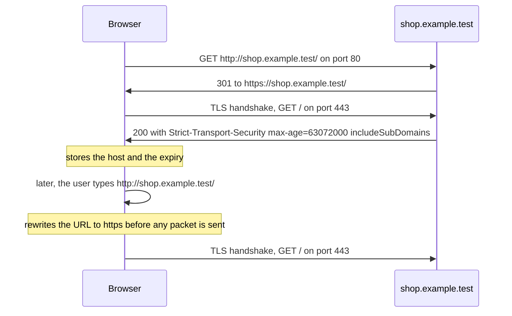
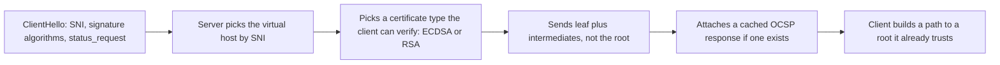
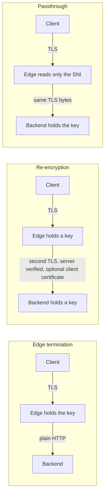
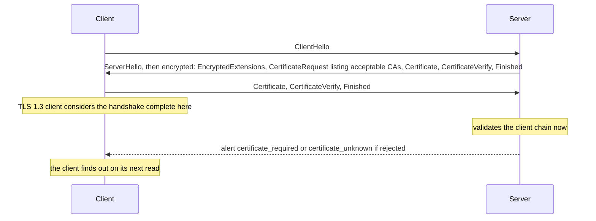
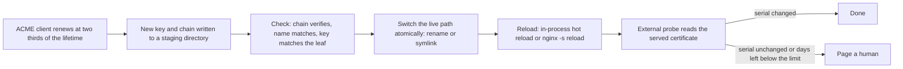
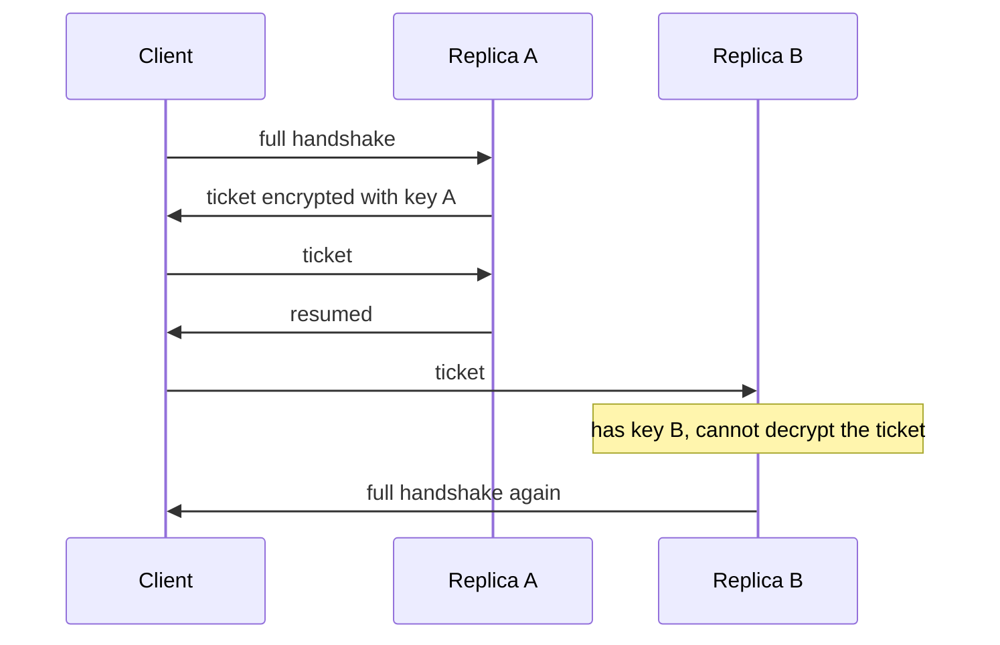
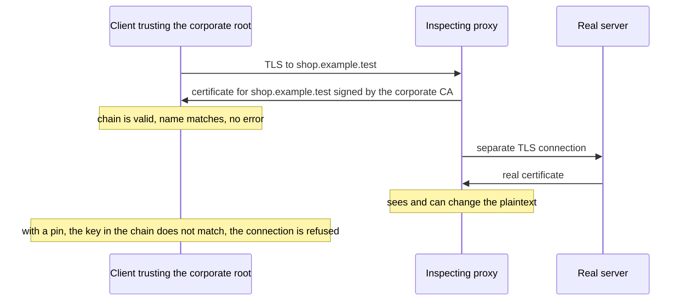

<!-- markdownlint-disable MD001 -->
<!-- markdownlint-disable MD010 -->
<!-- markdownlint-disable MD024 -->
<!-- markdownlint-disable MD025 -->
<!-- markdownlint-disable MD026 -->
<!-- markdownlint-disable MD029 -->
<!-- markdownlint-disable MD033 -->
<!-- markdownlint-disable MD036 -->
<!-- markdownlint-disable MD040 -->
<!-- markdownlint-disable MD056 -->
<!-- markdownlint-disable MD060 -->

# H16. HTTPS in production

---

## Contents

| #     | Sub-topic                                                                   | Tag   |
| ----- | --------------------------------------------------------------------------- | ----- |
| 16.01 | The `https` scheme: redirect, HSTS and the preload list, mixed content      | CORE  |
| 16.02 | Server configuration: policy, key placement, stapling, chains, profiles     | CORE  |
| 16.03 | Termination topologies: edge, re-encryption, passthrough                    | CORE  |
| 16.04 | Mutual TLS: client certificates, identity, service meshes                   | CORE  |
| 16.05 | Certificate lifecycle operations: renewal, reload, expiry monitoring        | CORE  |
| 16.06 | The performance cost of TLS: handshakes, resumption, offload, kTLS          | DEEP  |
| 16.07 | Java: JSSE, `SSLContext`, key and trust managers, Spring Boot SSL bundles   | CORE  |
| 16.08 | Rust: `rustls`, `tokio-rustls`, root stores, `native-tls`                   | DEEP  |
| 16.09 | Interception and pinning                                                    | AWARE |
| 16.10 | The story: one shop goes to production on HTTPS                             | CORE  |
| 16.11 | Labs: Java and Rust HTTPS services, an nginx edge, mTLS, rotation, failures | CORE  |
| 16.12 | Exercises                                                                   |       |
| 16.13 | Solutions                                                                   |       |
| 16.14 | Takeaways                                                                   |       |

Tags: **CORE** is what an architect is expected to explain unprompted, **DEEP** is the mechanism underneath it, **AWARE** is a fact to know exists and not to derive.

Terms used throughout. Each is defined here, before any section uses it.  
Terms from H11 to H15 (AEAD, certificate, chain, intermediate, root store, trust anchor, OCSP, stapling, ACME, SAN, SNI, ALPN, session ticket, resumption,  
`psk_dhe_ke`, 0-RTT, forward secrecy, alert, handshake, record, cipher suite, named group, HelloRetryRequest) keep their meaning.

- **Edge**, **backend**, **replica**: the edge is the first server a public client reaches (a reverse proxy, load balancer or CDN node).  
  A backend is a server behind it that runs the application. A replica is one of several identical processes serving the same traffic.
- **Termination**, **terminator**: the terminator is the process that holds a private key and completes the TLS handshake for a connection.  
  The point where bytes turn into plaintext is where TLS terminates.
- **Re-encryption**: the edge terminates the client's TLS connection and opens a second, separate TLS connection to the backend.
- **Passthrough**: the edge forwards the TCP bytes without decrypting them. It may read the SNI from the ClientHello (a "preread") to choose the backend, but it holds no key.
- **PROXY protocol**: a short header that a TCP proxy can put in front of the forwarded stream to tell the backend the original client address, which a passthrough would otherwise hide (from memory; not run in the lab).
- **HSTS** (HTTP Strict Transport Security): a response header by which a site tells a browser to use only `https` for that host for a stated time (16.01).  
  **Preload list**: a list of host names shipped inside browsers, so that even the first visit uses `https`.
- **SSL stripping**: an attacker on the path answers a client's first plain `http` request and keeps the client on `http` while talking `https` to the site.  
  The client sees no certificate error because it never asks for TLS.
- **Mixed content**: a page loaded over `https` that asks for a sub-resource (script, image, frame, fetch) over `http`.  
  **Active** mixed content can change the page (script, frame, fetch), **passive** cannot (image, audio, video).
- **Mutual TLS** (mTLS): both sides present a certificate.  
  The server's certificate proves the server's name to the client as before, and a **client certificate** proves the client's identity to the server.  
  The identity is carried in the certificate, not in a password or header.
- **Hot reload**: a running server starts using a new certificate and key for new connections without a restart and without dropping existing ones.
- **Ticket key**: the secret a server uses to encrypt and decrypt session tickets (H14, H15).  
  A ticket from one replica resumes on another only if both hold the same ticket key.
- **Full handshake**, **resumed handshake**: a full handshake authenticates the server with a signature and a certificate chain.  
  A resumed handshake starts from a secret saved by an earlier one and skips that work.
- **kTLS** (kernel TLS): a Linux facility that moves the record encryption of an established TLS connection from the user-space library into the kernel.
- **`SSLContext`**, **`KeyManager`**, **`TrustManager`**: the Java Secure Socket Extension (JSSE) objects that hold a TLS configuration.  
  The `KeyManager` chooses which certificate and key this side presents,  
  the `TrustManager` decides whether the peer's certificate is accepted, and the `SSLContext` joins them to a protocol version and creates sockets.  
  A Spring **SSL bundle** is a named configuration of keys and trust that Spring Boot turns into these objects.
- **`rustls`**, **root store**: `rustls` is a TLS library written in Rust.  
  Its root store (`RootCertStore`) is the list of trust anchors a client accepts.
- **Pin**, **SPKI**: a pin is an expected key that a client checks in addition to normal validation. SPKI (SubjectPublicKeyInfo) is the part of a certificate that holds the public key;  
  a pin is usually the SHA-256 of its DER bytes, so it survives a renewal that keeps the key and breaks one that changes it.
- **TLS-inspecting proxy**: a proxy that terminates the client's TLS with a certificate it mints on the fly under a CA that the client was configured to trust,  
  reads the plaintext, and opens its own TLS connection to the real server.
- **Probe**: a client that connects only to observe a server, such as a monitoring check or a test tool.

Outputs in this module are real.  
They come from an HTTPS service written for this module in Java (about 220 lines, JDK only) and in Rust (about 250 lines), a Spring Boot 4.1.2 service, `nginx` 1.24.0 as the edge, `openssl`, `curl`, `tshark` and Chromium 153 driven by Playwright.  
Run on Linux 6.18, JDK 21.0.12, OpenSSL 3.0.13, nginx 1.24.0, Rust 1.97 and Chromium 153.0.8010.12, all on one machine with four cores.  
Random values (serial numbers of the rogue CA, signature sizes) and timings differ on every run, and the text says when a number is run-dependent.  
What was read in the source on 2026-10-31: the Mozilla server-side TLS guideline 6.0 as published in `ssl-config.mozilla.org/guidelines/latest.json` (the `intermediate` and `modern` entries),  
RFC 6797 (HSTS), the submission requirements on `hstspreload.org`, and the Spring Boot 4.1.2 reference page on SSL bundles.  

Taken from earlier modules and not re-fetched: the CA/Browser Forum lifetime schedule and the end of OCSP at Let's Encrypt (H13).  
From memory and not re-checked today: RFC 7469 (HTTP Public Key Pinning), the `nginx` kTLS directive, the PROXY protocol, service-mesh certificate lifetimes, and anything said about specific cloud load balancers; each is marked where it appears.  
The kernel of this sandbox has no kTLS (`CONFIG_TLS` is not set), so kTLS was not run.

---

## 16.01 The `https` scheme: redirect, HSTS and the preload list, mixed content

`https://` means HTTP over TLS, on port 443 unless the URL says otherwise, and the scheme is part of the origin, so `http://shop` and `https://shop` are different sites to a browser.  
The weak point is the first request: a user types `shop.example` or follows an old `http` link, the request goes out in clear, and an attacker on the path can answer it.  
The fix has three layers. The server redirects `http` to `https` (a 301). Over `https` it sends `Strict-Transport-Security`,  
after which the browser itself rewrites `http` to `https` for that host and refuses to continue past a certificate error.  
The preload list closes the gap for the very first visit.  
Separately, a secure page must not pull sub-resources over `http`: browsers block active mixed content and, in the Chromium used here, upgrade passive content.



### The redirect and its weakness

The redirect is necessary and not sufficient.  
The `301` itself travels in clear, so the attacker can replace it, which is SSL stripping.  
The redirect also trains users that "http then redirect" is normal.  
HSTS exists to remove the first plain request for every visit after the first.

### HSTS, from RFC 6797

The header is `Strict-Transport-Security: max-age=<seconds>[; includeSubDomains]`, and `max-age` is required.  
The rules that matter, as read in the RFC on 2026-10-31:

- A user agent **ignores** the header if it arrived over insecure transport.  
  Lab 05 sends it from port 80 on purpose and `curl` records nothing.
- While a host is a known HSTS host, the user agent **terminates** the connection on any secure-transport error, warning or fatal, and the RFC recommends giving the user no way around it.  
  A click-through warning is what an interception attack needs.
- HSTS applies to HTTP on **any port** of the host: the user agent rewrites the scheme to `https`, converts an explicit port 80 to 443, and keeps any other explicit port.
- `max-age=0` makes the host unknown again, and the `includeSubDomains` flag is ignored with it.

Lab 05 shows the practical effect with `curl --hsts`: the header from port 80 leaves the store empty,  
the header from port 443 stores `.shop.example.test` (the leading dot marks `includeSubDomains`), and an `http://` request made afterwards never reaches port 80,  
because the nginx access log holds one line, for port 443.

### The preload list

A browser can only learn a host's HSTS policy by visiting it. The preload list ships the answer with the browser.  
The submission requirements, as read on `hstspreload.org` on 2026-10-31, are a valid certificate; a redirect from port 80 to `https` on the same host;  
every subdomain served over `https`, internal ones included; and an `https` response on the base domain with `max-age` of at least 31,536,000 seconds (one year),  
`includeSubDomains` and `preload`, where any redirect served over `https` carries the header too.  
The site states that inclusion "cannot easily be undone" and that a removal takes months to reach users through browser releases.  
The Mozilla guideline 6.0 asks for `max-age` 63,072,000 (two years) in both of its profiles.

The risk is `includeSubDomains`. It also binds `legacy.shop.example.test`, a printer page or a partner endpoint that nobody has put behind TLS.  
A common ramp, and the one this module recommends, is to start with a short `max-age` (minutes, then a day, then a week), find the breakages, and lengthen it step by step before submitting.  
The ramp values are practice, not a standard.

### Mixed content

| Sub-resource                                       | Class   | Chromium 153 in Lab 05                                                   |
| -------------------------------------------------- | ------- | ------------------------------------------------------------------------ |
| `<script src="http://...">`                        | Active  | Blocked: `failed: ... mixed-content`, an error in the console            |
| `fetch("http://...")`                              | Active  | Blocked, and the promise rejects                                         |
| ``                           | Passive | Automatically upgraded to `https`, with a console warning, and it loaded |
| Same page with the CSP `upgrade-insecure-requests` | Both    | All three requests were sent as `https` and the script ran               |

The `Content-Security-Policy: upgrade-insecure-requests` directive (set in the lab as a `<meta>` tag) rewrites every `http` sub-resource URL of the page to `https` before the request is made.  
It repairs a legacy site with many hard-coded `http` URLs and works only if the same host answers on `https`.  
In the lab the `fetch` still fails after the upgrade, for a different reason: the request is cross-origin and the API host sent no CORS header (R10).  
Fixing mixed content moves the next problem into view; it does not remove it.  
The table describes Chromium 153 only.  
The behaviour for passive content differs between browsers and versions.

### Interview angle

- "A site redirects http to https. Is it protected?" Not on the first request.  
  The redirect can be forged. HSTS protects later visits, and preload protects the first.
- "What can go wrong with `includeSubDomains`?" Every subdomain, including forgotten ones, must serve valid HTTPS for the whole `max-age`, and a preloaded domain cannot back out quickly.
- "How do you roll out HSTS?" Short `max-age` first, find the `http`-only hosts, lengthen in steps, then preload.
- "Why does the page work in staging and break in production behind the proxy?"  
  Often the application builds absolute `http://` URLs because it does not know it is behind TLS;  
  trust `X-Forwarded-Proto` from the edge (16.03) or use relative URLs.

---

## 16.02 Server configuration: protocol and suite policy, key placement, stapling, chains, profiles

A TLS server configuration decides five things: which protocol versions and suites it accepts, which certificate chain it sends,  
whether it attaches a fresh OCSP answer, how it caches and issues session state, and who can read its private key.  
Do not invent the first two. Mozilla publishes profiles (modern, intermediate and, from memory, old) as machine-readable guidelines,  
and the `intermediate` profile is the default for a public site: TLS 1.2 and 1.3, six ECDHE-AEAD suites for TLS 1.2, the three standard TLS 1.3 suites, and certificates up to 366 days.  
The mistakes that cause real incidents are less exotic than weak ciphers: an incomplete chain, a key readable by the wrong users, and a stapling setup that silently never staples.



### The Mozilla guideline, as read

The JSON at `ssl-config.mozilla.org/guidelines/latest.json` reported version 6.0 on 2026-10-31. Its two stricter entries:

| Setting                        | `intermediate`                                                                         | `modern`             |
| ------------------------------ | -------------------------------------------------------------------------------------- | -------------------- |
| TLS versions                   | 1.2 and 1.3                                                                            | 1.3 only             |
| TLS 1.2 suites (OpenSSL names) | ECDHE-ECDSA and ECDHE-RSA with AES128-GCM-SHA256, AES256-GCM-SHA384, CHACHA20-POLY1305 | none                 |
| TLS 1.3 suites                 | `TLS_AES_128_GCM_SHA256`, `TLS_AES_256_GCM_SHA384`, `TLS_CHACHA20_POLY1305_SHA256`     | the same three       |
| Groups, in order               | `X25519MLKEM768`, `X25519`, `prime256v1`, `secp384r1`                                  | the same four        |
| Certificate types              | ECDSA and RSA (RSA key 2,048 bits)                                                     | ECDSA only           |
| OCSP stapling                  | yes                                                                                    | yes                  |
| `Strict-Transport-Security`    | `max-age` 63,072,000                                                                   | `max-age` 63,072,000 |
| Server prefers its own order   | no                                                                                     | no                   |
| Longest / recommended lifetime | 366 days / 90 days                                                                     | 90 days / 90 days    |

A profile named `old` also exists and was not fetched.  
"Server prefers its own order: no" means the client's preference wins; the reason is that clients know whether they have AES hardware, and the suites in the list are all considered strong.  
The hybrid post-quantum group `X25519MLKEM768` (H12) is first in the list, and the lab's OpenSSL 3.0.13 does not have it, so the lab's `nginx` uses `X25519:prime256v1:secp384r1`.  
The cipher and curve lists in `edge.conf.in` are copied from the JSON.  
The session-cache lines (`ssl_session_cache shared:SSL:10m`, a one-day timeout, `ssl_session_tickets off`) are the usual output of Mozilla's configuration generator,  
from memory, and not part of the JSON that was read.

Lab 06 checks the effect from outside with `scan.sh`: TLS 1.0 and 1.1 are refused (and a control server shows that the scanning client can negotiate them),  
and an ECDSA certificate leaves exactly three TLS 1.2 suites usable and an RSA certificate the other three.  
Every server answers a scan, so test the policy rather than read it.

### Certificate and key placement

- **The key is the asset.** Mode `0600`, owned by the account that loads it (the `nginx` master reads it as root and the workers never need the file).  
  Not in the container image, not in the repository, not in a world-readable volume.  
  Where policy allows, keep it in a KMS or HSM and let the TLS library call out for signatures.
- **A new key for every renewal.** A renewal that keeps the key keeps every old risk and every old pin (16.09).  
  Lab 10 and Lab 12 both renew with a new key.
- **One key per service or per trust domain**, so that a leak has a bounded blast radius.
- **Files are read together.** The chain file and the key file must belong to each other at every moment a new connection can start.  
  Replace them by renaming a whole directory or switching a symbolic link,  
  never by writing the two files one after the other on a live server (the window is short but it exists; see 16.05).

### The chain a server sends

Send the leaf and every intermediate, in that order, and not the root (the client holds it already).  
A missing intermediate is the most common production failure, because a browser may repair it by fetching the intermediate from the certificate's `caIssuers` URL (H13) and Java, `curl`, Go and rustls do not.  
Lab 06 and Lab 09 show the same broken server, which sends the leaf only, through three clients:

| Client       | What it said                                                                                 |
| ------------ | -------------------------------------------------------------------------------------------- |
| `openssl`    | `Verify return code: 21 (unable to verify the first certificate)`                            |
| Java         | `PKIX path building failed: ... unable to find valid certification path to requested target` |
| `rustls`     | `InvalidCertificate(UnknownIssuer)`                                                          |
| `native-tls` | `certificate verify failed (unable to get local issuer certificate)`                         |

The same messages also mean "the client does not hold the root", so read the chain with `openssl s_client -showcerts` before changing a trust store.

### OCSP stapling

Stapling lets the server attach a recent signed OCSP answer to the handshake so that the client need not ask the CA (H13).  
With `ssl_stapling on`, `nginx` fetches the answer from the responder named in the certificate and caches it.  
It fetches **lazily**, after a connection asks for it. Lab 06 shows the consequence: the first probe after start sees `staple=none` and the next sees `staple=<n> bytes`.  
A monitor that tests stapling must probe twice, and a deployment that restarts often never gets a stapled answer on the first connection after each restart.

Whether stapling matters depends on the CA. H13 recorded that Let's Encrypt ended its OCSP service on 2025-08-06, so a certificate from that CA has no responder to staple from.  
The Mozilla guideline above still lists stapling as `true` because other CAs still run responders.  
Check that the certificate has an OCSP URL before you debug stapling.

### Two certificate types on one name

`nginx` accepts more than one `ssl_certificate` for a server: here an ECDSA and an RSA 2,048 one on port 8446.  
The server presents the one the client's `signature_algorithms` can verify.  
A modern client gets ECDSA, which is cheaper to sign (16.06); a client that lists only RSA signature algorithms gets RSA.  
Lab 06 shows both choices from `openssl s_client -sigalgs`.

### Interview angle

- "How do you choose a TLS configuration?"  
  Start from the Mozilla `intermediate` profile (or `modern` if every client supports TLS 1.3), generate the configuration for the actual server software, and test from outside.
- "A partner's Java client fails with PKIX path building failed, but browsers are fine.  
  Why?" The chain is probably incomplete and the browser repaired it. Fix the server, not the partner.
- "Does the server need the root in its chain?" No. The client holds the root; sending it only costs bytes.
- "What would you check before blaming stapling?"  
  That the CA still operates an OCSP responder, that the server can reach it, and that a second connection staples.

---

## 16.03 Termination topologies: edge, re-encryption, passthrough

Between the client and the application, TLS ends in one of three places.  
**Edge termination**: the load balancer or reverse proxy decrypts, then speaks plain HTTP to the backend.  
It is the cheapest and gives the edge full visibility of requests, which it needs for routing, caching, a web application firewall and header rewriting, and it leaves the internal network in plaintext.  
**Re-encryption**: the edge decrypts, inspects, then opens a new verified TLS connection to the backend, optionally with a client certificate,  
so the internal hop is protected and the edge still sees requests, and it pays for two handshakes per request path.  
**Passthrough**: the edge never decrypts. It reads the SNI from the ClientHello, forwards the bytes to the backend that holds the key, and so cannot route by URL, cache or filter,  
but the key never leaves the backend. Choose by who must be able to read the traffic.



### What each topology costs and gives

| Property                               | Edge termination    | Re-encryption                                            | Passthrough                                              |
| -------------------------------------- | ------------------- | -------------------------------------------------------- | -------------------------------------------------------- |
| Who holds the private key              | Edge only           | Edge and backend                                         | Backend only                                             |
| Plaintext on the internal network      | Yes                 | No                                                       | No                                                       |
| Edge can route by URL, cache, filter   | Yes                 | Yes                                                      | No (by SNI and IP only)                                  |
| TLS handshakes per client request path | 1 (client to edge)  | 2 (client to edge, edge to backend, the second reusable) | 1 (client to backend)                                    |
| Backend sees the client's IP           | Through a header    | Through a header                                         | Only as the edge's IP, unless the PROXY protocol is used |
| Backend can identify the edge          | By network position | By client certificate (mTLS)                             | Not applicable                                           |
| Certificate renewal touches            | The edge            | Edge and backends                                        | Backends                                                 |
| Fits                                   | Most public sites   | Regulated data, zero-trust networks                      | Multi-tenant ingress, protocols the edge must not read   |

The PROXY protocol, which carries the original client address to a backend behind a passthrough, is mentioned from memory and was not run.

### The captures

Lab 07 sends one request with a marker cookie through each topology and counts, with `tshark`, the packets on each leg that contain the marker:

| Leg                                      | Result in the lab                                                                      |
| ---------------------------------------- | -------------------------------------------------------------------------------------- |
| Client to edge, TLS                      | 0 packets contain the marker                                                           |
| Edge to plain backend (edge termination) | 2 packets contain it: the request, and the backend's response, which echoes the cookie |
| Edge to TLS backend (re-encryption)      | 0                                                                                      |
| Passthrough listener and backend         | 0 and 0                                                                                |

Edge termination is the only topology that shows the cookie to a packet capture inside the network.  
Packet counts per leg (35 to 36 on the client side) vary by one or two between runs; the marker counts did not.

### Headers, and why the edge must overwrite them

Once TLS ends at the edge, the backend learns about the client only from headers the edge adds: `X-Forwarded-Proto` (so the application builds `https` URLs and sets `Secure` cookies), `X-Forwarded-For` or the standardised `Forwarded`, and, with mTLS at the edge, the client's identity (16.04).  

Those headers are trustworthy only if the edge **sets** them and does not forward a client's copy.  
Lab 07 shows the difference: on `/terminate/`, where `nginx` sets `X-Client-Dn` from `$ssl_client_s_dn`,  
a forged `X-Client-Dn: CN=admin` from the client never reaches the backend (the variable is empty without a client certificate, and `nginx` does not send a header with an empty value),  
and on `/naive/`, where the line is missing, the backend receives `X-Client-Dn: CN=admin`.  
A backend that authorises on that header has just accepted a self-asserted admin.

### SNI routing in a passthrough

`nginx`'s `stream` module with `ssl_preread on` reads the `server_name` from the ClientHello without terminating.  
The lab routes `shop.example.test` to the Java service and `api.shop.example.test` to the Rust service on one port, and the stream log shows the SNI and the backend chosen.  
This works because the SNI is in clear in TLS 1.3 (15.07); with Encrypted Client Hello (15.08) an edge that does not hold the ECH key cannot read it.

### Interview angle

- "Where would you terminate TLS?" At the edge by default, with re-encryption wherever policy forbids plaintext inside,  
  passthrough for traffic the edge has no business reading. Say who holds the key in each case.
- "What do you lose with passthrough?" Everything that needs the request: path routing, caching, WAF, rate limits by user, header rewriting.
- "How does a backend know the original scheme and client address?" Headers set by the edge, which must overwrite client-supplied copies.
- "Is re-encryption double the cost?" It adds a handshake, but backend connections are long-lived and pooled, so the cost is per connection and not per request (16.06).

---

## 16.04 Mutual TLS: client certificates, identity, service meshes

In mutual TLS the server asks the client for a certificate during the handshake, validates it against the CA it trusts for clients, and treats the certificate as the caller's identity.  
This replaces a shared secret (an API key, a password) with a key pair that never leaves the client, and the identity can be read by the application.  
The identity belongs in the certificate's Subject Alternative Name (for services, a URI such as a SPIFFE ID), not in a header the client can write and not in the common name.  
Mutual TLS is the default for service-to-service traffic in a zero-trust network, usually provided by a sidecar proxy or a library so that application code does not handle certificates.  
It adds a certificate lifecycle for every workload (16.05), so short lifetimes and automation are part of the design.



### What the lab shows

Lab 08 runs the same service in Java and in Rust with the client CA required (`mtls=need`) and probes it with four clients:

| Client behaviour                                | JSSE client                                                                                                             | `rustls` client                                                          |
| ----------------------------------------------- | ----------------------------------------------------------------------------------------------------------------------- | ------------------------------------------------------------------------ |
| No client certificate                           | Handshake "succeeds", the read fails: `certificate_required`                                                            | Same: `AlertReceived(CertificateRequired)`                               |
| Certificate from an untrusted CA (the rogue CA) | **Sends no certificate** (its CA does not match the server's list), so the server logs "Empty client certificate chain" | **Sends it**, the server rejects it: `AlertReceived(CertificateUnknown)` |
| Certificate from the lab CA                     | `200`, and the server sees `client=spiffe://shop.example.test/ns/prod/sa/orders`                                        | The same                                                                 |
| TLS 1.2, no certificate                         | `Broken pipe` (an alert race; the server logged `handshake_failure`)                                                    | -                                                                        |

Three lessons.  
First, in TLS 1.3 the client's handshake completes before the server has judged the client's certificate, so a failed mTLS connection often surfaces as an error on the **first read or write**, not in `startHandshake()`.  
Debugging an mTLS rejection means looking at the server's log, where the reason is written (`Empty client certificate chain`, `PKIX path building failed`).  

Second, the two libraries disagree on whether to offer a certificate that the server's CA list does not name, which is why an mTLS client that "works from Java and fails from Rust" is a normal report.  
Third, `Broken pipe` is what a client sees when it writes after the server has already sent a fatal alert and closed; the probe in the lab reads once after a failed write so that the alert, not the symptom, is printed.

### Where the check happens

- **At the application** (the lab's Java and Rust services, or Spring Boot with `server.ssl.client-auth`): the handshake fails if the certificate is missing or untrusted, and the application reads the identity from the session.  
  In Lab 10 the Spring service was run with `client-auth: want` (ask, but let a client without a certificate through) and read `client=CN=orders`.  
  Spring's `need` value and the other client-auth modes are from memory and were not run.  
  Tomcat logged a warning with `want` on TLS 1.3, that the JSSE TLS 1.3 implementation "does not support post handshake authentication (PHA)  
  and is therefore incompatible with optional certificate authentication"; `want` still worked because the certificate was requested in the handshake.
- **At the edge** (`nginx` on port 8443 with `ssl_verify_client on`): the handshake completes, then `nginx` answers with HTTP `400` and says why (`No required SSL certificate was sent`, `The SSL certificate error`).  
  The access log records `verify=NONE`, `FAILED:unable to verify the first certificate` or `SUCCESS`.  
  After success the edge hands the identity to the backend as a header that it sets itself (16.03).  
  This lab config forwards `$ssl_client_s_dn` (the subject DN, `CN=orders`). Forwarding a SAN needs extra work in `nginx` and was not tried; a mesh proxy such as  
  Envoy exposes URI SANs directly, from memory.
- **Between services, in a mesh**: each pod or host runs a sidecar proxy that holds a short-lived workload certificate issued by the mesh's CA,  
  speaks mTLS to its peers, and enforces policy by identity ("`orders` may call `payments`").  
  The application code speaks plain HTTP to its sidecar on localhost.  
  This is an AWARE-level pattern here: the lab did not run a mesh, and lifetimes (hours to days) and product names are not quoted.

### Identity belongs in the SAN

The common name (CN) is a free-text field with a long history of ambiguity, and the rule (H13.05) is to match names against the SAN.  
For services, a URI SAN such as `spiffe://shop.example.test/ns/prod/sa/orders` (a SPIFFE ID: trust domain plus workload path, H13.10) names the workload independent of its host name or IP.  
An authorisation rule then reads: "caller identity must equal this URI".  
Match the exact string or an exact prefix with a delimiter; matching a substring lets `…/sa/orders-evil` through.

### Revocation and lifetime

An mTLS deployment has many client certificates and no practical CRL or OCSP check on the hot path.  
The working answer is **short lifetimes with automatic renewal**: a stolen certificate is useful until it expires, and the CA stops issuing to a compromised workload.  
This is why mTLS and the lifecycle work of 16.05 belong together.

### Interview angle

- "Why mTLS between services?" Identity without a shared secret, encryption inside the network, and authorisation by workload identity.  
  The price is a certificate lifecycle per workload.
- "Where do you put the client identity, and how does the backend trust it?"  
  In a URI SAN, extracted by whoever terminates the mTLS, and passed on in a header that the terminator sets and a client cannot supply.
- "An mTLS client gets a generic error after a successful handshake. Why?"  
  In TLS 1.3 the server judges the client's certificate after the client has finished; read the server log.
- "How do you revoke a client certificate?" You mostly do not.  
  You issue short-lived certificates and stop renewing the one you distrust.

---

## 16.05 Certificate lifecycle operations: renewal, reload, expiry monitoring

A certificate is a deployment artefact with a deadline, and an outage from an expired one is a process failure, not a cryptographic one.  
The pieces are: an ACME client that renews at about two thirds of the lifetime (H13), a step that puts the new key and chain where the server reads them,  
a way to make the running server **use** them without dropping traffic, and a monitor outside the system that reads the certificate the world actually receives.  

The common failure is the gap between the second and third pieces: the file on disk is new and the process is still serving the old certificate from memory.  
Public lifetimes are falling (H13 recorded the CA/Browser Forum schedule of 200 days from 2026-03-15, 100 from 2027-03-15 and 47 from 2029-03-15), so a manual step is a future outage.



### Four ways to make a server use a new certificate

Lab 10 holds one connection open (A), replaces the key and chain on disk, then opens a second connection (B), for each server.  
The `serial` is the leaf's serial number, `1000` before and `1001` after.

| Mechanism                                                  | New connections (B)             | Connection opened before the swap (A)                                        |
| ---------------------------------------------------------- | ------------------------------- | ---------------------------------------------------------------------------- |
| Java: `Reloading` key manager re-reads on file change      | `1001`, from the next handshake | Kept serving: both requests on A completed, serial `1000`                    |
| Rust: `Reloading` certificate resolver, same idea          | `1001`                          | Kept serving, serial `1000`                                                  |
| `nginx`: replace files, then `nginx -s reload`             | `1001`                          | **Closed.** A's second request failed: `connection closed before a response` |
| Spring Boot 4.1.2 SSL bundle with `reload-on-update: true` | `1001` within the 5-second wait | Not tested                                                                   |

Two lessons. A reload does not mean "no client sees anything".  
`nginx` starts new workers and lets the old ones finish, but an **idle keep-alive connection** is closed at once,  
and a client whose pool reuses that connection for a `POST` gets a reset it cannot safely retry (H08).  

Clients need a retry policy for idempotent requests, and edges need to be reloaded outside the busiest minutes, or fronted by something that drains connections.  
The in-process reload keeps existing connections alive and costs a custom key manager (Java) or resolver (Rust), about 30 lines each in the lab.  
The Spring bundle needs only configuration.  
The Spring documentation says reload is supported only by the Tomcat and Netty servers and that the watcher has a configurable quiet period (`spring.ssl.bundle.watch.file.quiet-period`,  
set to two seconds in the lab).

**Write both files, then switch.** The lab's reloader uses the sum of the two files' modification times as its change signal and re-reads both,  
so a reload that happens between the first write and the second would pair a new certificate with an old key and every handshake would fail until the second write lands.  
This race was not triggered in the lab. The defence is structural: write the new pair into a new directory,  
then switch one symbolic link or rename one directory, and have the reloader read through the link.

### What expires, and who owns it

| Object                         | Typical lifetime         | What breaks                                      | Who must notice                                                                  |
| ------------------------------ | ------------------------ | ------------------------------------------------ | -------------------------------------------------------------------------------- |
| Leaf certificate               | 90 days now, falling     | Every client of the name                         | An external probe, and the renewal job                                           |
| Intermediate in the sent chain | Years, rotated by the CA | Clients that cannot build a path                 | The ACME client must write the CA's **current** chain, not a copy kept in config |
| Internal CA (for mTLS)         | Years                    | Every service at once                            | A calendar owned by a team, rehearsed                                            |
| Client certificates (mTLS)     | Hours to weeks           | One workload                                     | The workload's renewal agent                                                     |
| OCSP staple                    | Days (7 in the lab)      | Strict clients, if the server serves a stale one | The server's fetcher; probe twice                                                |
| Ticket keys                    | Hours to days            | Resumption rate, not correctness                 | Whoever rotates and distributes them (16.06)                                     |

### The monitor

`Tls16 watch` and its Rust twin connect with a trust manager that **accepts anything**, because its job is to read the chain, including an expired or untrusted one.  
It then judges the chain separately with the real trust rules and reports `OK`, `WARN` or `CRIT` with the exit codes `0`, `1` and `2` that schedulers and alerting tools understand.  
Lab 10 runs it against a healthy server, a renewal that is overdue (10 days left), an expired leaf and a leaf without its intermediate: `OK`, `WARN`, `CRIT` (negative `days_left`), and `CRIT` with a path error.  
The Rust watcher prints the same status, exit code and `days_left` for the same servers (only the wording of the path error differs).  
A probe has to come from outside the service's network zone and has to ask for each name by SNI, or it will test the default virtual host.

Thresholds should be a fraction of the lifetime and not a fixed number of days.  
Renewing at two thirds means that a certificate still not renewed at three quarters is a failed job: `WARN` when a third of the lifetime remains and `CRIT` at a tenth.  
For 90 days that is 30 and 9 days, for 47 days it is about 16 and 5, and for a 6-day certificate it is 2 days and about 14 hours,  
which is why short-lived certificates need the renewal agent and its health check to be first-class parts of the service.

### Interview angle

- "A certificate expired in production. What do you change?"  
  Automate issuance and deployment, monitor the served certificate from outside against a fraction of the lifetime, and alert on the renewal job as well.  
  Then ask why the previous alert, if any, was ignored.
- "Renewal succeeded and the site still serves the old certificate. Why?" The process never reloaded, or one node of the fleet did not.  
  The probe must read the live certificate on every node.
- "Is `nginx -s reload` zero downtime?" For new connections yes.  
  Idle keep-alive connections are closed, so clients must retry safely.
- "How would you rotate an internal CA?"  
  Add the new CA to every trust store first, issue under it second, remove the old one last, and rehearse it before the date.

---

## 16.06 The performance cost of TLS: handshakes, resumption, offload, kTLS

TLS costs three things: latency from round trips, CPU for the handshake, and CPU for encrypting the bytes.  
On current hardware the last is small (AES-GCM runs at memory speed on a CPU with AES instructions, and the sandbox's CPU lists `aes`), so the real costs are the handshake and the round trips.  
A **full** handshake does public-key work on both sides, an ephemeral key exchange, a signature by the server and a verification by the client,  
and RSA-2048 signatures cost clearly more than ECDSA P-256 signatures. A **resumed** handshake skips the signature and the chain.  

The practical levers are therefore: fewer handshakes (keep-alive, HTTP/2 and 3, connection pools to backends), cheaper ones (ECDSA certificates, resumption that actually hits across the fleet),  
and termination near the client so that the multi-round-trip part runs over a short path (14.07). The latency side is H20.

### Measured: server CPU per connection

`perf.sh` opens connections for four seconds with `openssl s_time`, once as full handshakes (`-new`) and once as resumptions (`-reuse`), against the one-worker `nginx` of the lab,  
and divides the worker's CPU time (from `/proc`) by the connection count.  

Each connection also requests a small file, so the figure includes `nginx`'s accept, HTTP and logging work and is not the handshake alone.

```text
$ ./perf.sh 4
cert     tls      handshake  connections server_cpu_us/conn       reused
ECDSA    TLS 1.2  full             2645              582            0
ECDSA    TLS 1.2  resumed         14433              193        14433
ECDSA    TLS 1.3  full             2565              667            0
ECDSA    TLS 1.3  resumed          4977              520         4977
RSA2048  TLS 1.2  full             2136              993            0
RSA2048  TLS 1.2  resumed         13864              201        13864
RSA2048  TLS 1.3  full             2236             1033            0
RSA2048  TLS 1.3  resumed          5937              470         5937
```

The numbers depend on the machine and on the client sharing it.  
They were collected four times during this module with the same shape. In every run:

- **RSA-2048 full handshakes cost 1.5 to 1.8 times the server CPU of ECDSA P-256 ones** (for example 993 against 582 µs at TLS 1.2).  
  The signature is the difference, and `nginx`'s other work is a fixed floor under both.
- **A resumed TLS 1.2 handshake cost about one third of a full one** (193 against 582 µs), because the abbreviated handshake does no public-key operation at all.
- **A resumed TLS 1.3 handshake cost about 75 to 85 percent of a full one** (520 against 667 µs).  
  It saves the signature and the chain, but in this configuration it still performs the ephemeral key exchange (`psk_dhe_ke`, 15.05), and the server issues a new ticket each time.  
  The lab did not separate which of the two costs how much.
- TLS 1.3 full handshakes cost slightly more CPU than TLS 1.2 ones here. TLS 1.3 saves a round trip, not CPU; the benefit is latency.

The resumed rows show `reused` equal to the connection count: every one of them took the resumption path, confirmed in the `nginx` log by `$ssl_session_reused`.

### Resumption across a fleet

A ticket (H14, H15) is encrypted with the issuing server's ticket key.  
A replica can resume it only if it holds the same key. With a load balancer that spreads a returning client over `N` replicas that do not share ticket keys,  
the chance that the client lands on the replica that issued its ticket is `1/N`.  
Lab 11 runs the experiment with two replicas of the lab edge (ports 8450 and 8451, each with its own session cache):



The result in the lab: with separate ticket keys the ticket from 8450 resumed on 8450 and gave a new session on 8451, for both TLS 1.2 and TLS 1.3.  
After `nginx.sh reload shared` made both replicas read `ticket-a.key`, it resumed on both.  
The lessons are operational.  
Share ticket keys across replicas through a secret store, rotate them on a schedule shorter than the forward-secrecy window you want (a ticket key that lives for a week lets a stolen key open a week of sessions, H14),  
or accept that resumption is per replica and use sticky routing.  
The Mozilla `nginx` snippet in 16.02 switches tickets **off** and relies on a server-side cache, which resumes only on the replica that holds the entry.

### Offload and kTLS

- **Hardware**: AES instructions in the CPU are the baseline.  
  Dedicated accelerators and NIC offload exist for very high connection or bandwidth rates; they were not available and not tested.
- **kTLS** moves the encryption of established connections into the Linux kernel, which lets `sendfile` and zero-copy paths work on TLS connections,  
  so a static-file server avoids copying every byte through user space.  
  It needs the kernel's `tls` module. In this sandbox `/proc/config.gz` shows `# CONFIG_TLS is not set` and `/proc/net/tls_stat` does not exist (Lab 00), so **kTLS was not run**.  
  That `nginx` can enable it through `ssl_conf_command Options KTLS` with a suitably built OpenSSL is from memory.
- **Connection reuse** beats all of this.  
  A handshake amortised over HTTP/2 multiplexing or a backend connection pool is a rounding error per request.

### Interview angle

- "What does TLS cost?" Round trips first, handshake CPU second (public-key operations, RSA more than ECDSA), bulk encryption last, and the first two shrink with resumption and connection reuse.
- "Why did resumption stop helping after we added a second load balancer?" Ticket keys are per instance; share them or keep clients on one instance.
- "RSA or ECDSA?" ECDSA is cheaper for the server and smaller on the wire; keep an RSA certificate only for clients that need it, and let the server pick by signature algorithm (16.02).
- "Does TLS 1.3 reduce server CPU?" Not by itself; it reduces latency.

---

## 16.07 Java: JSSE, `SSLContext`, key and trust managers, Spring Boot SSL bundles

A Java TLS configuration is an `SSLContext` built from a `KeyManager` (which certificate and key this side presents) and a `TrustManager` (which peers it accepts),  
plus the `SSLParameters` of each connection (protocol versions, SNI, and whether the host name is checked).  
Almost every Java TLS incident is a mismatch in one of those: the wrong truststore, an incomplete chain, a name that is not checked, or a name that is checked against the wrong string.  
The error messages are strings and are repetitive, so learn the six that matter (below).  
Spring Boot hides the objects behind **SSL bundles**: named PEM or keystore configurations that can reload when the files change.

### The objects

| Object                    | Job                                                 | In the lab (`Tls16.java`)                                                                                  |
| ------------------------- | --------------------------------------------------- | ---------------------------------------------------------------------------------------------------------- |
| `SSLContext`              | Holds protocol, key managers, trust managers        | `SSLContext.getInstance("TLS")` then `init(kms, tms, null)`                                                |
| `X509ExtendedKeyManager`  | Chooses the local certificate and key               | `Reloading`: re-reads two PEM files when their modification times change                                   |
| `X509TrustManager`        | Validates the peer's chain (PKIX) and the key usage | Built from the lab CA file, or from the JVM default when no file is given                                  |
| `SSLParameters`           | Per-connection settings                             | `setProtocols`, `setServerNames` (SNI), `setEndpointIdentificationAlgorithm("HTTPS")`, `setNeedClientAuth` |
| `SSLSocket` / `SSLEngine` | Blocking and non-blocking TLS                       | `SSLSocket` in the lab; NIO servers and Netty use `SSLEngine`                                              |
| `SSLSession`              | What was negotiated                                 | Protocol, suite, SNI (`ExtendedSSLSession`), local and peer certificates, stapled OCSP                     |

Key files for the JDK are PKCS#8 PEM, which is what `openssl genpkey` writes; the lab loader accepts nothing else,  
and a PKCS#1 `BEGIN RSA PRIVATE KEY` file has to be converted first (`openssl pkcs8 -topk8 -nocrypt`).  
Keystore formats (PKCS#12, JKS) and the rule that setting `javax.net.ssl.trustStore` **replaces** the default `cacerts` are in H13.03.

### Host name verification is not on by default for a raw socket

A plain `SSLSocket` validates the chain and does **not** check that the certificate is for the host you meant, unless `setEndpointIdentificationAlgorithm("HTTPS")` is set.  
`java.net.http.HttpClient` sets it for you (Lab 09), and so does `HttpsURLConnection`, from memory.  
Lab 09 shows all three outcomes against the server whose certificate is for `other.example.test`:

| Client                                              | Result against the wrong-name server                                |
| --------------------------------------------------- | ------------------------------------------------------------------- |
| `probe` with the default settings (`HTTPS` set)     | `No subject alternative DNS name matching shop.example.test found.` |
| `probe ... names=off` (what a raw `SSLSocket` does) | Connected, served by `other.example.test`, no error                 |
| `java.net.http.HttpClient`                          | The same `SSLHandshakeException` as the first row                   |

Disabling the name check to "make it work" is the single most common TLS vulnerability in Java services.  
The identity check is also against a specific string: JSSE checks the host name **passed when the socket was created**, not the SNI set afterwards.  
The probe in Lab 09 connects to `127.0.0.1` with SNI `other.example.test`, and JSSE accepts, because the certificate names `127.0.0.1`;  
`rustls`, which uses one `ServerName` for both, rejects with `NotValidForNameContext`.  
Code that sets SNI by hand and connects by IP is checking the wrong name.

### The messages worth knowing

Collected from Lab 09. Each is the end of a chain of nested causes, which the lab's `probe` prints.

| Message (shortened)                                                                                         | Means                                                                                  | First check                                                                               |
| ----------------------------------------------------------------------------------------------------------- | -------------------------------------------------------------------------------------- | ----------------------------------------------------------------------------------------- |
| `PKIX path building failed ... unable to find valid certification path`                                     | No path from the sent chain to a trusted root                                          | Is the intermediate sent? Is the root in this truststore? (`openssl s_client -showcerts`) |
| `PKIX path validation failed ... validity check failed`, cause `CertificateExpiredException: NotAfter: ...` | A certificate in the chain has expired                                                 | Dates of every certificate, and this machine's clock                                      |
| `No subject alternative DNS name matching X found`                                                          | Chain fine, name wrong                                                                 | SANs of the leaf; the host string the code used                                           |
| `Received fatal alert: certificate_required`                                                                | The server wants a client certificate and none was sent (TLS 1.3)                      | Key manager, keystore, the server's CA list                                               |
| `Received fatal alert: protocol_version`                                                                    | No common protocol version                                                             | `SSLParameters` protocols, the server's range                                             |
| `Unsupported or unrecognized SSL message`                                                                   | A TLS client talking to a plain-text port                                              | Port and scheme                                                                           |
| `No appropriate protocol (protocol is disabled or cipher suites are inappropriate)`                         | The code asked for a version that `jdk.tls.disabledAlgorithms` disables (lab: `TLSv1`) | The `java.security` file                                                                  |
| `Broken pipe`, `Connection reset`                                                                           | The peer closed after sending an alert; the real cause is in its log                   | Read the **peer's** log                                                                   |

Server-side logs say the same things from the other end (`Received fatal alert: certificate_expired`, `Empty client certificate chain`),  
but the line a server logs depends on a race between its read and the client's close, so a given failure sometimes logs `Broken pipe`.  
The detailed handshake trace is `-Djavax.net.debug=ssl:handshake` (H15 Lab 08).

### Spring Boot SSL bundles

Read on the Spring Boot 4.1.2 reference page and run in Lab 10 with the files shown there.  
A PEM bundle has a keystore (certificate chain and private key) and optionally a truststore:

```yaml
spring:
  ssl:
    bundle:
      pem:
        shop:
          reload-on-update: true
          keystore:
            certificate: "file:../try/spring/chain.pem"
            private-key: "file:../try/spring/key.pem"
          truststore:
            certificate: "file:../pki/ca.pem"
server:
  ssl:
    bundle: shop
    client-auth: want
```

`server.ssl.bundle` tells the embedded web server to use the bundle.  
`reload-on-update: true` starts a file watcher, and the documented limitation is that only the Tomcat and Netty servers support the reload.  
The same bundle can serve clients: the page shows `sslBundles.getBundle("mybundle").createSslContext()` and refers to the REST client documentation, which was not opened.  
JKS and PKCS#12 bundles exist and were not run.  
In the lab the service started in about two seconds, served serial `1000`, and served `1001` five seconds after the files were replaced, with no restart.

### Interview angle

- "A Java client says `PKIX path building failed`. What do you do?"  
  Show the chain the server sends, decide whether the intermediate or the root is missing, then fix the server or the truststore.  
  Do not disable validation.
- "Is hostname verification automatic?" For `HttpClient` and `HttpsURLConnection`, yes.  
  For a raw `SSLSocket` or `SSLEngine`, no: set the endpoint identification algorithm.
- "How do you hot-reload a certificate in a JVM?" A custom `KeyManager` that re-reads, or a Spring SSL bundle with `reload-on-update`; the `SSLContext` itself is immutable.
- "Where do the trusted roots come from?" The JVM's `cacerts` (122 anchors in the lab's JDK) unless a truststore is configured, which replaces it.

---

## 16.08 Rust: `rustls`, `tokio-rustls`, root stores, `native-tls`

In Rust the usual stack is `rustls`, a TLS library written in Rust, driven from async code by `tokio-rustls`.  
A `ClientConfig` or `ServerConfig` is built once and shared; certificates come from a resolver, trust from a root store, and **every error is an enum value**,  
so code can match on `InvalidCertificate(UnknownIssuer)` instead of parsing a message.  

The main decisions are the cryptography provider, where the trust anchors come from, and whether to use `native-tls`, which hands the work to the operating system's TLS library instead.

### Concepts side by side

| Job                       | JSSE                                                 | `rustls` (as used in `tls16.rs`)                                           |
| ------------------------- | ---------------------------------------------------- | -------------------------------------------------------------------------- |
| Configuration object      | `SSLContext` with `SSLParameters`                    | `ClientConfig`, `ServerConfig`, built with `builder_with_provider`         |
| Local certificate and key | `KeyManager`                                         | `ResolvesServerCert` (`Reloading`), `with_client_auth_cert` on clients     |
| Validate the peer         | `TrustManager`                                       | `ServerCertVerifier`, `WebPkiServerVerifier`, `WebPkiClientVerifier`       |
| Trust anchors             | Truststore, default `cacerts`                        | `RootCertStore`                                                            |
| Name check                | Opt-in `HTTPS` endpoint identification (raw sockets) | Always: the `ServerName` given to the connector                            |
| Mutual TLS on the server  | `setNeedClientAuth` or `setWantClientAuth`           | `WebPkiClientVerifier` `.build()` (required) or `.allow_unauthenticated()` |
| Errors                    | `SSLHandshakeException` with a message string        | `rustls::Error` variants and `AlertReceived(...)`                          |
| Async                     | `SSLEngine`, or virtual threads with sockets         | `tokio_rustls::TlsAcceptor` and `TlsConnector`                             |
| Hot reload                | Custom key manager                                   | Custom resolver, `Arc<CertifiedKey>` swapped under a lock                  |

`tls16.rs` has the same three modes as the Java file and prints the same lines.  
Its `Judge` is a `ServerCertVerifier` that wraps the standard verifier and has three behaviours: strict, strict-but-ignore-names (for `names=off`,  
an anti-pattern shown only to contrast with Java), and read-only (for the expiry watcher).  
A custom verifier must delegate the two signature checks and `supported_verify_schemes`, otherwise the handshake proves nothing.

### The provider

`rustls` 0.23.46 builds with `aws_lc_rs`, `logging`, `prefer-post-quantum`, `std` and `tls12` as default features, read from the crate's `Cargo.toml` on 2026-10-31.  
The lab selects `ring` explicitly (`default-features = false`) and passes the provider to the builders, which also avoids the process-wide default provider.  
Two practical effects: the provider decides which groups exist (the post-quantum default needs `aws-lc-rs`, so a `ring`-based build does not offer `X25519MLKEM768`,  
from memory and not checked on the wire), and a process in which two crates enable different providers must choose one explicitly or  
`rustls` refuses to build a default configuration (from the `rustls` documentation, from memory).

### Where the trust anchors come from

| Source                                     | What it is                                                        | Count in the lab                                                      | Trade-off                                                                                                            |
| ------------------------------------------ | ----------------------------------------------------------------- | --------------------------------------------------------------------- | -------------------------------------------------------------------------------------------------------------------- |
| `webpki-roots` (crate 1.0.11)              | Mozilla's list compiled into the binary                           | 118 anchors                                                           | Reproducible, identical on every host; stale until the crate is updated; ignores a company's or a device's own roots |
| `rustls-native-certs` (0.8.5)              | Reads the operating system's store                                | 122 anchors (the sandbox bundle, which contains the agent proxy's CA) | Follows OS updates and enterprise roots; differs between hosts                                                       |
| `rustls-platform-verifier`                 | Asks the OS verifier to validate the chain (from memory; not run) | -                                                                     | Uses the platform's own revocation and policy; a heavier dependency                                                  |
| A file you ship (`roots(path)` in the lab) | Exactly the anchors you choose                                    | 1                                                                     | The right choice for private PKI and for tests                                                                       |

The JVM default store in the same sandbox also holds 122 anchors.  
Lab 09 shows each source rejecting the lab server with `UnknownIssuer`, for the obvious reason that none of them holds the lab root.

### `native-tls`

`native-tls` wraps SChannel on Windows, Secure Transport on macOS (both from memory) and OpenSSL on Linux (built and run in Lab 09 against the system OpenSSL 3.0.13; it needed `libssl-dev` and `pkg-config`).  
What you gain is the platform's trust store, its patches and its policy without bundling a TLS stack.  
What you lose is uniform behaviour across operating systems, control over the verifier, and simple static or musl builds.  
Its errors are the platform's strings: on Linux, for the three lab failures, `certificate verify failed (hostname mismatch)`, `(certificate has expired)` and `(unable to get local issuer certificate)`.  
Compare `rustls`, where the same three faults are `NotValidForNameContext { expected, presented }`, `ExpiredContext { time, not_after }` and `UnknownIssuer`;  
the first two carry the data you need to fix them.

### Behaviour differences observed

- **Name checked**: `rustls` verifies the name that is also sent as SNI. JSSE (raw socket) checks the connect host. Lab 09 splits them and the two libraries disagree.
- **Client certificate offered**: `rustls` presents the certificate it was given even when the server's CA list does not name its issuer; JSSE keeps quiet (16.04).
- **Failure on the read side**: with TLS 1.3 mTLS both surface the rejection on the first read, as `AlertReceived(CertificateRequired)` or an `SSLHandshakeException` carrying the alert.

### Interview angle

- "Why `rustls` and not OpenSSL bindings?" Memory safety, a small API, typed errors, no system dependency.  
  The costs are a smaller feature set and your own responsibility for root updates.
- "`webpki-roots` or the native store?" Embedded for reproducible, container-first services; native or platform verifier where the enterprise or device must control trust.
- "How do you hot-reload a certificate in `rustls`?" Give the `ServerConfig` a resolver that holds the current `CertifiedKey` and swaps it when the files change; existing connections keep their keys.
- "What is wrong with `dangerous().with_custom_certificate_verifier` that accepts everything?" It disables authentication;  
  the only legitimate uses are tools that read a chain to report on it, as the lab's watcher does.

---

## 16.09 Interception and pinning

A **TLS-inspecting proxy** reads encrypted traffic by being a man in the middle that the client has agreed to: the client trusts a CA the proxy controls,  
the proxy mints a certificate for the real host name on demand, and a second TLS connection runs from the proxy to the real server.  
It is how corporate gateways, security products and debugging tools see HTTPS.  
**Pinning** is the client's counter: besides normal validation it demands that the certificate chain contain a known key.  
Pinning stops interception by a CA the client was told to trust, and it breaks on legitimate key changes, which is why it fell out of favour for the web.



### What the lab shows

Lab 12 starts a server (`interceptor`) with a certificate for `shop.example.test` issued by a rogue CA, and a client whose trust file contains both the lab CA and the rogue CA,  
which is the situation of a laptop with a corporate root installed.

| Case | Client               | Server                   | Result                                                                             |
| ---- | -------------------- | ------------------------ | ---------------------------------------------------------------------------------- |
| A    | no pin               | interceptor              | **Accepted**: `issuer=CN=Rogue CA, O=Rogue`, no error                              |
| B    | pin = issuing-CA key | interceptor              | `pin mismatch: no certificate in the chain has a public key that matches the pins` |
| C    | pin = issuing-CA key | real server              | `pin ok: certificate 1 of 2`                                                       |
| D    | pin = leaf key       | real server              | `pin ok: certificate 0 of 2`                                                       |
| E    | pin = leaf key       | renewed server (new key) | **Refused**: the pin broke on a legitimate renewal                                 |
| F    | pin = issuing-CA key | renewed server           | `pin ok: certificate 1 of 2`                                                       |

Row A is the point: without a pin the client cannot tell an interceptor from the server.  
Rows D and E are the reason pinning is dangerous: a leaf pin is invalidated by every renewal that changes the key, and 16.02 recommends changing it.  
A pin on the **issuing CA's** key (rows C and F) survives renewals and still rejects an interceptor that uses another CA, and it breaks when the CA changes its key or you change CA.  
The Rust twin gave the same B, E and F results.  
The pin in the lab is the SHA-256 of the SPKI DER in hex (`openssl x509 -pubkey | openssl pkey -pubin -outform DER | openssl dgst -sha256`), where deployed pinning formats usually use base64.

This sandbox is itself an example.  
Its outbound HTTPS goes through an agent proxy that re-signs connections under its own CA (H13 Lab 06 prints the chain);  
Java in this sandbox works because `JAVA_TOOL_OPTIONS` points at a truststore that holds that CA,  
and the first Chromium run of Lab 05 failed with `ERR_TUNNEL_CONNECTION_FAILED` until the proxy variables were removed, because the browser sent the lab host names to the proxy.

### Why pinning fell out of favour

- **HTTP Public Key Pinning** (HPKP, RFC 7469, from memory) let a site pin through a response header; a mistaken or hijacked header could make a site unreachable for the pin's lifetime, and browsers removed it.
- **Operational brittleness**: row E. A pin needs a backup pin, a rehearsed rotation and a way to update clients faster than certificates expire, and a mobile app released monthly cannot promise that for certificates that last 90 days or less (H13).
- **Better controls arrived**: Certificate Transparency makes a mis-issued certificate visible (H13.08), CAA limits which CAs may issue for a name, and short lifetimes shrink the damage window.
- **It breaks legitimate inspection and debugging** (corporate gateways, test proxies), and in enterprise networks the answer to "the app does not work" is to exempt it, which defeats the pin.

Where pinning still makes sense: a mobile or embedded client that you control, talking only to your own service, with a pin on a CA or intermediate key, a second pin held in reserve, and an update path.  
Platform mechanisms for this exist on Android and iOS, from memory and not run.

### Living with inspection

Java and Rust applications behind an inspecting proxy fail with `PKIX path building failed` or `UnknownIssuer` until the proxy's CA is added to the truststore or the native store is used (16.08).  
Mutual TLS cannot pass through such a proxy: the proxy terminates the client's handshake, so the server sees the proxy's certificate or none (16.04).  
TLS 1.3 gave inspection no new weakness but removed the static-key shortcut (15.01).  
Encrypted Client Hello (15.08) hides the SNI that gateways used to route and filter on, which is why enterprises that need inspection are asking for policy hooks.

### Interview angle

- "How can a company read HTTPS traffic?" By running a proxy whose CA is installed on the devices; the client's trust store is the control point.
- "Should the mobile app pin?" Only to a CA or intermediate key, with a backup pin and an update plan; never to a leaf that will be renewed.
- "Why did HPKP fail?" A pin is a long-lived promise made from a short-lived position; one mistake or one hijacked header can lock users out.
- "What detects a rogue certificate without pinning?" Certificate Transparency monitoring and CAA, at the cost of detecting after the fact.

---

## 16.10 The story: one shop goes to production on HTTPS

The shop of H13 has its certificate.  
This is what the first year looks like.  
The six chapters touch every module section; the table after them lists what each would have cost if it had gone the other way.

### Chapter 01: the redirect that was not enough

The shop launches with a `301` from port 80 and calls it done.  
A security review points out that the redirect can be forged, so the team adds HSTS with `max-age=300`,  
finds that the `legacy` subdomain serves a partner portal over plain HTTP, moves it, and raises the value in steps over a month (16.01).  
Only then do they submit the domain to the preload list.  
Lab 05 reproduces the mechanism: the header sent over port 80 is ignored, the header over 443 is stored with `includeSubDomains`, and the next `http://` request never reaches the server.

### Chapter 02: it works in the browser

A partner's Java integration fails with `PKIX path building failed`.  
The browsers are fine. The server sends only the leaf; browsers fetch the intermediate from the certificate's `caIssuers` URL and the partner's JVM does not (16.02, Lab 06).  
The fix is the chain file. The lesson that stays: the acceptance test for a TLS change is a Java client, a Rust client, `curl` and `openssl s_client`, not one browser.

### Chapter 03: "encrypt everything inside as well"

The edge terminates TLS and talks plain HTTP to the application servers.  
A compliance review wants the internal hop encrypted, and the platform team wants to know which service called which.  
The edge now **re-encrypts** to the backends and presents a client certificate (`proxy_ssl_certificate`), and the backends require it and read the identity from the URI SAN (16.03, 16.04, Labs 07 and 08).  
A header-based identity is dropped after a test shows a client-supplied `X-Client-Dn` passing straight through the one route that missed the `proxy_set_header` line.

### Chapter 04: the Sunday outage

The certificate renewed on Friday.  
On Sunday morning clients report expired-certificate errors from one of four nodes.  
The renewal job wrote the new files everywhere, and the reload hook failed on node three because a configuration check had caught an unrelated typo.  
The job reported success for the files. Nobody was watching the served certificate.  
The team adds an external probe that reads every node by SNI, alerts at a third of the lifetime remaining and pages at a tenth (16.05, Lab 10),  
moves reload into the same pipeline step as the check, and moves the Java services to hot-reloadable SSL bundles.

### Chapter 05: launch-day CPU

The launch brings new users and CPU on the edge climbs.  
Handshakes are the cause: the RSA certificates cost 1.5 to 1.8 times the CPU of ECDSA ones (Lab 11), and with four edge replicas each holding its own ticket key, only a quarter of returning clients resume.  
The edge gets an ECDSA certificate with RSA kept as the fallback for old clients (16.02), shared ticket keys distributed from the secret store and rotated daily (16.06), and keep-alive tuned.  
CPU drops without adding a node.

### Chapter 06: the pinned app and the corporate proxy

The mobile app pins the leaf key.  
The next renewal changes the key, as policy requires, and the app stops working for every user who has not updated (Lab 12, row E).  
The incident ends with a pin on the issuing CA plus a backup pin and a release train that predates the next CA change.  
A year later a retail partner's gateway starts inspecting TLS, and the partner's integration fails until its CA is added to the integration's truststore;  
mutual TLS from that partner cannot be supported through the gateway at all (16.09).

### Where it would have gone wrong

| Chapter | If this were done differently                                 | The failure                                               | Evidence in the lab                                                                           |
| ------- | ------------------------------------------------------------- | --------------------------------------------------------- | --------------------------------------------------------------------------------------------- |
| 01      | HSTS with a long `max-age` and `includeSubDomains` on day one | A forgotten `http`-only subdomain becomes unreachable     | 16.01, RFC 6797: the user agent terminates on errors; `hstspreload.org`: removal takes months |
| 02      | Test only in a browser                                        | The partner's Java client cannot validate the chain       | Lab 06: `Verify return code: 21`; Lab 09: three clients, one cause                            |
| 03      | Forward an identity header without overwriting it             | Any client can claim to be `admin`                        | Lab 07: `/naive/` passes `X-Client-Dn: CN=admin` to the backend                               |
| 04      | Trust the renewal job's exit status                           | The old certificate is still served from one node         | Lab 10: files renewed, `nginx` unreloaded, `watch` reports the served date                    |
| 04      | Reload `nginx` during peak and ignore pooled clients          | Idle keep-alive connections are closed under POST traffic | Lab 10: `connection closed before a response` on connection A                                 |
| 05      | RSA certificates and per-replica ticket keys                  | More CPU, one resumption in `N`                           | Lab 11: 993 against 582 µs; ticket `New` on the second replica                                |
| 06      | Pin the leaf key                                              | The first renewal with a new key locks out the app        | Lab 12, row E                                                                                 |

### A review checklist

Questions to put to any production HTTPS service. A "no" or a shrug is a finding.

- 01. Does `http` redirect to `https`, does `https` send HSTS with a deliberate `max-age`, and has every subdomain been checked before `includeSubDomains` or preload?
- 02. Does a scan from outside show only the versions and suites the policy allows, and was the policy generated from a current profile and not copied from an old blog post?
- 03. Does the server send the leaf and every intermediate, and has a non-browser client (Java, `curl`, Rust) been used to prove it?
- 04. Where does TLS terminate for each route, who can read the plaintext at each hop, and is that written down?
- 05. Does the edge overwrite every identity and scheme header it forwards, on every route?
- 06. If mutual TLS is used, is the identity read from a URI SAN, matched exactly, and are certificate lifetimes short with automatic renewal?
- 07. Does a probe outside the service read the certificate that **each node** serves, by SNI, with thresholds that scale with the lifetime?
- 08. Is the reload part of the renewal pipeline, and do clients retry idempotent requests across it?
- 09. Is the private key readable only by the process that needs it, is it replaced on renewal, and can the key and chain files be swapped atomically?
- 10. Are session ticket keys shared across replicas and rotated on a schedule, and is the resumption rate measured?
- 11. Are Java name checks on (`HTTPS` endpoint identification), and is there no `TrustManager` or `ServerCertVerifier` that accepts everything outside a monitoring tool?
- 12. If a client pins, does it pin a CA or intermediate key with a backup pin, and can it be updated faster than the pin can break?

---

## 16.11 Labs: Java and Rust HTTPS services, an nginx edge, mTLS, rotation, failures

| Lab | Topic                                                                                          | Covers              | Needs                                      |
| --- | ---------------------------------------------------------------------------------------------- | ------------------- | ------------------------------------------ |
| 00  | Setup, folder layout, host names, the static pages                                             | All                 | Linux, root, JDK 21, OpenSSL 3, Rust       |
| 01  | `make-pki.sh`: root, issuing CA, good and bad server and client certificates, a rogue CA       | 16.02, 16.04, 16.09 | OpenSSL                                    |
| 02  | `Tls16.java`: HTTPS server with hot reload and mTLS, probe, expiry watcher, `HttpClient` check | 16.04, 16.05, 16.07 | JDK 21                                     |
| 03  | `tls16.rs`: the Rust twin on `tokio-rustls`                                                    | 16.04, 16.05, 16.08 | Rust (run with 1.97)                       |
| 04  | The edge and the helper scripts, and how to start everything                                   | 16.02, 16.03        | `nginx` with the `stream` module, Python 3 |
| 05  | Redirect, HSTS with `curl`, mixed content in Chromium                                          | 16.01               | Labs 00 to 04, Node 22 with Playwright     |
| 06  | Server policy scan, chain completeness, OCSP stapling, two certificate types                   | 16.02               | Labs 00 to 04                              |
| 07  | Three termination topologies: what is on each wire, and the header trap                        | 16.03               | `tcpdump`, `tshark`                        |
| 08  | Mutual TLS at the edge and in the services                                                     | 16.04               | Labs 00 to 04                              |
| 09  | Break it five ways, and read each error in Java, Rust and `native-tls`                         | 16.02, 16.07, 16.08 | Labs 00 to 04                              |
| 10  | Rotation without a restart, a Spring Boot SSL bundle, the expiry watcher                       | 16.05, 16.07        | Labs 00 to 04, Maven 3.9                   |
| 11  | Handshake cost and ticket sharing across replicas                                              | 16.06               | Labs 00 to 04                              |
| 12  | Interception and pinning                                                                       | 16.09               | Labs 00 to 04                              |

Servers do run in this module. `run-all.sh` and the scripts below start them on `127.0.0.1` (ports 80, 443, 7443, 8443 to 8460, 9001 and 9442 to 9643) and stop them again.  
Run every command from the `h16` folder, as root, since ports 80 and 443 and `tcpdump` need it.  
The PKI is rebuilt by `make-pki.sh` and all certificates except `soon` are valid for ten years, so the lab keeps working; `soon` is created with ten days left and its figures change with the date.  
Outputs that vary between runs (serial numbers of the rogue CA, `UnixTime` values, OCSP sizes, CPU figures, packet counts) are masked or named in the text.

### Lab 00: setup

```bash
apt-get update && apt-get install -y openjdk-21-jdk-headless openssl nginx libnginx-mod-stream tcpdump tshark curl python3 pkg-config libssl-dev
# Rust via rustup as in H01 (run with 1.97); Node 22 with Playwright for Lab 05; Maven 3.9 for Lab 10
echo "127.0.0.1 shop.example.test api.shop.example.test other.example.test" >> /etc/hosts
mkdir -p h16/java h16/rust/src/bin h16/nginx h16/www h16/spring/src/main/java/lab h16/spring/src/main/resources && cd h16
```

In the sandbox of this module three more things were needed, none of them part of the lesson: `JAVA_TOOL_OPTIONS` carries proxy and truststore options,  
so the Java commands start with `env -u JAVA_TOOL_OPTIONS` (the printed commands omit it, and the scripts add it);  
the Playwright run needs the proxy variables removed (Lab 05);  
and the nginx package had to be refreshed with `apt-get update` before `libnginx-mod-stream` would install.

The static pages for Lab 05 and the server root:

```bash
cd www
echo '<h1>shop</h1>' > index.html
echo 'console.log("app.js ran");' > app.js
echo '{"ok":true}' > data.json
base64 -d > pic.png <<< 'iVBORw0KGgoAAAANSUhEUgAAAAEAAAABCAYAAAAfFcSJAAAADUlEQVR42mNkYPhfDwAChwGA60e6kgAAAABJRU5ErkJggg=='
for f in mixed upgraded; do
  { echo "<!doctype html><title>$f</title>"
    [ $f = upgraded ] && echo '<meta http-equiv="Content-Security-Policy" content="upgrade-insecure-requests">'
    echo '<script src="http://api.shop.example.test/app.js"></script>'
    echo ''
    echo '<script>fetch("http://api.shop.example.test/data.json").then(r => console.log("fetch ok")).catch(e => console.log("fetch failed: " + e));</script>'; } > $f.html
done
cd ..
```

Folder layout. The scripts create `pki/`, `try/` and `out/`.

```text
h16/
  make-pki.sh  srv.sh  nginx.sh  ocsp.sh  capture.sh  scan.sh  perf.sh  tickets.sh  backend.py  mixed.js  run-all.sh
  nginx/edge.conf.in
  java/Tls16.java
  rust/Cargo.toml  rust/src/bin/tls16.rs  rust/src/bin/native_probe.rs
  spring/pom.xml  spring/src/main/java/lab/ShopApp.java  spring/src/main/resources/application.yml
  www/  pki/  try/  out/
```

What the machine reports (`out/00-env.txt`):

```text
openjdk version "21.0.12.1" 2026-08-18
OpenSSL 3.0.13 30 Jan 2024 (Library: OpenSSL 3.0.13 30 Jan 2024)
nginx version: nginx/1.24.0 (Ubuntu)
rustc 1.97.0 (2d8144b78 2026-07-07)
Running as user "root" and group "root". This could be dangerous.
TShark (Wireshark) 4.2.2 (Git v4.2.2 packaged as 4.2.2-1.1build3).
Linux 6.18.44-fc-v185
Chromium 153.0.8010.12
kernel kTLS: # CONFIG_TLS is not set
/proc/net/tls_stat: cannot access '/proc/net/tls_stat': No such file or directory
CPU cores: 4
AES instructions: aes
```

### Lab 01: `make-pki.sh`

One root, one issuing CA, and the leaves the experiments need: `shop` (the good server certificate, SAN `shop.example.test`, `api.shop.example.test` and `127.0.0.1`, with an OCSP URL),  
`shop2` (its renewal with a new key), `other` (a certificate for another name), `expired`, `soon` (ten days left), `shop-rsa` (RSA 2,048),  
`orders` (a client certificate with the URI SAN `spiffe://shop.example.test/ns/prod/sa/orders`), and from a separate **rogue CA** a look-alike client certificate  
and a look-alike server certificate (`intercept`). `trust.pem` joins the root and the issuing CA for `nginx`, and `trust-with-corp.pem` joins the lab root and the rogue root,  
which is what a laptop with a corporate CA installed would hold.

```bash
#!/usr/bin/env bash
# Builds the H16 lab PKI in ./pki: a root, an issuing CA, server leaves (good and bad), client leaves, and a rogue CA.
# Every key is ECDSA P-256 except shop-rsa. Dates are fixed so the lab keeps working; "soon" is relative to today.
set -euo pipefail
here=$(cd "$(dirname "$0")" && pwd); cd "$here"; rm -rf pki; mkdir pki; cd pki

cat > openssl.cnf <<'CNF'
[req]
distinguished_name = dn
[dn]
[ca_root]
dir = root
database = $dir/index.txt
serial = $dir/serial
new_certs_dir = $dir
certificate = $dir/cert.pem
private_key = $dir/key.pem
default_md = sha256
policy = any
unique_subject = no
[ca_issuing]
dir = issuing
database = $dir/index.txt
serial = $dir/serial
new_certs_dir = $dir
certificate = $dir/cert.pem
private_key = $dir/key.pem
default_md = sha256
policy = any
unique_subject = no
[any]
commonName = optional
[v3_root]
basicConstraints = critical, CA:TRUE
keyUsage = critical, keyCertSign, cRLSign
subjectKeyIdentifier = hash
[v3_issuing]
basicConstraints = critical, CA:TRUE, pathlen:0
keyUsage = critical, keyCertSign, cRLSign
subjectKeyIdentifier = hash
authorityKeyIdentifier = keyid
[v3_server]
basicConstraints = critical, CA:FALSE
keyUsage = critical, digitalSignature
extendedKeyUsage = serverAuth
subjectAltName = DNS:shop.example.test, DNS:api.shop.example.test, IP:127.0.0.1
authorityInfoAccess = OCSP;URI:http://127.0.0.1:18888, caIssuers;URI:http://127.0.0.1:18889/issuing.der
authorityKeyIdentifier = keyid
[v3_other]
basicConstraints = critical, CA:FALSE
keyUsage = critical, digitalSignature
extendedKeyUsage = serverAuth
subjectAltName = DNS:other.example.test
authorityKeyIdentifier = keyid
[v3_client]
basicConstraints = critical, CA:FALSE
keyUsage = critical, digitalSignature
extendedKeyUsage = clientAuth
subjectAltName = URI:spiffe://shop.example.test/ns/prod/sa/orders
authorityKeyIdentifier = keyid
CNF

ec() { openssl genpkey -algorithm EC -pkeyopt ec_paramgen_curve:P-256 -out "$1.key" 2>/dev/null; }
ca_init() { mkdir -p "$1"; : > "$1/index.txt"; echo 1000 > "$1/serial"; }
sign() { # sign <ca-section> <ext> <csr> <out> <start> <end>
  openssl ca -batch -config openssl.cnf -name "$1" -extensions "$2" -in "$3" -out "$4.tmp" -startdate "$5" -enddate "$6" -notext 2>/dev/null
  openssl x509 -in "$4.tmp" -out "$4"; rm "$4.tmp"; }
leaf() { # leaf <name> <ext> <subject> [start end]
  [ -f "$1.key" ] || ec "$1"
  openssl req -new -key "$1.key" -subj "$3" -out "$1.csr"
  sign ca_issuing "$2" "$1.csr" "$1.pem" "${4:-20260101000000Z}" "${5:-20360101000000Z}"
  cat "$1.pem" issuing/cert.pem > "$1-chain.pem"; }

ca_init root; ec root/key; mv root/key.key root/key.pem
openssl req -new -key root/key.pem -subj "/O=Shop Lab/CN=Shop Lab Root CA" -out root/csr
openssl ca -batch -config openssl.cnf -name ca_root -selfsign -keyfile root/key.pem -in root/csr -out root/cert.tmp -extensions v3_root -startdate 20260101000000Z -enddate 20460101000000Z -notext 2>/dev/null
openssl x509 -in root/cert.tmp -out root/cert.pem; cp root/cert.pem ca.pem
ca_init issuing; ec issuing/key; mv issuing/key.key issuing/key.pem
openssl req -new -key issuing/key.pem -subj "/O=Shop Lab/CN=Shop Lab Issuing CA" -out issuing/csr
sign ca_root v3_issuing issuing/csr issuing/cert.pem 20260101000000Z 20360101000000Z

leaf shop      v3_server "/CN=shop.example.test"
leaf shop2     v3_server "/CN=shop.example.test"
leaf other     v3_other  "/CN=other.example.test"
leaf expired   v3_server "/CN=shop.example.test" 20240101000000Z 20240201000000Z
leaf soon      v3_server "/CN=shop.example.test" "$(date -u -d '-80 days' +%Y%m%d%H%M%SZ)" "$(date -u -d '+10 days' +%Y%m%d%H%M%SZ)"
openssl genpkey -algorithm RSA -pkeyopt rsa_keygen_bits:2048 -out shop-rsa.key 2>/dev/null
leaf shop-rsa  v3_server "/CN=shop.example.test"
leaf orders    v3_client "/CN=orders"

# A second, untrusted CA that issues a look-alike client certificate.
mkdir -p rogue; ec rogue/key; mv rogue/key.key rogue/key.pem
openssl req -x509 -new -key rogue/key.pem -subj "/O=Rogue/CN=Rogue CA" -days 3650 -out rogue/cert.pem
ec rogue-client; openssl req -new -key rogue-client.key -subj "/CN=orders" -out rogue-client.csr
openssl x509 -req -in rogue-client.csr -CA rogue/cert.pem -CAkey rogue/key.pem -CAcreateserial -days 3650 -out rogue-client.pem \
  -extfile <(printf 'subjectAltName=URI:spiffe://shop.example.test/ns/prod/sa/orders\nextendedKeyUsage=clientAuth\n') 2>/dev/null
# A look-alike server certificate from the rogue CA: what a TLS-intercepting proxy presents to a client that trusts its root.
ec intercept; openssl req -new -key intercept.key -subj "/CN=shop.example.test" -out intercept.csr
openssl x509 -req -in intercept.csr -CA rogue/cert.pem -CAkey rogue/key.pem -CAcreateserial -days 3650 -out intercept.pem \
  -extfile <(printf 'basicConstraints=CA:FALSE\nsubjectAltName=DNS:shop.example.test,IP:127.0.0.1\nextendedKeyUsage=serverAuth\n') 2>/dev/null
cat ca.pem rogue/cert.pem > trust-with-corp.pem
cp issuing/cert.pem issuing.pem; cat ca.pem issuing.pem > trust.pem   # trust.pem: root and issuing CA together, for nginx
for n in shop shop2 other soon shop-rsa orders; do openssl verify -CAfile ca.pem -untrusted issuing.pem $n.pem; done
```

```bash
./make-pki.sh
openssl x509 -in pki/shop.pem -noout -subject -issuer -dates -ext subjectAltName,authorityInfoAccess,extendedKeyUsage
```

```text
shop.pem: OK
shop2.pem: OK
other.pem: OK
soon.pem: OK
shop-rsa.pem: OK
orders.pem: OK
```

```text
$ openssl x509 -in pki/shop.pem -noout -subject -issuer -dates -ext subjectAltName,authorityInfoAccess,extendedKeyUsage
subject=CN = shop.example.test
issuer=CN = Shop Lab Issuing CA
notBefore=Jan  1 00:00:00 2026 GMT
notAfter=Jan  1 00:00:00 2036 GMT
X509v3 Extended Key Usage:
    TLS Web Server Authentication
X509v3 Subject Alternative Name:
    DNS:shop.example.test, DNS:api.shop.example.test, IP Address:127.0.0.1
Authority Information Access:
    OCSP - URI:http://127.0.0.1:18888
    CA Issuers - URI:http://127.0.0.1:18889/issuing.der
```

### Lab 02: `Tls16.java`

One file, four modes. `server` is an HTTPS service on a loopback port: a keep-alive HTTP/1.1 loop in the style of H07  
(request line, headers, a `Content-Length` response, `Connection: close` honoured), with TLS provided by JSSE, a key manager that **re-reads** its two PEM files when they change,  
and optional mutual TLS. Its answer names the TLS version, suite, SNI, the serial number of the certificate it used and the identity of the client (a URI SAN, else the subject).  
`probe` makes one TLS connection, prints what JSSE negotiated and the error chain if there is one.  
`watch` reads a server's chain without trusting it and judges it. `hc` repeats a request with the JDK's own `HttpClient`. The H07 parser itself is not reused so that the file stands alone.

```bash
java java/Tls16.java server port=9443 chain=pki/shop-chain.pem key=pki/shop.key name=java-good
java java/Tls16.java probe shop.example.test 9443 ca=pki/ca.pem
java java/Tls16.java watch shop.example.test 9443 ca=pki/ca.pem warn=30 crit=7
java java/Tls16.java hc url=https://shop.example.test:9443/ ca=pki/ca.pem
```

Options: `server`: `port`, `chain`, `key`, `mtls=none|want|need`, `clientca`, `protocols=TLSv1.3,...`, `name`. `probe`: `ca`, `cert`, `key`, `sni`, `proto`, `names=off`, `pin=hex,hex`, `requests=N hold=ms`, `path`, `header`. `watch`: `ca`, `sni`, `warn`, `crit`.

```java
import javax.net.ssl.*;
import java.io.*;
import java.net.*;
import java.nio.charset.StandardCharsets;
import java.nio.file.*;
import java.security.*;
import java.security.cert.*;
import java.security.spec.PKCS8EncodedKeySpec;
import java.time.*;
import java.util.*;

/** H16 lab: an HTTPS server with hot-reloaded certificates and optional mutual TLS, a probe client that prints what JSSE says,
 *  an expiry watcher, and a check of the JDK's HttpClient.   java Tls16.java server|probe|watch|hc key=value ...   */
public class Tls16 {
    // ---- PEM files -> JSSE objects ------------------------------------------------------------------------------
    static List<X509Certificate> certs(String path) throws Exception {
        try (var in = Files.newInputStream(Path.of(path))) {
            return CertificateFactory.getInstance("X.509").generateCertificates(in).stream().map(c -> (X509Certificate) c).toList();
        }
    }

    static PrivateKey key(String path) throws Exception {   // PKCS#8 PEM, EC or RSA
        byte[] der = Base64.getDecoder().decode(Files.readString(Path.of(path)).replaceAll("-----[A-Z ]+-----|\\s", ""));
        for (String alg : new String[]{"EC", "RSA"}) {
            try { return KeyFactory.getInstance(alg).generatePrivate(new PKCS8EncodedKeySpec(der)); } catch (GeneralSecurityException e) { }
        }
        throw new IllegalArgumentException("unsupported key " + path);
    }

    static KeyStore anchors(String caPath) throws Exception {
        var ks = KeyStore.getInstance("PKCS12"); ks.load(null, null);
        int i = 0; for (var c : certs(caPath)) ks.setCertificateEntry("ca" + i++, c);
        return ks;
    }

    static X509TrustManager trustManager(KeyStore ks) throws Exception {   // ks == null: the JVM's default truststore
        var tmf = TrustManagerFactory.getInstance(TrustManagerFactory.getDefaultAlgorithm()); tmf.init(ks);
        return (X509TrustManager) tmf.getTrustManagers()[0];
    }

    /** Re-reads chain and key whenever either file changes, so a renewed certificate is served by the next handshake with no restart. */
    static class Reloading extends X509ExtendedKeyManager {
        final String chainPath, keyPath; long stamp = -1; X509Certificate[] chain; PrivateKey key;
        Reloading(String chainPath, String keyPath) { this.chainPath = chainPath; this.keyPath = keyPath; }

        synchronized void load() {
            try {
                long m = Files.getLastModifiedTime(Path.of(chainPath)).toMillis() + Files.getLastModifiedTime(Path.of(keyPath)).toMillis();
                if (m == stamp) return;
                chain = certs(chainPath).toArray(new X509Certificate[0]); key = key(keyPath); stamp = m;
                System.err.println("loaded certificate serial " + chain[0].getSerialNumber().toString(16) + " expires " + chain[0].getNotAfter().toInstant());
            } catch (Exception e) { throw new IllegalStateException(e); }
        }
        String alias(String type) { load(); return key.getAlgorithm().equals(type) || (key.getAlgorithm().equals("RSA") && type.startsWith("RSA")) ? "srv" : null; }
        public String chooseServerAlias(String type, Principal[] issuers, Socket s) { return alias(type); }
        public String chooseEngineServerAlias(String type, Principal[] issuers, SSLEngine e) { return alias(type); }
        public X509Certificate[] getCertificateChain(String a) { load(); return chain; }
        public PrivateKey getPrivateKey(String a) { load(); return key; }
        public String[] getServerAliases(String t, Principal[] i) { return new String[]{"srv"}; }
        public String[] getClientAliases(String t, Principal[] i) { return null; }
        public String chooseClientAlias(String[] t, Principal[] i, Socket s) { return null; }
    }

    static String identity(X509Certificate c) throws CertificateParsingException {   // the first URI SAN (a workload identity) or else the subject
        var sans = c.getSubjectAlternativeNames();
        if (sans != null) for (var e : sans) if ((Integer) e.get(0) == 6) return (String) e.get(1);
        return c.getSubjectX500Principal().getName();
    }

    // ---- server ------------------------------------------------------------------------------------------------
    static void server(Map<String, String> o) throws Exception {
        var km = new Reloading(o.get("chain"), o.get("key")); km.load();
        String mtls = o.getOrDefault("mtls", "none"), name = o.getOrDefault("name", "java");
        var ctx = SSLContext.getInstance("TLS");
        ctx.init(new KeyManager[]{km}, mtls.equals("none") ? null : new TrustManager[]{trustManager(anchors(o.get("clientca")))}, null);
        var ss = (SSLServerSocket) ctx.getServerSocketFactory().createServerSocket(Integer.parseInt(o.get("port")), 128, InetAddress.getLoopbackAddress());
        var sp = ss.getSSLParameters();
        if (o.containsKey("protocols")) sp.setProtocols(o.get("protocols").split(","));
        if (mtls.equals("need")) sp.setNeedClientAuth(true); else if (mtls.equals("want")) sp.setWantClientAuth(true);   // each setter clears the other
        ss.setSSLParameters(sp);
        System.err.println("listening on " + ss.getLocalPort() + " mtls=" + mtls);
        while (true) {
            var s = (SSLSocket) ss.accept();
            Thread.startVirtualThread(() -> handle(s, name));
        }
    }

    static void handle(SSLSocket s, String name) {
        try (s) {
            s.setSoTimeout(15000);
            try { s.startHandshake(); } catch (IOException e) { System.err.println("handshake failed: " + e.getMessage()); return; }
            var session = (ExtendedSSLSession) s.getSession();
            String client = "none";
            try { client = identity((X509Certificate) session.getPeerCertificates()[0]); } catch (SSLPeerUnverifiedException | CertificateParsingException e) { }
            String sni = session.getRequestedServerNames().stream().filter(n -> n instanceof SNIHostName).map(n -> ((SNIHostName) n).getAsciiName()).findFirst().orElse("none");
            String serial = ((X509Certificate) session.getLocalCertificates()[0]).getSerialNumber().toString(16);
            var in = new BufferedReader(new InputStreamReader(s.getInputStream(), StandardCharsets.ISO_8859_1));
            var out = s.getOutputStream();
            for (String line; (line = in.readLine()) != null; ) {
                var extra = new StringBuilder(); boolean close = false;
                for (String h; (h = in.readLine()) != null && !h.isEmpty(); ) {
                    String low = h.toLowerCase();
                    if (low.startsWith("x-")) extra.append(h).append('\n');
                    if (low.equals("connection: close")) close = true;
                }
                String body = "server=" + name + " tls=" + session.getProtocol() + " cipher=" + session.getCipherSuite() + " sni=" + sni
                        + " serial=" + serial + " client=" + client + "\n" + extra;
                byte[] b = body.getBytes(StandardCharsets.ISO_8859_1);
                out.write(("HTTP/1.1 200 OK\r\nContent-Type: text/plain\r\nContent-Length: " + b.length + "\r\n" + (close ? "Connection: close\r\n" : "") + "\r\n").getBytes(StandardCharsets.ISO_8859_1));
                out.write(b); out.flush();
                if (close) break;
            }
        } catch (IOException e) { /* peer went away */ }
    }

    // ---- probe: one TLS connection, one or more requests, and a readable verdict ------------------------------------
    static String chainOfCauses(Throwable e) {
        var sb = new StringBuilder(); String sep = "";
        for (Throwable t = e; t != null && sb.length() < 400; t = t.getCause()) { sb.append(sep).append(t.getClass().getSimpleName()).append(": ").append(t.getMessage()); sep = "\n       caused by "; }
        return sb.toString();
    }

    static void probe(Map<String, String> o) {
        String host = o.get("host"), sni = o.getOrDefault("sni", host), path = o.getOrDefault("path", "/");
        int port = Integer.parseInt(o.get("port")), n = Integer.parseInt(o.getOrDefault("requests", "1")), hold = Integer.parseInt(o.getOrDefault("hold", "0"));
        try {
            var kms = (KeyManager[]) null;
            if (o.containsKey("cert")) {
                var ks = KeyStore.getInstance("PKCS12"); ks.load(null, null);
                ks.setKeyEntry("c", key(o.get("key")), new char[0], certs(o.get("cert")).toArray(new X509Certificate[0]));
                var kmf = KeyManagerFactory.getInstance(KeyManagerFactory.getDefaultAlgorithm()); kmf.init(ks, new char[0]); kms = kmf.getKeyManagers();
            }
            var ctx = SSLContext.getInstance("TLS");
            var tm = trustManager(o.containsKey("ca") ? anchors(o.get("ca")) : null);
            ctx.init(kms, new TrustManager[]{tm}, null);
            var sp = new SSLParameters();
            if (o.containsKey("proto")) sp.setProtocols(o.get("proto").split(","));
            if (!o.getOrDefault("names", "on").equals("off")) sp.setEndpointIdentificationAlgorithm("HTTPS");   // without this line JSSE checks no host name
            sp.setServerNames(List.of(new SNIHostName(sni)));
            System.out.println("connect " + host + ":" + port + " sni=" + sni);
            System.out.println("trust " + tm.getAcceptedIssuers().length + " anchors (" + (o.containsKey("ca") ? "file" : "jvm default") + ")");
            try (var s = (SSLSocket) ctx.getSocketFactory().createSocket(host, port)) {
                s.setSSLParameters(sp); s.setSoTimeout(5000); s.startHandshake();
                var session = (ExtendedSSLSession) s.getSession();
                var leaf = (X509Certificate) session.getPeerCertificates()[0];
                System.out.println("tls " + session.getProtocol() + " " + session.getCipherSuite());
                System.out.println("peer serial=" + leaf.getSerialNumber().toString(16) + " subject=" + leaf.getSubjectX500Principal() + " issuer=" + leaf.getIssuerX500Principal()
                        + " chain=" + session.getPeerCertificates().length + " staple=" + (session.getStatusResponses().isEmpty() ? "none" : session.getStatusResponses().get(0).length + " bytes"));
                if (o.containsKey("pin")) {   // pin=hex,hex: SHA-256 of a certificate's SubjectPublicKeyInfo; any certificate of the chain may match
                    var pins = Set.of(o.get("pin").split(",")); var chain = session.getPeerCertificates(); int hit = -1;
                    for (int i = 0; i < chain.length && hit < 0; i++) if (pins.contains(HexFormat.of().formatHex(MessageDigest.getInstance("SHA-256").digest(chain[i].getPublicKey().getEncoded())))) hit = i;
                    if (hit < 0) throw new SSLPeerUnverifiedException("pin mismatch: no certificate in the chain has a public key that matches the pins");
                    System.out.println("pin ok: certificate " + hit + " of " + chain.length);
                }
                var in = new BufferedReader(new InputStreamReader(s.getInputStream(), StandardCharsets.ISO_8859_1));
                var out = s.getOutputStream();
                for (int i = 1; i <= n; i++) {
                    try {
                        out.write(("GET " + path + " HTTP/1.1\r\nHost: " + sni + "\r\n" + o.getOrDefault("header", "").replace("\\n", "\r\n") + (o.containsKey("header") ? "\r\n" : "")
                                + (i == n ? "Connection: close\r\n" : "") + "\r\n").getBytes(StandardCharsets.ISO_8859_1)); out.flush();
                    } catch (IOException w) { in.readLine(); throw w; }   // a failed write usually means an alert is waiting: reading it names the cause
                    String status = in.readLine(); int len = 0;
                    if (status == null) throw new EOFException("connection closed before a response");
                    for (String h; (h = in.readLine()) != null && !h.isEmpty(); ) if (h.toLowerCase().startsWith("content-length:")) len = Integer.parseInt(h.substring(15).trim());
                    char[] b = new char[len]; int got = 0; while (got < len) got += in.read(b, got, len - got);
                    System.out.println("http " + status.substring(9) + (n > 1 ? " (request " + i + ")" : ""));
                    for (String l : new String(b).split("\n")) System.out.println("  " + l);
                    if (i < n && hold > 0) Thread.sleep(hold);
                }
            }
        } catch (Exception e) { System.out.println("error: " + chainOfCauses(e)); }
    }

    // ---- watch: read the chain without trusting it, then judge it ----------------------------------------------------
    static void watch(Map<String, String> o) throws Exception {
        String host = o.get("host"), sni = o.getOrDefault("sni", host);
        int port = Integer.parseInt(o.get("port")), warn = Integer.parseInt(o.getOrDefault("warn", "30")), crit = Integer.parseInt(o.getOrDefault("crit", "7"));
        X509Certificate[][] seen = new X509Certificate[1][];
        var reader = new X509TrustManager() {   // accepts anything: its only job is to hand the presented chain to this program
            public void checkClientTrusted(X509Certificate[] c, String a) { }
            public void checkServerTrusted(X509Certificate[] c, String a) { seen[0] = c; }
            public X509Certificate[] getAcceptedIssuers() { return new X509Certificate[0]; }
        };
        var ctx = SSLContext.getInstance("TLS"); ctx.init(null, new TrustManager[]{reader}, null);
        var sp = new SSLParameters(); sp.setServerNames(List.of(new SNIHostName(sni)));
        try (var s = (SSLSocket) ctx.getSocketFactory().createSocket(host, port)) { s.setSSLParameters(sp); s.setSoTimeout(5000); s.startHandshake(); }
        long worst = Long.MAX_VALUE;
        for (var c : seen[0]) {
            long days = Math.floorDiv(Duration.between(Instant.now(), c.getNotAfter().toInstant()).getSeconds(), 86400); worst = Math.min(worst, days);
            System.out.println("cert subject=" + c.getSubjectX500Principal() + " notAfter=" + c.getNotAfter().toInstant() + " days_left=" + days);
        }
        String verdict;
        try { trustManager(o.containsKey("ca") ? anchors(o.get("ca")) : null).checkServerTrusted(seen[0], "ECDHE_ECDSA"); verdict = "valid"; }
        catch (CertificateException e) { verdict = "invalid (" + e.getMessage() + ")"; }
        String status = !verdict.equals("valid") || worst < crit ? "CRIT" : worst < warn ? "WARN" : "OK";
        System.out.println("status=" + status + " path=" + verdict + " earliest_expiry_in_days=" + worst);
        System.exit(status.equals("OK") ? 0 : status.equals("WARN") ? 1 : 2);
    }

    // ---- hc: the JDK's own HTTP client, which checks the host name without being told to ---------------------------------
    static void hc(Map<String, String> o) {
        try {
            var ctx = SSLContext.getInstance("TLS"); ctx.init(null, new TrustManager[]{trustManager(anchors(o.get("ca")))}, null);
            var r = java.net.http.HttpClient.newBuilder().sslContext(ctx).build()
                    .send(java.net.http.HttpRequest.newBuilder(URI.create(o.get("url"))).build(), java.net.http.HttpResponse.BodyHandlers.ofString());
            System.out.println("http " + r.statusCode() + " " + r.body().lines().findFirst().orElse(""));
        } catch (Exception e) { System.out.println("error: " + chainOfCauses(e)); }
    }

    public static void main(String[] a) throws Exception {
        var o = new HashMap<String, String>();
        for (int i = 1; i < a.length; i++) { int eq = a[i].indexOf('='); if (eq > 0) o.put(a[i].substring(0, eq), a[i].substring(eq + 1)); else if (!o.containsKey("host")) o.put("host", a[i]); else o.put("port", a[i]); }
        switch (a[0]) {
            case "server" -> server(o);
            case "probe" -> probe(o);
            case "watch" -> watch(o);
            case "hc" -> hc(o);
            default -> System.err.println("usage: server|probe|watch");
        }
    }
}
```

### Lab 03: `tls16.rs`

The same three modes on `tokio-rustls` and `rustls`, with the same options and the same output lines.  
`Reloading` is the `ResolvesServerCert` that swaps its `CertifiedKey` when the files change, `Judge` is the verifier of 16.08, and `explain` prints the `rustls::Error` variant behind an I/O error.

```toml
[package]
name = "h16"
version = "0.1.0"
edition = "2021"

[dependencies]
rustls = { version = "0.23", default-features = false, features = ["ring", "std", "tls12"] }
tokio = { version = "1", features = ["rt-multi-thread", "net", "io-util", "macros", "time"] }
tokio-rustls = { version = "0.26", default-features = false, features = ["ring", "tls12"] }
webpki-roots = "1"
rustls-native-certs = "0.8"
native-tls = "0.2"
x509-parser = "0.17"
ring = "0.17"
```

```bash
cd rust && cargo build --release --bins && cd ..
rust/target/release/tls16 probe shop.example.test 9443 ca=pki/ca.pem
```

```rust
//! H16 lab, Rust twin of Tls16.java: an HTTPS server with hot-reloaded certificates and optional mutual TLS, a probe client that
//! prints what rustls says, and an expiry watcher.   cargo run --release --bin tls16 -- server|probe|watch key=value ...
use rustls::client::danger::{HandshakeSignatureValid, ServerCertVerified, ServerCertVerifier};
use rustls::client::WebPkiServerVerifier;
use rustls::crypto::{ring, verify_tls12_signature, verify_tls13_signature, CryptoProvider};
use rustls::pki_types::{pem::PemObject, CertificateDer, PrivateKeyDer, ServerName, UnixTime};
use rustls::server::{ClientHello, ResolvesServerCert, WebPkiClientVerifier};
use rustls::sign::CertifiedKey;
use rustls::{CertificateError, ClientConfig, DigitallySignedStruct, Error as TlsError, RootCertStore, ServerConfig, SignatureScheme};
use std::collections::HashMap;
use std::sync::atomic::{AtomicUsize, Ordering};
use std::sync::{Arc, Mutex, RwLock};
use std::time::{SystemTime, UNIX_EPOCH};
use tokio::io::{AsyncBufReadExt, AsyncReadExt, AsyncWriteExt, BufReader};
use tokio::net::{TcpListener, TcpStream};
use tokio_rustls::{TlsAcceptor, TlsConnector};
use x509_parser::prelude::*;

type Res<T> = Result<T, Box<dyn std::error::Error + Send + Sync>>;

// ---- PEM files -> rustls objects ------------------------------------------------------------------------------------
fn certs(path: &str) -> Res<Vec<CertificateDer<'static>>> { Ok(CertificateDer::pem_file_iter(path)?.collect::<Result<_, _>>()?) }

fn roots(path: &str) -> Res<RootCertStore> {
    let mut store = RootCertStore::empty();
    for c in certs(path)? { store.add(c)?; }
    Ok(store)
}

fn serial_hex(der: &[u8]) -> String { X509Certificate::from_der(der).map(|(_, c)| c.tbs_certificate.serial.to_str_radix(16)).unwrap_or_default() }

fn subject(der: &[u8]) -> String { X509Certificate::from_der(der).map(|(_, c)| c.subject().to_string()).unwrap_or_default() }

fn issuer(der: &[u8]) -> String { X509Certificate::from_der(der).map(|(_, c)| c.issuer().to_string()).unwrap_or_default() }

fn identity(der: &[u8]) -> String {   // the first URI SAN (a workload identity) or else the subject
    let (_, c) = X509Certificate::from_der(der).unwrap();
    if let Ok(Some(san)) = c.subject_alternative_name() {
        for n in &san.value.general_names { if let GeneralName::URI(u) = n { return u.to_string(); } }
    }
    c.subject().to_string()
}

fn iso(secs: i64) -> String {   // epoch seconds -> 2036-01-01T00:00:00Z
    let (d, s) = (secs.div_euclid(86400), secs.rem_euclid(86400));
    let z = d + 719468; let era = z.div_euclid(146097); let doe = z - era * 146097;
    let yoe = (doe - doe / 1460 + doe / 36524 - doe / 146096) / 365; let doy = doe - (365 * yoe + yoe / 4 - yoe / 100);
    let mp = (5 * doy + 2) / 153; let day = doy - (153 * mp + 2) / 5 + 1; let m = if mp < 10 { mp + 3 } else { mp - 9 };
    let y = yoe + era * 400 + if m <= 2 { 1 } else { 0 };
    format!("{y:04}-{m:02}-{day:02}T{:02}:{:02}:{:02}Z", s / 3600, s % 3600 / 60, s % 60)
}

fn names(proto: String, suite: String) -> (String, String) { (proto.replace('_', "."), suite.replace("TLS13_", "TLS_")) }

// ---- a certificate resolver that re-reads its files when they change -----------------------------------------------
#[derive(Debug)]
struct Reloading { chain: String, key: String, provider: Arc<CryptoProvider>, state: RwLock<(u128, Arc<CertifiedKey>)> }

impl Reloading {
    fn stamp(&self) -> u128 {
        [&self.chain, &self.key].iter().map(|p| std::fs::metadata(p).and_then(|m| m.modified()).map(|t| t.duration_since(UNIX_EPOCH).unwrap().as_nanos()).unwrap_or(0)).sum()
    }
    fn build(&self) -> Res<Arc<CertifiedKey>> {
        let ck = CertifiedKey::from_der(certs(&self.chain)?, PrivateKeyDer::from_pem_file(&self.key)?, &self.provider)?;
        eprintln!("loaded certificate serial {}", serial_hex(ck.cert[0].as_ref()));
        Ok(Arc::new(ck))
    }
    fn current(&self) -> Arc<CertifiedKey> {
        let now = self.stamp();
        if self.state.read().unwrap().0 != now {
            if let Ok(ck) = self.build() { *self.state.write().unwrap() = (now, ck); }
        }
        self.state.read().unwrap().1.clone()
    }
}

impl ResolvesServerCert for Reloading {
    fn resolve(&self, _hello: ClientHello<'_>) -> Option<Arc<CertifiedKey>> { Some(self.current()) }
}

// ---- server ---------------------------------------------------------------------------------------------------------
async fn server(o: HashMap<String, String>) -> Res<()> {
    let provider = Arc::new(ring::default_provider());
    let resolver = Arc::new(Reloading { chain: o["chain"].clone(), key: o["key"].clone(), provider: provider.clone(),
                                        state: RwLock::new((0, Arc::new(CertifiedKey::from_der(certs(&o["chain"])?, PrivateKeyDer::from_pem_file(&o["key"])?, &provider)?))) });
    resolver.state.write().unwrap().0 = 0; resolver.current();
    let mtls = o.get("mtls").map(String::as_str).unwrap_or("none").to_string();
    let versions: Vec<&'static rustls::SupportedProtocolVersion> = match o.get("protocols").map(String::as_str) {
        Some("TLSv1.3") => vec![&rustls::version::TLS13], Some("TLSv1.2") => vec![&rustls::version::TLS12], _ => vec![&rustls::version::TLS13, &rustls::version::TLS12] };
    let builder = ServerConfig::builder_with_provider(provider.clone()).with_protocol_versions(&versions)?;
    let builder = if mtls == "none" { builder.with_no_client_auth() } else {
        let v = WebPkiClientVerifier::builder_with_provider(Arc::new(roots(&o["clientca"])?), provider.clone());
        builder.with_client_cert_verifier(if mtls == "need" { v.build()? } else { v.allow_unauthenticated().build()? })
    };
    let acceptor = TlsAcceptor::from(Arc::new(builder.with_cert_resolver(resolver.clone())));
    let name = o.get("name").cloned().unwrap_or("rust".into());
    let listener = TcpListener::bind(("127.0.0.1", o["port"].parse::<u16>()?)).await?;
    eprintln!("listening on {} mtls={mtls}", o["port"]);
    loop {
        let (tcp, _) = listener.accept().await?;
        let (acceptor, resolver, name) = (acceptor.clone(), resolver.clone(), name.clone());
        tokio::spawn(async move {
            match acceptor.accept(tcp).await {
                Err(e) => eprintln!("handshake failed: {e}"),
                Ok(tls) => { let serial = serial_hex(resolver.current().cert[0].as_ref()); let _ = handle(tls, &name, serial).await; }
            }
        });
    }
}

async fn handle(tls: tokio_rustls::server::TlsStream<TcpStream>, name: &str, serial: String) -> Res<()> {
    let (proto, suite, sni, client) = {
        let c = tls.get_ref().1;
        let (p, s) = names(format!("{:?}", c.protocol_version().unwrap()), format!("{:?}", c.negotiated_cipher_suite().unwrap().suite()));
        (p, s, c.server_name().unwrap_or("none").to_string(), c.peer_certificates().map(|v| identity(v[0].as_ref())).unwrap_or("none".into()))
    };
    let (rd, mut wr) = tokio::io::split(tls);
    let mut rd = BufReader::new(rd);
    let mut line = String::new();
    while rd.read_line(&mut line).await? > 0 {
        let (mut extra, mut close) = (String::new(), false);
        loop {
            let mut h = String::new();
            if rd.read_line(&mut h).await? == 0 || h.trim_end().is_empty() { break; }
            let h = h.trim_end().to_string(); let low = h.to_lowercase();
            if low.starts_with("x-") { extra.push_str(&h); extra.push('\n'); }
            if low == "connection: close" { close = true; }
        }
        let body = format!("server={name} tls={proto} cipher={suite} sni={sni} serial={serial} client={client}\n{extra}");
        wr.write_all(format!("HTTP/1.1 200 OK\r\nContent-Type: text/plain\r\nContent-Length: {}\r\n{}\r\n{body}", body.len(), if close { "Connection: close\r\n" } else { "" }).as_bytes()).await?;
        wr.flush().await?;
        if close { break; }
        line.clear();
    }
    Ok(())
}

// ---- a verifier whose three behaviours are the lab's three client modes -------------------------------------------------
#[derive(Debug)]
struct Judge { inner: Arc<WebPkiServerVerifier>, provider: Arc<CryptoProvider>, check_names: bool, read_only: bool,
               staple: Arc<AtomicUsize>, seen: Arc<Mutex<Vec<CertificateDer<'static>>>> }

impl ServerCertVerifier for Judge {
    fn verify_server_cert(&self, end: &CertificateDer<'_>, inter: &[CertificateDer<'_>], name: &ServerName<'_>, ocsp: &[u8], now: UnixTime) -> Result<ServerCertVerified, TlsError> {
        self.staple.store(ocsp.len(), Ordering::SeqCst);
        let mut seen = self.seen.lock().unwrap(); seen.clear(); seen.push(end.clone().into_owned()); seen.extend(inter.iter().map(|c| c.clone().into_owned()));
        if self.read_only { return Ok(ServerCertVerified::assertion()); }   // watch mode: read the chain, judge it elsewhere
        match self.inner.verify_server_cert(end, inter, name, ocsp, now) {
            Err(TlsError::InvalidCertificate(CertificateError::NotValidForName | CertificateError::NotValidForNameContext { .. })) if !self.check_names => Ok(ServerCertVerified::assertion()),
            r => r,
        }
    }
    fn verify_tls12_signature(&self, m: &[u8], c: &CertificateDer<'_>, d: &DigitallySignedStruct) -> Result<HandshakeSignatureValid, TlsError> { verify_tls12_signature(m, c, d, &self.provider.signature_verification_algorithms) }
    fn verify_tls13_signature(&self, m: &[u8], c: &CertificateDer<'_>, d: &DigitallySignedStruct) -> Result<HandshakeSignatureValid, TlsError> { verify_tls13_signature(m, c, d, &self.provider.signature_verification_algorithms) }
    fn supported_verify_schemes(&self) -> Vec<SignatureScheme> { self.provider.signature_verification_algorithms.supported_schemes() }
}

fn explain(e: &std::io::Error) -> String {   // the rustls error variant is the useful part
    match e.get_ref().and_then(|x| x.downcast_ref::<TlsError>()) { Some(t) => format!("{t:?}"), None => format!("{:?}: {e}", e.kind()) }
}

async fn connect(o: &HashMap<String, String>, read_only: bool) -> Res<(tokio_rustls::client::TlsStream<TcpStream>, Arc<AtomicUsize>, Arc<Mutex<Vec<CertificateDer<'static>>>>, Arc<WebPkiServerVerifier>)> {
    let host = o["host"].clone(); let sni = o.get("sni").cloned().unwrap_or(host.clone());
    let provider = Arc::new(ring::default_provider());
    let (store, source) = match (o.get("ca"), o.get("roots").map(String::as_str)) {
        (Some(p), _) => (roots(p)?, "file"),
        (None, Some("native")) => { let mut s = RootCertStore::empty(); for c in rustls_native_certs::load_native_certs().certs { let _ = s.add(c); } (s, "native") }
        _ => (RootCertStore { roots: webpki_roots::TLS_SERVER_ROOTS.to_vec() }, "webpki-roots"),
    };
    if !read_only { println!("trust {} anchors ({source})", store.roots.len()); }
    let inner = WebPkiServerVerifier::builder_with_provider(Arc::new(store), provider.clone()).build()?;
    let (staple, seen) = (Arc::new(AtomicUsize::new(0)), Arc::new(Mutex::new(Vec::new())));
    let verifier = Arc::new(Judge { inner: inner.clone(), provider: provider.clone(), check_names: o.get("names").map(String::as_str) != Some("off"), read_only, staple: staple.clone(), seen: seen.clone() });
    let versions: Vec<&'static rustls::SupportedProtocolVersion> = match o.get("proto").map(String::as_str) {
        Some("TLSv1.2") => vec![&rustls::version::TLS12], Some("TLSv1.3") => vec![&rustls::version::TLS13], _ => vec![&rustls::version::TLS13, &rustls::version::TLS12] };
    let b = ClientConfig::builder_with_provider(provider).with_protocol_versions(&versions)?.dangerous().with_custom_certificate_verifier(verifier);
    let cfg = match o.get("cert") {
        Some(c) => b.with_client_auth_cert(certs(c)?, PrivateKeyDer::from_pem_file(&o["key"])?)?,
        None => b.with_no_client_auth(),
    };
    let tcp = TcpStream::connect((host.as_str(), o["port"].parse::<u16>()?)).await?;
    let tls = TlsConnector::from(Arc::new(cfg)).connect(ServerName::try_from(sni.clone())?, tcp).await.map_err(|e| format!("{}", explain(&e)))?;
    Ok((tls, staple, seen, inner))
}

async fn probe(o: HashMap<String, String>) {
    let (host, port) = (o["host"].clone(), o["port"].clone());
    println!("connect {host}:{port} sni={}", o.get("sni").unwrap_or(&host));
    let (n, hold): (usize, u64) = (o.get("requests").map_or(1, |v| v.parse().unwrap()), o.get("hold").map_or(0, |v| v.parse().unwrap()));
    let r: Res<()> = async {
        let (mut tls, staple, _seen, _inner) = connect(&o, false).await?;
        let (p, s) = { let c = tls.get_ref().1; names(format!("{:?}", c.protocol_version().unwrap()), format!("{:?}", c.negotiated_cipher_suite().unwrap().suite())) };
        println!("tls {p} {s}");
        let chain = tls.get_ref().1.peer_certificates().unwrap().to_vec();
        let st = staple.load(Ordering::SeqCst);
        println!("peer serial={} subject={} issuer={} chain={} staple={}", serial_hex(chain[0].as_ref()), subject(chain[0].as_ref()), issuer(chain[0].as_ref()), chain.len(), if st == 0 { "none".to_string() } else { format!("{st} bytes") });
        if let Some(pins) = o.get("pin") {   // pin=hex,hex: SHA-256 of a certificate's SubjectPublicKeyInfo; any certificate of the chain may match
            let hit = chain.iter().position(|c| {
                let (_, x) = X509Certificate::from_der(c.as_ref()).unwrap();
                let h: String = ::ring::digest::digest(&::ring::digest::SHA256, x.tbs_certificate.subject_pki.raw).as_ref().iter().map(|b| format!("{b:02x}")).collect();
                pins.split(',').any(|p| p == h)
            });
            match hit { Some(i) => println!("pin ok: certificate {i} of {}", chain.len()), None => return Err("pin mismatch: no certificate in the chain has a public key that matches the pins".into()) }
        }
        let sni = o.get("sni").unwrap_or(&o["host"]).clone();
        let path = o.get("path").cloned().unwrap_or("/".into());
        for i in 1..=n {
            let extra = o.get("header").map(|h| format!("{}\r\n", h.replace("\\n", "\r\n"))).unwrap_or_default();
            let req = format!("GET {path} HTTP/1.1\r\nHost: {sni}\r\n{extra}{}\r\n", if i == n { "Connection: close\r\n" } else { "" });
            tls.write_all(req.as_bytes()).await.map_err(|e| explain(&e))?; tls.flush().await.map_err(|e| explain(&e))?;
            let mut head = Vec::new(); let mut b = [0u8; 1];
            while !head.ends_with(b"\r\n\r\n") { if tls.read(&mut b).await.map_err(|e| explain(&e))? == 0 { return Err("connection closed before a response".into()); } head.push(b[0]); }
            let head = String::from_utf8_lossy(&head).to_string();
            let len: usize = head.lines().find_map(|l| l.to_lowercase().strip_prefix("content-length:").map(|v| v.trim().parse().unwrap())).unwrap_or(0);
            let mut body = vec![0u8; len]; tls.read_exact(&mut body).await.map_err(|e| explain(&e))?;
            println!("http {}{}", &head.lines().next().unwrap()[9..], if n > 1 { format!(" (request {i})") } else { String::new() });
            for l in String::from_utf8_lossy(&body).lines() { println!("  {l}"); }
            if i < n && hold > 0 { tokio::time::sleep(std::time::Duration::from_millis(hold)).await; }
        }
        Ok(())
    }.await;
    if let Err(e) = r { println!("error: {e}"); }
}

async fn watch(o: HashMap<String, String>) -> Res<()> {
    let (warn, crit): (i64, i64) = (o.get("warn").map_or(30, |v| v.parse().unwrap()), o.get("crit").map_or(7, |v| v.parse().unwrap()));
    let (_tls, _staple, seen, inner) = connect(&o, true).await?;
    let chain = seen.lock().unwrap().clone();
    let now = SystemTime::now().duration_since(UNIX_EPOCH)?.as_secs() as i64;
    let mut worst = i64::MAX;
    for c in &chain {
        let (_, x) = X509Certificate::from_der(c.as_ref())?;
        let na = x.validity().not_after.timestamp(); let days = (na - now).div_euclid(86400); worst = worst.min(days);
        println!("cert subject={} notAfter={} days_left={days}", x.subject(), iso(na));
    }
    let name = ServerName::try_from(o.get("sni").unwrap_or(&o["host"]).clone())?;
    let verdict = match inner.verify_server_cert(&chain[0], &chain[1..], &name, &[], UnixTime::now()) { Ok(_) => "valid".to_string(), Err(e) => format!("invalid ({e:?})") };
    let status = if verdict != "valid" || worst < crit { "CRIT" } else if worst < warn { "WARN" } else { "OK" };
    println!("status={status} path={verdict} earliest_expiry_in_days={worst}");
    std::process::exit(match status { "OK" => 0, "WARN" => 1, _ => 2 });
}

#[tokio::main]
async fn main() -> Res<()> {
    let a: Vec<String> = std::env::args().skip(1).collect();
    let mut o = HashMap::new();
    for x in &a[1..] {
        match x.split_once('=') { Some((k, v)) => { o.insert(k.to_string(), v.to_string()); } None => { o.insert(if o.contains_key("host") { "port" } else { "host" }.into(), x.clone()); } }
    }
    match a[0].as_str() { "server" => server(o).await?, "probe" => probe(o).await, "watch" => watch(o).await?, _ => eprintln!("usage: server|probe|watch") }
    Ok(())
}
```

### Lab 04: the edge and the helper scripts

`edge.conf.in` is the one `nginx` configuration for the whole module.  
Section 01 redirects port 80 (and sends an HSTS header from it, wrongly, to show that it is ignored).  
Section 02 is the public site on 443 with the Mozilla intermediate policy, HSTS, stapling and three proxy routes: `/terminate/` (plain HTTP to a backend),  
`/naive/` (the same without the identity header line) and `/reencrypt/` (TLS to the mTLS backend with a client certificate). Section 03 is mutual TLS at the edge on 8443.  
Sections 04 to 05 are the RSA and dual-certificate servers, a rotation target on 8460 and two ticket replicas on 8450 and 8451.  
Section 06 is the TLS passthrough on 7443.  
`nginx.sh` fills in the paths and starts, reloads and stops it.

```nginx
# H16 edge: one nginx playing the public edge of the shop. nginx.sh replaces @LAB@ with the path of the h16 folder.
user root;
worker_processes 1;
pid @LAB@/try/nginx.pid;
error_log @LAB@/try/nginx-error.log notice;
load_module /usr/lib/nginx/modules/ngx_stream_module.so;
events { worker_connections 512; }

http {
    log_format tls '$server_port "$request" $status proto=$ssl_protocol cipher=$ssl_cipher reused=$ssl_session_reused sni=$ssl_server_name dn="$ssl_client_s_dn" verify=$ssl_client_verify';
    access_log @LAB@/try/nginx-access.log tls;

    # Mozilla "intermediate" profile, guideline 6.0, without the hybrid group X25519MLKEM768 that OpenSSL 3.0.13 does not have.
    ssl_protocols TLSv1.2 TLSv1.3;
    ssl_ciphers ECDHE-ECDSA-AES128-GCM-SHA256:ECDHE-RSA-AES128-GCM-SHA256:ECDHE-ECDSA-AES256-GCM-SHA384:ECDHE-RSA-AES256-GCM-SHA384:ECDHE-ECDSA-CHACHA20-POLY1305:ECDHE-RSA-CHACHA20-POLY1305;
    ssl_conf_command Ciphersuites TLS_AES_128_GCM_SHA256:TLS_AES_256_GCM_SHA384:TLS_CHACHA20_POLY1305_SHA256;
    ssl_ecdh_curve X25519:prime256v1:secp384r1;
    ssl_prefer_server_ciphers off;
    ssl_session_cache shared:SSL:10m;
    ssl_session_timeout 1d;
    ssl_session_tickets off;

    # 01. Port 80: send everything to https, except the lab's asset host, which stays plain so that Lab 07 can show mixed content.
    server {
        listen 127.0.0.1:80;
        server_name shop.example.test;
        add_header Strict-Transport-Security "max-age=63072000" always;    # wrong on purpose: browsers and curl must ignore it here (Lab 03)
        location / { return 301 https://$host$request_uri; }
    }
    server {
        listen 127.0.0.1:80;
        server_name api.shop.example.test;
        root @LAB@/www;
    }

    # 02. Port 443: the public site. Terminates TLS, adds HSTS, staples OCSP, and proxies to three kinds of backend.
    server {
        listen 127.0.0.1:443 ssl;
        server_name shop.example.test api.shop.example.test;
        ssl_certificate         @LAB@/pki/shop-chain.pem;
        ssl_certificate_key     @LAB@/pki/shop.key;
        ssl_stapling            on;
        ssl_stapling_verify     on;
        ssl_trusted_certificate @LAB@/pki/trust.pem;
        add_header Strict-Transport-Security "max-age=63072000; includeSubDomains" always;
        root @LAB@/www;

        location /terminate/ {                       # edge termination: plaintext to the backend
            proxy_pass http://127.0.0.1:9001/;
            proxy_set_header X-Forwarded-Proto $scheme;
            proxy_set_header X-Client-Dn $ssl_client_s_dn;
        }
        location /naive/ {                           # the mistake: no X-Client-Dn line, so a client-supplied header reaches the backend
            proxy_pass http://127.0.0.1:9001/;
        }
        location /reencrypt/ {                       # re-encryption: new TLS connection, server verified, client certificate presented
            proxy_pass https://127.0.0.1:9447/;
            proxy_ssl_server_name on;
            proxy_ssl_name shop.example.test;
            proxy_ssl_verify on;
            proxy_ssl_trusted_certificate @LAB@/pki/trust.pem;
            proxy_ssl_certificate         @LAB@/pki/orders-chain.pem;
            proxy_ssl_certificate_key     @LAB@/pki/orders.key;
            proxy_set_header X-Forwarded-Proto $scheme;
        }
    }

    # 03. Port 8443: mutual TLS at the edge. The identity reaches the backend as headers that nginx sets itself.
    server {
        listen 127.0.0.1:8443 ssl;
        server_name shop.example.test;
        ssl_certificate         @LAB@/pki/shop-chain.pem;
        ssl_certificate_key     @LAB@/pki/shop.key;
        ssl_client_certificate  @LAB@/pki/trust.pem;
        ssl_verify_client       on;
        location / {
            proxy_pass http://127.0.0.1:9001/;
            proxy_set_header X-Client-Dn $ssl_client_s_dn;
            proxy_set_header X-Client-Verify $ssl_client_verify;
        }
    }

    # 04. Ports 8445 (RSA 2048 only) and 8446 (ECDSA and RSA together) for the performance and certificate-type labs.
    server {
        listen 127.0.0.1:8445 ssl;
        server_name shop.example.test;
        ssl_certificate     @LAB@/pki/shop-rsa-chain.pem;
        ssl_certificate_key @LAB@/pki/shop-rsa.key;
        root @LAB@/www;
    }
    server {
        listen 127.0.0.1:8446 ssl;
        server_name shop.example.test;
        ssl_certificate     @LAB@/pki/shop-chain.pem;
        ssl_certificate_key @LAB@/pki/shop.key;
        ssl_certificate     @LAB@/pki/shop-rsa-chain.pem;
        ssl_certificate_key @LAB@/pki/shop-rsa.key;
        root @LAB@/www;
    }

    # 04b. Port 8460: a certificate that Lab 08 replaces on disk and then reloads.
    server {
        listen 127.0.0.1:8460 ssl;
        server_name shop.example.test;
        ssl_certificate     @LAB@/try/live/nginx-chain.pem;
        ssl_certificate_key @LAB@/try/live/nginx.key;
        root @LAB@/www;
    }

    # 05. Ports 8450 and 8451: two "replicas" with tickets on. They share one ticket key or they do not (Lab 06).
    server {
        listen 127.0.0.1:8450 ssl;
        server_name shop.example.test;
        ssl_certificate     @LAB@/pki/shop-chain.pem;
        ssl_certificate_key @LAB@/pki/shop.key;
        ssl_session_cache   shared:A:1m;
        ssl_session_tickets on;
        ssl_session_ticket_key @LAB@/try/ticket-a.key;
        root @LAB@/www;
    }
    server {
        listen 127.0.0.1:8451 ssl;
        server_name shop.example.test;
        ssl_certificate     @LAB@/pki/shop-chain.pem;
        ssl_certificate_key @LAB@/pki/shop.key;
        ssl_session_cache   shared:B:1m;
        ssl_session_tickets on;
        ssl_session_ticket_key @LAB@/try/@TICKET_B@.key;
        root @LAB@/www;
    }
}

# 06. Port 7443: TLS passthrough. The only thing nginx reads is the SNI in the ClientHello; it never holds a key.
stream {
    log_format sni '$ssl_preread_server_name -> $backend bytes=$bytes_sent/$bytes_received';
    access_log @LAB@/try/nginx-stream.log sni;
    map $ssl_preread_server_name $backend {
        shop.example.test      127.0.0.1:9443;
        api.shop.example.test  127.0.0.1:9543;
        default                127.0.0.1:9443;
    }
    server {
        listen 127.0.0.1:7443;
        ssl_preread on;
        proxy_pass $backend;
    }
}
```

```bash
#!/usr/bin/env bash
# usage: nginx.sh start|stop|reload|test [shared-ticket-key]    (the optional word "shared" makes both replicas use ticket-a.key)
here=$(cd "$(dirname "$0")" && pwd); mkdir -p "$here/try/nginx"
for k in a b; do [ -f "$here/try/ticket-$k.key" ] || openssl rand 80 > "$here/try/ticket-$k.key"; done   # the two replicas' ticket keys
conf() { sed -e "s#@LAB@#$here#g" -e "s#@TICKET_B@#${1:-ticket-b}#" "$here/nginx/edge.conf.in" > "$here/try/edge.conf"; }
run() { nginx -p "$here/try/nginx/" -c "$here/try/edge.conf" "$@"; }
case "$1" in
  start)  conf "$([ "$2" = shared ] && echo ticket-a)"; run -t 2>&1 | tail -1; run ;;
  reload) conf "$([ "$2" = shared ] && echo ticket-a)"; run -s reload ;;
  stop)   [ -f "$here/try/nginx.pid" ] && kill "$(cat "$here/try/nginx.pid")" 2>/dev/null; sleep 0.5 ;;
  test)   conf; run -t ;;
esac
```

`srv.sh` starts and stops the Java and Rust services, `ocsp.sh` runs an OCSP responder for the issuing CA at the address in the leaf's certificate,  
and `backend.py` is the plain-HTTP backend that prints the forwarding headers and cookies it receives.

```bash
#!/usr/bin/env bash
# Starts or stops lab servers.   usage: srv.sh start java|rust NAME key=value ...   |   srv.sh stop [NAME]
# Logs go to try/NAME.log and the pid to try/NAME.pid; start returns when the server prints "listening".
here=$(cd "$(dirname "$0")" && pwd); mkdir -p "$here/try"
case "$1" in
  start)
    impl=$2; name=$3; shift 3
    if [ "$impl" = java ]; then cmd=(env -u JAVA_TOOL_OPTIONS java "$here/java/Tls16.java" server name="$name" "$@")
    else cmd=("$here/rust/target/release/tls16" server name="$name" "$@"); fi
    : > "$here/try/$name.log"
    ( cd "$here" && exec "${cmd[@]}" ) > "$here/try/$name.log" 2>&1 &
    echo $! > "$here/try/$name.pid"
    for _ in $(seq 100); do grep -q listening "$here/try/$name.log" && exit 0; sleep 0.1; done
    echo "server $name did not start" >&2; cat "$here/try/$name.log" >&2; exit 1 ;;
  stop)
    for f in "$here"/try/${2:-*}.pid; do [ -f "$f" ] && { kill "$(cat "$f")" 2>/dev/null; rm -f "$f"; }; done; exit 0 ;;
esac
```

```bash
#!/usr/bin/env bash
# usage: ocsp.sh start|stop   An OCSP responder for the lab's issuing CA on 127.0.0.1:18888 (the address in the leaf's AIA extension).
here=$(cd "$(dirname "$0")" && pwd)
case "$1" in
  start) ( cd "$here" && exec openssl ocsp -index pki/issuing/index.txt -port 18888 -rsigner pki/issuing/cert.pem -rkey pki/issuing/key.pem -CA pki/issuing/cert.pem -ndays 7 -text ) > "$here/try/ocsp.log" 2>&1 &
         echo $! > "$here/try/ocsp.pid"; sleep 1 ;;
  stop)  [ -f "$here/try/ocsp.pid" ] && kill "$(cat "$here/try/ocsp.pid")" 2>/dev/null; rm -f "$here/try/ocsp.pid" ;;
esac
```

```python
#!/usr/bin/env python3
"""Plain-HTTP backend for the termination lab: answers with the request headers it received.   usage: backend.py PORT"""
import sys
from http.server import BaseHTTPRequestHandler, ThreadingHTTPServer

class H(BaseHTTPRequestHandler):
    protocol_version = "HTTP/1.1"
    def do_GET(self):
        body = "server=plain-backend path=%s\n" % self.path + "".join("%s: %s\n" % kv for kv in self.headers.items() if kv[0].lower().startswith(("x-", "cookie")))
        b = body.encode()
        self.send_response(200); self.send_header("Content-Length", str(len(b))); self.end_headers(); self.wfile.write(b)
    def log_message(self, *a): pass

ThreadingHTTPServer(("127.0.0.1", int(sys.argv[1])), H).serve_forever()
```

Starting everything by hand, as `run-all.sh` does before the experiments:

```bash
P=pki; L=try/live; mkdir -p $L
./ocsp.sh start
python3 backend.py 9001 &
cp $P/shop-chain.pem $L/java-chain.pem; cp $P/shop.key $L/java.key; cp $P/shop-chain.pem $L/rust-chain.pem; cp $P/shop.key $L/rust.key; cp $P/shop-chain.pem $L/nginx-chain.pem; cp $P/shop.key $L/nginx.key
./srv.sh start java java-good  port=9443 chain=$P/shop-chain.pem key=$P/shop.key
./srv.sh start rust rust-good  port=9543 chain=$P/shop-chain.pem key=$P/shop.key
./srv.sh start java java-mtls  port=9447 chain=$P/shop-chain.pem key=$P/shop.key mtls=need clientca=$P/ca.pem
./srv.sh start rust rust-mtls  port=9547 chain=$P/shop-chain.pem key=$P/shop.key mtls=need clientca=$P/ca.pem
./srv.sh start java wrongname  port=9444 chain=$P/other-chain.pem key=$P/other.key
./srv.sh start java expired    port=9445 chain=$P/expired-chain.pem key=$P/expired.key
./srv.sh start java nochain    port=9446 chain=$P/shop.pem key=$P/shop.key
./srv.sh start java tls13only  port=9448 chain=$P/shop-chain.pem key=$P/shop.key protocols=TLSv1.3
./srv.sh start java renewed    port=9442 chain=$P/shop2-chain.pem key=$P/shop2.key
./srv.sh start java interceptor port=9449 chain=$P/intercept.pem key=$P/intercept.key
./srv.sh start java soon       port=9461 chain=$P/soon-chain.pem key=$P/soon.key
./srv.sh start java java-live  port=9460 chain=$L/java-chain.pem key=$L/java.key
./srv.sh start rust rust-live  port=9560 chain=$L/rust-chain.pem key=$L/rust.key
./nginx.sh start
```

`run-all.sh` does all of this and every experiment of Labs 05 to 12 in order in about two minutes, writes the transcripts to `out/`, and stops the servers on exit.  
The transcripts shown in the labs are those files.  
Its `jp`, `rp` and `rotate` functions are the probe calls and the rotation experiment of Labs 08 to 10, and its `fix` and `maskpins` functions only mask run-dependent values.  
To stop by hand: `./srv.sh stop; ./nginx.sh stop; ./ocsp.sh stop`, and kill the `backend.py` process.

```bash
#!/usr/bin/env bash
# Runs every H16 experiment and writes the transcripts to out/.   usage: ./run-all.sh   (from the h16 folder, as root)
cd "$(dirname "$0")" || exit 1
P=pki; L=try/live
J="env -u JAVA_TOOL_OPTIONS java java/Tls16.java"; RS=rust/target/release/tls16; NP=rust/target/release/native_probe
mkdir -p out try $L www
noenv() { env -u HTTPS_PROXY -u https_proxy -u HTTP_PROXY -u http_proxy "$@"; }
fix() { sed -E 's/serial=[0-9a-f]{20,}/serial=<random>/g; s/(time: UnixTime\()[0-9]+\)/\1<now>)/g; s/staple=[0-9]+ bytes/staple=<n> bytes/'; }
maskpins() { sed -E "s/${LEAF:-xxxx}/<leaf-pin>/g; s/${CAPIN:-xxxx}/<issuing-pin>/g"; }
jp() { { echo "\$ java java/Tls16.java probe $*"; $J probe "$@" 2>&1; } | fix | maskpins; }
rp() { { echo "\$ tls16 probe $*"; $RS probe "$@" 2>&1; } | fix | maskpins; }
short() { grep -vE '^(connect|trust) '; }
C() { curl -s --noproxy '*' --cacert $P/ca.pem "$@"; }
stop() { ./srv.sh stop; ./nginx.sh stop; ./ocsp.sh stop; for f in try/backend.pid try/ctl.pid try/spring.pid; do [ -f $f ] && { kill "$(cat $f)" 2>/dev/null; rm -f $f; }; done; }
trap stop EXIT; stop
grep -q 'api.shop.example.test' /etc/hosts || echo "127.0.0.1 shop.example.test api.shop.example.test other.example.test" >> /etc/hosts
rm -f out/*.txt try/*.log

echo "== 00 environment"
{ env -u JAVA_TOOL_OPTIONS java -version 2>&1 | head -1; openssl version; nginx -v 2>&1; rustc --version; tshark --version | head -1; uname -sr
  node -e "require('playwright').chromium.launch().then(async b => { console.log('Chromium ' + b.version()); await b.close() })"
  echo -n "kernel kTLS: "; (zcat /proc/config.gz | grep -E '^(# )?CONFIG_TLS ') 2>&1; echo -n "/proc/net/tls_stat: "; ls /proc/net/tls_stat 2>&1 | sed 's/ls: //'
  echo -n "CPU cores: "; nproc; echo -n "AES instructions: "; grep -m1 -o ' aes ' /proc/cpuinfo | tr -d ' '; } > out/00-env.txt 2>&1

echo "== 01 the lab PKI"
./make-pki.sh > out/01-pki.txt 2>&1
{ echo '$ openssl x509 -in pki/shop.pem -noout -subject -issuer -dates -ext subjectAltName,authorityInfoAccess,extendedKeyUsage'
  openssl x509 -in $P/shop.pem -noout -subject -issuer -dates -ext subjectAltName,authorityInfoAccess,extendedKeyUsage; } 2>&1 | sed 's/ *$//' > out/01-leaf.txt
pin() { openssl x509 -in "$1" -noout -pubkey | openssl pkey -pubin -outform DER | openssl dgst -sha256 -r | cut -d' ' -f1; }
LEAF=$(pin $P/shop.pem); CAPIN=$(pin $P/issuing.pem)

echo "== 02 services"
./ocsp.sh start
(python3 backend.py 9001 > try/backend.log 2>&1 & echo $! > try/backend.pid)
cp $P/shop-chain.pem $L/java-chain.pem; cp $P/shop.key $L/java.key; cp $P/shop-chain.pem $L/rust-chain.pem; cp $P/shop.key $L/rust.key; cp $P/shop-chain.pem $L/nginx-chain.pem; cp $P/shop.key $L/nginx.key
./srv.sh start java java-good  port=9443 chain=$P/shop-chain.pem key=$P/shop.key
./srv.sh start rust rust-good  port=9543 chain=$P/shop-chain.pem key=$P/shop.key
./srv.sh start java java-mtls  port=9447 chain=$P/shop-chain.pem key=$P/shop.key mtls=need clientca=$P/ca.pem
./srv.sh start rust rust-mtls  port=9547 chain=$P/shop-chain.pem key=$P/shop.key mtls=need clientca=$P/ca.pem
./srv.sh start java wrongname  port=9444 chain=$P/other-chain.pem key=$P/other.key
./srv.sh start java expired    port=9445 chain=$P/expired-chain.pem key=$P/expired.key
./srv.sh start java nochain    port=9446 chain=$P/shop.pem key=$P/shop.key
./srv.sh start java tls13only  port=9448 chain=$P/shop-chain.pem key=$P/shop.key protocols=TLSv1.3
./srv.sh start java renewed    port=9442 chain=$P/shop2-chain.pem key=$P/shop2.key
./srv.sh start java interceptor port=9449 chain=$P/intercept.pem key=$P/intercept.key
./srv.sh start java soon       port=9461 chain=$P/soon-chain.pem key=$P/soon.key
./srv.sh start java java-live  port=9460 chain=$L/java-chain.pem key=$L/java.key
./srv.sh start rust rust-live  port=9560 chain=$L/rust-chain.pem key=$L/rust.key
./nginx.sh start > /dev/null 2>&1; sleep 1

echo "== 05a OCSP stapling (first, before any client asks nginx for a staple)"
{ jp shop.example.test 443 ca=$P/ca.pem | grep -E '^(\$|peer)'; jp shop.example.test 443 ca=$P/ca.pem | grep -E '^peer'
  rp shop.example.test 443 ca=$P/ca.pem | grep -E '^(\$|peer)'
  echo '$ openssl s_client -connect 127.0.0.1:443 -servername shop.example.test -CAfile pki/ca.pem -status'
  echo | openssl s_client -connect 127.0.0.1:443 -servername shop.example.test -CAfile $P/ca.pem -status 2>/dev/null | grep -E 'OCSP Response Status|Cert Status|This Update|Next Update|Verification:' | sed 's/^ *//; s/This Update: .*/This Update: <now>/; s/Next Update: .*/Next Update: <now + 7 days>/'; } > out/05-staple.txt 2>&1

echo "== 04 redirect, HSTS, mixed content"
rm -f try/hsts-*.txt; : > try/nginx-access.log
{ echo '$ curl -s -o /dev/null -D - --hsts hsts-a.txt http://shop.example.test/'
  curl -s --noproxy '*' --hsts try/hsts-a.txt -o /dev/null -D - http://shop.example.test/ | grep -iE '^(HTTP/|location|strict)'
  echo "hsts-a.txt entries after that: $(grep -vc '^#' try/hsts-a.txt)"; echo
  echo '$ curl -s --cacert pki/ca.pem -o /dev/null -D - --hsts hsts-b.txt https://shop.example.test/'
  C --hsts try/hsts-b.txt -o /dev/null -D - https://shop.example.test/ | grep -iE '^(HTTP/|strict)'
  echo '$ grep -v "^#" hsts-b.txt'; grep -v '^#' try/hsts-b.txt | sed -E 's/"[0-9]{8} [0-9:]+"/"<expiry>"/'; echo
  : > try/nginx-access.log
  echo '$ curl -s --cacert pki/ca.pem --hsts hsts-b.txt -o /dev/null -w "status=%{http_code} url=%{url_effective}\n" http://shop.example.test/'
  C --hsts try/hsts-b.txt -o /dev/null -w 'status=%{http_code} url=%{url_effective}\n' http://shop.example.test/
  echo "nginx access log lines for that request: $(wc -l < try/nginx-access.log) (port, request, TLS details)"; sed -E 's/ cipher=[^ ]+//' try/nginx-access.log | tail -1; } > out/04-hsts.txt 2>&1
{ echo '$ node mixed.js https://shop.example.test/mixed.html'; noenv node mixed.js https://shop.example.test/mixed.html | sed -E "s/(console: .{0,0})//"
  echo; echo '$ node mixed.js https://shop.example.test/upgraded.html'; noenv node mixed.js https://shop.example.test/upgraded.html; } > out/04-mixed.txt 2>&1

echo "== 05 server policy"
{ echo '$ ./scan.sh 443'; ./scan.sh 443; echo; echo '$ ./scan.sh 8445   # the RSA certificate, TLS 1.2 part only'; ./scan.sh 8445 | sed -n '/TLS 1.2/,/TLS 1.3/p' | sed '$d'; } > out/05-scan.txt 2>&1
(openssl s_server -accept 9470 -cert $P/shop.pem -key $P/shop.key -www -quiet -min_protocol TLSv1 -cipher 'ALL:@SECLEVEL=0' > try/ctl.log 2>&1 & echo $! > try/ctl.pid); sleep 1
{ echo '$ ./scan.sh 9470   # control: a server that still offers old versions; the client can negotiate them'; ./scan.sh 9470 | sed -n '1,5p'; } > out/05-scan-control.txt 2>&1
kill "$(cat try/ctl.pid)"; rm -f try/ctl.pid
{ for t in "9443 complete" "9446 leaf-only"; do set -- $t; echo "\$ openssl s_client -connect 127.0.0.1:$1 -servername shop.example.test -CAfile pki/ca.pem   # $2"
    echo | openssl s_client -connect 127.0.0.1:$1 -servername shop.example.test -CAfile $P/ca.pem 2>&1 | grep -E '^Certificate chain| [0-9] s:|Verification|Verify return code' | sed 's/^ *//'; echo; done; } > out/05-chain.txt 2>&1
{ echo '$ openssl s_client -connect 127.0.0.1:8446 -servername shop.example.test -CAfile pki/ca.pem'
  echo | openssl s_client -connect 127.0.0.1:8446 -servername shop.example.test -CAfile $P/ca.pem 2>/dev/null | grep -E 'a:PKEY' | head -1 | sed 's/^ *//'
  echo '$ openssl s_client ... -sigalgs RSA-PSS+SHA256:RSA+SHA256   # a client that cannot do ECDSA'
  echo | openssl s_client -connect 127.0.0.1:8446 -servername shop.example.test -CAfile $P/ca.pem -sigalgs 'RSA-PSS+SHA256:RSA+SHA256' 2>/dev/null | grep -E 'a:PKEY' | head -1 | sed 's/^ *//'; } > out/05-dual.txt 2>&1

echo "== 06 termination topologies"
{ echo '$ curl https://shop.example.test/terminate/ -H "X-Client-Dn: CN=admin"'; C https://shop.example.test/terminate/ -H 'X-Client-Dn: CN=admin'
  echo '$ curl https://shop.example.test/naive/ -H "X-Client-Dn: CN=admin"'; C https://shop.example.test/naive/ -H 'X-Client-Dn: CN=admin'
  echo '$ curl https://shop.example.test/reencrypt/'; C https://shop.example.test/reencrypt/ | fix
  echo '$ curl --resolve shop.example.test:7443:127.0.0.1 https://shop.example.test:7443/'; C --resolve shop.example.test:7443:127.0.0.1 https://shop.example.test:7443/ | fix
  echo '$ curl --resolve api.shop.example.test:7443:127.0.0.1 https://api.shop.example.test:7443/'; C --resolve api.shop.example.test:7443:127.0.0.1 https://api.shop.example.test:7443/ | fix
  echo '$ cat try/nginx-stream.log'; sed -E 's/bytes=[0-9]+\/[0-9]+/bytes=<n>\/<n>/' try/nginx-stream.log | tail -2; } > out/06-topologies.txt 2>&1
./capture.sh try/topo.pcap 'tcp port 443 or tcp port 9001 or tcp port 9447 or tcp port 7443 or tcp port 9443' bash -c "
for u in terminate reencrypt; do curl -s --noproxy '*' --cacert $P/ca.pem https://shop.example.test/\$u/ -H 'Cookie: session=SECRET-TOKEN-1234' > /dev/null; done
curl -s --noproxy '*' --cacert $P/ca.pem --resolve shop.example.test:7443:127.0.0.1 https://shop.example.test:7443/ -H 'Cookie: session=SECRET-TOKEN-1234' > /dev/null"
{ printf '%-44s %8s %12s\n' leg packets 'has secret'
  for leg in "client to edge, TLS (443)|tcp.port==443" "edge to plain backend (9001)|tcp.port==9001" "edge to TLS backend, re-encrypted (9447)|tcp.port==9447" "client to passthrough listener (7443)|tcp.port==7443" "passthrough listener to backend (9443)|tcp.port==9443"; do
    f=${leg##*|}; printf '%-44s %8s %12s\n' "${leg%%|*}" "$(tshark -r try/topo.pcap -Y "$f" 2>/dev/null | wc -l)" "$(tshark -r try/topo.pcap -Y "$f && frame contains \"SECRET-TOKEN-1234\"" 2>/dev/null | wc -l)"; done; } > out/06-capture.txt 2>&1

echo "== 07 mutual TLS"
{ echo '$ curl https://shop.example.test:8443/                                       # no client certificate'; C -i https://shop.example.test:8443/ | grep -oE '^HTTP/1.1 [0-9]+ [A-Za-z ]+|No required SSL certificate was sent|The SSL certificate error' | awk '!seen[$0]++'
  echo '$ curl --cert rogue-client.pem --key rogue-client.key https://shop.example.test:8443/'; C -i --cert $P/rogue-client.pem --key $P/rogue-client.key https://shop.example.test:8443/ | grep -oE '^HTTP/1.1 [0-9]+ [A-Za-z ]+|No required SSL certificate was sent|The SSL certificate error' | awk '!seen[$0]++'
  echo '$ curl --cert orders-chain.pem --key orders.key https://shop.example.test:8443/ -H "X-Client-Dn: CN=admin"'; C --cert $P/orders-chain.pem --key $P/orders.key https://shop.example.test:8443/ -H 'X-Client-Dn: CN=admin'
  echo '$ tail -3 try/nginx-access.log'; grep '^8443' try/nginx-access.log | sed -E 's/ cipher=[^ ]+//; s/ reused=[^ ]+//; s/ sni=[^ ]+//' | tail -3; } > out/07-edge-mtls.txt 2>&1
{ for who in jp rp; do
    $who shop.example.test 9447 ca=$P/ca.pem | short; $who shop.example.test 9447 ca=$P/ca.pem cert=$P/rogue-client.pem key=$P/rogue-client.key | short
    $who shop.example.test 9447 ca=$P/ca.pem cert=$P/orders-chain.pem key=$P/orders.key | short; echo; done
  jp shop.example.test 9447 ca=$P/ca.pem proto=TLSv1.2 | short; echo
  jp shop.example.test 9547 ca=$P/ca.pem cert=$P/orders-chain.pem key=$P/orders.key | short; echo "\$ cat try/java-mtls.log"; sed '1,2d' try/java-mtls.log; echo "\$ cat try/rust-mtls.log"; sed '1,2d' try/rust-mtls.log; } > out/07-app-mtls.txt 2>&1

echo "== 08 break it five ways"
for who in jp rp; do
  { for t in "9444 wrong-name" "9445 expired" "9446 incomplete-chain"; do set -- $t; echo "# $2"; $who shop.example.test $1 ca=$P/ca.pem | short; done
    echo "# unknown-issuer (the client does not hold the lab root)"; $who shop.example.test 9443 | short
    echo "# client-certificate-missing (TLS 1.3: the handshake looks fine, the first read fails)"; $who shop.example.test 9447 ca=$P/ca.pem | short
    echo "# protocol-mismatch (client TLS 1.2, server TLS 1.3 only)"; $who shop.example.test 9448 ca=$P/ca.pem proto=TLSv1.2 | short
    echo "# wrong-name-check-disabled (names=off): the connection succeeds"; $who shop.example.test 9444 ca=$P/ca.pem names=off | short | sed -n '1,3p'
    echo "# plain-http-port"; $who shop.example.test 9001 ca=$P/ca.pem | short
    echo "# which name is checked: connect to 127.0.0.1 but send SNI other.example.test (the lab certificate also names 127.0.0.1)"; $who 127.0.0.1 9443 ca=$P/ca.pem sni=other.example.test | short | grep -vE '^(tls|peer)'; } > out/08-breaks-$who.txt 2>&1
done
{ echo "# old protocol only (JDK 21 disables it client-side)"; jp shop.example.test 9443 ca=$P/ca.pem proto=TLSv1 | short
  for t in "9443 right-name" "9444 wrong-name"; do set -- $t; echo "# java.net.http.HttpClient, $2"; echo "\$ java java/Tls16.java hc url=https://shop.example.test:$1/ ca=pki/ca.pem"; $J hc url=https://shop.example.test:$1/ ca=$P/ca.pem 2>&1 | fix | sed -E 's/ serial=.*//; s/(tls=[^ ]*) cipher=[^ ]*/\1/'; done; } >> out/08-breaks-jp.txt 2>&1
{ for t in "9443 ok" "9444 wrong-name" "9445 expired" "9446 incomplete-chain"; do set -- $t; echo "# $2"; $NP shop.example.test $1 ca=$P/ca.pem | sed -E 's/error:0A000086:SSL routines:tls_post_process_server_certificate:certificate verify failed:..\/ssl\/statem\/statem_clnt.c:1889:/<openssl error 0A000086, certificate verify failed>/' | fix; done; } > out/08-breaks-native.txt 2>&1
{ for n in wrongname expired nochain tls13only; do echo "# try/$n.log"; sed '1,2d' try/$n.log | grep -E 'fatal alert|protocol versions' | sort | uniq -c | sed -E 's/^ +/  /'; done; } > out/08-server-logs.txt 2>&1
{ echo -n 'JVM default store:      '; $J probe shop.example.test 9443 | grep '^trust'; echo -n 'rustls, webpki-roots:   '; $RS probe shop.example.test 9443 | grep '^trust'; echo -n 'rustls, native certs:   '; $RS probe shop.example.test 9443 roots=native | grep '^trust'; } > out/08-roots.txt 2>&1

echo "== 09 rotation"
rotate() { # rotate <java|rust|nginx> <port> <probe-fn>
  pre=$1; port=$2; fn=$3
  $fn shop.example.test $port ca=$P/ca.pem requests=2 hold=3000 > try/rot-a.txt 2>&1 &
  sleep 1.5
  cp $P/shop2.key $L/$pre.key; cp $P/shop2-chain.pem $L/$pre-chain.pem
  [ "$pre" = nginx ] && ./nginx.sh reload 2>/dev/null
  sleep 0.5; $fn shop.example.test $port ca=$P/ca.pem > try/rot-b.txt 2>&1; wait
  echo "  connection A, opened before the swap:"; short < try/rot-a.txt | grep -E '^(http|peer|error)' | sed -E 's/ subject=.*chain=2//; s/ staple=none//; s/^/    /'
  echo "  connection B, opened after the swap:"; short < try/rot-b.txt | grep -E '^(peer|error)' | sed -E 's/ subject=.*chain=2//; s/ staple=none//; s/^/    /'; }
{ echo "# Java server, certificate re-read on the next handshake"; rotate java 9460 jp | grep -v '^\$'; grep -c loaded try/java-live.log | sed 's/^/  "loaded certificate" lines in the server log: /'
  echo "# Rust server"; rotate rust 9560 jp | grep -v '^\$'; grep -c loaded try/rust-live.log | sed 's/^/  "loaded certificate" lines in the server log: /'
  echo "# nginx, files replaced and then nginx -s reload"; rotate nginx 8460 jp | grep -v '^\$'; } > out/09-rotate.txt 2>&1
mkdir -p try/spring; cp $P/shop-chain.pem try/spring/chain.pem; cp $P/shop.key try/spring/key.pem
(cd spring && exec env -u JAVA_TOOL_OPTIONS java -jar target/shop-tls-0.1.0.jar > ../try/spring.log 2>&1 &)
for _ in $(seq 100); do grep -q 'Started ShopApp' try/spring.log && break; sleep 0.3; done
ss -ltnp | awk '/:9643 /{match($0,/pid=[0-9]+/); print substr($0,RSTART+4,RLENGTH-4)}' > try/spring.pid
{ jp shop.example.test 9643 ca=$P/ca.pem | grep -E '^(\$|peer|  server)' | sed -E 's/ subject=.*chain=2//; s/ staple=none//'
  cp $P/shop2.key try/spring/key.pem; cp $P/shop2-chain.pem try/spring/chain.pem; echo '$ cp shop2.key shop2-chain.pem over the bundle files; wait 5 seconds'; sleep 5
  jp shop.example.test 9643 ca=$P/ca.pem | grep -E '^(\$|peer)' | sed -E 's/ subject=.*chain=2//; s/ staple=none//'
  jp shop.example.test 9643 ca=$P/ca.pem cert=$P/orders-chain.pem key=$P/orders.key | grep -E '^(\$|  server)' | sed 's/cipher=[^ ]* //'
  } > out/09-spring.txt 2>&1
kill "$(cat try/spring.pid)"; rm -f try/spring.pid
{ for t in "443 healthy" "9461 renewal-overdue" "9445 expired" "9446 missing-intermediate"; do set -- $t; echo "# $2"; echo "\$ java java/Tls16.java watch shop.example.test $1 ca=pki/ca.pem"; $J watch shop.example.test $1 ca=$P/ca.pem 2>&1 | sed -E 's/notAfter=2026-[0-9-]+T[0-9:]+Z/notAfter=<run date + 10 days>/'; echo "exit=${PIPESTATUS[0]}"; done
  echo "# the same checks in Rust"; for t in "9461" "9445" "9446"; do echo "\$ tls16 watch shop.example.test $t ca=pki/ca.pem"; $RS watch shop.example.test $t ca=$P/ca.pem 2>&1 | grep -E '^status' | fix; echo "exit=${PIPESTATUS[0]}"; done; } > out/09-watch.txt 2>&1

echo "== 11 pinning and interception"
{ echo "# issuing CA pin and leaf pin (SHA-256 of the SubjectPublicKeyInfo, hex)"
  echo '$ openssl x509 -in pki/issuing.pem -noout -pubkey | openssl pkey -pubin -outform DER | openssl dgst -sha256 -r'
  echo "<issuing-pin>  (64 hex digits)"; echo
  echo "# A: the client trusts the corporate root; the interceptor presents a look-alike certificate"; jp shop.example.test 9449 ca=$P/trust-with-corp.pem | grep -E '^(\$|peer|  server)' | sed -E 's/ cipher=[^ ]* tls=TLSv1.3//; s/ client=none//'
  echo "# B: same server, issuing-CA pin"; jp shop.example.test 9449 ca=$P/trust-with-corp.pem pin=$CAPIN | grep -E '^(\$|pin|error)'
  echo "# C: real server, issuing-CA pin"; jp shop.example.test 9443 ca=$P/trust-with-corp.pem pin=$CAPIN | grep -E '^(\$|pin|error)'
  echo "# D: real server, leaf pin"; jp shop.example.test 9443 ca=$P/trust-with-corp.pem pin=$LEAF | grep -E '^(\$|pin|error)'
  echo "# E: after renewal with a new key, leaf pin"; jp shop.example.test 9442 ca=$P/trust-with-corp.pem pin=$LEAF | grep -E '^(\$|pin|error)'
  echo "# F: after renewal, issuing-CA pin"; jp shop.example.test 9442 ca=$P/trust-with-corp.pem pin=$CAPIN | grep -E '^(\$|pin|error)'
  echo "# the same in Rust: B, E, F"; rp shop.example.test 9449 ca=$P/trust-with-corp.pem pin=$CAPIN | grep -E '^error'; rp shop.example.test 9442 ca=$P/trust-with-corp.pem pin=$LEAF | grep -E '^error'; rp shop.example.test 9442 ca=$P/trust-with-corp.pem pin=$CAPIN | grep -E '^pin'; } > out/11-pin.txt 2>&1

echo "== 10 tickets and handshake cost (last, so that nothing else is running)"
{ echo '$ ./tickets.sh   # two replicas with separate ticket keys'; ./tickets.sh; ./nginx.sh reload shared 2>/dev/null; sleep 1; echo '$ ./nginx.sh reload shared; ./tickets.sh   # both replicas read ticket-a.key'; ./tickets.sh; } > out/10-tickets.txt 2>&1
./nginx.sh reload 2>/dev/null; sleep 1
{ echo '$ ./perf.sh 4'; ./perf.sh 4; } > out/10-perf.txt 2>&1
echo "== done"
```

### Lab 05: redirect, HSTS and mixed content

Three `curl` runs with a private HSTS store (`--hsts file`): the header from port 80, the header from port 443, and then an `http://` request.  
Then Chromium loads two pages from the server over `https` and reports which `http` requests it sent.

```javascript
// Loads a page over https in Chromium and reports what happened to its http:// subresources.   usage: node mixed.js URL
const { chromium } = require('playwright');
(async () => {
  const browser = await chromium.launch({ args: ['--no-proxy-server'] });
  const page = await (await browser.newContext({ ignoreHTTPSErrors: true })).newPage();
  const sent = [];
  page.on('request', r => { if (!r.url().endsWith('/mixed.html') && !r.url().endsWith('/upgraded.html')) sent.push(r.url()); });
  page.on('requestfailed', r => sent.push('  failed: ' + r.url() + ' ' + r.failure().errorText));
  const log = [];
  page.on('console', m => { const t = m.type() + ': ' + m.text().replace(/\s+/g, ' ').replace(/The page at '[^']+' was loaded over HTTPS, but requested an insecure /, 'insecure ').replace(/,? ?For more information.*/, '').slice(0, 150); if (!log.includes(t)) log.push(t); });
  await page.goto(process.argv[2]);
  await page.waitForTimeout(1000);
  console.log('page loaded: ' + page.url());
  console.log('requests the browser actually sent:'); sent.sort().forEach(u => console.log('  ' + u));
  console.log('console:'); log.forEach(l => console.log('  ' + l));
  await browser.close();
})();
```

```bash
env -u HTTPS_PROXY -u https_proxy -u HTTP_PROXY -u http_proxy node mixed.js https://shop.example.test/mixed.html
```

```text
$ curl -s -o /dev/null -D - --hsts hsts-a.txt http://shop.example.test/
HTTP/1.1 301 Moved Permanently
Location: https://shop.example.test/
Strict-Transport-Security: max-age=63072000
hsts-a.txt entries after that: 0

$ curl -s --cacert pki/ca.pem -o /dev/null -D - --hsts hsts-b.txt https://shop.example.test/
HTTP/1.1 200 OK
Strict-Transport-Security: max-age=63072000; includeSubDomains
$ grep -v "^#" hsts-b.txt
.shop.example.test "<expiry>"

$ curl -s --cacert pki/ca.pem --hsts hsts-b.txt -o /dev/null -w "status=%{http_code} url=%{url_effective}\n" http://shop.example.test/
status=200 url=https://shop.example.test/
nginx access log lines for that request: 1 (port, request, TLS details)
443 "GET / HTTP/1.1" 200 proto=TLSv1.3 reused=. sni=shop.example.test dn="-" verify=NONE
```

What to see. The header from port 80 is ignored: the store has no entries.  
The header from port 443 is stored with a leading dot, which is `includeSubDomains`.  
The last request is `http://shop.example.test/` and ends at `https://shop.example.test/` with status 200;  
the `nginx` log has one line, for port 443, so the redirect on port 80 never ran.

```text
$ node mixed.js https://shop.example.test/mixed.html
page loaded: https://shop.example.test/mixed.html
requests the browser actually sent:
    failed: http://api.shop.example.test/app.js mixed-content
    failed: http://api.shop.example.test/data.json mixed-content
  http://api.shop.example.test/app.js
  http://api.shop.example.test/data.json
  https://api.shop.example.test/pic.png
console:
  warning: Mixed Content: insecure element 'http://api.shop.example.test/pic.png'. This request was automatically upgraded to HTTPS
  error: Mixed Content: insecure script 'http://api.shop.example.test/app.js'. This request has been blocked; the content must be served over HTTPS.
  error: Mixed Content: insecure resource 'http://api.shop.example.test/data.json'. This request has been blocked; the content must be served over HTTPS.
  log: fetch failed: TypeError: Failed to fetch

$ node mixed.js https://shop.example.test/upgraded.html
page loaded: https://shop.example.test/upgraded.html
requests the browser actually sent:
    failed: https://api.shop.example.test/data.json net::ERR_FAILED
  https://api.shop.example.test/app.js
  https://api.shop.example.test/data.json
  https://api.shop.example.test/pic.png
console:
  log: app.js ran
  error: Access to fetch at 'https://api.shop.example.test/data.json' from origin 'https://shop.example.test' has been blocked by CORS policy: No 'Access-Contr
  error: Failed to load resource: net::ERR_FAILED
  log: fetch failed: TypeError: Failed to fetch
```

What to see. On `mixed.html`, the script and the `fetch` are blocked as mixed content (`failed: ... mixed-content`)  
and the image request is sent as `https://api.shop.example.test/pic.png` after a console warning that it was upgraded.  
On `upgraded.html`, the same HTML with the CSP `upgrade-insecure-requests` makes all three requests over `https`, and `app.js` runs.  
The `fetch` then fails for a CORS reason, a different problem that the upgrade exposes. Chromium 153 only.

### Lab 06: policy, chain, stapling, two certificate types

`scan.sh` tries each protocol version, each TLS 1.2 suite that OpenSSL knows and each TLS 1.3 suite against a port and prints what the server accepted.

```bash
#!/usr/bin/env bash
# Lists what a TLS server accepts: each protocol version, and each TLS 1.2 and TLS 1.3 suite OpenSSL knows.   usage: scan.sh port
port=$1; ca=$(dirname "$0")/pki/ca.pem
try() { echo | openssl s_client -connect 127.0.0.1:$port -servername shop.example.test -CAfile "$ca" "$@" 2>/dev/null | awk '/^New, / && $2 !~ /NONE/ {ok=1; np=$2; sub(",", "", np)} /^ *Protocol *:/ {p=$3} END {if (ok) print (p != "" ? p : np)}'; }
echo "protocols:"
for v in tls1 tls1_1 tls1_2 tls1_3; do
  r=$(try -$v -cipher 'ALL:@SECLEVEL=0')
  printf '  %-7s %s\n' "$v" "${r:-refused}"
done
echo "TLS 1.2 suites accepted:"
for c in $(openssl ciphers -s -tls1_2 'ALL:COMPLEMENTOFALL:@SECLEVEL=0' | tr ':' ' '); do
  r=$(try -tls1_2 -cipher "$c@SECLEVEL=0"); [ -n "$r" ] && echo "  $c"
done
echo "TLS 1.3 suites accepted:"
for s in TLS_AES_128_GCM_SHA256 TLS_AES_256_GCM_SHA384 TLS_CHACHA20_POLY1305_SHA256 TLS_AES_128_CCM_SHA256 TLS_AES_128_CCM_8_SHA256; do
  r=$(try -tls1_3 -ciphersuites $s); [ -n "$r" ] && echo "  $s"
done
```

```text
$ ./scan.sh 9470   # control: a server that still offers old versions; the client can negotiate them
protocols:
  tls1    TLSv1
  tls1_1  TLSv1.1
  tls1_2  TLSv1.2
  tls1_3  TLSv1.3
```

```text
$ ./scan.sh 443
protocols:
  tls1    refused
  tls1_1  refused
  tls1_2  TLSv1.2
  tls1_3  TLSv1.3
TLS 1.2 suites accepted:
  ECDHE-ECDSA-AES256-GCM-SHA384
  ECDHE-ECDSA-CHACHA20-POLY1305
  ECDHE-ECDSA-AES128-GCM-SHA256
TLS 1.3 suites accepted:
  TLS_AES_128_GCM_SHA256
  TLS_AES_256_GCM_SHA384
  TLS_CHACHA20_POLY1305_SHA256

$ ./scan.sh 8445   # the RSA certificate, TLS 1.2 part only
TLS 1.2 suites accepted:
  ECDHE-RSA-AES256-GCM-SHA384
  ECDHE-RSA-CHACHA20-POLY1305
  ECDHE-RSA-AES128-GCM-SHA256
```

What to see.  
The control server (an `openssl s_server` that allows old versions) shows that the scanning client can negotiate TLS 1.0 and 1.1, so their `refused` on port 443 is the server's decision.  
With the ECDSA certificate the edge accepts three of the six intermediate-profile TLS 1.2 suites, those with `ECDSA`;  
the RSA certificate on 8445 accepts the three with `RSA`; all three TLS 1.3 suites are accepted.  

The commands for this lab: `./scan.sh 443`, `./scan.sh 8445`, `./scan.sh 9470` against a control server started with  
`openssl s_server -accept 9470 -cert pki/shop.pem -key pki/shop.key -www -quiet -min_protocol TLSv1 -cipher 'ALL:@SECLEVEL=0'`.

```text
$ openssl s_client -connect 127.0.0.1:9443 -servername shop.example.test -CAfile pki/ca.pem   # complete
Certificate chain
0 s:CN = shop.example.test
1 s:CN = Shop Lab Issuing CA
Verification: OK
Verify return code: 0 (ok)

$ openssl s_client -connect 127.0.0.1:9446 -servername shop.example.test -CAfile pki/ca.pem   # leaf-only
Certificate chain
0 s:CN = shop.example.test
Verification error: unable to verify the first certificate
Verify return code: 21 (unable to verify the first certificate)
```

What to see. The port that sends the leaf only (9446) gives `Verify return code: 21`; the complete one (9443) gives `0 (ok)`.

```text
$ java java/Tls16.java probe shop.example.test 443 ca=pki/ca.pem
peer serial=1000 subject=CN=shop.example.test issuer=CN=Shop Lab Issuing CA chain=2 staple=none
peer serial=1000 subject=CN=shop.example.test issuer=CN=Shop Lab Issuing CA chain=2 staple=<n> bytes
$ tls16 probe shop.example.test 443 ca=pki/ca.pem
peer serial=1000 subject=CN=shop.example.test issuer=CN=Shop Lab Issuing CA chain=2 staple=<n> bytes
$ openssl s_client -connect 127.0.0.1:443 -servername shop.example.test -CAfile pki/ca.pem -status
OCSP Response Status: successful (0x0)
Cert Status: good
This Update: <now>
Next Update: <now + 7 days>
Verification: OK
```

What to see. This ran first, on a fresh `nginx`.  
The first Java probe shows `staple=none`, the second shows a staple of about 690 bytes, the Rust probe sees it too, and `openssl s_client -status` prints the response  
(`good`, valid for seven days). The OCSP size varies by a byte or two with the signature length and is masked in the transcript.

```text
$ openssl s_client -connect 127.0.0.1:8446 -servername shop.example.test -CAfile pki/ca.pem
a:PKEY: id-ecPublicKey, 256 (bit); sigalg: ecdsa-with-SHA256
$ openssl s_client ... -sigalgs RSA-PSS+SHA256:RSA+SHA256   # a client that cannot do ECDSA
a:PKEY: rsaEncryption, 2048 (bit); sigalg: ecdsa-with-SHA256
```

What to see. On port 8446 a default client gets the ECDSA certificate; a client that lists only RSA signature algorithms (`-sigalgs`) gets the RSA 2,048 one.

### Lab 07: three termination topologies

Requests go through `/terminate/` (plain backend), `/naive/` (plain backend, no identity header line),  
`/reencrypt/` (TLS to the mTLS backend, with a client certificate), and the passthrough on 7443 with two different SNI names.  
A second run of three requests, each with `Cookie: session=SECRET-TOKEN-1234`, is captured with `tcpdump` on the loopback and counted with `tshark`.

```bash
#!/usr/bin/env bash
# Records loopback traffic that matches a pcap filter while a command runs.   usage: capture.sh out.pcap 'tcp port 443 or tcp port 9001' command args...
out=$1; filter=$2; shift 2
tcpdump -i lo -w "$out" -U "$filter" >/dev/null 2>&1 &
pid=$!
sleep 1                                   # let tcpdump open the interface before the first packet
"$@"
sleep 1
kill $pid; wait $pid 2>/dev/null
```

```text
$ curl https://shop.example.test/terminate/ -H "X-Client-Dn: CN=admin"
server=plain-backend path=/
X-Forwarded-Proto: https
$ curl https://shop.example.test/naive/ -H "X-Client-Dn: CN=admin"
server=plain-backend path=/
X-Client-Dn: CN=admin
$ curl https://shop.example.test/reencrypt/
server=java-mtls tls=TLSv1.3 cipher=TLS_AES_256_GCM_SHA384 sni=shop.example.test serial=1000 client=spiffe://shop.example.test/ns/prod/sa/orders
X-Forwarded-Proto: https
$ curl --resolve shop.example.test:7443:127.0.0.1 https://shop.example.test:7443/
server=java-good tls=TLSv1.3 cipher=TLS_AES_256_GCM_SHA384 sni=shop.example.test serial=1000 client=none
$ curl --resolve api.shop.example.test:7443:127.0.0.1 https://api.shop.example.test:7443/
server=rust-good tls=TLSv1.3 cipher=TLS_AES_256_GCM_SHA384 sni=api.shop.example.test serial=1000 client=none
$ cat try/nginx-stream.log
shop.example.test -> 127.0.0.1:9443 bytes=<n>/<n>
api.shop.example.test -> 127.0.0.1:9543 bytes=<n>/<n>
```

What to see. With a forged `X-Client-Dn: CN=admin`, `/terminate/` delivers only `X-Forwarded-Proto: https`; `/naive/` delivers the forged header.  
`/reencrypt/` reaches the mTLS backend, which reports `client=spiffe://shop.example.test/ns/prod/sa/orders`, the identity from the edge's client certificate.  
The passthrough sends `shop.example.test` to the Java service and `api.shop.example.test` to the Rust service; the stream log names both choices.

```text
leg                                           packets   has secret
client to edge, TLS (443)                          36            0
edge to plain backend (9001)                       12            2
edge to TLS backend, re-encrypted (9447)           20            0
client to passthrough listener (7443)              28            0
passthrough listener to backend (9443)             27            0
```

What to see. Only the edge-to-plain-backend leg contains the cookie, in two packets (the request and the backend's echo).  
The command pattern: `./capture.sh try/topo.pcap 'tcp port 443 or tcp port 9001 or tcp port 9447 or tcp port 7443 or tcp port 9443' <the three curl commands>`,  
then `tshark -r try/topo.pcap -Y 'tcp.port==9001 && frame contains "SECRET-TOKEN-1234"'` for each port.

### Lab 08: mutual TLS

Edge mTLS first: `curl` with no certificate, with the rogue certificate and with the lab certificate while sending a forged header.  
Then the services with `mtls=need`, probed from Java and from Rust.

```text
$ curl https://shop.example.test:8443/                                       # no client certificate
HTTP/1.1 400 Bad Request
No required SSL certificate was sent
$ curl --cert rogue-client.pem --key rogue-client.key https://shop.example.test:8443/
HTTP/1.1 400 Bad Request
The SSL certificate error
$ curl --cert orders-chain.pem --key orders.key https://shop.example.test:8443/ -H "X-Client-Dn: CN=admin"
server=plain-backend path=/
X-Client-Dn: CN=orders
X-Client-Verify: SUCCESS
$ tail -3 try/nginx-access.log
8443 "GET / HTTP/1.1" 400 proto=TLSv1.3 dn="-" verify=NONE
8443 "GET / HTTP/1.1" 400 proto=TLSv1.3 dn="CN=orders" verify=FAILED:unable to verify the first certificate
8443 "GET / HTTP/1.1" 200 proto=TLSv1.3 dn="CN=orders" verify=SUCCESS
```

What to see.  
`nginx` completes the handshake and answers `400` with the reason; with the lab certificate the backend receives `X-Client-Dn: CN=orders`  
and `X-Client-Verify: SUCCESS` and the forged header is gone (`nginx` overwrote it).  
The access log records `verify=NONE`, `verify=FAILED:unable to verify the first certificate` and `verify=SUCCESS`.

```text
$ java java/Tls16.java probe shop.example.test 9447 ca=pki/ca.pem
tls TLSv1.3 TLS_AES_256_GCM_SHA384
peer serial=1000 subject=CN=shop.example.test issuer=CN=Shop Lab Issuing CA chain=2 staple=none
error: SSLHandshakeException: (certificate_required) Received fatal alert: certificate_required
$ java java/Tls16.java probe shop.example.test 9447 ca=pki/ca.pem cert=pki/rogue-client.pem key=pki/rogue-client.key
tls TLSv1.3 TLS_AES_256_GCM_SHA384
peer serial=1000 subject=CN=shop.example.test issuer=CN=Shop Lab Issuing CA chain=2 staple=none
error: SSLHandshakeException: (certificate_required) Received fatal alert: certificate_required
$ java java/Tls16.java probe shop.example.test 9447 ca=pki/ca.pem cert=pki/orders-chain.pem key=pki/orders.key
tls TLSv1.3 TLS_AES_256_GCM_SHA384
peer serial=1000 subject=CN=shop.example.test issuer=CN=Shop Lab Issuing CA chain=2 staple=none
http 200 OK
  server=java-mtls tls=TLSv1.3 cipher=TLS_AES_256_GCM_SHA384 sni=shop.example.test serial=1000 client=spiffe://shop.example.test/ns/prod/sa/orders

$ tls16 probe shop.example.test 9447 ca=pki/ca.pem
tls TLSv1.3 TLS_AES_256_GCM_SHA384
peer serial=1000 subject=CN=shop.example.test issuer=CN=Shop Lab Issuing CA chain=2 staple=none
error: AlertReceived(CertificateRequired)
$ tls16 probe shop.example.test 9447 ca=pki/ca.pem cert=pki/rogue-client.pem key=pki/rogue-client.key
tls TLSv1.3 TLS_AES_256_GCM_SHA384
peer serial=1000 subject=CN=shop.example.test issuer=CN=Shop Lab Issuing CA chain=2 staple=none
error: AlertReceived(CertificateUnknown)
$ tls16 probe shop.example.test 9447 ca=pki/ca.pem cert=pki/orders-chain.pem key=pki/orders.key
tls TLSv1.3 TLS_AES_256_GCM_SHA384
peer serial=1000 subject=CN=shop.example.test issuer=CN=Shop Lab Issuing CA chain=2 staple=none
http 200 OK
  server=java-mtls tls=TLSv1.3 cipher=TLS_AES_256_GCM_SHA384 sni=shop.example.test serial=1000 client=spiffe://shop.example.test/ns/prod/sa/orders

$ java java/Tls16.java probe shop.example.test 9447 ca=pki/ca.pem proto=TLSv1.2
error: SocketException: Broken pipe

$ java java/Tls16.java probe shop.example.test 9547 ca=pki/ca.pem cert=pki/orders-chain.pem key=pki/orders.key
tls TLSv1.3 TLS_AES_256_GCM_SHA384
peer serial=1000 subject=CN=shop.example.test issuer=CN=Shop Lab Issuing CA chain=2 staple=none
http 200 OK
  server=rust-mtls tls=TLSv1.3 cipher=TLS_AES_256_GCM_SHA384 sni=shop.example.test serial=1000 client=spiffe://shop.example.test/ns/prod/sa/orders
$ cat try/java-mtls.log
handshake failed: (certificate_required) Empty client certificate chain
handshake failed: (certificate_required) Empty client certificate chain
handshake failed: (certificate_required) Empty client certificate chain
handshake failed: (certificate_unknown) PKIX path building failed: sun.security.provider.certpath.SunCertPathBuilderException: unable to find valid certification path to requested target
handshake failed: (handshake_failure) Empty client certificate chain
$ cat try/rust-mtls.log
```

What to see. Look at the order of the lines.  
For a missing certificate the Java and the Rust client both print `tls TLSv1.3 ...` and `peer serial=...` **before** the error: the client's handshake was complete.  
The rogue certificate gives two different failures, for the reason in 16.04 (JSSE offered nothing, `rustls` offered a certificate that was refused).  
The same Java client works against the Rust server (`rust-mtls`).  
The server log of the Java service shows why from its side; the Rust service logged no failure because only a successful client reached it.

### Lab 09: break it five ways

The five breakages are a wrong name, an expired certificate, an incomplete chain, an unknown issuer (the client does not hold the lab root) and a missing client certificate under TLS 1.3.  
The same probes in Java and Rust, the same four failures through `native-tls`, and the extra cases from 16.07 and 16.08 follow.

```text
# wrong-name
$ java java/Tls16.java probe shop.example.test 9444 ca=pki/ca.pem
error: SSLHandshakeException: (certificate_unknown) No subject alternative DNS name matching shop.example.test found.
       caused by CertificateException: No subject alternative DNS name matching shop.example.test found.
# expired
$ java java/Tls16.java probe shop.example.test 9445 ca=pki/ca.pem
error: SSLHandshakeException: (certificate_expired) PKIX path validation failed: java.security.cert.CertPathValidatorException: validity check failed
       caused by ValidatorException: PKIX path validation failed: java.security.cert.CertPathValidatorException: validity check failed
       caused by CertPathValidatorException: validity check failed
       caused by CertificateExpiredException: NotAfter: Thu Feb 01 00:00:00 UTC 2024
# incomplete-chain
$ java java/Tls16.java probe shop.example.test 9446 ca=pki/ca.pem
error: SSLHandshakeException: (certificate_unknown) PKIX path building failed: sun.security.provider.certpath.SunCertPathBuilderException: unable to find valid certification path to requested target
       caused by ValidatorException: PKIX path building failed: sun.security.provider.certpath.SunCertPathBuilderException: unable to find valid certification path to requested target
       caused by SunCertPathBuilderException: unable to find valid certification path to requested target
# unknown-issuer (the client does not hold the lab root)
$ java java/Tls16.java probe shop.example.test 9443
error: SSLHandshakeException: (certificate_unknown) PKIX path building failed: sun.security.provider.certpath.SunCertPathBuilderException: unable to find valid certification path to requested target
       caused by ValidatorException: PKIX path building failed: sun.security.provider.certpath.SunCertPathBuilderException: unable to find valid certification path to requested target
       caused by SunCertPathBuilderException: unable to find valid certification path to requested target
# client-certificate-missing (TLS 1.3: the handshake looks fine, the first read fails)
$ java java/Tls16.java probe shop.example.test 9447 ca=pki/ca.pem
tls TLSv1.3 TLS_AES_256_GCM_SHA384
peer serial=1000 subject=CN=shop.example.test issuer=CN=Shop Lab Issuing CA chain=2 staple=none
error: SSLHandshakeException: (certificate_required) Received fatal alert: certificate_required
# protocol-mismatch (client TLS 1.2, server TLS 1.3 only)
$ java java/Tls16.java probe shop.example.test 9448 ca=pki/ca.pem proto=TLSv1.2
error: SSLHandshakeException: (protocol_version) Received fatal alert: protocol_version
# wrong-name-check-disabled (names=off): the connection succeeds
$ java java/Tls16.java probe shop.example.test 9444 ca=pki/ca.pem names=off
tls TLSv1.3 TLS_AES_256_GCM_SHA384
peer serial=1002 subject=CN=other.example.test issuer=CN=Shop Lab Issuing CA chain=2 staple=none
# plain-http-port
$ java java/Tls16.java probe shop.example.test 9001 ca=pki/ca.pem
error: SSLException: Unsupported or unrecognized SSL message
# which name is checked: connect to 127.0.0.1 but send SNI other.example.test (the lab certificate also names 127.0.0.1)
$ java java/Tls16.java probe 127.0.0.1 9443 ca=pki/ca.pem sni=other.example.test
http 200 OK
  server=java-good tls=TLSv1.3 cipher=TLS_AES_256_GCM_SHA384 sni=other.example.test serial=1000 client=none
# old protocol only (JDK 21 disables it client-side)
$ java java/Tls16.java probe shop.example.test 9443 ca=pki/ca.pem proto=TLSv1
error: SSLHandshakeException: No appropriate protocol (protocol is disabled or cipher suites are inappropriate)
# java.net.http.HttpClient, right-name
$ java java/Tls16.java hc url=https://shop.example.test:9443/ ca=pki/ca.pem
http 200 server=java-good tls=TLSv1.3 sni=shop.example.test
# java.net.http.HttpClient, wrong-name
$ java java/Tls16.java hc url=https://shop.example.test:9444/ ca=pki/ca.pem
error: SSLHandshakeException: (certificate_unknown) No subject alternative DNS name matching shop.example.test found.
       caused by SSLHandshakeException: (certificate_unknown) No subject alternative DNS name matching shop.example.test found.
       caused by CertificateException: No subject alternative DNS name matching shop.example.test found.
```

```text
# wrong-name
$ tls16 probe shop.example.test 9444 ca=pki/ca.pem
error: InvalidCertificate(NotValidForNameContext { expected: DnsName("shop.example.test"), presented: ["DnsName(\"other.example.test\")"] })
# expired
$ tls16 probe shop.example.test 9445 ca=pki/ca.pem
error: InvalidCertificate(ExpiredContext { time: UnixTime(<now>), not_after: UnixTime(1706745600) })
# incomplete-chain
$ tls16 probe shop.example.test 9446 ca=pki/ca.pem
error: InvalidCertificate(UnknownIssuer)
# unknown-issuer (the client does not hold the lab root)
$ tls16 probe shop.example.test 9443
error: InvalidCertificate(UnknownIssuer)
# client-certificate-missing (TLS 1.3: the handshake looks fine, the first read fails)
$ tls16 probe shop.example.test 9447 ca=pki/ca.pem
tls TLSv1.3 TLS_AES_256_GCM_SHA384
peer serial=1000 subject=CN=shop.example.test issuer=CN=Shop Lab Issuing CA chain=2 staple=none
error: AlertReceived(CertificateRequired)
# protocol-mismatch (client TLS 1.2, server TLS 1.3 only)
$ tls16 probe shop.example.test 9448 ca=pki/ca.pem proto=TLSv1.2
error: AlertReceived(ProtocolVersion)
# wrong-name-check-disabled (names=off): the connection succeeds
$ tls16 probe shop.example.test 9444 ca=pki/ca.pem names=off
tls TLSv1.3 TLS_AES_256_GCM_SHA384
peer serial=1002 subject=CN=other.example.test issuer=CN=Shop Lab Issuing CA chain=2 staple=none
# plain-http-port
$ tls16 probe shop.example.test 9001 ca=pki/ca.pem
error: InvalidMessage(InvalidContentType)
# which name is checked: connect to 127.0.0.1 but send SNI other.example.test (the lab certificate also names 127.0.0.1)
$ tls16 probe 127.0.0.1 9443 ca=pki/ca.pem sni=other.example.test
error: InvalidCertificate(NotValidForNameContext { expected: DnsName("other.example.test"), presented: ["DnsName(\"shop.example.test\")", "DnsName(\"api.shop.example.test\")", "IpAddress(127.0.0.1)"] })
```

```rust
//! The same connection through `native-tls`, which uses the system's OpenSSL.   usage: native_probe HOST PORT [ca=PEM]
use std::io::{Read, Write};
use std::net::TcpStream;

fn main() {
    let a: Vec<String> = std::env::args().collect();
    let ca = a.iter().find_map(|x| x.strip_prefix("ca="));
    let mut b = native_tls::TlsConnector::builder();
    if let Some(p) = ca {
        b.disable_built_in_roots(true).add_root_certificate(native_tls::Certificate::from_pem(&std::fs::read(p).unwrap()).unwrap());
    }
    let tcp = TcpStream::connect((a[1].as_str(), a[2].parse::<u16>().unwrap())).unwrap();
    match b.build().unwrap().connect(&a[1], tcp) {
        Err(e) => println!("error: {e}"),
        Ok(mut s) => {
            s.write_all(format!("GET / HTTP/1.1\r\nHost: {}\r\nConnection: close\r\n\r\n", a[1]).as_bytes()).unwrap();
            let mut body = String::new(); s.read_to_string(&mut body).unwrap();
            println!("http {}", body.lines().next().unwrap_or("")); println!("  {}", body.lines().last().unwrap_or(""));
        }
    }
}
```

```text
# ok
http HTTP/1.1 200 OK
  server=java-good tls=TLSv1.3 cipher=TLS_AES_256_GCM_SHA384 sni=shop.example.test serial=1000 client=none
# wrong-name
error: <openssl error 0A000086, certificate verify failed> (hostname mismatch)
# expired
error: <openssl error 0A000086, certificate verify failed> (certificate has expired)
# incomplete-chain
error: <openssl error 0A000086, certificate verify failed> (unable to get local issuer certificate)
```

```text
# try/wrongname.log
  1 handshake failed: (bad_certificate) Received fatal alert: bad_certificate
  1 handshake failed: (certificate_unknown) Received fatal alert: certificate_unknown
# try/expired.log
  1 handshake failed: (certificate_expired) Received fatal alert: certificate_expired
# try/nochain.log
  1 handshake failed: (certificate_unknown) Received fatal alert: certificate_unknown
  1 handshake failed: (unknown_ca) Received fatal alert: unknown_ca
# try/tls13only.log
  2 handshake failed: (protocol_version) The client supported protocol versions [TLSv1.2] are not accepted by server preferences [TLSv1.3]
```

```text
JVM default store:      trust 122 anchors (jvm default)
rustls, webpki-roots:   trust 118 anchors (webpki-roots)
rustls, native certs:   trust 122 anchors (native)
```

What to see.  
The wrong-name, expired and incomplete-chain cases are three different messages in each library, as in the tables of 16.02, 16.07 and 16.08.  
The unknown-issuer case reads the same as the incomplete chain in all three libraries.  
The missing client certificate shows the TLS 1.3 timing of 16.04. In the Java list: `names=off` connects to the wrong-name server without complaint;  
`HttpClient` refuses it; connecting to `127.0.0.1` with SNI `other.example.test` is accepted by JSSE and refused by `rustls`.  
The server logs repeat each failure from the other end, with one line per client kind, and only lines that carried an alert are kept  
(the others are `Broken pipe` and `Connection reset`, whose count varies).  
The last file counts trust anchors: 122 for the JVM default store, 118 for the embedded `webpki-roots` list and 122 for the operating system's store.

### Lab 10: rotation without a restart, a Spring Boot bundle, the expiry watcher

Three servers hold a connection open for three seconds while their certificate files are replaced by the renewal (`shop2`, a new key) and then take a second connection.  
The Spring Boot service of 16.07 does the same without holding a connection.  
The watcher then judges four servers.

```xml
<?xml version="1.0" encoding="UTF-8"?>
<project xmlns="http://maven.apache.org/POM/4.0.0" xmlns:xsi="http://www.w3.org/2001/XMLSchema-instance" xsi:schemaLocation="http://maven.apache.org/POM/4.0.0 https://maven.apache.org/xsd/maven-4.0.0.xsd">
  <modelVersion>4.0.0</modelVersion>
  <parent>
    <groupId>org.springframework.boot</groupId>
    <artifactId>spring-boot-starter-parent</artifactId>
    <version>4.1.2</version>
  </parent>
  <groupId>lab</groupId>
  <artifactId>shop-tls</artifactId>
  <version>0.1.0</version>
  <properties><java.version>21</java.version></properties>
  <dependencies>
    <dependency><groupId>org.springframework.boot</groupId><artifactId>spring-boot-starter-webmvc</artifactId></dependency>
  </dependencies>
  <build><plugins><plugin><groupId>org.springframework.boot</groupId><artifactId>spring-boot-maven-plugin</artifactId></plugin></plugins></build>
</project>
```

```java
package lab;

import jakarta.servlet.http.HttpServletRequest;
import java.security.cert.X509Certificate;
import org.springframework.boot.SpringApplication;
import org.springframework.boot.autoconfigure.SpringBootApplication;
import org.springframework.web.bind.annotation.GetMapping;
import org.springframework.web.bind.annotation.RestController;

@SpringBootApplication
@RestController
public class ShopApp {
    @GetMapping("/")
    String hello(HttpServletRequest r) {
        var chain = (X509Certificate[]) r.getAttribute("jakarta.servlet.request.X509Certificate");
        return "server=spring cipher=" + r.getAttribute("jakarta.servlet.request.cipher_suite")
                + " client=" + (chain == null ? "none" : chain[0].getSubjectX500Principal()) + "\n";
    }

    public static void main(String[] args) { SpringApplication.run(ShopApp.class, args); }
}
```

```yaml
server:
  port: 9643
  address: 127.0.0.1
  ssl:
    bundle: shop
    client-auth: want
spring:
  ssl:
    bundle:
      pem:
        shop:
          reload-on-update: true
          keystore:
            certificate: "file:../try/spring/chain.pem"
            private-key: "file:../try/spring/key.pem"
          truststore:
            certificate: "file:../pki/ca.pem"
      watch:
        file:
          quiet-period: 2s
```

```bash
(cd spring && mvn -q -DskipTests package)
mkdir -p try/spring && cp pki/shop-chain.pem try/spring/chain.pem && cp pki/shop.key try/spring/key.pem
(cd spring && java -jar target/shop-tls-0.1.0.jar &)
```

```text
# Java server, certificate re-read on the next handshake
  connection A, opened before the swap:
    peer serial=1000
    http 200 OK (request 1)
    http 200 OK (request 2)
  connection B, opened after the swap:
    peer serial=1001
  "loaded certificate" lines in the server log: 2
# Rust server
  connection A, opened before the swap:
    peer serial=1000
    http 200 OK (request 1)
    http 200 OK (request 2)
  connection B, opened after the swap:
    peer serial=1001
  "loaded certificate" lines in the server log: 2
# nginx, files replaced and then nginx -s reload
  connection A, opened before the swap:
    peer serial=1000
    http 200 OK (request 1)
    error: EOFException: connection closed before a response
  connection B, opened after the swap:
    peer serial=1001
```

What to see.  
In both in-process servers connection A keeps serial `1000` for both of its requests while B, opened after the swap, gets `1001`;  
each server log shows the second `loaded certificate`. `nginx` gives B the new certificate and **closes** A: the second request fails with `connection closed before a response`.

```text
$ java java/Tls16.java probe shop.example.test 9643 ca=pki/ca.pem
peer serial=1000
  server=spring cipher=TLS_AES_256_GCM_SHA384 client=none
$ cp shop2.key shop2-chain.pem over the bundle files; wait 5 seconds
$ java java/Tls16.java probe shop.example.test 9643 ca=pki/ca.pem
peer serial=1001
$ java java/Tls16.java probe shop.example.test 9643 ca=pki/ca.pem cert=pki/orders-chain.pem key=pki/orders.key
  server=spring client=CN=orders
```

What to see.  
The Spring service answers with serial `1000`, then `1001` after the files are replaced and a five-second wait, with no restart, and with `client-auth: want` it reads `client=CN=orders` from the certificate.  
Its log (not shown) carries Tomcat's warning about post-handshake authentication quoted in 16.04.

```text
# healthy
$ java java/Tls16.java watch shop.example.test 443 ca=pki/ca.pem
cert subject=CN=shop.example.test notAfter=2036-01-01T00:00:00Z days_left=3348
cert subject=CN=Shop Lab Issuing CA notAfter=2036-01-01T00:00:00Z days_left=3348
status=OK path=valid earliest_expiry_in_days=3348
exit=0
# renewal-overdue
$ java java/Tls16.java watch shop.example.test 9461 ca=pki/ca.pem
cert subject=CN=shop.example.test notAfter=<run date + 10 days> days_left=9
cert subject=CN=Shop Lab Issuing CA notAfter=2036-01-01T00:00:00Z days_left=3348
status=WARN path=valid earliest_expiry_in_days=9
exit=1
# expired
$ java java/Tls16.java watch shop.example.test 9445 ca=pki/ca.pem
cert subject=CN=shop.example.test notAfter=2024-02-01T00:00:00Z days_left=-1004
cert subject=CN=Shop Lab Issuing CA notAfter=2036-01-01T00:00:00Z days_left=3348
status=CRIT path=invalid (PKIX path validation failed: java.security.cert.CertPathValidatorException: validity check failed) earliest_expiry_in_days=-1004
exit=2
# missing-intermediate
$ java java/Tls16.java watch shop.example.test 9446 ca=pki/ca.pem
cert subject=CN=shop.example.test notAfter=2036-01-01T00:00:00Z days_left=3348
status=CRIT path=invalid (PKIX path building failed: sun.security.provider.certpath.SunCertPathBuilderException: unable to find valid certification path to requested target) earliest_expiry_in_days=3348
exit=2
# the same checks in Rust
$ tls16 watch shop.example.test 9461 ca=pki/ca.pem
status=WARN path=valid earliest_expiry_in_days=9
exit=1
$ tls16 watch shop.example.test 9445 ca=pki/ca.pem
status=CRIT path=invalid (InvalidCertificate(ExpiredContext { time: UnixTime(<now>), not_after: UnixTime(1706745600) })) earliest_expiry_in_days=-1004
exit=2
$ tls16 watch shop.example.test 9446 ca=pki/ca.pem
status=CRIT path=invalid (InvalidCertificate(UnknownIssuer)) earliest_expiry_in_days=3348
exit=2
```

What to see.  
`OK` with exit code 0 for 3,348 days left; `WARN` with exit 1 for the ten-day certificate (the figure `9` is run-dependent); `CRIT` with exit 2 for the expired one,  
with negative `days_left` (also date-dependent), and for the missing intermediate, where every date is fine and the path is not.  
The Rust watcher gives the same statuses and exit codes.

### Lab 11: handshake cost and ticket sharing

```bash
#!/usr/bin/env bash
# Handshake cost on the nginx edge: full and resumed handshakes, ECDSA and RSA certificates, TLS 1.2 and 1.3.   usage: perf.sh [seconds]
here=$(cd "$(dirname "$0")" && pwd); secs=${1:-4}
worker=$(pgrep -P "$(cat "$here/try/nginx.pid")")
cpu() { awk '{print $14 + $15}' /proc/$worker/stat; }          # utime + stime of the nginx worker, in clock ticks (1/100 s)
printf '%-8s %-8s %-8s %12s %16s %12s\n' cert tls handshake connections "server_cpu_us/conn" "reused"
for cert in "ECDSA:443" "RSA2048:8445"; do
  for tls in tls1_2 tls1_3; do
    for mode in new reuse; do
      : > "$here/try/nginx-access.log"
      c0=$(cpu); out=$(openssl s_time -connect 127.0.0.1:${cert##*:} -$mode -time "$secs" -$tls -www / 2>&1); c1=$(cpu)
      n=$(echo "$out" | awk '/connections in .* real seconds/ {print $1; exit}')
      [ "$mode" = new ] && label=full || label=resumed
      reused=$(awk -v n="$n" '{ if ($0 ~ /reused=r/) r++ } END {printf "%d", r}' "$here/try/nginx-access.log")
      v=${tls#tls}; printf '%-8s %-8s %-8s %12s %16s %12s\n' "${cert%%:*}" "TLS ${v/_/.}" "$label" "$n" "$(awk -v t=$((c1-c0)) -v n="$n" 'BEGIN{printf "%.0f", t*10000/n}')" "$reused"
    done
  done
done
```

```bash
#!/usr/bin/env bash
# Does a session from replica A resume on replica B?   usage: tickets.sh   (nginx must be running; ports 8450 and 8451 are the replicas)
here=$(cd "$(dirname "$0")" && pwd); ca=$here/pki/ca.pem
for v in tls1_2 tls1_3; do
  rm -f "$here/try/sess.pem"
  (sleep 1; echo) | openssl s_client -connect 127.0.0.1:8450 -servername shop.example.test -$v -CAfile "$ca" -sess_out "$here/try/sess.pem" >/dev/null 2>&1
  for port in 8450 8451; do
    r=$(echo | openssl s_client -connect 127.0.0.1:$port -servername shop.example.test -$v -CAfile "$ca" -sess_in "$here/try/sess.pem" 2>/dev/null | awk '/^(Reused|New),/ {print $1; exit}')
    printf '  ticket from 8450 offered to %s on %-4s: %s\n' "$v" "$port" "$r"
  done
done
```

```bash
./perf.sh 4
./tickets.sh                       # separate ticket keys
./nginx.sh reload shared           # both replicas read ticket-a.key
./tickets.sh
```

The cost table is in 16.06. Ticket sharing:

```text
$ ./tickets.sh   # two replicas with separate ticket keys
  ticket from 8450 offered to tls1_2 on 8450: Reused,
  ticket from 8450 offered to tls1_2 on 8451: New,
  ticket from 8450 offered to tls1_3 on 8450: Reused,
  ticket from 8450 offered to tls1_3 on 8451: New,
$ ./nginx.sh reload shared; ./tickets.sh   # both replicas read ticket-a.key
  ticket from 8450 offered to tls1_2 on 8450: Reused,
  ticket from 8450 offered to tls1_2 on 8451: Reused,
  ticket from 8450 offered to tls1_3 on 8450: Reused,
  ticket from 8450 offered to tls1_3 on 8451: Reused,
```

What to see.  
A ticket obtained from 8450 is `Reused` on 8450 and `New` on 8451 while their keys differ, in both TLS versions; once both replicas read the same key it is `Reused` on both.  
kTLS is absent from this kernel (Lab 00), so that part of 16.06 was not run.

### Lab 12: interception and pinning

The client trusts the lab root and the rogue root.  
The `interceptor` service presents a certificate for `shop.example.test` from the rogue CA.  
Pins are the SHA-256 of the SPKI of the leaf and of the issuing CA, in hex.

```bash
pin() { openssl x509 -in "$1" -noout -pubkey | openssl pkey -pubin -outform DER | openssl dgst -sha256 -r | cut -d' ' -f1; }
LEAF=$(pin pki/shop.pem); CAPIN=$(pin pki/issuing.pem)
java java/Tls16.java probe shop.example.test 9449 ca=pki/trust-with-corp.pem                    # A
java java/Tls16.java probe shop.example.test 9449 ca=pki/trust-with-corp.pem pin=$CAPIN         # B
```

```text
# issuing CA pin and leaf pin (SHA-256 of the SubjectPublicKeyInfo, hex)
$ openssl x509 -in pki/issuing.pem -noout -pubkey | openssl pkey -pubin -outform DER | openssl dgst -sha256 -r
<issuing-pin>  (64 hex digits)

# A: the client trusts the corporate root; the interceptor presents a look-alike certificate
$ java java/Tls16.java probe shop.example.test 9449 ca=pki/trust-with-corp.pem
peer serial=<random> subject=CN=shop.example.test issuer=CN=Rogue CA, O=Rogue chain=1 staple=none
  server=interceptor tls=TLSv1.3 cipher=TLS_AES_256_GCM_SHA384 sni=shop.example.test serial=<random>
# B: same server, issuing-CA pin
$ java java/Tls16.java probe shop.example.test 9449 ca=pki/trust-with-corp.pem pin=<issuing-pin>
error: SSLPeerUnverifiedException: pin mismatch: no certificate in the chain has a public key that matches the pins
# C: real server, issuing-CA pin
$ java java/Tls16.java probe shop.example.test 9443 ca=pki/trust-with-corp.pem pin=<issuing-pin>
pin ok: certificate 1 of 2
# D: real server, leaf pin
$ java java/Tls16.java probe shop.example.test 9443 ca=pki/trust-with-corp.pem pin=<leaf-pin>
pin ok: certificate 0 of 2
# E: after renewal with a new key, leaf pin
$ java java/Tls16.java probe shop.example.test 9442 ca=pki/trust-with-corp.pem pin=<leaf-pin>
error: SSLPeerUnverifiedException: pin mismatch: no certificate in the chain has a public key that matches the pins
# F: after renewal, issuing-CA pin
$ java java/Tls16.java probe shop.example.test 9442 ca=pki/trust-with-corp.pem pin=<issuing-pin>
pin ok: certificate 1 of 2
# the same in Rust: B, E, F
error: pin mismatch: no certificate in the chain has a public key that matches the pins
error: pin mismatch: no certificate in the chain has a public key that matches the pins
pin ok: certificate 1 of 2
```

What to see.  
A succeeds with the rogue issuer, B fails the pin, C and D pass, E fails after a renewal that changed the key, and F passes because the issuing CA's key did not change.  
The hex values differ in every run (the keys are regenerated) and are masked.

---

## 16.12 Exercises

### Exercise 01: choose the topology

A payment service must  
(a) keep card data off any plaintext network hop,  
(b) route requests by URL path to six services,  
(c) have a web application firewall read request bodies, and  
(d) let an auditor prove which service called the ledger.  
Choose the topology for the public path, say who holds which key, say what makes (d) possible, and name the one route in this system where you would use passthrough instead.

### Exercise 02: HSTS

The shop sends `Strict-Transport-Security: max-age=63072000; includeSubDomains; preload` from `shop.example.test` and submits it.  
A printer page at `http://printer.shop.example.test/` has never supported TLS.  
(a) What does a browser that has seen the header do when a user opens that URL, and for how long can it do so?  
(b) A browser that has never visited the site, with the preload list included?  
(c) What do you do, and in what order, to undo it?

### Exercise 03: read the errors

Three reports arrive.  
(1) A Java client: `No subject alternative DNS name matching api.shop.example.test found.`  
(2) A Java client: `PKIX path building failed ... unable to find valid certification path to requested target`, but Chrome is fine.  
(3) A Rust client prints `tls TLSv1.3 ...` and `peer serial=...` and then `error: AlertReceived(CertificateRequired)`.  
For each, say what is wrong, the first command you run, and the fix.

### Exercise 04: alert thresholds

Using the rule of 16.05 (renew at two thirds, `WARN` when a third of the lifetime remains, `CRIT` at a tenth), give the renewal day and the two thresholds in days for a 100-day and a 47-day certificate, and in hours for a 6-day one.  
Then explain why a fixed "alert at 30 days remaining" rule, which suits 90-day certificates, is wrong for the 47-day certificate and meaningless for the 6-day one.

### Exercise 05: ticket arithmetic

Six replicas sit behind a balancer that assigns connections uniformly at random. 1,000 TLS 1.2 connections arrive per second, 70 percent of them from clients that hold a valid ticket.  
A full handshake costs 582 µs of server CPU and a resumed one 193 µs (the ECDSA, TLS 1.2 rows of Lab 11).  
Compute the expected CPU per second with per-replica ticket keys and with one shared key, and the saving as a percentage.

### Exercise 06: match the identity

The orders service must be allowed to call the ledger and nobody else.  
Its client certificate has the URI SAN `spiffe://shop.example.test/ns/prod/sa/orders` and the subject `CN=orders`.  
Write the authorisation rule. Say which of these callers it admits:  
(a) `spiffe://shop.example.test/ns/prod/sa/orders`,  
(b) `spiffe://shop.example.test/ns/prod/sa/orders-evil`,  
(c) `spiffe://shop.example.test/ns/dev/sa/orders`,  
(d) a certificate with `CN=orders` from the rogue CA of the lab.

### Exercise 07: pin or not

A mobile app ships every four weeks and a fifth of users are two releases behind.  
The API certificate is renewed every 60 days with a new key; the issuing CA is changed about every three years with a month's notice.  
Decide whether to pin, what, how many pins, and what must exist outside the app for the plan to be safe.

### Exercise 08: reload

For each mechanism in the 16.05 table say what happens to a `POST` that is in flight on a connection opened before the reload, and to a connection that is idle.  
Then give the client-side change that makes `nginx -s reload` safe for a pooled `POST`, and the server-side change that avoids closing idle connections at all.

---

## 16.13 Solutions

### Solution 01

Re-encryption on the public path.  
(a) rules out edge termination (plaintext on the hop), and (b) and (c) rule out passthrough (the edge must read the path and the body).  
The edge holds a certificate for the public name; each service holds its own certificate for the second connection, and the edge presents a client certificate to the services (Lab 07's `/reencrypt/`).  
(d) is possible because the identity is in the client certificate's URI SAN, which the service reads from the TLS session,  
and not in a header; the ledger records the SAN of the caller on every request, and the edge's own identity is its certificate, so a call that bypassed the edge is distinguishable.  
Passthrough fits a route the edge must not read, for example a database or message-broker protocol over TLS reached by SNI, where the backend holds the key.

### Solution 02

(a) The browser rewrites the URL to `https://printer.shop.example.test/` (or refuses, if nothing answers on 443) and, if the page is up with a certificate error, will not let the user click through.  
It does so until the `max-age` runs out: 63,072,000 seconds is 730 days, counted from the last time the browser received the header from the base domain (every visit refreshes it).  
(b) Same, from the first request, because preloaded entries ship in the browser.  
(c) Put the printer page behind TLS or take it off the name first, then stop sending `preload` and ask to be removed at `hstspreload.org/removal`,  
then wait: the site says removal takes months to reach users through browser releases.  
Sending `max-age=0` helps only the browsers that have the host from a header, not the ones that have it from the list.  
Prevent this with the ramp in 16.01.

### Solution 03

(1) The chain is fine and the name is not: the leaf's SAN does not list `api.shop.example.test`.  
First command: `openssl s_client -connect host:443 -servername api.shop.example.test | openssl x509 -noout -ext subjectAltName`.  
Fix: reissue with the name, or call the name the certificate has.  
Do not turn the name check off (Lab 09's `names=off`).  
(2) The client cannot build a path: the server probably sends the leaf only (Chrome fetched the intermediate), or the root is missing from the JVM's truststore.  
First command: `openssl s_client -showcerts` and count the chain (Lab 06). Fix: send the intermediate.  
(3) The server requires a client certificate and the client did not send an acceptable one.  
First look: the **server's** log (`Empty client certificate chain`, or the path error), then the client's key and certificate files and the CA that issued them.  
In TLS 1.3 the client's handshake completed first, which is why the error shows after `tls` and `peer`.

### Solution 04

100 days: renew at day 66.7, `WARN` at 33.3 days remaining, `CRIT` at 10 days. 47 days: renew at day 31.3, `WARN` at 15.7 days (about 16), `CRIT` at 4.7 days (about 5).  
6 days: renew at day 4, `WARN` at 2 days (48 hours), `CRIT` at 0.6 days (14.4 hours).  
A fixed 30 days remaining fires at day 17 of a 47-day certificate, fourteen days before its renewal is even due (day 31.3), so every healthy certificate would alert on every cycle and people would mute it.  
For a 6-day certificate 30 days is longer than the whole lifetime, so the alert would be permanently on.  
Thresholds must scale with the lifetime, and short-lived certificates need the renewal agent's own health check, not only a calendar rule.

### Solution 05

With per-replica keys a returning client reaches its issuing replica with probability 1/6, so 0.7 × 1/6 = 11.67 percent of connections resume.  
Average cost 0.1167 × 193 + 0.8833 × 582 = 536.6 µs, so 536.6 ms of CPU per second across the fleet.  
With a shared key 70 percent resume: 0.7 × 193 + 0.3 × 582 = 309.7 µs, so 309.7 ms per second.  
The saving is 226.9 ms per second, 42.3 percent of the first figure. (With no resumption at all it would be 582 ms.)  
This ignores the rest of the request cost, as Lab 11's figures include it, and assumes tickets do not expire between visits.

### Solution 06

The rule: the caller's URI SAN **equals** `spiffe://shop.example.test/ns/prod/sa/orders`, compared as a whole string, taken from a certificate that chains to the internal client CA, with the key usage `clientAuth`. Admits (a) only.  
(b) fails because it is a different string; a rule written as "starts with `.../sa/orders`" would admit it, which is why a prefix must end at a delimiter or be avoided.  
(c) is another namespace and fails. (d) names `CN=orders` but chains to the rogue CA: in Lab 08 the JSSE server never receives it, and the `rustls` server rejects it with `CertificateUnknown`.  
A rule on the common name would have accepted it if the chain check were skipped, so never authorise on the CN.

### Solution 07

Pinning has a cost here: a fifth of users two releases behind means up to eight weeks of lag, against a 60-day renewal with a new key and a CA change announced a month ahead.  
Pin the **issuing CA's** key and never the leaf (Lab 12, row E).  
Carry at least two pins: the current CA and a backup (the next CA's key, or a second CA, generated or obtained before it is needed).  
Outside the app you need: a kill switch or remote configuration that can relax or replace the pins for users who cannot update (and a decision on who may use it),  
a calendar of CA changes that starts at least one full release train, plus lag,  
before the change (here more than eight weeks, so the one-month notice is not enough and must be negotiated or the CA must be changed on your schedule),  
telemetry that reports pin failures, and a test that fails the build if the current CA key matches no pin.  
If that is more than the team can run, do not pin and rely on Certificate Transparency monitoring and CAA instead (16.09).

### Solution 08

Java and Rust in-process reload: an in-flight `POST` on the old connection completes with the old certificate and keys, an idle connection stays open, and only new handshakes use the new certificate.  
Spring bundle reload: not tested here; expect the same for new handshakes, and verify existing connections before relying on it.  
`nginx -s reload`: the old worker finishes requests that are in flight, and closes idle connections at once (Lab 10: `connection closed before a response`).  
A pooled client that reuses a closed connection for a `POST` gets a reset it cannot tell apart from a server that failed halfway.  
Client side: treat a connection that closes before any response byte as retriable for idempotent requests, give `POST` an idempotency key (R2, R8) so that it may be retried,  
and discard pool entries that sit idle longer than the server's keep-alive timeout.  
Server side: reload during a quiet period, put a draining balancer in front so a node leaves rotation before its reload, or use a mechanism that swaps the certificate in process.

---

## 16.14 Takeaways

- **HTTPS is more than a certificate.** Redirect, HSTS with a deliberate ramp, preload when every subdomain is ready, and no mixed content. The first request is the weak one.
- **Start from a published profile and test from outside.** Mozilla guideline 6.0 `intermediate`: TLS 1.2 and 1.3, six ECDHE-AEAD suites, certificates up to 366 days (recommended 90).  
  Scan the result; a control run proves the scanner can see old versions.
- **Send the leaf and the intermediates.** An incomplete chain works in a browser and fails in Java, `curl` and `rustls`.  
  Stapling needs a CA with a responder, and `nginx` staples from the second connection.
- **Decide where TLS ends and who can read what.** Edge termination is plaintext inside, re-encryption encrypts inside and keeps the edge's visibility,  
  passthrough hides everything from the edge and gives up routing by request. The edge must overwrite every identity and scheme header.
- **Mutual TLS puts identity in the certificate.** Authorise on an exact URI SAN, not a common name or a header. In TLS 1.3 the rejection arrives on the client's first read, so read the server's log.
- **Certificate lifetime is an operations problem.** Renew at two thirds, reload as part of the same step, and monitor the served certificate from outside with thresholds that scale with the lifetime.  
  `nginx -s reload` closes idle keep-alive connections; in-process reload does not.
- **TLS cost is handshakes and round trips.** RSA-2048 costs 1.5 to 1.8 times the CPU of ECDSA per full handshake in the lab;  
  a resumed TLS 1.2 handshake costs about a third, a resumed TLS 1.3 one about 80 percent.  
  Resumption works across a fleet only with shared ticket keys. kTLS was not available here.
- **Java and Rust fail differently.** JSSE gives strings, checks names only when told to (not on a raw `SSLSocket`), and checks the connect host;  
  `rustls` gives enum variants, always checks the name it also sends as SNI, and presents the client certificate it was given.  
  Know the Java message list and keep the `rustls` variants in mind.
- **Interception is the client's trust store at work.** Without a pin a client cannot tell an inspecting proxy from the server;  
  a leaf pin breaks on every renewal that changes the key, an issuing-CA pin survives it, and pinning belongs only where you control the client and its updates.

---
