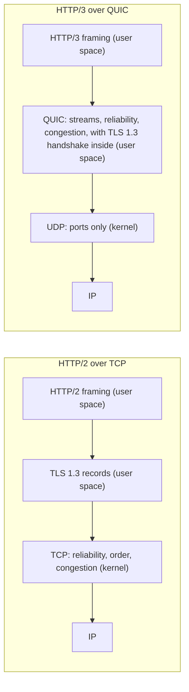
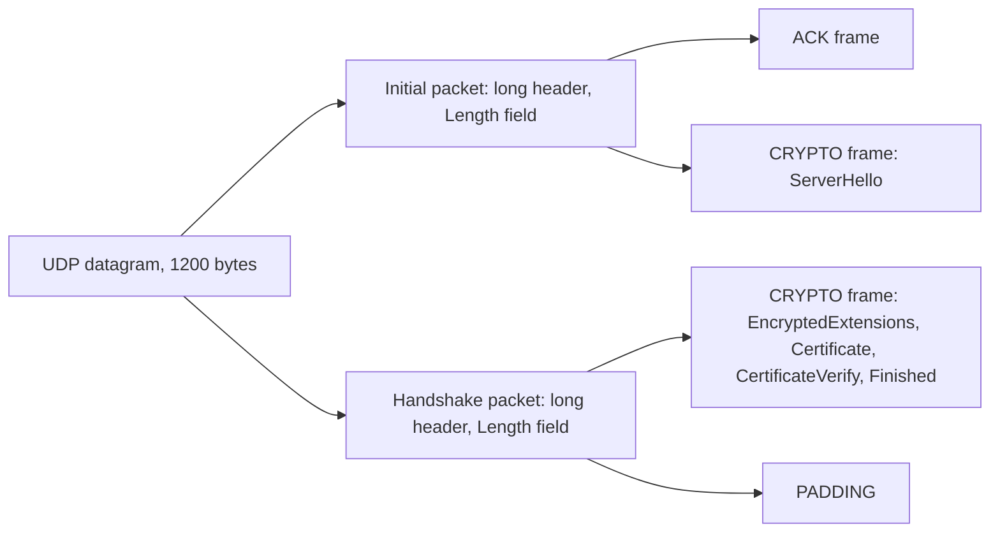
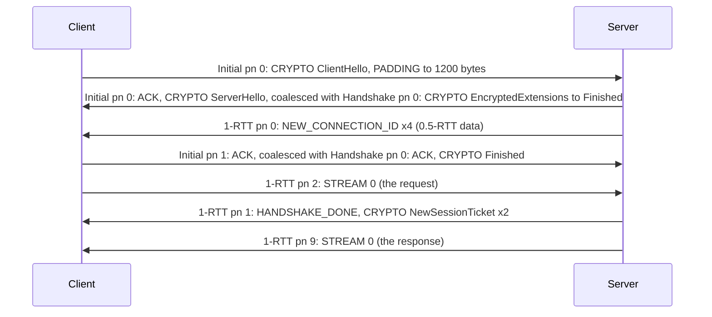
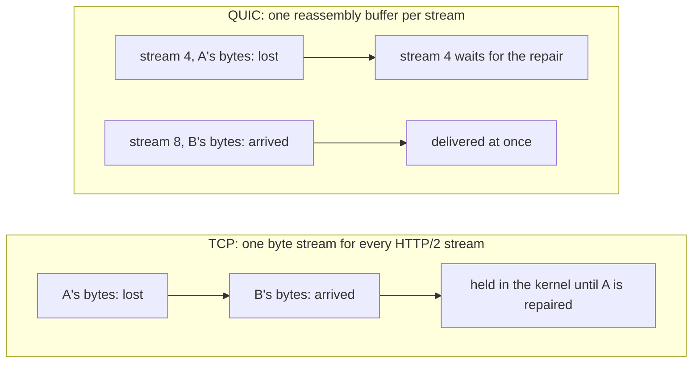
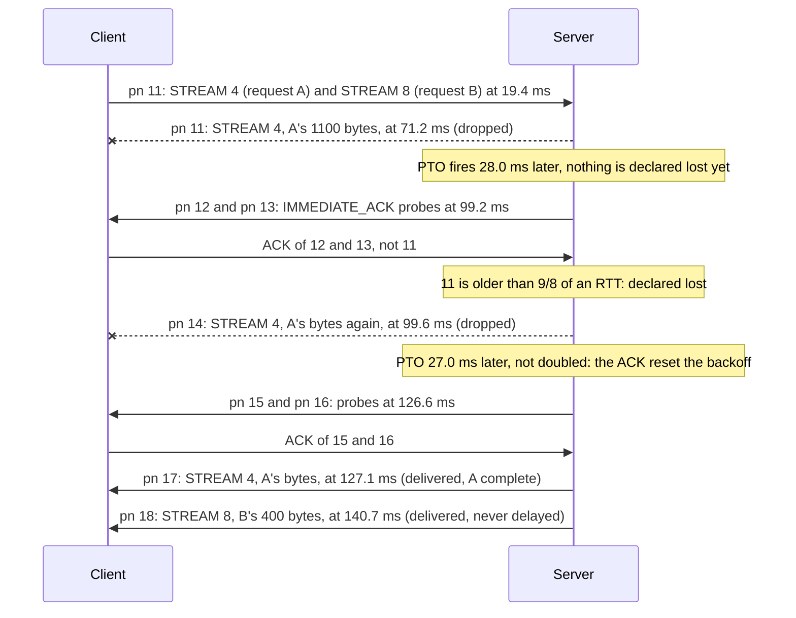
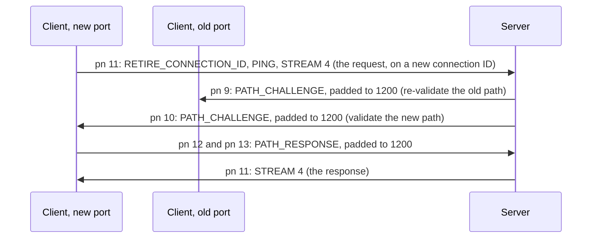
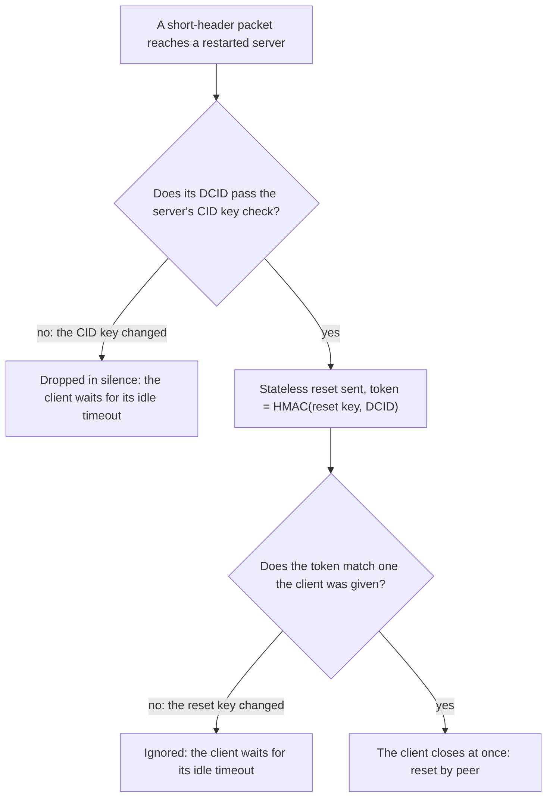
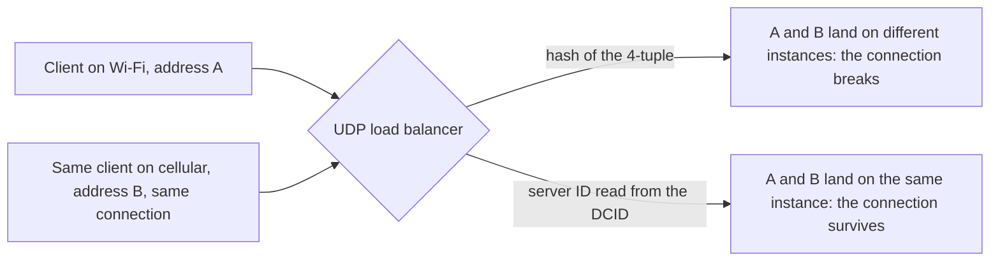

<!-- markdownlint-disable MD001 -->
<!-- markdownlint-disable MD024 -->
<!-- markdownlint-disable MD025 -->
<!-- markdownlint-disable MD026 -->
<!-- markdownlint-disable MD029 -->
<!-- markdownlint-disable MD033 -->
<!-- markdownlint-disable MD036 -->
<!-- markdownlint-disable MD040 -->
<!-- markdownlint-disable MD056 -->
<!-- markdownlint-disable MD060 -->

# H18. QUIC

---

## Contents

| #     | Sub-topic                                                                  | Tag  |
| ----- | -------------------------------------------------------------------------- | ---- |
| 18.01 | Why not fix TCP, and why UDP                                               | CORE |
| 18.02 | Packet structure: headers, connection IDs, packet numbers, frames, varints | DEEP |
| 18.03 | The handshake: TLS 1.3 inside QUIC, 1-RTT and 0-RTT                        | CORE |
| 18.04 | Streams as a transport feature                                             | CORE |
| 18.05 | Loss detection, probe timeouts, and congestion control                     | DEEP |
| 18.06 | Flow control at stream and connection level                                | DEEP |
| 18.07 | Connection migration and path validation                                   | CORE |
| 18.08 | Security of the transport: header protection, 3x, Retry, stateless reset   | DEEP |
| 18.09 | Operational realities: UDP blocking, CPU, GSO, load balancers              | DEEP |
| 18.10 | The story: a mobile API moves to QUIC                                      | CORE |
| 18.11 | Labs: a hand-written QUIC client in Java, and `quinn` in Rust              | CORE |
| 18.12 | Exercises                                                                  |      |
| 18.13 | Solutions                                                                  |      |
| 18.14 | Takeaways                                                                  |      |

Tags: **CORE** is what an architect is expected to explain unprompted, **DEEP** is the mechanism underneath it, **AWARE** is a fact to know exists and not to derive.

Terms used throughout.  
Each is defined here, before any section uses it.  
Terms from H01 to H17 (TCP, segment, RTT, congestion window, TLS 1.3, handshake, ALPN, SNI, AEAD, HKDF, stream, HOL blocking) keep their meaning.

- **UDP** (H02): a transport that moves single datagrams between ports, with no connection, no ordering, no retransmission and no congestion control.  
  A **datagram** is one UDP payload; it arrives whole or not at all.

- **Endpoint**: the client or the server of a QUIC connection.  
  QUIC runs inside each endpoint's process, not in the kernel; the kernel only sees UDP.

- **QUIC packet**: one encrypted unit inside a datagram.  
  Several packets may share one datagram (**coalescing**, 18.02).  
  A **frame** is the unit inside a packet's decrypted payload: a type number followed by type-specific fields, such as STREAM (application bytes), ACK (acknowledgements) or CRYPTO (TLS handshake bytes).

- **Connection ID (CID)**: an opaque string of 0 to 20 bytes that names a connection.  
  Each endpoint chooses the IDs by which *it* wants to be addressed; the peer copies one into the Destination Connection ID field of every packet it sends.  
  Because the connection is found by its ID and not by addresses and ports, it can survive an address change (18.07).

- **4-tuple**: source IP, source port, destination IP, destination port. TCP identifies a connection by its 4-tuple; QUIC does not.

- **Packet number (PN)**: a counter carried in every packet, incremented for every packet sent and never reused, even when the packet's contents are sent again (18.05).  
  There are three independent **packet number spaces**: Initial, Handshake, and application data.

- **Encryption level**: which keys protect a packet. QUIC has four: Initial, 0-RTT, Handshake, and 1-RTT (18.03).

- **Ack-eliciting packet**: a packet that contains any frame other than ACK, PADDING or CONNECTION_CLOSE.  
  The receiver must acknowledge it, which is what lets the sender detect its loss.

- **Probe timeout (PTO)**: QUIC's timer for "an ack-eliciting packet should have been acknowledged by now".  
  When it fires, the sender sends one or two **probe** packets to provoke an acknowledgement (18.05).  
  It plays the role of TCP's retransmission timeout (RTO, H04) but does not itself declare anything lost.

- **Flow-control credit**: the number of bytes a receiver allows its peer to send, raised over time with MAX_DATA and MAX_STREAM_DATA frames (18.06).

- **Middlebox**: any device on the path that inspects or changes traffic beyond plain IP routing: NATs, firewalls, load balancers, intrusion detection, "TCP accelerators".

- **Ossification**: a protocol losing the ability to change because middleboxes have come to depend on its current wire image and drop anything different.

- **GREASE**: sending random, reserved, meaningless values on purpose (in versions, transport parameters, header bits),  
  so that any peer or middlebox that rejects unknown values breaks immediately in testing instead of years later. H15 met the same idea in TLS.

- **Amplification attack**: an attacker sends a small packet with the victim's address forged as the source;  
  if the server's reply is larger, the attacker has turned the server into a traffic multiplier aimed at the victim.  
  **Address validation** is proof that a peer really receives packets at the address it claims (18.08).

- **NAT rebinding**: a NAT silently changing the public address or port it maps a flow to, typically after the flow is idle for a while.  
  To TCP this kills the connection; to QUIC it is a migration (18.07).

- **0.5-RTT data**: application data a server sends with 1-RTT keys after sending its handshake flight but before it has the client's Finished (18.03).

- **`quinn`**: the Rust QUIC implementation used in the labs (`quinn` 0.11.12 on `quinn-proto` 0.11.19, TLS from `rustls` 0.23.46).

- **GSO and GRO** (Generic Segmentation and Receive Offload): kernel features that let one system call send or receive many UDP datagrams of the same size,  
  so a user-space transport does not pay one system call per packet (18.09).

Outputs in this module are real.  
They come from `QuicWire.java`, a hand-written QUIC client in plain JDK 21 code (no QUIC or TLS library, about 440 lines) that builds an Initial packet byte by byte,  
runs a real TLS 1.3 key exchange with a `quinn` server and decrypts everything the server sends; from a `quinn` server,  
client, path emulator and benchmark (about 360 lines of Rust); and from captures decrypted by `tshark` 4.2.2 with a TLS key log.  

Run on Linux 6.18, JDK 21.0.12, Rust 1.97, `tokio` 1.54, `tcpdump` 4.99.4 and `iptables` 1.8.10, on one machine with four cores.  
Loopback timings differ on every run, and the text says when a number is run-dependent.  
This sandbox has no `netem`, so the round-trip, bandwidth and random-loss experiments run through a small user-space relay (Lab 08) instead of a kernel queueing discipline.  
What was read in the source this session: RFC 9000 (QUIC transport) sections on packet formats, frames, address validation, migration, stateless reset and transport parameters;  
RFC 9001 (QUIC-TLS) sections 4, 5 and 8 and Appendix A;  
RFC 9002 (recovery) sections 5 to 7; RFC 8999 (invariants);  
and the `quinn-proto` 0.11.19 source for its anti-amplification check, PTO probes, stateless reset, connection-ID generator, supported versions, transport parameter order, and BBR status.  
History, deployment figures, kernel version numbers for GSO and GRO, and the QUIC-LB and version-2 documents were **not** read this session: statements about them are from memory and marked as such.

---

## 18.01 Why not fix TCP, and why UDP

Four things are wrong with TCP for a modern web transport, and none can be fixed in place.  
Its loss recovery delivers bytes strictly in order, so multiplexed streams block each other (H17 Lab 13).  
Its handshake and TLS's handshake are separate, costing two round trips before the first request byte on a new connection.  
It lives in operating-system kernels, so changing it means upgrading billions of devices.  
And middleboxes inspect and rewrite TCP headers, so even changes the kernels do ship tend to break on real paths.  
QUIC moves the transport into the application process, encrypts nearly everything middleboxes could inspect, merges the transport and TLS handshakes,  
and runs on UDP because UDP is the only other transport that passes through NATs and firewalls nearly everywhere.

### The four problems

- **Head-of-line blocking in the transport.** TCP's contract is one ordered byte stream.  
  A lost segment holds every later byte in the receiver's kernel until the repair arrives, whichever HTTP/2 stream those bytes belong to.  
  H17 Lab 13 measured B waiting 206 ms behind A's lost packet and lost repair.  
  A transport that knew about streams could deliver B at once; TCP cannot know.

- **Handshake round trips.** A new HTTPS connection over TCP needs one round trip for TCP's SYN and SYN-ACK and at least one more for TLS 1.3 before the request can be sent (H15).  
  QUIC's first flight is both the transport and the TLS handshake, so the request goes out after one round trip, or in the first flight with 0-RTT on a resumed connection (18.03).

- **Kernel deployment speed.** TCP is implemented by every operating system's kernel.  
  A change to its loss recovery or congestion control reaches users only when their operating system updates, which for phones and embedded devices can be never.  
  A transport in user space ships with the application, as often as the application ships.

- **Middlebox ossification.** Because TCP headers are in clear text, middleboxes learned to parse and rewrite them, and many drop segments with options or flag combinations they do not recognise.  
  From memory, not re-read this session: TCP Fast Open and Multipath TCP both ran into exactly this, with real paths stripping the new options or dropping the packets carrying them.  
  QUIC's answer is to encrypt or authenticate almost all of its header (18.08), so there is nothing to ossify except the small, deliberately version-independent part that RFC 8999 freezes.

### Why UDP, and what QUIC keeps from TCP

UDP adds an 8-byte header with ports and a checksum and nothing else, so it costs nothing to build on and gives middleboxes nothing to interfere with beyond the port numbers.  
Everything TCP did is rebuilt inside QUIC: connection setup, reliability, ordering (per stream), flow control and congestion control.  
RFC 9002's congestion controller is TCP NewReno's logic re-expressed for QUIC packets (18.05);  
the novelty is not in the algorithms but in where they run and what they can see.



RFC 8999 says what every future QUIC version must keep: in its words, it "describes the subset of QUIC that is intended to remain stable as new versions are developed and deployed".  
That subset is the first byte's top bit (long or short header), the version field and the connection-ID fields of the long header, the connection ID of the short header, and Version Negotiation.  
RFC 8999 then lists assumptions that must **not** be built into middleboxes, starting with "QUIC uses TLS and some TLS messages are visible on the wire" and "QUIC long headers are only exchanged during connection establishment".  
Both are true of version 1 and both are declared changeable.

### Interview angle

"Why didn't they just fix TCP?" has a four-part answer: HOL blocking is in TCP's contract, not its implementation;  
a merged transport and crypto handshake needs both in one place; kernels update too slowly; middleboxes ossify anything visible.  
"Why UDP and not a new IP protocol number?" Because NATs and firewalls drop protocols they do not know (from memory: SCTP is the standing example), and UDP traverses them.  
The follow-up an architect should volunteer: QUIC's cost is CPU (it does in user space what the kernel and the network card did for TCP, measured in Lab 13)  
and networks that block or throttle UDP (18.09), which is why every HTTP/3 client keeps an HTTP/2 fallback.

---

## 18.02 Packet structure: headers, connection IDs, packet numbers, frames, varints

A UDP datagram carries one or more QUIC packets.  
Each packet has a header and an encrypted payload, and the payload is a sequence of frames.  
There are two header forms. The **long header**, used during the handshake, carries a version and both connection IDs explicitly.  
The **short header**, used for all application data afterwards, carries only one byte of flags, the destination connection ID and a truncated packet number.  
Every integer in QUIC is a **variable-length integer**: the top two bits of its first byte say whether it is 1, 2, 4 or 8 bytes long.

### The two headers

RFC 9000 section 17 defines the layouts. Bit widths in parentheses; `(i)` is a variable-length integer.

```text
Initial Packet {                               1-RTT Packet {
  Header Form (1) = 1,                           Header Form (1) = 0,
  Fixed Bit (1) = 1,                             Fixed Bit (1) = 1,
  Long Packet Type (2) = 0,                      Spin Bit (1),
  Reserved Bits (2),                             Reserved Bits (2),
  Packet Number Length (2),                      Key Phase (1),
  Version (32),                                  Packet Number Length (2),
  Destination Connection ID Length (8),          Destination Connection ID (0..160),
  Destination Connection ID (0..160),            Packet Number (8..32),
  Source Connection ID Length (8),               Packet Payload (8..),
  Source Connection ID (0..160),               }
  Token Length (i),
  Token (..),
  Length (i),
  Packet Number (8..32),
  Packet Payload (8..),
}
```

The long packet types are Initial (0), 0-RTT (1), Handshake (2) and Retry (3).  
Version Negotiation is a long header with version 0.  
The short header has no length field and no source connection ID: the receiver already knows its own CID length, and the packet runs to the end of the datagram,  
so a short-header packet is always the last one in its datagram.  
The low bits of the first byte (reserved bits and packet-number length, plus the key phase in the short header) are encrypted by header protection (18.08),  
so a middlebox cannot even read how long the packet number is.

Lab 01 builds the RFC 9001 Appendix A client Initial and gets the RFC's bytes. Before protection its header is:

```text
c3            first byte: long header, fixed bit, type 0 (Initial), packet number length 4
00000001      version 1
08 8394c8f03e515708   DCID length 8, DCID (chosen by the client, random)
00            SCID length 0
00            token length 0 (no Retry token)
449e          Length: 0x449e has prefix 01, so a 2-byte varint: 0x049e = 1182 (4 PN + 1162 payload + 16 tag)
00000002      packet number 2
```

After protection the first byte is `c0` and the packet-number bytes are `7b9aec34`: same packet, unreadable to anyone without the Initial keys.

### Connection IDs

Each endpoint picks the CIDs that its peer must use to reach it.  
The client's first Initial carries a random DCID of at least 8 bytes (only used until the server picks its own) and the client's own SCID;  
the server replies with its SCID, and from then on each side sends to the other's chosen ID.  
More IDs are issued with NEW_CONNECTION_ID frames and retired with RETIRE_CONNECTION_ID, so a client can change IDs when it changes networks and not be linkable across them (18.07).  
A server is free to encode routing information in the IDs it issues, which is what lets a load balancer find the right server without looking at addresses (18.09).  
In Lab 02 the server sent the Java client exactly one extra ID; in Lab 03 it sent the `quinn` client four.  
The difference is the client's `active_connection_id_limit` transport parameter: `quinn` sends 5, the Java client sends none,  
and RFC 9000 says "If this transport parameter is absent, a default of 2 is assumed".

### Packet numbers and packet number spaces

Packet numbers start at 0 in each of three spaces (Initial, Handshake, application data) and only go up.  
A packet is never resent: its frames are, in a new packet with a new number (18.05).  
On the wire the number is truncated to 1 to 4 bytes and the receiver reconstructs it from the largest number it has seen.  
The traces in Lab 03 show three independent counters during the handshake: the server's Initial is `pn=0`, its Handshake packet in the same datagram is also `pn=0`, and its first 1-RTT packet is `pn=0` again.

### Frames

A packet's payload is a list of frames, each a varint type followed by its fields.  
The ones this module meets, from RFC 9000's frame table (the Pkts column lists the packet types a frame may appear in: I = Initial, H = Handshake, 0 = 0-RTT, 1 = 1-RTT):

| Type        | Frame                                   | Pkts | Purpose                                                      |
| ----------- | --------------------------------------- | ---- | ------------------------------------------------------------ |
| 0x00        | PADDING                                 | IH01 | fill, to reach 1200 bytes or hide sizes                      |
| 0x01        | PING                                    | IH01 | ack-eliciting, carries nothing                               |
| 0x02, 0x03  | ACK                                     | IH1  | acknowledge ranges of packet numbers (0x03 adds ECN counts)  |
| 0x04, 0x05  | RESET_STREAM, STOP_SENDING              | 01   | abandon one stream in one direction                          |
| 0x06        | CRYPTO                                  | IH1  | TLS handshake bytes at an offset (18.03)                     |
| 0x07        | NEW_TOKEN                               | 1    | a token for the client's next connection (18.08)             |
| 0x08 - 0x0f | STREAM                                  | 01   | application bytes: stream ID, offset, length, FIN bit        |
| 0x10, 0x11  | MAX_DATA, MAX_STREAM_DATA               | 01   | flow-control credit (18.06)                                  |
| 0x12, 0x13  | MAX_STREAMS                             | 01   | how many streams the peer may open                           |
| 0x14, 0x15  | DATA_BLOCKED, STREAM_DATA_BLOCKED       | 01   | "I have data but no credit"                                  |
| 0x18, 0x19  | NEW_CONNECTION_ID, RETIRE_CONNECTION_ID | 01   | issue and retire CIDs (18.07)                                |
| 0x1a        | PATH_CHALLENGE                          | 01   | path validation: "echo these 8 bytes" (18.07)                |
| 0x1b        | PATH_RESPONSE                           | 1    | the echo                                                     |
| 0x1c, 0x1d  | CONNECTION_CLOSE                        | IH01 | close; only the transport-error form 0x1c in I and H packets |
| 0x1e        | HANDSHAKE_DONE                          | 1    | server confirms the handshake (18.03)                        |

The traces also show two frames from an extension, not RFC 9000: IMMEDIATE_ACK (type 0x1f) and ACK_FREQUENCY (0xaf), from the IETF ack-frequency draft. `quinn` uses IMMEDIATE_ACK in its probes;  
the type numbers here were read in `quinn-proto`'s frame table, and the draft itself was not read this session.

### Variable-length integers

The two most significant bits of the first byte give the length: `00` is 1 byte (6-bit value), `01` is 2 bytes (14 bits), `10` is 4 bytes (30 bits), `11` is 8 bytes (62 bits).  
RFC 9000's own examples, decoded by Lab 01: `0x25` is 37, `0x4025` is also 37 (a value may be encoded longer than necessary), `0x7bbd` is 15,293, `0x9d7f3e7d` is 494,878,333, and `0xc2197c5eff14e88c` is 151,288,809,941,952,652.  
The largest value, 2^62 - 1 = 4,611,686,018,427,387,903, appears in Lab 02 as the `quinn` server's `initial_max_data`: "no connection-level limit".

### Coalescing

Packets at different encryption levels can share one datagram, each long-header packet's Length field saying where the next begins.  
The server's first datagram in Lab 03 is one 1200-byte datagram holding an Initial packet (ACK and ServerHello) and a Handshake packet (the rest of the server's TLS flight).  
Coalescing saves datagrams during the handshake, when every round trip counts.



### Interview angle

Know the two headers by heart: long header during the handshake (version and both CIDs visible), short header afterwards (one flag byte, DCID, packet number, everything else encrypted).  
Know that the connection is identified by a CID the *receiver* chose, which is what makes migration and CID-based load balancing possible.  
And know that packet numbers are never reused, which matters in 18.05.

---

## 18.03 The handshake: TLS 1.3 inside QUIC, 1-RTT and 0-RTT

QUIC runs the TLS 1.3 handshake of H15 unchanged, but without TLS records: the handshake messages travel in CRYPTO frames inside QUIC packets,  
and TLS hands QUIC the secrets it derives instead of encrypting anything itself.  

Each stage of TLS's key schedule becomes a QUIC encryption level with its own packet type:  
Initial packets carry the ClientHello and ServerHello under keys derived from the client's first Destination Connection ID (keys anyone can compute, so they protect against tampering by off-path parties, not against observers),  
Handshake packets carry the rest of the TLS flight, and 1-RTT packets carry application data.  

The client can send its first request after one round trip. With a session ticket from an earlier connection it can send it in its very first flight as 0-RTT data, which an attacker can replay.

### Encryption levels, packet types and packet number spaces

| Encryption level | Packet type      | Keys come from                                 | PN space         | Carries                               |
| ---------------- | ---------------- | ---------------------------------------------- | ---------------- | ------------------------------------- |
| Initial          | Initial (long)   | a public salt and the client's first DCID      | Initial          | ClientHello, ServerHello, ACKs        |
| 0-RTT            | 0-RTT (long)     | the resumption secret of an earlier connection | application data | early requests from the client only   |
| Handshake        | Handshake (long) | TLS handshake traffic secrets (after ECDHE)    | Handshake        | EncryptedExtensions to Finished, ACKs |
| 1-RTT            | 1-RTT (short)    | TLS application traffic secrets                | application data | all application data, both directions |

The Initial keys are not secret, by design.  
RFC 9001 derives them with HKDF from a fixed, published salt (`38762cf7f55934b34d179ae6a4c80cadccbb7f0a` for version 1) and the client's DCID, which travels in clear.  
Lab 01 computes RFC 9001 Appendix A's keys from DCID `8394c8f03e515708` and matches every byte; Lab 02 uses the same code to decrypt a live `quinn` server's Initial.  
What Initial protection buys: a middlebox that does not implement this exact version cannot read or rewrite the ClientHello,  
an off-path attacker who has not seen the DCID cannot forge a server Initial, and every packet is integrity-checked.  

It does not hide the ClientHello (including SNI) from anyone who captures the first packet.  
Only the Handshake and 1-RTT keys come from the X25519 exchange and are secret.

### What changes in TLS when it runs inside QUIC

- **No records.** TLS messages are written into CRYPTO frames, each carrying an offset and a length, so QUIC can retransmit and reorder them like stream data.  
  Lab 02 reassembles the server's 732 bytes of Handshake-level messages from the CRYPTO frame in its first datagram.

- **Transport parameters in TLS.** Each side's QUIC settings (idle timeout, flow-control limits,  
  CID limit, its own source CID, and more) travel in a TLS extension, `quic_transport_parameters` (0x39), so they are covered by the handshake's integrity checks.  
  Lab 02 prints the 16 parameters a `quinn` server sent, including a GREASE parameter whose ID has the reserved form 31 * N + 27;  
  `quinn` also shuffles their order on every connection (read in its source: `write_order` is shuffled),  
  which is why Lab 02 and Lab 04 list them differently.

- **ALPN is mandatory.** RFC 9001 section 8.1: "Unless another mechanism is used for agreeing on an application protocol, endpoints MUST use ALPN", and a connection with no agreed protocol is closed.  
  A QUIC connection always knows what it carries (`h3` for HTTP/3, `h18` in these labs).

- **No middlebox compatibility mode.** TLS 1.3 over TCP can dress itself as TLS 1.2 resumption to get through old middleboxes (H15).  
  Inside QUIC there are no such middleboxes to fool, and RFC 9001 section 8.4 says "A client MUST NOT request the use of the TLS 1.3 compatibility mode", so the ClientHello's legacy session ID is empty.  
  `QuicWire.java` sends it empty.

- **No EndOfEarlyData** message: QUIC knows where 0-RTT data ends from the packet types.

### The 1-RTT handshake, as captured

The trace in Lab 03 is a complete `quinn` connection on loopback, decrypted by `tshark`:



Three details in that trace are worth knowing:

- The server sends 1-RTT packets (`pn=0`, four NEW_CONNECTION_ID frames) right after its handshake flight, before it has the client's Finished.  
  That is **0.5-RTT data**: the server has its application keys as soon as it has sent its own Finished.

- The client sends its request (`STREAM(id 0, ...)`, line 10 of the trace) before it receives HANDSHAKE_DONE.  
  A client may send application data once *it* considers the handshake **complete** (it has verified the server's Finished and sent its own).  
    HANDSHAKE_DONE makes the handshake **confirmed**, after which both sides discard their Initial and Handshake keys.

- The client pads its Initial datagram to 1200 bytes (the RFC requires it, so the server's anti-amplification budget is at least 3600 bytes, 18.08), and `quinn`'s server pads its Initial-carrying datagram too.

### 0-RTT

On a resumed connection the client sends its ClientHello with a pre-shared key from an earlier NewSessionTicket, and can send application data in 0-RTT packets in the same first flight.  
Lab 11's trace shows exactly that: the second connection's first datagram coalesces an Initial (ClientHello)  
and a 0-RTT packet (`STREAM(id 0, offset 0, 9 bytes, FIN)`), and the server's Handshake flight is only EncryptedExtensions and Finished, because a resumption needs no certificate.

Two constraints decide whether 0-RTT is worth anything:

- **Replay.** 0-RTT data is encrypted under keys derived from the ticket alone, with no fresh contribution from the server, so an attacker who captures that first flight can send it again and the server may process it twice.  
  RFC 9001 states it plainly: "This application data can be replayed by an attacker, so 0-RTT is not suitable for carrying instructions that might initiate any action that could cause unwanted effects if replayed."  
  The rule from H15 and R2 applies unchanged: only idempotent requests in 0-RTT, and servers that accept it need replay defences or must treat early requests as replayable.

- **The server must act on it.** Lab 11 measured it over a 40 ms round trip.  
  With `quinn`'s default server behaviour (accept a connection only when its handshake completes) the 0-RTT request took 87.7 ms, no faster than the 88.8 ms of a full handshake followed by a request:  
  the server had the request after 20 ms but did not process it until the client's Finished arrived, one round trip later.  
  With the server set to process early data at once (`quinn`'s `into_0rtt()` on the server side, `early=1` in the lab), the same request took 45.7 ms, one round trip saved.  
  0-RTT support in a client means nothing unless the server, or the proxy terminating QUIC, is configured to use it.

### Interview angle

"How many round trips to the first response?" TCP plus TLS 1.3: two before the request is sent, so the response arrives after three.  
QUIC: one before the request, response after two.  
QUIC with 0-RTT: the request is in the first flight, response after one, if the server processes early data.  
Then name the price of 0-RTT (replay, so idempotent requests only) and the fact that Initial packets are encrypted but not confidential: anyone can derive their keys from the first packet.

---

## 18.04 Streams as a transport feature

A QUIC connection carries many streams, each an ordered byte sequence of its own, delivered to the application independently of every other stream.  
Loss on one stream stalls only that stream, because the receiver reassembles each stream by its own offsets and does not hold back other streams' bytes.  
Streams are cheap (no handshake, opened by sending a STREAM frame), come in four types encoded in the low two bits of the stream ID, and are limited in number by the peer's MAX_STREAMS credit.  
This is the fix for H17's transport head-of-line blocking, measured in Lab 06.

### Stream IDs

A stream ID is a varint whose two low bits give its type; the rest is a counter.  
From RFC 9000 section 2.1:

| Low bits | Type                             | IDs used in order |
| -------- | -------------------------------- | ----------------- |
| 0x00     | client-initiated, bidirectional  | 0, 4, 8, ...      |
| 0x01     | server-initiated, bidirectional  | 1, 5, 9, ...      |
| 0x02     | client-initiated, unidirectional | 2, 6, 10, ...     |
| 0x03     | server-initiated, unidirectional | 3, 7, 11, ...     |

The traces show the client opening streams 0, 4 and 8.  
A stream is opened implicitly by the first frame that names it, closed in each direction by the FIN bit of its last STREAM frame,  
and either side can abandon it with RESET_STREAM (stop sending) or STOP_SENDING (ask the peer to stop) without touching any other stream.  
HTTP/3 (H19) uses one bidirectional stream per request and a few unidirectional streams for control.

### Why one lost packet no longer stalls everything

Each STREAM frame carries its stream ID and the offset of its bytes within that stream.  
The receiver keeps one reassembly buffer per stream, so a gap in stream 4 is a gap in stream 4 only; bytes for stream 8 that arrive after the lost packet are delivered at once.  
Lab 06 repeats H17 Lab 13's experiment on QUIC: two requests on one connection,  
A (50 ms of server work, 1100 bytes) and B (120 ms, 400 bytes), with the first N copies of A's response datagram dropped.

| A's datagram dropped | A complete | B complete | Server's `lost_packets` |
| -------------------- | ---------- | ---------- | ----------------------- |
| 0 times              | 52.0 ms    | 122.3 ms   | 0                       |
| 1                    | 80.2 ms    | 122.6 ms   | 1                       |
| 2                    | 107.9 ms   | 121.7 ms   | 2                       |
| 3                    | 121.9 ms   | 121.8 ms   | 3                       |
| 4                    | 150.3 ms   | 121.6 ms   | 4                       |
| 5                    | 178.0 ms   | 121.6 ms   | 5                       |



B finishes at about 122 ms whatever happens to A.  
In H17 Lab 13, with the same A and B over HTTP/2 on TCP, two drops of A's packet moved B from 157 ms to 360 ms.  
Each lost copy of A costs A about 28 ms, which is one probe timeout (18.05), and the three-drop row is faster than the trend for a reason 18.05 explains: B's own packet at 120 ms is what revealed A's third loss.

### What streams do not fix

- **Order within a stream.** A stream is still an ordered byte sequence: a lost packet stalls the rest of *its own* stream.
- **Shared state above the transport.** Anything that ties streams together reintroduces blocking.  
  HTTP/2's HPACK assumed in-order delivery across streams, which is why HTTP/3 needed QPACK (H19).
- **Shared resources.** All streams share one congestion window and one connection-level flow-control limit (18.06), so a stream that consumes them slows the others, just not by blocking delivery.

### Interview angle

"Does HTTP/3 remove head-of-line blocking?" It removes the transport kind: a lost packet delays only the streams whose bytes it carried.  
It keeps HOL blocking inside each stream, and shared state (header compression, flow control, congestion) still couples streams.  
Quote the measurement: same experiment, HTTP/2 over TCP held B for 200 ms, QUIC held it for zero.

---

## 18.05 Loss detection, probe timeouts, and congestion control

QUIC never retransmits a packet; it retransmits *frames* in a new packet with a new packet number.  
That one change removes TCP's retransmission ambiguity: every acknowledgement names exactly which packet arrived, so every RTT sample is exact.  

ACK frames list ranges of packet numbers, and a sender declares a packet lost when a later packet has been acknowledged and  
either that packet's number is at least three higher (packet threshold) or 9/8 of an RTT has passed since the lost one was sent (time threshold).  

When nothing is acknowledged at all, a probe timeout sends probes to provoke an ACK.  
Congestion control is RFC 9002's NewReno-style default or any other algorithm the implementation chooses, because it runs in the application: `quinn` ships NewReno, CUBIC and an experimental BBR, selectable per connection (Lab 08).

### Acknowledgements without ambiguity

TCP numbers bytes, and a retransmitted segment carries the same sequence numbers as the original, so when an ACK arrives the sender cannot tell which copy it acknowledges (from memory: the problem Karn's algorithm works around by discarding such RTT samples).  
QUIC numbers packets, never reuses a number, and puts the retransmitted STREAM bytes in a packet with a fresh number.  
In Lab 07 A's 1100 bytes were sent three times, as packets 11, 14 and 17, each `STREAM(id 4, offset 0, 1100 bytes, FIN)`: same stream bytes, three different packets.  
An ACK frame carries the largest packet number acknowledged, an ACK Delay field (how long the receiver deliberately waited before acknowledging, so the sender can subtract it from the RTT sample), and a list of acknowledged ranges, as many as fit in the packet.  
TCP's SACK option has room for only a few blocks (from memory: three or four, depending on other options).

### When a packet is declared lost

RFC 9002 section 6.1: a packet is lost if it is unacknowledged, a packet sent after it has been acknowledged, and either

- it was sent `kPacketThreshold` packets before an acknowledged packet ("The RECOMMENDED initial value for the packet reordering threshold (kPacketThreshold) is 3", the same reasoning as TCP's three duplicate ACKs), or
- it was sent long enough ago: `max(kTimeThreshold * max(smoothed_rtt, latest_rtt), kGranularity)`, with kTimeThreshold 9/8 and kGranularity 1 ms.

If no acknowledgement comes at all, the **probe timeout** fires:

```text
PTO = smoothed_rtt + max(4*rttvar, kGranularity) + max_ack_delay
```

`max_ack_delay` is the peer's promise about how long it may delay an ACK (a transport parameter; RFC 9000 says "If this value is absent, a default of 25 milliseconds is assumed").  
During the handshake the RTT is unknown, so RFC 9002 starts from kInitialRtt, "the initial RTT SHOULD be set to 333 milliseconds", with rttvar half of that, and sets max_ack_delay to 0 for the Initial and Handshake spaces: 333 + 4 x 166.5 = 999 ms.  
Lab 02 shows it: the Java client never acknowledged anything, and the server's first probes left at 1002.7 ms and 1004.1 ms.  
On expiry "the PTO backoff MUST be increased, resulting in the PTO period being set to twice its current value", and "The PTO backoff factor is reset when an acknowledgment is received" (with an exception for a client during the handshake).  
A PTO declares nothing lost; it only sends one or two ack-eliciting probes so that the next ACK lets the ordinary rules decide.

### One loss, followed packet by packet

Lab 07 is Lab 06's two-drop case, captured and decrypted.  
A's response is dropped twice; B's is never touched.  
(The capture sees packets before `iptables` drops them, so dropped packets appear in it.)



Each probe timeout is about 28 ms: a loopback smoothed RTT well under a millisecond, plus 4 x rttvar, plus `quinn`'s 25 ms max_ack_delay.  
That is why each extra drop in Lab 06 added about 28 ms to A and nothing to B. The three-drop row of Lab 06 is the time threshold at work:  
A's third copy was lost at about 108 ms, B's packet went out at 120 ms and was acknowledged, and that ACK made A's third copy older than 9/8 of an RTT,  
so it was declared lost and resent at once instead of waiting for the next probe timeout at about 136 ms.  

A packet on *another* stream helped A recover; on TCP the same packet would have been stuck behind A.  
Compare H17 Lab 13 on TCP: after the fast retransmission was also lost, the next repair waited for a 200 ms retransmission timeout.  
RFC 9002 has no such floor: the minimum is kGranularity, 1 ms.

### Congestion control in user space

RFC 9002's congestion controller is NewReno-like: slow start from an initial window of "ten times the maximum datagram size (max_datagram_size),  
while limiting the window to the larger of 14,720 bytes or twice the maximum datagram size" (12,000 bytes at the minimum 1200-byte datagram size),  
halving on a loss event, additive increase afterwards, and a collapse to the minimum window on **persistent congestion**:  
every packet lost over a period of three PTO lengths ("The RECOMMENDED value for kPersistentCongestionThreshold is 3").  

Because the controller is application code, an implementation can offer any algorithm and choose per connection.  
`quinn` offers NewReno, CUBIC and BBR, and its source marks BBR "Experimental! Use at your own risk."

Lab 08 measures all three through the lab's path emulator: 20 ms each way (40 ms round trip), a 50 Mbit/s bottleneck with a 100-packet drop-tail queue,  
a 5 MB download, with and without 1% random loss in each direction.

| Controller | Random loss | Time      | Throughput | Dropped by the full queue | Dropped at random (to server, to client) | Server `lost_packets` |
| ---------- | ----------- | --------- | ---------- | ------------------------- | ---------------------------------------- | --------------------- |
| CUBIC      | 0%          | 1033.5 ms | 39 Mbit/s  | 548                       | 0, 0                                     | 548                   |
| CUBIC      | 1%          | 12044 ms  | 3 Mbit/s   | 0                         | 14, 36                                   | 36                    |
| NewReno    | 0%          | 1156.5 ms | 35 Mbit/s  | 321                       | 0, 0                                     | 321                   |
| NewReno    | 1%          | 12328 ms  | 3 Mbit/s   | 0                         | 14, 35                                   | 35                    |
| BBR        | 0%          | 1005.1 ms | 40 Mbit/s  | 1785                      | 0, 0                                     | 1785                  |
| BBR        | 1%          | 1201.2 ms | 33 Mbit/s  | 1491                      | 10, 43                                   | 2028                  |

The packets dropped toward the server are the client's ACKs; an ACK frame repeats its ranges, so a lost ACK is covered by the next one and costs the sender nothing it counts as loss.

What the table says:

- **Without random loss** all three reach 35 to 40 Mbit/s of the 50 available over a 5 MB transfer, most of it spent ramping up.  
  Every loss is the queue overflowing, which is how a loss-based controller finds the bottleneck: it raises its rate until the queue drops something (548 packets for CUBIC here).

- **With 1% random loss** the loss-based controllers collapse to about 3.3 Mbit/s (5 MB in about 12 s).  
  They treat every loss as congestion and halve: 36 losses gave 36 congestion events.  
  From memory, the Mathis model for a Reno-like flow gives throughput of about (MSS / RTT) x 1.22 / sqrt(p) = (1452 x 8 bits / 0.040 s) x 1.22 / 0.1, about 3.5 Mbit/s, close to what was measured.  
  CUBIC does no better here because at this small bandwidth-delay product it runs in its Reno-friendly region (from memory).

- **BBR** models the bottleneck's bandwidth and the path's minimum RTT instead of reacting to loss, so 1% random loss barely moved it (33 Mbit/s).  
  The cost on this path is a third of its packets (without random loss) and a quarter (with it) dropped by the 100-packet queue: it keeps more data in flight than the queue holds.  
  With random loss the server counted 2028 packets lost while the relay dropped 1534 (1491 plus 43);  
  the difference is presumably packets declared lost by the time threshold while queueing delay swung (an inference, not traced).  
  This is `quinn`'s experimental BBR on one emulated path, not a verdict on BBR in general; from memory,  
  BBR version 1's high retransmission rate on shallow buffers is a widely reported property that later versions address.

### Interview angle

Explain why packet numbers make recovery cleaner than TCP (no ambiguity, exact RTT samples, unlimited ACK ranges),  
state the two loss rules (3 packets or 9/8 RTT) and what a PTO does (probe, not declare).  

Then the architect's point: congestion control moved from the kernel into the application, so it can be changed per deployment and per connection,  
and Lab 08 shows why that matters: on a path with random, non-congestion loss, the choice of controller changed throughput tenfold.

---

## 18.06 Flow control at stream and connection level

A QUIC receiver limits its peer twice: per stream with MAX_STREAM_DATA and for the whole connection with MAX_DATA,  
both expressed as an absolute byte offset the sender may not pass, plus a limit on how many streams the peer may open (MAX_STREAMS).  
Initial values travel in the transport parameters. A sender out of credit says so with STREAM_DATA_BLOCKED or DATA_BLOCKED.  
Because one round trip passes between granting credit and using it, a flow-control window caps throughput at window / RTT, regardless of bandwidth, which Lab 09 measures.

### How it works

- **Absolute offsets, not increments.** MAX_STREAM_DATA says "you may send up to byte N of this stream".  
  HTTP/2's WINDOW_UPDATE (H17) carries an increment; a lost or duplicated WINDOW_UPDATE would be a problem if TCP did not deliver it exactly once.  
  QUIC frames can be lost and resent, so an idempotent absolute limit is the safe encoding.

- **Two levels.** The stream limit stops one stream from consuming the receiver's buffer for that stream; the connection limit bounds the total across all streams.  
  The receiver raises them as the application reads.

- **One layer, not two.** HTTP/2 flow control sits on top of TCP's own receive window, so two independent controllers interact.  
  QUIC's flow control is the only one: the kernel's UDP socket buffer has none (a full buffer just drops datagrams, 18.09).

- **Initial values.** Lab 02's `quinn` server advertised 1,250,000 bytes per stream (`initial_max_stream_data_bidi_local`, `_bidi_remote` and `_uni`),  
  100 streams of each kind, and no connection-level limit at all (`initial_max_data` = 2^62 - 1).

### The window caps throughput

Lab 09 downloads 5 MB through the path emulator at 40 ms round trip and 200 Mbit/s, so bandwidth is not the limit,  
and varies only the client's stream receive window (`quinn`'s `stream_receive_window`; the connection window is set to four times it).

| Client stream window | Throughput | Ceiling, window / measured RTT       | Server's STREAM_DATA_BLOCKED | Client's MAX_STREAM_DATA |
| -------------------- | ---------- | ------------------------------------ | ---------------------------- | ------------------------ |
| 65,536 bytes         | 11 Mbit/s  | 65,536 x 8 / 42.8 ms = 12.3 Mbit/s   | 346                          | 365                      |
| 262,144 bytes        | 37 Mbit/s  | 262,144 x 8 / 43.7 ms = 48 Mbit/s    | 115                          | 120                      |
| 1,250,000 (default)  | 73 Mbit/s  | 1,250,000 x 8 / 47.1 ms = 212 Mbit/s | 22                           | 26                       |

With 64 KiB the transfer runs at over 90% of its ceiling and the server reports itself blocked 346 times: the window, not the network, set the speed.  
With larger windows the 5 MB transfer ends before slow start reaches the ceiling, so the measured rate is lower than the ceiling.  
The rule for sizing: a window smaller than the bandwidth-delay product (bandwidth x RTT) caps the connection;  
a window much larger lets one stream fill the receiver's memory, multiplied by the number of streams and connections the server holds.

### Interview angle

"Why is my QUIC or HTTP/2 download slow on a long path with plenty of bandwidth?"  
Check the receive windows against bandwidth x RTT before blaming congestion control: Lab 09's 64 KiB window gave 11 Mbit/s on a 200 Mbit/s path.  
Then the trade-off: windows are memory the receiver commits per stream and per connection, so a server facing many clients chooses windows from its memory budget,  
not from the fastest client's bandwidth.

---

## 18.07 Connection migration and path validation

Because a QUIC connection is found by its connection ID and not by the 4-tuple, a client whose address changes (a NAT rebinding,  
or a phone moving from Wi-Fi to cellular) can keep the connection: it simply sends from the new address.  

The server switches to the new address, then proves the client really owns it with PATH_CHALLENGE (8 random bytes the client must echo in PATH_RESPONSE, in datagrams padded to 1200 bytes),  
and also re-validates the old path in case the "migration" was an attacker forwarding copies.  

Until the new address is validated the anti-amplification limit applies to it.  
A migrating client switches to a fresh connection ID so that observers cannot link its old and new addresses.

### What Lab 10 shows

The `quinn` client asks the server "who am I", moves its endpoint to a new UDP socket (`Endpoint::rebind`, a new local port), and asks again:

```text
  before: local 127.0.0.1:32881  server sees 127.0.0.1:32881
  after:  local 127.0.0.1:46459  server sees 127.0.0.1:46459
  conn 10: client address changed 127.0.0.1:32881 -> 127.0.0.1:46459
```

The same connection, no new handshake.  
The decrypted trace (lines 26 to 32 of Lab 10's trace; `client*` and `server*` mark datagrams from and to the new port) shows the protocol:

- The client's first packet from the new port (`pn=11`) carries a RETIRE_CONNECTION_ID frame, a PING and the request: it has switched to a new connection ID and retired the old one.
- The server sends PATH_CHALLENGE twice, padded to 1200 bytes: `pn=9` to the **old** port and `pn=10` to the new one.  
  RFC 9000 section 9.3.3 requires the first: "In response to an apparent migration, endpoints MUST validate the previously active path using a PATH_CHALLENGE frame",  
  so that an attacker who forwarded copies of genuine packets from another address cannot steal the connection.
- The client answers with PATH_RESPONSE, also padded, and the server's response to the request follows.  
  The server's statistics count 2 PATH_CHALLENGE sent and 2 PATH_RESPONSE received.
- Both PATH_RESPONSE frames left from the new port (lines 29 and 30). `quinn` keeps the client's old socket open and reading until traffic arrives on the new one (read in its source),  
  so one of the two presumably answers the challenge sent to the old port, on the new path.  
  RFC 9000 says a PATH_RESPONSE "MUST be sent on the network path where the PATH_CHALLENGE frame was received",  
  and also that "This requirement MUST NOT be enforced by the endpoint that initiates path validation", so the server accepts it.  
  Which response answers which challenge is not visible in the frame names the trace prints.



### Rules worth knowing

- **Only the client migrates.** A server can offer a different address once, through the `preferred_address` transport parameter,  
  and a client can be told not to migrate with `disable_active_migration`.
- **Probing before moving.** A client can validate a new path with PATH_CHALLENGE before sending application data on it, so it can choose between networks.
- **Congestion state.** RFC 9000: "On confirming a peer's ownership of its new address, an endpoint MUST immediately reset the congestion controller and round-trip time estimator for the new path to initial values",  
  unless only the port changed, which usually means NAT rebinding on the same path.
- **Connection IDs are a finite supply.** A client can only switch to an ID the server has issued; without one it cannot migrate without being linkable.  
  That is what `active_connection_id_limit` (18.02) controls.

### Interview angle

Migration is the QUIC feature users feel: a download or a video call survives walking out of Wi-Fi range.  
Explain it by the connection ID, then the two validations (new path for ownership, old path against forwarding attacks),  
then the operational consequence that interviewers want an architect to raise: any load balancer that routes UDP by 4-tuple sends the migrated client's packets to the wrong server (18.09).

---

## 18.08 Security of the transport: header protection, 3x, Retry, stateless reset

QUIC defends itself as well as the data.  
**Header protection** encrypts the packet number and the low flag bits with a mask computed from the packet's own ciphertext, so middleboxes cannot read or ossify them.  
The **anti-amplification limit** stops a server from sending more than three times what it has received from an unvalidated address.  
**Retry** lets a server under attack prove a client's address with a token before keeping any state.  
A **stateless reset** lets a server that has lost a connection's state (after a crash or restart) end the connection at once, using a token only the real server can compute.  
Version Negotiation is the one unauthenticated message, and servers answer it only for full-size packets.

### Header protection

After a packet is encrypted, the sender takes a 16-byte **sample** of the ciphertext starting 4 bytes after the start of the packet number field (as if the packet number were always 4 bytes long),  
encrypts the sample with the header-protection key (AES-ECB for the AES suites), and XORs the result over the header: the low 4 bits of the first byte for long headers or 5 bits for short headers,  
and the packet number bytes. The receiver computes the same mask from the same ciphertext, so no extra bytes are sent.  
From Lab 01, with RFC 9001's sample client Initial:

```text
sample = d1b1c98dd7689fb8ec11d242b123dc9b        (the first 16 ciphertext bytes, since the packet number is 4 bytes)
mask   = 437b9aec36...                            (AES-ECB(hp key, sample), RFC 9001's value)
first byte c3 XOR (43 AND 0x0f) = c0              packet number 00000002 XOR 7b9aec36 = 7b9aec34
```

The purpose is ossification and privacy, not secrecy of the data, which AEAD already provides: no middlebox can build logic on packet numbers or key-phase bits it cannot read,  
and packet numbers cannot be used to link a migrated connection's old and new paths.

### The anti-amplification limit

RFC 9000 section 8: "after receiving packets from an address that is not yet validated, an endpoint MUST limit the amount of data it sends to the unvalidated address to three times the amount of data received from that address."  
This is also why the client must pad its first Initial to 1200 bytes: it guarantees the server 3600 bytes, enough for most handshake flights.

Lab 02 tests it with the Java client, which sends one 1200-byte Initial and then never answers.  
The `quinn` server sent its 1200-byte flight, a 54-byte 1-RTT packet, and at the 1-second probe timeout two more 1200-byte datagrams: 3654 bytes in total,  
and nothing more for the next 2.5 s, until "handshake failed: timed out".  
Two details:

- **The limit is enforced, and slightly exceeded.** 3654 is 54 bytes over 3 x 1200.  
  `quinn`'s source checks the budget before *starting* a datagram (`anti_amplification_blocked(... + 1)`) with the comment  
  "If there is any anti-amplification budget left, we always allow a full MTU to be sent", citing its issue 1082.  
  Before the last datagram it had sent 2454 bytes, so it was allowed one more full one.  
  A strict reading of the RFC would stop at 3600; this is an implementation choice, read in the source.
- **The Handshake probe never left.** The probes at 1 s were Initial packets only.  
  The Handshake space's own probe was due at about 2 s (the PTO doubled to about 2 s, counted from the first flight at 2.2 ms, 18.05),  
  but by then the budget was spent, so nothing more went out before the idle timeout.  
  Lab 04 is the contrast: there the server sent two 792-byte Handshake probes at 2015 ms,  
  because the Retry token had validated the client's address and no limit applied at all (`quinn` hands the token's validity to the connection as `path_validated`, read in its source).

### Retry

A server receiving a flood of Initials (each one asking it to do X25519 and a signature, and to keep state) can answer with a **Retry** packet instead: no state,  
just a token that encodes the client's address, and a new connection ID.  

A client that really is at that address echoes the token in a second Initial, which proves its address in one round trip.  
Lab 04 runs it against `quinn` with `retry=1`:

```text
    2.4 ms  <-   96 bytes  Retry: new scid=88fc2a53d0b74d6e, token 57 bytes, integrity tag valid
   14.3 ms  -> 1200 bytes  Initial pn=1: CRYPTO(ClientHello), PADDING   dcid=88fc2a53d0b74d6e, token echoed
```

(The 12 ms between them is the Java client's own first-time processing, not the network.)  
Three things make Retry safe:

- **The integrity tag.** A Retry ends in a 16-byte AES-128-GCM tag over the packet and the client's original DCID, under a fixed key and nonce published in RFC 9001 section 5.8.  
  It is not secret; it proves the Retry was produced by someone who saw the client's Initial (an off-path attacker did not).  
  Lab 01 reproduces RFC 9001's sample tag `04a265ba2eff4d829058fb3f0f2496ba`;  
  Lab 04 verifies a live one.
- **The transport-parameter check.** The server's handshake must include `original_destination_connection_id` (the client's first DCID) and `retry_source_connection_id` (the SCID of the Retry),  
  so a Retry injected by an on-path attacker is detected when the authenticated handshake completes.  
  Lab 04's client checks both: true and true.
- **The packet number is not reset.** The second Initial is `pn=1`;  
  RFC 9000 forbids a client to reset packet numbers after a Retry.

The cost is one extra round trip on every connection, so servers use Retry only under load (`quinn` leaves it to the application per incoming connection).  
A server can instead hand out a token for *next time* with NEW_TOKEN, so a returning client validates its address in its first Initial at no cost.

### Stateless reset

When a server restarts, clients keep sending short-header packets for connections it no longer knows.  
Without help each client waits for its idle timeout.  
A **stateless reset** is a datagram that looks like an ordinary short-header packet but ends in a 16-byte **stateless reset token**;  
a client that recognises the token closes the connection immediately.  

The server announced the token earlier, for its first connection ID in the `stateless_reset_token` transport parameter (Lab 02 shows one) and for every later ID in its NEW_CONNECTION_ID frame.  
To compute the same token after losing all state, RFC 9000 suggests deriving it:  
"An endpoint could use HMAC (for example, HMAC(static_key, connection_id))", with the static key kept across restarts.  
The datagram must be smaller than the one that provoked it (so two endpoints cannot bounce resets back and forth) and at least 21 bytes long.

Lab 12 restarts the `quinn` server under a live connection four ways, varying whether the reset key and the key  
`quinn` uses to recognise its own connection IDs survive the restart:

| Reset key | CID key | Client sees                  | Server's behaviour after the restart                                                |
| --------- | ------- | ---------------------------- | ----------------------------------------------------------------------------------- |
| new       | new     | "timed out" after 3002.3 ms  | silence: the IDs fail its check ("dropping packet with invalid CID" in its source)  |
| kept      | new     | "timed out" after 3001.6 ms  | silence, for the same reason: the reset key is never reached                        |
| new       | kept    | "timed out" after 3002.2 ms  | sends resets (43 and 37 bytes) with the wrong token, which the client ignores       |
| kept      | kept    | "reset by peer" after 0.6 ms | sends one 42-byte reset in answer to the client's 48-byte packet; the client closes |



The second row is the surprise. `quinn`'s default connection-ID generator (`HashedConnectionIdGenerator`,  
read in its source) embeds a keyed hash in every ID it issues so it can discard packets for IDs it never issued without a table lookup, and a restarted process has a new key.  

It checks that before it would consider a stateless reset, so a fixed reset key alone does nothing.  
For a server fleet the lesson generalises: every key that gives meaning to connection IDs or reset tokens must be shared by every instance and survive restarts,  
or a rolling deploy turns into every client waiting for its idle timeout (30 seconds or more in typical deployments) instead of reconnecting at once.

### Version Negotiation

A client that offers a version the server does not support gets a Version Negotiation packet listing the versions the server does support.  
Lab 05 sends version `0x1a2a3a4a` (the reserved 0x?a?a?a?a pattern, which exists to exercise exactly this) in a 1200-byte datagram and gets back 51 bytes:  
QUIC version 1, IETF drafts 29 to 34, and the GREASE version `0x0a1a2a3a` that `quinn` always adds (read in its source).  

The same probe in a 100-byte datagram got no reply: "Servers MUST drop smaller packets that specify unsupported versions", so Version Negotiation cannot be used for amplification.  
Version Negotiation in version 1 is not authenticated; from memory, RFC 9368 (compatible version negotiation) adds downgrade protection and RFC 9369 defines QUIC version 2, neither read this session.

### Interview angle

Four defences, one sentence each: header protection (packet numbers and flags encrypted, against ossification and linkability),  
3x amplification limit (with 1200-byte client padding to guarantee the budget),  
Retry (stateless address validation at the cost of one round trip, with integrity tag and transport-parameter checks),  
stateless reset (fast failure after state loss, which only works if the keys survive restarts, Lab 12).  

Then the caveat: Initial packets are integrity-protected but readable by anyone, so SNI in the ClientHello is visible unless Encrypted Client Hello is used (H16).

---

## 18.09 Operational realities: UDP blocking, CPU, GSO, load balancers

Running QUIC in production means planning for four things TCP never asked about.  
Some networks block or throttle UDP, so every client needs a TCP fallback.  
QUIC costs more CPU per byte than TCP with TLS, because per-packet work moved from the kernel and the network card into the application (about twice as much in Lab 13).  
System-call batching (GSO and GRO) and larger socket buffers recover part of the cost.  
And load balancers that route UDP by 4-tuple break migration and must route by connection ID instead, with every key that gives IDs meaning shared across the fleet.

### UDP blocking and throttling

From memory, not measured here: some enterprise and public networks block outbound UDP 443 outright, and some rate-limit UDP as a DDoS defence, so QUIC works on most paths but not all.  
Browsers therefore discover HTTP/3 through `Alt-Svc` or DNS HTTPS records and race or fall back to HTTP/2 over TCP (H19).  
A service that offers QUIC must keep its TCP listener and should measure how often clients fall back.

### CPU cost, measured

Lab 13 moves 500 MB over loopback in one process on one thread, once over QUIC (`quinn`) and once over TCP with TLS 1.3 (`tokio-rustls`),  
same cipher suite (TLS_AES_128_GCM_SHA256), three runs each, timed with bash's `time`:

| Run | QUIC CPU (user + sys)   | QUIC throughput | TCP + TLS CPU (user + sys) | TCP throughput |
| --- | ----------------------- | --------------- | -------------------------- | -------------- |
| 01  | 0.968 + 0.225 = 1.193 s | 3308 Mbit/s     | 0.321 + 0.276 = 0.597 s    | 6637 Mbit/s    |
| 02  | 1.049 + 0.179 = 1.228 s | 3191 Mbit/s     | 0.311 + 0.364 = 0.675 s    | 5848 Mbit/s    |
| 03  | 0.985 + 0.192 = 1.177 s | 3406 Mbit/s     | 0.317 + 0.318 = 0.635 s    | 6181 Mbit/s    |

QUIC used about 1.9 times the CPU for the same bytes, and the split shows why: three times the user-space time, less kernel time.  
TCP's segmentation, acknowledgement processing and retransmission run in the kernel (and, on real network cards, segmentation is offloaded to hardware,  
which loopback does not model), and TLS encrypts 16 KB records.  

QUIC encrypts and header-protects every 1452-byte packet, and processes acknowledgements, loss detection and pacing in the application.  
These are numbers for one implementation on one machine over loopback; the ratio on real hardware depends on offloads and on the implementation.

### GSO, GRO, and the socket buffer

Without batching, a user-space transport makes one system call per datagram.  
Lab 13's server statistics show `udp_tx: 353183 datagrams in 35950 sends`: about 9.8 datagrams per `sendmsg`, which is GSO at work (`quinn-udp` hands the kernel one buffer and a segment size).  
`strace` on a 100 MB transfer counted 8479 `sendmsg` and 2917 `recvmmsg` calls for QUIC against 1577 `writev` and 6118 `recvfrom` for TCP: the same order of magnitude,  
so system calls are not where QUIC's extra CPU goes.  

Without GSO it would have been about 70,000 `sendmsg` calls for 100 MB (computed: 100 MB / 1420-byte payloads).  
From memory, Linux added UDP GSO in kernel 4.18 and UDP GRO in 5.0.

The same runs show the other UDP cost: the QUIC sender counted 796, 995 and 937 lost packets on loopback, where nothing is ever lost in transit.  
The receiver, on the same thread, did not drain its UDP socket buffer fast enough and the kernel dropped datagrams, which QUIC then recovered as losses.  
TCP has no such failure because its flow control lives in the kernel next to the buffer.  
Production QUIC servers raise their socket receive buffers (from memory: `net.core.rmem_max` and `SO_RCVBUF`) for this reason.

### Load balancers and connection IDs

A layer-4 load balancer that hashes the 4-tuple sends a migrated or NAT-rebound client to a different backend, which has no state for the connection.  
The fix is to route by connection ID: each backend issues IDs that encode which backend it is, and the load balancer reads the DCID of every packet (in the clear in both header forms) and routes on that.



From memory, the IETF QUIC-LB draft standardises such encodings, including encrypted ones so that the server ID is not visible to observers.  
Lab 12 showed the other half: everything that interprets connection IDs or reset tokens (`quinn`'s CID key, the reset key) must be the same on every instance,  
or packets for a connection that moved, or survived a restart, are dropped in silence.

### Observability

Packet numbers, ACKs and stream data are encrypted, so the `tcpdump` sequence-number analysis of earlier modules (H17 Lab 13, for example) sees nothing.  
Debugging QUIC means endpoint logs, or captures decrypted with the endpoints' TLS secrets as these labs do with `SSLKEYLOGFILE`.  
From memory, the IETF's qlog format is the standard structured event log that QUIC implementations emit for this.

### Interview angle

When asked "should we enable HTTP/3 at the edge", answer with the costs alongside the benefits: a TCP fallback for UDP-hostile networks,  
roughly double the transport CPU (Lab 13), GSO and large socket buffers to recover part of it, CID-aware load balancing and shared keys across the fleet (Lab 12),  
and new observability tooling.  
The benefits (one round trip less, no transport HOL blocking, migration) are largest on high-RTT, lossy mobile paths and smallest inside a data centre.

---

## 18.10 The story: a mobile API moves to QUIC

The catalogue API from H17's story now runs behind an edge proxy that terminates HTTP/2 for a mobile app with many users on trains and in poorly covered areas.  
The team enables HTTP/3 on the edge.  
This traces what changed, in the order they found it out, and where it would have broken.

### Chapter 01: the round trip that was saved, then not

Median time to first byte for new connections fell by about one round trip, as 18.03 predicts: the transport and TLS handshakes are one exchange.  
The team then turned on 0-RTT in the app to save the second round trip on reconnects, and nothing changed.  
The edge accepted 0-RTT but, like `quinn`'s default in Lab 11, did not process early requests until the handshake completed, so the request still waited one round trip.  
Enabling early-data processing on the edge delivered the saving, and the security review limited it to idempotent GET requests, because 0-RTT can be replayed (18.03).

### Chapter 02: the office where nothing used HTTP/3

A large enterprise customer's users never showed up in the HTTP/3 metrics at all.  
Their network blocked outbound UDP 443, and the app's HTTP client fell back to HTTP/2 over TCP after its discovery and racing logic (18.09, H19).  
Nothing was broken, which is the point: the TCP listener and the fallback path are permanent parts of an HTTP/3 deployment, and the fallback rate is a metric to watch.

### Chapter 03: the train that dropped every connection

QUIC promised that connections would survive moving from Wi-Fi to cellular (18.07), yet commuters still saw reconnects at every station.  
The load balancer in front of the edge hashed UDP by 4-tuple, so after a migration the client's packets went to a different edge instance with no state for the connection.  
Switching the load balancer to route by connection ID, with the edge instances encoding their identity in the IDs they issue, made migration work (18.09).

### Chapter 04: the deploy that froze every phone for 30 seconds

Every rolling deploy of the edge was followed by a spike of requests that hung for exactly the idle timeout.  
Restarted instances had new keys for their connection IDs and stateless resets, so packets for existing connections were dropped silently instead of being answered with a stateless reset, the first row of Lab 12's table.  
The first fix, a fixed reset key, changed nothing (the second row), because the connection-ID check comes first.  
Making both keys part of the fleet's shared configuration turned the 30-second hang into an immediate reset and reconnect, the last row of that table.

### Chapter 05: the edge that needed more machines

At the same request rate, CPU on the edge rose after HTTP/3 took most of the traffic, consistent with Lab 13's two-to-one ratio.  
Enabling GSO in the QUIC stack, raising socket buffers (which also removed a steady trickle of self-inflicted "losses", 18.09) and sizing the fleet for QUIC's cost per byte closed the gap.

### Chapter 06: the lossy link, better and still slow

On the worst cellular links one lost packet no longer froze the whole screen: the stream that lost a packet waited, the others did not (Lab 06, against H17 Lab 13).  
Large downloads on the same links were still slow, because the edge's loss-based congestion controller read random radio loss as congestion (Lab 08).  
Trying a model-based controller is now a configuration change in the edge's QUIC stack instead of a kernel upgrade, which is one of the reasons QUIC exists;  
the team tested it per path class before rolling it out, since Lab 08 also shows it can overfill shallow queues.

### Where it would have gone wrong

| If the team had...                                    | What breaks                                                       | What catches it                                                                      |
| ----------------------------------------------------- | ----------------------------------------------------------------- | ------------------------------------------------------------------------------------ |
| Turned on 0-RTT in the client only                    | No latency gain, as in Chapter 01                                 | Timing a resumed request over a real RTT, early data on and off (Lab 11)             |
| Allowed 0-RTT for every request                       | Replayed non-idempotent requests                                  | A review of which methods are accepted as early data (18.03)                         |
| Removed the TCP listener once HTTP/3 worked           | Users on UDP-blocking networks lose the service, as in Chapter 02 | A fallback-rate metric by network (18.09)                                            |
| Kept a 4-tuple hashing load balancer                  | Migration and NAT rebinding drop connections, as in Chapter 03    | A migration test through the real load balancer (Lab 10 against the production path) |
| Let each instance generate its own CID and reset keys | Every deploy hangs clients for the idle timeout, as in Chapter 04 | Restarting a server under a live connection (Lab 12)                                 |
| Sized the edge from TCP-era CPU figures               | CPU saturation after the switch, as in Chapter 05                 | A QUIC-versus-TCP benchmark on the real hardware (Lab 13)                            |
| Assumed QUIC fixes throughput on lossy links          | Downloads stay slow, as in Chapter 06                             | A controller comparison over an emulated lossy path (Lab 08)                         |

### A review checklist before calling a QUIC rollout done

- [ ] Measured, over a realistic RTT, that resumed connections actually gain from 0-RTT, and restricted early data to idempotent requests.
- [ ] Kept the TCP listener and HTTP/2 path, and added a metric for how many clients fall back.
- [ ] Confirmed the load balancer routes QUIC by connection ID, and tested a client migration through it.
- [ ] Put every key that gives meaning to connection IDs and stateless reset tokens into shared, persistent configuration, and tested a restart under live connections.
- [ ] Benchmarked QUIC against TCP on the production hardware with GSO enabled and socket buffers sized, and sized the fleet from that.
- [ ] Chosen the congestion controller per path class from measurements, not from defaults.

---

## 18.11 Labs: a hand-written QUIC client in Java, and `quinn` in Rust

Everything runs on one Linux machine over loopback, as root (for `iptables` and `tcpdump`).  
Needed: JDK 21, a Rust toolchain, `openssl`, `tshark`, `tcpdump`, `iptables`, `strace`, and Python 3 with the `cryptography` package.  
Every transcript below was produced by one run of `run-all.sh` (about two minutes) and is copied from the files it wrote, not retyped.  
Times are from loopback and differ on every run; byte counts, frame lists and the RFC values do not.

### Lab 00: setup, scripts, and the Rust programs

Folder layout:

```text
h18/
  make-cert.sh   srv.sh   loss.sh   capture.sh   qtrace.py   run-all.sh
  java/QuicWire.java                    Lab 01: the hand-written client
  rust/Cargo.toml
  rust/src/lib.rs                       shared configuration and statistics
  rust/src/bin/qserver.rs               the server for every lab
  rust/src/bin/qclient.rs               the client, one mode per lab
  rust/src/bin/qrelay.rs                Lab 08: the path emulator
  rust/src/bin/qbench.rs                Lab 13: QUIC against TCP + TLS
  try/                                  generated: certificates, logs, pid files, captures, key log
  out/                                  generated: the transcripts quoted in this module
```

Commands, from `h18/`:

```bash
./make-cert.sh                                  # a lab CA and a certificate for quic.example.test and 127.0.0.1
(cd rust && cargo build --release)              # the first build downloads and compiles quinn, rustls and tokio
./run-all.sh                                    # every lab; transcripts land in out/
```

(In the sandbox it was run as `env -u JAVA_TOOL_OPTIONS ./run-all.sh`, only to stop the JVM printing a banner about that variable.)

The certificate is EC P-256, so the server's CertificateVerify uses ECDSA, which `QuicWire.java` verifies:

```bash
#!/usr/bin/env bash
# A lab CA and one server certificate for quic.example.test and 127.0.0.1, in try/pki.
set -e; d=$(cd "$(dirname "$0")" && pwd)/try/pki; mkdir -p "$d"; cd "$d"
openssl req -x509 -newkey ec -pkeyopt ec_paramgen_curve:P-256 -nodes -keyout ca.key -out ca.pem -days 30 -subj "/CN=H18 lab CA" 2>/dev/null
openssl req -newkey ec -pkeyopt ec_paramgen_curve:P-256 -nodes -keyout quic.key -out quic.csr -subj "/CN=quic.example.test" 2>/dev/null
printf 'subjectAltName=DNS:quic.example.test,IP:127.0.0.1\nbasicConstraints=CA:FALSE\nkeyUsage=digitalSignature\nextendedKeyUsage=serverAuth\n' > ext.cnf
openssl x509 -req -in quic.csr -CA ca.pem -CAkey ca.key -CAcreateserial -out quic.pem -days 30 -extfile ext.cnf 2>/dev/null
openssl pkcs8 -topk8 -nocrypt -in quic.key -out quic.key.p8 && mv quic.key.p8 quic.key
echo "PKI in $d: ca.pem, quic.pem, quic.key"
```

`srv.sh` starts a server in the background and waits until its log says "listening"; `stop` treats a zombie as gone, because in this sandbox process 1 is slow to reap children:

```bash
#!/usr/bin/env bash
# Starts or stops lab servers.   usage: srv.sh start NAME command args...   |   srv.sh stop [NAME]
# The log goes to try/NAME.log and the pid to try/NAME.pid; start returns when the log shows "listening", or when PORT (an environment variable) accepts a connection.
here=$(cd "$(dirname "$0")" && pwd); mkdir -p "$here/try"
case "$1" in
  start) name=$2; shift 2; : > "$here/try/$name.log"
         ( cd "$here" && exec "$@" ) > "$here/try/$name.log" 2>&1 &
         echo $! > "$here/try/$name.pid"
         for _ in $(seq 100); do { grep -q listening "$here/try/$name.log" || { [ -n "$PORT" ] && (echo > "/dev/tcp/127.0.0.1/$PORT") 2>/dev/null; }; } && exit 0; sleep 0.1; done
         echo "server $name did not start" >&2; cat "$here/try/$name.log" >&2; exit 1 ;;
  stop)  for f in "$here"/try/${2:-*}.pid; do [ -f "$f" ] || continue; pid=$(cat "$f"); kill "$pid" 2>/dev/null
           for _ in $(seq 60); do grep -qs "State:.*[RSD]" /proc/"$pid"/status || break; sleep 0.1; done; rm -f "$f"; done; exit 0 ;;   # a zombie counts as gone
esac
```

`loss.sh` drops UDP on loopback with `iptables`. The `size` mode drops only the first N server datagrams whose IP length is in a range,  
which is how Labs 06 and 07 hit stream A's response and nothing else (A's datagram is 1130 bytes of UDP payload, so 1158 bytes of IP; B's is 430):

```bash
#!/usr/bin/env bash
# Packet loss on loopback UDP for one server port, in a private iptables chain.
#   loss.sh PORT PERCENT          random loss in both directions
#   loss.sh PORT size MIN:MAX N   drop the first N server datagrams whose IP length is MIN to MAX bytes
#   loss.sh PORT off              no loss                        loss.sh clean   remove the chain
chain=H18LOSS
iptables -N $chain 2>/dev/null; iptables -C INPUT -i lo -p udp -j $chain 2>/dev/null || iptables -I INPUT -i lo -p udp -j $chain
iptables -F $chain
case "$1" in
  clean) iptables -D INPUT -i lo -p udp -j $chain; iptables -X $chain ;;
  *) case "$2" in
       off) ;;
       size) [ "$4" -gt 0 ] && iptables -A $chain -p udp --sport "$1" -m length --length "$3" -m limit --limit 1/hour --limit-burst "$4" -j DROP ;;   # burst 0 would mean 5
       *) for side in dport sport; do iptables -A $chain -p udp --$side "$1" -m statistic --mode random --probability "$(python3 -c "print($2 / 100)")" -j DROP; done ;;
     esac ;;
esac
```

`capture.sh` records loopback traffic while a command runs (the same script as H17):

```bash
#!/usr/bin/env bash
# Records loopback traffic that matches a pcap filter while a command runs.   usage: capture.sh out.pcap 'tcp port 443 or tcp port 9001' command args...
out=$1; filter=$2; shift 2
tcpdump -i lo -w "$out" -U "$filter" >/dev/null 2>&1 &
pid=$!
sleep 1                                   # let tcpdump open the interface before the first packet
"$@"
sleep 1
kill $pid; wait $pid 2>/dev/null
```

`qtrace.py` turns a capture plus the TLS key log into one line per QUIC packet.  
`tshark` does the decryption and the script names frames, with one exception found in Lab 11: a coalesced 0-RTT packet that `tshark` 4.2 does not parse,  
which the script decrypts itself from the key log's `CLIENT_EARLY_TRAFFIC_SECRET` (RFC 9001's packet protection, the same steps as `QuicWire.java`):

```python
#!/usr/bin/env python3
"""Prints a decrypted QUIC capture one QUIC packet per line: time, direction, UDP payload size, packet type, number, frames.
usage: qtrace.py capture.pcap keylog server_port      (runs tshark; frame names follow RFC 9000 section 19)
A "*" after client or server marks a datagram to or from a client port other than the first one seen (migration).
tshark 4.2 reported a coalesced 0-RTT packet with a greased QUIC bit (RFC 9287) as padding, so this script decrypts such packets."""
import hashlib, hmac, json, subprocess, sys
from cryptography.hazmat.primitives.ciphers import Cipher, algorithms, modes
from cryptography.hazmat.primitives.ciphers.aead import AESGCM
pcap, keys, port = sys.argv[1], sys.argv[2], sys.argv[3]
EARLY = {l.split()[1]: bytes.fromhex(l.split()[2]) for l in open(keys) if l.startswith("CLIENT_EARLY_TRAFFIC_SECRET")}
FRAMES = {0: "PADDING", 1: "PING", 2: "ACK", 3: "ACK", 4: "RESET_STREAM", 5: "STOP_SENDING", 6: "CRYPTO", 7: "NEW_TOKEN",
          **{t: "STREAM" for t in range(8, 16)}, 16: "MAX_DATA", 17: "MAX_STREAM_DATA", 18: "MAX_STREAMS", 19: "MAX_STREAMS",
          20: "DATA_BLOCKED", 21: "STREAM_DATA_BLOCKED", 22: "STREAMS_BLOCKED", 23: "STREAMS_BLOCKED", 24: "NEW_CONNECTION_ID",
          25: "RETIRE_CONNECTION_ID", 26: "PATH_CHALLENGE", 27: "PATH_RESPONSE", 28: "CONNECTION_CLOSE", 29: "CONNECTION_CLOSE",
          30: "HANDSHAKE_DONE", 31: "IMMEDIATE_ACK", 0xaf: "ACK_FREQUENCY"}
LONG = {"0": "Initial", "1": "0-RTT", "2": "Handshake", "3": "Retry"}
TLS = {"1": "ClientHello", "2": "ServerHello", "4": "NewSessionTicket", "8": "EncryptedExtensions", "11": "Certificate", "15": "CertificateVerify", "20": "Finished"}
def as_list(x): return x if isinstance(x, list) else [x]
def deep(d, key):                                    # tshark nests some fields (the STREAM FIN bit) one level down
    if not isinstance(d, dict): return None
    if key in d: return d[key]
    return next((v for v in (deep(x, key) for x in d.values()) if v is not None), None)
def tls_names(tree):
    out = []
    for t in as_list(tree):
        for h in as_list(t.get("tls.handshake", [])) if isinstance(t, dict) else []:
            if isinstance(h, dict) and h.get("tls.handshake.type") in TLS: out.append(TLS[h["tls.handshake.type"]])
    return out
def label(secret, name, n):                         # HKDF-Expand-Label(secret, name, "", n) for SHA-256, n <= 32 (RFC 8446 7.1)
    info = n.to_bytes(2, "big") + bytes([6 + len(name)]) + b"tls13 " + name + b"\x00"
    return hmac.new(secret, info + b"\x01", hashlib.sha256).digest()[:n]
def varint(b, i):
    n = 1 << (b[i] >> 6); v = b[i] & 0x3f
    for x in b[i + 1:i + n]: v = v << 8 | x
    return v, i + n
def zero_rtt(pkt, secret):                           # -> packet number, frame names (RFC 9001 5.1, 5.3, 5.4)
    key, iv, hp = (label(secret, x, n) for x, n in ((b"quic key", 16), (b"quic iv", 12), (b"quic hp", 16)))
    i = 6 + pkt[5]; i = i + 1 + pkt[i]               # past the first byte, version, DCID and SCID
    length, i = varint(pkt, i)
    enc = Cipher(algorithms.AES(hp), modes.ECB()).encryptor()
    mask = enc.update(pkt[i + 4:i + 20]) + enc.finalize()
    first = pkt[0] ^ (mask[0] & 0x0f); n = (first & 3) + 1
    pn = bytes(a ^ b for a, b in zip(pkt[i:i + n], mask[1:]))
    nonce = (int.from_bytes(iv, "big") ^ int.from_bytes(pn, "big")).to_bytes(12, "big")
    body, j, names = AESGCM(key).decrypt(nonce, pkt[i + n:i + length], bytes([first]) + pkt[1:i] + pn), 0, []
    while j < len(body):
        t = body[j]; j += 1
        if t == 0: names.append("PADDING"); j = len(body) - len(body[j:].lstrip(b"\x00")); continue
        if not 8 <= t <= 15: names.append(FRAMES.get(t, f"type{t}") + " (not parsed further)"); break
        sid, j = varint(body, j)
        off, j = varint(body, j) if t & 4 else (0, j)
        ln, j = varint(body, j) if t & 2 else (len(body) - j, j)
        names.append(f"STREAM(id {sid}, offset {off}, {ln} bytes{', FIN' if t & 1 else ''})"); j += ln
    return int.from_bytes(pn, "big"), names
raw = subprocess.run(["tshark", "-r", pcap, "-o", f"tls.keylog_file:{keys}", "-T", "json", "--no-duplicate-keys", "-J", "frame udp quic"],
                     capture_output=True, text=True).stdout
first_client = None
for pkt in json.loads(raw):
    L = pkt["_source"]["layers"]
    if "quic" not in L: continue
    t = float(L["frame"]["frame.time_relative"]) * 1000
    cport = L["udp"]["udp.dstport"] if L["udp"]["udp.srcport"] == port else L["udp"]["udp.srcport"]
    first_client = first_client or cport
    who = ("server" if L["udp"]["udp.srcport"] == port else "client") + ("*" if cport != first_client else "")   # * = the client's new port
    first, offset, rnd = True, 0, None
    for q in as_list(L["quic"]):
        if not isinstance(q, dict): continue
        rnd = rnd or (deep(q, "tls.handshake.random") or "").replace(":", "")
        if deep(q, "quic.coalesced_padding_data") is not None:       # the rest of the datagram, after the packets tshark parsed
            rest = bytes.fromhex(L["udp"]["udp.payload"].replace(":", ""))[offset:]
            if rest and rest[0] & 0xb0 == 0x90 and rnd in EARLY:      # a long header of type 1: 0-RTT, not padding
                pn, frames = zero_rtt(rest, EARLY[rnd])
                print(f"{' ' * 31}   {'0-RTT':10} pn={pn:<3} {' '.join(frames)}")
            continue
        offset += int(q.get("quic.packet_length", 0))
        if "quic.long.packet_type" in q: kind = LONG.get(q["quic.long.packet_type"], "long?")
        elif "quic.version" in q and q.get("quic.version") == "0x00000000": kind = "VersionNegotiation"
        else: kind = "1-RTT"
        short = q.get("quic.short") if isinstance(q.get("quic.short"), dict) else {}
        pn = q.get("quic.packet_number") or short.get("quic.packet_number", "")
        names = []
        for f in as_list(q.get("quic.frame", [])):
            if not isinstance(f, dict): continue
            n = FRAMES.get(int(f.get("quic.frame_type", "-1")), "type" + f.get("quic.frame_type", "?"))
            extra = tls_names(f.get("tls", []))
            if n == "STREAM":
                n += "(id %s, offset %s, %s bytes%s)" % (deep(f, "quic.stream.stream_id"), deep(f, "quic.stream.offset") or 0,
                                                        deep(f, "quic.stream.length"), ", FIN" if deep(f, "quic.stream.fin") == "1" else "")
            if extra: n += "(" + ", ".join(extra) + ")"
            if names and names[-1][0] == n: names[-1][1] += 1                              # a run of one frame type prints once
            else: names.append([n, 1])
        head = f"{t:8.1f} ms  {who:7} {int(L['udp']['udp.length']) - 8:>5} B" if first else " " * 31   # UDP payload bytes
        shown = ' '.join(n if k == 1 or n == "PADDING" else f"{n} x{k}" for n, k in names)
        print(f"{head}   {kind:10} pn={pn:<3} {shown}".rstrip())
        first = False
```

`run-all.sh` is every lab in order:

```bash
#!/usr/bin/env bash
# Runs every H18 lab and writes the transcripts to out/. Needs root (iptables, tcpdump), Java 21, tshark, and the Rust build.
cd "$(dirname "$0")"; mkdir -p out try
B=rust/target/release; J="java java/QuicWire.java"; TIMEFORMAT='  real %3R s   user %3U s   sys %3S s'
srv() { PORT= ./srv.sh start "$@" > /dev/null; }
cap() { rm -f try/keys.log; SSLKEYLOGFILE=try/keys.log ./capture.sh try/$1.pcap 'udp port 4433' "${@:2}"; }   # capture one run, with keys
./srv.sh stop; ./loss.sh clean 2>/dev/null

$J rfc > out/01-rfc.txt

srv S $B/qserver port=4433
$J hello port=4433 wait=3500 > out/02-hello.txt
sleep 0.5; grep conn try/S.log | tail -1 >> out/02-hello.txt

cap handshake $B/qclient get n=100 > out/03-get.txt
python3 -I qtrace.py try/handshake.pcap try/keys.log 4433 > out/03-trace-handshake.txt

srv R $B/qserver port=4434 retry=1
$J hello port=4434 wait=3500 > out/04-retry.txt
sleep 0.5; sed -n '2,$p' try/R.log >> out/04-retry.txt; ./srv.sh stop R

{ $J vneg port=4433; $J vneg port=4433 size=100; } > out/05-vneg.txt

for n in 0 1 2 3 4 5; do                                    # drop the first n copies of stream A's response datagram
  echo "-- $n drop(s) of A's datagram"
  $B/qclient two hook="./loss.sh 4433 size 1150:1170 $n" | grep complete
  ./loss.sh 4433 off; sleep 0.3; grep -o "lost_packets=[0-9]*" try/S.log | tail -1 | sed 's/^/   server /'
done > out/06-hol.txt

cap loss2 $B/qclient two hook="./loss.sh 4433 size 1150:1170 2" > out/07-two.txt; ./loss.sh 4433 off
python3 -I qtrace.py try/loss2.pcap try/keys.log 4433 > out/07-trace-loss.txt

cap migrate $B/qclient migrate > out/10-migration.txt
sleep 0.3; grep "address changed" try/S.log | tail -1 >> out/10-migration.txt; grep closed try/S.log | tail -1 | grep -o "path_challenge=[0-9]* path_response=[0-9]* | frames received.*" >> out/10-migration.txt
python3 -I qtrace.py try/migrate.pcap try/keys.log 4433 > out/10-trace-migration.txt

cap zerortt $B/qclient zerortt > out/11-zerortt.txt
python3 -I qtrace.py try/zerortt.pcap try/keys.log 4433 > out/11-trace-zerortt.txt
./srv.sh stop S
for early in 0 1; do                                        # the same, over a 40 ms round trip, with two server policies
  srv S $B/qserver port=4435 early=$early; srv Y $B/qrelay server=127.0.0.1:4435 delay=20 rate=1000 queue=1000
  echo "-- server early=$early, round trip 40 ms"; $B/qclient zerortt server=127.0.0.1:5433 | grep -v connected
  ./srv.sh stop Y; ./srv.sh stop S
done > out/11-zerortt-40ms.txt

for cc in cubic newreno bbr; do                             # path: 20 ms each way, 50 Mbit/s, 100-packet queue
  srv S $B/qserver port=4433 cc=$cc
  for loss in 0 1; do
    srv Y $B/qrelay delay=20 rate=50 queue=100 loss=$loss
    echo "-- $cc, random loss $loss%"
    $B/qclient bulk server=127.0.0.1:5433 cc=$cc n=5000000 | grep Mbit
    ./srv.sh stop Y; sleep 0.3; tail -1 try/Y.log | sed 's/^/   relay /'
    grep closed try/S.log | tail -1 | grep -o "sent_packets.*congestion_events=[0-9]*" | sed 's/^/   server /'
  done; ./srv.sh stop S
done > out/08-cc.txt

srv S $B/qserver port=4433
for w in default 262144 65536; do                           # path: 20 ms each way, 200 Mbit/s: the window is the limit
  srv Y $B/qrelay delay=20 rate=200 queue=1000
  echo "-- client stream receive window: $w"
  $B/qclient bulk server=127.0.0.1:5433 n=5000000 $( [ $w != default ] && echo window=$w ) | grep Mbit
  ./srv.sh stop Y; sleep 0.3
  grep closed try/S.log | tail -1 | grep -o "rtt=[0-9.]*ms\|stream_data_blocked=[0-9]*\|frames received: max_stream_data=[0-9]*" | tr '\n' ' ' | sed 's/^/   server /; s/$/\n/'
done > out/09-flow.txt
./srv.sh stop S

i=0
for keys in "resetkey=random cidkey=random" "resetkey=fixed cidkey=random" "resetkey=random cidkey=fixed" "resetkey=fixed cidkey=fixed"; do
  i=$((i+1)); echo "-- $keys"
  srv S $B/qserver port=4433 $keys
  $B/qclient reset hook="./srv.sh stop S && PORT= ./srv.sh start S $B/qserver port=4433 $keys >/dev/null && (timeout 5 tcpdump -l -i lo -n -c 6 udp port 4433 > try/reset-$i.txt 2>/dev/null &) && sleep 0.5" | grep restart
  sleep 5; sed 's/^[0-9:.]* IP /   /' try/reset-$i.txt; ./srv.sh stop S
done > out/12-reset.txt

for m in quic tcp quic tcp quic tcp; do echo "-- $m"; { time $B/qbench $m n=500000000; } 2>&1 | sed 's/ | frames sent.*//'; done > out/13-cpu.txt
for m in quic tcp; do echo "-- syscalls, $m, 100 MB"; strace -f -c -e trace=sendmsg,recvmmsg,writev,recvfrom $B/qbench $m n=100000000 2>&1 | grep -E "sendmsg|recvmmsg|writev|recvfrom"; done >> out/13-cpu.txt

./srv.sh stop; ./loss.sh clean; echo "done: $(ls out | wc -l) transcripts in out/"
```

The Rust project. One cipher suite everywhere (TLS_AES_128_GCM_SHA256), TLS 1.3 only, ALPN `h18`, a 3-second idle timeout, and a key log whenever `SSLKEYLOGFILE` is set:

```toml
[package]
name = "h18"
version = "0.1.0"
edition = "2021"

[dependencies]
quinn = { version = "0.11", default-features = false, features = ["runtime-tokio", "rustls-ring", "log"] }
rustls = { version = "0.23", default-features = false, features = ["ring", "std", "logging", "tls12"] }
tokio = { version = "1", features = ["full"] }
tokio-rustls = { version = "0.26", default-features = false, features = ["ring"] }
ring = "0.17"
quinn-proto = { version = "0.11", default-features = false }   # only for HashedConnectionIdGenerator::from_key
```

```rust
// Shared by the H18 programs: arguments, TLS and QUIC configuration, statistics.
use std::{sync::Arc, time::Duration};
use quinn::{congestion, ClientConfig, ConnectionStats, ServerConfig, TransportConfig, VarInt};
use rustls::pki_types::{pem::PemObject, CertificateDer, PrivateKeyDer};

/// `key=value` command-line arguments, with a default.
pub fn arg(key: &str, default: &str) -> String {
    std::env::args().skip(1).find_map(|a| a.strip_prefix(&format!("{key}=")).map(str::to_string)).unwrap_or(default.to_string())
}

/// One cipher suite everywhere, TLS_AES_128_GCM_SHA256: the suite QUIC Initial packets use, and the one the Java client offers.
fn provider() -> Arc<rustls::crypto::CryptoProvider> {
    let mut p = rustls::crypto::ring::default_provider();
    p.cipher_suites = vec![rustls::crypto::ring::cipher_suite::TLS13_AES_128_GCM_SHA256];
    Arc::new(p)
}

/// Transport settings both sides use: a congestion controller by name, a 3 s idle timeout, optional receive windows.
pub fn transport(cc: &str, stream_window: Option<u32>) -> Arc<TransportConfig> {
    let mut t = TransportConfig::default();
    match cc {
        "newreno" => { t.congestion_controller_factory(Arc::new(congestion::NewRenoConfig::default())); }
        "bbr" => { t.congestion_controller_factory(Arc::new(congestion::BbrConfig::default())); }
        _ => { t.congestion_controller_factory(Arc::new(congestion::CubicConfig::default())); }
    }
    t.max_idle_timeout(Some(Duration::from_secs(3).try_into().unwrap()));
    if let Some(w) = stream_window { t.stream_receive_window(VarInt::from_u32(w)); t.receive_window(VarInt::from_u32(4 * w)); }
    Arc::new(t)
}

/// TLS 1.3 only (QUIC requires it), ALPN "h18", keys logged to $SSLKEYLOGFILE when it is set. qbench uses these for TCP as well.
pub fn tls_server(pki: &str) -> rustls::ServerConfig {
    let certs: Vec<_> = CertificateDer::pem_file_iter(format!("{pki}/quic.pem")).unwrap().map(|c| c.unwrap()).collect();
    let key = PrivateKeyDer::from_pem_file(format!("{pki}/quic.key")).unwrap();
    let mut tls = rustls::ServerConfig::builder_with_provider(provider()).with_protocol_versions(&[&rustls::version::TLS13]).unwrap()
        .with_no_client_auth().with_single_cert(certs, key).unwrap();
    tls.alpn_protocols = vec![b"h18".to_vec()];
    tls.key_log = Arc::new(rustls::KeyLogFile::new());
    tls
}

pub fn tls_client(pki: &str) -> rustls::ClientConfig {
    let mut roots = rustls::RootCertStore::empty();
    for c in CertificateDer::pem_file_iter(format!("{pki}/ca.pem")).unwrap() { roots.add(c.unwrap()).unwrap(); }
    let mut tls = rustls::ClientConfig::builder_with_provider(provider()).with_protocol_versions(&[&rustls::version::TLS13]).unwrap()
        .with_root_certificates(roots).with_no_client_auth();
    tls.alpn_protocols = vec![b"h18".to_vec()];
    tls.key_log = Arc::new(rustls::KeyLogFile::new());
    tls
}

pub fn server_config(pki: &str, cc: &str) -> ServerConfig {
    let mut tls = tls_server(pki);
    tls.max_early_data_size = u32::MAX;                      // quinn's way of saying "accept 0-RTT"
    let mut sc = ServerConfig::with_crypto(Arc::new(quinn::crypto::rustls::QuicServerConfig::try_from(tls).unwrap()));
    sc.transport_config(transport(cc, None));
    sc
}

pub fn client_config(pki: &str, cc: &str, stream_window: Option<u32>) -> ClientConfig {
    let mut tls = tls_client(pki);
    tls.enable_early_data = true;
    let mut c = ClientConfig::new(Arc::new(quinn::crypto::rustls::QuicClientConfig::try_from(tls).unwrap()));
    c.transport_config(transport(cc, stream_window));
    c
}

/// The connection statistics the labs read: loss, congestion, path, GSO batching, and a few frame counters.
pub fn stats(s: &ConnectionStats) -> String {
    format!("sent_packets={} lost_packets={} congestion_events={} cwnd={} rtt={:?} mtu={} udp_tx: {} datagrams in {} sends | \
             frames sent: max_data={} max_stream_data={} data_blocked={} stream_data_blocked={} path_challenge={} path_response={} | \
             frames received: max_stream_data={} path_challenge={} path_response={}",
        s.path.sent_packets, s.path.lost_packets, s.path.congestion_events, s.path.cwnd, s.path.rtt, s.path.current_mtu, s.udp_tx.datagrams, s.udp_tx.ios,
        s.frame_tx.max_data, s.frame_tx.max_stream_data, s.frame_tx.data_blocked, s.frame_tx.stream_data_blocked, s.frame_tx.path_challenge, s.frame_tx.path_response,
        s.frame_rx.max_stream_data, s.frame_rx.path_challenge, s.frame_rx.path_response)
}
```

The server answers "get MS N" (wait MS milliseconds, send N bytes) and "who" (the client address it sees) on each bidirectional stream, and logs address changes and connection statistics.  
Its options switch on Retry, 0.5-RTT processing of early data, and fixed reset and connection-ID keys:

```rust
// A QUIC server on quinn. Each bidirectional stream carries one request line and gets one response:
//   "get MS N"  wait MS milliseconds, then send N bytes        "who"  reply with the client address this server sees
// usage: qserver port=4433 [cc=cubic|newreno|bbr] [retry=1] [early=1] [resetkey=fixed|random] [cidkey=fixed|random] [pki=try/pki]
// retry=1 sends a Retry to every client whose address is not yet validated. early=1 handles requests that arrive as 0-RTT data
// before the handshake completes (quinn's default is to wait for the handshake). resetkey=fixed keeps the stateless-reset key across
// restarts; cidkey=fixed keeps the key that quinn uses to recognise its own connection IDs (it drops packets whose IDs fail that check).
use std::{sync::Arc, time::{Duration, Instant}};
use h18::{arg, server_config, stats};

#[tokio::main]
async fn main() {
    let (port, cc, pki) = (arg("port", "4433"), arg("cc", "cubic"), arg("pki", "try/pki"));
    let mut ep_config = quinn::EndpointConfig::default();
    if arg("resetkey", "random") == "fixed" { ep_config.reset_key(Arc::new(ring::hmac::Key::new(ring::hmac::HMAC_SHA256, b"h18 lab reset key, fixed on purpose"))); }
    if arg("cidkey", "random") == "fixed" { ep_config.cid_generator(|| Box::new(quinn_proto::HashedConnectionIdGenerator::from_key(0x4831_38))); }
    let socket = std::net::UdpSocket::bind(format!("127.0.0.1:{port}")).unwrap();
    let ep = quinn::Endpoint::new(ep_config, Some(server_config(&pki, &cc)), socket, Arc::new(quinn::TokioRuntime)).unwrap();
    println!("listening on udp 127.0.0.1:{port} cc={cc} retry={} resetkey={} cidkey={}", arg("retry", "0"), arg("resetkey", "random"), arg("cidkey", "random"));
    let mut n = 0u64;
    while let Some(incoming) = ep.accept().await {
        if arg("retry", "0") == "1" && !incoming.remote_address_validated() {
            println!("Initial from {} without a valid token: sending Retry", incoming.remote_address());
            incoming.retry().unwrap();
            continue;
        }
        n += 1;
        let id = n;
        tokio::spawn(async move {
            let t0 = Instant::now();
            let conn = if arg("early", "0") == "1" {           // serve 0-RTT requests at once, answering with 0.5-RTT data
                match incoming.accept().map(|c| c.into_0rtt()) { Ok(Ok((c, _))) => c, _ => { println!("conn {id}: refused"); return; } }
            } else {                                          // the default: wait until the handshake is complete
                match incoming.await { Ok(c) => c, Err(e) => { println!("conn {id}: handshake failed: {e}"); return; } }
            };
            println!("conn {id}: established with {} after {:?}", conn.remote_address(), t0.elapsed());
            let watch = conn.clone();                      // report a change of client address (migration or NAT rebinding)
            tokio::spawn(async move {
                let mut last = watch.remote_address();
                while watch.close_reason().is_none() {
                    tokio::time::sleep(Duration::from_millis(5)).await;
                    if watch.remote_address() != last { println!("conn {id}: client address changed {last} -> {}", watch.remote_address()); last = watch.remote_address(); }
                }
            });
            loop {
                let (mut send, mut recv) = match conn.accept_bi().await { Ok(s) => s, Err(_) => break };
                let c = conn.clone();
                tokio::spawn(async move {
                    let req = String::from_utf8_lossy(&recv.read_to_end(100).await.unwrap_or_default()).to_string();
                    let w: Vec<&str> = req.split_whitespace().collect();
                    match w.first() {
                        Some(&"who") => { let _ = send.write_all(format!("{}\n", c.remote_address()).as_bytes()).await; }
                        Some(&"get") => {
                            tokio::time::sleep(Duration::from_millis(w[1].parse().unwrap())).await;
                            let mut left: usize = w[2].parse().unwrap();
                            let chunk = vec![b'a'; 65536];
                            while left > 0 { let k = left.min(chunk.len()); if send.write_all(&chunk[..k]).await.is_err() { break; } left -= k; }
                        }
                        _ => {}
                    }
                    let _ = send.finish();
                    let _ = send.stopped().await;            // wait until the client has everything
                });
            }
            println!("conn {id}: closed ({}) | {}", conn.close_reason().map(|r| r.to_string()).unwrap_or_default(), stats(&conn.stats()));
        });
    }
}
```

The client has one mode per experiment, and a `hook` that runs a shell command at the right moment (arming a packet drop, restarting the server):

```rust
// A QUIC client on quinn for the H18 labs.   usage: qclient MODE [server=127.0.0.1:4433] [cc=cubic] [hook="shell command"] ...
//   get       one request (ms=, n=), with timings                 two       requests A (50 ms, 1100 B) and B (120 ms, 400 B) on two streams
//   zerortt   connect, then reconnect with 0-RTT                  migrate   ask "who", move to a new UDP socket, ask again
//   reset     ask, run the hook (it restarts the server), ask      bulk      download n= bytes; window= sets this side's stream receive window
// The hook runs after the connection is up and before the measured requests (the labs use it to arm packet loss or restart the server).
use std::{net::SocketAddr, time::{Duration, Instant}};
use h18::{arg, client_config, stats};
use quinn::{Connection, Endpoint};

async fn ask(conn: &Connection, req: &str) -> Result<usize, String> {
    let (mut send, mut recv) = conn.open_bi().await.map_err(|e| e.to_string())?;
    send.write_all(req.as_bytes()).await.map_err(|e| e.to_string())?;
    send.finish().map_err(|e| e.to_string())?;
    let mut total = 0;
    let mut buf = vec![0u8; 65536];
    while let Some(k) = recv.read(&mut buf).await.map_err(|e| e.to_string())? {
        total += k;
    }
    Ok(total)
}

fn hook() { let h = arg("hook", ""); if !h.is_empty() { std::process::Command::new("sh").arg("-c").arg(&h).status().unwrap(); } }

#[tokio::main]
async fn main() {
    let mode = std::env::args().nth(1).unwrap_or_default();
    let server: SocketAddr = arg("server", "127.0.0.1:4433").parse().unwrap();
    let window = arg("window", "").parse::<u32>().ok();
    let mut ep = Endpoint::client("127.0.0.1:0".parse().unwrap()).unwrap();
    ep.set_default_client_config(client_config(&arg("pki", "try/pki"), &arg("cc", "cubic"), window));
    let t0 = Instant::now();
    let conn = ep.connect(server, "quic.example.test").unwrap().await.expect("handshake");
    println!("{:>6.1} ms  connected from {} to {}", t0.elapsed().as_secs_f64() * 1e3, ep.local_addr().unwrap(), conn.remote_address());
    match mode.as_str() {
        "get" => {
            let t = Instant::now();
            let n = ask(&conn, &format!("get {} {}", arg("ms", "0"), arg("n", "100"))).await.unwrap();
            println!("{:>6.1} ms  response of {n} bytes", t.elapsed().as_secs_f64() * 1e3);
        }
        "two" => {
            ask(&conn, "get 0 10").await.unwrap();        // warm-up: the handshake is long over before the measured requests
            hook();
            let t = Instant::now();
            let (a, b) = (conn.clone(), conn.clone());
            let ta = tokio::spawn(async move { ask(&a, "get 50 1100").await.unwrap(); println!("{:>6.1} ms  stream A (50 ms, 1100 bytes) complete", t.elapsed().as_secs_f64() * 1e3); });
            let tb = tokio::spawn(async move { ask(&b, "get 120 400").await.unwrap(); println!("{:>6.1} ms  stream B (120 ms, 400 bytes) complete", t.elapsed().as_secs_f64() * 1e3); });
            ta.await.unwrap(); tb.await.unwrap();
        }
        "zerortt" => {
            ask(&conn, "get 0 100").await.unwrap();
            println!("{:>6.1} ms  first connection: full handshake, then the request; response complete", t0.elapsed().as_secs_f64() * 1e3);
            tokio::time::sleep(Duration::from_millis(100)).await;   // let the session ticket arrive
            conn.close(0u32.into(), b"done"); ep.wait_idle().await;
            let t = Instant::now();
            match ep.connect(server, "quic.example.test").unwrap().into_0rtt() {
                Ok((c, accepted)) => {
                    let n = ask(&c, "get 0 100").await.unwrap();
                    println!("{:>6.1} ms  second connection: request sent as 0-RTT; response of {n} bytes complete; server accepted 0-RTT: {}", t.elapsed().as_secs_f64() * 1e3, accepted.await);
                }
                Err(_) => println!("second connection: no session ticket, 0-RTT not possible"),
            }
        }
        "migrate" => {
            let who = |c: Connection| async move { let (mut s, mut r) = c.open_bi().await.unwrap(); s.write_all(b"who").await.unwrap(); s.finish().unwrap(); String::from_utf8(r.read_to_end(100).await.unwrap()).unwrap() };
            print!("  before: local {}  server sees {}", ep.local_addr().unwrap(), who(conn.clone()).await);
            ep.rebind(std::net::UdpSocket::bind("127.0.0.1:0").unwrap()).unwrap();
            print!("  after:  local {}  server sees {}", ep.local_addr().unwrap(), who(conn.clone()).await);
        }
        "reset" => {
            ask(&conn, "get 0 10").await.unwrap();
            hook();
            let t = Instant::now();
            let r = ask(&conn, "get 0 10").await;
            println!("{:>6.1} ms  request after the server restart: {:?}, connection closed because: {}", t.elapsed().as_secs_f64() * 1e3, r,
                     conn.close_reason().map(|e| e.to_string()).unwrap_or_default());
        }
        "bulk" => {
            hook();
            let n: usize = arg("n", "10000000").parse().unwrap();
            let t = Instant::now();
            let got = ask(&conn, &format!("get 0 {n}")).await.unwrap();
            let s = t.elapsed().as_secs_f64();
            println!("{:>6.1} ms  {got} bytes, {:.0} Mbit/s", s * 1e3, got as f64 * 8.0 / s / 1e6);
            println!("  client: {}", stats(&conn.stats()));
        }
        _ => println!("unknown mode {mode}"),
    }
    conn.close(0u32.into(), b"done");
    ep.wait_idle().await;
}
```

### Lab 01: `QuicWire.java` against the RFC's own numbers (18.02, 18.03, 18.08)

`QuicWire.java` is QUIC version 1 written from RFC 9000 and RFC 9001 with nothing but the JDK: variable-length integers, HKDF-Expand-Label,  
he Initial secrets, AES-GCM packet protection and AES-ECB header protection, long-header parsing, frame parsing,  
a TLS 1.3 ClientHello with an X25519 key share and the `quic_transport_parameters` extension, the TLS 1.3 key schedule up to the application secrets,  
CertificateVerify and Finished verification, Retry, and Version Negotiation.  

It never completes a connection: it sends one Initial and reads what comes back, which is enough to see every mechanism of 18.02, 18.03 and 18.08.  
Its `rfc` mode checks the code against the sample values in RFC 9000 Appendix A.1 and RFC 9001 Appendix A;  
the expected SHA-256 of the whole 1200-byte protected packet was computed from the hex printed in RFC 9001 A.2.

```java
// QuicWire: QUIC version 1 at the byte level, with no QUIC library (Java 21, one file, JDK only).
//   java QuicWire.java rfc                        check this code against the sample values printed in RFC 9000 and RFC 9001
//   java QuicWire.java hello [port=4433] [wait=1500]
//        send one real client Initial (a TLS 1.3 ClientHello) to a QUIC server on 127.0.0.1, decrypt everything the server
//        sends back (Initial, Handshake and 1-RTT packets), verify the server's signature and Finished, and never answer
//   java QuicWire.java vneg [port=4433] [size=1200] send an Initial with an unknown version and print the Version Negotiation reply
import java.io.ByteArrayInputStream;
import java.io.ByteArrayOutputStream;
import java.net.*;
import java.security.*;
import java.security.cert.CertificateFactory;
import java.security.cert.X509Certificate;
import java.security.spec.X509EncodedKeySpec;
import java.util.*;
import javax.crypto.*;
import javax.crypto.spec.*;

public class QuicWire {
    // ---------------------------------------------------------------- bytes
    static byte[] hex(String s) { return HexFormat.of().parseHex(s.replaceAll("\\s", "")); }
    static String hex(byte[] b) { return HexFormat.of().formatHex(b); }
    static byte[] cat(byte[]... parts) { var o = new ByteArrayOutputStream(); for (var p : parts) o.writeBytes(p); return o.toByteArray(); }
    static byte[] u(int n, long v) { byte[] b = new byte[n]; for (int i = n - 1; i >= 0; i--, v >>= 8) b[i] = (byte) v; return b; }  // n bytes, big-endian
    static byte[] vec(int lenBytes, byte[]... body) { byte[] b = cat(body); return cat(u(lenBytes, b.length), b); }              // TLS length-prefixed
    static String arg(String[] a, String key, String def) {
        for (String s : a) if (s.startsWith(key + "=")) return s.substring(key.length() + 1);
        return def;
    }

    /** RFC 9000 section 16: the top two bits of the first byte say 1, 2, 4 or 8 bytes; the other 6, 14, 30 or 62 bits are the value. */
    static byte[] varint(long v) {
        if (v < 64) return u(1, v);
        if (v < 16384) return u(2, v | 0x4000);
        if (v < 1L << 30) return u(4, v | 0x80000000L);
        return u(8, v | 0xc000000000000000L);
    }
    static byte[] tp(int id, byte[] value) { return cat(varint(id), varint(value.length), value); }   // one transport parameter

    /** A read cursor over a byte array. */
    static final class R {
        final byte[] b; int p;
        R(byte[] b, int p) { this.b = b; this.p = p; }
        int u8() { return b[p++] & 0xff; }
        long un(int n) { long v = 0; for (int i = 0; i < n; i++) v = v << 8 | u8(); return v; }
        byte[] take(int n) { byte[] r = Arrays.copyOfRange(b, p, p + n); p += n; return r; }
        long varint() { int len = 1 << ((b[p] & 0xff) >> 6); long v = u8() & 0x3f; for (int i = 1; i < len; i++) v = v << 8 | u8(); return v; }
        boolean more() { return p < b.length; }
    }

    // ---------------------------------------------------------------- keys (RFC 9001 section 5, RFC 8446 section 7)
    static byte[] hmac(byte[] key, byte[]... data) throws Exception {
        Mac m = Mac.getInstance("HmacSHA256");
        m.init(new SecretKeySpec(key.length == 0 ? new byte[32] : key, "HmacSHA256"));   // HMAC pads keys with zeros, so "no key" equals 32 zeros
        for (var d : data) m.update(d);
        return m.doFinal();
    }
    static byte[] sha256(byte[]... data) throws Exception { var d = MessageDigest.getInstance("SHA-256"); for (var x : data) d.update(x); return d.digest(); }
    static byte[] extract(byte[] salt, byte[] ikm) throws Exception { return hmac(salt, ikm); }                    // HKDF-Extract
    /** HKDF-Expand-Label from TLS 1.3. Every output here is at most 32 bytes, so one HMAC block (counter 1) is enough. */
    static byte[] expandLabel(byte[] secret, String label, byte[] context, int len) throws Exception {
        byte[] info = cat(u(2, len), vec(1, ("tls13 " + label).getBytes()), vec(1, context));
        return Arrays.copyOf(hmac(secret, info, new byte[]{1}), len);
    }
    record Keys(byte[] key, byte[] iv, byte[] hp) {}
    /** QUIC turns any TLS traffic secret into an AEAD key, an IV and a header-protection key. */
    static Keys quicKeys(byte[] secret) throws Exception {
        byte[] none = new byte[0];
        return new Keys(expandLabel(secret, "quic key", none, 16), expandLabel(secret, "quic iv", none, 12), expandLabel(secret, "quic hp", none, 16));
    }
    static final byte[] INITIAL_SALT = hex("38762cf7f55934b34d179ae6a4c80cadccbb7f0a");
    /** Initial secrets come from the client's first Destination Connection ID and a public salt: anyone on the path can compute them. */
    static byte[][] initialSecrets(byte[] dcid) throws Exception {
        byte[] initial = extract(INITIAL_SALT, dcid);
        return new byte[][]{initial, expandLabel(initial, "client in", new byte[0], 32), expandLabel(initial, "server in", new byte[0], 32)};
    }

    // ---------------------------------------------------------------- packet protection (RFC 9001 section 5.3 and 5.4)
    static byte[] aead(int mode, Keys k, long pn, byte[] aad, byte[] data) throws Exception {
        byte[] nonce = k.iv().clone(), p = u(8, pn);
        for (int i = 0; i < 8; i++) nonce[4 + i] ^= p[i];                         // nonce = iv XOR packet number
        Cipher c = Cipher.getInstance("AES/GCM/NoPadding");
        c.init(mode, new SecretKeySpec(k.key(), "AES"), new GCMParameterSpec(128, nonce));
        c.updateAAD(aad);                                                          // the whole header, with the packet number in clear
        return c.doFinal(data);
    }
    static byte[] hpMask(Keys k, byte[] pkt, int pnOffset) throws Exception {
        Cipher c = Cipher.getInstance("AES/ECB/NoPadding");
        c.init(Cipher.ENCRYPT_MODE, new SecretKeySpec(k.hp(), "AES"));
        return c.doFinal(pkt, pnOffset + 4, 16);       // the sample: 16 ciphertext bytes starting 4 bytes after the packet number starts
    }
    /** header = every byte up to and including the packet number, unprotected. Returns the protected packet. */
    static byte[] protect(Keys k, byte[] header, int pnLen, long pn, byte[] payload) throws Exception {
        byte[] pkt = cat(header, aead(Cipher.ENCRYPT_MODE, k, pn, header, payload));
        int pnOffset = header.length - pnLen;
        byte[] mask = hpMask(k, pkt, pnOffset);
        pkt[0] ^= mask[0] & ((pkt[0] & 0x80) != 0 ? 0x0f : 0x1f);                  // long header: 4 low bits; short header: 5
        for (int i = 0; i < pnLen; i++) pkt[pnOffset + i] ^= mask[1 + i];
        return pkt;
    }
    record Opened(long pn, byte[] header, byte[] payload) {}
    /** pkt holds exactly one protected packet whose packet number starts at pnOffset. */
    static Opened unprotect(Keys k, byte[] pkt, int pnOffset) throws Exception {
        pkt = pkt.clone();
        byte[] mask = hpMask(k, pkt, pnOffset);
        pkt[0] ^= mask[0] & ((pkt[0] & 0x80) != 0 ? 0x0f : 0x1f);
        int pnLen = (pkt[0] & 3) + 1;                                              // only now is the packet number length readable
        long pn = 0;                    // the truncated number is the full number here: these are the first packets of each space
        for (int i = 0; i < pnLen; i++) { pkt[pnOffset + i] ^= mask[1 + i]; pn = pn << 8 | (pkt[pnOffset + i] & 0xff); }
        byte[] header = Arrays.copyOf(pkt, pnOffset + pnLen);
        return new Opened(pn, header, aead(Cipher.DECRYPT_MODE, k, pn, header, Arrays.copyOfRange(pkt, pnOffset + pnLen, pkt.length)));
    }
    /** RFC 9001 section 5.8: AES-128-GCM over the Retry packet, with the client's original DCID in front; fixed key, empty plaintext. */
    static byte[] retryTag(byte[] odcid, byte[] retryWithoutTag) throws Exception {
        Keys fixed = new Keys(hex("be0c690b9f66575a1d766b54e368c84e"), hex("461599d35d632bf2239825bb"), null);
        return aead(Cipher.ENCRYPT_MODE, fixed, 0, cat(vec(1, odcid), retryWithoutTag), new byte[0]);
    }

    // ---------------------------------------------------------------- packets (RFC 9000 section 17)
    /** A client Initial with a 4-byte packet number and a 2-byte Length, padded with PADDING frames (zero bytes) to a 1200-byte datagram. */
    static byte[] initialPacket(Keys k, byte[] dcid, byte[] scid, byte[] token, long pn, byte[] frames) throws Exception {
        int fixed = 1 + 4 + 1 + dcid.length + 1 + scid.length + varint(token.length).length + token.length + 2 + 4;
        byte[] payload = Arrays.copyOf(frames, Math.max(frames.length, 1200 - fixed - 16));
        byte[] header = cat(u(1, 0xc3), u(4, 1), vec(1, dcid), vec(1, scid), varint(token.length), token, u(2, 0x4000 | (4 + payload.length + 16)), u(4, pn));
        return protect(k, header, 4, pn, payload);
    }
    record LongHeader(int type, long version, byte[] dcid, byte[] scid, byte[] token, int pnOffset, int end) {}
    static final String[] LONG_TYPES = {"Initial", "0-RTT", "Handshake", "Retry"};
    /** One long-header packet starting at off. Type -1 is Version Negotiation. Retry and Version Negotiation have no Length field. */
    static LongHeader parseLong(byte[] d, int off) {
        R r = new R(d, off);
        int first = r.u8(); long version = r.un(4);
        byte[] dcid = r.take(r.u8()), scid = r.take(r.u8());
        int type = version == 0 ? -1 : (first >> 4) & 3;
        if (type == -1 || type == 3) return new LongHeader(type, version, dcid, scid, r.take(d.length - r.p), r.p, d.length);
        byte[] token = type == 0 ? r.take((int) r.varint()) : new byte[0];
        int len = (int) r.varint();
        return new LongHeader(type, version, dcid, scid, token, r.p, r.p + len);
    }

    /** Names the frames of a decrypted payload (RFC 9000 section 19) and files CRYPTO data by offset for reassembly. */
    static String frames(byte[] payload, TreeMap<Long, byte[]> crypto) {
        R r = new R(payload, 0);
        var names = new ArrayList<String>();
        int padding = 0;
        while (r.more()) {
            int t = (int) r.varint();
            switch (t) {
                case 0x00 -> padding++;
                case 0x01 -> names.add("PING");
                case 0x02, 0x03 -> {
                    long largest = r.varint(); r.varint(); long ranges = r.varint(); r.varint();
                    for (long i = 0; i < 2 * ranges; i++) r.varint();
                    if (t == 0x03) for (int i = 0; i < 3; i++) r.varint();
                    names.add("ACK(largest " + largest + ")");
                }
                case 0x06 -> {
                    long off = r.varint(); byte[] data = r.take((int) r.varint());
                    crypto.put(off, data);
                    names.add("CRYPTO(offset " + off + ", " + data.length + " bytes)");
                }
                case 0x18 -> { long seq = r.varint(); r.varint(); r.take(r.u8()); r.take(16); names.add("NEW_CONNECTION_ID(" + seq + ")"); }
                case 0x1e -> names.add("HANDSHAKE_DONE");
                case 0x1c, 0x1d -> {
                    long code = r.varint(); if (t == 0x1c) r.varint();
                    names.add("CONNECTION_CLOSE(0x" + Long.toHexString(code) + " \"" + new String(r.take((int) r.varint())) + "\")");
                }
                default -> { names.add("frame 0x" + Integer.toHexString(t) + " (not decoded here)"); r.p = payload.length; }
            }
        }
        if (padding > 0) names.add("PADDING x" + padding);
        return String.join(", ", names);
    }

    // ---------------------------------------------------------------- TLS 1.3 inside QUIC (RFC 9001 sections 4 and 8)
    static byte[] ext(int type, byte[]... body) { return cat(u(2, type), vec(2, body)); }
    static byte[] clientHello(byte[] x25519Public, byte[] transportParams) {
        byte[] random = new byte[32];
        new SecureRandom().nextBytes(random);
        byte[] exts = cat(
            ext(0x0000, vec(2, u(1, 0), vec(2, "quic.example.test".getBytes()))),    // server_name
            ext(0x000a, vec(2, u(2, 0x001d))),                                         // supported_groups: x25519
            ext(0x000d, vec(2, u(2, 0x0403), u(2, 0x0804))),                           // signature_algorithms: ECDSA P-256 SHA-256, RSA-PSS SHA-256
            ext(0x0010, vec(2, vec(1, "h18".getBytes()))),                             // ALPN: QUIC requires one (RFC 9001 section 8.1)
            ext(0x0033, vec(2, u(2, 0x001d), vec(2, x25519Public))),                   // key_share
            ext(0x002b, vec(1, u(2, 0x0304))),                                         // supported_versions: TLS 1.3 only
            ext(0x0039, transportParams));                                             // quic_transport_parameters
        byte[] body = cat(u(2, 0x0303), random, vec(1), vec(2, u(2, 0x1301)), vec(1, u(1, 0)), vec(2, exts));  // empty session id: no compat mode
        return cat(u(1, 1), vec(3, body));
    }
    /** The longest run of CRYPTO data that starts at offset 0, as TLS would see it. */
    static byte[] contiguous(TreeMap<Long, byte[]> m) {
        var o = new ByteArrayOutputStream();
        for (var e : m.entrySet()) {
            if (e.getKey() > o.size()) break;
            int skip = (int) (o.size() - e.getKey());
            if (skip < e.getValue().length) o.write(e.getValue(), skip, e.getValue().length - skip);
        }
        return o.toByteArray();
    }
    static List<byte[]> tlsMessages(byte[] s) {
        var out = new ArrayList<byte[]>();
        for (int p = 0; p + 4 <= s.length; ) {
            int len = (int) new R(s, p + 1).un(3);
            if (p + 4 + len > s.length) break;
            out.add(Arrays.copyOfRange(s, p, p + 4 + len)); p += 4 + len;
        }
        return out;
    }
    static final Map<Integer, String> TLS = Map.of(2, "ServerHello", 4, "NewSessionTicket", 8, "EncryptedExtensions", 11, "Certificate", 15, "CertificateVerify", 20, "Finished");
    static String names(List<byte[]> msgs) { return String.join(", ", msgs.stream().map(m -> TLS.getOrDefault(m[0] & 0xff, "type " + (m[0] & 0xff))).toList()); }
    /** The extensions of a ServerHello or EncryptedExtensions, by type. */
    static Map<Integer, byte[]> extensions(R r) {
        var m = new HashMap<Integer, byte[]>();
        int end = (int) r.un(2) + r.p;
        while (r.p < end) { int t = (int) r.un(2); m.put(t, r.take((int) r.un(2))); }
        return m;
    }
    static final Map<Long, String> TP_NAMES = Map.ofEntries(
        Map.entry(0x00L, "original_destination_connection_id"), Map.entry(0x01L, "max_idle_timeout (ms)"), Map.entry(0x02L, "stateless_reset_token"),
        Map.entry(0x03L, "max_udp_payload_size"), Map.entry(0x04L, "initial_max_data"), Map.entry(0x05L, "initial_max_stream_data_bidi_local"),
        Map.entry(0x06L, "initial_max_stream_data_bidi_remote"), Map.entry(0x07L, "initial_max_stream_data_uni"), Map.entry(0x08L, "initial_max_streams_bidi"),
        Map.entry(0x09L, "initial_max_streams_uni"), Map.entry(0x0aL, "ack_delay_exponent"), Map.entry(0x0bL, "max_ack_delay (ms)"),
        Map.entry(0x0cL, "disable_active_migration"), Map.entry(0x0dL, "preferred_address"), Map.entry(0x0eL, "active_connection_id_limit"),
        Map.entry(0x0fL, "initial_source_connection_id"), Map.entry(0x10L, "retry_source_connection_id"), Map.entry(0x20L, "max_datagram_frame_size (RFC 9221)"),
        Map.entry(0x2ab2L, "grease_quic_bit (RFC 9287)"), Map.entry(0xff04de1bL, "min_ack_delay (ack-frequency draft)"));
    static final Set<Long> CID_OR_BYTES = Set.of(0x00L, 0x02L, 0x0cL, 0x0dL, 0x0fL, 0x10L);

    // ---------------------------------------------------------------- mode: rfc
    static void check(String what, String got, String want) { System.out.printf("  %-34s %s  %s%n", what, got, got.equals(want) ? "ok" : "MISMATCH, RFC says " + want); }
    static void rfc() throws Exception {
        System.out.println("RFC 9000 section A.1, variable-length integers:");
        String[][] samples = {{"c2197c5eff14e88c", "151288809941952652"}, {"9d7f3e7d", "494878333"}, {"7bbd", "15293"}, {"25", "37"}, {"4025", "37"}};
        for (var s : samples) check("decode " + s[0], String.valueOf(new R(hex(s[0]), 0).varint()), s[1]);
        check("encode 494878333", hex(varint(494878333)), "9d7f3e7d");

        System.out.println("RFC 9001 section A.1, keys from the client's DCID 8394c8f03e515708:");
        byte[] dcid = hex("8394c8f03e515708");
        byte[][] s = initialSecrets(dcid);
        Keys c = quicKeys(s[1]), sv = quicKeys(s[2]);
        check("initial_secret", hex(s[0]), "7db5df06e7a69e432496adedb00851923595221596ae2ae9fb8115c1e9ed0a44");
        check("client_initial_secret", hex(s[1]), "c00cf151ca5be075ed0ebfb5c80323c42d6b7db67881289af4008f1f6c357aea");
        check("client key", hex(c.key()), "1f369613dd76d5467730efcbe3b1a22d");
        check("client iv", hex(c.iv()), "fa044b2f42a3fd3b46fb255c");
        check("client hp", hex(c.hp()), "9f50449e04a0e810283a1e9933adedd2");
        check("server key", hex(sv.key()), "cf3a5331653c364c88f0f379b6067e37");
        check("server iv", hex(sv.iv()), "0ac1493ca1905853b0bba03e");
        check("server hp", hex(sv.hp()), "c206b8d9b9f0f37644430b490eeaa314");

        System.out.println("RFC 9001 section A.2, client Initial (packet number 2, one CRYPTO frame holding the ClientHello):");
        byte[] crypto = hex("""
            060040f1010000ed0303ebf8fa56f12939b9584a3896472ec40bb863cfd3e86804fe3a47f06a2b69484c000004130113
            02010000c000000010000e00000b6578616d706c652e636f6dff01000100000a00080006001d0017001800100007000504616c706e
            000500050100000000003300260024001d00209370b2c9caa47fbabaf4559fedba753de171fa71f50f1ce15d43e994ec74d748002b000302030400
            0d0010000e0403050306030203080408050806002d00020101001c00024001003900320408ffffffffffffffff05048000ffff070480
            00ffff0801100104800075300901100f088394c8f03e51570806048000ffff""");
        byte[] pkt = initialPacket(c, dcid, new byte[0], new byte[0], 2, crypto);
        check("CRYPTO frame length", String.valueOf(crypto.length), "245");
        check("protected header", hex(Arrays.copyOf(pkt, 22)), "c000000001088394c8f03e5157080000449e7b9aec34");
        check("sample", hex(Arrays.copyOfRange(pkt, 22, 38)), "d1b1c98dd7689fb8ec11d242b123dc9b");
        check("datagram size", String.valueOf(pkt.length), "1200");
        check("SHA-256 of the whole packet", hex(sha256(pkt)), "73fa0210cb4a5a17dc10b9dc98e5cc359ba1c20fe7c0e93a9e1dcb473c37e097");

        System.out.println("RFC 9001 section A.3, server Initial (decrypt it with the server keys):");
        byte[] server = hex("""
            cf000000010008f067a5502a4262b5004075c0d95a482cd0991cd25b0aac406a5816b6394100f37a1c69797554780bb38cc5a99f5ede4cf73c3ec2493a1839b3
            dbcba3f6ea46c5b7684df3548e7ddeb9c3bf9c73cc3f3bded74b562bfb19fb84022f8ef4cdd93795d77d06edbb7aaf2f58891850abbdca3d20398c276456cbc4
            2158407dd074ee""");
        LongHeader h = parseLong(server, 0);
        Opened o = unprotect(sv, server, h.pnOffset());
        check("unprotected header", hex(o.header()), "c1000000010008f067a5502a4262b50040750001");
        check("payload", hex(o.payload()), "02000000000600405a020000560303eefce7f7b37ba1d1632e96677825ddf73988cfc79825df566dc5430b9a045a1200"
            + "130100002e00330024001d00209d3c940d89690b84d08a60993c144eca684d1081287c834d5311bcf32bb9da1a002b00020304");
        System.out.println("  frames: " + frames(o.payload(), new TreeMap<>()));

        System.out.println("RFC 9001 section A.4, Retry integrity tag:");
        byte[] retry = hex("ff000000010008f067a5502a4262b5746f6b656e04a265ba2eff4d829058fb3f0f2496ba");
        check("tag", hex(retryTag(dcid, Arrays.copyOf(retry, retry.length - 16))), "04a265ba2eff4d829058fb3f0f2496ba");
    }

    // ---------------------------------------------------------------- mode: hello
    static void hello(int port, int waitMs) throws Exception {
        var sock = new DatagramSocket(new InetSocketAddress("127.0.0.1", 0));
        sock.connect(new InetSocketAddress("127.0.0.1", port));
        var rnd = new SecureRandom();
        byte[] odcid = new byte[8], scid = new byte[8];
        rnd.nextBytes(odcid); rnd.nextBytes(scid);
        KeyPair kp = KeyPairGenerator.getInstance("X25519").generateKeyPair();
        byte[] ch = clientHello(Arrays.copyOfRange(kp.getPublic().getEncoded(), 12, 44), tp(0x0f, scid));  // raw key = last 32 bytes of the SPKI
        byte[] chFrame = cat(varint(0x06), varint(0), varint(ch.length), ch);                               // CRYPTO, offset 0
        byte[] dcid = odcid, retryScid = null;
        Keys clientInitial = quicKeys(initialSecrets(dcid)[1]), serverInitial = quicKeys(initialSecrets(dcid)[2]);
        long sent = 0, recvd = 0, pn = 0;
        int datagrams = 0;
        byte[] pkt = initialPacket(clientInitial, dcid, scid, new byte[0], pn++, chFrame);
        System.out.printf("%7.1f ms  -> %4d bytes  Initial pn=0: CRYPTO(ClientHello, %d bytes), PADDING   dcid=%s scid=%s%n", 0.0, pkt.length, ch.length, hex(dcid), hex(scid));
        long t0 = System.nanoTime();                       // the clock starts at the send, after the JVM has warmed up its printing
        sock.send(new DatagramPacket(pkt, pkt.length)); sent += pkt.length;

        var initCrypto = new TreeMap<Long, byte[]>(); var hsCrypto = new TreeMap<Long, byte[]>(); var appCrypto = new TreeMap<Long, byte[]>();
        Keys hsKeys = null, appKeys = null;
        byte[] sh = null, hsSecret = null, sHs = null, serverScid = null;
        List<byte[]> flight = List.of();
        sock.setSoTimeout(50);
        byte[] buf = new byte[65536];
        while ((System.nanoTime() - t0) / 1_000_000 < waitMs) {
            var dp = new DatagramPacket(buf, buf.length);
            try { sock.receive(dp); } catch (SocketTimeoutException e) { continue; }
            double ms = (System.nanoTime() - t0) / 1e6;
            byte[] d = Arrays.copyOf(buf, dp.getLength());
            recvd += d.length; datagrams++;
            var lines = new ArrayList<String>();
            for (int off = 0; off < d.length; ) {
                if ((d[off] & 0x80) == 0) {                                           // short header: a 1-RTT packet, always last in a datagram
                    if (appKeys == null) { lines.add("1-RTT: no 1-RTT keys yet, skipped"); break; }
                    Opened o = unprotect(appKeys, Arrays.copyOfRange(d, off, d.length), 1 + scid.length);
                    lines.add("1-RTT pn=" + o.pn() + ": " + frames(o.payload(), appCrypto));
                    break;
                }
                LongHeader h = parseLong(d, off);
                if (h.type() == 3) {                                                  // Retry: check the tag, then start again with its token
                    boolean ok = Arrays.equals(retryTag(odcid, Arrays.copyOfRange(d, off, d.length - 16)), Arrays.copyOfRange(d, d.length - 16, d.length));
                    byte[] token = Arrays.copyOf(h.token(), h.token().length - 16);
                    lines.add("Retry: new scid=" + hex(h.scid()) + ", token " + token.length + " bytes, integrity tag " + (ok ? "valid" : "INVALID"));
                    System.out.printf("%7.1f ms  <- %4d bytes  %s%n", ms, d.length, lines.get(0));
                    dcid = retryScid = h.scid();
                    clientInitial = quicKeys(initialSecrets(dcid)[1]); serverInitial = quicKeys(initialSecrets(dcid)[2]);
                    pkt = initialPacket(clientInitial, dcid, scid, token, pn, chFrame);      // same ClientHello, next packet number
                    sock.send(new DatagramPacket(pkt, pkt.length)); sent += pkt.length;
                    System.out.printf("%7.1f ms  -> %4d bytes  Initial pn=%d: CRYPTO(ClientHello), PADDING   dcid=%s, token echoed%n", (System.nanoTime() - t0) / 1e6, pkt.length, pn++, hex(dcid));
                    lines.clear();
                    break;
                }
                byte[] one = Arrays.copyOfRange(d, off, h.end());
                if (h.type() == 0) {
                    serverScid = h.scid();
                    Opened o = unprotect(serverInitial, one, h.pnOffset() - off);
                    lines.add("Initial pn=" + o.pn() + ": " + frames(o.payload(), initCrypto));
                    var msgs = tlsMessages(contiguous(initCrypto));
                    if (sh == null && !msgs.isEmpty()) {                              // ServerHello: run X25519 and derive the Handshake keys
                        sh = msgs.get(0);
                        R r = new R(sh, 4 + 2 + 32); r.take(r.u8()); r.un(3);
                        byte[] share = extensions(r).get(0x33);
                        KeyAgreement ka = KeyAgreement.getInstance("X25519");
                        ka.init(kp.getPrivate());
                        ka.doPhase(KeyFactory.getInstance("X25519").generatePublic(new X509EncodedKeySpec(cat(hex("302a300506032b656e032100"), Arrays.copyOfRange(share, 4, 36)))), true);
                        byte[] early = extract(new byte[0], new byte[32]);
                        hsSecret = extract(expandLabel(early, "derived", sha256(), 32), ka.generateSecret());
                        sHs = expandLabel(hsSecret, "s hs traffic", sha256(ch, sh), 32);
                        hsKeys = quicKeys(sHs);
                    }
                } else if (h.type() == 2) {
                    if (hsKeys == null) lines.add("Handshake: no Handshake keys yet, skipped");
                    else {
                        Opened o = unprotect(hsKeys, one, h.pnOffset() - off);
                        lines.add("Handshake pn=" + o.pn() + ": " + frames(o.payload(), hsCrypto));
                        var msgs = tlsMessages(contiguous(hsCrypto));
                        if (appKeys == null && msgs.size() == 4) {                     // EE, Certificate, CertificateVerify, Finished: the 1-RTT keys follow
                            flight = msgs;
                            byte[] master = extract(expandLabel(hsSecret, "derived", sha256(), 32), new byte[32]);
                            appKeys = quicKeys(expandLabel(master, "s ap traffic", sha256(ch, sh, msgs.get(0), msgs.get(1), msgs.get(2), msgs.get(3)), 32));
                        }
                    }
                } else lines.add(LONG_TYPES[h.type()] + ": not expected from a server");
                off = h.end();
            }
            if (lines.isEmpty()) continue;
            System.out.printf("%7.1f ms  <- %4d bytes  %s%n", ms, d.length, lines.get(0));
            for (String l : lines.subList(1, lines.size())) System.out.printf("%28s%s%n", "", l);
        }

        System.out.println("TLS messages reassembled from CRYPTO frames:");
        System.out.println("  Initial level:   " + names(tlsMessages(contiguous(initCrypto))));
        System.out.println("  Handshake level: " + names(tlsMessages(contiguous(hsCrypto))));
        System.out.println("  1-RTT level:     " + names(tlsMessages(contiguous(appCrypto))));
        if (flight.size() < 4) { System.out.println("the server flight did not complete"); return; }
        byte[] ee = flight.get(0), cert = flight.get(1), cv = flight.get(2), fin = flight.get(3);
        var eeExt = extensions(new R(ee, 4));
        System.out.println("  ALPN chosen: " + new String(Arrays.copyOfRange(eeExt.get(0x10), 3, eeExt.get(0x10).length)));
        System.out.println("server transport parameters (EncryptedExtensions, extension 0x39):");
        var params = new HashMap<Long, byte[]>();
        for (R r = new R(eeExt.get(0x39), 0); r.more(); ) {
            long id = r.varint(); byte[] v = r.take((int) r.varint());
            params.put(id, v);
            String name = TP_NAMES.getOrDefault(id, id % 31 == 27 ? "reserved, ignored by design (GREASE)" : "unknown");
            String value = v.length == 0 ? "(present, empty)" : CID_OR_BYTES.contains(id) || id % 31 == 27 ? hex(v) : String.valueOf(new R(v, 0).varint());
            System.out.printf("  0x%-8s %-38s %s%n", Long.toHexString(id), name, value);
        }
        R r = new R(cert, 4); r.take(r.u8()); r.un(3);
        var x509 = (X509Certificate) CertificateFactory.getInstance("X.509").generateCertificate(new ByteArrayInputStream(r.take((int) r.un(3))));
        R cvr = new R(cv, 4); int alg = (int) cvr.un(2); byte[] sig = cvr.take((int) cvr.un(2));
        Signature verifier = Signature.getInstance("SHA256withECDSA");
        verifier.initVerify(x509.getPublicKey());
        verifier.update(cat("                                                                ".getBytes(), "TLS 1.3, server CertificateVerify".getBytes(), new byte[1], sha256(ch, sh, ee, cert)));
        byte[] expected = hmac(expandLabel(sHs, "finished", new byte[0], 32), sha256(ch, sh, ee, cert, cv));
        System.out.println("checks:");
        System.out.println("  certificate subject " + x509.getSubjectX500Principal() + ", CertificateVerify scheme 0x" + Integer.toHexString(alg) + ": signature " + (verifier.verify(sig) ? "valid" : "INVALID"));
        System.out.println("  server Finished verify_data " + (Arrays.equals(expected, Arrays.copyOfRange(fin, 4, fin.length)) ? "matches" : "DOES NOT MATCH") + " the transcript");
        System.out.println("  initial_source_connection_id equals the server's Initial scid: " + Arrays.equals(params.get(0x0fL), serverScid));
        if (retryScid != null) {
            System.out.println("  original_destination_connection_id equals our first dcid: " + Arrays.equals(params.get(0x00L), odcid));
            System.out.println("  retry_source_connection_id equals the Retry scid: " + Arrays.equals(params.get(0x10L), retryScid));
        }
        System.out.printf("bytes: we sent %d; the server sent %d in %d datagrams over %d ms; 3 x %d = %d%n", sent, recvd, datagrams, waitMs, sent, 3 * sent);
    }

    // ---------------------------------------------------------------- mode: vneg
    static void vneg(int port, int size) throws Exception {
        var sock = new DatagramSocket(new InetSocketAddress("127.0.0.1", 0));
        sock.connect(new InetSocketAddress("127.0.0.1", port));
        byte[] dcid = hex("0102030405060708"), scid = hex("a1a2a3a4");
        byte[] d = Arrays.copyOf(cat(u(1, 0xc0), u(4, 0x1a2a3a4a), vec(1, dcid), vec(1, scid)), size);   // a reserved version, 0x?a?a?a?a
        sock.send(new DatagramPacket(d, d.length));
        System.out.printf("-> %d bytes, long header with version 0x1a2a3a4a, dcid=%s scid=%s%n", d.length, hex(dcid), hex(scid));
        sock.setSoTimeout(1000);
        byte[] buf = new byte[2048];
        var dp = new DatagramPacket(buf, buf.length);
        try { sock.receive(dp); } catch (SocketTimeoutException e) { System.out.println("no reply within 1 s"); return; }
        LongHeader h = parseLong(Arrays.copyOf(buf, dp.getLength()), 0);
        System.out.printf("<- %d bytes, version 0x%08x (Version Negotiation), dcid=%s scid=%s, versions offered:%n", dp.getLength(), h.version(), hex(h.dcid()), hex(h.scid()));
        for (R r = new R(h.token(), 0); r.more(); ) {
            long v = r.un(4);
            String name = v == 1 ? "QUIC version 1 (RFC 9000)" : v == 0x6b3343cfL ? "QUIC version 2 (RFC 9369)" : (v & 0x0f0f0f0fL) == 0x0a0a0a0aL ? "reserved 0x?a?a?a?a (GREASE)"
                : (v >> 8) == 0xff0000L ? "IETF draft " + (v & 0xff) : "other";
            System.out.printf("   0x%08x  %s%n", v, name);
        }
    }

    public static void main(String[] a) throws Exception {
        int port = Integer.parseInt(arg(a, "port", "4433"));
        switch (a.length == 0 ? "" : a[0]) {
            case "rfc" -> rfc();
            case "hello" -> hello(port, Integer.parseInt(arg(a, "wait", "1500")));
            case "vneg" -> vneg(port, Integer.parseInt(arg(a, "size", "1200")));
            default -> System.out.println("usage: java QuicWire.java rfc | hello [port=4433] [wait=1500] | vneg [port=4433] [size=1200]");
        }
    }
}
```

```bash
java java/QuicWire.java rfc
```

```text
RFC 9000 section A.1, variable-length integers:
  decode c2197c5eff14e88c            151288809941952652  ok
  decode 9d7f3e7d                    494878333  ok
  decode 7bbd                        15293  ok
  decode 25                          37  ok
  decode 4025                        37  ok
  encode 494878333                   9d7f3e7d  ok
RFC 9001 section A.1, keys from the client's DCID 8394c8f03e515708:
  initial_secret                     7db5df06e7a69e432496adedb00851923595221596ae2ae9fb8115c1e9ed0a44  ok
  client_initial_secret              c00cf151ca5be075ed0ebfb5c80323c42d6b7db67881289af4008f1f6c357aea  ok
  client key                         1f369613dd76d5467730efcbe3b1a22d  ok
  client iv                          fa044b2f42a3fd3b46fb255c  ok
  client hp                          9f50449e04a0e810283a1e9933adedd2  ok
  server key                         cf3a5331653c364c88f0f379b6067e37  ok
  server iv                          0ac1493ca1905853b0bba03e  ok
  server hp                          c206b8d9b9f0f37644430b490eeaa314  ok
RFC 9001 section A.2, client Initial (packet number 2, one CRYPTO frame holding the ClientHello):
  CRYPTO frame length                245  ok
  protected header                   c000000001088394c8f03e5157080000449e7b9aec34  ok
  sample                             d1b1c98dd7689fb8ec11d242b123dc9b  ok
  datagram size                      1200  ok
  SHA-256 of the whole packet        73fa0210cb4a5a17dc10b9dc98e5cc359ba1c20fe7c0e93a9e1dcb473c37e097  ok
RFC 9001 section A.3, server Initial (decrypt it with the server keys):
  unprotected header                 c1000000010008f067a5502a4262b50040750001  ok
  payload                            02000000000600405a020000560303eefce7f7b37ba1d1632e96677825ddf73988cfc79825df566dc5430b9a045a1200130100002e00330024001d00209d3c940d89690b84d08a60993c144eca684d1081287c834d5311bcf32bb9da1a002b00020304  ok
  frames: ACK(largest 0), CRYPTO(offset 0, 90 bytes)
RFC 9001 section A.4, Retry integrity tag:
  tag                                04a265ba2eff4d829058fb3f0f2496ba  ok
```

Every value matches, including the whole protected Initial packet (by hash) and the server Initial decrypted back to RFC 9001's plaintext,  
whose frames are an ACK and a 90-byte CRYPTO frame holding the ServerHello.  
Since the same functions are used against a live server below, this is the evidence that the Java code implements QUIC version 1's protection correctly.

### Lab 02: a real handshake, byte by byte, and the 3x limit (18.03, 18.08)

```bash
PORT= ./srv.sh start S rust/target/release/qserver port=4433
java java/QuicWire.java hello port=4433 wait=3500
grep conn try/S.log | tail -1
```

```
    0.0 ms  -> 1200 bytes  Initial pn=0: CRYPTO(ClientHello, 164 bytes), PADDING   dcid=17ec6e25b41dad5f scid=b780b49bc52f8141
    2.2 ms  <- 1200 bytes  Initial pn=0: ACK(largest 0), CRYPTO(offset 0, 90 bytes)
                            Handshake pn=0: CRYPTO(offset 0, 732 bytes), PADDING x279
   27.0 ms  <-   54 bytes  1-RTT pn=0: NEW_CONNECTION_ID(1)
 1002.7 ms  <- 1200 bytes  Initial pn=1: CRYPTO(offset 0, 90 bytes), ACK(largest 0), PADDING x1055
 1004.1 ms  <- 1200 bytes  Initial pn=2: CRYPTO(offset 0, 90 bytes), PADDING x1063
TLS messages reassembled from CRYPTO frames:
  Initial level:   ServerHello
  Handshake level: EncryptedExtensions, Certificate, CertificateVerify, Finished
  1-RTT level:
  ALPN chosen: h18
server transport parameters (EncryptedExtensions, extension 0x39):
  0x2ab2     grease_quic_bit (RFC 9287)             (present, empty)
  0x9        initial_max_streams_uni                100
  0x5f9188a8983d94f reserved, ignored by design (GREASE)   ec0f395fdaf449
  0x2        stateless_reset_token                  c0c82ada89dd3b1efae414e551099061
  0x3        max_udp_payload_size                   1472
  0x5        initial_max_stream_data_bidi_local     1250000
  0x8        initial_max_streams_bidi               100
  0x7        initial_max_stream_data_uni            1250000
  0x20       max_datagram_frame_size (RFC 9221)     65535
  0x0        original_destination_connection_id     17ec6e25b41dad5f
  0xe        active_connection_id_limit             5
  0xf        initial_source_connection_id           81648de93ce72d6e
  0x4        initial_max_data                       4611686018427387903
  0x6        initial_max_stream_data_bidi_remote    1250000
  0xff04de1b min_ack_delay (ack-frequency draft)    1000
  0x1        max_idle_timeout (ms)                  3000
checks:
  certificate subject CN=quic.example.test, CertificateVerify scheme 0x403: signature valid
  server Finished verify_data matches the transcript
  initial_source_connection_id equals the server's Initial scid: true
bytes: we sent 1200; the server sent 3654 in 4 datagrams over 3500 ms; 3 x 1200 = 3600
conn 1: handshake failed: timed out
```

Reading it from the top:

- One 1200-byte datagram out: an Initial holding a 164-byte ClientHello and PADDING. The client chose DCID `17ec6e25b41dad5f`, and both sides derived the Initial keys from it.
- One 1200-byte datagram back, two coalesced packets: an Initial (ACK of our packet 0, the ServerHello) and a Handshake packet whose 732-byte CRYPTO frame is the rest of the server's flight.  
  The Java client ran X25519 with the ServerHello's key share, derived the handshake secret, decrypted the Handshake packet,  
  verified the certificate's ECDSA signature over the transcript (`signature valid`) and the server's Finished (`matches`), and then derived the 1-RTT keys.
- With those keys it decrypted the next datagram, a 1-RTT packet the server sent before having the client's Finished: 0.5-RTT data, a NEW_CONNECTION_ID frame.
- The transport parameters arrived inside EncryptedExtensions, so they were covered by the Finished check. `original_destination_connection_id` echoes our first DCID;  
  `initial_source_connection_id` matches the SCID of the server's Initial header (`true`).  
  The order differs from Lab 04's because `quinn` shuffles it, and one parameter has a reserved, GREASE ID.
- The client never sends anything else. At 1002.7 ms the server's probe timeout fires (333 ms initial RTT, 18.05) and it resends its Initial twice.  
  After 3654 bytes it goes silent: the 3x limit, overshot by `quinn`'s "always allow a full MTU" rule (18.08).  
  What the limit blocked is the Handshake-space probe due at about 2 s, which Lab 04 shows going out when no limit applies.  
  At 3 s its idle timeout ends the attempt: "handshake failed: timed out".

### Lab 03: a complete handshake through `quinn`, decrypted (18.02, 18.03)

```bash
rm -f try/keys.log
SSLKEYLOGFILE=try/keys.log ./capture.sh try/handshake.pcap 'udp port 4433' rust/target/release/qclient get n=100
python3 -I qtrace.py try/handshake.pcap try/keys.log 4433
```

```text
   2.6 ms  connected from 127.0.0.1:43057 to 127.0.0.1:4433
   1.2 ms  response of 100 bytes
```

```text
     0.0 ms  client   1200 B   Initial    pn=0   CRYPTO(ClientHello) PADDING
     0.6 ms  server   1200 B   Initial    pn=0   ACK CRYPTO(ServerHello)
                                  Handshake  pn=0   CRYPTO(EncryptedExtensions, Certificate, CertificateVerify, Finished) PADDING
     0.7 ms  server    138 B   1-RTT      pn=0   NEW_CONNECTION_ID x4
     2.1 ms  client   1200 B   Initial    pn=1   ACK
                                  Handshake  pn=0   ACK CRYPTO(Finished) PADDING
     2.2 ms  client   1326 B   1-RTT      pn=0   PING IMMEDIATE_ACK PADDING
     2.2 ms  client    138 B   1-RTT      pn=1   NEW_CONNECTION_ID x4
     2.4 ms  server    217 B   1-RTT      pn=1   HANDSHAKE_DONE ACK CRYPTO(NewSessionTicket, NewSessionTicket)
     2.4 ms  client     46 B   1-RTT      pn=2   STREAM(id 0, offset 0, 9 bytes, FIN) ACK
     2.4 ms  server   1326 B   1-RTT      pn=2   PING IMMEDIATE_ACK PADDING
     2.5 ms  server     36 B   1-RTT      pn=3   ACK RETIRE_CONNECTION_ID
     2.7 ms  client     34 B   1-RTT      pn=3   ACK
     2.7 ms  client   1389 B   1-RTT      pn=4   PING IMMEDIATE_ACK PADDING
     2.7 ms  client     54 B   1-RTT      pn=5   NEW_CONNECTION_ID
     2.9 ms  server     34 B   1-RTT      pn=4   ACK
     2.9 ms  server   1389 B   1-RTT      pn=5   PING IMMEDIATE_ACK PADDING
     3.1 ms  client     34 B   1-RTT      pn=6   ACK
     3.1 ms  client   1420 B   1-RTT      pn=7   PING IMMEDIATE_ACK PADDING
     3.2 ms  server     34 B   1-RTT      pn=6   ACK
     3.3 ms  client   1452 B   1-RTT      pn=8   PING IMMEDIATE_ACK PADDING
     3.3 ms  server   1420 B   1-RTT      pn=7   PING IMMEDIATE_ACK PADDING
     3.4 ms  server     34 B   1-RTT      pn=8   ACK
     3.4 ms  server    130 B   1-RTT      pn=9   STREAM(id 0, offset 0, 100 bytes, FIN)
     3.5 ms  client     34 B   1-RTT      pn=9   ACK
     3.6 ms  server   1452 B   1-RTT      pn=10  PING IMMEDIATE_ACK PADDING
     3.7 ms  client     41 B   1-RTT      pn=10  ACK CONNECTION_CLOSE
     3.7 ms  server     38 B   1-RTT      pn=11  ACK CONNECTION_CLOSE
```

The first two datagrams are Lab 02's, from a real client this time, so the exchange continues: the client acknowledges both Initial and Handshake packets and sends its Finished,  
coalesced, then sends its request (`STREAM(id 0, offset 0, 9 bytes, FIN)`, "get 0 100") in its third 1-RTT packet.  
A client may send 1-RTT data once it has sent its Finished; it does not wait for HANDSHAKE_DONE, which crossed the request on the wire at 2.4 ms.  
Three separate packet-number spaces count from 0.  
The 1326, 1389, 1420 and 1452-byte `PING IMMEDIATE_ACK PADDING` packets are `quinn`'s path MTU discovery probing upward from 1200 to its configured ceiling of 1452 (both read in its source);  
each is acknowledged, so the path supports it. `quinn` sends a probe in each direction because each endpoint discovers its own sending MTU.

### Lab 04: Retry (18.08)

```bash
PORT= ./srv.sh start R rust/target/release/qserver port=4434 retry=1
java java/QuicWire.java hello port=4434 wait=3500
sed -n '2,$p' try/R.log; ./srv.sh stop R
```

```text
    0.0 ms  -> 1200 bytes  Initial pn=0: CRYPTO(ClientHello, 164 bytes), PADDING   dcid=df788dd94150c2d0 scid=d7cde0ecf0cd4e05
    2.4 ms  <-   96 bytes  Retry: new scid=88fc2a53d0b74d6e, token 57 bytes, integrity tag valid
   14.3 ms  -> 1200 bytes  Initial pn=1: CRYPTO(ClientHello), PADDING   dcid=88fc2a53d0b74d6e, token echoed
   15.6 ms  <- 1200 bytes  Initial pn=0: ACK(largest 1), CRYPTO(offset 0, 90 bytes)
                            Handshake pn=0: CRYPTO(offset 0, 746 bytes), PADDING x265
   37.5 ms  <-   54 bytes  1-RTT pn=0: NEW_CONNECTION_ID(1)
 1015.3 ms  <- 1200 bytes  Initial pn=1: CRYPTO(offset 0, 90 bytes), ACK(largest 1), PADDING x1055
 1017.2 ms  <- 1200 bytes  Initial pn=2: CRYPTO(offset 0, 90 bytes), PADDING x1063
 2015.1 ms  <-  792 bytes  Handshake pn=1: CRYPTO(offset 0, 746 bytes)
 2016.3 ms  <-  792 bytes  Handshake pn=2: CRYPTO(offset 0, 746 bytes)
TLS messages reassembled from CRYPTO frames:
  Initial level:   ServerHello
  Handshake level: EncryptedExtensions, Certificate, CertificateVerify, Finished
  1-RTT level:
  ALPN chosen: h18
...
checks:
  certificate subject CN=quic.example.test, CertificateVerify scheme 0x403: signature valid
  server Finished verify_data matches the transcript
  initial_source_connection_id equals the server's Initial scid: true
  original_destination_connection_id equals our first dcid: true
  retry_source_connection_id equals the Retry scid: true
bytes: we sent 2400; the server sent 5334 in 7 datagrams over 3500 ms; 3 x 2400 = 7200
Initial from 127.0.0.1:45705 without a valid token: sending Retry
conn 1: handshake failed: timed out
```

The Retry is 96 bytes: a long header, the server's new SCID, a 57-byte token and the 16-byte integrity tag, which the Java client verified with RFC 9001's fixed key.  
The second Initial goes to the new DCID, under new Initial keys derived from it, with the token, the same ClientHello, and packet number 1.  
The handshake then proceeds as in Lab 02, and the server's transport parameters prove the Retry was genuine:  
`original_destination_connection_id` is the client's *first* DCID and `retry_source_connection_id` is the Retry's SCID.  
The server log shows the policy: the first Initial had no valid token, so it got a Retry and no state.

The byte count differs from Lab 02 in a way worth reading.  
The server sent 5334 bytes, well past Lab 02's 3654, including two Handshake probes at 2015 ms that Lab 02 never sent.  
The client prints 3 x 2400 = 7200 only for comparison: a valid Retry token *is* address validation, `quinn` passes it to the new connection as `path_validated` (read in `endpoint.rs`),  
and from then on no amplification limit applies.  
The Handshake probes came 1999.5 ms after the Handshake flight at 15.6 ms, which is the doubled PTO (2 x 999 ms, 18.05); the Initial probes at 1015 ms were the first PTO.

### Lab 05: Version Negotiation (18.08)

```bash
java java/QuicWire.java vneg port=4433
java java/QuicWire.java vneg port=4433 size=100
```

```text
-> 1200 bytes, long header with version 0x1a2a3a4a, dcid=0102030405060708 scid=a1a2a3a4
<- 51 bytes, version 0x00000000 (Version Negotiation), dcid=a1a2a3a4 scid=0102030405060708, versions offered:
   0x0a1a2a3a  reserved 0x?a?a?a?a (GREASE)
   0x00000001  QUIC version 1 (RFC 9000)
   0xff00001d  IETF draft 29
   0xff00001e  IETF draft 30
   0xff00001f  IETF draft 31
   0xff000020  IETF draft 32
   0xff000021  IETF draft 33
   0xff000022  IETF draft 34
-> 100 bytes, long header with version 0x1a2a3a4a, dcid=0102030405060708 scid=a1a2a3a4
no reply within 1 s
```

The reply swaps the connection IDs (its DCID is our SCID), carries version 0, and lists the versions `quinn` supports, led by a GREASE version.  
A 100-byte probe gets nothing: servers must not answer small datagrams with unsupported versions.

### Lab 06: two streams, one lost packet (18.04)

```bash
for n in 0 1 2 3 4 5; do
  rust/target/release/qclient two hook="./loss.sh 4433 size 1150:1170 $n" | grep complete
  ./loss.sh 4433 off
done
```

The client sends a warm-up request first, so the handshake and MTU probing are over before the measured requests; the hook then arms the drop,  
and requests A ("get 50 1100") and B ("get 120 400") go out together on streams 4 and 8. Times are from sending the requests.

```text
-- 0 drop(s) of A's datagram
  52.0 ms  stream A (50 ms, 1100 bytes) complete
 122.3 ms  stream B (120 ms, 400 bytes) complete
   server lost_packets=0
-- 1 drop(s) of A's datagram
  80.2 ms  stream A (50 ms, 1100 bytes) complete
 122.6 ms  stream B (120 ms, 400 bytes) complete
   server lost_packets=1
-- 2 drop(s) of A's datagram
 107.9 ms  stream A (50 ms, 1100 bytes) complete
 121.7 ms  stream B (120 ms, 400 bytes) complete
   server lost_packets=2
-- 3 drop(s) of A's datagram
 121.8 ms  stream B (120 ms, 400 bytes) complete
 121.9 ms  stream A (50 ms, 1100 bytes) complete
   server lost_packets=3
-- 4 drop(s) of A's datagram
 121.6 ms  stream B (120 ms, 400 bytes) complete
 150.3 ms  stream A (50 ms, 1100 bytes) complete
   server lost_packets=4
-- 5 drop(s) of A's datagram
 121.6 ms  stream B (120 ms, 400 bytes) complete
 178.0 ms  stream A (50 ms, 1100 bytes) complete
   server lost_packets=5
```

B never moves.  
A pays about 28 ms per lost copy (one PTO each), except at three drops, where B's acknowledged packet triggers the time threshold for A's third copy (18.05).

### Lab 07: the loss, packet by packet (18.05)

```bash
rm -f try/keys.log
SSLKEYLOGFILE=try/keys.log ./capture.sh try/loss2.pcap 'udp port 4433' rust/target/release/qclient two hook="./loss.sh 4433 size 1150:1170 2"
./loss.sh 4433 off
python3 -I qtrace.py try/loss2.pcap try/keys.log 4433
```

```text
   1.6 ms  connected from 127.0.0.1:32941 to 127.0.0.1:4433
 108.1 ms  stream A (50 ms, 1100 bytes) complete
 121.9 ms  stream B (120 ms, 400 bytes) complete
```

The trace from the measured requests on (lines 27 to 41; the handshake above them is Lab 03's).  
`tcpdump` captures before `iptables` drops, so packets 11 and 14 appear although the client never received them:

```text
    19.4 ms  client     63 B   1-RTT      pn=11  STREAM(id 4, offset 0, 11 bytes, FIN) STREAM(id 8, offset 0, 11 bytes, FIN) ACK
    45.5 ms  server     35 B   1-RTT      pn=10  ACK
    71.2 ms  server   1130 B   1-RTT      pn=11  STREAM(id 4, offset 0, 1100 bytes, FIN)
    99.2 ms  server     36 B   1-RTT      pn=12  IMMEDIATE_ACK ACK
    99.2 ms  server     30 B   1-RTT      pn=13  IMMEDIATE_ACK PADDING
    99.4 ms  client     36 B   1-RTT      pn=12  ACK
    99.6 ms  server   1130 B   1-RTT      pn=14  STREAM(id 4, offset 0, 1100 bytes, FIN)
   126.6 ms  server     36 B   1-RTT      pn=15  IMMEDIATE_ACK ACK
   126.7 ms  server     30 B   1-RTT      pn=16  IMMEDIATE_ACK PADDING
   126.9 ms  client     34 B   1-RTT      pn=13  ACK
   127.1 ms  server   1130 B   1-RTT      pn=17  STREAM(id 4, offset 0, 1100 bytes, FIN)
   140.7 ms  server    430 B   1-RTT      pn=18  STREAM(id 8, offset 0, 400 bytes, FIN)
   141.0 ms  client     34 B   1-RTT      pn=14  ACK
   141.3 ms  client     41 B   1-RTT      pn=15  ACK CONNECTION_CLOSE
   141.4 ms  server     38 B   1-RTT      pn=19  ACK CONNECTION_CLOSE
```

Packet 10 (the server's ACK at 45.5 ms, 26 ms after the requests) is a delayed acknowledgement:  
the requests alone did not need an immediate ACK, so the server waited about its max_ack_delay of 25 ms.  
The rest is 18.05's sequence diagram: drop, PTO, two IMMEDIATE_ACK probes, an ACK that lets the server declare packet 11 lost, a resend as packet 14 (dropped), another PTO of the same length,  
a resend as packet 17, delivered. B's 400 bytes in packet 18 depend on none of it.  
The trace's clock starts with the capture and the client's with the requests (19.4 ms in the trace), so packet 17 at 127.1 ms is the client's 108.1 ms and packet 18 at 140.7 ms its 121.9 ms,  
give or take the half millisecond the client takes to read them.

### Lab 08: a path emulator and three congestion controllers (18.05)

There is no `netem` in this sandbox, so `qrelay` emulates a path in user space: it forwards datagrams between one client and the server after a fixed delay,  
through a bottleneck of a given rate with a drop-tail queue, and drops a given percentage at random (a fixed-seed generator, so every run drops the same packets in the same positions).  
Its timers have millisecond resolution, which smooths the delay but does not reorder packets, because each direction is delivered by one task in order.

```rust
// A UDP relay for one client that behaves like a long, narrow path: a fixed one-way delay, a bottleneck of rate= Mbit/s with
// a drop-tail queue of queue= packets, and random loss of loss= percent. Both directions get the same treatment.
// usage: qrelay listen=127.0.0.1:5433 server=127.0.0.1:4433 [delay=20] [rate=50] [queue=100] [loss=0]
use std::{collections::VecDeque, net::SocketAddr, sync::{Arc, Mutex}, time::Duration};
use h18::arg;
use tokio::{net::UdpSocket, sync::mpsc, time::{sleep_until, Instant}};

struct Link { busy_until: Instant, rate_bytes_per_s: f64, queue_bytes: f64, loss: f64, rng: u64, dropped_queue: u64, dropped_random: u64 }

impl Link {
    /// When this datagram leaves the far end of the link, or None if the link drops it.
    fn admit(&mut self, len: usize, delay: Duration) -> Option<Instant> {
        self.rng ^= self.rng << 13; self.rng ^= self.rng >> 7; self.rng ^= self.rng << 17;      // xorshift: the same losses every run
        if (self.rng % 1_000_000) as f64 / 1e6 < self.loss { self.dropped_random += 1; return None; }
        let now = Instant::now();
        let start = self.busy_until.max(now);
        let backlog = (start - now).as_secs_f64() * self.rate_bytes_per_s;                    // bytes still waiting in the queue
        if backlog + len as f64 > self.queue_bytes { self.dropped_queue += 1; return None; }
        self.busy_until = start + Duration::from_secs_f64(len as f64 / self.rate_bytes_per_s); // serialisation time at the bottleneck
        Some(self.busy_until + delay)
    }
}

/// Delivers datagrams in order, each at its time. One of these runs per direction.
async fn deliver(sock: Arc<UdpSocket>, to: Arc<Mutex<Option<SocketAddr>>>, mut rx: mpsc::UnboundedReceiver<(Instant, Vec<u8>)>) {
    let mut q = VecDeque::new();
    loop {
        if q.is_empty() { match rx.recv().await { Some(x) => q.push_back(x), None => return } }
        while let Ok(x) = rx.try_recv() { q.push_back(x); }
        let (at, data) = q.pop_front().unwrap();
        sleep_until(at).await;
        let dest = *to.lock().unwrap();
        if let Some(d) = dest { let _ = sock.send_to(&data, d).await; }
    }
}

#[tokio::main]
async fn main() {
    let (listen, server): (SocketAddr, SocketAddr) = (arg("listen", "127.0.0.1:5433").parse().unwrap(), arg("server", "127.0.0.1:4433").parse().unwrap());
    let delay = Duration::from_millis(arg("delay", "20").parse().unwrap());
    let rate = arg("rate", "50").parse::<f64>().unwrap() * 1e6 / 8.0;
    let queue = arg("queue", "100").parse::<f64>().unwrap() * 1500.0;
    let loss = arg("loss", "0").parse::<f64>().unwrap() / 100.0;
    let front = Arc::new(UdpSocket::bind(listen).await.unwrap());          // the client talks to this one
    let back = Arc::new(UdpSocket::bind("127.0.0.1:0").await.unwrap());    // the server sees this one
    let client = Arc::new(Mutex::new(None));
    let new_link = |seed| Arc::new(Mutex::new(Link { busy_until: Instant::now(), rate_bytes_per_s: rate, queue_bytes: queue, loss, rng: seed, dropped_queue: 0, dropped_random: 0 }));
    let (up, down) = (new_link(0x9e3779b97f4a7c15), new_link(0xd1b54a32d192ed03));
    let (up_tx, up_rx) = mpsc::unbounded_channel();
    let (down_tx, down_rx) = mpsc::unbounded_channel();
    tokio::spawn(deliver(back.clone(), Arc::new(Mutex::new(Some(server))), up_rx));
    tokio::spawn(deliver(front.clone(), client.clone(), down_rx));
    println!("listening on udp {listen}, relaying to {server}: one-way delay {delay:?}, {} Mbit/s, queue {} packets, loss {}%",
             arg("rate", "50"), arg("queue", "100"), arg("loss", "0"));
    let (f, b, (u, d)) = (front.clone(), back.clone(), (up.clone(), down.clone()));
    tokio::spawn(async move {                                               // server to client
        let mut buf = vec![0u8; 65536];
        while let Ok(n) = b.recv(&mut buf).await { if let Some(at) = d.lock().unwrap().admit(n, delay) { let _ = down_tx.send((at, buf[..n].to_vec())); } }
    });
    tokio::spawn(async move {                                               // a report every second, so the logs show what the path did
        loop {
            tokio::time::sleep(Duration::from_secs(1)).await;
            let (u, d) = (u.lock().unwrap(), down.lock().unwrap());
            println!("dropped so far: to server {} random, {} queue full | to client {} random, {} queue full", u.dropped_random, u.dropped_queue, d.dropped_random, d.dropped_queue);
        }
    });
    let mut buf = vec![0u8; 65536];
    loop {                                                                  // client to server
        let (n, from) = f.recv_from(&mut buf).await.unwrap();
        *client.lock().unwrap() = Some(from);
        if let Some(at) = up.lock().unwrap().admit(n, delay) { let _ = up_tx.send((at, buf[..n].to_vec())); }
    }
}
```

```bash
for cc in cubic newreno bbr; do
  PORT= ./srv.sh start S rust/target/release/qserver port=4433 cc=$cc
  for loss in 0 1; do
    PORT= ./srv.sh start Y rust/target/release/qrelay delay=20 rate=50 queue=100 loss=$loss
    rust/target/release/qclient bulk server=127.0.0.1:5433 cc=$cc n=5000000 | grep Mbit
    ./srv.sh stop Y; tail -1 try/Y.log; grep closed try/S.log | tail -1
  done; ./srv.sh stop S
done
```

```text
-- cubic, random loss 0%
1033.5 ms  5000000 bytes, 39 Mbit/s
   relay dropped so far: to server 0 random, 0 queue full | to client 0 random, 548 queue full
   server sent_packets=4088 lost_packets=548 congestion_events=90
-- cubic, random loss 1%
12044.3 ms  5000000 bytes, 3 Mbit/s
   relay dropped so far: to server 14 random, 0 queue full | to client 36 random, 0 queue full
   server sent_packets=3572 lost_packets=36 congestion_events=36
-- newreno, random loss 0%
1156.5 ms  5000000 bytes, 35 Mbit/s
   relay dropped so far: to server 0 random, 0 queue full | to client 0 random, 321 queue full
   server sent_packets=3860 lost_packets=321 congestion_events=64
-- newreno, random loss 1%
12327.5 ms  5000000 bytes, 3 Mbit/s
   relay dropped so far: to server 14 random, 0 queue full | to client 35 random, 0 queue full
   server sent_packets=3572 lost_packets=35 congestion_events=35
-- bbr, random loss 0%
1005.1 ms  5000000 bytes, 40 Mbit/s
   relay dropped so far: to server 0 random, 0 queue full | to client 0 random, 1785 queue full
   server sent_packets=5390 lost_packets=1785 congestion_events=197
-- bbr, random loss 1%
1201.2 ms  5000000 bytes, 33 Mbit/s
   relay dropped so far: to server 10 random, 0 queue full | to client 43 random, 1491 queue full
   server sent_packets=5630 lost_packets=2028 congestion_events=215
```

18.05 reads this table. The server is the sender, so its `cc=` is the one that matters; the client's is set the same for symmetry.

### Lab 09: flow-control windows (18.06)

```bash
PORT= ./srv.sh start S rust/target/release/qserver port=4433
for w in default 262144 65536; do
  PORT= ./srv.sh start Y rust/target/release/qrelay delay=20 rate=200 queue=1000
  rust/target/release/qclient bulk server=127.0.0.1:5433 n=5000000 $( [ $w != default ] && echo window=$w ) | grep Mbit
  ./srv.sh stop Y; grep closed try/S.log | tail -1
done
```

```text
-- client stream receive window: default
 548.7 ms  5000000 bytes, 73 Mbit/s
   server rtt=47.065742ms stream_data_blocked=22 frames received: max_stream_data=26
-- client stream receive window: 262144
1071.5 ms  5000000 bytes, 37 Mbit/s
   server rtt=43.719366ms stream_data_blocked=115 frames received: max_stream_data=120
-- client stream receive window: 65536
3500.6 ms  5000000 bytes, 11 Mbit/s
   server rtt=42.763852ms stream_data_blocked=346 frames received: max_stream_data=365
```

The server's `stream_data_blocked` counts STREAM_DATA_BLOCKED frames it sent ("I have data and no credit"); `max_stream_data` counts the client's credit updates. 18.06 computes the ceilings.

### Lab 10: migration (18.07)

```bash
rm -f try/keys.log
SSLKEYLOGFILE=try/keys.log ./capture.sh try/migrate.pcap 'udp port 4433' rust/target/release/qclient migrate
grep "address changed" try/S.log | tail -1; grep closed try/S.log | tail -1
python3 -I qtrace.py try/migrate.pcap try/keys.log 4433
```

```text
   1.9 ms  connected from 127.0.0.1:32881 to 127.0.0.1:4433
  before: local 127.0.0.1:32881  server sees 127.0.0.1:32881
  after:  local 127.0.0.1:46459  server sees 127.0.0.1:46459
conn 10: client address changed 127.0.0.1:32881 -> 127.0.0.1:46459
path_challenge=2 path_response=0 | frames received: max_stream_data=0 path_challenge=0 path_response=2
```

From the client's move on (`*` marks the new port):

```text
     2.4 ms  client     34 B   1-RTT      pn=10  ACK
     2.5 ms  client*    35 B   1-RTT      pn=11  PING RETIRE_CONNECTION_ID STREAM(id 4, offset 0, 3 bytes, FIN)
     2.6 ms  server   1200 B   1-RTT      pn=9   PATH_CHALLENGE PADDING
     2.7 ms  server*  1200 B   1-RTT      pn=10  ACK PATH_CHALLENGE RETIRE_CONNECTION_ID PADDING
     2.7 ms  client*  1200 B   1-RTT      pn=12  IMMEDIATE_ACK PATH_RESPONSE ACK PADDING
     2.8 ms  client*  1200 B   1-RTT      pn=13  IMMEDIATE_ACK PATH_RESPONSE ACK PADDING
     2.8 ms  client*    54 B   1-RTT      pn=14  NEW_CONNECTION_ID
     2.9 ms  server*    81 B   1-RTT      pn=11  ACK NEW_CONNECTION_ID STREAM(id 4, offset 0, 16 bytes, FIN)
     3.0 ms  client*    41 B   1-RTT      pn=15  ACK CONNECTION_CLOSE
     4.9 ms  server*    39 B   1-RTT      pn=13  ACK CONNECTION_CLOSE
```

### Lab 11: 0-RTT, and whether it saves anything (18.03)

On loopback, with the trace:

```bash
rm -f try/keys.log
SSLKEYLOGFILE=try/keys.log ./capture.sh try/zerortt.pcap 'udp port 4433' rust/target/release/qclient zerortt
python3 -I qtrace.py try/zerortt.pcap try/keys.log 4433
```

```text
   1.9 ms  connected from 127.0.0.1:55004 to 127.0.0.1:4433
   4.1 ms  first connection: full handshake, then the request; response complete
   2.4 ms  second connection: request sent as 0-RTT; response of 100 bytes complete; server accepted 0-RTT: true
```

The second connection, from its first datagram to the response:

```text
   188.2 ms  client   1200 B   Initial    pn=0   CRYPTO(ClientHello)
                                  0-RTT      pn=0   STREAM(id 0, offset 0, 9 bytes, FIN) PADDING
   189.1 ms  server   1200 B   Initial    pn=0   ACK CRYPTO(ServerHello)
                                  Handshake  pn=0   CRYPTO(EncryptedExtensions, Finished) PADDING
   189.2 ms  server    138 B   1-RTT      pn=0   NEW_CONNECTION_ID x4
   189.3 ms  client   1200 B   Initial    pn=1   ACK
                                  Handshake  pn=0   ACK CRYPTO(Finished) PADDING
...
   190.0 ms  client     34 B   1-RTT      pn=7   ACK
```

The request rides in a 0-RTT packet coalesced with the ClientHello (`STREAM(id 0, offset 0, 9 bytes, FIN)`, "get 0 100"), and the server's flight has no Certificate because the session was resumed.  
The first run of this lab printed that 0-RTT line empty: `tshark` 4.2 reported the 767 bytes after the Initial as "(Random) padding data appended to the datagram".  
They are a 0-RTT packet that decrypts with the early secret, and both packets in the datagram have the QUIC bit set to 0,  
greased as RFC 9287 allows after the server's `grease_quic_bit` parameter (Lab 02). That the grease is what misled `tshark` is an inference, not read in its source.  
The trace above was regenerated from the same capture after `qtrace.py` learned to decrypt such packets.  
On loopback every handshake takes a millisecond, so whether 0-RTT *saves* anything only shows on a real round trip.  
The same client through `qrelay` at 40 ms, against a server that waits for the handshake (`early=0`, `quinn`'s default) and one that processes early data at once (`early=1`):

```bash
for early in 0 1; do
  PORT= ./srv.sh start S rust/target/release/qserver port=4435 early=$early
  PORT= ./srv.sh start Y rust/target/release/qrelay server=127.0.0.1:4435 delay=20 rate=1000 queue=1000
  rust/target/release/qclient zerortt server=127.0.0.1:5433 | grep -v connected
  ./srv.sh stop Y; ./srv.sh stop S
done
```

```text
-- server early=0, round trip 40 ms
  88.8 ms  first connection: full handshake, then the request; response complete
  87.7 ms  second connection: request sent as 0-RTT; response of 100 bytes complete; server accepted 0-RTT: true
-- server early=1, round trip 40 ms
  88.5 ms  first connection: full handshake, then the request; response complete
  45.7 ms  second connection: request sent as 0-RTT; response of 100 bytes complete; server accepted 0-RTT: true
```

Two round trips for a full handshake plus a request, about 88 ms. 0-RTT against the default server:  
the same two round trips. 0-RTT against a server that acts on early data: one round trip, 45.7 ms.

### Lab 12: stateless reset (18.08)

For each combination of keys, the client makes a request, the hook restarts the server with the same options and starts a `tcpdump` of the next six datagrams,  
and the client makes a second request on the old connection:

```bash
keys="resetkey=fixed cidkey=fixed"            # and the three other combinations
PORT= ./srv.sh start S rust/target/release/qserver port=4433 $keys
rust/target/release/qclient reset hook="./srv.sh stop S && PORT= ./srv.sh start S rust/target/release/qserver port=4433 $keys >/dev/null && (timeout 5 tcpdump -l -i lo -n -c 6 udp port 4433 > try/reset.txt 2>/dev/null &) && sleep 0.5"
```

```text
-- resetkey=random cidkey=random
3002.3 ms  request after the server restart: Err("connection lost"), connection closed because: timed out
   127.0.0.1.58455 > 127.0.0.1.4433: UDP, length 50
   127.0.0.1.58455 > 127.0.0.1.4433: UDP, length 40
   127.0.0.1.58455 > 127.0.0.1.4433: UDP, length 30
   127.0.0.1.58455 > 127.0.0.1.4433: UDP, length 40
   127.0.0.1.58455 > 127.0.0.1.4433: UDP, length 30
   127.0.0.1.58455 > 127.0.0.1.4433: UDP, length 40
-- resetkey=fixed cidkey=random
3001.6 ms  request after the server restart: Err("connection lost"), connection closed because: timed out
   127.0.0.1.33921 > 127.0.0.1.4433: UDP, length 48
   127.0.0.1.33921 > 127.0.0.1.4433: UDP, length 38
   127.0.0.1.33921 > 127.0.0.1.4433: UDP, length 30
   127.0.0.1.33921 > 127.0.0.1.4433: UDP, length 38
   127.0.0.1.33921 > 127.0.0.1.4433: UDP, length 30
   127.0.0.1.33921 > 127.0.0.1.4433: UDP, length 38
-- resetkey=random cidkey=fixed
3002.2 ms  request after the server restart: Err("connection lost"), connection closed because: timed out
   127.0.0.1.60344 > 127.0.0.1.4433: UDP, length 48
   127.0.0.1.4433 > 127.0.0.1.60344: UDP, length 43
   127.0.0.1.60344 > 127.0.0.1.4433: UDP, length 38
   127.0.0.1.60344 > 127.0.0.1.4433: UDP, length 30
   127.0.0.1.4433 > 127.0.0.1.60344: UDP, length 37
   127.0.0.1.60344 > 127.0.0.1.4433: UDP, length 38
-- resetkey=fixed cidkey=fixed
   0.6 ms  request after the server restart: Err("connection lost"), connection closed because: reset by peer
   127.0.0.1.45565 > 127.0.0.1.4433: UDP, length 48
   127.0.0.1.4433 > 127.0.0.1.45565: UDP, length 42
```

In the first two cases only the client speaks: its request, then its probes each time its PTO fires, until the 3-second idle timeout.  
In the third, the new server answers with stateless resets whose tokens are wrong, which the client must ignore (it cannot tell them from noise). In the last, one reset,  
6 bytes shorter than the packet that provoked it, ends the connection in 0.6 ms.

### Lab 13: what QUIC costs in CPU (18.09)

`qbench` moves the same bytes over QUIC and over TCP with TLS 1.3, both ends in one process on one thread, so `user + sys` is the CPU both ends spent:

```rust
// Moves n= bytes over loopback in one process, with QUIC (quinn) or with TCP + TLS 1.3 (tokio-rustls), on one thread.
// usage: qbench quic|tcp [n=200000000]      run it under bash `time`: user + sys is the CPU both ends spent
use std::{sync::Arc, time::Instant};
use h18::{arg, client_config, server_config, stats, tls_client, tls_server};
use tokio::io::{AsyncReadExt, AsyncWriteExt};

#[tokio::main(flavor = "current_thread")]
async fn main() {
    let (n, pki): (usize, String) = (arg("n", "200000000").parse().unwrap(), arg("pki", "try/pki"));
    let chunk = vec![b'a'; 65536];
    let mut buf = vec![0u8; 65536];
    let (mut got, t) = (0usize, Instant::now());
    match std::env::args().nth(1).as_deref() {
        Some("quic") => {
            let server = quinn::Endpoint::server(server_config(&pki, "cubic"), "127.0.0.1:0".parse().unwrap()).unwrap();
            let addr = server.local_addr().unwrap();
            let srv = tokio::spawn(async move {
                let conn = server.accept().await.unwrap().await.unwrap();
                let mut send = conn.open_uni().await.unwrap();
                let mut left = n;
                while left > 0 { let k = left.min(chunk.len()); send.write_all(&chunk[..k]).await.unwrap(); left -= k; }
                send.finish().unwrap();
                let _ = send.stopped().await;
                println!("  server {}", stats(&conn.stats()));
            });
            let mut ep = quinn::Endpoint::client("127.0.0.1:0".parse().unwrap()).unwrap();
            ep.set_default_client_config(client_config(&pki, "cubic", None));
            let conn = ep.connect(addr, "quic.example.test").unwrap().await.unwrap();
            let mut recv = conn.accept_uni().await.unwrap();
            while let Some(k) = recv.read(&mut buf).await.unwrap() { got += k; }
            srv.await.unwrap();
        }
        Some("tcp") => {
            let listener = tokio::net::TcpListener::bind("127.0.0.1:0").await.unwrap();
            let addr = listener.local_addr().unwrap();
            let acceptor = tokio_rustls::TlsAcceptor::from(Arc::new(tls_server(&pki)));
            let srv = tokio::spawn(async move {
                let (tcp, _) = listener.accept().await.unwrap();
                tcp.set_nodelay(true).unwrap();
                let mut tls = acceptor.accept(tcp).await.unwrap();
                let mut left = n;
                while left > 0 { let k = left.min(chunk.len()); tls.write_all(&chunk[..k]).await.unwrap(); left -= k; }
                tls.shutdown().await.unwrap();                            // close_notify, then FIN
            });
            let tcp = tokio::net::TcpStream::connect(addr).await.unwrap();
            tcp.set_nodelay(true).unwrap();
            let connector = tokio_rustls::TlsConnector::from(Arc::new(tls_client(&pki)));
            let mut tls = connector.connect("quic.example.test".try_into().unwrap(), tcp).await.unwrap();
            loop { let k = tls.read(&mut buf).await.unwrap(); if k == 0 { break; } got += k; }
            srv.await.unwrap();
        }
        _ => { println!("usage: qbench quic|tcp [n=200000000]"); return; }
    }
    let s = t.elapsed().as_secs_f64();
    println!("  {got} bytes in {:.2} s, {:.0} Mbit/s", s, got as f64 * 8.0 / s / 1e6);
}
```

```bash
TIMEFORMAT='  real %3R s   user %3U s   sys %3S s'
for m in quic tcp quic tcp quic tcp; do time rust/target/release/qbench $m n=500000000; done
for m in quic tcp; do strace -f -c -e trace=sendmsg,recvmmsg,writev,recvfrom rust/target/release/qbench $m n=100000000; done
```

```text
-- quic
  server sent_packets=353184 lost_packets=796 congestion_events=15 cwnd=844369 rtt=294.851µs mtu=1452 udp_tx: 353183 datagrams in 35950 sends
  500000000 bytes in 1.21 s, 3308 Mbit/s
  real 1.212 s   user 0.968 s   sys 0.225 s
-- tcp
  500000000 bytes in 0.60 s, 6637 Mbit/s
  real 0.606 s   user 0.321 s   sys 0.276 s
-- quic
  server sent_packets=353382 lost_packets=995 congestion_events=17 cwnd=350775 rtt=363.461µs mtu=1452 udp_tx: 353381 datagrams in 35964 sends
  500000000 bytes in 1.25 s, 3191 Mbit/s
  real 1.257 s   user 1.049 s   sys 0.179 s
-- tcp
  500000000 bytes in 0.68 s, 5848 Mbit/s
  real 0.687 s   user 0.311 s   sys 0.364 s
-- quic
  server sent_packets=353331 lost_packets=937 congestion_events=14 cwnd=783913 rtt=441.444µs mtu=1452 udp_tx: 353330 datagrams in 35906 sends
  500000000 bytes in 1.17 s, 3406 Mbit/s
  real 1.177 s   user 0.985 s   sys 0.192 s
-- tcp
  500000000 bytes in 0.65 s, 6181 Mbit/s
  real 0.650 s   user 0.317 s   sys 0.318 s
-- syscalls, quic, 100 MB
 76.52    0.141345          16      8479           sendmsg
 23.48    0.043365          14      2917      1213 recvmmsg
-- syscalls, tcp, 100 MB
 75.20    0.106549          17      6118           recvfrom
 24.80    0.035130          22      1577        23 writev
```

The server line is QUIC's sender statistics: about 353,000 datagrams in about 36,000 `sendmsg` calls (GSO), and several hundred packets "lost" to the receiver's full socket buffer on a loopback that loses nothing.  
The `strace` columns are percent of system-call time, seconds, microseconds per call, calls and errors;  
the errors are `EAGAIN`, a non-blocking socket with nothing to read or no room to write (checked with a separate `strace` of a short run). 18.09 reads the rest.

---

## 18.12 Exercises

### Exercise 01

From Lab 02 alone, compute the probe timeout the `quinn` server used during the handshake, show that it explains the first resend at 1002.7 ms,  
and explain why nothing was sent at about 2 s, when the Handshake space's doubled PTO was due (Lab 04 sent exactly that probe).

### Exercise 02

In Lab 06, three drops of A's datagram gave A at 121.9 ms, sooner than the 28-ms-per-drop trend (about 136 ms) predicts.  
Explain the mechanism, then predict A's completion time with three drops if B's request took 200 ms of server work instead of 120,  
and say what that tells you about QUIC loss recovery on an otherwise idle connection.

### Exercise 03

An attacker forges a victim's address and sends 1200-byte Initial packets to a QUIC server.  
Using Labs 02 and 04, give the amplification factor against the victim (a) with the server's normal handshake and (b) with Retry switched on, and say what Retry costs legitimate clients.

### Exercise 04

A client's ClientHello grows to 1500 bytes (for example, from a large post-quantum key share).  
What does its first flight look like in QUIC, what is the server's anti-amplification budget before the address is validated, and what new way does the handshake have to stall?

### Exercise 05

A service sends 50 MB files to clients at up to 100 Mbit/s over paths with 120 ms RTT.  
Choose a stream receive window for the client side, then compute what flow control would let a server commit in buffered data  
if it held 10,000 such downloads at once with the same window on its own receive side for uploads. What do implementations do about the tension?

### Exercise 06

You run 20 QUIC edge instances behind a load balancer that routes by connection ID, and deploy them one at a time.  
List every key or secret that must be identical across instances and stable across restarts, and for each, what users experience if it is not.

### Exercise 07

A platform team proposes QUIC for all east-west traffic between services in one data centre (RTT about 0.2 ms, negligible loss, no mobility, long-lived connections).  
Using the measurements in this module, argue for or against.

---

## 18.13 Solutions

### Solution 01

During the handshake the server has no RTT sample (the Java client never acknowledged anything),  
so RFC 9002 uses kInitialRtt = 333 ms for smoothed_rtt and 166.5 ms for rttvar, and max_ack_delay is 0 for the Initial and Handshake spaces: PTO = 333 + max(4 x 166.5, 1) + 0 = 999 ms.  
The server's flight left at about 2 ms, so the PTO fired at about 1001 ms; the transcript shows 1002.7 ms and 1004.1 ms, two probes, which is `quinn`'s two probes per PTO (read in its source).  
Those probes were Initial packets only.  
The backoff then doubles the timeout to about 2 s for every space: the Initial space, just probed at 1004 ms, is next due at about 3 s,  
but the Handshake space's last packet was the first flight at 2.2 ms, so its probe is due at 2.2 + 1998 = about 2000 ms.  
Nothing left at 2 s because the anti-amplification budget was spent: 3654 bytes sent against 3 x 1200 = 3600 allowed, and `quinn` will not *start* a datagram once the budget is gone.  
At 3 s the server's 3-second idle timeout ended the attempt ("handshake failed: timed out").  
Lab 04 is the control: there the Retry token had validated the address, no limit applied, and the two 792-byte Handshake probes left at 2015.1 ms, 1999.5 ms after that run's flight at 15.6 ms.

### Solution 02

The time threshold. A's third copy was sent at about 108 ms and lost.  
B's response left at about 120 ms and was acknowledged; that ACK showed that a packet sent *after* A's third copy had arrived,  
and A's copy was by then older than 9/8 of the (sub-millisecond) RTT, so it was declared lost at once and resent, completing at 121.9 ms instead of waiting for the PTO due at about 136 ms.  
With B at 200 ms, nothing would be acknowledged between 108 ms and 136 ms, so the PTO would fire as in the earlier rows and A would complete at about 136 ms (prediction from the mechanism; this variant was not run).  
The lesson: on a busy connection, later packets reveal losses quickly through the packet and time thresholds; on an idle one, recovery waits for the PTO, which includes the peer's max_ack_delay (25 ms by default).  
The same is true of TCP, where the fallback timer has a 200 ms floor on Linux (H17 Lab 13) instead of QUIC's 1 ms granularity.

### Solution 03

(a) In Lab 02 the server answered 1200 bytes with 3654 bytes before giving up: a factor of about 3.05, the 3x limit plus `quinn`'s one-datagram overshoot (18.08).  
The attacker spends 1200 bytes to aim 3654 at the victim.  
(b) With Retry, the server answers each unvalidated Initial with one Retry, 96 bytes in Lab 04: a factor of 0.08, less traffic toward the victim than the attacker sends,  
and no per-connection state on the server, so Retry also blunts a state-exhaustion flood.  
A spoofed source never sees the token, so the handshake goes no further.  
The cost to legitimate clients is one extra round trip on every new connection (in Lab 04 the second Initial left 12 ms after the Retry, mostly the Java client's own cold start;  
on a real path it is one RTT), which is why servers switch Retry on under load or use NEW_TOKEN to validate returning clients without it.

### Solution 04

The ClientHello no longer fits in one 1200-byte Initial.  
The client sends two Initial packets, each carrying a CRYPTO frame (offsets 0 and about 1150), each in a datagram padded to at least 1200 bytes;  
RFC 9000 requires every datagram carrying a client Initial to be at least 1200 bytes.  
The server has received about 2400 bytes, so its budget before validation is about 7200 bytes, which helps if its own flight is large (a long certificate chain).  
The new stall: the server cannot start TLS until it has the whole ClientHello, so if the second datagram is lost,  
nothing happens until the client's PTO resends it, which during the handshake is about a second (Solution 01).  
From memory, this is a real effect reported when post-quantum hybrid key shares (about 1.2 KB for ML-KEM-768) pushed ClientHellos past one packet;  
it was not reproduced here, since `QuicWire.java` sends a 164-byte ClientHello.

### Solution 05

The window must cover the bandwidth-delay product or it caps throughput (18.06, Lab 09): 100 Mbit/s x 0.120 s = 12 Mbit = 1.5 MB,  
so a stream window of at least 1.5 MB, say 2 MB, and a connection window at least as large.  
At 10,000 concurrent uploads, a server that advertises 2 MB per stream has promised to buffer up to 20 GB if every client sends ahead of what the application reads.  
Implementations resolve this by starting windows small and growing them only for streams whose data is consumed quickly (window auto-tuning, from memory:  
Chromium's and `quiche`'s approach, not read here), by capping the connection window below the sum of stream windows, and by limiting concurrent streams per connection (MAX_STREAMS).  
`quinn`'s defaults seen in Lab 02 (1.25 MB per stream, no connection limit) favour throughput, and a large multi-tenant server would tighten them.

### Solution 06

- **The connection-ID key or encoding** (what the load balancer reads, and what `quinn`'s `HashedConnectionIdGenerator` uses to recognise its own IDs):  
  if it differs, packets reach an instance that drops them as unknown, silently (Lab 12, rows 1 and 2), and migrated clients are routed to an instance that cannot read the ID's server field.  
  Users see hangs until the idle timeout.
- **The stateless reset key**: if it differs, a restarted or wrong instance sends resets with a token the client ignores (Lab 12, row 3;  
  in row 1 the connection-ID check drops the packet first), so every connection on a restarted instance hangs until the idle timeout instead of failing in under a millisecond (row 4).
- **The Retry and NEW_TOKEN token key**: tokens issued by one instance must validate on another, or clients that reconnect to a different instance pay an extra Retry round trip,  
  or are refused if the server insists on validation.
- **The TLS session-ticket keys**: resumption and 0-RTT only work if any instance can decrypt a ticket any other issued;  
  otherwise every reconnect is a full handshake and 0-RTT data is rejected, which a client sees as the slower path, not an error.
- **Certificates and private keys** are shared already, for TLS over TCP; nothing new there.

All of them also need rotation that overlaps, old and new keys accepted during the change, for the same reasons.

### Solution 07

Against, with an exception. QUIC's three benefits are worth little here: the handshake saving is one round trip of 0.2 ms, paid once per long-lived connection;  
transport HOL blocking needs loss, and there is almost none; migration needs mobility, and services do not move between networks mid-connection.  
The costs are measured: about 1.9 times the CPU per byte of TCP with TLS in Lab 13, socket-buffer drops under load, and UDP-aware load balancing and observability (18.09).  
The exception is a service mesh that wants per-stream independence for many concurrent RPCs on one connection under real loss (cross-region links,  
congested top-of-rack switches) or that wants to deploy congestion-control changes without kernel upgrades; measure on the real hardware, with GSO enabled, before deciding.

---

## 18.14 Takeaways

- **QUIC exists because TCP cannot be changed.** Head-of-line blocking is in TCP's contract, the kernels that implement it update slowly, and middleboxes ossify anything they can read.  
  QUIC moves the transport into the application, encrypts almost all of it, and uses UDP as a thin, universally routable wrapper.

- **One round trip to the first request, zero with 0-RTT.** TLS 1.3 runs inside QUIC's handshake, its messages in CRYPTO frames, its secrets turned into QUIC packet keys.  
  0-RTT saves its round trip only if the server acts on early data (measured: 87.7 ms against 45.7 ms over a 40 ms RTT),  
  and only idempotent requests belong in it, because it can be replayed.

- **Initial packets are encrypted but not secret.** Their keys come from a public salt and the client's first connection ID;  
  anyone who sees the first packet can read the ClientHello, as Lab 02 does with 437 lines of JDK code.

- **Streams remove transport head-of-line blocking.** Same experiment as H17: HTTP/2 over TCP held B's complete response for 206 ms behind A's lost packets,  
  QUIC held it for zero, while each lost copy cost A one 28 ms probe timeout.

- **Packet numbers are never reused**, so acknowledgements are unambiguous, RTT samples exact, and loss is declared by a 3-packet or 9/8-RTT threshold, with a PTO that probes rather than declares.

- **Congestion control is application code.** It can be swapped per connection; on a path with 1% random loss,  
  CUBIC and NewReno ran at 3 Mbit/s and BBR at 33 Mbit/s, while BBR overfilled a shallow queue.

- **Flow-control windows cap throughput at window / RTT**: 64 KiB gave 11 Mbit/s on a 200 Mbit/s, 40 ms path.

- **Connections survive address changes** because they are found by connection ID; the server validates the new path and re-validates the old one, and load balancers must route by connection ID too.

- **The transport defends itself**: header protection, a 3x amplification limit (`quinn` overshoots by one datagram), Retry with an integrity tag and transport-parameter checks, and stateless reset, which works only if the reset key and the connection-ID key survive restarts and are shared by the fleet.

- **QUIC costs about twice the CPU of TCP with TLS** in Lab 13, even with GSO batching about ten datagrams per system call; plan for it, size socket buffers, keep a TCP fallback for networks that block UDP, and expect H19 (HTTP/3) to inherit all of this.

---
