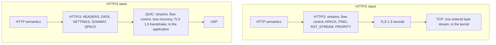
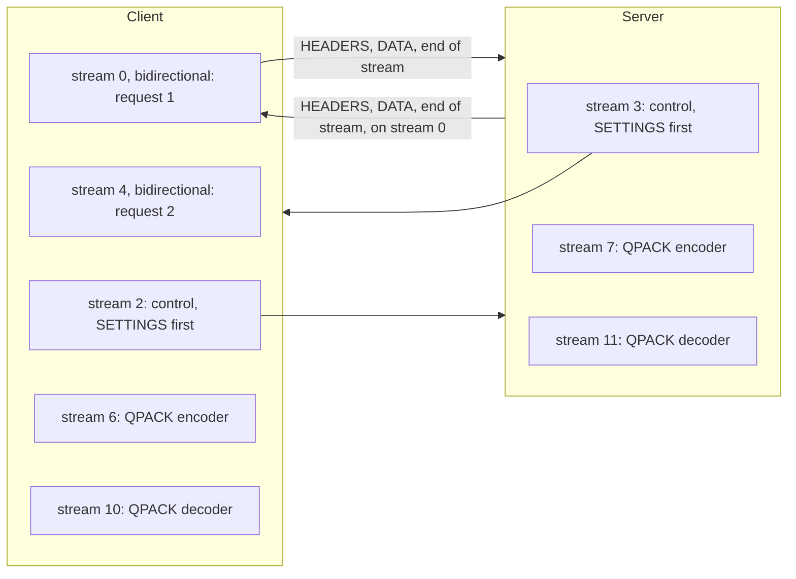
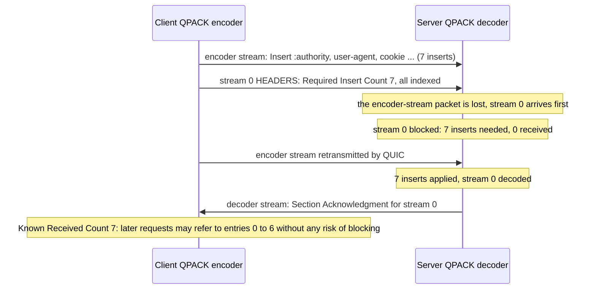
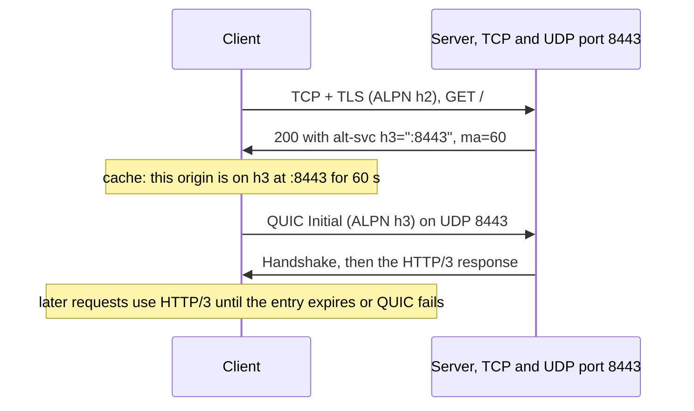
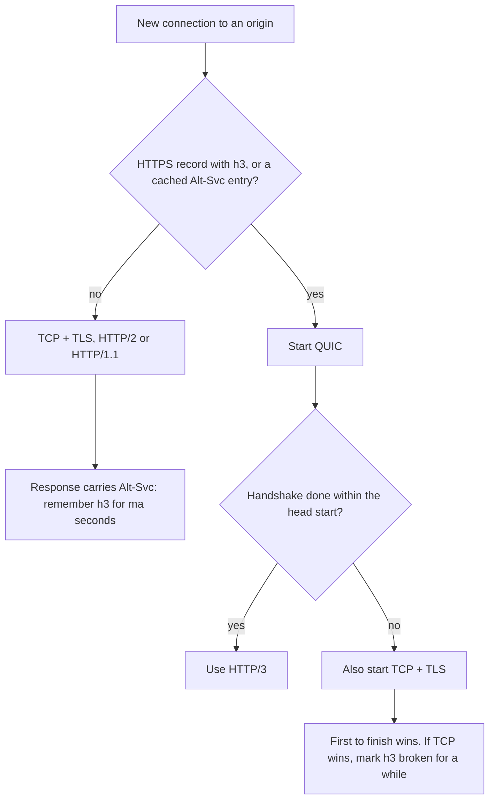

<!-- markdownlint-disable MD001 -->
<!-- markdownlint-disable MD024 -->
<!-- markdownlint-disable MD025 -->
<!-- markdownlint-disable MD026 -->
<!-- markdownlint-disable MD029 -->
<!-- markdownlint-disable MD033 -->
<!-- markdownlint-disable MD036 -->
<!-- markdownlint-disable MD040 -->
<!-- markdownlint-disable MD056 -->
<!-- markdownlint-disable MD060 -->

# H19. HTTP/3

---

## Contents

| #     | Sub-topic                                                                | Tag   |
| ----- | ------------------------------------------------------------------------ | ----- |
| 19.01 | What HTTP/3 is: HTTP semantics, QUIC transport, and what HTTP/2 lost     | CORE  |
| 19.02 | Mapping HTTP onto QUIC streams: request streams, control streams, frames | CORE  |
| 19.03 | QPACK: header compression for out-of-order streams                       | DEEP  |
| 19.04 | Discovery: Alt-Svc, DNS HTTPS records, racing, and fallback              | CORE  |
| 19.05 | When HTTP/3 is faster, and when it is not                                | CORE  |
| 19.06 | Extended CONNECT, WebTransport and MASQUE in brief                       | AWARE |
| 19.07 | Deployment and client support                                            | CORE  |
| 19.08 | The story: an image-heavy storefront turns on HTTP/3                     | CORE  |
| 19.09 | Labs: QPACK and HTTP/3 frames in Java, `h3` on `quinn` in Rust, Caddy    | CORE  |
| 19.10 | Exercises                                                                |       |
| 19.11 | Solutions                                                                |       |
| 19.12 | Takeaways                                                                |       |

Tags: **CORE** is what an architect is expected to explain unprompted, **DEEP** is the mechanism underneath it, **AWARE** is a fact to know exists and not to derive.

Terms used throughout. Each is defined here, before any section uses it.  
Terms from H01 to H18 (TCP, TLS 1.3, ALPN, stream, frame, HOL blocking, HPACK, QUIC, connection ID, packet number, PTO, congestion window, CUBIC, BBR, GREASE, 0-RTT) keep their meaning.

- **QUIC stream types** (H18): a stream is **bidirectional** (both sides send) or **unidirectional** (only its opener sends), and **client-initiated** or **server-initiated**.  
  The low two bits of the stream ID say which: 0 client bidirectional, 1 server bidirectional, 2 client unidirectional, 3 server unidirectional.  
  So stream IDs 0, 4, 8 are the client's bidirectional streams and 2, 6, 10 its unidirectional ones.

- **Request stream**: in HTTP/3, one client-initiated bidirectional stream per request; the request goes one way and its response comes back the other way on the same stream (19.02).

- **Control stream**: one unidirectional stream per side, opened at the start of the connection, carrying connection-level frames such as SETTINGS and GOAWAY (19.02).

- **Field section**: the encoded form of one header list (or trailer list) of one HTTP message, carried in a HEADERS frame.  
  **Field line**: one name-value pair inside it.

- **Static table**: a fixed list of 99 common field lines (`:method: GET`, `:status: 200`, `accept-encoding: gzip, deflate, br`), numbered 0 to 98, built into every QPACK implementation (19.03).

- **Dynamic table**: a table of field lines that the encoder fills during the connection, so that later messages can refer to an entry by number instead of repeating it.  
  Each side has its own, filled by the other side's encoder (19.03).

- **Encoder stream and decoder stream**: two unidirectional streams per side used only by QPACK.  
  The encoder stream carries "insert this entry" instructions; the decoder stream carries acknowledgements back (19.03).

- **Blocked stream**: a request or response stream whose field section refers to dynamic-table entries the decoder has not received yet,  
  so it cannot be decoded until the encoder stream catches up (19.03).

- **Alternative service**: another network location (protocol, host, port) that serves the same origin.  
  An **Alt-Svc** header field on an HTTP/1.1 or HTTP/2 response is how a server announces "this origin is also available over HTTP/3 here" (19.04).

- **DNS HTTPS record**: a DNS record type (RFC 9460) that can tell a client, before it connects at all, which ALPN protocols a service supports (19.04).

- **Happy eyeballs**: starting two connection attempts (originally IPv6 and IPv4, here QUIC and TCP), with a short head start for the preferred one, and using whichever succeeds first (19.04).

- **Response scheduling**: the order in which a server interleaves the bytes of many concurrent responses on one connection.  
  **Round-robin** gives each active stream a turn; **sequential** finishes one before starting the next (19.05).

- **Extended CONNECT**: a CONNECT request with a `:protocol` pseudo-header, which turns one HTTP stream into a tunnel for another protocol such as WebSocket (19.06).

- **`h3`**: the Rust HTTP/3 crate used in the labs (`h3` 0.0.8 with `h3-quinn` 0.0.10, on `quinn` 0.11.12).  
  **ls-qpack**: LiteSpeed's QPACK library in C, used through its Python wrapper `pylsqpack` 1.0.0 as an independent check on the Java code.  
  **Caddy**: a web server with HTTP/3 enabled by default (2.6.2 from Ubuntu's archive here).

Outputs in this module are real.  
They come from `H3Wire.java`, an HTTP/3 frame and QPACK codec in plain JDK 21 code (about 400 lines) that decodes ls-qpack's output, has its own output decoded by ls-qpack,  
and decodes every stream of a captured HTTP/3 connection; from an `h3` server and client, and `pathemu`, a TUN-device path emulator that delays,  
rate-limits and drops TCP and UDP alike (about 380 lines of Rust); and from Caddy.  
Facts not observed in the labs are marked "from memory". RFC 9114 sentences quoted here are taken from the `h3` crate's source, which embeds them as compliance annotations;  
no RFC text could be fetched in this sandbox, so RFC 9204, 7838 and 9460 details are from memory unless a lab shows them.

---

## 19.01 What HTTP/3 is: HTTP semantics, QUIC transport, and what HTTP/2 lost

HTTP/3 is the same HTTP (methods, status codes, header fields, the semantics of RFC 9110) carried over QUIC instead of TCP.  
Each request gets its own QUIC stream, so a lost packet delays only the requests whose bytes it carried.  
Everything HTTP/2 had to build on top of TCP (stream IDs, stream flow control, PING, RST_STREAM, WINDOW_UPDATE, priority signalling) is now either a QUIC feature or gone.  
What HTTP/3 keeps is framing inside each stream (HEADERS, DATA), a control stream for SETTINGS and GOAWAY, and QPACK for header compression. **[CORE]**



The split of work, layer by layer:

| Job                                 | HTTP/2 (H17)                                 | HTTP/3                                                         |
| ----------------------------------- | -------------------------------------------- | -------------------------------------------------------------- |
| Many requests on one connection     | HTTP/2 stream IDs inside one TCP byte stream | QUIC streams, one per request                                  |
| Loss of one packet                  | Stalls every stream behind it (TCP order)    | Stalls only the streams with bytes in that packet (H18 Lab 06) |
| Per-stream flow control             | WINDOW_UPDATE frames                         | QUIC MAX_STREAM_DATA                                           |
| Cancelling one request              | RST_STREAM frame                             | QUIC RESET_STREAM and STOP_SENDING                             |
| Liveness check                      | PING frame                                   | QUIC PING frame                                                |
| Header compression                  | HPACK, needs in-order delivery               | QPACK, tolerates out-of-order streams (19.03)                  |
| Connection setup before the request | TCP handshake, then TLS: 2 round trips       | QUIC with TLS inside: 1 round trip (Lab 04)                    |
| Protocol selection                  | ALPN `h2` in the TLS handshake               | ALPN `h3`, but the client must first know to try UDP (19.04)   |

The frame type numbers that HTTP/2 used for its removed frames are reserved in HTTP/3, so that a confused implementation fails loudly.  
The `h3` crate lists them as `H2_PRIORITY = 0x2`, `H2_PING = 0x6`, `H2_WINDOW_UPDATE = 0x8` and `H2_CONTINUATION = 0x9`, and RFC 9114 says of such types (as quoted in that crate's source):  
"These frame types MUST NOT be sent, and their receipt MUST be treated as a connection error of type H3_FRAME_UNEXPECTED."

One HTTP/3 connection per origin is the rule, as in HTTP/2:  
"Clients SHOULD NOT open more than one HTTP/3 connection to a given IP address and UDP port, where the IP address and port might be derived from a URI,  
a selected alternative service ([ALTSVC]), a configured proxy, or name resolution of any of these."

### Interview angle

"HTTP/3 is HTTP/2 over QUIC" is half right and gets marked down.  
The precise answer: HTTP semantics unchanged; the multiplexing, flow control and stream management moved into the transport;  
header compression had to be redesigned because QUIC streams are delivered independently;  
and the client has to discover HTTP/3 before it can use it, because nothing on a TCP connection's first packet can negotiate a switch to UDP.

---

## 19.02 Mapping HTTP onto QUIC streams: request streams, control streams, frames

Every request opens a new client-initiated bidirectional stream: the client sends a HEADERS frame (and DATA frames for a body), then ends its side of the stream;  
the server answers on the same stream with HEADERS, DATA, and optionally trailing HEADERS, then ends its side.  
Each endpoint also opens unidirectional streams whose first byte says what they are: a control stream (type 0x00) whose first frame must be SETTINGS, a QPACK encoder stream (0x02) and a QPACK decoder stream (0x03), plus push streams (0x01) if server push is used.  
Frames are a type and a length, both QUIC variable-length integers, then the payload.  
Reserved types of the form 0x1f × N + 0x21 are sent on purpose as GREASE. **[CORE]**



Lab 02 captures one request (`GET /bytes/2000`) from the `h3` client to the `h3` server and decodes every stream with `H3Wire.java`.  
The QUIC trace shows the order of events: right after the handshake, the client sends its control stream (stream 2, 35 bytes) and its QPACK decoder and encoder streams  
(10 and 6, one byte each: just the stream type) in one packet, and the request (stream 0, 44 bytes, with FIN) in the next, before the server's control stream has arrived.  
The request did not wait for the server's SETTINGS: "Each endpoint SHOULD use these initial values to send messages before the peer's SETTINGS frame has arrived,  
as packets carrying the settings can be lost or delayed." Decoded, the request stream is two frames:

```text
stream 0 (client-initiated bidirectional), 44 bytes from the client
    frame 0x1 HEADERS, 27 bytes
      QPACK Required Insert Count 0, Base 0
        Indexed, static 17                                         :method: GET
        Indexed, static 23                                         :scheme: https
        Literal with name reference, static 0                      :authority: h3.example.test
        Literal with name reference, static 1                      :path: /bytes/2000
      (0000d1d7508b9d95cbe474d7415749509f5188623f492a1810000f)
    frame 0x16da154d40d4feca reserved type (GREASE), must be ignored, 6 bytes
```

The request stream is two frames: the HEADERS frame, whose QPACK section `H3Wire` decodes field by field, and a GREASE frame of a random reserved type.  
The response stream is HEADERS (8 bytes: `:status: 200`, `content-length: 2000`), DATA (2000 bytes), and another GREASE frame.  
Both control streams carry one SETTINGS frame; the client's:

```text
stream 2 (client-initiated unidirectional), 35 bytes from the client
    stream type 0x0: control stream
    frame 0x4 SETTINGS, 32 bytes
      0x1dfba3af8324f37a reserved (GREASE) = 0
      0x6 SETTINGS_MAX_FIELD_SECTION_SIZE = 4611686018427387903
      0x8 SETTINGS_ENABLE_CONNECT_PROTOCOL (RFC 9220) = 0
      0x2b603742 SETTINGS_ENABLE_WEBTRANSPORT (draft) = 0
      0x33 SETTINGS_H3_DATAGRAM (RFC 9297) = 0
      0x2b603743 SETTINGS_WEBTRANSPORT_MAX_SESSIONS (draft) = 0
```

The rules this exercises, quoted from RFC 9114 through the `h3` source:

- "Each side MUST initiate a single control stream at the beginning of the connection and send its SETTINGS frame as the first frame on this stream."  
  Closing it is fatal: "If either control stream is closed at any point, this MUST be treated as a connection error of type H3_CLOSED_CRITICAL_STREAM."

- "Setting identifiers of the format 0x1f * N + 0x21 for non-negative integer values of N are reserved to exercise the requirement that unknown identifiers be ignored. [...]  
  Endpoints SHOULD include at least one such setting in their SETTINGS frame."  
  The first setting above is one. The same pattern applies to frame types and stream types:  
  the `h3` client and server each opened a GREASE unidirectional stream (14 and 15) whose type is a random reserved value,  
  and "Recipients of unknown stream types MUST either abort reading of the stream or discard incoming data without further processing."

- Absent settings take defaults. QPACK's dynamic table capacity is not in the list, so it is 0: neither side may insert into the other's dynamic table,  
  which is why the encoder and decoder streams carry nothing but their type byte (19.03).

Two smaller things in the trace. Three STOP_SENDING frames appear:

```text
    9.2 ms  from the server: STOP_SENDING for stream 0, error code 0
   11.7 ms  from the client: STOP_SENDING for stream 15, error code 259
   13.4 ms  from the server: STOP_SENDING for stream 14, error code 259
```

The first is the server giving up on the rest of request stream 0 once it had the HEADERS frame (the trailing GREASE frame was never read):  
`quinn` sends STOP_SENDING with code 0 whenever a receive stream is dropped before all its data has been read (read in `quinn`'s `recv_stream.rs`).  

The client's FIN had already been sent, so nothing was lost. The other two are each side refusing the other's GREASE stream with error code 259, which is 0x103,  
H3_STREAM_CREATION_ERROR, exactly as RFC 9114 recommends: "If reading is aborted, the recipient SHOULD use the H3_STREAM_CREATION_ERROR error code or a reserved error code (Section 8.1)."  

And the 2028-byte response stream (a 10-byte HEADERS frame, a 2003-byte DATA frame and a 15-byte GREASE frame,  
each counted with its type and length fields) is split across a 1200-byte and a smaller QUIC packet.

**The frames**, as defined in the `h3` crate's `frame.rs` (which follows RFC 9114 section 7.2):

| Type | Frame        | Where                  | Purpose                                                               |
| ---- | ------------ | ---------------------- | --------------------------------------------------------------------- |
| 0x00 | DATA         | request or push stream | Message body bytes                                                    |
| 0x01 | HEADERS      | request or push stream | A QPACK-encoded field section (headers, or trailers if after DATA)    |
| 0x03 | CANCEL_PUSH  | control stream         | Cancel a server push                                                  |
| 0x04 | SETTINGS     | control stream, first  | Connection parameters, sent once                                      |
| 0x05 | PUSH_PROMISE | request stream         | Announce a server push                                                |
| 0x07 | GOAWAY       | control stream         | Graceful shutdown: the last request stream ID the server will process |
| 0x0d | MAX_PUSH_ID  | control stream         | The client's limit on push IDs                                        |

**Errors and cancellation.**  
HTTP/3 error codes travel in QUIC's RESET_STREAM, STOP_SENDING and CONNECTION_CLOSE frames.  
The `h3` crate's `codes.rs` lists them from 0x100 (`H3_NO_ERROR`) to 0x110 (`H3_VERSION_FALLBACK`), including `H3_FRAME_UNEXPECTED` (0x105),  
`H3_REQUEST_CANCELLED` (0x10c) and `H3_REQUEST_INCOMPLETE` (0x10d). Cancelling a request is a transport action:  
"Implementations SHOULD cancel requests by abruptly terminating any directions of a stream that are still open.  
To do so, an implementation resets the sending parts of streams and aborts reading on the receiving parts of streams."

**Graceful shutdown with GOAWAY.**  
"The GOAWAY frame is always sent on the control stream. In the server-to-client direction, it carries a QUIC stream ID for a client-initiated bidirectional stream".  
Requests on higher stream IDs were not processed and may be retried on a new connection.  
IDs only go down: "the identifier in each frame MUST NOT be greater than the identifier in any previous frame,  
since clients might already have retried unprocessed requests on another HTTP connection."  
This is the HTTP/3 form of H17's two-phase shutdown, without the TCP connection to drain.

**Server push** exists in RFC 9114 (PUSH_PROMISE, push streams, MAX_PUSH_ID), but from memory, browsers removed support for HTTP/2 push (Chrome in 2022) and never shipped it for HTTP/3;  
103 Early Hints (R-track) replaced it.  
Treat it as dead in practice.

### Interview angle

Draw the streams of one connection: one bidirectional stream per request, and per side a control stream (SETTINGS first, never closed), a QPACK encoder stream and a QPACK decoder stream.  
Then name what is *not* in HTTP/3 because QUIC does it: flow control, PING, stream reset, and stream IDs inside frames.  
A strong answer adds GOAWAY's semantics (last processed stream ID, retry the rest) and GREASE (random reserved settings, frames and stream types sent on purpose to keep implementations tolerant).

---

## 19.03 QPACK: header compression for out-of-order streams

HPACK (H17) cannot be used over QUIC because it assumes every header block is decoded in the order it was sent: each block may add entries to the dynamic table, and the next block's indexes assume those additions.  

QUIC delivers streams independently, so the second request's block could arrive before the first's, and the indexes would be wrong.  

QPACK moves all table changes onto a separate encoder stream, numbers entries by absolute index, and prefixes every field section with the number of inserts it needs (the Required Insert Count).  

A section that needs inserts not yet received waits: it is blocked.  

The encoder chooses between compression and the risk of blocking, within a limit the decoder sets with SETTINGS_QPACK_BLOCKED_STREAMS.  
Many implementations simply use only the static table and literals, which never blocks. **[DEEP]**

The pieces, as `H3Wire.java` implements them (the wire formats are from memory of RFC 9204, verified by interoperating with ls-qpack in Lab 01, in both directions):

- **The static table**: 99 entries (Lab 01 prints `0 = [:authority, ]`, `17 = [:method, GET]`, `98 = [x-frame-options, sameorigin]`).  
  Unlike HPACK's 61-entry table, it was chosen from measured traffic and includes whole lines such as `accept-encoding: gzip, deflate, br` (index 31) and `:status: 200` (25).

- **The dynamic table**: entries numbered from 0 by **absolute index**, in insertion order, never reused. The encoder inserts with instructions on its encoder stream:  
  Set Dynamic Table Capacity, Insert With Name Reference (name from the static or dynamic table, new value), Insert With Literal Name, and Duplicate.  
  Old entries are evicted when the capacity is reached, but only once no unacknowledged section refers to them.

- **The field section prefix**: the **Required Insert Count** (how many inserts the decoder must have processed to decode this section;  
  0 if it uses no dynamic entries) and a **Base**, from which relative indexes are counted.  
  References below the Base are relative ("Indexed, dynamic"), references at or above it are **post-base**, which lets an encoder refer to entries it is inserting in the same moment.

- **The decoder stream**: Section Acknowledgment (I decoded the section on stream N),  
  Insert Count Increment (I have processed K more inserts), and Stream Cancellation (stream N was reset, forget its references).  
  From these the encoder knows which entries the decoder has: the **Known Received Count**.

- **Two settings from the decoder**: SETTINGS_QPACK_MAX_TABLE_CAPACITY (0 by default, so the dynamic table is off unless the decoder allows it)  
  and SETTINGS_QPACK_BLOCKED_STREAMS (how many streams may be blocked at once; 0 by default, so by default no section may refer to an unacknowledged entry).



Lab 01 shows how ls-qpack behaves with a 4096-byte table: the first request goes out with literals (83 bytes,  
Required Insert Count 0), and *then* the encoder inserts `:authority`, `user-agent`, `accept-language` and a name-only `x-trace` entry, so the second and third requests shrink to 25 and 26 bytes.  
It does not risk referring to entries in the same moment it creates them on the first request.

Lab 03 measures the trade-off with `H3Wire`'s own encoder on 10 browser-like image requests sent together at page load,  
then 10 more one round trip later, when acknowledgements have arrived:

| Encoder                                     | Encoder stream | First 10 sections | Next 10 sections | Sections that can block |
| ------------------------------------------- | -------------- | ----------------- | ---------------- | ----------------------- |
| Static table and literals only (`h3` crate) | 0 B            | 2140 B            | 2140 B           | 0 of 20                 |
| Dynamic, references unacknowledged inserts  | 337 B          | 120 B             | 120 B            | 10 of 20                |
| Dynamic, references acknowledged only       | 337 B          | 2140 B            | 120 B            | 0 of 20                 |

The middle row compresses the first flight from 2140 to 457 bytes (337 + 120) but makes all ten requests depend on the encoder stream: if the packet carrying those inserts is lost,  
all ten wait for its retransmission, which is head-of-line blocking reintroduced at the header layer.  
The last row never blocks but pays for the inserts in the first flight without any benefit until a round trip later.  
On a 1200-byte-packet path, 2140 bytes of headers is two packets: the cost of no compression on the first flight is small, which is why static-only encoders are common.  
The `h3` crate's request and response paths call `encode_stateless` and `decode_stateless` (read in its source),  
and its SETTINGS advertise no table capacity, so every `h3` peer gets the first row. Caddy's server sent an empty SETTINGS frame and no QPACK streams at all in Lab 07, the same choice.

### Interview angle

The question is "why not HPACK over QUIC".  
Answer with the ordering dependency (HPACK table updates are implicit in header blocks, which must be processed in order), then QPACK's fix  
(explicit inserts on a separate stream, absolute indexes, a Required Insert Count per section) and its price (a section can block on the encoder stream, bounded by SETTINGS_QPACK_BLOCKED_STREAMS).  
Close with the practical observation: many deployments use the static table only, trading a few hundred bytes per page for zero blocking risk.

---

## 19.04 Discovery: Alt-Svc, DNS HTTPS records, racing, and fallback

An `https://` URL does not say whether the server speaks HTTP/3, and a client cannot upgrade a TCP connection to QUIC.  
So a client first learns about HTTP/3 from somewhere: an `Alt-Svc: h3=":443"; ma=86400` header on an HTTP/1.1 or HTTP/2 response (RFC 7838),  
which applies to *later* connections, or a DNS HTTPS record with `alpn="h3,h2"` (RFC 9460), which works before the first connection.  
Because UDP may be blocked, clients race QUIC against TCP, giving QUIC a short head start, and remember failures.  
A client that tries only QUIC on a network that drops UDP waits for a timeout. **[CORE]**



**Alt-Svc.**  
The value lists alternatives as `protocol="host:port"`, with an empty host meaning "the same host", and `ma` (max age, in seconds, default 24 hours from memory) for how long to remember it.  
Lab 04 runs this at 40 ms RTT through `pathemu`: the HTTP/2 response came back at 131.2 ms carrying `alt-svc: h3=":8443"; ma=60`, and the HTTP/3 connection plus a request took another 89.4 ms.  
Discovery through Alt-Svc therefore saves nothing on the first visit; it pays off from the next connection on.  
Caddy (Lab 07) adds `alt-svc: h3=":8444"; ma=2592000` to every response without being asked: 30 days.  
From memory: `Alt-Svc: clear` withdraws all alternatives, the `persist=1` parameter keeps an entry across network changes,  
and a client must still authenticate the alternative with the origin's certificate, so Alt-Svc cannot redirect a client to a server that is not authoritative.

**DNS HTTPS records** (from memory; this sandbox has no DNS egress, so not observed).  
An HTTPS record such as `example.com. 300 IN HTTPS 1 . alpn="h3,h2" ipv4hint=192.0.2.1` tells the client, in the same DNS lookup that resolves the address, that `h3` is available.  
Browsers that query HTTPS records can start with QUIC on the very first connection.  
The same record type carries ECH keys (H16).

**Racing and fallback.**  
Lab 05 puts `h3cli race` on the same 40 ms path. With UDP open, HTTP/3 won at 44.8 ms, one round trip.  
With an `iptables` rule dropping UDP to the server:

```text
  251.1 ms  no QUIC handshake yet: starting TCP + TLS + HTTP/2 alongside
  338.7 ms  winner: h2
```

Fallback cost the 250 ms head start plus HTTP/2's two round trips.  
A client that tries only HTTP/3 got `no HTTP/3 connection: timed out` after 10001.3 ms, `quinn`'s idle timeout as configured in these labs (10 s).  
This is why browsers race and why they cache "QUIC failed for this network"; from memory, Chromium gives QUIC a head start of a few hundred milliseconds and marks HTTP/3 broken for an origin after a failure.  
Middleboxes that rate-limit UDP rather than block it produce the worst case, a connection that starts and then stalls.



**The JDK.** Lab 04 also points the JDK 21 `HttpClient` at the same server three times: every response is `HTTP_2` with the Alt-Svc header in plain sight, and `HttpClient.Version.values()` is `[HTTP_1_1, HTTP_2]`.  
JDK 21 has no HTTP/3. From memory, JEP 517 adds HTTP/3 to `java.net.http` in JDK 26, with a request option that selects discovery (Alt-Svc, or HTTP/3 only);  
no JDK 26 was available here to check.

### Interview angle

"How does the browser know to use HTTP/3?" Two mechanisms, Alt-Svc (learned from a TCP response, used next time) and DNS HTTPS records (known before the first connection),  
then the failure handling: race with a head start, fall back to TCP, remember the failure.  
Point out that an HTTP/3 deployment therefore always includes an HTTP/2 deployment, because the first visit and every UDP-hostile network use it.

---

## 19.05 When HTTP/3 is faster, and when it is not

HTTP/3 always saves one round trip on a new connection (QUIC's handshake includes TLS) and removes transport head-of-line blocking.  
Whether a page loads faster depends more on two other things: the congestion controller, which decides how fast any single connection can send under loss, and the server's response scheduling, which decides when each object finishes.  
In Lab 06, with the same controller on both sides, HTTP/3 had a lower median page time than HTTP/2 with BBR at 0%, 1% and 2% random loss, though not reliably at 1%;  
with CUBIC under loss, both single-connection protocols were about three times slower than HTTP/1.1's six connections, and HTTP/3 was not consistently better than HTTP/2. **[CORE]**

**Connection setup.** Lab 04, 40 ms RTT: HTTP/1.1 and HTTP/2 were connected at 87.8 and 87.3 ms (TCP, then TLS) and had a response at about 130 ms;  
HTTP/3 was connected at 44.3 ms and had its response at 87.1 ms. One round trip saved, every new connection, before 0-RTT (H18) saves another.

**A page of 40 objects.** Lab 06 fetches 40 objects of 30 KB (1.2 MB) at once over a 40 ms, 50 Mbit/s path with a 100-packet queue, with 0, 1 and 2% random loss in each direction and five different loss patterns per cell.  
HTTP/1.1 uses six connections, as browsers do; HTTP/2 and HTTP/3 use one.  
The congestion controller is matched: the kernel's TCP controller and `quinn`'s are both CUBIC, then both BBR.  
The median of five runs:

| Controller | Loss | HTTP/1.1, 6 connections | HTTP/2  | HTTP/3  |
| ---------- | ---- | ----------------------- | ------- | ------- |
| CUBIC      | 0%   | 488 ms                  | 488 ms  | 474 ms  |
| CUBIC      | 1%   | 874 ms                  | 2938 ms | 3101 ms |
| CUBIC      | 2%   | 1388 ms                 | 4143 ms | 3630 ms |
| BBR        | 0%   | 610 ms                  | 503 ms  | 381 ms  |
| BBR        | 1%   | 730 ms                  | 637 ms  | 508 ms  |
| BBR        | 2%   | 1457 ms                 | 621 ms  | 467 ms  |

What the table says, from the mechanisms of H04 and H18:

- **Without loss** the three are close with CUBIC, whose slow start dominates a 1.2 MB transfer.  
  With BBR, HTTP/3 was ahead by more than the one round trip its handshake saves (381 against 503 ms, range 348 to 408).  
  Treat that cell as noisy: `quinn`'s BBR, whose source documents it as "Experimental! Use at your own risk."  
  (`quinn-proto` 0.11.19, `congestion/bbr/mod.rs`), gave a median of 556 ms for the same cell in an earlier complete run of this lab, while the kernel's TCP rows moved by a few milliseconds.

- **With CUBIC and loss**, every lost packet cuts a connection's window by 30%, and a single connection that loses ten or so packets in a page never grows its window back.  
  Six connections share the losses and each keeps its own window, so HTTP/1.1 had several times the aggregate window.  
  HTTP/3's freedom from HOL blocking does not help when the window, not the ordering, is the limit.  
  This first showed up as a surprise: with the kernel's default TCP controller (BBR on this machine) against `quinn`'s default (CUBIC),  
  HTTP/2 beat HTTP/3 by a factor of five at 1% loss, and the difference disappeared when the controllers were matched.

- **With BBR**, which does not treat random loss as congestion (H18 Lab 08), single connections keep their rate, and HTTP/3 had the lowest median in every BBR row.  
  The ranges overlap at 1% loss (HTTP/2 508 to 650 ms, HTTP/3 394 to 1493 ms across the five patterns, one HTTP/3 run being much slower),  
  so the lead there is not reliable; at 2% it is clearer (HTTP/2 573 to 663 ms, HTTP/3 380 to 564 ms).

**When objects finish.** The same runs record when the 10th object completed.  
HTTP/1.1's six connections finish objects one by one: the 10th at about 240 to 325 ms.  
HTTP/2 finished its 10th at 410 to 480 ms in the BBR rows. HTTP/3 finished its 10th at about the same time as its last (377 of 381 ms, BBR, no loss),  
because `quinn` sends round-robin among streams of equal priority: every response advances a little in each packet, and all of them complete together at the end.  
Lab 06's second part switches `quinn`'s `send_fairness` off on the server, so streams are sent in the order they were written:

```text
fair=1   463.0 ms  40 objects of 30000 bytes over h3: the 10th done at 456.2 ms, the median at 460.2 ms
fair=1   417.6 ms  40 objects of 30000 bytes over h3: the 10th done at 413.3 ms, the median at 416.1 ms
fair=1   443.8 ms  40 objects of 30000 bytes over h3: the 10th done at 443.7 ms, the median at 443.7 ms
fair=0   440.5 ms  40 objects of 30000 bytes over h3: the 10th done at 187.5 ms, the median at 304.9 ms
fair=0   428.3 ms  40 objects of 30000 bytes over h3: the 10th done at 188.8 ms, the median at 296.9 ms
fair=0   594.4 ms  40 objects of 30000 bytes over h3: the 10th done at 304.8 ms, the median at 444.1 ms
```

Similar totals (418 to 463 ms with round-robin, 428 to 594 ms without), but the 10th object arrives at 188 to 305 ms instead of 413 to 456 ms.  
For a browser, which can render an image or run a script only when it is complete, that is the difference that matters. RFC 9218 (Extensible Priorities, read in H17)  
is the standard way for a client to ask for this: each request carries an urgency (0 to 7) and an `incremental` flag,  
and for non-incremental resources a server should send one response at a time in urgency order, through the `priority` header field or PRIORITY_UPDATE frames (types 0xf0700 and 0xf0701 in HTTP/3).  
Incremental responses of equal urgency are meant to share the connection, and H17's Lab showed Chromium marking images incremental, so for a gallery of small images the server's own policy decides (Exercise 06).  
The `h3` crate has no RFC 9218 support (its source mentions priority only to reject HTTP/2's PRIORITY frame type),  
so these labs show the two extremes by flipping the transport's scheduler.

### Interview angle

Be the person in the room who says "it depends, and here is on what".  
HTTP/3 wins one round trip per new connection and removes transport HOL blocking;  
it does not fix a loss-based congestion controller on a lossy path, it does not beat six parallel connections that have six times the window,  
and it can deliver every object late if the server round-robins.  
Measure with the production congestion controller and the production server's scheduling, on the target network's RTT and loss.

---

## 19.06 Extended CONNECT, WebTransport and MASQUE in brief

HTTP/3 can carry more than requests and responses.  
Extended CONNECT (RFC 9220 for HTTP/3, after RFC 8441 for HTTP/2) lets a client open a stream with `:method: CONNECT` and `:protocol: websocket` (or another protocol),  
turning that stream into a tunnel; a server allows it with SETTINGS_ENABLE_CONNECT_PROTOCOL.  
HTTP Datagrams (RFC 9297) carry unreliable messages tied to a stream, using QUIC's DATAGRAM frames.  
On top of these, WebTransport gives web pages multiple streams and datagrams to a server, and MASQUE builds proxies:  
CONNECT-UDP (RFC 9298) tunnels UDP, and so QUIC itself, through an HTTP/3 proxy, and CONNECT-IP (RFC 9484) tunnels IP packets. **[AWARE]**

The settings are visible in Lab 02: the `h3` server and client each send `SETTINGS_ENABLE_CONNECT_PROTOCOL (RFC 9220) = 0`, `SETTINGS_H3_DATAGRAM (RFC 9297) = 0`,  
and two WebTransport settings from the IETF draft (`0x2b603742` and `0x2b603743`), all off,  
because the labs do not enable them (`h3`'s builders have `enable_extended_connect` and `enable_datagram`).  
The RFC numbers are from the `h3` crate's source comments; the protocols' details are from memory.  
From memory: Apple's iCloud Private Relay and similar privacy proxies are MASQUE deployments, and WebTransport is in Chromium and Firefox, still on IETF drafts.

### Interview angle

Know that these exist and what they are for: WebSockets over HTTP/3 (Extended CONNECT), real-time data where retransmission is useless (HTTP Datagrams),  
and proxying UDP and IP over HTTP/3 (MASQUE), which is how a VPN-like service can look like ordinary HTTPS traffic on UDP 443.

---

## 19.07 Deployment and client support

Most HTTP/3 traffic on the internet is terminated at a CDN or edge proxy, which speaks HTTP/1.1 or HTTP/2 to the origin behind it.  
Caddy enables HTTP/3 by default; nginx has it only from 1.25 (from memory) and Ubuntu 24.04's nginx 1.24 is built without it;  
Envoy and HAProxy support it (from memory).  
On the client side, browsers have shipped HTTP/3 for years, while libraries vary: JDK 21 has none,  
Rust has `h3` on `quinn` and Cloudflare's `quiche`, and `curl` supports it only when built with an HTTP/3 backend. **[CORE]**

What the labs found on this machine:

- **Caddy 2.6.2** (Lab 07), with nothing in the Caddyfile but a certificate and two `respond` lines, answered on TCP with HTTP/2 and `alt-svc: h3=":8444"; ma=2592000`, and on UDP with HTTP/3.  
  Its control stream carried an empty SETTINGS frame (all defaults: no dynamic table, no extensions), and it opened no QPACK streams;  
  its responses used static-table references and literals (`server: Caddy` by name reference to static entry 92).  
  From memory, Caddy's HTTP/3 comes from the `quic-go` library.

- **nginx 1.24** (Ubuntu's build): `nginx -V` lists `--with-http_v2_module` and no `http_v3_module`.

- **curl 8.5.0** (Ubuntu's build) lists no HTTP3 feature in `curl --version`, so `curl --http3` is not available here;  
  from memory, distributions ship curl with HTTP/3 only in builds linked against ngtcp2 and nghttp3, or quiche.  
  That, and the sandbox having no UDP egress, is why the plan's "curl against a public site" lab was replaced by the local Caddy and `h3` labs.

- **JDK 21**: no HTTP/3 (Lab 04). From memory, JDK 26 adds it (JEP 517).

- **Rust**: `h3` 0.0.8 with `h3-quinn` worked for everything here; its version number says it is pre-1.0.

**Behind a CDN**, what an origin team controls is the edge configuration (whether HTTP/3 is on, Alt-Svc lifetime, connection migration and connection-ID routing at the edge, H18 18.09)  
and the response scheduling and priorities of whatever server terminates HTTP/3.  
An origin that wants HTTP/3 end to end must also open UDP 443 through its own firewalls and load balancers, which is where most self-hosted deployments stall.

**Where it helps and where it does not.**  
From 19.05 and H18: largest gains on high-RTT, lossy, mobile paths (one round trip saved per connection, no HOL blocking, migration across networks),  
smallest inside a data centre (sub-millisecond RTT, almost no loss, no mobility, and QUIC costing about twice the CPU of TCP with TLS, H18 Lab 13).  
East-west service traffic generally stays on HTTP/2 or gRPC over TCP.

### Interview angle

"Should we enable HTTP/3?"  
For a public, mobile-heavy site behind a CDN: yes, it is a configuration switch, keep HTTP/2, and watch fallback rates and object-level timings.  
For self-hosting: budget for UDP through every firewall and load balancer, CID-aware load balancing, extra CPU, and a server whose scheduling and congestion control you have measured.  
For internal services: usually no.

---

## 19.08 The story: an image-heavy storefront turns on HTTP/3

A storefront with large product galleries runs its own edge (a fleet of reverse proxies in two regions) and wants HTTP/3 for its mobile customers.  
This traces what the team ran into, in order, and where it would have gone wrong.

### Chapter 01: the switch that changed nothing

The team enabled HTTP/3 on the edge and saw no traffic on it. The edge was answering on UDP, but nothing told clients to try: the Alt-Svc header was disabled by default in their proxy's configuration, and they had no DNS HTTPS record.  
Adding `Alt-Svc: h3=":443"; ma=86400` moved repeat visitors to HTTP/3 within a day; first visits still used HTTP/2, as Lab 04 shows they must without an HTTPS record (19.04).

### Chapter 02: the hotel network that took ten seconds

A support ticket reported product pages taking ten seconds to start loading on one hotel's Wi-Fi.  
The network dropped UDP, and the company's own mobile app used an HTTP client configured for HTTP/3 only, once Alt-Svc had been seen, with no TCP race: Lab 05's last case, a 10-second timeout.  
Switching the app to race QUIC against TCP with a short head start turned it into Lab 05's middle case, about 250 ms extra on that network and nothing elsewhere.

### Chapter 03: faster on Wi-Fi, slower on the train

Real-user metrics showed HTTP/3 faster on good networks and slower than HTTP/2 on lossy cellular paths.  
The edge's TCP stack used BBR (set years earlier), but its QUIC library defaulted to CUBIC: the first finding of Lab 06, where the mismatched pair made HTTP/2 five times faster at 1% loss.  
Moving QUIC to BBR, after testing it against shallow queues (H18 Lab 08), put HTTP/3 ahead on those paths too.

### Chapter 04: the gallery that appeared all at once

Product galleries now finished sooner in total but felt slower: the first images appeared later than before.  
The edge's QUIC library sent responses round-robin, so all 40 thumbnails completed together at the end (Lab 06, `fair=1`).  
Honouring RFC 9218 literally would not have helped, because the browser marks images incremental, which asks for sharing.  
The team kept urgency order from the browser's priorities but had the edge send small images one at a time in request order,  
and the first ten thumbnails appeared in less than half the time (Lab 06: the 10th object at 188 and 189 ms in two of three runs with `fair=0`, against 413 to 456 ms with `fair=1`).

### Chapter 05: the header compression that was not worth it

An engineer proposed enabling QPACK's dynamic table to save header bytes.  
Lab 03's numbers settled it: about 1.7 KB saved on a first flight of 10 requests, in exchange for making those requests depend on the encoder stream, with blocking allowed.  
The team kept the static-only encoder on the edge and allowed a dynamic table only on the long-lived connections from their own app,  
where the "acknowledged only" encoder saves bytes from the second round trip on without ever blocking.

### Where it would have gone wrong

| If the team had...                                       | What breaks                                                   | What catches it                                                     |
| -------------------------------------------------------- | ------------------------------------------------------------- | ------------------------------------------------------------------- |
| Enabled HTTP/3 without Alt-Svc or an HTTPS record        | No client ever uses it, as in Chapter 01                      | Counting HTTP/3 requests after the switch (Lab 04's discovery)      |
| Shipped an HTTP/3-only client                            | 10-second stalls on UDP-blocking networks, as in Chapter 02   | A test with UDP dropped on the path (Lab 05)                        |
| Compared HTTP/2 and HTTP/3 with different controllers    | A false conclusion either way, as in Chapter 03               | Matching the controllers before comparing (Lab 06)                  |
| Accepted the QUIC library's default scheduling           | Every object late on image-heavy pages, as in Chapter 04      | Measuring object-level completion, not page totals (Lab 06 `fair=`) |
| Turned on QPACK's dynamic table with blocking everywhere | Header-level HOL blocking on lossy first flights (Chapter 05) | Counting blockable sections per page (Lab 03)                       |
| Removed HTTP/2 once HTTP/3 worked                        | First visits and UDP-hostile networks fail                    | Discovery and fallback tests (Labs 04 and 05)                       |

### A review checklist before calling an HTTP/3 rollout done

- [ ] Clients can discover HTTP/3: Alt-Svc on TCP responses with a deliberate `ma`, and a DNS HTTPS record if first-visit latency matters.
- [ ] Every client of yours races QUIC against TCP, and HTTP/2 stays enabled on the edge.
- [ ] HTTP/2 and HTTP/3 were compared with the same congestion controller, on the target RTT and loss.
- [ ] Object-level timings (first image, first script) were measured, the server honours RFC 9218 urgency,  
  and its scheduling of small images is a deliberate choice, not the QUIC library's default round-robin.
- [ ] The QPACK configuration is a decision: static only, or a dynamic table with a stated SETTINGS_QPACK_BLOCKED_STREAMS.
- [ ] UDP 443 is open through every firewall and load balancer on the path, and H18's operational list (CID routing, shared keys, CPU) is done.

---

## 19.09 Labs: QPACK and HTTP/3 frames in Java, `h3` on `quinn` in Rust, Caddy

Everything runs on one Linux machine, as root (for the TUN device, `iptables` and `tcpdump`).  
Needed: JDK 21, a Rust toolchain, `openssl`, `tshark`, `tcpdump`, `iptables`, `caddy` (`apt-get install caddy`),  
Python 3 with the `cryptography` package for `qtrace.py`, and a Python virtual environment with `pylsqpack` (`python3 -m venv /tmp/pyq && /tmp/pyq/bin/pip install pylsqpack`).  
Every transcript below was produced by one run of `run-all.sh` (about three and a half minutes) and is copied from the files it wrote, not retyped.  
Times differ on every run; byte counts, frame lists and QPACK encodings do not.

### Lab 00: setup, the path emulator, and the Rust programs

Folder layout:

```text
h19/
  make-cert.sh   srv.sh   capture.sh   page.sh   run-all.sh
  qtrace.py   h3streams.py   qpack_oracle.py   summary.py
  java/H3Wire.java                      Labs 01 to 04: QPACK, HTTP/3 frames, the JDK HttpClient
  rust/Cargo.toml
  rust/src/lib.rs                       TLS, QUIC and the three ways to make a request
  rust/src/bin/h3srv.rs                 one origin: HTTP/1.1 and HTTP/2 on TCP, HTTP/3 on UDP, same port
  rust/src/bin/h3cli.rs                 the client, one mode per lab
  rust/src/bin/pathemu.rs               the path emulator, for TCP and UDP alike
  caddy/Caddyfile                       Lab 07
  try/                                  generated: certificates, logs, pid files, captures, key logs
  out/                                  generated: the transcripts quoted in this module
```

Commands, from `h19/`:

```bash
./make-cert.sh                                  # a lab CA and a certificate for h3.example.test, 127.0.0.1 and 10.9.0.2
(cd rust && cargo build --release)              # the first build downloads and compiles h3, quinn, hyper, rustls and tokio
./run-all.sh                                    # every lab; transcripts land in out/
```

```bash
#!/usr/bin/env bash
# A lab CA and one server certificate for h3.example.test and 127.0.0.1, in try/pki.
set -e; d=$(cd "$(dirname "$0")" && pwd)/try/pki; mkdir -p "$d"; cd "$d"
openssl req -x509 -newkey ec -pkeyopt ec_paramgen_curve:P-256 -nodes -keyout ca.key -out ca.pem -days 30 -subj "/CN=H19 lab CA" 2>/dev/null
openssl req -newkey ec -pkeyopt ec_paramgen_curve:P-256 -nodes -keyout h3.key -out h3.csr -subj "/CN=h3.example.test" 2>/dev/null
printf 'subjectAltName=DNS:h3.example.test,IP:127.0.0.1,IP:10.9.0.2\nbasicConstraints=CA:FALSE\nkeyUsage=digitalSignature\nextendedKeyUsage=serverAuth\n' > ext.cnf
openssl x509 -req -in h3.csr -CA ca.pem -CAkey ca.key -CAcreateserial -out h3.pem -days 30 -extfile ext.cnf 2>/dev/null
openssl pkcs8 -topk8 -nocrypt -in h3.key -out h3.key.p8 && mv h3.key.p8 h3.key
echo "PKI in $d: ca.pem, h3.pem, h3.key"
```

`srv.sh` is H18's, unchanged: start a program in the background and wait until its log says "listening" (or until `PORT` accepts a connection);  
`stop` kills by pid file and treats a zombie as gone:

```bash
#!/usr/bin/env bash
# Starts or stops lab servers.   usage: srv.sh start NAME command args...   |   srv.sh stop [NAME]
# The log goes to try/NAME.log and the pid to try/NAME.pid; start returns when the log shows "listening", or when PORT (an environment variable) accepts a connection.
here=$(cd "$(dirname "$0")" && pwd); mkdir -p "$here/try"
case "$1" in
  start) name=$2; shift 2; : > "$here/try/$name.log"
         ( cd "$here" && exec "$@" ) > "$here/try/$name.log" 2>&1 &
         echo $! > "$here/try/$name.pid"
         for _ in $(seq 100); do { grep -q listening "$here/try/$name.log" || { [ -n "$PORT" ] && (echo > "/dev/tcp/127.0.0.1/$PORT") 2>/dev/null; }; } && exit 0; sleep 0.1; done
         echo "server $name did not start" >&2; cat "$here/try/$name.log" >&2; exit 1 ;;
  stop)  for f in "$here"/try/${2:-*}.pid; do [ -f "$f" ] || continue; pid=$(cat "$f"); kill "$pid" 2>/dev/null
           for _ in $(seq 60); do grep -qs "State:.*[RSD]" /proc/"$pid"/status || break; sleep 0.1; done; rm -f "$f"; done; exit 0 ;;   # a zombie counts as gone
esac
```

**The path emulator.**  
H18's `qrelay` delayed and dropped UDP only, so it could not give TCP the same path. `pathemu` works one layer lower: it creates a TUN device, `h19emu`, with address 10.9.0.1.  
A client that connects to 10.9.0.2 sends its packets into the device, where `pathemu` reads them as raw IP packets.  
It swaps the source and destination addresses (the IP, TCP and UDP checksums are sums over both addresses, so swapping them changes nothing),  
holds the packet for the one-way delay and the bottleneck's serialisation time, or drops it, and writes it back.  
The kernel then receives a packet from 10.9.0.2 for its own 10.9.0.1, and delivers it to the server listening there.  
Replies make the same trip the other way. The kernel's TCP, `quinn`'s QUIC and `ping` all see the same 40 ms path;  
`ping 10.9.0.2`, run by hand while it was being built (not part of `run-all.sh`), reported 42.7 to 43.4 ms (the 1 ms timer granularity of `tokio` adds a little to each direction).  
The TUN device has no segmentation offload, so packets are cut to its 1500-byte MTU before `pathemu` sees them,  
which also makes captures on `h19emu` readable (on `lo`, `quinn`'s UDP GSO batches appear as one oversized datagram):

```rust
// A user-space netem for TCP and UDP alike: a TUN device that delays, rate-limits and drops IP packets, then hands them back.
// usage (root): pathemu [delay=20] [rate=50] [queue=100] [loss=0] [seed=0] [ports=8443]
//   creates tun device h19emu with 10.9.0.1/24. A client connecting to 10.9.0.2:PORT sends its packets into the device; pathemu
//   swaps source and destination address (checksums stay valid, the sums are unchanged) and writes the packet back, so it
//   arrives from 10.9.0.2 at the server listening on 10.9.0.1. Replies take the same trip the other way. Packets whose
//   destination port is in ports= go "to server", the rest "to client"; each direction has its own delay, bottleneck and loss.
use std::{collections::VecDeque, os::fd::RawFd, sync::{Arc, Mutex}, time::Duration};
use h19::arg;
use tokio::{io::unix::AsyncFd, sync::mpsc, time::{sleep_until, Instant}};

struct Link { busy_until: Instant, rate: f64, queue: f64, loss: f64, rng: u64, dropped_queue: u64, dropped_random: u64, sent: u64 }

impl Link {
    /// When this packet leaves the far end of the link, or None if the link drops it (the same logic as H18's qrelay).
    fn admit(&mut self, len: usize, delay: Duration) -> Option<Instant> {
        self.rng ^= self.rng << 13; self.rng ^= self.rng >> 7; self.rng ^= self.rng << 17;           // xorshift: same losses every run
        if (self.rng % 1_000_000) as f64 / 1e6 < self.loss { self.dropped_random += 1; return None; }
        let now = Instant::now();
        let start = self.busy_until.max(now);
        if (start - now).as_secs_f64() * self.rate + len as f64 > self.queue { self.dropped_queue += 1; return None; }
        self.busy_until = start + Duration::from_secs_f64(len as f64 / self.rate);
        self.sent += 1;
        Some(self.busy_until + delay)
    }
}

fn open_tun(name: &str) -> RawFd {
    unsafe {
        let fd = libc::open(c"/dev/net/tun".as_ptr(), libc::O_RDWR | libc::O_NONBLOCK);
        assert!(fd >= 0, "open /dev/net/tun failed");
        let mut ifr = [0u8; 40];                                                   // struct ifreq: name[16], then flags
        ifr[..name.len()].copy_from_slice(name.as_bytes());
        ifr[16..18].copy_from_slice(&((libc::IFF_TUN | libc::IFF_NO_PI) as u16).to_ne_bytes());
        assert!(libc::ioctl(fd, 0x400454ca, ifr.as_mut_ptr()) >= 0, "TUNSETIFF failed");  // TUNSETIFF
        fd
    }
}

fn sh(cmd: &str) { assert!(std::process::Command::new("sh").arg("-c").arg(cmd).status().unwrap().success(), "{cmd}"); }

#[tokio::main(flavor = "current_thread")]
async fn main() {
    let delay = Duration::from_millis(arg("delay", "20").parse().unwrap());
    let rate = arg("rate", "50").parse::<f64>().unwrap() * 1e6 / 8.0;
    let queue = arg("queue", "100").parse::<f64>().unwrap() * 1500.0;
    let loss = arg("loss", "0").parse::<f64>().unwrap() / 100.0;
    let ports: Vec<u16> = arg("ports", "8443").split(',').map(|p| p.parse().unwrap()).collect();
    let fd = open_tun("h19emu");
    sh("ip addr add 10.9.0.1/24 dev h19emu && ip link set h19emu mtu 1500 up && sysctl -qw net.ipv4.conf.h19emu.rp_filter=0");
    let new_link = |seed| Arc::new(Mutex::new(Link { busy_until: Instant::now(), rate, queue, loss, rng: seed, dropped_queue: 0, dropped_random: 0, sent: 0 }));
    let seed = arg("seed", "0").parse::<u64>().unwrap().wrapping_mul(0x2545f4914f6cdd1d);       // seed= picks another loss pattern
    let links = [new_link(0x9e3779b97f4a7c15 ^ seed), new_link(0xd1b54a32d192ed03 ^ seed)];  // [to server, to client]
    let (tx, mut rx) = mpsc::unbounded_channel::<(Instant, Vec<u8>)>();
    tokio::spawn(async move {                                                       // delivers in time order, one queue per run
        let mut q: VecDeque<(Instant, Vec<u8>)> = VecDeque::new();
        loop {
            if q.is_empty() { match rx.recv().await { Some(x) => q.push_back(x), None => return } }
            while let Ok(x) = rx.try_recv() { let i = q.partition_point(|(t, _)| *t <= x.0); q.insert(i, x); }
            let (at, pkt) = q.pop_front().unwrap();
            sleep_until(at).await;
            unsafe { libc::write(fd, pkt.as_ptr().cast(), pkt.len()); }
        }
    });
    let report = links.clone();
    tokio::spawn(async move {
        loop {
            tokio::time::sleep(Duration::from_secs(1)).await;
            let (u, d) = (report[0].lock().unwrap(), report[1].lock().unwrap());
            println!("so far: to server {} passed, {} random drops, {} queue drops | to client {} passed, {} random drops, {} queue drops",
                     u.sent, u.dropped_random, u.dropped_queue, d.sent, d.dropped_random, d.dropped_queue);
        }
    });
    println!("listening: h19emu up, 10.9.0.2 reaches this host's 10.9.0.1 with one-way delay {delay:?}, {} Mbit/s, queue {} packets, loss {}%",
             arg("rate", "50"), arg("queue", "100"), arg("loss", "0"));
    let afd = unsafe { AsyncFd::register(fd) }.unwrap();                          // fd stays open for the whole run
    let mut buf = vec![0u8; 65536];
    loop {
        let mut guard = afd.readable().await.unwrap();
        let n = unsafe { libc::read(fd, buf.as_mut_ptr().cast(), buf.len()) };
        if n <= 0 { guard.clear_ready(); continue; }
        let mut pkt = buf[..n as usize].to_vec();
        if pkt[0] >> 4 != 4 || pkt.len() < 20 { continue; }                         // IPv4 only (the kernel also sends IPv6 noise)
        let ihl = (pkt[0] & 0x0f) as usize * 4;
        let dport = if pkt.len() >= ihl + 4 { u16::from_be_bytes([pkt[ihl + 2], pkt[ihl + 3]]) } else { 0 };
        for i in 0..4 { pkt.swap(12 + i, 16 + i); }                                   // 10.9.0.1 -> 10.9.0.2 becomes 10.9.0.2 -> 10.9.0.1
        let dir = if ports.contains(&dport) { 0 } else { 1 };
        if let Some(at) = links[dir].lock().unwrap().admit(pkt.len(), delay) { let _ = tx.send((at, pkt)); }
    }
}
```

`capture.sh` is H18's with an interface option; on `h19emu` it captures with `-Q out`, so each packet appears once, as sent:

```bash
#!/usr/bin/env bash
# Records traffic that matches a pcap filter while a command runs.   usage: [IF=lo] capture.sh out.pcap 'udp port 8443' command args...
# Through pathemu use IF=h19emu: each packet then appears once, as sent (-Q out), already cut to the 1500-byte MTU. On lo, UDP GSO
# batches appear as one oversized datagram that tshark cannot parse.
out=$1; filter=$2; shift 2
tcpdump -i "${IF:-lo}" $([ "${IF:-lo}" != lo ] && echo -Q out) -w "$out" -U "$filter" >/dev/null 2>&1 &
pid=$!
sleep 1                                   # let tcpdump open the interface before the first packet
"$@"
sleep 1
kill $pid; wait $pid 2>/dev/null
```

`qtrace.py` is H18's (embedded in H18 Lab 00) with one change: when a STREAM frame has no length field, it runs to the end of the packet,  
so the script now prints the length of the frame's data instead of `None`. The changed line:

```python
                n += "(id %s, offset %s, %s bytes%s)" % (deep(f, "quic.stream.stream_id"), deep(f, "quic.stream.offset") or 0,
                                                        deep(f, "quic.stream.length") or len((deep(f, "quic.stream_data") or "").replace(":", "")) // 2, ", FIN" if deep(f, "quic.stream.fin") == "1" else "")
```

`h3streams.py` reassembles each QUIC stream's bytes from a decrypted capture, one file per stream and direction, for `H3Wire.java` to decode:

```python
#!/usr/bin/env python3
"""Reassembles the QUIC stream data in a decrypted capture: one file per stream and direction, DIR/ID-c.bin or DIR/ID-s.bin
(c: bytes the client sent, s: bytes the server sent), for H3Wire.java streams DIR.   usage: h3streams.py capture.pcap keylog server_port DIR"""
import json, os, subprocess, sys
pcap, keys, port, out = sys.argv[1:5]
def as_list(x): return x if isinstance(x, list) else [x]
def deep(d, key):
    if not isinstance(d, dict): return None
    if key in d: return d[key]
    return next((v for v in (deep(x, key) for x in d.values()) if v is not None), None)
raw = subprocess.run(["tshark", "-r", pcap, "-o", f"tls.keylog_file:{keys}", "-T", "json", "--no-duplicate-keys", "-J", "udp quic"],
                     capture_output=True, text=True).stdout
streams = {}
for pkt in json.loads(raw):
    L = pkt["_source"]["layers"]
    side = "s" if L["udp"]["udp.srcport"] == port else "c"
    for q in as_list(L.get("quic", [])):
        if not isinstance(q, dict): continue
        for f in as_list(q.get("quic.frame", [])):
            if not isinstance(f, dict) or not 8 <= int(f.get("quic.frame_type", "0")) <= 15: continue
            sid, off, data = int(deep(f, "quic.stream.stream_id")), int(deep(f, "quic.stream.offset") or 0), deep(f, "quic.stream_data")
            buf = streams.setdefault((sid, side), bytearray())
            chunk = bytes.fromhex(data.replace(":", "")) if data else b""
            if len(buf) < off + len(chunk): buf.extend(b"\0" * (off + len(chunk) - len(buf)))
            buf[off:off + len(chunk)] = chunk                  # a retransmission rewrites the same bytes
os.makedirs(out, exist_ok=True)
for (sid, side), b in sorted(streams.items()):
    open(f"{out}/{sid}-{side}.bin", "wb").write(b)
    print(f"stream {sid:3d} from the {'client' if side == 'c' else 'server'}: {len(b)} bytes")
```

`run-all.sh` is every lab in order:

```bash
#!/usr/bin/env bash
# Runs every H19 lab and writes the transcripts the module quotes, out/01-*.txt to out/07-*.txt. Needs root (TUN, iptables, tcpdump).
cd "$(dirname "$0")"; B=rust/target/release; J="env -u JAVA_TOOL_OPTIONS java"; PY=/tmp/pyq/bin/python   # a venv with pylsqpack
./srv.sh stop; mkdir -p out try; [ -f try/pki/ca.pem ] || ./make-cert.sh
cap() { rm -f "try/keys-$1.log"; SSLKEYLOGFILE="try/keys-$1.log" IF=h19emu ./capture.sh "try/$1.pcap" "udp port $2" "${@:3}"; }   # pcap + key log

# Lab 01: QPACK against ls-qpack, both directions
$PY -I qpack_oracle.py gen > try/vectors.txt
{ $J java/H3Wire.java check try/vectors.txt; $PY -I qpack_oracle.py check try/java-sections.txt; } > out/01-qpack-check.txt

# Lab 02: one HTTP/3 request, every stream decoded
PORT= ./srv.sh start S $B/h3srv >/dev/null; ./srv.sh start E $B/pathemu delay=1 rate=1000 >/dev/null
cap get 8443 $B/h3cli get proto=h3 host=10.9.0.2 path=/bytes/2000 > out/02-get.txt
./srv.sh stop E
python3 -I qtrace.py try/get.pcap try/keys-get.log 8443 > out/02-trace.txt
tshark -r try/get.pcap -o tls.keylog_file:try/keys-get.log -T fields -e frame.time_relative -e udp.srcport -e quic.ss.stream_id \
  -e quic.ss.application_error_code 2>/dev/null | awk -F'\t' '$3 != "" {printf "%7.1f ms  from the %s: STOP_SENDING for stream %s, error code %s\n",
  $1 * 1000, $2 == 8443 ? "server" : "client", $3, $4}' > out/02-stop-sending.txt
rm -rf try/streams; python3 -I h3streams.py try/get.pcap try/keys-get.log 8443 try/streams > /dev/null
$J java/H3Wire.java streams try/streams > out/02-streams.txt

# Lab 03: what the dynamic table buys, and what it costs
$J java/H3Wire.java blocked > out/03-blocked.txt

# Lab 04: connection setup at 40 ms RTT, and discovery through alt-svc
./srv.sh start E $B/pathemu delay=20 rate=50 >/dev/null
for p in h1 h2 h3; do echo "-- $p"; $B/h3cli get proto=$p host=10.9.0.2; done > out/04-connect.txt
{ echo "-- h3cli discover"; $B/h3cli discover host=10.9.0.2; echo "-- JDK 21 HttpClient"; $J java/H3Wire.java altsvc; } > out/04-discovery.txt

# Lab 05: UDP blocked on the path
{ echo "-- UDP open: race"; $B/h3cli race host=10.9.0.2
  iptables -I INPUT -i h19emu -p udp --dport 8443 -j DROP
  echo "-- UDP dropped: race"; $B/h3cli race host=10.9.0.2
  echo "-- UDP dropped: HTTP/3 only"; $B/h3cli get proto=h3 host=10.9.0.2
  iptables -D INPUT -i h19emu -p udp --dport 8443 -j DROP; } > out/05-udp-blocked.txt
./srv.sh stop E; ./srv.sh stop S

# Lab 06: a page of 40 objects over HTTP/1.1, HTTP/2 and HTTP/3 on a lossy 40 ms path
./page.sh "cubic:cubic bbr:bbr" "0 1 2" "h1 h2 h3" > out/06-page.txt; python3 -I summary.py out/06-page.txt > out/06-summary.txt
./page.sh "bbr:cubic" "1" "h2 h3" > out/06-mismatch.txt              # each side's default here: kernel TCP BBR, quinn CUBIC
python3 -I summary.py out/06-mismatch.txt > out/06-mismatch-summary.txt
./srv.sh start E $B/pathemu delay=20 rate=50 >/dev/null                # the same page, BBR, no loss: quinn's round-robin on and off
for f in 1 0; do PORT= ./srv.sh start S $B/h3srv cc=bbr fair=$f >/dev/null
  for i in 1 2 3; do echo "fair=$f $($B/h3cli page proto=h3 host=10.9.0.2)"; done; ./srv.sh stop S; done > out/06-fairness.txt
./srv.sh stop E

# Lab 07: Caddy as the edge, and what nginx 1.24 offers
PORT=8444 ./srv.sh start C caddy run --config caddy/Caddyfile --adapter caddyfile; ./srv.sh start E $B/pathemu delay=1 rate=1000 ports=8444 >/dev/null
{ curl -sS -i --noproxy '*' --http2 --cacert try/pki/ca.pem --resolve h3.example.test:8444:127.0.0.1 https://h3.example.test:8444/proto
  $B/h3cli discover port=8444; } > out/07-caddy.txt
cap caddy 8444 $B/h3cli get proto=h3 host=10.9.0.2 port=8444 >/dev/null
./srv.sh stop E; ./srv.sh stop C
rm -rf try/cstreams; python3 -I h3streams.py try/caddy.pcap try/keys-caddy.log 8444 try/cstreams > /dev/null
$J java/H3Wire.java streams try/cstreams > out/07-caddy-streams.txt
{ nginx -v 2>&1; nginx -V 2>&1 | tr ' ' '\n' | grep -E "http_v2|http_v3"
  echo "nginx http_v3 module: $(nginx -V 2>&1 | grep -c http_v3_module)"
  curl --version | head -1 | cut -d' ' -f1-2; curl --version | grep Features
  echo "default TCP congestion control: $(sysctl -n net.ipv4.tcp_congestion_control)"; } > out/07-builds.txt
./srv.sh stop
```

The Rust project. `lib.rs` has TLS 1.3 for both transports (ALPN `h2` and `http/1.1` on TCP, `h3` on QUIC),  
the QUIC transport settings (receive windows large enough not to cap a 40 ms path, H18 Lab 09; the congestion controller chosen with `cc=`; `quinn`'s stream scheduling with `fair=`),  
and one function per protocol to connect and to make a request.  
TCP sockets have Nagle off (H17):

```toml
[package]
name = "h19"
version = "0.1.0"
edition = "2021"

[dependencies]
h3 = "0.0.8"
h3-quinn = "0.0.10"
quinn = { version = "0.11", default-features = false, features = ["runtime-tokio", "rustls-ring", "log"] }
rustls = { version = "0.23", default-features = false, features = ["ring", "std", "logging", "tls12"] }
tokio = { version = "1", features = ["full"] }
tokio-rustls = { version = "0.26", default-features = false, features = ["ring"] }
hyper = { version = "1", features = ["client", "server", "http1", "http2"] }
hyper-util = { version = "0.1", features = ["tokio", "server-auto", "http1", "http2"] }
http = "1"
http-body-util = "0.1"
bytes = "1"
libc = "0.2"
```

```rust
// Shared by the H19 programs: arguments, TLS for TCP (h2, http/1.1) and QUIC (h3), and the three ways to make one request.
use std::{net::SocketAddr, sync::Arc, time::Duration};
use bytes::{Buf, Bytes};
use http_body_util::{BodyExt, Empty};
use rustls::pki_types::{pem::PemObject, CertificateDer, PrivateKeyDer, ServerName};

/// `key=value` command-line arguments, with a default.
pub fn arg(key: &str, default: &str) -> String {
    std::env::args().skip(1).find_map(|a| a.strip_prefix(&format!("{key}=")).map(str::to_string)).unwrap_or(default.to_string())
}

/// TLS 1.3 with the given ALPN list, keys logged to $SSLKEYLOGFILE when it is set.
pub fn tls_server(pki: &str, alpn: &[&str]) -> rustls::ServerConfig {
    let certs: Vec<_> = CertificateDer::pem_file_iter(format!("{pki}/h3.pem")).unwrap().map(|c| c.unwrap()).collect();
    let key = PrivateKeyDer::from_pem_file(format!("{pki}/h3.key")).unwrap();
    let mut tls = rustls::ServerConfig::builder_with_provider(Arc::new(rustls::crypto::ring::default_provider()))
        .with_protocol_versions(&[&rustls::version::TLS13]).unwrap().with_no_client_auth().with_single_cert(certs, key).unwrap();
    tls.alpn_protocols = alpn.iter().map(|a| a.as_bytes().to_vec()).collect();
    tls.key_log = Arc::new(rustls::KeyLogFile::new());
    tls
}

pub fn tls_client(pki: &str, alpn: &[&str]) -> rustls::ClientConfig {
    let mut roots = rustls::RootCertStore::empty();
    for c in CertificateDer::pem_file_iter(format!("{pki}/ca.pem")).unwrap() { roots.add(c.unwrap()).unwrap(); }
    let mut tls = rustls::ClientConfig::builder_with_provider(Arc::new(rustls::crypto::ring::default_provider()))
        .with_protocol_versions(&[&rustls::version::TLS13]).unwrap().with_root_certificates(roots).with_no_client_auth();
    tls.alpn_protocols = alpn.iter().map(|a| a.as_bytes().to_vec()).collect();
    tls.key_log = Arc::new(rustls::KeyLogFile::new());
    tls
}

/// QUIC transport: a 10 s idle timeout, receive windows big enough not to cap a 40 ms path (H18 Lab 09), and the
/// congestion controller named by cc= (cubic, the default, newreno or bbr; only the sender's choice matters), and fair=.
fn transport() -> Arc<quinn::TransportConfig> {
    let mut t = quinn::TransportConfig::default();
    match arg("cc", "cubic").as_str() {
        "newreno" => { t.congestion_controller_factory(Arc::new(quinn::congestion::NewRenoConfig::default())); }
        "bbr" => { t.congestion_controller_factory(Arc::new(quinn::congestion::BbrConfig::default())); }
        _ => {}
    }
    t.send_fairness(arg("fair", "1") == "1");          // fair=0: send streams in the order they were written, not round-robin
    t.max_idle_timeout(Some(Duration::from_secs(10).try_into().unwrap()));
    t.stream_receive_window(quinn::VarInt::from_u32(4 << 20));
    t.receive_window(quinn::VarInt::from_u32(16 << 20));
    Arc::new(t)
}

pub fn quic_server(pki: &str) -> quinn::ServerConfig {
    let mut sc = quinn::ServerConfig::with_crypto(Arc::new(quinn::crypto::rustls::QuicServerConfig::try_from(tls_server(pki, &["h3"])).unwrap()));
    sc.transport_config(transport());
    sc
}

pub fn quic_client(pki: &str) -> quinn::ClientConfig {
    let mut c = quinn::ClientConfig::new(Arc::new(quinn::crypto::rustls::QuicClientConfig::try_from(tls_client(pki, &["h3"])).unwrap()));
    c.transport_config(transport());
    c
}

pub type H3Send = h3::client::SendRequest<h3_quinn::OpenStreams, Bytes>;
pub type H1Send = hyper::client::conn::http1::SendRequest<Empty<Bytes>>;
pub type H2Send = hyper::client::conn::http2::SendRequest<Empty<Bytes>>;

/// An HTTP/3 connection: QUIC handshake, then HTTP/3's control streams and SETTINGS (driven by a background task).
pub async fn h3_connect(ep: &quinn::Endpoint, addr: SocketAddr) -> Result<H3Send, String> { Ok(h3_connect_raw(ep, addr).await?.0) }

/// The same, also returning the QUIC connection (for its statistics).
pub async fn h3_connect_raw(ep: &quinn::Endpoint, addr: SocketAddr) -> Result<(H3Send, quinn::Connection), String> {
    let conn = ep.connect(addr, "h3.example.test").map_err(|e| e.to_string())?.await.map_err(|e| e.to_string())?;
    let (mut driver, send) = h3::client::new(h3_quinn::Connection::new(conn.clone())).await.map_err(|e| e.to_string())?;
    tokio::spawn(async move { let _ = std::future::poll_fn(|cx| driver.poll_close(cx)).await; });
    Ok((send, conn))
}

/// TCP, TLS with one ALPN value, then an HTTP/1.1 or HTTP/2 handshake. Nagle off (H17's lesson).
async fn tls_tcp(pki: &str, addr: SocketAddr, alpn: &str) -> Result<tokio_rustls::client::TlsStream<tokio::net::TcpStream>, String> {
    let tcp = tokio::net::TcpStream::connect(addr).await.map_err(|e| e.to_string())?;
    tcp.set_nodelay(true).unwrap();
    let connector = tokio_rustls::TlsConnector::from(Arc::new(tls_client(pki, &[alpn])));
    connector.connect(ServerName::try_from("h3.example.test").unwrap(), tcp).await.map_err(|e| e.to_string())
}

pub async fn h1_connect(pki: &str, addr: SocketAddr) -> Result<H1Send, String> {
    let io = hyper_util::rt::TokioIo::new(tls_tcp(pki, addr, "http/1.1").await?);
    let (send, conn) = hyper::client::conn::http1::handshake(io).await.map_err(|e| e.to_string())?;
    tokio::spawn(conn);
    Ok(send)
}

pub async fn h2_connect(pki: &str, addr: SocketAddr) -> Result<H2Send, String> {
    let io = hyper_util::rt::TokioIo::new(tls_tcp(pki, addr, "h2").await?);
    let (send, conn) = hyper::client::conn::http2::handshake(hyper_util::rt::TokioExecutor::new(), io).await.map_err(|e| e.to_string())?;
    tokio::spawn(conn);
    Ok(send)
}

/// One GET; returns the status, the alt-svc header if any, and the body length.
pub async fn h3_get(send: &mut H3Send, path: &str) -> Result<(u16, Option<String>, usize), String> {
    let req = http::Request::get(format!("https://h3.example.test{path}")).body(()).unwrap();
    let mut stream = send.send_request(req).await.map_err(|e| e.to_string())?;
    stream.finish().await.map_err(|e| e.to_string())?;
    let resp = stream.recv_response().await.map_err(|e| e.to_string())?;
    let mut n = 0;
    while let Some(chunk) = stream.recv_data().await.map_err(|e| e.to_string())? { n += chunk.remaining(); }
    Ok((resp.status().as_u16(), alt_svc(resp.headers()), n))
}

fn tcp_req(path: &str, h2: bool) -> http::Request<Empty<Bytes>> {
    let b = http::Request::get(if h2 { format!("https://h3.example.test{path}") } else { path.to_string() });
    let b = if h2 { b } else { b.header("host", "h3.example.test") };
    b.body(Empty::new()).unwrap()
}

pub async fn h1_get(send: &mut H1Send, path: &str) -> Result<(u16, Option<String>, usize), String> {
    send.ready().await.map_err(|e| e.to_string())?;
    let resp = send.send_request(tcp_req(path, false)).await.map_err(|e| e.to_string())?;
    let (status, alt) = (resp.status().as_u16(), alt_svc(resp.headers()));
    Ok((status, alt, resp.into_body().collect().await.map_err(|e| e.to_string())?.to_bytes().len()))
}

pub async fn h2_get(send: &mut H2Send, path: &str) -> Result<(u16, Option<String>, usize), String> {
    let resp = send.send_request(tcp_req(path, true)).await.map_err(|e| e.to_string())?;
    let (status, alt) = (resp.status().as_u16(), alt_svc(resp.headers()));
    Ok((status, alt, resp.into_body().collect().await.map_err(|e| e.to_string())?.to_bytes().len()))
}

fn alt_svc(h: &http::HeaderMap) -> Option<String> { h.get("alt-svc").map(|v| v.to_str().unwrap_or("?").to_string()) }
```

`h3srv` serves one origin on one port number, TCP and UDP, the way an edge does, and adds `alt-svc` to TCP responses:

```rust
// One origin on one port number, the way an HTTP/3 edge is deployed: HTTP/1.1 and HTTP/2 over TLS on TCP, HTTP/3 on UDP.
// usage: h3srv [port=8443] [h3=1] [alt=1] [ma=60] [pki=try/pki]
//   alt=1 adds  alt-svc: h3=":port"; ma=N  to every TCP response, which is how a browser learns that HTTP/3 is on offer
// paths: /bytes/N (N bytes), /proto (the HTTP version the server saw), anything else: "hello"
use std::{convert::Infallible, net::SocketAddr, sync::Arc};
use bytes::Bytes;
use h19::{arg, quic_server, tls_server};
use http_body_util::Full;

fn respond(path: &str, version: &str) -> (u16, Bytes) {
    if let Some(n) = path.strip_prefix("/bytes/").and_then(|n| n.parse::<usize>().ok()) { return (200, Bytes::from(vec![b'x'; n])); }
    if path == "/proto" { return (200, Bytes::from(format!("{version}\n"))); }
    (200, Bytes::from_static(b"hello\n"))
}

#[tokio::main]
async fn main() {
    let (port, pki) = (arg("port", "8443"), arg("pki", "try/pki"));
    let addr: SocketAddr = format!("0.0.0.0:{port}").parse().unwrap();
    let alt = (arg("alt", "1") == "1").then(|| format!("h3=\":{port}\"; ma={}", arg("ma", "60")));
    if arg("h3", "1") == "1" {
        let ep = quinn::Endpoint::server(quic_server(&pki), addr).unwrap();
        tokio::spawn(async move {
            while let Some(incoming) = ep.accept().await {
                tokio::spawn(async move {
                    let Ok(conn) = incoming.await else { return };
                    let quic = conn.clone();
                    let Ok(mut h3c) = h3::server::Connection::<_, Bytes>::new(h3_quinn::Connection::new(conn)).await else { return };
                    while let Ok(Some(resolver)) = h3c.accept().await {
                        tokio::spawn(async move {
                            let Ok((req, mut stream)) = resolver.resolve_request().await else { return };
                            let (status, body) = respond(req.uri().path(), "HTTP/3");
                            let resp = http::Response::builder().status(status).header("content-length", body.len()).body(()).unwrap();
                            if stream.send_response(resp).await.is_ok() && stream.send_data(body).await.is_ok() { let _ = stream.finish().await; }
                        });
                    }
                    let s = quic.stats();                                           // the server is the sender: its view of the path
                    println!("h3 connection closed: sent_packets={} lost_packets={} congestion_events={} cwnd={} rtt={:?}",
                             s.path.sent_packets, s.path.lost_packets, s.path.congestion_events, s.path.cwnd, s.path.rtt);
                });
            }
        });
    }
    let listener = tokio::net::TcpListener::bind(addr).await.unwrap();
    let acceptor = tokio_rustls::TlsAcceptor::from(Arc::new(tls_server(&pki, &["h2", "http/1.1"])));
    println!("listening on {addr}: TCP (h2, http/1.1){}{}", if arg("h3", "1") == "1" { " and UDP (h3)" } else { "" },
             alt.as_ref().map(|a| format!(", advertising alt-svc: {a}")).unwrap_or_default());
    loop {
        let (tcp, _) = listener.accept().await.unwrap();
        tcp.set_nodelay(true).unwrap();
        let (acceptor, alt) = (acceptor.clone(), alt.clone());
        tokio::spawn(async move {
            let Ok(tls) = acceptor.accept(tcp).await else { return };
            let svc = hyper::service::service_fn(move |req: http::Request<hyper::body::Incoming>| {
                let alt = alt.clone();
                async move {
                    let (status, body) = respond(req.uri().path(), &format!("{:?}", req.version()));
                    let mut b = http::Response::builder().status(status);
                    if let Some(a) = alt { b = b.header("alt-svc", a); }
                    Ok::<_, Infallible>(b.body(Full::new(body)).unwrap())
                }
            });
            let _ = hyper_util::server::conn::auto::Builder::new(hyper_util::rt::TokioExecutor::new())
                .serve_connection(hyper_util::rt::TokioIo::new(tls), svc).await;
        });
    }
}
```

`h3cli` has one mode per lab:

```rust
// Client for the H19 labs.   usage: h3cli MODE [host=127.0.0.1] [port=8443] [pki=try/pki] ...
//   get  proto=h1|h2|h3 [path=/proto]           one request, with timings and the alt-svc header
//   page proto=h1|h2|h3 [n=40] [size=30000]     n objects of size bytes, all requested at once (HTTP/1.1: over conns=6 connections)
//   discover                                     HTTP/2 first, read alt-svc, then HTTP/3 to the advertised port
//   race [head=250]                              start HTTP/3; if it has not connected after head ms, start HTTP/2 too; first one wins
use std::{net::SocketAddr, time::Instant};
use h19::*;

fn ms(t: Instant) -> f64 { t.elapsed().as_secs_f64() * 1000.0 }

#[tokio::main]
async fn main() {
    let mode = std::env::args().nth(1).unwrap_or_default();
    let pki = arg("pki", "try/pki");
    let addr: SocketAddr = format!("{}:{}", arg("host", "127.0.0.1"), arg("port", "8443")).parse().unwrap();
    let mut ep = quinn::Endpoint::client("0.0.0.0:0".parse().unwrap()).unwrap();
    ep.set_default_client_config(quic_client(&pki));
    let t = Instant::now();
    match mode.as_str() {
        "get" => {
            let path = arg("path", "/proto");
            let r = match arg("proto", "h3").as_str() {
                "h1" => { let mut s = h1_connect(&pki, addr).await.unwrap(); println!("{:7.1} ms  connected (TCP + TLS, ALPN http/1.1)", ms(t)); h1_get(&mut s, &path).await }
                "h2" => { let mut s = h2_connect(&pki, addr).await.unwrap(); println!("{:7.1} ms  connected (TCP + TLS, ALPN h2)", ms(t)); h2_get(&mut s, &path).await }
                _ => match h3_connect(&ep, addr).await {
                    Ok(mut s) => { println!("{:7.1} ms  connected (QUIC, ALPN h3, SETTINGS sent)", ms(t)); h3_get(&mut s, &path).await }
                    Err(e) => { println!("{:7.1} ms  no HTTP/3 connection: {e}", ms(t)); return; }
                },
            };
            let (status, alt, n) = r.unwrap();
            println!("{:7.1} ms  status {status}, {n} body bytes, alt-svc: {}", ms(t), alt.unwrap_or("(none)".into()));
        }
        "page" => {
            let (n, size, conns) = (arg("n", "40").parse::<usize>().unwrap(), arg("size", "30000"), arg("conns", "6").parse::<usize>().unwrap());
            let path = format!("/bytes/{size}");
            let mut tasks = Vec::new();                                     // each task returns the times its objects completed
            match arg("proto", "h3").as_str() {
                "h1" => for c in 0..conns {                                  // a browser's six connections, one request at a time each
                    let (pki, path, k) = (pki.clone(), path.clone(), (c..n).step_by(conns).count());
                    tasks.push(tokio::spawn(async move {
                        let mut s = h1_connect(&pki, addr).await.unwrap();
                        let mut done = Vec::new();
                        for _ in 0..k { h1_get(&mut s, &path).await.unwrap(); done.push(ms(t)); }
                        done
                    }));
                },
                "h2" => { let s = h2_connect(&pki, addr).await.unwrap();
                          for _ in 0..n { let (mut s, path) = (s.clone(), path.clone()); tasks.push(tokio::spawn(async move { h2_get(&mut s, &path).await.unwrap(); vec![ms(t)] })); } }
                _ => { let s = h3_connect(&ep, addr).await.unwrap();
                       for _ in 0..n { let (mut s, path) = (s.clone(), path.clone()); tasks.push(tokio::spawn(async move { h3_get(&mut s, &path).await.unwrap(); vec![ms(t)] })); } }
            }
            let mut done: Vec<f64> = Vec::new();
            for task in tasks { done.extend(task.await.unwrap()); }
            done.sort_by(|a, b| a.partial_cmp(b).unwrap());
            println!("{:7.1} ms  {n} objects of {size} bytes over {}: the 10th done at {:.1} ms, the median at {:.1} ms",
                     ms(t), arg("proto", "h3"), done[9.min(n - 1)], done[n / 2]);
        }
        "discover" => {
            let mut s = h2_connect(&pki, addr).await.unwrap();
            let (_, alt, _) = h2_get(&mut s, "/").await.unwrap();
            println!("{:7.1} ms  HTTP/2 response, alt-svc: {}", ms(t), alt.clone().unwrap_or("(none)".into()));
            let Some(port) = alt.as_deref().and_then(|a| a.split("h3=\"").nth(1)).and_then(|r| r.split('"').next()).and_then(|r| r.rsplit(':').next()) else { return };
            let alt_addr: SocketAddr = format!("{}:{port}", addr.ip()).parse().unwrap();
            let t3 = Instant::now();
            let mut s3 = h3_connect(&ep, alt_addr).await.unwrap();
            let (_, _, n) = h3_get(&mut s3, "/proto").await.unwrap();
            println!("{:7.1} ms  HTTP/3 to {alt_addr} as alt-svc said: connected and answered ({n} bytes) {:.1} ms after starting", ms(t), ms(t3));
        }
        "race" => {
            let head = std::time::Duration::from_millis(arg("head", "250").parse().unwrap());
            let quic = h3_connect(&ep, addr);
            tokio::pin!(quic);
            let winner = tokio::select! {
                r = &mut quic => Some(r.map(|_| "h3")),
                _ = tokio::time::sleep(head) => None,
            };
            let winner = match winner {
                Some(w) => w,
                None => {
                    println!("{:7.1} ms  no QUIC handshake yet: starting TCP + TLS + HTTP/2 alongside", ms(t));
                    tokio::select! { r = &mut quic => r.map(|_| "h3"), r = h2_connect(&pki, addr) => r.map(|_| "h2") }
                }
            };
            println!("{:7.1} ms  winner: {}", ms(t), winner.unwrap_or_else(|e| { println!("error: {e}"); "none" }));
        }
        _ => println!("usage: h3cli get|page|discover|race ..."),
    }
    ep.close(0u32.into(), b"done");                                        // CONNECTION_CLOSE, so the server does not keep probing
    ep.wait_idle().await;
}
```

### Lab 01: `H3Wire.java`, QPACK checked against ls-qpack (19.03)

`H3Wire.java` is HTTP/3 framing and QPACK in plain JDK 21 code: QUIC variable-length integers, QPACK's prefixed integers and strings,  
the 99-entry static table (copied from the `h3` crate's `static_.rs`), the HPACK Huffman code (from H17's `H2Wire.java`),  
a decoder for encoder-stream instructions and field sections, a simple encoder in three modes, a decoder for HTTP/3 frames and stream types, and a JDK `HttpClient` probe:

```java
// H3Wire: HTTP/3 framing and QPACK at the byte level (Java 21, one file, JDK only).
//   java H3Wire.java check vectors.txt     decode field sections made by ls-qpack (an independent C implementation), and
//                                          write our own encodings to try/java-sections.txt for qpack_oracle.py to decode
//   java H3Wire.java streams DIR           decode the HTTP/3 streams that h3streams.py extracted from a capture
//   java H3Wire.java blocked               QPACK's trade-off: static only, dynamic table with blocking, dynamic without
//   java H3Wire.java altsvc [port=8443]    what the JDK 21 HttpClient does with an alt-svc header
import java.io.*;
import java.net.URI;
import java.net.http.*;
import java.nio.file.*;
import java.security.KeyStore;
import java.security.cert.CertificateFactory;
import java.util.*;
import javax.net.ssl.*;

public class H3Wire {
    // ---------- bytes ----------
    static String hex(byte[] b) { StringBuilder s = new StringBuilder(); for (byte x : b) s.append(String.format("%02x", x)); return s.toString(); }
    static byte[] unhex(String h) { byte[] b = new byte[h.length() / 2]; for (int i = 0; i < b.length; i++) b[i] = (byte) Integer.parseInt(h.substring(2 * i, 2 * i + 2), 16); return b; }

    /** A reader over a byte array: QUIC variable-length integers, and QPACK's prefixed integers and strings. */
    static class R {
        final byte[] b; int p;
        R(byte[] b) { this.b = b; }
        boolean more() { return p < b.length; }
        int peek() { return b[p] & 255; }
        long varint() { int first = b[p] & 255, n = 1 << (first >> 6); long v = first & 0x3f; for (int i = 1; i < n; i++) v = v << 8 | (b[p + i] & 255); p += n; return v; }
        byte[] take(int n) { byte[] r = Arrays.copyOfRange(b, p, p + n); p += n; return r; }
        long prefixInt(int bits) {                                   // RFC 9204 4.1.1, the same integers as HPACK's (RFC 7541 5.1)
            long max = (1 << bits) - 1, v = b[p++] & max;
            if (v < max) return v;
            for (int shift = 0; ; shift += 7) { int x = b[p++] & 255; v += (long) (x & 127) << shift; if (x < 128) return v; }
        }
        String string(int bits) {                                    // the H flag sits just above the length's prefix
            boolean huff = (peek() >> bits & 1) == 1;
            byte[] s = take((int) prefixInt(bits));
            return new String(huff ? huffDecode(s) : s, java.nio.charset.StandardCharsets.ISO_8859_1);
        }
    }

    static void varint(ByteArrayOutputStream o, long v) {
        if (v < 64) o.write((int) v);
        else if (v < 16384) { o.write((int) (0x40 | v >> 8)); o.write((int) v & 255); }
        else for (int i = 3; i >= 0; i--) o.write((int) ((i == 3 ? 0x80 : 0) | (v >> (8 * i) & 255)));
    }
    static void prefixInt(ByteArrayOutputStream o, int flags, int bits, long v) {
        long max = (1 << bits) - 1;
        if (v < max) { o.write((int) (flags | v)); return; }
        o.write((int) (flags | max)); v -= max;
        while (v >= 128) { o.write((int) (v & 127 | 128)); v >>= 7; }
        o.write((int) v);
    }
    static void string(ByteArrayOutputStream o, int flags, int bits, String s) {   // Huffman only when it is shorter
        byte[] raw = s.getBytes(java.nio.charset.StandardCharsets.ISO_8859_1), h = huffEncode(raw);
        boolean useH = h.length < raw.length;
        prefixInt(o, flags | (useH ? 1 << bits : 0), bits, (useH ? h : raw).length);
        o.writeBytes(useH ? h : raw);
    }

    // ---------- the QPACK static table (RFC 9204 Appendix A, as in the h3 crate's static_.rs) and the HPACK Huffman code ----------
    static final String[][] STATIC = Arrays.stream("""
        :authority=|:path=/|age=0|content-disposition=|content-length=0|cookie=|date=|etag=|if-modified-since=|if-none-match=|last-modified=|link=|location=|\
        referer=|set-cookie=|:method=CONNECT|:method=DELETE|:method=GET|:method=HEAD|:method=OPTIONS|:method=POST|:method=PUT|:scheme=http|:scheme=https|\
        :status=103|:status=200|:status=304|:status=404|:status=503|accept=*/*|accept=application/dns-message|accept-encoding=gzip, deflate, br|\
        accept-ranges=bytes|access-control-allow-headers=cache-control|access-control-allow-headers=content-type|access-control-allow-origin=*|\
        cache-control=max-age=0|cache-control=max-age=2592000|cache-control=max-age=604800|cache-control=no-cache|cache-control=no-store|\
        cache-control=public, max-age=31536000|content-encoding=br|content-encoding=gzip|content-type=application/dns-message|\
        content-type=application/javascript|content-type=application/json|content-type=application/x-www-form-urlencoded|content-type=image/gif|\
        content-type=image/jpeg|content-type=image/png|content-type=text/css|content-type=text/html; charset=utf-8|content-type=text/plain|\
        content-type=text/plain;charset=utf-8|range=bytes=0-|strict-transport-security=max-age=31536000|\
        strict-transport-security=max-age=31536000; includesubdomains|strict-transport-security=max-age=31536000; includesubdomains; preload|\
        vary=accept-encoding|vary=origin|x-content-type-options=nosniff|x-xss-protection=1; mode=block|:status=100|:status=204|:status=206|:status=302|\
        :status=400|:status=403|:status=421|:status=425|:status=500|accept-language=|access-control-allow-credentials=FALSE|\
        access-control-allow-credentials=TRUE|access-control-allow-headers=*|access-control-allow-methods=get|access-control-allow-methods=get, post, options|\
        access-control-allow-methods=options|access-control-expose-headers=content-length|access-control-request-headers=content-type|\
        access-control-request-method=get|access-control-request-method=post|alt-svc=clear|authorization=|\
        content-security-policy=script-src 'none'; object-src 'none'; base-uri 'none'|early-data=1|expect-ct=|forwarded=|if-range=|origin=|purpose=prefetch|\
        server=|timing-allow-origin=*|upgrade-insecure-requests=1|user-agent=|x-forwarded-for=|x-frame-options=deny|x-frame-options=sameorigin""".split("\\|")).map(e -> e.split("=", 2)).toArray(String[][]::new);
    static final Map<Long, Integer> HUFF_DECODE = new HashMap<>();
    static final long[] HC = new long[257];
    static final int[] HL = new int[257];
    static {
        String table =
        "1ff8:13,7fffd8:23,fffffe2:28,fffffe3:28,fffffe4:28,fffffe5:28,fffffe6:28,fffffe7:28,fffffe8:28,ffffea:24," +
        "3ffffffc:30,fffffe9:28,fffffea:28,3ffffffd:30,fffffeb:28,fffffec:28,fffffed:28,fffffee:28,fffffef:28,ffffff0:28," +
        "ffffff1:28,ffffff2:28,3ffffffe:30,ffffff3:28,ffffff4:28,ffffff5:28,ffffff6:28,ffffff7:28,ffffff8:28,ffffff9:28," +
        "ffffffa:28,ffffffb:28,14:6,3f8:10,3f9:10,ffa:12,1ff9:13,15:6,f8:8,7fa:11," +
        "3fa:10,3fb:10,f9:8,7fb:11,fa:8,16:6,17:6,18:6,0:5,1:5," +
        "2:5,19:6,1a:6,1b:6,1c:6,1d:6,1e:6,1f:6,5c:7,fb:8," +
        "7ffc:15,20:6,ffb:12,3fc:10,1ffa:13,21:6,5d:7,5e:7,5f:7,60:7," +
        "61:7,62:7,63:7,64:7,65:7,66:7,67:7,68:7,69:7,6a:7," +
        "6b:7,6c:7,6d:7,6e:7,6f:7,70:7,71:7,72:7,fc:8,73:7," +
        "fd:8,1ffb:13,7fff0:19,1ffc:13,3ffc:14,22:6,7ffd:15,3:5,23:6,4:5," +
        "24:6,5:5,25:6,26:6,27:6,6:5,74:7,75:7,28:6,29:6," +
        "2a:6,7:5,2b:6,76:7,2c:6,8:5,9:5,2d:6,77:7,78:7," +
        "79:7,7a:7,7b:7,7ffe:15,7fc:11,3ffd:14,1ffd:13,ffffffc:28,fffe6:20,3fffd2:22," +
        "fffe7:20,fffe8:20,3fffd3:22,3fffd4:22,3fffd5:22,7fffd9:23,3fffd6:22,7fffda:23,7fffdb:23,7fffdc:23," +
        "7fffdd:23,7fffde:23,ffffeb:24,7fffdf:23,ffffec:24,ffffed:24,3fffd7:22,7fffe0:23,ffffee:24,7fffe1:23," +
        "7fffe2:23,7fffe3:23,7fffe4:23,1fffdc:21,3fffd8:22,7fffe5:23,3fffd9:22,7fffe6:23,7fffe7:23,ffffef:24," +
        "3fffda:22,1fffdd:21,fffe9:20,3fffdb:22,3fffdc:22,7fffe8:23,7fffe9:23,1fffde:21,7fffea:23,3fffdd:22," +
        "3fffde:22,fffff0:24,1fffdf:21,3fffdf:22,7fffeb:23,7fffec:23,1fffe0:21,1fffe1:21,3fffe0:22,1fffe2:21," +
        "7fffed:23,3fffe1:22,7fffee:23,7fffef:23,fffea:20,3fffe2:22,3fffe3:22,3fffe4:22,7ffff0:23,3fffe5:22," +
        "3fffe6:22,7ffff1:23,3ffffe0:26,3ffffe1:26,fffeb:20,7fff1:19,3fffe7:22,7ffff2:23,3fffe8:22,1ffffec:25," +
        "3ffffe2:26,3ffffe3:26,3ffffe4:26,7ffffde:27,7ffffdf:27,3ffffe5:26,fffff1:24,1ffffed:25,7fff2:19,1fffe3:21," +
        "3ffffe6:26,7ffffe0:27,7ffffe1:27,3ffffe7:26,7ffffe2:27,fffff2:24,1fffe4:21,1fffe5:21,3ffffe8:26,3ffffe9:26," +
        "ffffffd:28,7ffffe3:27,7ffffe4:27,7ffffe5:27,fffec:20,fffff3:24,fffed:20,1fffe6:21,3fffe9:22,1fffe7:21," +
        "1fffe8:21,7ffff3:23,3fffea:22,3fffeb:22,1ffffee:25,1ffffef:25,fffff4:24,fffff5:24,3ffffea:26,7ffff4:23," +
        "3ffffeb:26,7ffffe6:27,3ffffec:26,3ffffed:26,7ffffe7:27,7ffffe8:27,7ffffe9:27,7ffffea:27,7ffffeb:27,ffffffe:28," +
        "7ffffec:27,7ffffed:27,7ffffee:27,7ffffef:27,7fffff0:27,3ffffee:26,3fffffff:30";
        int i = 0;
        for (String e : table.split(",")) { String[] c = e.split(":"); HC[i] = Long.parseLong(c[0], 16); HL[i] = Integer.parseInt(c[1]); HUFF_DECODE.put((long) HL[i] << 32 | HC[i], i++); }
    }
    static byte[] huffEncode(byte[] s) {
        ByteArrayOutputStream out = new ByteArrayOutputStream(); long acc = 0; int bits = 0;
        for (byte b : s) { acc = acc << HL[b & 255] | HC[b & 255]; bits += HL[b & 255]; while (bits >= 8) { out.write((int) (acc >> (bits - 8)) & 255); bits -= 8; } }
        if (bits > 0) out.write((int) ((acc << (8 - bits)) | (0xff >> bits)) & 255);
        return out.toByteArray();
    }
    static byte[] huffDecode(byte[] s) {
        ByteArrayOutputStream out = new ByteArrayOutputStream(); long code = 0; int len = 0;
        for (byte b : s) for (int k = 7; k >= 0; k--) {
            code = code << 1 | (b >> k & 1); len++;
            Integer sym = HUFF_DECODE.get((long) len << 32 | code);
            if (sym != null) { out.write(sym); code = 0; len = 0; }
        }
        return out.toByteArray();
    }

    // ---------- QPACK ----------
    record Field(String name, String value) { int size() { return name.length() + value.length() + 32; } public String toString() { return name + ": " + value; } }

    /** One side's copy of the dynamic table. Entries are numbered by absolute index: the first insert is 0, and numbers never repeat. */
    static class Table {
        final ArrayList<Field> entries = new ArrayList<>();          // entries.get(i) has absolute index dropped + i
        long dropped = 0, capacity = 0, maxCapacity;
        Table(long maxCapacity) { this.maxCapacity = maxCapacity; }
        long inserted() { return dropped + entries.size(); }
        int used() { return entries.stream().mapToInt(Field::size).sum(); }
        Field get(long abs) { if (abs < dropped || abs >= inserted()) throw new IllegalStateException("no entry " + abs); return entries.get((int) (abs - dropped)); }
        void insert(Field f) {
            while (used() + f.size() > capacity) { entries.remove(0); dropped++; }   // evict the oldest
            entries.add(f);
        }
        long find(Field f) { for (int i = entries.size() - 1; i >= 0; i--) if (entries.get(i).equals(f)) return dropped + i; return -1; }
        long maxEntries() { return maxCapacity / 32; }
    }
    static int staticFind(Field f, boolean nameOnly) {
        for (int i = 0; i < STATIC.length; i++) if (STATIC[i][0].equals(f.name()) && (nameOnly || STATIC[i][1].equals(f.value()))) return i;
        return -1;
    }

    /** Applies encoder-stream instructions (RFC 9204 4.3) to the decoder's table; returns them as text. */
    static List<String> encoderStream(Table t, byte[] data) {
        List<String> out = new ArrayList<>(); R r = new R(data);
        while (r.more()) {
            int b = r.peek();
            if ((b & 0x80) != 0) {
                boolean stat = (b & 0x40) != 0; long idx = r.prefixInt(6);
                String name = stat ? STATIC[(int) idx][0] : t.get(t.inserted() - 1 - idx).name();
                Field f = new Field(name, r.string(7)); t.insert(f);
                out.add("Insert With Name Reference (" + (stat ? "static " : "dynamic relative ") + idx + "): " + f);
            } else if ((b & 0x40) != 0) {
                String name = r.string(5); Field f = new Field(name, r.string(7)); t.insert(f);
                out.add("Insert With Literal Name: " + f);
            } else if ((b & 0x20) != 0) {
                t.capacity = r.prefixInt(5); out.add("Set Dynamic Table Capacity: " + t.capacity);
            } else {
                long idx = r.prefixInt(5); Field f = t.get(t.inserted() - 1 - idx); t.insert(f); out.add("Duplicate (relative " + idx + "): " + f);
            }
        }
        return out;
    }

    /** Decodes one field section (RFC 9204 4.5). Returns null if it is blocked: it needs inserts the decoder has not seen yet. */
    static List<Field> section(Table t, byte[] data, List<String> notes) {
        R r = new R(data);
        long enc = r.prefixInt(8), ric = 0, full = 2 * t.maxEntries();
        if (enc != 0) {                                              // 4.5.1.1: undo the modulo encoding of Required Insert Count
            long maxValue = t.inserted() + t.maxEntries(), maxWrapped = maxValue / full * full;
            ric = maxWrapped + enc - 1;
            if (ric > maxValue) ric -= full;
        }
        boolean sign = (r.peek() & 0x80) != 0; long delta = r.prefixInt(7);
        long base = sign ? ric - delta - 1 : ric + delta;
        if (notes != null) notes.add("Required Insert Count " + ric + ", Base " + base + (ric > t.inserted() ? ", BLOCKED: the table has " + t.inserted() + " inserts" : ""));
        if (ric > t.inserted()) return null;
        List<Field> out = new ArrayList<>();
        while (r.more()) {
            int b = r.peek(); String how; Field f;
            if ((b & 0x80) != 0) {
                boolean stat = (b & 0x40) != 0; long idx = r.prefixInt(6);
                f = stat ? new Field(STATIC[(int) idx][0], STATIC[(int) idx][1]) : t.get(base - 1 - idx);
                how = "Indexed, " + (stat ? "static " + idx : "dynamic absolute " + (base - 1 - idx));
            } else if ((b & 0x40) != 0) {
                boolean stat = (b & 0x10) != 0; long idx = r.prefixInt(4);
                String name = stat ? STATIC[(int) idx][0] : t.get(base - 1 - idx).name();
                f = new Field(name, r.string(7)); how = "Literal with name reference, " + (stat ? "static " + idx : "dynamic absolute " + (base - 1 - idx));
            } else if ((b & 0x20) != 0) {
                String name = r.string(3); f = new Field(name, r.string(7)); how = "Literal with literal name";
            } else if ((b & 0x10) != 0) {
                long idx = r.prefixInt(4); f = t.get(base + idx); how = "Indexed post-base, absolute " + (base + idx);
            } else {
                long idx = r.prefixInt(3); f = new Field(t.get(base + idx).name(), r.string(7)); how = "Literal with post-base name reference, absolute " + (base + idx);
            }
            out.add(f);
            if (notes != null) notes.add(String.format("  %-58s %s", how, f));
        }
        return out;
    }

    /** A simple encoder. mode "static": static table and literals only (what the h3 crate does). "dynamic": insert every
     *  new field and reference it at once, even if the decoder may not have the insert yet (the section can block).
     *  "acked": insert, but reference only entries the decoder has acknowledged (never blocks). */
    static class Encoder {
        final Table t; final String mode; long knownReceived = 0;
        final ByteArrayOutputStream encStream = new ByteArrayOutputStream();
        Encoder(long capacity, String mode) {
            t = new Table(capacity); this.mode = mode;
            if (!mode.equals("static")) { t.capacity = capacity; prefixInt(encStream, 0x20, 5, capacity); }  // Set Dynamic Table Capacity
        }
        byte[] encode(List<Field> fields) {
            List<Object[]> lines = new ArrayList<>(); long ric = 0;
            for (Field f : fields) {
                int s = staticFind(f, false);
                if (s >= 0) { lines.add(new Object[] {"S", s}); continue; }
                long d = mode.equals("static") ? -1 : t.find(f);
                if (d < 0 && !mode.equals("static") && f.size() <= t.capacity - t.used()) {   // insert it (no eviction in these demos)
                    int sn = staticFind(f, true);
                    if (sn >= 0) { prefixInt(encStream, 0xc0, 6, sn); string(encStream, 0, 7, f.value()); }
                    else { string(encStream, 0x40, 5, f.name()); string(encStream, 0, 7, f.value()); }
                    t.insert(f); d = t.inserted() - 1;
                }
                if (d >= 0 && (mode.equals("dynamic") || d < knownReceived)) { lines.add(new Object[] {"D", d}); ric = Math.max(ric, d + 1); }
                else lines.add(new Object[] {"L", f});
            }
            ByteArrayOutputStream o = new ByteArrayOutputStream();
            prefixInt(o, 0, 8, ric == 0 ? 0 : ric % (2 * t.maxEntries()) + 1);     // Base = Required Insert Count, so Delta Base 0
            o.write(0);
            for (Object[] l : lines) {
                if (l[0].equals("S")) prefixInt(o, 0xc0, 6, (int) l[1]);
                else if (l[0].equals("D")) prefixInt(o, 0x80, 6, ric - 1 - (long) l[1]);
                else { Field f = (Field) l[1]; int sn = staticFind(f, true);
                       if (sn >= 0) { prefixInt(o, 0x50, 4, sn); string(o, 0, 7, f.value()); }
                       else { string(o, 0x20, 3, f.name()); string(o, 0, 7, f.value()); } }
            }
            return o.toByteArray();
        }
        byte[] takeEncoderStream() { byte[] b = encStream.toByteArray(); encStream.reset(); return b; }
    }

    static List<Field> fields(String json) {                          // [["name","value"],...] without escapes
        List<Field> out = new ArrayList<>();
        for (String p : json.replaceAll("^\\[\\[\"|\"\\]\\]$", "").split("\"\\],\\s*\\[\"")) { String[] nv = p.split("\",\\s*\"", 2); out.add(new Field(nv[0], nv[1])); }
        return out;
    }

    // ---------- HTTP/3 framing (RFC 9114 section 7) ----------
    static final Map<Long, String> FRAMES = Map.of(0x0L, "DATA", 0x1L, "HEADERS", 0x3L, "CANCEL_PUSH", 0x4L, "SETTINGS", 0x5L, "PUSH_PROMISE",
            0x7L, "GOAWAY", 0xdL, "MAX_PUSH_ID", 0xf0700L, "PRIORITY_UPDATE (RFC 9218)", 0xf0701L, "PRIORITY_UPDATE for a push (RFC 9218)");
    static final Map<Long, String> SETTINGS = Map.of(0x1L, "SETTINGS_QPACK_MAX_TABLE_CAPACITY", 0x6L, "SETTINGS_MAX_FIELD_SECTION_SIZE",
            0x7L, "SETTINGS_QPACK_BLOCKED_STREAMS", 0x8L, "SETTINGS_ENABLE_CONNECT_PROTOCOL (RFC 9220)", 0x33L, "SETTINGS_H3_DATAGRAM (RFC 9297)",
            0x2b603742L, "SETTINGS_ENABLE_WEBTRANSPORT (draft)", 0x2b603743L, "SETTINGS_WEBTRANSPORT_MAX_SESSIONS (draft)");
    static final Map<Long, String> STREAM_TYPES = Map.of(0x0L, "control stream", 0x1L, "push stream", 0x2L, "QPACK encoder stream", 0x3L, "QPACK decoder stream");
    static boolean grease(long v) { return v >= 0x21 && (v - 0x21) % 0x1f == 0; }   // reserved: 0x1f * N + 0x21

    static void frames(R r, Table qpack) {
        while (r.more()) {
            long type = r.varint(), len = r.varint();
            byte[] payload = r.take((int) Math.min(len, r.b.length - r.p));
            String name = FRAMES.getOrDefault(type, grease(type) ? "reserved type (GREASE), must be ignored" : "unknown, must be ignored");
            System.out.printf("    frame 0x%x %s, %d bytes%s%n", type, name, len, payload.length < len ? " (truncated in the capture)" : "");
            R p = new R(payload);
            if (type == 0x4) while (p.more()) {
                long id = p.varint(), v = p.varint();
                System.out.printf("      0x%x %s = %d%n", id, SETTINGS.getOrDefault(id, grease(id) ? "reserved (GREASE)" : "unknown"), v);
            }
            if (type == 0x7) System.out.println("      last stream ID the sender will process: " + p.varint());
            if (type == 0x1) { List<String> notes = new ArrayList<>(); section(qpack, payload, notes); System.out.println("      QPACK " + String.join("\n      ", notes) + "\n      (" + hex(payload) + ")"); }
        }
    }

    public static void main(String[] a) throws Exception {
        Map<String, String> kv = new HashMap<>(); for (String s : a) if (s.contains("=")) kv.put(s.split("=", 2)[0], s.split("=", 2)[1]);
        switch (a.length > 0 ? a[0] : "") {
            case "check" -> check(a[1]);
            case "streams" -> streams(a[1]);
            case "blocked" -> blocked();
            case "altsvc" -> altsvc(Integer.parseInt(kv.getOrDefault("port", "8443")));
            default -> System.out.println("usage: H3Wire check vectors.txt | streams DIR | blocked | altsvc [port=8443]");
        }
    }

    static void check(String file) throws IOException {
        System.out.println("static table: " + STATIC.length + " entries; 0 = " + Arrays.toString(STATIC[0]) + ", 17 = " + Arrays.toString(STATIC[17]) + ", 98 = " + Arrays.toString(STATIC[98]));
        System.out.println("Huffman, RFC 7541 C.4.1: www.example.com -> " + hex(huffEncode("www.example.com".getBytes())) + " (RFC: f1e3c2e5f23a6ba0ab90f4ff)");
        Table t = null; int ok = 0, n = 0;
        for (String line : Files.readAllLines(Path.of(file))) {             // lines written by qpack_oracle.py gen
            String[] w = line.split(" ", 3);
            switch (w[0]) {
                case "table" -> { t = new Table(Long.parseLong(w[1])); System.out.println("-- ls-qpack encoder, " + w[2]); }
                case "enc" -> encoderStream(t, unhex(w[1])).forEach(s -> System.out.println("  encoder stream: " + s));
                case "sec" -> { List<String> notes = new ArrayList<>(); List<Field> got = section(t, unhex(w[2]), notes);
                                System.out.println("  stream " + w[1] + ", " + w[2].length() / 2 + " bytes: " + notes.get(0)); last = got; }
                case "want" -> { n++; boolean same = fields(w[1] + (w.length > 2 ? " " + w[2] : "")).equals(last); if (same) ok++;
                                 System.out.println("    decoded " + (last == null ? 0 : last.size()) + " fields, equal to what ls-qpack encoded: " + same); }
            }
        }
        System.out.println("ls-qpack sections decoded correctly: " + ok + " of " + n);
        List<List<Field>> reqs = requests(3);                               // and the other way: our encodings, for ls-qpack to decode
        try (PrintWriter w = new PrintWriter("try/java-sections.txt")) {
            for (String mode : List.of("static", "dynamic")) {
                Encoder e = new Encoder(mode.equals("static") ? 0 : 4096, mode);
                w.println("table " + (mode.equals("static") ? 0 : 4096) + " " + mode);
                for (int i = 0; i < reqs.size(); i++) {
                    byte[] sec = e.encode(reqs.get(i)); byte[] es = e.takeEncoderStream();
                    if (es.length > 0) w.println("enc " + hex(es));
                    w.println("sec " + (4 * i) + " " + hex(sec));
                    w.println("want " + json(reqs.get(i)));
                }
            }
        }
        System.out.println("wrote our static and dynamic encodings of 3 requests to try/java-sections.txt");
    }
    static List<Field> last;
    static String json(List<Field> fs) { StringJoiner j = new StringJoiner(", ", "[", "]"); for (Field f : fs) j.add("[\"" + f.name() + "\", \"" + f.value() + "\"]"); return j.toString(); }

    /** n browser-like requests for images on one page: the same long headers every time, only :path changes. */
    static List<List<Field>> requests(int n) {
        List<List<Field>> out = new ArrayList<>();
        for (int i = 1; i <= n; i++) out.add(List.of(new Field(":method", "GET"), new Field(":scheme", "https"), new Field(":authority", "shop.example.test"),
            new Field(":path", "/img/item-" + i + ".avif"), new Field("user-agent", "Mozilla/5.0 (X11; Linux x86_64) AppleWebKit/537.36 (KHTML, like Gecko) Chrome/141.0 Safari/537.36"),
            new Field("accept", "image/avif,image/webp,image/apng,*/*;q=0.8"), new Field("accept-encoding", "gzip, deflate, br"),
            new Field("accept-language", "en-US,en;q=0.9"), new Field("referer", "https://shop.example.test/catalogue"),
            new Field("cookie", "session=7f3a9c1e5b2d4f6a8c0e; cart=3")));
        return out;
    }

    static void blocked() {
        List<List<Field>> reqs = requests(10);
        System.out.println("10 image requests sent together at page load, then 10 more one round trip later (acknowledgements have arrived)");
        System.out.println("encoder                                   encoder stream  first 10 sections        next 10 sections   sections that can block");
        for (String mode : List.of("static", "dynamic", "acked")) {
            Encoder e = new Encoder(mode.equals("static") ? 0 : 4096, mode);
            int[] first = new int[10]; int blockable = 0, encBytes = 0;
            for (int i = 0; i < 10; i++) { byte[] s = e.encode(reqs.get(i)); first[i] = s.length; if (s[0] != 0) blockable++; }
            encBytes += e.takeEncoderStream().length;
            e.knownReceived = e.t.inserted();                               // one RTT later: Section Acknowledgments / Insert Count Increments arrived
            int second = 0;
            for (int i = 0; i < 10; i++) second += e.encode(reqs.get(i)).length;   // references now point at acknowledged entries: no blocking
            encBytes += e.takeEncoderStream().length;
            System.out.printf("%-41s %8d B      %4d B (%3d, %3d, %3d...) %6d B   %d of 20%n",
                mode.equals("static") ? "static table and literals only (h3 crate)" : mode.equals("dynamic") ? "dynamic, references unacknowledged inserts" : "dynamic, references acknowledged only",
                encBytes, Arrays.stream(first).sum(), first[0], first[1], first[2], second, blockable);
        }
        System.out.println("\nwhat a decoder does when a section arrives before the inserts it needs (encoder stream delayed, as by a lost packet):");
        Encoder e = new Encoder(4096, "dynamic");
        byte[] s1 = e.encode(reqs.get(0)), s2 = e.encode(reqs.get(1)), es = e.takeEncoderStream();
        Table d = new Table(4096);
        List<String> notes = new ArrayList<>();
        System.out.println("request stream 0 arrives first: " + (section(d, s1, notes) == null ? "blocked" : "decoded") + " (" + notes.get(0) + ")");
        System.out.println("encoder stream arrives, " + es.length + " bytes (the inserts for both requests):");
        encoderStream(d, es).forEach(x -> System.out.println("  " + x));
        notes.clear(); List<Field> f1 = section(d, s1, notes);
        System.out.println("request stream 0 retried: " + f1.size() + " fields (" + notes.get(0) + ")");
        notes.clear(); section(d, s2, notes);
        System.out.println("request stream 4, " + s2.length + " bytes, decoded at once:");
        notes.forEach(x -> System.out.println("  " + x));
        ByteArrayOutputStream ack = new ByteArrayOutputStream(); prefixInt(ack, 0x80, 7, 0); prefixInt(ack, 0x80, 7, 4);   // 1 + stream ID (7-bit prefix)
        System.out.println("decoder stream reply: Section Acknowledgment for streams 0 and 4 = " + hex(ack.toByteArray()));
    }

    static void streams(String dir) throws IOException {
        Table qpackFromClient = new Table(0), qpackFromServer = new Table(0);
        try (var files = Files.list(Path.of(dir))) {
            for (Path p : files.sorted(Comparator.comparing(x -> Long.parseLong(x.getFileName().toString().split("-")[0]))).toList()) {
                String fn = p.getFileName().toString(); long id = Long.parseLong(fn.split("-")[0]); boolean fromClient = fn.endsWith("-c.bin");
                byte[] b = Files.readAllBytes(p); R r = new R(b);
                String kind = switch ((int) (id & 3)) { case 0 -> "client-initiated bidirectional"; case 1 -> "server-initiated bidirectional";
                                                        case 2 -> "client-initiated unidirectional"; default -> "server-initiated unidirectional"; };
                System.out.printf("stream %d (%s), %d bytes from the %s%n", id, kind, b.length, fromClient ? "client" : "server");
                Table q = fromClient ? qpackFromClient : qpackFromServer;
                if ((id & 2) == 0) { frames(r, q); continue; }
                long type = r.varint();
                System.out.printf("    stream type 0x%x: %s%n", type, STREAM_TYPES.getOrDefault(type, grease(type) ? "reserved (GREASE), the receiver must ignore it" : "unknown"));
                if (type == 0) frames(r, q);
                else if (type == 2 || type == 3) System.out.println("    " + (r.more() ? hex(r.take(b.length - r.p)) : "(no instructions: the dynamic table is not used)"));
                else if (r.more()) System.out.println("    " + (b.length - r.p) + " bytes of payload, ignored");
            }
        }
    }

    static void altsvc(int port) throws Exception {
        KeyStore ks = KeyStore.getInstance("PKCS12"); ks.load(null);
        try (InputStream in = new FileInputStream("try/pki/ca.pem")) { ks.setCertificateEntry("lab", CertificateFactory.getInstance("X.509").generateCertificate(in)); }
        TrustManagerFactory tmf = TrustManagerFactory.getInstance("PKIX"); tmf.init(ks);
        SSLContext ctx = SSLContext.getInstance("TLS"); ctx.init(null, tmf.getTrustManagers(), null);
        HttpClient c = HttpClient.newBuilder().sslContext(ctx).version(HttpClient.Version.HTTP_2).build();
        System.out.println("java " + System.getProperty("java.version") + ", HttpClient.Version values: " + Arrays.toString(HttpClient.Version.values()));
        for (int i = 1; i <= 3; i++) {
            HttpResponse<String> r = c.send(HttpRequest.newBuilder(URI.create("https://127.0.0.1:" + port + "/proto")).build(), HttpResponse.BodyHandlers.ofString());
            System.out.printf("request %d: %s, server saw %s, alt-svc: %s%n", i, r.version(), r.body().trim(), r.headers().firstValue("alt-svc").orElse("(none)"));
        }
    }
}
```

No RFC 9204 text was available to test against, so the check is interoperability with an independent implementation.  
`qpack_oracle.py` has ls-qpack encode three requests (static table only, then with a 4096-byte dynamic table) for `H3Wire` to decode, and decodes `H3Wire`'s encodings with ls-qpack:

```python
#!/usr/bin/env python3
"""Cross-checks H3Wire.java's QPACK against ls-qpack (LiteSpeed's C implementation, through the pylsqpack wrapper).
usage: qpack_oracle.py gen > try/vectors.txt         field sections and encoder-stream bytes made by ls-qpack
       qpack_oracle.py check try/java-sections.txt   decode H3Wire's encodings with ls-qpack"""
import json, sys
import pylsqpack
REQS = [[(":method", "GET"), (":scheme", "https"), (":authority", "shop.example.test"), (":path", f"/img/item-{i}.avif"),
         ("user-agent", "Mozilla/5.0 (X11; Linux x86_64)"), ("accept-language", "en-US,en;q=0.9"), ("x-trace", f"t-{i}")] for i in range(1, 4)]
def b(h): return [(n.encode(), v.encode()) for n, v in h]
if sys.argv[1] == "gen":
    for cap, label in ((0, "static table only (SETTINGS_QPACK_MAX_TABLE_CAPACITY 0)"), (4096, "dynamic table of 4096 bytes")):
        e = pylsqpack.Encoder(); first = e.apply_settings(max_table_capacity=cap, blocked_streams=16)   # Set Dynamic Table Capacity
        print("table", cap, label)
        if first: print("enc", first.hex())
        for i, h in enumerate(REQS):
            enc, sec = e.encode(4 * i, b(h))
            if enc: print("enc", enc.hex())
            print("sec", 4 * i, sec.hex())
            print("want", json.dumps(h))
else:
    d = ok = n = 0
    for line in open(sys.argv[2]):
        w = line.split(" ", 2)
        if w[0] == "table": d = pylsqpack.Decoder(int(w[1]), 16); print("--", w[2].strip(), "encoding from H3Wire.java")
        elif w[0] == "enc": d.feed_encoder(bytes.fromhex(w[1]))
        elif w[0] == "sec": _, got = d.feed_header(int(w[1]), bytes.fromhex(w[2].strip())); got = [[x.decode(), y.decode()] for x, y in got]; size = len(w[2].strip()) // 2
        elif w[0] == "want":
            n += 1; same = got == json.loads(" ".join(w[1:])); ok += same
            print(f"  {size:4d} bytes, ls-qpack decoded {len(got)} fields, equal to what H3Wire encoded: {same}")
    print(f"H3Wire sections decoded correctly by ls-qpack: {ok} of {n}")
```

```bash
/tmp/pyq/bin/python -I qpack_oracle.py gen > try/vectors.txt
java java/H3Wire.java check try/vectors.txt
/tmp/pyq/bin/python -I qpack_oracle.py check try/java-sections.txt
```

```text
static table: 99 entries; 0 = [:authority, ], 17 = [:method, GET], 98 = [x-frame-options, sameorigin]
Huffman, RFC 7541 C.4.1: www.example.com -> f1e3c2e5f23a6ba0ab90f4ff (RFC: f1e3c2e5f23a6ba0ab90f4ff)
-- ls-qpack encoder, static table only (SETTINGS_QPACK_MAX_TABLE_CAPACITY 0)
  stream 0, 83 bytes: Required Insert Count 0, Base 0
    decoded 7 fields, equal to what ls-qpack encoded: true
  stream 4, 83 bytes: Required Insert Count 0, Base 0
    decoded 7 fields, equal to what ls-qpack encoded: true
  stream 8, 84 bytes: Required Insert Count 0, Base 0
    decoded 7 fields, equal to what ls-qpack encoded: true
-- ls-qpack encoder, dynamic table of 4096 bytes
  encoder stream: Set Dynamic Table Capacity: 4096
  stream 0, 83 bytes: Required Insert Count 0, Base 0
    decoded 7 fields, equal to what ls-qpack encoded: true
  encoder stream: Insert With Name Reference (static 0): :authority: shop.example.test
  encoder stream: Insert With Name Reference (static 95): user-agent: Mozilla/5.0 (X11; Linux x86_64)
  encoder stream: Insert With Name Reference (static 72): accept-language: en-US,en;q=0.9
  encoder stream: Insert With Literal Name: x-trace:
  stream 4, 25 bytes: Required Insert Count 4, Base 0
    decoded 7 fields, equal to what ls-qpack encoded: true
  stream 8, 26 bytes: Required Insert Count 4, Base 4
    decoded 7 fields, equal to what ls-qpack encoded: true
ls-qpack sections decoded correctly: 6 of 6
wrote our static and dynamic encodings of 3 requests to try/java-sections.txt
-- static encoding from H3Wire.java
   214 bytes, ls-qpack decoded 10 fields, equal to what H3Wire encoded: True
   214 bytes, ls-qpack decoded 10 fields, equal to what H3Wire encoded: True
   214 bytes, ls-qpack decoded 10 fields, equal to what H3Wire encoded: True
-- dynamic encoding from H3Wire.java
    12 bytes, ls-qpack decoded 10 fields, equal to what H3Wire encoded: True
    12 bytes, ls-qpack decoded 10 fields, equal to what H3Wire encoded: True
    12 bytes, ls-qpack decoded 10 fields, equal to what H3Wire encoded: True
H3Wire sections decoded correctly by ls-qpack: 6 of 6
```

All twelve sections decode on the other side, including ls-qpack's dynamic-table instructions (Insert With Name Reference to static entries 0, 95 and 72,  
Insert With Literal Name) and its post-base references (the section on stream 4 has Base 0 and Required Insert Count 4: every dynamic reference in it is post-base).  
The Huffman encoder reproduces RFC 7541's C.4.1 example, the one value here taken from an RFC (via H17).

### Lab 02: one HTTP/3 request, every stream decoded (19.02)

```bash
PORT= ./srv.sh start S rust/target/release/h3srv
./srv.sh start E rust/target/release/pathemu delay=1 rate=1000          # 2 ms RTT, only so the capture is on h19emu
SSLKEYLOGFILE=try/keys-get.log IF=h19emu ./capture.sh try/get.pcap 'udp port 8443' rust/target/release/h3cli get proto=h3 host=10.9.0.2 path=/bytes/2000
python3 -I qtrace.py try/get.pcap try/keys-get.log 8443
python3 -I h3streams.py try/get.pcap try/keys-get.log 8443 try/streams
java java/H3Wire.java streams try/streams
```

```text
    6.5 ms  connected (QUIC, ALPN h3, SETTINGS sent)
   12.2 ms  status 200, 2000 body bytes, alt-svc: (none)
```

The QUIC packets (the handshake is H18 Lab 03's):

```text
     0.0 ms  client   1200 B   Initial    pn=0   CRYPTO(ClientHello) PADDING
     2.9 ms  server   1200 B   Initial    pn=0   ACK CRYPTO(ServerHello)
                                  Handshake  pn=0   CRYPTO(EncryptedExtensions, Certificate, CertificateVerify, Finished) PADDING
     2.9 ms  server    138 B   1-RTT      pn=0   NEW_CONNECTION_ID x4
     5.9 ms  client   1200 B   Initial    pn=1   ACK
                                  Handshake  pn=0   ACK CRYPTO(Finished) PADDING
     6.0 ms  client   1326 B   1-RTT      pn=0   PING IMMEDIATE_ACK PADDING
     6.1 ms  client    138 B   1-RTT      pn=1   NEW_CONNECTION_ID x4
     6.2 ms  client     72 B   1-RTT      pn=2   STREAM(id 2, offset 0, 35 bytes) STREAM(id 10, offset 0, 1 bytes) STREAM(id 6, offset 0, 1 bytes)
     6.4 ms  client     73 B   1-RTT      pn=3   STREAM(id 0, offset 0, 44 bytes, FIN)
     8.9 ms  server    203 B   1-RTT      pn=1   HANDSHAKE_DONE ACK CRYPTO(NewSessionTicket, NewSessionTicket) RETIRE_CONNECTION_ID
     8.9 ms  server   1326 B   1-RTT      pn=2   PING IMMEDIATE_ACK PADDING
     9.2 ms  server   1200 B   1-RTT      pn=3   STOP_SENDING STREAM(id 3, offset 0, 35 bytes) STREAM(id 11, offset 0, 1 bytes) STREAM(id 7, offset 0, 1 bytes) STREAM(id 15, offset 0, 23 bytes, FIN) STREAM(id 0, offset 0, 1097 bytes)
     9.2 ms  server    963 B   1-RTT      pn=4   STREAM(id 0, offset 1097, 931 bytes, FIN)
    11.6 ms  client     34 B   1-RTT      pn=4   ACK
    11.6 ms  client   1389 B   1-RTT      pn=5   PING IMMEDIATE_ACK PADDING
    11.7 ms  client     56 B   1-RTT      pn=6   STOP_SENDING STREAM(id 14, offset 0, 23 bytes, FIN)
    11.8 ms  client     54 B   1-RTT      pn=7   NEW_CONNECTION_ID
    11.9 ms  client     65 B   1-RTT      pn=8   ACK CONNECTION_CLOSE
    13.3 ms  server     34 B   1-RTT      pn=5   ACK
    13.4 ms  server   1389 B   1-RTT      pn=6   PING IMMEDIATE_ACK PADDING
    13.4 ms  server     30 B   1-RTT      pn=7   STOP_SENDING
    14.7 ms  server     38 B   1-RTT      pn=8   ACK CONNECTION_CLOSE
    16.1 ms  client     39 B   1-RTT      pn=9   ACK CONNECTION_CLOSE
```

The STOP_SENDING frames, read with `tshark -T fields` (the `run-all.sh` line above):

```text
    9.2 ms  from the server: STOP_SENDING for stream 0, error code 0
   11.7 ms  from the client: STOP_SENDING for stream 15, error code 259
   13.4 ms  from the server: STOP_SENDING for stream 14, error code 259
```

Every stream, decoded:

```text
stream 0 (client-initiated bidirectional), 44 bytes from the client
    frame 0x1 HEADERS, 27 bytes
      QPACK Required Insert Count 0, Base 0
        Indexed, static 17                                         :method: GET
        Indexed, static 23                                         :scheme: https
        Literal with name reference, static 0                      :authority: h3.example.test
        Literal with name reference, static 1                      :path: /bytes/2000
      (0000d1d7508b9d95cbe474d7415749509f5188623f492a1810000f)
    frame 0x16da154d40d4feca reserved type (GREASE), must be ignored, 6 bytes
stream 0 (client-initiated bidirectional), 2028 bytes from the server
    frame 0x1 HEADERS, 8 bytes
      QPACK Required Insert Count 0, Base 0
        Indexed, static 25                                         :status: 200
        Literal with name reference, static 4                      content-length: 2000
      (0000d9548310000f)
    frame 0x0 DATA, 2000 bytes
    frame 0x2538e6a07cce1d4a reserved type (GREASE), must be ignored, 6 bytes
stream 2 (client-initiated unidirectional), 35 bytes from the client
    stream type 0x0: control stream
    frame 0x4 SETTINGS, 32 bytes
      0x1dfba3af8324f37a reserved (GREASE) = 0
      0x6 SETTINGS_MAX_FIELD_SECTION_SIZE = 4611686018427387903
      0x8 SETTINGS_ENABLE_CONNECT_PROTOCOL (RFC 9220) = 0
      0x2b603742 SETTINGS_ENABLE_WEBTRANSPORT (draft) = 0
      0x33 SETTINGS_H3_DATAGRAM (RFC 9297) = 0
      0x2b603743 SETTINGS_WEBTRANSPORT_MAX_SESSIONS (draft) = 0
stream 3 (server-initiated unidirectional), 35 bytes from the server
    stream type 0x0: control stream
    frame 0x4 SETTINGS, 32 bytes
      0x281c5b0a0449ae68 reserved (GREASE) = 0
      0x6 SETTINGS_MAX_FIELD_SECTION_SIZE = 4611686018427387903
      0x8 SETTINGS_ENABLE_CONNECT_PROTOCOL (RFC 9220) = 0
      0x2b603742 SETTINGS_ENABLE_WEBTRANSPORT (draft) = 0
      0x33 SETTINGS_H3_DATAGRAM (RFC 9297) = 0
      0x2b603743 SETTINGS_WEBTRANSPORT_MAX_SESSIONS (draft) = 0
stream 6 (client-initiated unidirectional), 1 bytes from the client
    stream type 0x2: QPACK encoder stream
    (no instructions: the dynamic table is not used)
stream 7 (server-initiated unidirectional), 1 bytes from the server
    stream type 0x2: QPACK encoder stream
    (no instructions: the dynamic table is not used)
stream 10 (client-initiated unidirectional), 1 bytes from the client
    stream type 0x3: QPACK decoder stream
    (no instructions: the dynamic table is not used)
stream 11 (server-initiated unidirectional), 1 bytes from the server
    stream type 0x3: QPACK decoder stream
    (no instructions: the dynamic table is not used)
stream 14 (client-initiated unidirectional), 23 bytes from the client
    stream type 0x1ebedff80575d041: reserved (GREASE), the receiver must ignore it
    15 bytes of payload, ignored
stream 15 (server-initiated unidirectional), 23 bytes from the server
    stream type 0xd1a26d6d4f1814b: reserved (GREASE), the receiver must ignore it
    15 bytes of payload, ignored
```

19.02 reads this. Note what is absent: no dynamic-table instructions (both encoder streams are just their type byte),  
no WINDOW_UPDATE or PING (QUIC's job), and a GREASE value in every place the protocol allows one: a setting, a frame on each request stream direction, and a stream of reserved type on each side.

### Lab 03: what QPACK's dynamic table buys, and what it costs (19.03)

`H3Wire`'s encoder on 10 browser-like image requests (same long `user-agent`, `accept`, `referer` and `cookie` on every request, only `:path` changes),  
first all at once, then again after the decoder's acknowledgements are in:

```bash
java java/H3Wire.java blocked
```

```text
10 image requests sent together at page load, then 10 more one round trip later (acknowledgements have arrived)
encoder                                   encoder stream  first 10 sections        next 10 sections   sections that can block
static table and literals only (h3 crate)        0 B      2140 B (214, 214, 214...)   2140 B   0 of 20
dynamic, references unacknowledged inserts      337 B       120 B ( 12,  12,  12...)    120 B   10 of 20
dynamic, references acknowledged only          337 B      2140 B (214, 214, 214...)    120 B   0 of 20

what a decoder does when a section arrives before the inserts it needs (encoder stream delayed, as by a lost packet):
request stream 0 arrives first: blocked (Required Insert Count 7, Base 7, BLOCKED: the table has 0 inserts)
encoder stream arrives, 225 bytes (the inserts for both requests):
  Set Dynamic Table Capacity: 4096
  Insert With Name Reference (static 0): :authority: shop.example.test
  Insert With Name Reference (static 1): :path: /img/item-1.avif
  Insert With Name Reference (static 95): user-agent: Mozilla/5.0 (X11; Linux x86_64) AppleWebKit/537.36 (KHTML, like Gecko) Chrome/141.0 Safari/537.36
  Insert With Name Reference (static 29): accept: image/avif,image/webp,image/apng,*/*;q=0.8
  Insert With Name Reference (static 72): accept-language: en-US,en;q=0.9
  Insert With Name Reference (static 13): referer: https://shop.example.test/catalogue
  Insert With Name Reference (static 5): cookie: session=7f3a9c1e5b2d4f6a8c0e; cart=3
  Insert With Name Reference (static 1): :path: /img/item-2.avif
request stream 0 retried: 10 fields (Required Insert Count 7, Base 7)
request stream 4, 12 bytes, decoded at once:
  Required Insert Count 8, Base 8
    Indexed, static 17                                         :method: GET
    Indexed, static 23                                         :scheme: https
    Indexed, dynamic absolute 0                                :authority: shop.example.test
    Indexed, dynamic absolute 7                                :path: /img/item-2.avif
    Indexed, dynamic absolute 2                                user-agent: Mozilla/5.0 (X11; Linux x86_64) AppleWebKit/537.36 (KHTML, like Gecko) Chrome/141.0 Safari/537.36
    Indexed, dynamic absolute 3                                accept: image/avif,image/webp,image/apng,*/*;q=0.8
    Indexed, static 31                                         accept-encoding: gzip, deflate, br
    Indexed, dynamic absolute 4                                accept-language: en-US,en;q=0.9
    Indexed, dynamic absolute 5                                referer: https://shop.example.test/catalogue
    Indexed, dynamic absolute 6                                cookie: session=7f3a9c1e5b2d4f6a8c0e; cart=3
decoder stream reply: Section Acknowledgment for streams 0 and 4 = 8084
```

The second half replays the case QPACK was designed around: the request stream arrives before the encoder stream that defines its entries,  
so the decoder holds it (blocked), applies the 8 inserts when they arrive, and then decodes both requests;  
the second one is 12 bytes for 10 header fields, every dynamic reference resolved.

### Lab 04: connection setup at 40 ms RTT, and discovery through Alt-Svc (19.04, 19.05)

```bash
./srv.sh start E rust/target/release/pathemu delay=20 rate=50
for p in h1 h2 h3; do rust/target/release/h3cli get proto=$p host=10.9.0.2; done
rust/target/release/h3cli discover host=10.9.0.2
java java/H3Wire.java altsvc
```

```text
-- h1
   87.8 ms  connected (TCP + TLS, ALPN http/1.1)
  132.7 ms  status 200, 9 body bytes, alt-svc: h3=":8443"; ma=60
-- h2
   87.3 ms  connected (TCP + TLS, ALPN h2)
  130.4 ms  status 200, 9 body bytes, alt-svc: h3=":8443"; ma=60
-- h3
   44.3 ms  connected (QUIC, ALPN h3, SETTINGS sent)
   87.1 ms  status 200, 7 body bytes, alt-svc: (none)
```

```
-- h3cli discover
  131.2 ms  HTTP/2 response, alt-svc: h3=":8443"; ma=60
  220.7 ms  HTTP/3 to 10.9.0.2:8443 as alt-svc said: connected and answered (7 bytes) 89.4 ms after starting
-- JDK 21 HttpClient
java 21.0.12.1, HttpClient.Version values: [HTTP_1_1, HTTP_2]
request 1: HTTP_2, server saw HTTP/2.0, alt-svc: h3=":8443"; ma=60
request 2: HTTP_2, server saw HTTP/2.0, alt-svc: h3=":8443"; ma=60
request 3: HTTP_2, server saw HTTP/2.0, alt-svc: h3=":8443"; ma=60
```

TCP and TLS take two round trips before the first request, QUIC one.  
`discover` is the first visit of a browser without a DNS HTTPS record: HTTP/2 first, then HTTP/3 on a fresh connection.  
The JDK 21 client sees the same header three times and does nothing with it.

### Lab 05: UDP blocked on the path (19.04)

```bash
rust/target/release/h3cli race host=10.9.0.2
iptables -I INPUT -i h19emu -p udp --dport 8443 -j DROP
rust/target/release/h3cli race host=10.9.0.2                   # 250 ms head start for QUIC, then TCP alongside
rust/target/release/h3cli get proto=h3 host=10.9.0.2           # QUIC only
iptables -D INPUT -i h19emu -p udp --dport 8443 -j DROP
```

```text
-- UDP open: race
   44.8 ms  winner: h3
-- UDP dropped: race
  251.1 ms  no QUIC handshake yet: starting TCP + TLS + HTTP/2 alongside
  338.7 ms  winner: h2
-- UDP dropped: HTTP/3 only
10001.3 ms  no HTTP/3 connection: timed out
```

### Lab 06: a page of 40 objects, three protocols, two controllers (19.05)

`page.sh` runs every combination through `pathemu` (40 ms RTT, 50 Mbit/s, a 100-packet queue) with five loss patterns each, and `summary.py` reduces the 90 runs to medians:

```bash
#!/usr/bin/env bash
# 40 objects of 30 KB over HTTP/1.1 (6 connections), HTTP/2 and HTTP/3, through pathemu at 40 ms RTT and 50 Mbit/s,
# with random loss, five loss patterns (seeds) per cell.   usage: page.sh "TCPCC:QUICCC ..." "LOSSES" "PROTOCOLS" > out/file
# e.g. page.sh "cubic:cubic bbr:bbr" "0 1 2" "h1 h2 h3"     prints: tcpcc:quiccc loss seed proto total_ms tenth_ms median_ms
B=rust/target/release; was=$(sysctl -n net.ipv4.tcp_congestion_control)
for pair in $1; do
  sysctl -qw net.ipv4.tcp_congestion_control=${pair%:*}           # TCP's sender is the kernel: this picks its controller
  PORT= ./srv.sh start S $B/h3srv cc=${pair#*:} >/dev/null          # QUIC's sender is quinn in h3srv: cc= picks its controller
  for loss in $2; do for seed in 1 2 3 4 5; do for p in $3; do
    ./srv.sh start E $B/pathemu delay=20 rate=50 loss=$loss seed=$seed >/dev/null
    $B/h3cli page proto=$p host=10.9.0.2 n=40 size=30000 | awk -v h="$pair $loss $seed $p" '{print h, $1, $(NF-6), $(NF-1)}'
    ./srv.sh stop E
  done; done; done
  ./srv.sh stop S
done
sysctl -qw net.ipv4.tcp_congestion_control=$was
```

```python
#!/usr/bin/env python3
"""Summarises page.sh output: per controller pair, loss rate and protocol, the median of five page loads and their range."""
import collections, statistics, sys
runs, order = collections.defaultdict(list), []
for line in open(sys.argv[1]):
    pair, loss, seed, proto, total, tenth, median = line.split()
    key = (pair.replace(":", ", ").upper(), int(loss), proto)
    if key not in runs: order.append(key)
    runs[key].append((float(total), float(tenth), float(median)))
print("| TCP, QUIC controller | Loss | Protocol | Page done, median of 5 | Range of 5      | 10th object done | Median object done |")
print("| -------------------- | ---- | -------- | ---------------------- | --------------- | ---------------- | ------------------ |")
for key in sorted(order, key=lambda k: (order.index(next(o for o in order if o[0] == k[0])), k[1], k[2])):
    v = runs[key]; t = sorted(x[0] for x in v)
    print(f"| {key[0]:20} | {key[1]}%   | {key[2]:8} | {statistics.median(t):17.0f} ms   | {t[0]:5.0f} to {t[-1]:5.0f} | "
          f"{statistics.median(x[1] for x in v):11.0f} ms   | {statistics.median(x[2] for x in v):13.0f} ms   |")
```

```bash
./page.sh "cubic:cubic bbr:bbr" "0 1 2" "h1 h2 h3" > out/06-page.txt; python3 -I summary.py out/06-page.txt
```

```text
| TCP, QUIC controller | Loss | Protocol | Page done, median of 5 | Range of 5      | 10th object done | Median object done |
| -------------------- | ---- | -------- | ---------------------- | --------------- | ---------------- | ------------------ |
| CUBIC, CUBIC         | 0%   | h1       |               488 ms   |   484 to   492 |         239 ms   |           331 ms   |
| CUBIC, CUBIC         | 0%   | h2       |               488 ms   |   470 to   499 |         442 ms   |           452 ms   |
| CUBIC, CUBIC         | 0%   | h3       |               474 ms   |   473 to   483 |         472 ms   |           473 ms   |
| CUBIC, CUBIC         | 1%   | h1       |               874 ms   |   812 to  1850 |         276 ms   |           389 ms   |
| CUBIC, CUBIC         | 1%   | h2       |              2938 ms   |  1002 to  4048 |        1641 ms   |          1990 ms   |
| CUBIC, CUBIC         | 1%   | h3       |              3101 ms   |  1151 to  3449 |        3042 ms   |          3078 ms   |
| CUBIC, CUBIC         | 2%   | h1       |              1388 ms   |  1056 to  2463 |         313 ms   |           520 ms   |
| CUBIC, CUBIC         | 2%   | h2       |              4143 ms   |  2182 to  4786 |        2360 ms   |          2807 ms   |
| CUBIC, CUBIC         | 2%   | h3       |              3630 ms   |  2392 to  4149 |        3543 ms   |          3587 ms   |
| BBR, BBR             | 0%   | h1       |               610 ms   |   608 to   611 |         265 ms   |           403 ms   |
| BBR, BBR             | 0%   | h2       |               503 ms   |   497 to   505 |         410 ms   |           474 ms   |
| BBR, BBR             | 0%   | h3       |               381 ms   |   348 to   408 |         377 ms   |           380 ms   |
| BBR, BBR             | 1%   | h1       |               730 ms   |   706 to  1653 |         298 ms   |           431 ms   |
| BBR, BBR             | 1%   | h2       |               637 ms   |   508 to   650 |         475 ms   |           525 ms   |
| BBR, BBR             | 1%   | h3       |               508 ms   |   394 to  1493 |         462 ms   |           466 ms   |
| BBR, BBR             | 2%   | h1       |              1457 ms   |   962 to  1994 |         324 ms   |           490 ms   |
| BBR, BBR             | 2%   | h2       |               621 ms   |   573 to   663 |         480 ms   |           572 ms   |
| BBR, BBR             | 2%   | h3       |               467 ms   |   380 to   564 |         420 ms   |           424 ms   |
```

Each side's default on this machine is a different controller: the kernel's TCP uses BBR (`sysctl net.ipv4.tcp_congestion_control`, Lab 07's last line) and `quinn` uses CUBIC.  
That pair, which is what a comparison without this care would have measured:

```text
| TCP, QUIC controller | Loss | Protocol | Page done, median of 5 | Range of 5      | 10th object done | Median object done |
| -------------------- | ---- | -------- | ---------------------- | --------------- | ---------------- | ------------------ |
| BBR, CUBIC           | 1%   | h2       |               606 ms   |   514 to   648 |         481 ms   |           512 ms   |
| BBR, CUBIC           | 1%   | h3       |              3033 ms   |  1174 to  3522 |        2988 ms   |          3032 ms   |
```

The same page with BBR and no loss, with `quinn`'s round-robin scheduling (`fair=1`, its default) and without (`fair=0`):

```text
fair=1   463.0 ms  40 objects of 30000 bytes over h3: the 10th done at 456.2 ms, the median at 460.2 ms
fair=1   417.6 ms  40 objects of 30000 bytes over h3: the 10th done at 413.3 ms, the median at 416.1 ms
fair=1   443.8 ms  40 objects of 30000 bytes over h3: the 10th done at 443.7 ms, the median at 443.7 ms
fair=0   440.5 ms  40 objects of 30000 bytes over h3: the 10th done at 187.5 ms, the median at 304.9 ms
fair=0   428.3 ms  40 objects of 30000 bytes over h3: the 10th done at 188.8 ms, the median at 296.9 ms
fair=0   594.4 ms  40 objects of 30000 bytes over h3: the 10th done at 304.8 ms, the median at 444.1 ms
```

### Lab 07: Caddy as the edge, and the other builds on this machine (19.07)

```text
# Caddy as an HTTP/3 edge: one site on 8444, TCP for HTTP/1.1 and HTTP/2, UDP for HTTP/3, with the lab certificate.
{
    admin off
    auto_https disable_redirects
    servers {
        protocols h1 h2 h3
    }
}

https://h3.example.test:8444 {
    tls try/pki/h3.pem try/pki/h3.key
    respond /proto "{http.request.proto}"
    respond "hello from caddy"
}
```

```bash
PORT=8444 ./srv.sh start C caddy run --config caddy/Caddyfile --adapter caddyfile
curl -sS -i --noproxy '*' --http2 --cacert try/pki/ca.pem --resolve h3.example.test:8444:127.0.0.1 https://h3.example.test:8444/proto
rust/target/release/h3cli discover port=8444
```

```text
HTTP/2 200
alt-svc: h3=":8444"; ma=2592000
content-type: text/plain; charset=utf-8
server: Caddy
content-length: 9
date: Sun, 01 Nov 2026 16:36:59 GMT

HTTP/2.0
    2.2 ms  HTTP/2 response, alt-svc: h3=":8444"; ma=2592000
    5.6 ms  HTTP/3 to 127.0.0.1:8444 as alt-svc said: connected and answered (9 bytes) 3.4 ms after starting
```

The `h3` client against Caddy, captured and decoded as in Lab 02:

```text
stream 0 (client-initiated bidirectional), 41 bytes from the client
    frame 0x1 HEADERS, 24 bytes
      QPACK Required Insert Count 0, Base 0
        Indexed, static 17                                         :method: GET
        Indexed, static 23                                         :scheme: https
        Literal with name reference, static 0                      :authority: h3.example.test
        Literal with name reference, static 1                      :path: /proto
      (0000d1d7508b9d95cbe474d7415749509f518562bb0e93ff)
    frame 0x1dc13a4589e17d42 reserved type (GREASE), must be ignored, 6 bytes
stream 0 (client-initiated bidirectional), 71 bytes from the server
    frame 0x1 HEADERS, 58 bytes
      QPACK Required Insert Count 0, Base 0
        Indexed, static 25                                         :status: 200
        Literal with name reference, static 92                     server: Caddy
        Literal with name reference, static 44                     content-type: text/plain; charset=utf-8
        Literal with name reference, static 6                      date: Sun, 01 Nov 2026 16:37:00 GMT
        Literal with name reference, static 4                      content-length: 9
      (0000d95f4d84bc3924f55f1d92497ca58ae819aafb50938ec415305a99567b5696dd6d5f4a002a693f75040138a05cb8cbb700053168df54817f)
    frame 0x0 DATA, 9 bytes
stream 2 (client-initiated unidirectional), 35 bytes from the client
    stream type 0x0: control stream
    frame 0x4 SETTINGS, 32 bytes
      0x24f995f00e8f6c88 reserved (GREASE) = 0
      0x6 SETTINGS_MAX_FIELD_SECTION_SIZE = 4611686018427387903
      0x8 SETTINGS_ENABLE_CONNECT_PROTOCOL (RFC 9220) = 0
      0x2b603742 SETTINGS_ENABLE_WEBTRANSPORT (draft) = 0
      0x33 SETTINGS_H3_DATAGRAM (RFC 9297) = 0
      0x2b603743 SETTINGS_WEBTRANSPORT_MAX_SESSIONS (draft) = 0
stream 3 (server-initiated unidirectional), 3 bytes from the server
    stream type 0x0: control stream
    frame 0x4 SETTINGS, 0 bytes
stream 6 (client-initiated unidirectional), 1 bytes from the client
    stream type 0x2: QPACK encoder stream
    (no instructions: the dynamic table is not used)
stream 10 (client-initiated unidirectional), 1 bytes from the client
    stream type 0x3: QPACK decoder stream
    (no instructions: the dynamic table is not used)
stream 14 (client-initiated unidirectional), 23 bytes from the client
    stream type 0x9d01e43dd12eb67: reserved (GREASE), the receiver must ignore it
    15 bytes of payload, ignored
```

Caddy's control stream is a SETTINGS frame with no settings at all, so every default applies, and its side opens neither QPACK stream nor a GREASE stream;  
the `h3` client opens all of them. Both are valid HTTP/3.  
The response uses static-table name references for `date`, `content-length`, `server` and `content-type`, and literals for their values.

```text
nginx version: nginx/1.24.0 (Ubuntu)
--with-http_v2_module
nginx http_v3 module: 0
curl 8.5.0
Features: alt-svc AsynchDNS brotli GSS-API HSTS HTTP2 HTTPS-proxy IDN IPv6 Kerberos Largefile libz NTLM PSL SPNEGO SSL threadsafe TLS-SRP UnixSockets zstd
default TCP congestion control: bbr
```

---

## 19.10 Exercises

### Exercise 01

Lab 02's response HEADERS frame carried the 8-byte field section `00 00 d9 54 83 10 00 0f`.  
Decode it by hand, byte by byte, using 19.03's representation table and the HPACK Huffman code (H17), and say why the `h3` encoder could not have made it shorter.

### Exercise 02

In Lab 03 the decoder answered on its decoder stream with the two bytes `80 84`.  
Decode them.  
Then write out, byte by byte, the 12-byte field section of request stream 4 (Required Insert Count 8, Base 8, dynamic table capacity 4096, the absolute indexes as printed),  
and explain what the decoder would have done if request stream 4 had arrived before the encoder stream as well.

### Exercise 03

A user on a 40 ms RTT path opens a site for the first time and then again a minute later.  
Using Labs 04 and 05, give the time to the first response for each visit in four cases:  
(a) Alt-Svc only, `ma=86400`;  
(b) a DNS HTTPS record with `alpn="h3,h2"`;  
(c) Alt-Svc only, on a network that drops UDP, with a 250 ms head start;  
(d) case  (c), on a client that remembers the QUIC failure. Ignore DNS time and 0-RTT.

### Exercise 04

Lab 05 gave QUIC a 250 ms head start before starting TCP.  
Show that when UDP works and nothing is lost, QUIC wins the race whatever the head start, even zero.  
What, then, is the head start for, and what goes wrong if it is set to 0 ms or to 3 s?

### Exercise 05

In Lab 06's CUBIC rows, one HTTP/2 or HTTP/3 connection took about three seconds at 1% loss and about four at 2%. Derive both numbers from the TCP throughput model of Mathis et al.  
(throughput is about MSS / RTT x 1.22 / sqrt(p)), the 1.2 MB page and the 1448-byte segments of a 1500-byte MTU.  
Then explain why six HTTP/1.1 connections were about three times faster, and why BBR rows do not follow the model.

### Exercise 06

The storefront in 19.08 serves galleries of 40 thumbnails of 30 KB each.  
With the BBR, no-loss numbers from Lab 06's fairness runs, estimate when the 10th thumbnail completes under round-robin and under sequential sending, and compare with the measurement.  
Then say what RFC 9218 priorities a browser sends for such images (H17 Lab), what a server that follows them literally would do, and what the team should configure instead.

### Exercise 07

Caddy's control stream carried a SETTINGS frame with no settings in it (Lab 07).  
For each of these, say what the client may and may not do on that connection, and what the server should do if the client does it anyway:  
(a) insert an entry into the server's QPACK dynamic table;  
(b) send a request with 20 KB of header fields;  
(c) open a WebSocket with Extended CONNECT;  
(d) send nothing more on its own control stream and close it.

---

## 19.11 Solutions

### Solution 01

- `00`: the first byte of the prefix, the Required Insert Count, encoded in 8 bits; 0 means no dynamic table entries are needed.
- `00`: sign bit 0 and Delta Base 0, so Base is 0, which does not matter without dynamic references.
- `d9` = `1101 1001`: the leading `1` is an indexed field line, the `1` after it (T) says the static table, and the 6-bit index is `01 1001` = 25: `:status: 200`.
- `54` = `0101 0100`: `01` is a literal with name reference, then N = 0 (may be indexed by intermediaries), T = 1 (static), and the 4-bit index `0100` = 4: the name `content-length`.
- `83` = `1000 0011`: H = 1, Huffman-encoded, and a 7-bit length of 3 bytes.
- `10 00 0f` = `00010 00000 00000 00000 1111`: Huffman `2`, `0`, `0`, `0` (5 bits each in the HPACK code) and four `1` bits of padding: `2000`.

So `:status: 200` and `content-length: 2000`, the decoding `H3Wire` printed.  
It cannot be shorter without a dynamic table: `:status: 200` is already one byte, and the static table has `content-length: 0` but no entry with the value `2000`, so the value must be sent.  
A dynamic table would make the second response with the same length one byte shorter for that field, and no stateless encoder can do better than this.

### Solution 02

`80` = `1000 0000`: a leading `1` is Section Acknowledgment, with a 7-bit stream ID of 0. `84` = `1000 0100`: Section Acknowledgment for stream 4.  
Each acknowledgment tells the encoder that the decoder has processed a section, and so every insert that section referred to;  
the encoder may now refer to those entries without any risk of blocking (Lab 03's third encoder relies on this), and may evict them once nothing unacknowledged refers to them.

The section, derived from 19.03's rules (`H3Wire` printed its length, 12 bytes, not its bytes):

| Bytes | Meaning                                                                                   |
| ----- | ----------------------------------------------------------------------------------------- |
| `09`  | Required Insert Count 8, encoded as 8 mod (2 x 128) + 1 = 9; MaxEntries = 4096 / 32 = 128 |
| `00`  | sign 0, Delta Base 0: Base = 8                                                            |
| `d1`  | indexed, static 17, `:method: GET`                                                        |
| `d7`  | indexed, static 23, `:scheme: https`                                                      |
| `87`  | indexed, dynamic, relative index 7 = Base - 1 - absolute 0: `:authority`                  |
| `80`  | indexed, dynamic, relative 0 = absolute 7: `:path: /img/item-2.avif`                      |
| `85`  | indexed, dynamic, relative 5 = absolute 2: `user-agent`                                   |
| `84`  | indexed, dynamic, relative 4 = absolute 3: `accept`                                       |
| `df`  | indexed, static 31, `accept-encoding: gzip, deflate, br`                                  |
| `83`  | indexed, dynamic, relative 3 = absolute 4: `accept-language`                              |
| `82`  | indexed, dynamic, relative 2 = absolute 5: `referer`                                      |
| `81`  | indexed, dynamic, relative 1 = absolute 6: `cookie`                                       |

Twelve bytes, matching Lab 03. If stream 4 had also arrived first,  
the decoder would have held both streams (two blocked streams, which the decoder must have allowed with SETTINGS_QPACK_BLOCKED_STREAMS of at least 2;  
with more blocked streams than allowed, the decoder treats it as a connection error, from memory QPACK_DECOMPRESSION_FAILED).  
When the encoder stream arrived, the Insert Count would reach 8 and both sections would decode,  
in either order; neither response could start until then, which is the header-level head-of-line blocking that QPACK lets an encoder choose.

### Solution 03

From Lab 04 at 40 ms RTT: an HTTP/2 response at about 130 ms (two round trips of setup, one for the request), an HTTP/3 response at about 87 ms (one plus one).  
Lab 05: with UDP dropped, the race gave a connection at about 339 ms (250 ms head start plus about 88 ms of TCP and TLS), so a response at about 380 ms.

| Case                           | First visit                      | Visit a minute later                                           |
| ------------------------------ | -------------------------------- | -------------------------------------------------------------- |
| (a) Alt-Svc only               | 130 ms, HTTP/2 (Alt-Svc learned) | 87 ms, HTTP/3 (entry still fresh)                              |
| (b) DNS HTTPS record           | 87 ms, HTTP/3                    | 87 ms, HTTP/3                                                  |
| (c) Alt-Svc, UDP dropped       | 130 ms, HTTP/2 (Alt-Svc learned) | about 380 ms: QUIC tried, TCP after 250 ms                     |
| (d) as (c), failure remembered | 130 ms, HTTP/2                   | about 380 ms once, then 130 ms while the failure is remembered |

The lessons: Alt-Svc never helps the first visit; an HTTPS record makes HTTP/3 the first-visit protocol;  
on a UDP-hostile network, discovery makes things worse than not offering HTTP/3 at all, until the client remembers the failure.  
A client without a race would show 10 s in (c), Lab 05's last case.

### Solution 04

QUIC started at 0 and needs one round trip;  
TCP starts at the head start H and needs two round trips for TCP and TLS.  
QUIC is ready at 1 RTT and TCP at H + 2 RTT, so QUIC wins for every H of 0 or more, as Lab 05's open case shows (45 ms, against about 88 ms for TCP alone in Lab 04).  
The head start therefore does not decide who wins when both work; it decides how often a TCP connection is opened for nothing.  
With H = 0, every connection costs the server and the client an extra TCP and TLS handshake that is thrown away, which doubles the handshakes an edge handles.  
With H = 3 s, every user on a UDP-blocking network waits 3 s plus two round trips for every new connection that is not covered by a remembered failure.  
A head start a little longer than a typical QUIC handshake on that client's network (from memory, Chromium uses an amount based on the measured RTT, with a floor in the hundreds of milliseconds) keeps both costs small.  
Loss changes the first claim: a lost QUIC Initial costs a probe timeout of about a second during the handshake (H18 Lab 02), and then TCP can win.

### Solution 05

Per connection: 1448 B / 0.040 s = 36,200 B/s, times 1.22 / sqrt(p).

| Loss | 1.22 / sqrt(p) | Model throughput | 1.2 MB at that rate | Lab 06, HTTP/2 and HTTP/3 (CUBIC) |
| ---- | -------------- | ---------------- | ------------------- | --------------------------------- |
| 1%   | 12.2           | 442 kB/s         | 2.7 s               | 2938 and 3101 ms                  |
| 2%   | 8.6            | 312 kB/s         | 3.8 s               | 4143 and 3630 ms                  |

The model predicts the medians to within a few hundred milliseconds either way; connection setup, slow start and the randomness of five loss patterns account for the rest.  
The model applies because at a window of about 12 to 15 segments CUBIC runs in its Reno-compatible mode (from memory,  
the CUBIC RFC's "TCP-friendly region"), where each loss halves the growth and throughput falls with the square root of the loss rate.  
It is a property of one loss-based congestion controller, so it applies equally to TCP and QUIC, and HTTP/3's stream independence cannot change it.  
Six connections each see the same loss rate and each run at up to the model's rate, so together they have up to six times the throughput:  
the model gives 0.45 s of transfer at 1% and 0.64 s at 2%, plus about 0.13 s of setup.  
The measured 874 and 1388 ms are slower than that, because each connection carries only 200 KB, spends much of it in slow start,  
and with a window of a few segments a loss is often repaired by a retransmission timeout (at least 200 ms on Linux, H17 Lab 13) rather than by fast retransmit.  
Still three times faster than one connection: the reason browsers opened six connections in the first place (H04).  
BBR sets its rate from the measured delivery rate and minimum RTT and does not reduce it for isolated losses, so its throughput depends on the path's capacity,  
not on p, and the BBR rows stay near their loss-free times.

### Solution 06

The first response bytes arrive about 87 ms after the start (Lab 04's HTTP/3 response time) and, with round-robin, the whole page was done at 418 to 463 ms,  
so the transfer took about 330 to 375 ms; at 50 Mbit/s the 1.2 MB would take 0.2 s, so BBR's start-up, not the link, sets the pace.  

Round-robin gives each of the 40 responses an equal share all the way, so all of them finish near the end: the 10th at about the total time, measured 413 to 456 ms.  
Sequential sending finishes one object per 30 KB, so the 10th is done after a quarter of the transfer: about 87 + 350 / 4 = 175 ms.  
Measured: 188 and 189 ms in two runs, and 305 ms in the third, whose whole page was also slower (594 ms), because BBR's start-up went worse.

H17's Lab showed Chromium sending no urgency and the incremental flag (`priority: i`) for images, since a partly loaded image can still be drawn progressively.  
A server following RFC 9218 literally shares bandwidth among incremental responses of the same urgency, which is round-robin, the slow case here.  
For 30 KB thumbnails, partial delivery is of little value: the team should have the edge send them sequentially in request order  
(most CDNs and servers let the operator override or refine client priorities, from memory), keep incremental sharing for large progressive images,  
and keep render-blocking CSS and scripts (urgency 0 and 1 from the browser) ahead of all images.  

The rule to remember is that "incremental" describes what the client can use, not what is fastest for the page.

### Solution 07

Every setting the server did not send has its default.

- (a) SETTINGS_QPACK_MAX_TABLE_CAPACITY defaults to 0, so the client's encoder may not insert anything;  
  it must use the static table and literals only (as `h3` does anyway).  
  An insert, or a Set Dynamic Table Capacity above 0, is a connection error, from memory QPACK_ENCODER_STREAM_ERROR.  
  SETTINGS_QPACK_BLOCKED_STREAMS also defaults to 0, so no stream may block, which follows anyway.

- (b) SETTINGS_MAX_FIELD_SECTION_SIZE has no default limit, so the client may send it. RFC 9114 still lets the server refuse:  
  "An implementation that has received this parameter SHOULD NOT send an HTTP message header that exceeds the indicated size, as the peer will likely refuse to process it";  
  with no parameter there is no stated size, and a server will typically answer 431 or reset the stream above its own configured limit (from memory).

- (c) SETTINGS_ENABLE_CONNECT_PROTOCOL defaults to 0, so the client must not send a CONNECT with `:protocol`;  
  a server receiving one should treat it as a malformed request, H3_MESSAGE_ERROR (from memory). A WebSocket client then uses HTTP/1.1 or HTTP/2 instead.

- (d) It may send nothing more, but it may not close it:  
  "The sender MUST NOT close the control stream", and "If either control stream is closed at any point, this MUST be treated as a connection error of type H3_CLOSED_CRITICAL_STREAM" (RFC 9114,  
  from the `h3` source). The control stream is where GOAWAY will arrive, which is why it must stay open for the connection's life.

---

## 19.12 Takeaways

- **HTTP/3 is HTTP/2's semantics with QUIC doing the transport.** No stream IDs, flow control, PING or WINDOW_UPDATE in HTTP/3 itself: one request per client bidirectional stream,  
  a control stream per side for SETTINGS and GOAWAY, and a handful of frame types.  
  Lab 02 decoded every byte of one exchange: 27 bytes of request headers, 8 of response headers, a DATA frame, and GREASE everywhere the protocol allows it.

- **QPACK exists because streams arrive out of order.**  
  HPACK's shared, implicitly ordered table cannot survive independent streams, so QPACK moves table updates to their own encoder stream and lets each section say how many inserts it needs.  
  Static-only encoding never blocks (2140 bytes for 10 requests in Lab 03); a dynamic table cut that to 120 bytes plus 337 on the encoder stream,  
  at the cost of letting 10 of 20 sections block, and the acknowledged-only encoder gets most of the saving without blocking.  
  The `h3` crate and Caddy both choose static only.

- **Discovery is the hard part.** A client learns of HTTP/3 from Alt-Svc after a TCP response or from a DNS HTTPS record before connecting;  
  it races QUIC against TCP because UDP is sometimes dropped, and remembers failures.  
  Measured at 40 ms RTT: HTTP/3 one round trip ahead of TCP and TLS (about 87 against 130 ms), fallback 339 ms with a 250 ms head start, and 10 s with no race at all.

- **"Is HTTP/3 faster?" depends on the congestion controller first.**  
  With the same controller on both sides, HTTP/3 and HTTP/2 matched with CUBIC under loss, and both lost to six HTTP/1.1 connections,  
  as the Mathis model predicts; with BBR, single connections kept their rate. With mismatched defaults (kernel BBR, `quinn` CUBIC),  
  HTTP/2 looked five times faster: compare protocols only with matched controllers.

- **Scheduling decides when objects finish.** `quinn`'s round-robin made every object finish at the end of the page;  
  sequential sending finished the 10th object more than twice as early with a similar total. RFC 9218 priorities are how a client asks, and a server must be checked for what it actually does.

- **Deployment is mostly about the edge and UDP.** Caddy enables HTTP/3 by default and advertises it for 30 days; Ubuntu's nginx 1.24 and curl 8.5.0 have no HTTP/3;  
  the JDK 21 HttpClient has none either. HTTP/2 stays on for every first visit and every UDP-hostile network.

- **Extensions ride on the same streams.** Extended CONNECT, HTTP Datagrams, WebTransport and MASQUE are switched on by SETTINGS that both sides sent as 0 in these labs; know what each is for.

---
