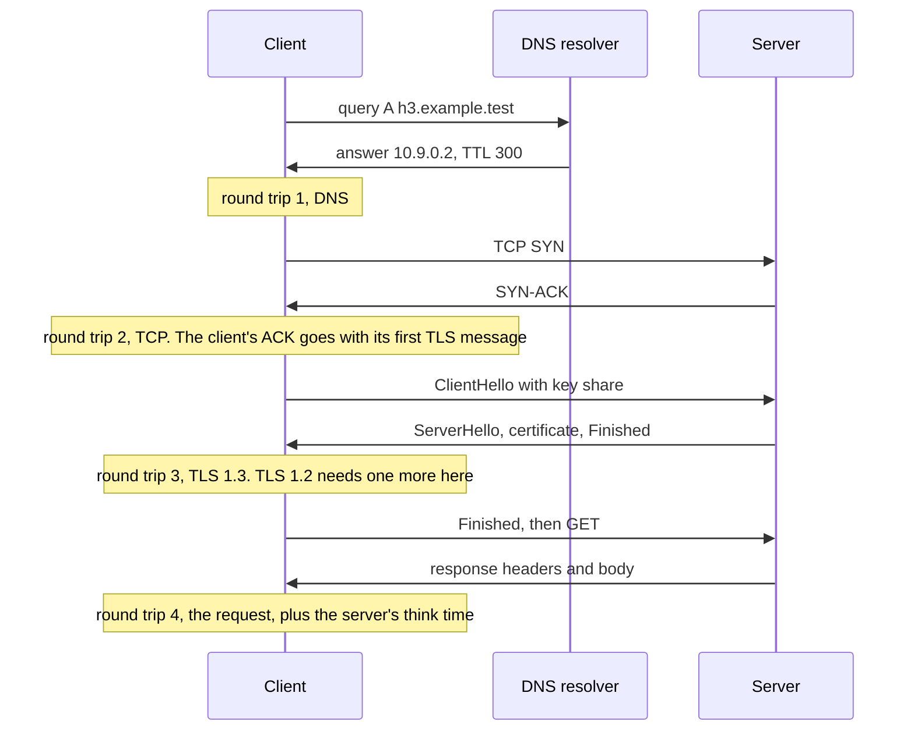
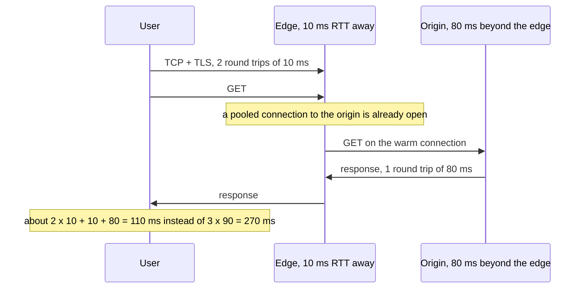

<!-- markdownlint-disable MD001 -->
<!-- markdownlint-disable MD024 -->
<!-- markdownlint-disable MD025 -->
<!-- markdownlint-disable MD026 -->
<!-- markdownlint-disable MD029 -->
<!-- markdownlint-disable MD033 -->
<!-- markdownlint-disable MD036 -->
<!-- markdownlint-disable MD040 -->
<!-- markdownlint-disable MD056 -->
<!-- markdownlint-disable MD060 -->

# H20. End-to-end latency and performance

---

## Contents

| #     | Sub-topic                                                                           | Tag   |
| ----- | ----------------------------------------------------------------------------------- | ----- |
| 20.01 | Latency, bandwidth and throughput: the round trip as the unit of web performance    | CORE  |
| 20.02 | Anatomy of a cold HTTPS fetch, counted in round trips                               | CORE  |
| 20.03 | Removing round trips: reuse, resumption, 0-RTT, hints, and the edge                 | CORE  |
| 20.04 | Throughput: slow start, the initial window, BDP, buffers and bufferbloat            | DEEP  |
| 20.05 | Payload: compression, image formats, caching                                        | AWARE |
| 20.06 | The server side: keep-alive, connection limits, thread pools, tail latency          | DEEP  |
| 20.07 | Measuring: `curl -w`, the browser's waterfall, the JDK client, tracing              | CORE  |
| 20.08 | The story: a dashboard that was slow in Sydney                                      | CORE  |
| 20.09 | Labs: phase timing in Java, HTTP/2 against HTTP/3 in Rust, an edge, a queue, a pool | CORE  |
| 20.10 | Exercises                                                                           |       |
| 20.11 | Solutions                                                                           |       |
| 20.12 | Takeaways                                                                           |       |

Tags: **CORE** is what an architect is expected to explain unprompted, **DEEP** is the mechanism underneath it, **AWARE** is a fact to know exists and not to derive.

Terms used throughout. Each is defined here, before any section uses it. Terms from H01 to H19 (DNS, resolver, TCP handshake, TLS 1.2 and 1.3 handshakes, session resumption, 0-RTT, ALPN, congestion window, slow start, CUBIC, BBR, bandwidth-delay product, HTTP/2, QUIC, HTTP/3, Alt-Svc) keep their meaning.

- **Latency**: the time from an action to its effect, here from the start of a request to the arrival of the response, or of one phase of it.  
  **One-way delay** is the time a packet takes to cross the path in one direction.

- **Round-trip time (RTT)**: the time from sending a packet to receiving the answer to it, when the other side answers at once: twice the one-way delay plus any queueing.  
  It is the cost of every exchange in which one side must wait to hear from the other before continuing.

- **Bandwidth**: the most bits per second a link can carry, set by the slowest link on the path, the **bottleneck**.  
  **Throughput**: the bits per second a transfer actually achieves, which can be far below the bandwidth when the sender is not allowed to send faster (20.04).

- **Serialisation time**: the time to put a packet's bits on a link, its size divided by the link's bandwidth: 1500 bytes at 50 Mbit/s take 0.24 ms.

- **Cold** and **warm**: a cold request needs everything set up first (DNS answer, TCP connection, TLS session); a warm request reuses a connection that already exists.  
  A **resumed** connection is new but skips part of the TLS work using keys from an earlier session (H15).

- **Time to first byte (TTFB)**: the time from sending a request to receiving the first byte of its response: one round trip plus the server's own time.

- **Server think time**: how long the server spends producing a response after the request has arrived, including its own waits for databases and other services.

- **Edge**: a server near the user, typically one of a CDN's (content delivery network's) many locations,  
  that terminates TCP and TLS and forwards requests to the **origin**, the service's own servers, over connections it keeps open.

- **Initial window (IW)**: how many packets a new TCP connection may send before its first acknowledgement returns.  
  Linux and most servers use 10 (**IW10**, RFC 6928).

- **Bufferbloat**: excessive queueing delay caused by a large buffer in front of a bottleneck that a sender keeps full.

- **Percentile**: the latency below which a given fraction of requests fall. **p50** is the median, **p99** the value only 1 request in 100 exceeds.  
  The high percentiles are the **tail**.

- **Utilisation**: the fraction of time a server (or a pool of workers) is busy, arrival rate times mean service time divided by the number of workers.

- **Little's law**: in any stable system, the mean number of requests inside it equals the arrival rate times the mean time each spends inside (L = λW).

- **Open-loop** and **closed-loop load**: an open-loop generator starts requests on a schedule whatever the server is doing,  
  as independent users do; a closed-loop generator has a fixed number of clients that each wait for a response before sending the next request, as most benchmark tools do (20.06).

- **`pathemu`**: H19's TUN-device path emulator, here with a device name and subnet option so that two paths can run at once.  
  It delays, rate-limits, queues and drops IP packets, TCP and UDP alike.

Outputs in this module are real. They come from `Anatomy.java` (about 250 lines of plain JDK 21: a stub DNS server, a client that times each phase of a request over its own socket and TLS,  
and the slow-start and queueing experiments), `Tail.java` (a JDK `HttpServer` and a load generator in one process),  
a Rust origin and client on `rustls`, `hyper`, `quinn` and `h3`, Caddy as an edge, `curl`,  
and Chromium driven by Playwright. Every network path is emulated by `pathemu`, so "40 ms RTT" means exactly 40 ms of added delay.  
Facts not observed in the labs are marked "from memory".

---

## 20.01 Latency, bandwidth and throughput: the round trip as the unit of web performance

Bandwidth is how many bytes a path can carry per second; latency is how long any one byte takes to arrive.  
Most web requests are small, so they are limited by latency, not bandwidth: a 10 KB response on a 40 ms path takes 40 ms whether the link is 10 Mbit/s or 10 Gbit/s,  
because the time to send 10 KB (8 ms at 10 Mbit/s, 0.008 ms at 10 Gbit/s) is small next to the round trip.  
Round trips are bounded below by the speed of light in fibre, about 200,000 km/s, so 1 ms of RTT per 100 km of distance, and no protocol can beat that.  
A request's time is therefore best counted in round trips: count how many a request needs, multiply by the RTT, add server time and transfer time. **[CORE]**

**Why bandwidth stops helping.**  
The time to receive a response of S bytes on a warm connection is about one RTT (the request out, the first byte back) plus S divided by the throughput.  
At 40 ms RTT:

| Response size | At 10 Mbit/s      | At 100 Mbit/s     | At 1 Gbit/s       | Share of the 1 Gbit/s time that is the RTT |
| ------------- | ----------------- | ----------------- | ----------------- | ------------------------------------------ |
| 10 KB         | 40 + 8 = 48 ms    | 40 + 0.8 = 41 ms  | 40 + 0.08 = 40 ms | 99.8%                                      |
| 100 KB        | 40 + 80 = 120 ms  | 40 + 8 = 48 ms    | 40 + 0.8 = 41 ms  | 98%                                        |
| 10 MB         | 40 + 8000 = 8.0 s | 40 + 800 = 0.84 s | 40 + 80 = 0.12 s  | 33%                                        |

Ten times the bandwidth cuts the 10 MB download by ten; it does almost nothing for the 10 KB API response.  
This is why, from memory, studies of page load time (Mike Belshe's at Google, quoted in Grigorik's "High Performance Browser Networking") found load time flat above about 5 Mbit/s but falling in a straight line with every millisecond of RTT removed.  
On a new connection it is worse than the table shows, because TCP does not start at full throughput (20.04).

**The physical floor** (from memory; standard figures).  
Light in glass fibre travels at about two thirds of its speed in a vacuum, roughly 200,000 km/s, or 5 microseconds per km one way.  
A round trip therefore costs at least 1 ms per 100 km of fibre, and fibre rarely runs in a straight line:

| Path                   | Great-circle distance | Minimum RTT in fibre | Typical measured RTT |
| ---------------------- | --------------------- | -------------------- | -------------------- |
| Within one data centre | under 1 km            | under 0.01 ms        | 0.1 to 0.5 ms        |
| Frankfurt to London    | about 640 km          | about 6.4 ms         | about 15 ms          |
| New York to London     | about 5,600 km        | about 56 ms          | about 70 ms          |
| US East to Sydney      | about 16,000 km       | about 160 ms         | about 200 to 230 ms  |

Mobile networks add their own delay on top (from memory: tens of milliseconds on 4G, more when the radio has to wake up).  
The only ways to reduce the RTT itself are to move the server closer (20.03) or to use straighter paths; everything else reduces the *number* of round trips.

**Queueing makes the RTT variable.** The RTT includes time spent waiting in router queues.  
On an idle path it is the propagation delay; on a busy one it can be many times larger (Lab 05: from 44 ms to over 600 ms).  
So "the RTT" is a distribution, and its minimum is the path's true length.

### Interview angle

When asked "how would you make this API faster for users in another region", start by counting round trips and multiplying by the RTT, before mentioning bandwidth, CPU or caching.  
Quote the physics: 1 ms per 100 km in fibre, so a cross-Pacific request has a floor of over 100 ms per round trip and a cold HTTPS request costs several of them.

---

## 20.02 Anatomy of a cold HTTPS fetch, counted in round trips

A request on a brand-new connection pays, in order: a DNS lookup (one round trip to the resolver, more if the resolver itself must ask other servers),  
the TCP handshake (one round trip), the TLS handshake (two round trips for TLS 1.2, one for TLS 1.3), and then the request itself (one round trip plus server time), plus transfer time.  
That is 5 round trips to the first byte with TLS 1.2, 4 with TLS 1.3, 3 with HTTP/3 (QUIC merges the transport and TLS handshakes),  
and with 0-RTT resumption only 2 over QUIC (DNS and the request). Every later request on the same connection costs one round trip.  
Lab 01 and Lab 02 measured each of these on a 40 ms path. **[CORE]**



The counts, for the first byte of the response, ignoring server time:

| Stack                                        | DNS | Transport                         | TLS | Request | Round trips, DNS answer not cached | DNS answer cached |
| -------------------------------------------- | --- | --------------------------------- | --- | ------- | ---------------------------------- | ----------------- |
| HTTP/1.1 or HTTP/2, TLS 1.2, full            | 1   | 1                                 | 2   | 1       | 5                                  | 4                 |
| HTTP/1.1 or HTTP/2, TLS 1.2, resumed         | 1   | 1                                 | 1   | 1       | 4                                  | 3                 |
| HTTP/1.1 or HTTP/2, TLS 1.3, full            | 1   | 1                                 | 1   | 1       | 4                                  | 3                 |
| HTTP/1.1 or HTTP/2, TLS 1.3, resumed         | 1   | 1                                 | 1   | 1       | 4                                  | 3                 |
| TLS 1.3 with 0-RTT early data over TCP       | 1   | 1                                 | 0   | 1       | 3                                  | 2                 |
| HTTP/3, full                                 | 1   | 1 (QUIC handshake, including TLS) | 0   | 1       | 3                                  | 2                 |
| HTTP/3, 0-RTT                                | 1   | 0                                 | 0   | 1       | 2                                  | 1                 |
| Any stack, request on an existing connection | 0   | 0                                 | 0   | 1       | 1                                  | 1                 |

Two rows surprise people.  
**TLS 1.3 resumption saves no round trip** over a full TLS 1.3 handshake: both take one; resumption saves the certificate and its verification (bytes and CPU),  
and enables 0-RTT. And **TLS 1.2 resumption** saves one of TLS 1.2's two round trips, which made it essential before TLS 1.3.  
TCP Fast Open (RFC 7413) can also put data in the SYN, removing the TCP round trip on repeat connections; from memory,  
it is rarely usable on the open internet because middleboxes drop such SYNs, and browsers no longer use it.

**What Lab 01 measured** (Java, JSSE, HTTP/1.1, a stub DNS server one round trip away, 40 ms RTT; the times are cumulative from the start of each connection):

```text
TLSv1.3 connection 1: DNS  44.2  TCP  87.6  TLS  141.6  first byte  185.8  done  186.1 ms  server saw TLSv1_3, Full  | next request  44.4 ms
TLSv1.3 connection 2: DNS   0.0 (cached)  TCP  43.3  TLS   97.7  first byte  140.8  done  141.1 ms  server saw TLSv1_3, Resumed  | next request  44.7 ms
TLSv1.3 connection 3: DNS   0.0 (cached)  TCP  44.0  TLS   93.2  first byte  137.7  done  137.9 ms  server saw TLSv1_3, Resumed  | next request  45.2 ms
```

The cold TLS 1.3 connection reached its first response byte at 185.8 ms: four round trips (176 ms of path delay) plus about 10 ms of computation.  
Taking each phase apart: DNS 44.2 ms, TCP 43.4 ms, TLS 54.0 ms, request 44.2 ms.  
TLS is the one phase noticeably longer than a round trip, by about 10 ms: the server's signature and the client's certificate verification and key agreement in JSSE.  
The resumed connections (DNS cached) are three round trips, 137.7 to 140.8 ms. TLS 1.2, same run:

```text
TLSv1.2 connection 1: DNS  44.0  TCP  87.3  TLS  186.5  first byte  230.6  done  231.2 ms  server saw TLSv1_2, Full  | next request  44.5 ms
TLSv1.2 connection 2: DNS   0.0 (cached)  TCP  43.3  TLS   91.9  first byte  136.0  done  136.3 ms  server saw TLSv1_2, Resumed  | next request  44.2 ms
TLSv1.2 connection 3: DNS   0.0 (cached)  TCP  42.4  TLS   89.0  first byte  132.8  done  133.1 ms  server saw TLSv1_2, Resumed  | next request  43.7 ms
```

The full TLS 1.2 handshake took 99.2 ms, two round trips plus computation, so the whole fetch is five round trips (231.2 ms).  
Resumed TLS 1.2 took 46.6 to 48.6 ms for its one round trip, a little less than resumed TLS 1.3's 49.2 to 54.4 ms: an abbreviated TLS 1.2 handshake does no public-key operation at all,  
while TLS 1.3 resumption still runs an ephemeral key exchange alongside the pre-shared key (from memory, the `psk_dhe_ke` mode that browsers and rustls use, to keep forward secrecy).

Before any of this, each JVM spent about 300 ms on its first TLS handshake to a local address (the warm-up line in Lab 01: class loading, just-in-time compilation, key generation).  
A short-lived process, such as a command-line tool, a serverless function, or a batch job that opens one connection, pays that on every run; long-running services pay it once.

**What Lab 02 measured** (Rust, HTTP/2 over TLS 1.3 against HTTP/3, same path):

```text
h2 connection 1: TCP   42.9  TLS   87.0 (Full)  response  131.3 ms  server saw TLSv1_3, Full  | next request  42.5 ms
h2 connection 2: TCP   43.4  TLS   87.3 (Resumed)  response  131.7 ms  server saw TLSv1_3, Resumed  | next request  43.6 ms
h2 connection 3: TCP   42.9  TLS   86.6 (Resumed)  response  130.7 ms  server saw TLSv1_3, Resumed  | next request  43.6 ms
h3 connection 1: QUIC usable   45.3 (1-RTT handshake)  response   89.5 ms  server-timing app;dur=0.0  | next request  43.9 ms
         0-RTT accepted by the server: true
h3 connection 2: QUIC usable    0.2 (0-RTT)  response   45.1 ms  server-timing app;dur=0.0  | next request  43.9 ms
         0-RTT accepted by the server: true
h3 connection 3: QUIC usable    0.3 (0-RTT)  response   46.5 ms  server-timing app;dur=0.0  | next request  42.4 ms
h3 connection 1: QUIC usable   45.0 (1-RTT handshake)  response   88.9 ms  server-timing app;dur=0.0  | next request  42.8 ms
h3 connection 2: QUIC usable   45.5 (1-RTT handshake)  response   90.1 ms  server-timing app;dur=0.0  | next request  43.7 ms
```

HTTP/2: three round trips (TCP, TLS, request) to a response at about 131 ms, the same with and without resumption, as the table predicts.  
HTTP/3: two round trips (89.5 ms) on the first connection, and one (45.1 and 46.5 ms) with 0-RTT, where the request goes in the first flight and "QUIC usable" is at 0.2 ms;  
the server confirmed that it accepted the early data.  
With `early=0` the client did not use its ticket and every connection took two round trips.  
A request on an existing connection cost one round trip (42.4 to 45.2 ms) in every protocol: once connected, they are all equal for a single small request.

### Interview angle

Draw the sequence for a cold request and count round trips aloud: DNS, TCP, TLS (two for 1.2, one for 1.3), request; then show how HTTP/3 merges two of them and 0-RTT removes another.  
Mention what resumption really saves in TLS 1.3 (CPU and bytes, not a round trip), and that 0-RTT data can be replayed, so only idempotent requests may use it (H15, H18).

---

## 20.03 Removing round trips: reuse, resumption, 0-RTT, hints, and the edge

The cheapest round trip is the one not taken.  
In order of impact: **reuse connections** (keep-alive, HTTP/2 and HTTP/3 multiplexing, connection pools), so most requests cost one round trip;  
**resume TLS** and use **0-RTT** where replay is safe;  
**start work early**, with DNS prefetch and preconnect hints and 103 Early Hints, so that the round trips happen while the browser is busy with something else;  
and **move the handshake closer**, with an edge near the user that keeps warm connections to the origin.  
An edge turns a cold fetch of 3 round trips at 90 ms into 3 at 10 ms plus 1 at 80 ms, but only if its connection to the origin is already open. **[CORE]**

**Reuse.**  
Lab 01 and Lab 02's "next request" column is one round trip in every case; a new connection is three to five.  
HTTP/1.1 keep-alive (H08), HTTP/2 multiplexing (H17) and pools in clients and proxies all exist to stay on that cheaper line.  
The usual failures are a client that creates a new HTTP client object per request (and so a new pool, and a new TLS handshake every time),  
and idle timeouts that close connections between bursts (20.06).

**Resumption and 0-RTT.** Measured above: resumption saves one round trip only with TLS 1.2;  
with TLS 1.3 it saves sending and verifying the certificate (in Lab 01's JSSE client, 0 to 5 ms per handshake, since the key exchange still runs;  
in Lab 02's `rustls` client, nothing measurable) and makes 0-RTT possible,  
which saves a round trip only when the server accepts early data (Lab 02: 45 ms against 89 ms for HTTP/3; H18 Lab 05).  
Session tickets must be shared across all servers behind a load balancer, or resumption fails whenever a client lands on a different one (H16).

**Hints that move round trips earlier** (from memory; not measured here, since these need a real browser fetching real subresources from other origins):

- `<link rel="dns-prefetch" href="https://cdn.example">` resolves a name the page will need; `<link rel="preconnect" href="https://cdn.example">` also opens the TCP and TLS connection.  
  Both overlap setup round trips with the HTML download.  
  Preconnecting to an origin that is not used wastes a connection, so browsers close it after a few seconds.

- **103 Early Hints** (RFC 8297): an informational response the server sends before the final response, carrying `Link: <...>; rel=preload` or `rel=preconnect` headers.  
  It lets the browser start fetching the stylesheet while the server is still computing the HTML, using the server's think time.  
  From memory, Chromium acts on 103 only over HTTP/2 and HTTP/3, and only on the main navigation. H17 explains why this replaced HTTP/2 server push.

**The edge.** A CDN puts servers near users and terminates TCP and TLS there.  
  Lab 03 measured it with two emulated paths: the client 10 ms (RTT) from a Caddy reverse proxy, and the proxy 80 ms from the origin, against the client going straight to the origin over 90 ms:

```text
-- direct to the origin, 90 ms RTT
h2 connection 1: TCP   93.2  TLS  187.8 (Full)  response  281.7 ms  server saw TLSv1_3, Full  | next request  93.6 ms
h2 connection 2: TCP   92.4  TLS  186.8 (Resumed)  response  279.1 ms  server saw TLSv1_3, Resumed  | next request  93.7 ms
-- via the edge, user 1
h2 connection 1: TCP   19.2  TLS   33.7 (Full)  response  298.2 ms  server saw TLSv1_3, Full  | next request  96.4 ms
-- via the edge, user 2
h2 connection 1: TCP   12.6  TLS   26.7 (Full)  response  123.1 ms  server saw TLSv1_3, Full  | next request  97.2 ms
```



Directly, the cold request took 281.7 ms, three round trips of 90 ms; resumption did not change that (279.1 ms).  
Through the edge, the first user waited longer, 298.2 ms, because the edge had to open its own connection to the origin: three round trips of 10 ms, then TCP, TLS and the request over 80 ms.  
The second user, a new client on a new connection, got its response in 123.1 ms: the TCP and TLS round trips to the edge (26.7 ms),  
then one round trip to the edge plus one from the edge to the origin over the connection the first user's request had opened.  

A later request on an existing connection is slightly slower through the edge (96.4 and 97.2 ms against 93.6 ms direct),  
since the edge adds its own processing and the paths add up to the same 90 ms: the edge's gain is in connection setup only.  
An edge that could answer from its cache would remove the 80 ms as well (Caddy has no response cache in its standard build, from memory; CDNs do, R9).

The lesson for a deployment: an edge helps cold and short-lived connections, provided its pool to the origin stays warm.  
A rarely used edge location whose connections to the origin have timed out gives the first user of each idle period the slowest request of all.

### Interview angle

"Our users in Asia see 2-second page loads, the servers are in Virginia."  
Count: at about 200 ms RTT, a cold HTTPS request is 4 to 5 round trips, around 1 second before any server work; a page with several origins pays that more than once.  
Then remove round trips in order: reuse connections, TLS 1.3, HTTP/3 with 0-RTT for idempotent requests, preconnect to third-party origins,  
and an edge or CDN in the region with warm origin connections, or a regional deployment of the service itself when the data can live there.

---

## 20.04 Throughput: slow start, the initial window, BDP, buffers and bufferbloat

A new TCP connection may send only its initial window, 10 packets (about 14 KB), in its first round trip, and then roughly doubles per round trip (slow start, H04).  
So a response's size decides how many round trips it needs on a new connection: up to about 14 KB in one, 43 KB in two, 100 KB in three, 217 KB in four.  
To use a path fully, the window must reach the bandwidth-delay product, and the buffers at both ends must be at least that large.  
A connection that sits idle for longer than its retransmission timeout falls back to the initial window.  
And a large router buffer in front of a bottleneck that a loss-based sender (CUBIC) keeps full adds its whole length as delay for every other flow on it: bufferbloat. **[DEEP]**

**The initial window in round trips.**  
Packets delivered after k round trips of slow start, starting at 10 and doubling: 10, 30, 70, 150, 310, 630 packets, or with 1448-byte segments about 14 KB, 43 KB, 101 KB, 217 KB, 449 KB and 912 KB.  
Lab 04 measured request-to-last-byte for responses of each size, over TLS 1.3 and HTTP/1.1, with CUBIC on the server and 40 ms RTT at 50 Mbit/s:

```text
response size   new connection   warm connection   same, after 1 s idle   (request to last byte, median of 3)
      1000 B         43.8 ms           43.9 ms             44.2 ms
     10000 B         45.1 ms           44.4 ms             45.7 ms
     14000 B         84.6 ms           46.3 ms             46.1 ms
     30000 B         88.4 ms           48.1 ms             88.4 ms
     60000 B        131.0 ms           52.9 ms            129.3 ms
    120000 B        174.5 ms           61.7 ms            138.7 ms
    250000 B        220.8 ms          140.4 ms            220.2 ms
    500000 B        270.1 ms          196.5 ms            310.7 ms
   1000000 B        392.6 ms          389.3 ms            474.7 ms
```

The "new connection" column follows the prediction: 10 KB in one round trip (45 ms), 30 KB in two (88 ms), 60 KB in three (131 ms), 120 KB in four (175 ms), 250 KB in five (221 ms).  
From 500 KB on, the window exceeds the path's bandwidth-delay product (50 Mbit/s x 40 ms = 250 KB) and the link's rate becomes the limit too.  
The 14,000-byte response is the instructive case: it fits the "14.5 KB" rule of thumb, yet needed a second round trip. The first flight on the wire shows why:

```text
   67.0 ms  server sends  792 bytes of TCP payload   TLS records: 122,1,654
  112.0 ms  server sends  184 bytes of TCP payload   TLS records: 179
  112.1 ms  server sends 1448 bytes of TCP payload   TLS records: (continued)
  112.1 ms  server sends 1448 bytes of TCP payload   TLS records: (continued)
  112.1 ms  server sends 1448 bytes of TCP payload   TLS records: (continued)
  112.1 ms  server sends 1448 bytes of TCP payload   TLS records: (continued)
  112.1 ms  server sends 1448 bytes of TCP payload   TLS records: (continued)
  112.1 ms  server sends 1448 bytes of TCP payload   TLS records: (continued)
  112.1 ms  server sends 1448 bytes of TCP payload   TLS records: (continued)
  112.1 ms  server sends 1448 bytes of TCP payload   TLS records: (continued)
  112.1 ms  server sends 1448 bytes of TCP payload   TLS records: (continued)
  154.1 ms  server sends 1159 bytes of TCP payload   TLS records: 14186
  197.7 ms  server sends   24 bytes of TCP payload   TLS records: 19
```

The initial window is ten *packets*, not 14,480 bytes.  
The server spent one of them on a 184-byte segment, a 179-byte TLS record sent just after the handshake  
(by its size, the two TLS 1.3 session tickets rustls sends by default, read in rustls's source), and the response itself, one 14,186-byte TLS record with headers and body,  
 needed ten more full segments. Ten packets left at 112 ms; the last 1159 bytes waited for an acknowledgement and left at 154 ms.  
So the practical budget for "one round trip" is under 14 KB of everything the server sends after the handshake, including TLS overhead and anything sent separately;  
small writes with Nagle off spend whole packets.

**Warm connections and idle restart.**  
On a connection that has just moved 4 MB, the window is already large: everything up to 120 KB arrived in one round trip plus serialisation (46 to 62 ms).  
Above that, the warm column is worse than ideal, 389 ms for 1 MB against about 200 ms (one round trip plus 160 ms at 50 Mbit/s):  
the large window sends the response as a burst bigger than the emulated bottleneck's 100-packet queue, packets are dropped, and loss recovery costs round trips.  
The third column is the same warm connection after one second of silence: it behaved like a new connection again (30 KB in 88 ms, 250 KB in 220 ms),  
because Linux resets the congestion window after an idle period longer than the retransmission timeout (`net.ipv4.tcp_slow_start_after_idle`, default 1;  
from memory, the behaviour follows RFC 2861 and RFC 5681). With it set to 0 (Lab 04's second run), the idle column matched the warm one:

```text
net.ipv4.tcp_slow_start_after_idle=0:
response size   new connection   warm connection   same, after 1 s idle   (request to last byte, median of 3)
      1000 B         44.7 ms           43.6 ms             43.9 ms
     10000 B         45.4 ms           45.2 ms             45.3 ms
     14000 B         87.0 ms           46.2 ms             46.2 ms
     30000 B         88.6 ms           48.2 ms             48.4 ms
     60000 B        131.5 ms           52.6 ms             53.1 ms
    120000 B        175.0 ms           62.6 ms             63.5 ms
```

This matters for any connection that carries bursts with pauses in between, such as an API client sending a request every few seconds,  
or HTTP/2 between a load balancer and a backend: with the default, every burst after a pause starts from 10 packets again.  
Turning it off is common on servers that talk to a known, uncongested network (from memory, many CDN and RPC deployments do); on the open internet the reset protects against sending a full stale window into a path whose conditions have changed.

**The bandwidth-delay product and buffers.** To keep a path full, a sender needs BDP = bandwidth x RTT bytes in flight: 250 KB at 50 Mbit/s and 40 ms, 12.5 MB at 1 Gbit/s and 100 ms.  
The receiver must advertise a window that large and the sender must keep that much unacknowledged data buffered,  
so socket buffers below the BDP cap throughput no matter how fast the link is. Linux auto-tunes socket buffers up to `net.ipv4.tcp_rmem` and `tcp_wmem` maximums (from memory,  
6 MB and 4 MB by default), enough for 1 Gbit/s at about 40 ms; long fat paths need them raised. QUIC has the same rule for its flow-control windows (H18 Lab 09).

**Bufferbloat.** A router queue absorbs bursts, but a loss-based sender such as CUBIC grows its window until the queue overflows,  
so on a long-lived download it keeps the queue nearly full, and every other packet through that bottleneck waits behind it.  
Lab 05 measured a small request's latency on one connection while a bulk download ran on another,  
through a 20 Mbit/s bottleneck with a 1000-packet or a 50-packet queue, with CUBIC or BBR sending:

```text
queue 1000 packets, cubic: small request, link idle: median   44.6 ms | during the download: median  394.0, 90th  630.7, max  640.8 ms | download 18.1 Mbit/s
queue 1000 packets, bbr: small request, link idle: median   44.4 ms | during the download: median   85.0, 90th   90.0, max   96.6 ms | download 18.8 Mbit/s
queue 50 packets, cubic: small request, link idle: median   45.0 ms | during the download: median   65.4, 90th   71.8, max   74.0 ms | download 19.3 Mbit/s
queue 50 packets, bbr: small request, link idle: median   44.4 ms | during the download: median   62.8, 90th   71.1, max   73.7 ms | download 18.9 Mbit/s
```

With a 1000-packet queue (1.5 MB, 600 ms at 20 Mbit/s) and CUBIC, the small request went from 44.6 ms to a median of 394 ms and a 90th percentile of 631 ms: the queue was full,  
and the download got no more throughput for it (18.1 Mbit/s, against 19.3 with the short queue).  

BBR, which paces to the measured bandwidth and keeps queues short (H04), held the same request at about 85 ms in the same deep buffer.  
With a 50-packet queue, both controllers kept it near 65 ms.  
The fixes are on both sides of the bottleneck: smaller or managed queues in routers (from memory, active queue management such as CoDel and FQ-CoDel,  
the Linux default qdisc on many distributions), and senders that do not fill queues (BBR, or pacing).  
For a service team, the symptom is "latency is fine until someone starts a big upload", on home routers, Wi-Fi and cellular links.

### Interview angle

Explain why the first 14 KB is special (the initial window, one round trip) and how responses of 100 KB to 1 MB cost several round trips on a new connection,  
so payload size and connection reuse are linked. Know the BDP formula and use it to size buffers and windows.  
For bufferbloat, describe the mechanism (a loss-based sender keeps a deep queue full, so everyone's RTT includes it) and both fixes (queue management in the network, pacing or BBR at the sender).

---

## 20.05 Payload: compression, image formats, caching

Bytes not sent cost no time. Compress text (HTML, CSS, JavaScript, JSON) with gzip, Brotli or zstd, typically to between a quarter and a third of its size;  
serve images in modern formats (WebP, AVIF) at the size they are displayed;  
and avoid sending what the client already has, through HTTP caching with validators (R9) and long-lived immutable assets with versioned names.  
Payload size interacts with 20.04: a response cut from 60 KB to 14 KB goes from three round trips to one on a new connection. **[AWARE]**

What to know, from memory and from earlier modules rather than from a lab here:

- **Compression** (H09 measured gzip with nginx): `Content-Encoding: gzip`, `br` or `zstd`, negotiated by `Accept-Encoding`.  
  Brotli and zstd usually beat gzip on text at similar speed; precompressing static files at the highest level moves the CPU cost out of the request.  
  Do not compress already-compressed formats (images, video, archives), and keep secrets and attacker-controlled text out of the same compressed response (the BREACH attack, H16).
- **Header compression** is HPACK in HTTP/2 and QPACK in HTTP/3 (H17, H19); large cookies still cost bytes on every request.
- **Images** are most of the bytes of a typical page (from memory, about half).  
  Responsive images (`srcset`) and modern formats save more than any protocol change.
- **Caching** (R9): a fresh cached response costs zero round trips; a revalidation (`If-None-Match`, `304 Not Modified`) costs one round trip and almost no bytes.  
  A CDN cache turns the edge of 20.03 into a complete answer, without the trip to the origin.

### Interview angle

Rank the levers by size: caching (zero round trips) beats compression (fewer bytes) beats protocol tuning.  
Tie payload size back to slow start: the first 14 KB of a response arrive in the first round trip of a new connection, which is why critical HTML and inline CSS are kept small.

---

## 20.06 The server side: keep-alive, connection limits, thread pools, tail latency

A server adds its own think time and, under load, its own queueing.  
With a fixed pool of N workers, latency stays flat until utilisation approaches 1 and then grows without bound, and the requests that wait longest are the tail.  
Size pools with Little's law (workers needed = arrival rate x time each request holds a worker), and prefer designs where a waiting request does not hold a scarce thread (event loops, or virtual threads in Java 21).  
At the connection level, keep-alive and idle timeouts must be ordered (client shorter than server shorter than load balancer, or the reverse depending on who closes),  
and connection limits must be set from expected concurrency. Measure all of this with open-loop load, because a closed-loop benchmark hides queueing. **[DEEP]**

**Queueing in a thread pool.**  
Lab 06 runs a JDK `HttpServer` whose handler waits 10 ms (standing in for a database call), with 1 request in 100 waiting 200 ms instead, on a fixed pool of 8 platform threads.  
The mean service time is about 0.99 x 10.1 + 0.01 x 200 = 12 ms, so the pool's capacity is about 8 / 12 ms = 667 requests per second.  
An open-loop generator starts requests at a fixed rate for 10 seconds and measures each from its scheduled start:

```text
platform:8 open   rate 300    done  3000 ( 294/s)  p50   11.3  p90   12.3  p99   201.0  p99.9   202.0  max   203.2 ms  Little:   4.3 in system, peak in service 8
platform:8 open   rate 500    done  5000 ( 490/s)  p50   11.1  p90   12.8  p99   200.8  p99.9   201.5  max   303.1 ms  Little:   9.0 in system, peak in service 8
platform:8 open   rate 600    done  6000 ( 588/s)  p50   11.1  p90   84.9  p99   200.7  p99.9   267.7  max   309.3 ms  Little:  15.6 in system, peak in service 8
platform:8 open   rate 650    done  6500 ( 627/s)  p50  203.8  p90  215.8  p99   366.2  p99.9   402.9  max   406.3 ms  Little: 127.4 in system, peak in service 8
platform:8 open   rate 700    done  7000 ( 629/s)  p50  585.2  p90  867.0  p99   929.2  p99.9  1061.3  max  1122.6 ms  Little: 362.0 in system, peak in service 8
```

- At 300 and 500 per second (utilisation about 45% and 75%), the median stays at 11 ms.  
  The p99 is 200 ms at every load because exactly 1% of requests are slow by design: a p99 can be dominated by one slow dependency long before any queueing.

- At 600 per second (90%), the median is still 11 ms but the 90th percentile jumps to 85 ms: some fast requests now wait behind slow ones that hold threads.

- At 650 per second (97%), the median is 204 ms: almost every request waits.

- At 700 per second (105%, overloaded), the server completes about 629 per second and the queue grows for the whole run: the median is 585 ms and would keep rising with a longer test.  
  Little's law reads it directly: 362 requests in the system on average, against 8 in service.

The curve is the classic queueing result (from memory, for an M/M/c queue the waiting time grows as 1 / (1 - utilisation)): flat, then a knee, then a wall.  
Running a service at 90% utilisation leaves no room for a burst, so capacity plans target well under the knee (often 50 to 70% at peak, from memory) and services shed load before the wall.

**Virtual threads.** The same handler on JDK 21 virtual threads, one per request:

```text
virtual    open   rate 700    done  7000 ( 686/s)  p50   10.9  p90   11.6  p99   200.6  p99.9   201.5  max   207.9 ms  Little:   9.6 in system, peak in service 62
virtual    open   rate 2000   done 20000 (1961/s)  p50   10.8  p90   13.4  p99   200.5  p99.9   202.3  max   301.8 ms  Little:  34.3 in system, peak in service 241
```

At 700 and 2000 per second the median stayed at 11 ms and the p99 at 200 ms, with 62 and 241 requests in service at the peak.  
A virtual thread that sleeps or blocks on I/O releases its carrier thread, so waiting requests do not occupy a scarce worker; the limit moves to whatever they wait for.  
In production that is the database's connection pool, a downstream service's capacity, or CPU,  
so the same Little's-law arithmetic applies one layer down (at 2000 per second with 10 ms database calls, about 20 connections must be busy on average, Exercise 05).  
Event-loop servers (Netty, `tokio`, nginx) get the same effect without threads, as long as no handler blocks the loop.

**Tail latency at scale** (from memory: Dean and Barroso, "The Tail at Scale", 2013).  
When one user request fans out to many backends in parallel, it waits for the slowest.  
If each backend exceeds its p99 on 1% of calls, a request that calls 100 of them sees at least one slow call with probability 1 - 0.99^100 = 63%.  
The tail of each component becomes the median of the system.  
The remedies are architectural: fewer sequential and parallel dependencies on the request path, timeouts and hedged requests (send a second copy to another replica  
if the first has not answered by, say, its p95), and keeping utilisation away from the knee.

**Keep-alive and connection limits** (from memory).  
Every server closes idle connections after a timeout (nginx `keepalive_timeout` 75 s by default, and `keepalive_requests` 1000 requests per connection),  
and so do load balancers (AWS's Application Load Balancer, 60 s by default).  
If a client reuses a connection just as the server closes it, the request fails with a reset or an empty response; clients must retry idempotent requests on a new connection,  
and the side that sends requests should time out idle connections first.  
Limits on connections per client or per backend, and accept queues (`net.core.somaxconn`, the backlog argument of `listen`), cap concurrency at the transport level;  
when they are reached, clients see connection timeouts rather than slow responses, which looks like a network problem.

**Measuring it honestly: open against closed loop.**  
The last line of Lab 06 is a closed-loop benchmark, 8 clients each sending the next request as soon as the last returns, which is how many load tools work by default:

```text
platform:8 closed clients 8   done  5883 ( 585/s)  p50   11.3  p90   12.3  p99   156.4  p99.9   202.2  max   202.9 ms  Little:   7.9 in system, peak in service 8
```

It achieved 585 requests per second, about the same as the open-loop run at 600, yet reported a 90th percentile of 12.3 ms against 84.9 ms.  
When the server stalls, a closed-loop client stops sending, so the requests that would have queued are never created and never measured.  
This is **coordinated omission** (a term from Gil Tene, from memory): the benchmark coordinates with the server's slowness and omits exactly the samples that make up the tail.  
Real users do not wait for each other. An honest load test schedules requests independently of responses and measures each from when it should have been sent, as `Tail.java`'s open-loop mode does.

### Interview angle

Use Little's law out loud: "2000 requests per second times 20 ms in the handler is 40 in flight, so a pool of 40 threads is the minimum, and the database pool behind it must hold about as many."  
Explain why latency explodes near full utilisation and why the p99 is often a dependency, not the server itself.  
Name coordinated omission when someone quotes a benchmark's p99.

---

## 20.07 Measuring: `curl -w`, the browser's waterfall, the JDK client, tracing

Measure phases, not just totals. `curl -w` prints when each phase finished, cumulative from the start: `time_namelookup`, `time_connect` (TCP), `time_appconnect` (TLS), `time_starttransfer` (first response byte) and `time_total`.  
Browsers expose the same phases to the page through Navigation Timing and Resource Timing, which is what the DevTools waterfall draws,  
and servers can add their own time with the `Server-Timing` header. The JDK `HttpClient` reports none of this, only the whole request.  
Across services, distributed tracing (W3C `traceparent`, R13) records each hop's share. **[CORE]**

**`curl -w`.** Lab 07 fetched `/work/30` (30 ms of server time) twice in one `curl` invocation, through the 40 ms path:

```text
-- curl, two requests, one connection
namelookup 0.000022  connect 0.041718  appconnect 0.088332  pretransfer 0.088490  starttransfer 0.162806  total 0.162873  (HTTP/2, new connections: 1)
namelookup 0.000018  connect 0.000000  appconnect 0.000000  pretransfer 0.000175  starttransfer 0.075108  total 0.075184  (HTTP/2, new connections: 0)
```

Reading the first line as phases: DNS 0 ms (`--resolve` supplied the address), TCP 41.7 ms, TLS 88.3 - 41.7 = 46.6 ms, then the request: first byte at 162.8 ms, so 74.5 ms after TLS,  
which is one round trip plus the 30 ms of server time.  
The second request reused the connection (`num_connects` 0), so connect and appconnect are 0 and the whole request is 75.1 ms: one round trip plus server time.  
The difference between `time_starttransfer` and `time_pretransfer` is the TTFB of 20.02; subtracting the server's own time (`Server-Timing`, below) leaves the network's share.

**The JDK `HttpClient`** times nothing for you. Wrapping `send` with a clock gives whole-request times only:

```text
-- JDK 21 HttpClient
HttpClient request 1: HTTP_2 200 in  476.2 ms, server-timing app;dur=31.2
HttpClient request 2: HTTP_2 200 in   79.3 ms, server-timing app;dur=31.3
HttpClient request 3: HTTP_2 200 in   83.1 ms, server-timing app;dur=30.4
```

The first request includes JVM warm-up, DNS (none here), TCP, TLS and the request; the second and third are one round trip plus 30 ms of server time.  
To see phases from Java, time the layers yourself as `Anatomy.java` does, or use the client's debug logging (from memory, `-Djdk.httpclient.HttpClient.log=all`), or an agent such as OpenTelemetry's Java instrumentation.

**The browser's waterfall.** Chromium, driven by Playwright, loaded `/page`, an HTML page with three images (`/work/50` and two 60 KB responses), through the same path, and the page read its own timing entries:

```text
-- Chromium, Navigation Timing and Resource Timing
resource             proto  starts   DNS    TCP    TLS   request to first byte   download   ends    server-timing
/page                h2       0.0    0.0   42.3   45.1         43.1                0.9    133.6   app=0
/work/50?a           h2     139.5    0.0    0.0    0.0        167.8                0.6    309.7   app=52.6
/bytes/60000?b       h2     140.3    0.0    0.0    0.0         52.8                2.9    197.0   app=0
/bytes/60000?c       h2     140.4    0.0    0.0    0.0        135.3                3.0    281.7   app=0
```

The navigation row is a cold fetch: TCP 42.3 ms, TLS 45.1 ms, request to first byte 43.1 ms (DNS 0 ms because the host name was mapped to an address on the command line).  
The images then shared that HTTP/2 connection, with no setup of their own.  
Their order is instructive: `/work/50` reports 52.6 ms of server time through `Server-Timing`, yet its first byte came 167.8 ms after its request, after both 60 KB images, whose bytes the server had already written into the same connection.  
The connection was still in slow start (20.04), so those 120 KB took about three round trips to drain, and the small response queued behind them.  
From memory, the socket option `TCP_NOTSENT_LOWAT` limits how far ahead of the network a server may write, which keeps such late,  
small responses from queueing behind bulk data; HTTP/2 priorities (H17) cannot reorder bytes that are already in the kernel's send buffer.

**Tracing across services** (from memory; the API side is R13). A W3C Trace Context header, `traceparent: 00-<32 hex digits of trace ID>-<16 hex digits of parent span ID>-01`,  
travels with each request; every service records a span with its start, duration and parent, and a tracing backend draws the whole request as a tree.  
It answers the question this module asks at the scale of a system: which hop spent the milliseconds.

### Interview angle

Given "the API is slow", ask for phase timings before guessing: `curl -w` from the user's region separates DNS, TCP, TLS, server time and transfer in one command.  
Read a browser waterfall as round trips (setup bars on new connections, TTFB bars that are one RTT plus server time) and spot connection reuse and queueing.  
Mention `Server-Timing` and tracing for attributing time inside the server and across services.

---

## 20.08 The story: a dashboard that was slow in Sydney

A company sells an analytics dashboard. Its servers run in one region on the US east coast; a growing share of its customers are in Australia, about 200 ms of RTT away.  
Australian customers report that the dashboard takes 4 to 6 seconds to appear, against under a second in the US.  
This traces what the team found, in order, and where it would have gone wrong.

### Chapter 01: counting round trips

The team first suspected the database. A `curl -w` run from a cloud machine in Sydney (20.07) showed otherwise: of 1.1 s for one API call, the server's own time (`Server-Timing`) was 60 ms.  
The rest was setup: DNS, TCP, a TLS 1.2 handshake (two round trips), then the request, five round trips of about 200 ms, as in Lab 01's TLS 1.2 row.  
Worse, the dashboard's front end made 12 API calls through a small HTTP library that opened a new connection for each, and the browser allows only six connections per origin over HTTP/1.1.  
The fixes were configuration: TLS 1.3 and HTTP/2 on the load balancer, so the browser made one connection for all 12 calls,  
each later call costing one round trip (Lab 01 and Lab 02's "next request" columns). The load time fell to about 2 seconds.

### Chapter 02: the edge that was slow at 7 a.m.

The team put a CDN in front of the API, with an edge location in Sydney: TCP and TLS now ended about 10 ms from the users,  
and the edge reused connections to the origin, so a cold call cost three short round trips and one long one (Lab 03, user 2).  
Most mornings, though, the first user of the day still waited more than a second: overnight, the edge's idle connections to the origin had timed out,  
and the first request paid the full setup over 200 ms (Lab 03, user 1).  
The team raised the edge's keep-alive timeout towards the origin and added a synthetic health check every 30 seconds through the Sydney edge, which kept a warm connection open.

### Chapter 03: the 180 KB that took four round trips

The dashboard's main data call returned 180 KB of JSON.  
On a new connection that is four round trips of slow start (20.04: 101 KB after three, 217 KB after four), 800 ms at 200 ms RTT, even with a warm edge,  
because the edge-to-origin connection carried bursts with long pauses between them and so restarted from the initial window after each pause (Lab 04, third column).  
Two changes: the response was compressed (gzip took it to 31 KB, two round trips on a new connection) and split,  
so the first chart's data came first; and the edge-to-origin hop, a known, well-provisioned path, was configured with `tcp_slow_start_after_idle=0` (Lab 04, second run).

### Chapter 04: Monday at 9 a.m.

With the network fixed, a new pattern appeared: every Monday at 9 a.m. Sydney time, p50 latency tripled for 20 minutes.  
The API servers ran a fixed pool of 200 threads; each request held a thread for about 45 ms while it waited on the database,  
and the Monday peak reached 4,300 requests per second across the fleet's 1,000 threads in all. Little's law gives 4,300 x 0.045 = 194 threads busy out of 1,000 on average,  
but the peak was not spread evenly: two of the five servers took most of the load through a misweighted load balancer and ran at over 95% utilisation, past the knee of Lab 06's curve.  
The team fixed the weights, moved the handlers to virtual threads (Lab 06's virtual-thread rows),  
and found the next limit exactly where Little's law said it would be: the database connection pool of 50 per server.

### Chapter 05: the load test that said everything was fine

Before the Monday incident, a load test had reported a p99 of 120 ms at the peak rate.  
It used a closed-loop tool with 200 concurrent clients, which slowed its own sending whenever the server slowed (Lab 06's closed-loop row).  
Rerun with an open-loop generator at the same rate, measured from each request's scheduled time, the same build showed the Monday behaviour on the first try.  
The team changed its performance gate to open-loop load with an explicit arrival rate, run from the region where its slowest customers are.

### Where it would have gone wrong

| If the team had...                                    | What breaks                                                       | What catches it                                               |
| ----------------------------------------------------- | ----------------------------------------------------------------- | ------------------------------------------------------------- |
| Optimised the database first                          | 60 ms of 1.1 s saved; the round trips remain (Chapter 01)         | Phase timings from the users' region (`curl -w`, Lab 07)      |
| Opened a new connection per API call                  | Three to five round trips per call instead of one                 | The "next request" column of Labs 01 and 02                   |
| Assumed the edge's origin connections stay warm       | The first user after an idle period is the slowest (Chapter 02)   | A cold-pool request through the edge (Lab 03, user 1)         |
| Ignored response size on new connections              | Several round trips of slow start per response (Chapter 03)       | Response time against size, new and idle connections (Lab 04) |
| Sized thread pools for average, not peak, utilisation | Latency jumps past the knee of the queueing curve (Chapter 04)    | Open-loop load at rising rates (Lab 06)                       |
| Trusted a closed-loop benchmark's percentiles         | A tail that exists in production but not in the test (Chapter 05) | Comparing open-loop and closed-loop results (Lab 06)          |

### A review checklist for a latency investigation

- [ ] The RTT from the users' region to every hop is known, and the request's time is split into DNS, TCP, TLS, server time and transfer.
- [ ] Connections are reused: one pooled client per process, HTTP/2 or HTTP/3 to the browser, keep-alive towards backends with ordered idle timeouts.
- [ ] TLS 1.3 everywhere; session tickets shared across servers; 0-RTT only for idempotent requests, if at all.
- [ ] Users far from the origin reach an edge, and the edge's connections to the origin stay warm.
- [ ] Critical responses are compressed and small enough for few round trips on a new connection; idle-restart behaviour is chosen on purpose for internal hops.
- [ ] Pools (threads, database connections) are sized with Little's law for peak load, with utilisation kept below the knee.
- [ ] Load tests are open-loop, with percentiles measured from scheduled send times.

---

## 20.09 Labs: phase timing in Java, HTTP/2 against HTTP/3 in Rust, an edge, a queue, a pool

Everything runs on one Linux machine, as root (for the TUN devices, `sysctl` and `tcpdump`).  
Needed: JDK 21, a Rust toolchain, `openssl`, `curl`, `tcpdump`, `tshark`, `caddy` (`apt-get install caddy`), and Node.js with Playwright and its Chromium for Lab 07.  
Every transcript below was produced by one run of `run-all.sh` (a few minutes) and is copied from the files it wrote, not retyped.  
Times differ slightly on every run; round-trip counts do not.

### Lab 00: setup, the path emulator, and the programs

Folder layout:

```text
h20/
  make-cert.sh   srv.sh   capture.sh   run-all.sh   waterfall.js
  java/Anatomy.java                     Labs 01, 04, 05, 07: DNS stub, phase timing, slow start, bufferbloat, HttpClient
  java/Tail.java                        Lab 06: a JDK HttpServer and an open- or closed-loop load generator
  rust/Cargo.toml
  rust/src/lib.rs                       TLS for TCP and QUIC, timed HTTP/2 and HTTP/3 connection setup
  rust/src/bin/h20srv.rs                the origin: HTTP/1.1 and HTTP/2 on TCP (TLS 1.2 and 1.3), HTTP/3 on UDP
  rust/src/bin/h20cli.rs                Labs 02 and 03: cold, resumed and 0-RTT connections, timed
  rust/src/bin/pathemu.rs               the path emulator (H19's, with dev= and net=)
  caddy/Caddyfile                       Lab 03: the edge
  try/                                  generated: certificates, logs, pid files, captures
  out/                                  generated: the transcripts quoted in this module
```

Commands, from `h20/`:

```bash
./make-cert.sh                                  # a lab CA and a certificate for h3.example.test, 127.0.0.1, 10.9.0.2 and 10.8.0.2
(cd rust && cargo build --release)              # downloads and compiles rustls, hyper, quinn, h3 and tokio the first time
./run-all.sh                                    # every lab; transcripts land in out/; sysctl settings are restored on exit
```

```bash
#!/usr/bin/env bash
# A lab CA and one server certificate for h3.example.test, 127.0.0.1, 10.9.0.2 and 10.8.0.2, in try/pki.
set -e; d=$(cd "$(dirname "$0")" && pwd)/try/pki; mkdir -p "$d"; cd "$d"
openssl req -x509 -newkey ec -pkeyopt ec_paramgen_curve:P-256 -nodes -keyout ca.key -out ca.pem -days 30 -subj "/CN=H20 lab CA" 2>/dev/null
openssl req -newkey ec -pkeyopt ec_paramgen_curve:P-256 -nodes -keyout h3.key -out h3.csr -subj "/CN=h3.example.test" 2>/dev/null
printf 'subjectAltName=DNS:h3.example.test,IP:127.0.0.1,IP:10.9.0.2,IP:10.8.0.2\nbasicConstraints=CA:FALSE\nkeyUsage=digitalSignature\nextendedKeyUsage=serverAuth\n' > ext.cnf
openssl x509 -req -in h3.csr -CA ca.pem -CAkey ca.key -CAcreateserial -out h3.pem -days 30 -extfile ext.cnf 2>/dev/null
openssl pkcs8 -topk8 -nocrypt -in h3.key -out h3.key.p8 && mv h3.key.p8 h3.key
echo "PKI in $d: ca.pem, h3.pem, h3.key"
```

`srv.sh` (H18's, unchanged) starts a program in the background and waits until its log says "listening" or until `PORT` accepts a connection; `stop` kills by pid file.  
`capture.sh` (H19's) records a capture while a command runs:

```bash
#!/usr/bin/env bash
# Starts or stops lab servers.   usage: srv.sh start NAME command args...   |   srv.sh stop [NAME]
# The log goes to try/NAME.log and the pid to try/NAME.pid; start returns when the log shows "listening", or when PORT (an environment variable) accepts a connection.
here=$(cd "$(dirname "$0")" && pwd); mkdir -p "$here/try"
case "$1" in
  start) name=$2; shift 2; : > "$here/try/$name.log"
         ( cd "$here" && exec "$@" ) > "$here/try/$name.log" 2>&1 &
         echo $! > "$here/try/$name.pid"
         for _ in $(seq 100); do { grep -q listening "$here/try/$name.log" || { [ -n "$PORT" ] && (echo > "/dev/tcp/127.0.0.1/$PORT") 2>/dev/null; }; } && exit 0; sleep 0.1; done
         echo "server $name did not start" >&2; cat "$here/try/$name.log" >&2; exit 1 ;;
  stop)  for f in "$here"/try/${2:-*}.pid; do [ -f "$f" ] || continue; pid=$(cat "$f"); kill "$pid" 2>/dev/null
           for _ in $(seq 60); do grep -qs "State:.*[RSD]" /proc/"$pid"/status || break; sleep 0.1; done; rm -f "$f"; done; exit 0 ;;   # a zombie counts as gone
esac
```

```bash
#!/usr/bin/env bash
# Records traffic that matches a pcap filter while a command runs.   usage: [IF=lo] capture.sh out.pcap 'udp port 8443' command args...
# Through pathemu use IF=h20a: each packet then appears once, as sent (-Q out), already cut to the 1500-byte MTU. On lo, UDP GSO
# batches appear as one oversized datagram that tshark cannot parse.
out=$1; filter=$2; shift 2
tcpdump -i "${IF:-lo}" $([ "${IF:-lo}" != lo ] && echo -Q out) -w "$out" -U "$filter" >/dev/null 2>&1 &
pid=$!
sleep 1                                   # let tcpdump open the interface before the first packet
"$@"
sleep 1
kill $pid; wait $pid 2>/dev/null
```

`run-all.sh` is every lab in order:

```bash
#!/usr/bin/env bash
# Runs every H20 lab and writes the transcripts the module quotes, out/01-*.txt to out/07-*.txt. Needs root (TUN, sysctl, tcpdump).
cd "$(dirname "$0")"; B=rust/target/release; J="env -u JAVA_TOOL_OPTIONS java"
cc0=$(sysctl -n net.ipv4.tcp_congestion_control); idle0=$(sysctl -n net.ipv4.tcp_slow_start_after_idle)
trap 'sysctl -qw net.ipv4.tcp_congestion_control=$cc0 net.ipv4.tcp_slow_start_after_idle=$idle0; ./srv.sh stop' EXIT
./srv.sh stop; mkdir -p out try; [ -f try/pki/ca.pem ] || ./make-cert.sh >/dev/null
emu() { ./srv.sh stop E; ./srv.sh start E $B/pathemu "$@" >/dev/null; }          # (re)start the path emulator on h20a
PORT= ./srv.sh start S $B/h20srv early=1 >/dev/null

# Lab 01: a cold HTTPS fetch, phase by phase, TLS 1.3 and TLS 1.2, then resumed (40 ms RTT; DNS server one RTT away)
emu delay=20 rate=50 ports=8443,53; ./srv.sh start D $J java/Anatomy.java dns >/dev/null
{ $J java/Anatomy.java fetch tls=TLSv1.3; $J java/Anatomy.java fetch tls=TLSv1.2; } > out/01-fetch.txt
./srv.sh stop D

# Lab 02: HTTP/2 against HTTP/3, cold, resumed, and with 0-RTT
{ $B/h20cli proto=h2; $B/h20cli proto=h3; $B/h20cli proto=h3 early=0 n=2; } > out/02-h2-h3.txt

# Lab 03: a CDN edge near the user. Direct to the origin at 90 ms RTT, then via Caddy: 10 ms to the edge, 80 ms beyond it
emu delay=45; { echo "-- direct to the origin, 90 ms RTT"; $B/h20cli proto=h2 n=2; } > out/03-edge.txt
emu delay=5 ports=8444; ./srv.sh start F $B/pathemu dev=h20b net=10.8.0 delay=40 >/dev/null
PORT=8444 ./srv.sh start C caddy run --config caddy/Caddyfile --adapter caddyfile
for u in 1 2; do echo "-- via the edge, user $u"; $B/h20cli proto=h2 n=1 port=8444; done >> out/03-edge.txt
./srv.sh stop C; ./srv.sh stop F

# Lab 04: slow start (CUBIC, as most servers run it): response time against size, and the first flight on the wire
sysctl -qw net.ipv4.tcp_congestion_control=cubic; emu delay=20 rate=50
$J java/Anatomy.java sizes > out/04-sizes.txt
sysctl -qw net.ipv4.tcp_slow_start_after_idle=0
{ echo "net.ipv4.tcp_slow_start_after_idle=0:"; $J java/Anatomy.java sizes; } > out/04-sizes-noidle.txt
sysctl -qw net.ipv4.tcp_slow_start_after_idle=$idle0
rm -f try/keys-ss.log; SSLKEYLOGFILE=try/keys-ss.log IF=h20a ./capture.sh try/ss.pcap 'tcp port 8443' curl -sS -o /dev/null --http1.1 --noproxy '*' \
  --cacert try/pki/ca.pem --resolve h3.example.test:8443:10.9.0.2 https://h3.example.test:8443/bytes/14000
tshark -r try/ss.pcap -Y 'tcp.srcport == 8443 && tcp.len > 0' -T fields -e frame.time_relative -e tcp.len -e tls.record.length 2>/dev/null |
  awk -F'\t' '{printf "%7.1f ms  server sends %4d bytes of TCP payload   TLS records: %s\n", $1 * 1000, $2, $3 == "" ? "(continued)" : $3}' > out/04-first-flight.txt

# Lab 05: bufferbloat. 20 Mbit/s bottleneck, queue of 1000 or 50 packets, CUBIC or BBR on the sending server
for q in 1000 50; do for cc in cubic bbr; do sysctl -qw net.ipv4.tcp_congestion_control=$cc; emu delay=20 rate=20 queue=$q
  echo "queue $q packets, $cc: $($J java/Anatomy.java bloat secs=12)"; done; done > out/05-bloat.txt
sysctl -qw net.ipv4.tcp_congestion_control=$cc0

# Lab 06: queueing in the server: a pool of 8 threads at rising load, virtual threads, and a closed-loop benchmark
{ for r in 300 500 600 650 700; do $J java/Tail.java pool=platform:8 rate=$r; done
  $J java/Tail.java pool=virtual rate=700; $J java/Tail.java pool=virtual rate=2000
  $J java/Tail.java pool=platform:8 load=closed clients=8; } > out/06-tail.txt

# Lab 07: measuring. curl -w, the JDK HttpClient, and Chromium's own timing of a page (40 ms RTT)
emu delay=20 rate=50
SPKI=$(openssl x509 -in try/pki/h3.pem -pubkey -noout | openssl pkey -pubin -outform der | openssl dgst -sha256 -binary | base64)
{ echo "-- curl, two requests, one connection"
  curl -sS -o /dev/null -o /dev/null --noproxy '*' --cacert try/pki/ca.pem --resolve h3.example.test:8443:10.9.0.2 \
    -w 'namelookup %{time_namelookup}  connect %{time_connect}  appconnect %{time_appconnect}  pretransfer %{time_pretransfer}  starttransfer %{time_starttransfer}  total %{time_total}  (HTTP/%{http_version}, new connections: %{num_connects})\n' \
    https://h3.example.test:8443/work/30 https://h3.example.test:8443/work/30
  echo "-- JDK 21 HttpClient"; $J java/Anatomy.java client
  echo "-- Chromium, Navigation Timing and Resource Timing"
  env -u HTTPS_PROXY -u https_proxy -u HTTP_PROXY -u http_proxy SPKI=$SPKI node waterfall.js; } > out/07-measure.txt
```

`Anatomy.java` does everything on the Java side without a library: a DNS query and answer in RFC 1035 wire format,  
TCP and TLS on a plain `Socket` and `SSLSocket` so that each phase can be timed, and HTTP/1.1 written and parsed by hand:

```java
// H20: where the milliseconds of an HTTPS request go, measured phase by phase with plain JDK 21 (JSSE, sockets, UDP).
// usage: java Anatomy.java MODE [key=value ...]
//   dns    [bind=10.9.0.1] [answer=10.9.0.2]       a stub DNS server on UDP 53: answers every A query with one address
//   fetch  [tls=TLSv1.3] [n=3] [path=/]            n connections, each: DNS, TCP, TLS, request, then one more request
//   sizes                                          response time against size: new connection, warm connection, after idle
//   bloat  [secs=6]                                small-request latency while one bulk download fills the bottleneck
//   client                                         what the JDK HttpClient lets you time: whole requests only
// common: [host=h3.example.test] [dns=10.9.0.2] [ip=10.9.0.2] [port=8443] [pki=try/pki]
import java.io.*;
import java.net.*;
import java.nio.ByteBuffer;
import java.nio.charset.StandardCharsets;
import java.security.KeyStore;
import java.security.cert.CertificateFactory;
import java.util.*;
import javax.net.ssl.*;

public class Anatomy {
    static final Map<String, String> ARGS = new HashMap<>();
    static String arg(String k, String d) { return ARGS.getOrDefault(k, d); }
    static double ms(long t0) { return (System.nanoTime() - t0) / 1e6; }

    public static void main(String[] a) throws Exception {
        for (int i = 1; i < a.length; i++) { String[] kv = a[i].split("=", 2); ARGS.put(kv[0], kv[1]); }
        switch (a[0]) {
            case "dns" -> dnsServer();
            case "fetch" -> fetch();
            case "sizes" -> sizes();
            case "bloat" -> bloat();
            case "client" -> client();
            default -> System.out.println("modes: dns fetch sizes bloat client");
        }
    }

    // ---- DNS: a query and an answer in RFC 1035 wire format (header, question, one A record), over UDP --------------
    static byte[] dnsQuery(String name, int id) {
        ByteBuffer b = ByteBuffer.allocate(512);
        b.putShort((short) id).putShort((short) 0x0100).putShort((short) 1).putShort((short) 0).putInt(0); // RD=1, 1 question
        for (String label : name.split("\\.")) { b.put((byte) label.length()).put(label.getBytes(StandardCharsets.US_ASCII)); }
        b.put((byte) 0).putShort((short) 1).putShort((short) 1);                                         // QTYPE A, QCLASS IN
        return Arrays.copyOf(b.array(), b.position());
    }

    static void dnsServer() throws Exception {
        byte[] answer = InetAddress.getByName(arg("answer", "10.9.0.2")).getAddress();
        try (DatagramSocket s = new DatagramSocket(new InetSocketAddress(arg("bind", "10.9.0.1"), 53))) {
            System.out.println("listening: stub DNS on " + s.getLocalSocketAddress() + ", every A query answered with " + arg("answer", "10.9.0.2"));
            byte[] buf = new byte[512];
            while (true) {
                DatagramPacket p = new DatagramPacket(buf, buf.length);
                s.receive(p);
                ByteBuffer r = ByteBuffer.allocate(512).put(buf, 0, p.getLength());
                r.putShort(2, (short) 0x8180).putShort(6, (short) 1);                   // QR=1 RD=1 RA=1, one answer
                r.putShort((short) 0xc00c).putShort((short) 1).putShort((short) 1)      // name: pointer to the question
                 .putInt(300).putShort((short) 4).put(answer);                          // TTL 300 s, 4 bytes of address
                s.send(new DatagramPacket(r.array(), r.position(), p.getSocketAddress()));
            }
        }
    }

    static final Map<String, InetAddress> DNS_CACHE = new HashMap<>();             // what a stub resolver's cache does

    static InetAddress resolve(String name) throws Exception {
        if (DNS_CACHE.containsKey(name)) return DNS_CACHE.get(name);
        try (DatagramSocket s = new DatagramSocket()) {
            byte[] q = dnsQuery(name, 0x2020);
            s.send(new DatagramPacket(q, q.length, new InetSocketAddress(arg("dns", "10.9.0.2"), 53)));
            byte[] buf = new byte[512];
            DatagramPacket p = new DatagramPacket(buf, buf.length);
            s.setSoTimeout(3000);
            s.receive(p);
            InetAddress ip = InetAddress.getByAddress(name, Arrays.copyOfRange(buf, p.getLength() - 4, p.getLength()));
            DNS_CACHE.put(name, ip);
            return ip;
        }
    }

    // ---- TLS and HTTP/1.1 over a plain socket, so that every phase can be timed ---------------------------------------
    static SSLContext tlsContext() throws Exception {
        KeyStore ks = KeyStore.getInstance("PKCS12");
        ks.load(null, null);
        try (InputStream in = new FileInputStream(arg("pki", "try/pki") + "/ca.pem")) {
            ks.setCertificateEntry("lab-ca", CertificateFactory.getInstance("X.509").generateCertificate(in));
        }
        TrustManagerFactory tmf = TrustManagerFactory.getInstance("PKIX");
        tmf.init(ks);
        SSLContext ctx = SSLContext.getInstance("TLS");
        ctx.init(null, tmf.getTrustManagers(), null);            // one context: its session cache makes resumption possible
        return ctx;
    }

    static SSLSocket open(SSLContext ctx, InetAddress ip, String tls, double[] marks, long t0) throws Exception {
        Socket tcp = new Socket();
        tcp.setTcpNoDelay(true);                                  // Nagle off (H17)
        tcp.connect(new InetSocketAddress(ip, Integer.parseInt(arg("port", "8443"))));
        marks[1] = ms(t0);
        SSLSocket s = (SSLSocket) ctx.getSocketFactory().createSocket(tcp, arg("host", "h3.example.test"), tcp.getPort(), true);
        s.setEnabledProtocols(new String[] {tls});
        SSLParameters p = s.getSSLParameters();
        p.setApplicationProtocols(new String[] {"http/1.1"});
        s.setSSLParameters(p);
        s.startHandshake();
        marks[2] = ms(t0);
        return s;
    }

    /** One GET on an open connection. Returns {ms to the first response byte, ms to the last}, and the headers in h. */
    static double[] get(Socket s, String path, Map<String, String> h) throws IOException {
        long t0 = System.nanoTime();
        OutputStream out = s.getOutputStream();
        out.write(("GET " + path + " HTTP/1.1\r\nhost: " + arg("host", "h3.example.test") + "\r\n\r\n").getBytes(StandardCharsets.US_ASCII));
        out.flush();
        InputStream in = s.getInputStream();
        int c = in.read();
        double first = ms(t0);
        StringBuilder head = new StringBuilder().append((char) c);
        while (!head.toString().endsWith("\r\n\r\n")) head.append((char) in.read());
        for (String line : head.toString().split("\r\n")) {
            int i = line.indexOf(':');
            if (i > 0) h.put(line.substring(0, i).toLowerCase(), line.substring(i + 1).trim());
        }
        long left = Long.parseLong(h.getOrDefault("content-length", "0"));
        byte[] buf = new byte[65536];
        while (left > 0) { int n = in.read(buf, 0, (int) Math.min(buf.length, left)); if (n < 0) throw new EOFException(); left -= n; }
        return new double[] {first, ms(t0)};
    }

    // ---- fetch: the anatomy of a cold request, then of resumed ones ----------------------------------------------------
    static void fetch() throws Exception {
        String tls = arg("tls", "TLSv1.3");
        long w0 = System.nanoTime();   // warm-up: a lookup and a handshake straight to 10.9.0.1, not through the emulated path,
        // with a separate TLS context, so that nothing is resumed from it later
        try (DatagramSocket d = new DatagramSocket()) { byte[] q = dnsQuery("warm-up.test", 1); d.send(new DatagramPacket(q, q.length, new InetSocketAddress("10.9.0.1", 53))); d.receive(new DatagramPacket(new byte[512], 512)); }
        try (SSLSocket s = open(tlsContext(), InetAddress.getByName("10.9.0.1"), tls, new double[3], w0)) { get(s, "/", new HashMap<>()); }
        System.out.printf("warm-up in this JVM, no emulated path: %.1f ms (class loading, JIT, key generation: a real cost of a cold process)%n", ms(w0));
        SSLContext ctx = tlsContext();
        for (int i = 1; i <= Integer.parseInt(arg("n", "3")); i++) {
            long t0 = System.nanoTime();
            double[] marks = new double[3];
            boolean cached = DNS_CACHE.containsKey(arg("host", "h3.example.test"));
            InetAddress ip = resolve(arg("host", "h3.example.test"));
            marks[0] = ms(t0);
            try (SSLSocket s = open(ctx, ip, tls, marks, t0)) {
                Map<String, String> h = new HashMap<>();
                double[] r = get(s, arg("path", "/"), h);
                double done = ms(t0);
                double[] again = get(s, arg("path", "/"), new HashMap<>());
                System.out.printf("%s connection %d: DNS %5.1f%s  TCP %5.1f  TLS %6.1f  first byte %6.1f  done %6.1f ms  server saw %s  | next request %5.1f ms%n",
                        tls, i, marks[0], cached ? " (cached)" : "", marks[1], marks[2], marks[2] + r[0], done, h.get("x-tls"), again[1]);
            }
        }
    }

    // ---- sizes: slow start on a new connection, on a warm one, and after the connection sat idle ------------------------
    static void sizes() throws Exception {
        SSLContext ctx = tlsContext();
        InetAddress ip = InetAddress.getByName(arg("ip", "10.9.0.2"));
        int[] sizes = {1000, 10000, 14000, 30000, 60000, 120000, 250000, 500000, 1000000};
        try (SSLSocket warm = open(ctx, ip, "TLSv1.3", new double[3], System.nanoTime())) {
            get(warm, "/bytes/4000000", new HashMap<>());                                       // grow the window first
            System.out.println("response size   new connection   warm connection   same, after 1 s idle   (request to last byte, median of 3)");
            for (int n : sizes) {
                double[] cold = new double[3], hot = new double[3], idle = new double[3];            // three tries each, median shown
                for (int k = 0; k < 3; k++) {
                    try (SSLSocket s = open(ctx, ip, "TLSv1.3", new double[3], System.nanoTime())) { cold[k] = get(s, "/bytes/" + n, new HashMap<>())[1]; }
                    get(warm, "/bytes/4000000", new HashMap<>());                               // keep its window large
                    hot[k] = get(warm, "/bytes/" + n, new HashMap<>())[1];
                    Thread.sleep(1000);
                    idle[k] = get(warm, "/bytes/" + n, new HashMap<>())[1];
                }
                System.out.printf("%10d B   %10.1f ms     %10.1f ms     %12.1f ms%n", n, median(cold), median(hot), median(idle));
            }
        }
    }

    static double median(double[] x) { double[] y = x.clone(); Arrays.sort(y); return y[y.length / 2]; }

    // ---- client: java.net.http.HttpClient has no per-phase timings; this is what it can tell you ----------------------
    static void client() throws Exception {
        var http = java.net.http.HttpClient.newBuilder().sslContext(tlsContext()).version(java.net.http.HttpClient.Version.HTTP_2).build();
        var uri = URI.create("https://" + arg("ip", "10.9.0.2") + ":" + arg("port", "8443") + "/work/30");
        for (int i = 1; i <= 3; i++) {
            long t0 = System.nanoTime();
            var r = http.send(java.net.http.HttpRequest.newBuilder(uri).build(), java.net.http.HttpResponse.BodyHandlers.ofString());
            System.out.printf("HttpClient request %d: %s %d in %6.1f ms, server-timing %s%n", i, r.version(), r.statusCode(), ms(t0),
                    r.headers().firstValue("server-timing").orElse("-"));
        }
    }

    // ---- bloat: what a full queue does to everyone else's latency ------------------------------------------------------
    static void bloat() throws Exception {
        SSLContext ctx = tlsContext();
        InetAddress ip = InetAddress.getByName(arg("ip", "10.9.0.2"));
        int secs = Integer.parseInt(arg("secs", "6"));
        try (SSLSocket probe = open(ctx, ip, "TLSv1.3", new double[3], System.nanoTime());
             SSLSocket bulk = open(ctx, ip, "TLSv1.3", new double[3], System.nanoTime())) {
            List<Double> idle = new ArrayList<>(), busy = new ArrayList<>();
            for (int i = 0; i < 10; i++) { idle.add(get(probe, "/", new HashMap<>())[1]); Thread.sleep(100); }
            long[] got = {0};
            Thread t = Thread.ofPlatform().start(() -> {                                       // the bulk download
                try {
                    bulk.getOutputStream().write("GET /bytes/100000000 HTTP/1.1\r\nhost: h3.example.test\r\n\r\n".getBytes(StandardCharsets.US_ASCII));
                    InputStream in = bulk.getInputStream();
                    byte[] buf = new byte[65536];
                    for (int n; (n = in.read(buf)) > 0; ) got[0] += n;
                } catch (IOException closed) { }
            });
            Thread.sleep(2000);                                                                // let it fill the queue
            long t0 = System.nanoTime(), b0 = got[0];
            while (ms(t0) < (secs - 2) * 1000) { busy.add(get(probe, "/", new HashMap<>())[1]); Thread.sleep(100); }
            double mbit = (got[0] - b0) * 8 / ms(t0) / 1000;
            bulk.close();
            t.join();
            Collections.sort(idle);
            Collections.sort(busy);
            System.out.printf("small request, link idle: median %6.1f ms | during the download: median %6.1f, 90th %6.1f, max %6.1f ms | download %4.1f Mbit/s%n",
                    idle.get(idle.size() / 2), busy.get(busy.size() / 2), busy.get(busy.size() * 9 / 10), busy.get(busy.size() - 1), mbit);
        }
    }
}
```

**The path emulator** is H19's `pathemu` (explained in H19 Lab 00): a TUN device with address NET.1; a client that connects to NET.2 sends its packets into the device,  
`pathemu` swaps the source and destination addresses, holds each packet for the one-way delay and the bottleneck's serialisation time (or drops it when its queue is full),  
and writes it back, so the packet arrives at the server listening on NET.1.  
One change: `dev=` and `net=` let two instances run at once (Lab 03 needs a client-to-edge path and an edge-to-origin path).  
Lab 01 also lists port 53 in `ports=`, so DNS queries count as traffic towards the server and take the same path as the request:

```rust
// A user-space netem for TCP and UDP alike: a TUN device that delays, rate-limits and drops IP packets, then hands them back.
// usage (root): pathemu [delay=20] [rate=50] [queue=100] [loss=0] [seed=0] [ports=8443] [dev=h20a] [net=10.9.0]
//   creates tun device DEV with NET.1/24. A client connecting to NET.2:PORT sends its packets into the device; pathemu
//   swaps source and destination address (checksums stay valid, the sums are unchanged) and writes the packet back, so it
//   arrives from NET.2 at the server listening on NET.1. Two instances with different dev= and net= give two paths. Replies take the same trip the other way. Packets whose
//   destination port is in ports= go "to server", the rest "to client"; each direction has its own delay, bottleneck and loss.
use std::{collections::VecDeque, os::fd::RawFd, sync::{Arc, Mutex}, time::Duration};
use h20::arg;
use tokio::{io::unix::AsyncFd, sync::mpsc, time::{sleep_until, Instant}};

struct Link { busy_until: Instant, rate: f64, queue: f64, loss: f64, rng: u64, dropped_queue: u64, dropped_random: u64, sent: u64 }

impl Link {
    /// When this packet leaves the far end of the link, or None if the link drops it (the same logic as H18's qrelay).
    fn admit(&mut self, len: usize, delay: Duration) -> Option<Instant> {
        self.rng ^= self.rng << 13; self.rng ^= self.rng >> 7; self.rng ^= self.rng << 17;           // xorshift: same losses every run
        if (self.rng % 1_000_000) as f64 / 1e6 < self.loss { self.dropped_random += 1; return None; }
        let now = Instant::now();
        let start = self.busy_until.max(now);
        if (start - now).as_secs_f64() * self.rate + len as f64 > self.queue { self.dropped_queue += 1; return None; }
        self.busy_until = start + Duration::from_secs_f64(len as f64 / self.rate);
        self.sent += 1;
        Some(self.busy_until + delay)
    }
}

fn open_tun(name: &str) -> RawFd {
    unsafe {
        let fd = libc::open(c"/dev/net/tun".as_ptr(), libc::O_RDWR | libc::O_NONBLOCK);
        assert!(fd >= 0, "open /dev/net/tun failed");
        let mut ifr = [0u8; 40];                                                   // struct ifreq: name[16], then flags
        ifr[..name.len()].copy_from_slice(name.as_bytes());
        ifr[16..18].copy_from_slice(&((libc::IFF_TUN | libc::IFF_NO_PI) as u16).to_ne_bytes());
        assert!(libc::ioctl(fd, 0x400454ca, ifr.as_mut_ptr()) >= 0, "TUNSETIFF failed");  // TUNSETIFF
        fd
    }
}

fn sh(cmd: &str) { assert!(std::process::Command::new("sh").arg("-c").arg(cmd).status().unwrap().success(), "{cmd}"); }

#[tokio::main(flavor = "current_thread")]
async fn main() {
    let delay = Duration::from_millis(arg("delay", "20").parse().unwrap());
    let rate = arg("rate", "50").parse::<f64>().unwrap() * 1e6 / 8.0;
    let queue = arg("queue", "100").parse::<f64>().unwrap() * 1500.0;
    let loss = arg("loss", "0").parse::<f64>().unwrap() / 100.0;
    let ports: Vec<u16> = arg("ports", "8443").split(',').map(|p| p.parse().unwrap()).collect();
    let (dev, net) = (arg("dev", "h20a"), arg("net", "10.9.0"));
    let fd = open_tun(&dev);
    sh(&format!("ip addr add {net}.1/24 dev {dev} && ip link set {dev} mtu 1500 up && sysctl -qw net.ipv4.conf.{dev}.rp_filter=0"));
    let new_link = |seed| Arc::new(Mutex::new(Link { busy_until: Instant::now(), rate, queue, loss, rng: seed, dropped_queue: 0, dropped_random: 0, sent: 0 }));
    let seed = arg("seed", "0").parse::<u64>().unwrap().wrapping_mul(0x2545f4914f6cdd1d);       // seed= picks another loss pattern
    let links = [new_link(0x9e3779b97f4a7c15 ^ seed), new_link(0xd1b54a32d192ed03 ^ seed)];  // [to server, to client]
    let (tx, mut rx) = mpsc::unbounded_channel::<(Instant, Vec<u8>)>();
    tokio::spawn(async move {                                                       // delivers in time order, one queue per run
        let mut q: VecDeque<(Instant, Vec<u8>)> = VecDeque::new();
        loop {
            if q.is_empty() { match rx.recv().await { Some(x) => q.push_back(x), None => return } }
            while let Ok(x) = rx.try_recv() { let i = q.partition_point(|(t, _)| *t <= x.0); q.insert(i, x); }
            let (at, pkt) = q.pop_front().unwrap();
            sleep_until(at).await;
            unsafe { libc::write(fd, pkt.as_ptr().cast(), pkt.len()); }
        }
    });
    let report = links.clone();
    tokio::spawn(async move {
        loop {
            tokio::time::sleep(Duration::from_secs(1)).await;
            let (u, d) = (report[0].lock().unwrap(), report[1].lock().unwrap());
            println!("so far: to server {} passed, {} random drops, {} queue drops | to client {} passed, {} random drops, {} queue drops",
                     u.sent, u.dropped_random, u.dropped_queue, d.sent, d.dropped_random, d.dropped_queue);
        }
    });
    println!("listening: {dev} up, {net}.2 reaches this host's {net}.1 with one-way delay {delay:?}, {} Mbit/s, queue {} packets, loss {}%",
             arg("rate", "50"), arg("queue", "100"), arg("loss", "0"));
    let afd = unsafe { AsyncFd::register(fd) }.unwrap();                          // fd stays open for the whole run
    let mut buf = vec![0u8; 65536];
    loop {
        let mut guard = afd.readable().await.unwrap();
        let n = unsafe { libc::read(fd, buf.as_mut_ptr().cast(), buf.len()) };
        if n <= 0 { guard.clear_ready(); continue; }
        let mut pkt = buf[..n as usize].to_vec();
        if pkt[0] >> 4 != 4 || pkt.len() < 20 { continue; }                         // IPv4 only (the kernel also sends IPv6 noise)
        let ihl = (pkt[0] & 0x0f) as usize * 4;
        let dport = if pkt.len() >= ihl + 4 { u16::from_be_bytes([pkt[ihl + 2], pkt[ihl + 3]]) } else { 0 };
        for i in 0..4 { pkt.swap(12 + i, 16 + i); }                                   // NET.1 -> NET.2 becomes NET.2 -> NET.1
        let dir = if ports.contains(&dport) { 0 } else { 1 };
        if let Some(at) = links[dir].lock().unwrap().admit(pkt.len(), delay) { let _ = tx.send((at, pkt)); }
    }
}
```

The Rust project. `lib.rs` holds TLS configuration for both transports (the server accepts TLS 1.2 and 1.3 and keeps sessions for resumption;  
the client keeps one configuration per protocol, whose session cache is what makes the next connection resume), QUIC transport settings,  
and timed connection setup for HTTP/2 and HTTP/3, including 0-RTT. TCP sockets have Nagle off (H17):

```toml
[package]
name = "h20"
version = "0.1.0"
edition = "2021"

[dependencies]
h3 = "0.0.8"
h3-quinn = "0.0.10"
quinn = { version = "0.11", default-features = false, features = ["runtime-tokio", "rustls-ring", "log"] }
rustls = { version = "0.23", default-features = false, features = ["ring", "std", "logging", "tls12"] }
tokio = { version = "1", features = ["full"] }
tokio-rustls = { version = "0.26", default-features = false, features = ["ring"] }
hyper = { version = "1", features = ["client", "server", "http1", "http2"] }
hyper-util = { version = "0.1", features = ["tokio", "server-auto", "http1", "http2"] }
http = "1"
http-body-util = "0.1"
bytes = "1"
libc = "0.2"
```

```rust
// Shared by the H20 programs: arguments, TLS for TCP and QUIC, and timed connection setup for HTTP/2 and HTTP/3.
use std::{net::SocketAddr, sync::Arc, time::{Duration, Instant}};
use bytes::{Buf, Bytes};
use http_body_util::{BodyExt, Empty};
use rustls::pki_types::{pem::PemObject, CertificateDer, PrivateKeyDer, ServerName};

/// `key=value` command-line arguments, with a default.
pub fn arg(key: &str, default: &str) -> String {
    std::env::args().skip(1).find_map(|a| a.strip_prefix(&format!("{key}=")).map(str::to_string)).unwrap_or(default.to_string())
}

pub fn ms(t: Instant) -> f64 { t.elapsed().as_secs_f64() * 1000.0 }

/// The server accepts TLS 1.2 and 1.3, keeps sessions for resumption (rustls's default in-memory cache), and with
/// early=1 accepts 0-RTT data on QUIC.
pub fn tls_server(pki: &str, alpn: &[&str], early: bool) -> rustls::ServerConfig {
    let certs: Vec<_> = CertificateDer::pem_file_iter(format!("{pki}/h3.pem")).unwrap().map(|c| c.unwrap()).collect();
    let key = PrivateKeyDer::from_pem_file(format!("{pki}/h3.key")).unwrap();
    let mut tls = rustls::ServerConfig::builder_with_provider(Arc::new(rustls::crypto::ring::default_provider()))
        .with_protocol_versions(&[&rustls::version::TLS13, &rustls::version::TLS12]).unwrap()
        .with_no_client_auth().with_single_cert(certs, key).unwrap();
    tls.alpn_protocols = alpn.iter().map(|a| a.as_bytes().to_vec()).collect();
    if early { tls.max_early_data_size = u32::MAX; }                 // quinn's way of saying "accept 0-RTT"
    tls
}

/// One client configuration per protocol, reused for every connection: its session cache is what makes the second
/// connection a resumption. early=true lets QUIC send 0-RTT data when it holds a ticket.
pub fn tls_client(pki: &str, alpn: &[&str], early: bool) -> Arc<rustls::ClientConfig> {
    let mut roots = rustls::RootCertStore::empty();
    for c in CertificateDer::pem_file_iter(format!("{pki}/ca.pem")).unwrap() { roots.add(c.unwrap()).unwrap(); }
    let mut tls = rustls::ClientConfig::builder_with_provider(Arc::new(rustls::crypto::ring::default_provider()))
        .with_protocol_versions(&[&rustls::version::TLS13]).unwrap().with_root_certificates(roots).with_no_client_auth();
    tls.alpn_protocols = alpn.iter().map(|a| a.as_bytes().to_vec()).collect();
    tls.enable_early_data = early;
    Arc::new(tls)
}

/// QUIC transport: windows that do not cap a 100 ms path, and the congestion controller named by cc= (cubic by default).
fn transport() -> Arc<quinn::TransportConfig> {
    let mut t = quinn::TransportConfig::default();
    if arg("cc", "cubic") == "bbr" { t.congestion_controller_factory(Arc::new(quinn::congestion::BbrConfig::default())); }
    t.max_idle_timeout(Some(Duration::from_secs(10).try_into().unwrap()));
    t.stream_receive_window(quinn::VarInt::from_u32(4 << 20));
    t.receive_window(quinn::VarInt::from_u32(16 << 20));
    Arc::new(t)
}

pub fn quic_server(pki: &str, early: bool) -> quinn::ServerConfig {
    let tls = quinn::crypto::rustls::QuicServerConfig::try_from(tls_server(pki, &["h3"], early)).unwrap();
    let mut sc = quinn::ServerConfig::with_crypto(Arc::new(tls));
    sc.transport_config(transport());
    sc
}

pub fn quic_client(tls: Arc<rustls::ClientConfig>) -> quinn::ClientConfig {
    let mut c = quinn::ClientConfig::new(Arc::new(quinn::crypto::rustls::QuicClientConfig::try_from(tls).unwrap()));
    c.transport_config(transport());
    c
}

pub type H3Send = h3::client::SendRequest<h3_quinn::OpenStreams, Bytes>;
pub type H2Send = hyper::client::conn::http2::SendRequest<Empty<Bytes>>;

/// What a timed connection setup reports: when each phase ended, in ms from the start, and how TLS went.
pub struct Setup { pub tcp: Option<f64>, pub secure: f64, pub how: String }

/// TCP (Nagle off, H17), TLS 1.3 with ALPN h2, then the HTTP/2 handshake, which does not wait for a round trip.
pub async fn h2_connect(tls: &Arc<rustls::ClientConfig>, addr: SocketAddr, t: Instant) -> Result<(H2Send, Setup), String> {
    let tcp = tokio::net::TcpStream::connect(addr).await.map_err(|e| e.to_string())?;
    let tcp_ms = ms(t);
    tcp.set_nodelay(true).unwrap();
    let stream = tokio_rustls::TlsConnector::from(tls.clone())
        .connect(ServerName::try_from("h3.example.test").unwrap(), tcp).await.map_err(|e| e.to_string())?;
    let how = format!("{:?}", stream.get_ref().1.handshake_kind().unwrap());
    let setup = Setup { tcp: Some(tcp_ms), secure: ms(t), how };
    let io = hyper_util::rt::TokioIo::new(stream);
    let (send, conn) = hyper::client::conn::http2::handshake(hyper_util::rt::TokioExecutor::new(), io).await.map_err(|e| e.to_string())?;
    tokio::spawn(conn);
    Ok((send, setup))
}

/// QUIC, then HTTP/3's control streams. With a ticket and early data enabled, the connection is usable at once (0-RTT):
/// `secure` is then the moment requests could be sent, before the handshake has finished.
pub async fn h3_connect(ep: &quinn::Endpoint, addr: SocketAddr, t: Instant) -> Result<(H3Send, Setup), String> {
    let connecting = ep.connect(addr, "h3.example.test").map_err(|e| e.to_string())?;
    let (conn, how) = match connecting.into_0rtt() {
        Ok((conn, accepted)) => {
            tokio::spawn(async move { println!("         0-RTT accepted by the server: {}", accepted.await); });
            (conn, "0-RTT".to_string())
        }
        Err(connecting) => {
            let conn = connecting.await.map_err(|e| e.to_string())?;
            (conn, "1-RTT handshake".to_string())
        }
    };
    let setup = Setup { tcp: None, secure: ms(t), how };
    let (mut driver, send) = h3::client::new(h3_quinn::Connection::new(conn)).await.map_err(|e| e.to_string())?;
    tokio::spawn(async move { let _ = std::future::poll_fn(|cx| driver.poll_close(cx)).await; });
    Ok((send, setup))
}

/// One GET; returns the status, the response headers and the body length.
pub async fn h3_get(send: &mut H3Send, path: &str) -> Result<(u16, http::HeaderMap, usize), String> {
    let req = http::Request::get(format!("https://h3.example.test{path}")).body(()).unwrap();
    let mut stream = send.send_request(req).await.map_err(|e| e.to_string())?;
    stream.finish().await.map_err(|e| e.to_string())?;
    let resp = stream.recv_response().await.map_err(|e| e.to_string())?;
    let mut n = 0;
    while let Some(chunk) = stream.recv_data().await.map_err(|e| e.to_string())? { n += chunk.remaining(); }
    Ok((resp.status().as_u16(), resp.headers().clone(), n))
}

pub async fn h2_get(send: &mut H2Send, path: &str) -> Result<(u16, http::HeaderMap, usize), String> {
    let req = http::Request::get(format!("https://h3.example.test{path}")).body(Empty::new()).unwrap();
    let resp = send.send_request(req).await.map_err(|e| e.to_string())?;
    let (status, headers) = (resp.status().as_u16(), resp.headers().clone());
    Ok((status, headers, resp.into_body().collect().await.map_err(|e| e.to_string())?.to_bytes().len()))
}
```

`h20srv` is the origin for every lab. It tells the client what TLS it saw (`x-tls`) and how long it worked (`server-timing`):

```rust
// The origin for the H20 labs: HTTP/1.1 and HTTP/2 over TLS 1.2 or 1.3 on TCP, HTTP/3 on UDP, same port.
// usage: h20srv [port=8443] [early=0] [cc=cubic] [pki=try/pki]      early=1: answer requests that arrive as 0-RTT data
// paths: /bytes/N (N bytes)   /work/MS (wait MS ms, then answer: server think time)   /page (an HTML page with three images)
// every response carries  x-tls: <version>, <Full|Resumed>  (what the server saw) and  server-timing: app;dur=<ms>
use std::{convert::Infallible, net::SocketAddr, sync::Arc, time::{Duration, Instant}};
use bytes::Bytes;
use h20::{arg, quic_server, tls_server};
use http_body_util::Full;

const PAGE: &str = "<!doctype html><title>H20</title>\n";

async fn respond(path: &str) -> (Bytes, &'static str, f64) {
    let t = Instant::now();
    let (body, ctype) = if let Some(n) = path.strip_prefix("/bytes/").and_then(|n| n.parse::<usize>().ok()) {
        (Bytes::from(vec![b'x'; n]), "application/octet-stream")
    } else if let Some(w) = path.strip_prefix("/work/").and_then(|n| n.parse::<u64>().ok()) {
        tokio::time::sleep(Duration::from_millis(w)).await;
        (Bytes::from_static(b"done\n"), "text/plain")
    } else if path == "/page" { (Bytes::from_static(PAGE.as_bytes()), "text/html") } else { (Bytes::from_static(b"hello\n"), "text/plain") };
    (body, ctype, t.elapsed().as_secs_f64() * 1000.0)
}

#[tokio::main]
async fn main() {
    let (port, pki, early) = (arg("port", "8443"), arg("pki", "try/pki"), arg("early", "0") == "1");
    let addr: SocketAddr = format!("0.0.0.0:{port}").parse().unwrap();
    let ep = quinn::Endpoint::server(quic_server(&pki, early), addr).unwrap();
    tokio::spawn(async move {
        while let Some(incoming) = ep.accept().await {
            tokio::spawn(async move {
                let Ok(connecting) = incoming.accept() else { return };
                let conn = if early { match connecting.into_0rtt() { Ok((c, _)) => c, Err(c) => match c.await { Ok(c) => c, _ => return } } }
                           else { match connecting.await { Ok(c) => c, _ => return } };
                let Ok(mut h3c) = h3::server::Connection::<_, Bytes>::new(h3_quinn::Connection::new(conn)).await else { return };
                while let Ok(Some(resolver)) = h3c.accept().await {
                    tokio::spawn(async move {
                        let Ok((req, mut stream)) = resolver.resolve_request().await else { return };
                        let (body, ctype, dur) = respond(req.uri().path()).await;
                        let resp = http::Response::builder().header("content-length", body.len()).header("content-type", ctype)
                            .header("x-tls", "TLSv1_3 inside QUIC").header("server-timing", format!("app;dur={dur:.1}")).body(()).unwrap();
                        if stream.send_response(resp).await.is_ok() && stream.send_data(body).await.is_ok() { let _ = stream.finish().await; }
                    });
                }
            });
        }
    });
    let listener = tokio::net::TcpListener::bind(addr).await.unwrap();
    let acceptor = tokio_rustls::TlsAcceptor::from(Arc::new(tls_server(&pki, &["h2", "http/1.1"], false)));
    println!("listening on {addr}: TCP (h2, http/1.1; TLS 1.2 and 1.3) and UDP (h3{})", if early { ", 0-RTT accepted" } else { "" });
    loop {
        let (tcp, _) = listener.accept().await.unwrap();
        tcp.set_nodelay(true).unwrap();
        let acceptor = acceptor.clone();
        tokio::spawn(async move {
            let Ok(tls) = acceptor.accept(tcp).await else { return };
            let (_, session) = tls.get_ref();
            let seen = format!("{:?}, {:?}", session.protocol_version().unwrap(), session.handshake_kind().unwrap());
            let svc = hyper::service::service_fn(move |req: http::Request<hyper::body::Incoming>| {
                let seen = seen.clone();
                async move {
                    let (body, ctype, dur) = respond(req.uri().path()).await;
                    Ok::<_, Infallible>(http::Response::builder().header("content-type", ctype).header("x-tls", seen)
                        .header("server-timing", format!("app;dur={dur:.1}")).body(Full::new(body)).unwrap())
                }
            });
            let _ = hyper_util::server::conn::auto::Builder::new(hyper_util::rt::TokioExecutor::new())
                .serve_connection(hyper_util::rt::TokioIo::new(tls), svc).await;
        });
    }
}
```

```rust
// Times connection setup and requests over HTTP/2 (TCP + TLS 1.3) and HTTP/3 (QUIC), cold and resumed.
// usage: h20cli [proto=h2|h3] [n=3] [path=/] [host=10.9.0.2] [port=8443] [early=1] [pki=try/pki]
//   makes n connections one after another with the same client configuration, so connection 2 onwards can resume
//   (and, over QUIC with early=1, send its request as 0-RTT data); on each, two requests: the first, then one more.
use std::{net::SocketAddr, time::Instant};
use h20::*;

#[tokio::main]
async fn main() {
    let (proto, path, pki) = (arg("proto", "h2"), arg("path", "/"), arg("pki", "try/pki"));
    let addr: SocketAddr = format!("{}:{}", arg("host", "10.9.0.2"), arg("port", "8443")).parse().unwrap();
    let early = arg("early", "1") == "1";
    let h2_tls = tls_client(&pki, &["h2"], false);
    let mut ep = quinn::Endpoint::client("0.0.0.0:0".parse().unwrap()).unwrap();
    ep.set_default_client_config(quic_client(tls_client(&pki, &["h3"], early)));
    for i in 1..=arg("n", "3").parse::<usize>().unwrap() {
        let t = Instant::now();
        let line = if proto == "h3" {
            let (mut s, setup) = h3_connect(&ep, addr, t).await.unwrap();
            let (_, h, _) = h3_get(&mut s, &path).await.unwrap();
            let first = ms(t);
            let t2 = Instant::now();
            h3_get(&mut s, &path).await.unwrap();
            format!("QUIC usable {:6.1} ({})  response {:6.1} ms  server-timing {}  | next request {:5.1} ms",
                    setup.secure, setup.how, first, hv(&h, "server-timing"), ms(t2))
        } else {
            let (mut s, setup) = h2_connect(&h2_tls, addr, t).await.unwrap();
            let (_, h, _) = h2_get(&mut s, &path).await.unwrap();
            let first = ms(t);
            let t2 = Instant::now();
            h2_get(&mut s, &path).await.unwrap();
            format!("TCP {:6.1}  TLS {:6.1} ({})  response {:6.1} ms  server saw {}  | next request {:5.1} ms",
                    setup.tcp.unwrap(), setup.secure, setup.how, first, hv(&h, "x-tls"), ms(t2))
        };
        println!("{proto} connection {i}: {line}");
        tokio::time::sleep(std::time::Duration::from_millis(200)).await;     // let the ticket and any 0-RTT verdict arrive
    }
    ep.close(0u32.into(), b"done");
    ep.wait_idle().await;
}

fn hv(h: &http::HeaderMap, k: &str) -> String { h.get(k).map(|v| v.to_str().unwrap_or("?").to_string()).unwrap_or("-".into()) }
```

### Lab 01: a cold HTTPS fetch, phase by phase (20.02)

```bash
PORT= ./srv.sh start S rust/target/release/h20srv early=1
./srv.sh start E rust/target/release/pathemu delay=20 rate=50 ports=8443,53     # 40 ms RTT for the request and for DNS
./srv.sh start D java java/Anatomy.java dns                                       # the stub DNS server, on 10.9.0.1:53
java java/Anatomy.java fetch tls=TLSv1.3
java java/Anatomy.java fetch tls=TLSv1.2
```

```text
warm-up in this JVM, no emulated path: 304.3 ms (class loading, JIT, key generation: a real cost of a cold process)
TLSv1.3 connection 1: DNS  44.2  TCP  87.6  TLS  141.6  first byte  185.8  done  186.1 ms  server saw TLSv1_3, Full  | next request  44.4 ms
TLSv1.3 connection 2: DNS   0.0 (cached)  TCP  43.3  TLS   97.7  first byte  140.8  done  141.1 ms  server saw TLSv1_3, Resumed  | next request  44.7 ms
TLSv1.3 connection 3: DNS   0.0 (cached)  TCP  44.0  TLS   93.2  first byte  137.7  done  137.9 ms  server saw TLSv1_3, Resumed  | next request  45.2 ms
warm-up in this JVM, no emulated path: 298.4 ms (class loading, JIT, key generation: a real cost of a cold process)
TLSv1.2 connection 1: DNS  44.0  TCP  87.3  TLS  186.5  first byte  230.6  done  231.2 ms  server saw TLSv1_2, Full  | next request  44.5 ms
TLSv1.2 connection 2: DNS   0.0 (cached)  TCP  43.3  TLS   91.9  first byte  136.0  done  136.3 ms  server saw TLSv1_2, Resumed  | next request  44.2 ms
TLSv1.2 connection 3: DNS   0.0 (cached)  TCP  42.4  TLS   89.0  first byte  132.8  done  133.1 ms  server saw TLSv1_2, Resumed  | next request  43.7 ms
```

Each line is one new connection, its times cumulative from the start of that connection, then one more request on the same connection.  
The DNS answer is cached after the first connection (TTL 300 s), as a stub resolver's cache would. The server's `x-tls` header confirms what it did: a full handshake, then resumptions.

### Lab 02: HTTP/2 against HTTP/3, cold, resumed, and 0-RTT (20.02, 20.03)

```bash
rust/target/release/h20cli proto=h2                  # three connections, TLS 1.3: full, then resumed
rust/target/release/h20cli proto=h3                  # three connections: 1-RTT, then 0-RTT with the first one's ticket
rust/target/release/h20cli proto=h3 early=0 n=2      # 0-RTT not attempted
```

```text
h2 connection 1: TCP   42.9  TLS   87.0 (Full)  response  131.3 ms  server saw TLSv1_3, Full  | next request  42.5 ms
h2 connection 2: TCP   43.4  TLS   87.3 (Resumed)  response  131.7 ms  server saw TLSv1_3, Resumed  | next request  43.6 ms
h2 connection 3: TCP   42.9  TLS   86.6 (Resumed)  response  130.7 ms  server saw TLSv1_3, Resumed  | next request  43.6 ms
h3 connection 1: QUIC usable   45.3 (1-RTT handshake)  response   89.5 ms  server-timing app;dur=0.0  | next request  43.9 ms
         0-RTT accepted by the server: true
h3 connection 2: QUIC usable    0.2 (0-RTT)  response   45.1 ms  server-timing app;dur=0.0  | next request  43.9 ms
         0-RTT accepted by the server: true
h3 connection 3: QUIC usable    0.3 (0-RTT)  response   46.5 ms  server-timing app;dur=0.0  | next request  42.4 ms
h3 connection 1: QUIC usable   45.0 (1-RTT handshake)  response   88.9 ms  server-timing app;dur=0.0  | next request  42.8 ms
h3 connection 2: QUIC usable   45.5 (1-RTT handshake)  response   90.1 ms  server-timing app;dur=0.0  | next request  43.7 ms
```

### Lab 03: an edge near the user (20.03)

The edge is Caddy as a reverse proxy, with TLS terminated at the edge and a pool of connections to the origin:

```text
# Lab 03: Caddy as a CDN edge near the client, with the origin far away.
#   client --10 ms RTT, path h20a--> Caddy :8444 (TLS terminated here) --80 ms RTT, path h20b--> h20srv on 10.8.0.2:8443
{
    admin off
    auto_https disable_redirects
    servers {
        protocols h1 h2
    }
}

https://h3.example.test:8444 {
    tls try/pki/h3.pem try/pki/h3.key
    reverse_proxy https://10.8.0.2:8443 {
        transport http {
            tls_trusted_ca_certs try/pki/ca.pem
            tls_server_name h3.example.test
            keepalive 2m
        }
    }
}
```

```bash
./srv.sh start E rust/target/release/pathemu delay=45                                  # direct: 90 ms RTT to the origin
rust/target/release/h20cli proto=h2 n=2
./srv.sh stop E; ./srv.sh start E rust/target/release/pathemu delay=5 ports=8444         # user to edge: 10 ms RTT
./srv.sh start F rust/target/release/pathemu dev=h20b net=10.8.0 delay=40                # edge to origin: 80 ms RTT
PORT=8444 ./srv.sh start C caddy run --config caddy/Caddyfile --adapter caddyfile
rust/target/release/h20cli proto=h2 n=1 port=8444                                         # user 1, then user 2: two processes
rust/target/release/h20cli proto=h2 n=1 port=8444
```

```text
-- direct to the origin, 90 ms RTT
h2 connection 1: TCP   93.2  TLS  187.8 (Full)  response  281.7 ms  server saw TLSv1_3, Full  | next request  93.6 ms
h2 connection 2: TCP   92.4  TLS  186.8 (Resumed)  response  279.1 ms  server saw TLSv1_3, Resumed  | next request  93.7 ms
-- via the edge, user 1
h2 connection 1: TCP   19.2  TLS   33.7 (Full)  response  298.2 ms  server saw TLSv1_3, Full  | next request  96.4 ms
-- via the edge, user 2
h2 connection 1: TCP   12.6  TLS   26.7 (Full)  response  123.1 ms  server saw TLSv1_3, Full  | next request  97.2 ms
```

"Server saw" is the origin's view of its connection from the edge.  
User 2's 123.1 ms leaves no room for a new connection from the edge to the origin (that would add three round trips of 80 ms),  
so its request went over the connection the edge had opened for user 1.

### Lab 04: slow start, warm connections, and idle restart (20.04)

```bash
sysctl -w net.ipv4.tcp_congestion_control=cubic                      # the server's sender; restored afterwards
./srv.sh start E rust/target/release/pathemu delay=20 rate=50
java java/Anatomy.java sizes
sysctl -w net.ipv4.tcp_slow_start_after_idle=0; java java/Anatomy.java sizes; sysctl -w net.ipv4.tcp_slow_start_after_idle=1
```

```text
response size   new connection   warm connection   same, after 1 s idle   (request to last byte, median of 3)
      1000 B         43.8 ms           43.9 ms             44.2 ms
     10000 B         45.1 ms           44.4 ms             45.7 ms
     14000 B         84.6 ms           46.3 ms             46.1 ms
     30000 B         88.4 ms           48.1 ms             88.4 ms
     60000 B        131.0 ms           52.9 ms            129.3 ms
    120000 B        174.5 ms           61.7 ms            138.7 ms
    250000 B        220.8 ms          140.4 ms            220.2 ms
    500000 B        270.1 ms          196.5 ms            310.7 ms
   1000000 B        392.6 ms          389.3 ms            474.7 ms
```

```text
net.ipv4.tcp_slow_start_after_idle=0:
response size   new connection   warm connection   same, after 1 s idle   (request to last byte, median of 3)
      1000 B         44.7 ms           43.6 ms             43.9 ms
     10000 B         45.4 ms           45.2 ms             45.3 ms
     14000 B         87.0 ms           46.2 ms             46.2 ms
     30000 B         88.6 ms           48.2 ms             48.4 ms
     60000 B        131.5 ms           52.6 ms             53.1 ms
    120000 B        175.0 ms           62.6 ms             63.5 ms
    250000 B        219.6 ms          128.3 ms            136.2 ms
    500000 B        270.4 ms          187.7 ms            186.2 ms
   1000000 B        379.9 ms          394.2 ms            388.2 ms
```

The first flight of a 14,000-byte response, from a capture of one `curl --http1.1` request on a new connection (the `run-all.sh` lines above):

```text
   67.0 ms  server sends  792 bytes of TCP payload   TLS records: 122,1,654
  112.0 ms  server sends  184 bytes of TCP payload   TLS records: 179
  112.1 ms  server sends 1448 bytes of TCP payload   TLS records: (continued)
  112.1 ms  server sends 1448 bytes of TCP payload   TLS records: (continued)
  112.1 ms  server sends 1448 bytes of TCP payload   TLS records: (continued)
  112.1 ms  server sends 1448 bytes of TCP payload   TLS records: (continued)
  112.1 ms  server sends 1448 bytes of TCP payload   TLS records: (continued)
  112.1 ms  server sends 1448 bytes of TCP payload   TLS records: (continued)
  112.1 ms  server sends 1448 bytes of TCP payload   TLS records: (continued)
  112.1 ms  server sends 1448 bytes of TCP payload   TLS records: (continued)
  112.1 ms  server sends 1448 bytes of TCP payload   TLS records: (continued)
  154.1 ms  server sends 1159 bytes of TCP payload   TLS records: 14186
  197.7 ms  server sends   24 bytes of TCP payload   TLS records: 19
```

### Lab 05: bufferbloat (20.04)

```bash
for q in 1000 50; do for cc in cubic bbr; do
  sysctl -w net.ipv4.tcp_congestion_control=$cc
  ./srv.sh stop E; ./srv.sh start E rust/target/release/pathemu delay=20 rate=20 queue=$q
  java java/Anatomy.java bloat secs=12
done; done
```

```text
queue 1000 packets, cubic: small request, link idle: median   44.6 ms | during the download: median  394.0, 90th  630.7, max  640.8 ms | download 18.1 Mbit/s
queue 1000 packets, bbr: small request, link idle: median   44.4 ms | during the download: median   85.0, 90th   90.0, max   96.6 ms | download 18.8 Mbit/s
queue 50 packets, cubic: small request, link idle: median   45.0 ms | during the download: median   65.4, 90th   71.8, max   74.0 ms | download 19.3 Mbit/s
queue 50 packets, bbr: small request, link idle: median   44.4 ms | during the download: median   62.8, 90th   71.1, max   73.7 ms | download 18.9 Mbit/s
```

### Lab 06: queueing and tail latency in the server (20.06)

`Tail.java` runs the server and the load in one JVM, so there is no network in this lab: everything measured is queueing.

```java
// H20: server-side queueing and tail latency, measured. One JVM runs a JDK HttpServer and a load generator against it.
// usage: java Tail.java [pool=platform:8|virtual] [load=open|closed] [rate=400] [clients=8] [secs=10]
//   the handler waits 10 ms (a database call, say), and 1 request in 100 waits 200 ms instead (a slow query, a cache miss)
//   load=open:   requests are started on a fixed schedule, rate per second, whatever the server is doing (users arriving)
//                latency is measured from the scheduled start, so time spent waiting to be sent counts
//   load=closed: clients=N loops, each sends its next request when its previous one returns (a typical benchmark tool)
import com.sun.net.httpserver.HttpServer;
import java.io.*;
import java.net.*;
import java.nio.charset.StandardCharsets;
import java.util.*;
import java.util.concurrent.*;
import java.util.concurrent.atomic.*;
import java.util.concurrent.locks.LockSupport;

public class Tail {
    static final Map<String, String> ARGS = new HashMap<>();
    static String arg(String k, String d) { return ARGS.getOrDefault(k, d); }

    public static void main(String[] a) throws Exception {
        for (String s : a) { String[] kv = s.split("=", 2); ARGS.put(kv[0], kv[1]); }
        String pool = arg("pool", "platform:8");
        ExecutorService exec = pool.equals("virtual") ? Executors.newVirtualThreadPerTaskExecutor()
                : Executors.newFixedThreadPool(Integer.parseInt(pool.split(":")[1]));       // a bounded pool, unbounded queue
        HttpServer server = HttpServer.create(new InetSocketAddress("127.0.0.1", 0), 4096);
        AtomicLong served = new AtomicLong(), inService = new AtomicLong(), maxInService = new AtomicLong();
        server.createContext("/", ex -> {
            long n = served.incrementAndGet();
            maxInService.accumulateAndGet(inService.incrementAndGet(), Math::max);
            try { Thread.sleep(n % 100 == 0 ? 200 : 10); } catch (InterruptedException e) { }
            inService.decrementAndGet();
            byte[] body = "ok\n".getBytes(StandardCharsets.US_ASCII);
            ex.sendResponseHeaders(200, body.length);
            ex.getResponseBody().write(body);
            ex.close();
        });
        server.setExecutor(exec);
        server.start();
        int port = server.getAddress().getPort();
        int secs = Integer.parseInt(arg("secs", "10"));
        List<Double> lat = Collections.synchronizedList(new ArrayList<>());
        AtomicInteger errors = new AtomicInteger();
        long t0 = System.nanoTime(), end = t0 + secs * 1_000_000_000L;
        if (arg("load", "open").equals("open")) {
            double rate = Double.parseDouble(arg("rate", "400"));
            try (ExecutorService senders = Executors.newVirtualThreadPerTaskExecutor()) {
                for (long i = 0; ; i++) {
                    long due = t0 + (long) (i * 1e9 / rate);
                    if (due >= end) break;
                    while (System.nanoTime() < due) { long w = due - System.nanoTime(); if (w > 200_000) LockSupport.parkNanos(w - 100_000); }
                    senders.submit(() -> { try { get(port); lat.add((System.nanoTime() - due) / 1e6); } catch (IOException e) { errors.incrementAndGet(); } });
                }
            }
        } else {
            int clients = Integer.parseInt(arg("clients", "8"));
            try (ExecutorService loops = Executors.newVirtualThreadPerTaskExecutor()) {
                for (int c = 0; c < clients; c++) loops.submit(() -> {
                    while (System.nanoTime() < end) {
                        long s = System.nanoTime();
                        try { get(port); lat.add((System.nanoTime() - s) / 1e6); } catch (IOException e) { errors.incrementAndGet(); }
                    }
                });
            }
        }
        double elapsed = (System.nanoTime() - t0) / 1e9;
        server.stop(0);
        exec.shutdownNow();
        List<Double> l = new ArrayList<>(lat);
        Collections.sort(l);
        double mean = l.stream().mapToDouble(Double::doubleValue).average().orElse(0), thr = l.size() / elapsed;
        System.out.printf("%-10s %-6s %-11s done %5d (%4.0f/s)  p50 %6.1f  p90 %6.1f  p99 %7.1f  p99.9 %7.1f  max %7.1f ms  Little: %5.1f in system, peak in service %d%s%n",
                pool, arg("load", "open"), arg("load", "open").equals("open") ? "rate " + arg("rate", "400") : "clients " + arg("clients", "8"),
                l.size(), thr, q(l, 0.5), q(l, 0.9), q(l, 0.99), q(l, 0.999), l.get(l.size() - 1), thr * mean / 1000, maxInService.get(),
                errors.get() > 0 ? "  errors " + errors.get() : "");
    }

    static double q(List<Double> sorted, double p) { return sorted.get(Math.min(sorted.size() - 1, (int) (p * sorted.size()))); }

    /** One HTTP/1.1 request on a new connection, closed afterwards. */
    static void get(int port) throws IOException {
        try (Socket s = new Socket("127.0.0.1", port)) {
            s.setTcpNoDelay(true);
            s.getOutputStream().write("GET / HTTP/1.1\r\nhost: lab\r\nconnection: close\r\n\r\n".getBytes(StandardCharsets.US_ASCII));
            InputStream in = s.getInputStream();
            while (in.read() >= 0) { }
        }
    }
}
```

```bash
for r in 300 500 600 650 700; do java java/Tail.java pool=platform:8 rate=$r; done
java java/Tail.java pool=virtual rate=700; java java/Tail.java pool=virtual rate=2000
java java/Tail.java pool=platform:8 load=closed clients=8
```

```text
platform:8 open   rate 300    done  3000 ( 294/s)  p50   11.3  p90   12.3  p99   201.0  p99.9   202.0  max   203.2 ms  Little:   4.3 in system, peak in service 8
platform:8 open   rate 500    done  5000 ( 490/s)  p50   11.1  p90   12.8  p99   200.8  p99.9   201.5  max   303.1 ms  Little:   9.0 in system, peak in service 8
platform:8 open   rate 600    done  6000 ( 588/s)  p50   11.1  p90   84.9  p99   200.7  p99.9   267.7  max   309.3 ms  Little:  15.6 in system, peak in service 8
platform:8 open   rate 650    done  6500 ( 627/s)  p50  203.8  p90  215.8  p99   366.2  p99.9   402.9  max   406.3 ms  Little: 127.4 in system, peak in service 8
platform:8 open   rate 700    done  7000 ( 629/s)  p50  585.2  p90  867.0  p99   929.2  p99.9  1061.3  max  1122.6 ms  Little: 362.0 in system, peak in service 8
virtual    open   rate 700    done  7000 ( 686/s)  p50   10.9  p90   11.6  p99   200.6  p99.9   201.5  max   207.9 ms  Little:   9.6 in system, peak in service 62
virtual    open   rate 2000   done 20000 (1961/s)  p50   10.8  p90   13.4  p99   200.5  p99.9   202.3  max   301.8 ms  Little:  34.3 in system, peak in service 241
platform:8 closed clients 8   done  5883 ( 585/s)  p50   11.3  p90   12.3  p99   156.4  p99.9   202.2  max   202.9 ms  Little:   7.9 in system, peak in service 8
```

### Lab 07: measuring with `curl -w`, the JDK `HttpClient`, and Chromium (20.07)

`waterfall.js` loads a page in Chromium and prints the browser's own timing entries.  
Two details of this sandbox: Chromium does not trust the lab CA, so the script pins the certificate's public key with `--ignore-certificate-errors-spki-list`,  
which skips the trust error without changing the handshake; and with this sandbox's `HTTPS_PROXY` variable set,  
Chromium's connection to the host name was reset before any packet reached the emulator, even with `--no-proxy-server`; without the variable it worked,  
so `run-all.sh` removes it for this one command.

```javascript
// Lab 07: the browser's own timing of a page load (Navigation Timing and Resource Timing, read from the page),
// the numbers a DevTools waterfall draws. usage: SPKI=<base64 SHA-256 of the certificate's key> node waterfall.js [url]
const { chromium } = require('playwright');
(async () => {
  const url = process.argv[2] || 'https://h3.example.test:8443/page';
  const browser = await chromium.launch({ args: ['--host-resolver-rules=MAP h3.example.test 10.9.0.2', '--no-proxy-server',
    `--ignore-certificate-errors-spki-list=${process.env.SPKI}`] });          // trust the lab certificate's key, as a pin
  const page = await (await browser.newContext()).newPage();
  await page.goto(url, { waitUntil: 'load' });
  const rows = await page.evaluate(() => performance.getEntriesByType('navigation').concat(performance.getEntriesByType('resource')).map(e => ({
    name: e.name.replace(/^https:\/\/[^/]+/, ''), proto: e.nextHopProtocol, start: e.startTime,
    dns: e.domainLookupEnd - e.domainLookupStart, tcp: e.secureConnectionStart > 0 ? e.secureConnectionStart - e.connectStart : 0,
    tls: e.secureConnectionStart > 0 ? e.connectEnd - e.secureConnectionStart : 0,
    ttfb: e.responseStart - e.requestStart, download: e.responseEnd - e.responseStart, end: e.responseEnd,
    server: (e.serverTiming || []).map(s => `${s.name}=${s.duration}`).join(',') })));
  console.log('resource             proto  starts   DNS    TCP    TLS   request to first byte   download   ends    server-timing');
  for (const r of rows) console.log(`${r.name.padEnd(20)} ${r.proto.padEnd(5)} ${[r.start, r.dns, r.tcp, r.tls].map(x => x.toFixed(1).padStart(6)).join(' ')} ` +
    `${r.ttfb.toFixed(1).padStart(12)} ${r.download.toFixed(1).padStart(18)} ${r.end.toFixed(1).padStart(8)}   ${r.server}`);
  await browser.close();
})();
```

```bash
SPKI=$(openssl x509 -in try/pki/h3.pem -pubkey -noout | openssl pkey -pubin -outform der | openssl dgst -sha256 -binary | base64)
env -u HTTPS_PROXY -u https_proxy SPKI=$SPKI node waterfall.js
```

```text
-- curl, two requests, one connection
namelookup 0.000022  connect 0.041718  appconnect 0.088332  pretransfer 0.088490  starttransfer 0.162806  total 0.162873  (HTTP/2, new connections: 1)
namelookup 0.000018  connect 0.000000  appconnect 0.000000  pretransfer 0.000175  starttransfer 0.075108  total 0.075184  (HTTP/2, new connections: 0)
-- JDK 21 HttpClient
HttpClient request 1: HTTP_2 200 in  476.2 ms, server-timing app;dur=31.2
HttpClient request 2: HTTP_2 200 in   79.3 ms, server-timing app;dur=31.3
HttpClient request 3: HTTP_2 200 in   83.1 ms, server-timing app;dur=30.4
-- Chromium, Navigation Timing and Resource Timing
resource             proto  starts   DNS    TCP    TLS   request to first byte   download   ends    server-timing
/page                h2       0.0    0.0   42.3   45.1         43.1                0.9    133.6   app=0
/work/50?a           h2     139.5    0.0    0.0    0.0        167.8                0.6    309.7   app=52.6
/bytes/60000?b       h2     140.3    0.0    0.0    0.0         52.8                2.9    197.0   app=0
/bytes/60000?c       h2     140.4    0.0    0.0    0.0        135.3                3.0    281.7   app=0
```

---

## 20.10 Exercises

### Exercise 01

A user in Sydney calls an API in Virginia: 200 ms RTT, 50 ms of server time, a 10 KB response.  
Give the time to the first response byte for:  
(a) HTTP/2 over TLS 1.2, DNS not cached;  
(b) HTTP/2 over TLS 1.3, DNS cached;  
(c) HTTP/3 with 0-RTT, DNS cached;  
(d) HTTP/2 over TLS 1.3 through an edge in Sydney (10 ms RTT from the user) whose connection to the origin is warm, DNS cached.  
Then say which single change would make (d) faster still.

### Exercise 02

From Lab 01's TLS 1.3 lines, separate each phase of the cold connection into path time and computation.  
Then take the same client and server into one data centre, at 0.5 ms RTT: what share of a cold request is computation, and what does that change about what to optimise?

### Exercise 03

A service returns a 400 KB JSON document to clients 100 ms away over 100 Mbit/s paths, each on a new connection, with IW10.  
How many round trips does the response take after the request is sent, and about how long? What if gzip cuts it to 60 KB?  
What if the server's initial window is raised to 30 packets (from memory, `ip route change ... initcwnd 30` on Linux)?

### Exercise 04

A backup job copies data between two data centres over a 1 Gbit/s path with 80 ms RTT and gets 400 Mbit/s.  
Explain the number, using the bandwidth-delay product and Linux's default socket buffer limits (from memory, a 4 MB maximum send buffer), and give the fix.  
Then say how large a router buffer this path needs, and use Lab 05 to say what happens if the buffer is much larger.

### Exercise 05

An API handles 2000 requests per second at peak. Each request uses 2 ms of CPU and waits 10 ms for one database query.  
The servers have 8 cores each. How many platform threads does each server need if one server takes the whole peak,  
how many database connections, and what limits it if the handlers move to virtual threads? Use Little's law and Lab 06.

### Exercise 06

A page request fans out to 40 backends in parallel and returns when all have answered.  
Each backend answers in about 11 ms, except 1 call in 100, which takes 200 ms (Lab 06's handler).  
What fraction of page requests take 200 ms or more? The team adds hedging: if a backend has not answered after 15 ms, send the same call to a second replica and use whichever answers first.  
Estimate the new fraction and the extra load, assuming slow calls are independent.

### Exercise 07

In Lab 07's Chromium run, `/work/50` reported 52.6 ms of server time but finished last, at 309.7 ms, after two 60 KB images that needed no server time.  
Explain the mechanism, and give two changes that would let it finish first.

---

## 20.11 Solutions

### Solution 01

| Case                          | Round trips before the response                                          | Time to first byte                |
| ----------------------------- | ------------------------------------------------------------------------ | --------------------------------- |
| (a) TLS 1.2, DNS not cached   | DNS, TCP, TLS x 2, request = 5 x 200 ms                                  | 1000 + 50 = about 1050 ms         |
| (b) TLS 1.3, DNS cached       | TCP, TLS, request = 3 x 200 ms                                           | 600 + 50 = about 650 ms           |
| (c) HTTP/3, 0-RTT, DNS cached | request only = 1 x 200 ms                                                | 200 + 50 = about 250 ms           |
| (d) edge, warm origin pool    | TCP and TLS to the edge, 2 x 10 ms; request 10 ms; edge to origin 200 ms | 20 + 10 + 200 + 50 = about 280 ms |

Add computation for each full handshake (about 10 ms in Lab 01's JSSE client, a few in `rustls`).  
The edge (d) is nearly as fast as 0-RTT (c) and needs no replay-safety argument, because only the short hops are paid on a new connection;  
it matches Lab 03's user 2 (123.1 ms on a 10 ms plus 80 ms path). What remains in (d) is the 200 ms hop from the edge to the origin, which no protocol removes:  
only a response cached at the edge (R9) or the data and service deployed in the region (making the "origin" near) take it away.  
HTTP/3 with 0-RTT to the edge would save a further 20 ms.

### Solution 02

TLS 1.3, cold: DNS 44.2 ms (40 of path, about 4 of computation, of which most is the JVM's first use of the code paths), TCP 43.4 ms (40 plus about 3),  
TLS 54.0 ms (40 plus about 14: the server's signature and key agreement, the client's certificate verification and key agreement), request 44.2 ms  
(40 plus about 4, the server's own time being near zero here). Of 185.8 ms, about 160 is path and about 25 computation.  

At 0.5 ms RTT, the four round trips cost 2 ms and the computation still costs about 25 ms (more in a new JVM, whose first handshake took about 300 ms): over 90% of a cold request is computation.  
So inside a data centre, round-trip tricks such as 0-RTT matter little; what matters is not doing the work at all, by reusing connections (a pooled client,  
long-lived HTTP/2 or gRPC connections), resuming sessions to skip certificate verification, and keeping processes long-lived so that warm-up is paid once.  
This is also why a service mesh's sidecars keep pooled mTLS connections between services.

### Solution 03

Slow start from 10 packets of 1448 bytes delivers about 14 KB, 43 KB, 101 KB, 217 KB, 449 KB after 1 to 5 round trips.  
400 KB needs five round trips after the request, 500 ms, plus about 32 ms of serialisation at 100 Mbit/s; the path's BDP is 1.25 MB, so the link never limits it.  
At 60 KB, three round trips, 300 ms (Lab 04 measured 131 ms for 60 KB at 40 ms RTT: three round trips plus a little).  
With an initial window of 30 packets the sequence is about 43 KB, 130 KB, 304 KB, 651 KB, so 400 KB takes four round trips (400 ms) and 60 KB two (200 ms).  
The two changes compose: compression saves more than the larger window here, and both matter only on new or idle connections, so reusing connections helps most of all.  
A larger initial window sends a larger burst into a path the server knows nothing about yet; from memory, some CDNs use initial windows of 30 or more on paths they measure.

### Solution 04

BDP = 1 Gbit/s x 0.08 s = 80 Mbit = 10 MB. TCP can have at most one send buffer of unacknowledged data in flight, so with a 4 MB maximum the throughput is capped at 4 MB per 80 ms = 50 MB/s = 400 Mbit/s, the observed number.  
The fix is to raise the maximums (`net.ipv4.tcp_wmem` and `tcp_rmem`, and `net.core.wmem_max` and `rmem_max` for applications that set their own sizes) to at least 10 MB, more for headroom,  
on both ends; auto-tuning then grows the buffers for this path only.  
A router buffer of about one BDP lets a single loss-based flow keep the link busy through its window cuts; with many flows sharing a link, much less is needed (from memory,  
BDP divided by the square root of the number of flows, Appenzeller, Keslassy and McKeown, 2004).  
Lab 05 shows the cost of overdoing it: a 1000-packet queue on a 20 Mbit/s link holds 600 ms of data, 15 times the 40 ms RTT,  
and with CUBIC filling it, everyone else's small requests waited a median of 394 ms, while the bulk transfer got no more throughput than with a 50-packet queue (18.1 against 19.3 Mbit/s).

### Solution 05

Little's law: each request holds a thread for about 12 ms (2 ms CPU plus 10 ms waiting), so at 2000 per second, L = 2000 x 0.012 = 24 threads busy on average.  
A pool of exactly 24 would run at utilisation 1, the wall of Lab 06; to stay below the knee at peak (say 60%), use about 40. CPU: 2000 x 2 ms = 4 core-seconds per second, half of 8 cores, fine.  
Database connections: 2000 x 0.010 = 20 busy on average, so a pool of about 30 to 35, and the database must accept that many from every server.  
With virtual threads, threads stop being the limit (Lab 06's virtual rows ran 2000 per second with 241 in service at the peak).  
The database pool becomes the queue: requests now wait for a connection instead of a thread, with the same knee, so it needs the same sizing and a bounded wait (a timeout on acquiring a connection) so that overload sheds load instead of building an unbounded queue.  
Beyond about 4000 per second, CPU saturates first.

### Solution 06

A page request is slow if any of its 40 calls is slow: 1 - 0.99^40 = 1 - 0.669 = 33% of page requests take 200 ms or more, although only 1% of backend calls do.  
With hedging at 15 ms (Lab 06's p90 is about 12 ms at moderate load, so about 1% of calls exceed 15 ms), a call is slow only if the first and the hedge are both slow: 0.01 x 0.01 = 0.0001 if independent, and the page fraction becomes 1 - 0.9999^40 = 0.4%.  
The extra load is the hedged calls, about 1% to 2% of calls (those not answered by 15 ms), a small price, which is the point of hedging at a high percentile rather than sending two copies of every call.  
Independence is the assumption to challenge: if slowness comes from a shared cause (a slow database behind every replica, a garbage-collection pause on a host serving both), the hedge is slow too.

### Solution 07

The two images were requested at the same moment and needed no server time, so the server wrote both 60 KB responses into the HTTP/2 connection at once,  
about 120 KB into the TCP send buffer. `/work/50`'s response was ready about 50 ms later and went to the back of that buffer.  
The connection was new, so its congestion window was still in slow start (20.04): draining 120 KB took about three round trips, and the small response's first byte left only after them (first byte 167.8 ms after the request, against one RTT plus 52.6 ms, about 95 ms, if it had gone first). HTTP/2 priorities cannot help once bytes are in the kernel's buffer.  
Changes that would let it finish first:  
(1) limit how far the server writes ahead of the network, with `TCP_NOTSENT_LOWAT` (from memory) or an HTTP/2 implementation that schedules frames by priority just before the socket has room, and have the browser mark the response more urgent (RFC 9218, H17);  
(2) make the connection warm before the burst (connection reuse, or a larger initial window), so 120 KB drains in one round trip;  
(3) make the images smaller or lazy-loaded, so less is queued.  
Under HTTP/3, `quinn`'s round-robin scheduling (H19 Lab 06) would interleave the small response with the images instead of queueing it behind them.

---

## 20.12 Takeaways

- **Count round trips, then multiply.** The RTT is set by distance (1 ms per 100 km of fibre) and queueing; small requests are bound by it, not by bandwidth.  
  A cold HTTPS request is 5 round trips with TLS 1.2, 4 with TLS 1.3, 3 with HTTP/3 and 2 with 0-RTT over QUIC, counting DNS (measured: 231, 186, and with DNS cached 131, 89 and 45 ms at 40 ms RTT).

- **Reuse beats every protocol trick.** A request on an existing connection is one round trip in every protocol. TLS 1.3 resumption saves computation,  
  not a round trip; 0-RTT saves one, for replay-safe requests only.

- **Move the handshake closer.** An edge 10 ms away with warm origin connections cut a cold request from 282 ms to 123 ms on a 90 ms path;  
  with a cold pool it was slower than going direct (298 ms).

- **The initial window is 10 packets.** Responses over about 14 KB, counting everything the server sends after the handshake,  
  take extra round trips on new connections (10 KB in 1, 60 KB in 3, 250 KB in 5), and Linux falls back to that window after an idle second unless `tcp_slow_start_after_idle` is 0.

- **Full queues are delay for everyone.** A loss-based sender kept a deep buffer full and pushed other requests from 45 ms to a median of 394 ms, for no gain in throughput;  
  BBR or a short queue kept them under 90 ms.

- **Server latency is queueing near the knee.** A pool at 90% utilisation kept its median and lost its 90th percentile; at 97% the median was 204 ms;  
  past 100% latency grew without bound. Size pools with Little's law for peak load, and remember that fan-out turns each component's tail into the system's median.

- **Measure phases, with open-loop load.** `curl -w`, Resource Timing and `Server-Timing` split a request into setup, server time and transfer;  
  a closed-loop benchmark reported a 90th percentile of 12 ms where open-loop load at the same rate showed 85 ms.

---
