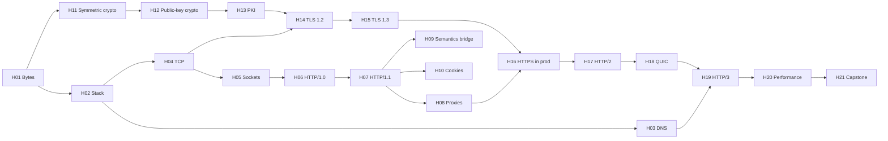

<!-- markdownlint-disable MD001 -->
<!-- markdownlint-disable MD024 -->
<!-- markdownlint-disable MD025 -->
<!-- markdownlint-disable MD026 -->
<!-- markdownlint-disable MD029 -->
<!-- markdownlint-disable MD033 -->
<!-- markdownlint-disable MD036 -->
<!-- markdownlint-disable MD040 -->
<!-- markdownlint-disable MD056 -->
<!-- markdownlint-disable MD060 -->

# HTTP and HTTPS from First Principles: Learning Plan

## 01. Positioning

This track is the wire-level and transport-level foundation.  
The RESTful APIs track (`08-miscellaneous/restful-apis/`) is the semantics-level and API-design layer built on top of it.  
Nothing is taught twice: where a topic already lives in the REST track, this track links to it and only adds the lower-level mechanics.

| Topic                                         | Taught in REST track          | This track adds                                                   |
| --------------------------------------------- | ----------------------------- | ----------------------------------------------------------------- |
| Request/response anatomy, URI structure       | R2.1                          | H07: byte-level parsing rules, a hand-written parser              |
| HTTP/1.1 vs 2 vs 3, summary and API impact    | R2.2                          | H07, H17, H18, H19: framing, flow control, transport internals    |
| Methods: safe, idempotent, cacheable          | R2.3                          | Nothing. Cross-reference only                                     |
| Idempotency, retries                          | R2 DD-1..DD-4, R8             | H15: why TLS 1.3 0-RTT forces idempotency                         |
| Status codes                                  | R3                            | Nothing. Cross-reference only                                     |
| Headers, `X-` headers, hop-by-hop             | R4                            | H08: why hop-by-hop exists (proxies, connection scope)            |
| Caching                                       | R9                            | H09: one-page bridge only                                         |
| Auth, CORS, TLS for APIs                      | R10                           | H10 (cookies, same-origin), H11 to H16 (all of TLS and PKI)       |
| Load balancing h2/gRPC, connection skew       | R2.2, R13                     | H08 (L4 vs L7), H17 (connection coalescing)                       |

---

## 02. Conventions

| Item               | Choice                                                                                                                                                  |
| :----------------- | :------------------------------------------------------------------------------------------------------------------------------------------------------ |
| Teaching mode      | In chat, one sub-topic per turn; owner says "next" to advance                                                                                           |
| Per sub-topic      | Terms defined first, then mechanism, wire view (bytes or diagram), failure mode, interview question                                                     |
| Per module         | 2 to 3 exercises; owner answers; Claude reviews; then the write-up                                                                                      |
| Write-up file      | `hNN-<slug>.md` in this folder, plus a row in the progress log                                                                                          |
| Code               | Java 21+ first (`java.net`, NIO, `HttpClient`, JSSE); Rust second (`std::net`, `tokio`, `rustls`, `quinn`)                                              |
| Wire tools         | `curl -v`, `openssl s_client`, `dig`, `tcpdump`, Wireshark, `ss`, `nghttp`, Chrome DevTools                                                             |
| Primary references | RFC 9110/9112/9113/9114 (HTTP), 9293 (TCP), 9000/9001/9002 (QUIC), 8446 (TLS 1.3), 5280 (X.509), 8555 (ACME)                                            |
| Books              | "High Performance Browser Networking" (Grigorik), "Bulletproof TLS and PKI" (Ristic), "Serious Cryptography" 2e (Aumasson), "TCP/IP Illustrated" Vol. 1 |

Priority tags used below:

- **[CORE]**: asked in almost every backend or system-design interview. Must be fluent.
- **[DEEP]**: separates senior and architect answers from mid-level ones.
- **[AWARE]**: know it exists, what it solves, and when to reach for it.

---

## 03. Index

| #   | Part                         | Module                                        | Core question                                                                  |
| --- | ---------------------------- | --------------------------------------------- | ------------------------------------------------------------------------------ |
| H01 | A. Below HTTP                | Bytes, encodings and framing                  | How does a receiver know where one message ends and the next begins?           |
| H02 | A. Below HTTP                | The network stack and encapsulation           | What wraps an HTTP message before it becomes electrical signals?               |
| H03 | A. Below HTTP                | DNS                                           | How does a name become an IP address, and who can lie along the way?           |
| H04 | A. Below HTTP                | TCP in depth                                  | How does a lossy packet network become a reliable, ordered byte stream?        |
| H05 | A. Below HTTP                | Sockets and I/O models                        | What does a server actually do with a connection, in Java and in Rust?         |
| H06 | B. Plaintext HTTP            | HTTP/0.9 and HTTP/1.0                         | What is the smallest protocol that can fetch a document?                       |
| H07 | B. Plaintext HTTP            | HTTP/1.1 message syntax and framing           | How are HTTP/1.1 bytes parsed, and how does parsing go wrong?                  |
| H08 | B. Plaintext HTTP            | Connections, proxies and upgrades             | Who sits between client and server, and what may each one change?              |
| H09 | B. Plaintext HTTP            | Semantics bridge: negotiation, ranges, caching| Which HTTP features reshape the body itself?                                   |
| H10 | B. Plaintext HTTP            | State on a stateless protocol: cookies        | How does a stateless protocol remember a user, and who may read that memory?   |
| H11 | C. Cryptography foundations  | Symmetric crypto, hashes, MACs, AEAD          | How do two parties who share a key get secrecy and integrity?                  |
| H12 | C. Cryptography foundations  | Public-key crypto and key exchange            | How do two strangers agree on a shared key over a wire anyone can read?        |
| H13 | C. Cryptography foundations  | Certificates and PKI                          | How does a client know the public key really belongs to `bank.com`?            |
| H14 | D. TLS                       | TLS 1.2 and the record layer                  | What did TLS 1.2 do, and why did it keep breaking?                             |
| H15 | D. TLS                       | TLS 1.3                                       | How does TLS 1.3 get a secure channel in one round trip?                       |
| H16 | D. TLS                       | HTTPS in production                           | How is TLS deployed, terminated, rotated and debugged in a real system?        |
| H17 | E. Modern HTTP               | HTTP/2                                        | How do many requests share one TCP connection without blocking each other?     |
| H18 | E. Modern HTTP               | QUIC                                          | Why rebuild a transport on UDP, and what does QUIC do that TCP cannot?         |
| H19 | E. Modern HTTP               | HTTP/3                                        | How does HTTP map onto QUIC, and how does a client discover it?                |
| H20 | F. Performance and synthesis | End-to-end latency and performance            | Where do the milliseconds of a request go, and which ones can be removed?      |
| H21 | F. Performance and synthesis | Capstone: "type a URL and press Enter"        | Can every layer of one HTTPS fetch be explained, in order, without gaps?       |

---

## 04. Module flow

Teaching order is H01 to H21 as numbered. Part C (crypto) depends only on H01, so it can be pulled forward if the owner prefers.

---

## 05. Part A. Below HTTP

### H01. Bytes, encodings and framing

01. Bit, byte, octet; why RFCs say "octet". Hex and binary notation; reading a hex dump (`xxd`). **[CORE]**
02. Byte order (endianness); network byte order is big-endian; where it shows up (port numbers, length fields). **[DEEP]**
03. Character sets vs encodings: ASCII, Latin-1, Unicode code points, UTF-8 byte layout. Why HTTP/1.1 header bytes are ASCII-only in practice. **[CORE]**
04. Text protocols vs binary protocols: readability vs parse cost and ambiguity. **[CORE]**
05. Framing strategies: delimiter (CRLF), length prefix, fixed size, type-length-value (TLV), variable-length integers (QUIC varint). Every later protocol is one of these. **[CORE]**
06. Base64 and percent-encoding: what they are for (bytes inside text), and what they are not (encryption). **[CORE]**
07. Lab: hex-dump a raw HTTP request; Java `ByteBuffer` and Rust `bytes::Buf` for reading length-prefixed frames.

### H02. The network stack and encapsulation

01. Layering: OSI seven-layer model vs the TCP/IP four-layer model; which one engineers actually use. **[CORE]**
02. Encapsulation: HTTP message inside a TCP segment inside an IP packet inside an Ethernet frame. Header sizes and overhead. **[CORE]**
03. Addressing at each layer: MAC address, IP address (IPv4, IPv6), port. ARP and Neighbor Discovery in one paragraph. **[AWARE]**
04. MTU, MSS, IP fragmentation, Path MTU Discovery, and why fragmentation is avoided. **[DEEP]**
05. Routing and hops: what a router reads and what it ignores; TTL / hop limit; `traceroute`. **[AWARE]**
06. NAT and the 5-tuple (protocol, source IP, source port, destination IP, destination port); why NAT matters later for QUIC. **[DEEP]**
07. TCP vs UDP at a glance: what each promises and what it does not. **[CORE]**
08. Lab: capture one `curl http://` request in Wireshark and label every header of every layer.

### H03. DNS

01. The problem: names for humans, addresses for routers. The DNS namespace tree, zones and delegation. **[CORE]**
02. Resolution path: stub resolver, recursive resolver, root, TLD, authoritative server; iterative vs recursive queries. **[CORE]**
03. Record types: A, AAAA, CNAME, NS, MX, TXT, SOA, CAA (restricts which CA may issue certificates), SVCB/HTTPS (advertises HTTP/3 and ECH keys). **[CORE]**
04. TTL and caching at every layer (browser, OS, JVM `networkaddress.cache.ttl`, resolver); negative caching. **[CORE]**
05. DNS on the wire: UDP port 53, message format, truncation and fallback to TCP, EDNS(0). **[DEEP]**
06. Trust and privacy: spoofing and cache poisoning (Kaminsky), DNSSEC (integrity), DoT and DoH (privacy). **[DEEP]**
07. DNS in system design: GeoDNS, weighted records, failover, low TTL trade-offs. **[CORE]**
08. Lab: `dig +trace`; Java `InetAddress` caching behaviour; Rust `hickory-resolver`.

### H04. TCP in depth

01. What TCP promises: reliable, ordered, byte stream (no message boundaries), full duplex, connection-oriented. **[CORE]**
02. Segment header: ports, sequence and acknowledgment numbers, flags (SYN, ACK, FIN, RST, PSH), window, options (MSS, window scale, SACK, timestamps). **[CORE]**
03. Three-way handshake; initial sequence numbers and why they are random; SYN queue, accept queue, `backlog`, SYN flood and SYN cookies. **[CORE]**
04. Reliability: cumulative ACK, retransmission timeout (RTO) and its estimation from RTT, fast retransmit, SACK. **[DEEP]**
05. Flow control: receive window, window scaling, zero-window probes. **[CORE]**
06. Congestion control: slow start, congestion avoidance, cwnd, loss vs delay signals; Reno, CUBIC, BBR. Bandwidth-delay product. **[DEEP]**
07. Latency interactions: Nagle's algorithm, delayed ACK, `TCP_NODELAY`, and the classic 40 ms stall. **[DEEP]**
08. Head-of-line blocking at the transport level: one lost segment stalls all later bytes. Sets up H17 and H18. **[CORE]**
09. Teardown: FIN four-way close, half-close, `TIME_WAIT` (why it exists, port exhaustion, `SO_REUSEADDR`), RST and "connection reset by peer". **[CORE]**
10. Keepalive (TCP-level vs HTTP-level), TCP Fast Open, and why TFO saw limited deployment. **[AWARE]**
11. Lab: watch handshake, loss and retransmission in Wireshark; inspect states with `ss -tan`.

### H05. Sockets and I/O models

01. The Berkeley socket API: `socket`, `bind`, `listen`, `accept`, `connect`, `read`, `write`, `close`; file descriptors. **[CORE]**
02. Kernel buffers: send and receive buffers, short reads and short writes, why `read` returns "some" bytes. **[CORE]**
03. I/O models: blocking thread-per-connection, non-blocking with readiness (`select`, `poll`, `epoll`, `kqueue`), completion (`io_uring`, IOCP). The C10K problem. **[DEEP]**
04. Java: `Socket`/`ServerSocket`, NIO `Selector` and channels, Netty in one paragraph, virtual threads (Java 21) and what they change. **[CORE]**
05. Rust: `std::net::TcpStream`, `tokio` reactor and futures, `mio` underneath. **[DEEP]**
06. Timeouts at socket level: connect, read, write, idle; why every client needs all of them. **[CORE]**
07. Lab: write a raw HTTP/1.0 client over a TCP socket in Java and in Rust, no HTTP library.

---

## 06. Part B. Plaintext HTTP

### H06. HTTP/0.9 and HTTP/1.0

01. HTTP/0.9 (1991): one-line request, raw HTML response, connection close marks the end. **[AWARE]**
02. HTTP/1.0 (RFC 1945): request line, status line, headers, `Content-Type`, `Content-Length`. **[CORE]**
03. One connection per request: cost in round trips; `Connection: keep-alive` as a non-standard patch. **[CORE]**
04. Why there was no `Host` header, and what that meant for virtual hosting and IPv4 exhaustion. **[DEEP]**
05. Lab: speak HTTP/1.0 by hand to a plain port-80 server with `nc`, and to the H05 raw client.

### H07. HTTP/1.1 message syntax and framing

R2.1 gives the anatomy. This module goes to the grammar (RFC 9112) and the parser.

01. Message grammar: start line, field lines, CRLF, empty line, body; ABNF in five minutes. **[CORE]**
02. Field syntax: names case-insensitive, whitespace rules, obsolete line folding, duplicate fields and list values, `Set-Cookie` as the exception. **[DEEP]**
03. `Host` mandatory; request-target forms: origin, absolute, authority (`CONNECT`), asterisk (`OPTIONS *`). **[DEEP]**
04. Body length determination, in RFC precedence order: no-body responses (1xx, 204, 304, HEAD), `Transfer-Encoding`, `Content-Length`, read-until-close. **[CORE]**
05. Chunked transfer coding byte by byte; trailers. **[CORE]**
06. Persistent connections by default; pipelining and why browsers never enabled it. **[CORE]**
07. `Expect: 100-continue` for large uploads. **[AWARE]**
08. Parser disagreements as vulnerabilities: request smuggling (CL.TE, TE.CL, TE.TE), response splitting, header injection. Defences. **[DEEP]**
09. Limits: header size, line length, request-target length; status codes they map to (cross-ref R3). **[CORE]**
10. Lab: build a minimal HTTP/1.1 server with a hand-written parser (Content-Length and chunked) in Java, then Rust; fuzz it with malformed input.

### H08. Connections, proxies and upgrades

01. Connection pools on the client: per-host limits, idle eviction, stale connections, Java `HttpClient` and Apache HttpClient pool settings, `hyper` pool in Rust. **[CORE]**
02. Intermediaries: forward proxy, reverse proxy, gateway, tunnel. What each may rewrite. **[CORE]**
03. Hop-by-hop vs end-to-end: `Connection`, `Keep-Alive`, `Upgrade`, `TE`, `Proxy-*`; why h2/h3 ban them (cross-ref R4). **[DEEP]**
04. `CONNECT` tunnels and how HTTPS passes through a forward proxy. **[DEEP]**
05. Load balancers: L4 (connection-level, sees TCP) vs L7 (request-level, sees HTTP); client IP preservation (`Forwarded`, PROXY protocol). **[CORE]**
06. Protocol upgrade: `Upgrade` header and `101 Switching Protocols`; the WebSocket opening handshake and its framing in brief. **[CORE]**

07. Server-Sent Events and long polling as HTTP/1.1 streaming patterns. **[AWARE]**
08. Lab: put nginx in front of the H07 server; observe added and stripped headers.

### H09. Semantics bridge: negotiation, ranges, caching

Short module. Only what changes the bytes of the body; full semantics stay in R2, R4 and R9.

01. Content negotiation: `Accept`, `Accept-Encoding`, `Accept-Language`, `Vary`. **[CORE]**
02. Content coding: gzip, deflate, Brotli, zstd; compression ratio vs CPU; compressing already-compressed data. **[CORE]**
03. Compression side channels: CRIME and BREACH, and why secrets and attacker input must not share a compressed body. **[DEEP]**
04. Range requests: `Range`, `206 Partial Content`, `Accept-Ranges`, resumable downloads, video seeking. **[CORE]**
05. Caching mechanics in one page: freshness, validators, `304` (full treatment in R9). **[CORE]**

### H10. State on a stateless protocol: cookies

01. Origin: scheme + host + port. Site vs origin. Same-origin policy and what it protects. **[CORE]**
02. `Set-Cookie` and `Cookie` on the wire; attributes: `Domain`, `Path`, `Expires`/`Max-Age`, `Secure`, `HttpOnly`, `SameSite` (Strict, Lax, None), `Partitioned`; `__Host-` and `__Secure-` prefixes. **[CORE]**
03. Session cookies vs tokens; server-side sessions vs self-contained tokens (cross-ref R1.3, R2.4, R10). **[CORE]**
04. Attacks: session fixation, CSRF, cookie theft via XSS; which attribute defends against which. **[CORE]**
05. Third-party cookies and their deprecation state (re-checked at teach time). **[AWARE]**
06. CORS mechanics in one page: preflight `OPTIONS`, credentialed requests (full API treatment in R10). **[CORE]**

---

## 07. Part C. Cryptography foundations

Taught as an engineer's toolkit: properties, correct use and failure modes, with just enough mathematics to make the guarantees believable. No implementing primitives for production.

### H11. Symmetric crypto, hashes, MACs, AEAD

01. Security goals: confidentiality, integrity, authenticity, forward secrecy (defined later in H12). The network attacker model: reads, drops, injects, replays. Kerckhoffs's principle. **[CORE]**
02. Randomness: true vs pseudo-random, CSPRNG; Java `SecureRandom`, Rust `rand::rngs::OsRng`; how bad randomness breaks everything. **[CORE]**
03. Hash functions: preimage, second-preimage and collision resistance; birthday bound; SHA-2, SHA-3; why MD5 and SHA-1 are dead; length-extension attack. **[CORE]**
04. Message authentication codes: HMAC construction and why `hash(key || message)` is wrong. Constant-time comparison. **[CORE]**
05. Symmetric ciphers: block vs stream; AES; modes ECB (and the penguin), CBC (padding oracles), CTR; ChaCha20. **[CORE]**
06. AEAD (authenticated encryption with associated data): AES-GCM, ChaCha20-Poly1305; nonce uniqueness and what reuse destroys. **[CORE]**
07. Key derivation: HKDF extract-and-expand; password hashing (Argon2, bcrypt) as a different problem. **[DEEP]**
08. Lab: AES-GCM encrypt and tamper-detect in Java (`javax.crypto`) and Rust (`ring` or `aes-gcm`); HMAC-signed token.

### H12. Public-key crypto and key exchange

01. The key distribution problem that symmetric crypto cannot solve. **[CORE]**
02. Minimum mathematics: modular arithmetic, one-way and trapdoor functions, the discrete logarithm problem. **[DEEP]**
03. RSA: key generation, encryption, signatures; padding (PKCS#1 v1.5 vs OAEP and PSS); Bleichenbacher in one paragraph. **[CORE]**
04. Diffie-Hellman key exchange: finite-field DH, then elliptic-curve DH; X25519 and P-256. **[CORE]**
05. Man-in-the-middle against unauthenticated DH: why key exchange alone is not enough, and why signatures plus certificates are needed (sets up H13). **[CORE]**
06. Digital signatures: ECDSA (and its nonce fragility), Ed25519. **[CORE]**
07. Ephemeral keys and forward secrecy: why recorded traffic stays safe after a server key leaks. **[CORE]**
08. Post-quantum: Shor's algorithm threat, "harvest now, decrypt later", ML-KEM, hybrid X25519MLKEM768 in TLS, ML-DSA status (re-checked at teach time). **[DEEP]**
09. Lab: X25519 exchange plus HKDF to a shared AES key, in Java and Rust; sign and verify with Ed25519.

### H13. Certificates and PKI

01. The binding problem: a public key alone says nothing about who owns it. Trust anchors. **[CORE]**
02. X.509 v3 structure: subject, issuer, validity, public key, extensions (SAN, Key Usage, Extended Key Usage, Basic Constraints, AIA). **[CORE]**
03. Encodings: ASN.1, DER, PEM, PKCS#12; Java keystore vs truststore; `keytool`. **[CORE]**
04. Chains: leaf, intermediate, root; root stores (OS, browser, JDK `cacerts`); cross-signing; missing intermediates. **[CORE]**
05. Path validation: signature chain, validity period, name matching against SAN (wildcards), constraints; "PKIX path building failed" decoded. **[CORE]**
06. Issuance: CSR, domain validation (DV), OV and EV; ACME protocol and Let's Encrypt challenges (HTTP-01, DNS-01, TLS-ALPN-01). **[CORE]**
07. Revocation: CRL, OCSP, OCSP stapling, why revocation is soft-fail, CRLite, short-lived certificates; Let's Encrypt ending OCSP (re-checked at teach time). **[DEEP]**
08. Certificate Transparency: logs, SCTs, monitoring for mis-issuance. CAA records. **[DEEP]**
09. The CA/Browser Forum and shrinking certificate lifetimes (schedule toward 47 days, re-checked at teach time); why automation is mandatory. **[DEEP]**
10. Private PKI for internal services and mTLS: internal CAs, SPIFFE identities (in brief). **[AWARE]**
11. Lab: read a real chain with `openssl s_client -showcerts` and `openssl x509 -text`; build a private CA, issue a leaf, trust it in Java and Rust.

---

## 08. Part D. TLS

### H14. TLS 1.2 and the record layer

01. Where TLS sits: between TCP and HTTP; what it protects and what stays visible (IPs, ports, SNI, sizes, timing). **[CORE]**
02. Record layer: content types, record header bytes, fragmentation, MAC-then-encrypt vs AEAD records. **[DEEP]**
03. Full TLS 1.2 handshake, message by message: ClientHello, ServerHello, Certificate, ServerKeyExchange, ServerHelloDone, ClientKeyExchange, ChangeCipherSpec, Finished. Two round trips. **[CORE]**
04. Cipher suite anatomy: key exchange, authentication, bulk cipher, hash. RSA key transport (no forward secrecy) vs ECDHE. **[CORE]**
05. Key derivation: pre-master secret, master secret, PRF, key block. **[DEEP]**
06. Resumption: session IDs and session tickets; ticket-key rotation and its forward-secrecy cost. **[DEEP]**
07. A history of attacks as design lessons: BEAST, CRIME, Lucky 13, POODLE, Heartbleed (implementation), FREAK and Logjam (downgrade), ROBOT. **[DEEP]**
08. Lab: decode a TLS 1.2 handshake in Wireshark; `openssl s_client -tls1_2`.

### H15. TLS 1.3

01. What was removed and why: RSA key transport, static DH, CBC, compression, renegotiation, custom DH groups. **[CORE]**
02. 1-RTT handshake: key shares in ClientHello, ServerHello, EncryptedExtensions, Certificate, CertificateVerify, Finished; what is encrypted earlier than in 1.2. **[CORE]**
03. HelloRetryRequest when the guessed key share is wrong. **[DEEP]**
04. Key schedule: HKDF-based early, handshake and application secrets; key update. **[DEEP]**
05. Resumption with PSK and 0-RTT early data; replay risk and anti-replay; `425 Too Early` (cross-ref R2.2, R8). **[CORE]**
06. Downgrade protection, the `supported_versions` extension and middlebox-compatibility mode (why 1.3 looks like 1.2 on the wire). **[DEEP]**
07. Extensions every engineer meets: SNI, ALPN (`h2`, `http/1.1`, `h3`), supported groups, signature algorithms. **[CORE]**
08. Encrypted Client Hello (ECH): hiding SNI, keys published in DNS HTTPS records. **[AWARE]**
09. Lab: Wireshark decryption with `SSLKEYLOGFILE`; Java `-Djavax.net.debug=ssl:handshake`; Rust `rustls` key log.

### H16. HTTPS in production

01. The `https` scheme: port 443, redirect from `http`, HSTS and the preload list, mixed content. **[CORE]**
02. Server configuration: protocol and cipher policy, certificate and key placement, OCSP stapling, chain completeness; Mozilla configuration profiles. **[CORE]**
03. Termination topologies: edge termination, re-encryption to backends, TLS passthrough (L4 with SNI routing); trade-offs in security, observability and cost. **[CORE]**
04. Mutual TLS: client certificates, service-mesh mTLS, identity in the certificate. **[CORE]**
05. Certificate lifecycle operations: automated renewal, rotation without downtime, expiry monitoring, outages caused by expired certificates. **[CORE]**
06. Performance cost of TLS: handshake CPU, session resumption hit rate, hardware offload, kTLS. **[DEEP]**
07. Java: JSSE, `SSLContext`, `KeyManager`/`TrustManager`, Spring Boot SSL bundles, hostname verification. Common failure messages and their causes. **[CORE]**
08. Rust: `rustls`, `tokio-rustls`, `webpki-roots` vs platform verifier; `native-tls` trade-off. **[DEEP]**
09. Interception: corporate TLS proxies, certificate pinning and why pinning fell out of favour. **[AWARE]**
10. Lab: serve the H07 server over TLS in Java and Rust with the H13 private CA; add mTLS; break it in five ways and read each error.

---

## 09. Part E. Modern HTTP

### H17. HTTP/2

R2.2 gives the summary. This module goes to the frames (RFC 9113).

01. Why HTTP/1.1 hit a wall: one request in flight per connection, six-connection workaround, header redundancy. **[CORE]**
02. Connection preface and SETTINGS; ALPN `h2` vs cleartext `h2c` (and its upgrade path removed in RFC 9113). **[DEEP]**
03. Binary framing: the 9-byte frame header; frame types DATA, HEADERS, CONTINUATION, SETTINGS, WINDOW_UPDATE, RST_STREAM, PING, GOAWAY, PRIORITY, PUSH_PROMISE. **[CORE]**
04. Streams: IDs (odd client, even server), stream state machine, concurrency limit. **[CORE]**
05. Multiplexing and per-stream plus per-connection flow control. **[CORE]**
06. HPACK: static table, dynamic table, Huffman coding; the security reason it is not plain DEFLATE. **[DEEP]**
07. Prioritization: original tree scheme, its failure, RFC 9218 extensible priorities. **[AWARE]**
08. Server push: what it promised, why it was removed from browsers; 103 Early Hints as the replacement. **[AWARE]**
09. Connection coalescing and the `421 Misdirected Request` status. **[DEEP]**
10. Graceful shutdown with GOAWAY; attacks: Rapid Reset, CONTINUATION flood, HPACK bomb. **[DEEP]**
11. gRPC as the main HTTP/2 consumer in back ends: trailers, long-lived streams, load-balancing consequences (cross-ref R13). **[CORE]**
12. Lab: `nghttp -v` frame trace; Java `HttpClient` with `HTTP_2`; Rust `h2` / `hyper`.

### H18. QUIC

01. Why not fix TCP: kernel deployment speed, middlebox ossification, TCP HOL blocking, handshake round trips. Why UDP is the substrate. **[CORE]**
02. Packet structure: long and short headers, connection IDs, packet numbers, frames inside packets; varint encoding (from H01). **[DEEP]**
03. Handshake with TLS 1.3 built in: 1-RTT, 0-RTT; TLS messages carried in CRYPTO frames, not TLS records. **[CORE]**
04. Streams as a transport feature: bidirectional and unidirectional, independent delivery; how this removes transport HOL. **[CORE]**
05. Loss detection and recovery: monotonic packet numbers, ACK ranges, probe timeout; congestion control (NewReno, CUBIC, BBR) in user space. **[DEEP]**
06. Flow control at stream and connection level. **[DEEP]**
07. Connection migration and NAT rebinding via connection IDs; path validation. **[CORE]**
08. Security of the transport itself: header protection, anti-amplification limit (3x), Retry tokens, stateless reset. **[DEEP]**
09. Operational realities: UDP blocking and throttling, CPU cost vs TCP, GSO/GRO offload, load balancer support for connection IDs (QUIC-LB). **[DEEP]**
10. Lab: Rust `quinn` echo server and client; capture and decrypt QUIC in Wireshark.

### H19. HTTP/3

01. Mapping HTTP onto QUIC streams (RFC 9114): request streams, control streams, frame types. **[CORE]**
02. QPACK: why HPACK cannot work over out-of-order streams; encoder and decoder streams. **[DEEP]**
03. Discovery: `Alt-Svc` header, DNS HTTPS records, happy eyeballs between h3 and h2, fallback when UDP is blocked. **[CORE]**
04. Extended CONNECT, WebTransport and MASQUE (proxying over HTTP/3) in brief. **[AWARE]**
05. Deployment: CDN and edge termination, nginx, Envoy, Caddy; when HTTP/3 helps (lossy mobile, high RTT) and when it does not (datacenter east-west). **[CORE]**
06. Client support: Java `HttpClient` HTTP/3 status (re-checked at teach time), Rust `h3` with `quinn`, `quiche`. **[AWARE]**
07. Lab: `curl --http3 -v` against a public site; compare h1, h2 and h3 timings on a simulated lossy link (`tc netem`).

---

## 10. Part F. Performance and synthesis

### H20. End-to-end latency and performance

01. Latency vs bandwidth vs throughput; speed-of-light limits; RTT as the unit of web performance. **[CORE]**
02. Anatomy of a cold HTTPS fetch: DNS + TCP + TLS + request + server time + transfer, in RTTs, for h1/h2 over TLS 1.2, TLS 1.3, and h3, cold and resumed. **[CORE]**
03. Removing round trips: connection reuse, resumption, 0-RTT, preconnect and DNS prefetch, 103 Early Hints, CDN edge proximity. **[CORE]**
04. Throughput: TCP slow start on new connections, initial congestion window (IW10), bandwidth-delay product, buffer sizing, bufferbloat. **[DEEP]**
05. Payload: compression, image formats, caching (cross-ref R9). **[AWARE]**
06. Server side: keep-alive limits, connection limits, thread or event-loop sizing, tail latency. **[DEEP]**
07. Measuring: `curl -w` timing variables, browser DevTools waterfall, Java `HttpClient` timing, distributed tracing (cross-ref R13). **[CORE]**

### H21. Capstone: "type a URL and press Enter"

01. Full narrated trace of `https://example.com` from keystroke to rendered bytes: URL parsing, HSTS check, DNS (including HTTPS record), TCP or QUIC, TLS 1.3, certificate validation, ALPN, HTTP request, server path through LB and reverse proxy, response, connection reuse. **[CORE]**
02. Same trace through a failure at every layer: DNS NXDOMAIN, TCP RST, TLS alert, expired certificate, 502 from the proxy. What the user sees, what the logs show. **[CORE]**
03. Design scenario: TLS and HTTP architecture for a multi-region public API (edge termination, mTLS inside, certificate automation, h3 at the edge, h2 internally). **[DEEP]**
04. Interview question bank with model answers, grouped by layer. **[CORE]**

---

## 11. Progress log

| #   | Module                                          | Status      |
| --- | ----------------------------------------------- | ----------- |
| H01 | Bytes, encodings and framing                    | Completed   |
| H02 | The network stack and encapsulation             | Completed   |
| H03 | DNS                                             | Completed   |
| H04 | TCP in depth                                    | Completed   |
| H05 | Sockets and I/O models                          | Completed   |
| H06 | HTTP/0.9 and HTTP/1.0                           | Not started |
| H07 | HTTP/1.1 message syntax and framing             | Not started |
| H08 | Connections, proxies and upgrades               | Not started |
| H09 | Semantics bridge: negotiation, ranges, caching  | Not started |
| H10 | State on a stateless protocol: cookies          | Not started |
| H11 | Symmetric crypto, hashes, MACs, AEAD            | Not started |
| H12 | Public-key crypto and key exchange              | Not started |
| H13 | Certificates and PKI                            | Not started |
| H14 | TLS 1.2 and the record layer                    | Not started |
| H15 | TLS 1.3                                         | Not started |
| H16 | HTTPS in production                             | Not started |
| H17 | HTTP/2                                          | Not started |
| H18 | QUIC                                            | Not started |
| H19 | HTTP/3                                          | Not started |
| H20 | End-to-end latency and performance              | Not started |
| H21 | Capstone: "type a URL and press Enter"          | Not started |

---
