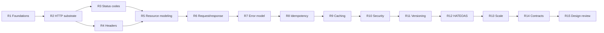

<!-- markdownlint-disable MD001 -->
<!-- markdownlint-disable MD024 -->
<!-- markdownlint-disable MD025 -->
<!-- markdownlint-disable MD026 -->
<!-- markdownlint-disable MD029 -->
<!-- markdownlint-disable MD033 -->
<!-- markdownlint-disable MD040 -->
<!-- markdownlint-disable MD056 -->
<!-- markdownlint-disable MD060 -->

# RESTful APIs: Learning Plan

## Conventions

| Item                | Choice                                                                 |
| ------------------- | ---------------------------------------------------------------------- |
| Java stack          | Spring Boot (Spring Web MVC; WebFlux noted where it differs)           |
| Rust stack          | Actix Web (with `serde` for JSON)                                      |
| Teaching mode       | In chat, one sub-topic at a time, theory then code                     |
| Status codes        | Every IANA-registered HTTP status code is covered and documented (R3)  |
| Primary references  | RFC 9110 (HTTP Semantics), RFC 9111 (Caching), Fielding's dissertation |

## Index

| #   | Module                              | Core question                                                       |
| --- | ----------------------------------- | ------------------------------------------------------------------- |
| R1  | Foundations                         | What makes an API "RESTful", and what does REST actually constrain? |
| R2  | HTTP as the substrate               | What do HTTP methods promise, and why does REST lean on them?       |
| R3  | HTTP status codes (complete)        | Which code tells the client exactly what happened and what to do?   |
| R4  | HTTP headers, standard and `X-`     | Why does metadata travel in headers;  why do clients add `X-` ones? |
| R5  | Resource modeling                   | What is the resource, and what is only a representation of it?      |
| R6  | Request and response design         | How do clients read, filter, page and mutate collections safely?    |
| R7  | Error model                         | How does a client tell what went wrong without parsing prose?       |
| R8  | Idempotency and concurrency         | What happens when the same request arrives twice, or two at once?   |
| R9  | Caching                             | Who may store this response, and for how long?                      |
| R10 | Security                            | Who is calling, and may they touch this specific object?            |
| R11 | Evolution and versioning            | How does the API change without breaking existing clients?          |
| R12 | HATEOAS and hypermedia              | Should the server tell the client what it can do next?              |
| R13 | Operating APIs at scale             | How is the API protected, observed and kept responsive under load?  |
| R14 | Contracts and tooling               | How is the contract written down, tested and shared?                |
| R15 | API design review (capstone)        | Given any API, what is wrong with it and how is it fixed?           |

## Module flow

## R1. Foundations

1. What an API contract is; RPC vs REST vs GraphQL vs gRPC, and where each fits.
2. Fielding's dissertation: REST as an architectural style, not a protocol or a format.
3. The six constraints: client-server, stateless, cacheable, uniform interface, layered system, code-on-demand (optional).
4. Richardson Maturity Model, levels 0 to 3.
5. Hello-world endpoint in Spring Boot and Actix Web; what each framework does per request.

## R2. HTTP as the substrate

1. Request and response anatomy; URI structure (scheme, authority, path, query, fragment).
2. HTTP/1.1 vs HTTP/2 vs HTTP/3: what changes for API design and what does not.
3. Methods and their properties: safe, idempotent, cacheable.

   | Method  | Safe | Idempotent | Cacheable          |
   | ------- | ---- | ---------- | ------------------ |
   | GET     | Yes  | Yes        | Yes                |
   | HEAD    | Yes  | Yes        | Yes                |
   | OPTIONS | Yes  | Yes        | No                 |
   | POST    | No   | No         | Rarely (explicit)  |
   | PUT     | No   | Yes        | No                 |
   | PATCH   | No   | No         | No                 |
   | DELETE  | No   | Yes        | No                 |

4. Statelessness in practice: where session state lives instead.

## R3. HTTP status codes (complete coverage)

Every IANA-registered code is covered: meaning, when to use it, when not to, the client's expected reaction, and a Spring Boot and Actix example where it applies.  
Output of this module is a standalone status-code reference document.

1. Semantics of the classes, and how clients must treat an unknown code (fall back to `x00` of its class).
2. **1xx Informational**: 100 Continue, 101 Switching Protocols, 102 Processing (deprecated), 103 Early Hints.
3. **2xx Success**: 200 OK, 201 Created, 202 Accepted, 203 Non-Authoritative Information, 204 No Content, 205 Reset Content, 206 Partial Content, 207 Multi-Status, 208 Already Reported, 226 IM Used.
4. **3xx Redirection**: 300 Multiple Choices, 301 Moved Permanently, 302 Found, 303 See Other, 304 Not Modified, 305 Use Proxy (deprecated), 306 (unused), 307 Temporary Redirect, 308 Permanent Redirect.
5. **4xx Client error**: 400, 401, 402, 403, 404, 405, 406, 407, 408, 409, 410, 411, 412, 413, 414, 415, 416, 417, 418 (unused, history only), 421, 422, 423, 424, 425, 426, 428, 429, 431, 451.
6. **5xx Server error**: 500, 501, 502, 503, 504, 505, 506, 507, 508, 510 (obsoleted), 511.
7. Commonly confused pairs and the rule that separates them: 200/201/204, 301/302/303/307/308, 400/422, 401/403, 403/404 (hiding existence), 404/410, 409/412, 429/503, 502/504.
8. Non-standard codes seen in the wild (nginx 499, Cloudflare 52x) and why they never belong in your own API.
9. Mapping exceptions to codes: `@ControllerAdvice` / `ResponseStatusException` in Spring Boot; `ResponseError` in Actix.

## R4. HTTP headers: standard and custom (`X-`)

This module answers the question of why clients send `X-` headers.

1. Header categories: request, response, representation, and hop-by-hop vs end-to-end.
2. Standard headers that matter for APIs: `Content-Type`, `Accept`, `Authorization`, `Cache-Control`, `ETag`, `If-Match`, `If-None-Match`, `Location`, `Retry-After`, `Vary`, `Forwarded`.
3. Custom headers and why clients send them:

   | Purpose                    | Typical header(s)                                  |
   | -------------------------- | -------------------------------------------------- |
   | Correlation / request ID   | `X-Request-ID`, `X-Correlation-ID`                 |
   | Idempotency                | `Idempotency-Key`                                  |
   | Tenant / client identity   | `X-Tenant-ID`, `X-Client-ID`, `X-API-Key`          |
   | API versioning             | `X-API-Version`, `Api-Version`                     |
   | Feature flags / experiments| `X-Feature-Flags`, `X-Experiment`                  |
   | Distributed tracing        | `traceparent`, `tracestate`(W3C), `X-B3-*`(Zipkin) |
   | Proxy metadata             | `X-Forwarded-For`, `X-Forwarded-Proto`             |

4. Why this metadata goes in headers rather than the body or query string: cross-cutting concerns, readable by gateways, proxies and filters without parsing the payload.
5. RFC 6648 (2012): the `X-` prefix convention is deprecated, why it failed (`X-Forwarded-For` vs `Forwarded`), and what modern practice is.
6. Risks: spoofed client headers, trusting `X-Forwarded-For` at the edge, header size limits, CORS `Access-Control-Expose-Headers`.
7. Reading, writing and propagating headers: Spring `@RequestHeader`, `OncePerRequestFilter`, MDC; Actix `HttpRequest::headers`, middleware.

## R5. Resource modeling

1. Resources vs representations; nouns, not verbs.
2. URI design: collections, items, sub-resources, nesting depth, naming and casing.
3. Modeling actions that are not CRUD: state transitions, controller resources.
4. Content negotiation and media types: JSON, vendor media types, `406` and `415`.

## R6. Request and response design

1. PUT vs PATCH; JSON Patch (RFC 6902) vs JSON Merge Patch (RFC 7396).
2. Filtering, sorting and sparse fieldsets.
3. Pagination: offset, cursor, keyset; consistency and performance trade-offs at scale.
4. Bulk and batch operations; partial success.
5. Long-running operations: `202 Accepted` plus a status resource, polling vs callbacks.

## R7. Error model

1. RFC 9457 Problem Details (`application/problem+json`).
2. Validation errors, machine-readable error codes, and what must never leak.
3. Problem Details in Spring Boot (`ProblemDetail`) and Actix.

## R8. Idempotency and concurrency

1. Idempotent methods vs idempotency keys for POST.
2. Retries, at-least-once delivery, deduplication storage and key expiry.
3. Optimistic concurrency: `ETag` with `If-Match`, lost updates, `412` and `428`.

## R9. Caching

1. `Cache-Control` directives; freshness vs validation.
2. `ETag` and `Last-Modified`, conditional GET, `304 Not Modified`.
3. CDN and gateway caching, `Vary`, private vs shared caches, invalidation.

## R10. Security

1. Authentication: API keys, Basic, OAuth 2.0 and OIDC flows, JWT and its pitfalls.
2. Authorization: scopes, RBAC and ABAC, object-level checks (BOLA).
3. TLS, CORS, CSRF relevance for APIs, OWASP API Security Top 10.
4. Spring Security resource server; Actix middleware for auth.

## R11. Evolution and versioning

1. Breaking vs non-breaking changes; tolerant reader.
2. Versioning strategies: URI, header, media type; trade-offs.
3. Deprecation and sunset: `Deprecation` and `Sunset` headers, migration windows.

## R12. HATEOAS and hypermedia

1. Links as the engine of application state; HAL, JSON:API.
2. Why most "REST" APIs skip it, and when it pays off.
3. Spring HATEOAS overview.

## R13. Operating APIs at scale

1. Rate limiting and quotas: token bucket, sliding window; `429` with `RateLimit` and `Retry-After` headers.
2. API gateways and the BFF pattern.
3. Observability: correlation IDs, distributed tracing, structured logs, RED metrics.
4. Client resilience: timeouts, retries with backoff and jitter, circuit breakers.

## R14. Contracts and tooling

1. OpenAPI: design-first vs code-first (springdoc, `utoipa` for Actix).
2. Contract testing, mock servers, SDK generation.

## R15. API design review (capstone)

1. A checklist for reviewing any API.
2. Two end-to-end exercises, designed and then critiqued: a payments API and a booking API.

## Progress log

| #   | Module                          | Status      |
| --- | ------------------------------- | ----------- |
| R01 | Foundations                     | Completed   |
| R02 | HTTP as the substrate           | Completed   |
| R03 | HTTP status codes (complete)    | Completed   |
| R04 | HTTP headers, standard and `X-` | Not started |
| R05 | Resource modeling               | Not started |
| R06 | Request and response design     | Not started |
| R07 | Error model                     | Not started |
| R08 | Idempotency and concurrency     | Not started |
| R09 | Caching                         | Not started |
| R10 | Security                        | Not started |
| R11 | Evolution and versioning        | Not started |
| R12 | HATEOAS and hypermedia          | Not started |
| R13 | Operating APIs at scale         | Not started |
| R14 | Contracts and tooling           | Not started |
| R15 | API design review (capstone)    | Not started |

---
