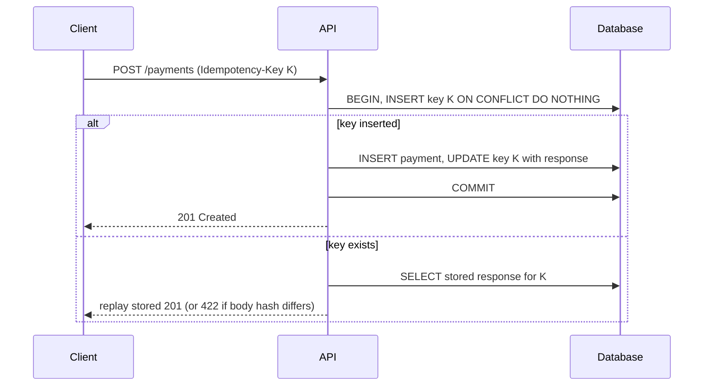

<!-- markdownlint-disable MD001 -->
<!-- markdownlint-disable MD024 -->
<!-- markdownlint-disable MD025 -->
<!-- markdownlint-disable MD026 -->
<!-- markdownlint-disable MD029 -->
<!-- markdownlint-disable MD033 -->
<!-- markdownlint-disable MD036 -->
<!-- markdownlint-disable MD040 -->
<!-- markdownlint-disable MD056 -->
<!-- markdownlint-disable MD060 -->

# R2. HTTP as the Substrate

## Contents

| #     | Sub-topic                                                                                         |
| ----- | ------------------------------------------------------------------------------------------------- |
| R2.1  | [Request and response anatomy; URI structure](#r21-request-and-response-anatomy-uri-structure)    |
| R2.2  | [HTTP/1.1 vs HTTP/2 vs HTTP/3](#r22-http11-vs-http2-vs-http3)                                     |
| R2.3  | [Methods: safe, idempotent, cacheable](#r23-methods-safe-idempotent-cacheable)                    |
| DD-1  | [Deep dive: how `upsert` makes PUT idempotent](#dd-1-how-upsert-makes-put-idempotent)             |
| DD-2  | [Deep dive: idempotency is not a cache](#dd-2-idempotency-is-not-a-cache)                         |
| DD-3  | [Deep dive: idempotency in distributed systems](#dd-3-idempotency-in-distributed-systems)         |
| DD-4  | [Clarification: the key comes from the client](#dd-4-clarification-the-key-comes-from-the-client) |
| R2.4  | [Statelessness in practice](#r24-statelessness-in-practice)                                       |
| -     | [Exercises with model answers](#exercises-with-model-answers)                                     |
| -     | [Takeaways](#takeaways)                                                                           |

---

## R2.1 Request and response anatomy; URI structure

### The message on the wire (HTTP/1.1)

```text
POST /orders?notify=true HTTP/1.1           ← request line: method SP target SP version
Host: api.shop.com                          ← header fields (Host is mandatory in 1.1)
Content-Type: application/json
Content-Length: 27
                                            ← empty line (CRLF) ends the headers
{"sku":"A-1","quantity":2}                  ← body (optional)

HTTP/1.1 201 Created                        ← status line: version SP code SP reason
Location: /orders/987
Content-Length: 0
```

### Semantics vs framing

| Layer     | RFC                                | Contents                                                             |
| --------- | ---------------------------------- | -------------------------------------------------------------------- |
| Semantics | 9110                               | Methods, status codes, headers, representations; version-independent |
| Framing   | 9112 (1.1), 9113 (h2), 9114 (h3)   | How bytes travel on the wire                                         |

In HTTP/2 and HTTP/3 the request line becomes pseudo-headers (`:method`, `:path`, `:scheme`, `:authority`, `:status`), header names are lowercase, and there is no reason phrase.  
API design is unaffected.

### Body framing

- **`Content-Length`**: exact byte count.
- **`Transfer-Encoding: chunked`**: streamed chunks ending with a zero-length chunk; optional trailers (for example a checksum) may follow.
- **Both present**: front proxy and backend may disagree on where the request ends.  
  This is **request smuggling** (CL.TE, TE.CL). Normalize at the edge and reject such requests.
- **`GET` with a body**: RFC 9110 gives it no defined semantics; intermediaries may drop or reject it.  
  Use query parameters, `POST /orders/search`, or the emerging `QUERY` method (IETF draft: safe, idempotent, with a body).

### URI anatomy (RFC 3986)

```
https://user@api.shop.com:8443/v1/orders/987?status=OPEN&limit=20#items
└─┬─┘   └─┬┘ └─────┬────┘ └┬─┘└──────┬─────┘└─────────┬─────────┘└─┬─┘
scheme  userinfo  host    port      path            query      fragment
        └──────────authority──────────┘
```

| Part         | Rules that matter for APIs                                                        |
| ------------ | --------------------------------------------------------------------------------- |
| Scheme, host | Case-insensitive                                                                  |
| Path         | Case-sensitive, hierarchical; `/orders` and `/orders/` are different URIs         |
| Query        | Non-hierarchical; no standard for arrays (`?id=1&id=2` vs `?id=1,2` vs `?id[]=1`) |
| Fragment     | Never sent to the server                                                          |
| Userinfo     | Deprecated for credentials; never use                                             |

- **Percent-encoding**: reserved characters (`: / ? # [ ] @ ! $ & ' ( ) * + , ; =`) are encoded inside a component (`/` becomes `%2F`). `+` means space only in `application/x-www-form-urlencoded`, never in a path.  
  Decoding mismatches between proxy and app cause traversal and authorization bypasses.

- **Length**: no spec limit; RFC 9110 recommends supporting at least 8000 octets.  
  Infrastructure caps lower; the overflow status is `414 URI Too Long`.

- **URI vs URL vs URN**: identifier; identifier plus location; name only.

### Code: reading the parts, building URIs safely

**Spring Boot**

```java
@GetMapping("/orders")
List<OrderDto> list(@RequestParam(required = false) List<String> status,          // ?status=OPEN&status=PAID
                    @RequestParam(defaultValue = "20") int limit,
                    @RequestHeader(HttpHeaders.ACCEPT_LANGUAGE) Optional<String> lang) {
    return service.list(status, limit, lang.orElse("en"));
}

@PostMapping("/orders")
ResponseEntity<OrderDto> create(@RequestBody CreateOrder cmd) {
    OrderDto created = service.create(cmd);
    URI location = UriComponentsBuilder.fromPath("/orders/{id}")
            .encode()                        // strict: encodes reserved chars inside the variable
            .buildAndExpand(created.id())
            .toUri();
    return ResponseEntity.created(location).body(created);   // 201 + Location
}
```

**Actix Web**

```rust
#[derive(Deserialize)]
struct ListQuery { status: Option<String>, limit: Option<u32> }

#[get("/orders")]
async fn list(req: HttpRequest, q: web::Query<ListQuery>, svc: web::Data<Orders>) -> HttpResponse {
    let host = req.connection_info().host().to_owned();
    log::info!("{} {} host={} query={}", req.method(), req.path(), host, req.query_string());
    HttpResponse::Ok().json(svc.list(q.status.as_deref(), q.limit.unwrap_or(20)))
}
```

**Actix gotcha**: `web::Query` uses `serde_urlencoded`, which cannot collect repeated keys into a `Vec`.  
Use `serde_qs` or `actix-web-lab`'s `Query` for arrays.

### Interview angle

- Filters in a `GET` body: undefined semantics, dropped by intermediaries, not cacheable.
- `/users/` vs `/users`: different URIs, different cache keys; normalize.
- `#section`: never leaves the client.
- Request smuggling: layers disagree on message boundaries; normalize at the edge.

---

## R2.2 HTTP/1.1 vs HTTP/2 vs HTTP/3

Semantics (RFC 9110) are identical across all three. What changes is how messages share connections.

### HTTP/1.1

- Text, persistent connections, **one request in flight per connection**; pipelining is broken by head-of-line (HOL) blocking.
- Browsers open about 6 connections per origin.
- Workarounds that leaked into API design: batch endpoints, coarse resources, domain sharding.

### HTTP/2 (2015)

- Binary framing; **many streams multiplexed over one TCP connection**.
- HPACK header compression; repeated headers become small indexes.
- Server push is effectively dead; the original priority scheme is replaced by RFC 9218.
- **TCP-level HOL remains**: one lost packet stalls every stream.
- Runs over TLS in practice (ALPN `h2`).
- **Rapid Reset** (CVE-2023-44487): stream create-and-cancel floods; cap concurrent streams and patch.

### HTTP/3 (2022) over QUIC (UDP)

- Per-stream loss recovery; no TCP HOL.
- Combined QUIC and TLS 1.3 handshake: **1 RTT**, **0-RTT** on resumption.
- **0-RTT data can be replayed**: allow only idempotent requests; servers answer `425 Too Early` otherwise.
- Connection migration via connection IDs (Wi-Fi to cellular).
- Discovered via `Alt-Svc: h3=":443"` or DNS `HTTPS` records; falls back to h2 when UDP is blocked.
- Mostly terminated at the edge (CDN, Envoy, nginx 1.25+, Caddy).

### Comparison

| Aspect                  | HTTP/1.1           | HTTP/2          | HTTP/3              |
| ----------------------- | ------------------ | --------------- | ------------------- |
| Transport               | TCP                | TCP             | QUIC over UDP       |
| Format                  | Text               | Binary frames   | Binary frames       |
| Concurrency/connection  | 1 request          | Many streams    | Many streams        |
| HOL blocking            | App and TCP        | TCP only        | None (per stream)   |
| Header compression      | None               | HPACK           | QPACK               |
| New-connection handshake| TCP + TLS: 2–3 RTT | Same as 1.1     | 1 RTT, 0-RTT resume |
| Survives IP change      | No                 | No              | Yes                 |

### What changes for API design

1. **Chattiness is cheaper**; batch endpoints are less necessary. Round trips still cost latency, so BFF or GraphQL arguments for mobile stand.
2. **Large repeated headers are cheaper**, but size limits still apply (`431`).
3. **Streaming is easier**: SSE and long polling stop burning connections.
4. **Load balancing breaks quietly**: L4 balances connections, not requests.  
  Long-lived h2 (gRPC) skews load to one pod. Fix with L7 balancing, client-side balancing, or a maximum connection age.
5. **0-RTT ties to idempotency**: anything replayable must be safe to repeat.
6. **Hop-by-hop headers are banned** in h2 and h3: `Connection`, `Keep-Alive`, `Transfer-Encoding`, `Upgrade`.

### Code: enabling h2 and checking the version

**Spring Boot (Tomcat)**

```properties
server.http2.enabled=true
server.ssl.bundle=api          # h2 negotiated over TLS via ALPN
```

```java
@GetMapping("/whoami")
Map<String, String> whoami(HttpServletRequest req) {
    return Map.of("protocol", req.getProtocol());   // "HTTP/2.0" or "HTTP/1.1"
}
```

**Actix Web** (feature `rustls-0_23`)

```rust
let tls = rustls::ServerConfig::builder()
    .with_no_client_auth()
    .with_single_cert(certs, key)?;

HttpServer::new(|| App::new().service(whoami))
    .bind_rustls_0_23(("0.0.0.0", 8443), tls)?     // ALPN advertises h2 and http/1.1
    .run()
    .await

#[get("/whoami")]
async fn whoami(req: HttpRequest) -> String {
    format!("{:?}", req.version())
}
```

Neither Tomcat nor Actix Web serves HTTP/3 in typical deployments; terminate h3 at the edge.

### Interview angle

- One hot gRPC pod on Kubernetes: long-lived h2 connections behind L4 balancing.
- Batch endpoint? Under h2/h3 rarely for throughput; only for latency on high-RTT clients or atomicity.
- What does HTTP/3 change for the API? Nothing semantically; latency and mobility improve; 0-RTT forces replay safety.

---

## R2.3 Methods: safe, idempotent, cacheable

### The three properties (RFC 9110 §9.2)

- **Safe**: the client neither requests nor expects a state change. Logging and metrics are allowed; the client is not accountable for them. Safe implies idempotent.
- **Idempotent**: the intended effect on server **state** of N identical requests equals that of one. Responses may differ (`DELETE`: `204`, then `404`).
- **Cacheable**: responses may be stored and reused; in practice `GET` and `HEAD`.

**Why idempotency matters most**: after a dropped connection the client cannot know whether the request was processed.  
Clients and intermediaries may **automatically retry idempotent requests**. nginx, since 1.9.13, does not retry `POST`, `LOCK` or `PATCH` upstream by default.

### Method table

| Method  | Purpose                                              | Safe | Idempotent      | Cacheable | Typical success   |
| ------- | ---------------------------------------------------- | ---- | --------------- | --------- | ----------------- |
| GET     | Retrieve a representation                            | Yes  | Yes             | Yes       | 200, 206, 304     |
| HEAD    | GET without body                                     | Yes  | Yes             | Yes       | 200, 304          |
| OPTIONS | Capabilities (`Allow`), CORS preflight               | Yes  | Yes             | No        | 200, 204          |
| POST    | Process the enclosed representation                  | No   | No              | Rarely    | 201, 202, 200, 303|
| PUT     | Replace target state, or create at client-chosen URI | No   | Yes             | No        | 200, 204, 201     |
| PATCH   | Apply a set of changes (RFC 5789)                    | No   | Not guaranteed  | No        | 200, 204          |
| DELETE  | Remove the URI-to-resource association               | No   | Yes             | No        | 204, 200, 202     |

`CONNECT` and `TRACE` are not for APIs; disable `TRACE`.

### Details that matter

- **POST** is the catch-all. Safe retries need an `Idempotency-Key` (DD-3).
- **PUT is full replacement**: omitted fields are removed or reset. PUT can create; with a client-chosen UUID it is a naturally idempotent create.
- **PATCH** is idempotent only if its operations are: merge-patch field sets behave idempotently; JSON Patch `add` to an array or an increment does not. Pair with `If-Match`.
- **DELETE** of a missing resource: `404` or `204`; pick one, document it, and treat `404` on a retried DELETE as success.
- **HEAD** returns the same headers as GET. Spring serves it implicitly for `@GetMapping`; in Actix register it explicitly.
- **`405`** must carry an `Allow` header.
- **`X-HTTP-Method-Override`** tunnels PUT/DELETE through POST for restricted clients.  
  Accept only on POST and only from trusted clients, or it bypasses method-based authorization.

### Misconceptions

- "Idempotent means same response." It means same server state.
- "POST creates, PUT updates." PUT creates at a known URI; POST does what the resource defines.
- "GET with side effects is fine if we log it." Logging yes; client-accountable state changes no.

### Code: idempotent create with PUT, and DELETE

**Spring Boot**

```java
@PutMapping("/orders/{id}")
ResponseEntity<OrderDto> put(@PathVariable UUID id, @RequestBody @Valid OrderDto body) {
    boolean created = service.upsert(id, body);                     // full replacement, see DD-1
    return created
            ? ResponseEntity.created(URI.create("/orders/" + id)).body(body)   // 201 first time
            : ResponseEntity.ok(body);                                         // 200 on repeat
}

@DeleteMapping("/orders/{id}")
ResponseEntity<Void> delete(@PathVariable UUID id) {
    service.delete(id);                                             // no-op if already gone
    return ResponseEntity.noContent().build();
}
```

**Actix Web**

```rust
#[put("/orders/{id}")]
async fn put_order(id: web::Path<Uuid>, body: web::Json<Order>, pool: web::Data<PgPool>) -> actix_web::Result<HttpResponse> {
    let id = id.into_inner();
    let order = body.into_inner();
    let created = upsert(&pool, id, &order).await.map_err(error::ErrorInternalServerError)?;   // see DD-1
    Ok(if created {
        HttpResponse::Created()
            .insert_header((header::LOCATION, format!("/orders/{id}")))
            .json(order)
    } else {
        HttpResponse::Ok().json(order)
    })
}

#[route("/orders/{id}", method = "GET", method = "HEAD")]   // HEAD registered explicitly
async fn get_order(id: web::Path<Uuid>, pool: web::Data<PgPool>) -> HttpResponse { /* ... */ }
```

### Interview angle

- DELETE returning `404` on the second call is still idempotent.
- Retry-safe create over a flaky network: `PUT /orders/{client-uuid}` (no key store) or `POST` with `Idempotency-Key` (server-assigned IDs).
- Proxy retried a GET but not a POST: only idempotent methods may be retried automatically.

---

## DD-1 How `upsert` makes PUT idempotent

> Owner question: what does `service.upsert` do, and how does it ensure idempotency?

### What it does

Insert or replace, keyed by the client-chosen ID:

- No row with that ID: insert, return `true` (handler sends `201`).
- Row exists: overwrite every client-owned field with the body, return `false` (handler sends `200`).

### Where idempotency comes from

1. **The client fixes the key.** `PUT /orders/{uuid}` always targets the same row; a retry cannot create a second order. The ID is the idempotency key, so no key store is needed.
2. **"Set state to X", not "apply delta Y".** `quantity = 5` repeated N times is one effect; `quantity = quantity + 1` is not.

### The naive version is broken

```java
if (repo.exists(id)) repo.update(id, body); else repo.insert(id, body);   // check-then-act race
```

Two concurrent first-time PUTs (a retry racing its original) both see "not exists" and both insert: one fails on the primary key with a `500`, or, without a key, you get duplicates.  
**Enforce idempotency atomically in the database.**

### Correct implementation (PostgreSQL)

**Spring Boot (`JdbcClient`, Spring 6.1+)**

```java
boolean upsert(UUID id, OrderDto o) {
    return jdbc.sql("""
            INSERT INTO orders (id, customer_id, items, status, version, created_at, updated_at)
            VALUES (:id, :customer, CAST(:items AS jsonb), :status, 1, now(), now())
            ON CONFLICT (id) DO UPDATE
               SET customer_id = EXCLUDED.customer_id,
                   items       = EXCLUDED.items,
                   status      = EXCLUDED.status,
                   version     = orders.version + 1,
                   updated_at  = now()
             WHERE (orders.customer_id, orders.items, orders.status)
                   IS DISTINCT FROM (EXCLUDED.customer_id, EXCLUDED.items, EXCLUDED.status)
            RETURNING (xmax = 0) AS inserted
            """)
            .param("id", id)
            .param("customer", o.customerId())
            .param("items", toJson(o.items()))
            .param("status", o.status())
            .query(Boolean.class)
            .optional()
            .orElse(false);          // no row returned: identical repeat, nothing written
}
```

**Actix Web (`sqlx`)**

```rust
async fn upsert(pool: &PgPool, id: Uuid, o: &Order) -> sqlx::Result<bool> {
    let inserted: Option<bool> = sqlx::query_scalar(
        r#"INSERT INTO orders (id, customer_id, items, status, version, created_at, updated_at)
           VALUES ($1, $2, $3, $4, 1, now(), now())
           ON CONFLICT (id) DO UPDATE
              SET customer_id = EXCLUDED.customer_id,
                  items       = EXCLUDED.items,
                  status      = EXCLUDED.status,
                  version     = orders.version + 1,
                  updated_at  = now()
            WHERE (orders.customer_id, orders.items, orders.status)
                  IS DISTINCT FROM (EXCLUDED.customer_id, EXCLUDED.items, EXCLUDED.status)
           RETURNING (xmax = 0)"#,
    )
    .bind(id)
    .bind(o.customer_id)
    .bind(sqlx::types::Json(&o.items))
    .bind(&o.status)
    .fetch_optional(pool)
    .await?;
    Ok(inserted.unwrap_or(false))
}
```

| Piece                                    | Role                                                                          |
| :--------------------------------------- | :---------------------------------------------------------------------------- |
| `PRIMARY KEY (id)` + `ON CONFLICT (id)`  | One atomic statement; the race disappears                                     |
| `DO UPDATE SET` all client-owned columns | Full replacement (PUT semantics)                                              |
| `created_at` not in `SET`                | Server-owned fields survive replacement                                       |
| `WHERE … IS DISTINCT FROM …`             | Identical retry writes nothing; `version`, `updated_at`, ETag stay stable     |
| `RETURNING (xmax = 0)`                   | PostgreSQL idiom for inserted vs updated; relies on an internal system column |

MySQL equivalent: `INSERT … ON DUPLICATE KEY UPDATE` (affected rows: 1 insert, 2 update, 0 unchanged).

### What idempotency does not give you

- **Protection between different clients**: concurrent PUTs with different bodies, last write wins (lost update). Fix: `If-Match` + ETag (R8).
- **Stable status codes**: if the first `201` is lost, the retry gets `200`. Clients treat both as success.
- **Domain rules**: changing items on a shipped order is still `409`.

---

## DD-2 Idempotency is not a cache

> Owner question: isn't idempotency achieved using a cache?

Idempotency is a **property of an operation's effect**. A dedup store is **one technique** to give that property to an operation that lacks it.

| Route            | Mechanism                                                                                       | Store needed | Typical use                                             |
| :--------------- | :---------------------------------------------------------------------------------------------- | :----------- | :------------------------------------------------------ |
| By design        | Set state at a client-chosen key (`PUT /x/{uuid}`, `DELETE`, status = PAID) + unique constraint | None         | Creates with client IDs, state transitions              |
| By deduplication | `POST` + `Idempotency-Key`; server records key → outcome, replays it                            | Yes          | Payments, sends, server-generated IDs, external effects |

### Why "cache" is the wrong model

A cache may lose data; a dedup store must not.

| Naive Redis approach                                     | Failure                                       |
| :------------------------------------------------------- | :-------------------------------------------- |
| Key written to Redis, then DB transaction fails          | Retry rejected as duplicate; nothing happened |
| DB commit succeeds, then Redis write fails               | Retry executes again: duplicate               |
| LRU eviction, short TTL, failover with async replication | Key lost: duplicate                           |
| Two concurrent requests with the same key                | Both pass check-then-set: duplicate           |

**Rule**: record the key atomically with the business effect, in the same database transaction, with a unique constraint as the guarantee.  
Redis may be a fast path only.

HTTP caching (R9) is unrelated: it stores responses to safe methods and never makes a write idempotent.

---

## DD-3 Idempotency in distributed systems

> Owner request: explain idempotency in distributed systems and the `idempotency_keys` table.

### Why it is unavoidable

A timeout is ambiguous:

```
a) request lost          → nothing happened
b) processed, reply lost → effect happened
c) still processing      → effect may happen later
```

The only safe recovery is retry, so every real system is **at least once**.  
Exactly-once delivery is impossible over an unreliable network; exactly-once **effect** is buildable:

> **exactly-once effect = at-least-once delivery + idempotent processing**

Retries stack across layers: client SDKs, load balancers, mesh retries, broker redelivery (Kafka rebalance, SQS visibility timeout), workflow engines.  
Every hop with side effects must deduplicate.

### The table

```sql
CREATE TABLE idempotency_keys (
    client_id     text        NOT NULL,             -- scope: keys are unique per caller
    idem_key      text        NOT NULL,             -- client-generated UUID, one per logical operation
    request_hash  text        NOT NULL,             -- fingerprint of method + path + canonical body
    status_code   int,
    response_body jsonb,
    location      text,                             -- headers worth replaying
    created_at    timestamptz NOT NULL DEFAULT now(),
    PRIMARY KEY (client_id, idem_key)               -- the actual guarantee
);
```

### Flow: one local transaction (effects only in your own database)

```text
BEGIN
  INSERT key ... ON CONFLICT DO NOTHING
    ├─ inserted  → business write → store response on key row → COMMIT → return it
    └─ conflict  → read row
                     ├─ hash differs → 422 (key reused for a different request)
                     └─ hash matches → replay stored status + body
```



**Why it is correct**

- **Atomicity**: key, business row and stored response commit together or not at all. A crash rolls everything back; the retry starts clean.

- **Concurrency for free**: in PostgreSQL (READ COMMITTED), a second transaction inserting the same primary key **blocks** on the first one's uncommitted index entry.  
  First commits: the second sees the conflict and replays. First rolls back: the second proceeds.

**Spring Boot**

```java
@Transactional
public StoredResponse createPayment(String clientId, String key, CreatePayment cmd) {
    String hash = sha256Hex(canonicalJson(cmd));

    int inserted = jdbc.sql("""
            INSERT INTO idempotency_keys (client_id, idem_key, request_hash)
            VALUES (:c, :k, :h)
            ON CONFLICT (client_id, idem_key) DO NOTHING
            """)
            .param("c", clientId).param("k", key).param("h", hash)
            .update();

    if (inserted == 0) {                                     // seen before; waited if the first tx was in flight
        IdemRow row = loadKey(clientId, key);
        if (!row.requestHash().equals(hash)) throw new IdempotencyKeyReusedException();   // → 422
        return row.toResponse();                             // replay, add Idempotent-Replayed: true
    }

    Payment p = payments.insertPending(cmd);                 // business write, same tx
    StoredResponse resp = StoredResponse.created("/payments/" + p.id(), p);
    saveResponse(clientId, key, resp);                       // same tx
    return resp;                                             // commit: key + payment + response together
}
```

**Actix Web (`sqlx`)**

```rust
let mut tx = pool.begin().await?;

let inserted = sqlx::query(
    "INSERT INTO idempotency_keys (client_id, idem_key, request_hash) VALUES ($1, $2, $3)
     ON CONFLICT (client_id, idem_key) DO NOTHING")
    .bind(&client_id).bind(&key).bind(&hash)
    .execute(&mut *tx).await?
    .rows_affected();

if inserted == 0 {
    let row: IdemRow = sqlx::query_as(
        "SELECT request_hash, status_code, response_body, location
           FROM idempotency_keys WHERE client_id = $1 AND idem_key = $2")
        .bind(&client_id).bind(&key)
        .fetch_one(&mut *tx).await?;
    if row.request_hash != hash {
        return Ok(HttpResponse::UnprocessableEntity().finish());
    }
    return Ok(row.replay());                                   // tx dropped → rolled back, harmless
}

let payment = insert_pending(&mut tx, &cmd).await?;
store_response(&mut tx, &client_id, &key, 201, &payment).await?;
tx.commit().await?;
```

### The hard part: external side effects

A gateway call or an email cannot join your transaction. Crash after the gateway charged but before COMMIT: rollback, retry, second charge. Three tools, usually combined:

**a) Propagate the key downstream.** Send a derived key (`{key}:charge`) as the gateway's own `Idempotency-Key`. Idempotency must be end to end.

**b) Atomic phases with recovery points.** Split work into local transactions around each external call and record progress on the key row:

```
tx1: insert key (state = STARTED, recovery_point = 'created'), insert payment PENDING  → COMMIT
     call gateway with derived key
tx2: record result, recovery_point = 'charged', state = COMPLETED, store response       → COMMIT
```

- A retry reads `recovery_point` and **resumes**.

- `STARTED` is now visible, so add a lease (`locked_until`): a concurrent retry gets `409` + `Retry-After`; after lease expiry (crashed worker) a retry takes over.

**c) Transactional outbox.** Write the intent (an `outbox` row) in the same transaction as the business write; a relay publishes it at least once. Removes the dual-write problem.

### Consumer side: the inbox

`processed_messages (consumer, message_id) PRIMARY KEY`, inserted in the same transaction as the effect; on conflict skip and acknowledge.  
Kafka exactly-once covers only Kafka-to-Kafka; writes to your database need your own dedup.

### Design decisions

| Decision                         | Recommendation                                                          | Why                                                    |
| :------------------------------- | :---------------------------------------------------------------------- | :----------------------------------------------------- |
| Who generates the key            | Client, once per logical operation, reused on retry                     | Server-generated keys cannot survive a lost response   |
| Derive key from body?            | No                                                                      | Two genuine identical operations would collapse        |
| Scope                            | `(client_id, key)`, optionally plus endpoint                            | Prevents collisions and cross-tenant replay            |
| Retention                        | Longer than the client's maximum retry window (Stripe: 24 h); purge job | After expiry, same key = new operation; document it    |
| Outcomes to store                | Final: 2xx and deterministic 4xx                                        | Replaying them is correct                              |
| Outcomes not to store            | 5xx, 429, 503 (single-tx pattern rolls them back anyway)                | Transient failures must remain retryable               |
| Table location                   | Same database and shard as the business data                            | Otherwise the single transaction is a dual write again |
| Redis                            | Optional fast path (`SET NX` + TTL) to shed concurrent duplicates       | Never the source of truth                              |
| Missing key on required endpoint | `400`                                                                   | Mandatory for money-moving POSTs                       |

---

## DD-4 Clarification: the key comes from the client

> Owner's restatement: "the server prepares a key from the request body, stores it, processes, then marks the entry; on failure the user re-sends the same payload, the server regenerates the key and checks whether it exists."
>
> Two parts of that are incorrect.

### Correction 1: the client generates the key, per intent

The client creates a random UUID when the **intent** is created (the user taps "Pay"), sends it in a header, and **reuses it on every retry** of that intent.

```text
POST /payments
Idempotency-Key: 6f1c2e0a-8b7d-4c1e-9a55-0d3f2b9e7c41     ← generated once by the client
{"amount": 500, "currency": "INR", "to": "acct_42"}
```

The body hash is **not** the key. It is a fingerprint stored beside the key to detect misuse: same key with a different body gets `422`.

| Scenario                                                    | Body-derived key                         | Client key                             |
| :---------------------------------------------------------- | :--------------------------------------- | :------------------------------------- |
| User genuinely buys two identical ₹500 coffees              | Wrongly collapsed into one payment       | Two keys, two payments: correct        |
| Retry whose body differs trivially (timestamp, field order) | Not deduplicated: duplicate charge       | Same key, deduplicated                 |
| Retry after app restart                                     | Works only if the body is byte-identical | Works, if the client persisted the key |

Only the client knows whether a request is a retry or a new intent; the key is how it says so.

### Correction 2: no separate "mark done" step

In the single-transaction version the key row, business write and stored response **commit together**.  
No intermediate state is visible; the key either exists with a final response or does not exist.  
A visible `STARTED` state appears only in the atomic-phases variant (DD-3 b).

### What happens on retry

| What happened to attempt 1         | Server state                                             | Retry (same key, same body) gets |
| :--------------------------------- | :------------------------------------------------------- | :------------------------------- |
| Request never arrived              | No key                                                   | Processed normally: `201`        |
| Server failed mid-way (5xx, crash) | Transaction rolled back: no key                          | Processed normally: `201`        |
| Succeeded, response lost           | Key + response committed                                 | Replay of the original `201`     |
| Still in flight                    | Insert blocks, then replays (or `409` in phased variant) | Original outcome                 |

### Client side

```java
String key = UUID.randomUUID().toString();       // once per user intent; persist with the pending action

for (int attempt = 1; attempt <= 3; attempt++) {
    try {
        return client.send(HttpRequest.newBuilder(uri)
                .header("Idempotency-Key", key)          // SAME key every attempt
                .POST(BodyPublishers.ofString(json))
                .build(), BodyHandlers.ofString());
    } catch (IOException e) {
        sleep(backoffWithJitter(attempt));
    }
}
```

**One intent, one key. A new key means "do this again."**

---

## R2.4 Statelessness in practice

### Two kinds of state

| Kind                         | Lives on                            | Example                                    |
| ---------------------------- | ----------------------------------- | ------------------------------------------ |
| Resource state               | Server (database, object store)     | Orders, carts, documents                   |
| Application / session state  | Client, carried in each request     | Current page, checkout step, identity      |

Statelessness forbids only the second kind on the server.

### Four places to put conversation state

1. **In the request**: tokens, tenant/locale headers, trace context, cursors, the ETag last seen.

2. **Promote it to a resource**:

   ```text
   POST  /checkouts                        → 201, Location: /checkouts/c-77
   PATCH /checkouts/c-77  {"address": …}   → 200
   PATCH /checkouts/c-77  {"shipping": …}  → 200
   POST  /checkouts/c-77/confirmation      → 201
   ```

   Any node serves any step; resumable across devices; survives deploys; abandoned flows become data.

3. **Client-held, signed or encrypted**: JWTs, signed cursors, encrypted continuation tokens.

4. **External store behind an opaque token**: Redis session keyed by a cookie. Scales; bends REST visibility; the pragmatic choice for instant revocation.

| Option                   | Request size       | Revocation          | Tamper-proof | Watch out for                                               |
| :----------------------- | :----------------- | :------------------ | :----------- | :---------------------------------------------------------- |
| In the request (plain)   | Small              | n/a                 | No           | Trusting client-sent IDs (BOLA, R10)                        |
| Resource                 | Small (an ID)      | Delete the resource | Yes          | Cleanup of abandoned resources                              |
| Signed / encrypted token | Grows with content | Hard until expiry   | Yes          | Header limits (~8 KB, `431`); JWT is encoded, not encrypted |
| External session store   | Small              | Instant             | Yes          | Hot-path dependency, HA, failover data loss                 |

### Hidden statefulness that breaks at node 2

- Chunked uploads on local disk → upload-session resource on object storage (S3 multipart, tus).
- In-memory pagination snapshots.
- Per-node caches assumed consistent (read-your-writes breaks).
- In-process locks guarding cross-request invariants → DB constraints or row locks.
- WebSocket/SSE subscriptions needing affinity → broker fan-out.
- Scheduled jobs running once per node instead of once per cluster.

**Not violations**: the database, shared caches, rate-limit counters. They hold state about clients but do not change a request's meaning.

### Code: signed, opaque pagination cursor

**Spring Boot**

```java
String encode(Cursor c) throws Exception {                 // Cursor(lastCreatedAt, lastId)
    byte[] payload = mapper.writeValueAsBytes(c);
    Mac mac = Mac.getInstance("HmacSHA256");
    mac.init(new SecretKeySpec(secret, "HmacSHA256"));
    Base64.Encoder b64 = Base64.getUrlEncoder().withoutPadding();
    return b64.encodeToString(payload) + "." + b64.encodeToString(mac.doFinal(payload));
}
// decode: split on '.', recompute the HMAC, compare with MessageDigest.isEqual (constant time), else 400
```

**Actix Web**

```rust
type HmacSha256 = Hmac<Sha256>;

fn encode_cursor(c: &Cursor, secret: &[u8]) -> String {
    let payload = serde_json::to_vec(c).expect("serializable");
    let mut mac = HmacSha256::new_from_slice(secret).expect("any key length");
    mac.update(&payload);
    let sig = mac.finalize().into_bytes();
    format!("{}.{}", URL_SAFE_NO_PAD.encode(&payload), URL_SAFE_NO_PAD.encode(sig))
}
// decode: mac.verify_slice(&sig) is constant time; on failure return 400
```

```
GET /orders?limit=20&cursor=eyJsYXN0SWQiOjEyMzR9.Qm9n...   → any node, retry-safe, bookmarkable
```

### Interview angle

- Sticky-session checkout to stateless: promote the checkout to a resource, rather than moving `HttpSession` to Redis without justification.
- Cursor plain or opaque: opaque and signed, so the pagination strategy can change without breaking clients (R6).

---

## Exercises with model answers

> The owner asked for model answers to be written directly for this module.

### Exercise 1: method, URI, status, retry

> For each operation give method, URI, success status, and whether a proxy may auto-retry it.

| Operation                             | Method and URI                                                                                                                                           | Success                                                        | Auto-retry         | Notes                                                                                                                                                                                           |
| :------------------------------------ | :------------------------------------------------------------------------------------------------------------------------------------------------------- | :------------------------------------------------------------- | :----------------- | :---------------------------------------------------------------------------------------------------------------------------------------------------------------------------------------------- |
| a) Archive a document                 | `PUT /documents/{id}/archival` (or `PATCH /documents/{id} {"status":"ARCHIVED"}`)                                                                        | `200`/`204` (`201` first time if the sub-resource is new)      | PUT: yes; PATCH: no| Not `DELETE`: the document still exists. Unarchive with `DELETE /documents/{id}/archival`.                                                                                                      |
| b) Add one item to a cart             | `PUT /carts/{cartId}/items/{sku} {"quantity": 3}`                                                                                                        | `201` (new line) / `200`                                       | Yes                | Keying the line by SKU turns "add" into "set". If "add" must stay additive: `POST /carts/{cartId}/items` → `201` + `Location`, not retryable, protect with `Idempotency-Key`.                   |
| c) Set a user's email                 | `PUT /users/{id}/email {"email": "..."}`                                                                                                                 | `200`/`204`; `202` if verification is required                 | Yes                | With verification, the change is pending until confirmed; the verification mail is a side effect to deduplicate. `409` if the email belongs to another account.                                 |
| d) Report taking ~2 minutes           | `POST /report-runs {"type": "...", "range": "..."}`                                                                                                      | `202 Accepted` + `Location: /report-runs/{id}` + `Retry-After` | No                 | Poll `GET /report-runs/{id}` (`200` with status); when done, `303 See Other` to `/reports/{id}` or a link. Use `Idempotency-Key` to avoid duplicate runs. Webhook as an alternative to polling. |
| e) Search with 15 filters, long lists | `GET /orders?...` while it fits (~8 KB); else `POST /order-searches` → `201` + `Location: /order-searches/{id}`, then `GET /order-searches/{id}/results` | `200` / `201`                                                  | GET: yes; POST: no | The saved-search resource keeps results cacheable and shareable. A plain `POST /orders/search` returning results works but is not cacheable. `QUERY` once supported.                            |

### Exercise 2: stateless checkout

> 4-step checkout held in `HttpSession` with sticky sessions across 8 nodes. Redesign as stateless; show calls and codes; explain a phone-to-laptop switch at step 3.

**Model answer: promote the checkout to a resource**

```text
POST  /checkouts  {"cartId": "c-9"}                     Idempotency-Key: K1
      → 201 Created, Location: /checkouts/ck-77, ETag: "v1"

PATCH /checkouts/ck-77  {"shippingAddress": {...}}       If-Match: "v1"
      → 200 OK, ETag: "v2"

GET   /checkouts/ck-77/shipping-options
      → 200 OK

PATCH /checkouts/ck-77  {"shippingOption": "express"}    If-Match: "v2"
      → 200 OK, ETag: "v3"

PATCH /checkouts/ck-77  {"paymentMethod": "pm_123"}      If-Match: "v3"     (tokenized; never raw card data)
      → 200 OK, ETag: "v4"

POST  /checkouts/ck-77/confirmation                      Idempotency-Key: K2, If-Match: "v4"
      → 201 Created, Location: /orders/o-555   (202 if payment completes asynchronously)
      → 409 Conflict if prices or stock changed since the snapshot
      → 412 Precondition Failed if the checkout changed since "v4"
      → 410 Gone if the checkout expired
```

**Design points**

- The checkout row lives in the shared database with `user_id`, `expires_at` (for example 24 h), a price snapshot and a `version`.  
  Any of the 8 nodes serves any step; sticky sessions and session replication disappear; deploys no longer log users out of checkout.
- Every call authorizes `checkout.user_id == token.sub`, otherwise `404` (do not reveal existence).
- The response can carry the next valid step as a link (level 3 where it pays off, R1.4).
- Confirmation re-validates prices and stock against the snapshot and is protected by an idempotency key.

**Phone to laptop at step 3**

- On the laptop the user signs in; the client calls `GET /users/me/checkouts?status=OPEN` (or the app stores the checkout URI against the account) and receives `/checkouts/ck-77` with address and shipping already set, so it resumes at payment.
- If the phone later sends a stale `PATCH` with `If-Match: "v3"` after the laptop moved the checkout to `"v4"`, it gets `412`, re-reads, and shows current state. No silent overwrite.

### Exercise 3: "Send money", gateway succeeded, server crashed before commit

> Client timed out after 10 s; the server had called the bank gateway successfully, then crashed before committing. Walk through the retry.

**What breaks with the single-transaction pattern alone**

The crash rolls back the key row and the transfer row, but the gateway already moved money.  
On retry the key is absent, so the server calls the gateway again. **Without downstream idempotency, money moves twice.**

**Model design: atomic phases + derived downstream key + sweeper**

```text
attempt 1
  tx1: INSERT key K (state STARTED, recovery_point 'created', locked_until now+30s)
       INSERT transfer T (PENDING, gateway_ref = 'K:transfer')                     COMMIT
  call gateway  POST /transfers  Idempotency-Key: K:transfer   → success (money moved)
  ✗ crash before tx2

retry (same key K, same body)
  INSERT key K → conflict → row says STARTED
    ├─ lease still valid → 409 Conflict + Retry-After: 5   (client waits and retries)
    └─ lease expired     → take over, read recovery_point = 'created'
         call gateway again with Idempotency-Key: K:transfer
         → gateway replays the ORIGINAL success; no second transfer
  tx2: UPDATE transfer T → COMPLETED, store response on key K, state COMPLETED      COMMIT
  → 201 Created (or replayed 201 on any later retry)
```

**Responsibilities**

| Component | Must do                                                                                                                                                                                                                                                                                                                                                                                          |
| :-------- | :----------------------------------------------------------------------------------------------------------------------------------------------------------------------------------------------------------------------------------------------------------------------------------------------------------------------------------------------------------------------------------------------- |
| Client    | Generate key K once when the user confirms, persist it, retry with the same key and body using backoff and jitter. Treat `409` as "in progress". On timeout, show "processing", never "failed", and never mint a new key.                                                                                                                                                                        |
| API       | Record the key with its own writes atomically; split around the gateway call into phases with a recovery point and a lease; send a derived key downstream; mark success only after the gateway confirms; replay stored responses; `422` on body mismatch. Run a **sweeper** that resumes `STARTED` keys with expired leases, so the transfer completes even if the client never retries.         |
| Gateway   | Honour the idempotency key for longer than the API's retry window, returning the original result on replay. If it has no idempotency support, it must at least allow lookup by client reference (`GET /transfers?reference=K:transfer`); the API then **queries before re-sending**. Daily reconciliation catches anything left over.                                                            |

**Alternative when the gateway is slow**: respond `202 Accepted` with `Location: /transfers/T` immediately after tx1, process the gateway call asynchronously (outbox), and let the client poll or receive a webhook.  
The 10-second client timeout then never races the gateway.

---

## Takeaways

- HTTP semantics (RFC 9110) are version-independent; HTTP/2 and HTTP/3 change cost, load balancing and replay safety, not meaning.
- Method choice decides which retries infrastructure may make on your behalf.
- PUT to a client-chosen ID is idempotent by design; enforce it with one atomic statement, never check-then-act.
- Idempotency is a property of effects, not a cache. Dedup state must be durable and committed with the effect.
- The idempotency key is generated by the client, once per intent; the body hash only detects misuse.
- External side effects need a derived downstream key, recovery points, or an outbox; consumers need an inbox.
- Statelessness means session state lives with the client or becomes a resource; hunt hidden per-node state before scaling out.

---
