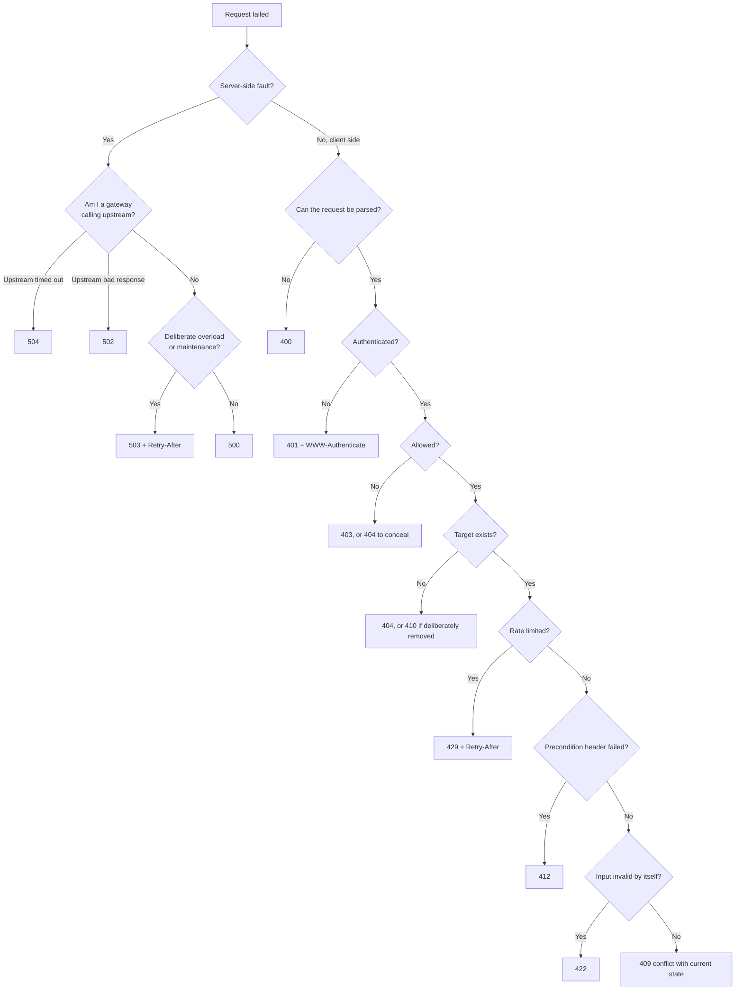

<!-- markdownlint-disable MD001 -->
<!-- markdownlint-disable MD024 -->
<!-- markdownlint-disable MD025 -->
<!-- markdownlint-disable MD026 -->
<!-- markdownlint-disable MD029 -->
<!-- markdownlint-disable MD033 -->
<!-- markdownlint-disable MD036 -->
<!-- markdownlint-disable MD040 -->
<!-- markdownlint-disable MD056 -->
<!-- markdownlint-disable MD060 -->

# R3. HTTP Status Codes (Complete)

## Contents

| #    | Sub-topic                                                                      |
| ---- | ------------------------------------------------------------------------------ |
| R3.1 | [What a status code is for](#r31-what-a-status-code-is-for)                    |
| R3.2 | [1xx Informational](#r32-1xx-informational)                                    |
| R3.3 | [2xx Success](#r33-2xx-success)                                                |
| R3.4 | [3xx Redirection](#r34-3xx-redirection)                                        |
| R3.5 | [4xx Client error](#r35-4xx-client-error)                                      |
| R3.6 | [5xx Server error](#r36-5xx-server-error)                                      |
| R3.7 | [Commonly confused pairs](#r37-commonly-confused-pairs)                        |
| R3.8 | [Non-standard codes in the wild](#r38-non-standard-codes-in-the-wild)          |
| R3.9 | [Mapping exceptions to codes](#r39-mapping-exceptions-to-codes)                |
| -    | [Choosing an error code: decision flow](#choosing-an-error-code-decision-flow) |
| -    | [Exercises](#exercises) and [Solutions](#solutions)                            |
| -    | [Takeaways](#takeaways)                                                        |

How to read each code entry:

- **Meaning**: what the code asserts, per the spec.
- **Use when**: the situations it fits in an API.
- **Avoid when**: the common misuse.
- **Client should**: what a well-behaved generic client does with it.

## R3.1 What a status code is for

A status code tells *generic* HTTP components what to do next. Browsers, caches, proxies, load balancers, retry libraries and monitoring act on the code without understanding your domain.  
Domain detail belongs in the body (Problem Details, R7).  
Choose the code by asking: *what should a client that knows nothing about my application do with this response?*

### The five classes

| Class             | Meaning                                                       | Generic client action                         |
| ----------------- | ------------------------------------------------------------- | --------------------------------------------- |
| 1xx Informational | Interim; the final response is still coming                   | Keep waiting                                  |
| 2xx Successful    | Request received, understood, accepted                        | Done                                          |
| 3xx Redirection   | Further action needed (another URI, or reuse the cached copy) | Follow `Location`, or use the cache           |
| 4xx Client error  | The request is wrong as sent                                  | Change the request; do not retry it unchanged |
| 5xx Server error  | The server failed on a possibly valid request                 | A retry may succeed, with backoff             |

### Rules every client and server must know

- **Unknown codes fall back to `x00`.** A client receiving `471` treats it as `400`; `599` as `500`.  
  Exception: a response with an unrecognized code **must not be cached**.  
  A client needs only the class to behave safely, which is why inventing codes is never necessary.

- **The reason phrase means nothing.** Clients must ignore it; HTTP/2 and HTTP/3 do not carry it.  
  Never encode meaning as `HTTP/1.1 400 Email Taken`.

- **Heuristically cacheable codes**: `200, 203, 204, 206, 300, 301, 308, 404, 405, 410, 414, 501`.  
  Caches may store these without explicit freshness headers, so a CDN can keep serving a `404` after the resource is created. Set `Cache-Control` deliberately (R9).

- **Valid range** is 100 to 599. New codes come only through RFCs into the IANA registry.

- **Renamed in RFC 9110**: `413 Payload Too Large` became **Content Too Large**; `422 Unprocessable Entity` became **Unprocessable Content**.  
  Semantics unchanged; frameworks still expose the old constant names (Spring `PAYLOAD_TOO_LARGE`, `UNPROCESSABLE_ENTITY`; Spring 6.1 adds `CONTENT_TOO_LARGE`).

### The 4xx vs 5xx test

> *If the client resends the identical request, could it succeed?*  
>
> **No, the request must change → 4xx. Yes, the fault or condition is on the server → 5xx.**

Some 4xx codes are about **timing**, not content, so a later identical retry can succeed: `408`, `423`, `425`, `429`, and some `409`s.  
These are the 4xx codes that carry `Retry-After` or invite a retry.

### Why the class matters at architect level

| Who acts on the class                                             | Effect of choosing wrong                                                                   |
| ----------------------------------------------------------------- | ------------------------------------------------------------------------------------------ |
| Retry libraries and meshes (retry `502/503/504`, never plain 4xx) | `500` for validation makes clients retry hopeless requests and amplifies load              |
| SLOs and error budgets (5xx counts, 4xx usually does not)         | `400` for your own bugs hides outages; `500` for bad input burns budget on client mistakes |
| Load balancers and health checks                                  | A burst of 5xx can eject healthy nodes                                                     |
| Caches                                                            | Heuristic caching of `404`/`301` can pin wrong answers                                     |

### Code: emitting and classifying

**Spring Boot**

```java
// Server: any code, including unregistered ones (Spring 6 HttpStatusCode)
return ResponseEntity.status(HttpStatusCode.valueOf(422)).body(problem);

// Client: classify by class so unknown codes are handled safely
HttpStatus.Series series = HttpStatus.Series.resolve(response.statusCode());   // null outside 1xx-5xx
switch (series) {
    case SUCCESSFUL   -> handleOk(response);
    case CLIENT_ERROR -> failWithoutRetry(response);     // except 408/425/429: retry after Retry-After
    case SERVER_ERROR -> retryWithBackoff(request);
    default           -> throw new IllegalStateException("unexpected " + response.statusCode());
}
```

**Actix Web** (and any Rust client on the `http` crate)

```rust
// Server
HttpResponse::build(StatusCode::UNPROCESSABLE_ENTITY).json(problem)

// Client
let code = StatusCode::from_u16(471)?;     // unknown but valid
if code.is_client_error() { /* treat as 400: do not retry unchanged */ }
```

## R3.2 1xx Informational

Interim responses. Zero or more may precede the single final response.  
They never have a body, must not be sent to HTTP/1.0 clients, and a client must tolerate ones it did not expect.

#### 100 Continue

- **Meaning**: the headers are acceptable; send the body.

- **Use when**: the client sent `Expect: 100-continue` before a large body. The server answers `100`, or rejects immediately with a final code (`401`, `403`, `413`, `417`).

- **Avoid when**: never sent unprompted; servers handle it automatically (Tomcat sends `100` when your code first reads the body).

- **Client should**: send the body on `100`; stop on a final code. Avoids uploading 2 GB to receive `401`. Test through your real edge: some old proxies mishandle it.

#### 101 Switching Protocols

- **Meaning**: the connection now speaks the protocol named in `Upgrade`.

- **Use when**: WebSocket handshake over HTTP/1.1 (`Upgrade: websocket`).

- **Avoid when**: HTTP/2 and later; WebSockets there use extended `CONNECT` (RFC 8441), no `101`. The `h2c` upgrade is deprecated.

- **Client should**: switch protocols. `Upgrade` and `Connection` are hop-by-hop, so every proxy must forward them explicitly (the "works locally, fails behind nginx" bug).

#### 102 Processing (deprecated)

- **Meaning**: WebDAV keep-alive for long operations; dropped from WebDAV in RFC 4918.

- **Avoid**: always. Use `202 Accepted` plus a status resource.

#### 103 Early Hints (RFC 8297)

- **Meaning**: preliminary headers (usually `Link: <...>; rel=preload`) sent while the final response is computed.

- **Use when**: HTML pages; CDNs (Cloudflare, Fastly) can emit it for you.

- **Avoid when**: JSON APIs; API clients do not fetch subresources.

- **Client should**: browsers start preload or preconnect; others ignore.

#### 104 Upload Resumption Supported (temporary registration)

- Registered temporarily for the IETF resumable-uploads draft. Not yet a stable standard; watch, do not build on it.

### Code

**Client: `100-continue` (Java `HttpClient`)**

```java
HttpRequest req = HttpRequest.newBuilder(URI.create("https://api.shop.com/uploads"))
        .expectContinue(true)                         // sends Expect: 100-continue, waits before streaming
        .header("Content-Type", "application/octet-stream")
        .POST(BodyPublishers.ofFile(Path.of("video.mp4")))
        .build();
```

**Server: `101` for a WebSocket (Actix Web with `actix-ws`)**

```rust
#[get("/ws")]
async fn ws(req: HttpRequest, body: web::Payload) -> actix_web::Result<HttpResponse> {
    let (response, mut session, mut stream) = actix_ws::handle(&req, body)?;   // response = 101
    actix_web::rt::spawn(async move {
        while let Some(Ok(actix_ws::Message::Text(text))) = stream.recv().await {
            if session.text(text).await.is_err() { break; }                     // echo
        }
    });
    Ok(response)
}
```

In Spring Boot, `@EnableWebSocket` with a `WebSocketHandler` performs the same handshake.

## R3.3 2xx Success

The request worked.  
The specific code tells the client *how*: with a body (`200`), with a new resource (`201`), not yet (`202`), with nothing to show (`204`), or partially (`206`).  
A 2xx must never carry an error; `200 {"ok": false}` breaks every generic component (R1 exercise 1a).

#### 200 OK

- **Meaning**: success; the body depends on the method. GET: the representation. POST: the result of processing. PUT/PATCH/DELETE: a status or the updated representation.

- **Use when**: the default success with a body. An empty collection is `200` with `[]`, not `204` or `404`.

- **Avoid when**: the operation failed, or a resource was created (`201`), or work is pending (`202`).

- **Client should**: consume the body. Heuristically cacheable.

#### 201 Created

- **Meaning**: one or more resources were created. `Location` identifies the primary new resource.

- **Use when**: `POST` to a collection created an item; `PUT` created a resource at a client-chosen URI.

- **Avoid when**: creation happens asynchronously (`202`); nothing new exists (repeat PUT: `200`/`204`).

- **Client should**: read `Location`. The body may contain the representation (saves a GET); include `ETag` if it is the representation.

#### 202 Accepted

- **Meaning**: accepted for processing, not completed. Processing may still fail. The spec deliberately gives no way to report the outcome later; you design that.

- **Use when**: long-running work (reports, video encoding, async payments). Return `Location` (or a body link) to a status resource and `Retry-After` for polling.

- **Avoid when**: the work completes within the request; never as a vague "OK".

- **Client should**: poll the status resource (or await a webhook). When done, the status resource returns `200` with the result, or `303 See Other` to it.

#### 203 Non-Authoritative Information

- **Meaning**: a transforming proxy modified the origin's `200` payload.

- **Use when**: you are that proxy. Origins never send it.

- **Client should**: treat as `200`, aware the content was altered. Heuristically cacheable.

#### 204 No Content

- **Meaning**: success, and there is intentionally no body. Headers (for example `ETag`) still apply.

- **Use when**: `DELETE`, `PUT`/`PATCH` when you do not echo the representation, actions with nothing to return.

- **Avoid when**: GET of an empty collection (`200 []`); any response that has a body (a `204` cannot have one; bytes after it corrupt keep-alive connections).

- **Client should**: not parse a body. Heuristically cacheable.

#### 205 Reset Content

- **Meaning**: success; the user agent should reset the document view (clear the form).

- **Use when**: form-driven UIs; practically never in JSON APIs. No body allowed.

#### 206 Partial Content

- **Meaning**: the body is the requested byte range(s), described by `Content-Range` (or `multipart/byteranges` for several).

- **Use when**: the client sent `Range: bytes=...` and the server supports ranges (advertise `Accept-Ranges: bytes`).  
  Resumable downloads, video seeking, parallel chunked downloads. `If-Range` makes resumption safe if the file changed.

- **Avoid when**: paginating JSON collections; that is not byte ranges (R6).

- **Client should**: stitch ranges. Heuristically cacheable.

#### 207 Multi-Status (WebDAV, RFC 4918)

- **Meaning**: the body holds a separate status per sub-resource.

- **Use when**: WebDAV; some APIs use it for **bulk operations with partial success**, with a JSON body listing per-item statuses.

- **Avoid when**: a generic client would wrongly see "success".  
  If you use it, document it; alternatively return `200` with a per-item results array.  
  Either way, never hide failed items behind a bare success.

- **Client should**: inspect every item.

#### 208 Already Reported (WebDAV, RFC 5842)

- **Meaning**: used *inside* a `207` body to avoid listing the same bound member twice.

- **Avoid**: as a top-level response; never in ordinary APIs.

#### 226 IM Used (RFC 3229)

- **Meaning**: the response is a delta (instance manipulation) applied to the current instance, requested with `A-IM`.

- **Avoid**: practically unused; know it exists.

### Code: 201, 202 and 204

**Spring Boot**

```java
@PostMapping("/report-runs")
ResponseEntity<RunDto> start(@RequestBody ReportRequest req) {
    RunDto run = reports.enqueue(req);
    return ResponseEntity.accepted()                                      // 202
            .location(URI.create("/report-runs/" + run.id()))
            .header(HttpHeaders.RETRY_AFTER, "10")
            .body(run);
}

@GetMapping("/report-runs/{id}")
ResponseEntity<RunDto> status(@PathVariable UUID id) {
    RunDto run = reports.get(id);
    return run.done()
            ? ResponseEntity.status(HttpStatus.SEE_OTHER)                 // 303 to the result
                    .location(URI.create("/reports/" + run.reportId())).build()
            : ResponseEntity.ok().header(HttpHeaders.RETRY_AFTER, "10").body(run);
}
```

**Actix Web**

```rust
#[delete("/orders/{id}")]
async fn delete_order(id: web::Path<Uuid>, svc: web::Data<Orders>) -> actix_web::Result<HttpResponse> {
    svc.delete(id.into_inner()).await?;
    Ok(HttpResponse::NoContent().finish())                                // 204, no body
}
```

## R3.4 3xx Redirection

The client must take another step: go to another URI, or reuse what it has.  
Two questions pick the code: **permanent or temporary**, and **must the method and body be preserved**.

| Code | Permanent | Method preserved         | Typical use                              |
| ---- | --------- | ------------------------ | ---------------------------------------- |
| 301  | Yes       | No (POST may become GET) | Moved web pages (GET only)               |
| 302  | No        | No (POST may become GET) | Legacy temporary redirect; avoid in APIs |
| 303  | n/a       | Always becomes GET       | POST/Redirect/GET; async job → result    |
| 307  | No        | **Yes**                  | Temporary move for any method            |
| 308  | Yes       | **Yes**                  | Permanent API path or host migration     |

#### 300 Multiple Choices

- **Meaning**: several representations exist; the client chooses (agent-driven negotiation).

- **Use when**: rarely. Heuristically cacheable.

#### 301 Moved Permanently

- **Meaning**: the resource has a new permanent URI in `Location`. For historical reasons clients may change POST to GET.

- **Use when**: GET-only resources, websites, SEO moves.

- **Avoid when**: APIs with non-GET methods; use `308`. Heuristically cacheable, so a mistaken `301` can stick in caches and browsers for a long time.

- **Client should**: update bookmarks and stored links.

#### 302 Found

- **Meaning**: temporary redirect; clients may (and browsers do) change POST to GET.

- **Avoid**: in APIs. Use `307` (keep the method) or `303` (switch to GET deliberately).

#### 303 See Other

- **Meaning**: the answer is at another URI; retrieve it with **GET**.

- **Use when**: after POST, redirect to the created resource or result (POST/Redirect/GET); async status resource redirecting to the finished result.

- **Client should**: GET the `Location`.

#### 304 Not Modified

- **Meaning**: a conditional GET or HEAD (`If-None-Match`, `If-Modified-Since`) matched; use your cached copy. No body.

- **Use when**: always support it for cacheable resources with an `ETag` (R9).  
  It must carry the headers a `200` would have carried for caching (`ETag`, `Cache-Control`, `Vary`, `Expires`, `Content-Location`, `Date`).

- **Client should**: reuse the cached representation and refresh its metadata.

#### 305 Use Proxy (deprecated)

- **Meaning**: "access via this proxy". Deprecated for security reasons; clients ignore it. Never use.

#### 306 (Unused)

- Formerly "Switch Proxy"; reserved, never used.

#### 307 Temporary Redirect

- **Meaning**: temporary; repeat the **same method and body** at `Location`.

- **Use when**: temporary moves of any endpoint, maintenance redirects, regional failover.

- **Client should**: resend unchanged; keep using the original URI afterwards.

#### 308 Permanent Redirect

- **Meaning**: permanent; repeat the same method and body. Heuristically cacheable.

- **Use when**: API host or path migrations (`api.old.com` → `api.new.com`, `/v1/orders` renamed).

- **Client should**: resend unchanged and update stored URIs.

### Redirect pitfalls in APIs

- Many HTTP clients do not follow redirects for non-GET methods by default; some never follow them. Redirects are a weak migration tool for machine clients; announce and version instead (R11).

- Clients often **drop `Authorization`** when redirected to a different host, by design. Test cross-host redirects explicitly.

- Never redirect HTTPS to HTTP. Java `HttpClient` with `Redirect.NORMAL` refuses that downgrade for this reason.

- Redirect loops: browsers stop after about 20 hops; generic clients may not.

## R3.5 4xx Client error

The request is wrong as sent: bad syntax, bad identity, bad permissions, bad target, bad state, or bad timing.  
The body (Problem Details, R7) explains what to change.  
Except for the timing codes, the client must not retry unchanged.

#### 400 Bad Request

- **Meaning**: the server cannot or will not process the request due to a client error: malformed syntax, invalid framing, unparseable JSON, wrong types.

- **Use when**: the request is malformed; also the generic fallback for client errors with no better code.

- **Avoid when**: a more specific code fits (`401`, `404`, `409`, `415`, `422`, `429`).

- **Client should**: fix the request; never retry unchanged.

#### 401 Unauthorized

- **Meaning**: **unauthenticated**: credentials are missing, invalid or expired. Despite the name, it is about *authentication*.  
  The server **must** send `WWW-Authenticate` with a challenge (for example `Bearer error="invalid_token"`).

- **Use when**: no token, bad signature, expired token.

- **Avoid when**: the caller is authenticated but not allowed (`403`).

- **Client should**: (re)authenticate (refresh the token), then retry once.

#### 402 Payment Required

- **Meaning**: reserved for future use; no standard semantics.

- **Use when**: some APIs adopt it by convention (Stripe uses it when a request is valid but the payment failed). Use only with documentation.

- **Client should**: treat as `400` unless the API documents otherwise.

#### 403 Forbidden

- **Meaning**: understood, but refused. Re-authenticating will not help.

- **Use when**: authenticated caller lacks permission or scope; action forbidden by policy (IP blocked, account suspended).

- **Avoid when**: revealing the resource's existence is itself a leak; return `404` instead (BOLA defence, R10).

- **Client should**: not retry; surface "not allowed".

#### 404 Not Found

- **Meaning**: no current representation for the target, or the server will not disclose that one exists.

- **Use when**: unknown ID; resource exists but caller may not know it exists (concealed `403`).

- **Avoid when**: empty collection (`200 []`); unsupported method (`405`); deliberately and permanently removed with intent to say so (`410`).

- **Client should**: not retry. Heuristically cacheable: set `Cache-Control` if the resource may appear soon.

#### 405 Method Not Allowed

- **Meaning**: the target exists but does not support this method. **Must** include `Allow` listing supported methods.

- **Use when**: `DELETE /orders` (collection is not deletable); `PUT` on a read-only resource.

- **Client should**: use a method from `Allow`. Heuristically cacheable.

#### 406 Not Acceptable

- **Meaning**: no representation matches the request's `Accept`, `Accept-Language` or `Accept-Encoding`.

- **Use when**: strict content negotiation (`Accept: application/xml` on a JSON-only API).

- **Avoid when**: you prefer serving the default representation anyway; the spec allows ignoring `Accept`. Pick one policy and document it.

- **Client should**: change `Accept`.

#### 407 Proxy Authentication Required

- **Meaning**: like `401`, but from a proxy; carries `Proxy-Authenticate`.

- **Avoid**: origin APIs never send it.

#### 408 Request Timeout

- **Meaning**: the server did not receive a complete request in time (slow or stalled client); it may close the connection.

- **Use when**: the *client* was too slow to send (a slowloris defence emits it).

- **Avoid when**: an upstream dependency was slow (`504`) or your handler was slow (`503`/`504`).

- **Client should**: retry on a new connection; idempotent requests are safe to retry automatically.

#### 409 Conflict

- **Meaning**: the request conflicts with the current state of the target. The body must explain the conflict so the client can resolve it.

- **Use when**: invalid state transition (cancel a shipped order); unique constraint violation (username taken); version conflict when you do not use preconditions; idempotency key still in flight (R2 DD-3).

- **Avoid when**: the conflict is detected via `If-Match` (`412`); the input is simply invalid (`422`).

- **Client should**: re-read state, resolve, resubmit. A retry later may succeed for in-flight or transient conflicts.

#### 410 Gone

- **Meaning**: the target is gone **permanently and deliberately**, and no forwarding address exists.

- **Use when**: sunset API versions after their sunset date; resources deleted under a retention policy when you want clients to purge links.

- **Avoid when**: you do not know whether it existed (`404`). Heuristically cacheable.

- **Client should**: remove references; never retry.

#### 411 Length Required

- **Meaning**: the server refuses a body without `Content-Length` (for example a chunked upload).

- **Client should**: send `Content-Length`.

#### 412 Precondition Failed

- **Meaning**: a condition in `If-Match`, `If-Unmodified-Since` or (non-GET) `If-None-Match` evaluated false.

- **Use when**: optimistic concurrency: the client's `If-Match: "v3"` no longer matches (lost-update prevention, R8); `If-None-Match: *` on a create-if-absent PUT that found an existing resource.

- **Client should**: GET the latest representation, merge or re-decide, retry with the new ETag.

#### 413 Content Too Large

- **Meaning**: the request body exceeds what the server will process. The server may close the connection; include `Retry-After` if the condition is temporary.

- **Use when**: upload size limits, oversized JSON. Configure it at every layer (gateway, server, framework) consistently.

- **Client should**: shrink, split or use a chunked or resumable upload API.

#### 414 URI Too Long

- **Meaning**: the request target is longer than the server will interpret.

- **Use when**: overlong query strings (move to `POST /searches` or `QUERY`, R2 exercise 1e).

- **Client should**: shorten the URI. Heuristically cacheable.

#### 415 Unsupported Media Type

- **Meaning**: the request **body's** `Content-Type` (or `Content-Encoding`) is not supported.

- **Use when**: `Content-Type: text/plain` sent to a JSON endpoint; wrong patch format. Add `Accept-Patch` or `Accept-Post` to advertise what is accepted.

- **Avoid when**: the problem is the response format (`406`).

- **Client should**: send a supported media type.

#### 416 Range Not Satisfiable

- **Meaning**: none of the requested ranges overlap the representation. Send `Content-Range: bytes */<length>`.

- **Client should**: re-request a valid range.

#### 417 Expectation Failed

- **Meaning**: the `Expect` header cannot be met (in practice only `100-continue` exists).

- **Client should**: resend without `Expect`.

#### 418 (Unused)

- **Meaning**: from the 1998 April Fools' RFC 2324 ("I'm a teapot"). RFC 9110 reserves it as unused because software emitted it.

- **Avoid**: never use it in a real API.

#### 421 Misdirected Request

- **Meaning**: the request reached a server that cannot answer for the target authority.  
  Happens with HTTP/2 connection coalescing: a certificate covers several hosts, the client reuses a connection, but that server does not serve the host.

- **Client should**: retry on a new connection; browsers do this automatically.

#### 422 Unprocessable Content

- **Meaning**: the syntax is fine and the media type is supported, but the content is semantically invalid.

- **Use when**: validation failures: email format wrong, quantity negative, end date before start date. Return field-level errors (R7).

- **Avoid when**: the JSON does not parse (`400`); the problem is current resource state (`409`).

- **Client should**: fix the indicated fields.

#### 423 Locked (WebDAV)

- **Meaning**: the target resource is locked.

- **Use when**: an explicit lock exists (document under exclusive edit lock, record held by a workflow).

- **Client should**: retry after the lock is released; the timing may change the outcome.

#### 424 Failed Dependency (WebDAV)

- **Meaning**: the method could not be performed because a related action it depended on failed.

- **Use when**: inside a multi-status bulk result: item 3 failed because item 2 failed.

- **Avoid when**: a downstream *service* failed (`502`/`503`/`504`).

#### 425 Too Early (RFC 8470)

- **Meaning**: the server will not process a request that arrived in TLS 1.3 or QUIC 0-RTT early data, because it could be replayed.

- **Use when**: non-idempotent requests arriving as early data (R2.2).

- **Client should**: retry after the handshake completes; clients do this automatically.

#### 426 Upgrade Required

- **Meaning**: the server refuses this protocol; it lists required ones in `Upgrade`.

- **Use when**: forcing a protocol switch at the HTTP layer. Rare; HTTPS enforcement normally uses redirects plus HSTS.

#### 428 Precondition Required (RFC 6585)

- **Meaning**: this endpoint requires a conditional request.

- **Use when**: you mandate `If-Match` on updates to prevent lost updates; a PUT without it gets `428`.

- **Client should**: GET, take the `ETag`, resend with `If-Match`.

#### 429 Too Many Requests (RFC 6585)

- **Meaning**: the client sent too many requests in a given time (rate limiting).

- **Use when**: per-client quota exceeded. Include `Retry-After` and, ideally, `RateLimit` header fields (R13).

- **Avoid when**: the whole service is overloaded regardless of the client (`503`).

- **Client should**: back off until `Retry-After`; never hammer.

#### 431 Request Header Fields Too Large (RFC 6585)

- **Meaning**: one header, or the header section as a whole, is too large.

- **Use when**: oversized cookies or JWTs (R2.4).

- **Client should**: shrink headers (clear cookies, slimmer tokens).

#### 451 Unavailable For Legal Reasons (RFC 7725)

- **Meaning**: access denied because of a legal demand (court order, sanctions, regional law). Optionally `Link: <...>; rel="blocked-by"`.

- **Use when**: the denial is legal, not technical or permission-based.

- **Client should**: not retry; show the legal notice.

### Code: precondition and validation codes

**Spring Boot**

```java
@PutMapping("/orders/{id}")
ResponseEntity<OrderDto> replace(@PathVariable UUID id,
                                 @RequestHeader(value = HttpHeaders.IF_MATCH, required = false) String ifMatch,
                                 @RequestBody @Valid OrderDto body) {
    if (ifMatch == null) {
        return ResponseEntity.status(HttpStatus.PRECONDITION_REQUIRED).build();       // 428
    }
    Order current = service.get(id);                                                   // 404 via exception
    if (!current.etag().equals(ifMatch)) {
        return ResponseEntity.status(HttpStatus.PRECONDITION_FAILED).build();         // 412
    }
    Order saved = service.replace(id, body);
    return ResponseEntity.ok().eTag(saved.etag()).body(OrderDto.from(saved));
}
```

**Actix Web**

```rust
#[put("/orders/{id}")]
async fn replace(req: HttpRequest, id: web::Path<Uuid>, body: web::Json<OrderDto>,
                 svc: web::Data<Orders>) -> Result<HttpResponse, ApiError> {
    let if_match = req.headers().get(header::IF_MATCH).and_then(|v| v.to_str().ok())
        .ok_or(ApiError::PreconditionRequired)?;                                       // 428
    let current = svc.get(*id).await?;                                                 // 404 via ApiError
    if current.etag() != if_match {
        return Err(ApiError::PreconditionFailed);                                      // 412
    }
    let saved = svc.replace(*id, body.into_inner()).await?;
    Ok(HttpResponse::Ok().insert_header((header::ETAG, saved.etag())).json(saved))
}
```

## R3.6 5xx Server error

The server, or something behind it, failed. The request may be valid, so a retry may succeed.  
Never leak internals (stack traces, SQL, hostnames) in the body.

#### 500 Internal Server Error

- **Meaning**: an unexpected condition prevented fulfilment. The generic "we have a bug".

- **Use when**: unhandled exceptions. Log with a correlation ID and return that ID to the client (R4, R13).

- **Avoid when**: the client's input is the cause (4xx); a dependency is the cause (`502`/`503`/`504`).

- **Client should**: retry with backoff only if the request is idempotent or carries an idempotency key.

#### 501 Not Implemented

- **Meaning**: the server does not support the functionality required, typically an unrecognized **method** for any resource.

- **Use when**: unknown method (`PURGE` on a server that has no such concept). Heuristically cacheable.

- **Avoid when**: the method exists but not on this resource (`405`).

#### 502 Bad Gateway

- **Meaning**: a gateway or proxy received an **invalid response** from upstream: connection refused, reset, malformed response.

- **Use when**: you are the gateway (API gateway, BFF calling a backend that crashed).

- **Client should**: retry with backoff; usually transient (deploys, crashed pods).

#### 503 Service Unavailable

- **Meaning**: temporarily unable to handle the request: overload, maintenance, circuit breaker open, load shedding.

- **Use when**: you deliberately shed load or are in maintenance. Send `Retry-After`.

- **Avoid when**: one client exceeds its quota (`429`).

- **Client should**: back off and honour `Retry-After`. Load balancers and health checks treat it as "not ready".

#### 504 Gateway Timeout

- **Meaning**: a gateway or proxy did not get a **timely** response from upstream.

- **Use when**: you are the gateway and your upstream call timed out.

- **Avoid when**: the client was slow to send (`408`).

- **Client should**: retry with backoff, but **only safely if idempotent**: the upstream may have completed the work (the ambiguity of R2 DD-3).

#### 505 HTTP Version Not Supported

- **Meaning**: the major HTTP version in the request is not supported.

#### 506 Variant Also Negotiates (RFC 2295)

- **Meaning**: transparent content negotiation misconfiguration: the chosen variant is itself negotiable. Experimental; essentially never seen.

#### 507 Insufficient Storage (WebDAV)

- **Meaning**: the server cannot store the representation needed to complete the request.

- **Use when**: server-side storage is exhausted. For a *user's* quota, prefer `403` or `409` with a clear problem type, since the user can fix it.

#### 508 Loop Detected (WebDAV, RFC 5842)

- **Meaning**: an infinite loop was detected while processing (WebDAV bindings with `Depth: infinity`).

#### 510 Not Extended (RFC 2774, historic)

- **Meaning**: the HTTP Extension Framework policy was not met. The framework is obsolete; do not use.

#### 511 Network Authentication Required (RFC 6585)

- **Meaning**: the client must authenticate to gain network access. Sent by **captive portals** (hotel and airport Wi-Fi), never by origin servers.

- **Client should**: mobile apps that receive HTML with `511` know they are behind a captive portal and should prompt the user, not parse the body as JSON.

## R3.7 Commonly confused pairs

| Pair            | Rule that separates them                                                                                   |
| --------------- | ---------------------------------------------------------------------------------------------------------- |
| 200 / 201 / 204 | New resource → `201` + `Location`. Body to return → `200`. Nothing to return → `204`.                      |
| 201 / 202       | Resource exists now → `201`. Work merely queued → `202` + status resource.                                 |
| 301 / 308       | Both permanent; `308` preserves method and body. APIs use `308`.                                           |
| 302 / 303 / 307 | `303` switches to GET on purpose; `307` keeps the method; `302` is ambiguous, avoid.                       |
| 400 / 422       | Cannot parse or wrong types → `400`. Parses, but values break rules → `422`.                               |
| 401 / 403       | Who are you? → `401` (+ `WWW-Authenticate`). I know you; no → `403`.                                       |
| 403 / 404       | If revealing existence leaks information, answer `404` to unauthorized callers.                            |
| 404 / 410       | Unknown or never existed → `404`. Deliberately and permanently removed, and you want links purged → `410`. |
| 405 / 501       | Method unsupported on this resource → `405` (+ `Allow`). Method unknown to the server → `501`.             |
| 406 / 415       | Response format the client wants is unavailable → `406`. Request body format is unsupported → `415`.       |
| 409 / 412       | State conflict found by business logic → `409`. Precondition header failed → `412`.                        |
| 409 / 422       | Valid input that clashes with current state → `409`. Invalid input regardless of state → `422`.            |
| 408 / 504       | Client too slow sending to me → `408`. My upstream too slow answering me → `504`.                          |
| 429 / 503       | This client is over its limit → `429`. The service is overloaded for everyone → `503`.                     |
| 502 / 504       | Upstream answered badly or refused → `502`. Upstream did not answer in time → `504`.                       |
| 500 / 502 / 503 | My own bug → `500`. Bad upstream response → `502`. Deliberately unavailable → `503`.                       |

## R3.8 Non-standard codes in the wild

These appear in logs and dashboards. Recognize them; never emit them from your own API.

| Code     | Source          | Meaning                                                                         |
| -------- | --------------- | ------------------------------------------------------------------------------- |
| 444      | nginx           | No response; connection closed (used to drop abusive requests)                  |
| 499      | nginx           | Client closed the request before the response; a client-timeout signal          |
| 460, 463 | AWS ALB         | Client closed connection before idle timeout; too many IPs in `X-Forwarded-For` |
| 509      | Apache / cPanel | Bandwidth limit exceeded                                                        |
| 520      | Cloudflare      | Origin returned an empty or unexpected response                                 |
| 521      | Cloudflare      | Origin refused the connection                                                   |
| 522      | Cloudflare      | Connection to origin timed out                                                  |
| 523      | Cloudflare      | Origin unreachable                                                              |
| 524      | Cloudflare      | Origin connected but did not respond in time (about 100 s by default)           |
| 525, 526 | Cloudflare      | TLS handshake with origin failed; invalid origin certificate                    |
| 598, 599 | Some proxies    | Network read or connect timeout (informal)                                      |

**Why they matter**: a spike of nginx `499` usually means *your* latency exceeded *client* timeouts, so clients gave up; it often precedes a retry storm.  
Cloudflare `52x` codes say the origin, not the edge, failed. Clients treat all of them as their class (`5xx` → retry, `4xx` → do not).

**Why never emit your own**: generic clients only know the class, the registry is the shared vocabulary, and custom codes break monitoring that groups by known codes.  
Put specifics in the Problem Details `type` (R7).

## R3.9 Mapping exceptions to codes

Map domain exceptions to codes in **one place**, never ad hoc in controllers.  
Each exception type expresses *what went wrong in domain terms*; the mapping layer translates to HTTP.  
This keeps the domain free of HTTP and makes the error contract consistent.

### Domain-to-HTTP mapping table (design this first)

| Domain condition         | Exception (example)                  | Code                                             |
| ------------------------ | ------------------------------------ | ------------------------------------------------ |
| Malformed request body   | (framework)                          | 400                                              |
| Field validation failed  | `ValidationException`                | 422                                              |
| Not authenticated        | (security layer)                     | 401                                              |
| Not permitted            | `AccessDeniedException`              | 403 (or 404 to conceal)                          |
| Entity not found         | `OrderNotFoundException`             | 404                                              |
| Invalid state transition | `InvalidStateTransitionException`    | 409                                              |
| Duplicate unique value   | `DuplicateEmailException`            | 409                                              |
| Stale version            | `StaleVersionException`              | 412                                              |
| Rate limited             | `RateLimitedException`               | 429 + `Retry-After`                              |
| Downstream unavailable   | `PaymentGatewayUnavailableException` | 503 (or 502/504 as a gateway)                    |
| Anything else            | `Exception`                          | 500, generic message, logged with correlation ID |

### Framework defaults you should know

| Situation                    | Spring Boot (MVC) default                     | Actix Web default                                          |
| ---------------------------- | --------------------------------------------- | ---------------------------------------------------------- |
| Unparseable JSON             | `400` (`HttpMessageNotReadableException`)     | `400` from the `Json` extractor                            |
| Bean Validation failure      | `400` (`MethodArgumentNotValidException`)     | No built-in validation; you return the code                |
| Wrong `Content-Type`         | `415`                                         | Configure via `JsonConfig::error_handler`                  |
| No matching `Accept`         | `406`                                         | Not negotiated unless you implement it                     |
| Method not mapped            | `405` with `Allow`                            | `405` for resources with other routes                      |
| No route                     | `404` (`NoResourceFoundException`, Boot 3.2+) | `404`                                                      |
| Path variable fails to parse | `400` (type mismatch)                         | **`404`** (`web::Path` default); override via `PathConfig` |

Validation as `400` vs `422` is a house choice; Spring defaults to `400`. If you standardize on `422`, override the handler (below).

### Spring Boot: `@RestControllerAdvice` with Problem Details

```java
@RestControllerAdvice
class ApiExceptionHandler extends ResponseEntityExceptionHandler {   // keeps correct codes for Spring's own exceptions

    @ExceptionHandler(OrderNotFoundException.class)
    ProblemDetail notFound(OrderNotFoundException e) {
        return ProblemDetail.forStatusAndDetail(HttpStatus.NOT_FOUND, e.getMessage());
    }

    @ExceptionHandler(InvalidStateTransitionException.class)
    ProblemDetail conflict(InvalidStateTransitionException e) {
        ProblemDetail pd = ProblemDetail.forStatusAndDetail(HttpStatus.CONFLICT, e.getMessage());
        pd.setProperty("currentState", e.currentState());
        return pd;
    }

    @ExceptionHandler(RateLimitedException.class)
    ResponseEntity<ProblemDetail> tooMany(RateLimitedException e) {
        return ResponseEntity.status(HttpStatus.TOO_MANY_REQUESTS)
                .header(HttpHeaders.RETRY_AFTER, String.valueOf(e.retryAfterSeconds()))
                .body(ProblemDetail.forStatus(HttpStatus.TOO_MANY_REQUESTS));
    }

    @Override                                                           // house rule: validation → 422
    protected ResponseEntity<Object> handleMethodArgumentNotValid(MethodArgumentNotValidException ex,
            HttpHeaders headers, HttpStatusCode status, WebRequest request) {
        ProblemDetail pd = ProblemDetail.forStatus(HttpStatus.UNPROCESSABLE_ENTITY);
        pd.setProperty("errors", ex.getFieldErrors().stream()
                .map(f -> Map.of("field", f.getField(), "message", String.valueOf(f.getDefaultMessage())))
                .toList());
        return ResponseEntity.unprocessableEntity().body(pd);
    }

    @ExceptionHandler(Exception.class)
    ProblemDetail unexpected(Exception e) {
        log.error("unhandled", e);                                      // full detail in logs only
        return ProblemDetail.forStatusAndDetail(HttpStatus.INTERNAL_SERVER_ERROR, "Unexpected error");
    }
}
```

**Pitfall**: an `@ExceptionHandler(Exception.class)` in an advice that does **not** extend `ResponseEntityExceptionHandler` also catches Spring's own exceptions (`HttpRequestMethodNotSupportedException`, `HttpMediaTypeNotSupportedException`, ...) and turns every `405`, `406` and `415` into `500`.  
Extending the base class gives those more specific handlers, which win.

### Actix Web: one error enum implementing `ResponseError`

```rust
#[derive(Debug, thiserror::Error)]
enum ApiError {
    #[error("order {0} not found")]
    NotFound(Uuid),
    #[error("cannot {action} an order in state {state}")]
    InvalidTransition { action: &'static str, state: String },
    #[error("validation failed")]
    Validation(Vec<FieldError>),
    #[error("If-Match header is required")]
    PreconditionRequired,
    #[error("resource changed since it was read")]
    PreconditionFailed,
    #[error("rate limited")]
    RateLimited { retry_after: u64 },
    #[error("unexpected error")]
    Internal(#[from] anyhow::Error),
}

impl ResponseError for ApiError {
    fn status_code(&self) -> StatusCode {
        match self {
            ApiError::NotFound(_)              => StatusCode::NOT_FOUND,
            ApiError::InvalidTransition { .. } => StatusCode::CONFLICT,
            ApiError::Validation(_)            => StatusCode::UNPROCESSABLE_ENTITY,
            ApiError::PreconditionRequired     => StatusCode::PRECONDITION_REQUIRED,
            ApiError::PreconditionFailed       => StatusCode::PRECONDITION_FAILED,
            ApiError::RateLimited { .. }       => StatusCode::TOO_MANY_REQUESTS,
            ApiError::Internal(_)              => StatusCode::INTERNAL_SERVER_ERROR,
        }
    }

    fn error_response(&self) -> HttpResponse {
        if let ApiError::Internal(e) = self {
            log::error!("unhandled: {e:?}");                       // detail in logs only
        }
        let mut res = HttpResponse::build(self.status_code());
        if let ApiError::RateLimited { retry_after } = self {
            res.insert_header((header::RETRY_AFTER, retry_after.to_string()));
        }
        res.content_type("application/problem+json").json(serde_json::json!({
            "status": self.status_code().as_u16(),
            "title":  self.status_code().canonical_reason(),
            "detail": self.to_string(),                            // Internal shows the generic message only
        }))
    }
}

// Make extractor failures follow the same contract
App::new()
    .app_data(web::PathConfig::default()
        .error_handler(|err, _req| actix_web::error::ErrorBadRequest(err)))        // 400, not the default 404
    .app_data(web::JsonConfig::default().limit(256 * 1024))                        // 413 above 256 KiB
```

## Choosing an error code: decision flow



Order matters: authentication and authorization are checked **before** existence, so an unauthorized caller cannot probe which IDs exist.  
Rate limiting typically runs even earlier, at the gateway.

## Exercises

**1. Pick the code.** For each scenario give the status code and any header that must accompany it.

- a) `POST /users` with a body that is not valid JSON.

- b) `POST /users` with valid JSON, but the email is already registered.

- c) `POST /users` with valid JSON, but `age: -4`.

- d) Bearer token expired.

- e) Valid token; the user tries to read another tenant's invoice.

- f) `DELETE /orders` (the collection).

- g) `GET /v1/orders/7` after v1 reached its announced sunset date.

- h) A client exceeded 100 requests per minute.

- i) Your BFF called the order service, which did not answer within 2 s.

- j) A PUT with `If-Match: "v3"`, but the resource is at `"v5"`.

**2. Review this error contract.** An API currently does the following. Name each problem and the fix.

- a) All errors return `200` with `{"success": false, "code": "..."}`.

- b) Validation errors return `500` because the exception "bubbles up".

- c) Expired tokens return `403`.

- d) Missing order returns `204`.

- e) Overload returns `429` to everyone.

- f) Custom status `599` for "payment declined".

**3. Retry policy.** Write the client retry policy table for a mobile app calling a payments API: which codes are retried, how, and under what condition.

## Solutions

### Solution 1

| #   | Code | Accompanying header or note                                                                                                  |
| --- | ---- | ---------------------------------------------------------------------------------------------------------------------------- |
| a   | 400  | Problem Details explaining the parse error                                                                                   |
| b   | 409  | Conflict with existing state (unique email). Some teams use 422; 409 is more precise because the input is valid in isolation |
| c   | 422  | Field-level errors in the body                                                                                               |
| d   | 401  | `WWW-Authenticate: Bearer error="invalid_token", error_description="token expired"`                                          |
| e   | 404  | Conceal existence across tenants (403 would confirm the invoice exists)                                                      |
| f   | 405  | `Allow: GET, POST`                                                                                                           |
| g   | 410  | Ideally preceded by `Deprecation` and `Sunset` headers during the deprecation window (R11)                                   |
| h   | 429  | `Retry-After`, plus `RateLimit` headers                                                                                      |
| i   | 504  | You are the gateway; upstream timed out. Not 500 (not your bug), not 408 (not the client)                                    |
| j   | 412  | Client must re-read, merge, retry with the new ETag                                                                          |

### Solution 2

| #   | Problem                                                                                                         | Fix                                                                                         |
| --- | --------------------------------------------------------------------------------------------------------------- | ------------------------------------------------------------------------------------------- |
| a   | Caches, retries, monitoring and SLOs all see success; failures are invisible to infrastructure                  | Real 4xx/5xx codes + Problem Details body with a machine-readable `type`                    |
| b   | Clients retry hopeless requests; error budget burns on client mistakes; health checks may eject nodes           | Central exception mapping; validation → `422` (or `400` by house rule)                      |
| c   | `403` says "re-authenticating won't help", so clients never refresh the token                                   | `401` with `WWW-Authenticate`; client refreshes and retries once                            |
| d   | `204` means success with no content; clients think the order exists                                             | `404`                                                                                       |
| e   | `429` blames the individual client; well-behaved clients get punished and the root cause (capacity) is hidden   | `503` + `Retry-After` for global overload; `429` only for per-client limits                 |
| f   | Generic clients treat `599` as `500` and **retry a declined payment**; monitoring counts it as a server failure | A 4xx (`402` by documented convention, or `422`/`409`) with problem type `payment-declined` |

### Solution 3

| Response                               | Retry?       | How                                                                                                    |
| -------------------------------------- | ------------ | ------------------------------------------------------------------------------------------------------ |
| Network error, timeout, no response    | Yes          | Same `Idempotency-Key`, exponential backoff with jitter, cap attempts; show "processing", not "failed" |
| 401                                    | Once         | Refresh the token, then retry the same request (same key)                                              |
| 408, 425                               | Yes          | Immediately on a new connection or after the handshake, same key                                       |
| 409 (idempotency key in flight)        | Yes          | After `Retry-After`, same key                                                                          |
| 409 (business conflict), 412           | No           | Re-read state and let the user or logic decide; a new attempt is a new intent with a new key           |
| 429                                    | Yes          | After `Retry-After`; never sooner                                                                      |
| 400, 403, 404, 405, 410, 413, 415, 422 | No           | Surface the error; fix the request                                                                     |
| 500                                    | Yes, limited | Only because the request carries an idempotency key; backoff with jitter                               |
| 502, 503, 504                          | Yes          | Backoff with jitter, honour `Retry-After`, same key; circuit-break after repeated failures             |
| Unknown code                           | By class     | Treat as `x00` of its class                                                                            |

Key principle: **retries of non-idempotent requests are only safe because of the idempotency key** (R2 DD-3).  
Without it, retry only safe and idempotent methods.

## Takeaways

- The code is for generic components; the body is for your domain. Choose by what a generic client should do.

- Unknown codes degrade to `x00` of their class, so never invent codes; put specifics in Problem Details.

- 4xx means change the request; 5xx means the server or its dependencies failed. Getting the class wrong breaks retries, SLOs and health checks.

- `401` is authentication, `403` authorization, `404` can conceal both.

- `409` is state, `412` is preconditions, `422` is invalid input.

- `429` is one client over its limit; `503` is the service overloaded for everyone.

- `502` bad upstream response, `504` upstream timeout, `500` your own bug.

- APIs redirect with `307`/`308` (method preserved) or `303` (switch to GET), not `301`/`302`.

- Map exceptions to codes in one place; know your framework's defaults and their traps.

---
